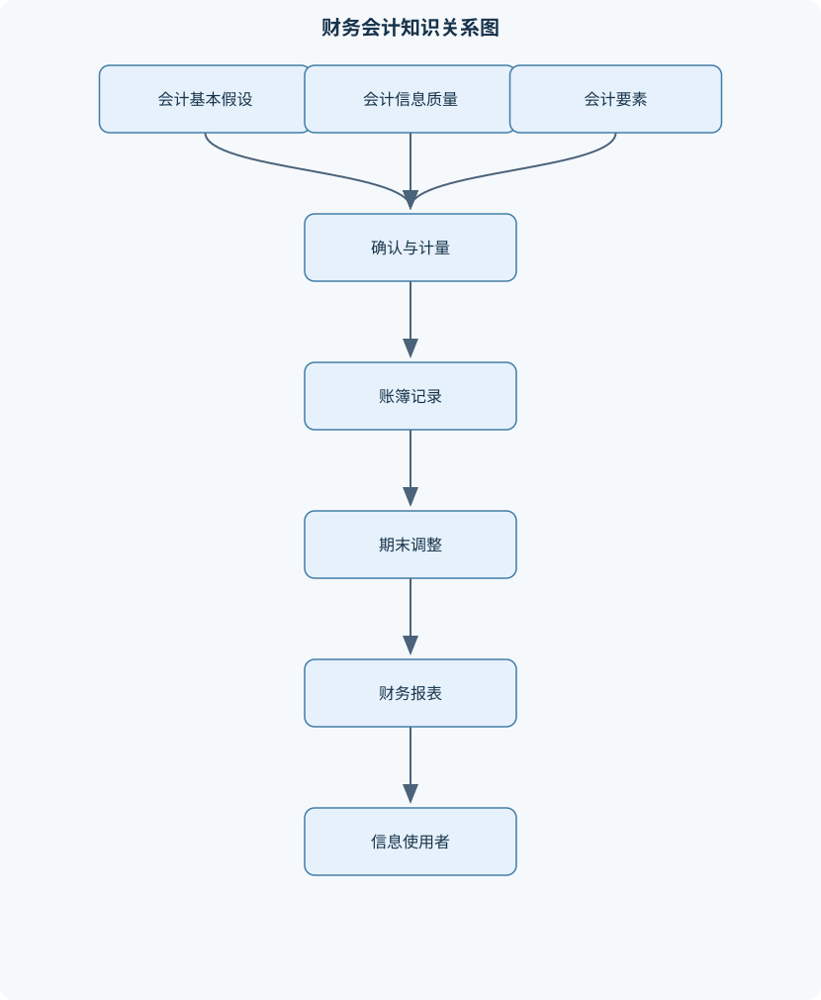
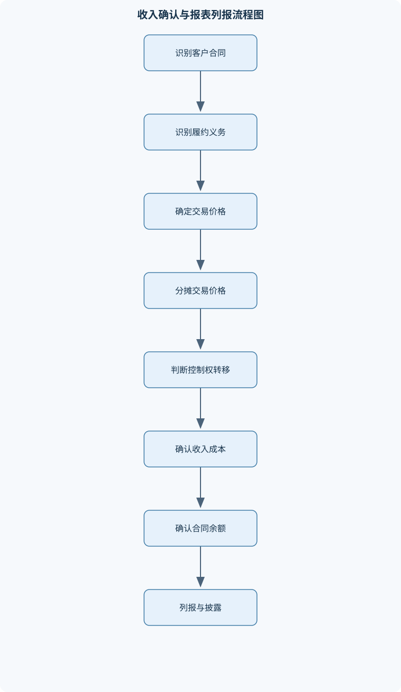

# 中级财务会计学

## 一、课程整体知识框架

### 课程边界与先修知识

《中级财务会计学》研究企业在权责发生制和持续经营等基本假设下，依据适用的企业会计准则，对复杂交易和事项进行确认、计量、记录、列报与披露的方法。课程边界包括财务会计概念框架、会计循环与期末调整、货币资金及应收项目、存货、固定资产与无形资产、投资性房地产、金融资产、长期股权投资、负债与借款费用、收入与费用、所得税、所有者权益、财务报表编制及现金流量表分析，并适当介绍企业合并与合并财务报表。课程重点是交易实质、确认时点、计量基础、备抵与减值、损益归属、权益变动及报表列报之间的逻辑联系。先修知识包括基础会计中的借贷记账法、会计等式、会计科目、凭证账簿、试算平衡、会计循环、基本财务报表、货币时间价值和基础税务概念。课程不以税务申报、管理会计决策、审计程序或具体软件操作为主要内容；涉及税费时，重点放在会计确认与计量，不替代税法适用判断。





### 1. 课程对象、目标与边界

中级财务会计学研究企业在持续经营、会计分期、货币计量和权责发生制等前提下，如何依据适用的企业会计准则，对复杂经济交易和事项进行确认、计量、记录、列报与披露。其核心不是机械记忆会计分录，而是回答五个相互联系的问题：经济事项是否已经发生；应在何时确认；应按什么金额计量；应计入资产、负债、收入、费用还是权益；最终应在财务报表的什么项目中列示并披露。

财务会计主要服务于投资者、债权人、潜在投资者、监管机构和其他外部信息使用者，同时也为企业内部经营管理提供基础数据。它加工的是已经发生或能够可靠判断的交易、事项和情况，通常遵循“原始凭证—记账凭证—会计账簿—调整分录—财务报表—附注”的程序。财务报表包括资产负债表、利润表、现金流量表和所有者权益变动表，附注则解释会计政策、会计估计、重要项目的构成及报表中无法充分表达的事项。

课程边界应与税务申报、管理会计、审计和软件操作区分。涉及增值税、所得税或其他税费时，重点是会计上的确认、计量和列报，不等同于对税法适用结果作出判断；涉及审计时，重点是报表项目的经济实质和账务处理，而不是审计证据获取程序；涉及分析时，重点是报表信息之间的联系，而不是替代经营决策。

### 2. 基本假设与会计信息质量

会计主体规定会计信息所反映的空间范围。会计主体可以是法人企业，也可以是能够独立核算、独立提供财务信息的分公司、事业部或项目，但会计主体不必然等同于法律主体。企业所有者个人的消费、借款和投资，原则上不能直接混入企业账簿；企业与所有者之间的交易应按独立主体原则记录。

持续经营假设意味着在可预见的未来，企业将按既定目标继续经营，而不是立即清算。因此固定资产通常按使用年限计提折旧，长期借款按照正常到期安排列示。如果企业已经决定清算、经营活动受到严重限制，继续采用正常持续经营基础可能导致资产和负债计量失真，此时应根据适用规则调整报告基础。

会计分期把连续的经营活动划分为年度、季度和月度等报告期间。分期是人为划分，但并不改变交易的经济实质。权责发生制要求收入在企业取得经济利益、履约或形成收款权利的期间确认，费用在资源被消耗或义务发生的期间确认，而不是在现金收付时确认。例如，本月提供服务但下月收款，本月应确认收入和应收账款；本月已经耗用电力但尚未付款，本月应确认费用和应付账款。

货币计量使不同性质的经济资源可以用统一货币单位汇总，但货币购买力并非永远稳定，非货币信息也可能具有重要决策价值。因此财务报表应通过附注披露会计政策、数量信息、风险信息和重大判断，弥补单一货币计量的不足。

会计信息质量要求包括可靠性、相关性、可比性、及时性、可理解性、实质重于形式、谨慎性和重要性。谨慎性不是任意少计资产、多计负债，更不是秘密准备，而是在存在不确定性时避免高估资产和收益、低估负债和费用。例如，已经出现信用风险的应收账款应考虑预期信用损失；但不能因为“谨慎”而对不存在现实依据的损失提前确认。实质重于形式要求根据控制权、风险报酬、履约责任和经济结果判断事项，而不能只看合同名称、发票形式或法律包装。

### 3. 会计要素、确认与计量基础

会计等式为：

$$
资产=负债+所有者权益
$$

资产是企业过去交易或事项形成、由企业控制并预期带来经济利益的资源。控制不必然等同于法律所有权，例如企业通过融资安排实际控制并使用某项资源时，应结合准则判断是否形成资产。负债是企业过去交易或事项形成的现时义务，履行该义务预期会导致经济利益流出。所有者权益是资产扣除负债后由所有者享有的剩余权益。

收入是企业在日常活动中形成的、会导致所有者权益增加且与所有者投入无关的经济利益流入；费用是日常活动中经济利益的流出或资产消耗，通常会导致所有者权益减少，但向所有者分配利润不属于费用。利润是收入减去费用，并结合利得、损失及所得税确定。净利润等于利润总额扣除所得税费用；综合收益总额等于净利润加其他综合收益的税后金额。

借方和贷方表示账户结构方向，不直接等同于增加或减少。资产、费用和成本类账户通常借方增加、贷方减少；负债、所有者权益和收入类账户通常贷方增加、借方减少。复式记账要求每一笔完整分录借方金额合计等于贷方金额合计，但借贷平衡只能说明形式上的记录平衡，不能证明交易真实、分类正确或金额准确。

常见计量基础包括历史成本、重置成本、可变现净值、现值和公允价值。账面价值是资产或负债在资产负债表中的金额；固定资产账面价值通常等于成本减累计折旧和累计减值准备，无形资产账面价值通常等于成本减累计摊销和累计减值准备。公允价值是市场参与者在计量日有序交易中出售资产或转移负债的价格，不等同于企业主观认为的价值，也不等同于历史成本。

### 4. 会计循环与期末调整的统一逻辑

会计循环的输入是原始凭证和经济业务资料，输出是经过调整、结账并完成附注的财务报表。原始凭证证明交易发生，记账凭证把交易转化为会计分录，账簿按照科目归集记录，试算平衡检查借贷金额，期末调整将尚未完整反映的权利、义务、耗用和风险纳入本期，结账则将损益类账户结转至本年利润或相关权益项目。

期末调整主要解决四类问题：已经发生但尚未记录的应计事项；已经记录但应分摊到多个期间的递延事项；资产价值下降形成的减值事项；收入、费用和资产负债表项目之间的配比事项。调整后试算平衡不代表报表绝对正确，因为漏记一笔同额借贷分录、错误使用性质相同的账户或确认金额错误，仍可能保持借贷平衡。

报表之间具有勾稽关系。净利润会影响所有者权益中的未分配利润；折旧、摊销和减值可能减少利润，但通常不直接形成当期现金流出；应收账款、存货和应付账款的变动会造成净利润与经营活动现金流量之间的差异；现金流量表期末现金及现金等价物应与资产负债表中相应项目衔接。若企业存在其他综合收益、资本交易或合并范围变化，还应通过所有者权益变动表解释权益期初至期末的变化。

## 二、章节和模块划分

### 核心知识覆盖清单

本清单用于检查正文是否覆盖本课程的主要知识模块：

- **财务会计理论基础与会计循环**：财务会计目标与信息使用者、会计主体与法律主体的区别、持续经营与会计分期、货币计量与权责发生制、会计信息质量要求、资产负债所有者权益要素、收入费用利润要素、原始凭证至财务报表流程、期末调整与结账程序。
- **货币资金与应收项目**：库存现金与银行存款核算、银行存款余额调节表、其他货币资金的范围、应收票据初始确认与终止确认、应收账款与商业信用、坏账准备与预期信用损失、应收款项融资及列报、预付账款与其他应收款、债务重组中的应收债权处理。
- **存货与生产成本**：存货确认条件与分类、存货初始成本构成、采购成本与暂估入账、发出存货计价方法、委托加工物资核算、周转材料与包装物、生产成本归集与分配、约当产量法、存货跌价准备计提与转回、存货盘盈盘亏及报表列报。
- **固定资产与无形资产**：固定资产确认条件、固定资产初始计量、自行建造固定资产、借款费用资本化边界、固定资产折旧基础、年限平均法与工作量法、双倍余额递减法与年数总和法、后续支出的费用化与资本化、固定资产处置与清查、固定资产减值、无形资产确认与初始计量、无形资产摊销与减值。
- **投资性房地产**：投资性房地产的定义、出租建筑物与持有土地使用权、成本模式后续计量、公允价值模式后续计量、自用房地产转换为投资性房地产、存货转换为投资性房地产、投资性房地产转为自用资产、投资性房地产处置、公允价值变动与其他综合收益、成本模式与公允价值模式的适用边界。
- **金融资产与金融工具**：金融资产分类的业务模式、合同现金流量特征、摊余成本计量、实际利率法、交易性金融资产、其他债权投资、其他权益工具投资、金融资产减值与预期信用损失、金融资产重分类、金融资产终止确认、金融负债初始与后续计量、可转换金融工具的负债权益拆分。
- **长期股权投资与企业合并**：长期股权投资初始计量、控制共同控制与重大影响、成本法核算、权益法核算、被投资单位净损益调整、投资收益与内部交易抵销、同一控制下企业合并、非同一控制下企业合并、商誉确认与减值、合并日及购买日的处理、合并财务报表抵销分录、少数股东权益列报。
- **负债与借款费用**：流动负债分类与确认、应付账款与应付票据、应付职工薪酬、应交税费的会计处理、预计负债与或有事项、借款初始计量、应付债券发行价格、实际利率法摊销利息调整、借款费用资本化、长期负债流动性列报、债务重组的会计处理。
- **收入费用与利润**：收入确认的合同条件、履约义务识别、交易价格与可变对价、重大融资成分、某一时点确认收入、某一时段确认收入、销售退回与应收退货成本、售后回购与主要责任人代理人、分期收款销售、合同资产与合同负债、生产成本与期间费用、营业利润利润总额与净利润。
- **所得税会计**：会计利润与应税所得差异、永久性差异与暂时性差异、资产计税基础、负债计税基础、应纳税暂时性差异、可抵扣暂时性差异、递延所得税负债、递延所得税资产确认条件、所得税费用组成、税率变化与递延所得税调整。
- **所有者权益与利润分配**：实收资本与股本、资本溢价与股本溢价、其他权益工具、库存股与股份回购、其他资本公积、其他综合收益、盈余公积提取与使用、现金股利与股票股利、未分配利润结转、综合收益总额、每股收益基本概念。
- **财务报表编制与分析**：资产负债表项目填列、利润表的多步式结构、现金流量表三类活动、现金流量表直接法、现金流量表间接法、所有者权益变动表、财务报表附注、会计政策与会计估计、前期差错更正、资产负债表日后事项、报表勾稽关系、经营成果与现金流量质量分析。


### 1. 财务会计理论基础与会计循环

本模块建立全课程的判断基础。学习重点是会计目标、信息使用者、会计主体、持续经营、会计分期、货币计量、权责发生制和会计信息质量要求，并将资产、负债、所有者权益、收入、费用和利润放入会计等式及报表结构中理解。交易处理应沿着“经济实质—确认时点—计量金额—账户记录—报表列报—附注披露”展开，而非从分录孤立记忆。

### 2. 货币资金与应收项目

货币资金包括库存现金、可随时用于支付的银行存款以及符合流动性、期限和价值稳定性条件的现金等价物。银行存款余额调节表用于解释企业日记账与银行对账单在同一时点的差异，不能替代错账更正。应收账款通常是企业已履约且仅随时间流逝即可收款的无条件权利；合同资产还取决于其他履约或条件；预付账款则代表企业已经支付但尚未取得相应商品或服务的权利。

应收票据按初始公允价值或交易价格确认，并根据业务模式和合同现金流量特征进行后续计量。商业信用形成的应收款项需要评估预期信用损失。坏账准备不是对某个具体客户随意估计的“秘密准备”，而是基于历史经验、当前状况和前瞻性信息对信用损失的合理估计。债务重组中，应区分债权人收回资产的价值、债务人清偿义务的变化以及重组损益，不能仅按原债权账面金额冲销。

### 3. 存货与生产成本

存货是企业在日常活动中持有以备出售、正在生产或将在生产、提供服务过程中耗用的材料和物品。初始成本通常包括采购价、相关税费、运输装卸费、保险费以及达到可使用或可销售状态前的必要支出；异常损耗、非正常停工损失和与存货无关的管理支出通常不应计入存货成本。

发出存货可采用先进先出、移动加权平均或其他符合实际情况的方法，方法一经确定应保持一致，除非变更具有合理依据。生产成本应按直接材料、直接人工和制造费用归集，并在完工产品和期末在产品之间分配。约当产量法中，某成本项目的单位成本为：

$$
单位成本=\frac{该成本项目总成本}{完工产品数量+在产品约当产量}
$$

原材料若在生产开始时一次投入，其约当产量可能等于在产品数量；加工成本则应按实际完工程度计算。存货跌价准备按成本与可变现净值孰低计量，可变现净值通常为预计售价减去至完工尚需发生的成本、销售费用和相关税费，不能简单等同于市场报价。

### 4. 固定资产与无形资产

固定资产是为生产商品、提供劳务、出租或经营管理而持有，使用寿命超过一个会计年度的有形资产。确认通常要求与该资产有关的经济利益很可能流入企业，且成本能够可靠计量。购入、安装和达到预定可使用状态前的必要支出可以构成初始成本；日常维修通常费用化，重大改良、扩建或替换部分只有在满足资产确认条件时才能资本化。

折旧从资产达到预定可使用状态时开始，停止使用但尚未处置的资产通常仍需根据适用规则计提折旧；已提足折旧但仍继续使用的资产不再重复计提。直线法年折旧额为：

$$
D=\frac{C-S}{N}
$$

其中，$D$为年折旧额，单位通常为元或万元；$C$为原始成本；$S$为预计净残值；$N$为预计使用年限。该公式假设服务潜力在各期均匀消耗，不适用于已经发生减值、折旧基础发生估计变更或经济利益消耗明显不均匀的全部情形。双倍余额递减法以期初账面价值乘固定折旧率，最后期间应调整至不低于预计净残值；年数总和法第$t$年折旧额为：

$$
D_t=(C-S)\times\frac{N-t+1}{N(N+1)/2}
$$

其中$t$为从1开始的折旧年度。无形资产还需判断可辨认性、控制、未来经济利益和成本可靠计量；使用寿命有限的无形资产进行摊销，使用寿命不确定的无形资产则应按适用规则进行减值测试。

### 5. 投资性房地产

投资性房地产是为赚取租金或资本增值，或两者兼有而持有的房地产，包括出租建筑物和持有并准备增值后转让的土地使用权。企业自用房地产、用于生产商品的房地产和作为存货开发出售的房地产不属于投资性房地产。

成本模式下，投资性房地产按成本计量并计提折旧或摊销、减值准备；公允价值模式下，后续公允价值变动通常计入当期损益，通常不计提折旧或摊销。自用房地产、存货与投资性房地产之间的转换，应根据转换时的用途、账面价值和公允价值处理。转换和处置不能只看资产名称，而应确认企业持有目的是否发生变化。公允价值模式并非为了提高利润而任意选择，必须满足适用条件并保持计量政策的一致性。

### 6. 金融资产与金融工具

金融资产分类不能仅依据“债券”“股票”等名称，而应同时分析管理金融资产的业务模式和合同现金流量特征。以收取合同现金流量为目标、且现金流量仅为本金和利息的债务工具，通常适用摊余成本计量；以收取并出售为目标且满足相应现金流量特征的债务工具，通常涉及其他综合收益；交易目的金融资产通常按公允价值计量且其变动计入当期损益；部分非交易性权益工具投资可以按规定选择将公允价值变动计入其他综合收益。

摊余成本可表示为：

$$
期末摊余成本=期初摊余成本-偿还本金+实际利息-收到的合同现金流量
$$

实际利息为：

$$
实际利息=期初摊余成本\times r
$$

其中，$r$为与计息期间一致的实际利率；若按月计息，利率和期数必须按月口径统一。金融资产减值采用预期信用损失思路，需结合信用风险是否显著增加、违约概率、违约损失率和未来现金短缺的现值判断。终止确认要判断收取现金流量的合同权利是否终止，以及风险和报酬、控制是否已经转移。

### 7. 长期股权投资与企业合并

长期股权投资的核算取决于投资方对被投资单位的影响程度。控制意味着能够主导相关活动并获得可变回报；共同控制要求相关活动的决策必须由参与方一致同意；重大影响通常表现为参与财务和经营政策决策但不能控制。成本法下，投资账面价值通常不随被投资单位日常净利润直接变动，符合条件的股利或利润分配确认投资收益；权益法下，投资方按持股比例确认被投资单位净损益、其他综合收益和其他权益变动，并调整投资账面价值。

权益法不能机械地把被投资单位账面净利润乘持股比例。取得投资时，应分析被投资单位可辨认资产和负债的公允价值与账面价值差异，并据此调整折旧、摊销和当期净利润；投资方与被投资单位之间发生内部交易时，还需抵销尚未实现的内部交易损益。企业合并应区分同一控制下和非同一控制下合并，购买日或合并日应确定可辨认净资产、公允价值、商誉和少数股东权益。合并财务报表需抵销母子公司内部投资、债权债务、内部销售、内部利润和内部股利，避免把集团内部交易重复列入合并主体。

### 8. 负债与借款费用

流动负债通常是预计在一个正常营业周期内清偿、主要为交易目的持有，或在资产负债表日起一年内到期且企业没有无条件延期权的负债。应付账款、应付票据、应付职工薪酬和应交税费分别反映采购信用、票据结算、职工劳动服务和税费义务。预计负债的确认通常要求存在现时义务、经济利益很可能流出且金额能够可靠计量；仅属于潜在义务或无法可靠计量时，可能作为或有事项披露而非确认负债。

应付债券按发行价格初始确认，发行价格由未来本金和利息现金流量按市场实际利率折现确定。实际利率法下，折价发行时账面金额通常逐期增加至面值，溢价发行时通常逐期减少。借款费用只有在相关资产购建或生产活动已经开始、支出已经发生且使资产达到预定可使用或可销售状态需要相当长时间时，才可能在符合条件的期间资本化；一般营运资金借款利息并非当然资本化。

### 9. 收入、费用与利润

收入确认应依次判断合同是否有效、识别单项履约义务、确定交易价格、将交易价格分摊至各项履约义务，并在履约义务满足时确认收入。交易价格可能受折扣、返利、退款、奖励和索赔影响，存在重大不确定性时应采用限制条件避免提前确认。若客户在企业履约过程中同时取得并消耗经济利益，或企业履约形成客户控制的资产，或资产没有替代用途且企业具有可执行收款权，收入可能按时段确认；否则通常在控制权转移的某一时点确认。

合同资产是企业已履约但收款还取决于其他条件的权利；应收账款是通常仅随时间流逝即可收款的无条件权利；合同负债是企业已经收取或应收客户对价但尚未履约。销售退回不仅要冲减收入，还应确认应收退货成本并调整销售成本。售后回购若企业保留控制权或承担回购义务，可能实质上是融资或租赁安排；主要责任人与代理人的判断则影响收入按总额还是净额确认。

### 10. 所得税会计

会计利润与应税所得不完全相同。永久性差异不会在未来转回，例如某些不允许税前扣除的支出；暂时性差异是资产或负债账面价值与计税基础之间的差异，未来处置资产或清偿负债时可能转回。资产的计税基础通常是未来收回账面价值时可抵扣的金额；负债的计税基础通常是未来清偿账面价值时可税前扣除的金额减去未来已经可扣除的金额。

应纳税暂时性差异通常产生递延所得税负债，可抵扣暂时性差异在满足未来很可能取得足够应纳税所得额等条件时确认递延所得税资产。所得税费用包括当期所得税费用和递延所得税费用。税率发生变化时，应按适用的预期转回期间和新税率重新计量递延所得税，差额按适用规则计入损益或其他权益项目。

### 11. 所有者权益与利润分配

所有者权益包括实收资本或股本、资本公积、其他权益工具、库存股、其他综合收益、盈余公积和未分配利润等。投资者投入超过注册资本或股票面值的部分，通常形成资本溢价或股本溢价。库存股是企业回购自身股份形成的权益抵减项目，不能作为资产确认。其他综合收益、资本公积和未分配利润的形成原因不同，转入损益或留存收益的规则也不同。

利润分配通常经历净利润结转、提取盈余公积、宣告股利和结转未分配利润等环节。现金股利形成对股东的支付义务时，应与尚未宣告的利润分配区分；股票股利会改变权益内部结构，但不产生现金流出。基本每股收益以归属于普通股股东的净利润除以发行在外普通股加权平均数为基本逻辑，计算时需处理期间发行、回购及潜在普通股等问题。

### 12. 财务报表编制与分析

资产负债表按资产、负债和权益的性质及流动性列示，填列时不能直接照抄总账余额，还要分析明细账方向、累计折旧、累计摊销、减值准备、一年内到期的非流动项目和重分类事项。利润表采用多步式结构，依次反映营业收入、营业成本、税金及附加、期间费用、投资收益、公允价值变动、营业利润、利润总额和净利润。

现金流量表将现金流量分为经营活动、投资活动和筹资活动。直接法按主要现金收支项目列示经营活动现金流量；间接法从净利润出发，调整折旧、摊销、减值、处置损益、公允价值变动、递延所得税及经营性资产负债变动。间接法的基本结构为：

$$
经营活动现金流量净额
=净利润
+\非现金费用
-\非现金收益
\pm非经营损益调整
\pm经营性资产负债变动
$$

增加应收账款通常意味着收入已确认但现金尚未收回，应从净利润中扣除；增加应付账款通常表示费用已经确认但现金尚未支付，应加回。所有者权益变动表解释投入资本、利润分配、其他综合收益和其他权益变动。附注应披露会计政策、会计估计、重要报表项目、关联方交易、或有事项、资产负债表日后事项及重大不确定性。

### 13. 代表性会计处理流程

#### 13.1 会计循环与期末结账流程

**输入：**原始凭证、合同、银行对账单、盘点资料和期末估计信息。  
**过程：**审核凭证；编制记账凭证；登记明细账和总账；编制未调整试算平衡表；识别应计、应摊、折旧、摊销和减值事项；编制调整分录；编制调整后试算平衡表；编制报表和附注；结转损益；编制结账后试算平衡表。  
**输出：**完整账簿、财务报表和附注。  
**不变量：**每笔分录借贷相等，会计等式成立。  
**终止条件：**本期所有交易和期末调整均已入账。  
**适用条件：**采用复式记账并能够取得可靠原始资料的企业。处理复杂度主要取决于凭证数量、账户层级和调整事项数量。

#### 13.2 固定资产折旧与减值流程

先判断资产是否达到预定可使用状态，再确定成本、预计净残值、使用年限和折旧方法；计算本期折旧后检查是否存在减值迹象；若存在，则比较账面价值与可收回金额，确认减值后以调整后的账面价值作为后续折旧基础。减值后账面价值不得高于可收回金额，折旧后原则上不得低于预计净残值。该流程适用于固定资产等长期有形资产，不适用于把所有维修支出自动资本化的情形。

#### 13.3 实际利率法流程

输入初始确认金额、面值、票面利率、付息频率、期限和实际利率。每期先以期初摊余成本乘实际利率计算实际利息，再计算票面现金利息，二者差额作为利息调整摊销额，最后更新期末摊余成本。折价发行时账面金额通常增加，溢价发行时通常减少。最后一期可用余额倒挤，但必须核对到期账面金额等于应收回或应偿还金额。

```text
# 语言：伪代码
输入：P，FV，r，票面利率q，期数n，付息频率m
每期票面现金利息 C = FV × q ÷ m
期初余额 = P

对 t = 1 到 n：
    实际利息 = 期初余额 × r ÷ m
    利息调整 = 实际利息 - C
    期末余额 = 期初余额 + 利息调整
    如果 t = n：
        期末余额按合同到期金额进行最终核对
    输出 t、期初余额、实际利息、C、利息调整、期末余额
    期初余额 = 期末余额

终止条件：t = n 且期末余额与到期金额一致
```

### 14. 代表性例题

#### 例题一：权责发生制下的收入确认

**题干：**企业12月提供一项服务，合同金额12,000元，客户约定次年1月支付。企业12月已经完成全部服务。

**分析：**服务已经完成，企业取得收款权利；现金尚未收取不影响本期收入确认。

**解答：**12月确认收入12,000元，同时确认应收账款12,000元。次年收款时减少应收账款，不能在次年重复确认收入。

**结果验证：**本期利润增加12,000元，经营活动现金流量本期不一定增加；次年收款增加现金但不再增加收入。

**变式：**若12月先收款但服务尚未完成，应先确认合同负债，而不是直接确认全部收入。

#### 例题二：直线法折旧

**题干：**设备成本120,000元，预计净残值12,000元，使用年限6年，达到预定可使用状态后采用直线法折旧。

**分析：**折旧基础为成本减净残值，不能把净残值重复计入折旧。

**解答：**

$$
D=\frac{120000-12000}{6}=18000\text{元}
$$

每年折旧18,000元。第3年末累计折旧54,000元，未考虑减值时账面价值为66,000元。

**结果验证：**6年累计折旧为108,000元，期末账面价值为12,000元，等于预计净残值。

**变式：**若第4年重新估计剩余使用年限和净残值，应按会计估计变更处理，不能机械沿用原年折旧额。

#### 例题三：存货可变现净值

**题干：**某存货成本80,000元，预计售价86,000元，至完工还需发生加工成本3,000元，销售费用和相关税费合计5,000元。

**分析：**可变现净值不是预计售价，而是售价扣除继续加工和销售所需支出。

**解答：**

$$
可变现净值=86000-3000-5000=78000\text{元}
$$

成本超过可变现净值2,000元，应确认存货跌价准备2,000元。

**结果验证：**存货账面价值调整为78,000元，不超过预计可收回金额。

**变式：**若期初已经有1,500元跌价准备，本期只需补提500元，而不是再次确认2,000元。

#### 例题四：实际利率法

**题干：**企业以9,500元购入面值10,000元债券，年票面利率4%，每年付息一次，实际利率为6%，不考虑减值。

**分析：**第一年实际利息按期初摊余成本计算，票面利息按面值和票面利率计算。

**解答：**

第一年实际利息：

$$
9500\times6\%=570\text{元}
$$

票面现金利息：

$$
10000\times4\%=400\text{元}
$$

利息调整摊销额：

$$
570-400=170\text{元}
$$

第一年末摊余成本：

$$
9500+170=9670\text{元}
$$

**结果验证：**折价债券的账面金额逐步增加，并最终接近到期收回的10,000元。

**变式：**若初始金额为10,500元，则实际利息仍按期初摊余成本计算，利息调整通常为负数，账面金额逐步减少。

#### 例题五：经营活动现金流量间接法

**题干：**企业净利润100,000元，固定资产折旧20,000元，应收账款增加15,000元，存货减少8,000元，应付账款增加6,000元，未发生其他调整事项。

**分析：**折旧不产生当期现金流出，应加回；应收账款增加表示收入中有部分未收现，应扣除；存货减少通常意味着占用的现金减少，应加回；应付账款增加表示部分费用尚未支付，应加回。

**解答：**

$$
经营活动现金流量净额
=100000+20000-15000+8000+6000
=119000\text{元}
$$

**结果验证：**经营活动现金流量高于净利润，原因是折旧、存货减少和应付账款增加的加回金额超过应收账款增加的扣减金额。

**变式：**若应收账款减少15,000元，则该项应加回，经营活动现金流量增加30,000元，相对于原结果为149,000元。

### 15. 实验与项目流程

#### 15.1 会计循环综合项目

**输入数据：**采购、销售、借款、支付工资、购入设备、计提折旧、期末应计费用和银行收付款资料。  
**步骤：**  
1. 按交易发生顺序审核凭证并编制分录；  
2. 将分录登记至总账和明细账；  
3. 编制未调整试算平衡表；  
4. 根据期末资料补充应计费用、折旧和减值分录；  
5. 编制调整后试算平衡表和简化财务报表；  
6. 结转损益并检查结账后账户余额。  

**评价标准：**借贷金额相等；收入和费用归属期间正确；资产负债表平衡；净利润能与所有者权益变动衔接；现金余额能与现金流量表衔接。  
**排错方法：**先检查借贷合计，再检查账户方向；若平衡但结果异常，重点查漏记同额分录、把资本性支出计入费用、把收款错误确认成收入等分类问题。

#### 15.2 财务报表勾稽与现金流量项目

**输入数据：**调整后试算平衡表、应收账款和存货明细、固定资产折旧表、应付账款变动、投资和筹资现金收支资料。  
**步骤：**  
1. 区分流动与非流动项目，扣除备抵账户；  
2. 从收入、成本和费用账户编制利润表；  
3. 根据现金收支性质划分经营、投资和筹资活动；  
4. 用直接法列示经营现金流量；  
5. 用间接法从净利润调节经营现金流量；  
6. 比较两种方法结果，并与资产负债表期末现金核对。  

**评价标准：**直接法和间接法的经营活动现金流量净额一致；期末现金与资产负债表相应项目一致；非现金交易未错误列入现金流量；处置长期资产的收益或损失已在间接法中正确调整。  
**排错方法：**若两种方法不一致，按“净利润—非现金项目—非经营损益—经营性资产负债变动”顺序逐项复核；若期末现金不一致，检查受限资金、现金等价物范围、汇率变动和未达账项是否被重复或遗漏。

## 三、核心概念的详细解释

### 3.1 财务会计的对象、目标与信息边界

财务会计是以企业为会计主体，按照适用的企业会计准则，对已经发生或能够可靠判断的经济交易和事项进行确认、计量、记录、列报与披露，并向投资者、债权人、监管机构等外部信息使用者提供财务信息的系统。其核心产出包括资产负债表、利润表、现金流量表、所有者权益变动表及财务报表附注。

财务会计关注的是企业整体的财务状况、经营成果、现金流量和权益变动。它不等同于税务会计、管理会计或审计。税法规定的应税所得可能与会计利润不同；管理会计侧重预算、成本控制和决策；审计侧重对财务信息是否不存在重大错报提供鉴证。财务会计的任务是先根据经济实质确定应确认的会计事项，再按照准则进行报告。

财务报告目标可以从两个角度理解。受托责任观强调管理层是否妥善管理投资者投入的资源；决策有用观强调信息是否有助于使用者评价企业未来现金流量、偿债能力、盈利能力和风险。二者都要求信息真实反映经济活动，而不是仅满足法律形式或内部管理需要。

### 3.2 会计主体、持续经营、会计分期与货币计量

会计主体规定会计信息的空间范围。法人企业通常是会计主体，但会计主体不一定是独立法人。能够独立核算并单独提供财务信息的分公司、事业部或项目，也可能构成会计主体。企业所有者个人的消费不属于企业费用；企业向所有者分配利润也不属于企业费用，而是所有者权益的减少。

持续经营假设认为企业在可预见的未来将继续经营，不会立即清算。因此，固定资产可以按预计使用年限计提折旧，长期借款可以按正常到期日分类，存货可以按正常销售渠道估计可变现净值。如果企业已经决定清算、经营活动受到重大限制，或者继续经营基础明显不再适当，就不能机械沿用正常持续经营下的计量和列报方法。

会计分期把连续经营过程划分为年度、季度和月度等报告期间。会计分期产生了收入和费用跨期分配问题，例如设备在一个期间购入、多个期间使用，就不能将全部成本一次计入当期费用，而应通过折旧在受益期间分摊。

货币计量使不同种类的资产、负债、收入和费用能够汇总，但货币购买力变化、非货币信息和重大风险不能完全由货币金额表达。因此，重要会计政策、会计估计、承诺、或有事项和风险信息还需要通过附注披露。

### 3.3 权责发生制与收付实现制

权责发生制按照经济权利和现时义务的发生期间确认收入和费用，而不是按现金收付期间确认。企业本月已经提供服务，即使下月收款，也应在本月确认收入和应收账款；企业本月已经耗用水电，即使下月付款，也应在本月确认费用和应付账款。

收付实现制以现金收到或支付作为确认依据，适合某些现金基础的信息记录，但不能准确反映企业报告期内实际取得的资源和承担的义务。财务会计采用权责发生制的直接后果是：利润与现金流量可能不一致。赊销会增加收入和应收账款，但当期不一定增加现金；计提折旧会减少利润，却不产生当期现金流出。

### 3.4 会计信息质量要求

相关性要求信息能够影响使用者的判断，例如披露重大减值损失、债务违约风险或收入确认政策。可靠反映要求信息完整、中立、没有重大错误，并且能够如实反映交易实质。可比性包括不同企业之间的横向可比和同一企业不同期间之间的纵向可比，但可比性不意味着所有企业必须采用完全相同的会计估计。

及时性要求信息在失去决策价值之前提供。可理解性要求项目分类、金额和说明清晰，不能以复杂表达掩盖经济实质。重要性要求对可能影响使用者决策的事项进行充分确认和披露，对金额很小且不影响决策的事项可以采用合理简化，但不能以“金额小”为理由掩盖性质重大事项。

实质重于形式要求根据控制权、风险承担、履约责任和经济结果判断交易。例如，名义上称为“销售”的售后回购，如果企业仍承担回购义务并保留对商品的控制，可能实质上是融资而不是销售。谨慎性要求在不确定性下避免高估资产和收益、低估负债和费用，但不能借谨慎性随意计提秘密准备，也不能无依据地少确认收入或多确认损失。

### 3.5 会计要素与确认逻辑

资产是企业过去交易或事项形成、由企业控制并预期带来经济利益的资源。控制强调企业能够主导资源的使用并获得主要经济利益，不完全等同于法律所有权。负债是企业过去交易或事项形成的现时义务，履行该义务预期会导致经济利益流出。所有者权益是资产扣除负债后的剩余权益。

收入是企业在日常活动中形成的、会导致所有者权益增加且与所有者投入无关的经济利益流入。费用是日常活动中经济利益流出或资产消耗，不包括向所有者分配利润。利润是收入减去费用后的经营成果，同时还要考虑计入当期损益的利得和损失。

一项交易能否确认，通常需要同时考察：经济事项是否已经发生；企业是否取得资源、形成权利或承担义务；相关经济利益流入或流出的可能性；金额是否能够可靠计量；确认是否符合适用准则的具体条件。不能因为已经付款就当然确认费用，也不能因为已经开票就当然确认收入。

### 3.6 货币资金与应收项目

货币资金包括库存现金、可随时用于支付的银行存款以及符合条件的现金等价物。现金等价物通常具有期限短、流动性强、易于转换为已知金额现金且价值变动风险很小等特征。受限资金不能在未分析限制性质的情况下简单并入可自由使用的现金。

银行存款余额调节表的功能是解释企业银行存款日记账余额与银行对账单余额之间的时间性差异。企业已记账而银行尚未记账的在途存款，应在银行对账单余额基础上调增；银行已记账而企业尚未记账的代收款或手续费，应在企业账面余额基础上补调。调节表不能替代错账更正，属于企业记账错误的事项仍需取得依据后编制更正分录。

应收账款通常是企业因销售商品或提供服务形成的、仅随时间流逝即可收款的无条件权利。应收票据还要分析票据条款、承兑情况、贴现或背书安排以及终止确认条件。坏账准备应反映预期信用损失，而不是只在债务人已经破产时确认。预期信用损失评估需要结合历史损失经验、当前状况及合理可支持的预测信息。

### 3.7 存货、长期资产与减值

存货包括企业在日常活动中持有以备出售的商品、处于生产过程中的在产品以及生产或提供劳务过程中耗用的材料和物料。初始成本通常包括采购成本、加工成本以及使存货达到目前场所和状态所发生的其他成本。异常损耗、非正常停工损失和与存货达到可使用状态无关的支出，不能无条件计入存货成本。

发出存货可采用先进先出、加权平均等方法，但一经确定应保持合理的一致性。生产成本需要在直接材料、直接人工和制造费用之间归集，并在完工产品与期末在产品之间分配。原材料若在生产开始时一次投入，其完工程度与加工成本的完工程度不能混用。

固定资产是为生产商品、提供劳务、出租或经营管理而持有，使用寿命超过一个会计期间的有形资产。确认要同时满足经济利益很可能流入和成本能够可靠计量等条件。固定资产达到预定可使用状态后，应根据预计净残值、使用年限和折旧方法计提折旧；日常维修通常费用化，改良、扩建等支出只有在满足资产确认条件时才资本化。

无形资产是没有实物形态的可辨认非货币性资产。可辨认性通常表现为能够单独出售、转让或源于合同及其他法定权利。使用寿命有限的无形资产应在受益期间摊销；使用寿命不确定的无形资产不进行常规摊销，但应按照适用规则进行减值测试。

减值的基本逻辑是比较资产账面价值与可收回金额。可收回金额通常取公允价值减处置费用后的净额与预计未来现金流量现值两者较高者。账面价值高于可收回金额的差额确认减值损失。存货则适用成本与可变现净值孰低原则，不能把存货跌价准备和固定资产减值准备完全等同处理。

### 3.8 投资性房地产、金融资产与长期股权投资

投资性房地产是为赚取租金或资本增值，或两者兼有而持有的房地产，包括出租的建筑物和持有并准备增值后转让的土地使用权。自用房地产和作为存货开发销售的房地产不属于投资性房地产。成本模式下按成本扣除折旧、摊销和减值计量；公允价值模式下按照公允价值计量，公允价值变动通常计入当期损益。两种模式的适用应保持一致，不能为调节利润而随意切换。

金融资产分类不能只看名称或持有期限，而要同时分析企业管理金融资产的业务模式和合同现金流量特征。以收取合同现金流量为目标且现金流量仅为本金和利息的债权投资，通常采用摊余成本计量；以收取并出售为目标且符合现金流量特征的债权投资，通常涉及其他综合收益；交易目的金融资产通常按公允价值计量并将变动计入当期损益。权益工具投资还要区分交易性持有与符合条件的指定计量安排。

长期股权投资的核算取决于投资方对被投资单位的影响程度。能够控制被投资单位，通常形成子公司关系；共同控制形成合营安排；具有重大影响但不控制，通常采用权益法；对被投资单位不具有控制、共同控制或重大影响的投资，通常按照金融工具相关规定核算。权益法下，投资账面价值随被投资单位净损益、其他综合收益及其他权益变动调整，并需处理投资时公允价值与账面价值差异以及内部交易未实现损益。

### 3.9 负债、收入、所得税与权益

负债确认需要存在现时义务、履行义务很可能导致经济利益流出，并且金额能够可靠计量。预计负债不能与一般应付款或或有负债混同。预计负债通常需要同时满足现时义务、经济利益很可能流出和金额能够可靠计量；仅为可能发生且不满足确认条件的事项，通常进行适当披露而不确认负债。

收入确认应围绕客户是否取得商品或服务的控制权展开。基本步骤是识别合同、识别履约义务、确定交易价格、将交易价格分摊至履约义务，并在履约义务满足时确认收入。某一时点履约通常在控制权转移时确认；某一时段履约则按照履约进度确认。销售退回、可变对价、重大融资成分、主要责任人与代理人关系都会影响收入金额和确认时点。

所得税会计区分当期所得税与递延所得税。会计利润与应税所得之间的差异，只有形成未来期间转回的暂时性差异，才进入递延所得税分析。资产账面价值高于计税基础，可能形成应纳税暂时性差异；负债账面价值与计税基础的关系则需根据未来扣除方式具体判断。递延所得税资产还必须考虑未来是否很可能取得足够应纳税所得额。

所有者权益包括实收资本或股本、资本公积、其他综合收益、盈余公积和未分配利润等。资本公积不是企业经营收入，现金股利也不是费用，而是利润分配导致的所有者权益减少。其他综合收益是按照适用准则直接计入权益、通常不在当期损益中确认的利得或损失，部分项目终止确认时转入损益，部分项目转入留存收益。

## 四、重要定义、公式、定理和推导

### 专业审校补充：关键定义与适用边界

所得税会计的核心不是把会计利润直接乘以税率，而是比较资产或负债的账面价值与计税基础，识别暂时性差异。资产计税基础，是未来收回该资产时可从应税经济利益中抵扣的金额；负债计税基础，是其账面价值减去未来可税前扣除的金额。资产账面价值大于计税基础，通常形成应纳税暂时性差异并确认递延所得税负债；资产账面价值小于计税基础，或负债账面价值大于计税基础，通常形成可抵扣暂时性差异，但递延所得税资产只有在未来很可能取得足够应纳税所得额时确认。永久性差异只影响当期应纳税所得额，不会在以后期间转回，因此不形成递延所得税。计量时应采用预计转回期间适用的税率，并区分递延所得税计入当期损益、其他综合收益或所有者权益的情形；不能把所有暂时性差异都直接计入所得税费用。


### 4.1 会计等式与复式记账

会计等式为：

$$
资产=负债+所有者权益
$$

该等式说明企业拥有的全部资源，一方面表现为资产，另一方面表现为债权人和所有者对这些资源的权利。企业取得借款时，资产和负债同时增加；企业偿还借款时，资产和负债同时减少；企业实现收入并收到现金时，资产和所有者权益增加；企业发生费用并支付现金时，资产和所有者权益减少。

复式记账要求每项完整经济业务至少影响两个账户，并且借方金额合计等于贷方金额合计。借方和贷方只是账户结构方向，不直接表示增加或减少。资产、费用和成本类账户通常借方登记增加、贷方登记减少；负债、所有者权益和收入类账户通常贷方登记增加、借方登记减少。

由每笔分录借贷相等，可以推得试算平衡；由所有交易对会计等式的影响，可以推得期末资产负债表必须满足资产总额等于负债与所有者权益合计。但试算平衡不能发现漏记一方、借贷方向同时错误或把同额交易记入错误账户等问题。

### 4.2 账面价值、计税基础与摊余成本

固定资产账面价值通常为：

$$
固定资产账面价值=原始成本-累计折旧-累计减值准备
$$

无形资产账面价值通常为：

$$
无形资产账面价值=初始成本-累计摊销-累计减值准备
$$

上述公式适用于成本模式下的常规后续计量，不适用于直接采用公允价值计量的项目，也不能忽略处置、报废、重分类等事项。

金融资产或金融负债的摊余成本为：

$$
摊余成本=初始确认金额-已偿还本金\pm实际利率法累计摊销-累计损失准备
$$

其中，“加”或“减”取决于折价、溢价及金融资产或负债的具体方向。实际利率 $r$ 是使未来合同现金流量现值等于初始确认金额 $P$ 的利率：

$$
P=\sum_{t=1}^{n}\frac{C_t}{(1+r)^t}+\frac{FV}{(1+r)^n}
$$

式中，$C_t$ 为第 $t$ 期合同现金流量，$FV$ 为到期收回或偿还的本金，$n$ 为期数。若每期付息一次，票面利息等于面值乘票面利率，但实际利息应等于期初摊余成本乘实际利率。折价发行时，实际利息通常高于票面利息，账面金额逐期增加；溢价发行时则通常相反。

### 4.3 固定资产折旧公式及适用边界

年限平均法假设资产服务潜力在各期均匀消耗，年折旧额为：

$$
D=\frac{C-S}{N}
$$

其中，$C$ 为固定资产原始成本，$S$ 为预计净残值，$N$ 为预计使用年限，$D$ 的金额单位与 $C$、$S$ 一致。月折旧额通常为年折旧额除以适用的月份数，但具体起止月份应根据资产达到预定可使用状态等规则确定。

年数总和法适用于前期消耗较多的资产。第 $t$ 年折旧额为：

$$
D_t=(C-S)\times \frac{N-t+1}{N(N+1)/2}
$$

其中，$t=1,2,\ldots,N$。第一年的分子为 $N$，最后一年的分子为 $1$，因此折旧额逐年递减。

双倍余额递减法通常以期初账面价值乘以固定折旧率：

$$
D_t=B_{t-1}\times \frac{2}{N}
$$

其中，$B_{t-1}$ 为第 $t$ 年期初账面价值。实际计算时必须检查最后若干期间的折旧额，使期末账面价值不低于预计净残值；不能机械套用公式导致账面价值低于净残值。折旧方法、使用年限和净残值属于会计估计，若资产使用方式或预期经济利益消耗模式发生重大变化，应按会计估计变更的规则处理，而不是追溯重算以前期间。

### 4.4 存货约当产量与可变现净值

约当产量法把期末在产品按照完工程度折算为相当于完工产品的数量。某成本项目的约当产量为：

$$
期末在产品约当产量=期末在产品数量\times该成本项目完工程度
$$

单位成本为：

$$
单位成本=\frac{期初在产品成本+本期发生的该项目成本}
{完工产品数量+期末在产品约当产量}
$$

完工产品分配的该项目成本为单位成本乘完工产品数量；期末在产品分配的该项目成本为单位成本乘期末在产品约当产量。若材料在生产开始时一次投入，材料的完工程度通常按 100% 计算，而人工和制造费用仍按实际加工进度计算。例如，期末在产品数量为 1,000 件、加工完工程度为 40%，加工成本约当产量为 400 件；不能把材料和加工成本都机械按 40%折算。

存货可变现净值为：

$$
可变现净值=预计售价-至完工时将要发生的成本-销售所必需的成本及相关税费
$$

当存货成本高于可变现净值时，通常确认跌价准备：

$$
应计提跌价准备=存货成本-可变现净值
$$

该公式的前提是差额为正，并且可变现净值估计具有合理依据。预计售价不能简单等同于市场报价；对需要继续加工的存货，必须扣除后续加工成本；不同类别存货还应结合用途和可变现净值的具体证据判断。跌价准备期末余额与原已计提余额之间的差额，才是当期应计提或转回金额。

### 4.5 收入确认与合同余额

收入确认可表示为五步逻辑：

1. 判断与客户的合同是否有效，确认合同各方权利义务、支付条件及商业实质；
2. 识别合同中可区分的单项履约义务；
3. 确定交易价格，并估计可变对价、重大融资成分等影响；
4. 按各单项履约义务的单独售价比例分摊交易价格；
5. 在履约义务满足、客户取得控制权时确认收入。

合同资产是企业已经履约，但收取对价仍取决于其他条件的权利；应收账款是通常仅随时间流逝即可收款的无条件权利；合同负债是企业已经收取或应收客户对价，但尚未向客户履约的义务。收到预收款不等于已经确认收入，必须结合履约进度判断。

若企业预计客户退货，通常不能只冲减收入，还要根据预计退货数量确认应收退货成本，并确认与退货义务有关的负债。若企业只是代理人，应按净额确认佣金或服务收入；若企业在商品转移前控制商品并承担主要责任，应按总额确认收入。售后回购若企业保留控制权或承担无条件回购义务，可能不构成销售。

### 4.6 所得税递延项目的推导

资产的计税基础，是未来收回该资产账面价值时可从应税经济利益中抵扣的金额。负债的计税基础，是其账面价值减去未来期间税法允许抵扣的金额。账面价值与计税基础的差额形成暂时性差异。

资产账面价值大于计税基础时，未来收回资产通常会产生更多应税所得，可能形成应纳税暂时性差异并确认递延所得税负债。资产账面价值小于计税基础时，未来收回资产可能形成可抵扣金额，可能形成可抵扣暂时性差异。负债项目的判断不能机械套用资产规则，必须分析负债结算时会计上确认的费用或收入如何在税法上处理。

所得税费用可分解为：

$$
所得税费用=当期所得税费用+递延所得税费用
$$

递延所得税费用本质上反映报告期内递延所得税负债和递延所得税资产的变动，但具体金额还需结合适用税率变化、计入其他综合收益或权益的项目等因素判断。会计利润与应税所得之间的永久性差异不会在未来转回，通常不形成递延所得税。

### 4.7 现金流量表的分类与间接法推导

现金流量分为经营活动、投资活动和筹资活动。经营活动反映销售商品、提供服务、购买商品、支付职工薪酬等日常经营现金流；投资活动反映购建或处置长期资产、取得或收回投资等现金流；筹资活动反映吸收投资、取得借款、偿还借款和分配股利等现金流。

直接法按主要现金收入和现金支出项目列示经营活动现金流量，例如销售商品收到的现金、购买商品支付的现金和支付给职工的现金。间接法从净利润出发，调整不涉及现金的项目、投资和筹资活动损益，以及经营性资产和负债的变动。

基本推导为：

$$
经营活动现金流量净额
=净利润+非现金费用-非现金收益
\pm非经营损益调整
\pm经营性资产负债变动
$$

折旧、摊销和减值准备通常在计算净利润时减少利润，但当期没有对应现金流出，因此通常加回。处置固定资产产生的收益已计入净利润，但相关现金属于投资活动，间接法中应扣除该收益；处置损失则通常加回。经营性应收项目增加，表示收入中有一部分尚未收现，应从净利润中扣除；经营性应收项目减少，则应加回。存货增加通常意味着现金被存货占用，应扣除；应付账款增加表示部分成本尚未支付，应加回。

间接法与直接法对经营活动现金流量净额的结果应一致，但二者表达方式不同：直接法展示现金收支来源，间接法解释净利润与现金流量之间的差异。期末现金及现金等价物余额还必须与资产负债表中相应项目衔接，并考虑受限资金、汇率变动和现金等价物范围差异。

### 4.8 财务报表勾稽关系

资产负债表反映特定日期的资产、负债和所有者权益；利润表反映报告期间的收入、费用、利得、损失和净利润；现金流量表反映报告期间现金及现金等价物的流入和流出；所有者权益变动表反映资本投入、利润分配、净利润及其他综合收益等权益变动。

主要勾稽关系包括：

$$
期末未分配利润
=期初未分配利润+本期净利润-利润分配
$$

$$
期末所有者权益
=期初所有者权益+所有者投入+\综合收益-向所有者分配
\pm其他权益变动
$$

$$
期末现金及现金等价物
=期初现金及现金等价物
+经营活动现金流量净额
+投资活动现金流量净额
+筹资活动现金流量净额
\pm汇率变动影响
$$

上述关系成立的前提是各报表的报告期间、货币单位、现金范围和会计政策一致。资产负债表平衡并不意味着所有处理都正确；还需要检查收入确认时点、备抵账户、减值准备、现金流量分类、所有者权益变动以及附注披露是否与账簿和交易实质相符。

## 五、算法、流程和实现思路

### 方法与流程覆盖索引

下列方法或流程应在正文中说明输入、步骤、适用条件、结果检查和边界：

- 会计循环与期末结账流程：输入为原始凭证和经济业务资料；过程为审核原始凭证、编制记账凭证、登记明细账和总账、编制未调整试算平衡表、识别应计应摊及减值事项、编制调整分录、编制调整后试算平衡表、编制财务报表、结转损益并编制结账后试算平衡表；输出为账簿和财务报表；不变量是每一步借贷平衡且会计等式成立；终止条件是所有本期交易和期末调整均已入账；适用于采用复式记账的企业，主要复杂度取决于凭证数量和账户层级。
- 银行存款余额调节流程：输入为银行对账单余额、企业银行存款日记账余额及未达账项；过程为逐项核对收支记录，标记企业已记银行未记、银行已记企业未记、记账错误等项目，分别调整双方余额，复核调整后余额；输出为调节后的银行存款余额和待处理事项清单；不变量是同一时点双方调整后余额一致；终止条件是所有差异均有凭证或合理解释；适用于银行存款对账，不用于替代错账更正。
- 存货成本分配流程：输入为期初存货、本期购入、本期生产成本、完工数量、在产品数量及完工程度；过程为确定成本项目，按先进先出、加权平均或其他适用方法计算单位成本，分别计算完工产品和期末在产品成本，检查期初成本加本期成本是否等于完工成本加期末在产品成本；输出为发出存货成本、期末存货成本和必要的跌价准备；不变量是成本总额守恒；终止条件是所有成本项目已分配；适用于产品可区分程度和成本资料满足方法要求的情形。
- 固定资产折旧与减值分析流程：输入为成本、累计折旧、预计净残值、使用年限、折旧方法、减值迹象和可收回金额；过程为判断资产是否达到可使用状态，确定折旧基础和折旧方法，计算本期折旧，检查减值迹象，比较账面价值与可收回金额，确认减值并重新确定后续折旧基础；输出为本期折旧、减值损失和期末账面价值；不变量是折旧后账面价值原则上不低于预计净残值，且减值后不得超过可收回金额；终止条件是完成报告日计量；适用于长期有形资产，不能将维修支出自动视为资本化。
- 实际利率法摊销流程：输入为初始账面金额、票面利率、面值、付息频率、期限和实际利率；过程为计算期初摊余成本，计算实际利息，计算合同现金利息，确定利息调整摊销额，更新期末摊余成本，最后一期用余额倒挤并核对到期面值；输出为各期利息费用、利息调整和期末摊余成本；不变量是各期摊余成本与未来现金流量现值相一致，累计摊销后到期账面金额等于应收回或应偿还金额；终止条件是达到到期或终止确认；适用于具有固定或可确定合同现金流量的金融资产和负债。
- 金融资产分类与减值流程：输入为金融资产合同、管理业务模式、现金流量条款、初始公允价值及报告日信用信息；过程为判断业务模式，测试合同现金流量是否仅为本金和利息，确定摊余成本或公允价值计量类别，确认利息和公允价值变动，评估信用风险变化并计提预期信用损失；输出为分类、账面价值、当期损益和其他综合收益金额；不变量是分类依据必须同时考虑业务模式与合同现金流量特征；终止条件是资产终止确认或报告日计量完成；适用于金融资产，不能仅根据持有期限或名称分类。
- 收入确认流程：输入为客户合同、商品或服务、对价条款、履约进度和收款风险；过程为判断合同是否有效，识别单项履约义务，确定交易价格，分摊交易价格，判断控制权在时点或时段转移，确认收入并同步确认合同资产、应收账款、合同负债或相关成本；输出为收入、合同余额和销售成本；不变量是已确认收入应对应已履行的履约义务，且交易价格分摊逻辑一致；终止条件是合同履约义务完成或合同终止；适用于商品销售和服务合同，不适用于所有现金收款事项。
- 财务报表编制流程：输入为调整后试算平衡表、明细账、备抵账户、附注资料和现金流量信息；过程为按报表项目性质分类，分析总账与明细账余额，扣除累计折旧、摊销、减值准备等备抵项目，区分流动与非流动项目，编制利润表和所有者权益变动表，按经营、投资、筹资活动编制现金流量表，完成附注和勾稽检查；输出为完整财务报表及附注；不变量是资产负债表平衡、净利润与所有者权益变动衔接、现金期末余额与相关报表衔接；终止条件是所有报表项目均有账簿依据且勾稽关系成立；适用于报告期末财务报表编制。





### 1. 会计循环与期末结账流程

会计循环的输入是原始凭证、合同、收付款记录、盘点资料、借款协议、固定资产卡片及其他能够证明交易事项的资料；输出是经过调整、结账并完成勾稽的财务报表及附注。其基本目标是把经济业务从“发生事实”转换为“报表项目”，同时保证每一步借贷平衡、期间归属正确和会计等式成立。

#### 1.1 标准流程

1. **审核原始资料。**确认交易日期、交易双方、金额、数量、税费、付款条件和经济实质，判断资料是否支持确认资产、负债、收入、费用或权益。
2. **编制记账凭证。**依据会计科目确定借方和贷方。借方、贷方只是账户结构方向，不能脱离账户性质简单理解为增加或减少。
3. **登记明细账和总账。**明细账反映客户、供应商、产品或项目，总账反映会计科目汇总结果。
4. **编制未调整试算平衡表。**检查所有账户借方合计是否等于贷方合计。试算平衡只能说明借贷金额形式上相等，不能证明没有漏记、重记或错分类。
5. **识别期末调整事项。**包括应计收入、应计费用、预收收入的履约确认、预付费用的耗用、固定资产折旧、无形资产摊销、存货跌价准备、金融资产减值和所得税等。
6. **编制调整后试算平衡表。**确认调整分录已经入账，并检查调整前后资产、负债、所有者权益和损益的变化逻辑。
7. **编制财务报表。**分别编制资产负债表、利润表、现金流量表、所有者权益变动表及附注。
8. **结转损益和结账。**将收入、费用和所得税费用结转至本年利润，再按照适用规则结转至未分配利润；资产、负债和所有者权益账户通常结转余额。
9. **编制结账后试算平衡表。**确认本期损益账户已经结清，资产负债表账户余额能够作为下一期间的期初余额。

其不变量是每笔完整分录借贷相等，且任何时点都满足：

$$
资产=负债+所有者权益
$$

终止条件是本期全部交易、期末调整、结转事项均已入账，并且报表之间能够相互勾稽。该流程适用于采用复式记账的企业；若凭证本身缺失或交易实质无法判断，机械地平衡账簿不能替代会计判断。

#### 1.2 期末调整的判断逻辑

期末调整可按“是否已经发生—是否已经入账—应归属于哪一期间—影响哪些报表项目”四步判断。例如，企业在报告期末已接受电力服务但尚未收到发票，经济资源已经耗用，现时付款义务已经形成，应确认费用和应付账款，而不能因为尚未付款就不入账。相反，企业预先支付下一年度保险费时，支付行为已经发生，但受益期间尚未全部到来，应先确认预付费用，再在受益期间转入费用。

### 2. 银行存款余额调节流程

银行存款余额调节表用于解释企业银行存款日记账余额与银行对账单余额之间的时间性差异和记账错误。它不是正式的错账更正凭证，也不能替代企业对银行已代收、已代付项目的补记。

#### 2.1 输入、步骤与输出

**输入：**企业银行存款日记账余额、银行对账单余额、未达账项、银行手续费、银行代收款、在途存款、未兑现支票及可能存在的记账错误。

**步骤：**

1. 逐笔核对企业日记账与银行对账单；
2. 标记企业已记、银行未记的项目；
3. 标记银行已记、企业未记的项目；
4. 区分时间性差异与企业或银行记账错误；
5. 对时间性差异调整双方余额；
6. 对银行已记而企业未记的项目，取得凭证后补记企业账簿；
7. 对企业记账错误，编制更正分录；
8. 检查调整后双方余额是否一致。

调节后的银行存款余额应满足：

$$
企业账面余额+银行已收企业未收款项-银行已付企业未付款项
\pm企业记账错误调整
$$

等于银行对账单余额加减企业已收银行未收、企业已付银行未付及银行记账错误调整。具体加减方向取决于各项目对企业账面余额和银行余额的影响，不能背离项目实际性质。

### 3. 存货成本分配与跌价准备流程

存货成本分配的输入包括期初存货、本期采购成本、本期生产成本、完工数量、期末在产品数量及各成本项目完工程度。输出包括发出存货成本、完工产品成本、期末在产品成本和存货跌价准备。

#### 3.1 生产成本分配

先区分直接材料、直接人工和制造费用。若原材料在生产开始时一次投入，而人工和制造费用随加工进度发生，则必须分别计算材料约当产量和加工约当产量。

某成本项目的单位成本为：

$$
单位成本=\frac{该成本项目应分配总额}{完工产品数量+期末在产品约当产量}
$$

期末在产品约当产量为：

$$
期末在产品约当产量=期末在产品实物数量\times该成本项目完工程度
$$

约当产量法的边界在于不同成本项目的投入进度可能不同。若材料不是一次投入，而是在加工过程中均匀投入，就不能直接将全部在产品数量视为材料约当产量。

#### 3.2 存货跌价准备

存货期末按成本与可变现净值孰低计量。可变现净值通常为：

$$
可变现净值=预计售价-至完工仍需发生的成本-销售所必需的费用及相关税费
$$

若存货成本为 $C$，可变现净值为 $NRV$，则期末跌价准备余额通常为：

$$
\max(0,C-NRV)
$$

本期应计提或转回金额为期末应有准备减去调整前已有准备。可变现净值不是简单的市场报价；对于尚未完工的产品，必须扣除继续加工成本。跌价准备的转回也不能超过以前计提的金额，并应以导致存货价值回升的客观因素为依据。

### 4. 实际利率法摊销流程

实际利率法适用于具有固定或可确定合同现金流量的金融资产和金融负债。输入包括初始确认金额 $P$、面值或本金、票面利率、实际利率 $r$、付息频率和期限；输出包括各期实际利息、合同现金利息、利息调整摊销额和期末摊余成本。

第 $t$ 期实际利息为：

$$
实际利息_t=期初摊余成本_t\times r
$$

若每期合同现金利息为 $票面本金\times票面利率$，则：

$$
利息调整摊销额_t=实际利息_t-合同现金利息_t
$$

折价发行时，实际利息通常大于合同现金利息，摊余成本逐期增加；溢价发行时，实际利息通常小于合同现金利息，摊余成本逐期减少。期末摊余成本可按下式更新：

$$
期末摊余成本=期初摊余成本+实际利息-实际收到或支付的合同现金利息
$$

实际利率应使未来合同现金流量现值等于初始确认金额：

$$
P=\sum_{t=1}^{n}\frac{C_t}{(1+r)^t}+\frac{FV}{(1+r)^n}
$$

其中，$C_t$ 是第 $t$ 期合同现金流量，$FV$ 是到期收回或偿还的本金，$n$ 是期数。若年内分期付息，应将年利率和期数统一为相同计息频率。最后一期可用余额倒挤，但应检查累计摊销后账面金额是否等于到期应收回或应偿还金额。

### 5. 收入确认与报表编制流程

收入确认不能从收款、开票或发货单一事实直接推出，而应依次分析合同、履约义务、交易价格、分摊基础和控制权转移。

#### 5.1 收入确认流程

1. 判断与客户的合同是否具有商业实质，双方权利义务和支付条件是否明确；
2. 识别可单独区分的商品或服务履约义务；
3. 确定交易价格，分析可变对价、重大融资成分、非现金对价和应付客户对价；
4. 按单独售价将交易价格分摊至各项履约义务；
5. 判断履约义务是在某一时点还是某一时段满足；
6. 在客户取得控制权或企业持续履约达到相应进度时确认收入；
7. 同步确认应收账款、合同资产、合同负债、销售退回相关资产或合同成本；
8. 结转与已确认收入相对应的销售成本。

合同资产不是无条件收款权，收款还取决于企业继续履约或其他条件；应收账款通常只需等待时间流逝即可收款；合同负债表示企业已经收取或有权收取对价，但尚未履行相应义务。

#### 5.2 报表编制流程

以调整后试算平衡表为基础，先分析总账和明细账余额，再根据流动性、功能和性质进行分类。固定资产应扣除累计折旧和累计减值准备；无形资产应扣除累计摊销和累计减值准备；应收项目应结合坏账准备或预期信用损失列示；一年内到期的长期负债应按适用规则重分类。

现金流量表应按经营、投资和筹资活动分类。直接法直接列示销售收款、购买商品付款、支付职工薪酬和支付税费等主要现金项目；间接法从净利润出发，调整折旧、减值、摊销等非现金项目，剔除投资和筹资活动损益，再调整经营性应收、存货和应付项目变动。两种方法计算的经营活动现金流量净额应一致。

### 6. 代表性例题与逐步解答

#### 例题一：应计费用与权责发生制

**题干：**企业12月已耗用办公服务，预计费用为12,000元，次年1月收到发票并付款。

**分析：**服务已经在12月被消耗，费用应归属于12月；尚未付款形成现时义务。

**解答：**

12月确认：

```text
借：管理费用                 12,000
    贷：应付账款或应计费用       12,000
```

次年收到发票并付款时，根据实际金额调整差异；若实际仍为12,000元：

```text
借：应付账款或应计费用         12,000
    贷：银行存款                 12,000
```

**结果验证：**12月利润减少12,000元，12月现金不变，资产负债表增加12,000元负债；次年付款减少现金和负债，不再重复确认费用。

**变式：**若12月已经预付全年服务费24,000元，12月仅有2,000元属于当月受益，应确认预付账款22,000元，管理费用2,000元。

#### 例题二：直线法折旧

**题干：**设备成本为120,000元，预计净残值为12,000元，预计使用年限为6年，采用年限平均法，不考虑减值。

**分析：**该方法假定服务潜力在各期大致均匀消耗。

**解答：**

折旧基础：

$$
120,000-12,000=108,000\text{元}
$$

年折旧额：

$$
D=\frac{120,000-12,000}{6}=18,000\text{元}
$$

月折旧额：

$$
18,000\div12=1,500\text{元}
$$

每月通常编制：

```text
借：制造费用、管理费用或相关成本      1,500
    贷：累计折旧                         1,500
```

**结果验证：**6年累计折旧为108,000元，期末账面价值为12,000元，不低于预计净残值。

**变式：**若第二年年初发现预计使用年限改为4年，且当时账面价值为84,000元、预计净残值仍为12,000元，则应将剩余72,000元在剩余4年中重新分摊，不能追溯修改以前年度折旧。

#### 例题三：存货跌价准备

**题干：**某批存货成本为80,000元，预计售价为86,000元，至完工尚需加工成本3,000元，销售费用及相关税费为5,000元，期初已有跌价准备2,000元。

**分析：**不能直接用预计售价与成本比较，应先计算可变现净值。

**解答：**

$$
可变现净值=86,000-3,000-5,000=78,000\text{元}
$$

期末应有跌价准备：

$$
80,000-78,000=2,000\text{元}
$$

期初已有2,000元，因此本期无需继续计提，也无需转回。

**结果验证：**存货账面净额为78,000元，与可变现净值一致。

**变式：**若预计售价升至90,000元，可变现净值为82,000元，期末不需要准备，最多转回以前计提的2,000元，不能转回为负数，也不能确认额外收益。

#### 例题四：债券实际利率法

**题干：**企业以95,000元购入面值100,000元、票面年利率4%的债券，每年年末付息一次，实际利率为6%，期限为3年，到期还本。

**分析：**每年合同现金利息为4,000元，实际利息按期初摊余成本乘6%计算。

**解答：**

第一年：

$$
实际利息=95,000\times6\%=5,700\text{元}
$$

利息调整摊销：

$$
5,700-4,000=1,700\text{元}
$$

期末摊余成本：

$$
95,000+1,700=96,700\text{元}
$$

第二年：

$$
实际利息=96,700\times6\%=5,802\text{元}
$$

利息调整摊销：

$$
5,802-4,000=1,802\text{元}
$$

期末摊余成本为98,502元。第三年应继续按实际利率计算，最后一期通过余额核对使账面金额达到100,000元。

**结果验证：**折价购入后，摊余成本逐期增加并接近到期面值；若每期都只按4,000元确认利息，期末账面金额将无法正确达到100,000元。

**变式：**若购入价格为103,000元，则通常属于溢价，实际利息小于票面利息，摊余成本逐期减少至100,000元。

#### 例题五：经营活动现金流量间接法

**题干：**企业本期净利润为200,000元，固定资产折旧30,000元，应收账款增加20,000元，存货减少10,000元，应付账款增加15,000元，处置固定资产收益5,000元。

**分析：**从净利润出发，先加回非现金费用，再扣除非经营性收益，最后调整经营性资产负债变动。

**解答：**

$$
经营活动现金流量净额
=200,000+30,000-5,000-20,000+10,000+15,000
=230,000\text{元}
$$

其中，应收账款增加表示部分收入尚未收现，应扣除；存货减少表示耗用或销售占用的现金相对减少，应加回；应付账款增加表示部分费用尚未支付，应加回。

**结果验证：**处置固定资产收益已经计入净利润，但处置固定资产属于投资活动，因此间接法中扣除该收益。若处置损失则应加回。

**变式：**若应收账款减少15,000元，则应加回15,000元，经营活动现金流量净额为265,000元。

### 7. 实验与项目流程

#### 7.1 会计循环综合项目

**输入数据：**采购、赊销、借款、支付工资、购入设备、计提折旧、期末应计费用、银行收付款及存货盘点资料。

**步骤：**

1. 审核资料并按交易实质编制分录；
2. 登记总账和明细账；
3. 编制未调整试算平衡表；
4. 补充应计费用、折旧、存货跌价准备和所得税调整；
5. 编制调整后试算平衡表；
6. 编制资产负债表、利润表和简化现金流量表；
7. 结转损益并完成结账后试算平衡。

**评价标准：**借贷相等；收入费用归属正确；资产负债表平衡；净利润与未分配利润衔接；期末现金与现金流量表衔接；所有重要估计和会计政策在附注中有说明。

**排错方法：**先检查借贷总额，再检查账户方向；若仍平衡但利润异常，应重点查找漏记同额分录、把固定资产支出费用化、把收款直接当作收入、遗漏期末调整等分类错误。

#### 7.2 财务报表勾稽与现金流量表项目

**输入数据：**调整后试算平衡表、应收账款和存货明细、固定资产折旧表、应付账款变动、投资收支和筹资收支资料。

**步骤：**

1. 将账户余额按流动性和功能分类；
2. 扣除累计折旧、累计摊销和减值准备；
3. 根据收入、成本、费用账户编制利润表；
4. 按现金收支性质划分经营、投资和筹资活动；
5. 用直接法列示经营活动现金流量；
6. 用间接法从净利润调节经营活动现金流量；
7. 核对两种方法的经营活动现金流量净额；
8. 核对期末现金与资产负债表相关项目。

**评价标准：**直接法和间接法结果一致；非现金交易未列入现金流量；处置长期资产的损益在间接法中正确调整；受限资金和现金等价物范围说明一致。

**排错方法：**若直接法和间接法不一致，按“净利润—非现金项目—非经营损益—经营性资产负债变动”顺序排查；若期末现金不一致，检查银行未达账项、受限资金、汇率变动和现金等价物范围是否重复处理。

## 六、概念之间的关系与对比

### 1. 十二个以上典型易错点

#### 1.1 权责发生制与现金收付混淆

收到客户预付款不一定立即形成收入；若企业尚未履行履约义务，通常先确认合同负债。已经提供服务但尚未收款，仍可能需要确认收入和应收账款。

#### 1.2 会计主体与法律主体混淆

分公司、事业部或项目可能是会计主体，但不一定是独立法人；所有者个人消费也不能直接计入企业费用。

#### 1.3 借方与贷方被理解为固定的增减方向

资产、费用和成本通常借增贷减，负债、权益和收入通常贷增借减，但备抵账户、损益结转和特殊账户必须结合账户性质判断。

#### 1.4 试算平衡被误认为账务完全正确

漏记一笔完整交易、借贷双方同时错记相同金额、科目分类错误，都可能不破坏借贷平衡。因此还需检查业务完整性、期间归属和报表分类。

#### 1.5 所有固定资产后续支出都资本化

日常维修通常仅恢复原有性能，应费用化；改良、扩建或重大更新只有在满足资产确认条件并能带来未来经济利益增加时，才可能资本化。

#### 1.6 折旧从付款日开始机械计算

折旧通常从资产达到预定可使用状态后开始，不能简单以付款日、发票日或实际投入生产日替代适用判断。

#### 1.7 折旧提足后继续计提

固定资产账面价值达到预计净残值后，通常不再继续计提折旧；发生减值或估计变更时，应重新确定后续折旧基础。

#### 1.8 存货跌价准备直接用售价比较成本

可变现净值还要扣除至完工成本、销售费用和相关税费，尚未完工存货尤其不能直接使用市场售价。

#### 1.9 实际利息等于票面利息

票面利息是合同现金流，实际利息按期初摊余成本乘实际利率计算；折价和溢价会产生利息调整。

#### 1.10 金融资产按名称分类

分类必须同时分析业务模式和合同现金流量特征，不能仅因名称是“债券”或“股票”就确定计量类别。

#### 1.11 收款、开票和发货被当作收入确认条件

收入确认取决于履约义务是否满足及控制权是否转移。售后回购、代理销售、销售退回和分期收款都可能改变普通销售处理。

#### 1.12 销售退回只冲减收入

能够合理估计退货时，还需确认应收退货成本，并根据退回商品状态调整库存商品和销售成本。

#### 1.13 利润等同于现金增加

折旧、减值、应收账款、存货和应付账款变动都可能造成利润与经营现金流量差异。

#### 1.14 预计负债与或有负债混同

预计负债通常要求存在现时义务、经济利益很可能流出且金额能够可靠计量；不满足确认条件但具有潜在影响的事项，可能只需披露为或有事项。

#### 1.15 其他综合收益、资本公积和未分配利润混同

三者形成原因、后续转入损益规则和报表列示位置不同，不能仅因都属于所有者权益就相互替代。

#### 1.16 合并报表保留内部交易余额

母子公司之间的内部应收应付、内部销售、内部投资收益和未实现内部损益，应在合并层面抵销，否则会虚增资产、负债、收入或利润。

### 2. 代表性笔试问题与解答思路

#### 问题一：为什么财务会计采用权责发生制？

**解答思路：**先说明权责发生制按经济权利和现时义务归属期间确认，再说明其能够反映报告期实际取得的资源和耗用的资源，最后用赊销、折旧和应计费用说明利润与现金流量的差异。

#### 问题二：会计主体为什么不一定等于法律主体？

**解答思路：**会计主体解决的是信息核算边界，法律主体解决的是法律责任和权利义务。只要某一单位能够独立核算并提供独立财务信息，即可能作为会计主体，但不必然拥有独立法人资格。

#### 问题三：如何区分资本化支出和费用化支出？

**解答思路：**判断支出是否形成或显著增加可辨认资产的未来经济利益，是否满足资产确认条件，是否能够可靠计量；仅维持原有性能的日常维修通常费用化。

#### 问题四：存货可变现净值为什么不等于预计售价？

**解答思路：**存货最终可实现的经济利益还要扣除继续加工成本、销售费用及相关税费，因此应使用预计售价扣除必要支出后的净额。

#### 问题五：实际利率法下为什么不能只按票面利率确认利息？

**解答思路：**初始确认金额可能与面值不同，票面利率只决定合同现金利息，实际利率则反映投资或融资的真实报酬率，因而实际利息应按期初摊余成本乘实际利率计算。

#### 问题六：金融资产分类应考虑哪些因素？

**解答思路：**第一步分析企业管理金融资产的业务模式，第二步分析合同现金流量是否仅为本金和利息，第三步据此确定摊余成本、公允价值计入其他综合收益或公允价值计入当期损益等计量基础。

#### 问题七：为什么净利润与经营活动现金流量净额可能不同？

**解答思路：**净利润按权责发生制确认，经营现金流量按现金收付反映。应调整折旧、减值等非现金项目，剔除处置资产收益等非经营损益，再调整应收账款、存货和应付账款变动。

#### 问题八：如何判断收入在某一时点还是某一时段确认？

**解答思路：**分析客户是否在企业履约过程中同时取得并消耗利益、是否控制企业建造或形成的资产、资产是否具有不可替代用途且企业具有收款权利。满足相应条件时按履约进度确认，否则通常在控制权转移的某一时点确认。

### 3. 代表性面试问题、参考答案与追问

#### 问题一：如果总账平衡，但利润异常，你会先查什么？

**参考答案：**先确认收入和费用账户是否存在跨期确认，再检查资本性支出是否误计入费用、预收款是否误计收入、折旧和减值是否遗漏，最后核对明细账与凭证。  
**深入追问要点：**能否区分金额错误与分类错误；是否会检查期末调整和结转分录；是否能说明“平衡不等于正确”。

#### 问题二：银行余额调节表出现差异时如何处理？

**参考答案：**逐笔比对银行对账单和企业日记账，区分在途存款、未兑现支票、银行代收代付、手续费和记账错误。时间性差异列入调节表，银行已记而企业未记的项目取得凭证后补记，错误则编制更正分录。  
**深入追问要点：**能否说明调节表不能替代错账更正；能否解释调整后余额一致的条件。

#### 问题三：如何判断一项设备改造支出是否资本化？

**参考答案：**判断改造是否使设备使用寿命、产能、产品质量或未来经济利益显著增加，支出是否能够可靠计量，并结合资产达到可使用状态后的后续折旧重新计算。单纯维修和保养通常计入当期损益。  
**深入追问要点：**如何处理被替换部件的账面价值；改造期间是否继续折旧；减值迹象出现时如何处理。

#### 问题四：销售退回应如何核算？

**参考答案：**在能够合理估计退货时，按预计不会退回的金额确认收入，同时确认销售退回负债和应收退货成本；原商品收回后，根据商品状况调整库存和成本。  
**深入追问要点：**无法可靠估计退货时如何确认；退回商品发生损坏如何计量；退货权与合同资产的区别是什么。

#### 问题五：如何解释折价债券的利息费用逐期变化？

**参考答案：**实际利息按期初摊余成本乘实际利率计算。折价债券的摊余成本逐期增加，所以实际利息通常逐期增加；合同现金利息不变，差额计入利息调整。  
**深入追问要点：**溢价债券方向是否相反；最后一期如何核对到面值；付息频率变化时如何处理实际利率。

#### 问题六：如何分析应收账款增长而经营现金流量下降？

**参考答案：**应收账款增长说明收入中有较大部分尚未收现，可能反映信用政策放宽、回款能力下降或收入确认与现金回收错配。应进一步结合账龄、坏账准备、客户集中度和合同条款分析。  
**深入追问要点：**能否区分正常业务扩张与信用风险恶化；是否会同时检查存货和合同负债；如何避免仅凭单一指标下结论。

#### 问题七：母子公司内部销售为什么要抵销？

**参考答案：**合并报表将母公司与子公司视为一个经济实体，内部销售没有产生集团对外收入；期末尚未对外实现的内部利润也不应保留，否则会虚增集团收入、存货和利润。  
**深入追问要点：**内部应收应付如何抵销；内部固定资产交易如何处理；少数股东权益是否受未实现内部损益影响。

#### 问题八：如何判断一项预计损失是否确认预计负债？

**参考答案：**检查是否因过去事项形成现时义务，经济利益流出是否很可能，金额是否能够可靠计量。三个条件不能满足时，通常不能直接确认预计负债，但可能需要披露相关风险。  
**深入追问要点：**如何区别推定义务和法定义务；金额存在区间时如何估计；后续事实变化如何调整。

### 4. 岗位任务与课程知识的对应关系

#### 4.1 企业财务会计与总账会计

**实际任务：**审核凭证、编制分录、完成月末结账、处理应计应摊事项并编制试算平衡表。  
**使用知识：**会计循环、权责发生制、会计要素、期末调整、借贷记账法和报表勾稽关系。  
**主要产出：**记账凭证、总账、明细账、调整分录、结账后试算平衡表。  
**验收标准：**借贷平衡，期间归属正确，账簿与凭证一致，报表之间能够勾稽。

#### 4.2 资产会计与成本会计

**实际任务：**维护固定资产卡片，计算折旧，核算在建工程、存货、生产成本和存货跌价准备。  
**使用知识：**固定资产资本化边界、折旧方法、减值、约当产量法、存货成本分配和可变现净值。  
**主要产出：**固定资产台账、折旧表、成本计算表、存货盘点及跌价准备测算表。  
**验收标准：**资产达到可使用状态的时点正确，成本总额守恒，账面价值不超过适用计量基础，盘账相符。

#### 4.3 收入会计与金融工具会计

**实际任务：**分析客户合同，确认收入、合同资产和合同负债；对债券、应收款项及权益工具进行分类、计量和减值评估。  
**使用知识：**履约义务、控制权转移、可变对价、实际利率法、业务模式、合同现金流量特征和预期信用损失。  
**主要产出：**收入确认表、合同余额明细、金融资产分类表、摊余成本表和减值测算表。  
**验收标准：**收入与履约进度一致，金融资产分类依据完整，利息和公允价值变动列报正确，减值估计有合理依据。

#### 4.4 长期股权投资与合并报表会计

**实际任务：**核算成本法和权益法投资，编制合并抵销分录，确认商誉和少数股东权益。  
**使用知识：**控制、共同控制、重大影响、权益法调整、内部交易抵销和合并范围判断。  
**主要产出：**长期股权投资明细表、合并工作底稿、抵销分录、合并资产负债表和合并利润表。  
**验收标准：**合并范围判断有依据，内部交易不重复列示，母公司所有者权益与合并权益衔接，少数股东权益列报正确。

#### 4.5 财务报告会计与财务分析人员

**实际任务：**编制四张主要财务报表及附注，分析利润质量、现金流量质量、偿债能力和资产结构。  
**使用知识：**报表项目填列、现金流量表直接法和间接法、所有者权益变动、会计政策与估计、资产负债表日后事项。  
**主要产出：**财务报表、附注、现金流量表调节表、财务分析报告和异常项目清单。  
**验收标准：**资产负债表平衡，净利润与权益变动衔接，期末现金与现金流量表衔接，重要会计政策和重大事项披露完整，分析结论能够回溯到具体报表数据。

## 七、典型例题和应用场景

### 专业审校补充：综合例题

题干：某企业所得税税率为25%，假定未来有足够应纳税所得额，且不考虑其他递延所得税项目。期末有三项资料：一是设备账面价值为900,000元，税法允许的计税基础为800,000元；二是应收账款账面余额为500,000元，已计提坏账准备50,000元，税法规定坏账实际发生时才允许扣除；三是预计负债账面金额为80,000元，税法规定实际支付时才允许税前扣除。要求计算各项暂时性差异、递延所得税及其综合影响。
分析：资产的账面价值与计税基础不同，差异将在未来收回资产时转回；负债项目要判断未来支付时是否产生税前扣除。坏账准备和预计负债虽然已经减少会计利润，但当前不能税前扣除，形成未来可扣除的差异。
解答：第一步，设备形成应纳税暂时性差异：900,000－800,000=100,000元。因此递延所得税负债为100,000×25%=25,000元。未来设备通过折旧或处置收回时，会计上可扣除的账面金额较税法计税基础少，导致未来应纳税所得额相对增加。
第二步，应收账款的会计账面价值为500,000－50,000=450,000元。其计税基础仍为500,000元，因为未来收回账款本身不再重复确认应税收入，而坏账准备尚未获得税前扣除。可抵扣暂时性差异为500,000－450,000=50,000元，递延所得税资产为50,000×25%=12,500元。
第三步，预计负债的账面价值为80,000元，计税基础为0元，因为未来实际支付时可税前扣除。可抵扣暂时性差异为80,000－0=80,000元，递延所得税资产为80,000×25%=20,000元。
第四步，递延所得税负债合计25,000元，递延所得税资产合计32,500元，若满足确认条件，可抵扣项目抵销后的净递延所得税资产为7,500元。若这些差异均源于当期损益事项，则当期递延所得税收益为7,500元；若某项目原先计入其他综合收益或权益，相关递延税也应计入相同项目，而不能全部计入利润表。验证：未来差异转回时，设备负债转为应纳税所得额100,000元，坏账准备和预计负债分别带来可扣除金额50,000元和80,000元，净可扣除额为30,000元，按25%折算为7,500元，与净递延所得税资产一致。
变式：若企业预计未来无足够应纳税所得额，坏账准备形成的12,500元及预计负债形成的20,000元递延所得税资产不能无条件确认，应以未来盈利可能性及可抵扣暂时性差异转回安排为依据确认，不能仅因计算出金额就入账。


### 典型题型与应用覆盖索引

建议通过下列题型或应用检查概念是否能够迁移：

- 会计循环综合题：根据一组采购、销售、借款、折旧和期末应计费用资料，编制记账凭证，登记账户，完成试算平衡、调整分录、结账分录，并编制简化资产负债表和利润表。
- 银行存款余额调节题：给定企业日记账余额、银行对账单余额、在途存款、未兑现支票和银行代收款，编制余额调节表并指出哪些项目需要企业补记。
- 存货约当产量题：原材料在生产开始时一次投入，加工成本按完工程度投入；给定期初在产品、本期材料费、人工费、制造费用和完工数量，分别计算完工产品与期末在产品成本。
- 存货跌价准备题：给定多类存货的成本、预计售价、完工成本、销售费用和相关税费，计算可变现净值、跌价准备期末余额及本期计提或转回金额。
- 固定资产综合题：企业购入设备并发生安装、试运行、改造、日常维修和处置事项；要求区分资本化与费用化支出，采用不同折旧方法计算折旧，编制处置分录并判断减值。
- 债券实际利率法题：债券折价发行、分期付息、到期还本，给定票面利率和实际利率；要求计算发行价格、各期利息费用、利息调整摊销和到期账面金额。
- 金融资产分类题：分别给出持有收取现金流量、收取并出售、交易目的和长期战略持有的债券或股权工具，要求根据业务模式和合同现金流量特征分类，并编制期末公允价值变动分录。
- 长期股权投资题：给定取得投资时被投资单位资产公允价值与账面价值差异、当期净利润、分红和内部交易，采用权益法计算投资收益、投资账面价值并编制调整分录。
- 收入确认综合题：设置销售退回、现金折扣、售后回购、分期收款和履约进度不同的合同，要求识别履约义务、确定交易价格、计算收入和合同负债，并编制相关成本分录。
- 所得税会计题：给定固定资产折旧、坏账准备、预计负债、交易性金融资产公允价值变动和可弥补亏损资料，计算账面价值、计税基础、暂时性差异、递延所得税及所得税费用。
- 利润分配题：给定净利润、年初未分配利润、法定盈余公积、任意盈余公积和现金股利资料，完成利润结转、盈余公积提取、股利宣告与支付，并计算年末未分配利润。
- 财务报表综合题：根据调整后试算平衡表和若干明细资料，填列资产负债表、利润表、所有者权益变动表，并用直接法和间接法核对经营活动现金流量。


### 7.1 会计循环与期末调整综合题

#### 题干

某企业本月发生以下业务，金额单位为元：

1. 购入材料，价款 $80{,}000$，款项尚未支付；
2. 销售商品，价款 $120{,}000$，其中 $70{,}000$ 已收款，其余形成应收账款；该批商品成本为 $75{,}000$；
3. 以银行存款支付本月办公费 $6{,}000$；
4. 购入设备并达到预定可使用状态，价款及相关安装费用合计 $60{,}000$，预计使用年限为 5 年，预计净残值为 $0$；
5. 月末已发生但尚未支付的工资为 $8{,}000$。

要求编制相关分录，计算本月利润，并说明利润与现金流量的差异。

#### 分析与解答

第一步，根据权责发生制判断确认期间。材料已经购入但尚未领用，应确认原材料和应付账款；销售商品的控制权已经转移，应确认收入和销售成本；办公费已经耗用，应确认费用；设备达到预定可使用状态后形成固定资产；工资已经提供服务，应确认本月费用和应付职工薪酬。

相关分录如下：

```text
借：原材料                         80,000
    贷：应付账款                              80,000

借：银行存款                         70,000
借：应收账款                         50,000
    贷：主营业务收入                         120,000

借：主营业务成本                     75,000
    贷：库存商品                              75,000

借：管理费用                          6,000
    贷：银行存款                               6,000

借：固定资产                         60,000
    贷：银行存款                              60,000

借：管理费用                          8,000
    贷：应付职工薪酬                            8,000
```

设备采用年限平均法时，月折旧额为：

$$
\frac{60{,}000-0}{5\times 12}=1{,}000
$$

如果设备在本月达到预定可使用状态且适用规则要求从达到状态的当月开始计提折旧，则还应编制：

```text
借：管理费用或制造费用              1,000
    贷：累计折旧                               1,000
```

本月利润为：

$$
利润=120{,}000-75{,}000-6{,}000-8{,}000-1{,}000
=30{,}000
$$

现金净增加额为：

$$
70{,}000-6{,}000-60{,}000=4{,}000
$$

利润为 $30{,}000$，现金净增加额仅为 $4{,}000$，差异主要来自赊销形成的应收账款 $50{,}000$、尚未支付的应付账款和应付职工薪酬，以及不涉及当期现金流出的折旧费用。

#### 结果验证与变式

借方和贷方金额相等；收入、成本和费用按本月经济活动确认；资产负债表仍满足资产等于负债加所有者权益。若设备尚未达到预定可使用状态，则不能计提折旧，设备支出应继续归集至在建工程。若办公费属于下一年度保险费，则本月应借记预付账款，而不是全部计入管理费用。

### 7.2 银行存款余额调节题

#### 题干

某企业银行存款日记账余额为 $248{,}000$，银行对账单余额为 $261{,}500$。经核对发现：

- 企业已收款入账、银行尚未入账 $18{,}000$；
- 企业已开出支票、银行尚未付款 $25{,}000$；
- 银行代收货款 $12{,}000$，企业尚未入账；
- 银行扣收手续费 $500$，企业尚未入账；
- 企业误将一笔支付 $3{,}000$ 登记为 $300$。

要求编制调节并确定企业应调整后的银行存款余额。

#### 分析与解答

从企业账面余额出发：

- 企业已收银行未收，使银行对账单余额低于企业记录，调节时加 $18{,}000$；
- 企业已付银行未付，使企业账面余额高于银行记录，调节时减 $25{,}000$；
- 银行代收款和手续费属于银行已经记录、企业尚未记录的事项，不能只在调节表中长期保留，企业应补记；
- 企业少记支出 $2{,}700$，应冲减账面余额 $2{,}700$。

企业账面调整后余额为：

$$
248{,}000+12{,}000-500-2{,}700=256{,}800
$$

从银行对账单余额出发：

$$
261{,}500+18{,}000-25{,}000=254{,}500
$$

两者不一致，说明题目中的差异还包含一个方向需要重新核对的错误项目。若企业少记支出 $2{,}700$，企业账面余额应减少；而银行余额调节为 $254{,}500$，仍相差 $2{,}300$。这表明原始资料不能直接得出平衡结果，必须回到银行回单、支票存根和记账凭证检查金额或项目方向。

这一结果说明，余额调节表的终止条件不是“把数字加减完”，而是双方调整后余额必须一致，且每项差异都有凭证依据。若将银行对账单余额误写为 $263{,}800$，则其调整后余额为：

$$
263{,}800+18{,}000-25{,}000=256{,}800
$$

此时与企业调整后余额一致。

#### 变式与边界

银行代收款和银行手续费属于企业已经发生的会计事项，不能长期仅列在余额调节表中而不补记。未达账项是时间性差异，企业记账错误则必须编制更正分录。余额调节表不能证明银行存款真实存在，也不能替代对银行函证、凭证核对或内部控制检查。

### 7.3 存货约当产量与跌价准备题

#### 题干

某产品本月完工 $8{,}000$ 件，月末在产品 $2{,}000$ 件。原材料在生产开始时一次投入，在产品的加工成本完工程度为 $50\%$。本月发生直接材料 $100{,}000$ 元、直接人工 $48{,}000$ 元、制造费用 $32{,}000$ 元，假定没有期初在产品。

要求计算完工产品和月末在产品成本。

#### 分析与解答

原材料一次投入，因此在产品的材料约当产量为全部 $2{,}000$ 件；加工成本按 $50\%$ 计算，约当产量为：

$$
2{,}000\times 50\%=1{,}000\text{件}
$$

材料总约当产量为：

$$
8{,}000+2{,}000=10{,}000\text{件}
$$

材料单位约当成本为：

$$
100{,}000/10{,}000=10\text{元}
$$

加工成本包括直接人工和制造费用：

$$
48{,}000+32{,}000=80{,}000
$$

加工成本约当产量为：

$$
8{,}000+1{,}000=9{,}000\text{件}
$$

加工成本单位约当成本为：

$$
80{,}000/9{,}000=8.8889\text{元}
$$

完工产品单位成本约为：

$$
10+8.8889=18.8889\text{元}
$$

完工产品成本约为：

$$
8{,}000\times18.8889=151{,}111.20\text{元}
$$

月末在产品成本为：

$$
2{,}000\times10+1{,}000\times8.8889
=28{,}888.90\text{元}
$$

二者合计约为 $180{,}000$ 元，与本月材料、人工和制造费用合计一致，说明成本分配满足成本总额守恒。

#### 变式与边界

如果材料不是一次投入，而是随加工进度均匀投入，则材料也应按完工程度计算约当产量。若存在期初在产品，还需要明确采用先进先出法还是加权平均法；不同方法会影响本期单位成本和完工产品成本。约当产量法不适用于产品高度不均质、完工程度无法可靠估计的情形。

若某类存货成本为 $90{,}000$，预计售价为 $96{,}000$，至完工仍需发生加工成本 $4{,}000$，销售费用及相关税费为 $3{,}000$，则可变现净值为：

$$
96{,}000-4{,}000-3{,}000=89{,}000
$$

应计提跌价准备：

$$
90{,}000-89{,}000=1{,}000
$$

可变现净值不是预计售价本身，而是预计售价扣除至完工和销售所必需的支出。

### 7.4 债券实际利率法题

#### 题干

企业发行面值 $100{,}000$、期限 3 年、票面年利率 $6\%$ 的债券，每年年末付息一次，到期还本。发行价格为 $95{,}000$，实际年利率为 $8\%$。要求计算第一年利息费用、利息调整摊销额和年末摊余成本。

#### 分析与解答

第一年实际利息费用按期初摊余成本乘实际利率计算：

$$
95{,}000\times8\%=7{,}600
$$

合同现金利息为：

$$
100{,}000\times6\%=6{,}000
$$

折价发行时，实际利息费用大于票面利息，差额增加负债账面金额。第一年利息调整摊销额为：

$$
7{,}600-6{,}000=1{,}600
$$

年末摊余成本为：

$$
95{,}000+1{,}600=96{,}600
$$

分录可表示为：

```text
借：财务费用                         7,600
    贷：应付利息                                6,000
    贷：应付债券——利息调整                    1,600
```

若采用负债账面金额整体反映，则年末负债增加 $7{,}600$，同时支付或确认票面利息 $6{,}000$，净增加 $1{,}600$。

#### 结果验证与变式

折价发行的债券在到期前通常逐步增加至面值；若发行价格为 $105{,}000$，则实际利息费用通常低于票面利息，利息调整会使账面金额逐步减少至 $100{,}000$。如果每半年付息一次，实际利率和票面利率应转换为相应期间利率，不能继续直接使用年利率计算半年利息。

### 7.5 收入确认与销售退回题

#### 题干

企业与客户签订商品销售合同，销售价款为 $200{,}000$，客户享有合理退货权。企业预计退货金额为 $20{,}000$，预计退回商品成本为 $12{,}000$。已售商品总成本为 $120{,}000$，款项尚未收取。假设企业能够合理估计退货金额，且商品控制权已经转移。

#### 分析与解答

企业不能直接确认全部 $200{,}000$ 为无条件收入。由于存在退货权，应确认预计不会退回部分的收入：

$$
200{,}000-20{,}000=180{,}000
$$

同时确认应收账款或合同资产，具体取决于收款权是否仅取决于时间流逝。若收款权已经无条件形成，则借记应收账款 $180{,}000$。

销售成本中预计不会退回部分为：

$$
120{,}000-12{,}000=108{,}000
$$

并确认应收退货成本 $12{,}000$。基本分录为：

```text
借：应收账款                       180,000
    贷：主营业务收入                         180,000

借：主营业务成本                   108,000
借：应收退货成本                    12,000
    贷：库存商品                              120,000
```

如果实际退货金额低于或高于原估计，应在实际退货或估计变化时调整收入、销售成本、应收退货成本和库存商品。

#### 变式与边界

若企业对商品仍承担主要履约责任，或者只是安排第三方向客户提供商品，企业可能是代理人，只确认佣金或净额收入。若售后回购义务使客户不能取得商品控制权，则交易可能实质上是融资，而不是销售。开具发票、收到货款或商品离开仓库，都不能单独决定收入确认时点。

### 7.6 所得税会计题

#### 题干

某设备账面价值为 $80{,}000$，计税基础为 $60{,}000$，适用所得税税率为 $25\%$。假设该差异未来转回时会增加应纳税所得额，且不存在其他抵销因素。要求判断暂时性差异类型并计算递延所得税。

#### 分析与解答

资产账面价值大于计税基础，意味着未来通过使用或处置该资产收回账面价值时，会形成较高的应税金额，因此属于应纳税暂时性差异。

暂时性差异为：

$$
80{,}000-60{,}000=20{,}000
$$

递延所得税负债为：

$$
20{,}000\times25\%=5{,}000
$$

应确认递延所得税负债 $5{,}000$。该金额不是当期应交税款，而是未来期间预计增加的纳税影响。若资产账面价值小于计税基础，则可能形成可抵扣暂时性差异，但递延所得税资产还必须满足未来很可能取得足够应纳税所得额等确认条件。

#### 变式与边界

坏账准备通常减少会计利润，但税法可能在实际发生损失或满足税法条件时才允许扣除，因而会形成账面价值与计税基础的差异。永久性差异不会在未来转回，通常不形成递延所得税。税率发生变化时，应按预期转回期间适用的税率重新计量递延所得税。

### 7.7 现金流量表间接法应用

间接法以净利润为起点，剔除不涉及现金的项目、投资和筹资活动损益，再根据经营性资产和负债变动调整。典型调整逻辑如下：

- 加回固定资产折旧、无形资产摊销和资产减值准备；
- 处置固定资产产生收益时减去该收益，产生损失时加回该损失；
- 公允价值变动收益通常减去，公允价值变动损失通常加回；
- 存货增加通常扣减，存货减少通常加回；
- 经营性应收项目增加通常扣减，减少通常加回；
- 经营性应付项目增加通常加回，减少通常扣减；
- 递延所得税资产增加通常扣减，减少通常加回；
- 递延所得税负债增加通常加回，减少通常扣减。

#### 代码实现示例

下面的程序只进行数值计算，不连接外部系统，也不修改文件。输入为净利润和各项调整金额，输出经营活动现金流量净额。

```python
def indirect_operating_cash_flow(
    net_profit,
    depreciation=0,
    amortization=0,
    impairment_loss=0,
    disposal_loss=0,
    disposal_gain=0,
    fair_value_loss=0,
    fair_value_gain=0,
    investment_loss=0,
    investment_gain=0,
    deferred_tax_asset_increase=0,
    deferred_tax_asset_decrease=0,
    deferred_tax_liability_increase=0,
    deferred_tax_liability_decrease=0,
    inventory_increase=0,
    inventory_decrease=0,
    operating_receivables_increase=0,
    operating_receivables_decrease=0,
    operating_payables_increase=0,
    operating_payables_decrease=0
):
    """
    返回经营活动现金流量净额。
    所有金额均应使用同一货币单位。
    """

    cash_flow = net_profit

    # 不涉及当期现金流出的费用或损失加回
    cash_flow += depreciation
    cash_flow += amortization
    cash_flow += impairment_loss
    cash_flow += disposal_loss
    cash_flow += fair_value_loss
    cash_flow += investment_loss

    # 不属于经营活动现金流量的收益扣除
    cash_flow -= disposal_gain
    cash_flow -= fair_value_gain
    cash_flow -= investment_gain

    # 递延所得税变动
    cash_flow += deferred_tax_asset_decrease
    cash_flow -= deferred_tax_asset_increase
    cash_flow += deferred_tax_liability_increase
    cash_flow -= deferred_tax_liability_decrease

    # 经营性资产变动
    cash_flow -= inventory_increase
    cash_flow += inventory_decrease
    cash_flow -= operating_receivables_increase
    cash_flow += operating_receivables_decrease

    # 经营性负债变动
    cash_flow += operating_payables_increase
    cash_flow -= operating_payables_decrease

    return cash_flow


result = indirect_operating_cash_flow(
    net_profit=300000,
    depreciation=40000,
    impairment_loss=10000,
    disposal_gain=8000,
    inventory_increase=25000,
    operating_receivables_increase=30000,
    operating_payables_increase=15000
)

print(result)
```

该例结果为：

$$
300{,}000+40{,}000+10{,}000-8{,}000-25{,}000-30{,}000+15{,}000
=302{,}000
$$

程序的适用前提是所有调整项目已经正确分类，且经营性资产负债的期初期末变动不包含投资、筹资或汇率因素。若将固定资产购置额错误地作为经营性资产变动输入，会导致经营活动现金流量被错误高估或低估。

## 八、实验、实践和项目相关知识

### 专业审校补充：实践任务

案例任务：完成一项长期股权投资权益法核算与内部交易调整项目。输入材料包括：投资企业以1,200,000元取得被投资单位30%股权，取得日被投资单位可辨认净资产账面价值为3,600,000元、公允价值为3,900,000元；本期被投资单位实现净利润600,000元，宣告现金股利100,000元；其中净利润包含一项按公允价值与账面价值差额形成的固定资产折旧影响，差额为300,000元，剩余使用年限5年；投资企业向被投资单位销售一批商品，售价200,000元，成本150,000元，期末该批商品尚未对外出售。
实施步骤：先判断30%持股是否具有重大影响并选择权益法；比较初始投资成本与取得日应享有的可辨认净资产公允价值份额，分析是否存在商誉或营业外收入；再按公允价值基础调整被投资单位净利润，计算投资企业应享有的净损益；根据宣告股利冲减长期股权投资账面价值；最后识别顺流交易形成的未实现内部利润，并按投资比例调整投资收益和长期股权投资。完成后编制相关会计分录，并使期末长期股权投资余额与权益法计算表一致。
输出成果：权益法核算工作底稿、被投资单位净利润调整表、股利和内部交易调整表、长期股权投资期末余额计算表及分录说明。评价标准：重大影响判断有事实依据；公允价值差额按剩余年限正确摊销；股利不重复确认为投资收益；未实现内部利润只对尚未实现部分调整；期初投资成本加本期权益法增加额、减股利及内部交易调整额等于期末账面金额；所有计算均能追溯至输入材料。
排错方法：若投资收益与被投资单位净利润乘持股比例简单相等，检查是否遗漏公允价值折旧调整；若收到股利后投资账面价值反而增加，检查分录方向；若内部交易利润全部冲销，检查是否误将已对外出售部分也视为未实现；若初始确认出现不合理负数，重新核对取得日可辨认净资产公允价值份额与投资成本的比较。


### 8.1 会计循环综合实验

#### 实验目标与输入数据

实验模拟一个报告期的企业核算过程。输入数据包括采购发票、销售合同、收款凭证、付款凭证、工资表、固定资产验收单、借款协议、银行对账单、存货盘点表和期末估计资料。

实验至少应包含以下事项：

- 赊购材料和支付供应商款项；
- 现销与赊销；
- 购入并安装固定资产；
- 支付职工薪酬和期间费用；
- 发生借款利息；
- 期末计提折旧、应付费用和坏账准备；
- 盘点存货并判断跌价；
- 编制财务报表。

#### 实验步骤

1. 按日期整理原始资料，区分交易发生日、付款日、发票日和验收日；
2. 判断每项业务是否满足资产、负债、收入、费用或权益确认条件；
3. 编制记账凭证，并在凭证摘要中写明交易实质；
4. 登记应收账款、应付账款、存货、固定资产和银行存款明细账；
5. 编制未调整试算平衡表；
6. 根据期末资料补充折旧、摊销、应计费用、收入确认、减值和所得税分录；
7. 编制调整后试算平衡表；
8. 编制资产负债表、利润表、现金流量表和所有者权益变动表；
9. 完成结账，并检查下一期账户期初余额。

#### 评价标准

- 每笔分录借贷金额相等；
- 采购、销售和费用确认期间正确；
- 固定资产达到预定可使用状态后才开始计提折旧；
- 应收账款、存货和固定资产的备抵项目列报正确；
- 资产负债表满足资产总额等于负债与所有者权益合计；
- 净利润能够与未分配利润变动衔接；
- 直接法和间接法计算的经营活动现金流量净额一致；
- 附注能够说明重大会计政策、估计变更和重要资产减值。

#### 排错方法

若试算表不平衡，先检查分录是否存在单边记账、借贷金额录入错误或账户汇总遗漏。若试算表平衡但利润异常，应检查是否把购置固定资产计入费用、把收到预收款直接确认为收入、把偿还借款本金计入财务费用。若资产负债表平衡但现金流量表不平，重点检查非现金折旧、应收应付变动、固定资产处置损益和现金等价物范围。

### 8.2 财务报表编制与现金流量分析项目

#### 项目任务

根据一套调整后总账、明细账和补充资料，编制四张财务报表及附注，并形成一份经营成果与现金流量质量分析报告。项目不要求使用特定软件，重点是从账簿数据推导报表项目，并能解释报表之间的勾稽关系。

#### 输入资料

输入资料包括：

- 调整后试算平衡表；
- 应收账款和坏账准备明细；
- 存货成本和跌价准备资料；
- 固定资产原值、累计折旧和减值资料；
- 长短期借款及应付利息资料；
- 所有者权益账户变动资料；
- 经营、投资和筹资现金收支资料；
- 会计政策、会计估计和资产负债表日后事项资料。

#### 实施步骤

1. 对总账余额进行性质分析，区分资产、负债、权益、收入和费用；
2. 对应收账款、存货、固定资产和无形资产扣除相应备抵项目；
3. 根据流动性和到期日划分流动项目与非流动项目；
4. 根据收入、成本和期间费用编制利润表；
5. 根据所有者投入、利润分配、其他综合收益和资本公积变动编制所有者权益变动表；
6. 按经营活动、投资活动和筹资活动分类现金收支；
7. 用直接法计算经营活动现金流量净额；
8. 用间接法从净利润调整到经营活动现金流量净额；
9. 编制附注，说明重要会计政策、重大估计、减值和或有事项；
10. 分析收入增长、应收账款增长、存货周转、经营现金流量和利润质量。

#### 分析评价标准

利润增长不必然代表经营质量改善。若收入增长主要来自应收账款增加，而经营活动现金流量持续低于净利润，可能说明回款能力不足或收入确认与现金实现存在较大时间差。若利润增长主要来自处置长期资产收益或公允价值变动收益，则应区分经常性经营成果与非经常性项目。

现金流量表分析还要注意：

- 折旧和减值准备会使净利润减少，但不直接造成当期现金流出；
- 存货增加通常占用经营现金，存货减少可能释放现金，但也可能反映销售下降或库存不足；
- 应付账款增加会暂时提高经营现金流量，但若依赖延迟付款，不能简单视为经营能力增强；
- 经营现金流量为正不代表企业没有偿债风险，还要结合借款期限、利息支付和现金受限情况；
- 期末现金余额必须与资产负债表中符合现金及现金等价物定义的项目衔接。

#### 排错方法

若直接法与间接法不一致，按照“净利润—非现金项目—投资和筹资损益—经营性资产变动—经营性负债变动”的顺序逐项复核。若期末现金与资产负债表不一致，检查是否遗漏汇率变动影响、受限资金、银行未达账项或现金等价物范围变化。若所有者权益变动表与资产负债表不一致，检查净利润、股利、盈余公积、资本公积和其他综合收益的结转方向。

### 8.3 金融资产分类与减值实践项目

#### 项目内容

为若干债券和股权投资建立金融资产分析表。每项投资应记录取得日期、初始金额、合同现金流量、管理业务模式、报告日公允价值、信用风险变化和已收利息。

#### 操作步骤

1. 阅读合同条款，判断本金、利息、利息支付日期和到期安排；
2. 识别企业管理该类资产的业务模式，是以收取合同现金流量为主、以收取和出售为主，还是以交易为目的；
3. 判断合同现金流量是否仅为本金和以未偿本金为基础的利息；
4. 确定采用摊余成本、公允价值计量且变动计入其他综合收益，或公允价值计量且变动计入当期损益；
5. 用实际利率法计算利息收入；
6. 结合信用风险变化估计预期信用损失；
7. 编制期末计量和减值分录；
8. 检查利息、公允价值变动、减值损失和其他综合收益的列报位置。

#### 评价与排错

不能依据“债券”“股票”名称直接分类。同一种债券，如果企业持有目的和管理方式不同，分类可能不同。不能把所有公允价值变动全部计入当期损益，也不能把信用损失简单等同于已经发生的坏账。若实际利率法计算出的期末摊余成本未逐步接近到期收回金额，应检查付息频率、实际利率单位和利息调整方向。

### 8.4 财务岗位关联实践

#### 总账与财务报告岗位

实际任务包括汇总明细账、编制期末调整分录、完成结账、编制报表和附注。主要使用会计循环、权责发生制、资产负债表列报、所得税会计和现金流量表知识。产出为调整后试算平衡表、财务报表、附注和勾稽检查表。验收标准是账表一致、报表平衡、重大项目有凭证依据且报表之间能够相互解释。

#### 应收与收入会计岗位

实际任务包括审核客户合同、判断履约义务、记录销售、跟踪应收账款、估计销售退回和计提预期信用损失。主要使用收入确认、合同资产与应收账款区分、销售退回、坏账准备和现金折扣知识。产出为收入确认表、客户余额表、合同负债明细和信用损失测算表。验收标准是收入与履约进度相匹配，收款权利分类正确，退货和坏账估计能够追溯到合同及历史资料。

#### 资产与成本会计岗位

实际任务包括固定资产建卡、在建工程转固、折旧计算、存货计价、生产成本分配、盘点差异处理和减值测试。主要使用固定资产资本化边界、折旧方法、约当产量法、存货跌价准备和资产处置知识。产出为固定资产台账、折旧表、成本分配表、盘点差异表和减值测算表。验收标准是资产达到可使用状态的时间明确，折旧基础和方法有依据，成本总额守恒，盘盈盘亏及减值处理与报表列报一致。

#### 合并报表与长期股权投资岗位

实际任务包括判断控制、共同控制或重大影响，采用成本法或权益法核算，并编制合并抵销分录。主要使用长期股权投资初始计量、被投资单位净损益调整、内部交易抵销、商誉和少数股东权益知识。产出为投资台账、权益法调整表、合并抵销分录和合并财务报表。验收标准是母子公司内部债权债务、内部销售和未实现损益没有重复列示，少数股东权益和损益列报正确，商誉和减值判断能够说明其经济依据。

## 九、常见错误和易混淆内容

### 重点易错项核对清单

复习和回答问题时应逐项检查以下边界：

- 把权责发生制误认为收到或支付现金才确认收入和费用；应收账款、预收款项、应付费用和预付费用必须按权利义务发生期间处理。
- 将会计主体等同于法律主体；分公司、事业部或项目在满足独立核算和信息使用需要时可能作为会计主体，但不一定是独立法人。
- 将所有固定资产后续支出资本化；恢复原有性能的日常维修通常费用化，只有满足资产确认条件并带来未来经济利益增加的改良扩建支出才可能资本化。
- 折旧从取得资产当日机械开始或在提足折旧后继续计提；应以资产达到预定可使用状态等适用条件判断起止时间，并检查净残值和减值影响。
- 把折旧方法、使用年限和净残值当作永远不变；它们属于会计估计，应在有可靠证据表明原估计不再适当时按适用规则调整。
- 把存货跌价准备与固定资产减值准备处理为完全相同；不同资产的可收回金额、减值转回限制和列报规则可能不同。
- 依据金融资产名称而非业务模式和合同现金流量特征分类；同名债券或股票在不同管理模式下可能采用不同计量基础。
- 把公允价值变动、利息收入和减值损失全部计入当期损益；其他债权投资和其他权益工具投资涉及其他综合收益，必须区分项目和终止确认规则。
- 实际利率法只按票面利率计算利息；票面利息是合同现金流，实际利息费用应按期初摊余成本乘实际利率计算。
- 把控制权转移等同于发货或开具发票；收入确认需结合履约义务、客户取得控制权、退货权、代理关系和融资成分判断。
- 销售退回只冲减收入而不调整成本；能够合理估计退货时，还应确认应收退货成本并根据实际退回情况调整库存商品和主营业务成本。
- 将售后回购一律作为销售；若企业保留控制权或承担回购义务，交易可能实质上属于融资或租赁安排。
- 把利润等同于现金增加；折旧、减值、应收账款变动、存货变动和应付账款变动都会造成利润与经营现金流量差异。
- 将其他综合收益与资本公积、未分配利润混为一谈；三者的形成原因、转入损益规则和报表列示位置不同。
- 填列资产负债表时直接照抄总账余额；应结合明细账借贷方向、备抵账户、一年内到期项目和流动性分类分析填列。
- 把预计负债、或有负债和一般应付账款混同；确认预计负债需要同时满足现时义务、经济利益很可能流出和金额能够可靠计量等条件。


### 1. 基本假设、确认基础与会计要素的混淆

#### 1.1 将会计主体等同于法律主体

会计主体是财务信息所反映的经济活动范围，法律主体是依法成立并承担独立法律责任的组织，二者并不完全相同。法人企业通常是会计主体，但分公司、事业部、项目部在能够独立核算并单独提供财务信息时，也可能作为会计主体。判断一项支出能否进入企业账簿，关键在于该支出是否属于企业经济活动，而不是付款人是否为企业负责人。

所有者个人购买住宅、支付家庭消费，即使使用企业账户付款，也不应直接计入企业费用；应先视为企业对所有者的应收款或其他权益事项。反过来，所有者向企业投入资金也不应确认为企业收入，而应计入实收资本、股本或资本公积等所有者权益项目。

#### 1.2 将权责发生制理解为现金收付制

权责发生制要求根据权利和义务的发生期间确认收入和费用。企业本月销售商品、下月收款，本月应确认收入和应收账款；企业本月已接受劳务、下月付款，本月应确认费用和应付账款。收到客户预付款时，企业尚未履约，通常应确认合同负债，而不是立即确认收入。

收付实现制只以现金收到或支付作为确认依据。若将两者混淆，会导致收入、费用跨期，进而使利润和资产负债表项目失真。利润与现金流量不相等并不一定表示账务错误，因为赊销、折旧、减值、存货采购和应付账款变动都会造成差异。

#### 1.3 将收入、利得、费用、损失和权益交易混同

收入是企业日常活动形成的经济利益流入，例如销售商品、提供服务；出售固定资产产生的收益通常属于资产处置利得，而不是主营业务收入。费用是日常活动中发生的资源消耗，向所有者分配现金股利虽然减少所有者权益，但不属于费用。所有者投入资本增加资产和权益，也不属于收入。

判断标准不是“是否导致净资产增加或减少”这一单一结果，而要结合事项来源、是否属于日常经营活动以及是否与所有者身份有关。

### 2. 货币资金与应收项目的错误

#### 2.1 把银行存款余额调节表当作记账凭证

银行存款余额调节表的作用是解释企业账面余额与银行对账单余额的差异。银行已代收款、银行手续费等银行已经登记而企业尚未登记的项目，在取得有效凭证后，仍需编制企业账务分录。调节表本身不能替代记账凭证，也不能直接消除企业的错账。

调节时还要区分未达账项与记账错误。未达账项是双方入账时间不同，错误则是金额、方向或账户记录不正确。错误必须更正，不能仅在调节表中长期保留。

#### 2.2 将预付账款、其他应收款和应收账款任意替代

应收账款通常源于销售商品或提供服务形成的无条件收款权；预付账款是企业已经付款但尚未取得商品或服务的权利；其他应收款通常包括押金、备用金、职工借款等非主营业务应收项目。三者经济来源不同，不能仅按“未来能收回钱”统一列入应收账款。

应收账款减值应考虑客户信用风险和预期信用损失。企业不能因为账龄较短就完全不计提，也不能在没有信用风险依据时任意提高坏账准备。

### 3. 存货核算中的易错点

#### 3.1 将所有采购支出直接计入存货成本

存货初始成本通常包括采购成本、加工成本以及使存货达到目前场所和状态所发生的其他成本。与采购无关的异常损耗、非正常停工损失、销售费用和一般管理费用不能随意计入存货成本。增值税等税费能否计入成本，还要结合企业是否可以抵扣及适用税法判断，不能机械处理。

材料已验收入库但发票尚未收到时，应根据可靠资料暂估入账；收到发票后再按实际金额调整。暂估入账不是最终成本确认，必须在后续取得资料时复核。

#### 3.2 忽略存货成本分配的完工程度

约当产量法必须分别判断原材料和加工成本的投入程度。若原材料在生产开始时一次投入，期末在产品通常按全部材料完工计算；人工和制造费用则按实际完工程度计算。若原材料随加工进度均匀投入，则材料约当产量也不能直接等于在产品数量。

某成本项目的单位成本为：

$$
单位成本=\frac{该成本项目总成本}{完工产品数量+在产品约当产量}
$$

完工产品和期末在产品的分配结果必须满足：

$$
期初成本+本期发生成本=完工产品成本+期末在产品成本
$$

如果不能相等，应检查完工程度、成本项目或数量是否录入错误。

#### 3.3 把可变现净值等同于市场售价

存货可变现净值通常为预计售价减去至完工尚需发生的成本、销售费用和相关税费。尚未完工的产品不能直接用市场售价作为可变现净值。不同存货还应结合用途、合同价格和可执行销售计划判断，不能仅凭一个公开报价确定全部存货的可变现净值。

### 4. 固定资产、无形资产与投资性房地产的混淆

#### 4.1 把日常维修全部资本化

只有支出使固定资产达到预定可使用状态，或者显著提高其未来经济利益、使用寿命、产能或质量，并满足资产确认条件时，才可能资本化。恢复原有性能的日常维修、保养和小修通常计入当期费用。资本化会增加资产账面价值并影响后续折旧，费用化则直接影响当期损益，不能根据金额大小简单判断。

#### 4.2 折旧起止时间和折旧基础错误

固定资产通常在达到预定可使用状态后开始计提折旧，而不是从合同签订日、付款日或发票开具日机械开始。停止使用但尚未处置的固定资产，通常不能因为闲置就停止折旧。已提足折旧但仍继续使用的资产，不再重复计提折旧。

年限平均法为：

$$
D=\frac{C-S}{N}
$$

其中，$D$ 为年折旧额，单位为元或万元；$C$ 为成本；$S$ 为预计净残值；$N$ 为预计使用年限。该公式假设服务潜力在各期大致均匀消耗。若资产效益主要取决于工作量，工作量法可能更符合实际；若前期消耗较多，可考虑加速折旧方法。折旧计算不能使账面价值低于预计净残值，也不能忽略减值对后续折旧基础的影响。

#### 4.3 混淆投资性房地产与自用房地产

为赚取租金或资本增值而持有的房地产，可能属于投资性房地产；企业自用的办公楼、厂房属于固定资产；房地产开发企业用于出售的商品房属于存货。分类取决于持有目的和实际用途，而不取决于建筑物名称。

成本模式下，投资性房地产按成本减累计折旧、累计摊销和减值准备计量；公允价值模式下，后续公允价值变动通常计入当期损益。两种模式不能根据当期市场价格高低随意切换。

### 5. 金融资产和金融负债的错误

#### 5.1 依据资产名称或持有期限分类

金融资产分类应同时考虑管理金融资产的业务模式和合同现金流量特征。持有到期并不自动等于摊余成本计量；债券也可能属于交易性金融资产或其他债权投资。股权工具的分类还要结合企业是否指定为其他权益工具投资以及相关准则条件。

摊余成本适用于业务模式以收取合同现金流量为目标，且现金流量仅为本金和利息的金融资产。实际利息应按期初摊余成本乘实际利率计算：

$$
实际利息=期初摊余成本\times r
$$

其中，$r$ 为与付息周期一致的实际利率。票面利息只是合同约定的现金收款额，二者不一定相等。

#### 5.2 把所有公允价值变动计入当期损益

交易性金融资产的公允价值变动通常计入当期损益；其他债权投资的部分变动可能计入其他综合收益，但利息收入、减值损失等仍需依据适用规则处理；其他权益工具投资的公允价值变动通常计入其他综合收益，终止确认时也不当然转入损益。必须区分投资类别、变动性质和终止确认规则。

#### 5.3 忽略金融资产减值的预期信用损失

减值不是等到债务人已经违约才确认。企业应在报告日根据信用风险变化、历史损失经验、前瞻性信息和违约概率等估计预期信用损失。对于不同信用风险阶段，损失准备确认范围和计量基础可能不同。不能把预期信用损失等同于已实际发生的坏账。

### 6. 长期股权投资、合并与负债处理错误

#### 6.1 成本法和权益法混用

控制的长期股权投资通常采用成本法核算，投资企业一般不直接按被投资单位净利润确认投资收益，而是在被投资单位宣告分配股利时确认相关收益，并按适用规则处理减值。具有重大影响或共同控制的投资通常采用权益法，投资账面价值随被投资单位净损益、其他综合收益和其他权益变动调整。

权益法不能只按“持股比例乘净利润”机械计算。取得投资时被投资单位可辨认净资产公允价值与账面价值存在差异时，应调整投资收益确认基础；投资企业与被投资单位之间的内部交易形成未实现损益时，还需进行抵销或调整。

#### 6.2 忽略合并报表抵销

合并财务报表反映母公司和子公司组成的企业集团作为一个会计主体的整体情况。母子公司之间的应收应付、内部销售、内部投资收益和未实现内部交易损益不能在合并报表中重复列示。合并时还应确认少数股东权益和少数股东损益。个别报表中真实存在的内部交易，在集团整体层面可能不再构成对外交易。

#### 6.3 将预计负债、或有负债和一般应付款混同

预计负债通常需要同时满足：企业承担现时义务；履行义务很可能导致经济利益流出；金额能够可靠计量。仅存在潜在义务、经济利益流出不太可能或金额无法可靠估计时，可能属于或有负债，通常不确认但需要按规则披露。已经取得商品或服务并形成无条件付款义务的，应付账款不应被包装成预计负债。

### 7. 收入、所得税、权益与报表列报的错误

#### 7.1 把开票、发货或收款当作收入确认的唯一条件

收入确认应按照“识别合同—识别履约义务—确定交易价格—分摊交易价格—履约义务满足时确认收入”的逻辑进行。发货不一定意味着客户取得控制权，收款也不一定意味着企业已经履约。售后回购、销售退回、重大融资成分和代理销售都可能改变确认时点和金额。

能够合理估计退货时，除冲减收入外，还应确认应收退货成本，并根据退货权、退款义务和库存商品变化进行后续调整。

#### 7.2 将会计利润与应税所得完全相同

会计利润按照会计准则确认，应税所得按照税法规定计算。永久性差异不会在未来转回，通常不形成递延所得税；暂时性差异会在未来转回，可能形成递延所得税资产或负债。

资产计税基础是未来收回资产账面价值时可税前扣除的金额；负债计税基础是未来清偿负债时可税前扣除或应计入应税所得的相关金额。递延所得税资产并非所有可抵扣暂时性差异都必然确认，还要考虑未来是否很可能取得足够应税所得。

#### 7.3 把其他综合收益、资本公积和未分配利润混同

其他综合收益是按照适用规则直接计入所有者权益、通常不计入当期损益的利得或损失；资本公积主要反映资本溢价、股本溢价及其他特定权益事项；未分配利润是利润结转和分配后的留存结果。三者的来源、转入损益规则和可用于分配的限制并不相同。

#### 7.4 资产负债表直接照抄总账余额

报表列报要结合明细账、备抵账户、流动性和一年内到期项目。固定资产应以成本减累计折旧和减值准备后的账面价值列示；应收账款应考虑坏账准备；应付账款和预付账款可能需要根据明细余额重分类。总账余额相等不代表报表项目分类正确。

## 十、笔试重点、题型和解题方法

### 专业审校补充：笔试题型

题型一：长期股权投资权益法综合题。题目方向是根据持股比例、重大影响事实、取得日资产公允价值差额、被投资单位净利润、股利和内部交易资料，计算投资收益与期末长期股权投资。解题关键是先确定核算方法，再把被投资单位净利润调整为以取得日公允价值为基础的净利润，最后处理股利和未实现内部利润。常见失分点是把宣告股利确认为投资收益、遗漏固定资产公允价值差额形成的额外折旧、将顺流或逆流交易的全部利润直接冲销，以及未区分账面价值调整和损益调整。
题型二：收入确认与合同负债、合同资产辨析题。题目方向是给出多项履约义务、客户预付款、分期收款、退货权或代理销售安排，要求识别合同成立条件、履约义务、交易价格和收入确认时点。解题关键是判断客户何时取得对商品或服务的控制，并区分收款权利是否仅取决于时间流逝；预收款通常先形成合同负债，已履约但收款还取决于其他条件时可能形成合同资产。常见失分点是收到现金即确认收入、开具发票即确认收入、忽略可变对价约束、把代理人的总额收款确认为收入，或将重大融资成分全部忽略。
题型三：所得税会计计算与分录题。题目方向是依据固定资产折旧、坏账准备、预计负债、交易性金融资产公允价值变动等资料，计算账面价值、计税基础、暂时性差异、递延所得税及所得税费用。解题关键是分别判断资产和负债的计税基础，区分暂时性差异与永久性差异，并检查递延所得税资产是否满足确认条件。常见失分点是把会计利润与应税所得直接等同、把所有差异都确认为递延所得税资产、混淆资产账面价值和原始成本、忽略差异计入其他综合收益或权益时的递延税处理。


### 1. 概念辨析与简答题

#### 1.1 常见问题：为什么权责发生制下利润不等于现金净增加额？

**解题思路：**先说明利润按收入和费用确认，现金流量按现金收付确认；再列举赊销、应收账款收回、预收款、应付费用、折旧和减值等造成差异的项目；最后指出现金流量表通过直接法或间接法解释两者差异。

**参考答案要点：**权责发生制确认的是经济利益和义务的发生，现金流量反映现金及现金等价物的实际收付。赊销增加收入和利润但不立即增加现金；折旧减少利润但不发生当期现金流出；存货、应收账款、应付账款等营运资本变动也会影响经营现金流量。因此利润是经营成果指标，现金净增加额是资金收支结果，二者不能简单等同。

#### 1.2 常见问题：如何区分资产、负债与所有者权益？

**解题思路：**按“过去事项—当前控制或义务—未来经济利益流入或流出”三步判断，并用会计等式验证。

资产是企业控制的、由过去事项形成并预期带来经济利益的资源；负债是过去事项形成的现时义务，履行时预期导致经济利益流出；所有者权益是资产扣除负债后的剩余权益。所有者投入资本和利润留存属于权益，不属于负债或收入。

#### 1.3 常见问题：资本性支出与费用化支出如何区分？

**解题思路：**看支出是否形成或显著改善一项能够在多个期间带来经济利益的资产，并判断其是否达到确认条件。购建并安装设备、符合条件的重大改良可能资本化；日常维修、保养和异常损耗通常费用化。不能仅以金额大小、是否取得发票或是否付款作为唯一判断依据。

#### 1.4 常见问题：为什么银行存款余额调节后还要补记账簿？

银行余额调节表只是对账工具。银行代收款、手续费和利息等事项已导致企业资产或费用发生变化，企业必须根据银行回单等凭证补编分录。未达账项只反映时间差异，不需要因调节表本身而立即记账。

### 2. 计算题与综合分录题

#### 2.1 固定资产折旧题

**解题步骤：**

1. 判断资产是否达到预定可使用状态；
2. 确定成本、预计净残值和预计使用年限；
3. 根据题目指定方法计算折旧；
4. 检查折旧后账面价值是否低于净残值；
5. 若存在减值，先确定减值后的账面价值，再计算后续折旧；
6. 编制借记费用或成本、贷记累计折旧的分录。

双倍余额递减法按期初账面价值乘固定折旧率计算，最后期间要调整至预计净残值；年数总和法为：

$$
D_t=(C-S)\times\frac{N-t+1}{N(N+1)/2}
$$

其中，$t$ 为第 $t$ 年，$C$、$S$、$N$ 的单位和含义与年限平均法一致。答案必须写明方法和起止期间，不能只列最终金额。

#### 2.2 存货跌价准备题

**解题步骤：**

1. 按存货类别或项目确定账面成本；
2. 计算预计售价；
3. 扣除至完工成本、销售费用及相关税费；
4. 得出可变现净值；
5. 比较成本和可变现净值，确定期末应有跌价准备；
6. 用“期末应有余额减期初已有余额”确定本期计提或转回金额。

若成本为 $500{,}000$，预计售价为 $540{,}000$，至完工尚需成本 $20{,}000$，销售费用及相关税费为 $30{,}000$，则：

$$
可变现净值=540{,}000-20{,}000-30{,}000=490{,}000
$$

期末应有跌价准备为 $10{,}000$。若账面已有准备 $6{,}000$，本期还应补提 $4{,}000$。若已有准备高于期末应有金额，则应按适用规则转回，但不能使存货账面金额超过成本。

#### 2.3 债券实际利率法题

**解题步骤：**

1. 判断债券是折价、平价还是溢价发行；
2. 确定付息周期，并将年利率换算为周期利率；
3. 计算每期票面现金利息；
4. 用期初摊余成本乘实际利率计算实际利息；
5. 计算利息调整摊销额；
6. 更新期末摊余成本；
7. 最后一期核对到期账面金额是否等于面值。

公式为：

$$
期末摊余成本=期初摊余成本+实际利息-实际收到或支付的合同利息
$$

对负债而言，若发行折价，实际利息通常高于票面利息，负债账面价值逐期增加；若发行溢价，实际利息通常低于票面利息，账面价值逐期减少。不能只用面值乘票面利率确认利息费用。

#### 2.4 所得税会计题

**解题步骤：**

1. 分别计算资产或负债的账面价值和计税基础；
2. 判断差异是永久性差异还是暂时性差异；
3. 判断暂时性差异属于应纳税还是可抵扣；
4. 乘以适用税率计算递延所得税；
5. 结合期初递延所得税余额确定本期变动；
6. 计算所得税费用：

$$
所得税费用=当期所得税费用+递延所得税费用
$$

例如，固定资产会计折旧慢于税法折旧时，其账面价值可能高于计税基础，未来收回资产时应纳税所得额增加，通常形成应纳税暂时性差异和递延所得税负债。坏账准备若会计上已确认、税法上尚未允许扣除，通常形成可抵扣暂时性差异，但递延所得税资产还需满足未来很可能取得应税所得等确认条件。

#### 2.5 收入确认综合题

**解题步骤：**

1. 判断合同是否具有商业实质、双方权利义务是否明确以及收款是否具有可能性；
2. 识别商品、安装、维护、质保等单项履约义务；
3. 确定固定对价、可变对价、重大融资成分和非现金对价；
4. 按单独售价比例分摊交易价格；
5. 判断履约义务在某一时点还是某一时段满足；
6. 记录收入、合同资产、应收账款、合同负债和相关成本；
7. 检查已确认收入是否与已履行义务对应。

题目出现“收到款项”时，先问企业是否履约；出现“发货”时，先问客户是否取得控制权；出现“销售退回”时，同时检查退款负债和应收退货成本；出现“售后回购”时，判断企业是否仍保留控制权或承担回购义务。

### 3. 财务报表与现金流量表题

#### 3.1 资产负债表填列

不能简单抄录总账，应按以下顺序处理：

1. 找出总账与明细账不一致的项目；
2. 扣除累计折旧、累计摊销和减值准备；
3. 将预收、预付、应收、应付按明细余额重新分析；
4. 区分流动与非流动项目；
5. 将一年内到期的长期负债转入流动负债；
6. 检查资产总额是否等于负债和所有者权益合计。

#### 3.2 现金流量表间接法

间接法从净利润出发，调整不涉及现金的项目、投资和筹资活动损益以及经营性资产负债变动。基本结构为：

$$
经营活动现金流量净额
=净利润
+非现金费用
-非现金收益
\pm非经营损益调整
\pm经营性资产负债变动
$$

具体判断口诀不能代替逻辑分析，但一般而言：经营性资产增加通常扣减，减少通常加回；经营性负债增加通常加回，减少通常扣减。处置固定资产收益已计入净利润，但现金属于投资活动，因此间接法中应扣除该收益；处置损失则应加回。

### 4. 面试问题、参考答案与追问要点

#### 4.1 问：为什么借方不一定表示增加？

**参考答案：**借方和贷方表示账户结构方向，不是普遍适用的增减符号。资产、费用和成本通常借增贷减；负债、所有者权益和收入通常贷增借减。判断增减必须先确认账户性质。

**深入追问要点：**备抵账户可能与被抵减项目方向相反；坏账准备、累计折旧和累计摊销属于资产抵减项目，贷方增加并不代表负债增加。

#### 4.2 问：如何判断一项设备维修支出是否资本化？

**参考答案：**判断支出是否使资产达到预定可使用状态，或显著提高产能、使用寿命、产品质量及未来经济利益，并且满足资产确认条件。仅恢复原有性能的日常维修通常费用化。

**深入追问要点：**结合合同、技术改造内容、预计受益期间和支出后资产状态判断，不能只看金额或发票名称。

#### 4.3 问：应收账款为什么需要计提预期信用损失？

**参考答案：**应收账款的合同金额不一定能够全部收回，信用风险在报告日已经存在。计提预期信用损失可以使应收账款按更接近可收回金额的基础列报，并使损失在风险形成阶段得到反映。

**深入追问要点：**应考虑账龄、客户信用状况、历史损失率、前瞻性信息和担保等因素；不能等到客户正式破产后才处理。

#### 4.4 问：实际利率和票面利率有什么区别？

**参考答案：**票面利率决定合同约定的票面利息；实际利率是使未来现金流量现值等于初始确认金额的利率。实际利息按期初摊余成本乘实际利率计算，票面利息只是实际收到或支付的现金。

**深入追问要点：**折价发行时实际利息通常高于票面利息，溢价发行时通常低于票面利息；二者差额形成利息调整摊销。

#### 4.5 问：如何判断收入在某一时点还是某一时段确认？

**参考答案：**看客户是否在企业履约过程中同时取得并消耗利益，或者企业履约形成的资产由客户控制，或者形成的资产没有替代用途且企业具有可执行的收款权。满足相应条件时按履约进度确认，否则通常在控制权转移的某一时点确认。

**深入追问要点：**不能用收款、发票或发货单独代替控制权判断；还要考虑验收、退货权、代理关系和重大融资成分。

#### 4.6 问：为什么合并报表要抵销内部交易？

**参考答案：**合并报表把母公司和子公司视为一个整体。集团内部的销售、采购、债权债务和投资收益对集团而言不是与外部主体发生的交易，如果不抵销，会虚增资产、负债、收入、费用和利润。

**深入追问要点：**内部商品尚未对外出售时，未实现利润也要抵销；若已对外出售，则相关利润才在集团层面实现。

#### 4.7 问：利润很高但经营现金流量为负，可能是什么原因？

**参考答案：**可能存在应收账款快速增加、存货积压、预付账款增加、应付账款减少或收入确认与现金收款不同步等情况。也可能有较多非现金收益或会计估计影响利润。

**深入追问要点：**应结合收入增长、应收账款周转、存货周转、合同负债和现金流量表间接调节项目分析，不能仅凭单一指标判断利润质量。

#### 4.8 问：如何处理会计估计变更？

**参考答案：**使用年限、预计净残值、折旧方法、坏账率和预计负债金额等属于会计估计。若新信息表明原估计不再适当，应依据适用规则进行调整，通常采用未来适用法，将影响计入变更当期及以后期间，而不是随意追溯重编历史数据。

**深入追问要点：**应区分会计估计变更、会计政策变更和前期差错更正；判断依据是变更原因和事项性质，而不是对利润影响大小。

### 5. 岗位关联与任务验收

#### 5.1 总账会计与财务报告会计

**实际任务：**审核凭证、登记总账、编制试算平衡表、完成期末调整、结转损益并编制财务报表。  
**使用知识：**会计循环、权责发生制、期末调整、会计等式、报表勾稽和附注披露。  
**产出：**调整后试算平衡表、资产负债表、利润表、现金流量表和所有者权益变动表。  
**验收标准：**借贷平衡；资产负债表平衡；净利润与未分配利润衔接；期末现金与现金流量表一致；重大会计政策和估计披露完整。

#### 5.2 应收会计与收入会计

**实际任务：**维护客户往来、核对收款、分析账龄、确认收入、处理销售退回、现金折扣和合同负债。  
**使用知识：**应收账款、预期信用损失、合同资产、合同负债、履约义务、可变对价和收入确认时点。  
**产出：**客户余额表、账龄分析表、坏账准备测算表、收入确认台账和合同负债明细。  
**验收标准：**客户余额与总账一致；逾期项目有信用风险依据；收入与履约义务相匹配；销售退回和应收退货成本同步处理。

#### 5.3 成本会计与资产会计

**实际任务：**归集生产成本、分配制造费用、计算完工产品成本、维护固定资产卡片、计提折旧并处理处置。  
**使用知识：**存货成本构成、约当产量法、跌价准备、固定资产初始计量、折旧、减值和后续支出。  
**产出：**成本计算表、在产品约当产量表、存货盘点差异表、固定资产折旧表和处置损益表。  
**验收标准：**期初成本加本期成本等于完工成本加期末在产品成本；折旧不低于预计净残值；资本化支出有经济利益依据；处置损益与账面价值核对一致。

#### 5.4 金融工具会计

**实际任务：**对债券、基金、股权投资和金融负债进行分类、计量、利息确认、公允价值变动和减值处理。  
**使用知识：**业务模式、合同现金流量特征、摊余成本、实际利率法、公允价值、预期信用损失和终止确认。  
**产出：**金融资产分类表、实际利率摊销表、公允价值变动表和信用损失测算表。  
**验收标准：**分类依据同时包含业务模式和合同现金流量特征；利息按实际利率计算；公允价值变动和其他综合收益列报正确；减值模型有数据和判断依据。

#### 5.5 合并报表会计

**实际任务：**收集母子公司报表、统一会计政策和期间、编制合并调整分录及抵销分录。  
**使用知识：**控制判断、长期股权投资、商誉、内部交易抵销、少数股东权益和合并现金流量。  
**产出：**合并工作底稿、抵销分录、合并资产负债表、合并利润表和合并所有者权益变动表。  
**验收标准：**内部债权债务和内部销售抵销完整；未实现损益处理正确；商誉和少数股东权益计算可追溯；合并报表勾稽关系成立。

## 十一、面试重点、追问方向和回答要点

### 专业审校补充：面试追问

问题一：采用权益法时，为什么被投资单位宣告现金股利通常不直接确认为投资收益？参考回答：权益法已经按照被投资单位实现的净利润和投资比例确认投资收益，现金股利是被投资单位对已实现权益的分配。再次确认投资收益会造成重复确认，因此通常借记应收股利或银行存款，贷记长期股权投资。若取得日存在资产公允价值与账面价值差额，还应先调整被投资单位净利润，例如固定资产公允价值增加会通过后续额外折旧减少可确认的投资收益。深入追问：如果股利支付前被投资单位已发生亏损，如何处理？回答要点：仍应先按权益法确认应享有的净损益，再按宣告股利金额冲减长期股权投资，不能只根据现金收款金额倒推投资收益。
问题二：合同负债、合同资产和应收账款有何区别？参考回答：合同负债表示企业已收取或有权收取对价，但尚未履行向客户转让商品或服务的义务；合同资产表示企业已经履行部分履约义务，但收取对价还取决于除时间流逝以外的其他条件；应收账款表示企业已经取得无条件收款权，收款通常只取决于时间流逝。三者的差异来自履约状态和收款权利条件，而不是简单由是否收到现金决定。深入追问：企业已交付商品但客户尚未验收，是否一定确认应收账款？回答要点：不能仅凭发货判断，应分析控制权是否已转移、验收是否属于形式性程序，以及收款权利是否仍受其他履约条件限制；若权利尚不无条件，可能仍是合同资产或尚未确认收入。


### 1. 如何说明中级财务会计的核心任务

**参考答案：**  
中级财务会计的核心任务，是在会计主体、持续经营、会计分期、货币计量和权责发生制等基础上，依据适用的企业会计准则，对复杂经济交易进行确认、计量、记录、列报和披露。处理一项业务时，不能只回答“借什么、贷什么”，还应依次判断：

1. 交易是否已经发生，企业是否已经取得权利或承担义务；
2. 相关项目属于资产、负债、所有者权益、收入还是费用；
3. 应在何时确认；
4. 应以历史成本、摊余成本、公允价值、可变现净值或其他适用基础计量；
5. 应计入当期损益、其他综合收益还是所有者权益；
6. 最终在财务报表的什么项目列示，并需要披露哪些判断和风险。

财务会计的结果不是孤立的会计分录，而是资产负债表、利润表、现金流量表、所有者权益变动表及附注之间相互勾稽的一套信息系统。

**深入追问：为什么利润不等于现金？**  
利润按权责发生制确认，现金流量按实际收付形成。赊销会增加收入和应收账款但未必收到现金；折旧和摊销减少利润但不产生当期现金流出；存货采购可能先支付现金而尚未形成销售成本；应付账款增加则可能使费用已经确认但现金尚未支付。因此，利润反映一定期间的经营成果，现金流量反映现金及现金等价物的实际变动，二者必须结合分析。

**回答要点：**  
应体现“经济实质—确认—计量—列报—披露”的完整链条，避免把财务会计简化为记账软件操作或税务申报。

### 2. 权责发生制下，预收款、应收款和应计费用如何处理

**参考答案：**  
权责发生制按照收入取得权利、履约义务完成、资源消耗或现时义务形成的期间确认收入和费用，而不是按照现金收付期间确认。

客户先付款但企业尚未履约时，企业通常承担未来交付商品或服务的义务，应确认合同负债。企业已经向客户交付商品或完成服务但尚未收款时，如果收款权利仅取决于时间流逝，应确认应收账款；如果还取决于其他履约条件，则可能确认合同资产。企业已经接受水电、劳务或职工服务但尚未支付时，应确认费用和相应负债。

**深入追问：收到发票是否等于确认费用？**  
不等于。发票是重要的外部凭证，但会计确认还要判断经济利益是否已经消耗、义务是否已经形成及费用归属期间。例如，本期收到下一年度保险服务的发票，可能先确认预付费用；本期已经耗用服务但发票尚未收到，则可能需要暂估确认应付费用。

**易错边界：**  
预收款不当然是收入，收款也不当然代表履约完成；已付款支出不当然是当期费用，需区分预付账款、固定资产、无形资产和费用化支出。

### 3. 固定资产后续支出、折旧和减值如何区分

**参考答案：**  
固定资产初始确认通常要求企业因过去事项控制该资源、相关经济利益很可能流入企业且成本能够可靠计量。资产达到预定可使用状态后，按照预计净残值、使用年限和折旧方法计提折旧。

采用年限平均法且不考虑减值和估计变更时，年折旧额为：

$$
D=\frac{C-S}{N}
$$

其中，$D$ 为年折旧额，单位为元或其他金额单位；$C$ 为固定资产成本；$S$ 为预计净残值；$N$ 为预计使用年限，单位为年。月折旧额通常还需根据适用的计提期间将年折旧额换算为月金额。

日常维修主要是恢复原有性能，通常费用化；改良、扩建或重大更新若使资产服务潜力、使用寿命、产能或质量显著增加，并满足资产确认条件，才可能资本化。折旧方法、使用年限和预计净残值属于会计估计，后续出现可靠证据表明原估计不再适当时，应按适用规则处理，而不是任意追溯修改。

减值判断则要先识别减值迹象，再比较资产账面价值与可收回金额。确认减值后，后续折旧或摊销通常以调整后的账面价值为基础重新计算。

**深入追问：设备尚未安装完毕能否计提折旧？**  
通常不能按照已达到可使用状态的资产计提折旧。安装、调试等使设备达到预定可使用状态前发生的支出，通常归集至在建工程；达到状态后转入固定资产，并按照适用规则开始计提折旧。若试运行已经表明设备能够按设计用途使用，则需要结合具体事实判断达到可使用状态的时点。

### 4. 存货跌价准备如何计算，为什么不能直接按市场售价判断

**参考答案：**  
存货通常按照成本与可变现净值孰低计量。可变现净值不是简单的市场售价，而是预计售价减去至完工仍需发生的成本、销售所必需的费用及相关税费后的金额。对不同类别、用途和状态的存货，应结合其可单独辨认程度和成本资料进行判断。

基本计算步骤为：

1. 确定存货账面成本；
2. 确定预计售价；
3. 估计完工成本、销售费用及相关税费；
4. 计算可变现净值；
5. 比较成本和可变现净值；
6. 按适用规则确定跌价准备期末余额；
7. 将期末应有余额与原已计提余额比较，确认本期计提或转回金额。

如果某存货成本为 $100,000$，预计售价为 $108,000$，尚需发生完工成本 $4,000$、销售费用及相关税费 $8,000$，则：

$$
可变现净值=108,000-4,000-8,000=96,000
$$

应有跌价准备为：

$$
100,000-96,000=4,000
$$

若原已计提 $2,500$，本期还需补计 $1,500$。

**深入追问：所有存货都可以相互抵销跌价吗？**  
不能简单相互抵销。若存货项目用途、产品类别、成本和可变现净值能够分别辨认，应分别判断；不能用盈利产品的预计收益抵销滞销或减值产品的损失。存货跌价准备与固定资产减值在计量基础、转回限制和列报规则上也不能完全类比。

### 5. 金融资产如何分类，实际利率法与票面利率有什么区别

**参考答案：**  
金融资产分类不能只看名称或预计持有期限，而要同时分析两个因素：

1. 企业管理金融资产的业务模式，是以收取合同现金流量为目标、以收取并出售为目标，还是其他模式；
2. 合同现金流量是否仅为本金和以未偿本金金额为基础的利息。

符合条件的金融资产可能采用摊余成本计量、以公允价值计量且其变动计入其他综合收益，或以公允价值计量且其变动计入当期损益。权益工具投资还要结合企业是否作出适用的指定及相关准则要求判断。

实际利率法下，本期实际利息通常为：

$$
实际利息=期初摊余成本\times r
$$

其中，$r$ 为与付息频率一致的实际利率；期初摊余成本和利息金额应使用同一货币单位。合同现金利息则通常按照面值和票面利率计算。二者差额是利息调整摊销额。折价发行时，实际利息通常高于票面利息，账面金额逐期增加；溢价发行时通常相反。

**深入追问：金融资产减值是否等到发生违约才确认？**  
不应机械等到实际违约。预期信用损失模型要求结合历史经验、当前状况和合理可支持的前瞻性信息，对信用风险变化进行评估。信用风险显著增加、已发生信用减值和风险较低等情形，可能对应不同的损失计量基础。

### 6. 权益法、成本法和合并报表中的投资处理有何区别

**参考答案：**  
首先要判断投资者对被投资单位的影响程度。控制通常要求投资者拥有对被投资单位的权力、因参与而享有可变回报，并且有能力运用权力影响回报；共同控制强调相关活动必须由各方一致同意；重大影响通常表现为参与被投资单位财务和经营政策决策但不能控制或共同控制。

成本法下，长期股权投资账面价值通常不随被投资单位日常净利润逐项变动，符合条件的股利或利润分配按适用规则确认投资收益。权益法下，投资账面价值一般随被投资单位净损益、其他综合收益和其他权益变动进行调整，并需处理取得投资时公允价值与账面价值差异、内部交易未实现损益等问题。

如果形成控制，还要编制合并财务报表。合并层面不是简单相加母公司和子公司报表，而是将母公司长期股权投资与子公司所有者权益抵销，抵销内部债权债务、内部销售、内部投资收益和未实现损益，并单独列示少数股东权益和少数股东损益。

**深入追问：母子公司内部销售为什么要抵销？**  
合并财务报表把母公司和子公司视为一个会计主体。内部销售并未形成集团对外收入，内部应收应付也不构成集团对外债权债务；如果存货尚未对外出售，内部销售形成的未实现利润也不能留在集团利润中。

### 7. 收入确认的五步逻辑如何应用于复杂合同

**参考答案：**  
收入确认应沿着以下逻辑展开：

1. 判断与客户的合同是否成立且具有商业实质；
2. 识别合同中的单项履约义务；
3. 确定交易价格，包括对可变对价、重大融资成分等因素的判断；
4. 将交易价格分摊至各项履约义务；
5. 在履约义务满足时确认收入。

某一时点确认收入，通常是客户在该时点取得商品控制权；某一时段确认收入，则要证明客户在企业履约过程中同时取得并消耗利益、控制在建商品，或企业履约形成的资产没有替代用途且具有可执行的收款权利等适用条件。

销售退回需要同时考虑预计退货形成的收入冲减、退款负债以及应收退货成本。售后回购不能一律视为销售，应判断企业是否保留控制权和回购义务。主要责任人通常按总额确认收入，代理人通常按净额确认佣金或服务费。

**深入追问：合同资产和应收账款有什么区别？**  
应收账款通常是无条件收款权，仅随时间流逝即可收款；合同资产是企业已经履约，但收取对价还取决于除时间流逝之外的其他条件。二者的权利基础不同，报表列示和信用风险分析也应分别处理。

### 8. 所得税会计为什么以暂时性差异为核心

**参考答案：**  
会计利润按照会计准则确认，应税所得按照税法规定计算。二者差异中，永久性差异不会在未来期间转回，例如某些不允许税前扣除的支出；暂时性差异则会在资产收回或负债清偿时转回。

资产的计税基础通常是未来收回该资产账面金额时可抵扣税前经济利益的金额；负债的计税基础通常是未来清偿该负债时可抵扣或应纳税处理所对应的金额。资产账面价值大于计税基础，可能形成应纳税暂时性差异；资产账面价值小于计税基础，可能形成可抵扣暂时性差异。负债项目的判断方向则需结合未来清偿时的税务处理，不能机械套用资产规则。

递延所得税资产的确认还要考虑未来是否很可能取得足够的应纳税所得额。所得税费用通常包括当期所得税费用和递延所得税费用（或收益），税率发生变化时，还要对预计转回期间适用的递延所得税余额进行调整。

### 9. 现金流量表间接法如何从净利润推导经营活动现金流量

**参考答案：**  
间接法从净利润出发，调整三类项目：

1. 加回不涉及现金的费用或损失，如折旧、摊销、资产减值准备；
2. 扣除或加回投资、筹资活动形成的损益，如处置固定资产收益应扣除，处置损失应加回；
3. 调整经营性资产和负债变动，如应收项目增加通常扣除，存货增加通常扣除，应付项目增加通常加回。

简化表达为：

$$
经营活动现金流量净额
=净利润
+\text{非现金费用和损失}
-\text{非现金收益}
\pm\text{非经营损益调整}
\pm\text{经营性资产负债变动}
$$

间接法的经营活动现金流量净额应与直接法结果一致。若不一致，应检查现金范围、应收应付项目分类、处置损益、公允价值变动、递延所得税以及非现金交易是否被错误列入。

### 10. 期末发现前期错误时如何处理

**参考答案：**  
首先判断错误是否属于前期差错，以及是否重要。重要前期差错通常需要按照适用规则对比较期间财务报表进行追溯重述，调整相关期初留存收益和比较数据；不重要差错则按照适用规则在发现期间更正。不能把所有差错都直接计入当期损益，也不能因为调整复杂就忽略其对报表可比性的影响。

还应区分前期差错、会计政策变更和会计估计变更。会计政策涉及确认、计量基础或列报原则；会计估计是因不确定性对金额作出的判断，如使用年限、预计净残值、坏账比例；新的信息导致估计变化，通常不能简单当作前期差错追溯更正。

**深入追问：资产负债表日后事项如何判断？**  
要看事项是否发生在资产负债表日之后，以及该事项是否为资产负债表日已经存在的情况提供进一步证据。调整事项需要调整报告期报表；非调整事项通常不调整报告期金额，但如果重大，应在附注中披露其性质和可能影响。

### 11. 综合面试中的回答方法和资料验收

面对一项未见过的业务，可以使用“事实—权利义务—确认—计量—列报—披露—复核”的回答结构：

- **事实：**交易双方、合同条款、日期、金额、交付和付款条件；
- **权利义务：**企业取得什么资源，承担什么现时义务；
- **确认：**是否满足资产、负债、收入或费用条件；
- **计量：**使用成本、公允价值、摊余成本或其他基础；
- **列报：**报表项目、流动性、损益或权益归属；
- **披露：**重大判断、风险、承诺和不确定性；
- **复核：**凭证、台账、分录、报表和附注是否一致。

这种结构比直接背诵分录更能说明对交易实质的理解，也能在信息不完整时明确需要进一步取得哪些合同、发票、验收单、银行流水或估值资料。

## 十二、与岗位技能和实际工作的关联

### 1. 企业财务会计与总账会计

#### 1.1 主要任务

企业财务会计负责日常交易入账、期末调整、往来核对、费用归集、资产负债表项目分析和报表编制。总账会计进一步负责科目余额复核、结账、报表勾稽、会计政策执行和跨模块协调。

实际工作通常包括：

1. 审核采购、销售、收付款、工资、资产购置和费用报销资料；
2. 判断交易应进入资产、负债、收入、费用或权益；
3. 编制或复核记账凭证；
4. 核对总账与明细账；
5. 计提折旧、摊销、坏账准备、存货跌价准备、预计负债和所得税；
6. 编制调整后试算平衡表；
7. 完成资产负债表、利润表、现金流量表和所有者权益变动表；
8. 编制财务报表附注所需明细表。

#### 1.2 使用知识和验收标准

需要综合使用会计循环、权责发生制、资产负债表项目分类、收入费用归属、备抵账户、会计估计和报表勾稽知识。验收时不能只检查借贷平衡，还应检查：

- 资产总额是否等于负债和所有者权益合计；
- 净利润是否与未分配利润及所有者权益变动表衔接；
- 期末现金及现金等价物是否与现金流量表和资产负债表一致；
- 应收、应付、存货、固定资产和长期借款明细是否能够支持总账余额；
- 重大会计政策、估计变更、减值和或有事项是否已经披露；
- 报表项目是否按流动性和适用规则正确列报。

### 2. 资产会计与固定资产管理

#### 2.1 主要任务

资产会计负责固定资产、无形资产、在建工程、投资性房地产和长期待摊费用等项目的全生命周期管理。工作不只是登记资产卡片，还包括资本化判断、转固时点、折旧摊销、后续支出、盘点、处置和减值。

典型工作流程为：

1. 取得采购合同、验收单、安装调试记录和付款资料；
2. 判断支出是固定资产、在建工程、无形资产还是期间费用；
3. 归集初始成本；
4. 判断达到预定可使用状态的时间；
5. 建立资产卡片并确定折旧方法、使用年限和预计净残值；
6. 每期计提折旧或摊销；
7. 识别闲置、损坏、技术淘汰和经营变化等减值迹象；
8. 完成盘点、报废、出售和处置损益核算；
9. 对自用房地产、出租房地产和存货之间的转换进行分类和计量。

#### 2.2 产出和验收标准

主要产出包括固定资产台账、折旧摊销表、在建工程转固清单、资产盘点差异表、处置审批资料和减值分析表。验收重点包括：

- 资本化支出有合同、验收和经济利益依据；
- 日常维修未被无依据地资本化；
- 折旧从达到预定可使用状态等适用时点开始，并在适当时点停止；
- 折旧后账面价值原则上不低于预计净残值；
- 资产处置时累计折旧、减值准备和处置收入均已结清；
- 投资性房地产成本模式和公允价值模式未被混用；
- 无形资产的可辨认性、使用寿命和减值判断有书面依据。

### 3. 应收、应付与资金岗位

#### 3.1 应收岗位

应收岗位负责客户信用资料、销售开票、收款核销、账龄分析、逾期跟踪和预期信用损失测算。需要区分应收账款、应收票据、应收款项融资、合同资产、预付账款和其他应收款。

实际任务包括：

- 将销售合同、发货或验收资料与收入确认时点核对；
- 核查收款权利是否无条件；
- 复核应收票据背书、贴现和终止确认条件；
- 编制账龄表；
- 根据客户信用风险、历史损失率和前瞻性信息测算预期信用损失；
- 核对应收款项融资的业务模式和合同现金流量特征；
- 处理债务重组或债权收回方式变化。

验收标准是客户、合同、收入、应收余额和银行收款能够逐项对应；坏账准备有可解释的测算基础；逾期项目和重大信用风险已向财务报告人员反馈。

#### 3.2 应付与资金岗位

应付岗位负责采购发票、入库或验收、付款申请、供应商对账和应付账款账龄。资金岗位负责银行账户、收付款、银行存款余额调节和现金流量基础资料。

银行存款余额调节的实际排错顺序应为：

1. 核对对账期间和银行账户；
2. 区分在途存款、未兑现支票、银行代收款和银行手续费；
3. 检查企业是否漏记银行已发生事项；
4. 检查金额、日期和账户方向；
5. 对错误编制更正分录；
6. 对长期未解决项目取得支持资料；
7. 检查调整后余额是否一致。

银行余额调节表只能解释差异，不能替代银行手续费、代收款或错账的正式记账。

### 4. 成本会计与存货岗位

#### 4.1 主要任务

成本会计负责材料、人工和制造费用的归集与分配，存货岗位负责采购、入库、领用、生产、完工、销售和盘点核算。实际工作要把数量流、成本流和账务流结合起来。

主要流程包括：

1. 核对采购订单、入库单和发票；
2. 对未收到发票但已验收入库的材料进行暂估；
3. 归集直接材料、直接人工和制造费用；
4. 按产品、批次、生产订单或成本中心分配成本；
5. 对在产品按实际完工程度计算约当产量；
6. 计算完工产品和期末在产品成本；
7. 采用适用的发出存货计价方法；
8. 盘点并处理盘盈、盘亏、毁损和报废；
9. 按成本与可变现净值孰低判断存货跌价准备。

#### 4.2 产出和验收标准

主要产出为材料明细账、生产成本计算表、约当产量表、存货盘点差异表、存货跌价测试表和销售成本结转表。验收时应满足：

- 期初成本加本期投入成本等于完工产品成本加期末在产品成本；
- 原材料和加工成本的完工程度分别判断；
- 采购、入库、领用、完工和销售数量能够衔接；
- 异常损耗、销售费用和一般管理费用没有无依据地计入存货；
- 可变现净值计算已扣除完工和销售所需成本；
- 盘亏原因和责任能够与账务处理相对应。

### 5. 收入会计与合同负债岗位

#### 5.1 主要任务

收入会计负责销售合同评估、履约义务识别、交易价格确定、收入确认、销售退回、合同资产和合同负债管理。复杂业务还包括分期收款、现金折扣、售后回购、代理销售和长期服务合同。

工作流程为：

1. 取得并阅读合同、订单、验收单和交付证明；
2. 判断合同是否有效，客户是否具有支付能力；
3. 识别商品、安装、维护、培训或其他单项履约义务；
4. 判断价格折扣、返利、退款、奖励等可变对价；
5. 判断是否存在重大融资成分；
6. 将交易价格分摊至各项履约义务；
7. 判断控制权在某一时点还是某一时段转移；
8. 同步确认应收账款、合同资产、合同负债、退款负债和相关成本；
9. 期末复核未履约合同和履约进度。

验收标准是收入金额与已履约义务相匹配，收入确认依据能够追溯到合同和履约证据；销售退回同时考虑收入、退款负债和应收退货成本；代理业务未将不属于企业的总额确认为收入；售后回购未仅按发票或收款形式判断。

### 6. 金融工具会计岗位

#### 6.1 主要任务

金融工具会计负责债券、票据、基金、股权投资、借款和衍生性安排的分类与计量。核心工作包括金融资产分类、实际利率法、公允价值变动、预期信用损失、金融负债摊余成本以及终止确认。

工作底稿至少应包含：

- 合同条款和本金、利息、期限；
- 企业管理金融资产的业务模式；
- 合同现金流量特征分析；
- 初始公允价值和交易费用；
- 各期实际利息、票面利息和利息调整；
- 报告日公允价值；
- 信用风险变化及损失准备；
- 出售、转让、到期或终止确认依据。

验收时要防止三类错误：按名称而非业务模式分类；按票面利率而非实际利率确认利息；把所有公允价值变动和减值损失都直接计入当期损益。其他债权投资、其他权益工具投资和交易性金融资产的列报与后续处理必须分别判断。

### 7. 长期股权投资与合并报表岗位

#### 7.1 主要任务

该岗位负责投资取得、控制和重大影响判断、成本法或权益法核算、合并范围确定、合并调整及抵销分录编制。

实际工作包括：

1. 收集投资协议、股权结构、董事会或决策机构安排；
2. 判断控制、共同控制或重大影响；
3. 确定初始投资成本；
4. 按适用方法确认投资收益和账面价值变动；
5. 调整被投资单位可辨认资产负债的公允价值差异；
6. 识别母子公司内部销售、内部债权债务和未实现损益；
7. 编制合并抵销分录；
8. 核对商誉、少数股东权益和少数股东损益；
9. 编制合并资产负债表、合并利润表和合并现金流量表。

#### 7.2 验收标准

- 合并范围与控制判断依据一致；
- 母公司长期股权投资与子公司所有者权益完成抵销；
- 内部应收应付、内部销售和内部投资收益未重复列示；
- 存货或固定资产中的内部未实现利润处理正确；
- 商誉计算基础和减值判断可追溯；
- 少数股东权益、少数股东损益及其他综合收益列报正确；
- 合并报表与各单体报表之间的调整能够通过工作底稿复核。

### 8. 财务分析与财务报告岗位

#### 8.1 主要任务

财务报告人员负责报表编制、附注、会计政策和估计说明、重大事项披露、经营成果分析和现金流量质量分析。财务分析不能只看利润表，还要结合资产负债表和现金流量表。

分析经营成果时，应关注收入增长是否伴随应收账款和合同资产异常增加，毛利率变化是否与存货计价、成本结转和产品结构一致，净利润增长是否伴随经营活动现金流量同步改善。若利润增加但应收账款、存货和合同资产大幅增加，可能表示现金回收滞后或收入确认与履约进度需要进一步核查。

间接法分析可按以下顺序进行：

1. 从净利润开始；
2. 加回折旧、摊销、减值等非现金费用；
3. 调整处置长期资产损益和公允价值变动；
4. 调整投资收益、财务费用等非经营项目；
5. 分析应收项目、存货、预付款、应付项目和合同负债变动；
6. 与直接法经营活动现金流量净额核对；
7. 与资产负债表期初、期末现金余额核对。

#### 8.2 产出和验收标准

主要产出包括财务报表、附注、现金流量表工作底稿、报表分析报告、重大波动说明和管理层财务数据包。验收标准包括：

- 四张报表和附注的期间、主体、货币单位一致；
- 资产负债表满足资产等于负债加所有者权益；
- 净利润能够衔接所有者权益变动表；
- 直接法和间接法的经营活动现金流量净额一致；
- 期末现金及现金等价物与资产负债表相应项目衔接；
- 重大会计政策、估计、减值、或有事项和日后事项披露充分；
- 分析结论能够回溯至明细账、台账和原始凭证，而不是仅凭同比数字作出判断。

### 9. 财务共享中心和会计师事务所项目岗位

#### 9.1 财务共享中心

共享中心通常负责标准化凭证处理、应付发票审核、费用报销、资金核对、固定资产台账和月结支持。岗位要求能够按照统一流程判断凭证完整性、会计科目、成本中心、税额和付款状态，并将异常交易升级给总账或专业会计人员。

验收重点是处理及时、凭证信息完整、重复发票和重复付款风险得到控制、供应商和员工往来能够核销、月末未入账项目得到识别。自动化系统可以提高处理效率，但不能替代对收入确认、资本化、减值和金融资产分类等复杂事项的专业判断。

#### 9.2 会计师事务所项目人员

事务所项目人员虽不以企业账务处理为唯一任务，但需要理解被审计单位的收入、存货、固定资产、金融资产、长期股权投资、负债、所得税和合并报表处理，才能识别报表项目之间的异常关系。

实际分析可从以下方面展开：

- 收入增长是否与合同履约、发货、验收和收款相符；
- 应收账款账龄和坏账准备是否与客户信用风险相符；
- 存货数量、成本和可变现净值是否相互支持；
- 固定资产新增和折旧是否与项目建设及使用状态一致；
- 长期股权投资和合并范围是否与控制事实一致；
- 借款、利息和流动性分类是否与合同到期安排一致；
- 所得税费用、递延所得税和资产负债表暂时性差异是否衔接；
- 现金流量表是否存在将投资或筹资现金流错误归入经营活动的情况。

### 10. 岗位通用的专业能力标准

无论岗位名称如何变化，中级财务会计对应的通用工作标准可以概括为五点：

1. **事实可追溯：**每个重要余额和分录都能追溯至合同、发票、验收、银行流水、盘点或其他支持资料；
2. **判断有依据：**资本化、收入确认、减值、金融资产分类和预计负债等判断能够说明事实、准则逻辑和计量结果；
3. **期间归属正确：**收入、成本、费用、资产和负债没有因收付款日期、开票日期或系统结算日期而被错误跨期；
4. **报表相互衔接：**总账、明细账、台账、报表和附注之间金额一致，勾稽关系成立；
5. **异常及时升级：**发现重大错报风险、长期未达账项、异常毛利、信用风险、资产闲置、内部交易未抵销或现金流量异常时，及时形成问题清单并说明影响范围。

这五项标准把课程中的概念、公式和分录转化为实际岗位能力：不仅能够完成一笔业务的核算，还能够解释其对利润、现金流量、资产负债结构、所有者权益和财务报告使用者判断的影响。
