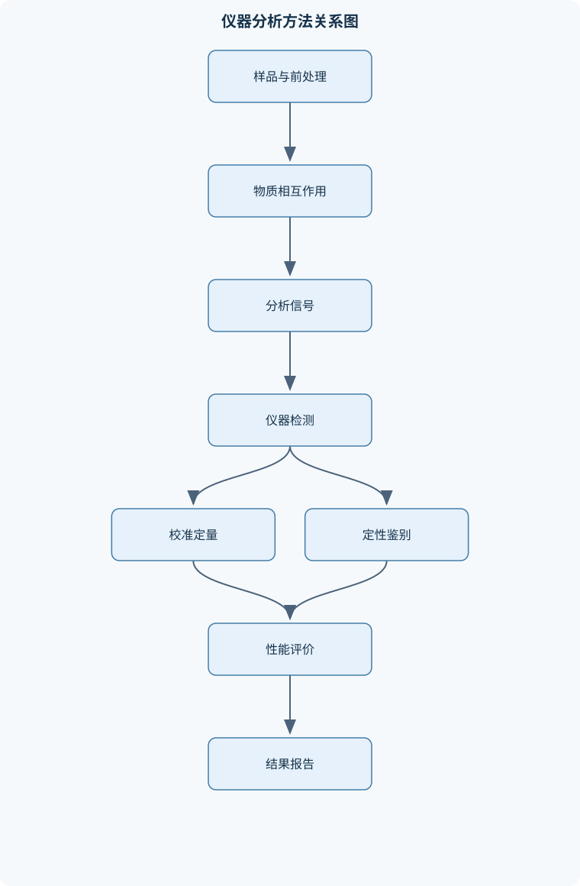
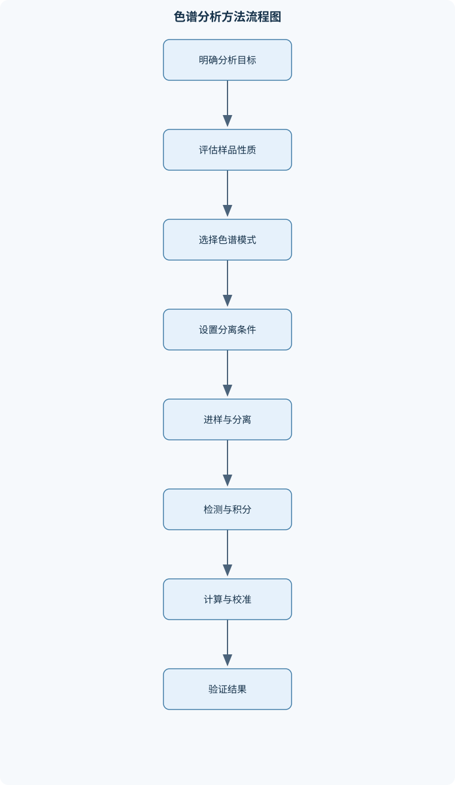

# 仪器分析

## 一、课程整体知识框架

### 课程边界与先修知识

仪器分析研究利用物质与电磁辐射、电场、磁场或色谱两相之间的相互作用，对样品进行定性、定量和结构分析的方法。课程边界包括分析信号的产生与测量、仪器组成与性能评价、样品前处理、校准与定量、误差与干扰控制，以及电位分析、紫外—可见分光光度法、红外光谱法、原子吸收光谱法、质谱法、气相色谱法和高效液相色谱法。重点覆盖信号—浓度关系、选择性、灵敏度、检出限、精密度、准确度、线性范围、分辨率和方法适用性。不包括高等量子化学推导、完整仪器电子学设计和专门行业法规。先修知识包括无机化学、有机化学、分析化学基础、溶液平衡、酸碱与配位反应、基础物理、概率统计和基本数据处理。





### 1.1 课程对象、研究任务与方法边界

仪器分析是利用物质与电磁辐射、电场、磁场或色谱两相之间的相互作用，将待测组分转化为可测量信号，并据此完成定性、定量或结构分析的分析化学分支。与主要依靠沉淀、酸碱反应、氧化还原反应和络合反应的经典分析方法相比，仪器分析通常具有灵敏度较高、信息维度较多、分析速度较快和适合自动化等特点；但仪器信号并不天然等于样品浓度，必须经过校准、干扰评估和质量控制后才能形成可靠结果。

课程研究对象可概括为“样品—作用机制—信号—数学模型—分析结果”五个环节。样品首先经过采集、保存、溶解、萃取、稀释、过滤、消解或衍生化等处理，使待测组分进入适合测量的状态；随后通过电极电位、光吸收、红外振动吸收、原子吸收、离子质荷比分离或色谱保留行为产生可识别差异；检测器把这些差异转换为电压、电流、光强、吸光度、离子计数或峰面积等信号；最后通过校准模型和误差评价将信号转换为浓度、含量、结构信息或组分组成。

课程边界包括分析信号的产生与测量、仪器的基本组成、分析性能评价、样品前处理、校准与定量、误差和干扰控制，以及电位分析、紫外—可见分光光度法、红外光谱法、原子吸收光谱法、质谱法、气相色谱法和高效液相色谱法。不展开高等量子化学推导、完整仪器电子学设计和专门行业法规，但需要理解这些方法所依赖的物理化学机制及其适用条件。

### 1.2 分析信号与待测量的关系

仪器分析的基本数学表达式是

$$
S=a+bc
$$

其中，$S$为仪器响应信号，$c$为待测物浓度，$a$为截距，代表空白信号、背景信号或系统偏置，$b$为斜率，表示浓度改变一个单位时信号的平均变化量。在线性范围内，$b$通常反映方法的校准灵敏度，但高斜率并不自动意味着方法整体更优，因为实际可测能力还受噪声、空白波动、基质效应和选择性限制。

定性分析关注“是否存在”和“是什么”，依据可以是特征电位、特征吸收峰、特征碎片离子、同位素分布、保留时间或保留行为。定量分析关注“有多少”，必须建立信号与浓度或质量之间的可追溯关系。结构分析则综合多个特征信号，例如红外光谱提供官能团信息，质谱提供分子量和碎片信息，色谱提供组分分离和保留信息；单一峰或单一参数通常只能提供结构线索，不能脱离样品背景直接确认完整结构。

### 1.3 仪器性能与方法性能

灵敏度描述信号对待测量变化的响应能力。对于线性校准，灵敏度常用斜率$b$表示；对于电位法，响应斜率通常表现为电位随$\log a_i$变化的斜率；对于光度法，灵敏度与摩尔吸光系数$\varepsilon$、光程$b$和检测器响应共同相关。灵敏度不等于检出能力，因为检出能力还取决于空白噪声和基线稳定性。

检出限是能够与空白或背景信号可靠区分的最低待测量水平；定量限是能够以预定精密度和准确度进行定量的最低水平。二者都不是仅由仪器型号决定，而与空白标准差、校准斜率、测量次数和判定规则有关。浓度过低时，信号可能接近噪声，结果的不确定度相对增大；因此“能观察到峰”不等于“能可靠定量”。

精密度表示重复测量结果之间的一致程度，常通过标准差或相对标准偏差描述；准确度表示测量结果与真值或认可参考值的接近程度。精密度高而准确度低，通常说明结果重复但存在系统偏差；准确度较好但精密度差，则说明平均值可能接近目标，但单次结果波动较大。准确度不能仅由相关系数证明，必须结合标准物质、加标回收、方法比对或其他合理证据评价。

选择性表示方法在存在共存物时仍能优先响应待测物的能力；特异性通常表示对某一组分具有更强的专一响应。实际分析中完全特异的响应并不常见。离子选择性电极会受共存离子影响，紫外光谱会出现谱带重叠，原子吸收会受基体和背景吸收影响，质谱会发生离子抑制或加合，色谱则可能出现共洗脱。因此应通过分离、掩蔽、背景校正、标准加入或改变检测条件提高选择性。

线性范围是信号与待测量能够以规定模型描述的范围；动态范围则是仪器仍能产生可用响应的更宽范围，未必全部满足严格线性。高浓度可能导致吸光度偏离朗伯—比尔定律、检测器饱和、色谱峰超载或电极响应趋于平台；低浓度则容易受到空白和噪声支配。分辨率反映区分相邻谱线、峰或质量信号的能力，不能与灵敏度混为一谈。

### 1.4 校准、误差与结果形成

外标法使用一系列独立配制的标准液建立信号—浓度关系，适用于标准液与样品基质接近、仪器响应稳定的场合。标准加入法在同一份样品中逐级加入标准物，通过外推降低基质差异造成的偏差，但需要校正总体积变化，并假设加标后响应机制没有发生根本改变。内标法向标准液和样品中加入性质相近但可分离、且不与样品原有组分重叠的内标物，通过目标物与内标物信号比值校正进样量和响应漂移。归一化法以各组分信号总和为基准，仅适用于主要组分均能流出并产生可比较响应的体系。

误差包括随机误差和系统误差。随机误差导致重复结果波动，可通过增加平行测量、改善仪器稳定性和优化操作降低；系统误差具有方向性，可能来自标准液浓度错误、空白未扣除、基质效应、仪器漂移、样品损失或校准模型不适用，不能仅靠增加测量次数消除。校准回归除了检查相关程度，还应查看残差是否随机分布、是否存在曲率、是否有异方差，以及样品信号是否落在标准范围内。

样品前处理的目的不是单纯“把样品变成溶液”，而是使待测物稳定、均匀、可测，同时减少基体干扰和污染风险。前处理应明确待测物的形态、溶解性、挥发性、热稳定性、酸碱稳定性、吸附性和可能发生的络合、沉淀、氧化还原或水解反应。过度处理可能造成待测物损失或引入污染；处理不足则可能导致浑浊、堵柱、雾化不稳定、离子抑制或谱带重叠。

### 1.5 不同仪器分析方法的互补关系

电位分析直接测量电池电动势或电极间电位差，适合测定离子活度、pH以及通过滴定终点完成定量。紫外—可见分光光度法测量电子跃迁产生的光吸收，适合具有发色团或能够通过显色反应形成有色物种的体系。红外光谱法主要反映分子振动和转动引起的吸收，适合官能团识别和化合物指纹鉴定。原子吸收光谱法测量基态原子对元素特征辐射的吸收，主要用于元素定量。

质谱法按离子的$m/z$分离并检测信号，能够提供分子量、同位素组成和碎片结构信息；但离子化方式会影响分子离子峰和碎片谱，最高质荷比峰不能机械认定为分子离子。色谱法依靠组分在流动相和固定相之间分配、吸附、离子交换或空间排阻行为的差异实现分离，常与光学检测器、质谱检测器联用。气相色谱适合挥发性好且热稳定的物质；高效液相色谱适合难挥发、热不稳定、相对分子质量较大或极性较强的物质。

## 二、章节和模块划分

### 核心知识覆盖清单

本清单用于检查正文是否覆盖本课程的主要知识模块：

- **仪器分析总论与测量基础**：分析仪器的基本组成、定性分析与定量分析、分析信号与待测量、灵敏度和校准曲线、检出限与定量限、精密度和准确度、选择性与特异性、线性范围与动态范围、样品前处理原则。
- **电位分析法**：电池电动势与电极电位、能斯特方程及其适用条件、参比电极与指示电极、液接电位及其影响、直接电位法、电位滴定法、离子选择性电极、pH玻璃电极、氟离子选择性电极、标准曲线法与标准加入法。
- **紫外—可见分光光度法**：电磁辐射与能级跃迁、普朗克关系式、σ、π和n电子跃迁、生色团与助色团、朗伯—比尔定律、吸光度和透光率、分光光度计组成、光源与单色器、显色反应与条件优化、光度法定量与光谱定性。
- **红外光谱法**：分子振动与转动、红外吸收选择定则、伸缩振动和弯曲振动、基团频率区、指纹区、羰基和烯键特征吸收、诱导效应与共轭效应、色散型红外仪、傅里叶变换红外仪、固体液体和气体制样。
- **原子吸收光谱法**：基态原子吸收共振辐射、空心阴极灯、火焰原子化器、石墨炉原子化器、空气—乙炔火焰、氧化亚氮—乙炔火焰、化学计量火焰和富燃火焰、物理干扰与化学干扰、背景吸收校正、标准曲线法与标准加入法。
- **质谱分析法**：质荷比与质谱图、进样系统、电子轰击电离、软电离与硬电离、分子离子峰、碎片离子峰、同位素峰和氮规则、质量分析器、检测器与真空系统、质谱定性和定量。
- **色谱分析基础**：流动相和固定相、分配与吸附机制、死时间和保留时间、调整保留时间、选择性因子、分离度、峰宽和峰面积、理论塔板数、理论塔板高度、色谱定性与定量。
- **气相色谱法**：气液色谱和气固色谱、载气与进样系统、填充柱和毛细管柱、固定液极性选择、柱温恒温程序、程序升温、热导池检测器、氢火焰离子化检测器、电子捕获检测器、挥发性和热稳定性要求。
- **高效液相色谱法**：高压输液系统、六通阀进样、硅胶和键合固定相、正相色谱、反相色谱、离子交换色谱、体积排阻色谱、等度洗脱和梯度洗脱、紫外检测器、流动相脱气与过滤。
- **仪器分析数据处理与方法建立**：外标法校准、标准加入法校准、内标法校准、归一化定量法、回归方程与残差、空白和基线校正、重复测量与异常值判断、回收率和加标实验、不确定度来源、方法验证与结果报告。


### 2.1 模块一：仪器分析总论与测量基础

本模块建立全课程共同语言。分析仪器通常包括样品引入或前处理单元、信号发生或分离单元、检测器、信号放大与处理单元以及结果显示或数据系统。不同仪器的具体结构不同，但其逻辑均是将化学性质转换为可测信号，再通过模型反演待测量。

本模块重点区分信号强度、信号变化量、背景信号和噪声；解释灵敏度、检出限、定量限、精密度、准确度、选择性、线性范围、动态范围和分辨率之间的差别。还应建立从样品代表性、前处理回收、校准、测量重复到结果报告的完整分析链条。一个回归方程即使具有较好的线性外观，若样品基质与标准液不同、残差存在系统性、样品超出校准范围或前处理回收率不稳定，也不能直接视为可靠定量方法。

### 2.2 模块二：电位分析法

电位分析测量两个电极之间的电势差。单个电极的绝对电位通常不能直接独立测量，实际仪器读数主要是指示电极与参比电极组成的电池电动势。参比电极应具有稳定、可重复的电位；常见类型包括银—氯化银电极和甘汞电极。指示电极则应对待测离子或滴定体系产生可预测响应。

对于可逆电极反应，能斯特方程为

$$
E=E^\circ-\frac{RT}{nF}\ln Q
$$

其中，$E$为电极电位或电池电动势，单位为V；$E^\circ$为标准电极电位；$R$为气体常数，$T$为热力学温度，单位K；$n$为转移电子数；$F$为法拉第常数；$Q$为反应商。严格形式应使用活度而不是简单浓度。只有在稀溶液、离子强度近似恒定且活度系数变化可以忽略时，才可用浓度近似活度。25摄氏度时，若使用十进对数，可写成

$$
E=E^\circ-\frac{0.05916}{n}\log Q
$$

离子选择性电极的响应可写为

$$
E=K+\frac{RT}{zF}\ln a_i
$$

其中，$K$包括膜内常数、参比电极电位和其他近似恒定项，$z$为目标离子的电荷数，$a_i$为目标离子活度。膜电位主要源于膜相与溶液相之间的离子交换、迁移或分配，而不是简单的金属表面电子得失。实际响应会受到选择性、共存离子、液接电位、离子强度、络合和沉淀影响。

pH玻璃电极通过玻璃膜水化层中氢离子交换产生选择性响应，严格定义为

$$
\mathrm{pH}=-\log a_{\mathrm{H^+}}
$$

稀溶液中可近似写成氢离子浓度的负对数，但高盐、强酸、强碱和非水体系中该近似可能失效。极高pH时可能出现碱差，极低pH时可能出现酸差；膜失水、液接电位、温度变化和缓冲液污染也会造成误差。pH测量需要用覆盖样品范围的标准缓冲液校准，并确认读数稳定和校准状态正常。

氟离子选择性电极适用于氟离子活度测量，但酸度过低时氟离子可能形成HF等分子形态，导致自由氟离子活度下降；碱性过强时氢氧根及相关界面反应可能造成干扰。因此标准液和样品通常需要使用总离子强度调节缓冲体系，使酸度和离子强度接近，并根据样品情况用络合剂降低铁、铝等离子对氟离子的结合。直接电位法可采用标准曲线法或标准加入法；电位滴定法则根据电位随滴定剂体积的突变或曲线拐点确定终点。

### 2.3 模块三：紫外—可见分光光度法

电磁辐射的光子能量由普朗克关系给出：

$$
E=h\nu=\frac{hc}{\lambda}
$$

其中，$E$为单个光子能量，$h$为普朗克常数，$\nu$为频率，单位Hz，$c$为光速，$\lambda$为波长，常用单位nm。波长越短，单个光子能量越高，但光子能量只决定跃迁能量尺度，不直接决定吸收强度。

紫外—可见吸收通常涉及外层电子的$\sigma$、$\pi$和$n$电子跃迁，包括$\sigma\rightarrow\sigma^*$、$n\rightarrow\sigma^*$、$\pi\rightarrow\pi^*$和$n\rightarrow\pi^*$。一般而言，$\sigma\rightarrow\sigma^*$所需能量较高，多位于远紫外区；$n\rightarrow\pi^*$能量较低，常在近紫外至可见区域出现，但吸收强度可能较弱；$\pi\rightarrow\pi^*$通常吸收较强。共轭体系扩大时，能级差可能减小，吸收峰向较长波长移动。生色团是能够产生特征吸收的结构单元，助色团则可能通过孤对电子或共轭作用改变吸收波长和强度。

透射比与吸光度定义为

$$
T=\frac{I}{I_0}
$$

$$
A=-\log T
$$

其中，$I_0$为入射光强，$I$为透射光强。理想条件下，朗伯—比尔定律为

$$
A=\varepsilon bc
$$

其中，$A$无量纲，$\varepsilon$为摩尔吸光系数，单位通常为L·mol$^{-1}$·cm$^{-1}$，$b$为吸收池光程，单位cm，$c$为浓度，单位常用mol·L$^{-1}$。该定律要求光源近似单色、样品均匀、吸收物种组成稳定、无明显散射和杂散光影响。高浓度导致分子间作用和折射率变化，显色平衡变化会改变$\varepsilon$，浑浊样品产生散射，杂散光会使高吸光度区域出现负偏离，均可破坏线性。

分光光度计主要由光源、单色器、吸收池、检测器和信号处理系统组成。紫外区常用氘灯等光源，可见区常用钨灯或卤钨灯；单色器可采用棱镜或光栅。定量分析通常先测空白和标准系列，建立吸光度—浓度关系，再测样品并进行稀释倍数、光程和空白修正。显色反应必须评价试剂用量、酸度、温度、反应时间、显色稳定性和共存物影响；若样品本身浑浊或溶剂在测定波长处强吸收，应先改变前处理或测定条件。

### 2.4 模块四：红外光谱法

红外光谱主要反映分子振动和转动能级变化。伸缩振动表现为键长周期性改变，弯曲振动表现为键角改变。只有振动或转动过程中偶极矩发生变化，才容易产生红外吸收；因此不能认为所有分子振动都一定有红外峰。分子对称性、键极性和振动方式共同决定峰的出现、位置和强度。

红外光谱通常分为基团频率区和指纹区。约4000—1300 cm$^{-1}$区域常用于识别O—H、N—H、C—H、C=O、C=C等官能团；约1300—600 cm$^{-1}$区域峰形复杂，受整体分子结构影响显著，适合与参考谱图进行指纹匹配。波数$\tilde{\nu}$单位为cm$^{-1}$，与波长成反比。羰基伸缩峰通常具有较强吸收，但具体位置会受到共轭、诱导效应、环张力、氢键和取代基影响。共轭通常降低有效键级，使羰基吸收向较低波数移动；强吸电子诱导作用则可能改变键极性和峰位。

色散型红外仪通过分光元件逐波长扫描；傅里叶变换红外仪先采集干涉信号，再经数学变换获得光谱，通常具有采集速度快、波数准确度较好和信噪比较高等特点。固体可采用压片、漫反射或衰减全反射方式，液体可直接涂膜或置于液体池中，气体则使用气体池。水、二氧化碳、溶剂和制样材料可能产生背景峰，因此鉴定时必须同时检查背景、基线和制样条件。一个官能团峰只能提供结构线索，应结合多个特征峰和指纹区判断。

### 2.5 模块五：原子吸收光谱法

原子吸收光谱法测量基态原子对元素特征共振辐射的吸收。样品中的元素首先被雾化并原子化，形成自由基态原子；空心阴极灯提供与待测元素相匹配的窄谱线辐射；基态原子吸收部分辐射后，检测器测量光强降低。吸光度在一定范围内与基态原子数和样品浓度相关，但实际线性范围会受到原子化效率、基体和背景影响。

火焰原子化器操作连续、稳定性较好，空气—乙炔火焰适用于许多常见元素；氧化亚氮—乙炔火焰温度更高，可用于较难原子化或容易形成稳定氧化物的体系。化学计量火焰、富燃火焰和贫燃火焰会影响氧化还原环境、原子化效率和电离程度，火焰温度越高并不必然带来最佳灵敏度。石墨炉原子化器取样量小、灵敏度较高，通常经历干燥、灰化、原子化和清除等阶段，但基体效应和记忆效应可能更明显。

物理干扰包括黏度、表面张力、密度变化导致的吸液和雾化差异；化学干扰包括难挥发化合物、稳定氧化物、难解离盐或络合物生成；电离干扰则会改变基态原子比例。背景吸收可能来自分子吸收、颗粒散射或火焰本底，需要通过背景校正技术减小影响。定量可采用外标法，也可采用标准加入法处理复杂基体。样品前处理、空白、标准系列、火焰稳定性、灯电流、分析线和质控样共同决定结果可靠性。

### 2.6 模块六：质谱分析法

质谱法先将样品转化为带电离子，再按质荷比$m/z$分离和检测。$m$表示离子质量，$z$表示电荷数；多电荷离子的峰位置由质量与电荷共同决定，因此$m/z$不能简单等同于中性分子的相对分子质量。质谱仪通常包括进样系统、离子源、质量分析器、检测器、真空系统和数据处理系统。

电子轰击电离能量较高，常形成具有重复性和丰富碎片的质谱，属于较“硬”的电离方式；软电离方式较少破碎，更有利于观察分子离子或准分子离子。分子离子峰可提供分子量线索，但分子离子不稳定、碎片重排、加合离子或源内裂解都会造成误判。碎片离子反映分子中容易断裂或稳定化的结构片段，应结合合理的裂解路径解释。

同位素峰的相对丰度和间隔能够提供元素组成线索。例如带一个电荷的离子，其同位素峰间隔通常与同位素质量差对应；多电荷离子的间隔则会按电荷数缩小。氮规则在适用的常规有机分子和特定离子形式下可辅助判断含氮情况，但不能脱离电离方式、离子电荷和加合形式机械套用。质谱定性应综合分子离子、同位素模式、主要碎片、保留时间或其他光谱证据；定量则需考虑离子抑制、响应因子、内标选择和校准范围。

### 2.7 模块七：色谱分析基础

色谱分离依靠组分在流动相和固定相之间分配、吸附、离子交换或空间排阻差异实现。死时间$t_M$是未被固定相明显保留的组分通过系统所需时间；保留时间$t_R$是组分峰最大值对应的时间；调整保留时间为

$$
t'_R=t_R-t_M
$$

容量因子为

$$
k'=\frac{t'_R}{t_M}
$$

选择性因子为

$$
\alpha=\frac{k'_2}{k'_1}
$$

其中后出峰组分的容量因子应大于前出峰组分。$k'$反映保留程度，$\alpha$反映两个组分的相对选择性，理论塔板数$N$反映柱效，但柱效高并不保证完全分离，因为分离还取决于选择性和保留程度。

对近似高斯峰，峰底宽$W$与标准偏差$\sigma$近似满足$W=4\sigma$，半峰宽$W_{1/2}=2.355\sigma$。理论塔板数可按

$$
N=16\left(\frac{t_R}{W}\right)^2
$$

或

$$
N=5.54\left(\frac{t_R}{W_{1/2}}\right)^2
$$

估计。柱长为$L$时，理论塔板高度为

$$
H=\frac{L}{N}
$$

$N$越大或$H$越小通常表示柱效越高，但不同组分和不同保留程度下的$N$不宜脱离实验条件直接比较。

相邻峰的分离度可近似写为

$$
R_s=\frac{2(t_{R,2}-t_{R,1})}{W_1+W_2}
$$

提高分离度可以通过增大选择性因子、提高柱效或调整容量因子实现，代价可能是延长分析时间、增加柱压或降低通量。色谱定性不能只凭保留时间，因为流速、温度、流动相组成、柱状态和系统死体积变化都会引起保留时间漂移；应结合标准品、峰形、光谱或质谱信息。

### 2.8 模块八：气相色谱法

气相色谱以气体为流动相，载气主要承担输运作用，组分选择性主要来自固定相和柱温。气液色谱的固定相通常为涂覆或键合在载体、填充柱内表面或毛细管内壁上的液态固定液；气固色谱则使用固体吸附剂。固定相应具有适当选择性、低蒸气压、良好热稳定性和化学惰性。

气相色谱要求样品具有足够挥发性，并能在进样口和柱温范围内保持热稳定。填充柱样品容量较大，毛细管柱通常具有较高柱效和较好分离能力。非极性固定相中，许多组分主要按沸点大小规律洗脱；极性固定相还会引入偶极、氢键或其他相互作用，因此不能仅按沸点判断所有样品的出峰顺序。

常用检测器包括热导池检测器、氢火焰离子化检测器和电子捕获检测器。热导池可检测范围较广但灵敏度通常受载气和热稳定性影响；氢火焰离子化检测器对多数有机碳化合物响应较好，但对某些不易形成有效离子的物质响应弱；电子捕获检测器对具有较强吸电子能力的化合物较敏感。窄沸程样品可采用恒温分析；宽沸程样品常采用程序升温，使低沸点组分和高沸点组分分别在适宜温度下完成分离。

### 2.9 模块九：高效液相色谱法

高效液相色谱以液体为流动相，采用高压输液系统推动流动相通过填充固定相的色谱柱。典型系统包括溶剂储液器、脱气和过滤装置、泵、六通阀进样器、色谱柱、检测器和数据系统。由于系统处于高压状态，样品通常先装入定量环，再通过阀切换进入流路，不能简单模仿气相色谱的直接注射方式。

正相色谱通常使用极性固定相和相对低极性流动相，分离常与吸附和极性作用有关；反相色谱使用非极性键合固定相，如烷基键合相，流动相以水和有机溶剂为基础，通常极性较大的非离子组分较早洗脱，但电离状态、pH和固定相性质会改变这一规律。离子交换色谱利用带电固定相与样品离子之间的静电作用；体积排阻色谱按分子在多孔固定相中的可进入体积差异分离，大分子通常较早洗脱，但不能将其简单等同于按相对分子质量直接分离。

等度洗脱过程中流动相组成基本不变，方法简单且基线较稳定；梯度洗脱过程中两种或多种溶剂比例随时间改变，适合组分极性或保留差异较大的复杂样品，可缩短后段分析时间，但可能造成基线漂移、再平衡时间增加和重复性要求提高。紫外检测器适合具有紫外吸收的组分；若目标物缺乏发色团，需要考虑其他检测方式或衍生化。流动相应充分过滤和脱气，以减少颗粒堵塞、气泡、压力波动和基线噪声。

### 2.10 模块十：仪器分析数据处理与方法建立

本模块把前述原理转化为可执行的分析程序。数据处理首先包括原始信号检查、空白扣除、基线校正、峰识别、积分、稀释倍数修正和单位换算；随后建立校准模型并评价残差、重复性、回收率和稳定性。校准范围必须覆盖样品信号，超出范围时应稀释或重新建立更合适的校准模型，而不是直接外推。

方法建立应依次考虑选择性、线性、工作范围、精密度、准确度、检出限、定量限、稳定性和耐用性。加标实验可评价基质中的回收情况，但加标回收率不能单独证明绝对准确；若加标物与样品中原有形态不同，回收过程可能不具有代表性。重复测量应明确重复层级，例如同一溶液重复进样、独立称样、独立前处理或不同日期测量，因为不同层级反映的误差来源不同。

异常值不能仅因“不符合预期”就删除，应检查进样失败、气泡、峰形异常、仪器报警、样品污染、记录错误和前处理偏差。结果报告应包含测量值、单位、稀释或换算过程、有效数字、校准范围、质量控制结果及必要的不确定度说明。方法的最终评价标准不是单一相关系数，而是其在特定样品、目标浓度和分析目的下是否能够稳定地产生可解释、可复核和满足要求的结果。

## 三、核心概念的详细解释

### 3.1 仪器分析的信号链与分析任务

仪器分析的基本对象不是“仪器读数本身”，而是样品经过前处理后，在特定物理化学作用下产生的、能够被检测器记录的信号。完整的分析链可表示为：

$$
\text{样品} \rightarrow \text{待测组分状态} \rightarrow \text{能量或物质相互作用} \rightarrow \text{分析信号} \rightarrow \text{校准模型} \rightarrow \text{分析结果}
$$

例如，紫外—可见分光光度法利用分子对光的吸收，输出吸光度；电位分析法利用膜电位或电极电位差，输出电势；原子吸收光谱法利用基态原子对特征辐射的吸收，输出吸光度；质谱法先将组分转化为离子，再按$m/z$分离并检测；色谱法则利用组分在流动相和固定相之间作用差异产生保留时间、峰面积和峰高等信号。

定性分析回答“样品中有什么”，通常依靠特征峰、特征电位、保留时间、同位素分布、碎片规律或官能团吸收。定量分析回答“有多少”，必须建立信号与浓度、质量分数或物质的量之间的关系。结构分析则要求综合多种信息，不能仅凭一个峰或一个保留时间确认完整结构。

### 3.2 仪器的基本组成与性能指标

多数仪器可抽象为五个功能单元：信号发生或能量源、样品引入与作用单元、信号分离或选择单元、检测器、信号处理与显示单元。不同方法中各单元的具体形式不同。例如，紫外—可见仪器包括光源、单色器、吸收池、检测器和数据处理系统；气相色谱仪包括载气系统、进样器、色谱柱、柱温箱和检测器；高效液相色谱仪包括输液泵、进样阀、色谱柱和检测器。

灵敏度通常指信号对待测量变化的响应程度。在线性校准模型

$$
S=a+bc
$$

中，斜率$b$是方法灵敏度的常用表示。$S$为仪器信号，$c$为待测物浓度，$a$为截距。截距可能来源于空白信号、背景吸收、基线偏置或系统误差。斜率较大并不必然表示方法更好，因为如果噪声也很大，低浓度信号仍可能无法可靠区分。

检出限关注“能否与空白或背景区别”，定量限关注“能否以可接受的精密度和准确度定量”。检出限和定量限都与空白波动、校准斜率、测量次数、基质效应和判定规则有关，不能简单视为仪器的固定参数。

精密度表示重复测量结果之间的一致程度，常用标准差或相对标准偏差表示；准确度表示测量结果接近真值、参考值或认可值的程度。重复测量结果非常集中但整体偏离参考值，说明精密度较高而准确度不足。结果平均值接近参考值但单次波动很大，则准确度可能尚可而精密度不足。

选择性是方法在共存物存在时仍能优先响应待测物的能力。特异性是选择性更强的情形，表示其他组分几乎不产生相同响应。实际仪器分析中完全特异的情况较少：紫外光谱可能发生谱带重叠，离子选择性电极会受到共存离子影响，原子吸收会受到背景和基体干扰，质谱会发生离子抑制或加合，色谱会发生共洗脱。

线性范围是信号与待测量能够用指定模型描述的浓度区间；动态范围是方法仍能产生可用响应的更宽范围，未必全部满足严格线性。样品信号超出校准范围时，应稀释样品或重新建立覆盖该范围的校准曲线，不应直接进行远距离外推。

### 3.3 样品前处理与基质效应

样品前处理的目标是使待测组分进入适合测量的状态，同时减少基体、污染、损失和形态变化。常见操作包括溶解、稀释、过滤、离心、萃取、消解、浓缩、衍生化和掩蔽。

前处理必须同时考虑待测物的化学形态、稳定性、挥发性、溶解性以及仪器接口要求。例如，气相色谱要求待测物具有足够挥发性和热稳定性；高效液相色谱要求样品能溶于流动相体系并尽量避免颗粒堵塞；原子吸收通常要求样品转化为适合雾化和原子化的溶液；质谱样品需要关注盐分、表面活性剂和高沸点基质造成的离子抑制。

基质效应是样品中非待测组分改变待测物响应的现象。基质效应可能改变校准曲线斜率，也可能增加背景、改变萃取回收率或影响电离效率。标准加入法通过在同一份样品中加入已知量标准物，能够在一定程度上补偿基质影响；但它不能消除待测物在前处理过程中发生的不可逆损失，也不能解决严重非线性或化学形态不同的问题。

### 3.4 电位分析法

电位分析法测量的是电化学电池两个电极之间的电势差。实际测量得到的是电池电动势，而不是某个单独电极的绝对电位。典型电池由参比电极、指示电极、样品溶液和液接界面组成。

参比电极要求电位稳定、可重复且尽量不随样品组成变化，常见形式包括银—氯化银电极和甘汞电极。指示电极对待测离子或相关活度产生响应。离子选择性电极的响应主要来自膜相与溶液中离子的选择性交换、迁移或分配，不是传统意义上电极表面发生电子转移。

直接电位法通过测量平衡电位并由校准关系求浓度，适合快速测定。电位滴定法则在滴定过程中连续记录电位随滴定剂体积的变化，通过曲线突跃或终点判定计算待测量，通常比目视指示剂更适合有色、浑浊或终点不明显的体系。

严格来说，能斯特方程使用的是活度而不是浓度。离子选择性电极还会受到膜选择性、离子强度、络合、沉淀、液接电位和温度影响。测量氟离子时，酸度过高会使氟离子转化为HF等非游离形态，碱性过强又可能产生氢氧根相关干扰，因此应使用合适的总离子强度调节缓冲体系，并根据样品基质评价适用范围。

pH玻璃电极通过玻璃膜水化层中的离子交换产生膜电位，对氢离子活度选择性响应。pH不是简单的氢离子浓度负对数，而是氢离子活度的负对数。强碱条件下可能出现钠离子造成的碱差，强酸条件下可能出现酸差；玻璃膜失水、液接电位、温度变化和缓冲液污染也会引入误差。

### 3.5 紫外—可见分光光度法

电磁辐射可用波长$\lambda$、频率$\nu$或波数$\tilde{\nu}$表示。光子能量由波长和频率共同决定。分子吸收紫外—可见光后，主要发生价电子能级跃迁，包括$\sigma\rightarrow\sigma^*$、$n\rightarrow\sigma^*$、$\pi\rightarrow\pi^*$和$n\rightarrow\pi^*$跃迁。

$\sigma\rightarrow\sigma^*$需要能量较高，通常位于远紫外区；$\pi\rightarrow\pi^*$跃迁吸收强度通常较大；$n\rightarrow\pi^*$所需能量较低，常出现在近紫外至可见区域，但吸收强度相对较弱。生色团是能够产生紫外—可见吸收的结构单元，如共轭双键、芳香环和羰基；助色团通过孤对电子或诱导效应改变吸收波长和强度。

分光光度计通常包括光源、单色器、吸收池、检测器和信号处理单元。紫外区常用氘灯，某些仪器也使用其他适合的连续光源；可见区常用钨灯或卤钨灯。单色器可采用棱镜或光栅。实际测量必须考虑光源稳定性、单色器带宽、吸收池光程一致性、溶剂吸收和杂散光。

紫外—可见法既可进行定量，也可提供光谱定性信息。显色反应可将本身吸收弱的物质转化为有色化合物，但显色反应的酸度、试剂比例、反应时间、温度和副反应必须保持一致。

### 3.6 红外光谱法

红外吸收主要对应分子振动能级变化，并常伴随转动能级变化。振动方式可分为伸缩振动和弯曲振动。伸缩振动改变键长，弯曲振动改变键角。分子振动要产生红外吸收，通常要求振动过程中偶极矩发生变化；因此不是所有振动都红外活性。

红外光谱常分为官能团区和指纹区。官能团区约为$4000$—$1300\ \mathrm{cm^{-1}}$，适合判断O—H、N—H、C—H、C=O、C=C等结构线索；指纹区约为$1300$—$600\ \mathrm{cm^{-1}}$，峰形复杂，但对特定化合物具有较好的整体识别价值。羰基吸收位置会受共轭、诱导效应、环张力和氢键影响；共轭通常使羰基伸缩振动向低波数移动。

色散型红外仪通过逐波长扫描获得光谱，傅里叶变换红外仪则先记录干涉信号，再经傅里叶变换得到频谱。固体可采用压片、糊状制样或反射方式，液体可直接测量或夹在盐片之间，气体通常使用气体池。水和二氧化碳背景、样品厚度、基线漂移和制样方式会明显影响谱图。

### 3.7 原子吸收光谱法

原子吸收光谱法测量基态原子对特征共振辐射的吸收。样品首先被雾化、干燥、蒸发并原子化，形成自由基态原子；空心阴极灯提供待测元素的窄线光源，原子对相应波长辐射选择性吸收，检测器测定吸光度变化。

火焰原子化器适合多数常规溶液样品，操作速度较快；石墨炉原子化器将少量样品在石墨管中经历干燥、灰化和原子化过程，灵敏度较高，但基体效应和记忆效应通常更明显。空气—乙炔火焰适用于许多元素；较难原子化或易形成难熔氧化物的元素可能需要更高温度火焰，但火焰温度并非越高越好，因为电离、氧化物形成和背景吸收也会随条件变化。

物理干扰包括黏度、表面张力、雾化效率和溶液组成改变造成的进样差异；化学干扰包括难挥发化合物形成、氧化物生成、磷酸盐或硫酸盐沉淀等。背景吸收可能来自分子吸收、烟尘散射或基质吸收，需要通过适当背景校正处理。复杂样品常采用标准加入法，以减小基体对雾化和原子化效率的影响。

### 3.8 质谱分析法

质谱仪将样品转化为气相或其他适合传输的离子，在真空条件下按$m/z$分离并检测。$m$表示离子质量，$z$表示电荷数。质谱图横坐标通常为$m/z$，纵坐标为离子相对强度或计数。

电子轰击电离能量较高，容易产生丰富碎片，适合根据裂解规律进行结构推断，但分子离子可能较弱甚至消失；软电离方式通常保留分子或准分子离子，便于确定分子量，但碎片信息相对较少。质量分析器可依据磁场、电场、飞行时间或离子阱等原理实现离子分离。检测器将离子流转换为电流或计数信号，真空系统则减少离子与气体分子的碰撞。

分子离子峰、同位素峰、加合离子和碎片离子必须区分。最高$m/z$峰不一定就是分子离子，可能是同位素峰、加合离子或偶然出现的高质量碎片。含氯、溴等元素的化合物具有有特征性的同位素峰分布，可用于判断元素组成。氮规则可作为分子离子质量和含氮数判断的辅助依据，但必须结合离子化方式和准确质量信息解释。

### 3.9 色谱分离基础

色谱分离依赖组分在流动相和固定相之间迁移速度不同。流动相负责携带样品，固定相提供吸附、分配、离子交换、尺寸排阻或其他作用。气相色谱中载气主要起运输作用，选择性主要由固定相和温度决定；液相色谱中流动相组成、极性、pH和离子强度可直接改变保留和选择性。

死时间$t_M$是不能被固定相保留的组分通过色谱柱所需的时间；保留时间$t_R$是某一组分峰最大值对应的时间；调整保留时间为

$$
t'_R=t_R-t_M
$$

容量因子为

$$
k'=\frac{t'_R}{t_M}
$$

它反映组分相对于流动相的保留程度。选择性因子为

$$
\alpha=\frac{k'_2}{k'_1}
$$

其中后出峰组分的容量因子应大于前出峰组分。理论塔板数描述柱效，但柱效高并不保证完全分离，因为分离还依赖选择性和保留程度。

峰面积通常比峰高更能代表组分进入检测器的总量，但前提是峰已经完整洗脱、基线可靠且检测器响应处于适宜范围。峰拖尾、前伸、共洗脱、基线漂移和积分参数不当都会使定量结果产生系统偏差。

### 3.10 气相色谱法与高效液相色谱法

气相色谱适合挥发性较好且热稳定的物质。气液色谱使用涂覆或键合在载体、毛细管内壁上的液体固定相；气固色谱使用固体吸附剂作为固定相。固定液应具有适当选择性、低蒸气压、良好热稳定性和化学惰性。非极性固定相对非极性物质的分离常受沸点影响，极性固定相则能增强极性差异带来的选择性。

气相色谱可采用填充柱或毛细管柱。恒温适合沸程较窄的样品；宽沸程混合物适合程序升温，使低沸点组分在较低温度下分离，高沸点组分在较高温度下较快洗脱。热导池检测器通用但灵敏度相对有限；氢火焰离子化检测器对多数有机物灵敏，响应通常与进入火焰的碳量有关；电子捕获检测器对具有较强电子俘获能力的化合物特别敏感。

高效液相色谱使用高压泵推动流动相通过填充固定相的色谱柱。进样通常通过六通阀完成，以保证高压系统中的进样体积和重复性。正相色谱使用较极性的固定相和较低极性的流动相；反相色谱通常使用非极性或弱极性键合相和水—有机溶剂流动相。反相条件下，许多非离子化合物中极性较大的组分相对较早洗脱，但pH改变电离状态后，洗脱顺序可能改变。

离子交换色谱按离子与固定相电荷位点的作用差异分离；体积排阻色谱按分子可进入固定相孔道的体积差异分离，大分子通常较早洗脱。等度洗脱条件稳定、易于重现；梯度洗脱适合保留差异较大的复杂样品，但会引起基线变化，并要求系统完成充分再平衡。流动相过滤和脱气可减少颗粒堵塞、气泡、压力波动和检测器噪声。

### 3.11 校准、数据处理与方法适用性

外标法以一系列已知浓度标准液建立信号—浓度关系，适用于标准液和样品基质相近、仪器响应稳定的情况。标准加入法在同一份样品中逐级加入标准物，适合基质效应明显但加标后响应机制不改变的样品。内标法在标准液和样品中加入相同量或已知量内标，以目标物信号与内标信号的比值进行校准，能够补偿进样体积、前处理损失和短期响应漂移，但要求内标与目标物分离良好、响应稳定且不原本存在于样品中。

归一化法利用各组分峰面积或响应因子计算相对组成，只适用于主要组分均能被检测并且响应因子具有可比性或已经校正的体系。若有组分不出峰、检测器对不同组分响应差异显著，直接归一化会产生偏差。

数据处理应包括空白检查、基线校正、峰识别、积分、单位换算、稀释倍数修正和残差评价。线性回归不能只看相关系数，还应观察残差是否随机分布，检查低浓度和高浓度处是否存在系统偏差。方法验证需要结合分析目的考察选择性、线性、范围、精密度、准确度、检出限、定量限、稳定性和耐用性。

## 四、重要定义、公式、定理和推导

### 专业审校补充：关键定义与适用边界

质谱定量中必须区分“离子信号强度”和“样品中性分子含量”。电离、传输和检测过程的效率会随基质、共洗脱物和离子化条件改变；基质抑制表现为目标物离子信号降低，基质增强则表现为信号升高。因此，质谱峰面积不能在未经验证时直接与浓度成固定比例。常用校正方式是内标法，尤其应优先选用与目标物理化性质、保留行为和电离行为接近的同位素内标。定量关系可写为 Aₓ/Aₛ＝k cₓ，其中 Aₓ、Aₛ分别为目标物和内标的峰面积，cₓ为目标物浓度，k为经标准系列确定的响应系数。该关系要求内标加入量稳定、目标峰与内标峰分离良好、响应处于线性范围，并且样品处理过程中的损失对二者具有相近补偿作用。若采用多电荷离子或加合离子定量，必须明确所选离子的形式；不同离子形式不能未经验证地混合计算。空白、基质匹配标准、加标回收和稀释线性共同用于判断基质效应，单凭校准曲线相关系数不能证明定量结果可靠。


### 4.1 电极电位与能斯特方程

对于可逆电极反应，能斯特方程为

$$
E=E^\circ-\frac{RT}{nF}\ln Q
$$

其中，$E$为电极电位或电池电动势，单位为V；$E^\circ$为标准电极电位；$R$为气体常数，单位为$\mathrm{J\ mol^{-1}\ K^{-1}}$；$T$为热力学温度，单位为K；$n$为电极反应转移电子数；$F$为法拉第常数；$Q$为反应商。

推导思路如下。可逆电池中，电化学反应的吉布斯自由能变化为

$$
\Delta G=\Delta G^\circ+RT\ln Q
$$

电能与自由能的关系为

$$
\Delta G=-nFE
$$

标准状态下有

$$
\Delta G^\circ=-nFE^\circ
$$

将两式代入并整理，得到

$$
-nFE=-nFE^\circ+RT\ln Q
$$

因此

$$
E=E^\circ-\frac{RT}{nF}\ln Q
$$

在$25^\circ\mathrm{C}$、使用常用十进对数时：

$$
E=E^\circ-\frac{0.05916}{n}\log Q
$$

$Q$应由各物种活度构成。纯固体、纯液体和电子不写入$Q$；气体可用分压表示，溶液物种使用活度表示。只有在稀溶液、离子强度较低或活度系数变化可忽略时，才能近似用浓度代替活度。浓度单位必须统一，且这种替代不能在高盐、高酸、高碱或复杂络合体系中无条件使用。

离子选择性电极的理想响应可写为

$$
E=K+\frac{RT}{zF}\ln a_i
$$

其中，$K$包含参比电极电位、膜内常数、液接电位等近似恒定项；$z$为目标离子的电荷数；$a_i$为目标离子活度。对于阴离子，$z$为负值，因此电位随目标离子活度增加的方向与阳离子不同。实际体系中还应考虑共存离子选择性系数和液接电位。

pH定义为

$$
\mathrm{pH}=-\log a_{\mathrm{H^+}}
$$

由于活度满足$a_{\mathrm{H^+}}=\gamma_{\mathrm{H^+}}c_{\mathrm{H^+}}$，因此只有在$\gamma_{\mathrm{H^+}}$接近1或变化可忽略时，才可近似写为氢离子浓度的负对数。温度变化会影响电极斜率、酸碱平衡常数和水的离子积，因此不同温度下的中性点不必严格等于$7.00$。

### 4.2 光子能量与紫外—可见吸收

电磁波的频率、波长和光速满足

$$
c=\lambda\nu
$$

普朗克关系为

$$
E=h\nu
$$

联立可得

$$
E=\frac{hc}{\lambda}
$$

其中，$E$为单个光子的能量，$h$为普朗克常数，$\nu$为频率，单位为Hz，$\lambda$为波长，$c$为光速。由此可知，在真空中波长越短，单个光子能量越高。这个关系只说明光子能量与波长的关系，不能直接说明吸收峰的强度；吸收强度还取决于跃迁概率、粒子数、光程和检测条件。

透射比定义为

$$
T=\frac{I}{I_0}
$$

其中$I_0$为入射光强，$I$为透射光强。吸光度定义为

$$
A=-\log T=\log\frac{I_0}{I}
$$

### 4.3 朗伯—比尔定律及其边界

在单色光、均匀吸收介质、样品无明显散射且吸收粒子之间不发生显著相互作用的理想条件下，朗伯—比尔定律为

$$
A=\varepsilon bc
$$

其中，$A$为无量纲吸光度，$\varepsilon$为摩尔吸光系数，单位通常为$\mathrm{L\ mol^{-1}\ cm^{-1}}$；$b$为吸收池光程，单位为cm；$c$为浓度，单位通常为$\mathrm{mol\ L^{-1}}$。

推导可从微分吸收关系开始。设光束通过厚度为$\mathrm{d}l$的薄层，光强的相对损失与光强、吸收粒子浓度和路径长度成正比：

$$
-\mathrm{d}I=kIc\,\mathrm{d}l
$$

整理并积分：

$$
\int_{I_0}^{I}\frac{\mathrm{d}I}{I}
=-kc\int_0^b\mathrm{d}l
$$

得到

$$
\ln\frac{I_0}{I}=kbc
$$

将自然对数换为常用对数，并把常数并入$\varepsilon$，即得到

$$
A=\varepsilon bc
$$

该定律的偏离可能来自多色光、杂散光、浓度过高、化学平衡改变、显色反应不完全、样品浑浊和荧光等。若样品在测量波长发生解离、缔合、络合或酸碱转化，实际吸收的是多个物种的叠加，简单的$A=\varepsilon bc$只在物种比例稳定时才适用。

### 4.4 红外振动与波数

波数定义为

$$
\tilde{\nu}=\frac{1}{\lambda}
$$

在红外光谱中通常使用$\mathrm{cm^{-1}}$作为单位。波数越大，通常对应的振动能量越高。双原子或近似双原子振动的力学模型可写为

$$
\tilde{\nu}=\frac{1}{2\pi c}\sqrt{\frac{k}{\mu}}
$$

其中，$k$为化学键力常数，反映键的刚性；$\mu$为约化质量：

$$
\mu=\frac{m_1m_2}{m_1+m_2}
$$

$m_1$和$m_2$为成键原子的质量。由此可知，键越强，$k$越大，吸收波数通常越高；原子质量越大，约化质量越大，吸收波数通常越低。这一模型是近似关系，实际峰位还受共轭、诱导效应、氢键、环张力、分子构象和聚集状态影响。

### 4.5 色谱保留与分离参数

容量因子定义为

$$
k'=\frac{t_R-t_M}{t_M}
$$

其中，$t_R$为保留时间，$t_M$为死时间。若$t_R$接近$t_M$，说明组分保留很弱；若$k'$过大，分析时间可能过长且峰展宽增加。实际工作中需要在分离度、分析时间和峰形之间折中。

对于高斯色谱峰，若峰底宽为$W$，半峰宽为$W_{1/2}$，标准偏差为$\sigma$，则有

$$
W\approx4\sigma
$$

以及

$$
W_{1/2}=2.355\sigma
$$

因此

$$
W\approx1.70W_{1/2}
$$

理论塔板数可由峰底宽计算：

$$
N=16\left(\frac{t_R}{W}\right)^2
$$

也可由半峰宽计算：

$$
N=5.54\left(\frac{t_R}{W_{1/2}}\right)^2
$$

理论塔板高度为

$$
H=\frac{L}{N}
$$

其中$L$为色谱柱长度，单位通常为cm；$N$无量纲；$H$与$L$使用相同长度单位。$N$越大或$H$越小，通常说明柱效越高，但$N$受所选组分的保留程度、峰形和测量方法影响，因此不同实验条件下不能仅凭$N$进行简单比较。

相邻两峰的分离度可近似表示为

$$
R_s=\frac{2(t_{R,2}-t_{R,1})}{W_1+W_2}
$$

其中$t_{R,2}$和$t_{R,1}$分别为后峰和前峰保留时间，$W_1$和$W_2$为相应峰底宽。$R_s$增大表示两峰分离改善。提高$R_s$可以通过提高柱效、增大选择性因子或优化容量因子实现，但可能带来分析时间延长、柱压增大、溶剂消耗增加或峰形变差等代价。

### 4.6 色谱定量公式

外标法用校准方程

$$
S=a+bc
$$

将样品信号代入后反算：

$$
c=\frac{S-a}{b}
$$

若样品经过稀释，原样浓度为

$$
c_{\mathrm{原}}=c_{\mathrm{测}}\times D
$$

其中$D$为总稀释倍数。若还需由溶液浓度换算为样品质量分数，则应继续乘以定容体积、萃取体积等因子，并除以称样质量，所有单位必须统一。

内标法常用响应比建立关系：

$$
\frac{A_x}{A_s}=F\frac{m_x}{m_s}
$$

其中，$A_x$和$A_s$分别为目标物和内标物峰面积，$m_x$和$m_s$分别为相应质量或物质的量，$F$为响应因子。实际应用中可通过标准液确定$F$，再由样品峰面积比计算目标物含量。内标峰不能与目标峰或其他组分共洗脱，且加入量必须稳定。

归一化法在响应因子不同的情况下应使用校正因子。若各组分均能被检测，组分$i$的质量分数可表示为

$$
w_i=\frac{A_i f_i}{\sum_{j=1}^{n}A_jf_j}\times100\%
$$

其中$A_i$为组分$i$的峰面积，$f_i$为其响应校正因子，$n$为被纳入计算的组分数。若忽略响应因子，实际上是假设各组分单位质量产生相同响应；这一假设对不同结构、不同检测器响应特性的组分通常并不成立。

### 4.7 检出限、定量限与回归残差

若校准曲线斜率为$b$，空白或低浓度样品的信号标准差为$s$，检出限可在特定判定规则下表示为

$$
\mathrm{LOD}\approx\frac{k_Ds}{b}
$$

定量限可表示为

$$
\mathrm{LOQ}\approx\frac{k_Qs}{b}
$$

其中$k_D$和$k_Q$是由具体判定规则规定的系数。不同实验设计、空白类型、测量次数和统计方法可能导致不同结果，因此不能脱离判定规则把检出限写成唯一固定公式。检出限只说明检测能力，不代表该浓度下已经能够获得可靠定量结果。

回归残差定义为

$$
e_i=S_i-\hat{S}_i
$$

其中$S_i$为第$i$个观测信号，$\hat{S}_i$为模型预测信号。若残差随浓度呈弯曲、扇形或连续偏正偏负趋势，说明线性模型、方差假设或基质条件可能不合适。相关系数接近1只能说明点具有较强线性相关，不能证明截距正确、残差随机、低浓度可靠或方法准确。

### 4.8 误差、不确定度与结果表达

随机误差使重复结果发生波动，可通过增加独立重复测量、改善仪器稳定性和规范操作降低其影响；系统误差使结果整体偏高或偏低，通常不能靠简单增加重复次数消除，必须通过空白校正、标准物质、标准加入、方法比对或仪器校准识别和控制。

若结果由多个独立量计算得到，不确定度应考虑标准液浓度、称量、定容、稀释、仪器响应、重复性和回收率等来源。最终报告的有效数字不应超过测量精度所支持的范围。报告中至少应说明结果数值、单位、样品前处理和稀释倍数、校准范围、必要的质量控制结果以及可能影响解释的限制条件。

## 五、算法、流程和实现思路

### 方法与流程覆盖索引

下列方法或流程应在正文中说明输入、步骤、适用条件、结果检查和边界：

- 直接电位法标准曲线流程：输入为一组已知浓度标准液、未知样品和电位读数；先在恒温和相近离子强度条件下测量标准液电位，再绘制$E$对$\log a$或$\log c$的校准关系，测量未知液电位后反算浓度；输出为待测离子浓度和校准残差；终止条件是校准点覆盖样品响应且重复测量达到预定精密度；适用于基质相近、响应区间明确的离子选择性电极测定。
- 标准加入法流程：输入为相同体积样品、逐级加入的标准溶液和对应信号；保持总体系体积变化可计算，记录每次加入后的信号，以信号对加入量作图或进行非线性修正，外推至信号为零的截距，结合样品体积和标准浓度求原样浓度；适用于基质效应明显但加入标准不改变响应机制的样品；主要限制是加标体积过大、响应非线性和电极漂移。
- pH电极校准与测量流程：输入为至少两种覆盖样品pH范围的标准缓冲液和样品；检查电极状态，按低pH到高pH或仪器规定顺序校准斜率和截距，用水冲洗并吸干外壁，测量样品至读数稳定；输出为pH和校准斜率；终止条件是读数稳定且校准检查液在允许范围内；适用于电极响应近似线性的范围，极强酸、强碱、高盐和非水体系需特别评价。
- 紫外—可见定量流程：输入为样品、空白、标准系列和选定波长；先确定最大吸收或合适分析波长，进行空白校正，测量标准吸光度并建立$A$—$c$关系，再测样品并由回归方程求浓度；必要时通过稀释或改变光程使吸光度处于适宜范围；输出为样品浓度和线性评价；适用于样品在测定波长有稳定吸收且不发生明显散射或副反应的体系。
- 红外光谱鉴定流程：输入为未知样品红外谱图和可比较的参考谱图；先检查背景和基线，再识别4000—1300cm$^{-1}$的官能团区，结合1300—600cm$^{-1}$指纹区进行匹配，最后根据样品组成和制样方式排除水、二氧化碳及溶剂峰；输出为官能团判断和候选结构；终止条件是关键峰位、峰形、相对强度和指纹区具有一致性；适用于纯度较高或组成相对简单的样品。
- 原子吸收测定流程：输入为元素标准液、样品溶液和适合元素的空心阴极灯；选择波长、灯电流、火焰类型和燃助比，优化吸液和原子化条件，测定空白与标准系列，检查背景和基体干扰，再测样品并用外标或标准加入法计算；输出为元素浓度和质量控制结果；终止条件是吸光度稳定、校准相关性和质控样满足预设要求；适用于能够有效雾化和原子化的元素溶液。
- 质谱定性流程：输入为质谱峰表或谱图；先确认离子化方式和可能的加合离子，再寻找合理的分子离子或准分子离子，利用同位素分布判断含卤素等元素的可能性，依据特征碎片推断结构片段，最后与保留时间或其他光谱证据交叉确认；输出为分子量范围、结构线索和候选物；终止条件是分子离子、同位素模式和主要碎片能够相互解释；适用于样品基质不致严重抑制离子化的条件。
- 色谱分离度评价流程：输入为色谱图和峰参数；确定$t_M$、各峰$t_R$、峰宽和峰面积，计算$k'$、$\alpha$、$N$、$H$和$R_s$，判断是否存在共洗脱，再逐项调整固定相、流动相、温度、流速或梯度；输出为分离度和优化条件；终止条件是目标峰达到所需分离度、峰形可接受且分析时间和压力处于允许范围；适用于峰形可近似测量、基线和积分可靠的色谱数据。
- 色谱定量流程：输入为标准液、样品、峰面积或峰高；根据方法选择外标法、内标法或归一化法，建立响应因子或校准曲线，进行空白、基线和稀释倍数校正，计算样品含量并检查重复性和回收率；输出为组分含量；归一化法仅适用于各组分均能流出并产生可比响应的样品，内标法要求内标不与样品组分重叠且行为稳定。
- 通用方法验证流程：输入为目标分析物、基质、仪器和拟定方法；依次评价选择性、线性、范围、精密度、准确度、检出限、定量限、稳定性和耐用性，记录每项实验条件、原始信号和计算结果，依据任务需求判断方法是否适用；输出为方法性能边界和正式测定程序；终止条件是关键性能达到预先设定的分析目的，而不是只追求单一相关系数。


### 5.1 仪器分析通用数据处理流程

仪器分析的计算对象通常不是原始浓度，而是经过仪器转换后的信号。一个可复核的通用流程包括：明确分析目标；确认待测量、样品基体和浓度范围；选择具有足够选择性的测量原理；进行样品前处理；采集空白、标准和样品信号；建立校准模型；检查残差、重复性和质量控制结果；最后进行稀释倍数、称样量、定容体积和单位换算。

对线性响应，可写为

$$
S=a+bc
$$

其中，$S$为信号，$c$为浓度，$a$为截距，$b$为斜率。由实验得到校准方程后，未知样品信号为$S_x$时，仪器测得溶液浓度为

$$
c_x=\frac{S_x-a}{b}
$$

若样品经过稀释，原样浓度还应乘以总稀释倍数$D$：

$$
c_{\text{原样}}=D c_x
$$

若样品由质量$m$定容至体积$V$，并且测得的是溶液浓度，则样品质量分数可按

$$
w=\frac{c_xV D}{m}
$$

计算。式中$c_x$和$V$必须采用相互匹配的物质的量单位，$m$应与结果单位相匹配。若待测物仅占化合物的一部分，还需要乘以相应的摩尔质量换算因子。

校准曲线不能只看相关系数。应检查校准点是否覆盖样品信号，残差是否随机分布，低浓度点是否具有足够精密度，空白是否稳定，以及是否存在明显弯曲或异方差。样品信号超出校准范围时，优先稀释样品或调整测定条件，不宜进行远距离外推。

### 5.2 线性校准算法与实现

#### 算法定义

**输入：** 已知浓度数组$c_i$、对应信号数组$S_i$、未知样品信号$S_x$和稀释倍数$D$。  
**输出：** 回归斜率$b$、截距$a$、未知溶液浓度、原样浓度、残差和决定系数$R^2$。  
**过程：** 采用普通最小二乘法拟合$S=a+bc$。  
**不变量：** 每个浓度值与对应信号值必须保持同一编号对应；浓度单位在回归前必须统一。  
**终止条件：** 所有标准点完成拟合，且样品信号位于校准范围内或已作合理稀释。  
**适用条件：** 信号—浓度关系在工作范围内近似线性，标准液和样品的基质效应可接受。  
**复杂度：** 对$n$个标准点，计算复杂度为$O(n)$，存储复杂度为$O(n)$。  

```python
# Python 3：线性校准、未知样品反算与残差检查
def linear_calibration(concentrations, signals, unknown_signal, dilution=1.0):
    if len(concentrations) != len(signals):
        raise ValueError("浓度和信号数量必须相同")
    if len(concentrations) < 2:
        raise ValueError("至少需要两个校准点")
    if dilution <= 0:
        raise ValueError("稀释倍数必须为正")

    n = len(concentrations)
    x_mean = sum(concentrations) / n
    y_mean = sum(signals) / n

    denominator = sum((x - x_mean) ** 2 for x in concentrations)
    if denominator == 0:
        raise ValueError("校准浓度不能全部相同")

    slope = sum(
        (x - x_mean) * (y - y_mean)
        for x, y in zip(concentrations, signals)
    ) / denominator
    intercept = y_mean - slope * x_mean

    if slope == 0:
        raise ValueError("斜率为零，无法反算浓度")

    predicted = [intercept + slope * x for x in concentrations]
    residuals = [y - y_hat for y, y_hat in zip(signals, predicted)]

    ss_res = sum(r ** 2 for r in residuals)
    ss_tot = sum((y - y_mean) ** 2 for y in signals)
    r_squared = 1.0 if ss_tot == 0 else 1 - ss_res / ss_tot

    solution_concentration = (unknown_signal - intercept) / slope
    original_concentration = solution_concentration * dilution

    return {
        "slope": slope,
        "intercept": intercept,
        "solution_concentration": solution_concentration,
        "original_concentration": original_concentration,
        "residuals": residuals,
        "R_squared": r_squared
    }

result = linear_calibration(
    concentrations=[0, 2, 4, 6, 8],
    signals=[0.01, 0.21, 0.41, 0.60, 0.81],
    unknown_signal=0.51,
    dilution=5
)
print(result)
```

#### 例题一：紫外—可见分光光度法定量

**题干：** 某物质标准浓度分别为$0、2、4、6、8\ \mathrm{mg/L}$，测得吸光度为$0.01、0.21、0.41、0.60、0.81$。未知样品吸光度为$0.51$，样品测定前稀释了5倍，求原样浓度。

**分析：** 吸光度在适宜范围内可近似满足朗伯—比尔定律：

$$
A=\varepsilon bc
$$

实际测定时把仪器常数、空白和其他固定因素合并为校准方程$A=a+bc$。先由标准点拟合，再反算未知样品。

**逐步解答：** 这些数据的斜率约为$0.10\ \mathrm{L/mg}$，截距约为$0.01$。因此：

$$
c_{\text{测定液}}=\frac{0.51-0.01}{0.10}=5.0\ \mathrm{mg/L}
$$

原样浓度为

$$
c_{\text{原样}}=5.0\times5=25.0\ \mathrm{mg/L}
$$

**结果验证：** 未知信号$0.51$位于标准信号$0.01$至$0.81$之间，属于校准范围内。若吸光度过高，应增加稀释倍数；若吸光度接近空白，则相对误差会明显增大。

**变式：** 若标准曲线出现高浓度端向下弯曲，可能是杂散光、化学平衡改变或多色光造成，应缩小工作范围或改变测量条件，而不能强行使用单一直线。

#### 例题二：标准加入法

**题干：** 取$10.00\ \mathrm{mL}$样品，分别加入$0、1.00、2.00\ \mathrm{mL}$浓度为$10.0\ \mathrm{mg/L}$的标准液，测得信号分别为$0.20、0.30、0.40$。忽略体积变化会导致什么错误？考虑体积变化后求原样浓度。

**分析：** 标准加入法中，样品基质在各份溶液中基本相同，待测物总量为原有量与加入量之和。若以最终总体积为横坐标，信号应与最终浓度近似成正比。

各点总量分别为：

$$
m_i=c_sV_s+c_xV_x
$$

其中$c_s=10.0\ \mathrm{mg/L}$，$V_s$为加入标准体积，$V_x=10.00\ \mathrm{mL}$。对信号—加入标准量关系作直线外推，信号为零时的标准加入体积为$-2.00\ \mathrm{mL}$。因此：

$$
c_x=\frac{c_s|V_0|}{V_x}
=\frac{10.0\times2.00}{10.00}
=2.00\ \mathrm{mg/L}
$$

**结果验证：** 当加入标准液$2.00\ \mathrm{mL}$时，加入量与原样待测物量相等，信号增加约一倍，和线性数据一致。

**错误分析：** 若忽略总体积变化，直接把信号对加入体积作图，会把稀释造成的信号降低误认为响应变化，尤其在加标体积较大时会产生明显偏差。标准加入法也不是无条件有效：若加标改变了pH、离子强度、络合平衡或电离效率，外推关系可能不再线性。

#### 例题三：电位法计算

**题干：** 某一价离子选择性电极的校准关系为

$$
E=120.0+58.0\log c
$$

其中$E$以mV计，$c$以$\mathrm{mol/L}$计。未知液电位为$91.0\ \mathrm{mV}$，求浓度。

**解答：**

$$
\log c=\frac{91.0-120.0}{58.0}=-0.500
$$

因此

$$
c=10^{-0.500}=3.16\times10^{-1}\ \mathrm{mol/L}
$$

该数值只是根据给定校准关系的数学结果。实际一价离子电极的斜率通常随温度、膜状态和活度条件变化，且更严格的关系应使用活度$a$而不是浓度$c$：

$$
E=K+\frac{RT}{zF}\ln a
$$

若标准液和样品离子强度差异较大，直接以浓度代替活度会引入系统误差。

#### 例题四：色谱参数计算

**题干：** 两个相邻峰的保留时间分别为$5.00$和$5.80\ \mathrm{min}$，峰底宽分别为$0.40$和$0.50\ \mathrm{min}$，死时间$t_M=1.00\ \mathrm{min}$。求第二个峰的容量因子、两个峰的分离度，并判断是否已达到良好分离。

**解答：**

第二个峰的调整保留时间为

$$
t'_R=5.80-1.00=4.80\ \mathrm{min}
$$

容量因子为

$$
k'=\frac{4.80}{1.00}=4.80
$$

分离度为

$$
R_s=\frac{2(5.80-5.00)}{0.40+0.50}
=\frac{1.60}{0.90}=1.78
$$

$R_s$越大，峰间重叠越小。$R_s=1.78$通常表示两个峰已获得较好的基线分离，但实际仍需检查峰形、积分和基线稳定性。

**变式：** 若两峰保留时间差不变而峰宽增大，分离度下降，说明应优先改善柱效、减少额外柱外展宽或调整流速；若峰宽不变而保留时间差增大，说明提高选择性可能更有效。

#### 例题五：质谱分子离子判断

**题干：** 某有机物质谱中出现$m/z=78$的强峰、$m/z=77$和$51$等碎片峰，未见明显高于78的峰。能否直接断定相对分子质量为78？

**分析与解答：** 不能仅因最高$m/z$峰为78就断定其为分子离子。应检查该峰是否具有合理的同位素峰，是否符合氮规则，是否存在加合离子或源内碎裂，并结合电子轰击条件、碎片规律和其他光谱信息。若分子含偶数个氮或不含氮，分子离子质量数的奇偶性应与氮规则相符；若含氯或溴，还应观察特征同位素峰间隔和强度比例。$m/z=78$可能是分子离子，也可能是稳定碎片，因此必须综合判断。

### 5.3 电极测量流程

#### pH电极校准与测量

**输入：** 覆盖样品pH范围的两种或多种缓冲液、待测样品、温度信息和pH电极。  
**步骤：**

1. 检查玻璃膜是否完整、参比电解液是否充足、液接部位是否清洁。
2. 按仪器要求使用新鲜缓冲液校准零点和斜率。
3. 用纯水冲洗电极，轻轻吸去外壁液滴，避免擦拭玻璃膜。
4. 将电极浸入样品，搅拌方式、温度和浸入深度保持稳定。
5. 等待读数变化达到稳定条件，记录pH和温度。
6. 用独立质控缓冲液检查校准结果。

**评价标准：** 读数稳定；质控液结果在预设允许范围内；校准斜率和截距没有异常漂移。强酸、强碱、高盐、非水体系和低导电性样品应单独评价。

**排错方法：** 读数缓慢可能由玻璃膜污染、膜失水或液接部位堵塞造成；读数漂移可能与温度变化、气泡或参比电极状态有关；强碱中出现碱差时，测得pH可能偏低；极酸条件下可能出现酸差，测得pH可能偏高。

#### 离子选择性电极测量

对氟离子电极，应控制酸度和离子强度，使标准液与样品的活度系数尽量一致。酸度过低时，氟离子可能形成HF等非自由氟形态；碱性过强时，氢氧根及膜材料相关反应可能引入干扰。因此实际操作中常加入适当缓冲体系，并用惰性电解质稳定离子强度；含铝、铁等离子时，还需考虑络合剂对自由氟离子浓度的影响。

标准曲线法适用于标准液与样品基质相近的情况；当基质差异明显时，可使用标准加入法，但应控制加标体积，避免显著改变总体积和化学平衡。

### 5.4 光谱与色谱实验项目

#### 项目一：紫外—可见分光光度法建立校准曲线

**输入数据：** 空白、5个浓度梯度标准液、未知样品、比色皿和选定波长。  
**步骤：**

1. 扫描或查找待测物的吸收区域，选择吸收较强、溶剂吸收较小且干扰较少的波长。
2. 以空白校正基线和吸收池差异。
3. 按浓度从低到高测量标准液，必要时重复测定。
4. 建立吸光度—浓度关系，检查残差和高浓度端是否弯曲。
5. 测定未知样品，必要时稀释使吸光度处于适宜范围。
6. 通过校准方程计算浓度，并乘以前处理稀释倍数。

**评价标准：** 标准点覆盖样品信号；重复测量精密度满足分析目的；空白稳定；残差无明显趋势；样品吸收峰没有明显散射或气泡影响。

**排错方法：** 全部信号偏高可能是空白或比色皿污染；高浓度点偏离直线可能是杂散光或化学平衡变化；基线不稳可能与光源预热不足、溶剂挥发或样品浑浊有关；吸光度过低则应提高浓度、增加光程或选择更高灵敏度的波长。

#### 项目二：高效液相色谱分离优化

**输入数据：** 含多个组分的样品、标准品、反相色谱柱、流动相、检测器和初始色谱条件。  
**步骤：**

1. 过滤样品和流动相，除去颗粒；流动相充分脱气。
2. 用标准品确认各组分保留时间和检测波长。
3. 先采用等度洗脱观察保留、峰形和基线。
4. 通过改变有机相比例、pH、离子强度或梯度程序调整选择性。
5. 计算$t_R$、$W$、$N$和$R_s$，判断共洗脱是否消除。
6. 检查重复进样的保留时间、峰面积和压力稳定性。

**评价标准：** 目标峰分离度达到分析目的；峰形对称、基线可靠；压力处于系统允许范围；重复进样的保留时间和峰面积稳定；梯度方法完成充分再平衡。

**排错方法：** 压力升高可能由过滤不充分、柱头污染或流动相析出造成；峰面积下降可能由进样量不稳定、检测器污染或样品降解造成；保留时间整体漂移可能与流动相比例、温度、泵流量或柱平衡不足有关；基线漂移常见于梯度洗脱、溶剂吸收差异或气泡。

### 5.5 典型易错点

1. 把电池电动势当成单个电极的绝对电位；通常测得的是两个电极之间的电位差。
2. 在能斯特方程中直接以浓度替代活度，却不说明稀溶液或恒定离子强度条件。
3. 认为离子选择性电极只响应目标离子，忽略选择性系数、络合、沉淀和液接电位。
4. 将$pH$直接等同于氢离子浓度的负对数；严格定义使用的是氢离子活度。
5. 认为吸光度越高越好；吸光度过高时杂散光和非线性影响可能增强。
6. 忽略空白吸收、溶剂截止波长、多色光、浑浊和显色反应平衡。
7. 只凭红外一个峰确认完整结构，而不结合官能团区和指纹区。
8. 认为火焰温度越高，原子吸收灵敏度必然越高；电离、氧化物生成和背景吸收可能改变最佳条件。
9. 把空心阴极灯理解为只发射一条谱线，忽略非共振线和内充气体发射。
10. 将质谱最高$m/z$峰直接认定为分子离子，忽略同位素峰、加合离子和稳定碎片。
11. 混淆离子质量与$m/z$；多电荷离子的峰位置取决于质量和电荷数。
12. 只用色谱保留时间定性，忽略流速、温度、流动相组成和柱状态的影响。
13. 认为理论塔板数大就一定完全分离；分离度还取决于选择性、容量因子和峰形。
14. 将气相色谱载气与液相色谱流动相等同；液相流动相常直接参与选择性和洗脱强度调节。
15. 忽略气相色谱样品的挥发性和热稳定性。
16. 在反相液相色谱中机械地认为极性大小决定洗脱顺序，忽略电离状态和流动相pH。
17. 用归一化法处理未完全流出或检测响应差异很大的样品。
18. 只报告回归相关系数，不检查残差、空白、精密度、回收率和基质效应。

## 六、概念之间的关系与对比

### 6.1 常见笔试问题及解答思路

#### 问题一：灵敏度、检出限和定量限有何区别？

**解答思路：** 灵敏度描述信号随浓度变化的程度，在线性模型中对应斜率；检出限描述低浓度信号能否与空白区分；定量限进一步要求结果具有可接受的精密度和准确度。高斜率有利于提高检出能力，但若噪声同样很大，实际检出限未必低。

#### 问题二：为什么能斯特方程应使用活度？

**解答思路：** 电极电位由化学势决定，化学势与活度有关：

$$
a_i=\gamma_i c_i
$$

在稀溶液或离子强度近似恒定时，$\gamma_i$变化较小，才可以用浓度近似代替活度。高盐、强络合和明显离子相互作用体系中，直接使用浓度会产生偏差。

#### 问题三：朗伯—比尔定律的适用条件是什么？

**解答思路：** 需要单色或近似单色光、均匀吸收介质、稳定的化学形态、无明显散射和合适浓度范围。高浓度造成分子间作用、杂散光或显色平衡改变时，$A=\varepsilon bc$可能偏离线性。

#### 问题四：为什么标准加入法能减小基质效应？

**解答思路：** 每一份测定液都含有相同或相近比例的原样基质，信号变化主要来自加入标准造成的待测物总量变化，因此样品基质对响应的影响被部分保持一致。但如果加标改变pH、离子强度或化学形态，该优势会减弱。

#### 问题五：红外光谱中基团频率区和指纹区如何配合使用？

**解答思路：** 基团频率区主要用于判断羟基、羰基、氨基等官能团，适合提出结构线索；指纹区峰形复杂但对具体化合物更有区分力，适合与参考谱比较。单个官能团峰不能独立证明完整结构。

#### 问题六：影响色谱分离度的因素有哪些？

**解答思路：** 分离度近似为

$$
R_s=\frac{2(t_{R,2}-t_{R,1})}{W_1+W_2}
$$

提高分离度可增大保留时间差，即提高选择性因子；也可减小峰宽，即提高柱效；适当提高容量因子也有帮助。但提高分离度可能增加分析时间、柱压或溶剂消耗。

#### 问题七：气相色谱为何要进行程序升温？

**解答思路：** 宽沸程混合物若采用低温恒温，后出峰组分保留过强、峰宽增大；若采用高温恒温，前面低沸点组分可能分离不足。程序升温使不同沸点组分在更合适的温度区间洗脱，可兼顾分离和分析时间。

#### 问题八：相关系数接近1能否证明方法可靠？

**解答思路：** 不能。相关系数只描述线性相关程度，不能证明截距无偏、残差随机、低浓度精密度合格或基质效应可接受。还需检查残差、空白、重复性、回收率、校准范围和质控样。

### 6.2 典型面试问题、参考答案与追问要点

#### 问题一：如何选择外标法、内标法和标准加入法？

**参考答案：** 外标法适用于标准液和样品基质接近、仪器响应稳定的场景；内标法适合需要校正进样量、前处理损失或短期响应漂移的场景；标准加入法适合基质效应明显且加标不会改变反应机制的场景。  
**深入追问：** 内标物应与目标物性质相近但能分离，不能与样品中组分共洗脱；标准加入法必须考虑加标体积和总体积变化。

#### 问题二：样品峰形异常，你如何排查？

**参考答案：** 先检查样品溶解性、过滤和进样量，再检查进样器、色谱柱、流动相、压力和检测器。前伸峰常与过载或溶剂效应有关，拖尾可能与活性位点、柱污染或强吸附有关。  
**深入追问：** 不能只通过改变积分参数掩盖峰形问题，应先确认异常是否可重复，并用标准品区分样品问题和系统问题。

#### 问题三：如何判断紫外法是否受到基质干扰？

**参考答案：** 比较空白基质、标准液和加标样品的光谱；观察分析波长处是否有额外吸收、基线变化或散射；进行加标回收和不同稀释倍数比较。  
**深入追问：** 若稀释后结果不按稀释倍数恢复，可能存在非线性、吸附、平衡变化或基质效应。

#### 问题四：氟离子电极测定时为什么要控制pH？

**参考答案：** 酸性过强会使自由氟离子转化为HF等形态，碱性过强又可能引入氢氧根相关干扰或膜反应，因此需要缓冲体系控制合适酸度。  
**深入追问：** 还应控制离子强度，并通过络合剂降低铝、铁等离子对氟离子活度的影响。

#### 问题五：原子吸收测定高盐样品时应注意什么？

**参考答案：** 高盐可能改变雾化效率、火焰状态、原子化平衡和背景吸收，应考虑稀释、基体匹配、标准加入和背景校正。  
**深入追问：** 若稀释造成目标元素接近检出限，可优先比较标准加入法与基体匹配外标法，而不是盲目大倍数稀释。

#### 问题六：质谱中如何确认分子离子？

**参考答案：** 综合分子离子或准分子离子的质量、同位素分布、氮规则、加合形式和主要碎片规律，必要时结合色谱保留时间及其他光谱证据。  
**深入追问：** 软电离通常有利于观察分子离子或准分子离子，电子轰击电离碎片丰富但分子离子可能较弱。

#### 问题七：如何判断一个色谱峰是否可以用于定量？

**参考答案：** 峰应具有稳定保留时间、可重复峰面积、可靠基线和足够信噪比，且与相邻峰分离或能够通过经过验证的解卷积处理。  
**深入追问：** 仅能观察到峰并不代表可定量；还需确认峰面积与浓度在工作范围内具有稳定关系。

#### 问题八：方法验证中最容易被忽略的内容是什么？

**参考答案：** 常被忽略的是基质效应、残差结构、稳定性、前处理重复性和耐用性。单一相关系数不能替代完整验证。  
**深入追问：** 应区分同一溶液重复进样、独立称样和不同日期测定，它们反映不同误差层级。

### 6.3 关键概念的对比

| 对比对象 | 核心区别 | 适用判断 |
|---|---|---|
| 精密度与准确度 | 精密度关注重复结果的一致性；准确度关注与参考值的接近程度 | 重复性好不代表无系统偏差 |
| 灵敏度与检出限 | 灵敏度是响应斜率；检出限还受噪声和空白波动影响 | 斜率大但噪声大时，检出限未必低 |
| 选择性与特异性 | 选择性允许部分共存物影响；特异性更接近专一响应 | 实际仪器方法通常强调选择性 |
| 外标法与标准加入法 | 外标法使用独立标准曲线；标准加入法在样品基质中加标 | 基质差异大时标准加入法更有优势 |
| 内标法与归一化法 | 内标法用额外参照物校正波动；归一化法按各峰响应比例计算 | 归一化法要求组分基本全部流出并被检测 |
| 电位分析与光度分析 | 电位分析测电势，常与对数活度相关；光度分析测光吸收，通常与浓度相关 | 电位法适合离子活度测量，光度法适合有吸收或可显色物质 |
| 紫外—可见与红外 | 紫外—可见主要涉及电子跃迁；红外主要涉及振动和转动跃迁 | 紫外—可见较适合定量，红外常用于官能团和结构鉴定 |
| 原子吸收与分子吸收 | 原子吸收针对自由基态原子；紫外—可见分子吸收针对分子能级 | 元素分析常选原子吸收，分子定量常选紫外—可见 |
| 质谱与色谱 | 质谱按$m/z$分离离子；色谱按两相作用差异分离组分 | 质谱结构信息强，色谱有利于复杂混合物分离 |
| 气相色谱与高效液相色谱 | 气相流动相主要负责输运，受挥发性和热稳定性限制；液相流动相参与选择性 | 易挥发、热稳定物优先考虑气相；难挥发或热不稳定物常考虑液相 |
| 恒温洗脱与程序升温、梯度洗脱 | 恒温或等度条件简单稳定；程序升温和梯度洗脱适合宽范围复杂样品 | 复杂样品应在分离度、时间和基线稳定性之间折中 |
| 理论塔板数与分离度 | 理论塔板数描述峰展宽和柱效；分离度还包含相邻峰保留差异 | 高柱效不能替代足够选择性 |

### 6.4 岗位任务与知识产出

#### 仪器分析实验员

实际任务包括配制标准液、完成样品前处理、进行仪器校准、采集空白和样品信号、检查原始数据并维护记录。所用知识包括溶液浓度换算、稀释倍数、校准曲线、精密度、空白校正和基本故障排查。主要产出是原始记录、校准结果、样品测定结果和异常说明。验收重点是样品编号可追溯、校准点有效、质控结果合格、计算过程可复核。

#### 色谱分析工程师

实际任务包括选择固定相、优化流动相和温度程序、处理峰识别与积分、评价分离度和重复性。所用知识包括容量因子、选择性因子、理论塔板数、分离度、等度与梯度洗脱以及外标和内标定量。产出是色谱方法、系统适用性数据、定量结果和方法优化报告。验收重点是目标峰分离充分、峰面积重复性良好、保留时间稳定、压力和基线正常。

#### 光谱分析工程师

实际任务包括选择测量波长、处理空白和基线、建立光谱定性或定量方法、评估光谱重叠和基体干扰。所用知识包括普朗克关系、电子跃迁、朗伯—比尔定律、红外官能团区和指纹区。产出是光谱图、校准方程、定量结果或结构判断报告。验收重点是波长选择有依据、吸收范围适宜、残差无系统趋势、定性结论具有多峰证据支持。

#### 质谱分析工程师

实际任务包括选择离子化方式、解释分子离子和碎片离子、判断同位素模式、处理加合离子并进行定性或定量。所用知识包括$m/z$、氮规则、硬电离与软电离、质量分析器、离子抑制和内标校正。产出是峰表、候选结构、定量结果和离子确认依据。验收重点是主要峰能够被合理解释，定性不依赖单一高质量峰，定量具有稳定校准和质量控制证据。

#### 实验室质量管理人员

实际任务包括审核方法验证资料、检查原始记录和异常值处理、评价不确定度来源以及确认结果报告是否完整。所用知识包括准确度、精密度、检出限、定量限、回收率、残差、基质效应和耐用性。产出是方法确认记录、偏差调查报告和结果审核意见。验收重点是判断依据清楚、原始数据完整、异常处理有证据、报告单位和稀释换算无误。

## 七、典型例题和应用场景

### 专业审校补充：综合例题

题干：某有机酸采用高效液相色谱紫外检测。目标物峰面积与浓度呈线性关系，外标校准式为 A＝1250c＋80，其中 c 的单位为 mg·L⁻¹，A为峰面积。样品经称取后定容至50.0 mL，再吸取2.00 mL稀释至25.0 mL；最终测得峰面积为2580。称样质量为0.500 g。求原样中目标物的质量分数，并判断计算是否需要外推。分析：校准式给出的是最后一次测定溶液的浓度，必须依次反算稀释步骤，再由定容体积和称样质量换算质量分数。先求测定液浓度：c测＝(2580－80)/1250＝2.00 mg·L⁻¹。第二次稀释由2.00 mL稀释至25.0 mL，稀释倍数D₂＝25.0/2.00＝12.5，因此中间液浓度为25.0 mg·L⁻¹。原样定容液的总量为25.0 mg·L⁻¹×0.0500 L＝1.25 mg。这里取样的2.00 mL来自50.0 mL定容液，因此称样所得全部目标物的质量为1.25 mg×50.0/2.00＝31.25 mg。质量分数为31.25 mg÷500 mg×100%＝6.25%。结果验证：将原样定容液浓度换算为31.25 mg/0.0500 L＝625 mg·L⁻¹，再取2.00 mL稀释至25.0 mL，得到50.0 mg·L⁻¹；这与前述中间液浓度25.0 mg·L⁻¹不一致，说明稀释链条的取样顺序需要重新核对。正确解释应是：称样定容液浓度为625 mg·L⁻¹，吸取2.00 mL后定容至25.0 mL，测定液浓度为625×2.00/25.0＝50.0 mg·L⁻¹，而校准结果仅为2.00 mg·L⁻¹，二者矛盾。因此该峰面积不能直接代表目标物，可能存在单位、峰识别或样品前处理记录错误，不能强行报告6.25%。变式：若确认样品确实经过100倍稀释，且测定液浓度为2.00 mg·L⁻¹，则原样定容液浓度为200 mg·L⁻¹，50.0 mL中含10.0 mg，质量分数为2.00%。


### 典型题型与应用覆盖索引

建议通过下列题型或应用检查概念是否能够迁移：

- 电位法例题：已知三种氟离子标准液浓度和电位读数，建立$E$对$\log c_{\mathrm{F^-}}$的回归方程，再由未知样品电位反算氟离子浓度，并讨论pH、离子强度和铝铁离子络合对结果的影响。
- 标准加入法例题：取固定体积样品，分三次加入已知浓度标准液，记录电位或吸光度，考虑总体积变化后作图外推，完整计算原样浓度并说明为什么该法可减小基质效应。
- pH测量例题：由缓冲液校准得到电极斜率和截距，测得样品电位后计算pH，并判断样品是否存在玻璃电极碱差、酸差、液接电位或温度影响。
- 紫外定量例题：由标准系列吸光度建立回归方程，测量稀释样品吸光度，计算稀释前浓度；同时检查吸光度是否处于适宜范围，并分析显色剂过量、溶剂吸收和杂散光的影响。
- 朗伯—比尔定律例题：给定摩尔吸光系数、光程和目标浓度，计算理论吸光度；若吸光度过高，设计称样量、稀释倍数或光程的调整方案，并说明线性假设的边界。
- 红外鉴定例题：根据未知物在羰基区、X—H伸缩区和指纹区的峰位及强度，区分醛、酮、羧酸、酯和共轭羰基化合物，解释共轭导致的低波数位移。
- 原子吸收例题：根据元素标准系列吸光度建立校准曲线，计算样品元素含量并乘以前处理稀释倍数；比较外标法和标准加入法在高盐或复杂基体中的适用性。
- 质谱解析例题：给出含碳、氢、氧、氮的有机物质谱，利用分子离子峰、M+1峰、氮规则和主要碎片峰推断相对分子质量及结构片段，并说明最高质荷比峰不一定是分子离子。
- 气相色谱例题：给定两个峰的保留时间、峰底宽和死时间，计算调整保留时间、容量因子、理论塔板数和分离度，判断应优先改变柱温、固定相还是柱长。
- 高效液相色谱例题：比较正相和反相条件下三种极性不同组分的洗脱顺序，设计水—有机溶剂梯度，解释梯度洗脱对峰展宽、分析时间和基线的影响。
- 色谱内标法例题：给出样品和标准中目标物、内标物的峰面积及响应因子，计算目标物含量，并检查内标峰是否存在共洗脱、响应漂移或加入量不稳定问题。


### 7.1 例题一：离子选择性电极标准曲线法测定氟离子

#### 题干

用氟离子选择性电极测定水样中的氟离子。标准液浓度分别为 $1.00\times10^{-4}$、$1.00\times10^{-3}$ 和 $1.00\times10^{-2}\ \mathrm{mol\cdot L^{-1}}$，测得电位分别为 $-185.0$、$-125.8$ 和 $-66.4\ \mathrm{mV}$。未知水样在相同条件下测得电位为 $-101.9\ \mathrm{mV}$。求水样中氟离子浓度，并说明测量条件。

#### 分析与解答

氟离子选择性电极的响应可近似写为

$$
E=K+\frac{RT}{zF}\ln a_{\mathrm{F^-}}
$$

对于阴离子，$z=-1$，因此随着氟离子活度增加，电位通常向更负方向变化。以十进对数表示，标准液数据近似满足

$$
E=K+b\log c_{\mathrm{F^-}}
$$

标准液浓度的对数分别为 $-4$、$-3$ 和 $-2$。取两端点估计斜率：

$$
b=\frac{-66.4-(-185.0)}{-2-(-4)}
=59.3\ \mathrm{mV\ per\ decade}
$$

用 $c=10^{-3}\ \mathrm{mol\cdot L^{-1}}$、$E=-125.8\ \mathrm{mV}$ 求截距：

$$
K=E-b\log c
=-125.8-59.3(-3)
=52.1\ \mathrm{mV}
$$

因此校准关系为

$$
E=52.1+59.3\log c_{\mathrm{F^-}}
$$

对未知样品：

$$
\log c_{\mathrm{F^-}}
=\frac{-101.9-52.1}{59.3}
=-2.596
$$

所以

$$
c_{\mathrm{F^-}}=10^{-2.596}
\approx2.54\times10^{-3}\ \mathrm{mol\cdot L^{-1}}
$$

若以氟元素质量浓度表示，氟的摩尔质量约为 $19.00\ \mathrm{g\cdot mol^{-1}}$：

$$
\rho_{\mathrm F}
=2.54\times10^{-3}\times19.00
=0.0483\ \mathrm{g\cdot L^{-1}}
=48.3\ \mathrm{mg\cdot L^{-1}}
$$

#### 结果验证与边界

测量时应使用总离子强度调节缓冲液，使标准液和样品的离子强度、酸度尽量一致。氟离子在酸性条件下可能形成 HF，降低自由氟离子活度；在过强碱性条件下，氢氧根可能造成膜响应干扰。实际测定通常将酸度控制在适宜范围，并用络合剂减小铝、铁等多价离子对氟离子的络合。若样品电位超出标准曲线范围，不能直接外推，应稀释或重新配制覆盖样品响应的标准系列。

#### 变式

若样品基质复杂，标准液与样品的响应斜率明显不同，应采用标准加入法。固定样品体积，逐次加入已知浓度氟标准液，并记录电位；由于电位与浓度对数相关，应按总体系体积修正后的浓度进行非线性拟合，或在适当变换后外推。标准加入法能够减小基质差异，但不能消除电极漂移、络合平衡改变和加标体积过大等影响。

---

### 7.2 例题二：紫外—可见分光光度法定量

#### 题干

某有色物质在 $1.00\ \mathrm{cm}$ 光程、选定波长下符合朗伯—比尔定律。标准系列浓度和吸光度如下：

| $c/(\mathrm{mg\cdot L^{-1}})$ | 0 | 2 | 4 | 6 | 8 |
|---|---:|---:|---:|---:|---:|
| $A$ | 0.006 | 0.105 | 0.205 | 0.304 | 0.405 |

未知样品稀释 $10$ 倍后测得吸光度为 $0.254$。求原样浓度。

#### 分析与解答

空白信号不为零，说明存在溶剂、显色剂、吸收池或仪器背景。可以将吸光度直接对浓度回归，也可以先扣除空白。近似取首尾点：

$$
b=\frac{0.405-0.006}{8-0}
=0.0499\ \mathrm{L\cdot mg^{-1}}
$$

截距约为 $a=0.006$，校准方程为

$$
A=0.006+0.0499c
$$

稀释样品浓度为

$$
c_{\mathrm{稀释}}=\frac{0.254-0.006}{0.0499}
\approx4.97\ \mathrm{mg\cdot L^{-1}}
$$

原样浓度为

$$
c_{\mathrm{原样}}=10c_{\mathrm{稀释}}
\approx49.7\ \mathrm{mg\cdot L^{-1}}
$$

#### 结果验证

未知样品吸光度 $0.254$ 位于标准系列吸光度范围内，属于校准范围内插，优于外推。吸光度约为 $0.25$，通常处于较适合测量的中等区间；如果吸光度接近零，信号相对噪声可能较大，如果吸光度过高，则杂散光和多色光可能导致非线性。

朗伯—比尔定律

$$
A=\varepsilon bc
$$

成立的前提是光源近似单色、吸收介质均匀、样品不明显散射、吸收物种在测定过程中组成稳定，并且浓度处于线性范围。若显色反应尚未达到平衡、样品浑浊或显色剂本身在测定波长有强吸收，简单使用该定律会产生系统偏差。

#### 变式

若样品吸光度为 $1.80$，不能直接认为浓度是上述结果的若干倍。应先稀释样品，使吸光度落入校准范围，再乘以实际稀释倍数。若样品在测定波长附近存在多个吸收物种，可选择选择性更高的波长、进行分离，或建立多组分光谱解析模型。

---

### 7.3 例题三：红外光谱鉴定含羰基化合物

#### 题干

未知物红外光谱显示：$1718\ \mathrm{cm^{-1}}$ 附近有强吸收，$2850$—$2960\ \mathrm{cm^{-1}}$ 有脂肪族 C—H 伸缩吸收，在约 $2720\ \mathrm{cm^{-1}}$ 附近出现较弱吸收，且没有宽而强的 O—H 吸收。判断其主要官能团。

#### 分析与解答

$1718\ \mathrm{cm^{-1}}$ 附近的强峰提示存在羰基。羰基化合物的具体类型需要结合其他区域判断：

- 醛通常有 C—H 伸缩的弱特征吸收，常在约 $2720$ 和 $2820\ \mathrm{cm^{-1}}$ 附近呈现弱峰；
- 酮通常只有羰基强峰和普通脂肪族 C—H 吸收；
- 羧酸除了羰基外，还具有约 $2500$—$3300\ \mathrm{cm^{-1}}$ 的宽 O—H 吸收；
- 酯除了羰基吸收，还常有明显的 C—O 伸缩吸收；
- 共轭羰基的羰基吸收通常相对非共轭羰基向较低波数移动。

题目给出羰基强峰、脂肪族 C—H 吸收和醛基弱峰，同时无羧酸宽 O—H，因此更支持脂肪醛结构。

#### 结果验证与边界

仅凭一个 $1718\ \mathrm{cm^{-1}}$ 峰不能确定是醛。应检查醛基 C—H 区域、C—O 区域和指纹区，并排除水、溶剂、二氧化碳及制样材料的干扰。红外光谱适合判断官能团和比较结构相似性，但对复杂混合物通常不能仅凭谱图直接确定全部组成。

#### 变式

若羰基峰移至约 $1685$—$1700\ \mathrm{cm^{-1}}$，同时出现芳环或烯键相关吸收，应考虑共轭效应。共轭使羰基键级的有效程度降低，振动频率通常降低。若出现很宽的 O—H 吸收，则应优先考虑羧酸或醇，而不能仅根据羰基峰判断为醛或酮。

---

### 7.4 例题四：原子吸收光谱法的稀释换算

#### 题干

某金属元素标准系列拟合得到校准方程

$$
A=0.012+0.085c
$$

其中$c$的单位为 $\mathrm{mg\cdot L^{-1}}$。样品经消解后稀释 $25$ 倍，测得吸光度为 $0.352$。求原样消解液中的元素浓度，并说明复杂基体下应采用何种校准方式。

#### 解答

由校准方程反算测定溶液浓度：

$$
c_{\mathrm{测定}}
=\frac{A-a}{b}
=\frac{0.352-0.012}{0.085}
=4.00\ \mathrm{mg\cdot L^{-1}}
$$

考虑稀释倍数：

$$
c_{\mathrm{原消解液}}
=25\times4.00
=100\ \mathrm{mg\cdot L^{-1}}
$$

如果原样还经过称量和定容，则需要继续使用定容体积、称样质量和前处理回收率进行质量分数换算。

#### 方法判断

外标法要求标准液和样品在雾化效率、盐含量、酸度、黏度及其他基体条件方面尽量相近。高盐、高酸或含大量有机物的样品可能改变雾化和原子化效率，此时可采用标准加入法，将标准元素加入同一份样品中，通过样品自身基体建立响应关系。还应检查背景吸收、化学干扰和电离干扰，不能只凭校准曲线相关性判断结果可靠。

#### 变式

若样品吸光度高于最高标准点，应稀释样品后重测。若吸光度接近空白，结果相对不确定度较大，应提高富集倍数、增加重复测量或采用灵敏度更高的原子化条件，但不能通过盲目提高火焰温度解决所有问题，因为过度电离和氧化物生成可能降低基态原子数。

---

### 7.5 例题五：色谱参数与分离度计算

#### 题干

某色谱图中，死时间为 $t_M=1.20\ \mathrm{min}$。相邻两个峰的保留时间分别为 $t_{R,1}=5.00\ \mathrm{min}$ 和 $t_{R,2}=5.80\ \mathrm{min}$，峰底宽分别为 $W_1=0.40\ \mathrm{min}$ 和 $W_2=0.50\ \mathrm{min}$。计算两个峰的调整保留时间、容量因子和分离度。

#### 解答

调整保留时间为

$$
t'_{R,1}=5.00-1.20=3.80\ \mathrm{min}
$$

$$
t'_{R,2}=5.80-1.20=4.60\ \mathrm{min}
$$

容量因子为

$$
k'_1=\frac{3.80}{1.20}=3.17
$$

$$
k'_2=\frac{4.60}{1.20}=3.83
$$

选择性因子为

$$
\alpha=\frac{k'_2}{k'_1}
=\frac{3.83}{3.17}
\approx1.21
$$

采用峰底宽计算分离度：

$$
R_s=\frac{2(t_{R,2}-t_{R,1})}{W_1+W_2}
=\frac{2(5.80-5.00)}{0.40+0.50}
=1.78
$$

分离度约为 $1.78$，通常已接近或达到基线分离要求，具体判断仍需结合峰形、积分和方法任务要求。

第一个峰的理论塔板数为

$$
N_1=16\left(\frac{5.00}{0.40}\right)^2
=2500
$$

第二个峰的理论塔板数为

$$
N_2=16\left(\frac{5.80}{0.50}\right)^2
\approx2153
$$

两个峰的理论塔板数不同，说明柱效应与保留程度、峰展宽和组分性质有关，不能只用一个峰的 $N$ 代表整根色谱柱。

#### 结果判断与变式

提高 $R_s$ 有三条基本途径：提高柱效、增加选择性因子 $\alpha$、在合理范围内调整容量因子。若两个峰保留时间接近但峰宽较小，优先改变固定相或流动相选择性；若所有峰都很宽，应检查流速、柱温、进样体积、柱状态和系统死体积；若后段峰保留过强，则可采用梯度洗脱或程序升温。

---

### 7.6 例题六：液相色谱内标法

#### 题干

样品中目标物与内标物的峰面积分别为 $A_x=8200$ 和 $A_s=10000$。已知目标物与内标物的质量比为 $m_x/m_s=0.800$，在该检测条件下响应因子定义为

$$
f=\frac{A_x/A_s}{m_x/m_s}
$$

标准溶液测得 $f=1.10$。求样品中目标物与内标物的质量比。

#### 解答

由响应因子定义：

$$
\frac{m_x}{m_s}
=\frac{A_x/A_s}{f}
$$

代入数据：

$$
\frac{m_x}{m_s}
=\frac{8200/10000}{1.10}
=0.745
$$

因此样品中目标物质量约为内标物质量的 $0.745$ 倍。若内标加入质量为 $2.00\ \mathrm{mg}$，则目标物质量为

$$
m_x=0.745\times2.00=1.49\ \mathrm{mg}
$$

#### 结果验证与边界

内标物应与目标物具有相近的前处理、进样和检测行为，但不能与目标物或其他样品峰共洗脱。内标加入量必须稳定，且不能发生降解、吸附或响应漂移。内标法能减小进样体积波动和部分响应漂移影响，但不能修复目标物与内标物严重不同的萃取回收率，也不能替代选择性检查。

---

### 7.7 通用校准与定量流程

#### 输入、输出与适用条件

**输入：** 空白、标准系列、质控样、未知样品、稀释倍数、称样量和定容体积。  
**输出：** 校准方程、样品浓度或含量、残差、重复性、回收率及结果限制。  
**过程：**

1. 明确待测量、单位、浓度范围和允许的不确定度。
2. 选择测量方法并确定样品前处理方式。
3. 测量空白，识别背景和基线偏置。
4. 测量标准系列，建立外标、内标或标准加入模型。
5. 检查校准点覆盖、残差分布、线性范围和重复性。
6. 测量质控样和未知样品。
7. 进行空白扣除、峰面积积分、稀释倍数及单位换算。
8. 对超范围或异常结果重新稀释、重测或排查仪器状态。
9. 输出结果及适用边界。

**终止条件：** 样品响应处于校准范围内，质量控制结果满足预设要求，重复测量达到所需精密度，且没有未解释的基线、峰形或基质异常。

#### 简化伪代码

```python
# Python：仪器分析线性校准与稀释换算
def calibrate_and_calculate(concentration, signal, sample_signal, dilution=1.0):
    if len(concentration) != len(signal) or len(concentration) < 3:
        raise ValueError("校准点数量不足或数据长度不一致")
    if dilution <= 0:
        raise ValueError("稀释倍数必须为正")

    n = len(concentration)
    x_bar = sum(concentration) / n
    y_bar = sum(signal) / n

    sxx = sum((x - x_bar) ** 2 for x in concentration)
    if sxx == 0:
        raise ValueError("校准浓度不能全部相同")

    slope = sum((x - x_bar) * (y - y_bar)
                for x, y in zip(concentration, signal)) / sxx
    intercept = y_bar - slope * x_bar

    if slope == 0:
        raise ValueError("校准斜率不能为零")

    sample_concentration = (sample_signal - intercept) / slope
    original_concentration = sample_concentration * dilution

    predicted = [intercept + slope * x for x in concentration]
    residuals = [y - yp for y, yp in zip(signal, predicted)]

    return {
        "slope": slope,
        "intercept": intercept,
        "sample_concentration": sample_concentration,
        "original_concentration": original_concentration,
        "residuals": residuals
    }
```

该程序只实现线性回归和稀释换算，不自动判断方法是否适用。实际数据处理还必须检查残差、校准范围、空白、重复性、异常峰和基质效应。

---

### 7.8 典型应用场景

#### 环境样品

水样中的氟离子、硝酸盐、金属元素和有机污染物可分别采用离子选择性电极、紫外—可见分光光度法、原子吸收或色谱法测定。环境样品常含有较复杂的盐分、悬浮物和天然有机质，因此采样保存、过滤、消解、空白控制和加标回收尤其重要。测量结果必须说明样品是否过滤、结果以原水还是滤液计、是否经过浓缩或稀释。

#### 食品与农产品

食品中的色素、甜味剂、防腐剂、农药残留和金属元素具有不同分析需求。紫外—可见法适合具有稳定显色反应的组分；高效液相色谱适合热不稳定或挥发性差的有机物；气相色谱适合挥发性、热稳定性较好的组分；原子吸收适合元素测定。脂肪、蛋白质和糖类等基体可能造成萃取、雾化或离子化差异，应通过净化、内标、标准加入或基质匹配控制。

#### 药物与化工产品

高效液相色谱可用于主成分含量、杂质和降解产物分析；红外光谱可用于原料身份确认和官能团比较；紫外—可见法可用于具有发色团的活性物质定量。药物样品中辅料可能与目标物发生吸收重叠、共洗脱或吸附，方法验证应覆盖选择性、线性、精密度、准确度、稳定性和溶液有效期。

#### 材料与有机化合物表征

红外光谱适合判断聚合物、涂层、树脂和有机合成产物的官能团变化；质谱可提供分子离子、准分子离子、同位素分布和碎片结构信息；色谱可检查反应物、产物和副产物的组成。结构确认应尽量结合红外、质谱、核磁或色谱保留信息，不能把单一谱峰当作完整结构证明。

### 7.9 常见笔试问题与解答思路

#### 问题一：为什么电位法测得的是电位差而不是单个电极的绝对电位？

参比电极和指示电极组成电池，仪器测量的是两者之间的电势差。单个电极的绝对电位通常不能直接单独测量。解答时应区分电极电位、电池电动势和溶液中的液接电位。

#### 问题二：能斯特方程为什么应使用活度而不是简单浓度？

严格表达式为

$$
E=E^\circ-\frac{RT}{nF}\ln Q
$$

$Q$由活度构成。浓度只有在稀溶液、离子强度近似恒定或活度系数变化可忽略时才能作为近似。高盐、强酸碱或复杂络合体系中，直接代入浓度会引入系统偏差。

#### 问题三：朗伯—比尔定律偏离的原因有哪些？

应从物理和化学两方面回答。物理原因包括多色光、杂散光、吸收池不匹配和样品散射；化学原因包括浓度过高、解离或缔合、显色反应不完全、溶剂改变平衡和待测物形态变化。不能仅说“仪器误差”。

#### 问题四：为什么吸光度不能无限增大？

高吸光度时透射光接近检测器噪声水平，杂散光占比增加，实际响应容易偏离线性；过低吸光度又可能使信号变化小于噪声。因此应通过稀释、改变光程或调整反应条件，使信号处于可靠工作区间。

#### 问题五：红外光谱中的官能团区和指纹区有何区别？

官能团区通常用于判断 O—H、N—H、C—H、C=O、C=C 等结构单元；指纹区峰较密集，适合将未知物与已知标准谱进行整体比较。官能团区提供结构线索，指纹区增强鉴别可靠性，二者不能互相替代。

#### 问题六：原子吸收中为什么需要背景校正？

样品中的分子吸收、颗粒散射、火焰发射和基体物种可能在分析线附近产生非目标吸收。若不校正，检测器记录的总吸收会高于元素原子吸收，导致结果偏高。背景校正只能减少特定背景影响，不能消除所有化学干扰。

#### 问题七：如何提高色谱分离度？

分离度受相邻峰保留时间差和峰宽共同影响。可通过更换固定相、调整流动相组成或 pH 以改变选择性；优化流速、柱温和进样量以减少峰展宽；适当增加柱长或优化容量因子。但提高分离度常伴随分析时间增加、压力升高或溶剂消耗增加。

#### 问题八：外标法、内标法和标准加入法如何选择？

外标法操作简单，适合标准与样品基质接近且仪器稳定的情况；内标法可校正进样量、前处理和响应波动，但要求内标物行为稳定且不共洗脱；标准加入法适合基质效应明显且样品量足够的情况，但步骤多、消耗样品大，并且要求加标后响应机制不被改变。

### 7.10 面试问题、参考答案与追问要点

#### 问题一：拿到未知样品后如何选择仪器方法？

参考答案：先明确分析目标是定性、定量还是结构确认，再了解样品基体、目标浓度、挥发性、热稳定性、极性和可能的干扰。挥发且热稳定的有机物可考虑气相色谱；热不稳定或极性较大的有机物可考虑高效液相色谱；元素测定可考虑原子吸收；官能团识别可采用红外；分子量和碎片信息可采用质谱。  
追问要点：说明为什么不能只按仪器灵敏度选方法，还要考虑选择性、前处理、线性范围和结果验收标准。

#### 问题二：校准曲线相关系数很高，是否可以直接出报告？

参考答案：不可以。还需检查残差是否随机、空白是否稳定、样品是否处于校准范围、低浓度点精密度是否可接受、质控样和加标回收是否合格。  
追问要点：指出高相关系数不能证明不存在系统偏差，也不能证明模型在低浓度区或高浓度区均适用。

#### 问题三：色谱峰形突然变差，如何排查？

参考答案：先检查样品是否过载、进样溶剂是否与流动相不匹配、过滤膜和进样器是否堵塞，再检查柱温、流速、泵压、接头死体积和色谱柱污染。若所有峰均展宽，优先检查系统和柱效；若单一组分异常，应考虑吸附、降解或共洗脱。  
追问要点：结合理论塔板数、峰宽、压力变化和空白进样结果定位原因。

#### 问题四：为什么复杂样品中倾向使用标准加入法？

参考答案：因为样品基体可能同时改变雾化效率、显色反应、离子活度或检测器响应。标准加入法在同一基体中增加标准，通过样品自身响应关系外推，可减小基体差异造成的偏差。  
追问要点：说明该方法不能解决加标后化学形态改变、响应非线性、体积变化未校正和电极漂移问题。

#### 问题五：质谱中最高质荷比峰是不是分子离子峰？

参考答案：不一定。最高质量峰可能是同位素峰、加合离子、碎片重排产物或背景污染峰；分子离子还可能因电离能过高而不稳定。应结合离子化方式、同位素间距、氮规则、主要碎片和保留时间判断。  
追问要点：解释单电荷和多电荷离子的峰间距不同，不能把 $m/z$ 直接等同于中性分子质量。

#### 问题六：如何判断一次异常结果能否删除？

参考答案：不能仅因结果偏离平均值就删除。应检查原始谱图、峰形、仪器报警、进样记录、样品编号、前处理记录和重复测量。只有存在可追溯的操作或仪器原因，才可以按实验室规定剔除并记录。  
追问要点：区分随机异常、系统异常和真实样品差异，避免用统计方法掩盖真实结果。

#### 问题七：如何保证 pH 测量可靠？

参考答案：选择覆盖样品范围的标准缓冲液校准，检查电极斜率和稳定性，保持电极水化，测量前后冲洗并吸干外壁，控制温度并等待读数稳定。高盐、强酸、强碱、非水体系和低缓冲容量样品需要特别评价。  
追问要点：说明 pH 的严格定义是氢离子活度的负对数，液接电位、碱差和酸差会造成偏差。

#### 问题八：如何评价一个新建立的分析方法？

参考答案：根据分析目的评价选择性、线性和范围、精密度、准确度、检出限、定量限、稳定性、耐用性和基质效应。每项评价都要有原始数据、计算过程、判定标准和适用边界。  
追问要点：强调方法验证不是只计算一个相关系数，也不是只做一次加标回收。

---

## 八、实验、实践和项目相关知识

### 专业审校补充：实践任务

任务：建立一个反相高效液相色谱方法，分离含有三种极性不同、均具有紫外吸收的模拟混合物，并比较等度洗脱与梯度洗脱。输入材料包括混合标准液、空白溶剂、反相色谱柱、两种互溶流动相、紫外检测器和可调流速的液相色谱系统。步骤如下：先用空白检查基线、溶剂峰和系统污染；再以统一进样量测定混合标准液，记录保留时间、峰面积、峰宽、压力和基线变化。保持流速、柱温和检测波长不变，分别采用等度和梯度程序，比较各组分的保留顺序、峰形、分析时间与分离度。对相邻峰计算 Rₛ＝2(tR,2－tR,1)/(W₁＋W₂)，并用半峰宽估算理论塔板数。每种条件至少重复进样两次，确认保留时间和峰面积的重复性后再调整有机相比例或梯度斜率。输出包括优化前后色谱图、条件表、峰识别表、分离度和柱效计算、选择洗脱程序的理由，以及方法的适用边界。评价标准：目标峰应有明确基线分离或说明未完全分离的原因；重复进样保留时间不得出现明显漂移；峰面积变化应与进样和系统稳定性相符；压力无异常突升；梯度切换后的基线变化不能误判为样品峰。排错时，所有峰同时展宽应检查流速、柱温、接头死体积和色谱柱状态；只有一个峰异常应检查吸附、降解或共洗脱；压力持续升高应检查过滤器、保护柱和柱头堵塞；基线随梯度大幅漂移应先做空白梯度并检查流动相紫外吸收和脱气情况。





### 8.1 实验一：pH 玻璃电极校准与未知样品测量

#### 实验目的

建立玻璃电极电位与 pH 的关系，理解参比电极、液接电位、温度和缓冲液对测量结果的影响，并完成未知样品 pH 的可靠测定。

#### 输入材料与仪器

输入包括两种或三种覆盖样品范围的标准缓冲液、未知样品、温度计或自动温度补偿装置、pH 计、玻璃电极和去离子水。标准液应新鲜、清洁，不能将使用后的缓冲液倒回原瓶。

#### 操作步骤

1. 检查电极外观、填充液和玻璃膜状态，确认电极处于水化状态。
2. 用去离子水冲洗电极，并用无尘纸轻轻吸去外壁水分，不能用力擦拭玻璃膜。
3. 使用覆盖样品 pH 范围的缓冲液校准截距和斜率。
4. 校准后用独立缓冲液进行核查，观察读数是否处于允许范围。
5. 冲洗电极，浸入样品，轻微搅拌，待读数稳定后记录 pH 和温度。
6. 对样品进行平行测量，必要时更换取样杯重复测量。
7. 记录电极斜率、校准时间、样品温度、读数稳定时间和异常现象。

#### 评价标准

评价内容包括校准斜率是否合理、校准核查液是否合格、平行测量的差异是否在预设范围内、样品是否存在漂移、气泡或污染。强酸、强碱、高盐和非水样品不能直接套用普通水溶液的判断条件。

#### 排错方法

- 斜率异常：检查电极是否失水、污染、老化或填充液不足。
- 读数漂移：检查温度变化、液接部位堵塞、样品搅拌和样品缓冲容量。
- 多个缓冲液均偏离：优先检查校准液污染、电极连接和仪器零点。
- 只有高 pH 样品偏低：考虑玻璃电极碱差。
- 极低 pH 样品偏高：考虑酸差和活度效应。
- 高盐样品重复性差：考虑液接电位和离子强度差异。

#### 实验结果报告

报告应包含校准数据、斜率和截距、样品 pH、温度、平行测量结果、平均值、差异评价以及适用限制。不得只报告一个 pH 数字而省略温度和校准信息。

---

### 8.2 实验二：紫外—可见分光光度法标准曲线测定

#### 实验目的

通过空白、标准系列和未知样品测量，建立吸光度—浓度校准关系，评价朗伯—比尔定律的适用范围和显色条件。

#### 输入数据

准备空白、至少五个浓度水平的标准液、未知样品、相同批次的显色剂、吸收池和分光光度计。标准系列浓度应覆盖预期样品浓度，且至少包含一个接近空白的低浓度点。

#### 操作步骤

1. 扫描或查找吸收光谱，选择具有较好灵敏度和选择性的测定波长。
2. 检查溶剂、显色剂和吸收池在该波长的背景吸收。
3. 按相同顺序和反应时间处理空白、标准和样品。
4. 先测空白，再测标准系列和未知样品。
5. 记录吸光度、重复次数、反应时间、温度和样品稀释倍数。
6. 建立 $A$—$c$ 校准方程，检查残差和线性范围。
7. 对样品浓度超出范围的溶液重新稀释。
8. 以稀释倍数和前处理体积进行换算。

#### 评价标准

标准系列应呈合理单调变化，残差不应出现明显弯曲或连续偏正、偏负趋势；样品吸光度应位于校准范围内；平行测量应具有可接受精密度；显色反应时间和试剂加入量必须一致。若显色剂过量导致背景升高，或显色时间不同导致吸光度变化，结果不能直接比较。

#### 排错方法

- 全部吸光度偏高：检查空白、溶剂和吸收池污染。
- 标准曲线弯曲：检查浓度过高、杂散光、多色光和显色平衡。
- 平行样差异大：检查混匀、吸收池方向、气泡和反应时间。
- 样品吸光度异常高：检查浑浊、沉淀或样品稀释是否充分。
- 样品无信号：检查波长、显色剂、反应条件和待测物是否实际存在。

---

### 8.3 项目一：复杂水样中金属元素的原子吸收测定

#### 项目任务

对复杂水样中的某金属元素进行定量，比较外标法和标准加入法，评价消解、稀释、背景吸收和基体效应对结果的影响。

#### 项目流程

1. 采集并保存样品，记录样品来源、颜色、浑浊度和保存条件。
2. 设置试剂空白、样品平行、加标样和质控样。
3. 采用统一酸度和消解程序，使样品中的目标元素进入溶液。
4. 根据预估浓度进行稀释，避免吸光度超出校准范围。
5. 用元素标准液建立外标曲线。
6. 对同一样品进行标准加入，比较两种方法的结果和斜率。
7. 检查背景校正、火焰稳定性、吸光度重复性和记忆效应。
8. 结合称样量、定容体积和稀释倍数计算原样含量。

#### 验收标准

验收应包括空白是否足够低、标准曲线是否覆盖样品响应、平行样精密度、加标回收结果、质控样结果和两种校准方法的差异。若外标法和标准加入法差异明显，应解释基体效应，而不能任意选择较大的结果。

#### 排错重点

高盐样品可能导致雾化效率变化；含磷、硫或有机配体的样品可能形成难挥发化合物；某些元素在火焰中容易电离；背景吸收会使信号偏高。排错时应分别改变稀释倍数、基体匹配、火焰条件和标准加入方式，不能同时改变所有条件，否则无法定位原因。

---

### 8.4 项目二：药物或有机混合物的高效液相色谱方法建立

#### 项目任务

建立一个能够分离目标物、主要杂质和降解产物的高效液相色谱方法，比较等度与梯度洗脱，并完成定量校准。

#### 输入条件

输入包括样品、可能的杂质或降解样品、目标物标准品、内标或外标、色谱柱、流动相、过滤膜和紫外检测器。需要预先了解目标物的溶解性、电离性、紫外吸收和稳定性。

#### 方法建立步骤

1. 选择反相、正相、离子交换或体积排阻模式。
2. 反相条件下考察有机溶剂比例、流动相 pH 和缓冲盐浓度。
3. 充分过滤和脱气流动相，检查压力稳定性。
4. 先用等度洗脱观察主要组分的保留情况。
5. 对保留差异大的样品设计梯度洗脱，缩短后段分析时间。
6. 通过标准品确定目标峰保留时间，并结合紫外光谱或质谱增强定性。
7. 建立峰面积—浓度校准关系，检查峰形、分离度、重复性和回收率。
8. 对样品进行空白、标准、样品、加标样和系统适用性测量。

#### 评价标准

目标峰应与相邻杂质达到任务要求的分离度，峰形和基线应适合积分，重复进样的保留时间和峰面积应稳定，校准残差应无明显系统趋势。梯度方法还需评价基线漂移、柱再平衡时间和流动相比例的重复性。

#### 排错方法

- 压力升高：检查过滤、保护柱、管路和色谱柱入口堵塞。
- 保留时间整体漂移：检查流速、流动相比例、温度、泵混合和柱平衡。
- 只有某个峰变宽：考虑样品吸附、过载、降解或局部共洗脱。
- 基线漂移：检查梯度比例、溶剂吸收、脱气和检测器温度。
- 峰面积逐针下降：检查进样器、样品稳定性、吸附和检测器响应。
- 出现额外峰：检查空白、溶剂、流动相污染和样品降解。

---

### 8.5 仪器分析岗位中的实际任务与验收

#### 仪器分析实验员

实际任务包括配制标准液、完成样品前处理、操作分光光度计、pH 计、原子吸收仪或色谱仪，记录原始数据并进行初步计算。使用的知识包括校准、稀释换算、空白校正、重复测量和异常排查。产出是原始记录、仪器数据文件、计算表和检测结果。验收重点是样品编号可追溯、单位正确、原始信号完整、质量控制结果合格。

#### 色谱分析工程师

实际任务包括色谱柱选择、流动相优化、梯度设计、峰识别、积分和方法耐用性评价。使用的知识包括保留时间、容量因子、选择性因子、分离度、理论塔板数和内标法。产出是色谱方法、系统适用性记录、校准曲线和样品报告。验收标准包括目标峰分离充分、峰形稳定、压力在允许范围、定量精密度符合任务要求。

#### 光谱分析工程师

实际任务包括紫外—可见、红外或原子吸收光谱采集、波长选择、背景校正、显色条件优化和光谱解释。使用的知识包括能级跃迁、朗伯—比尔定律、官能团吸收、原子化和基体干扰。产出是光谱图、峰位解释、定量模型和限制说明。验收不能只看光谱是否“有峰”，还要检查空白、基线、分辨率、重复性和特征峰是否能够相互解释。

#### 质谱分析工程师

实际任务包括样品引入、离子化条件优化、分子离子和碎片判断、同位素模式识别以及定性定量方法建立。使用的知识包括 $m/z$、离子电荷、加合离子、硬电离与软电离、离子抑制和内标校正。产出是峰表、定性依据、定量结果和质量控制记录。验收要求主要离子能够由合理结构解释，空白无明显污染，响应稳定，并且不能把单一高质量峰武断认定为分子离子。

#### 实验室质量管理人员

实际任务包括方法文件审核、仪器校准状态检查、原始记录完整性检查、异常结果调查和结果报告复核。使用的知识包括精密度、准确度、检出限、定量限、回收率、不确定度和方法验证。产出是审核记录、偏差调查、质量控制趋势和改进措施。验收标准是每个结果均可追溯到样品、标准、仪器状态、计算过程和审核结论。

### 8.6 综合易错点与纠正原则

1. 将电极电位当作单个电极的绝对电位；纠正方法是明确仪器测量的是两个电极之间的电位差。
2. 直接用浓度代替活度而不说明条件；应说明稀溶液或恒定离子强度近似。
3. 认为离子选择性电极只响应目标离子；应检查共存离子、络合、沉淀和液接电位。
4. 忽略氟离子测定中的酸度和多价金属络合；应控制酸度并进行离子强度和干扰调节。
5. 把 pH 等同于氢离子浓度负对数；严格定义使用氢离子活度。
6. 认为吸光度越高越好；过高吸光度会增加杂散光和非线性影响。
7. 用一个红外峰直接确认完整结构；应结合官能团区、指纹区和样品背景。
8. 认为火焰温度越高灵敏度越高；还需考虑电离、氧化物生成和雾化效率。
9. 忽略原子吸收背景吸收；应设置适当背景校正并检查基体。
10. 把质谱最高质荷比峰直接认定为分子离子；需结合离子化方式、同位素和碎片规律。
11. 将 $m/z$ 与离子质量混同；多电荷离子的峰位置取决于质量与电荷。
12. 只用色谱保留时间定性；应结合标准品、光谱或质谱信息。
13. 认为理论塔板数大就一定完全分离；分离度还取决于选择性和容量因子。
14. 在气相色谱中忽略挥发性和热稳定性；不适合的样品应改用液相色谱或衍生化。
15. 误判反相色谱洗脱顺序；电离状态、pH、固定相和有机相比例会改变保留行为。
16. 只报告相关系数而不检查残差、空白和回收率；应将回归评价放入完整方法验证中。
17. 对超出校准范围的样品直接外推；应稀释后重测或扩展校准范围。
18. 任意删除异常值；必须有原始记录和可追溯的仪器、操作或样品原因。

## 九、常见错误和易混淆内容

### 重点易错项核对清单

复习和回答问题时应逐项检查以下边界：

- 把电池电动势、电极电位和单个电极的绝对电位混为一谈；实际电位测量通常得到两个电极之间的差值。
- 将能斯特方程中的浓度直接替代活度而不说明稀溶液、恒定离子强度或活度系数近似条件。
- 认为离子选择性电极只对目标离子响应；实际测量需考虑选择性系数、共存离子、络合、沉淀、pH和液接电位。
- 氟离子电极测量时忽略酸度；pH过低会形成HF等含氟物种，pH过高则可能发生氢氧根相关干扰，因此需在合适缓冲范围内测定。
- 把pH等同于氢离子浓度的负对数；严格定义使用氢离子活度，温度和离子强度会影响换算。
- 把吸光度越大等同于测量越准确；过高吸光度会放大杂散光和非线性影响，过低吸光度则相对误差可能较大。
- 忽略空白吸收、溶剂截止波长、显色反应平衡、样品浑浊和多色光对朗伯—比尔定律的影响。
- 认为所有分子都能产生红外吸收；红外活性要求振动或转动引起偶极矩变化，同核双原子分子的某些振动不满足该条件。
- 只凭一个红外峰确认化合物结构；官能团区用于提出结构线索，指纹区和样品背景共同决定鉴定可靠性。
- 将火焰温度越高简单等同于原子吸收灵敏度越高；电离、氧化物生成、雾化效率和背景吸收可能使最佳条件偏离最高温度。
- 认为空心阴极灯只发射一条谱线；还可能有非共振线和内充气体发射线，需合理选择分析线和狭缝。
- 把质谱图最高质量峰必然认定为分子离子；同位素峰、碎片重排、加合离子和分子离子不稳定都会导致误判。
- 混淆质荷比$m/z$与离子质量；多电荷离子的峰位置由质量与电荷共同决定。
- 只用保留时间进行色谱定性；保留时间会受流速、温度、流动相组成和柱状态影响，宜结合标准品、光谱或质谱信息。
- 认为理论塔板数越大就一定能完全分离；分离还取决于选择性因子、容量因子、峰形和相邻峰的实际分离度。
- 把气相色谱和高效液相色谱的流动相作用混为一谈；气相色谱载气主要承担输运，液相色谱流动相常直接参与选择性和洗脱强度调节。


### 9.1 测量对象、信号与性能指标的混淆

#### 把仪器读数直接当作浓度

仪器输出的电位、吸光度、峰面积、离子计数或保留时间只是信号，必须通过校准模型才能转换为浓度或含量。在线性范围内，信号可表示为

$$
S=a+bc
$$

其中，$S$为信号，$a$为截距，$b$为斜率，$c$为浓度。若未知样品信号为$S_x$，则测量溶液浓度为

$$
c_x=\frac{S_x-a}{b}
$$

样品若经历稀释、称量和定容，还必须进行稀释倍数、定容体积和称样量换算。直接把峰面积或吸光度写成“样品含量”，会遗漏校准和前处理过程。

#### 混淆灵敏度、检出限、定量限、精密度和准确度

校准曲线斜率$b$常用于表示线性条件下的灵敏度，但斜率大不等于检出限一定低。检出限还受到空白噪声和基线波动影响；定量限则进一步要求结果具有可接受的精密度和准确度。重复测量结果集中，说明精密度较好；结果接近参考值，才涉及准确度。相关系数接近1只能说明信号与浓度具有较强线性关系，不能证明没有系统误差，也不能证明低浓度定量可靠。

#### 将线性范围等同于所有可测范围

线性范围是信号可由指定模型描述的浓度区间，动态范围可以更宽，但动态范围内不一定保持线性。样品信号高于最高校准点时，应稀释后重测；信号低于最低校准点时，应提高浓度、改变光程或采用更灵敏的条件。超出范围直接外推，误差通常不能由回归方程自动反映。

### 9.2 电位分析法中的易错点

#### 混淆单个电极电位、电池电动势和绝对电位

实际电位测量通常得到指示电极与参比电极之间的电势差，而不是单个电极的绝对电位。电池电动势可写为

$$
E_{\text{cell}}=E_{\text{指示}}-E_{\text{参比}}
$$

参比电极应具有稳定、可重复的电位；常用参比电极包括银—氯化银电极和甘汞电极。不能把仪器显示的电池电动势直接称为指示电极的绝对电位。

#### 无条件地用浓度代替活度

能斯特方程的严格形式为

$$
E=E^\circ-\frac{RT}{nF}\ln Q
$$

其中，$R$为气体常数，$T$为热力学温度，$F$为法拉第常数，$n$为电子转移数，$Q$由各物种活度组成。只有在稀溶液、离子强度近似恒定或活度系数变化可以忽略时，才可用浓度近似代替活度。离子选择性电极的响应更适合写为

$$
E=K+\frac{RT}{zF}\ln a_i
$$

其中，$z$为待测离子的电荷数。若样品和标准液基质不同，活度系数变化会使标准曲线斜率和截距不能直接通用。

#### 认为离子选择性电极只响应目标离子

离子选择性电极具有选择性，但不是绝对专一。共存离子、络合反应、沉淀反应、酸碱平衡和液接电位均可能改变结果。氟离子测定中，低$pH$条件会使自由氟离子转化为HF等形态，过高$pH$时氢氧根可能造成干扰，因此应控制酸度，并通过离子强度调节剂和络合剂使标准液与样品的化学条件接近。铝、铁等离子可络合氟离子，降低自由氟离子活度；若不掩蔽，测得的不是总氟含量。

#### 把pH等同于氢离子浓度的负对数

严格定义为

$$
\mathrm{pH}=-\log a_{\mathrm{H^+}}
$$

其中，$a_{\mathrm{H^+}}$为氢离子活度。稀溶液中可近似使用浓度，但高盐、高酸、高碱和非水体系中不能简单换算。玻璃电极还可能出现碱差、酸差、膜失水和液接电位误差。pH标准缓冲液校准必须覆盖样品范围，测量时应检查读数稳定性和电极斜率，不能只看仪器是否显示数值。

### 9.3 光谱分析中的易错点

#### 将波长、频率和光子能量关系写反

光子能量为

$$
E=h\nu=\frac{hc}{\lambda}
$$

其中，$h$为普朗克常数，$\nu$为频率，$\lambda$为波长，$c$为光速。因此，在同一介质中波长越短，光子能量越高；该关系只说明单个光子的能量，不直接表示吸收峰强度。吸收强度还取决于跃迁概率、浓度、光程和仪器条件。

#### 混淆吸光度和透射比

透射比和吸光度分别为

$$
T=\frac{I}{I_0}
$$

$$
A=-\log T
$$

其中，$I_0$为入射光强，$I$为透射光强。吸光度不是透射比的简单相反数。若$T=0.10$，则$A=1.00$，而不是$0.90$。朗伯—比尔定律

$$
A=\varepsilon bc
$$

要求光源近似单色、介质均匀、无明显散射、待测物在测量过程中形态稳定，并且浓度处于适当范围。样品浑浊、溶剂吸收、显色反应不完全、多色光和杂散光都会导致偏离。

#### 认为吸光度越大越好

吸光度过低时，样品信号与空白噪声差异小，相对误差可能较大；吸光度过高时，透射光过弱，杂散光和检测器非线性会造成严重偏差。因此应通过稀释、改变光程或调整显色条件，使样品信号处于仪器适宜工作范围。测量前还需进行试剂空白和样品空白校正。

#### 只凭一个红外峰确认结构

红外谱图中，官能团区通常用于提出结构线索，指纹区用于提高鉴别可靠性。羰基峰、羟基峰或烯键峰都可能因共轭、氢键、取代基和样品状态发生位移或变宽。共轭一般使羰基伸缩振动向较低波数移动，但具体峰位不能脱离峰形、相对强度和其他吸收综合判断。水、二氧化碳、溶剂和制样介质也可能产生额外峰。

#### 认为所有分子振动都能吸收红外

红外吸收要求振动过程中分子偶极矩发生变化。某些同核双原子分子的振动不满足这一条件，因此不表现为常规红外活性。红外谱图也不等于完整结构式，通常需要结合样品纯度、指纹区、元素分析、质谱或色谱信息进行确认。

### 9.4 原子吸收与质谱中的易错点

#### 把火焰温度越高等同于灵敏度越高

原子吸收测量的是基态原子对特征辐射的吸收。提高温度有利于雾化、蒸发和原子化，但温度过高可能增加电离、氧化物生成或背景发射，最佳条件取决于元素、火焰组成、燃助比和基体。化学干扰包括难挥发化合物形成、氧化物生成和络合物稳定；物理干扰则包括黏度、表面张力、雾化效率和进样速率差异。复杂基体中，标准加入法往往比简单外标法更稳妥。

#### 忽视背景吸收和空心阴极灯谱线

空心阴极灯提供元素特征辐射，但并非只发出一条谱线，还可能有非共振线和填充气体发射线。分析线、灯电流和狭缝宽度需要合理选择。样品基体、分子吸收、火焰散射和连续背景都会影响吸光度，必须进行背景校正。仅凭校准曲线的线性，不能排除背景随样品浓度变化的情况。

#### 把质荷比$m/z$当作离子质量

质谱仪按照$m/z$分离离子，其中$m$表示离子质量，$z$表示电荷数。多电荷离子的峰位置由质量与电荷共同决定，不能把峰的质荷比直接当作中性分子的相对分子质量。最高$m/z$峰也不必然是分子离子，可能是同位素峰、加合离子或碎片离子。判断分子离子时，应结合分子离子稳定性、同位素间距、氮规则和主要碎片解释。

### 9.5 色谱分析中的易错点

#### 只用保留时间进行定性

保留时间会受流速、柱温、流动相组成、固定相老化、柱压和样品基质影响。可靠定性应结合标准品保留时间、峰纯度、光谱或质谱信息。不同化合物偶然具有相近保留时间时，仅凭单一保留时间会造成误判。

#### 混淆死时间、保留时间和调整保留时间

死时间$t_M$是未被固定相保留的组分通过系统所需时间；保留时间$t_R$是组分峰最大值对应的时间；调整保留时间为

$$
t'_R=t_R-t_M
$$

容量因子为

$$
k'=\frac{t'_R}{t_M}
$$

选择性因子为

$$
\alpha=\frac{k'_2}{k'_1}
$$

其中，后出峰组分的容量因子应大于前出峰组分。若把$t_R$误当作$t'_R$，容量因子和分离条件评价都会错误。

#### 认为理论塔板数越大就一定完全分离

对于近似高斯峰，

$$
N=16\left(\frac{t_R}{W}\right)^2
$$

或

$$
N=5.54\left(\frac{t_R}{W_{1/2}}\right)^2
$$

$W$为峰底宽，$W_{1/2}$为半峰宽。理论塔板数反映柱效，但分离度还取决于选择性因子、容量因子和峰宽：

$$
R_s=\frac{2(t_{R,2}-t_{R,1})}{W_1+W_2}
$$

提高柱效不能替代改变选择性。若两个组分在固定相上的作用几乎相同，即使增加柱长也可能只能延长分析时间而不能获得足够分离。

#### 混淆气相色谱与高效液相色谱的分离机制

气相色谱中载气主要承担输运作用，选择性主要来自固定相和温度；液相色谱中流动相直接参与分配、吸附、离子交换或疏水作用，改变流动相极性、pH和离子强度即可改变选择性和洗脱强度。气相色谱要求待测物具有挥发性和热稳定性；高效液相色谱适用范围更广，但要求样品适合流动相并避免颗粒堵塞。

#### 错误判断反相液相色谱的洗脱顺序

常见反相色谱以非极性键合相为固定相，水和有机溶剂为流动相。在非离子、常规条件下，极性较大的组分通常较早洗脱，疏水性较强的组分保留更强。但酸碱性化合物的电离状态会显著改变保留行为，流动相pH、缓冲盐和有机溶剂比例必须纳入判断，不能把“极性大者先出”作为无条件定律。

#### 错误使用归一化法和内标法

归一化法要求样品中主要组分均能流出、均产生稳定信号，并且响应因子已知或近似相同。若有组分未检出、发生分解或响应因子差异很大，归一化结果会系统偏差。内标法要求内标不与目标物及杂质共洗脱，加入量准确，且内标与目标物具有相近但不完全相同的响应行为。内标峰异常时，不能仅通过重新积分掩盖问题。

### 9.6 数据处理和实验报告中的易错点

#### 只报告相关系数而不检查残差

应检查残差

$$
e_i=S_i-\hat S_i
$$

是否随机分布。若残差随浓度呈弯曲趋势，说明线性模型不合适；若呈扇形，可能存在异方差；若整体偏正或偏负，可能存在截距、空白或系统偏差。校准曲线还应检查空白、重复性、范围和基质匹配。

#### 任意删除异常值

异常点可能来自进样气泡、峰积分错误、样品污染、仪器漂移、配液错误或记录错误。只有在找到可追溯原因并记录处理依据后，才能决定重测或剔除。不能因为某个结果“不符合预期”就删除，也不能用简单平均掩盖明显的操作失败。

#### 忽略回收率、稀释倍数和不确定度来源

加标回收率可用于评价基质中的回收情况，但不能单独证明绝对准确。结果计算还需考虑称量、定容、稀释、标准液浓度、仪器响应、重复性和前处理损失。最终报告的有效数字应与测量精度匹配，不能保留远多于实验能力的小数位。

## 十、笔试重点、题型和解题方法

### 专业审校补充：笔试题型

题型一：给出气相色谱中载气流速与柱效数据，要求依据范第姆特关系解释为什么流速过低或过高都会使峰展宽，并判断应如何调整流速。解题关键是说明涡流扩散、纵向扩散和传质阻力对总柱效的不同影响；不能把提高流速简单等同于提高柱效。常见失分点是只写“流速越快分离越好”，或混淆柱效、保留时间与分离度。题型二：给出原子吸收测定中标准液、样品和加标样的吸光度变化，要求判断物理干扰、化学干扰和背景吸收的可能性，并设计验证流程。解题关键是分别考虑雾化效率、难挥发化合物生成、电离和非特征吸收；可通过基体匹配、标准加入、改变火焰条件或背景校正进行鉴别。常见失分点是把所有低吸光度都归因于仪器灵敏度不足，或认为升高火焰温度能够消除所有干扰。题型三：给出质谱中两个峰的 m/z、相对强度和同位素峰间距，要求判断单电荷或多电荷离子、分子离子或加合离子，并说明定性依据。解题关键是利用同位素峰间距判断电荷数：单电荷离子相邻同位素峰间距通常接近1，多电荷离子间距约为1/z；再结合电离方式、氮规则和碎片规律综合判断。常见失分点是把最高 m/z峰直接认定为分子离子，把m/z当作中性分子相对分子质量，或忽略钠、铵等加合离子的可能性。


### 10.1 公式推导与条件判断题

#### 题型一：由透射比推导吸光度和朗伯—比尔定律

**题目：** 入射光强为$I_0$，透射光强为$I$，说明吸光度定义，并推导在理想条件下吸光度与浓度的关系。

**解题思路：** 先写透射比

$$
T=\frac{I}{I_0}
$$

再取十进对数的负值：

$$
A=-\log T
=-\log\frac{I}{I_0}
$$

当吸收介质均匀、光源近似单色且无明显散射时，吸收量随光程和浓度增加，得到

$$
A=\varepsilon bc
$$

其中，$\varepsilon$单位通常为$\mathrm{L\cdot mol^{-1}\cdot cm^{-1}}$，$b$单位为$\mathrm{cm}$，$c$单位为$\mathrm{mol\cdot L^{-1}}$。若样品浑浊、浓度过高、显色平衡变化或杂散光明显，不能直接套用理想关系。

**常见变式：** 给定$A$、$\varepsilon$和$b$求$c$；若吸光度过高，应通过稀释或缩短光程调整，而不是认为浓度计算仍然同样可靠。

#### 题型二：能斯特方程的温度和电荷数判断

**题目：** 说明能斯特方程中温度、电子转移数和活度对电位的影响。

**解题思路：**

$$
E=E^\circ-\frac{RT}{nF}\ln Q
$$

温度$T$升高时，浓度或活度变化对电位的影响系数随之改变；电子转移数$n$越大，同样反应商变化引起的电位变化越小。$Q$必须由反应方程式中各物种活度按化学计量数构成。只有在稀溶液或活度系数变化可忽略时，才可用浓度近似。若题目给出25摄氏度和十进对数，可使用

$$
E=E^\circ-\frac{0.05916}{n}\log Q
$$

但必须明确该数值只适用于约25摄氏度。

#### 题型三：由$pH$判断活度与温度边界

**题目：** 某溶液测得$pH=3.00$，能否直接说氢离子浓度为$1.00\times10^{-3}\ \mathrm{mol\cdot L^{-1}}$？

**参考答案：** 严格不能。由

$$
\mathrm{pH}=-\log a_{\mathrm{H^+}}
$$

可得

$$
a_{\mathrm{H^+}}=1.00\times10^{-3}
$$

若溶液足够稀，且氢离子活度系数$\gamma_{\mathrm{H^+}}\approx1$，才可近似写成浓度为$1.00\times10^{-3}\ \mathrm{mol\cdot L^{-1}}$。高离子强度、浓酸、高盐和非水介质中，这种换算不成立。温度改变时，水的离子积和缓冲体系响应也会改变，不能机械套用25摄氏度的中性点。

### 10.2 计算与校准曲线题

#### 题型四：线性校准与稀释倍数

**题目：** 标准系列回归方程为$S=0.015+0.250c$，其中$c$单位为$\mathrm{mg\cdot L^{-1}}$。未知样品信号为$0.515$，样品测定前稀释10倍。求原样浓度。

**逐步解答：**

第一步，计算测量溶液浓度：

$$
c_x=\frac{S_x-a}{b}
=\frac{0.515-0.015}{0.250}
=2.00\ \mathrm{mg\cdot L^{-1}}
$$

第二步，恢复稀释前浓度：

$$
c_{\text{原样}}=10\times2.00
=20.0\ \mathrm{mg\cdot L^{-1}}
$$

第三步，检查适用性：未知信号必须位于标准系列信号范围内；若超出范围，不能直接外推。还应检查截距是否来自空白，标准液和样品是否具有可比基质。

**结果验证：** 将$c=2.00$代回校准式，得到$S=0.515$，说明代数计算一致。若报告原样浓度为$20.0\ \mathrm{mg\cdot L^{-1}}$，必须注明稀释倍数为10。

#### 题型五：标准加入法的体积修正

**题目：** 取样品$V_x=10.0\ \mathrm{mL}$，加入标准液后总体积分别为$10.0$、$11.0$、$12.0$和$13.0\ \mathrm{mL}$。为什么不能直接把信号对加入标准体积作简单线性比较？

**参考答案：** 每次加标不仅增加了待测物的量，也改变了总体积和样品基质浓度。若信号与浓度成正比，体系中待测物浓度应写为

$$
c=\frac{c_xV_x+c_sV_s}{V_x+V_s}
$$

其中，$c_x$为原样浓度，$c_s$为标准液浓度，$V_s$为加入标准液体积。直接以$V_s$作横坐标而不修正总体积，会把稀释效应错误归入加标效应。标准加入法能减小基质差异，但加标体积过大、响应非线性或电极漂移仍会造成偏差。

### 10.3 红外、质谱和色谱综合判断题

#### 题型六：红外区分羰基化合物

**题目：** 未知物在羰基区有强吸收，同时在较宽的高波数区有宽峰，如何判断其结构线索？

**分析：** 强羰基吸收说明可能含有醛、酮、酸、酯或其他羰基官能团；高波数宽峰可能提示羟基，尤其要考虑羧酸的缔合羟基。若同时出现明显羰基峰和宽的酸性羟基峰，应优先考虑羧酸，但仍需查看羰基峰位置、C—O吸收和指纹区。不能仅凭一个宽峰排除水分或制样介质。若羰基因共轭向低波数移动，应结合烯键或芳环吸收进一步判断。

#### 题型七：质谱分子离子和同位素峰

**题目：** 质谱中最高质量峰为$M+2$，但$M$峰很弱，能否直接把最高峰作为分子离子？

**参考答案：** 不能。$M+2$可能是含有特定同位素元素的同位素峰，也可能是加合离子或其他高质量离子。应先检查同位素峰间距和相对强度，再结合分子离子稳定性、氮规则和碎片峰判断。若使用软电离，可能主要观察到准分子离子，如$[M+H]^+$或$[M+Na]^+$，其$m/z$也不等于中性分子质量。

#### 题型八：色谱参数计算

**题目：** 两个相邻峰的保留时间分别为$5.00$和$6.00\ \mathrm{min}$，峰底宽分别为$0.40$和$0.50\ \mathrm{min}$，死时间为$1.00\ \mathrm{min}$。求分离度。

**逐步解答：**

使用

$$
R_s=\frac{2(t_{R,2}-t_{R,1})}{W_1+W_2}
$$

代入数据：

$$
R_s=\frac{2(6.00-5.00)}{0.40+0.50}
=\frac{2.00}{0.90}
=2.22
$$

该值表明两峰具有较充分的分离。若题目要求计算第一峰容量因子：

$$
k'_1=\frac{5.00-1.00}{1.00}=4.00
$$

第二峰容量因子为

$$
k'_2=\frac{6.00-1.00}{1.00}=5.00
$$

选择性因子为

$$
\alpha=\frac{5.00}{4.00}=1.25
$$

**变式：** 若峰宽不变而保留时间差减小，$R_s$下降；若选择性因子接近1，仅增加柱效可能代价较大，应优先改变固定相、流动相组成或柱温。

### 10.4 方法选择与实验设计题

#### 题型九：为不同样品选择方法

**题目：** 分别为挥发性有机混合物、极性药物混合物和水样中痕量金属选择分析方法。

**参考答案：**

- 挥发性且热稳定的有机物可优先考虑气相色谱，依据沸点、固定相极性和程序升温进行分离；热不稳定或难挥发物需考虑衍生化或液相色谱。
- 极性药物混合物通常可采用高效液相色谱，反相、离子交换或其他模式取决于电离状态、疏水性和分子大小。
- 水样中痕量金属可采用原子吸收光谱法；若元素种类多、浓度范围宽或基体复杂，应评价背景吸收、化学干扰和标准加入法的必要性。

方法选择的依据不是“仪器灵敏度最高”，而是待测物的挥发性、热稳定性、元素形态、基体、目标浓度、选择性和前处理可行性。

### 10.5 常见面试问题及参考回答

#### 面试问题一：如何判断一条校准曲线能否用于定量？

**参考回答：** 先确认标准点覆盖样品信号和目标浓度范围，再检查残差是否随机、空白是否稳定、重复性是否满足要求，以及样品基质是否与标准体系相容。不能只看相关系数。若出现弯曲、异方差或低浓度点波动过大，应缩小工作范围、采用加权回归、改变前处理或重新选择校准方式。

**深入追问要点：** 说明加权回归适用于低浓度点方差较大的情形，但权重不能无依据设定；同时应验证稀释后样品结果是否一致。

#### 面试问题二：标准加入法为什么能减小基质效应？

**参考回答：** 标准物加入到同一样品基体中，样品和加标体系经历相同的抑制、增强、雾化或显色环境，因此校准关系更接近真实样品响应。其代价是操作量较大，且必须修正总体积变化。若基质效应随浓度变化、加标改变平衡或响应本身非线性，标准加入法也不能保证准确。

**深入追问要点：** 说明标准加入不能解决待测物损失、样品不均匀、电极漂移和严重共洗脱问题。

#### 面试问题三：pH电极读数漂移时如何排错？

**参考回答：** 先检查电极是否干燥、污染、气泡或液接部位堵塞，再检查参比电解液、温度补偿和仪器连接。使用合适缓冲液重新校准，观察斜率和截距是否正常；若缓冲液本身污染、过期或温度不匹配，应更换。样品高盐、高黏度或非水时，还应考虑液接电位和响应变慢。

**深入追问要点：** 区分电极本身故障、缓冲液问题、样品基质问题和温度变化，不能只重复按校准键。

#### 面试问题四：紫外—可见法吸光度突然偏高，如何判断原因？

**参考答案：** 依次测量溶剂空白、试剂空白和样品空白，判断是溶剂、显色剂、比色皿还是样品引起；检查样品是否浑浊、气泡、沉淀或光程不一致；确认波长设置、比色皿方向和清洁状况；再检查灯源、杂散光和浓度是否超出线性范围。

**深入追问要点：** 若空白也升高，应优先排查试剂、溶剂和光学系统；若只有样品升高，应关注基质吸收、散射和显色副反应。

#### 面试问题五：原子吸收测定高盐样品时应注意什么？

**参考答案：** 高盐会改变黏度、表面张力和雾化效率，也可能引起沉积、背景吸收或化学干扰。应进行基体匹配、稀释、标准加入或适当消解，并检查燃烧器、雾化器和背景校正。不能只增加火焰温度，因为高温可能增强电离或氧化物形成。

**深入追问要点：** 说明外标法适合基体相近的条件；标准加入法更能补偿样品特有的基体效应，但不能替代空白和回收率检查。

#### 面试问题六：质谱中出现离子抑制如何识别和处理？

**参考答案：** 可通过加标前后响应变化、内标响应下降、不同保留时间区域的响应差异判断离子抑制。处理方法包括改善样品净化、降低进样量、改变色谱分离、优化流动相和采用合适内标。仅靠增加目标物浓度不能解决抑制，反而可能使离子源污染加重。

**深入追问要点：** 区分离子抑制、离子增强和源污染；说明内标必须在保留行为和电离行为上具有代表性。

#### 面试问题七：气相色谱峰拖尾通常从哪些方面排查？

**参考答案：** 检查进样口衬管、隔垫、污染和活性位点，确认进样量不过大；检查色谱柱安装、柱头污染、固定相损坏和温度条件；还要考虑待测物与活性表面吸附、溶剂效应和检测器连接。若所有峰都拖尾，优先查进样系统和柱状态；若只有特定化合物拖尾，需考虑化学吸附或固定相选择不合适。

**深入追问要点：** 不要通过简单提高柱温掩盖峰形问题；应确认待测物热稳定性和固定相极性是否匹配。

#### 面试问题八：高效液相色谱基线漂移或压力波动如何处理？

**参考答案：** 先检查流动相是否充分过滤、脱气，泵头是否有气泡，管路和接头是否漏液，过滤头和色谱柱是否堵塞。梯度洗脱本身可能造成基线变化，应先用空白梯度确认系统背景，再检查检测波长和溶剂吸收。压力逐渐升高常提示过滤器、保护柱或色谱柱堵塞；压力突然下降则需排查漏液或泵密封问题。

**深入追问要点：** 更换色谱柱前应先定位压力变化位置，避免把系统故障误判为柱效下降；梯度方法还必须充分再平衡。

### 10.6 岗位关联、实际任务与验收标准

#### 仪器分析实验员

实际任务包括配制标准液、进行样品前处理、操作紫外—可见、原子吸收、气相色谱或高效液相色谱仪，并完成空白、平行样、加标回收和原始记录。需要掌握校准曲线、稀释换算、峰积分、异常值排查和仪器日常状态检查。产出包括原始谱图、校准记录、计算表和结果报告。验收标准是样品和标准编号可追溯，校准范围覆盖样品，质控结果符合预设要求，计算过程、单位和有效数字正确。

#### 色谱分析工程师

实际任务包括选择固定相、优化流动相、调整柱温或梯度程序、评价$t_R$、$k'$、$\alpha$、$N$和$R_s$，并解决共洗脱、拖尾、基线漂移和压力异常。产出包括分离条件、方法参数、色谱图、系统适用性评价和方法验证记录。验收标准是目标峰达到规定分离度，峰形和重复性稳定，分析时间、压力和溶剂消耗处于可接受范围，方法具有明确适用边界。

#### 光谱分析工程师

实际任务包括选择分析波长、控制光源和比色皿条件、建立吸光度校准关系，或根据红外峰区和指纹区进行物质鉴别。需要识别空白吸收、杂散光、样品散射、显色反应不完全和制样背景。产出包括光谱图、定量校准结果、峰归属和异常说明。验收标准是空白和基线稳定，校准残差无明显系统趋势，样品光谱与参考信息具有多峰一致性，不能仅凭单一峰作结论。

#### 质谱分析工程师

实际任务包括选择离子化方式、确认分子离子或准分子离子、解释同位素模式和碎片规律，并评价离子抑制、加合离子和源污染。产出包括峰表、定性依据、定量校准、内标响应和质量控制记录。验收标准是主要离子能够由合理的分子量、同位素分布和碎片规律解释，定量结果经过空白、校准、内标稳定性和基质效应检查。

#### 环境、食品和化工质量控制分析员

实际任务通常具有样品基质复杂、浓度范围宽和结果时效要求高的特点。需要结合样品前处理、标准加入、回收率、重复性、空白和检出限判断结果是否可信。产出包括批次检测报告、异常样品复测记录和质量趋势数据。验收标准不仅是得到一个数值，还包括样品代表性、全过程可追溯、质控样合格、超范围样品重新稀释，以及对干扰和不确定度的明确说明。

#### 实验室质量管理人员

实际任务包括审核方法文件、校准记录、原始数据、仪器维护记录、偏差调查和结果报告。需要理解选择性、准确度、精密度、检出限、定量限、线性范围、回收率和耐用性之间的区别。产出包括方法验证报告、质量控制计划、偏差处理记录和结果审核意见。验收标准是每个结论均能追溯到原始数据和明确判定规则，异常结果有调查证据，方法适用范围、限制条件和报告单位清楚，不能仅以相关系数或单次测量结果证明方法合格。

## 十一、面试重点、追问方向和回答要点

### 专业审校补充：面试追问

问题一：在液相色谱中，为什么更换流动相或色谱柱后不能直接沿用原有定量校准曲线？参考回答：校准曲线不仅由待测物本身决定，还受保留行为、峰形、检测器响应、流动相背景和系统体积影响。更换固定相可能改变选择性和峰面积积分，更换流动相可能改变电离状态或紫外背景，因此应重新确认保留时间、分离度、线性、精密度和响应稳定性。深入追问：若保留时间基本不变但峰面积整体改变，回答要点是检查检测波长、流动相吸收、进样体积、泵流量和积分参数，并用新标准重新确定响应关系，不能仅凭保留时间一致判定方法未变。问题二：为什么色谱定量前必须确认目标峰没有共洗脱？参考回答：共洗脱会使积分面积包含多个组分的响应，若共洗脱物浓度或响应随样品变化，校准关系可能失效，即使峰面积重复性很好也可能存在系统偏差。应通过改变选择性条件、使用光谱纯度或质谱信息、比较标准品加标后的峰形和保留行为来判断。深入追问：若无法完全分离，回答要点是评估共洗脱物对检测器响应的影响，采用选择性更高的检测或二维证据；只有在干扰恒定、验证结果满足预设准确度和精密度时，才可在明确限制下使用部分分离方法。


### 11.1 仪器分析的共同逻辑

仪器分析不是把读数直接换成浓度，而是建立“样品状态—物理化学作用—检测信号—校准模型—结果”的证据链。面试回答应说明待测量是什么、信号如何产生、校准如何建立、干扰如何控制，以及结果适用于什么浓度范围和样品基质。比如，吸光度是光被样品吸收后的测量信号，不等于浓度；只有在选定波长、空白校正和线性范围均适用时，才能通过校准关系定量。

还应区分仪器性能和方法性能。校准斜率反映线性区间内的响应灵敏度，但检出能力还受空白波动和噪声影响；精密度描述重复结果的一致性，准确度则要由参考值、标准物质、加标回收或方法比对等证据评价。相关系数高不能单独证明方法准确，也不能代替残差和质控检查。

### 11.2 常见笔试问题及解答思路

#### 问题一：能斯特方程中为什么应使用活度？

能斯特方程描述电极电位与电池反应商之间的热力学关系，反应商由活度构成。浓度只有在稀溶液、离子强度受控或活度系数变化可忽略时，才可作为活度的近似。题目若给出高盐基质或标准液与样品基质差异，应指出这种近似可能失效，并考虑离子强度匹配或标准加入法。

#### 问题二：离子选择性电极为何需要控制样品条件？

电极对目标离子有优先响应，但共存离子、络合、沉淀、酸碱形态变化和液接电位都可能改变测量结果。以氟离子为例，酸度过低时部分氟以 HF 等形态存在，自由氟离子活度下降；过高 pH 下也可能出现膜响应干扰。因此要控制酸度、离子强度，并视基质需要掩蔽会络合氟离子的金属离子。掩蔽剂本身也必须确认不会引入新的干扰。

#### 问题三：吸光度与透光率是什么关系？朗伯—比尔定律有何前提？

透射比为 $T=I/I_0$，吸光度为 $A=-\log T$。在近似单色光、均匀吸收介质、光程固定、样品不明显散射且吸收物种状态稳定时，吸光度可写为 $A=\varepsilon bc$。多色光、杂散光、浑浊、浓度过高或化学平衡变化都可能造成偏离。吸光度高不代表结果更可靠，杂散光常使高吸光度区域偏离线性。

#### 问题四：如何解释红外谱图中的官能团区和指纹区？

官能团区用于提出可能存在的键或官能团，例如 X—H、C=O 等吸收；指纹区由多种振动耦合形成复杂特征，更适合与同类样品参考谱比较。峰位和峰形受共轭、诱导效应、氢键、相态和制样方式影响，不能仅凭一个峰确认结构。可靠判断应检查多个特征峰之间是否一致，并排除水、二氧化碳和溶剂背景。

#### 问题五：原子吸收中火焰温度越高越好吗？

不一定。温度升高可能促进雾化液滴蒸发和原子化，但也可能增加待测元素电离、形成难解离氧化物或改变背景吸收；雾化效率和燃烧状态同样影响有效信号。条件选择应依据待测元素和样品基质，比较吸光度稳定性、背景、重复性及标准曲线表现，而不是只追求最高火焰温度。

#### 问题六：质谱中最高质荷比峰是否一定是分子离子峰？

不一定。分子离子可能不稳定而丰度很低或不存在；最高质量峰也可能是同位素峰、加合离子或碎片。判断时应结合电离方式、同位素峰间距、氮规则、主要碎片和可能的加合形式。$m/z$ 是质荷比，不是无条件等同于离子质量；多电荷离子会改变峰的位置。

#### 问题七：如何区分色谱柱效与分离度？

理论塔板数 $N$ 主要描述峰展宽和柱效；分离度 $R_s$ 还取决于相邻峰的选择性和保留情况。即使 $N$ 较大，若两组分选择性接近，仍可能共洗脱。优化时应先判断问题来自柱效、选择性还是保留不足，再决定改变柱长、固定相、流动相组成、温度或梯度。延长柱长常增加分析时间和压力，未必是优先方案。

#### 问题八：为什么不能只用保留时间定性？

保留时间会受流速、柱温、流动相组成、柱状态和系统延迟等影响，不是待测物不变的绝对常数。定性应尽可能与标准品在相同条件下比较，并结合光谱或质谱信息。若标准品和样品基质、进样方式或色谱条件不同，保留时间相符的证据强度也会下降。

### 11.3 常见面试问题、参考回答与深入追问

#### 问题一：请说明你会如何选择分析方法

**参考回答：**先明确待测物、目标浓度、样品基质、需要定性还是定量，以及结果所需的准确度和时效。再比较方法的选择性、检出能力、前处理要求和样品兼容性。例如，挥发且热稳定的有机物可考虑气相色谱；热不稳定或不易挥发的组分可考虑高效液相色谱；元素分析可考虑原子吸收。最后用实际基质验证方法性能。

**追问要点：**若目标物没有紫外吸收，应考虑其他检测器或适当衍生化；若样品盐分高，应评估离子抑制、柱污染或雾化影响。方法选择不是按仪器灵敏度单项排序，而要看整体测量任务。

#### 问题二：标准曲线拟合很好，但质控样结果偏差较大，怎么处理？

**参考回答：**不应因相关系数高就接受结果。我会检查标准液配制和有效期、空白、基线、样品稀释、积分和单位换算，比较质控样基质与标准液的差异，并检查残差是否有系统趋势。必要时重新配制标准、稀释样品、做加标回收或采用标准加入法。

**追问要点：**标准加入法能减轻某些基质响应差异，但不能修复污染、错误称量、目标物损失或响应机制改变。质控偏差应有调查记录和复测依据。

#### 问题三：精密度良好但准确度不足通常说明什么？

**参考回答：**结果重复但整体偏离参考值，提示可能存在系统偏差，例如标准液浓度错误、回收不完全、基质效应、空白扣除不当或校准模型不适用。增加平行测量只能更精确地估计这个偏差，不能自动消除偏差。

**追问要点：**应通过标准物质、加标回收、方法比对、前处理回收率和空白检查定位偏差来源，并区分整个方法的准确度与仪器重复进样的精密度。

#### 问题四：色谱出现拖尾峰，你会怎样排查？

**参考回答：**先确认拖尾是否来自真实共洗脱或积分设置，再检查进样量、样品溶剂与流动相匹配程度、柱污染或老化、活性位点、流动相 pH 和管路连接。改变条件时一次优先检验一个因素，记录峰形、保留和压力变化。

**追问要点：**不能只通过改变积分参数掩盖峰形问题；若改变 pH，应同时评估待测物电离状态、固定相稳定范围和方法重复性。

#### 问题五：如何判断样品信号是否在可定量范围内？

**参考回答：**先检查样品响应是否位于校准点覆盖的区间，再确认该区间内残差、重复性和质控样符合方法要求。若响应超出范围，稀释后重测或重新建立合适的校准范围；若接近定量限，应依据该方法在低浓度处的精密度和准确度判断，而不能只凭仪器“看见了信号”。

**追问要点：**低于定量限的信号可以有检测意义，但报告方式应与方法能力相符，不能当作可靠定量值。

#### 问题六：标准加入法什么时候有用，局限是什么？

**参考回答：**当样品基质与外标标准液不同，且基质会改变信号响应时，标准加入法可在样品基质中逐步加入标准物，减少校准基质不匹配的影响。它要求加标不改变反应机制和样品状态，且响应模型有效。

**追问要点：**逐次加标会改变体积，必须修正稀释；电极漂移、非线性响应、加标体积过大和加标物形态与样品中原有形态不一致，都会限制结果解释。

#### 问题七：怎样判断一次仪器测量失败是仪器问题还是样品问题？

**参考回答：**先检查仪器状态、空白、标准液和质控样，再看故障是否随样品出现。若空白和标准也异常，优先排查仪器、试剂、流动相、光源或检测器；若标准正常而特定样品异常，则检查样品基质、前处理、沉淀、气泡、污染和干扰。所有判断都应依靠记录和对照，而非凭经验直接归因。

**追问要点：**可采用平行制备、基质加标、稀释线性或另一种检测原理进行区分。复测不能覆盖原始异常记录。

#### 问题八：如何说明一项方法“适用”？

**参考回答：**应明确样品类型、目标浓度区间、前处理、校准模型和已评价的性能。若选择性、精密度、准确度、线性和工作范围满足分析目的，且质控结果稳定，才可认为方法在该范围内适用。方法结论不能自动推广到不同基质或更宽浓度范围。

**追问要点：**应说明未覆盖的样品类型、潜在干扰和需要重新验证的条件；耐用性评价关注小幅条件变化是否导致结果明显改变。

### 11.4 代表性分析流程

#### 流程一：线性校准与样品反算

**输入：** 不同浓度标准液的浓度和信号、未知样品信号、稀释倍数。  
**输出：** 校准斜率、截距、残差、样品测量溶液浓度及原样浓度。  
**过程：**统一浓度单位；拟合 $S=a+bc$；检查残差和校准覆盖范围；用 $(S_x-a)/b$ 反算测量溶液浓度；按实际稀释倍数换算原样浓度。  
**不变量与终止条件：**标准浓度与信号的对应关系不得错位；当样品响应位于校准范围且质控检查通过时结束，否则稀释重测或重新校准。  
**适用条件与复杂度：**适用于工作区间内响应近似线性的情况；对 $n$ 个校准点，拟合和残差计算时间复杂度为 $O(n)$。只有校准点数值不能证明方法有效，仍需检查空白、残差和基质影响。

```python
def calibrate(concentrations, signals, sample_signal, dilution=1.0):
    if len(concentrations) != len(signals) or len(concentrations) < 2:
        raise ValueError("至少需要两组一一对应的校准数据")
    if dilution <= 0:
        raise ValueError("稀释倍数必须为正")

    n = len(concentrations)
    x_mean = sum(concentrations) / n
    y_mean = sum(signals) / n
    denominator = sum((x - x_mean) ** 2 for x in concentrations)
    if denominator == 0:
        raise ValueError("校准浓度不能全部相同")

    slope = sum(
        (x - x_mean) * (y - y_mean)
        for x, y in zip(concentrations, signals)
    ) / denominator
    intercept = y_mean - slope * x_mean
    if slope == 0:
        raise ValueError("校准斜率为零，无法反算浓度")

    residuals = [
        signal - (intercept + slope * concentration)
        for concentration, signal in zip(concentrations, signals)
    ]
    measured_concentration = (sample_signal - intercept) / slope
    original_concentration = measured_concentration * dilution

    return {
        "slope": slope,
        "intercept": intercept,
        "residuals": residuals,
        "measured_concentration": measured_concentration,
        "original_concentration": original_concentration,
    }
```

#### 流程二：色谱分离问题诊断

**输入：** 色谱图、死时间、相邻峰保留时间和峰宽、当前流速或流动相条件。  
**输出：** 保留参数、峰分离评价和下一轮优化条件。  
**过程：**检查基线和积分；计算调整保留时间 $t'_R=t_R-t_M$ 和容量因子 $k'=t'_R/t_M$；比较相邻峰保留和峰宽，判断问题主要来自选择性、保留还是峰展宽；每轮优先调整固定相、流动相、温度、流速或梯度中的一类条件。  
**不变量与终止条件：**同一组比较必须使用一致的时间单位和峰宽定义；达到目标分离度且压力、分析时间和重复性可接受时结束。  
**适用条件与复杂度：**适用于基线与峰参数可可靠识别的色谱图；计算复杂度为 $O(p)$，其中 $p$ 为峰数。若基线漂移或严重共洗脱使峰宽无法确定，应先修复测量或分离条件，不能把不可靠参数用于优化结论。

#### 流程三：离子选择性电极标准加入

**输入：** 固定体积样品、已知浓度标准液、每次加入体积和电位读数。  
**输出：** 样品中目标离子的估计浓度及其适用条件说明。  
**过程：**控制温度和搅拌；逐次加标并记录总体积；按稀释后的总体积修正目标离子浓度；依据电位与活度对数关系拟合或外推。  
**不变量与终止条件：**每次加入的标准量及总体积必须可追溯；当响应范围覆盖足以支持稳定外推的区间且读数稳定时结束。  
**适用条件与复杂度：**适用于基质效应明显但加标不改变响应机制的样品；数据拟合时间随加标次数 $n$ 线性增长。该法不能替代电极校准，也不能消除络合平衡变化或电极漂移。

### 11.5 例题：题干、分析、解答、验证与变式

#### 例题一：紫外定量与稀释换算

**题干：**校准方程为 $A=0.020+0.050c$，其中 $c$ 的单位为 $\mathrm{mg\cdot L^{-1}}$。样品稀释 5 倍后吸光度为 0.320，求原样浓度。  
**分析：**先由校准方程求稀释液浓度，再乘以稀释倍数。  
**解答：**$c=(0.320-0.020)/0.050=6.00\ \mathrm{mg\cdot L^{-1}}$；原样浓度为 $5\times6.00=30.0\ \mathrm{mg\cdot L^{-1}}$。  
**结果验证：**需确认 0.320 位于校准范围，空白和标准残差正常，稀释倍数记录无误。  
**变式：**若吸光度超过最高校准点，应增加稀释倍数后重测，不能直接外推。

#### 例题二：判断朗伯—比尔定律的使用边界

**题干：**同一物质在相同光程下，浓度加倍后吸光度没有加倍。应如何分析？  
**分析：**偏离可能来自浓度过高、多色光、杂散光、溶液浑浊或吸收物种平衡改变。  
**解答：**先检查空白和比色皿，再检查样品是否散射或发生反应；稀释样品观察响应是否恢复线性。若恢复，原浓度可能已超出适用范围；若仍不恢复，应检查波长、光源和基质。  
**结果验证：**用独立配制的标准和样品稀释平行测量，比较残差与回收结果。  
**变式：**若稀释改变酸碱平衡，应控制反应条件，而不能把稀释线性直接当作浓度效应。

#### 例题三：pH电极读数异常

**题干：**标准缓冲液校准正常，样品读数长时间漂移。列出排查顺序。  
**分析：**需区分电极状态、温度、液接和样品本身造成的变化。  
**解答：**检查电极是否失水或污染、参比液接通畅性、温度是否稳定、样品是否持续吸收二氧化碳或发生反应；冲洗电极并按适用流程恢复状态后，用校准检查液复核，再测样品。  
**结果验证：**样品读数稳定后重复测量，并确认前后校准检查未发生不可接受偏移。  
**变式：**强酸、强碱、高盐或非水样品的电极响应可能偏离常规水溶液条件，需说明适用边界。

#### 例题四：红外区分羧酸与酯

**题干：**未知物在羰基区有强吸收，并在宽波数范围出现宽阔的 X—H 吸收，判断可能官能团。  
**分析：**羰基峰只能说明可能存在 C=O；宽阔的 X—H 吸收需结合峰形、范围和样品背景判断。  
**解答：**若宽吸收符合羧酸羟基特征，且指纹区与羧酸结构一致，可提出羧酸候选；若无相应羟基宽峰而指纹区显示 C—O 特征，则也应考虑酯。  
**结果验证：**检查背景水峰、样品含水和制样方式，并与参考谱进行多峰比较。  
**变式：**共轭会使羰基吸收向较低波数移动，不能仅凭峰位将其误判为另一类羰基化合物。

#### 例题五：色谱分离度计算与诊断

**题干：**两个峰的保留时间为 5.0 min、5.8 min，峰底宽为 0.40 min、0.40 min。求分离度并判断是否应优先增加柱长。  
**分析：**采用 $R_s=2(t_{R,2}-t_{R,1})/(W_1+W_2)$。  
**解答：**$R_s=2(5.8-5.0)/(0.40+0.40)=2.0$。从给定峰宽看，两峰已有较好的分离；是否增加柱长还应看目标标准、分析时间、压力和重复性。  
**结果验证：**确认峰底宽按一致方法测得，且无明显基线漂移或共洗脱。  
**变式：**若保留时间接近但峰宽明显增大，应先检查柱效和柱状态；若峰形窄但两峰仍重叠，则优先考虑改变选择性。

### 11.6 实验与项目工作流程

#### 实验一：紫外—可见标准曲线与加标回收

**步骤：**配制空白和覆盖预期样品范围的标准系列；确定测量波长，检查溶剂和显色条件；测量标准、样品及加标样，建立校准关系并记录残差；按样品稀释倍数换算浓度。  
**输入数据：**标准浓度、吸光度、样品吸光度、加标量、样品体积和稀释倍数。  
**评价标准：**样品响应处于校准范围；空白稳定；平行测量精密度和加标回收满足预先设定的分析目的；残差无明显系统趋势。  
**排错方法：**若空白偏高，检查溶剂、比色皿和显色剂；若校准弯曲，检查杂散光、浓度范围和反应条件；若样品回收偏低，检查前处理损失和基质效应，必要时采用标准加入。

#### 实验二：液相色谱分离优化

**步骤：**先用标准混合物确定目标峰；记录流动相组成、流速、柱温、压力和进样量；计算保留参数并识别共洗脱；每轮调整一个主要条件，比较保留、峰宽、分离度、基线和压力；确定条件后用重复进样检查稳定性。  
**输入数据：**目标物和内标标准液、色谱图、峰面积、保留时间、死时间及流动相配比。  
**评价标准：**目标峰分离度达到分析目的，峰形可积分，重复进样的保留和响应稳定，压力与分析时间可接受。  
**排错方法：**压力升高时检查过滤、管路和柱前过滤器；保留时间漂移时检查流动相配比、泵混合、温度和再平衡；峰面积不稳定时检查进样阀、样品溶剂和检测器基线。梯度方法还需检查梯度延迟和柱平衡条件。

## 十二、与岗位技能和实际工作的关联

### 12.1 仪器分析实验员与分析测试工程师

**实际任务：**按作业程序进行样品接收、编号、前处理、仪器测量、校准和批次质控；记录称量、定容、稀释、进样和仪器状态。  
**用到的知识：**信号与浓度关系、校准模型、空白和基线处理、误差来源、样品稳定性及分析方法的适用范围。  
**主要产出：**原始记录、校准数据、质控结果、计算表和分析报告。  
**验收标准：**样品身份和数据可追溯；标准和质控样符合预设判定要求；样品信号位于工作范围；稀释、单位和有效数字正确；异常结果有调查记录。

### 12.2 色谱分析工程师

**实际任务：**选择色谱柱和检测条件，开发或调整等度、梯度程序，处理共洗脱、峰拖尾、保留漂移、压力升高和基线异常。  
**用到的知识：**固定相与流动相作用、分配和吸附、$t_M$、$t_R$、$k'$、选择性因子、理论塔板数及分离度。  
**主要产出：**分析方法参数、色谱图、系统适用性记录、优化依据和方法验证结果。  
**验收标准：**目标峰分离和积分可靠；重复制备或进样结果稳定；压力、运行时间和溶剂条件可接受；方法边界及适用基质明确。对宽沸程样品开展气相分析时，还应判断是否需要程序升温；选择固定液时须同时考虑选择性、热稳定性和流失。

### 12.3 光谱分析工程师

**实际任务：**使用紫外—可见光谱进行定量或反应跟踪，使用红外光谱识别官能团、比较材料或检查样品变化。  
**用到的知识：**光子能量与跃迁、朗伯—比尔定律、显色反应、基线和空白、红外选择定则、官能团区与指纹区。  
**主要产出：**吸收光谱、校准结果、谱峰解释和结论说明。  
**验收标准：**测定波长和样品条件合理；吸光度在方法范围内；基线、空白和重复测量可接受；结构判断由多个谱带支持，并说明制样和背景限制。

### 12.4 质谱分析工程师

**实际任务：**根据样品性质选择合适的离子化条件，识别分子离子或准分子离子，解析碎片和同位素模式，开展定性或定量分析。  
**用到的知识：**$m/z$、硬电离与软电离、碎片规律、同位素峰、离子抑制、加合离子和内标校准。  
**主要产出：**峰表、定性依据、定量结果、校准和质控记录。  
**验收标准：**主要离子和同位素分布能够相互解释；定量峰选择无明显干扰；校准、空白和内标响应符合方法要求；结构判断不依赖单个高质量峰。

### 12.5 环境、食品和化工质量控制岗位

**实际任务：**处理不同批次和复杂基质样品，监测目标成分、杂质或元素含量，判定结果是否需要复测、稀释或升级分析。  
**用到的知识：**样品代表性、前处理回收、基质效应、标准加入、加标回收、检出限、定量限和批次质量控制。  
**主要产出：**批次检测结果、复测记录、异常调查及趋势数据。  
**验收标准：**质控样和空白符合判定规则；结果未超出校准范围；结果单位和样品基准明确；不能定量的结果按方法能力如实说明；复测和排除数据有可追溯依据。

### 12.6 实验室质量管理与方法建立岗位

**实际任务：**审核方法文件和原始记录，组织或复核方法性能评价，处理偏差和异常数据，确保报告结论与证据一致。  
**用到的知识：**选择性、线性、工作范围、精密度、准确度、检出限、定量限、回收率、耐用性和不确定度来源。  
**主要产出：**方法验证或确认记录、质量控制规则、偏差调查结论和结果审核意见。  
**验收标准：**判定规则在实验前明确；原始信号、计算和换算可复核；方法适用对象和限制条件写清楚；异常数据不因不符合预期而随意删除；结论由多项性能证据支持，而非单凭相关系数或一次成功测量。
