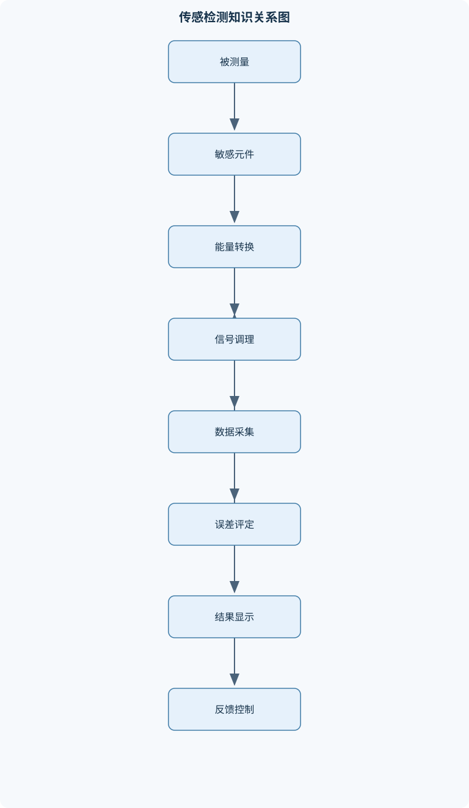
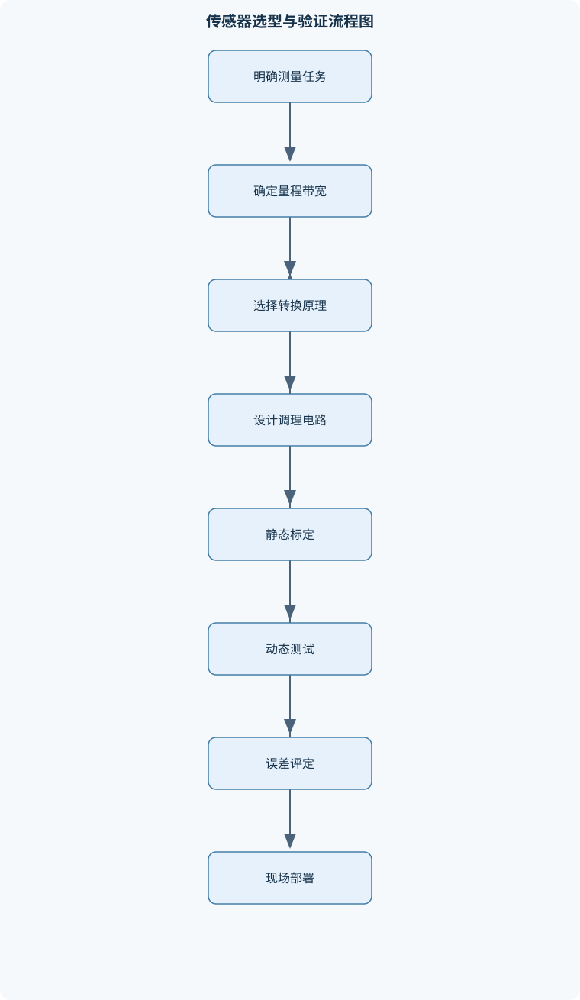

# 传感与检测

## 一、课程整体知识框架

### 课程边界与先修知识

《传感与检测》研究被测量的感知、变换、传输、调理、采集、处理与显示全过程，覆盖位移、速度、加速度、力、压力、应变、温度、流量、液位、光学量、磁场、声学量、辐射量及材料状态等参数的检测原理与工程实现。课程重点包括敏感元件和传感器的物理效应、静态与动态特性、信号调理、电桥与测量电路、误差与不确定度、数据采集、标定及典型检测系统。先修知识包括高等数学中的微积分与基础微分方程、普通物理中的力学热学电磁学和光学、模拟与数字电路基础，以及基本概率统计知识。课程边界不深入讨论具体工业仪表的商业型号、未经限定的法规标准和特定软件版本；涉及核辐射、医学或安全检测时，重点讲解物理原理、测量链路、屏蔽与规范流程，不替代专业安全许可和现场操作规程。





### 1.1 课程对象与研究范围

《传感与检测》研究如何把客观世界中的被测量转换为可传输、可处理、可比较和可显示的信息。被测量可以是位移、速度、加速度、力、压力、应变、温度、流量、液位、光照、磁场、声压、辐射强度以及材料状态等。课程不只讨论某一种传感器的工作原理，而是考察从被测对象到最终测量结果的完整链路：

$$
\text{被测量 }x
\rightarrow
\text{敏感元件}
\rightarrow
\text{转换元件}
\rightarrow
\text{信号调理}
\rightarrow
\text{采样与处理}
\rightarrow
\text{显示、控制或诊断}.
$$

敏感元件首先直接感受被测量的变化，例如弹性膜片感受压力、热电偶结点感受温差、光电二极管感受光辐射、压电材料感受机械应力。转换元件再把这种变化转换为电阻、电容、电荷、电压、频率或数字量。完整传感器通常还包括激励、补偿、放大、滤波、封装和输出接口；变送器往往在传感器基础上进一步完成信号调理和标准化输出；检测仪表则还可能包含显示、记录、报警和控制功能。不能把敏感元件、传感器、变送器和完整检测仪表视为同一概念。

检测方法的选择取决于被测量性质、测量范围、准确度、带宽、环境条件、安装方式和安全约束。同一被测量可以采用不同原理。例如位移可用电阻式、电容式、光电式、磁电式或超声方法测量；同一检测原理也可以测量不同参数，例如电容变化既可由极距改变引起，也可由面积或介电常数改变引起。因此，传感器选型不能只依据“灵敏度高”这一项指标，而应比较总误差、动态响应、稳定性、抗干扰能力、负载效应、维护条件及全寿命成本。

### 1.2 检测系统的统一信号链

检测系统的输入是被测量 $x$，输出记为 $y$。输入和输出必须同时标明单位，例如压力输入为 $100\ \mathrm{kPa}$、输出为 $2.5\ \mathrm{V}$。若在静态或准静态条件下，传感器可表示为：

$$
y=f(x).
$$

理想线性传感器可写为：

$$
y=y_0+Sx,
$$

其中 $y_0$ 为零点输出，$S$ 为静态灵敏度，定义为：

$$
S=\frac{\mathrm{d}y}{\mathrm{d}x}.
$$

灵敏度的单位是“输出单位每输入单位”，例如 $\mathrm{mV/kPa}$、$\mathrm{V/mm}$ 或 $\mathrm{pC/N}$。在有限区间内，平均灵敏度为：

$$
\frac{\Delta y}{\Delta x}.
$$

只有当曲线在该区间内近似直线时，平均灵敏度才可以代表局部灵敏度。灵敏度不等于分辨力。灵敏度表示输入变化引起输出变化的速率，分辨力表示系统能够可靠区分的最小输入变化；增大放大倍数可以提高输出变化，却不一定改善由噪声、漂移和量化造成的实际分辨力。

测量误差通常以测量值 $x_m$ 与参考真值或约定真值 $x_t$ 的差表示。相对误差为：

$$
e_r=\frac{x_m-x_t}{x_t}.
$$

百分比误差为 $100e_r\%$。若以满量程 $X_{FS}$ 为基准，则满量程误差为：

$$
e_{FS}=\frac{|x_m-x_t|}{X_{FS}}.
$$

相同的绝对误差在不同量程下对应不同的相对误差和满量程误差。因此，选用远大于实际测量范围的传感器，虽然不一定超量程，却可能造成有效分辨力不足。

### 1.3 静态特性、动态特性与标定

静态特性描述输入保持不变或变化极慢时的输出关系，主要包括量程、零点、灵敏度、线性度、迟滞、重复性、稳定性和分辨力。量程是允许测量的输入区间，不是“传感器能够承受而不损坏”的极限值；后者属于过载能力。线性度表示实际标定曲线相对于规定参考直线的偏离，迟滞表示相同输入在升程和降程中的输出差异。重复性关注相同条件下多次测量的一致程度，稳定性则关注时间、温度或环境变化引起的性能改变。

静态标定应覆盖预定量程，分别记录升程和降程，并进行重复测量。标定曲线可以用一次函数、分段线性函数或更高阶模型拟合，但提高拟合阶数并不自动提高真实测量质量。高阶模型可能降低标定数据残差，却放大噪声、增加外推风险。标定曲线只在有效输入范围内使用；超出标定范围进行外推，不能视为正常测量。

快速变化的被测量还必须考虑动态特性。典型一阶测量环节的传递函数为：

$$
H(s)=\frac{K}{1+\tau s},
$$

其中 $s$ 是拉普拉斯变量，$K$ 是静态增益，$\tau$ 是时间常数，单位为秒。对于幅值为 $y_\infty$ 的阶跃输入，一阶响应为：

$$
y(t)=y_\infty\left[1-\exp\left(-\frac{t}{\tau}\right)\right].
$$

当 $t=\tau$ 时，输出达到最终变化量的约 $63.2\%$；当时间继续增加，响应逐步接近稳态。时间常数越大，响应越慢。温度传感器的时间常数受到传感器热容量、表面换热、保护套管和安装方式影响；同一个传感元件在空气、水流和金属固体中的动态响应可能不同。把静态标定曲线直接用于高频振动或快速温度变化，会忽略幅值衰减和相位延迟。

### 1.4 能量域转换与基本物理规律

传感器的物理效应可以按能量域转换分类。机械式检测把被测量转换为位移、转角、力或弹性变形；电阻式检测利用几何尺寸、电阻率或载流子输运变化；电容式检测利用极距、面积或介电常数变化；热电式检测利用温差引起的电势或电阻变化；压电式检测利用机械应力产生电荷；光电式检测利用光辐射引起的电流或电压变化；磁电和霍尔式检测利用磁通变化、电磁感应或载流子受磁场作用产生输出；声学和超声检测利用波的传播、反射和衰减；射线检测利用辐射在物质中的吸收和散射。

这些方法分别受到守恒定律、场规律、物质特性和统计规律约束。例如电路分析必须满足基尔霍夫电流定律和电压定律；电磁感应遵循法拉第定律：

$$
e=-N\frac{\mathrm{d}\Phi}{\mathrm{d}t},
$$

其中 $e$ 为感应电势，单位为伏特，$N$ 为线圈匝数，$\Phi$ 为单匝磁通量，单位为韦伯。负号表示感应效应具有反抗磁通变化的方向。若磁通不随时间变化，即使磁场很强，也不一定产生感应电压，这解释了磁电式速度传感器在低速或静止时输出趋近于零。

### 1.5 信号调理、采集与测量结果形成

原始传感器输出通常不能直接送入显示器或控制器。电阻变化需要电桥和恒流、恒压激励，电荷信号需要电荷放大器，微弱电压需要低噪声放大器，含有高频干扰的信号需要滤波，差分小信号还必须满足输入共模范围和共模抑制要求。

模拟信号经采样保持和模数转换后成为数字序列。设采样频率为 $f_s$，信号最高有效频率为 $f_{max}$，为避免理想条件下的混叠，通常要求：

$$
f_s>2f_{max}.
$$

实际系统还必须在采样前使用抗混叠低通滤波器，使高于奈奎斯特频率的信号成分得到足够衰减。采样频率超过两倍并不意味着测量一定正确，因为量化位数不足、放大器饱和、时钟抖动、滤波器滚降、传感器带宽不足和输入信号超出动态范围仍会造成误差。已经混叠到低频范围的成分，不能依靠采样后的数字滤波可靠恢复原始频率。

完整测量结果还应包括数值、单位、标定关系、测量时间、环境条件和不确定度信息。对测量模型 $y=f(x_1,\ldots,x_n)$，输入量不相关且误差较小时，合成标准不确定度可近似写为：

$$
u_c^2(y)=\sum_{i=1}^{n}c_i^2u^2(x_i),
\qquad
c_i=\frac{\partial f}{\partial x_i}.
$$

其中 $u(x_i)$ 是输入量的标准不确定度，$c_i$ 是灵敏度系数。若输入量相关，还必须加入协方差项。多次平均可以减小部分随机误差，但不能自动消除零点偏差、温度漂移、安装偏差和错误标定等系统误差。

## 二、章节和模块划分

### 核心知识覆盖清单

本清单用于检查正文是否覆盖本课程的主要知识模块：

- **检测系统基础与测量特性**：检测系统组成与信号链、被测量与测量量定义、敏感元件和转换元件、能量域转换方法、静态特性与标定曲线、灵敏度与分辨力、线性度与迟滞、重复性与稳定性、动态响应与频率特性、测量范围与传感器选型。
- **机械式与弹性式检测元件**：机械量转换原理、弹性变形与弹性极限、刚度和柔度、弹簧管与膜片、波纹管与柱式弹性元件、应力应变关系、机械谐振式检测、机械传动与间隙误差、弹性滞后与蠕变、力和压力测量结构。
- **电阻式检测元件与电桥**：金属电阻应变效应、半导体压阻效应、应变片结构与粘贴、电阻温度特性、线性电阻式位移测量、电阻式温度传感器、惠斯通电桥、半桥与全桥接法、桥路温度补偿、导线电阻与加载误差。
- **电容式检测元件**：平行板电容模型、极距变化测量、面积变化测量、介电常数变化测量、差动电容结构、电容式位移与液位测量、寄生电容影响、交流激励与解调、非线性误差展开、屏蔽接地与抗干扰。
- **热电式检测元件**：热电阻测温原理、热敏电阻特性、热电偶热电效应、接触电势与温差电势、中间导体定律、中间温度定律、冷端补偿、热传导与热惯性、辐射测温基础、温度标定与安装误差。
- **压电式与振动检测**：压电效应与压电材料、压电元件等效电路、电荷放大器、压电式力传感器、压电式加速度传感器、压电传感器低频限制、机械谐振与带宽、振动幅值与频率测量、冲击测量、电缆噪声与绝缘影响。
- **光电、红外与视觉检测**：光电效应分类、光电管伏安特性、光照特性与光谱响应、光电二极管与光电晶体管、光电倍增管工作原理、光电编码器、位置敏感器件、四象限光电探测器、红外辐射与热释电检测、机器视觉成像链路。
- **磁电、霍尔与磁弹性检测**：电磁感应定律、恒磁阻式检测元件、变磁阻式检测元件、磁电式速度与转速测量、霍尔效应与霍尔电压、霍尔式电流传感器、霍尔开关与位置检测、磁弹性效应、压磁式力传感器、磁性材料温度与磁滞误差。
- **超声、声学与核辐射检测**：声压级与声强级、分贝标度与参考量、超声波发射与接收、声波反射折射和透射、声阻抗与界面反射、超声测距与测厚、超声流量测量、射线吸收与衰减、辐射式厚度和密度检测、探测器屏蔽与安全流程。
- **信号调理、采集与智能检测**：传感器等效电路、放大与滤波、差分测量与共模抑制、采样保持与量化、抗混叠滤波、模数转换误差、频域分析与傅里叶变换、数字标定与线性化、软测量模型、检测系统可靠性与故障诊断。


### 2.1 检测系统基础与测量特性

本模块建立全课程的共同语言。首先定义被测量、影响量、测量范围、输入输出、参考值和测量结果；然后分析检测系统各环节的功能和相互作用。敏感元件直接感受被测量，转换元件完成能量域或参数域转换，信号调理环节改善幅值、频带和信噪比，采集环节完成时间离散和幅值量化，处理环节进行线性化、补偿、频谱分析和状态判断。

静态分析重点讨论 $y=f(x)$、灵敏度、零点、线性度、迟滞、重复性、稳定性、测量范围和分辨力。动态分析重点讨论时间常数、固有频率、阻尼、幅频特性和相频特性。传感器选型必须同时检查输入范围、允许过载、目标带宽、温湿度、振动、腐蚀、电磁环境、安装空间、供电方式、输出接口和安全约束。一个适合静态压力测量的低频传感器，未必适合冲击压力；一个灵敏度很高的光学器件，若受环境光和温度影响严重，也未必适合现场长期使用。

### 2.2 机械式与弹性式检测元件

机械式检测元件把被测量转换为位移、转角、力、频率或机械振动，结构通常直观、无需复杂电子激励，并具有较强的抗电磁干扰能力。弹性元件在外力作用下产生变形，去除外力后能恢复原状的部分称为弹性变形。超过弹性极限后可能出现塑性变形，传感器会产生永久零点偏移，不能再按原标定曲线使用。

刚度定义为：

$$
k=\frac{\mathrm{d}F}{\mathrm{d}x},
$$

其中 $F$ 为力，单位为牛顿，$x$ 为位移，单位为米，刚度单位为 $\mathrm{N/m}$。柔度为：

$$
C_m=\frac{\mathrm{d}x}{\mathrm{d}F},
$$

单位为 $\mathrm{m/N}$。在线性小变形条件下，刚度与柔度近似互为倒数。刚度越大，相同力引起的位移越小，通常承载能力较高但位移灵敏度较低；刚度越小，位移输出较大，却更容易受到过载、固有频率下降和结构振动影响。

常用弹性元件包括弹簧管、膜片、波纹管和柱式弹性体。膜片和波纹管适合压力、差压和位移转换；柱式弹性体常用于力和压力测量；机械谐振结构则把力或应力变化转换为固有频率变化。机械传动中的间隙、摩擦、回程误差和装配偏心会形成非线性与迟滞。弹性滞后表现为加载和卸载时应力—应变曲线不重合；蠕变则表现为输入保持不变时输出仍随时间缓慢变化。边界条件、材料疲劳、温度和残余应力都会改变弹性元件性能。

### 2.3 电阻式检测元件与电桥

金属电阻由材料电阻率 $\rho$、长度 $L$ 和截面积 $A$ 决定：

$$
R=\rho\frac{L}{A}.
$$

对微小变化求全微分并除以 $R$，得到：

$$
\frac{\Delta R}{R}
\approx
\frac{\Delta\rho}{\rho}
+
\frac{\Delta L}{L}
-
\frac{\Delta A}{A}.
$$

金属应变片的应变定义为：

$$
\varepsilon_s=\frac{\Delta L}{L}.
$$

应力定义为：

$$
\sigma=\frac{F}{A_c},
$$

其中 $A_c$ 为受力截面积。金属应变片的电阻变化不仅来自长度变化，也来自截面积变化和电阻率变化。通常用应变计因子表示：

$$
G_F=\frac{\Delta R/R}{\varepsilon_s}.
$$

应变计因子取决于材料、几何结构和温度，不能把某一种应变片的经验值当作所有材料的普适常数。半导体压阻元件的电阻率变化可能远大于普通金属应变片，但温度敏感性和非线性也通常更明显。

惠斯通电桥利用桥臂比值变化产生差分输出。平衡条件取决于两侧桥臂电阻比相等。对小电阻变化，单臂、半桥和全桥输出可在平衡点附近保留一阶项，从而得到输出与 $\Delta R/R$ 近似成正比。全桥可提高灵敏度，并能通过对称布置使温度引起的共同变化相互抵消；但大应变、桥臂初始不匹配、激励电压波动和放大器输入阻抗有限时，一阶近似会失效。导线电阻还会改变实际桥臂阻值，尤其在远距离连接和低阻值应变片中必须采用合理的三线或四线补偿结构。

线性电阻式位移传感器利用滑动触点改变有效电阻长度，结构简单但存在接触磨损、摩擦、分辨力受电阻膜和触点限制等问题。电阻式温度传感器利用电阻随温度变化的规律，测量时要考虑引线电阻、自热和安装热阻。

### 2.4 电容式检测元件

理想平行板电容为：

$$
C=\frac{\varepsilon A}{d},
$$

其中 $C$ 的单位为法拉，$\varepsilon$ 为介电常数，$A$ 为极板有效面积，单位为平方米，$d$ 为极板间距，单位为米。由此可形成三类基本测量方式：极距变化、面积变化和介电常数变化。

对于极距变化结构，设初始间距为 $d_0$，位移使间距变为 $d=d_0-\Delta d$，则：

$$
C=\frac{\varepsilon A}{d_0-\Delta d}
=\frac{C_0}{1-\Delta d/d_0}.
$$

当 $|\Delta d/d_0|\ll1$ 时，利用几何级数展开：

$$
\frac{1}{1-z}\approx1+z+z^2+\cdots,
$$

得到：

$$
\frac{\Delta C}{C_0}
\approx
\frac{\Delta d}{d_0}
+
\left(\frac{\Delta d}{d_0}\right)^2+\cdots.
$$

一阶项说明小位移时近似线性，二阶及更高阶项说明单端极距结构存在非线性。若位移接近初始间距，极板可能碰撞，公式中的理想模型也失去适用性。差动电容结构使一侧间距减小、另一侧间距增大，可提高线性度、抑制部分共模温度变化并改善抗干扰性能。

电容变化通常较小，容易受到寄生电容、潮湿、引线移动和人体接近影响。实际电路常采用交流激励、同步解调、屏蔽和合理接地。屏蔽层多点接地可能形成地环路，信号参考地、保护接地和电磁屏蔽的连接方式必须按系统结构确定。电容式传感器可用于位移、液位和介电常数测量，但液位测量还会受介质电导率、泡沫、附着物和容器几何形状影响。

### 2.5 热电式检测元件

热电阻利用材料电阻随温度变化的规律测温。金属热电阻通常具有较稳定、近似单调的温度特性，但引线电阻、自热、保护套管和安装热阻会造成误差。热敏电阻电阻温度系数较大，灵敏度高，但非线性、个体差异和温度稳定性需要校准和补偿。

热电偶利用不同材料导体形成回路时的热电效应。热电势记为：

$$
E_{AB}(T,T_0),
$$

其中 $T$ 为测量端温度，$T_0$ 为参考端温度。热电偶输出取决于两个接点的温度，不能只由测量端温度决定。中间温度定律为：

$$
E_{AB}(T,T_0)
=
E_{AB}(T,T_c)+E_{AB}(T_c,T_0),
$$

其中 $T_c$ 为中间参考温度。冷端补偿就是测量实际参考端温度，并将实际参考条件换算到规定参考条件。热电偶电势通常随温度变化而非全量程严格线性，不能用一个恒定灵敏度覆盖全部温度范围。

温度传感器还存在热传导误差和热惯性。传感器接触被测物后可能改变局部热场，保护管会增加热容量和热阻，流体流速与安装深度也会改变响应。辐射测温依靠物体发出的热辐射，不需要直接接触，但受发射率、视场、背景辐射、光路污染和表面状态影响；发射率不明确时，读数不一定代表真实热力学温度。

### 2.6 压电式与振动检测

压电材料受到机械应力时会产生电荷，压电元件可等效为电荷源与电容、漏电阻组合的网络。输出电压近似满足：

$$
u=\frac{q}{C},
$$

其中 $q$ 为压电电荷，单位为库仑，$C$ 为元件及输入电路等效电容，单位为法拉，$u$ 为电压，单位为伏特。电荷放大器使输出主要由输入电荷和反馈电容决定，从而减小电缆电容变化对电压灵敏度的影响。

由于漏电阻存在，电荷会随时间衰减。输入变化越慢，衰减影响越明显，因此压电式力传感器和加速度传感器适合动态力、冲击和振动测量，不适合长期静态力或静态加速度测量。低频截止特性由等效电阻、电容和电荷放大器参数决定；电缆受摩擦、弯曲或绝缘不良时可能产生摩擦电噪声和漏电误差。

振动检测要区分幅值、频率、相位和冲击峰值。机械谐振会在特定频率附近放大输出，使传感器带宽之外的信号不能按静态灵敏度解释。安装刚度、质量加载和安装方向会改变被测结构的固有特性，因此加速度传感器本身也可能成为被测系统的一部分。

### 2.7 光电、红外与视觉检测

光电检测利用光生伏特效应、光电导效应、光电发射效应或热效应把光辐射转换为电信号。光电二极管通常具有较快响应和较好的线性，光电晶体管输出增益较大但速度和线性范围可能受到限制；光电倍增管利用级联倍增获得很高灵敏度，但需要高压供电并对强光敏感。

光电器件的输出不仅取决于光强，还受波长、入射角、光谱响应、器件面积、温度和放大电路影响。光照强度、光通量、辐照度和光功率不是同一物理量，不能互相替代。光电编码器通过码盘的明暗或透光结构产生脉冲，可测量角位移和转速；四倍频计数能提高角位移分辨率，但漏脉冲、抖动、方向判别错误和计数器溢出会影响结果。

位置敏感器件和四象限探测器可根据光斑位置或各象限电流差计算位移、偏转和光斑中心。红外检测包括热辐射检测和热释电检测，热释电器件通常对辐射变化更敏感，不能简单视为静态光功率计。机器视觉系统由光源、光学镜头、图像传感器、图像采集、处理算法和输出接口组成。光源决定对比度，镜头决定视场和成像质量，CCD或CMOS完成光电转换，算法负责定位、尺寸测量、缺陷识别和结果判定；任何一个环节不稳定，都可能造成视觉测量漂移。

### 2.8 磁电、霍尔与磁弹性检测

磁电式传感器依据法拉第定律工作。在线速度型结构中，若磁场强度、有效导体长度和线圈匝数保持不变，则：

$$
e=NBlv,
$$

其中 $B$ 为磁感应强度，单位为特斯拉，$l$ 为有效导体长度，单位为米，$v$ 为速度，单位为米每秒。该关系说明输出电压与速度成正比，但也说明低速时输出趋近于零。若接入负载，线圈内阻和负载电阻会形成分压，负载端电压小于理想感应电势。

霍尔元件中，载流子受到磁场力作用并在横向形成霍尔电场。达到平衡时：

$$
evB=eE_H.
$$

若控制电流为 $I$，元件厚度为 $d$，载流子浓度为 $n$，则可得到：

$$
U_H=\frac{IB}{ned}=K_HIB.
$$

其中 $U_H$ 为霍尔电压，$K_H$ 为综合霍尔灵敏度。恒流激励有助于稳定输出，但霍尔电压仍受温度、材料、厚度、零点电势和不等位电势影响。霍尔元件可用于电流、位置、转速和开关检测；霍尔电流传感器还必须考虑磁路非线性、剩磁和被测导体位置。

磁弹性和压磁式传感器利用应力改变磁导率、磁滞或磁通分布的效应测量力和扭矩。磁性材料的温度变化会改变磁特性，磁滞会使升程和降程输出不同，因此需要磁路设计、温度补偿和标定。

### 2.9 超声、声学与核辐射检测

声压级定义为：

$$
L_p=20\lg\left(\frac{p}{p_{ref}}\right),
$$

声强级定义为：

$$
L_I=10\lg\left(\frac{I}{I_{ref}}\right).
$$

其中 $p$ 为声压，单位为帕，$I$ 为声强，单位为瓦每平方米，$p_{ref}$ 和 $I_{ref}$ 必须明确。分贝是相对对数标度，不能在未明确物理量和参考值的情况下直接把分贝数相加。

超声波在介质界面会发生反射、折射和透射。声阻抗记为 $Z$，垂直入射时压力反射系数为：

$$
r=\frac{Z_2-Z_1}{Z_2+Z_1}.
$$

两侧介质声阻抗差越大，反射越强；耦合层可改善换能器与被测物之间的声能传递。超声测距根据传播时间和声速计算距离，测厚根据多次回波时间差计算厚度，超声流量测量则利用传播时间差或多普勒频移。温度、介质成分、压力和流速都会改变声速，安装零偏和多次回波必须在信号处理中辨识。

射线穿过介质时发生吸收和衰减，衰减程度与材料厚度、密度、组成及射线能量有关，可用于厚度、密度和缺陷检测。射线检测不是无风险检测，射线源、探测器、屏蔽、联锁、剂量监测、人员资质和现场隔离必须遵守适用的安全管理要求。本课程讨论辐射与探测器的物理原理及测量链路，不替代专业安全许可和现场操作规程。

### 2.10 信号调理、采集与智能检测

传感器可用等效电压源、等效电流源、等效电荷源、阻抗和噪声模型描述。电压型源适合高输入阻抗放大器，电流型源要考虑负载转换，电荷型源通常配合电荷放大器。差分测量能够抑制共同出现在两输入端的干扰，但实际抑制能力受共模抑制比、输入阻抗匹配、布局和接地方式限制。

滤波器应根据目标信号带宽和噪声频谱设计。低通滤波可抑制高频噪声，带通滤波可保留振动频带，陷波滤波可抑制特定窄带干扰，但滤波会引入幅值衰减和相位变化。模拟抗混叠滤波必须位于模数转换之前。模数转换误差包括量化误差、参考电压误差、非线性、偏置、增益误差和采样时钟误差。

数字处理可使用线性化、多点标定、温度补偿、均值滤波、频域分析和异常检测。快速傅里叶变换用于从等间隔采样序列中获得频谱，但窗函数选择、频谱泄漏、幅值校正和频率分辨率必须同时考虑。记录时长越长，频率分辨率通常越高；提高采样频率主要扩大可分析带宽，二者作用不同。

软测量利用可测变量估计难以直接在线测量的变量。模型可以由机理方程、回归关系或数据驱动方法构成，但模型必须经过标定、验证和适用范围检查。若工况变化超出训练或建模范围，软测量输出可能失真。检测系统的故障诊断应结合输出范围、变化率、连续性、历史标定残差、供电状态、电桥零点和环境温度，区分断线、饱和、漂移、突变和噪声异常，而不能仅凭单个超限点判定故障。

## 三、核心概念的详细解释

### 3.1 被测量、敏感元件与检测系统

被测量是检测系统试图确定的物理量或状态量，记为 $x$，例如位移 $x$、压力 $p$、温度 $T$、应变 $\varepsilon_s$、磁感应强度 $B$ 或声压 $p_a$。被测量必须具有明确的物理含义、单位、作用位置和时间范围。不能把“设备是否正常”直接当作一个无需定义的被测量；通常需要进一步规定振动幅值、温升、压力波动或绝缘电阻等可量化参数。

敏感元件直接感受被测量，并因物理效应产生结构、材料或能量状态的改变。例如膜片因压力产生挠度，金属应变片因长度和截面积改变而改变电阻，热电偶因两端温度不同而产生热电势，压电材料因受力而产生电荷，光电二极管因入射光产生光电流。转换元件则将这种变化转换为便于传输和处理的电压、电流、电阻、电容、电荷、频率或数字代码。

完整检测链路可表示为：

$$
x\rightarrow \text{敏感元件}\rightarrow \text{转换元件}
\rightarrow \text{信号调理}\rightarrow \text{采样处理}\rightarrow y.
$$

其中，$y$ 为传感器或检测系统输出。信号调理包括放大、滤波、隔离、线性化、温度补偿和阻抗变换。输出 $y$ 可以是电压、电流、频率、脉冲数或数字量，必须注明单位。敏感元件不一定等于传感器，传感器也不一定包含显示和报警功能；将这几个层次混为一谈会导致测量链边界和误差来源判断错误。

检测原理可以按照能量域转换分类。力学量可以转换为弹性变形、振动频率或压电电荷；热学量可以利用热平衡、热电效应或电阻温度效应；光学量可以利用反射、透射、散射和光电转换；磁学量可以利用电磁感应、霍尔效应、磁阻效应和磁弹性效应；声学量可以利用声波传播时间、反射和频移；辐射量可以利用射线吸收和探测器响应。能量域转换并不是“测量量被消失”，而是通过物理规律把不便直接读取的量转换为可观测信号。

### 3.2 静态特性、动态特性与误差边界

静态特性描述输入变化足够慢、传感器内部已基本达到平衡时的输入—输出关系：

$$
y=f(x).
$$

若在工作区间内可近似为直线，则：

$$
y=y_0+Sx,
$$

其中 $y_0$ 是零输入时的输出，$S$ 是静态灵敏度，单位为“输出单位/输入单位”。局部灵敏度定义为：

$$
S=\frac{\mathrm{d}y}{\mathrm{d}x}.
$$

在有限区间 $[x_1,x_2]$ 内，平均灵敏度为：

$$
S_{\mathrm{avg}}=\frac{y_2-y_1}{x_2-x_1}.
$$

平均灵敏度不能替代局部灵敏度的条件是输出曲线明显弯曲，或者传感器存在迟滞和多值特性。例如单端极距式电容传感器的输出与 $1/d$ 有关，在位移较大时，平均灵敏度会掩盖不同位置处的真实灵敏度。

测量范围是传感器在满足规定性能的条件下允许测量的输入区间。它不同于机械不损坏的过载极限，也不同于输出电路能够显示的数值范围。分辨力是系统能够可靠区分的最小输入变化，取决于传感器噪声、放大器噪声、模数转换量化和算法判据。灵敏度高只表示单位输入变化对应更大的输出变化，不保证分辨力高；若噪声同时按比例增大，实际分辨力可能并未改善。

线性度表示实际标定曲线相对于规定参考直线的最大偏离。迟滞是同一输入值在升程和降程时输出不一致的现象，来源包括材料内耗、机械摩擦、磁滞和封装应力。重复性描述相同条件下多次测量的离散程度，稳定性描述特性随时间、温度、湿度或供电变化的保持能力。重复性好不等于准确度高；若系统有稳定的零点偏差，多次测量仍可能集中在错误值附近。

动态特性描述输入随时间变化时输出的幅值衰减、相位延迟、时间常数和带宽。一阶测量环节可写为：

$$
H(s)=\frac{K}{1+\tau s},
$$

其中 $s$ 为拉普拉斯变量，$K$ 为静态增益，$\tau$ 为时间常数，单位为秒。若输入为阶跃并且初始输出为零，则：

$$
y(t)=Kx_0\left[1-\exp\left(-\frac{t}{\tau}\right)\right].
$$

当 $t=\tau$ 时，输出达到最终变化量的约 $63.2\%$。该结论适用于一阶、线性、参数不随时间变化的理想模型；具有明显谐振、间隙或非线性的机械传感器不能简单用一个时间常数描述。

### 3.3 机械量与弹性检测

弹性元件在外力作用下发生变形，撤去外力后能够恢复原状的变形称为弹性变形。超过弹性极限后，材料可能产生塑性变形，导致零点漂移甚至结构失效。弹性元件的刚度定义为：

$$
k=\frac{\mathrm{d}F}{\mathrm{d}x},
$$

其中 $F$ 为力，单位为牛顿，$x$ 为位移，单位为米。柔度为：

$$
C_m=\frac{\mathrm{d}x}{\mathrm{d}F},
$$

单位为米每牛顿。在近似线性范围内，$k$ 与 $C_m$ 互为倒数。刚度大，受力位移小、固有频率通常较高，但灵敏度可能降低；刚度小，位移输出较大，却更容易受到过载、外界振动和安装偏差影响。

弹簧、弹簧管、膜片、波纹管和柱式弹性元件常用于力、压力、位移和加速度测量。压力作用于有效面积 $A_e$ 时，膜片上近似产生：

$$
F=pA_e,
$$

其中 $p$ 为表压或差压，必须说明压力参考端。膜片挠度与压力之间是否线性取决于尺寸、边界约束、材料和挠度大小。小挠度、弹性范围内可采用线性近似；大挠度时膜片的几何刚度变化会引入非线性。

机械传动中的齿隙、摩擦、轴承间隙和装配偏心会形成回差。对于齿轮或连杆传动，输入反向时，输出可能在一段输入变化内不动，这不是随机噪声，而是具有方向性的系统误差。通过预紧、差动结构、无间隙传动或升程与降程分别标定可以减小影响，但不能仅靠平均多次测量消除。

### 3.4 电阻式、电容式与电桥检测

金属电阻可表示为：

$$
R=\rho\frac{L}{A},
$$

其中 $\rho$ 为电阻率，单位为欧姆米，$L$ 为导体长度，$A$ 为截面积。对微小变化作全微分：

$$
\frac{\Delta R}{R}
\approx
\frac{\Delta\rho}{\rho}
+\frac{\Delta L}{L}
-\frac{\Delta A}{A}.
$$

金属应变片的轴向应变为：

$$
\varepsilon_s=\frac{\Delta L}{L}.
$$

在弹性、小应变和温度影响已分离的条件下，常写为：

$$
\frac{\Delta R}{R}=K_s\varepsilon_s,
$$

其中 $K_s$ 是应变计因子。$K_s$ 由电阻率变化、几何尺寸变化和横向收缩共同决定，并非所有材料的普适常数。温度既会改变电阻率，也会改变基底、胶层和被测结构的热膨胀，因此需要自补偿应变片、虚拟补偿片、半桥或全桥结构。

理想平行板电容为：

$$
C=\frac{\varepsilon A}{d},
$$

其中 $\varepsilon$ 为介电常数，单位为法拉每米，$A$ 为极板有效面积，单位为平方米，$d$ 为极距，单位为米。极距变化测量中，若 $d=d_0-\Delta d$，则：

$$
C=\frac{\varepsilon A}{d_0-\Delta d}
=C_0\frac{1}{1-\Delta d/d_0}.
$$

当 $|\Delta d/d_0|\ll1$ 时，利用几何级数展开：

$$
\frac{\Delta C}{C_0}
\approx
\frac{\Delta d}{d_0}
+\left(\frac{\Delta d}{d_0}\right)^2+\cdots.
$$

一阶项给出近似线性关系，高阶项说明单端电容位移测量存在非线性。差动电容通过使一个极距增大、另一个极距减小，使部分偶次项相互抵消，并抑制共同的介电常数变化和温度变化。实际电路仍会受到寄生电容、极板边缘电场、屏蔽结构和接地方式影响。

惠斯通电桥将电阻变化转换为差分电压。桥臂为 $R_1,R_2,R_3,R_4$，激励电压为 $U_s$，两中点电压分别为：

$$
U_a=U_s\frac{R_2}{R_1+R_2},\qquad
U_b=U_s\frac{R_4}{R_3+R_4}.
$$

若输出定义为 $U_o=U_a-U_b$，则：

$$
U_o=U_s\left(
\frac{R_2}{R_1+R_2}
-\frac{R_4}{R_3+R_4}
\right).
$$

桥路平衡条件为：

$$
\frac{R_2}{R_1}=\frac{R_4}{R_3}.
$$

四分之一桥仅有一个桥臂发生小变化时，若初始四臂均为 $R$，该臂变化为 $\Delta R$，则输出幅值的一阶近似为：

$$
|U_o|\approx \frac{U_s}{4}\left|\frac{\Delta R}{R}\right|.
$$

半桥和全桥通过增加有效变化臂可提高灵敏度，并能利用相反方向变化实现温度补偿。上述结论要求电阻变化远小于初始电阻、激励稳定、放大器输入阻抗足够高且桥臂连接极性明确。大应变、桥臂不匹配和激励波动会引入二阶非线性、零点误差和比例误差。

### 3.5 热电式、压电式与振动检测

热电阻利用电阻随温度变化的规律测温。金属热电阻在有限温区可近似写成：

$$
R(T)=R_0[1+\alpha(T-T_0)],
$$

其中 $R_0$ 为参考温度 $T_0$ 下的电阻，$\alpha$ 为温度系数，单位为每摄氏度。该式只适用于有限温区的近似，宽温区或热敏电阻通常需要非线性模型和标定曲线。热敏电阻灵敏度较高，但非线性和自热效应较明显；测量电流过大时，器件自身发热会使测量对象和传感器温度不同。

热电偶的输出取决于测量端与参考端的温度差。记热电势为 $E_{AB}(T,T_0)$，则对任意中间温度 $T_c$：

$$
E_{AB}(T,T_0)
=
E_{AB}(T,T_c)+E_{AB}(T_c,T_0).
$$

这就是中间温度定律。冷端补偿并不是简单给测量端加一个固定电压，而是测量实际参考端温度，再依据热电偶特性将参考条件换算到规定温度。热电偶输出不能在整个温度范围内使用一个恒定灵敏度，因为热电势—温度关系通常是非线性的。

热传导、对流和辐射决定温度传感器是否真正达到被测对象温度。传感器安装处存在热阻，保护套管增加热容量，会增大时间常数；流体速度、接触压力和表面发射率也会影响读数。辐射测温还依赖波长、发射率、视场、环境反射和大气吸收，不能把辐射亮度直接等同于真实温度。

压电材料受力时产生电荷，适合动态力、冲击和振动测量。若压电元件等效为电荷源 $q$ 与电容 $C_p$，其开路电压近似为：

$$
u=\frac{q}{C_p}.
$$

由于元件、放大器输入端和电缆存在漏电阻，电荷会随时间衰减。电荷放大器通过反馈电容 $C_f$ 将电荷转换为电压：

$$
u_o\approx-\frac{q}{C_f}.
$$

其低频截止由漏电阻和等效电容决定，输入变化越慢，电荷保持越困难。因此压电传感器不适合长期静态力、静态压力和长期静态加速度测量；把它当作理想直流电压源是错误的。

### 3.6 光电、磁电、霍尔与磁弹性检测

光电检测涉及光电转换和光学传播。光照强度、光功率、光通量和辐照度不是同一物理量，器件输出还受波长、入射角、响应面积和光谱分布影响。光电二极管通常工作在光生电流与入射光功率近似相关的区域；光电晶体管具有电流增益，但响应速度、线性范围和暗电流需要单独考虑。光电倍增管具有高增益，适用于弱光检测，但对供电、环境磁场和强光过载敏感。

光电编码器通过码盘、光源和接收器把角位移转换为脉冲或编码。增量式编码器需要计数脉冲，正交两相信号可判断方向；绝对式编码器直接输出位置编码，但码盘结构和译码要求更高。漏脉冲、遮光污染、计数器溢出和机械偏心会导致角位移或转速误判。

电磁感应满足：

$$
e=-N\frac{\mathrm{d}\Phi}{\mathrm{d}t},
$$

其中 $N$ 为线圈匝数，$\Phi$ 为每匝磁通量，$e$ 的单位为伏。在线速度型磁电传感器中，磁场和有效导体长度近似恒定时：

$$
e=NBlv,
$$

其中 $B$ 为磁感应强度，单位为特斯拉，$l$ 为有效导体长度，单位为米，$v$ 为速度，单位为米每秒。由于输出与速度有关，低速时电压趋近于零，这属于原理限制，不一定是电路故障。

霍尔效应中，载流子在磁场中受到洛伦兹力。稳态时电场力与磁力平衡：

$$
evB=eE_H.
$$

若控制电流为 $I$，元件厚度为 $d$，载流子浓度为 $n$，则：

$$
U_H=\frac{IB}{ned}=K_HIB.
$$

$K_H$ 受材料、温度和几何尺寸影响。恒流激励有助于稳定输出，但零点电势、不等位电势、温漂和磁场非均匀性仍需补偿。霍尔电流传感器还需要建立被测电流与磁场之间的比例关系，并检查磁芯剩磁和饱和。

磁弹性检测利用铁磁材料受力后磁导率、磁滞或磁通分布变化的特性测量力和扭矩。材料内部应力、热处理状态、温度和预磁化历史会影响输出，因此磁弹性传感器必须重视材料一致性和标定稳定性。

### 3.7 声学、超声与辐射检测

声压级和声强级采用不同的对数定义：

$$
L_p=20\lg\left(\frac{p}{p_{\mathrm{ref}}}\right),
\qquad
L_I=10\lg\left(\frac{I}{I_{\mathrm{ref}}}\right).
$$

其中 $p$ 为声压，单位为帕，$p_{\mathrm{ref}}$ 是明确规定的参考声压；$I$ 为声强，单位为瓦每平方米，$I_{\mathrm{ref}}$ 为参考声强。由于分贝是对数标度，不能在没有说明物理量、参考值和相位关系的情况下直接相加。

超声测距利用传播时间计算距离。若声波往返时间为 $\Delta t$，介质声速为 $c$，安装零偏对应距离为 $d_0$，则：

$$
d=d_0+\frac{c\Delta t}{2}.
$$

除以 $2$ 是因为超声经历了往返路径。温度、压力和介质成分会改变 $c$；目标表面倾斜、粗糙或多目标反射会产生多个回波，需要通过时间窗、幅值、波形一致性和历史轨迹选择有效回波。

垂直入射时，声压反射系数为：

$$
r=\frac{Z_2-Z_1}{Z_2+Z_1},
$$

其中 $Z_1,Z_2$ 为两介质的声阻抗。阻抗差越大，反射越强；耦合层可减小换能器与被测物之间的界面反射。超声测厚利用前后表面回波时间差，超声流量测量利用顺流、逆流传播时间差或多普勒频移，但均要求声束路径、声速和安装几何关系明确。

射线检测根据射线在介质中的吸收和散射变化判断厚度、密度或缺陷。辐射式检测必须进行屏蔽、联锁、剂量监测、区域隔离和人员资质管理。物理原理能够说明信号如何形成，但不能替代现场安全许可和操作规程。

### 3.8 采集、频谱与软测量

采样频率为 $f_s$，信号最高有效频率为 $f_{\max}$。为避免混叠，模拟信号应在采样前经过抗混叠滤波，并满足：

$$
f_s>2f_{\max}.
$$

这个条件是理想带限信号的基本要求，实际系统通常还要留出滤波器过渡带。混叠一旦在采样时发生，后续数字滤波不能可靠恢复原始频率。量化位数决定理想量化步长，参考电压误差、偏置、增益、非线性和时钟抖动也会影响最终测量结果。

记录时长为 $T_{\mathrm{rec}}$ 时，频谱频率间隔通常为：

$$
\Delta f=\frac{1}{T_{\mathrm{rec}}}.
$$

提高采样频率主要扩大可分析带宽，延长记录时间主要改善频率分辨率，二者不能互相替代。快速傅里叶变换适用于等间隔采样数据，但需要处理去均值、窗函数、频谱泄漏和幅值校正问题。

软测量利用可直接测量的变量估计难以在线直接测量的变量。模型可以是机理模型、回归模型或数据驱动模型。软测量的有效边界由建模数据覆盖的工况决定；当温度、负荷、材料或设备状态超出模型范围时，输出必须伴随适用性判断，不能把模型估计值无条件视为真实测量值。

## 四、重要定义、公式、定理和推导

### 专业审校补充：关键定义与适用边界

检测系统的静态灵敏度不能代表动态测量性能。对可近似为一阶惯性环节的传感器，可写为 τ(dy/dt)+y=Kx，其中 x 为输入，y 为输出，K 为静态增益，τ 为时间常数，单位为秒。对正弦输入 x=X sin(ωt)，稳态幅值比为 |H(jω)|=K/√[1+(ωτ)²]，相位滞后为 φ=−arctan(ωτ)，ω 为角频率，单位为弧度每秒。低频时输出近似按静态灵敏度变化；当 ωτ 接近或大于 1 时，幅值衰减和相位滞后不可忽略，不能直接用静态标定曲线反演快速变化量。阶跃响应达到最终变化量的 63.2% 时可定义时间常数。该模型假设系统线性、参数不随温度和幅值变化，且工作频率远低于高阶谐振频率；若出现明显共振、迟滞、饱和或多时间常数，应采用频率响应标定，而不能机械套用一阶模型。


### 4.1 误差、不确定度与标定

测量值为 $x_m$，参考真值或约定真值为 $x_t$ 时，相对误差为：

$$
e_r=\frac{x_m-x_t}{x_t}.
$$

满量程误差为：

$$
e_{FS}=\frac{|x_m-x_t|}{X_{FS}},
$$

其中 $X_{FS}$ 为满量程。若传感器输入为压力，$x_m$ 和 $x_t$ 的单位必须同为帕或千帕，$X_{FS}$ 也必须使用相同单位。相对误差在 $x_t$ 接近零时会变得不稳定，此时应优先报告绝对误差或满量程误差。

对于测量模型 $y=f(x_1,\ldots,x_n)$，输入量标准不确定度为 $u(x_i)$，灵敏度系数为：

$$
c_i=\frac{\partial f}{\partial x_i}.
$$

输入量相互不相关时，合成标准不确定度为：

$$
u_c^2(y)=\sum_{i=1}^{n}c_i^2u^2(x_i).
$$

若输入量相关，还需加入协方差项：

$$
u_c^2(y)
=
\sum_i c_i^2u^2(x_i)
+
2\sum_{i<j}c_ic_j\,u(x_i,x_j).
$$

该传播公式基于局部线性化和合理的概率描述。误差很大、模型强非线性或分布明显偏斜时，不能机械套用线性公式，应采用分段分析或数值传播。

静态标定至少应覆盖工作区间的多个输入点，并同时记录升程和降程。拟合关系 $y=f(x)$ 后，残差为：

$$
r_i=y_i-f(x_i).
$$

最大残差、升降程差值、重复测量标准差和长期漂移分别反映不同性能，不能用一个指标代替全部评价。

### 4.2 平行板电容与差动结构推导

理想平行板电容为：

$$
C=\frac{\varepsilon A}{d}.
$$

令初始极距为 $d_0$，位移使极距变为 $d_0-\Delta d$，初始电容为 $C_0=\varepsilon A/d_0$，则：

$$
C
=
\frac{\varepsilon A}{d_0-\Delta d}
=
\frac{C_0}{1-\Delta d/d_0}.
$$

设 $z=\Delta d/d_0$，当 $|z|<1$ 时：

$$
\frac{1}{1-z}=1+z+z^2+z^3+\cdots.
$$

因此：

$$
\frac{\Delta C}{C_0}
=
z+z^2+z^3+\cdots.
$$

当 $|z|\ll1$ 时保留一阶项，得到：

$$
\frac{\Delta C}{C_0}\approx\frac{\Delta d}{d_0}.
$$

该近似的边界是极板不能接触，且位移相对初始极距必须足够小。若 $z=0.2$，二阶项已经为 $0.04$，相对于一阶项不可忽略，单端结构的线性近似会产生明显误差。

差动结构可令两个电容为：

$$
C_1=\frac{\varepsilon A}{d_0-\Delta d},\qquad
C_2=\frac{\varepsilon A}{d_0+\Delta d}.
$$

两者差值为：

$$
C_1-C_2
=
\varepsilon A
\left(
\frac{1}{d_0-\Delta d}
-\frac{1}{d_0+\Delta d}
\right).
$$

整理得：

$$
C_1-C_2
=
\frac{2\varepsilon A\Delta d}
{d_0^2-\Delta d^2}.
$$

当 $\Delta d/d_0$ 较小时：

$$
C_1-C_2
\approx
\frac{2\varepsilon A}{d_0^2}\Delta d.
$$

由于正负位移引起差值方向改变，且部分偶次非线性相互抵消，差动结构比单端结构更适合小位移高线性测量，但仍受寄生电容、结构不对称和极板边缘效应限制。

### 4.3 应变片与电桥输出推导

由：

$$
R=\rho\frac{L}{A},
$$

对数微分可得：

$$
\frac{\mathrm{d}R}{R}
=
\frac{\mathrm{d}\rho}{\rho}
+
\frac{\mathrm{d}L}{L}
-
\frac{\mathrm{d}A}{A}.
$$

轴向应变定义为：

$$
\varepsilon_s=\frac{\Delta L}{L}.
$$

若材料的横向应变近似为 $-\nu\varepsilon_s$，其中 $\nu$ 为泊松比，则截面积变化还与横向收缩有关。将几何变化和电阻率变化合并，可以定义应变计因子：

$$
K_s=\frac{\Delta R/R}{\varepsilon_s}.
$$

于是：

$$
\frac{\Delta R}{R}=K_s\varepsilon_s.
$$

该式要求应变较小、材料处于弹性范围、应变片与被测结构粘结良好，并且温度影响已经补偿或单独建模。

以四臂初值均为 $R$ 的四分之一桥为例，设 $R_1=R+\Delta R$，其余三臂为 $R$，激励端电压为 $U_s$。根据分压关系：

$$
U_a=U_s\frac{R}{2R+\Delta R},\qquad
U_b=U_s\frac{R}{2R}=\frac{U_s}{2}.
$$

当 $|\Delta R/R|\ll1$ 时：

$$
\frac{R}{2R+\Delta R}
=
\frac{1}{2+\Delta R/R}
\approx
\frac12-\frac14\frac{\Delta R}{R}.
$$

因此：

$$
U_a\approx
\frac{U_s}{2}
-\frac{U_s}{4}\frac{\Delta R}{R}.
$$

若定义 $U_o=U_a-U_b$，则：

$$
U_o\approx
-\frac{U_s}{4}\frac{\Delta R}{R}
=
-\frac{U_sK_s}{4}\varepsilon_s.
$$

负号表示输出极性取决于待测臂所在位置和输出端定义，不代表应变一定为负。若将待测臂接在另一位置，输出极性会相反。全桥中若两臂电阻增加、另两臂电阻减少，四个一阶变化可叠加，理论灵敏度约为四分之一桥的四倍，但前提是各臂应变方向、接线极性和温度补偿关系正确。

### 4.4 热电偶中间温度定律

设热电偶由材料 $A$ 和 $B$ 构成，测量端温度为 $T$，参考端温度为 $T_0$。引入中间温度 $T_c$，将整个热电势路径分成两段。由于热电势具有可叠加性：

$$
E_{AB}(T,T_0)
=
E_{AB}(T,T_c)
+
E_{AB}(T_c,T_0).
$$

这说明实际参考端温度变化会直接影响输出。若仪器内部把规定参考温度作为基准，而现场参考端为 $T_0$，则需要测出 $T_0$ 并计算补偿项 $E_{AB}(T_c,T_0)$，再与测得电势合成。

在局部温度范围内，若热电偶灵敏度近似为 $S_T$，则：

$$
\Delta E\approx S_T\Delta T.
$$

但 $S_T$ 不是全温区恒定值，热电偶电势曲线通常需要分段、多项式或查表处理。把热电偶输出简单写成 $E=S_TT$ 并忽略冷端，只有在参考端固定且局部线性近似成立时才可能作为粗略模型。

### 4.5 磁电式传感器与霍尔传感器推导

由法拉第定律：

$$
e=-N\frac{\mathrm{d}\Phi}{\mathrm{d}t}.
$$

若线圈运动使磁通量随位移变化，且 $\mathrm{d}\Phi/\mathrm{d}x$ 在工作区间近似恒定，则：

$$
e
=
-N\frac{\mathrm{d}\Phi}{\mathrm{d}x}
\frac{\mathrm{d}x}{\mathrm{d}t}
=
-N\frac{\mathrm{d}\Phi}{\mathrm{d}x}v.
$$

因此磁电式速度传感器的输出与速度成正比。若采用有效导体长度 $l$、磁感应强度 $B$ 的简化模型，则：

$$
|e|=NBlv.
$$

该结果假定磁场均匀、导体有效长度恒定、线圈电阻和负载影响可忽略。实际负载接入后，端电压由传感器内阻与负载共同决定，速度越低时输出越容易被噪声淹没。

霍尔元件中，载流子受到磁场力：

$$
F_B=evB.
$$

横向电场产生的电场力为：

$$
F_E=eE_H.
$$

稳态平衡时 $F_B=F_E$，即：

$$
E_H=vB.
$$

若载流子浓度为 $n$，控制电流为 $I$，元件宽度为 $w$、厚度为 $d$，则：

$$
I=nevwd.
$$

所以：

$$
v=\frac{I}{nevd},
$$

代入 $E_H=vB$，并以横向电势差 $U_H=E_Hw$，得到：

$$
U_H=\frac{IB}{ned}=K_HIB.
$$

该推导说明霍尔电压不仅依赖 $B$，还依赖控制电流、载流子浓度、元件厚度和温度。恒流源、差分放大、零点校准和温度补偿是提高稳定性的常用方法。

### 4.6 一阶热惯性与压电低频限制

温度传感器与被测对象之间可用热阻—热容模型近似。若传感器热容为 $C_{\mathrm{th}}$，等效热阻为 $R_{\mathrm{th}}$，则时间常数为：

$$
\tau=R_{\mathrm{th}}C_{\mathrm{th}}.
$$

对阶跃温度输入，传感器温度输出满足：

$$
\tau\frac{\mathrm{d}y}{\mathrm{d}t}+y=Kx.
$$

若输入从零跃变到 $x_0$，则：

$$
y(t)=Kx_0\left(1-\mathrm{e}^{-t/\tau}\right).
$$

当 $t=\tau$ 时：

$$
y(\tau)=Kx_0(1-\mathrm{e}^{-1})
\approx0.632Kx_0.
$$

增大保护套管或传感器质量通常会增大热容，使响应变慢；改善接触和流动换热可降低热阻，使响应加快，但也可能增加机械损伤或被测对象扰动。

压电传感器可用等效电荷源 $q$、电容 $C$ 和漏电阻 $R$ 表示。电荷通过漏电阻衰减时，电压响应具有近似高通特性，其低频拐点数量级为：

$$
f_L\approx\frac{1}{2\pi R_{\mathrm{eq}}C_{\mathrm{eq}}}.
$$

当输入频率远高于 $f_L$ 时，电荷衰减较小；当输入频率接近或低于 $f_L$ 时，输出幅值下降并发生相位变化。$R_{\mathrm{eq}}$ 受元件绝缘、放大器输入电阻和电缆漏电共同影响，因此潮湿、污染和电缆弯折会降低低频性能。

### 4.7 超声测距、分贝和采样定理

超声往返测距公式为：

$$
d=\frac{c\Delta t}{2}.
$$

若存在安装零偏 $d_0$，则：

$$
d=d_0+\frac{c\Delta t}{2}.
$$

若声速修正值为 $c+\Delta c$，则距离误差一阶近似为：

$$
\Delta d\approx\frac{\Delta t}{2}\Delta c+\frac{c}{2}\Delta t_{\mathrm{err}}.
$$

因此，声速误差和时间测量误差分别影响距离结果。温度补偿只能改善声速变化造成的误差，不能消除换能器安装偏移和多回波误判。

声压级的幅值比采用 $20\lg$，因为声压平方与平均声功率相关；声强级直接以功率密度比定义，采用 $10\lg$。若两个同频、同相声压叠加，必须先在线性声压域相加，再转换为分贝；只有在特定独立或不相关条件下，才可对功率量进行相应合成。

采样信号可表示为连续信号乘以冲激采样序列。频域中，采样会使原频谱以采样频率 $f_s$ 为周期重复。若原信号最高频率超过 $f_s/2$，相邻频谱副本重叠，产生混叠。以频率 $f_0$ 的正弦信号为例，其采样后可能表现为：

$$
f_{\mathrm{alias}}
=
|f_0-kf_s|,
$$

其中整数 $k$ 取使结果落入 $[0,f_s/2]$ 的值。数字滤波只能处理采样后的离散序列，不能把已经重叠的频谱副本重新分离，因此抗混叠滤波必须设置在模数转换之前。

### 4.8 代表性测量流程与伪代码

#### 静态标定与两点线性化流程

输入包括标准输入序列 $x_i$、对应输出 $y_i$、重复测量次数和允许误差。先进行预热、调零和量程检查，再按升程和降程施加标准输入，记录稳定输出。对每个点求平均值，拟合 $y=f(x)$，计算残差、最大满量程误差、迟滞和重复性。若输出在工作区间内近似单调，可采用两点线性化：

$$
x=x_1+
\frac{(y-y_1)(x_2-x_1)}{y_2-y_1}.
$$

该式要求 $x_2\ne x_1$、$y_2\ne y_1$，并且待测输出位于标定范围内。明显迟滞、多值输出或局部饱和时，不能用单一两点公式反演。

#### 数字采集质量检查伪代码

```text
伪代码
输入：模拟信号带宽 f_max，采样频率 f_s，记录时长 T，
      ADC 满量程范围 U_min 到 U_max，采样序列 u[1...N]
输出：质量标志、有效数字序列和异常记录

1. 若 f_s <= 2*f_max：
       输出“采样频率不足”，停止
2. 采样前启用模拟抗混叠低通滤波器
3. 对每个采样点 u[i]：
       若 u[i] < U_min 或 u[i] > U_max：
           标记“削顶或超量程”
       若相邻采样时间间隔异常：
           标记“时钟或丢样异常”
       保存 u[i]、时间戳、单位和量程信息
4. 去除均值或已知零点偏置
5. 检查连续异常点数量和允许噪声范围
6. 若异常点超过规定阈值：
       输出“数据无效”及异常位置
   否则：
       输出“数据有效”及处理后的序列
终止条件：达到记录时长 T 且所有质量检查完成
```

逐样本范围检查的时间复杂度为 $O(N)$，其中 $N$ 为采样点数。该流程不能代替抗混叠滤波，也不能从混叠数据中恢复真实频率。

### 4.9 代表性例题

#### 例题一：四分之一桥应变测量

**题干。** 四分之一桥初始四臂均为 $120\ \Omega$，应变片灵敏系数 $K_s=2.0$，施加应变 $\varepsilon_s=500\ \mu\varepsilon$，激励电压 $U_s=5.0\ \mathrm{V}$。求电阻变化和桥路输出的一阶近似值。

**分析。** 应变单位必须先换算为无量纲数：

$$
500\ \mu\varepsilon=500\times10^{-6}.
$$

由 $\Delta R/R=K_s\varepsilon_s$ 求相对电阻变化，再由四分之一桥公式求输出。

**解答。**

$$
\frac{\Delta R}{R}
=
2.0\times500\times10^{-6}
=1.0\times10^{-3}.
$$

因此：

$$
\Delta R=120\ \Omega\times1.0\times10^{-3}
=0.120\ \Omega.
$$

输出幅值为：

$$
|U_o|
\approx
\frac{5.0}{4}\times1.0\times10^{-3}
=1.25\ \mathrm{mV}.
$$

若待测臂接线使电阻增加导致 $U_a$ 减小，则按 $U_o=U_a-U_b$ 定义，输出为 $-1.25\ \mathrm{mV}$；若输出端对调，符号相反。

**结果验证。** $\Delta R/R=0.1\%$，满足小信号近似条件；输出约为毫伏级，符合应变桥需要仪表放大器的特点。

**变式。** 若激励电压增加一倍，理想输出也增加一倍，但自热、放大器共模范围和激励稳定性可能使实际误差增大。

#### 例题二：差动电容位移

**题干。** 差动电容传感器初始极距 $d_0=1.0\ \mathrm{mm}$，位移为 $\Delta d=0.01\ \mathrm{mm}$，极板面积 $A=1.0\times10^{-3}\ \mathrm{m^2}$，介电常数 $\varepsilon=8.85\times10^{-12}\ \mathrm{F/m}$。求两个电容，并判断一阶近似是否适用。

**解答。** 转换单位：

$$
d_0=1.0\times10^{-3}\ \mathrm{m},\qquad
\Delta d=1.0\times10^{-5}\ \mathrm{m}.
$$

两个极距为：

$$
d_1=d_0-\Delta d=0.99\times10^{-3}\ \mathrm{m},
$$

$$
d_2=d_0+\Delta d=1.01\times10^{-3}\ \mathrm{m}.
$$

因此：

$$
C_1=\frac{8.85\times10^{-12}\times1.0\times10^{-3}}
{0.99\times10^{-3}}
\approx8.94\ \mathrm{pF},
$$

$$
C_2=\frac{8.85\times10^{-12}\times1.0\times10^{-3}}
{1.01\times10^{-3}}
\approx8.76\ \mathrm{pF}.
$$

相对位移为：

$$
\frac{\Delta d}{d_0}=0.01.
$$

二阶项约为 $0.0001$，相对于一阶项约为 $1\%$，在一般工程估算中可采用一阶近似，但若要求更高线性度，应使用完整公式或标定补偿。

**变式。** 若位移增大到 $0.2\ \mathrm{mm}$，相对位移为 $0.2$，二阶项不再可忽略，单端近似会产生明显非线性，并且必须检查极板是否可能接触。

#### 例题三：热电偶冷端补偿

**题干。** 热电偶测量端温度为 $T=200^\circ\mathrm{C}$，参考端温度为 $T_0=25^\circ\mathrm{C}$。在局部温区内热电偶灵敏度近似为 $40\ \mu\mathrm{V}/^\circ\mathrm{C}$。估算参考端变化对热电势的影响，并说明为什么不能直接使用 $E=S_TT$。

**解答。** 测量端与参考端温差为：

$$
\Delta T=200-25=175^\circ\mathrm{C}.
$$

局部线性近似下：

$$
E\approx40\ \mu\mathrm{V}/^\circ\mathrm{C}
\times175^\circ\mathrm{C}
=7000\ \mu\mathrm{V}
=7.0\ \mathrm{mV}.
$$

若参考端从 $25^\circ\mathrm{C}$ 变化到 $35^\circ\mathrm{C}$，而测量端不变，则温差减少 $10^\circ\mathrm{C}$，输出变化约为：

$$
\Delta E\approx
40\ \mu\mathrm{V}/^\circ\mathrm{C}
\times(-10^\circ\mathrm{C})
=-0.40\ \mathrm{mV}.
$$

因此忽略冷端变化会造成约 $10^\circ\mathrm{C}$ 的局部温度误差。不能直接写成 $E=S_TT$，因为热电势由两接点温度共同决定，且 $S_T$ 只是在局部温区的近似灵敏度。

**结果验证。** 参考端温度变化会改变输出，即使测量端温度不变，测量结果也会改变，这符合中间温度定律。

#### 例题四：磁电式转速测量

**题干。** 某磁电式线圈有 $N=100$ 匝，有效导体长度 $l=0.02\ \mathrm{m}$，磁感应强度 $B=0.5\ \mathrm{T}$，运动速度为 $v=3\ \mathrm{m/s}$。忽略内阻和负载影响，求感应电势。

**解答。** 使用：

$$
e=NBlv.
$$

代入：

$$
e=100\times0.5\times0.02\times3
=3.0\ \mathrm{V}.
$$

因此理想开路感应电势为 $3.0\ \mathrm{V}$。

**结果验证。** 当速度降为 $0.3\ \mathrm{m/s}$ 时，输出也降为 $0.3\ \mathrm{V}$。低速输出变小，信噪比下降，不能仅通过提高数字放大倍数消除原理造成的低输出。

**变式。** 若传感器内阻与负载电阻相当，负载端电压将小于开路电势，应采用等效电路重新计算。

#### 例题五：超声测距与温度修正

**题干。** 超声回波往返时间为 $5.88\ \mathrm{ms}$，介质声速为 $340\ \mathrm{m/s}$，安装零偏为 $2\ \mathrm{mm}$。求目标距离。

**解答。** 时间换算为：

$$
\Delta t=5.88\times10^{-3}\ \mathrm{s}.
$$

传播距离为：

$$
d_{\mathrm{prop}}
=
\frac{340\times5.88\times10^{-3}}{2}
\approx0.9996\ \mathrm{m}.
$$

加上安装零偏：

$$
d=0.9996\ \mathrm{m}+0.002\ \mathrm{m}
=1.0016\ \mathrm{m}.
$$

**结果验证。** 除以 $2$ 是因为声波经历往返路径；若误用 $d=c\Delta t$，结果将约为 $2.00\ \mathrm{m}$，产生接近一倍的错误。

**变式。** 若温度变化使声速变为 $346\ \mathrm{m/s}$，应重新计算传播距离；若出现多个回波，应结合时间窗和目标历史位置选取回波，不能只选择幅值最大的峰。

### 4.10 实验与项目流程

#### 实验一：应变片全桥温度补偿实验

**输入数据。** 应变片额定电阻、灵敏系数、桥路激励电压、标准载荷、环境温度以及升程和降程输出电压。加载点应覆盖零点、低量程、中量程和高量程，并在至少两个温度条件下重复记录。

**步骤。**

1. 检查应变片粘贴方向、绝缘状态和引线固定情况。
2. 未加载时调节桥路零点，记录初始输出和环境温度。
3. 按标准载荷逐点加载，等待输出稳定后记录电压。
4. 按相同点逐点卸载，记录降程输出。
5. 改变环境温度或使用补偿片，重复升降程测量。
6. 依据 $\Delta R/R=K_s\varepsilon_s$ 和桥路模型换算应变，比较补偿前后零点漂移。

**评价标准。** 应检查零点重复性、灵敏度误差、升降程迟滞、温度漂移和满量程误差。评价时必须注明输入载荷单位、输出电压单位、温度范围和是否采用小信号近似，不能只报告一个“误差百分比”。

**排错方法。** 若输出不随载荷变化，优先检查桥路激励、引线断路和应变片粘贴；若输出极性相反，检查桥臂位置和差分输入端；若空载输出随手触碰或温度明显变化，检查绝缘、屏蔽、补偿片和接地；若加载与卸载差异大，检查机械间隙、胶层脱粘和结构是否超过弹性范围。

#### 实验二：采样与混叠验证项目

**输入数据。** 可控频率的正弦信号、信号幅值、模拟低通滤波器截止频率、采样频率和记录时长。设定至少两组采样频率，使一组满足、另一组不满足 $f_s>2f_{\max}$。

**步骤。**

1. 测量并确认信号频率和幅值，避免输入超过采集卡量程。
2. 在采样前接入抗混叠低通滤波器。
3. 分别使用不同 $f_s$ 采集等长度数据，保存采样频率、量程和时间戳。
4. 去除均值，绘制时域波形并计算频谱。
5. 比较真实输入频率、频谱峰值和理论混叠频率 $|f_0-kf_s|$。
6. 改变滤波器截止频率，观察带外信号被抑制后的频谱变化。

**评价标准。** 应记录主频误差、幅值误差、噪声底和是否出现混叠；频率分辨率应与 $\Delta f=1/T_{\mathrm{rec}}$ 一致。采样频率满足两倍条件但没有模拟滤波时，仍不能直接判定系统无混叠。

**排错方法。** 若频谱峰值随采样率变化而移动，检查混叠和时钟设置；若主频正确但幅值偏低，检查模拟滤波器衰减、输入阻抗和窗函数校正；若波形出现削顶，检查量程和增益；若频谱出现许多旁瓣，检查记录长度、非整周期采样和窗函数选择。

## 五、算法、流程和实现思路

### 方法与流程覆盖索引

下列方法或流程应在正文中说明输入、步骤、适用条件、结果检查和边界：

- 传感器选型流程：输入为被测量类型、范围、带宽、环境条件、允许误差和安装约束；输出为候选原理及型号类别。先确定被测量和单位，再按量程、静态灵敏度、动态响应、温度湿度、抗干扰、负载、供电和安全性筛选，最后比较总误差和全寿命成本。每一步保留不满足约束的淘汰理由；当候选集合为空时，放宽非关键约束或更换测量原理。适用于方案设计，若候选数量为 $n$ 且每个候选有 $m$ 项指标，直接筛选复杂度为 $O(nm)$。
- 静态标定流程：输入为标准输入序列 $x_i$、传感器输出 $y_i$ 和重复测量次数；输出为标定曲线、灵敏度、非线性和重复性指标。先预热和调零，再按升程与降程施加至少三个以上覆盖量程的标准点，记录输出并重复测量，拟合 $y=f(x)$，计算残差、最大满量程误差和迟滞；当所有点完成且重复测量达到预定次数时终止。适用于静态或准静态传感器，逐点计算复杂度为 $O(N)$，拟合复杂度取决于模型阶数。
- 两点线性化流程：输入为两个标定点 $(x_1,y_1)$、$(x_2,y_2)$ 和待测输出 $y$；输出为估计输入 $x$。先验证 $x_2\ne x_1$ 且待测输出处于标定范围，再计算 $x=x_1+(y-y_1)(x_2-x_1)/(y_2-y_1)$，最后给出超范围标志。适用于局部近似线性且单调的传感器，不适用于明显迟滞或多值特性；单次计算复杂度为 $O(1)$。
- 电桥测量分析流程：输入为桥臂电阻、激励电压、输出端连接方式和待测电阻变化；输出为桥路输出电压及误差来源。先标记激励端和差分输出端，写出各节点电压，再依据基尔霍夫定律求差值，随后在小变化条件下保留一阶项并检查共模电压、输入阻抗和温漂。节点和支路数分别为 $V$、$E$ 时，线性方程组求解通常为 $O(V^3)$，稀疏矩阵方法可降低实际计算量。
- 不确定度合成流程：输入为各输入量估计值、标准不确定度和测量模型 $y=f(x_1,\ldots,x_n)$；输出为合成标准不确定度。先识别随机和系统影响，计算灵敏度系数 $c_i=\partial f/\partial x_i$，在输入量不相关时使用 $u_c^2(y)=\sum_i c_i^2u^2(x_i)$，存在相关性时加入协方差项，最后根据覆盖要求给出扩展不确定度。适用于小误差、局部线性和概率模型合理的测量；变量数量为 $n$ 时基本计算复杂度为 $O(n^2)$。
- 数字采集流程：输入为模拟信号、带宽、允许误差和采样时长；输出为可分析的数字序列。先确定有效带宽，再设计抗混叠低通滤波器，选择满足动态范围的采样频率和量化位数，执行采样保持与量化，检查削顶、丢样和时钟稳定性，最后保存单位、量程、时间戳和标定信息。流程在采样时间达到设定时长且质量检查通过时终止；实时逐样本处理复杂度通常为 $O(N)$。
- 频谱分析流程：输入为等间隔采样序列、采样频率和分析频带；输出为幅值谱、主频和带宽指标。先去除均值并根据周期性选择窗函数，再进行快速傅里叶变换，计算频率坐标和幅值校正，识别峰值并区分真实成分、泄漏和噪声底。样本数为 $N$ 时，快速傅里叶变换复杂度为 $O(N\log N)$；要求采样间隔稳定，且分析频带未被混叠。
- 故障诊断流程：输入为实时输出、历史标定数据和允许阈值；输出为正常、漂移、断线、饱和或噪声异常等状态。先进行范围、变化率和连续性检查，再与标定模型残差比较，联合供电、电桥零点和环境温度信息定位故障，最后记录故障时间和恢复条件。以滑动窗口长度 $W$ 处理时，逐点阈值检查复杂度为 $O(N)$；适用于具有稳定基线和可观测辅助变量的检测系统。





### 5.1 传感器选型与检测系统设计流程

传感器选型的输入包括被测量类型、测量范围、允许误差、动态带宽、环境温度和湿度、安装空间、供电条件、输出接口、安全约束及维护条件；输出是检测原理、传感器类别、信号调理方案和验收指标。选型不能只比较标称灵敏度，而应评价整个测量链的综合性能。

设计流程如下：

1. **定义被测量。** 明确被测量是位移、速度、力、压力、温度、流量、液位、光强、磁感应强度、声压或其他参数，并规定单位、作用位置、变化范围和变化速度。
2. **确定测量边界。** 区分正常工作范围、允许过载范围和可能损坏的极限。对压力、力、加速度等参数，还应考虑冲击和瞬态峰值。
3. **确定候选物理效应。** 机械量可采用弹性变形、应变、压电、电磁感应或光学方法；温度可采用热电阻、热敏电阻、热电偶或辐射测温；位移可采用电阻、电容、光电、磁电或超声方法。
4. **检查静态指标。** 比较灵敏度、零点、线性度、迟滞、重复性、稳定性、分辨力和测量范围。灵敏度的单位必须写成输出单位每输入单位，例如 $\mathrm{mV/kPa}$。
5. **检查动态指标。** 若被测量含有振动、冲击或快速变化，应考察时间常数、谐振频率、幅频特性和相频特性。不能用静态标定曲线直接替代动态模型。
6. **设计调理链。** 根据传感器等效为电压源、电流源、电荷源或阻抗变化，选择仪表放大器、电荷放大器、恒流源、交流激励、解调器和滤波器。
7. **估计综合误差。** 将传感器误差、安装误差、温度漂移、供电变化、放大器噪声、量化误差和标定残差统一换算到输入量单位。
8. **进行环境和安全审查。** 检查电磁干扰、振动、湿度、腐蚀、粉尘、隔离、屏蔽和辐射风险。
9. **形成验收条件。** 明确允许误差、响应时间、有效带宽、故障状态、校准周期和输出数据格式。

若候选原理数为 $n$，每个候选有 $m$ 项指标，直接逐项筛选的计算复杂度通常为 $O(nm)$。如果所有候选均不满足要求，应优先检查被测量定义和非关键约束，而不是简单降低准确度要求。

### 5.2 静态标定、线性化与不确定度合成

#### 静态标定流程

静态标定的输入是标准输入序列 $x_i$、对应输出 $y_i$、重复测量次数以及参考标准的不确定度；输出是标定曲线、灵敏度、线性度、迟滞、重复性和修正参数。

操作步骤为：

1. 使传感器和调理电路预热至稳定状态，检查零点。
2. 按升程施加覆盖工作范围的标准输入点，至少包含零点、低量程点、中间点和接近满量程点。
3. 每个点等待输出稳定，记录输入、输出、环境温度和时间。
4. 按相同点降程测量，得到升程曲线和降程曲线。
5. 对每个输入点重复测量，计算平均值和离散程度。
6. 用直线、分段直线或低阶多项式拟合 $y=f(x)$。
7. 计算残差
   $$
   r_i=y_i-\hat y_i
   $$
   并将最大残差换算成输入量或满量程误差。
8. 比较升程和降程在相同输入点的输出差，得到迟滞指标。
9. 保存标定日期、环境条件、传感器编号、量程和修正系数。

标定只适用于静态或准静态条件。若传感器存在明显动态滞后、频率相关灵敏度或冲击响应，必须另外进行动态标定。

#### 两点线性化

给定两个标定点 $(x_1,y_1)$ 和 $(x_2,y_2)$，当传感器在该区间内单调且近似线性时，对待测输出 $y$ 估计输入：

$$
x=x_1+\frac{(y-y_1)(x_2-x_1)}{y_2-y_1}.
$$

使用条件是 $x_2\ne x_1$、$y_2\ne y_1$，且 $y$ 处于标定范围内。超出范围时应输出越界标志，不能无条件外推。对于明显非线性的电容式传感器、热电偶或迟滞传感器，应采用多点查表、分段拟合或带方向信息的模型。

#### 不确定度合成

设测量模型为：

$$
y=f(x_1,x_2,\ldots,x_n),
$$

输入量的标准不确定度为 $u(x_i)$，灵敏度系数为：

$$
c_i=\frac{\partial f}{\partial x_i}.
$$

输入量相互独立且模型在测量点附近近似线性时：

$$
u_c^2(y)=\sum_{i=1}^{n}c_i^2u^2(x_i).
$$

若输入量相关，则应加入协方差项：

$$
u_c^2(y)=\sum_i c_i^2u^2(x_i)
+2\sum_{i<j}c_ic_j\,u(x_i,x_j).
$$

例如电阻应变测量中，桥路输出电压、激励电压、应变计因子和温度补偿残差都可能是输入量。重复测量得到的离散性主要反映随机分量；零点偏移、安装方向偏差和温度系数通常不能靠简单平均消除，必须校准或建模。

### 5.3 电桥、差动电容和热电偶的实现思路

#### 电桥分析

惠斯通电桥由四个桥臂构成。设左、右两条分压支路中点电压分别为 $u_a$ 和 $u_b$，则差分输出为：

$$
u_o=u_a-u_b.
$$

节点电压必须依据实际接线写出。以激励电压 $U_e$ 加在桥路两端为例，某一分压点电压可写成：

$$
u_a=U_e\frac{R_2}{R_1+R_2}.
$$

若另一支路为 $R_3$、$R_4$，则：

$$
u_b=U_e\frac{R_4}{R_3+R_4}.
$$

桥路平衡条件为：

$$
\frac{R_1}{R_2}=\frac{R_3}{R_4},
$$

等价于 $u_o=0$。当某桥臂发生小变化时，应先写精确表达式，再在 $|\Delta R/R|\ll1$ 时保留一阶项。四分之一桥、半桥和全桥的灵敏度不同，桥臂变化方向也决定输出极性。输入放大器必须能够承受桥路共模电压；差分输出很小并不意味着共模电压也小。

#### 差动电容线性化

平行板电容为：

$$
C=\frac{\varepsilon A}{d},
$$

其中 $\varepsilon$ 的单位为 $\mathrm{F/m}$，$A$ 的单位为 $\mathrm{m^2}$，$d$ 的单位为 $\mathrm{m}$。若初始间距为 $d_0$，极距变化为 $\Delta d$，则：

$$
C=\frac{\varepsilon A}{d_0-\Delta d}
=\frac{C_0}{1-\Delta d/d_0}.
$$

当 $|\Delta d/d_0|\ll1$ 时，

$$
C\approx C_0\left(1+\frac{\Delta d}{d_0}
+\frac{\Delta d^2}{d_0^2}+\cdots\right).
$$

一次项给出近似线性关系，二次项说明单端结构存在非线性。差动结构使一个电容增大、另一个电容减小，输出差值可抵消部分偶次非线性和共模温度影响，但不能消除极板倾斜、寄生电容、边缘效应和介质不均匀造成的全部误差。

#### 热电偶冷端补偿

热电偶输出取决于测量端温度 $T$ 和参考端温度 $T_0$：

$$
E_{AB}(T,T_0).
$$

引入中间温度 $T_c$ 后，中间温度定律为：

$$
E_{AB}(T,T_0)
=
E_{AB}(T,T_c)+E_{AB}(T_c,T_0).
$$

冷端补偿不是把冷端“固定为零摄氏度”，而是测量实际冷端温度，再根据热电偶特性计算参考端修正量。热电偶灵敏度只在局部温度区间内近似恒定，不能把全温区输出简单写成一个固定斜率乘以温度。

### 5.4 数字采集、频谱分析与故障诊断

#### 数字采集流程

输入为模拟信号、有效带宽、允许误差、记录时长和量程；输出为带有单位、时间戳和标定信息的数字序列。

1. 根据被测信号确定最高有效频率 $f_{\max}$。
2. 在模数转换器之前设置抗混叠低通滤波器。
3. 选择满足动态范围的输入量程和采样位数。
4. 选择采样频率 $f_s$，通常要求：
   $$
   f_s>2f_{\max}.
   $$
5. 检查采样保持、时钟稳定性、输入是否削顶以及是否丢样。
6. 记录采样频率、量程、单位、滤波参数和时间戳。
7. 对采样数据进行零点校正、异常值检查和标定换算。

采样频率主要决定可分析带宽，记录时长主要决定频率分辨率。若记录时长为 $T_{\mathrm{rec}}$，理想频率间隔约为：

$$
\Delta f=\frac{1}{T_{\mathrm{rec}}}.
$$

已经发生的混叠不能依靠数字滤波可靠恢复，因为不同模拟频率在采样后可能产生相同的离散序列。

#### 频谱分析伪代码

```python
# 输入：等间隔采样序列 x，采样频率 fs，分析频带 f_low 到 f_high
# 输出：单边幅值谱、主频和异常标志

def spectrum_analysis(x, fs, f_low, f_high):
    N = len(x)
    if N < 2 or fs <= 0:
        return {"status": "invalid_input"}

    x0 = x - mean(x)                 # 去除直流分量
    w = hann_window(N)               # 降低频谱泄漏
    z = x0 * w
    X = rfft(z)
    f = rfftfreq(N, 1.0 / fs)

    amplitude = amplitude_correction(abs(X), w, N)
    valid = (f >= f_low) & (f <= f_high)

    if not any(valid):
        return {"status": "empty_band"}

    k = argmax(amplitude[valid])
    peak_frequency = f[valid][k]
    peak_amplitude = amplitude[valid][k]

    return {
        "status": "ok",
        "frequency": f,
        "amplitude": amplitude,
        "peak_frequency": peak_frequency,
        "peak_amplitude": peak_amplitude,
        "resolution": fs / N
    }
```

该流程的输入必须是等间隔采样序列，且分析频带不能超过奈奎斯特频率 $f_s/2$。快速傅里叶变换的复杂度通常为 $O(N\log N)$。窗函数会改变幅值，需要进行幅值校正；去均值、窗函数和频率范围筛选不能替代抗混叠滤波。

#### 故障诊断流程

输入包括实时输出、历史标定曲线、阈值、供电状态、温度和辅助测量量；输出包括正常、断线、漂移、饱和、突变、噪声异常或超量程状态。

诊断步骤为：

1. 检查输出是否超出物理和电路量程。
2. 检查连续采样点之间的变化率，识别突变和丢样。
3. 检查输出是否长时间固定，判断断线或饱和。
4. 将当前输出代入标定模型，计算残差。
5. 联合温度、激励电压、电桥零点和屏蔽状态判断漂移来源。
6. 将异常状态、发生时间、持续时间和恢复条件写入记录。
7. 只有在多个诊断条件一致时，才将异常升级为传感器故障。

### 5.5 典型例题与实验项目

#### 例题一：四分之一桥应变测量

**题干。** 四分之一桥初始电阻为 $120\ \Omega$，应变计因子为 $K_s=2.0$，应变为 $500\ \mu\varepsilon$，激励电压为 $5.0\ \mathrm{V}$。求电阻变化和小信号桥路输出。

**分析。** 应变计关系为：

$$
\frac{\Delta R}{R}=K_s\varepsilon_s.
$$

其中 $500\ \mu\varepsilon=500\times10^{-6}$。

**解答。**

$$
\frac{\Delta R}{R}=2.0\times500\times10^{-6}=1.0\times10^{-3},
$$

$$
\Delta R=120\ \Omega\times10^{-3}=0.120\ \Omega.
$$

理想四分之一桥小信号输出幅值约为：

$$
|u_o|\approx\frac{U_e}{4}\frac{\Delta R}{R}
=\frac{5.0}{4}\times10^{-3}
=1.25\ \mathrm{mV}.
$$

输出正负取决于变化电阻所在桥臂和差分端定义。若导线电阻串入应变片，桥臂初值和温度变化都会改变，必须采用三线制、补偿片或校准修正。

**结果验证。** 应变增大时输出应近似线性增大；若实验输出接近 $0.125\ \mathrm{V}$，通常应检查单位是否把毫伏误写成伏。

**变式。** 若四臂均产生方向相反且大小相等的电阻变化，可采用全桥，理想小信号灵敏度约为四分之一桥的四倍，但前提是各桥臂应变方向和温度状态确实满足设计条件。

#### 例题二：差动电容位移

**题干。** 初始极距为 $d_0=1.00\ \mathrm{mm}$，位移为 $\Delta d=0.010\ \mathrm{mm}$，其他条件不变。求单端电容的相对变化，并判断一阶近似误差量级。

**解答。**

单端结构有：

$$
\frac{C}{C_0}
=\frac{d_0}{d_0-\Delta d}
=\frac{1}{1-0.010}
\approx1.010101.
$$

因此：

$$
\frac{\Delta C}{C_0}\approx0.010101.
$$

一阶近似给出 $\Delta d/d_0=0.010000$，相对差异约为 $0.000101$，即约 $0.01\%$ 的相对量级。若位移增加到 $0.2\ \mathrm{mm}$，高阶项显著增大，不能继续把输出视为严格线性。位移必须小于初始极距，且不能发生极板接触。

#### 例题三：热电偶冷端补偿

**题干。** 某热电偶在局部温区的灵敏度约为 $40\ \mu\mathrm{V/^\circ C}$。测量端为 $200^\circ\mathrm{C}$，冷端为 $25^\circ\mathrm{C}$。若错误地把冷端当作 $0^\circ\mathrm{C}$，估计会引入多大的局部温差电势误差？

**解答。**

实际温差为：

$$
\Delta T=200-25=175^\circ\mathrm{C}.
$$

错误假设对应温差为 $200^\circ\mathrm{C}$，差值为 $25^\circ\mathrm{C}$。局部近似下误差电势为：

$$
\Delta E\approx40\ \mu\mathrm{V/^\circ C}
\times25^\circ\mathrm{C}
=1000\ \mu\mathrm{V}
=1.0\ \mathrm{mV}.
$$

这只是局部线性估计，完整计算应使用热电偶的温度—热电势关系。冷端补偿必须测量实际参考端温度，不能只读取测量端温度。

#### 例题四：磁电式转速测量

**题干。** 磁电式传感器每转产生 $60$ 个脉冲，计数时间为 $2\ \mathrm{s}$，期间计得 $1200$ 个脉冲。求转速。

**解答。**

总转数为：

$$
n_{\mathrm{rev}}=\frac{1200}{60}=20\ \mathrm{rev}.
$$

转速为：

$$
N=\frac{20}{2}=10\ \mathrm{rev/s}
=600\ \mathrm{r/min}.
$$

若采用周期测量，低速时可以测量相邻脉冲时间间隔；若采用固定时间窗计数，低速分辨力取决于计数时间。磁电式输出满足感应电势与磁通变化率有关，转速趋近于零时输出电压也趋近于零，不能把低速输出不足直接判为电路故障。

#### 例题五：采样与混叠

**题干。** 输入信号含有最高频率 $8\ \mathrm{kHz}$ 的有效成分，采样频率为 $10\ \mathrm{kHz}$。判断是否满足基本采样条件；若信号中含有 $7\ \mathrm{kHz}$ 分量，该分量会折叠到何处？

**解答。**

基本条件要求：

$$
f_s>2f_{\max}=16\ \mathrm{kHz}.
$$

现有 $f_s=10\ \mathrm{kHz}$，不满足条件。对 $7\ \mathrm{kHz}$ 分量，其一阶混叠频率为：

$$
f_a=|f_s-f_0|
=|10-7|\ \mathrm{kHz}
=3\ \mathrm{kHz}.
$$

因此频谱可能在 $3\ \mathrm{kHz}$ 附近出现虚假峰值。即使提高采样频率，也必须在采样前用模拟低通滤波器抑制带外成分。

#### 实验项目一：应变桥温度补偿

**输入数据。** 应变片额定电阻、灵敏系数、桥路激励电压、标准载荷、环境温度以及升程和降程输出电压。

**步骤。** 检查粘贴方向和绝缘；空载调零；按多个载荷点升程和降程测量；在不同温度下重复测量；比较单片结构、补偿片或全桥结构的零点漂移。

**评价标准。** 报告应包含灵敏度误差、零点重复性、迟滞、温度漂移和满量程误差，并注明输入载荷单位和输出电压单位。

**排错方法。** 无输出时检查激励和断线；极性反向时检查桥臂位置；触碰即漂移时检查绝缘和接地；升降程差异大时检查机械间隙、胶层脱粘和超弹性变形。

#### 实验项目二：采样与混叠验证

**输入数据。** 正弦信号频率和幅值、模拟滤波器截止频率、采样频率、记录时长和采集量程。

**步骤。** 分别使用满足和不满足采样条件的采样频率采集信号；记录时域波形；去均值并加窗；计算频谱；比较真实频率和混叠频率；改变滤波器截止频率观察带外分量变化。

**评价标准。** 评价主频误差、幅值误差、噪声底、频率分辨率和削顶情况。频率分辨率应与 $\Delta f=1/T_{\mathrm{rec}}$ 相符。

**排错方法。** 峰值随采样率移动时检查混叠；主频正确但幅值偏低时检查滤波器衰减和窗函数修正；波形削顶时降低输入增益或扩大量程；旁瓣明显时检查记录长度和整周期采样条件。

### 5.6 易错点、笔试问题、面试问题与岗位任务

#### 典型易错点

1. 把敏感元件、传感器、变送器和检测仪表视为同一层次。
2. 把灵敏度、分辨力、准确度和量程混用。
3. 把静态标定曲线直接用于快速变化信号。
4. 认为电容与极距变化始终严格线性。
5. 忽略电桥输出中的共模电压和激励稳定性。
6. 把热电偶输出只看成测量端温度的函数。
7. 将压电传感器当作理想直流电压源。
8. 认为磁电式传感器低速无输出一定是故障。
9. 认为霍尔电压只与磁场有关，而忽略控制电流和温度。
10. 混淆光照度、辐照度、光功率和光通量。
11. 未明确参考量就直接相加分贝数。
12. 认为采样频率超过两倍即可完全避免混叠。
13. 认为多次平均可以消除系统误差。
14. 将屏蔽层任意多点接地，导致地环路干扰。
15. 忽略传感器对被测对象的负载效应。
16. 将辐射式检测当作无风险检测，忽略屏蔽、联锁和人员资质。

#### 常见笔试问题及解答思路

1. **为什么灵敏度高不一定分辨力高？**  
   灵敏度描述输出变化率，分辨力还受噪声、漂移、量化和判别阈值限制。放大器增益提高只能放大信号和噪声，必须同时分析输入等效噪声。

2. **推导电容式位移传感器的非线性来源。**  
   从 $C=\varepsilon A/d$ 出发，代入 $d=d_0-\Delta d$，展开 $1/(1-\Delta d/d_0)$，二次及更高次项就是非线性来源。差动结构可抵消部分偶次项，但不能消除全部结构误差。

3. **推导金属应变片电阻变化关系。**  
   由 $R=\rho L/A$ 全微分，得 $\Delta R/R\approx\Delta\rho/\rho+\Delta L/L-\Delta A/A$，再结合泊松效应和材料电阻率变化建立应变计因子关系。

4. **为什么热电偶必须进行冷端补偿？**  
   热电势由两个接点温度共同决定。利用中间温度定律，把实际冷端温度换算到规定参考条件，才能得到测量端温度。

5. **压电传感器为什么不适合长期静态力测量？**  
   压电元件产生的是电荷，等效电容与漏电阻形成高通特性。缓慢变化时电荷逐渐泄漏，输出衰减。

6. **如何解释采样混叠？**  
   采样使频谱周期延拓，超过 $f_s/2$ 的频率成分会折叠到低频区域。混叠一旦产生，数字滤波无法判断折叠成分原来的频率。

7. **差分测量为什么能抑制干扰？**  
   两输入端共同出现的信号属于共模成分，理想差分放大器将其相减；实际抑制能力由共模抑制比、阻抗匹配、布局和接地决定。

8. **如何区分重复性误差和系统误差？**  
   重复性误差表现为相同条件下的随机离散；系统误差表现为稳定偏移或随温度、时间、安装条件变化的偏差。前者可通过统计估计，后者需要校准、补偿或改进结构。

#### 常见面试问题及参考回答

1. **如何设计压力检测系统？**  
   先明确压力范围、过载、介质、温度和动态带宽，再选择膜片、应变、电容或压阻结构，设计密封、调理、温度补偿和标定流程。追问时应说明介质腐蚀、安装取压和脉动压力的处理方法。

2. **应变片贴歪会造成什么影响？**  
   应变片测量的是栅丝方向的应变，贴装角度会引入横向应变分量，导致灵敏度和方向判断错误。追问时应说明定位、表面处理、固化和引线固定的验收方法。

3. **如何选择压电式和电阻式加速度传感器？**  
   压电式适合振动和冲击，频带宽但低频和静态性能受漏电限制；电阻式或电容式更适合低频和准静态测量。追问应涉及安装刚度、质量负载和电缆噪声。

4. **机器视觉系统由哪些环节组成？**  
   通常包括光源、镜头、图像传感器、采集接口、图像处理算法、标定和输出执行单元。光源决定对比度，镜头决定成像质量，传感器完成光电转换，算法完成定位、尺寸或缺陷判定。追问可讨论 CCD 与 CMOS 在读出方式、功耗、帧率和片上功能方面的差异。

5. **如何处理电桥输出很小但共模电压很大的情况？**  
   使用输入共模范围足够的仪表放大器，合理设置增益，检查激励和参考地，并评估共模抑制比。追问应说明输入过压保护、屏蔽和差分布线。

6. **如何判断传感器漂移还是被测量真的变化？**  
   联合参考通道、环境温度、激励电压、历史标定残差和其他相关变量判断。若输出与温度高度相关且被测对象稳定，可能是温漂；若多个独立传感器同步变化，则更可能是真实变化。

7. **超声测距出现多个回波时如何选取目标回波？**  
   依据时间窗、幅值、波形一致性和目标历史位置选择，并对温度修正声速和安装零偏。不能简单取最大峰，因为近场反射、结构回波和多径都可能产生更大幅值。

8. **辐射检测系统的工程边界是什么？**  
   可讨论射线衰减、探测器输出、屏蔽和联锁的原理，但现场使用必须遵守适用的安全管理、剂量监测、区域隔离和人员资质要求。追问时应明确课程原理分析不能替代现场许可和操作规程。

#### 岗位关联与验收产出

- **传感器与变送器研发工程师：** 负责敏感元件结构、温度补偿、标定曲线和输出接口设计；使用静态特性、动态响应、电桥、电容、压电或霍尔原理；产出原理样机、误差预算和标定报告；验收关注量程、灵敏度、非线性、迟滞、温漂和可靠性。
- **检测仪器硬件工程师：** 负责激励源、仪表放大器、滤波、隔离和模数转换；使用等效电路、共模抑制、噪声和采样理论；产出电路板、原理图和测试记录；验收关注输入范围、噪声、带宽、抗干扰和不削顶。
- **测控系统工程师：** 负责从传感器到控制器的完整信号链和故障处理；使用传感器选型、标定、数据采集和诊断流程；产出接口定义、采集程序、报警逻辑和联调报告；验收关注时延、数据完整性、越界检测和故障可追溯性。
- **嵌入式信号处理工程师：** 负责数字滤波、线性化、频谱分析和异常识别；使用采样定理、快速傅里叶变换、窗函数和标定模型；产出实时算法和测试数据；验收关注计算量、内存占用、频率幅值误差和异常响应时间。
- **机器视觉应用工程师：** 负责光源、镜头、图像传感器、标定和缺陷判定；使用光电转换、成像链路、几何标定和统计判别；产出视觉方案、标定文件和检测报告；验收关注视场、分辨力、定位误差、漏检率和误检率。
- **振动与声学测试工程师：** 负责加速度、声压、超声和频谱测试；使用压电效应、声压级、声阻抗、采样和频域分析；产出时域波形、频谱和测试结论；验收关注带宽、安装方式、频率分辨率、幅值校正和噪声底。
- **质量计量与校准工程师：** 负责标准输入、升降程、重复性、不确定度和校准记录；使用标定曲线、误差分类和不确定度合成；产出校准数据、修正参数和合格判定；验收关注测量链可追溯性、环境记录和结果完整性。
- **设备状态监测与故障诊断工程师：** 负责采集振动、温度、压力和电流并判断异常；使用动态响应、频谱特征、趋势分析和故障流程；产出报警规则、诊断报告和维护建议；验收关注误报警、漏报警、诊断稳定性和故障恢复记录。

## 六、概念之间的关系与对比

### 6.1 检测链各层次的关系

| 层次 | 主要功能 | 典型输出 | 主要误差 |
|---|---|---|---|
| 被测量 | 客观描述对象状态 | 压力、温度、位移等 | 定义不清、位置不一致 |
| 敏感元件 | 直接感受物理变化 | 形变、温差、光生载流子 | 负载效应、迟滞、漂移 |
| 转换元件 | 将变化转换为可测信号 | $R$、$C$、电荷、电压、频率 | 非线性、温度系数 |
| 信号调理 | 放大、滤波、隔离、补偿 | 标准模拟量或数字量 | 噪声、共模、饱和 |
| 采集处理 | 采样、量化、线性化、诊断 | 数字序列和估计值 | 混叠、量化、算法偏差 |
| 显示与控制 | 呈现结果或执行动作 | 数值、报警、控制量 | 显示延迟、阈值误判 |

敏感元件强调“感知”，传感器强调“转换”，变送器通常还包括调理和标准化输出，检测仪表则可能包含显示、记录、报警和控制。工程上应明确误差属于哪个层次，否则容易把传感器误差和采集卡误差重复计算或遗漏。

### 6.2 不同检测方法的比较

| 方法 | 主要物理依据 | 优点 | 局限与边界 | 典型对象 |
|---|---|---|---|---|
| 电阻式 | 电阻随长度、截面、材料或温度变化 | 电路简单，易调理 | 易受导线电阻和温漂影响 | 应变、温度、位移 |
| 电容式 | $C=\varepsilon A/d$ | 灵敏度高，可非接触 | 寄生电容、边缘效应明显 | 位移、液位、介电常数 |
| 压电式 | 受力产生电荷 | 动态响应快，适合冲击 | 低频衰减，不适合长期静态 | 振动、冲击、动态力 |
| 热电式 | 热电效应或电阻温度效应 | 温度测量范围广 | 热惯性、安装和冷端误差 | 温度 |
| 光电式 | 光生电流、反射、透射或成像 | 非接触、速度快 | 受光谱、污染和环境光影响 | 位移、编码、视觉 |
| 磁电式 | 电磁感应、霍尔、磁阻 | 可测转速、电流和位置 | 磁滞、温度和外部磁场影响 | 转速、位置、电流 |
| 超声式 | 声波传播、反射和频移 | 可隔离、可测距离和流量 | 受声速、耦合和多径影响 | 测距、测厚、流量 |
| 射线式 | 射线吸收和衰减 | 可非接触、可穿透 | 有辐射安全和屏蔽要求 | 厚度、密度、缺陷 |

### 6.3 灵敏度、分辨力、精度和量程的区别

灵敏度是：

$$
S=\frac{\mathrm{d}y}{\mathrm{d}x},
$$

表示输入变化引起输出变化的速率。分辨力是能够可靠区分的最小输入变化，受到噪声、漂移、量化和判据影响。精度是误差综合表现，不是一个单独的物理转换参数。量程是满足规定性能的输入区间，不等于传感器不损坏的极限。

例如，某传感器灵敏度为 $10\ \mathrm{mV/kPa}$，并不意味着它能分辨 $0.001\ \mathrm{kPa}$；若输出噪声为 $20\ \mathrm{mV}$，则输入等效噪声约为 $2\ \mathrm{kPa}$，实际分辨能力会受到限制。

### 6.4 静态与动态检测的对比

静态检测关注稳态输入输出关系，主要评价灵敏度、线性度、迟滞、重复性和稳定性。动态检测还必须考虑时间常数、谐振频率、带宽、相位延迟和安装共振。

一阶环节传递函数为：

$$
H(s)=\frac{K}{1+\tau s},
$$

其中 $K$ 是静态增益，$\tau$ 是时间常数，单位为秒。对阶跃输入，输出达到最终变化量的约 $63.2\%$ 所需时间为 $\tau$。当输入频率接近或超过系统带宽时，输出幅值会衰减、相位会滞后。静态标定正确，不代表动态测量一定正确。

### 6.5 机械式、弹性式与电学式检测元件的关系

机械式检测元件先把被测量转换为位移、转角、力或振动频率，结构简单、抗电磁干扰能力较强，但机械摩擦、间隙、惯性和磨损会产生误差。弹性式元件利用弹性变形，刚度定义为：

$$
k=\frac{\mathrm{d}F}{\mathrm{d}x},
$$

柔度定义为：

$$
C_m=\frac{\mathrm{d}x}{\mathrm{d}F}.
$$

线性范围内，刚度越大，同样力产生的位移越小；柔度越大，位移灵敏度越高，但可能降低固有频率和抗过载能力。电学式元件将机械、热学或光学变化转换为电阻、电容、电荷或电压，便于远距离传输和数字处理，但更依赖供电、接地、屏蔽和调理电路。

### 6.6 电阻式、电容式与压电式的对比

电阻式输出通常需要激励，适合静态和准静态测量；电容式可实现高灵敏度和非接触测量，但寄生电容可能与有用变化同量级；压电式具有较高动态灵敏度，但其电荷通过漏电路径衰减，不适合长期静态力。

三者的选择可按时间尺度判断：变化缓慢且需长期保持时，优先考虑电阻式或电容式；变化快速、冲击明显且关注动态幅值时，压电式更合适；若环境电容变化大或电缆较长，电容式必须采用屏蔽、差动结构和合适的交流解调。

### 6.7 热电阻、热敏电阻和热电偶的对比

热电阻利用电阻随温度变化，通常稳定性和线性化条件较好，但需要激励电流，且自热可能造成测温误差。热敏电阻灵敏度较高，但非线性和温度系数较强，需进行分段标定或模型补偿。热电偶利用两种材料的热电势差，适合较宽温度范围和远距离测量，但输出电压小，冷端补偿、引线材料和安装热传导必须受控。

三者都不是“直接测得物体真实温度”。接触式温度传感器会改变局部热场，响应速度取决于热阻、热容量、安装方式和流体状态；辐射测温还受到发射率、反射背景和视场的影响。

### 6.8 光电检测、机器视觉与磁电检测的对比

光电检测通常把光强转换为光电流或电压，适合光电开关、编码和位置检测；机器视觉在此基础上增加镜头、照明、图像采集、几何标定和图像分析，输出通常是尺寸、位置、缺陷类别或字符，而非单一光强。光电二极管响应快、线性区较好；光电晶体管增益较高但速度和线性可能受限；光电倍增管具有高灵敏度，但需要高压并对环境和安全条件敏感。

磁电检测依赖磁场或磁通变化。磁电式速度传感器的感应电势可写为：

$$
e=NBlv,
$$

其中 $N$ 是匝数，$B$ 是磁感应强度，$l$ 是有效导体长度，$v$ 是相对速度。低速时输出降低；霍尔元件则在恒定控制电流下满足：

$$
U_H=K_HIB.
$$

霍尔输出除磁场外还受控制电流、材料、厚度、温度和零点电势影响。

### 6.9 声学量、超声量与辐射量的对比

声压级为：

$$
L_p=20\lg\left(\frac{p}{p_{\mathrm{ref}}}\right),
$$

声强级为：

$$
L_I=10\lg\left(\frac{I}{I_{\mathrm{ref}}}\right).
$$

参考声压 $p_{\mathrm{ref}}$ 和参考声强 $I_{\mathrm{ref}}$ 必须明确。分贝是对数量，不能在未明确物理量、参考值和相干条件时直接相加。

超声检测关注声波传播时间、反射、折射、透射、频移和声阻抗。垂直入射时压力反射系数为：

$$
r=\frac{Z_2-Z_1}{Z_2+Z_1}.
$$

声阻抗差越大，界面反射通常越强。辐射检测则利用射线穿透材料后的衰减，适合非接触测厚和密度估计，但必须增加屏蔽、联锁、剂量监测和区域管理。超声的主要风险来自耦合和多径误判，辐射检测还具有专业安全风险，二者不能按同一现场流程处理。

### 6.10 模拟调理与数字处理的对比

模拟调理位于采样前，负责放大、滤波、隔离、阻抗变换和抗混叠；数字处理位于采样后，负责线性化、标定、频谱分析、趋势判断和故障诊断。模拟滤波能够阻止带外信号进入采样器，数字滤波只能处理已经采样的数据，不能可靠消除已经发生的混叠。

模拟电路容易受到元件漂移、噪声和布局影响，但具有低延迟；数字处理便于修改和记录，但受采样率、量化位数、计算资源和时钟稳定性限制。完整系统必须同时评价传感器、调理、采集和算法，不能只凭软件处理能力弥补前端带宽不足、饱和或混叠问题。

## 七、典型例题和应用场景

### 专业审校补充：综合例题

题干：某温度传感器在小范围内可视为一阶系统，静态增益为 K=1.00，时间常数 τ=2.00 s。输入温度为 x(t)=10 sin(0.50t) ℃，其中角频率 0.50 rad/s。求稳态输出的幅值、相位滞后，并判断若忽略动态误差会造成多大幅值误差。分析：传感器传递函数为 H(jω)=K/(1+jωτ)，因此输出幅值为输入幅值乘以 |H|，相位为 −arctan(ωτ)。这里输入幅值是 10 ℃，ωτ=0.50×2.00=1.00。逐步解答：第一步，计算幅值比 |H|=1/√(1+1²)=1/√2≈0.707。第二步，输出温度幅值为 10×0.707=7.07 ℃。第三步，计算相位滞后 φ=−arctan(1) =−45°，即输出相对于输入滞后 45°。第四步，若只按静态模型判断，预计输出幅值为 10 ℃；实际只有 7.07 ℃，幅值低估量为 2.93 ℃，相对输入幅值误差为 29.3%。结果验证：当 ω趋近于0时，幅值比趋近1；本题 ωτ=1，正好处于动态影响显著的区域，得到约0.707和45°符合一阶系统特征。变式：若频率改为 0.05 rad/s，则 ωτ=0.10，幅值比为 1/√1.01≈0.995，幅值约9.95 ℃，相位约−5.71°，此时静态近似基本可用，但仍需结合允许误差判断。


### 典型题型与应用覆盖索引

建议通过下列题型或应用检查概念是否能够迁移：

- 电阻应变桥例题：给出四分之一桥的初始电阻、应变片灵敏系数、应变和激励电压，要求推导电阻变化、桥路输出和输出极性；再加入导线电阻与温度变化，比较补偿前后的误差。解答应明确小信号假设、桥路平衡条件、应变单位和电压单位。
- 差动电容位移例题：给出初始极距、极板面积、介电常数和位移变化，分别计算单端电容和差动电容输出，展开二阶项并比较非线性误差；说明位移必须小于初始极距且不能导致极板接触。
- 热电偶测温例题：给出测量端、冷端和中间参考温度下的热电势表或局部线性灵敏度，利用中间温度定律求实际温差对应的电势，并判断冷端温度变化造成的读数偏差。不得把热电偶电势简单视为全量程恒定线性关系。
- 磁电式转速例题：给出永久磁场、有效导体长度、线圈匝数和转速，计算感应电势及负载端电压；进一步根据齿轮齿数和脉冲频率反推转速，讨论低速输出不足和负载电阻对灵敏度的影响。
- 霍尔电流检测例题：给出霍尔灵敏度、控制电流、磁场与被测电流的比例关系，计算霍尔电压；再加入零点电势和温度漂移，设计差分校零及恒流激励方案。
- 压电加速度测量例题：给出压电元件电荷灵敏度、等效电容、放大器输入电阻和振动频率，计算输出电压并判断低频衰减是否可忽略；说明该结构不能直接用于长期静态加速度测量。
- 光电编码器例题：给出码盘每转脉冲数、四倍频计数方式和测量时间，计算转速与角位移分辨率；分析漏脉冲、方向判别和计数器溢出的影响。
- 超声测距例题：给出发射与回波时间差、介质声速和安装零偏，计算距离并进行温度修正；若目标表面产生多次回波，说明如何按时间窗和幅值选择有效回波。
- 采样与混叠例题：给出信号最高频率、采样频率和抗混叠滤波器截止频率，判断是否会发生混叠；计算记录时长对应的频率分辨率，并说明提高采样频率与延长记录时间分别改善什么指标。
- 测量不确定度例题：给出传感器灵敏度、标准电压表不确定度、温度漂移和重复性数据，建立输出到输入的测量模型，计算合成标准不确定度并识别主导分量。


### 7.1 电阻应变片四分之一桥测力

#### 题干

一枚电阻应变片初始电阻为 $R=120\ \Omega$，灵敏系数为 $K_s=2.00$，粘贴在受拉构件上。构件产生应变 $\varepsilon_s=500\ \mu\varepsilon$，桥路激励电压为 $U_i=5.00\ \mathrm{V}$。应变片接入惠斯通四分之一桥，其他桥臂电阻均为 $120\ \Omega$。求电阻变化量和桥路输出电压。

#### 分析与解答

金属应变片在小变形范围内满足：

$$
\frac{\Delta R}{R}=K_s\varepsilon_s.
$$

其中，$\varepsilon_s$ 无量纲，$500\ \mu\varepsilon=500\times10^{-6}$。因此：

$$
\frac{\Delta R}{R}=2.00\times500\times10^{-6}=1.00\times10^{-3}.
$$

电阻变化量为：

$$
\Delta R=120\ \Omega\times1.00\times10^{-3}=0.120\ \Omega.
$$

四分之一桥在小变化条件下，若输出极性按受拉时输出为正定义，则：

$$
U_o\approx\frac{U_i}{4}\frac{\Delta R}{R}.
$$

代入得：

$$
U_o\approx\frac{5.00\ \mathrm{V}}{4}\times1.00\times10^{-3}
=1.25\ \mathrm{mV}.
$$

因此，理想小信号条件下，输出为约 $1.25\ \mathrm{mV}$。输出非常小，实际系统通常需要仪表放大器，并采用差分输入、稳定激励和低噪声布线。

#### 结果验证与边界

应变片的电阻变化仅为 $0.120\ \Omega$，相对于 $120\ \Omega$ 很小，因此一阶近似适用。若应变增大到使 $\Delta R/R$ 不再足够小，桥路输出应由精确节点电压计算，不能继续使用线性公式。若受压而不是受拉，$\Delta R<0$，输出极性相反。若四个桥臂同时受同样温度影响，采用半桥或全桥可提高温度补偿能力。

#### 变式：导线电阻与温漂

若应变片引线电阻为每根 $2\ \Omega$，而引线电阻被直接串入桥臂，则桥臂初始值不再是严格的 $120\ \Omega$，会产生零点偏差和灵敏度变化。若环境温度改变，使应变片电阻产生与机械应变同方向的变化，单纯多次平均不能消除该系统误差，应使用补偿片、半桥、全桥或温度模型修正。

---

### 7.2 差动电容式位移测量

#### 题干

差动电容传感器由两只初始极距均为 $d_0=1.00\ \mathrm{mm}$ 的电容组成，极板面积为 $A=100\ \mathrm{mm^2}$，介电常数为 $\varepsilon=8.85\times10^{-12}\ \mathrm{F/m}$。可动极板向一侧位移 $\Delta d=0.050\ \mathrm{mm}$。求两只电容，并比较单端结构与差动结构对位移的响应。

#### 分析与解答

平行板电容为：

$$
C=\frac{\varepsilon A}{d}.
$$

单位换算为：

$$
A=100\times10^{-6}\ \mathrm{m^2}=1.00\times10^{-4}\ \mathrm{m^2},
$$

$$
d_0=1.00\times10^{-3}\ \mathrm{m},\qquad
\Delta d=5.0\times10^{-5}\ \mathrm{m}.
$$

初始电容为：

$$
C_0=\frac{8.85\times10^{-12}\times1.00\times10^{-4}}
{1.00\times10^{-3}}
=8.85\times10^{-13}\ \mathrm{F}
=0.885\ \mathrm{pF}.
$$

若可动极板靠近第一极板，则第一极距为 $d_1=d_0-\Delta d$，第二极距为 $d_2=d_0+\Delta d$。于是：

$$
C_1=\frac{\varepsilon A}{d_0-\Delta d}
=\frac{0.885\ \mathrm{pF}}{0.95}
\approx0.932\ \mathrm{pF},
$$

$$
C_2=\frac{\varepsilon A}{d_0+\Delta d}
=\frac{0.885\ \mathrm{pF}}{1.05}
\approx0.843\ \mathrm{pF}.
$$

若用差值作为输出量，则：

$$
\Delta C=C_1-C_2\approx0.089\ \mathrm{pF}.
$$

对于相对位移 $\delta=\Delta d/d_0=0.05$，单端极距电容可展开为：

$$
\frac{C_1}{C_0}=\frac{1}{1-\delta}
\approx1+\delta+\delta^2+\cdots.
$$

差动结构取两支路差值后，一阶变化相加，且部分偶次非线性项相互抵消，因此在结构对称、寄生电容相近时，差动方案具有较好的线性和抗共模干扰能力。

#### 结果验证与边界

本题中 $\Delta d<d_0$，极板没有接触，模型成立。若 $\Delta d$ 接近 $d_0$，电容将急剧增大，边缘效应、极板倾斜和击穿风险不可忽略。理想平行板公式还假设极板足够大、边缘场影响较小、介质均匀且没有明显寄生电容。若电缆寄生电容与传感器电容同量级，必须采用屏蔽、交流激励、差动结构或电容数字转换电路。

#### 变式：液位测量

将介质从空气变为液体后，等效介电常数随液位变化，电容可用于液位检测。但介质温度、含水率、气泡、挂壁和电导率会改变输出。因此，电容液位计必须明确介质性质和安装状态，不能把对某一种液体的标定曲线直接用于另一种液体。

---

### 7.3 热电偶冷端补偿

#### 题干

某热电偶测量端温度为 $T=250^\circ\mathrm{C}$，实际参考端温度为 $T_0=30^\circ\mathrm{C}$。根据该热电偶的局部标定数据，在此温度范围内平均热电势率约为 $40\ \mu\mathrm{V}/^\circ\mathrm{C}$。求近似热电势，并说明参考端温度变化时为什么会产生测量偏差。

#### 分析与解答

热电偶热电势由两端温度共同决定：

$$
E_{AB}(T,T_0).
$$

在局部温度区间内采用近似常数灵敏度：

$$
E_{AB}(T,T_0)\approx S_T(T-T_0).
$$

温差为：

$$
T-T_0=250-30=220^\circ\mathrm{C}.
$$

因此：

$$
E_{AB}\approx40\ \mu\mathrm{V}/^\circ\mathrm{C}
\times220^\circ\mathrm{C}
=8800\ \mu\mathrm{V}
=8.80\ \mathrm{mV}.
$$

若参考端从 $30^\circ\mathrm{C}$ 升高到 $40^\circ\mathrm{C}$，而测量端保持不变，则温差减小 $10^\circ\mathrm{C}$，热电势约减小：

$$
\Delta E\approx40\ \mu\mathrm{V}/^\circ\mathrm{C}
\times10^\circ\mathrm{C}
=0.40\ \mathrm{mV}.
$$

若仪表仍按原参考温度解释，就会产生温度读数偏差。

#### 中间温度定律

热电偶满足：

$$
E_{AB}(T,T_0)
=
E_{AB}(T,T_c)+E_{AB}(T_c,T_0),
$$

其中 $T_c$ 是规定的中间参考温度。冷端补偿的实质，是测量实际参考端温度，再利用标定关系把实际参考端换算到规定参考条件。不能把热电偶电势简单理解为只由测量端温度决定。

#### 结果验证与边界

题目给出的 $40\ \mu\mathrm{V}/^\circ\mathrm{C}$ 只是局部平均灵敏度，不能用于全温区精确换算。实际热电偶灵敏度随温度变化，精确计算应使用相应分度数据或标定多项式。若延长线使用了不匹配的金属材料，连接点会引入附加热电势。若测量端安装不良，热传导、辐射和流体温度梯度也会造成安装误差。

---

### 7.4 磁电式转速测量

#### 题干

磁电式速度传感器的线圈匝数为 $N=100$，有效导体长度为 $l=0.020\ \mathrm{m}$，磁感应强度为 $B=0.50\ \mathrm{T}$。转轴线速度为 $v=2.0\ \mathrm{m/s}$。求理想感应电势。若齿轮有 $z=20$ 个齿，输出脉冲频率为 $f_p=600\ \mathrm{Hz}$，求转速。

#### 分析与解答

在线圈结构、磁场和有效长度近似恒定时：

$$
e=NBlv.
$$

代入：

$$
e=100\times0.50\ \mathrm{T}\times0.020\ \mathrm{m}
\times2.0\ \mathrm{m/s}
=2.0\ \mathrm{V}.
$$

齿轮测速中，每转产生 $z$ 个脉冲，因此：

$$
n=\frac{60f_p}{z},
$$

其中 $n$ 的单位为 $\mathrm{r/min}$。代入：

$$
n=\frac{60\times600}{20}=1800\ \mathrm{r/min}.
$$

#### 结果验证与边界

磁电式传感器输出取决于磁通变化率，低速时输出电压趋近于零。因此，低速无脉冲不一定是电路故障，可能是原理本身的输出不足。负载电阻过小会使线圈输出电压下降；齿轮偏心、齿顶间隙变化和漏脉冲会造成周期性速度误差。若采用编码器，必须同时考虑脉冲计数、方向判别、四倍频和计数器溢出。

#### 变式：编码器角位移分辨率

码盘每转有 $1000$ 个脉冲，采用四倍频计数，则每转计数数为 $4000$，角位移分辨率为：

$$
\Delta\theta=\frac{360^\circ}{4000}=0.09^\circ.
$$

该结果是假设没有漏脉冲、抖动和方向误判。实际有效分辨率还受安装偏心、时钟误差和信号整形影响。

---

### 7.5 压电式加速度测量

#### 题干

压电元件的电荷灵敏度为 $q_s=10\ \mathrm{pC/N}$，等效电容为 $C_p=1.0\ \mathrm{nF}$，前端输入等效电阻为 $R_i=10\ \mathrm{M}\Omega$。测量频率为 $f=100\ \mathrm{Hz}$，作用力幅值为 $F=2.0\ \mathrm{N}$。求理想输出电压，并判断低频衰减是否明显。

#### 分析与解答

压电元件产生的电荷幅值为：

$$
q=q_sF
=10\ \mathrm{pC/N}\times2.0\ \mathrm{N}
=20\ \mathrm{pC}.
$$

若暂时忽略漏电和放大器输入影响，等效电容上的电压为：

$$
u=\frac{q}{C_p}
=\frac{20\times10^{-12}\ \mathrm{C}}
{1.0\times10^{-9}\ \mathrm{F}}
=0.020\ \mathrm{V}.
$$

压电元件与输入电阻形成高通特性，其时间常数为：

$$
\tau=R_iC_p
=10\times10^6\ \Omega\times1.0\times10^{-9}\ \mathrm{F}
=0.010\ \mathrm{s}.
$$

对应低频转折频率近似为：

$$
f_c=\frac{1}{2\pi\tau}
\approx15.9\ \mathrm{Hz}.
$$

由于 $100\ \mathrm{Hz}$ 明显高于 $15.9\ \mathrm{Hz}$，低频衰减相对较小，理想估算的 $20\ \mathrm{mV}$ 可作为近似输出。

#### 结果验证与边界

压电传感器适合冲击、振动和动态力测量，不适合长期静态力。静态受力时，压电电荷会通过绝缘电阻、输入电阻和电缆泄漏，输出逐渐衰减。若采用电荷放大器，输出主要由反馈电容决定，可降低电缆电容变化对灵敏度的影响。电缆受机械振动时会产生摩擦起电和电荷噪声，应使用低噪声电缆并固定电缆。

---

### 7.6 超声测距与温度修正

#### 题干

超声换能器发射脉冲后，接收目标回波的往返时间为 $t=5.80\ \mathrm{ms}$。在当前温度下声速为 $c=343\ \mathrm{m/s}$，安装系统引入的等效距离零偏为 $b=0.020\ \mathrm{m}$。求目标距离。

#### 分析与解答

超声波往返传播距离为 $ct$，单程距离为其一半：

$$
d_m=\frac{ct}{2}.
$$

代入：

$$
d_m=\frac{343\ \mathrm{m/s}\times5.80\times10^{-3}\ \mathrm{s}}{2}
\approx0.995\ \mathrm{m}.
$$

若零偏定义为测得距离中应扣除的固定距离，则：

$$
d=d_m-b=0.995-0.020=0.975\ \mathrm{m}.
$$

因此目标距离约为 $0.975\ \mathrm{m}$。

#### 结果验证与边界

必须明确时间是单程时间还是往返时间；若把往返时间直接乘以声速，结果会接近正确值的两倍。温度变化会改变空气声速，湿度、气流和目标倾角也会影响回波。若存在多个回波，应结合时间窗、幅值、目标历史位置和回波宽度选择有效峰，不能始终选最大峰。目标表面倾斜或吸声时，回波可能减弱甚至消失。

---

### 7.7 采样与混叠判断

#### 题干

某振动信号的最高有效频率为 $f_{\max}=800\ \mathrm{Hz}$。采集系统采样频率为 $f_s=1200\ \mathrm{Hz}$，记录时长为 $T_{\mathrm{rec}}=2\ \mathrm{s}$。判断采样是否满足基本防混叠条件，并求频率分辨率。

#### 分析与解答

避免混叠的基本条件为：

$$
f_s>2f_{\max}.
$$

本题需要：

$$
2f_{\max}=1600\ \mathrm{Hz}.
$$

而 $f_s=1200\ \mathrm{Hz}<1600\ \mathrm{Hz}$，因此不满足基本条件，若输入中确实含有接近 $800\ \mathrm{Hz}$ 的成分，则可能发生混叠。

记录时长决定频率分辨率：

$$
\Delta f=\frac{1}{T_{\mathrm{rec}}}
=\frac{1}{2\ \mathrm{s}}
=0.5\ \mathrm{Hz}.
$$

#### 结果验证与变式

若把采样率提高到 $2000\ \mathrm{Hz}$，奈奎斯特频率为 $1000\ \mathrm{Hz}$，理论上可覆盖 $800\ \mathrm{Hz}$，但仍需在模数转换前设置抗混叠低通滤波器。若保持采样率不变而将记录时长延长到 $10\ \mathrm{s}$，频率分辨率改善为 $0.1\ \mathrm{Hz}$，但并不会扩大可测带宽。采样率主要影响带宽，记录时长主要影响频率分辨率。

---

### 7.8 典型应用场景与岗位任务

#### 工业设备状态监测

旋转机械通常采用压电加速度传感器采集振动，配合电荷放大器、抗混叠滤波器和频谱分析，输出转频、倍频、轴承特征频带和异常趋势。验收内容包括安装方向、频率带宽、噪声底、采样率、频谱幅值校正和故障报警重复性。设备状态监测工程师不仅要会计算振动频率，还要判断传感器安装松动、共振放大、漏采样和传感器漂移。

#### 过程压力、温度和流量测量

过程仪表工程师需要根据量程、介质温度、腐蚀性、响应速度和安装条件选择压力传感器、热电阻、热电偶或超声流量方法。产出包括测量回路图、量程和单位定义、标定数据、温度补偿方法及故障状态表。验收不能只看零点，还应检查满量程误差、迟滞、响应时间、断线识别和环境温度变化下的漂移。

#### 机器视觉检测

机器视觉系统由被测对象、照明、镜头、图像传感器、采集电路、图像处理和结果输出组成。照明决定缺陷与背景的对比度，镜头决定视场和畸变，图像传感器完成光电转换，处理算法完成分割、边缘定位、尺寸计算或缺陷分类。CCD通常具有较好的像素一致性和低噪声特性，但读出速度和集成度受结构限制；CMOS可实现较高集成度、较低功耗和较快读出，适合高速和嵌入式系统，但像素一致性、滚动快门和读出噪声需要具体评估。验收标准应包括尺寸误差、漏检率、误检率、节拍、光照变化适应性和标定稳定性。

#### 电子测量与数据采集

数据采集工程师负责传感器接口、放大器增益、滤波器截止频率、采样时钟、量化范围、数据存储和标定参数管理。产出是可追溯的数字数据，包括单位、时间戳、量程、采样率、滤波配置和传感器标识。若输出数据没有单位和标定信息，即使波形看起来正确，也不能作为可比较的测量结果。

---

## 八、实验、实践和项目相关知识

### 专业审校补充：实践任务

实验任务：测定一个温度传感器的静态标定曲线和阶跃响应，比较不同安装方式对时间常数的影响。输入材料包括温度传感器、稳定温度源或恒温液体、参考温度计、数据采集装置、计时器、固定夹具以及至少两种安装条件，例如直接接触和增加隔热层。输出应包括温度—输出标定表、拟合灵敏度、每种安装条件的时间常数、阶跃响应曲线、稳态误差和适用结论。步骤如下：先让传感器和参考温度计达到热平衡，在覆盖工作区间的多个温度点记录输入温度与传感器输出，得到静态关系；然后将传感器从初始温度快速移入另一稳定温度环境，按固定时间间隔采样，直到输出变化趋于稳定；以最终输出变化量的63.2%对应时刻估计时间常数，并重复至少两次；改变安装方式后重复阶跃试验，比较时间常数和稳态偏差。评价标准包括标定残差、重复性、时间常数估计一致性、采样间隔是否足以描述响应，以及是否正确区分静态误差和动态滞后。若曲线初始突变，检查参考温度计与传感器是否实际同步；若响应有明显振荡，检查机械扰动、采集滤波和热源稳定性；若最终值不一致，检查热平衡、传感器自热、接触热阻和参考温度计位置；若采样点过稀，应缩短采样间隔，而不是用直线强行补偿。


### 8.1 实验一：应变片全桥测力与温度补偿

#### 实验目的

建立载荷—应变—桥路电压之间的关系，验证惠斯通电桥小信号公式，测量灵敏度、线性度、迟滞、重复性和温度漂移，并比较四分之一桥、半桥和全桥的补偿效果。

#### 输入数据与设备条件

输入数据包括应变片额定电阻、灵敏系数 $K_s$、桥路激励电压、标准载荷序列、环境温度、应变片粘贴方向以及采集仪表分辨力。输出数据应包括载荷单位 $\mathrm{N}$、桥路输出电压单位 $\mathrm{mV}$、温度单位 $\mathrm{^\circ C}$ 和时间戳。

#### 实验步骤

1. 检查应变片是否沿被测构件主应变方向粘贴，确认胶层完整、引线固定且绝缘良好。
2. 未加载时接通稳定激励，等待热稳定后调节桥路零点，记录空载输出。
3. 按零点、低量程、中间量程和接近满量程的顺序逐点加载，每点等待输出稳定后记录。
4. 按相同载荷点逐点卸载，记录降程输出。
5. 每个载荷点重复测量，计算平均值和标准差。
6. 改变环境温度或使用未受力补偿片，重复升程与降程测量。
7. 使用
   $$
   \varepsilon_s=\frac{\Delta R}{K_sR}
   $$
   将电阻相对变化换算为应变，并根据桥路关系估计理论输出。
8. 比较实测曲线与理论曲线，计算最大满量程误差和迟滞。

#### 评价标准

应至少评价以下指标：

- 灵敏度：输出电压变化量与载荷变化量之比，单位为 $\mathrm{mV/N}$；
- 线性度：实测曲线相对拟合直线的最大偏差；
- 迟滞：同一载荷升程和降程输出之差；
- 重复性：相同载荷多次测量的离散程度；
- 温度漂移：载荷不变时温度变化造成的输出变化；
- 零点稳定性：空载输出在规定时间内的变化。

#### 排错方法

若输出始终接近零，应检查桥路激励、应变片断线、接线端子和仪表输入模式。若输出极性与预期相反，应检查应变片受拉或受压状态以及差分输入端极性。若空载输出随手触碰、灯光或电缆移动明显变化，应检查绝缘、屏蔽、接地和电缆固定。若升程与降程差异很大，应检查机械间隙、粘贴脱落、结构是否超过弹性极限以及加载装置是否存在摩擦。

---

### 8.2 实验二：差动电容位移测量

#### 实验目的

验证电容与极距、面积和介电常数之间的关系，比较单端和差动结构的非线性，分析寄生电容、屏蔽接地和交流解调对测量结果的影响。

#### 输入数据与实验步骤

输入数据包括初始极距 $d_0$、极板面积 $A$、介电常数 $\varepsilon$、位移标准值、交流激励频率和电容测量输出。实验步骤如下：

1. 测量传感器两端初始电容，记录空载值和环境温度。
2. 使用微位移机构向正、负两个方向逐点移动可动极板。
3. 同时记录单端电容 $C_1$、$C_2$ 及差动输出 $C_1-C_2$。
4. 对每个位置重复测量，计算均值和标准差。
5. 将实测数据与
   $$
   C=\frac{\varepsilon A}{d}
   $$
   进行比较。
6. 改变屏蔽连接方式，比较悬空屏蔽、单端接地和错误多点接地时的噪声。
7. 在极板附近放置不同介电材料，观察介电常数变化对输出的影响。

#### 评价标准与排错

评价内容包括位移灵敏度、非线性误差、回程迟滞、噪声幅值和抗外界手靠近能力。若两支路输出同时变化，可能是寄生电容或环境介电常数变化；若差动信号很小但单端信号明显，需检查可动极板偏心和桥路平衡；若工频干扰显著，应检查屏蔽层接法、信号参考地和激励线布局，不能任意多点连接屏蔽层。若位移接近极距，必须停止实验，防止极板接触和电击穿。

---

### 8.3 项目一：振动采集与频谱诊断系统

#### 项目目标

设计一个小型旋转设备振动检测系统，完成加速度传感器安装、信号调理、采样、频谱分析和异常判别。输入为振动加速度信号，输出为时域波形、幅值谱、主频、频带能量和状态判断。

#### 项目流程

1. 明确设备转速范围和关注故障频带。
2. 选择适合动态测量的压电式或其他加速度传感器，确认量程、谐振频率和安装方式。
3. 根据最高有效频率确定抗混叠滤波器和采样频率。
4. 检查输入是否削顶，记录采样率、量程、传感器灵敏度和安装位置。
5. 对数据去均值、加窗并进行快速傅里叶变换。
6. 识别主频，区分转频、倍频、结构共振和噪声底。
7. 建立正常基线，在滑动窗口内计算幅值、变化率和频带能量。
8. 依据阈值、历史残差和辅助转速信息判断正常、漂移、松动或异常振动。

#### 评价标准

系统应满足采样频率高于有效带宽两倍并留有滤波过渡带；频率分辨率应满足诊断要求；主频识别误差、幅值误差和重复采集结果应在规定范围内。状态判定还应检查连续性，不能依据单个突发峰值直接宣布设备故障。

#### 排错方法

若频谱主峰随采样率改变，优先检查混叠；若幅值明显偏低，检查传感器灵敏度换算、放大器增益和窗函数幅值校正；若高频噪声过大，检查安装刚度、接地、电缆运动和抗混叠滤波；若出现固定频率异常峰，检查结构共振和电源干扰。压电传感器不能用于长期静态加速度趋势，应更换适合低频或静态测量的原理。

#### 参考伪代码

```python
# Python：振动数据的基本频谱分析
# 输入：等间隔采样序列 x、采样频率 fs
# 输出：频率数组 freq、单边幅值谱 amp、主频 dominant_freq

import numpy as np

def vibration_spectrum(x, fs):
    x = np.asarray(x, dtype=float)
    if x.ndim != 1 or len(x) < 2:
        raise ValueError("输入必须是一维且至少包含两个样本")
    if fs <= 0:
        raise ValueError("采样频率必须为正")

    # 去除直流分量，降低零频泄漏
    x = x - np.mean(x)

    # 汉宁窗用于减小非整周期采样造成的频谱泄漏
    window = np.hanning(len(x))
    xw = x * window

    # 实数快速傅里叶变换
    spectrum = np.fft.rfft(xw)
    freq = np.fft.rfftfreq(len(x), d=1.0 / fs)

    # 用窗函数和样本数进行近似幅值归一化
    amp = 2.0 * np.abs(spectrum) / np.sum(window)
    amp[0] = amp[0] / 2.0

    # 忽略直流分量后寻找最大谱峰
    if len(amp) > 1:
        peak_index = 1 + np.argmax(amp[1:])
        dominant_freq = freq[peak_index]
    else:
        dominant_freq = 0.0

    return freq, amp, dominant_freq
```

该程序的输入必须是等间隔采样数据，且采样前应已完成抗混叠滤波。样本数为 $N$ 时，快速傅里叶变换的计算复杂度通常为 $O(N\log N)$。程序只能识别已经正确采集到的频率成分，不能恢复采样前已经发生的混叠。

---

### 8.4 项目二：机器视觉尺寸检测

#### 项目目标与系统组成

建立非接触尺寸检测系统，测量工件长度、孔径或边缘位置。系统由稳定照明、镜头、图像传感器、采集电路、标定板、图像处理模块和结果输出模块组成。

照明负责提高被测边缘与背景的对比度；镜头决定视场、焦距、畸变和景深；CCD或CMOS图像传感器将光信号转换为像素信号；采集电路完成模数转换；图像处理模块完成去噪、阈值分割、边缘定位和几何计算；标定模块将像素坐标换算为实际长度。

#### 实施步骤

1. 固定相机、镜头和工件支撑，防止相对位置变化。
2. 选择使被测边缘清晰且反光受控的照明方式。
3. 使用已知尺寸的标定件建立像素—长度关系，并检查镜头畸变。
4. 采集正常工件和已知缺陷工件图像。
5. 进行灰度校正、去噪和阈值分割。
6. 使用边缘或轮廓定位计算尺寸。
7. 对同一工件重复采集，统计尺寸均值、标准差和最大偏差。
8. 改变亮度、位置和表面反射状态，验证系统鲁棒性。

#### 评价标准与排错

评价指标包括尺寸误差、重复性、漏检率、误检率、检测节拍和光照变化下的稳定性。若尺寸随工件位置变化，可能是镜头畸变、景深不足或透视误差；若边缘位置跳动，检查照明闪烁、曝光时间、传感器噪声和阈值设置；若反光表面产生伪边缘，应改用漫射照明、偏振方式或轮廓拟合，而不是简单提高阈值。视觉系统的像素分辨率不等于最终测量精度，镜头畸变、标定误差、机械振动和照明变化都可能成为主导误差。

---

### 8.5 静态标定与不确定度合成实践

#### 实践流程

输入为标准输入值、传感器输出值、重复测量数据、温度记录和参考标准不确定度；输出为标定曲线、修正系数和输入量的合成标准不确定度。

首先进行零点检查和预热，然后按升程、降程覆盖量程采集数据。对每个点计算平均值和重复性标准不确定度。若测量模型为：

$$
x=\frac{y-y_0}{S},
$$

其中 $x$ 为输入量，单位取决于被测量，$y$ 为输出，$y_0$ 为零点输出，$S$ 为灵敏度，则灵敏度系数为：

$$
\frac{\partial x}{\partial y}=\frac{1}{S},\qquad
\frac{\partial x}{\partial y_0}=-\frac{1}{S},\qquad
\frac{\partial x}{\partial S}=-\frac{y-y_0}{S^2}.
$$

若各输入量相互独立，合成标准不确定度为：

$$
u_c^2(x)=
\left(\frac{u(y)}{S}\right)^2+
\left(\frac{u(y_0)}{S}\right)^2+
\left(\frac{(y-y_0)u(S)}{S^2}\right)^2.
$$

若零点漂移和输出噪声具有相关性，则不能简单相加平方，应加入协方差项。实践中应识别主导分量：若温度漂移贡献最大，应优先改善温度补偿；若重复性贡献最大，应改善机械加载和采样稳定性；若标准器贡献最大，应检查标定设备而不是盲目提高软件分辨率。

#### 结果验收

验收报告必须给出被测量单位、输出单位、标定范围、环境条件、升程和降程数据、拟合方法、最大误差、重复性、迟滞和不确定度。只给出一个“精度为某百分比”而不说明满量程或读数基准，无法判断结果的适用范围。对于明显非线性或动态传感器，静态标定结论不能直接外推到快速变化、冲击、温度极端或超量程条件。

## 九、常见错误和易混淆内容

### 重点易错项核对清单

复习和回答问题时应逐项检查以下边界：

- 把敏感元件、传感器、变送器和完整检测仪表视为同一概念；敏感元件负责感知，传感器完成能量或参数转换，变送器通常还包含调理和标准化输出。
- 把灵敏度、分辨力、精度和量程混用；灵敏度描述输入输出变化率，分辨力描述可区分的最小变化，精度是误差综合表现，量程是允许测量区间。
- 将静态标定曲线直接用于快速变化信号；传感器的时间常数、谐振频率和相位延迟会造成动态幅值和相位误差。
- 认为电容变化与极距变化始终严格线性；单端极距结构具有倒数关系，只有在相对位移足够小时才可用一阶近似。
- 忽略电桥输出的共模电压、激励稳定性和输入阻抗；差分输出小并不意味着调理电路可以承受任意共模范围。
- 将热电偶输出只由测量端温度决定；热电偶输出取决于两接点温度差，冷端补偿是实际测温的必要环节。
- 把压电传感器当作理想直流电压源；压电元件具有有限电荷保持能力和漏电路径，低频及静态测量会发生衰减。
- 把磁电式传感器的低频输出不足误判为电路故障；其感应电势与磁通变化率有关，转速过低时本来就会显著下降。
- 认为霍尔电压只与磁场有关；在恒定结构下还受控制电流、材料参数、厚度、温度和不等位电势影响。
- 用光照强度、光通量、辐照度和光功率互相替代；不同光电器件的响应还受波长、入射角、光谱分布和器件面积影响。
- 将分贝数直接相加；只有在明确功率量、强度量或相干条件并进行线性量换算后，才能正确合成声学或电学信号。
- 采样频率超过两倍后就认为数字测量一定无误；还必须满足带宽限制、时钟稳定、量化动态范围和抗混叠滤波要求。
- 把随机误差多次平均可以消除系统误差；零点漂移、温度系数、安装偏差和标定偏差需要校准、补偿或建模。
- 把屏蔽层任意多点接地；接地回路可能引入工频干扰，屏蔽、信号参考地和保护接地应按系统结构设计。
- 忽略传感器对被测对象的负载效应；接触测温会改变热场，力传感器会改变结构刚度，光学照明可能改变被测表面状态。
- 把辐射式检测等同于无风险检测；射线源、探测器、屏蔽、联锁、剂量监测和人员资质必须遵守适用的安全管理要求。


### 9.1 把敏感元件、传感器、变送器和检测仪表混为一谈

敏感元件直接感受被测量的变化，例如膜片感受压力、热电偶结点感受温差、应变片感受应变、光电二极管感受光辐射。转换元件把这种变化转换为电阻、电容、电荷、电压、电流、频率或数字量。传感器通常还包括封装、激励和部分信号调理；变送器往往进一步完成放大、补偿、隔离和标准化输出；完整检测仪表还可能包含显示、记录、报警和控制。

判断一个器件属于哪一层，应看其输入和输出边界，而不是只看外壳名称。例如应变片本身是敏感与转换元件，电桥和仪表放大器构成调理链，带标准化电流输出和温度补偿的产品才更接近变送器。若把四者视为同一概念，就无法正确划分误差来源和系统指标。

### 9.2 把灵敏度、分辨力、准确度、量程和过载能力混用

静态灵敏度为：

$$
S=\frac{\mathrm{d}y}{\mathrm{d}x},
$$

其单位是输出单位每输入单位，例如 $\mathrm{mV/kPa}$ 或 $\mathrm{V/mm}$。分辨力是能够可靠区分的最小输入变化，受噪声、漂移、量化和判别方法影响。准确度反映测量结果接近参考真值的程度，是误差综合表现。量程是满足规定性能的输入区间，过载能力是短时承受超过量程输入而不损坏或不永久失效的能力。

高灵敏度不等于高分辨力。若放大器同时放大信号和噪声，输出变化虽然增大，输入端等效噪声未必减小。量程过大也可能使有效输出只占模数转换器很小一部分，导致量化分辨力下降。

### 9.3 把静态标定曲线直接用于动态测量

静态标定只说明输入变化足够慢时的关系 $y=f(x)$。快速变化时，传感器还具有时间常数、谐振频率、幅频特性和相频特性。一阶环节可写为：

$$
H(s)=\frac{K}{1+\tau s}.
$$

其中 $\tau$ 的单位为秒，$K$ 为静态增益。阶跃输入下，输出达到最终变化量约 $63.2\%$ 的时间为 $\tau$。若输入频率接近传感器固有频率，输出可能出现幅值放大和相位突变；若频率超过有效带宽，静态标定所得灵敏度就不能用于动态幅值修正。

因此，测振、冲击、脉动压力和快速温度变化必须进行动态响应分析。慢速热平衡实验的标定结果不能自动推广到冲击测量。

### 9.4 忽略机械式元件的弹性范围、刚度和负载效应

弹性元件满足近似线性关系时，刚度定义为：

$$
k=\frac{\mathrm{d}F}{\mathrm{d}x},
$$

其中 $F$ 的单位为牛顿，$x$ 的单位为米，$k$ 的单位为牛顿每米。柔度为：

$$
C_m=\frac{\mathrm{d}x}{\mathrm{d}F},
$$

其单位为米每牛顿。刚度大，结构在同一力下位移小，通常承载能力较强但灵敏度可能较低；刚度小，位移灵敏度较高，但容易超出弹性极限。

若力、压力或加速度超过弹性范围，可能出现永久变形、零点漂移和迟滞。机械传动中的间隙、摩擦和回程空程会造成输入输出不唯一。弹簧管、膜片、波纹管和柱式弹性元件的选择还要考虑应力集中、疲劳、温度和安装边界，不能只按理论刚度判断。

### 9.5 把电阻应变效应和半导体压阻效应等同

金属应变片的电阻变化来自长度、截面积和电阻率变化：

$$
R=\rho\frac{L}{A_c}.
$$

微小变化时：

$$
\frac{\Delta R}{R}
\approx
\frac{\Delta\rho}{\rho}
+\frac{\Delta L}{L}
-\frac{\Delta A_c}{A_c}.
$$

其中 $\varepsilon_s=\Delta L/L$ 为应变。金属应变片主要利用几何尺寸变化，灵敏系数通常处于有限范围；半导体压阻元件的电阻率变化可能占主导，灵敏度较高但温度依赖和非线性通常也更明显。因此，不能把某一种应变计的灵敏系数当成所有材料的普适常数。

应变单位常用微应变 $\mu\varepsilon$，例如 $500\ \mu\varepsilon=500\times10^{-6}$。若把 $500\ \mu\varepsilon$ 错写成 $500$，计算出的电阻变化会大一百万倍。

### 9.6 忽略电桥极性、共模电压和激励稳定性

惠斯通电桥的输出是两个分压点电压之差。四分之一桥在小变化条件下常写为：

$$
U_o\approx \frac{U_i}{4}\frac{\Delta R}{R},
$$

其中 $U_i$ 为桥路激励电压。该式依赖于桥路初始平衡、单臂小变化和输出端高输入阻抗等条件。若待测电阻接在另一桥臂，输出极性可能相反；若激励电压波动，输出也会随之变化。

差分输出很小并不表示共模电压很小。仪表放大器必须同时满足输入共模范围、差分输入范围、共模抑制比和输入阻抗要求。导线电阻若串入桥臂，会改变初始平衡、灵敏度和温度特性；远距离应变测量应采用三线、四线、补偿桥或远端调理等方法。

### 9.7 认为电容式传感器与位移始终严格线性

理想平行板电容为：

$$
C=\frac{\varepsilon A}{d},
$$

其中 $\varepsilon$ 的单位为法每米，$A$ 的单位为平方米，$d$ 的单位为米。若极距由 $d_0$ 变为 $d_0-\Delta d$，则：

$$
C=\frac{\varepsilon A}{d_0-\Delta d}
=C_0\frac{1}{1-\Delta d/d_0}.
$$

只有当 $|\Delta d/d_0|\ll1$ 时，才可展开为：

$$
\frac{\Delta C}{C_0}
\approx
\frac{\Delta d}{d_0}
+
\left(\frac{\Delta d}{d_0}\right)^2+\cdots.
$$

二阶及更高阶项就是单端结构的非线性来源。差动结构能够提高灵敏度并抵消部分偶次非线性和共模干扰，但并不能消除极板不平行、边缘场、寄生电容和安装偏心造成的全部误差。位移还必须小于初始极距，不能导致极板接触。

### 9.8 忽略电容传感器的寄生参数、屏蔽和激励方式

电容传感器的有效变化可能只有皮法级，而电缆、连接器、人体和附近金属结构都能产生与测量电容同量级的寄生电容。单端测量若未进行屏蔽和守护，电缆移动就可能被误判为位移或液位变化。

交流激励和同步解调可把微小电容变化转换为可测电压，但解调相位、激励频率、介质损耗和输入阻抗必须匹配。屏蔽层接地并非越多越好；多点接地可能形成地环路，引入工频干扰。信号参考地、屏蔽地和保护接地应依据系统结构分别处理。

### 9.9 把热电偶输出只看作测量端温度的函数

热电偶热电势是两种材料在测量端温度 $T$ 和参考端温度 $T_0$ 下的电势差：

$$
E_{AB}(T,T_0).
$$

中间温度定律为：

$$
E_{AB}(T,T_0)
=
E_{AB}(T,T_c)+E_{AB}(T_c,T_0).
$$

因此，热电偶输出不仅由测量端决定，也由冷端决定。冷端补偿的本质是测量实际参考端温度，并把实际参考条件换算到规定参考条件。不能把热电偶电势简单视为全温区恒定斜率的线性函数；局部线性近似只能用于有限温度区间。

不同材料的引线、接线端温度梯度、安装热阻和散热都会造成附加热电势。接触式测温还可能改变被测对象热场；热容量和热阻共同决定热惯性。

### 9.10 把压电传感器当作理想直流电压源

压电元件受力产生电荷，常用等效电荷源并联电容和漏电阻表示。电荷放大器可把电荷转换为电压，其理想关系近似为：

$$
U_o=-\frac{q}{C_f},
$$

其中 $q$ 为压电电荷，单位为库仑，$C_f$ 为反馈电容，单位为法。实际电路中，压电元件和放大器的漏电路径会使电荷随时间衰减，因此低频响应受到限制。

压电传感器适合动态力、冲击、振动和高频压力，不适合长期静态力或恒定加速度。电缆摩擦、弯曲和绝缘受潮会产生摩擦电噪声和漏电。若低频信号衰减严重，应检查输入电阻、绝缘电阻、反馈参数和电缆，而不能简单认定压电元件损坏。

### 9.11 把磁电式、霍尔式和磁阻式传感器视为同一原理

磁电式传感器利用磁通变化产生感应电势：

$$
e=-N\frac{\mathrm{d}\Phi}{\mathrm{d}t}.
$$

在线速度型结构中，若磁场和有效导体长度恒定：

$$
e=NBlv.
$$

因此低速时输出趋近于零，这是原理特性而非必然故障。霍尔元件利用载流子在磁场中的横向偏转，稳定条件下：

$$
U_H=K_HIB.
$$

更具体地，受力平衡可得：

$$
U_H=\frac{IB}{ned},
$$

其中 $n$ 为载流子浓度，$e$ 为元电荷，$d$ 为元件厚度。霍尔输出受控制电流、温度、厚度、不等位电势和磁滞影响。磁阻式元件则利用磁场改变材料电阻，工作机理、激励和温漂补偿均不同。

### 9.12 混淆光照度、光强、光通量、辐照度和光功率

光功率是辐射能量传输率，单位为瓦；辐照度是单位面积接收的辐射功率，单位为瓦每平方米；光通量是按人眼视觉特性加权后的量，单位为流明；照度是单位面积接收的光通量，单位为勒克斯；光强描述特定方向上的发光强度。

不同光电器件的响应取决于波长、入射角、光谱分布、器件面积和接收方向。光电二极管通常具有较快响应和较好的线性；光电晶体管内部增益较高但速度和线性可能受限；光电倍增管灵敏度高但需要高压并对环境条件敏感。机器视觉还必须考虑镜头、照明、曝光、图像传感器、标定和算法，不能用单个光电元件替代完整视觉系统。

### 9.13 把分贝数直接相加或混用参考量

声压级为：

$$
L_p=20\lg\left(\frac{p}{p_{\mathrm{ref}}}\right),
$$

声强级为：

$$
L_I=10\lg\left(\frac{I}{I_{\mathrm{ref}}}\right).
$$

声压 $p$ 的单位为帕，声强 $I$ 的单位为瓦每平方米，参考值必须明确。分贝是对数量，两个独立声源的总声级不能简单相加，应先把声压或声强转换为线性量，再按相应物理条件合成。若两个信号相干，还要考虑相位关系；若不相干，通常按声强叠加。

### 9.14 忽略超声传播中的声阻抗、温度和多次回波

垂直入射时压力反射系数为：

$$
r=\frac{Z_2-Z_1}{Z_2+Z_1}.
$$

两种介质声阻抗差越大，界面反射越强。耦合层可以降低换能器与被测物之间的界面反射，但耦合不足、表面粗糙、倾斜和内部结构都会造成回波衰减或多径。

超声测距通常根据传播时间差 $\Delta t$ 计算：

$$
l=\frac{c\Delta t}{2},
$$

其中 $c$ 为介质声速，单位为米每秒，除以 $2$ 是因为声波往返传播。温度、压力和介质成分会改变 $c$；安装零偏应通过标定修正。多个回波同时存在时，应结合时间窗、幅值、波形和目标历史位置选择有效回波，不能只选择最大峰值。

### 9.15 把辐射式检测等同于普通非接触测量

射线穿过材料后会发生吸收和散射，检测信号与材料厚度、密度、组成和射线能量有关。辐射式厚度或密度测量必须考虑源强变化、探测器漂移、背景计数、屏蔽和几何布置。

辐射源、探测器、屏蔽、联锁、剂量监测、区域隔离和人员资质属于安全流程的重要组成部分。物理原理上的可行不等于现场操作可以直接实施；涉及辐射的检测必须服从适用的安全管理和许可要求。本课程只能用于理解测量链和屏蔽原则，不能替代现场安全规程。

### 9.16 认为采样频率超过两倍就一定不会混叠

避免混叠通常要求：

$$
f_s>2f_{\max},
$$

其中 $f_s$ 为采样频率，$f_{\max}$ 为输入信号最高有效频率。但这个条件成立的前提是模拟输入带宽已经明确限制，且信号在采样前通过抗混叠低通滤波器。现实信号可能含有未知高频干扰，恰好满足某一主频的两倍条件并不能排除带外成分混叠。

混叠一旦发生，数字滤波无法可靠恢复原始频率。若记录时长为 $T_{\mathrm{rec}}$，频率分辨率通常约为：

$$
\Delta f=\frac{1}{T_{\mathrm{rec}}}.
$$

提高采样频率主要扩大可分析带宽，延长记录时间主要提高频率分辨率，二者不能互相替代。

### 9.17 把随机误差平均掉就等于消除了全部误差

多次重复测量和平均主要降低独立随机误差，不能自动消除零点偏差、温度漂移、安装偏心、导线电阻、标定错误、系统迟滞和模型误差。若误差与测量值相关，必须建立误差模型、进行补偿或重新标定。

测量模型为 $y=f(x_1,\ldots,x_n)$ 时，输入量灵敏度系数为：

$$
c_i=\frac{\partial f}{\partial x_i}.
$$

输入量相互独立时：

$$
u_c^2(y)=\sum_i c_i^2u^2(x_i).
$$

若输入量相关，还必须加入协方差项。报告不确定度时，应说明输入量、单位、概率假设和合成方法，不能只给出未经定义的“误差范围”。

### 9.18 忽略负载效应、接地和故障模式

接触式温度传感器会改变热场，力传感器会改变被测结构刚度，光学照明可能改变被测表面状态，电压型传感器接入低输入阻抗电路会产生幅值衰减。这些都是传感器对被测对象或后级电路的负载效应。

检测系统还应区分断线、短路、饱和、零点漂移、灵敏度变化、噪声增加和间歇性接触。单个异常点不能直接判定传感器损坏，应结合输出范围、变化率、连续性、供电、电桥零点、环境温度和历史标定残差综合诊断。

## 十、笔试重点、题型和解题方法

### 专业审校补充：笔试题型

题型一：给出一阶传感器的时间常数和正弦输入频率，求幅值衰减与相位滞后。解题关键是先确认角频率ω的单位，计算ωτ，再使用幅值比1/√[1+(ωτ)²]和相位−arctan(ωτ)。常见失分点是把频率f直接代入而未换算ω=2πf，或只计算幅值而漏写相位。题型二：给出阶跃响应的若干时间—输出数据，要求估计时间常数并判断模型是否适用。解题关键是先确定初始值和最终稳态值，再寻找达到初始值加最终变化量63.2%的时刻；若曲线存在明显过冲、迟滞或多段指数变化，应说明单一一阶模型的局限。常见失分点是把达到90%或达到最终值的时间直接当作时间常数，或者忽略初始偏置。题型三：给出传感器输出端等效电阻、后级输入电阻和开路输出，求实际负载输出并分析加载误差。可将传感器等效为戴维南电压源与串联电阻，使用分压关系，实际输出为开路电压乘以输入电阻与两者之和的比值。常见失分点是把输入电阻视为无限大、漏写单位，或只讨论传感器灵敏度而不检查后级负载、线缆电容和放大器输入范围。


### 10.1 笔试题一：区分静态灵敏度、平均灵敏度和分辨力

#### 典型题干

某压力传感器在 $0\sim100\ \mathrm{kPa}$ 范围内输出从 $0.20\ \mathrm{V}$ 变化到 $4.20\ \mathrm{V}$，输出噪声折算到输入端为 $0.05\ \mathrm{kPa}$。求量程平均灵敏度，并说明该结果能否直接代表整个量程内的局部灵敏度和分辨力。

#### 解题思路

平均灵敏度为：

$$
S_{\mathrm{avg}}
=
\frac{4.20-0.20}{100-0}
=
0.040\ \mathrm{V/kPa}.
$$

它的单位是伏每千帕。若输出曲线明显非线性，局部灵敏度应由 $\mathrm{d}y/\mathrm{d}x$ 求得，不能用平均值替代。输入噪声为 $0.05\ \mathrm{kPa}$，只能作为分辨力的一个限制因素；最终分辨力还要考虑漂移、量化和判别规则。答案中应明确区分“输出变化率”和“最小可区分输入变化”。

### 10.2 笔试题二：机械弹性元件的刚度与灵敏度

#### 典型题干

某弹性元件在 $0\sim200\ \mathrm{N}$ 内产生 $0\sim2.0\ \mathrm{mm}$ 位移。求平均刚度和平均柔度，并判断增大刚度对位移测量灵敏度的影响。

#### 解题思路

平均刚度为：

$$
k_{\mathrm{avg}}
=
\frac{\Delta F}{\Delta x}
=
\frac{200\ \mathrm{N}}{2.0\times10^{-3}\ \mathrm{m}}
=
1.0\times10^5\ \mathrm{N/m}.
$$

平均柔度为：

$$
C_{m,\mathrm{avg}}
=
\frac{\Delta x}{\Delta F}
=
1.0\times10^{-5}\ \mathrm{m/N}.
$$

刚度增大时，同一力引起的位移减小，因此以位移为输出的机械灵敏度通常降低；但结构承载能力、固有频率和抗过载能力可能提高。若存在非线性，应使用局部导数，而不是区间平均值。

### 10.3 笔试题三：应变片电阻变化和四分之一桥输出

#### 典型题干

电阻为 $120\ \Omega$ 的金属应变片灵敏系数为 $2.0$，应变为 $400\ \mu\varepsilon$，桥路激励为 $5\ \mathrm{V}$。求电阻变化和四分之一桥小信号输出。

#### 解题思路

先统一应变单位：

$$
\varepsilon_s=400\times10^{-6}.
$$

由：

$$
\frac{\Delta R}{R}=K_s\varepsilon_s
$$

得：

$$
\Delta R
=
120\ \Omega\times2.0\times400\times10^{-6}
=
0.096\ \Omega.
$$

四分之一桥近似输出为：

$$
U_o
\approx
\frac{5\ \mathrm{V}}{4}
\times
2.0\times400\times10^{-6}
=
1.00\ \mathrm{mV}.
$$

解题时必须写明小应变、桥路初始平衡和输出端高输入阻抗等假设。若题目改变应变片所在桥臂，应重新判断输出极性。

### 10.4 笔试题四：电容式位移的非线性

#### 典型题干

单端极距式电容传感器的初始极距为 $d_0$，极板向内移动 $\Delta d$。写出电容变化的精确关系，并说明何时可以使用一阶近似。

#### 解题思路

由：

$$
C=\frac{\varepsilon A}{d_0-\Delta d},
\qquad
C_0=\frac{\varepsilon A}{d_0},
$$

得到：

$$
\frac{C}{C_0}
=
\frac{1}{1-\Delta d/d_0}.
$$

因此：

$$
\frac{\Delta C}{C_0}
=
\frac{1}{1-\Delta d/d_0}-1.
$$

当 $|\Delta d/d_0|\ll1$ 时，利用几何级数：

$$
\frac{\Delta C}{C_0}
\approx
\frac{\Delta d}{d_0}
+
\left(\frac{\Delta d}{d_0}\right)^2+\cdots.
$$

只保留一阶项时，必须明确这是小位移近似。若位移接近初始极距，非线性迅速增大，且存在极板碰撞风险；差动结构可改善但不能完全消除非理想误差。

### 10.5 笔试题五：热电偶冷端补偿

#### 典型题干

已知热电偶满足中间温度定律，测量端温度为 $T$，实际冷端温度为 $T_0$，另有参考温度 $T_c$。写出冷端补偿关系，并解释冷端温度变化为何会造成读数偏差。

#### 解题思路

由中间温度定律：

$$
E_{AB}(T,T_0)
=
E_{AB}(T,T_c)+E_{AB}(T_c,T_0).
$$

实际测量中，冷端温度变化会改变第二项，即使测量端温度 $T$ 不变，热电偶总输出也会变化。补偿方法不是简单给测量端温度加一个固定修正，而是测量冷端温度，根据热电偶特性计算相应补偿电势。若只使用局部灵敏度，则必须说明温度区间；全温区应使用相应的非线性标定关系。

### 10.6 笔试题六：压电传感器的低频限制

#### 典型题干

说明压电式力传感器为什么适合冲击和振动而不适合长期静态力测量，并写出电荷放大器的理想输出关系。

#### 解题思路

压电材料受力后产生电荷，但元件、电缆和放大器存在有限漏电阻，电荷会随时间衰减。对缓慢或恒定力，输出逐渐回落，形成低频响应限制。电荷放大器理想输出为：

$$
U_o=-\frac{q}{C_f}.
$$

其中 $q$ 为压电电荷，$C_f$ 为反馈电容。压电元件具有较高频率响应和较好的冲击能力，因此适用于动态力、振动和冲击；若题目要求长期静态力，应选择电阻式、应变式或其他能够保持直流输出的原理。

### 10.7 笔试题七：磁电式速度和霍尔式磁场测量

#### 典型题干

分别说明磁电式传感器和霍尔传感器的输出与被测量之间的关系，并解释磁电式传感器低速输出不足的原因。

#### 解题思路

磁电式传感器遵循：

$$
e=-N\frac{\mathrm{d}\Phi}{\mathrm{d}t},
$$

在线速度结构中可写为：

$$
e=NBlv.
$$

因此速度越低，输出电势通常越小。霍尔传感器在材料和几何尺寸稳定、恒流激励时满足：

$$
U_H=K_HIB.
$$

它可以在静态磁场下输出信号，不依赖磁通变化率。解题时应指出二者机理不同：磁电式依赖变化的磁通，霍尔式依赖载流子在磁场中的横向电势。

### 10.8 笔试题八：声压级、超声回波与声阻抗

#### 典型题干

某超声系统测得发射与回波时间差为 $\Delta t$，介质声速为 $c$。写出测距公式，并说明声阻抗差对回波的影响。

#### 解题思路

由于声波往返传播：

$$
l=\frac{c\Delta t}{2}.
$$

若存在安装零偏 $l_0$，应根据标定关系修正，例如：

$$
l_{\mathrm{true}}=\frac{c\Delta t}{2}-l_0.
$$

垂直入射界面的压力反射系数为：

$$
r=\frac{Z_2-Z_1}{Z_2+Z_1}.
$$

声阻抗差越大，反射通常越强；声阻抗接近时，透射增强。温度变化导致声速变化，会引起系统误差；多次回波应通过时间窗、幅值和目标轨迹识别，不能默认第一个峰或最大峰一定是有效回波。

### 10.9 笔试题九：采样、混叠和频率分辨率

#### 典型题干

输入信号最高有效频率为 $3\ \mathrm{kHz}$，采样频率为 $5\ \mathrm{kHz}$，记录时间为 $0.2\ \mathrm{s}$。判断是否满足基本采样条件，并求理论频率分辨率。

#### 解题思路

基本采样条件要求：

$$
f_s>2f_{\max}=6\ \mathrm{kHz}.
$$

由于 $5\ \mathrm{kHz}<6\ \mathrm{kHz}$，不满足条件，可能发生混叠。记录时间为 $0.2\ \mathrm{s}$，理论频率分辨率约为：

$$
\Delta f=\frac{1}{0.2\ \mathrm{s}}=5\ \mathrm{Hz}.
$$

答案还应说明：若输入中含有高于奈奎斯特频率的分量，必须在模数转换前使用抗混叠模拟低通滤波器；数字滤波不能恢复已经混叠的原始频率。提高采样率与延长记录时间分别改善带宽和频率分辨率。

### 10.10 笔试题十：不确定度合成与主导分量判断

#### 典型题干

测量模型为 $x=(y-y_0)/S$，已知输出重复性、零点不确定度和灵敏度不确定度，要求建立合成标准不确定度表达式。

#### 解题思路

先求灵敏度系数：

$$
\frac{\partial x}{\partial y}=\frac{1}{S},
\qquad
\frac{\partial x}{\partial y_0}=-\frac{1}{S},
\qquad
\frac{\partial x}{\partial S}
=-\frac{y-y_0}{S^2}.
$$

若各输入量不相关：

$$
u_c^2(x)
=
\left(\frac{u(y)}{S}\right)^2
+
\left(\frac{u(y_0)}{S}\right)^2
+
\left(\frac{(y-y_0)u(S)}{S^2}\right)^2.
$$

随后比较各平方项大小，判断主导分量。若零点和输出噪声相关，不能直接采用不相关公式；若灵敏度随温度变化，还应增加温度补偿模型或温度不确定度项。

### 10.11 常见面试题一：如何设计完整传感器信号链？

#### 参考答案

应先定义被测量的物理含义、单位、范围、变化速度和环境条件，再选择敏感元件和转换原理。随后根据传感器等效电路选择激励和前端调理：电阻变化通常采用恒压或恒流电桥，电荷型传感器采用电荷放大器，微小差分信号采用仪表放大器。信号调理后应进行滤波、隔离和抗混叠，最后确定采样频率、量化位数、标定方法和故障诊断规则。

验收不应只看传感器标称精度，还要检查总误差、带宽、响应时间、温漂、噪声、安装负载、过载、断线检测和长期稳定性。

#### 深入追问要点

若被测量是快速振动，应说明时间常数、谐振和相位误差；若环境电磁干扰强，应说明差分布线、屏蔽、接地和共模抑制；若被测对象不能接触，应比较光学、磁学、超声或辐射方法的适用边界。

### 10.12 常见面试题二：如何进行传感器静态标定？

#### 参考答案

先预热、调零并确认参考标准稳定，再按升程和降程施加覆盖量程的多个标准输入点，在每个点记录输出、环境温度和时间，并进行重复测量。之后拟合标定曲线，计算残差、灵敏度、非线性、迟滞、重复性和温度漂移。标定结果必须保存输入输出单位、量程、环境条件、修正系数和适用范围。

#### 深入追问要点

若升程和降程不重合，应分析摩擦、材料滞后、机械间隙和过载历史；若曲线明显非线性，应采用分段标定或适当模型；若标定结果用于动态测量，还需增加频率响应标定，不能只使用静态拟合曲线。

### 10.13 常见面试题三：如何判断一个测量系统的误差是否可接受？

#### 参考答案

先明确误差基准是读数误差、满量程误差还是输入端等效误差，然后建立误差预算。误差来源包括传感器非线性、迟滞、重复性、温漂、安装误差、调理电路偏置和增益误差、量化误差、噪声以及模型误差。对随机量和系统量分别处理，必要时使用灵敏度系数进行不确定度合成。

#### 深入追问要点

如果满量程误差满足要求但低量程相对误差过大，应重新选择量程或采用分档量程；如果重复性好但偏差大，说明可能是系统误差，应进行校准而不是简单平均；如果噪声占主导，应优化带宽、屏蔽、接地和前端噪声，而不是只提高软件显示位数。

### 10.14 常见面试题四：为什么差分测量不能自动消除所有干扰？

#### 参考答案

理想差分输入只响应两端电压差，能够抑制同时出现在两端的共模信号。但实际共模抑制比有限，输入阻抗不匹配、走线不对称、放大器输入范围不足、接地回路和高频寄生参数都会把共模干扰转换为差模误差。

#### 深入追问要点

应检查共模电压是否在放大器允许范围内，采用对称布线、双绞线、合理屏蔽和单点或规划接地；对于电桥，还要检查激励源稳定性、桥臂匹配、导线电阻和输入端偏置电流。屏蔽层多点接地不一定更好，必须结合干扰频率和系统保护结构判断。

### 10.15 常见面试题五：如何解释混叠及其工程防止方法？

#### 参考答案

采样会使连续信号频谱以采样频率为周期重复。若输入频率超过奈奎斯特频率 $f_s/2$，重复频谱会重叠，形成无法从数字序列中区分的低频假信号，这就是混叠。防止方法包括限定输入带宽、在模数转换前设置抗混叠模拟低通滤波器、选择足够采样频率、避免输入削顶并保持采样时钟稳定。

#### 深入追问要点

数字滤波只能处理采样后的数据，不能恢复已混叠频率；提高采样率不等于一定提高频率分辨率，频率分辨率还取决于记录时长；窗函数可以降低谱泄漏，但不能修复混叠。

### 10.16 常见面试题六：压电传感器为什么不适合测静态量？

#### 参考答案

压电元件产生的是电荷，等效电路中存在电容和漏电路径。恒定载荷下，电荷会通过漏电阻缓慢衰减，输出随时间下降。因此压电传感器特别适合冲击、振动和动态力，而不适合长期保持的静态力或静态加速度。

#### 深入追问要点

应说明低频截止频率受传感器等效电容、放大器输入电阻、反馈元件和电缆绝缘影响；若要测准静态量，应选择应变式、电阻式或电容式传感器，或者使用专门的电荷保持和补偿结构，但仍需验证长期漂移。

### 10.17 常见面试题七：机器视觉系统由哪些部分组成？

#### 参考答案

一般包括被测对象、照明系统、镜头、图像传感器、采集与处理单元、标定模块、通信接口和判定或执行机构。照明决定对比度和反射特性；镜头决定视场、焦距和畸变；图像传感器把光学图像转换为电信号；采集单元完成曝光、模数转换和数据传输；算法完成定位、尺寸测量、缺陷识别或字符识别；标定把像素坐标转换为物理坐标。

CCD通常具有较好的像素一致性和图像质量，但读出方式可能限制速度和功耗；CMOS通常具有较高集成度、较低功耗和较快并行读出能力。实际选型还要比较量子效率、动态范围、帧率、噪声、快门方式和环境适应性，不能只依据“CCD或CMOS”这一名称。

#### 深入追问要点

尺寸测量必须进行几何标定和镜头畸变修正；光照变化会影响灰度阈值，应采用稳定光源、遮光或归一化方法；反光表面可能造成高光和边缘误判，应改变入射角、采用漫射照明或偏振方案。

### 10.18 常见面试题八：软测量的适用条件和风险是什么？

#### 参考答案

软测量利用可在线获得的辅助变量，通过机理模型、回归模型或数据驱动模型估计难以直接测量的变量。实施过程包括变量选择、数据清洗、模型建立、独立验证、在线监测和定期再标定。输出不仅应有估计值，还应有适用范围和异常标志。

#### 深入追问要点

模型只在训练或建模工况覆盖范围内可靠。设备老化、原料变化、工况切换和传感器漂移会导致模型失配。应监视输入变量是否越界、模型残差是否持续增大，并在辅助传感器故障时禁止盲目输出估计结果。软测量可以补充直接测量，但不能在关键安全功能中无条件替代经过验证的直接检测。

### 10.19 与岗位任务相关的知识、产出和验收

#### 传感器与变送器研发

实际任务包括敏感结构设计、材料选择、封装、温度补偿、静态和动态标定。主要使用弹性力学、应变电桥、电容、热电、压电、磁电和信号调理知识。产出包括结构方案、原理样机、标定曲线、误差预算、环境试验记录和接口定义。验收应检查量程、灵敏度、线性度、迟滞、重复性、温漂、响应时间、过载和长期稳定性。

#### 检测仪器硬件与测控系统工程

实际任务包括前端放大、差分测量、滤波、隔离、采样、供电和抗干扰设计。主要使用传感器等效电路、基尔霍夫定律、共模抑制、抗混叠和模数转换知识。产出包括原理图、印制电路板、调理参数、采样配置、故障保护和测试报告。验收应检查输入范围、噪声、共模范围、带宽、量化误差、过压保护、接地和电磁兼容表现。

#### 电子测量与数据采集工程

实际任务包括采样率和量化位数选择、抗混叠滤波、时间戳管理、频谱分析和数字标定。主要使用采样定理、傅里叶变换、窗函数、频率分辨率、数字线性化和不确定度知识。产出包括采集配置、原始数据、频谱和趋势结果、标定文件及数据质量报告。验收应检查无混叠、无削顶、无丢样、时钟稳定、单位完整、幅值校正正确和异常数据可追溯。

#### 振动与声学测试工程

实际任务包括加速度、速度、位移、声压、超声回波和结构模态测试。主要使用压电传感器、磁电式传感器、声压级、声阻抗、传播时间和频域分析知识。产出包括测点布置、传感器安装记录、时域波形、频谱、主频、带宽和故障判断报告。验收应检查安装刚度、传感器频响、采样带宽、耦合条件、多径回波和环境噪声影响。

#### 机器视觉应用工程

实际任务包括照明设计、镜头和图像传感器选择、几何标定、尺寸测量、缺陷识别和在线判定。主要使用光电转换、光谱响应、成像链路、像素坐标到物理坐标的标定方法和图像质量评价。产出包括光学方案、标定参数、检测算法、样本集和误判分析报告。验收应明确漏检率、误检率、尺寸误差、处理节拍、光照变化适应性和异常样本处理规则。

#### 质量计量与校准工程

实际任务包括标准器比对、升降程标定、重复性分析、误差预算和不确定度报告。主要使用标定流程、迟滞、线性度、重复性、灵敏度系数和不确定度合成。产出包括校准记录、修正曲线、证书数据、环境条件和不确定度计算表。验收必须保证输入输出单位、参考值、量程、环境条件、测量模型和计算过程完整，不能只给出一个无定义的误差百分比。

#### 设备状态监测与故障诊断

实际任务包括对压力、温度、振动、电流、声学和位移信号进行连续监测，区分正常、漂移、断线、饱和、突变和噪声异常。主要使用动态响应、滤波、频谱分析、标定残差、变化率和多变量一致性判断。产出包括实时状态、报警记录、故障时间、诊断依据和恢复条件。验收应检查报警的可解释性、误报和漏报、异常数据留痕、传感器自检及模型适用范围，不能仅凭单个越限点直接下结论。

## 十一、面试重点、追问方向和回答要点

### 专业审校补充：面试追问

问题一：为什么一个标称灵敏度很高的传感器接入采集系统后，实际输出反而可能变差？参考回答：传感器输出端存在等效源阻抗，后级输入电阻有限时会产生加载分压；线缆电容还可能与源阻抗形成低通网络，导致幅值衰减和相位滞后。高灵敏度只能说明单位输入产生较大开路输出，不能保证信噪比、带宽和抗干扰性能。应检查输入阻抗、偏置电流、线缆长度、屏蔽和缓冲放大器。追问：怎样验证是否为加载误差？要点是改变后级输入阻抗或增加高输入阻抗缓冲级，比较输出变化，并用等效电路计算预测值。问题二：如何判断静态标定结果能否用于动态测量？参考回答：应先比较动态信号最高频率与传感器带宽，检查幅值比和相位响应；若工作频率接近时间常数倒数对应的特征频率，必须进行动态标定或补偿。还要验证传感器是否线性、参数是否随温度变化，以及安装结构是否引入机械共振。追问：动态补偿为什么可能放大噪声？要点是逆模型通常具有高频增益，补偿在恢复幅值的同时也会放大高频噪声，因此必须限制补偿带宽并验证噪声、稳定性和延迟。


### 11.1 如何描述一个完整的检测系统

#### 参考答案

完整检测系统不是“传感器加显示器”这么简单，而是由被测量、敏感元件、转换元件、信号调理、采样处理和结果输出组成的信号链：

$$
x\rightarrow \text{敏感元件}\rightarrow \text{转换元件}
\rightarrow \text{调理}\rightarrow \text{采样与处理}\rightarrow y.
$$

其中，$x$ 是被测量，必须明确物理含义、作用位置、变化范围和单位；$y$ 是输出，也必须注明单位。敏感元件直接感受被测量，例如膜片感受压力、应变片感受应变、热电偶感受温差。转换元件将机械、热、光、磁或声学变化转换为电阻、电容、电荷、电压、电流、频率或数字量。调理环节完成放大、滤波、隔离、阻抗匹配、线性化和温度补偿，采样与处理环节则负责模数转换、标定、频谱分析、报警和故障诊断。

回答时应进一步说明：测量系统的性能由整条链路决定，不能只看传感器标称灵敏度。例如传感器输出虽然灵敏度高，但若噪声大、温漂严重、输入阻抗不匹配或带宽不足，最终测量结果仍可能不准确。

#### 深入追问与回答要点

**追问：敏感元件、传感器、变送器和检测仪表有什么区别？**

敏感元件负责感知被测量；传感器通常完成感知和某种能量或参数转换；变送器通常在传感器基础上增加放大、补偿、隔离和标准化输出；检测仪表还可能包括显示、记录、报警和控制。区分它们应看输入输出边界，而不能只看产品名称。

**追问：为什么不能只按灵敏度选传感器？**

灵敏度

$$
S=\frac{\mathrm{d}y}{\mathrm{d}x}
$$

描述单位输入变化对应的输出变化，单位为输出单位每输入单位，例如 $\mathrm{mV/kPa}$。它不等于分辨力、准确度或量程。选型还必须考虑线性度、迟滞、重复性、稳定性、动态带宽、环境适应性、安装负载、抗干扰、安全性和全寿命成本。

---

### 11.2 如何解释灵敏度、分辨力、精度和误差

#### 参考答案

灵敏度是输入输出曲线的斜率：

$$
S=\frac{\mathrm{d}y}{\mathrm{d}x}.
$$

分辨力是系统能够可靠区分的最小输入变化，受到噪声、漂移、量化误差和判别方法影响。精度是测量结果接近参考真值或约定真值的综合表现，不能用单一的灵敏度代替。测量值为 $x_m$，参考值为 $x_t$ 时，相对误差为：

$$
e_r=\frac{x_m-x_t}{x_t}.
$$

若以满量程 $X_{FS}$ 为基准，则满量程误差为：

$$
e_{FS}=\frac{|x_m-x_t|}{X_{FS}}.
$$

相同绝对误差在不同量程下对应的相对误差不同。选择远大于实际测量范围的传感器，虽然不一定超量程，但可能降低有效分辨力和输出信噪比。

#### 深入追问与回答要点

**追问：提高放大器增益是否一定能提高分辨力？**

不一定。放大器会同时放大有效信号和前端噪声，若输入端等效噪声没有降低，放大后的实际分辨力不变；若增益过大，还可能造成后级饱和。合理做法是使信号充分利用模数转换器动态范围，同时控制噪声、漂移和共模输入范围。

**追问：随机误差多次平均能否解决所有误差？**

不能。独立随机噪声在理想条件下可通过平均降低，但零点偏差、温度漂移、安装偏差、导线电阻、迟滞和标定偏差属于系统影响，不能仅靠平均消除，需要校准、补偿、结构改进或建立误差模型。

---

### 11.3 如何分析电桥式应变测量

#### 参考答案

金属应变片的基本关系为：

$$
\frac{\Delta R}{R}=K_s\varepsilon_s,
$$

其中 $R$ 是初始电阻，$\Delta R$ 是电阻变化量，$K_s$ 是应变计因子，$\varepsilon_s=\Delta L/L$ 是应变，无量纲。小应变条件下，四分之一桥输出近似为：

$$
U_o\approx \frac{U_i}{4}\frac{\Delta R}{R},
$$

其中 $U_i$ 是桥路激励电压，$U_o$ 是差分输出电压。半桥和全桥可使有效输出增大，并利用相邻桥臂的相反电阻变化实现温度补偿或提高灵敏度。

实际分析时，先确认桥臂位置和输出极性，再写两个输出节点的电压，最后求差。不能只套用公式，因为激励变化、桥臂初始不平衡、输入阻抗、导线电阻和共模电压都会影响结果。

#### 深入追问与回答要点

**追问：为什么应变片温度补偿常采用半桥或全桥？**

温度变化会引起应变片电阻率、基底和被测结构热膨胀，从而产生与机械应变相似的电阻变化。若两个桥臂受到相近温度影响，且温度引起的变化在差分输出中相互抵消，就能降低温漂。补偿效果依赖应变片位置、材料匹配和温度场一致性，并不是采用全桥后就能完全消除温度误差。

**追问：导线电阻为什么会造成误差？**

导线电阻串入应变片桥臂后会改变桥臂初始电阻，使电桥产生零点偏差，同时改变电阻变化相对于总桥臂电阻的比例，造成灵敏度误差。可采用三线制、四线制、远端检测、半桥或全桥结构改善这一问题。

---

### 11.4 如何比较电容式和电阻式位移传感器

#### 参考答案

平行板电容满足：

$$
C=\frac{\varepsilon A}{d},
$$

其中 $A$ 为极板面积，$d$ 为极距，$\varepsilon$ 为介电常数。改变极距、面积或介电常数都可以产生电容变化。极距变化时，$d=d_0-\Delta d$，若 $|\Delta d/d_0|\ll1$，有：

$$
\frac{\Delta C}{C_0}\approx \frac{\Delta d}{d_0}.
$$

这一近似只在相对位移较小时成立，位移过大可能导致非线性甚至极板接触。差动电容结构可提高灵敏度、改善线性度，并抑制部分共模温度和寄生影响，但需要交流激励、解调和良好的屏蔽接地。

电阻式位移传感器通常结构直观、调理简单，适合较长行程和较低成本场景，但存在滑动接触磨损、接触噪声和机械负载。电容式传感器无机械滑动接触、分辨力高，但容易受到寄生电容、湿度、介质变化和屏蔽方式影响。

#### 深入追问与回答要点

**追问：为什么数字滤波不能消除寄生电容影响？**

寄生电容在模拟信号进入模数转换器之前已经改变了传感器输出和调理电路的传递函数。数字滤波只能处理已经采集的数据，无法区分真实位移造成的电容变化与寄生电容造成的变化。因此，应在结构上采用差动、护环、屏蔽和合理接地，并通过标定补偿剩余误差。

---

### 11.5 热电偶测温时为什么必须进行冷端补偿

#### 参考答案

热电偶的输出由测量端和参考端的温度共同决定，记为：

$$
E_{AB}(T,T_0),
$$

其中 $T$ 是测量端温度，$T_0$ 是参考端温度。根据中间温度定律，在引入中间温度 $T_c$ 时：

$$
E_{AB}(T,T_0)
=
E_{AB}(T,T_c)+E_{AB}(T_c,T_0).
$$

因此，热电偶输出不是只由测量端温度决定。若参考端温度发生变化而系统仍按固定参考温度解算，就会产生温度偏差。冷端补偿的本质是测量实际参考端温度，再将热电偶电势换算到规定参考条件。热电偶局部可以近似线性，但不能把全量程热电势简单视为恒定灵敏度。

#### 深入追问与回答要点

**追问：接触式温度传感器为什么可能测不准物体温度？**

传感器与被测物之间存在热阻，传感器本身有热容量，安装结构还会通过引线或支架导热。若传感器吸热或散热改变了局部热场，传感器温度就不等于被测对象原本的温度。快速测温时还需考虑热惯性，可用一阶模型：

$$
H(s)=\frac{K}{1+\tau s}.
$$

减小热容量、改善热接触和优化安装方式可以缩短时间常数，但也可能增加机械脆弱性或改变被测对象。

---

### 11.6 为什么压电传感器适合振动而不适合长期静态力

#### 参考答案

压电材料受力时产生电荷，传感器可等效为电荷源与电容并联。若元件电荷灵敏度为 $d_q$，输入力为 $F$，则近似有：

$$
q=d_qF.
$$

在理想绝缘条件下，输出电压可由等效电容决定；但实际电路中存在漏电阻、输入电阻和电缆泄漏，电荷会随时间衰减。输入变化越慢，漏电造成的幅值衰减越明显。因此压电传感器适合动态力、冲击和振动测量，不适合长期保持的静态力或静态加速度测量。

#### 深入追问与回答要点

**追问：长电缆为什么会影响压电测量？**

电缆具有电容、漏电和摩擦起电效应。电缆运动或受振时可能产生电荷噪声，绝缘下降还会加快低频信号衰减。工程上可采用电荷放大器、低噪声电缆、牢固固定电缆、提高绝缘和合理接地，不能只依靠后端软件滤波。

---

### 11.7 如何判断采样系统是否会发生混叠

#### 参考答案

设有效信号最高频率为 $f_{\max}$，采样频率为 $f_s$。在带宽受限且采样时钟稳定的理想条件下，通常要求：

$$
f_s>2f_{\max}.
$$

但这只是必要条件之一。采样前必须用模拟抗混叠低通滤波器抑制奈奎斯特频率以上的成分；否则高频分量会折叠到低频，形成混叠。混叠一旦发生，数字滤波无法可靠恢复原始频率。

频率分辨率主要由记录时长决定：

$$
\Delta f\approx\frac{1}{T_{\mathrm{rec}}},
$$

其中 $T_{\mathrm{rec}}$ 为记录时长。提高采样频率主要扩大可分析带宽，延长记录时间主要提高频率分辨率，二者作用不同。

#### 深入追问与回答要点

**追问：采样频率很高，是否还需要抗混叠滤波器？**

需要。实际信号通常不是严格带限的，传感器噪声、开关干扰和高频机械振动可能落入采样频率一半以上。即使采样频率较高，只要存在未抑制的带外能量，就可能产生混叠。抗混叠滤波器的截止频率应结合有效信号带宽、过渡带和允许幅值误差设计。

---

### 11.8 如何解释光电检测与机器视觉的区别

#### 参考答案

光电检测通常把光的强度、遮挡、反射或透射变化转换为电流、电压或开关状态，例如光电开关、编码器和光电测距。机器视觉则包含照明、镜头、成像器件、采集电路、几何标定和图像分析，输出可以是尺寸、位置、缺陷类别或字符识别结果。

光电二极管响应快、线性通常较好；光电晶体管具有较高输出，但速度和线性可能受限；CCD与CMOS都能完成光电转换，区别应从读出结构、速度、功耗、噪声、动态范围和系统集成方式分析，不能简单说某一种在所有场景都更优。机器视觉验收还必须考虑照明稳定性、镜头畸变、像素分辨率、曝光、运动模糊、漏检率和误检率。

#### 深入追问与回答要点

**追问：光照强度、光通量、辐照度和光功率能否互相替代？**

不能。它们的物理定义、单位和测量面积不同，光谱分布也会影响器件响应。光电器件的输出还与波长、入射角、有效面积、响应曲线和放大电路有关。进行光学测量时必须明确被测量定义和标定条件。

---

### 11.9 如何选择力、压力、温度或位移的传感器

#### 参考答案

选型应先定义被测量和单位，再依次检查量程、过载、允许误差、带宽、环境温度湿度、安装空间、供电、输出形式、安全性和维护要求。对于静态或缓慢变化量，优先考虑稳定性、零点漂移和长期重复性；对于冲击和振动，优先考虑带宽、谐振频率、相位响应和安装刚度；对于高温、腐蚀或辐射环境，还要检查材料和封装适应性。

例如测量长期静态力时，压电式不是首选；测量高速振动时，具有较大热惯性的接触式温度结构也不适合作为快速响应元件；测量微小位移时，电容式具有高分辨力，但必须控制寄生电容。最终应比较整条测量链的总误差和全寿命成本，而非只比较某个标称参数。

---

### 11.10 如何进行检测系统故障诊断

#### 参考答案

故障诊断应先进行基本质量检查，再结合模型和辅助变量定位原因。基本检查包括输出是否越界、是否饱和、变化率是否异常、数据是否连续、供电是否正常、传感器是否断线以及时间戳是否连续。随后将实时输出与标定曲线或历史基线比较，分析残差、温度漂移、桥路零点和环境变化。

常见故障包括：

- **断线或失电：** 输出固定在零值、满量程或异常边界；
- **饱和：** 输出长期贴近量程上限或下限；
- **零点漂移：** 无相应被测量变化时基线缓慢移动；
- **噪声异常：** 方差或高频能量突然增大；
- **迟滞或机械故障：** 加载与卸载曲线明显不一致；
- **采样故障：** 丢样、时间间隔不均匀或频谱出现异常离散峰。

不能依据单个超限点直接判定传感器损坏，应联合供电、环境温度、相邻测点和设备工况进行诊断，并保留故障发生时间、判据和恢复条件。

## 十二、与岗位技能和实际工作的关联

### 12.1 传感器与变送器研发工程师

#### 实际任务

主要任务包括确定敏感结构、选择转换原理、设计封装和调理电路，建立输入量与输出量的数学模型，完成样机标定、温度补偿和环境试验。工作对象可能是压力、力、位移、温度、加速度、流量或液位传感器。

#### 使用的课程知识

需要综合使用敏感元件物理效应、弹性力学、应变电桥、电容和压电转换、热电效应、静态与动态特性、误差分析及标定方法。设计弹性元件时要分析刚度、柔度、弹性极限、疲劳和机械迟滞；设计电路时要考虑源阻抗、放大器输入阻抗、共模范围、噪声和抗混叠。

#### 主要产出与验收

产出包括原理方案、结构图纸、电路设计、误差预算、标定曲线、温漂数据和试验报告。验收应检查量程、灵敏度、非线性、迟滞、重复性、长期稳定性、环境适应性和动态响应是否满足设计输入。对于压力和力传感器，还要确认过载后零点是否恢复；对于动态传感器，还要确认频率响应而不能只验收静态精度。

---

### 12.2 检测仪器硬件工程师

#### 实际任务

负责传感器接口、恒流或恒压激励、仪表放大器、滤波器、隔离电路、模数转换器、供电和通信接口设计。典型工作是将微弱电桥信号、电荷信号、热电势或光电流转换为稳定的数字结果。

#### 使用的课程知识

需要掌握传感器等效电路、基尔霍夫定律、差分测量、共模抑制、桥路分析、阻抗匹配、噪声带宽、采样保持、量化误差和抗混叠滤波。对于电荷型传感器，还要分析输入电容、反馈电容和漏电路径；对于电容式传感器，还需使用交流激励、解调、屏蔽和护环技术。

#### 主要产出与验收

产出包括原理图、器件参数、模拟前端指标、噪声测试、频率响应、采样配置和硬件验证报告。验收应检查输入范围、输出动态范围、噪声等效输入、共模抑制、增益误差、零点漂移、过载恢复和抗干扰能力。若输入是微伏级热电势或毫伏级电桥信号，仅检查数字显示是否稳定是不够的，还必须验证模拟前端和参考电压误差。

---

### 12.3 测控系统工程师

#### 实际任务

负责把现场传感器、信号调理、数据采集、控制逻辑、报警和显示组成完整系统。工作中需要处理多种输入类型，包括模拟电压、电流、电阻、电桥、脉冲、编码器和数字接口。

#### 使用的课程知识

需要掌握传感器选型流程、量程匹配、采样频率选择、时间戳、滤波、标定、故障诊断和系统安全边界。设计采集系统时，先确定有效带宽，再设计模拟抗混叠滤波器和采样参数；对温度、压力、流量等慢变量与振动、冲击等快变量，不能使用同一采样配置。

#### 主要产出与验收

产出包括测点表、I/O配置、信号链图、采样参数、标定参数、报警逻辑、数据记录和系统验收报告。验收应检查单位、量程、采样频率、时间同步、丢样、削顶、混叠、报警延迟和断线处理。每个数据点还应可追溯到传感器编号、标定日期、工程单位和修正系数。

---

### 12.4 工业自动化与过程仪表工程师

#### 实际任务

负责压力、温度、流量、液位和过程状态的在线测量，并根据测量结果实现显示、调节、联锁和报警。现场环境常存在温度变化、振动、潮湿、腐蚀、长距离传输和接地干扰。

#### 使用的课程知识

需要理解热电阻、热电偶、差压和压力测量、流量测量、液位测量、导线电阻、冷端补偿、安装误差和过程负载效应。选择仪表时要区分静态准确度和动态响应，分析测量点位置、引压管、热惯性、介质温度、气泡、沉积物及流场扰动。

#### 主要产出与验收

产出包括仪表选型表、安装方案、回路检查记录、标定记录、报警联锁测试和运行维护规程。验收不应只检查显示值，还要确认零点、量程、升降程一致性、温度补偿、信号回路、断线状态和现场接地。对于流量和液位测量，必须同时检查安装条件是否满足原理假设。

---

### 12.5 电子测量与数据采集工程师

#### 实际任务

负责多通道模拟量采集、同步采样、触发、数据存储和离线分析，常见对象包括振动、声学、电流、压力脉动和结构应变。

#### 使用的课程知识

需要掌握采样定理、抗混叠滤波、采样保持、量化、时钟稳定性、窗函数、快速傅里叶变换和频率分辨率。进行频谱分析时，应先去除均值，按照信号周期性选择窗函数，再进行幅值校正和峰值识别。不能把频谱泄漏、混叠和噪声峰混为一谈。

#### 主要产出与验收

产出包括采集配置、原始数据、频谱、主频、带宽、噪声底和数据质量报告。验收应检查采样频率、记录时长、通道同步、幅值误差、频率误差、削顶、丢样和混叠。若需要区分相近频率，必须延长记录时间提高 $\Delta f\approx1/T_{\mathrm{rec}}$；仅提高采样频率并不能自动提高频率分辨率。

---

### 12.6 嵌入式信号处理工程师

#### 实际任务

负责在嵌入式设备中实现滤波、线性化、温度补偿、峰值检测、频谱计算、状态判断和数据压缩。算法通常需要满足实时性、存储和功耗约束。

#### 使用的课程知识

需要掌握传感器标定曲线、分段线性化、多项式补偿、滑动窗口、异常值检测、频域分析和故障诊断。算法实现必须保留工程单位，明确输入量程、输出范围、溢出规则和越界状态。对于软测量模型，还要验证训练或标定范围，防止在超出适用工况时无条件外推。

#### 主要产出与验收

产出包括嵌入式算法、参数表、测试数据、边界测试和故障日志。验收应检查实时处理延迟、数值稳定性、标定误差、异常输入处理、断线识别、饱和识别和版本可追溯性。数字处理不能替代前端抗混叠、合理量程和可靠传感器安装。

---

### 12.7 机器视觉应用工程师

#### 实际任务

负责照明、镜头、图像传感器、采集参数、几何标定和检测算法设计，用于尺寸测量、定位、缺陷识别、字符识别和装配检查。

#### 使用的课程知识

需要掌握光电效应、光谱响应、反射与透射、光电二极管和图像传感器工作特点，还要理解视场、分辨率、曝光、景深、镜头畸变、运动模糊和几何标定。视觉检测的输出不是简单的光强，而是经过成像和图像处理得到的特征或判定结果。

#### 主要产出与验收

产出包括光学方案、照明参数、标定文件、图像样本、检测程序和误判分析。验收应明确尺寸测量误差、漏检率、误检率、处理时间、光照变化适应性和异常样本处理方式。若照明不稳定、镜头畸变未校正或运动速度超过曝光能力，后端算法很难通过简单调参补救。

---

### 12.8 振动与声学测试工程师

#### 实际任务

负责加速度、速度、位移、声压、超声回波和结构响应测量，分析设备振动、噪声、冲击、共振和传播路径。

#### 使用的课程知识

需要综合使用压电式加速度传感器、磁电式速度传感器、声压级、声强级、超声传播、声阻抗、反射系数、频率响应和频谱分析。压电传感器适合动态测试，但存在低频衰减；磁电式传感器输出与速度相关，低速时感应电势降低；超声测量还要修正声速、温度、安装零偏和多次回波。

#### 主要产出与验收

产出包括测点布置、安装记录、时域和频域数据、主频、幅值、噪声和故障诊断报告。验收应检查传感器安装刚度、耦合状态、方向、带宽、采样配置、频率分辨率和环境噪声。声学结果必须明确参考声压或参考声强，不能脱离参考量解释分贝数。

---

### 12.9 质量计量与校准工程师

#### 实际任务

负责传感器和测量仪器的校准、比对、误差评定、修正和不确定度报告，覆盖温度、压力、力、位移、电压、电流和应变等量。

#### 使用的课程知识

需要掌握升程与降程标定、灵敏度、线性度、迟滞、重复性、稳定性、零点漂移和不确定度合成。测量模型若为：

$$
y=f(x_1,x_2,\ldots,x_n),
$$

则应计算灵敏度系数：

$$
c_i=\frac{\partial f}{\partial x_i}.
$$

输入量相互独立时：

$$
u_c^2(y)=\sum_i c_i^2u^2(x_i).
$$

若存在相关性，应加入协方差项。

#### 主要产出与验收

产出包括校准记录、标定曲线、修正系数、误差预算和不确定度报告。验收必须说明参考值、被测量单位、输出单位、环境条件、测量范围、拟合方法和覆盖条件。不能只给出“误差为某百分比”，却不说明是相对误差还是满量程误差，也不能把重复性直接当作准确度。

---

### 12.10 设备状态监测与故障诊断工程师

#### 实际任务

持续监测设备的温度、压力、振动、位移、电流和声学信号，识别正常运行、趋势漂移、断线、饱和、异常噪声和潜在故障。

#### 使用的课程知识

需要掌握动态响应、滤波、时域统计、频谱分析、标定残差、变化率、阈值判断和多变量一致性分析。诊断流程应先检查范围、连续性和变化率，再比较历史基线和标定模型，最后联合供电、环境温度、相邻测点和设备工况判断原因。

#### 主要产出与验收

产出包括实时状态、报警记录、故障时间、诊断依据、恢复条件和维护建议。验收应检查报警的及时性、误报和漏报、异常数据留痕、传感器自检和模型适用范围。单个越限点不能直接证明设备或传感器损坏；必须区分真实过程异常、传感器漂移、采集故障和通信故障。

### 12.11 新能源汽车电控传感器工程师

#### 实际任务

面向电池、电机和电控系统，开展温度、电流、电压、转速、位置、压力和振动检测，要求传感器具有较快响应、较高可靠性和良好抗电磁干扰能力。

#### 使用的课程知识

需要使用霍尔电流传感器、磁电和磁阻式转速检测、热敏电阻或热电阻测温、位置编码、差分采集、隔离、滤波和故障诊断知识。霍尔输出满足：

$$
U_H=K_HIB,
$$

其中 $I$ 为控制电流，$B$ 为磁感应强度；实际应用还要考虑温漂、不等位电势、磁滞和结构参数变化。电流测量不能只看灵敏度，还要关注带宽、零点漂移、过载和隔离安全。

#### 主要产出与验收

产出包括传感器接口设计、标定数据、温度补偿、故障策略和控制器输入定义。验收应检查量程、响应时间、零点误差、温漂、抗干扰、过载恢复、断线识别和异常降级策略。

---

### 12.12 智能制造检测系统工程师

#### 实际任务

负责把传感器、视觉、数据采集、过程控制和状态诊断整合到生产检测系统中，实现在线测量、质量判定、追溯和设备维护。

#### 使用的课程知识

需要综合使用传感器选型、信号调理、标定、采样、软测量、视觉检测、故障诊断和系统可靠性。对于难以直接测量的材料状态或过程质量参数，可建立以温度、压力、流量、功率和振动等可测变量为输入的软测量模型，但必须进行工况划分、标定和独立验证，不能把相关性直接当作因果关系。

#### 主要产出与验收

产出包括检测方案、测点和数据字典、标定与补偿参数、在线判定规则、质量追溯记录和故障处置流程。验收应同时考虑测量准确度、节拍、稳定性、可维护性、异常可解释性和数据完整性。系统必须保留单位、时间戳、标定信息、传感器状态和异常原因，才能支持质量追溯与后续故障分析。
