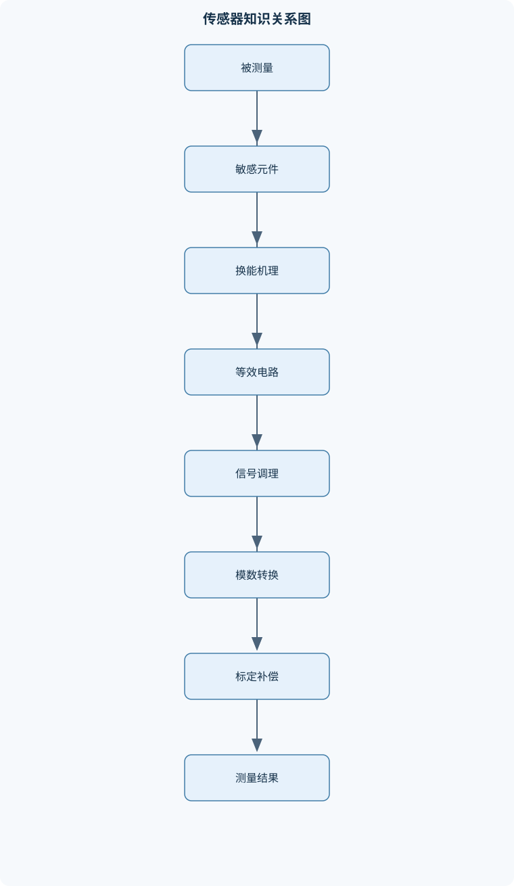
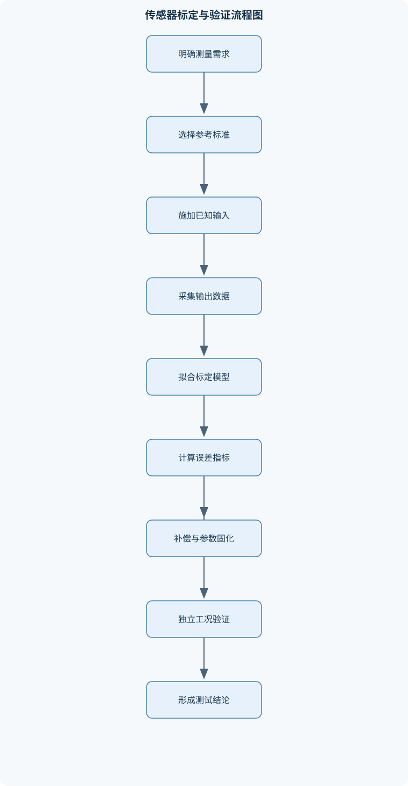

# 传感器技术

## 一、课程整体知识框架

### 课程边界与先修知识

《传感器技术》研究被测量转换为可传输、可处理电信号或数字信号的器件、变换机理、测量电路、信号调理、误差评价、标定方法、数据采集与工程应用。课程覆盖电阻式、电容式、电感式、压电式、热电式、光电式、磁电式、化学与生物传感器，以及传感器接口和系统级性能评价。重点讨论敏感元件、转换原理、等效电路、供电与负载、桥式测量、放大滤波、模数转换、标定补偿和多传感器融合；不以完整控制系统设计、专用集成电路版图、复杂信号处理理论或具体行业法规为主要边界。先修知识包括大学物理、电路基础、模拟电子技术、数字电子技术、工程数学和基础概率统计。学生应掌握电压、电流、电阻、电容、电感、功率、频率、阻抗、节点与回路等基本概念，并能使用基尔霍夫电流定律和电压定律分析传感器接口电路。课程中的理想模型用于解释基本机理，实际传感器还必须考虑非线性、迟滞、漂移、噪声、温度影响、安装误差、供电限制和环境干扰。





### 1. 研究对象与基本任务

传感器技术研究如何把被测量转换成可传输、可处理、可显示或可控制的电信号、频率信号、脉冲信号或数字信号。被测量统一记为 $x$，传感器输出量记为 $y$，理想静态关系写为

$$
y=f(x)
$$

在近似线性工作区间内，常用模型为

$$
y=Sx+b
$$

其中，$S$ 是灵敏度，表示输入变化引起的输出变化能力，单位为“输出量单位/输入量单位”；$b$ 是零点偏移，表示 $x=0$ 或规定参考输入下仍存在的输出。反向测量时，若 $S\ne 0$，则

$$
\hat{x}=\frac{y-b}{S}
$$

这里的 $\hat{x}$ 是由输出估计得到的输入。该式只适用于标定范围内、传感器未饱和、灵敏度近似不变且输出没有明显迟滞的情况。若传感器存在严重非线性、方向相关迟滞或温度相关参数，则必须采用分段模型、补偿模型或查表方式，不能直接套用单一直线。

传感器通常包括敏感元件、转换元件、信号调理部分、接口部分和封装安装结构。敏感元件首先与被测量发生物理、化学或生物作用，例如应变导致电阻变化、温差导致热电势变化、光照导致光电流变化；转换元件再把这种变化变成电阻、电容、电荷、电压、电流、频率或其他可测量量；信号调理电路负责激励、放大、滤波、隔离和阻抗匹配；接口部分把调理后的信号送入仪表、数据采集设备或数字处理单元。

传感器、变送器和测量仪表的功能边界不同。传感器侧重“感知并转换”，变送器通常在传感器基础上增加标准化输出、放大、隔离或远距离传输功能，测量仪表则进一步完成显示、记录、计算、报警或通信。实际设备可能把三者集成在同一外壳内，但分析时仍应区分敏感元件、变换环节和系统接口。

### 2. 按能量关系和测量结构分类

按是否需要外部激励，传感器可分为能量转换型和能量控制型。能量转换型传感器本身产生与被测量有关的能量输出，例如压电元件产生电荷、热电偶产生热电势、光伏器件产生光生电压。能量控制型传感器需要外部电源或激励，通过被测量改变电路参数，例如电阻式、电容式和电感式传感器。能量转换型并不意味着输出功率无限大；压电元件的输出电荷有限，接口负载过重时仍会产生明显误差。

按测量方式，直接测量是直接利用传感器输出确定目标量，例如用热电偶测温；间接测量是先测量与目标量相关的其他量，再依据关系计算目标量，例如通过应变测量推算结构受力；组合测量则同时测量多个相关变量，通过方程组或模型求取目标量。间接和组合测量必须分析各中间量的误差传播，不能只评价最后一个计算公式。

按系统结构，开环测量中输出不反馈影响测量过程，结构简单但容易受到灵敏度漂移和负载变化影响；闭环测量中将输出与参考量比较，通过反馈减小部分非线性、漂移或负载影响，但会引入稳定性、带宽和反馈传感器误差等问题。课程重点是传感器及其测量接口，不延伸到完整控制系统的稳定性设计。

### 3. 静态特性、动态特性与误差评价

测量范围记为

$$
[x_{\min},x_{\max}]
$$

量程为

$$
X_R=x_{\max}-x_{\min}
$$

满量程输出记为 $Y_R$。量程是输入允许范围的宽度，不等于最大输入值；例如范围为 $[-10,10]$ 的传感器，量程是 $20$，而不是 $10$。超出量程后，传感器可能饱和、损坏或产生不可恢复的零点变化，因此“过载能力”不能由量程直接推出。

静态灵敏度定义为

$$
S=\frac{\mathrm{d}y}{\mathrm{d}x}
$$

在近似线性区间内可用

$$
S\approx\frac{\Delta y}{\Delta x}
$$

表示。分辨力是能够区分的最小输入变化，阈值是使输出产生可辨识变化所需的最小输入；二者都不等同于准确度。准确度描述测量结果接近参考值的程度，精密度描述多次测量结果彼此接近的程度。一个传感器可以精密但不准确，例如多次测量都稳定地偏高。

线性度表示实际静态曲线偏离规定参考直线的程度。端点法使用曲线两端作为参考线，最小二乘法则选择使残差平方和最小的直线。若标定数据为 $(x_i,y_i)$，线性拟合模型为 $y=Sx+b$，则可通过最小化

$$
J=\sum_{i=1}^{m}(y_i-Sx_i-b)^2
$$

求取 $S$ 和 $b$。端点法便于工程验收，但对中间点的偏差可能不均衡；最小二乘法具有整体拟合意义，但拟合结果依赖数据分布，不能自动消除迟滞或系统偏差。

重复性描述相同条件下重复测量的离散程度，再现性还考虑操作者、设备、时间或环境改变后的结果一致性。稳定性描述特性随时间保持不变的能力。迟滞是输入增加和减少时，在相同输入位置得到不同输出；死区是输入变化但输出基本不响应的区域。零点漂移是输入不变时输出基准改变，灵敏度漂移则是比例系数改变。温度漂移可能同时影响零点和灵敏度。

随机误差可用均值和标准差描述。对 $n$ 次测量值 $x_i$，

$$
\bar{x}=\frac{1}{n}\sum_{i=1}^{n}x_i
$$

样本标准差为

$$
\sigma=\sqrt{\frac{1}{n-1}\sum_{i=1}^{n}(x_i-\bar{x})^2}
$$

标准差只能反映随机离散程度，不能替代对系统误差、标定偏差和环境影响的评价。若输出由多个独立变量决定，可用一阶误差传播近似：

$$
u_y^2\approx
\left(\frac{\partial y}{\partial x_1}u_{x_1}\right)^2+
\left(\frac{\partial y}{\partial x_2}u_{x_2}\right)^2+\cdots
$$

该式要求误差较小、局部线性化成立，并且各输入误差近似独立。若多个误差同方向叠加或存在相关性，应采用协方差项或最坏情况累加，不能机械使用平方和。

### 4. 动态模型与频率响应

传感器动态特性描述输出对随时间变化输入的跟随能力。传递函数定义为

$$
H(s)=\frac{Y(s)}{X(s)}
$$

其中 $s$ 是复频率变量，$X(s)$ 和 $Y(s)$ 分别为输入、输出的拉普拉斯变换。频率响应在 $s=j\omega$ 下求得，$\omega$ 的单位为弧度每秒。

一阶传感器常用模型为

$$
\tau\frac{\mathrm{d}y(t)}{\mathrm{d}t}+y(t)=Kx(t)
$$

其中，$K$ 是静态增益，$\tau$ 是时间常数。对初始输出为零、输入从零阶跃到 $x_0$ 的情况，解为

$$
y(t)=Kx_0\left(1-e^{-t/\tau}\right)
$$

当 $t=\tau$ 时，输出达到最终值的约 $63.2\%$；达到约 $90\%$ 需要 $2.30\tau$，达到约 $95\%$ 需要 $3.00\tau$，达到约 $99\%$ 需要 $4.61\tau$。这些数值只适用于一阶、线性、时间不变模型。实际温度传感器可能存在热惯性、安装热阻和多时间常数，不能把单一时间常数视为所有工况下的严格常数。

二阶标准模型可写为

$$
H(s)=\frac{K\omega_n^2}
{s^2+2\zeta\omega_n s+\omega_n^2}
$$

其中，$\omega_n$ 为固有频率，$\zeta$ 为阻尼比。$0<\zeta<1$ 时为欠阻尼，阶跃响应可能振荡并产生超调；$\zeta=1$ 时为临界阻尼，在无振荡条件下具有较快响应；$\zeta>1$ 时为过阻尼，响应通常较慢。低阻尼并不总是优点：它可能带来共振峰、振铃和动态失真。传感器能否准确测量某一信号，取决于信号频谱是否落在其有效带宽内。采样速率必须与模拟带宽和抗混叠滤波器共同确定，而不是只看传感器标称响应时间。

### 5. 传感器接口的电路基础

传感器接口分析首先要确定等效电路、激励方式、输出阻抗和负载。电压源模型可表示为理想电动势 $\varepsilon$ 串联内阻 $r$。接入负载 $R_L$ 后，放电电流为

$$
I=\frac{\varepsilon}{r+R_L}
$$

负载端电压为

$$
V_T=IR_L=\frac{\varepsilon R_L}{r+R_L}
=\varepsilon-Ir
$$

因此，负载变化会改变电流，进而改变内阻上的压降，使端电压变化。只有当 $R_L\gg r$ 时，端电压才近似等于理想电动势。电流源模型则适合描述输出电流相对稳定、输出电阻较大的传感器；不能把所有传感器都直接视为理想电压源。

电路方程必须遵守基尔霍夫定律。节点电流代数和为零：

$$
\sum I_k=0
$$

闭合回路电压代数变化总和为零：

$$
\sum V_k=0
$$

列式时可任意假定电流方向和电压升降方向，但同一方程中必须保持约定一致。求得负电流并不一定说明计算错误，而是说明实际方向与假设方向相反。

多个相同电压源串联时，若极性按同一方向连接，等效电动势相加，等效内阻也相加；并联时，只有电动势、极性和允许工作状态匹配，才可用等效模型。电压不一致的电源直接并联会产生环流，环流可能超过负载电流并导致发热或损坏。多个电源的并联还必须考虑保护、均流和充放电状态，不能仅凭“电压相同”判断安全。

### 6. 从传感器到数字系统的信号链

完整测量链通常包括传感器、激励源、前置放大器、滤波器、隔离或保护电路、采样保持电路、模数转换器以及数字标定和诊断程序。仪表放大器用于放大差分信号并抑制共模信号，适合电桥、热电偶和低电平电化学信号。差分测量不能自动消除所有干扰，输入共模范围、输入偏置电流、导线电阻和接地方式仍会影响结果。

滤波器包括低通、高通、带通和陷波。低通用于抑制高频噪声和采样前抗混叠；高通用于去除慢变偏置或直流分量；带通用于保留特定频带；陷波用于抑制窄带干扰。滤波会造成幅值衰减和相位延迟，因此不能只比较噪声大小，还应检查响应速度和波形失真。

采样频率记为 $f_s$，被测信号最高有效频率记为 $f_{\max}$。理想情况下应满足

$$
f_s>2f_{\max}
$$

但实际还需为模拟滤波器留出过渡带，并考虑时钟抖动、噪声和信号带宽不确定性。若高于奈奎斯特频率的成分在采样前没有充分衰减，会折叠到低频，形成无法通过数字处理恢复的混叠。

理想 $N$ 位模数转换器、输入满量程范围为 $V_{FS}$ 时，量化步长近似为

$$
q=\frac{V_{FS}}{2^N}
$$

若采用就近量化，理想量化误差通常不超过 $q/2$。量化误差只描述模数转换的离散化误差，不包括传感器误差、放大器噪声、参考电压误差、非线性和温漂。提高位数不能修复传感器零点漂移，也不能消除输入端已经发生的混叠。

## 二、章节和模块划分

### 核心知识覆盖清单

本清单用于检查正文是否覆盖本课程的主要知识模块：

- **传感器基本概念与测量系统**：传感器的定义与基本组成、被测量、敏感量与输出量、能量转换型与能量控制型传感器、直接测量、间接测量与组合测量、开环测量与闭环测量、传感器、变送器与测量仪表的区别、静态特性与动态特性的基本含义、传感器系统中的供电、接口与负载。
- **传感器静态特性与误差评价**：测量范围、量程与满量程输出、灵敏度、分辨力与阈值、线性度及端点法与最小二乘法、重复性、再现性与稳定性、迟滞误差与死区、零点漂移、灵敏度漂移与温度漂移、准确度、精密度与不确定度、误差传播与有效数字。
- **传感器动态特性与频率响应**：一阶传感器模型、时间常数与阶跃响应、二阶传感器模型、阻尼比、固有频率与振荡、传递函数与频率响应、幅频特性与相频特性、带宽、响应时间与采样速率、动态误差与被测信号频谱。
- **电阻式传感器与桥式测量**：金属电阻应变式传感器、半导体压阻效应、热敏电阻与温度测量、电阻式位移、力和压力测量、惠斯通电桥平衡条件、四分之一桥、半桥与全桥、桥路非线性与温度补偿、恒压供电与恒流供电的影响、桥式输出的差分放大。
- **电容式与电感式传感器**：平板电容的几何关系、极距、面积与介电常数变化测量、差动电容结构、寄生电容及屏蔽技术、电感式位移传感器、变磁阻式与差动变压器式传感器、交流激励与相敏检波、涡流式传感器的导电目标检测、高频寄生参数对测量的限制。
- **热电、热敏与光电传感器**：热电效应与热电偶工作原理、热电偶冷端补偿、热敏电阻的温度特性、辐射测温与红外探测、光敏电阻与光电导效应、光电二极管和光电三极管、光伏效应与光电池、光电编码器与光电开关、环境光、暗电流与光学噪声。
- **压电、磁电与超声传感器**：压电效应与压电材料、压电传感器的电荷源等效模型、压电传感器的电压输出与负载影响、压电加速度计、电磁感应式速度传感器、霍尔效应与磁场测量、磁阻式传感器、超声波发射与接收、飞行时间测距与声速温度修正。
- **化学、气体与生物传感器**：化学传感器的识别与换能过程、电化学电极与电位测量、离子选择性电极、电导型和电流型气体传感器、金属氧化物半导体气敏元件、湿度传感器的电阻式与电容式原理、生物识别元件与固定化方法、选择性、交叉敏感与恢复时间、温湿度和污染物对化学传感器的影响。
- **信号调理、供电与接口电路**：传感器等效电路与负载效应、基尔霍夫电流定律与电压定律、电压源、电流源及内阻模型、并联电源与串联电源的约束条件、仪表放大器与差分测量、低通、高通、带通与陷波滤波、激励源、恒流源与恒压源、隔离、屏蔽、接地与共模干扰、模数转换器的分辨率、量程与量化误差。
- **标定、补偿与数字信号处理**：静态标定装置与参考量选择、两点标定与多点标定、线性拟合与多项式拟合、温度补偿与零点补偿、传感器故障诊断与异常值识别、采样、保持与混叠、滑动平均、中值滤波与一阶数字滤波、滤波延迟与实时性权衡、标定曲线在工程软件中的实现。
- **传感器系统设计与工程应用**：测量需求分解与传感器选型、量程、精度、响应速度与环境等级匹配、机械安装与敏感方向、多传感器冗余与数据融合、传感器网络中的节点、总线与通信接口、工业现场的抗干扰设计、可靠性、寿命与维护校准、典型应用中的安全边界、从原理样机到工程验证的测试流程。


### 1. 传感器基本概念与测量系统

本模块建立统一的测量语言。内容包括被测量、敏感量、转换量和输出量之间的关系，以及传感器、变送器、仪表在系统中的功能边界。重点区分直接测量、间接测量和组合测量，并说明开环、闭环结构对误差、稳定性和复杂度的影响。

测量系统设计不能只问“传感器输出是什么”，还要明确供电方式、输出阻抗、负载、接口电平、带宽和环境条件。例如高输出阻抗的电容式传感器接入低输入阻抗电路时，会产生明显负载效应；低电平热电偶接入放大器时，需要关注输入噪声、共模范围和冷端补偿。该模块还引入理想模型与现实限制的区别：理想模型用于推导，工程判断必须加入非线性、迟滞、漂移、噪声、温度、安装和供电约束。

### 2. 传感器静态特性与误差评价

本模块围绕量程、满量程输出、灵敏度、分辨力、阈值、线性度、迟滞、重复性、再现性和稳定性建立评价体系。应明确“能测多大”“能分辨多小”“测得是否接近真实值”“重复是否一致”是四类不同问题。

标定时，参考输入必须覆盖目标工作范围，并记录加载方向、环境温度和稳定时间。两点标定适合近似线性且漂移较小的传感器；多点标定可检验线性度并估计残差，但不能自动解决迟滞和温度交叉敏感。零点漂移表现为 $b$ 改变，灵敏度漂移表现为 $S$ 改变。若实际关系为

$$
y=(S+\Delta S)x+(b+\Delta b)
$$

则忽略漂移时的反算误差为

$$
\hat{x}-x=\frac{\Delta S}{S}x+\frac{\Delta b}{S}
$$

可见灵敏度漂移产生随输入增大的误差，而零点漂移产生近似恒定误差。该结论不适用于饱和、强非线性或迟滞明显的区域。

### 3. 传感器动态特性与频率响应

本模块从一阶和二阶模型出发，说明时间常数、响应时间、固有频率、阻尼比、共振峰、带宽和相位差之间的关系。阶跃响应适合估计时间常数，正弦扫描适合获得幅频和相频特性，脉冲响应可用于观察快速动态过程。

动态误差的本质是传感器输出不是当前输入的即时函数，而是受到过去输入的影响。对快速变化信号，静态标定曲线可能仍然正确，但测量结果会因幅值衰减和相位延迟而错误。若被测信号包含高于传感器带宽的频率成分，增加模数转换位数不能补偿传感器本体的动态损失。

### 4. 电阻式传感器与桥式测量

金属电阻应变片利用导体电阻随长度、截面积和材料电阻率变化而变化的特性。小应变条件下，常用相对变化关系

$$
\frac{\Delta R}{R}=K_g\varepsilon
$$

其中，$K_g$ 为应变计灵敏系数，$\varepsilon$ 为应变，无量纲。半导体压阻效应对材料电阻率变化更敏感，但温度依赖和非线性通常也更明显。热敏电阻则利用电阻随温度变化的规律，适合高灵敏度温度测量，但线性范围和长期稳定性需要单独评价。

惠斯通电桥四个桥臂为 $R_1,R_2,R_3,R_4$，激励电压为 $V_s$。输出端两中点电压分别为

$$
V_+=V_s\frac{R_3}{R_1+R_3},\qquad
V_-=V_s\frac{R_4}{R_2+R_4}
$$

平衡条件 $V_+=V_-$ 给出

$$
\frac{R_3}{R_1+R_3}
=\frac{R_4}{R_2+R_4}
$$

交叉相乘并约去相同项后得到

$$
R_1R_4=R_2R_3
\quad\Longrightarrow\quad
\frac{R_1}{R_2}=\frac{R_3}{R_4}
$$

若各桥臂初始电阻相等，某一桥臂发生小变化 $\Delta R$，四分之一桥输出近似与 $\Delta R/R$ 成正比；半桥中两个应变方向相反的桥臂可使输出增大并抑制部分温度影响；全桥中四个桥臂均参与变化，灵敏度通常更高。具体正负号取决于桥臂编号、受拉受压状态和输出端定义，不能脱离电路拓扑直接套公式。

桥式测量还必须考虑激励电压波动、导线电阻、桥臂自热和放大器输入范围。恒压和恒流激励对温敏电阻、应变片的功耗和温度误差影响不同；若激励过大，输出信噪比可能提高，但自热也可能使被测对象或敏感元件温度改变。

### 5. 电容式与电感式传感器

平板电容为

$$
C=\varepsilon_0\varepsilon_r\frac{A}{d}
$$

其中，$\varepsilon_0$ 为真空介电常数，$\varepsilon_r$ 为相对介电常数，$A$ 为有效极板面积，$d$ 为极板间距。由此可知，改变面积、间距或介质均可实现测量。对极距变化求导，

$$
\frac{\partial C}{\partial d}
=-\varepsilon_0\varepsilon_r\frac{A}{d^2}
=-\frac{C}{d}
$$

负号表示间距增大时电容减小。若位移 $\Delta d$ 相对初始间距 $d_0$ 很小，即 $|\Delta d|\ll d_0$，可在工作点附近线性化；当位移较大时，$C$ 与位移呈反比例关系，线性近似失效。边缘电场、寄生电容、湿度和电缆运动会引入额外误差，因此常采用差动结构、屏蔽和护环。

电感式传感器通过磁路磁阻、线圈电感或互感变化测量位移、力和金属目标。差动电感结构使一个线圈电感增大时另一个减小，输出差值可以提高零点稳定性并抑制部分共模变化。差动变压器式传感器需要交流激励和相敏检波，以区分位移方向并把幅值变化转换为带符号输出。

涡流式传感器利用交变磁场在导电目标中产生涡流，涡流反过来改变线圈阻抗。其输出受目标电导率、磁导率、距离、频率和形状影响，不能把所有金属目标视为等效相同。高频下，寄生电容、线圈分布参数、连接电缆和屏蔽结构会改变测量结果，集中参数低频模型需要经过频率范围验证。

### 6. 热电、热敏与光电传感器

热电偶利用不同导体构成回路时的热电效应产生电动势。输出取决于测量端温度 $T_h$ 与参考端温度 $T_c$：

$$
E=E(T_h,T_c)
$$

因此热电偶输出不是测量端绝对温度的直接函数。若参考端温度变化而未补偿，即使测量端不变，输出也会变化。冷端补偿需要测量参考端温度，并依据相应热电特性计算补偿值；把参考端简单当作室温只在参考端确实稳定且温度已知时才近似成立。

热敏电阻通常具有较强温度非线性，适合在有限温区内进行高灵敏度测量。辐射测温和红外探测不需要与被测物直接接触，但会受到发射率、视场、环境辐射、光学窗口和探测器响应特性的影响。

光敏电阻利用光电导效应，光照增强时电阻通常改变；光电二极管将光功率转换为光电流，常用响应度 $R_\lambda$ 表示

$$
I_{\mathrm{ph}}=R_\lambda P_{\mathrm{opt}}
$$

其中，$P_{\mathrm{opt}}$ 为入射光功率，单位为瓦，$I_{\mathrm{ph}}$ 为光电流，单位为安培，$R_\lambda$ 的单位为安培/瓦。实际输出还包括暗电流、放大器偏置和噪声。光电三极管具有电流增益但速度、线性度和温度特性可能较差。光伏器件在无外部偏置时产生光生电压或电流，可用于光强、位置和能量测量。光电编码器和光电开关还需分析遮挡结构、环境光、阈值和输出波形。

### 7. 压电、磁电与超声传感器

压电元件受力时产生电荷，可用电荷源 $Q$ 与并联电容 $C_p$ 的等效模型描述。开路电压近似为

$$
V_o=\frac{Q}{C_p}
$$

若输入电容为 $C_{\mathrm{in}}$，则实际电压近似为

$$
V_o=\frac{Q}{C_p+C_{\mathrm{in}}+C_{\mathrm{cable}}}
$$

因此电缆长度、放大器输入电容和安装结构都会影响电压输出。电荷放大器以反馈电容决定输出，能够减小电缆电容变化对结果的影响。压电传感器存在漏电和电荷泄漏，低频或长期静态力会导致输出衰减，因此更适合振动、冲击和动态力测量，而不适合无补偿地长期测量恒定载荷。

电磁感应式速度传感器依据磁通变化产生感应电压，输出通常与相对运动速度及磁场结构有关。霍尔传感器利用载流子在磁场中的偏转测量磁场或位置，磁阻式传感器则利用材料电阻随磁场变化的特性。实际磁测量需要考虑温度、磁滞、外部磁场和安装方向。

超声传感器通过发射和接收声波实现距离、液位、流速或缺陷检测。飞行时间测距近似为

$$
d=\frac{ct}{2}
$$

其中，$d$ 为目标距离，$c$ 为介质中的声速，$t$ 为往返时间，除以 $2$ 是因为声波经历往返路径。声速受温度、湿度和介质成分影响；若声速估计错误，距离结果会产生比例误差。发射余振、目标反射角、盲区和耦合条件会限制近距离及复杂表面的测量。

### 8. 化学、气体与生物传感器

化学传感器通常包含识别单元和换能单元。识别单元与特定离子、分子或气体发生选择性作用，换能单元把浓度、活度、反应速率或界面电势变化转换成电压、电流、电导或频率变化。

电位型电化学传感器测量电极电势差，离子选择性电极对特定离子活度敏感，但实际结果会受参比电极、溶液离子强度和温度影响。电导型传感器测量溶液导电能力，电流型传感器则测量电化学反应产生的电流。气体传感器可能采用电化学反应、金属氧化物表面吸附或其他换能机理；金属氧化物半导体气敏元件通常对温度、湿度和加热状态敏感。

湿度传感器可利用吸湿材料导致电阻变化或介电常数变化。生物传感器通常由生物识别元件、固定化层和物理换能器组成，固定化方法需要兼顾活性保持、传质速度、机械稳定性和重复使用能力。选择性并非绝对的；交叉敏感意味着其他物质也能改变输出。恢复时间受解吸、扩散和表面反应控制，污染、温湿度和材料老化会导致漂移。化学与生物传感器的校准不能只在单一浓度、单一温度下完成。

### 9. 信号调理、供电与接口电路

本模块把传感器输出转换成采集设备能够可靠识别的信号。分析流程包括：建立传感器等效源模型；确定输入阻抗和负载；判断共模电压与差模信号范围；选择激励、放大、滤波、隔离和保护方案；最后检查模数转换器量程与分辨率。

仪表放大器适合微弱差分信号，低通滤波器用于抑制高频噪声，隔离用于阻断地环路和高共模电压传播，屏蔽用于减小电场耦合。屏蔽层、信号地和保护地不能任意短接，否则可能形成地环路或使干扰电流流过敏感信号回路。高频、长线和强电磁环境下，导线不再只是理想连接，必须考虑寄生电感、电容和传输线效应。

### 10. 标定、补偿与数字信号处理

两点标定使用两个已知点 $(x_1,y_1)$ 和 $(x_2,y_2)$：

$$
S=\frac{y_2-y_1}{x_2-x_1}
$$

$$
b=y_1-Sx_1
$$

测得输出 $y$ 后按 $\hat{x}=(y-b)/S$ 反算。其条件是 $x_2\ne x_1$、两点属于同一工作模式、输出未饱和且线性近似可接受。多点标定可采用线性或多项式拟合，但多项式阶数过高可能在标定区间外产生严重外推误差。

温度补偿可以修正零点项、灵敏度项或完整标定曲线。补偿模型必须在相应温度和负载条件下取得数据。异常值识别应结合量程、变化速率、持续时间、冗余传感器和过程模型，并保留原始数据和质量标志，不应无条件删除。

滑动平均适合抑制随机噪声：

$$
y[k]=\frac{1}{M}\sum_{i=0}^{M-1}x[k-i]
$$

窗口长度 $M$ 越大，平滑效果通常越明显，但响应延迟和阶跃失真也越大。中值滤波对孤立脉冲干扰较有效，一阶数字滤波计算量小但仍会产生相位延迟。任何数字滤波都不能替代采样前的抗混叠模拟滤波。

### 11. 传感器系统设计与工程应用

系统设计从需求分解开始，至少应明确量程、准确度、分辨力、响应速度、环境温度、湿度、振动、安装方向、供电、输出接口、寿命和维护方式。选型不能只比较标称精度，还需验证过载能力、长期漂移、安装误差、校准条件和故障状态。

机械安装直接影响测量结果。应变片需要正确粘贴方向和可靠传力；加速度计需要足够刚度并避免安装共振；温度探头需要良好热接触并减少热传导误差；超声探头需要合适耦合和无遮挡声路。多传感器系统可以通过冗余、加权平均、模型约束或一致性检查提高可靠性，但冗余传感器并不自动独立，若共用电源、安装结构或环境误差，相关误差仍会共同存在。

传感器节点通常包括敏感元件、调理电路、处理器、通信接口和供电模块。工业现场要考虑电磁干扰、地电位差、浪涌、隔离和通信错误。工程验证应经历原理样机、功能测试、标定测试、极限工况测试、长期稳定性测试和故障安全测试。验收不仅看正常状态下的测量误差，还要检查断线、短路、超量程、供电异常、通信中断和传感器老化时系统是否能够识别并进入规定的安全状态。

## 三、核心概念的详细解释

### 1. 传感器、被测量与测量系统

传感器是把被测量 $x$ 按照一定物理、化学或生物机理转换为输出量 $y$ 的器件或器件组合。被测量可以是温度、压力、位移、应变、加速度、光照、磁场、气体浓度、湿度或生物分子浓度；输出量可以是电阻、电容、电感、电荷、电压、电流、频率、脉冲宽度或数字码。理想静态关系写为

$$
y=f(x)
$$

在规定的工作区间内，若关系近似线性，则写为

$$
y=Sx+b
$$

其中，$S$ 为灵敏度，$b$ 为零点偏移。若已知输出反推输入，则

$$
\hat{x}=\frac{y-b}{S}
$$

该反算式要求 $S\ne 0$，并且传感器未饱和、没有明显迟滞、温度和供电条件与标定条件相近。若 $S$ 随输入、温度或时间显著变化，就不能使用单一常数灵敏度，而应使用分段函数、查表、拟合模型或实时补偿。

典型传感器系统由敏感元件、转换元件、信号调理电路、模数转换器、处理单元和通信或显示接口组成。敏感元件直接受到被测量作用，例如应变片受到机械变形，热电偶受到接点温差，光电二极管受到入射光，离子选择性电极受到离子活度影响。转换元件把这种变化转换为电参数，信号调理电路再完成激励、放大、滤波、隔离、线性化和阻抗匹配。

传感器、变送器和测量仪表在功能上并不完全相同。传感器强调感知和初次转换；变送器通常增加放大、隔离和标准化输出，使信号适合远距离传输；测量仪表还承担显示、记录、运算、报警或通信任务。一个工业温度模块可能把热敏元件、放大器、模数转换器和通信接口全部封装在一起，但分析其性能时仍应分别考虑各环节的误差和带宽。

### 2. 能量转换型与能量控制型传感器

能量转换型传感器能够直接将被测量引起的能量变化转换为电信号，通常不依赖外部电激励。例如，压电元件在受力时产生电荷，热电偶在两个接点存在温差时产生热电势，光伏器件在光照下产生光生电压。此类传感器的优点是结构简单、激励电路要求较低；限制是输出能量通常很小，必须使用高输入阻抗或电荷放大器，且容易受到漏电、负载和环境噪声影响。

能量控制型传感器需要外部电源或激励，被测量改变其电阻、电容、电感或其他电路参数。例如，应变片的电阻随应变改变，电容位移传感器的极板间距发生变化，电感式传感器的磁路参数随位移变化。此类传感器通常具有较好的接口适应性，但供电波动、激励发热和负载效应会直接进入测量结果。

不能仅根据“是否需要外部电源”判断输出能力。压电传感器虽然属于能量转换型，但其电荷容量有限；如果输入电路存在较小电阻或较大漏电，输出会迅速衰减。电阻式传感器虽然需要供电，却可以通过桥路和放大器获得稳定的差分输出。

### 3. 直接测量、间接测量与组合测量

直接测量是传感器输出与目标量直接对应，例如用热电偶测量温度。间接测量先测量另一个与目标量有关的物理量，再依据模型求取目标量。例如，通过应变片测得结构应变，再利用材料力学关系估算应力或载荷。组合测量同时使用多个传感器和多个方程，例如同时测量气体温度、压力和湿度，以补偿气体传感器的交叉敏感。

间接测量的关键不是公式形式，而是模型条件是否成立。若应变与载荷的关系只在弹性、小变形和特定安装条件下成立，那么超过弹性范围后，测得的应变不能直接按原公式推算载荷。组合测量还必须考虑各中间量的误差传播、传感器之间的相关误差以及模型参数的温度漂移。

开环测量中输出不反过来影响敏感元件，结构简单，但对灵敏度漂移、供电变化和负载变化较敏感。闭环测量通过反馈使某个内部量保持接近参考值，可以降低部分非线性和漂移影响，但反馈环节会引入稳定性、响应速度和反馈传感器误差等问题。传感器课程中的闭环结构主要用于理解测量误差抑制，不等同于完整控制系统设计。

### 4. 静态特性及其区别

测量范围为

$$
[x_{\min},x_{\max}]
$$

量程为

$$
X_R=x_{\max}-x_{\min}
$$

范围描述起点和终点，量程描述范围宽度。例如，输入范围为 $[-10,10]\ \mathrm{V}$ 时，量程为 $20\ \mathrm{V}$，而不是 $10\ \mathrm{V}$。满量程输出 $Y_R$ 是规定输入范围对应的输出变化尺度，用于计算满量程相对误差：

$$
e_{FS}=\frac{|y-y_{\mathrm{ref}}|}{Y_R}
$$

灵敏度为

$$
S=\frac{\mathrm{d}y}{\mathrm{d}x}
$$

在近似线性区域可用 $\Delta y/\Delta x$ 表示。灵敏度表示输入变化引起输出变化的能力，不表示测量结果接近真值的程度。一个传感器可能灵敏度很高，但因零点漂移严重而准确度很低。

分辨力是能够区分的最小输入变化，阈值是使输出产生可辨识变化所需的最小输入。分辨力受到噪声、量化步长、机械摩擦和显示方式影响；准确度受到系统误差、标定误差、非线性和漂移影响。因此，高分辨力并不自动意味着高准确度。

重复性描述相同条件、相同仪器、相同操作者和短时间内重复测量的离散程度；再现性描述改变操作者、仪器、时间或环境条件后结果的一致程度；稳定性描述传感器在较长时间内保持性能的能力。迟滞是输入增加和减少时，在相同输入点输出不一致的现象；死区是输入发生一定变化而输出基本不变的区间。

准确度表示测量结果接近参考值的程度，精密度表示多次测量结果彼此接近的程度。若数据集中但整体偏离参考值，则精密度高而准确度低；若数据围绕参考值分散，则可能准确度平均较好但精密度低。不确定度是对测量结果可能分散范围的定量描述，不能简单等同于最大误差，也不能替代对系统偏差的识别。

### 5. 动态特性与频率响应

静态特性只描述输入保持不变或变化很慢时的关系。对于快速变化的输入，传感器具有惯性、热容量、机械阻尼、寄生电容和电感，输出不能立即跟随输入。传递函数定义为

$$
H(s)=\frac{Y(s)}{X(s)}
$$

其中，$s$ 为复频率变量。令 $s=j\omega$ 后，可得到频率响应；幅值 $|H(j\omega)|$ 表示幅频特性，相角 $\arg H(j\omega)$ 表示相频特性。

一阶传感器常用模型为

$$
\tau\frac{\mathrm{d}y(t)}{\mathrm{d}t}+y(t)=Kx(t)
$$

其中，$\tau$ 为时间常数，单位为秒；$K$ 为静态增益。对幅值为 $x_0$ 的阶跃输入，在初始输出为零时，

$$
y(t)=Kx_0\left(1-e^{-t/\tau}\right)
$$

当 $t=\tau$ 时，输出达到最终值的约 $63.2\%$；当 $t\approx3\tau$ 时约达到 $95.0\%$；当 $t\approx5\tau$ 时约达到 $99.3\%$。这些数值只适用于一阶、线性、时不变模型，不能直接用于具有明显振荡或迟滞的传感器。

二阶系统常写为

$$
H(s)=\frac{K\omega_n^2}{s^2+2\zeta\omega_n s+\omega_n^2}
$$

其中，$\omega_n$ 为固有角频率，单位为 $\mathrm{rad/s}$；$\zeta$ 为阻尼比。$0<\zeta<1$ 时为欠阻尼，阶跃响应可能振荡；$\zeta=1$ 时为临界阻尼；$\zeta>1$ 时为过阻尼，响应不振荡但通常较慢。低阻尼可提高某些频率附近的响应幅值，却会产生共振和较长的稳定时间；高阻尼可降低共振，但可能牺牲带宽和响应速度。

### 6. 典型变换机理

电阻式传感器利用电阻变化反映被测量。金属应变片的电阻相对变化近似为

$$
\frac{\Delta R}{R}=G\varepsilon
$$

其中，$\varepsilon$ 为应变，$G$ 为应变片灵敏系数。半导体压阻元件的电阻变化除几何尺寸变化外，还显著受到载流子迁移率和浓度变化影响，因此灵敏度通常较高，但温度漂移也更明显。热敏电阻利用电阻随温度变化的特性，负温度系数器件温度升高时电阻下降，不能用固定电阻率模型覆盖全部温度范围。

电容式传感器利用

$$
C=\frac{\varepsilon_0\varepsilon_r A}{d}
$$

其中，$\varepsilon_0$ 为真空介电常数，$\varepsilon_r$ 为相对介电常数，$A$ 为有效极板面积，单位为 $\mathrm{m^2}$，$d$ 为极板间距，单位为 $\mathrm{m}$。改变面积、间距或介电常数都可以测量位移、液位、压力或湿度。该公式假设极板近似平行、边缘电场可以忽略、介质均匀且结构尺寸远大于间距。实际结构中的边缘电场、寄生电容、导线运动和湿度吸附会破坏这一理想条件。

电感式传感器通过磁阻、线圈电感或互感变化测量位移。差动结构使一个线圈电感增加时另一个减少，两个输出相减后，部分共模温度漂移和供电变化可以被抑制。交流激励后通常需要相敏检波，以区分位移方向和幅值。涡流传感器依靠交变磁场在导电目标中产生涡流，目标材料的电导率、磁导率、距离和形状都会影响输出，因此不能把距离变化作为唯一影响因素。

压电传感器可用电荷源与并联电容表示。理想开路电压为

$$
V_o=\frac{Q}{C_p}
$$

若接口输入电容为 $C_i$，则总电容近似为 $C_p+C_i$，输出电压变为

$$
V_o\approx\frac{Q}{C_p+C_i}
$$

这说明输入电容会降低电压输出。压电元件存在漏电，恒定力产生的电荷会随时间泄漏，因此更适合冲击、振动和动态力测量，不适合无限长时间的静态力测量。

热电偶输出取决于测量端和参考端的温度差，记为

$$
E(T_h,T_c)
$$

不能把热电偶输出电压直接当作测量端绝对温度。若参考端温度变化，输出也会变化，因此必须测量参考端温度并进行冷端补偿。冷端补偿不是简单地把参考端假定为室温，而是利用参考端的实际温度和热电偶分度关系修正输出。

光电探测器的光生电流近似为

$$
I_{\mathrm{ph}}=R_\lambda P
$$

其中，$P$ 为入射光功率，单位为瓦；$R_\lambda$ 为在指定波长下的响应度，单位为安培每瓦。实际输出还包含暗电流、放大器偏置电流和噪声。低照度时，暗电流和噪声可能与光生电流同量级，不能只按照理想响应度计算。

霍尔传感器利用载流子在磁场中的横向偏转测量磁感应强度；磁阻传感器利用磁场改变材料电阻的效应测量磁场或转速。超声测距依据飞行时间：

$$
d=\frac{ct}{2}
$$

其中，$d$ 为目标距离，$c$ 为声速，$t$ 为发射到接收的往返时间。声速受温度、湿度和气体成分影响，若不进行修正，距离误差会随传播距离增加。

化学和生物传感器通常包括识别元件与换能器。离子选择性电极输出电位与离子活度的对数相关；电导型和电流型气体传感器分别利用电导变化和电极反应电流反映气体浓度。金属氧化物半导体气敏元件的表面吸附、工作温度和湿度都会影响载流子浓度。生物传感器中的抗体、酶、核酸或受体提供选择性，固定化过程要兼顾活性保持、传质速度和长期稳定性。选择性并不等于完全不受干扰，交叉敏感、恢复时间、污染和温湿度变化都必须纳入评价。

### 7. 接口、供电与数字化

电压源模型可表示为理想电动势 $\varepsilon$ 串联内阻 $r$。接入负载 $R_L$ 时，

$$
I=\frac{\varepsilon}{r+R_L}
$$

负载端电压为

$$
V_T=IR_L=\varepsilon-Ir
$$

当负载变化时，电流变化导致内阻压降 $Ir$ 变化，因而端电压变化。若把高内阻电压型传感器接到低输入阻抗放大器，测量结果会明显下降；若把低内阻电流型传感器直接接到不合适的电压接口，也会产生较大误差。

惠斯通电桥由四个桥臂组成。设激励电压施加在上、下端，左右中点作为输出端，则平衡条件为

$$
\frac{R_1}{R_2}=\frac{R_3}{R_4}
$$

桥路输出是两个分压点电压之差。电桥适合测量很小的电阻变化，可通过四分之一桥、半桥和全桥提高灵敏度并进行温度补偿，但输出极性取决于桥臂编号和输出端定义，不能脱离电路拓扑直接套用公式。

仪表放大器用于放大差分信号并抑制共模电压。低通滤波器抑制高频噪声，高通滤波器去除直流偏置，带通滤波器选择指定频段，陷波滤波器抑制窄带干扰。屏蔽、隔离和接地方案必须结合共模电压、地电位差和安全要求确定；信号地、保护地和屏蔽层任意连接可能形成地环路。

理想 $N$ 位模数转换器、输入范围为 $V_{FS}$ 时，量化步长近似为

$$
q=\frac{V_{FS}}{2^N}
$$

若采用舍入量化，理想量化误差的绝对值不超过 $q/2$。量化误差只是模数转换环节的误差，不能代替传感器噪声、漂移、非线性和放大器误差的评价。

采样频率为 $f_s$，被测信号最高有效频率为 $f_{\max}$。理想情况下应满足

$$
f_s>2f_{\max}
$$

实际系统还要考虑抗混叠滤波器的过渡带，因此通常需要更高采样率，并在模数转换器之前使用模拟低通滤波器。采样频率不足时，高频分量会折叠到低频，形成无法仅靠数字处理恢复的混叠。

### 8. 标定、补偿与系统级评价

两点标定使用两个参考点 $(x_1,y_1)$ 和 $(x_2,y_2)$，其中 $x_1\ne x_2$。线性模型参数为

$$
S=\frac{y_2-y_1}{x_2-x_1}
$$

$$
b=y_1-Sx_1
$$

测量输出为 $y$ 时，输入估计为

$$
\hat{x}=\frac{y-b}{S}
$$

两点标定适用于近似线性且漂移较小的传感器。若非线性明显，应增加多个标定点，使用最小二乘直线、多项式、分段线性或查表方法。标定数据和验证数据应分开，否则只能说明模型能够拟合已有数据，不能说明其具有独立预测能力。

温度补偿可以通过结构差动、参考元件、软件模型或多变量标定实现。零点补偿只修正参考输入下的偏移，不能自动消除灵敏度变化；若温度同时引起零点和灵敏度变化，应采用

$$
y=S(T)x+b(T)
$$

的形式建模。异常值诊断应检查量程、变化速率、持续漂移、失联状态及冗余传感器之间的一致性。异常点不应无条件删除，应保留原始数据并附加质量标志，因为突变可能是真实冲击，也可能是故障。

多传感器融合可提高可观测性、冗余性和抗故障能力，但多个传感器可能共享同一电源、安装结构、温度场或电磁环境，因此误差未必相互独立。工程验收应覆盖正常测量、超量程、断线、短路、供电异常、通信中断、温湿度变化、振动冲击和长期漂移等条件。

## 四、重要定义、公式、定理和推导

### 专业审校补充：关键定义与适用边界

传感器接口设计必须区分“源阻抗”和“负载效应”。对戴维南等效电压源 ε、内阻 r 及输入电阻 R_L，有 V_L=εR_L/(r+R_L)。当 R_L 远大于 r 时，V_L 接近 ε；当二者同量级时，负载会显著改变测量结果。对电流型传感器，若等效为诺顿电流源 I_s 与并联内阻 R_s，则接入输入电阻 R_L 后，负载电流为 I_L=I_sR_s/(R_s+R_L)，此时通常希望 R_L 远小于 R_s。电压型传感器适合高输入阻抗接口，电流型传感器适合低输入阻抗或跨阻放大器。该结论仅适用于线性、低频、集中参数模型；在高频条件下，输入电容、导线电感和电磁耦合会使阻抗随频率变化，不能只用直流电阻判断负载影响。若传感器输出为电荷源，例如压电元件，还必须同时考虑输入电容、漏电阻和测量带宽，普通电压放大器可能造成低频衰减。


### 1. 电路基本定律与传感器接口推导

基尔霍夫电流定律规定，任一节点的代数电流和为零：

$$
\sum_k I_k=0
$$

若规定流入节点为正、流出节点为负，则所有支路电流代数和必须为零。该定律来自电荷守恒。基尔霍夫电压定律规定，任一闭合回路的代数电压变化总和为零：

$$
\sum_k V_k=0
$$

列方程时必须统一电流方向和电压升降符号。若求得某支路电流为负，只表示实际方向与假设方向相反，并不意味着方程无效。

含内阻电源接入负载时，沿回路列电压方程：

$$
\varepsilon-Ir-IR_L=0
$$

因此

$$
I=\frac{\varepsilon}{r+R_L}
$$

代回负载电压：

$$
V_T=IR_L
=\frac{\varepsilon R_L}{r+R_L}
=\varepsilon-Ir
$$

当 $R_L$ 很大时，$I$ 较小，端电压接近 $\varepsilon$；当 $R_L$ 很小时，内阻压降相对明显，端电压下降。该模型适合低频、集中参数、线性电阻网络；高频长线中还必须考虑寄生电容、电感和传输线效应。

多个相同电压源串联时，若极性一致，等效电动势为

$$
\varepsilon_{\mathrm{eq}}=n\varepsilon
$$

等效内阻为

$$
r_{\mathrm{eq}}=nr
$$

多个相同电压源并联时，等效电动势仍为 $\varepsilon$，等效内阻为

$$
r_{\mathrm{eq}}=\frac{r}{n}
$$

并联必须满足电动势和极性匹配。若两个电源的电动势不同，连接后会在内部形成环流；环流大小受电动势差和两者内阻总和限制，可能引起发热或损坏。因此不能把任意两个电压源直接并联。

### 2. 惠斯通电桥及小变化近似

设左、右两侧中点电压分别为

$$
V_+=V_s\frac{R_2}{R_1+R_2},
\qquad
V_-=V_s\frac{R_4}{R_3+R_4}
$$

则

$$
V_o=V_+-V_-
$$

桥路平衡时 $V_o=0$，所以

$$
\frac{R_2}{R_1+R_2}
=
\frac{R_4}{R_3+R_4}
$$

交叉相乘并消去公共项，得到

$$
R_2R_3=R_1R_4
$$

即

$$
\frac{R_1}{R_2}=\frac{R_3}{R_4}
$$

设四个桥臂初始相等，均为 $R$。四分之一桥中仅 $R_1$ 变为 $R+\Delta R$，令 $\delta=\Delta R/R$。在 $\lvert\delta\rvert\ll1$ 时，输出近似为

$$
V_o\approx -\frac{V_s}{4}\delta
$$

负号取决于输出端和桥臂编号。半桥中若两个桥臂产生大小相等、方向相反的变化，输出近似为

$$
V_o\approx \frac{V_s}{2}\delta
$$

全桥中若两个受拉桥臂增阻、两个受压桥臂减阻，变化方向相互叠加，输出近似为

$$
V_o\approx V_s\delta
$$

因此在相同单臂相对变化下，全桥理想灵敏度约为四分之一桥的四倍，半桥约为两倍。以上结论要求各桥臂初值匹配、变化量足够小、输出端负载很高且激励稳定。若 $\Delta R/R$ 较大，必须使用完整分压公式，不能继续使用一阶近似。

### 3. 电容式传感器的灵敏度推导

由

$$
C=\frac{\varepsilon_0\varepsilon_r A}{d}
$$

可分别求得：

$$
\frac{\partial C}{\partial A}
=
\frac{\varepsilon_0\varepsilon_r}{d}
$$

$$
\frac{\partial C}{\partial d}
=
-\frac{\varepsilon_0\varepsilon_r A}{d^2}
=
-\frac{C}{d}
$$

$$
\frac{\partial C}{\partial \varepsilon_r}
=
\frac{\varepsilon_0 A}{d}
$$

因此，面积变化、极距变化和介电常数变化分别对应三种基本测量方式。对初始间距 $d_0$ 的小位移 $\Delta d$，有

$$
C(d_0+\Delta d)
=
\frac{\varepsilon_0\varepsilon_r A}{d_0+\Delta d}
$$

当 $\lvert\Delta d\rvert\ll d_0$ 时，利用

$$
\frac{1}{d_0+\Delta d}
\approx
\frac{1}{d_0}
\left(1-\frac{\Delta d}{d_0}\right)
$$

得到

$$
\Delta C
\approx
-\frac{\varepsilon_0\varepsilon_r A}{d_0^2}\Delta d
$$

所以小位移灵敏度约为

$$
S_d=\frac{\Delta C}{\Delta d}
\approx
-\frac{\varepsilon_0\varepsilon_r A}{d_0^2}
$$

该线性化只在位移相对于初始间距足够小时成立。若极板间距接近零，模型不仅强非线性，还存在碰撞、击穿和边缘电场增强等工程风险。寄生电容与传感电容并联时，输出变化相对总电容的比例会降低，采用差动结构、屏蔽和短连接线可以减小影响。

### 4. 一阶和二阶动态响应推导

对一阶模型

$$
\tau\frac{\mathrm{d}y}{\mathrm{d}t}+y=Kx
$$

输入阶跃 $x(t)=x_0$，且 $y(0)=0$。在阶跃发生后，方程右侧为常数 $Kx_0$。齐次解为

$$
y_h(t)=Ae^{-t/\tau}
$$

特解为 $y_p(t)=Kx_0$。由初始条件 $y(0)=0$ 得 $A=-Kx_0$，故

$$
y(t)=Kx_0\left(1-e^{-t/\tau}\right)
$$

若规定达到最终值的比例为 $p$，则

$$
p=1-e^{-t/\tau}
$$

整理得到

$$
t=-\tau\ln(1-p)
$$

当 $p=0.90$ 时，$t\approx2.303\tau$；当 $p=0.95$ 时，$t\approx2.996\tau$；当 $p=0.99$ 时，$t\approx4.605\tau$。这里的“响应时间”必须说明采用百分之九十、百分之九十五还是百分之九十九的判据，否则不同资料之间不能直接比较。

二阶系统的分母为

$$
s^2+2\zeta\omega_n s+\omega_n^2
$$

当 $0<\zeta<1$ 时，极点为共轭复数，阶跃响应会出现衰减振荡；当 $\zeta=1$ 时，两个极点重合，系统在不振荡条件下具有较快响应；当 $\zeta>1$ 时，两个实极点使响应无振荡但更慢。若忽略阻尼且输入频率接近固有频率，幅值可能显著放大，导致传感器过载或测量失真。安装结构改变刚度、质量或阻尼时，$\omega_n$ 和 $\zeta$ 也会改变，因此动态标定不能脱离实际安装状态。

### 5. 热电偶冷端补偿

热电偶的热电势可视为两个温度端点之间的函数：

$$
E(T_h,T_c)
$$

若用某一参考温度 $T_0$ 的分度关系表示，则根据热电势的可加性，有

$$
E(T_h,T_0)
=
E(T_h,T_c)+E(T_c,T_0)
$$

因此测得 $E(T_h,T_c)$ 后，还必须测量参考端温度 $T_c$，再加入从 $T_c$ 到标准参考温度 $T_0$ 的补偿电势，才能反推出 $T_h$。若直接把测得的热电势按 $T_c=0^\circ\mathrm{C}$ 解释，就等同于错误地假定参考端始终处于标准温度。

冷端温度传感器的误差会进入补偿结果；热电偶本身的非线性、导线材料不一致、接线端温度梯度和热传导也会产生额外误差。冷端补偿只能解决参考端温度变化问题，不能自动消除热电偶灵敏度老化或安装热阻造成的误差。

### 6. 压电传感器与电荷放大器

压电元件产生电荷 $Q$，自身等效电容为 $C_p$。若直接接入电压放大器，考虑输入电容 $C_i$ 后，

$$
V_o=\frac{Q}{C_p+C_i}
$$

当连接电缆电容、输入电容或安装寄生电容变化时，输出电压也随之变化。电荷放大器在反馈回路中使用反馈电容 $C_f$，理想情况下输出电压近似为

$$
V_o=-\frac{Q}{C_f}
$$

只要放大器保持足够高的开环增益，输出主要由反馈电容决定，而不是由传感器本体电容和电缆电容决定，因此特别适合压电加速度计和动态力测量。

电荷放大器仍受输入偏置电流、反馈电阻和低频截止特性限制。反馈电阻与反馈电容形成泄漏时间常数，频率过低时电荷逐渐泄漏，输出衰减。因此“电荷放大器不受电缆电容影响”只是相对于电压放大器而言的近似结论，并非在所有频率和所有漏电条件下都成立。

### 7. 采样、混叠与量化误差

连续信号采样后，频率为 $f$ 的正弦信号与采样频率 $f_s$ 之间会产生等效频率。混叠频率可表示为

$$
f_{\mathrm{alias}}=\left|f-kf_s\right|
$$

其中，$k$ 为使结果落入 $[0,f_s/2]$ 的整数。若输入信号频率超过奈奎斯特频率 $f_s/2$，其频谱可能折叠到低频。例如，采样频率为 $1000\ \mathrm{Hz}$、输入正弦频率为 $700\ \mathrm{Hz}$ 时，混叠频率为

$$
|700-1000|=300\ \mathrm{Hz}
$$

数字系统无法仅根据采样后的 $300\ \mathrm{Hz}$ 判断原信号究竟是 $300\ \mathrm{Hz}$ 还是 $700\ \mathrm{Hz}$。因此抗混叠低通滤波器必须位于模数转换器之前，不能等采样完成后再用数字滤波补救。

理想 $N$ 位模数转换器的量化步长为

$$
q=\frac{V_{FS}}{2^N}
$$

若量化采用四舍五入，量化误差 $e_q$ 满足

$$
-\frac{q}{2}\le e_q\le\frac{q}{2}
$$

量化误差上界随位数增加而减小，但实际有效分辨率还受到热噪声、参考电压噪声、非线性、时钟抖动和前端放大器噪声限制。增加位数不能消除传感器本体的漂移和迟滞。

### 8. 误差传播、标定和数字滤波

若估计量 $z$ 是多个变量的函数 $z=g(u_1,u_2,\ldots,u_n)$，在小误差条件下，独立随机误差的合成标准不确定度近似为

$$
\sigma_z^2
\approx
\sum_{i=1}^{n}
\left(
\frac{\partial g}{\partial u_i}
\right)^2\sigma_{u_i}^2
$$

若采用最坏情况同方向叠加，则可估计为

$$
|\Delta z|_{\max}
\approx
\sum_{i=1}^{n}
\left|
\frac{\partial g}{\partial u_i}
\right|
|\Delta u_i|
$$

前式适合近似独立的随机误差，后式适合保守的最坏情况预算，二者不能混用。若多个误差来源具有相关性，还应加入协方差项。

多点线性标定以 $m$ 组数据 $(x_i,y_i)$ 为基础，使残差平方和

$$
J(S,b)=\sum_{i=1}^{m}(y_i-Sx_i-b)^2
$$

最小。令偏导数为零：

$$
\frac{\partial J}{\partial S}=0,
\qquad
\frac{\partial J}{\partial b}=0
$$

可得正规方程。用均值表示时，

$$
S=
\frac{\sum_{i=1}^{m}(x_i-\bar{x})(y_i-\bar{y})}
{\sum_{i=1}^{m}(x_i-\bar{x})^2}
$$

$$
b=\bar{y}-S\bar{x}
$$

其中，$\bar{x}$ 和 $\bar{y}$ 分别为输入和输出均值。拟合完成后应计算最大残差、均方根残差，并使用独立验证点检查模型。若残差随输入呈明显弯曲趋势，说明直线模型不足，应改用分段或非线性模型。

滑动平均滤波定义为

$$
y[k]=\frac{1}{M}\sum_{i=0}^{M-1}x[k-i]
$$

其中，$M$ 为窗口长度。增大 $M$ 通常可以降低随机噪声，但会增加延迟并削弱快速变化。中值滤波将窗口内样本排序后取中间值，适合去除孤立脉冲；它对阶跃的保持通常优于长窗口平均，但会改变窄脉冲和快速细节。一阶数字低通滤波可写为

$$
y[k]=\alpha x[k]+(1-\alpha)y[k-1]
$$

其中，$0<\alpha<1$。$\alpha$ 越小，平滑作用越强但响应越慢；$\alpha$ 越大，响应越快但噪声抑制较弱。数字滤波的评价必须同时考虑噪声降低量、幅值失真、相位延迟和突变响应，不能只看输出曲线是否平滑。

### 9. 代表性分析流程

#### 9.1 多回路传感器接口分析

输入包括电源、传感器等效电阻或内阻、负载、电路连接关系和元件参数；输出包括节点电压、支路电流、传感器端电压及功率。

分析过程为：首先标记所有独立节点和回路；其次任意规定支路电流方向；再次对独立节点应用基尔霍夫电流定律，对独立回路应用基尔霍夫电压定律；然后整理为线性方程组并求解；最后检查每个节点的电流代数和、每个回路的电压代数和以及电源功率与负载功率是否平衡。方程组有唯一解是终止条件。对于 $n$ 个未知量，直接高斯消元的计算复杂度通常为 $O(n^3)$。

#### 9.2 两点标定流程

输入为两个已知参考输入和输出 $(x_1,y_1)$、$(x_2,y_2)$，以及待测输出 $y$；输出为输入估计值 $\hat{x}$。先检查 $x_1\ne x_2$、两点处于同一工作模式且输出未饱和；再计算 $S$ 和 $b$；然后按 $\hat{x}=(y-b)/S$ 反算；最后用第三个独立参考点验证。若验证误差超出预算，应检查接线、参考量、温度条件、零点漂移和线性假设，而不能只重复计算公式。

#### 9.3 数字采样与抗混叠流程

输入为信号最高有效频率、目标带宽、采样时钟和允许误差；输出为数字采样序列及混叠验证结果。先估计 $f_{\max}$，再根据滤波器过渡带选择 $f_s$；随后在模数转换器前设置模拟低通滤波器，检查截止频率和阻带衰减；再进行采样、保持和量化；最后通过频谱或已知输入测试检查混叠分量是否低于误差预算。核心约束是进入模数转换器的高频成分必须在奈奎斯特频率附近充分衰减。

#### 9.4 传感器异常诊断流程

输入为采样序列、量程边界、最大允许变化速率、参考传感器或过程模型；输出为正常、越界、突变、漂移、失联等状态。先检查物理量程，再检查相邻样本变化率，然后计算滑动均值和离散程度，最后与冗余传感器或模型预测值比较。每个样本必须保留原始值和质量标志。若出现异常，应区分真实冲击、传感器故障、通信丢包和暂态过载，不能仅凭单个异常点删除数据。逐点规则诊断的时间复杂度通常为 $O(n)$。

## 五、算法、流程和实现思路

### 方法与流程覆盖索引

下列方法或流程应在正文中说明输入、步骤、适用条件、结果检查和边界：

- 多回路传感器电路分析流程：输入为电源、传感器等效参数、负载和电路拓扑；输出为各支路电流、节点电压和传感器输出。过程是标记节点与独立回路，任选支路电流方向，按基尔霍夫电流定律列节点方程，按基尔霍夫电压定律列回路方程，整理为线性方程组并求解，最后用功率平衡和极性检查结果。不变量是每个节点电流代数和为零、每个闭合回路电压代数和为零；终止条件是未知量数量与独立方程数量匹配并获得唯一解。适用条件是电路可用集中参数模型描述；复杂度取决于方程数，直接高斯消元通常为 $O(n^3)$。
- 传感器两点标定流程：输入为两个已知参考输入 $(x_1,y_1)$、$(x_2,y_2)$ 和待测输出 $y$；输出为估计输入 $\hat{x}$。先计算斜率 $S=(y_2-y_1)/(x_2-x_1)$，再计算零点项 $b=y_1-Sx_1$，建立 $y=Sx+b$，最后按 $\hat{x}=(y-b)/S$ 反算。检查条件是 $x_2\ne x_1$、两点处于同一工作模式且输出未饱和；终止条件是标定参数稳定并通过第三个验证点。适用于近似线性且漂移较小的传感器；计算复杂度为 $O(1)$，但标定误差会直接影响所有反算结果。
- 多点线性拟合流程：输入为 $m$ 组参考数据 $(x_i,y_i)$；输出为最小二乘直线参数 $S$ 和 $b$ 以及残差评价。建立残差平方和 $J=\sum_{i=1}^{m}(y_i-Sx_i-b)^2$，令对 $S,b$ 的偏导为零，求解正规方程，再计算最大残差、均方根残差和决定系数。终止条件是参数求解完成并完成独立验证；不变量是每次更新都以同一组标定数据和同一误差准则为基础。适用于近似线性传感器；直接计算复杂度为 $O(m)$，数值实现应避免病态数据范围。
- 传感器动态响应辨识流程：输入为已知阶跃、正弦或脉冲激励及输出时间序列；输出为增益、时间常数、固有频率和阻尼参数。先检查采样周期和信噪比，估计稳态值与初始值，再用阶跃响应估计时间常数，或由频率扫描估计幅相特性，最后拟合一阶或二阶模型并用另一组数据验证。终止条件是模型残差达到预设要求且参数在重复试验中稳定；适用于系统近似线性、时不变且输入可控的条件。若采用矩阵拟合，复杂度通常为 $O(m)$ 至 $O(mn^2)$，取决于数据量和参数数目。
- 数字采样与抗混叠流程：输入为最高有效频率、期望带宽、采样时钟和模拟信号；输出为无明显混叠的数字序列。先确定 $f_{\max}$，选择满足过渡带要求的采样频率，设计模数转换器前的模拟低通滤波器，检查幅频衰减，再进行采样保持和量化，最后用频谱或时域测试验证。核心不变量是进入模数转换器的频谱应在奈奎斯特频率附近充分衰减；终止条件是混叠分量低于系统误差预算。适用于带宽明确的测量系统；每个采样点的基础处理复杂度为 $O(1)$，数字滤波复杂度与滤波器阶数成正比。
- 滑动平均滤波流程：输入为连续采样序列 $x[k]$ 和窗口长度 $M$；输出为滤波序列 $y[k]=(1/M)\sum_{i=0}^{M-1}x[k-i]$。初始阶段填充不足窗口的数据，随后用移入样本减去移出样本更新窗口和，避免每次重新求和。终止条件是处理完输入序列或在线系统继续运行；不变量是窗口和等于当前窗口内所有样本之和。适用于抑制随机噪声且允许一定延迟的场景，不适用于快速突变检测；朴素实现复杂度为 $O(nM)$，递推实现为 $O(n)$。
- 传感器异常值诊断流程：输入为时间序列、量程上下限、变化速率限制和参考传感器数据；输出为正常、越界、突变、漂移或失联等状态。先进行物理量程检查，再检查相邻样本变化率，使用滑动统计量识别持续偏移，最后与冗余传感器或过程模型比较。规则判断完成后保留原始数据并附加质量标志，不直接无条件删除异常点。终止条件是每个样本完成状态标记；适用于有明确物理约束和采样周期的系统。单通道逐点规则复杂度为 $O(n)$，复杂模型诊断的复杂度取决于模型规模。
- 传感器选型与验证流程：输入为量程、准确度、分辨率、响应时间、环境条件、接口、供电和成本约束；输出为候选器件、接口方案和验证结论。先把应用需求转换为可测指标，再筛除量程、环境和安装方式不满足的候选，比较静态和动态误差，设计标定与极限工况试验，最后根据实测数据确定方案。终止条件是关键指标均通过验证且故障安全边界明确；适用于工程设计阶段。候选数为 $p$、验证工况为 $q$ 时，初步比较复杂度约为 $O(pq)$，实际成本主要由试验时间和环境设备决定。





### 1. 多回路传感器接口电路分析流程

#### 1.1 输入、输出与适用条件

该流程用于分析含传感器等效源、激励电源、桥路、放大器输入电阻和负载的电路。输入包括电源电动势 $\varepsilon$、内阻 $r$、电阻 $R$、负载电阻 $R_L$、电桥拓扑及各元件连接关系；输出包括各支路电流、节点电压、传感器端电压、负载功率和差分输出。

该方法适用于可以采用集中参数模型描述的低频或中低频电路。若导线长度、工作频率或寄生参数已经不可忽略，就不能只使用理想电阻和理想电源模型，还应加入寄生电容、电感、传输线阻抗以及接地回路。

#### 1.2 分析步骤与不变量

1. 标出参考节点，并为其规定电势为零。
2. 标记所有节点，尤其是三个或更多支路汇合的节点。
3. 为每条未知支路电流任意规定正方向。
4. 根据基尔霍夫电流定律列节点方程。若统一规定流入为正，则每个节点满足
   $$
   \sum I_k=0
   $$
5. 选择独立闭合回路，为回路行进方向，并根据元件电压降和电源电压升降列基尔霍夫电压方程：
   $$
   \sum V_k=0
   $$
6. 整理方程组并求解。
7. 检查节点电流代数和、回路电压代数和以及功率平衡。若某支路电流为负，表示实际方向与假设方向相反，并不必然说明计算错误。

算法的不变量是每个节点始终满足电荷守恒、每个闭合回路始终满足电势差代数和为零。终止条件是未知量数量与独立方程数量匹配，并且得到唯一解。采用直接高斯消元时，若方程组规模为 $n$，时间复杂度通常为 $O(n^3)$，存储复杂度约为 $O(n^2)$。

#### 1.3 可执行的伪代码

```text
伪代码：传感器多回路电路分析

输入：
    节点集合、支路集合、独立回路集合
    各电阻、电源电动势、内阻和负载参数
输出：
    各支路电流、各节点电压、负载功率、校验结果

过程：
    1. 选择参考节点，设置 V[参考节点] = 0
    2. 为每条支路设置未知电流 I[j]，规定正方向
    3. 对每个独立节点建立 KCL 方程：
           节点流入电流代数和 = 0
    4. 对每个独立回路建立 KVL 方程：
           电阻压降、电源升压和为 0
    5. 将方程组整理为 A * z = c
    6. 检查 A 的秩；若无唯一解，补充独立约束或检查拓扑
    7. 用高斯消元求解 z
    8. 计算每个元件功率 P[j] = V[j] * I[j]
    9. 检查：
           每个节点电流代数和接近 0
           每个回路电压代数和接近 0
           电源输出功率与负载消耗功率在允许误差内平衡
    10. 返回 z、节点电压、功率和校验结果
```

实际实现中，矩阵接近奇异通常表示存在重复方程、浮置节点、错误接地或某个元件参数未定义，而不是简单地把结果设为零。

### 2. 传感器标定与补偿流程

#### 2.1 两点标定

对于近似线性的传感器，选取两个已知参考输入 $(x_1,y_1)$ 和 $(x_2,y_2)$，要求 $x_2\ne x_1$，且两点处于同一温度、加载方向、供电条件和工作模式。灵敏度为

$$
S=\frac{y_2-y_1}{x_2-x_1}
$$

零点项为

$$
b=y_1-Sx_1
$$

于是输出模型为

$$
y=Sx+b
$$

测得输出 $y$ 后，输入估计值为

$$
\hat{x}=\frac{y-b}{S}
$$

两点标定的计算量为 $O(1)$，但它不能识别明显非线性、迟滞和温度相关误差。标定完成后必须使用第三个或更多独立参考点验证，不能用参与求参数的两点证明模型普遍正确。

#### 2.2 多点线性拟合与补偿

对 $m$ 组数据 $(x_i,y_i)$，以残差平方和

$$
J=\sum_{i=1}^{m}(y_i-Sx_i-b)^2
$$

为目标，令 $J$ 分别对 $S$、$b$ 的偏导数为零，可得

$$
S=
\frac{\sum_{i=1}^{m}(x_i-\bar{x})(y_i-\bar{y})}
{\sum_{i=1}^{m}(x_i-\bar{x})^2}
$$

$$
b=\bar{y}-S\bar{x}
$$

其中 $\bar{x}$ 和 $\bar{y}$ 是样本均值。拟合后要计算最大残差、均方根残差和独立验证误差。若残差随输入呈弯曲趋势，应采用多项式、分段线性或查表补偿；若升程和降程曲线不同，应分别标定或建立迟滞模型。

温度补偿可写成

$$
y=S_0x+b_0+k_T(T-T_0)
$$

其中 $T$ 为工作温度，$T_0$ 为标定参考温度，$k_T$ 为输出温度漂移系数。若灵敏度也随温度变化，则需要增加交叉项，例如

$$
y=[S_0+k_S(T-T_0)]x+b_0+k_b(T-T_0)
$$

该模型只有在温度范围内近似成立时才可使用，不能把单一温度点测得的补偿系数任意外推到极端温度。

### 3. 动态响应辨识与数字采样流程

#### 3.1 一阶和二阶模型辨识

一阶传感器可用

$$
H(s)=\frac{K}{1+\tau s}
$$

表示，其中 $K$ 是静态增益，$\tau$ 是时间常数。对幅值为 $x_0$ 的阶跃输入，若初始输出为零，则

$$
y(t)=Kx_0(1-e^{-t/\tau})
$$

当 $t=\tau$ 时，输出达到最终值的 $1-e^{-1}\approx63.2\%$；达到约 $90\%$ 需要 $2.30\tau$，达到约 $95\%$ 需要 $3.00\tau$。实际系统需要达到更高稳定程度时，响应时间还会更长。

二阶模型常写为

$$
H(s)=
\frac{K\omega_n^2}
{s^2+2\zeta\omega_n s+\omega_n^2}
$$

其中 $\omega_n$ 为固有角频率，$\zeta$ 为阻尼比。$0<\zeta<1$ 时为欠阻尼，可能出现振荡和共振峰；$\zeta=1$ 为临界阻尼；$\zeta>1$ 为过阻尼，通常无振荡但响应较慢。辨识时先检查输入是否可控、采样周期是否足够小、输出是否饱和，再由阶跃曲线或频率扫描估计参数，最后用另一组数据验证。

#### 3.2 抗混叠采样流程

输入为被测信号最高有效频率 $f_{\max}$、允许误差、采样时钟和模拟滤波器参数；输出为数字序列及混叠验证结果。

首先确定信号带宽，选择满足过渡带要求的采样频率。理想情况下要求

$$
f_s>2f_{\max}
$$

但实际滤波器具有有限阶数，因此通常还要使 $f_s$ 高于简单奈奎斯特下限，并在模数转换器之前设置模拟低通滤波器。滤波器的阻带衰减必须使进入模数转换器的高频分量低于系统误差预算。采样保持后进行量化，最后检查频谱和已知输入下的幅值误差。

若一个频率为 $f_{\mathrm{in}}$ 的正弦信号超过奈奎斯特频率，采样后可能表现为混叠频率

$$
f_{\mathrm{alias}}=
\left|f_{\mathrm{in}}-k f_s\right|
$$

其中整数 $k$ 取使结果落入 $[0,f_s/2]$ 的值。数字滤波不能恢复已经混叠的频率成分，因此抗混叠滤波器必须位于模数转换器之前。

#### 3.3 滑动平均、中值滤波与异常诊断

滑动平均为

$$
y[k]=\frac{1}{M}\sum_{i=0}^{M-1}x[k-i]
$$

$M$ 越大，随机噪声通常越小，但阶跃响应延迟越明显。使用移入样本减去移出样本的递推方法，处理 $n$ 个样本的复杂度为 $O(n)$；若每次重新求和，复杂度为 $O(nM)$。

中值滤波先对窗口内数据排序，再取中间值，适合去除孤立脉冲。它不能区分所有异常和真实冲击，因此应保留原始数据并增加质量标志。异常诊断可依次进行量程检查、变化率检查、滑动统计检查和冗余传感器比较，输出正常、越界、突变、漂移或失联状态。诊断算法的终止条件是每个样本都获得状态标志，而不是把所有异常样本直接删除。

### 4. 典型例题与逐步解答

#### 例题一：含内阻传感器的负载效应

**题干：** 一个等效电动势为 $\varepsilon=2.00\ \mathrm{V}$、内阻为 $r=1.00\ \mathrm{k}\Omega$ 的电压型传感器接入 $R_L=9.00\ \mathrm{k}\Omega$ 的负载，求负载电流和端电压。

**分析：** 传感器内阻与负载串联，回路电流由总电阻决定。

**解答：**

$$
I=\frac{\varepsilon}{r+R_L}
=\frac{2.00}{1.00\ \mathrm{k}\Omega+9.00\ \mathrm{k}\Omega}
=0.200\ \mathrm{mA}
$$

端电压为

$$
V_T=IR_L=0.200\ \mathrm{mA}\times9.00\ \mathrm{k}\Omega
=1.80\ \mathrm{V}
$$

也可由

$$
V_T=\varepsilon-Ir
$$

得到同样结果。

**结果验证：** 内阻压降为 $0.200\ \mathrm{V}$，与负载端电压相加为 $2.00\ \mathrm{V}$。

**变式：** 若负载增大到 $99.0\ \mathrm{k}\Omega$，端电压接近 $1.98\ \mathrm{V}$。这说明电压型传感器应接高输入阻抗接口；若传感器本质上是电流源，则应采用低输入阻抗或跨阻方式接口。

#### 例题二：两点标定

**题干：** 某位移传感器在 $x_1=0\ \mathrm{mm}$ 时输出 $y_1=0.20\ \mathrm{V}$，在 $x_2=50.0\ \mathrm{mm}$ 时输出 $y_2=4.20\ \mathrm{V}$。测得输出为 $2.60\ \mathrm{V}$，求位移估计值。

**解答：**

$$
S=\frac{4.20-0.20}{50.0-0}
=0.0800\ \mathrm{V/mm}
$$

$$
b=0.20\ \mathrm{V}
$$

因此

$$
\hat{x}=\frac{2.60-0.20}{0.0800}
=30.0\ \mathrm{mm}
$$

**结果验证：** 将 $30.0\ \mathrm{mm}$ 代回模型，得到 $0.0800\times30.0+0.20=2.60\ \mathrm{V}$。

**变式：** 若第三个验证点为 $x=25.0\ \mathrm{mm}$、实际输出 $2.10\ \mathrm{V}$，模型预测为 $2.20\ \mathrm{V}$，残差为 $-0.10\ \mathrm{V}$。应进一步判断该误差来自噪声、迟滞、参考量误差还是非线性，不能简单修改零点。

#### 例题三：一阶温度传感器响应

**题干：** 一阶温度传感器时间常数为 $\tau=10\ \mathrm{s}$，环境温度从 $20^\circ\mathrm{C}$ 阶跃到 $80^\circ\mathrm{C}$。求 $t=20\ \mathrm{s}$ 时的温度读数，并求达到约 $95\%$ 响应所需时间。

**解答：**

温差为 $60^\circ\mathrm{C}$，输出为

$$
T(t)=20+60(1-e^{-t/10})
$$

当 $t=20\ \mathrm{s}$ 时，

$$
T(20)=20+60(1-e^{-2})
\approx71.9^\circ\mathrm{C}
$$

达到约 $95\%$ 响应需要

$$
t\approx3\tau=30\ \mathrm{s}
$$

**结果验证：** 此时温差剩余约 $5\%$，即约 $3^\circ\mathrm{C}$，读数约为 $77^\circ\mathrm{C}$。

**变式：** 若采样周期为 $1\ \mathrm{s}$，可以观察到动态过程；若采样周期为 $20\ \mathrm{s}$，虽然平均值可能可用，但会漏掉大量响应细节，不能据此准确辨识时间常数。

#### 例题四：理想模数转换与混叠判断

**题干：** 模数转换器输入范围为 $0$ 至 $5.00\ \mathrm{V}$，位数为 $12$，采样频率为 $1.00\ \mathrm{kHz}$。求量化步长和理想量化误差上界，并判断 $700\ \mathrm{Hz}$ 信号是否存在混叠。

**解答：**

量化步长近似为

$$
q=\frac{5.00}{2^{12}}
\approx1.22\ \mathrm{mV}
$$

理想量化误差绝对值通常不超过半个量化步长：

$$
|e_q|\le\frac{q}{2}\approx0.610\ \mathrm{mV}
$$

奈奎斯特频率为

$$
f_N=\frac{f_s}{2}=500\ \mathrm{Hz}
$$

$700\ \mathrm{Hz}$ 超过 $500\ \mathrm{Hz}$，会混叠为

$$
f_{\mathrm{alias}}=|700-1000|=300\ \mathrm{Hz}
$$

**结果验证：** 采样后的数据可能把原本的 $700\ \mathrm{Hz}$ 波形误认为 $300\ \mathrm{Hz}$，仅靠数字处理无法判断真实频率。

**变式：** 即使输入最高频率只有 $450\ \mathrm{Hz}$，若模拟滤波器在 $500\ \mathrm{Hz}$ 附近衰减不足，$600\ \mathrm{Hz}$ 的干扰仍会混叠，因此必须在采样前滤波。

#### 例题五：压电传感器负载影响

**题干：** 压电元件输出电荷为 $Q=1.0\ \mathrm{nC}$，元件电容为 $C_p=2.0\ \mathrm{nF}$，输入电容为 $C_i=3.0\ \mathrm{nF}$。忽略漏电，求理想开路电压和接入输入端后的电压。

**解答：**

理想开路电压为

$$
V_{\mathrm{oc}}=\frac{Q}{C_p}
=\frac{1.0\ \mathrm{nC}}{2.0\ \mathrm{nF}}
=0.50\ \mathrm{V}
$$

接入输入端后，总电容为

$$
C_{\mathrm{tot}}=C_p+C_i=5.0\ \mathrm{nF}
$$

因此

$$
V_{\mathrm{in}}=\frac{Q}{C_{\mathrm{tot}}}
=0.20\ \mathrm{V}
$$

**结果验证：** 输入电容增加后，电荷不变而总电容增大，电压必然降低。

**变式：** 采用电荷放大器时，输出主要由反馈电容决定，对输入电缆电容不那么敏感；但反馈电阻造成的低频截止仍会限制长期静态测量。

### 5. 实验与工程项目流程

#### 5.1 电桥传感器标定实验

**输入数据：** 应变片或电阻式压力元件、稳定激励电压、已知载荷序列、差分放大器、模数转换器和温度记录值。

**步骤：**

1. 空载检查电桥初始输出、激励电压和各桥臂电阻。
2. 按递增载荷和递减载荷分别采集数据。
3. 计算灵敏度、零点偏移、线性残差和迟滞误差。
4. 改变环境温度或激励电压，比较补偿前后的输出变化。
5. 使用未参与拟合的载荷点进行验证。

**评价标准：** 量程内无饱和，输出极性与受力方向一致；重复测量离散程度、最大残差、迟滞和温漂均应低于项目规定误差预算；空载恢复后零点变化应被记录。

**排错方法：** 若输出极性相反，先检查桥臂编号和差分输入端；若零点大幅漂移，检查粘贴应变片、机械预应力和温度；若输出随激励变化，检查比值测量、基准源和供电稳定性；若噪声与手触或电缆移动相关，检查屏蔽、接地和高阻输入节点。

#### 5.2 动态采集与抗混叠实验

**输入数据：** 已知频率和幅值的正弦信号、待测传感器、模拟低通滤波器、不同采样频率和数据采集系统。

**步骤：**

1. 用已知正弦输入扫描多个频率，记录幅值和相位。
2. 选择若干采样频率，观察接近和低于奈奎斯特频率时的波形。
3. 分别在开启和关闭抗混叠滤波器时记录频谱。
4. 对采样数据施加滑动平均或一阶数字低通，比较噪声、幅值衰减和延迟。
5. 用已知频率的独立信号验证频率估计结果。

**评价标准：** 通带幅值误差、相位误差、混叠分量和滤波延迟均应符合系统预算；数字滤波不能被用于掩盖采样前已经发生的混叠。

**排错方法：** 若频谱出现低频假峰，检查是否存在高频干扰混叠；若不同采样频率下结果明显变化，检查模拟滤波器和采样时钟；若波形平滑但峰值变小，检查数字滤波截止特性；若相位明显滞后，记录滤波器群延迟并在系统时序中补偿。

## 六、概念之间的关系与对比

### 1. 核心性能指标的区别

| 概念 | 数学或工程含义 | 不能替代的概念 |
|---|---|---|
| 灵敏度 | $S=\mathrm{d}y/\mathrm{d}x$，表示输入变化引起输出变化的程度 | 准确度、分辨力 |
| 分辨力 | 可区分的最小输入变化 | 准确度、重复性 |
| 阈值 | 使输出产生可辨识变化的最小输入 | 量程、灵敏度 |
| 准确度 | 测量结果接近参考值的程度 | 精密度 |
| 精密度 | 多次测量结果的离散程度 | 系统偏差 |
| 稳定性 | 长时间或环境变化下保持性能的能力 | 瞬时分辨力 |
| 线性度 | 实际静态曲线偏离规定参考直线的程度 | 迟滞 |
| 迟滞 | 同一输入在升程和降程下输出不同 | 随机噪声 |
| 重复性 | 相同条件下重复测量的一致性 | 再现性 |
| 再现性 | 不同时间、人员或设备条件下的一致性 | 单次准确度 |

高分辨力的传感器可能存在较大零点偏差；输出变化很大的传感器也可能并不准确。评价一个系统时，应分别列出灵敏度、噪声、偏差、漂移和不确定度，不能用一个指标概括全部性能。

### 2. 电压源模型、电流源模型与负载匹配

电压型传感器适合用电动势与串联内阻模型描述：

$$
V_T=\varepsilon-Ir
$$

当负载电阻 $R_L$ 远大于内阻 $r$ 时，负载效应较小。电流型传感器适合用诺顿模型描述，即理想电流源并联较大内阻，接口通常需要低输入阻抗或跨阻放大器。若把高内阻电压源误接入低阻负载，输出会明显衰减；若把电流源接入过高阻抗接口，可能使端电压达到放大器或保护电路的限制。

传感器接口的目标不总是“最大功率传输”。测量电路通常更重视不加载和低噪声，因此电压测量常要求高输入阻抗；功率传输问题才使用最大功率传输条件。二者的设计目标不同。

### 3. 能量转换型与能量控制型传感器

| 类型 | 典型器件 | 是否需要外部激励 | 主要优点 | 主要限制 |
|---|---|---:|---|---|
| 能量转换型 | 压电元件、热电偶、光伏器件 | 通常不需要电激励 | 结构直接，适合动态或自发输出 | 输出能量小，受负载和漏电影响 |
| 能量控制型 | 应变片、热敏电阻、电容位移元件 | 需要 | 输出可调理，接口形式多 | 受供电、发热和激励稳定性影响 |

压电元件不适合长期恒力测量，不是因为它没有静态压电效应，而是因为电荷会通过绝缘电阻和接口漏电逐渐泄漏。热电偶可以连续测量温度，但输出取决于测量端与参考端的温差，不能脱离冷端温度直接解释。

### 4. 电阻式、电容式与电感式传感器

电阻式传感器通常便于桥式测量，输出电路简单，但激励会产生焦耳热，且导线电阻可能引入误差。电容式传感器由

$$
C=\frac{\varepsilon_0\varepsilon_r A}{d}
$$

决定，其中 $A$ 是有效极板面积，$d$ 是极板间距，$\varepsilon_0$ 是真空介电常数，$\varepsilon_r$ 是相对介电常数。减小 $d$ 可提高位移灵敏度，但过小会增加碰撞、非线性和击穿风险；增大 $A$ 可提高电容，却可能降低响应速度并增加边缘场影响。电容式传感器还容易受到寄生电容、潮湿和电缆运动影响。

电感式传感器依赖磁路参数、线圈电感或互感变化，适合金属位移、间隙和位置检测。交流激励和相敏检波可区分位移方向，但高频寄生电容、铁磁材料非线性和安装结构会限制理想模型。差动结构能够让两个相反变化量相减，从而提高零点稳定性并抑制部分共模变化。

### 5. 压电、热电、光电与磁电传感器

压电传感器输出电荷，适合冲击、振动和动态力测量；电荷放大器可减小输入电容变化的影响。热电偶输出与两端温差有关，冷端补偿是把参考端温度纳入计算，而不是简单假设参考端等于室温。光电探测器可近似写为

$$
I_{\mathrm{ph}}=R_{\lambda}P_{\mathrm{opt}}
$$

其中 $R_{\lambda}$ 为响应度，单位通常为安培每瓦，$P_{\mathrm{opt}}$ 为入射光功率。实际输出还包括暗电流、放大器噪声、环境光和光谱响应影响。磁电式速度传感器依赖电磁感应，霍尔器件输出与磁场和偏置条件有关，磁阻器件则依赖磁阻随磁场变化的特性。

这些传感器都可能具有“非接触”或“自发输出”特点，但其适用对象不同：光电传感器依赖光路和光谱，磁传感器依赖磁场分布和目标材料，压电传感器依赖动态机械作用，热电偶依赖热接触和参考端条件，不能仅根据是否接触被测物来判断优劣。

### 6. 静态特性与动态特性

静态特性回答“输入长期保持不变时，输出是多少以及误差多大”；动态特性回答“输入变化时，输出以多快的速度、以多大幅值和相位跟随”。一个传感器可以静态灵敏度很高，但时间常数很大，因而不适合快速过程；也可以响应速度很快，却噪声较大、长期漂移明显。

一阶系统主要由时间常数 $\tau$ 描述，二阶系统还要考虑固有频率 $\omega_n$ 和阻尼比 $\zeta$。带宽不能脱离被测信号频谱讨论：若被测信号有效频率超过传感器或调理电路带宽，就会出现幅值衰减和相位误差；若采样频率不足，则会产生混叠。增加采样频率不能补偿传感器本体带宽不足。

### 7. 标定、补偿与滤波的关系

标定主要解决静态输入—输出关系，例如灵敏度、零点和非线性；补偿主要根据温度、供电、安装方向等附加变量修正系统误差；滤波主要抑制噪声或带外成分。三者不能互相替代。滤波不能消除固定零点偏差，标定不能恢复被混叠破坏的频率信息，温度补偿也不能自动消除机械迟滞。

### 8. 典型易错点

1. 把灵敏度当成准确度；灵敏度大只表示输出变化明显。
2. 把分辨力当成无偏差；小刻度不代表测量值接近真值。
3. 把量程上限当成量程；范围 $[-10,10]$ 的量程是 $20$。
4. 忽略负载效应；电压型传感器输入阻抗过低会造成输出衰减。
5. 把电压源模型和电流源模型混用。
6. 电桥公式不结合桥臂编号和输出极性直接套用。
7. 忽略激励电压变化，把供电波动误判为被测量变化。
8. 认为压电传感器适合长期测量恒定力。
9. 把热电偶输出直接当作测量端绝对温度。
10. 忽略光电探测器的暗电流、环境光和光谱响应。
11. 把采样频率超过 $2f_{\max}$ 误认为自动无混叠。
12. 认为数字滤波可以消除采样前已发生的混叠。
13. 用参与拟合的点验证标定曲线，导致验证结论失真。
14. 把所有异常值直接删除，不保留原始数据和质量标志。
15. 只评价正常工况，不测试过载、断线、短路、通信中断和供电异常。
16. 任意连接信号地、保护地和屏蔽层，形成地环路或引入共模干扰。

### 9. 常见笔试问题及解答思路

#### 问题一：为什么高灵敏度不等于高准确度？

**解答思路：** 灵敏度是 $S=\mathrm{d}y/\mathrm{d}x$，描述曲线斜率；准确度描述测量结果接近参考值的程度。存在较大零点偏差时，即使斜率很大，反算结果仍可能整体偏离参考值。

#### 问题二：推导惠斯通电桥平衡条件。

**解答思路：** 平衡时输出端电压为零，两条分压支路中点电势相等：

$$
V_s\frac{R_2}{R_1+R_2}
=
V_s\frac{R_4}{R_3+R_4}
$$

约去 $V_s$ 并交叉相乘，得到

$$
R_1R_4=R_2R_3
$$

即

$$
\frac{R_1}{R_2}=\frac{R_3}{R_4}
$$

#### 问题三：为什么电容式位移传感器需要考虑寄生电容？

**解答思路：** 被测电容变化可能很小，电缆、输入端、屏蔽结构和邻近导体形成的寄生电容会与目标电容并联或改变电场分布，使输出包含非被测量成分。应采用差动结构、屏蔽、短连接和适当激励方式降低影响。

#### 问题四：一阶系统达到 $95\%$ 响应需要多长时间？

**解答思路：** 由 $1-e^{-t/\tau}=0.95$ 得 $e^{-t/\tau}=0.05$，因此

$$
t=-\tau\ln(0.05)\approx3.00\tau
$$

该结论要求系统近似线性、一阶且无明显饱和。

#### 问题五：为什么压电传感器不适合静态力测量？

**解答思路：** 压电元件产生的是有限电荷，元件和输入电路存在漏电阻，长期输出会通过等效高通通道衰减。它更适合动态力、冲击和振动。

#### 问题六：量化误差与传感器噪声有何区别？

**解答思路：** 量化误差来自有限位数，理想情况下幅值不超过半个量化步长；传感器噪声来自敏感元件、放大器、电源和环境，可能随频率、温度和时间变化。增加模数转换位数不能消除传感器本体噪声。

#### 问题七：为什么冷端补偿不能简单取室温？

**解答思路：** 热电偶输出取决于测量端与参考端的温差，参考端实际温度可能与室温不同，并且接线端、连接器和热梯度都会造成温度差。必须测量或可靠估计参考端温度，再依据热电偶关系进行补偿。

#### 问题八：如何区分随机误差和系统误差？

**解答思路：** 随机误差表现为重复测量结果的离散，可用均值和标准差描述；系统误差表现为稳定偏移、比例误差、温漂、安装误差或迟滞。增加重复次数可以降低均值的随机不确定度，但不能自动消除系统误差。

### 10. 常见面试问题及参考答案

#### 问题一：如何为工业温度测量选择传感器？

**参考答案：** 先明确量程、准确度、响应时间、环境温度、振动、腐蚀和接口要求，再比较热电偶、热敏电阻和集成温度传感器。热电偶适合较宽温区和较快响应，热敏电阻灵敏度较高但线性和温区需关注，集成器件接口方便但环境温度和安装位置有限。

**追问要点：** 说明热接触、冷端补偿、自热、长期漂移、过载和校准周期。

#### 问题二：电桥输出噪声很大，如何排查？

**参考答案：** 依次检查激励源纹波、桥臂阻值和接触、差分放大器共模范围、屏蔽接地、传感器机械振动和采样前滤波。应使用示波器或分段测量区分噪声来自传感器、激励、放大器还是布线。

**追问要点：** 讨论比值测量、仪表放大器输入偏置电流、地环路和模拟抗混叠滤波。

#### 问题三：如何验证一个标定曲线可以投入使用？

**参考答案：** 使用独立于拟合数据的验证点，覆盖整个量程和主要环境条件，分别检查升程、降程、温度变化和重复测量。评价最大绝对误差、均方根误差、迟滞和漂移，并确认没有饱和和异常点未识别。

**追问要点：** 说明为何不能只看决定系数，残差结构和边界误差同样重要。

#### 问题四：采样频率已经很高，为什么还需要模拟滤波器？

**参考答案：** 高频干扰在采样前可能折叠到低频，采样后无法根据数字数据恢复原频率。模拟低通滤波器负责在模数转换器之前衰减奈奎斯特频率以上的成分。

**追问要点：** 讨论滤波器过渡带、阻带衰减、采样保持和时钟抖动。

#### 问题五：如何判断传感器输出异常是故障还是实际冲击？

**参考答案：** 先检查量程和变化率，再与冗余传感器、其他相关物理量和过程模型比较，同时保留原始波形。若多个独立传感器同步变化，可能是真实冲击；若单个通道越界、失联或持续漂移，更可能是通道故障。

**追问要点：** 说明异常状态不能无条件删除，必须附加质量标志并保留追溯信息。

#### 问题六：压电加速度计安装为什么重要？

**参考答案：** 安装刚度、安装面平整度、螺钉预紧和敏感轴方向会改变机械耦合和共振特性。安装结构的共振可能被误认为被测振动，方向偏差还会引入横向响应。

**追问要点：** 讨论安装频率范围、线缆运动噪声和高频冲击下的机械限位。

#### 问题七：如何处理多传感器数据不一致？

**参考答案：** 先统一时间戳、单位和坐标系，再比较量程、质量标志和不确定度；对独立误差可进行加权融合，对存在共同温漂或安装误差的传感器不能简单视为独立。融合前要完成异常剔除或降权。

**追问要点：** 说明冗余传感器并不自动提高准确度，共同误差会同时污染多个通道。

#### 问题八：如何设计传感器工程验收测试？

**参考答案：** 从需求分解开始，分别制定静态精度、动态响应、环境适应性、供电、通信、过载和故障安全测试。测试应包含正常、边界和异常工况，并使用独立参考设备和可追溯记录。验收产出包括标定参数、误差预算、测试原始数据、异常处理规则和维护方案。

**追问要点：** 说明原理样机通过不代表工程可用，还需验证长期漂移、安装重复性、温湿度、振动和断线恢复。

### 11. 岗位任务与知识产出

#### 传感器研发工程师

实际任务包括敏感元件结构设计、材料和转换机理分析、静态与动态特性测试。使用的知识包括灵敏度、迟滞、漂移、等效电路、频率响应和误差传播。主要产出为传感器样机、特性曲线、模型参数和测试报告；验收标准包括量程、灵敏度、线性度、响应时间、环境稳定性和重复性均满足设计指标。

#### 传感器应用工程师

实际任务是根据测量对象、安装空间、环境条件和接口要求完成选型、接线、标定和现场调试。使用桥式测量、负载匹配、屏蔽接地、滤波和异常诊断知识。产出包括选型报告、接线图、标定文件和现场验证记录；验收重点是安装后误差、抗干扰能力、维护便利性和故障可识别性。

#### 测量与仪器工程师

实际任务包括调理电路、激励源、仪表放大器、模数转换和数据处理链路设计。使用基尔霍夫定律、源模型、滤波、采样、量化和不确定度分析。产出为接口电路、误差预算、采集程序和校准结果；验收标准包括输入不饱和、噪声、带宽、量化误差、混叠抑制和长期稳定性。

#### 嵌入式与工业物联网工程师

实际任务包括传感器节点采样、数字滤波、数据质量标志、通信和远程诊断。使用采样保持、抗混叠、滑动平均、中值滤波、异常检测和多传感器融合知识。产出包括固件、数据格式、诊断日志和测试用例；验收重点是实时延迟、丢包处理、异常状态上报、断电恢复和数据可追溯性。

#### 测试与标定工程师

实际任务包括建立参考测量链、执行两点或多点标定、分析重复性和再现性、维护标定参数。使用线性拟合、残差分析、误差传播、温度补偿和独立验证方法。产出为标定曲线、参数文件、验证报告和不确定度说明；验收标准是参考输入覆盖规定范围，升降程均被测试，验证点误差和重复性满足指标。

#### 质量与可靠性工程师

实际任务包括环境试验、寿命试验、过载测试、故障模式分析和维护周期制定。使用稳定性、漂移、失效诊断、冗余和故障安全知识。产出为可靠性测试报告、故障记录、维护校准计划和风险清单；验收不仅看正常测量误差，还要确认断线、短路、超量程、供电异常和通信中断时系统能够正确告警或进入规定安全状态。

## 七、典型例题和应用场景

### 专业审校补充：综合例题

题干：某线性霍尔磁场传感器在零磁场时输出 2.500 V，灵敏度为 40.0 mV/mT，工作范围为 −50 mT 至 50 mT。其输出接入满量程 0～5.000 V、12 位单极性模数转换器，输入端没有额外衰减。现测得数字码为 3072。忽略噪声，求磁感应强度，并判断结果是否超出传感器和模数转换器范围。分析：模数转换器理想量化步长为 q=5.000/4096=1.2207 mV。数字码对应输入电压近似为 V_ADC=3072q=3.750 V。传感器模型为 V_o=2.500 V+0.0400 V/mT×B。逐步解答：首先求输出相对零磁场的变化量，ΔV=3.750−2.500=1.250 V；再反算磁场，B=ΔV/(0.0400 V/mT)=31.25 mT。该值位于 −50～50 mT 内，传感器未超量程；输出电压 3.750 V 也位于模数转换器输入范围内。结果验证：B=31.25 mT 代回模型，V_o=2.500+0.0400×31.25=3.750 V，与模数转换器输入一致。若只考虑量化误差，输入电压误差不超过半个量化步长，即约 ±0.610 mV，对应磁场误差约 ±0.0153 mT；这不包括传感器零点漂移、灵敏度误差和温度影响。变式：若传感器灵敏度因温度变化降为 38.0 mV/mT，而仍使用原灵敏度反算，则B'=1.250/0.0380=32.89 mT，较真实值 31.25 mT 偏大约 1.64 mT，说明灵敏度漂移不能仅靠提高模数转换位数消除，应通过温度补偿或重新标定修正。


### 典型题型与应用覆盖索引

建议通过下列题型或应用检查概念是否能够迁移：

- 电阻应变片全桥测力例题：给定四个桥臂初始电阻、应变引起的电阻相对变化和激励电压，推导桥路输出，判断受力方向，并比较四分之一桥、半桥和全桥的灵敏度。
- 多回路传感器接口例题：给定两个含内阻电压源、三个电阻和一个负载，选定支路电流方向，使用基尔霍夫定律列方程，求各支路电流、负载端电压并验证功率平衡。
- 并联电源供电例题：给定两个电动势相同但内阻不同的电源和负载，求等效内阻、负载电流及端电压，并说明电动势不一致时可能产生环流的原因。
- 电容位移传感器例题：给定极板面积、初始间距、介电常数和位移变化，计算电容量变化，在线性化条件下求灵敏度，并分析边缘电场带来的偏差。
- 一阶温度传感器动态例题：给定时间常数、环境温度阶跃和初始温度，计算指定时刻的传感器输出，确定达到百分之九十和百分之九十五响应所需时间。
- 二阶加速度传感器例题：给定固有频率和阻尼比，判断系统是否存在明显共振，计算某一频率下的幅值比和相位差，并讨论安装结构改变对结果的影响。
- 热电偶冷端补偿例题：给定测量端温度、参考端温度和热电偶分度关系，说明为什么不能直接把输出电压当作测量端绝对温度，并计算补偿后的温度估计。
- 压电加速度计例题：给定压电元件电荷、元件电容、输入电容和漏电时间常数，计算开路电压及负载后的输出，判断测量低频振动时的适用性。
- 光电测量例题：给定入射光功率、探测器响应度、暗电流和跨阻增益，计算输出电压，判断输出是否饱和，并估计暗电流对弱光测量的相对影响。
- 模数转换与量化例题：给定输入量程、转换位数和采样频率，计算量化步长、理想量化误差上界和奈奎斯特频率，判断给定被测信号是否需要抗混叠滤波。
- 多点标定例题：给定五组参考温度与传感器输出，完成线性最小二乘拟合，计算最大残差和均方根误差，再用验证点判断线性模型是否可接受。
- 数字滤波例题：给定一组含随机脉冲干扰的压力采样数据，分别使用中值滤波和滑动平均处理，比较两种方法对尖峰、阶跃和响应延迟的影响。


### 1. 电阻应变式全桥测力

#### 题干

某测力传感器采用全桥结构，四个应变片的初始电阻均为 $R=350\ \Omega$，激励电压为 $V_s=5.000\ \mathrm{V}$。受拉力作用后，桥臂相对电阻变化分别为

$$
\frac{\Delta R_1}{R}=+\mu\varepsilon,\qquad
\frac{\Delta R_2}{R}=-\mu\varepsilon
$$

$$
\frac{\Delta R_3}{R}=+\mu\varepsilon,\qquad
\frac{\Delta R_4}{R}=-\mu\varepsilon
$$

其中，$\mu=2.0$ 为应变片灵敏系数，$\varepsilon=500\times10^{-6}$ 为应变。求桥路输出的近似值，并说明若某一应变片粘贴方向错误，会产生什么影响。

#### 分析与解答

设电桥左、右两支路中点电压分别为 $V_+$ 和 $V_-$。对初始阻值相同的桥路，平衡条件为

$$
\frac{R_1}{R_2}=\frac{R_3}{R_4}
$$

受力后，各桥臂电阻相对变化量为

$$
\delta=\mu\varepsilon
=2.0\times500\times10^{-6}
=1.000\times10^{-3}
$$

对于小阻值变化，桥路差分输出近似为

$$
V_o\approx \frac{V_s}{4}
\left(
\frac{\Delta R_1}{R}
-\frac{\Delta R_2}{R}
+\frac{\Delta R_3}{R}
-\frac{\Delta R_4}{R}
\right)
$$

代入变化方向：

$$
V_o\approx \frac{5.000}{4}
(0.001-(-0.001)+0.001-(-0.001))
$$

$$
V_o\approx 0.005000\ \mathrm{V}
=5.000\ \mathrm{mV}
$$

因此，在该编号和输出极性定义下，输出约为 $5.0\ \mathrm{mV}$。若拉力方向反向，四个桥臂的电阻变化符号反向，输出极性也反向。

全桥的优势在于四个桥臂的有效变化相互叠加，灵敏度约为四分之一桥的四倍，并且可以通过对称布置抵消部分温度引起的共同电阻变化。若其中一个应变片粘贴方向错误，例如本应产生负变化却产生正变化，则该桥臂不再与其他桥臂构成正确的差动关系，输出幅值会减小，甚至可能出现极性错误。实际安装时还要考虑应变片栅线方向、粘接层刚度、被测结构局部应力集中和引线电阻。

#### 变式与验证

若采用四分之一桥，仅有 $R_1$ 发生相对变化 $\delta=0.001$，则小变化近似下

$$
|V_o|\approx\frac{V_s}{4}\delta
=\frac{5.000}{4}\times0.001
=1.25\ \mathrm{mV}
$$

这说明全桥不只是“输出更大”，还可以通过对称布置提高温度补偿能力。验证时应在无载状态下检查零点，再施加已知载荷，观察输出是否近似线性、升载和降载曲线是否重合，并检查激励电压变化是否按比例影响输出。

---

### 2. 含内阻传感器和负载的接口分析

#### 题干

某电压输出型传感器可等效为电动势 $\varepsilon=2.00\ \mathrm{V}$ 串联内阻 $r=1.00\ \mathrm{k}\Omega$，后接测量仪表输入电阻 $R_L=9.00\ \mathrm{k}\Omega$。求负载电流、负载端电压和内阻上的功率损耗。若把输入电阻降低到 $1.00\ \mathrm{k}\Omega$，结果如何变化？

#### 分析与解答

传感器、内阻和负载构成串联回路。根据基尔霍夫电压定律：

$$
\varepsilon-Ir-IR_L=0
$$

所以

$$
I=\frac{\varepsilon}{r+R_L}
$$

当 $R_L=9.00\ \mathrm{k}\Omega$ 时：

$$
I=\frac{2.00}{1.00\ \mathrm{k}\Omega+9.00\ \mathrm{k}\Omega}
=0.200\ \mathrm{mA}
$$

负载端电压为

$$
V_L=IR_L
=0.200\ \mathrm{mA}\times9.00\ \mathrm{k}\Omega
=1.80\ \mathrm{V}
$$

也可由端电压关系求得：

$$
V_L=\varepsilon-Ir
=2.00-0.200\ \mathrm{mA}\times1.00\ \mathrm{k}\Omega
=1.80\ \mathrm{V}
$$

内阻功率损耗为

$$
P_r=I^2r
=(0.200\ \mathrm{mA})^2\times1.00\ \mathrm{k}\Omega
=0.040\ \mathrm{mW}
$$

当 $R_L=1.00\ \mathrm{k}\Omega$ 时：

$$
I=\frac{2.00}{1.00\ \mathrm{k}\Omega+1.00\ \mathrm{k}\Omega}
=1.00\ \mathrm{mA}
$$

$$
V_L=1.00\ \mathrm{mA}\times1.00\ \mathrm{k}\Omega
=1.00\ \mathrm{V}
$$

虽然负载输入电阻变小后电流增大，但负载端电压从 $1.80\ \mathrm{V}$ 降至 $1.00\ \mathrm{V}$。这就是负载效应：测量仪表并非理想电压表，其有限输入电阻会改变传感器的工作状态。

#### 结果验证与工程边界

应检查功率平衡。电源提供的功率为 $P_s=\varepsilon I$，应近似等于负载功率与内阻损耗之和。若传感器本身是电流源型，应用诺顿等效模型分析，不能直接套用串联内阻的电压源模型。高频场景还应加入输入电容、引线电感和屏蔽结构，集中参数的简单电阻模型不再充分。

---

### 3. 电容式位移传感器的线性化

#### 题干

平板电容式位移传感器的极板面积为 $A=1.00\times10^{-3}\ \mathrm{m^2}$，初始极距为 $d_0=1.00\ \mathrm{mm}$，极板间为空气，取 $\varepsilon_0=8.85\times10^{-12}\ \mathrm{F/m}$。若可动极板向固定极板移动 $10\ \mu\mathrm{m}$，求初始电容、移动后的电容以及电容变化率的近似值。

#### 分析与解答

理想平板电容为

$$
C=\frac{\varepsilon_0\varepsilon_r A}{d}
$$

空气的相对介电常数近似为 $\varepsilon_r=1$，因此初始电容为

$$
C_0=\frac{8.85\times10^{-12}\times1.00\times10^{-3}}
{1.00\times10^{-3}}
=8.85\times10^{-12}\ \mathrm{F}
$$

即

$$
C_0=8.85\ \mathrm{pF}
$$

移动后极距为

$$
d_1=1.00\ \mathrm{mm}-0.010\ \mathrm{mm}
=0.990\ \mathrm{mm}
$$

所以

$$
C_1=\frac{\varepsilon_0 A}{d_1}
\approx8.94\ \mathrm{pF}
$$

电容增量约为

$$
\Delta C=C_1-C_0\approx0.09\ \mathrm{pF}
$$

对极距求导可得

$$
\frac{\mathrm{d}C}{\mathrm{d}d}
=-\frac{\varepsilon_0\varepsilon_r A}{d^2}
=-\frac{C}{d}
$$

若把位移 $x$ 定义为极板靠近方向，则 $d=d_0-x$，于是

$$
\frac{\mathrm{d}C}{\mathrm{d}x}
=\frac{\varepsilon_0\varepsilon_r A}{(d_0-x)^2}
$$

在 $x\ll d_0$ 时，可在 $x=0$ 附近线性化：

$$
\frac{\mathrm{d}C}{\mathrm{d}x}\bigg|_{x=0}
\approx\frac{\varepsilon_0\varepsilon_r A}{d_0^2}
$$

本题的位移为初始间距的 $1\%$，线性近似基本可用，但边缘电场、极板不平行和安装偏心仍会造成误差。

#### 适用边界

若位移接近初始极距，电容与位移的关系明显非线性，且可能发生极板碰撞，不能使用固定灵敏度。差动电容结构可以使一个电容增大、另一个电容减小，通过比值或差分处理提高零点稳定性。由于电容只有皮法量级，连接线寄生电容可能与有效变化量同量级，必须采用短引线、屏蔽、驱动屏蔽或靠近前置放大器安装。

---

### 4. 一阶温度传感器的动态响应

#### 题干

某温度传感器可用一阶模型描述，静态增益为 $K=1$，时间常数为 $\tau=20\ \mathrm{s}$。环境温度从 $20^\circ\mathrm{C}$ 突然升高到 $80^\circ\mathrm{C}$。求 $t=20\ \mathrm{s}$、$t=40\ \mathrm{s}$ 时的传感器温度，并求达到最终变化量的 $95\%$ 所需时间。

#### 分析与解答

一阶系统对阶跃输入的响应为

$$
y(t)=y_\infty+(y_0-y_\infty)e^{-t/\tau}
$$

本题中 $y_0=20^\circ\mathrm{C}$，$y_\infty=80^\circ\mathrm{C}$，因此

$$
y(t)=80-60e^{-t/20}
$$

当 $t=20\ \mathrm{s}=\tau$ 时：

$$
y(20)=80-60e^{-1}
\approx80-22.07
=57.93^\circ\mathrm{C}
$$

传感器完成了最终温升的约 $63.2\%$。

当 $t=40\ \mathrm{s}=2\tau$ 时：

$$
y(40)=80-60e^{-2}
\approx71.88^\circ\mathrm{C}
$$

完成的温升比例为

$$
1-e^{-2}\approx86.5\%
$$

达到 $95\%$ 的条件为

$$
1-e^{-t/\tau}=0.95
$$

因此

$$
e^{-t/\tau}=0.05
$$

$$
t=-\tau\ln(0.05)
\approx2.996\tau
\approx59.9\ \mathrm{s}
$$

工程上通常近似认为达到约 $95\%$ 需要 $3\tau$，达到约 $99.3\%$ 需要 $5\tau$。

#### 应用判断

若被测温度变化很快，而传感器时间常数较大，输出会滞后，直接把某时刻的输出当作真实温度会产生动态误差。减小探头质量、改善热接触可以减小时间常数，但也可能降低机械强度或增加环境扰动敏感性。若采样周期为 $1\ \mathrm{s}$，理论上能够记录该响应，但采样速度足够不等于传感器本体响应足够快。

---

### 5. 压电加速度计和低频限制

#### 题干

某压电元件产生电荷 $Q=2.0\ \mathrm{nC}$，自身等效电容为 $C_p=1.0\ \mathrm{nF}$，连接电缆和放大器输入电容合计为 $C_i=0.5\ \mathrm{nF}$。求忽略漏电时的输出电压。若使用电荷放大器，反馈电容为 $C_f=100\ \mathrm{pF}$，求理想输出电压的幅值。

#### 分析与解答

把压电元件看作电荷源并联等效电容，则普通电压输入下总电容为

$$
C_{\mathrm{tot}}=C_p+C_i
=1.0\ \mathrm{nF}+0.5\ \mathrm{nF}
=1.5\ \mathrm{nF}
$$

输出电压近似为

$$
V_o=\frac{Q}{C_{\mathrm{tot}}}
=\frac{2.0\ \mathrm{nC}}{1.5\ \mathrm{nF}}
\approx1.33\ \mathrm{V}
$$

若使用理想电荷放大器，输出主要由反馈电容决定：

$$
V_o\approx-\frac{Q}{C_f}
=-\frac{2.0\ \mathrm{nC}}{100\ \mathrm{pF}}
=-20\ \mathrm{V}
$$

实际电路会受到放大器输出摆幅、电源电压、输入偏置电流和反馈电阻的限制，因此不一定能够达到 $20\ \mathrm{V}$。电荷放大器的优点是输出对电缆和输入寄生电容不那么敏感。

压电传感器不适合长期测量恒定力，原因是压电元件、绝缘材料和输入电路都存在漏电，电荷会随时间衰减。其低频响应还取决于等效电阻和总电容形成的高通特性。它更适合冲击、振动、动态压力和加速度测量。

---

### 6. 典型应用场景比较

| 应用场景 | 适合的传感器及接口 | 关键设计关注点 | 主要风险 |
|---|---|---|---|
| 结构载荷与应变监测 | 金属应变片、半桥或全桥、仪表放大器 | 粘贴方向、桥路补偿、激励稳定性 | 温度漂移、粘接层蠕变、过载 |
| 非接触位移检测 | 电容式、电感式、涡流式 | 目标材料、间隙、寄生参数、屏蔽 | 目标材质变化、边缘效应、电磁干扰 |
| 高温测量 | 热电偶及冷端补偿电路 | 参考端温度、导线材料、绝缘 | 冷端补偿错误、热辐射、热惯性 |
| 旋转速度与位置 | 光电编码器、霍尔传感器、磁阻传感器 | 脉冲整形、安装同心度、计数分辨率 | 污染遮挡、磁场串扰、丢脉冲 |
| 振动与冲击 | 压电加速度计 | 电荷放大器、安装刚度、频带 | 低频衰减、共振、底座应变 |
| 液位与距离 | 超声波、光电、电容式传感器 | 传播时间、声速、反射面、盲区 | 温度影响、泡沫、多径反射 |
| 气体与湿度监测 | 电化学、金属氧化物、电容式湿度元件 | 选择性、恢复时间、温湿度补偿 | 交叉敏感、污染、长期漂移 |

应用选型不能只看标称精度。必须同时检查量程、过载、响应时间、环境温度和湿度、安装方式、输出接口、供电条件、维护周期以及异常状态下的安全边界。

## 八、实验、实践和项目相关知识

### 专业审校补充：实践任务

项目任务：测量热敏电阻的自热效应，并确定适合测量的激励条件。输入材料包括一个标称阻值已知的NTC热敏电阻、稳定直流电源、多个精密串联电阻、万用表或数据采集设备、参考温度计、恒温环境、绝缘夹具和散热条件记录表。步骤如下：先在相同环境温度下，用低测量电流记录热敏电阻阻值和参考温度，作为近似无自热基准；随后分别施加三档以上不同电压或电流，每档等待输出趋于稳定，记录热敏电阻端电压、电流、计算阻值、参考温度和稳定时间；对每档重复升电流和降电流过程，比较同一电流下的阻值差异；改变夹具散热条件，再重复测量，观察热时间常数和稳态偏移；最后绘制电流—阻值、功率—温升和时间—温度曲线，并给出建议工作电流范围。输出应包括原始数据表、稳态功率P=UI、相对无自热阻值变化、升降过程迟滞、稳定时间及实验结论。评价标准：数据应具有明确的电流和时间标记；功率计算单位统一；应说明参考温度是否真正代表敏感元件温度；至少指出一个低功率工作区和一个出现明显自热的区域；重复测量结果应能解释而不能只报告平均值。排错时，若阻值跳变，检查接触电阻、量程切换和导线松动；若升流后阻值下降且环境温度变化不大，应优先判断为NTC自热而非电路故障；若温度计读数变化滞后，检查其安装位置和热接触；若不同散热条件曲线几乎相同，检查功率是否足够改变元件温度或电流测量是否正确。


### 1. 惠斯通电桥与应变片实验

#### 实验目的

验证桥路平衡条件和小阻值变化下的输出规律，比较四分之一桥、半桥与全桥的灵敏度，并观察温度变化、激励波动和安装误差对测量结果的影响。

#### 输入设备与数据

实验需要应变片或应变式测力元件、稳定直流激励源、仪表放大器、数据采集设备、已知载荷、温度记录装置和万用表。输入数据包括：

- 桥臂初始电阻及其不一致程度；
- 激励电压 $V_s$；
- 零载输出 $V_{o0}$；
- 多个已知载荷 $F_i$；
- 每个载荷下的桥路输出 $V_{oi}$；
- 升载和降载过程中的重复测量值；
- 不同环境温度下的零点和灵敏度。

#### 实验步骤

1. 断开激励电源，测量各桥臂电阻，记录初始不平衡。
2. 按电路图连接桥路、仪表放大器和数据采集设备，确认差分输入没有接反。
3. 在无载状态下接通激励，等待输出稳定，记录零点电压。
4. 依次施加已知载荷，每一级至少重复测量若干次，记录平均值和标准差。
5. 完成升载后，再按相同载荷点降载，比较升、降载输出。
6. 改变激励电压，在相同载荷下重复测量，判断输出是否近似与 $V_s$ 成正比。
7. 若条件允许，改变环境温度或用热源对敏感元件进行小范围加热，记录零点漂移。
8. 断开载荷并观察输出恢复，判断是否存在明显残余零点和迟滞。

#### 数据处理与评价标准

对载荷与输出进行线性拟合：

$$
V_o=S_FF+b_F
$$

其中，$F$ 为载荷，$S_F$ 为载荷灵敏度。应计算最大残差、均方根残差、重复性标准差和迟滞差。评价时至少包括：

- 拟合残差是否低于预先规定的误差预算；
- 重复测量的离散程度是否满足分辨力要求；
- 升载与降载曲线的最大差异是否可接受；
- 激励电压变化是否能通过比值测量或软件补偿降低；
- 温度变化引起的零点和灵敏度变化是否被识别。

不能仅凭输出曲线“看起来线性”就判定实验成功。还应检查仪表放大器是否饱和、模数转换器是否越界、导线是否受到拉扯以及机械结构是否发生永久变形。

#### 常见排错方法

若输出极性相反，首先检查桥臂编号、差分输入端和受力方向定义；若输出接近零，检查激励是否接通、桥路是否平衡短接以及应变片是否真正受力；若零点随手触摸明显变化，通常与人体热量、接触应力、屏蔽或接地有关；若输出出现跳变，应检查供电接触、放大器输入共模范围和采集卡量程；若升载与降载差异很大，应检查机械摩擦、结构塑性变形、粘接层松动和过载历史。

---

### 2. 温度传感器静态标定与动态响应项目

#### 项目任务

对一个热敏电阻、热电偶或其他温度传感器建立可反算的标定关系，并测量其时间常数。项目应区分传感器本体误差、参考温度误差、调理电路误差和数字采样误差。

#### 输入数据与设备

需要稳定温度源或恒温环境、参考温度计、待标定传感器、激励与测量电路、数据采集系统、计时装置以及不同温度点的记录表。输入数据包括参考温度 $T_i$、传感器输出 $y_i$、采样时刻 $t_k$、环境阶跃前后温度和输出稳定值。

#### 静态标定步骤

1. 检查传感器量程、绝缘状态、接线方式和调理电路供电。
2. 选择覆盖工作范围的多个参考温度点，不能只在室温附近取点。
3. 每个温度点等待参考温度和传感器输出基本稳定，记录参考值与输出值。
4. 分别进行升温和降温测量，以识别迟滞。
5. 对数据进行线性拟合或多项式拟合。线性模型为
   $$
   y=ST+b
   $$
   若残差具有明显弯曲趋势，则应使用查表、分段线性或非线性模型。
6. 使用未参与拟合的验证温度点计算反算误差：
   $$
   \hat{T}=\frac{y-b}{S}
   $$
7. 保存原始数据、拟合参数、温度条件、仪表量程和验证结果，不能只保存最终曲线。

#### 动态响应步骤

1. 将传感器置于初始稳定温度 $T_0$。
2. 施加可重复的温度阶跃，使环境达到 $T_\infty$。
3. 以足够高的采样频率记录输出曲线，采样周期应明显小于预估时间常数。
4. 用模型
   $$
   T(t)=T_\infty+(T_0-T_\infty)e^{-t/\tau}
   $$
   拟合 $\tau$，或读取达到最终变化量 $63.2\%$ 的时间作为一阶近似时间常数。
5. 更换阶跃方向或温度范围，检查时间常数是否随安装方式和温差改变。
6. 用另一组动态数据验证模型，不得用同一组数据既拟合又宣称验证。

#### 评价标准

静态评价包括最大绝对误差、平均误差、重复性、升降温迟滞和零点漂移。动态评价包括时间常数、达到 $90\%$ 和 $95\%$ 响应所需时间、过冲以及是否存在明显多阶热惯性。若热电偶用于测量绝对温度，必须同时记录参考端温度并实施冷端补偿；不能把某一固定室温当作永远不变的参考端温度。

#### 排错方法

若所有温度点存在近似固定偏差，优先检查零点、参考温度计偏差和冷端补偿；若误差随温度增大而增大，检查灵敏度拟合和非线性；若升温和降温结果不同，检查迟滞、热接触和温度场不均匀；若动态曲线噪声很大，检查采样接地、热源波动和放大器带宽；若曲线响应很慢，检查探头保护套、安装介质、热接触和传感器自身热容量。

---

### 3. 采样、抗混叠与数字滤波实践

#### 实践目标

构建一条从模拟传感器输出到数字结果的完整处理链，比较模拟抗混叠滤波、滑动平均、中值滤波和一阶数字低通的作用及代价。

#### 输入数据

可使用由信号发生器产生的低频正弦、阶跃、随机噪声和孤立脉冲，也可使用传感器实际输出。已知信号最高有效频率记为 $f_{\max}$，采样频率记为 $f_s$。理想情况下需满足

$$
f_s>2f_{\max}
$$

但实际还需考虑模拟滤波器过渡带，因此通常不能把 $f_s$ 仅设置为 $2f_{\max}$。

#### 实施步骤

1. 估计被测信号的有效频带，记录可能出现的高频干扰。
2. 在模数转换器前加入模拟低通滤波器，检查其截止频率和阻带衰减。
3. 选择采样频率，保证信号带宽、滤波器过渡带和奈奎斯特频率之间有足够间隔。
4. 采集原始数据，保留时间戳和量程信息。
5. 对同一组数据分别实施滑动平均、中值滤波和一阶数字低通。
6. 对含孤立尖峰的序列比较中值滤波效果，对含随机噪声的序列比较平均滤波效果，对阶跃信号比较各方法的延迟。
7. 通过已知频率正弦输入计算幅值衰减和相位延迟。
8. 检查输出是否出现饱和、截幅或因采样不足造成的低频假信号。

滑动平均的递推实现可以维护窗口和，从而避免每次重新累加：

```python
def moving_average(samples, window):
    """
    输入：
        samples：按时间顺序排列的有限采样序列
        window：正整数窗口长度
    输出：
        与输入等长的滑动平均序列
    说明：
        起始阶段使用已经获得的样本数进行平均；
        不执行文件读写、联网或外部命令。
    """
    if window <= 0:
        raise ValueError("window must be positive")

    result = []
    total = 0.0
    buffer = []

    for value in samples:
        buffer.append(float(value))
        total += float(value)

        if len(buffer) > window:
            total -= buffer.pop(0)

        result.append(total / len(buffer))

    return result
```

该实现的思想是不变量：`total` 始终等于当前窗口内样本之和。示例代码使用列表移除首元素，便于理解；在大规模实时系统中应改用环形缓冲区，使每个样本的更新复杂度稳定为 $O(1)$。窗口长度越大，随机噪声通常下降越明显，但阶跃响应延迟也越大。

#### 评价和排错

评价指标包括噪声标准差、峰值保持能力、阶跃上升时间、滤波延迟、正弦幅值衰减和异常点识别率。若数字序列出现稳定的低频波动，不能直接认为是传感器真实变化，应检查是否由高频输入混叠而来。若滤波后阶跃明显滞后，需减小窗口或提高数字滤波截止频率；若孤立尖峰仍然存在，应使用中值滤波或在采样前排查电磁干扰；若输出在某些时刻突然固定为最大值或最小值，应检查放大器、模数转换器量程和供电，而不能把饱和结果当作真实测量值。

---

### 4. 多传感器融合与异常诊断项目

#### 项目目标

以两个测量同一物理量的传感器为例，建立带质量标志的数据处理流程。融合不应简单地把两个读数取平均，而应先判断每个传感器是否处于有效状态。

#### 输入、输出和处理流程

输入包括传感器 $A$、传感器 $B$ 的时间序列、各自量程、变化速率上限、标定参数、噪声水平和时间戳。输出包括融合值、传感器状态和异常原因。

处理步骤如下：

1. 检查时间戳是否递增，识别重复、缺失和乱序数据。
2. 检查每个读数是否超出物理量程。
3. 检查相邻样本变化率是否超过设备允许的最大变化速度。
4. 比较两个传感器的差值，若差值超过允许阈值，标记为不一致。
5. 对持续偏离的通道计算滑动均值，识别漂移。
6. 若一个通道越界或失联，使用另一个通道并保留降级状态；若两个通道均有效且差值较小，可按测量方差进行加权融合。
7. 对真实冲击和传感器故障进行区分：两个独立传感器同时出现相同突变，更可能是被测量真实变化；只有一个通道突变，则应优先检查该通道。
8. 输出原始值、融合值、状态码和诊断原因，不能无条件删除异常点。

若两个传感器独立且噪声方差分别为 $\sigma_A^2$、$\sigma_B^2$，加权平均可写为

$$
\hat{x}=
\frac{x_A/\sigma_A^2+x_B/\sigma_B^2}
{1/\sigma_A^2+1/\sigma_B^2}
$$

该公式要求误差近似无偏、方差已知且两个测量的误差相关性可以忽略。若两个传感器共用同一供电、安装结构或温度误差，误差可能相关，不能直接使用独立误差假设。

#### 评价标准与排错方法

项目评价应包括误报率、漏报率、异常发现延迟、断线识别时间、真实突变的保留率和融合结果误差。测试数据至少应包含正常运行、单通道断线、单通道固定值、孤立尖峰、缓慢漂移、同步真实阶跃和通信丢包。

若两个通道长期存在固定差值，应检查标定零点、安装位置和测量对象是否完全相同；若差值只在温度变化时出现，应检查温度补偿和共同环境影响；若异常状态不断来回切换，应增加滞回阈值或连续样本判定，避免单点噪声导致状态抖动；若融合结果比任一单通道更差，应检查权重、方差估计和误差相关性。

## 九、常见错误和易混淆内容

### 重点易错项核对清单

复习和回答问题时应逐项检查以下边界：

- 把传感器灵敏度误认为准确度；灵敏度描述输入变化引起输出变化的能力，准确度描述测量结果接近参考值的程度。
- 把分辨力当作准确度；高分辨力只能表示能区分较小变化，不能保证结果没有系统偏差。
- 只根据标称量程选型而忽略过载能力、环境温度、湿度、振动、安装方向和长期漂移。
- 电桥输出极性取决于桥臂编号、激励端和输出端定义，不能脱离电路图直接套用公式。
- 忽略电桥激励电压变化，导致把供电波动误判为被测量变化；比值测量或稳定参考可降低该影响。
- 将电压源和电流源模型混用；传感器的等效源类型应与输出阻抗和接口电路共同判断。
- 认为多个电池或电源可以任意并联；电动势、极性、内阻、充放电状态和保护措施必须满足并联条件。
- 列基尔霍夫方程时混用电流方向或电压升降符号，常导致方程符号错误；负解本身不一定错误，它表示实际方向与假设相反。
- 把理想基尔霍夫模型直接用于高频、长线或强电磁环境，而忽略寄生电容、电感、传输线效应和接地回路。
- 认为压电传感器适合长期测量恒定力；漏电和电荷泄漏会使静态输出衰减，压电元件通常更适合动态量。
- 将热电偶输出直接换算为测量端绝对温度，忽略参考端温度和冷端补偿。
- 认为光电传感器输出只由入射光决定，忽略暗电流、环境光、光谱响应、反射率和放大器噪声。
- 只用滑动平均解决所有噪声问题；窗口越长，随机噪声抑制通常越强，但阶跃响应延迟和波形失真也越明显。
- 采样频率超过两倍并不自动保证无混叠；被测信号带宽必须明确，并在采样前使用足够的模拟抗混叠滤波。
- 将标定曲线在一个温度和一个加载方向下得到的结果外推到全部环境，忽略温度、迟滞、重复性和安装状态变化。
- 把异常值直接删除而不保留质量标志；异常可能反映真实冲击、故障或重要工况。


### 1. 基本概念、量程与性能指标的混淆

#### 1.1 灵敏度、分辨力、准确度和精密度不是同一概念

若传感器在一定工作区间内满足

$$
y=Sx+b
$$

则灵敏度 $S$ 表示输入变化引起输出变化的能力，单位是输出量单位除以输入量单位。例如温度传感器灵敏度为 $10\ \mathrm{mV/^{\circ}C}$，只能说明温度每变化 $1\ ^\circ\mathrm{C}$，输出理想情况下变化约 $10\ \mathrm{mV}$，不能说明测量结果一定准确。

分辨力表示系统能够区分的最小输入变化；准确度表示测量结果接近参考值的程度；精密度表示重复测量结果彼此接近的程度。一个传感器可以具有很高分辨力，却因为零点偏移或标定错误而准确度较低；也可以重复性很好但整体偏离参考值，即精密而不准确。

#### 1.2 测量范围、量程和过载能力不能互换

测量范围为 $[x_{\min},x_{\max}]$，量程为

$$
X_R=x_{\max}-x_{\min}
$$

例如测量范围为 $[-10,10]\ \mathrm{V}$，量程是 $20\ \mathrm{V}$，而不是 $10\ \mathrm{V}$。过载能力描述超出正常测量范围后，传感器在一定时间内仍能保持安全或恢复工作的能力，它不能由量程直接推断。超量程可能导致输出饱和、零点永久改变、敏感元件损坏或绝缘击穿。

#### 1.3 满量程误差与读数误差的分母不同

若误差以满量程输出 $Y_R$ 为基准，常写为

$$
e_{FS}=\frac{|y-y_{\mathrm{ref}}|}{Y_R}
$$

若以当前读数或参考值为分母，得到的是相对读数误差。两者在小读数区域可能差异很大。因此解题时必须先确认误差定义的分母，不能把“满量程的某一百分比”直接当作“当前读数的某一百分比”。

### 2. 传感器机理和等效模型中的错误

#### 2.1 能量转换型不等于可以驱动任意负载

压电元件、热电偶和光伏器件能够在被测量作用下产生电荷、电压或电流，但输出能量通常有限。压电元件可近似为电荷源 $Q$ 与等效电容 $C_p$，开路电压为

$$
V_o\approx\frac{Q}{C_p}
$$

实际接入输入电容 $C_i$ 后，电荷会分配到总电容上，输出电压下降。若存在漏电阻，低频或长期测量时输出还会衰减。因此“自身产生电信号”不等于“可以直接接低阻负载”。

#### 2.2 电压源模型和电流源模型不能任意替换

电压输出型传感器常用理想电压源串联内阻表示；电流输出型传感器常用理想电流源并联内阻表示。电压源适合接高输入阻抗负载，电流源适合接较小且稳定的采样电阻。若将电压源错误地按理想电流源处理，会得到错误的负载关系和功率结论。

含内阻电压源的端电压为

$$
V_T=\varepsilon-Ir
$$

其中 $\varepsilon$ 为电动势，$r$ 为内阻，$I$ 为输出电流。负载变小会使 $I$ 增大，从而使内阻压降 $Ir$ 增大，端电压下降。

#### 2.3 多个电源不能因为电压相同就任意并联

相同电动势、极性一致、内阻和保护条件合适的电源才可能并联。若两个电源电动势分别为 $\varepsilon_1$、$\varepsilon_2$，且存在差异，连接后可能出现较大的环流，即使外部负载很小也会产生内部功率损耗。多个电压源串联时电动势按极性代数相加，内阻也相加；并联时只有在电压等级和极性匹配的前提下，才可用等效内阻分析。实际电源还需考虑均流、反向电流和保护电路。

### 3. 电桥和电路分析中的常见错误

#### 3.1 电桥输出公式不能脱离编号和极性使用

惠斯通电桥平衡条件为

$$
\frac{R_1}{R_2}=\frac{R_3}{R_4}
$$

但输出正负号取决于桥臂编号、激励端、输出端以及 $V_o=V_+-V_-$ 的定义。不同教材或电路图可能采用不同编号，直接套用“输出为正”的公式可能导致极性错误。正确做法是先分别求出两中点电压，再相减。

对小阻值变化，四分之一桥、半桥和全桥的近似输出分别与有效桥臂变化量的代数和有关。该近似要求

$$
\left|\frac{\Delta R_i}{R_i}\right|\ll1
$$

变化较大时应使用精确分压表达式，而不能继续使用线性近似。

#### 3.2 列基尔霍夫方程时不能混用符号约定

基尔霍夫电流定律要求同一节点的代数电流和为零；基尔霍夫电压定律要求闭合回路中代数电压变化总和为零。电流方向可以任意假设，但必须在所有方程中保持一致。若求得负电流，通常表示真实电流方向与假设方向相反，并不说明方程一定错误。

电源从负极走向正极可记为电压升高，从正极走向负极可记为电压下降；电阻沿电流方向通过时是电压下降。最常见的错误是回路行进方向改变后，仍照抄原来的电源符号或电阻符号。

#### 3.3 理想集中参数电路不能无条件用于高频系统

在低频、导线较短且寄生参数影响较小时，可采用理想电阻、电容、电感和集中参数模型。高频或长线条件下，导线具有寄生电感和寄生电容，屏蔽层、接地线和输入端也会参与信号回路。此时仅靠基尔霍夫定律和理想元件计算，可能无法解释振铃、相位延迟、串扰或幅值衰减。

### 4. 不同传感器机理的易混淆点

#### 4.1 电容式传感器不只测极板间距

平板电容近似为

$$
C=\frac{\varepsilon_0\varepsilon_r A}{d}
$$

其中 $\varepsilon_0$ 是真空介电常数，$\varepsilon_r$ 是相对介电常数，$A$ 是有效重叠面积，$d$ 是极板间距。改变 $d$、$A$ 或 $\varepsilon_r$ 都会改变电容。实际结构中边缘电场、寄生电容、潮湿污染和电缆运动都会引起附加变化。小位移线性化通常只在位移相对于初始间距足够小时成立；若 $d$ 变化较大，$C$ 与位移呈明显非线性。

#### 4.2 电感式、涡流式和差动变压器式传感器不能混为一类

变磁阻式传感器主要利用磁路磁阻变化导致电感变化；差动变压器式传感器利用互感变化产生差动交流输出；涡流式传感器依靠交变磁场在导电目标中产生涡流，涡流反过来改变线圈阻抗。涡流式传感器不仅受距离影响，还受目标材料电导率、磁导率、形状和频率影响，因此不能把所有输出变化都归因于位移。

#### 4.3 热电偶测的是温差关系，不是测量端的绝对温度

热电偶输出可写为

$$
E(T_h,T_c)
$$

其中 $T_h$ 是测量端温度，$T_c$ 是参考端温度。若参考端温度变化，即使测量端温度不变，输出也会变化。冷端补偿不是简单地把室温设为零，而是测量参考端温度，并依据热电偶特性补偿参考端贡献。参考端温度传感器误差、热电偶非线性和接线材料变化应分别分析。

#### 4.4 光电传感器输出不只由光功率决定

光电二极管的理想光电流可近似为

$$
I_p=\mathcal{R}P
$$

其中 $\mathcal{R}$ 为响应度，单位为安培每瓦，$P$ 为入射光功率。实际输出还受到暗电流、环境光、波长、反射率、放大器输入噪声和光学结构的影响。光电三极管通常具有较高输出，但线性范围和响应速度可能不如光电二极管。光电开关的遮挡状态也可能受到背景光和安装偏心影响。

#### 4.5 压电传感器通常不适合长期静态量

压电元件受力后产生电荷，若接口存在漏电通路，电荷会逐渐泄漏。其输出常表现为动态变化，对振动、冲击和加速度测量有优势；对于长期恒定力或静态压力，应优先考虑电阻式、电容式或其他适合静态量的方案。压电加速度计的安装刚度、质量加载和电缆噪声也会影响高频响应。

### 5. 动态、采样和数字处理中的错误

#### 5.1 一阶时间常数不能直接当作响应时间

一阶系统阶跃响应为

$$
y(t)=Kx_0\left(1-e^{-t/\tau}\right)
$$

达到最终变化量的约 $63.2\%$ 时，时间为 $t=\tau$；达到约 $90\%$、$95\%$ 分别约需 $2.3\tau$、$3.0\tau$。因此时间常数不是“达到稳定所需的全部时间”，工程响应时间必须说明允许误差带。

#### 5.2 二阶系统不能只看固有频率

二阶系统还受阻尼比 $\zeta$ 影响。欠阻尼系统可能出现超调和振荡，临界阻尼在不振荡条件下具有较快响应，过阻尼则响应较慢。只知道固有频率而忽略阻尼比，无法判断共振峰、超调量和相位特性。安装结构改变了机械刚度或阻尼后，传感器的动态参数也可能变化。

#### 5.3 满足奈奎斯特条件不等于自动没有混叠

理想情况下，若最高有效频率为 $f_{\max}$，需满足

$$
f_s>2f_{\max}
$$

实际信号通常包含高频噪声和未预料的干扰，因此必须在模数转换器前设置模拟抗混叠低通滤波器。若某频率为 $f_{\mathrm{in}}$ 的信号被采样，可能折叠到基带，混叠频率可表示为与 $f_{\mathrm{in}}$ 相差整数倍 $f_s$ 后落入 $[0,f_s/2]$ 的频率。数字滤波不能恢复已经混叠的原始信息。

#### 5.4 滑动平均不是万能滤波器

滑动平均可降低随机噪声，但会引入延迟和边沿变钝。中值滤波更适合去除孤立尖峰，却可能改变窄脉冲；一阶数字低通平滑性较好，但参数 $\alpha$ 越小，响应越慢。滤波器应根据噪声频段、突变速度、允许延迟和控制闭环要求选择，不能只以“曲线更平滑”为判断标准。

### 6. 标定、温漂和系统应用中的错误

#### 6.1 两点标定不能解决全部非线性和迟滞

两点标定只能确定线性模型中的 $S$ 和 $b$。如果输出曲线明显弯曲，应采用多点拟合、分段查表或非线性补偿；如果升程和降程不同，还需分别标定或建立迟滞模型。只在一个温度、一个安装方向下标定的曲线，不能无条件外推到全部环境。

#### 6.2 温度漂移要区分零点漂移和灵敏度漂移

若模型写为

$$
y=S(T)x+b(T)
$$

则 $b(T)$ 的变化主要表现为零点漂移，$S(T)$ 的变化表现为灵敏度漂移。只在零输入处校正不能消除灵敏度漂移；只调整满量程也不能保证零点正确。温度补偿需要明确测量温度、补偿参数和适用范围。

#### 6.3 异常值不能不加判断地删除

越界、突变、固定值和通信中断可能分别对应真实冲击、传感器故障、输出饱和和链路失效。应保留原始数据并附加质量标志，记录异常类型和时间。将异常值直接删除可能掩盖重要故障或真实工况。

#### 6.4 接地、屏蔽和隔离不能随意连接

屏蔽层、信号地、保护地和设备外壳地的连接方式会影响共模干扰和地环路。将屏蔽层两端随意接地，可能形成环流；完全悬浮也可能造成静电积累或共模电压超限。工程设计应同时检查安全接地、隔离耐压、共模范围和信号回流路径。

## 十、笔试重点、题型和解题方法

### 专业审校补充：笔试题型

题型一：传感器负载效应与接口计算。给定电压型或电流型传感器的等效参数、输入电阻和目标误差，计算实际输出并判断接口是否合适。解题关键是先辨认戴维南或诺顿模型，再按串联或并联关系求负载量，最后将相对误差与允许值比较。常见失分点是把电压源内阻误画成并联、把电流源内阻误画成串联、忽略单位换算，或只比较输入电阻大小而不计算误差。题型二：传感器噪声与分辨能力分析。给定传感器灵敏度、等效输入噪声、电阻热噪声带宽或放大器增益，要求求输出噪声、等效输入噪声或信噪比。解题关键是区分输出噪声与折算到输入端的噪声，独立随机噪声通常按均方根平方和开方合成；热噪声密度可用 v_n=√(4kTRB) 表示，其中 k 为玻尔兹曼常数、T 为绝对温度、R 为电阻、B 为等效带宽。常见失分点是把峰峰值、均方根值和噪声谱密度混用，遗漏带宽，或把系统增益误当作提高实际信噪比。题型三：采样与动态响应综合题。给出传感器一阶时间常数、有效信号最高频率、采样频率及模拟滤波器条件，判断采样是否充分并估算响应误差。解题关键是先依据时间常数判断传感器本体带宽，再依据奈奎斯特条件检查采样频率，并说明抗混叠滤波器的必要性。常见失分点是只满足采样频率大于两倍频率就宣称没有混叠，忽略滤波器过渡带、传感器自身相位滞后，或把数字滤波当作采样前抗混叠滤波。


### 1. 静态特性与标定计算题

#### 典型问题

已知两点标定数据 $(x_1,y_1)$、$(x_2,y_2)$，求灵敏度、零点项以及某输出对应的输入。

#### 解题方法

先确认 $x_2\ne x_1$，并统一单位；再计算

$$
S=\frac{y_2-y_1}{x_2-x_1}
$$

$$
b=y_1-Sx_1
$$

最后使用

$$
\hat{x}=\frac{y-b}{S}
$$

验证时将求得的 $x_1$、$x_2$ 代回模型，检查是否分别得到 $y_1$、$y_2$。若题目给出第三个验证点，应计算残差，而不能只验证标定点。若残差随输入呈系统弯曲，应指出线性模型适用性不足。

### 2. 电桥平衡与桥路输出题

#### 典型问题

给出四个桥臂电阻、激励电压及某些电阻的相对变化，求平衡条件和输出电压。

#### 解题方法

先根据电路图确定两中点电压及输出极性，平衡时使用

$$
\frac{R_1}{R_2}=\frac{R_3}{R_4}
$$

若阻值变化很小，再使用小信号近似；若变化量不小，应先写分压式：

$$
V_+=V_s\frac{R_2}{R_1+R_2},\qquad
V_-=V_s\frac{R_4}{R_3+R_4}
$$

然后计算 $V_o=V_+-V_-$。结果应检查零变化时是否为零、输出单位是否为伏特以及极性是否与受力方向一致。变式通常考查四分之一桥、半桥、全桥的灵敏度比较和温度共同变化的抵消。

### 3. 基尔霍夫定律多回路题

#### 典型问题

给出含多个电源、电阻和负载的传感器接口电路，求支路电流、节点电压和负载功率。

#### 解题方法

先选参考节点，标记节点和独立回路；任意假设电流方向；按同一符号规则列节点电流方程和回路电压方程。求解后检查：

1. 每个节点电流代数和是否为零；
2. 每个闭合回路电压代数和是否为零；
3. 电源输出功率和元件消耗功率是否近似平衡；
4. 负载电压是否在接口允许范围内。

若出现负电流，解释其物理含义，不要擅自改动符号后重新套公式。

### 4. 含内阻电源和负载效应题

#### 典型问题

已知传感器等效电动势 $\varepsilon$、内阻 $r$ 和负载 $R_L$，求端电压和负载电流。

#### 解题方法

将内阻与负载串联，先求

$$
I=\frac{\varepsilon}{r+R_L}
$$

再求

$$
V_T=IR_L=\varepsilon-Ir
$$

若负载增大，电流减小，端电压趋近 $\varepsilon$；若负载减小，电流增大，内阻压降增大，端电压下降。答题时应说明负载效应的实际含义：高内阻电压传感器应配高输入阻抗接口，低输入阻抗会造成测量值偏低。

### 5. 一阶和二阶动态响应题

#### 典型问题

给定时间常数或二阶系统的固有频率、阻尼比，判断指定时刻的输出、响应速度和振荡情况。

#### 解题方法

一阶阶跃响应使用

$$
y(t)=Kx_0\left(1-e^{-t/\tau}\right)
$$

先求 $t/\tau$，再计算指数项；若问达到某百分比 $p$ 的时间，则由

$$
p=1-e^{-t/\tau}
$$

得到

$$
t=-\tau\ln(1-p)
$$

二阶题应先判断 $\zeta$：$0<\zeta<1$ 为欠阻尼，$\zeta=1$ 为临界阻尼，$\zeta>1$ 为过阻尼。若要求频率响应，应将传递函数取 $s=j\omega$，分别计算幅值和相位，不能只比较 $\omega$ 与 $\omega_n$。

### 6. 电容式、电感式传感器推导题

#### 典型问题

由结构参数变化推导灵敏度，并判断线性化条件。

#### 解题方法

电容式传感器从

$$
C=\frac{\varepsilon_0\varepsilon_r A}{d}
$$

出发。改变面积时，$C$ 与 $A$ 成正比；改变介电常数时，$C$ 与 $\varepsilon_r$ 成正比；改变间距时，$C$ 与 $1/d$ 成反比。对小位移 $u$，若 $d=d_0-u$ 且 $|u|\ll d_0$，可作一阶展开：

$$
C\approx \frac{\varepsilon_0\varepsilon_r A}{d_0}
\left(1+\frac{u}{d_0}\right)
$$

因此小位移范围内近似线性。答题时应说明边缘电场、寄生电容和位移过大都会破坏该近似。

### 7. 热电偶冷端补偿题

#### 典型问题

给出测量端和参考端温度，要求解释输出为何不能直接换算为测量端绝对温度，或完成补偿计算。

#### 解题方法

先写出输出依赖关系 $E(T_h,T_c)$，说明热电偶本质上响应两端的热电势差。若分度表以某一固定参考温度为基准，应先测量实际参考端温度，再将参考端热电势换算到统一基准，最后求测量端温度。必须区分三类误差：参考端温度测量误差、热电偶分度非线性误差以及接线和热传导误差。不能简单把参考端当作室温，更不能把热电偶输出电压直接除以一个固定灵敏度后当作绝对温度。

### 8. 压电传感器和电荷放大器题

#### 典型问题

已知压电元件电荷 $Q$、元件电容 $C_p$、输入电容 $C_i$ 和漏电时间常数，求开路或负载输出，并判断能否测量静态力。

#### 解题方法

理想开路电压为

$$
V_o\approx\frac{Q}{C_p}
$$

若输入电容不可忽略，可将总电容近似看作 $C_p+C_i$，输出电压相应下降。电压放大器的输出会受到输入电容和电缆电容影响；电荷放大器以反馈电容将电荷转换为电压，理想关系近似为

$$
V_o\approx-\frac{Q}{C_f}
$$

其中 $C_f$ 是反馈电容。由于漏电会使电荷随时间衰减，压电传感器通常适用于动态力、冲击和振动，不适合无限长时间保持的静态量测量。

### 9. 模数转换、量化和混叠题

#### 典型问题

给定模数转换器位数 $N$、满量程输入范围 $V_{FS}$ 和采样频率 $f_s$，求量化步长、量化误差上界和奈奎斯特频率。

#### 解题方法

理想量化步长近似为

$$
q=\frac{V_{FS}}{2^N}
$$

若采用四舍五入量化，量化误差的绝对值通常不超过 $q/2$；若题目采用截断定义，应按题设判断误差边界。奈奎斯特频率为

$$
f_N=\frac{f_s}{2}
$$

若 $f_{\max}\ge f_N$，则存在混叠风险。即使 $f_{\max}<f_N$，仍需检查高频噪声、滤波器过渡带和模数转换器前的模拟低通滤波器。量化误差是转换过程引入的误差，不等同于传感器噪声、放大器噪声或传感器本体非线性。

### 10. 误差传播和误差预算题

#### 典型问题

已知灵敏度、放大器增益、激励电压和温度漂移系数的误差，求最终输入估计误差。

#### 解题方法

先建立测量模型。例如输出经过增益 $G$ 后为

$$
z=GSx
$$

可用微分近似分析小误差：

$$
\frac{\Delta z}{z}
\approx
\frac{\Delta G}{G}
+
\frac{\Delta S}{S}
+
\frac{\Delta x}{x}
$$

若各误差相互独立且以标准不确定度表示，可按方差合成；若要求最坏情况，则通常按绝对误差同方向叠加。必须区分随机误差和系统误差：重复测量标准差不能替代零点偏移、灵敏度误差或温度漂移的评价。

### 11. 面试问题：如何选择传感器？

#### 参考答案

应先把应用需求转化为量程、准确度、分辨力、响应时间、环境温度、湿度、振动、安装方向、输出接口、供电和寿命等指标，再比较候选传感器。不能只看标称精度，还要检查过载能力、漂移、迟滞、维护校准、接口负载和现场抗干扰能力。最终应通过标定、动态响应、极限环境和故障状态试验验证。

#### 深入追问要点

如果要求快速响应，应比较传感器本体时间常数、调理滤波延迟和采样周期，而不是只看采样频率；如果现场干扰强，应说明差分测量、屏蔽、隔离、接地和抗混叠滤波的具体位置。

### 12. 面试问题：电压输出传感器为什么要接高输入阻抗？

#### 参考答案

电压输出传感器存在内阻。接入负载后形成分压，端电压为

$$
V_T=\varepsilon\frac{R_L}{r+R_L}
$$

当 $R_L\gg r$ 时，端电压接近电动势；当 $R_L$ 与 $r$ 同量级或更小时，负载效应明显，测量结果偏低。因此通常采用高输入阻抗缓冲器或仪表放大器。

#### 深入追问要点

高输入阻抗并不能解决所有问题。输入偏置电流、输入电容、漏电、共模范围和过压保护也会影响高阻节点；压电传感器还需考虑电荷放大器和电缆噪声。

### 13. 面试问题：为什么电桥适合应变测量？

#### 参考答案

应变片电阻变化通常很小，单独测量绝对电阻容易受到引线电阻、激励波动和温度变化影响。电桥把微小阻值变化转换成差分电压，并可通过半桥、全桥使有效变化相加，同时抵消部分共同温度变化。仪表放大器再对差分信号进行高共模抑制比放大。

#### 深入追问要点

应说明电桥输出极性取决于编号；还应讨论应变片粘贴方向、横向效应、粘接层、桥路激励发热和桥路非线性。全桥灵敏度较高，但四个应变片的机械受力状态必须设计正确。

### 14. 面试问题：压电传感器为什么不适合静态测量？

#### 参考答案

压电元件产生的电荷会通过输入电阻、绝缘材料和内部漏电路径逐渐泄漏。对于恒定力，初始输出可能存在，但经过较长时间会衰减。其输出还受输入电容和电缆电容影响，因此更适合动态力、冲击、振动和加速度测量。

#### 深入追问要点

可进一步说明电荷放大器能降低电缆电容变化对灵敏度的影响，但不能消除漏电导致的低频衰减。若任务是长期静态压力，应改用适合静态测量的电阻式或电容式结构。

### 15. 面试问题：如何理解抗混叠滤波？

#### 参考答案

采样会把高于奈奎斯特频率的信号折叠到低频，形成混叠。一旦混叠发生，后续数字滤波无法判断折叠分量原来的频率。因此必须在模数转换器之前使用模拟低通滤波器，使奈奎斯特频率附近及以上的频谱充分衰减，并根据滤波器过渡带选择采样频率。

#### 深入追问要点

不能只说采样频率大于两倍最高频率。实际信号存在噪声和未建模高频分量，滤波器具有有限阶数和有限过渡带，所以通常需要提高采样频率并预留滤波余量。

### 16. 面试问题：两点标定和多点标定如何选择？

#### 参考答案

两点标定适合近似线性、漂移较小且需要快速校准的传感器，计算简单，可直接得到 $S$ 和 $b$。多点标定可以评估非线性、重复性和残差，适合要求较高或输出曲线明显弯曲的传感器。多点数据可采用线性拟合、分段拟合或查表，但必须用独立验证点检查过拟合和外推风险。

#### 深入追问要点

应进一步讨论升程和降程是否分别标定、温度是否分层标定、参考仪表不确定度是否计入以及标定参数如何在工程软件中版本化管理。

### 17. 面试问题：如何诊断传感器输出固定在最大值？

#### 参考答案

首先检查实际被测量是否超量程，再检查传感器供电、接线、输出短路、放大器输入和输出摆幅、模数转换器量程以及软件缩放。若模拟输出已达到电源轨，可能是放大器饱和；若模拟输出正常而数字值固定，可能是模数转换、通信或程序问题。还应执行断线、短路和替代输入测试，区分传感器故障与接口故障。

#### 深入追问要点

故障诊断不能只看一个数据点，应结合时间序列、状态寄存器、供电电压、质量标志和冗余传感器。输出固定为满量程也可能是系统采用的故障安全编码，需结合接口定义判断。

### 18. 面试问题：怎样评价一个滤波器是否合适？

#### 参考答案

应同时评价噪声标准差、信号幅值衰减、相位或时间延迟、阶跃响应、突变保留能力和异常点处理效果。滑动平均适合抑制随机噪声但会产生窗口相关延迟；中值滤波适合去除孤立脉冲；一阶数字低通便于实时实现，但参数决定平滑和响应之间的折中。

#### 深入追问要点

若用于闭环控制或安全监测，必须明确允许的最大延迟；若用于离线质量分析，可采用更强的平滑方法。滤波前仍需解决模拟抗混叠问题，数字滤波不能挽回已经混叠的频率成分。

### 19. 面试问题：多传感器取平均是否一定更准确？

#### 参考答案

不一定。只有在误差近似无偏、传感器具有足够独立性且权重合理时，平均才可能降低随机误差。若两个传感器共用电源、安装结构或环境温度，它们可能具有共同系统误差；若某一传感器已经故障，直接平均反而会污染结果。融合前应做量程、变化率、漂移、时间戳和通道一致性检查。

#### 深入追问要点

可根据测量方差进行加权，但当误差相关性未知时，不能机械使用独立误差公式。工程输出应同时给出融合值、通道状态和质量标志，必要时进入降级模式。

### 20. 岗位关联与工程验收重点

#### 20.1 传感器研发、应用与仪器工程岗位

实际任务包括敏感元件选型、结构设计、等效电路建立、桥路或交流激励设计、信号调理和样机标定。需要使用电阻式、电容式、电感式、热电、光电、压电和磁电传感器原理，以及灵敏度、迟滞、漂移、带宽和误差预算知识。主要产出包括原理样机、接口电路、标定曲线、动态响应报告和环境试验记录。验收应覆盖量程、准确度、重复性、响应时间、供电范围、输出负载、过载恢复和温度漂移。

#### 20.2 测试与标定工程师

实际任务包括建立参考测量链、执行两点或多点标定、进行升降程和重复性试验、维护补偿参数。需要使用线性拟合、残差分析、误差传播和独立验证方法。产出包括标定数据、拟合参数、验证报告和可追溯的参数版本。验收重点是参考输入覆盖规定范围，标定环境和安装状态被记录，验证点误差满足指标，且升程、降程和不同温度条件下没有被忽略的系统差异。

#### 20.3 嵌入式、数据采集与工业物联网岗位

实际任务包括采样保持、模数转换、数字滤波、异常值诊断、数据质量标志和通信接口开发。需要使用采样定理、抗混叠滤波、量化误差、滑动平均、中值滤波、一阶数字低通和状态机诊断。产出包括采集程序、通信数据格式、故障码、日志和测试用例。验收标准包括采样周期稳定、实时延迟满足要求、量程和饱和状态可识别、丢包与断线可恢复、异常数据不被无痕删除。

#### 20.4 质量、可靠性与设备工程岗位

实际任务包括过载测试、温湿度试验、振动试验、寿命试验、故障模式分析和维护周期制定。需要分析长期漂移、迟滞、重复性、安装影响、环境干扰和故障安全边界。产出包括可靠性试验报告、故障清单、维护校准计划和风险控制措施。验收不仅检查正常状态下的测量误差，还应检查断线、短路、超量程、供电异常、通信中断、传感器老化和安装偏差时系统是否能够正确告警、记录并进入规定的安全状态。

## 十一、面试重点、追问方向和回答要点

### 专业审校补充：面试追问

问题一：为什么压电传感器通常采用电荷放大器，而不是直接接普通电压放大器？参考回答：压电元件可等效为电荷源并联电容，输出电压会受到传感器电容、连接电缆电容和放大器输入电容影响。电荷放大器通过反馈电容把电荷转换为近似 V_o=−Q/C_f 的电压，使转换增益主要由反馈电容决定，降低电缆电容变化造成的灵敏度变化；反馈电阻还决定低频截止特性。因此它适合动态力、振动和冲击测量，但不适合无限期保持静态力。深入追问：若低频信号明显衰减，应检查反馈电阻、反馈电容、漏电流、输入保护器件和安装绝缘，而不能只提高放大倍数。问题二：差动电容传感器为什么能抑制部分寄生影响？参考回答：差动结构让被测位移使一个电容增加、另一个电容减少，接口测量二者的差值或比值；公共的激励波动、部分环境温度变化和对称寄生变化会在差分运算中抵消，同时零点附近的输出近似线性提高。实际抑制效果取决于两支路几何对称性、寄生电容位置、屏蔽和读出电路输入阻抗。深入追问：若两支路寄生电容不对称，零点会产生偏移，且位移范围过大时仍会出现非线性；应通过结构匹配、护环屏蔽、零点校准和多点标定处理，而不能认为差动结构可以消除所有寄生电容。


### 1. 如何完整描述一个传感器测量系统

#### 参考答案

传感器测量系统的任务，是把被测量 $x$ 转换成可传输、可处理、可显示或可控制的输出量 $y$。一个完整系统通常包括敏感元件、转换元件、激励与供电、信号调理、模数转换、处理器以及通信或显示接口。

敏感元件首先与被测量发生作用，例如应变导致电阻变化、温差导致热电势变化、光照导致光电流变化、压力导致电容或电感变化。转换元件把这种变化变成电阻、电容、电感、电荷、电压、电流、频率或脉冲信号。信号调理电路负责阻抗匹配、差分放大、滤波、隔离、线性化和温度补偿。数字接口还必须考虑采样频率、量化误差、通信延迟和异常状态标记。

在近似线性工作区间内，静态模型可写为

$$
y=Sx+b
$$

其中，$S$ 是灵敏度，单位为输出量单位除以输入量单位；$b$ 是零点偏移。由输出反算输入时为

$$
\hat{x}=\frac{y-b}{S}
$$

该式要求 $S\ne0$，传感器处于标定范围内且没有饱和、严重迟滞或显著温度漂移。若灵敏度随输入或环境变化，应采用分段标定、查表或补偿模型。

#### 深入追问要点

面试中不能只回答“传感器把非电量变成电量”。还应说明供电、负载和接口会反过来影响测量结果。例如电压型传感器接入过低的输入电阻后，负载电流增大，内阻上的压降增大，端电压下降。对于高频或长线系统，还要考虑寄生电容、电感、传输线效应和接地回路，不能直接套用理想集中参数模型。

### 2. 如何区分灵敏度、分辨力、准确度、精密度和不确定度

#### 参考答案

灵敏度描述输入变化引起输出变化的能力：

$$
S=\frac{\mathrm{d}y}{\mathrm{d}x}
$$

分辨力表示系统能够区分的最小输入变化；准确度表示测量结果接近参考值的程度；精密度表示多次测量结果彼此接近的程度；不确定度则用于描述测量结果可能分布的范围或可信程度。

例如，一个模数转换器可能具有很小的量化步长，分辨力很高，但若传感器存在零点偏移，测量结果仍可能不准确。某传感器多次测量结果都接近彼此，但整体偏离参考值，说明精密度较好而准确度不足。重复测量的标准差可以描述随机离散程度，但不能替代对零点偏移、灵敏度误差和温度漂移等系统误差的评价。

#### 深入追问要点

若输出模型为 $y=Sx+b$，灵敏度误差 $\Delta S$ 和零点误差 $\Delta b$ 会共同影响反算结果。对

$$
\hat{x}=\frac{y-b}{S}
$$

进行一阶近似，可得

$$
\Delta x\approx
\frac{\Delta y-\Delta b}{S}
-\frac{y-b}{S^2}\Delta S
$$

这说明零点误差对全量程的影响通常近似固定，而灵敏度误差导致的输入误差会随被测量大小增大。实际误差预算还应加入参考源、放大器增益、激励电压、温度和安装状态的影响。

### 3. 电阻应变式传感器为什么常采用惠斯通电桥

#### 参考答案

应变片的电阻随应变变化，可表示为

$$
\frac{\Delta R}{R}=K_g\varepsilon
$$

其中，$K_g$ 是应变片灵敏系数，$\varepsilon$ 是无量纲应变。由于 $\Delta R/R$ 通常很小，直接测量电阻变化容易受到引线电阻和供电波动影响，因此常将应变片接入惠斯通电桥。

桥路平衡条件为

$$
\frac{R_1}{R_2}=\frac{R_3}{R_4}
$$

在小阻值变化条件下，四分之一桥、半桥和全桥的输出近似分别与有效桥臂变化量成正比。全桥中多个桥臂的变化可以叠加，使输出灵敏度提高；若相邻或对称应变片受到相同温度影响，还能抵消部分温度引起的共同变化。

#### 深入追问要点

桥路输出极性取决于桥臂编号、激励端和差分输出端定义，不能脱离电路图直接套用正负号。恒压激励下，激励电压波动会直接影响桥路输出；可采用稳定参考、比值测量或同步采集降低该影响。实际安装还必须检查应变片方向、粘接层、引线应力、局部应力集中和结构温度梯度。

### 4. 电容式、电感式和压电式传感器的接口有何不同

#### 参考答案

平板电容为

$$
C=\varepsilon_0\varepsilon_r\frac{A}{d}
$$

其中，$\varepsilon_0$ 为真空介电常数，$\varepsilon_r$ 为相对介电常数，$A$ 为有效极板面积，$d$ 为极板间距。位移可以通过改变 $d$、$A$ 或介质参数引起电容变化。由于电容量通常较小，寄生电容、屏蔽、激励频率和输入电容会显著影响结果，常使用差动结构和交流检测。

电感式传感器利用磁路、气隙、互感或涡流变化检测位移、金属目标和位置。它通常需要交流激励，并通过幅值、相位或相敏检波获取变化量。高频时线圈电阻、分布电容、目标材料和安装间隙都会影响性能。

压电式传感器可用电荷源与等效电容表示。理想开路电压近似为

$$
V_o=\frac{Q}{C_p}
$$

接入输入电容后，电荷会在传感器电容和输入电容之间重新分配；使用电荷放大器通常比直接电压放大更能减小输入电容和电缆变化的影响。由于电荷会通过漏电路径逐渐泄漏，压电传感器更适合冲击、振动和动态力测量，不适合长期稳定的静态力测量。

#### 深入追问要点

不能把“高灵敏度”与“适合所有接口”混为一谈。电容式传感器通常需要高输入阻抗和良好屏蔽；电感式传感器需要注意激励频率和相敏检波；压电式传感器则需要低漏电、高绝缘和适当的电荷放大器。最终接口方案必须由等效源类型、频率范围和负载条件共同决定。

### 5. 如何解释一阶、二阶传感器的动态响应

#### 参考答案

一阶传感器可用时间常数 $\tau$ 和静态增益 $K$ 表示。对幅值为 $x_0$ 的阶跃输入，若初始输出为零，则输出为

$$
y(t)=Kx_0(1-e^{-t/\tau})
$$

$t=\tau$ 时达到最终值的约 $63.2\%$，约经过 $3\tau$ 达到 $95\%$，约经过 $5\tau$ 达到 $99.3\%$。时间常数越小，响应越快，但不代表噪声一定更小。

二阶系统常写成

$$
H(s)=
\frac{K\omega_n^2}
{s^2+2\zeta\omega_n s+\omega_n^2}
$$

其中，$\omega_n$ 为固有频率，$\zeta$ 为阻尼比。$0<\zeta<1$ 时为欠阻尼，可能出现振荡或共振峰；$\zeta=1$ 时为临界阻尼，在不振荡条件下响应较快；$\zeta>1$ 时为过阻尼，响应较平缓但可能较慢。

#### 深入追问要点

动态选型不能只看静态精度。如果被测信号最高有效频率为 $f_{\max}$，传感器和调理链路的带宽必须覆盖该频率，并留有幅值和相位误差余量。采样频率 $f_s$ 也不能只机械满足 $f_s>2f_{\max}$，还要考虑模拟抗混叠滤波器的过渡带。若结构安装刚度不足，安装结构本身可能形成新的共振，导致传感器测到的是安装系统响应而非真实输入。

### 6. 热电偶和光电传感器使用时最容易忽略什么

#### 参考答案

热电偶输出取决于测量端与参考端之间的温差，其热电动势可写为

$$
E(T_h,T_c)
$$

其中，$T_h$ 为测量端温度，$T_c$ 为参考端温度。因此，热电偶输出不能直接作为测量端绝对温度，必须测量参考端温度并进行冷端补偿。冷端补偿不是简单地把参考端温度固定为室温，因为参考端会随接线端子、环境和安装状态变化。

光电探测器的输出电流通常可近似写为

$$
I_p=R_\lambda P
$$

其中，$R_\lambda$ 为特定波长下的响应度，单位通常为安培每瓦，$P$ 为入射光功率。低照度条件下，暗电流、放大器输入噪声、环境光、反射率和光谱响应都会限制测量性能。光电二极管一般具有较好的线性和速度；光电三极管增益较高，但线性度和响应速度可能较差。

#### 深入追问要点

热电偶还应考虑导线材料、接点位置、热传导、响应时间和分度非线性。光电编码器需要考虑遮挡、污染、脉冲边沿和计数丢失；光电开关则需要区分目标反射率、环境光和检测距离变化。任何光电输出饱和都不能直接解释为光强保持不变，应检查探测器、跨阻放大器和模数转换器的量程。

### 7. 如何进行采样、抗混叠和数字滤波设计

#### 参考答案

采样前首先确定被测信号的有效带宽。理想条件下，采样频率应满足

$$
f_s>2f_{\max}
$$

但实际系统还应在模数转换器前设置模拟抗混叠低通滤波器，使奈奎斯特频率以上的输入成分充分衰减。因为一旦高频信号在采样过程中折叠到低频，后续数字滤波无法判断它原来的频率，也无法可靠恢复原始信号。

理想 $N$ 位模数转换器的量化步长近似为

$$
q=\frac{V_{FS}}{2^N}
$$

理想量化误差通常不超过约 $q/2$，但量化误差不等于传感器噪声，也不等于系统总误差。

滑动平均为

$$
y[k]=\frac{1}{M}\sum_{i=0}^{M-1}x[k-i]
$$

适合降低随机噪声，但窗口长度 $M$ 越大，响应延迟和阶跃失真通常越明显。中值滤波更适合去除孤立脉冲；一阶数字低通可在平滑和实时性之间进行参数折中。

#### 深入追问要点

如果滤波器用于安全保护或闭环测量，必须给出最大允许延迟，而不能只追求曲线平滑。若采样结果出现固定频率的低频假信号，应首先检查采样率、时钟、抗混叠滤波和电磁干扰，而不是立即判定为被测量变化。数字滤波也应保留原始数据和质量标志，避免把真实冲击误处理为异常噪声。

### 8. 如何设计传感器标定和误差验证方案

#### 参考答案

标定首先要明确参考量、范围、环境条件、加载方向和输出定义。近似线性传感器可使用两点标定：

$$
S=\frac{y_2-y_1}{x_2-x_1}
$$

$$
b=y_1-Sx_1
$$

然后按

$$
\hat{x}=\frac{y-b}{S}
$$

反算输入。两点标定计算简单，但不能识别明显非线性、迟滞和温度相关误差。

对于多点标定，可最小化

$$
J=\sum_{i=1}^{m}(y_i-Sx_i-b)^2
$$

得到最小二乘直线，再检查最大残差、均方根残差和独立验证点。验证应至少覆盖量程内多个位置，并根据应用需要进行升程、降程、重复测量、温度变化和长期漂移试验。

#### 深入追问要点

标定曲线只能代表特定安装状态、供电条件和环境状态。若标定时温度、预载、安装方向与实际使用不同，参数可能无法直接迁移。验证数据不能与拟合数据完全相同，否则只能说明“拟合有效”，不能说明“独立测量有效”。标定参数还应有版本、时间、环境条件和适用范围记录。

### 9. 如何分析电源、负载和接地对传感器输出的影响

#### 参考答案

含电动势 $\varepsilon$ 和内阻 $r$ 的电压源接入负载 $R_L$ 时，若采用串联模型，则负载电流为

$$
I=\frac{\varepsilon}{r+R_L}
$$

端电压为

$$
V_T=IR_L
=\frac{\varepsilon R_L}{r+R_L}
=\varepsilon-Ir
$$

当 $R_L$ 减小时，电流增大，内阻压降 $Ir$ 增大，端电压下降。因此电压型传感器通常需要较高输入阻抗。电流型传感器则要根据内阻、采样电阻和合规电压范围选择接口。

多个电源并联必须满足电动势等级、极性、内阻和保护条件匹配；电动势不一致会产生环流。接地设计中还要区分信号地、保护地和屏蔽层连接方式，避免因多点接地形成地环路。

#### 深入追问要点

当现场存在较大的共模电压或设备之间地电位差时，应考虑差分测量、隔离放大、屏蔽和单点接地。屏蔽层并不是越多点连接越好，必须结合频率、共模干扰和安全接地要求确定。高频系统还应将导线寄生参数和回流路径纳入分析。

### 10. 如何处理传感器异常值和多传感器不一致

#### 参考答案

异常诊断应保留原始数据，并为每个样本附加质量标志。基本流程包括：量程检查、相邻样本变化率检查、持续漂移检查、时间戳检查、与冗余通道比较以及与过程模型比较。

若两个独立传感器同时发生相同变化，更可能是被测量真实变化；若只有一个传感器突变，则应检查该通道的接线、供电、安装和通信状态。对于持续固定值，可能存在断线后上拉、模数转换器饱和或软件冻结。对于缓慢偏移，应区分真实过程变化、温度影响和传感器漂移。

#### 深入追问要点

异常值不能一律删除。真实冲击可能正是系统需要记录的重要事件。融合算法使用加权平均时，必须确认误差近似无偏、方差估计合理且通道之间的误差相关性可接受。若传感器共用安装结构或电源，误差可能相关，简单平均未必提高准确度。工程系统还需要规定降级策略、报警延迟和恢复条件。

### 11. 如何从需求出发选择传感器

#### 参考答案

选型应先把应用需求转换成可验证指标，包括测量范围、过载能力、准确度、分辨力、响应时间、带宽、环境温度、湿度、振动、安装方式、供电、接口、寿命和维护条件。

随后根据机理筛选候选器件。例如，动态振动可考虑压电加速度计；大范围温度测量可比较热电偶、热敏电阻和集成温度传感器；小位移检测可比较电容式、电感式和光电式方案；气体测量必须重点评估选择性、交叉敏感、恢复时间和温湿度影响。

最终不能只依据数据表标称参数，应通过原理样机、静态标定、动态测试、极限环境、过载恢复、长期漂移和故障注入进行验证。

#### 深入追问要点

“精度最高”的器件不一定是最佳方案。若响应速度、安装空间、环境耐受性或维护条件不匹配，标称精度也无法在现场实现。选型验收应同时考察器件本体、接口电路、安装结构、软件补偿和维护校准成本。

### 12. 传感器工程项目的常见验收指标是什么

#### 参考答案

验收至少应包括：

- 量程和过载能力是否满足要求；
- 静态灵敏度、零点、线性度、迟滞和重复性是否符合指标；
- 动态响应、带宽、响应时间和相位误差是否可接受；
- 温度、湿度、振动和电磁环境下的漂移是否受控；
- 供电波动、负载变化和通信异常是否不会造成不可识别的错误结果；
- 模数转换分辨率、量化误差和抗混叠方案是否满足误差预算；
- 标定参数是否可追溯，独立验证点是否通过；
- 断线、短路、超量程、饱和、失联和供电异常时是否能够正确诊断。

#### 深入追问要点

验收不能只在实验室正常条件下测一个静态误差。工程验证应覆盖正常工况、边界工况和故障工况，并记录测试输入、安装状态、环境条件、供电、软件版本、原始数据和质量标志。只有能够复现、追溯和解释的测试结果，才适合作为工程验收依据。

## 十二、与岗位技能和实际工作的关联

### 1. 传感器研发工程师

#### 主要工作任务

传感器研发工程师负责敏感材料、敏感结构、转换机理、封装方式和输出接口的设计。典型任务包括设计应变片结构、优化电容极板和电感磁路、选择压电材料、分析光电探测器工作点，以及建立温度、压力、位移或振动的等效模型。

#### 所需课程知识

需要综合使用传感器机理、静态特性、动态模型、等效电路、桥式测量、激励电路、放大滤波、标定补偿和误差预算知识。研发阶段尤其要区分理想模型与实际器件：理想关系 $y=f(x)$ 只能说明基本趋势，实际性能还会受到非线性、迟滞、漂移、封装应力、温度和负载影响。

#### 主要产出与验收

产出包括原理样机、敏感元件设计、等效电路、接口原理图、标定曲线、动态响应报告和风险清单。验收应检查灵敏度、量程、线性度、重复性、响应时间、过载恢复、温度漂移和长期稳定性，而不是只验证某一个工作点的输出。

### 2. 传感器应用工程师与测量仪器工程师

#### 主要工作任务

这类岗位需要根据现场需求完成器件选型、安装方式确定、信号链路设计和系统联调。工作对象可能包括温度、压力、位移、力、加速度、流量、光照、磁场、湿度和气体浓度测量。

#### 所需课程知识

需要掌握量程、分辨力、准确度、带宽、环境等级、输出类型、供电限制和负载条件的匹配方法。对于电压输出传感器，要检查输入阻抗和内阻造成的负载误差；对于电流输出传感器，要检查采样电阻和合规电压；对于高阻抗电容、压电和化学传感器，要检查漏电、屏蔽和输入偏置。

#### 主要产出与验收

产出包括选型报告、安装图、接口电路、接线方案、调试记录和现场验收报告。验收应覆盖实际安装方向、机械耦合、传感器敏感轴、线缆长度、接地、环境干扰和供电波动。若现场结果与实验室不一致，应优先排查安装结构、接地、温度和负载，而不能简单更换传感器。

### 3. 测试与标定工程师

#### 主要工作任务

测试与标定工程师负责建立参考测量链、安排标定点、执行升降程测试、处理原始数据、计算残差并生成补偿参数。工作还包括维护标定设备、确认参考量有效性和管理参数版本。

#### 所需课程知识

需要使用两点标定、多点最小二乘拟合、分段查表、温度补偿、零点补偿、重复性分析和误差传播。标定过程中必须保持输入、输出、温度、供电、安装姿态和加载方向等条件可记录。若存在迟滞，升程和降程不能混为同一条曲线。

#### 主要产出与验收

产出包括原始数据文件、拟合参数、残差统计、验证结果、标定证书或内部校准记录。验收重点是标定点覆盖规定范围，验证点独立于拟合数据，最大残差和均方根误差满足目标，参数具有适用温度、量程和时间边界。

### 4. 嵌入式系统工程师

#### 主要工作任务

嵌入式工程师负责传感器采样、模数转换、滤波、校准参数调用、异常检测、数据缓存和设备状态管理。还需要处理启动自检、断线识别、供电异常、量程溢出和通信丢包。

#### 所需课程知识

需要掌握采样保持、奈奎斯特条件、抗混叠、量化步长、滑动平均、中值滤波、一阶数字滤波和实时性权衡。数字滤波参数不能脱离采样周期设置；窗口长度过大可能导致延迟，滤波器过强可能掩盖真实突变。

#### 主要产出与验收

产出包括采集程序、滤波模块、诊断状态机、数据格式、日志和自动化测试用例。验收应包括采样周期稳定性、端到端延迟、量程和饱和检测、异常恢复、断电重启、原始数据保留和标定参数正确加载。

### 5. 自动化控制工程师

#### 主要工作任务

自动化控制工程师把传感器接入控制柜、采集模块或执行系统，负责信号调理、输入量程配置、现场接线、报警阈值和测量信号质量确认。

#### 所需课程知识

需要理解传感器动态响应、信号带宽、共模干扰、差分测量、隔离、屏蔽、接地和采样延迟。若传感器动态过慢，控制系统会出现测量滞后；若滤波延迟过大，报警和控制动作可能滞后；若输入端饱和，控制系统可能误判被测量保持不变。

#### 主要产出与验收

产出包括I/O清单、端子接线图、信号调理方案、报警逻辑和现场调试记录。验收应检查输入信号极性、量程、零点、断线状态、上下限报警、供电异常和模拟量与实际物理量的对应关系。

### 6. 工业物联网工程师

#### 主要工作任务

工业物联网工程师负责传感器节点、采集网关、现场总线或无线节点的数据组织、传输和远程诊断。重点不只是“把数据发出去”，还包括时间戳、质量标志、数据完整性和异常状态传播。

#### 所需课程知识

需要理解传感器节点、采集接口、通信链路和数据平台之间的边界，掌握采样周期、缓存、丢包、重复数据、异常值识别和多传感器融合。对每个数据点应区分有效值、越界值、失联值、插补值和滤波值，不能用一个数值替代全部状态。

#### 主要产出与验收

产出包括节点固件、通信数据结构、质量码定义、网关配置、故障日志和远程诊断界面。验收应检查采样与时间戳一致性、断网缓存、重连机制、数据顺序、丢包处理、异常上报和长期运行稳定性。

### 7. 机器人感知与汽车电子传感器工程师

#### 主要工作任务

机器人和汽车电子系统通常需要同时处理位置、速度、加速度、压力、温度、磁场、距离和视觉相关信号。工程师要关注多传感器的安装位置、敏感方向、振动环境、温度变化和冗余诊断。

#### 所需课程知识

需要掌握加速度计和陀螺传感器的动态响应、磁电和霍尔传感器的磁场测量、超声飞行时间测距、光电编码、温度补偿以及多传感器一致性判断。超声测距中，距离与飞行时间有关，而声速受温度影响；若忽略温度修正，距离误差会随环境变化。加速度计还必须考虑安装刚度和结构共振。

#### 主要产出与验收

产出包括传感器布置方案、坐标系定义、标定参数、融合接口和故障诊断策略。验收应覆盖静态零偏、动态响应、安装误差、同步误差、温度漂移、振动干扰和单通道失效时的降级能力。

### 8. 环境监测仪器工程师

#### 主要工作任务

环境监测仪器工程师处理温度、湿度、气体浓度、颗粒物、光照和压力等测量问题，需要长期运行并保持可维护性。

#### 所需课程知识

需要掌握化学传感器的识别与换能过程、电化学电极、电导型和电流型气体传感器、金属氧化物半导体气敏元件、湿度传感器以及交叉敏感分析。化学和气体传感器通常受温度、湿度、污染、老化和恢复时间影响，不能只依据单点输出判断浓度。选择性、检测限、响应时间和恢复时间必须分别评价。

#### 主要产出与验收

产出包括采样气路、传感器安装方案、温湿度补偿模型、标定曲线、维护周期和故障诊断规则。验收应包括零点、跨度、交叉气体、温湿度变化、污染后恢复、长期漂移和传感器更换后的重新标定。

### 9. 质量与可靠性工程师

#### 主要工作任务

质量与可靠性工程师负责制定试验方案、识别故障模式、验证长期稳定性和确定维护校准周期。测试对象不仅是传感器本体，还包括接插件、线缆、供电、放大器、模数转换器和通信链路。

#### 所需课程知识

需要综合使用误差评价、漂移、迟滞、重复性、再现性、环境影响、故障诊断、冗余和故障安全边界。试验应区分随机误差和系统误差，不能只用重复测量的标准差代表全部性能。

#### 主要产出与验收

产出包括可靠性测试计划、环境试验报告、故障模式清单、维护校准周期和风险控制措施。验收应覆盖正常运行、过载、温度循环、湿热、振动、供电波动、断线、短路、通信中断和长期漂移，并明确系统在故障状态下的告警、记录和安全响应。
