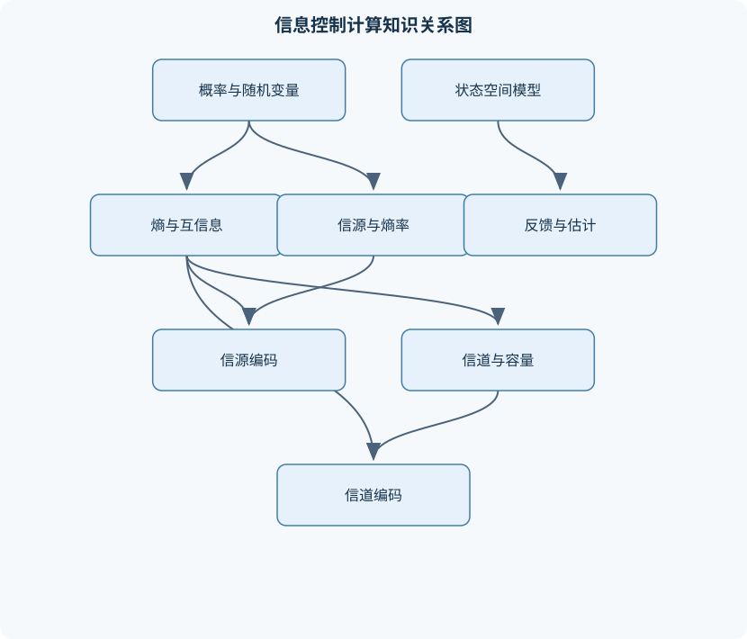
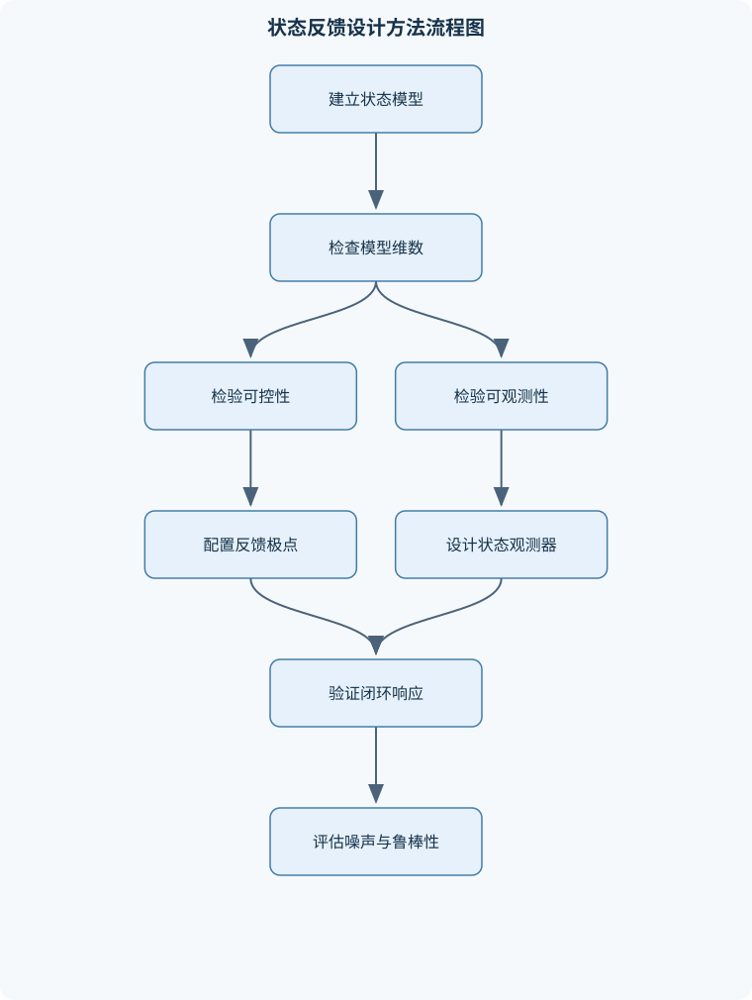

# 信息、控制与计算

## 一、课程整体知识框架

### 课程边界与先修知识

本课程研究信息的度量与传输、控制系统的建模与反馈调节，以及计算过程的表示、复杂度和可靠编码。内容边界覆盖概率论基础、离散与连续信息源、熵与互信息、信道容量、无失真与有失真压缩、Huffman编码、唯一可译码、线性分组码、循环码、有限域、状态空间模型、线性系统稳定性、可控性与可观测性、状态反馈、观测器、最优控制和基本计算复杂度。先修知识包括微积分、线性代数、离散数学、概率论基础和基本程序设计；涉及连续时间控制时还需要常微分方程。课程不以特定软件版本为前提，软件仅用于验证矩阵运算、仿真和编码结果。





### 1. 课程对象、主线与先修条件

《信息、控制与计算》以“不确定性如何被度量、动态系统如何被调节、计算过程如何以有限资源可靠完成”为主线，连接信息论、自动控制、编码理论与算法分析。信息部分研究随机变量、信息量、熵、互信息、信道容量和压缩；控制部分研究系统模型、状态演化、反馈、稳定性、可控性、可观测性和状态估计；计算部分研究编码表示、有限域运算、复杂度以及信息论对存储和传输过程的资源约束。

课程默认使用大写字母表示随机变量，如 $X,Y$，用小写字母表示其取值，如 $x,y$。若无特殊说明，信息论中的对数以 $2$ 为底，单位为比特；以 $e$ 为底时单位为奈特。随机变量的自信息量为

$$
i(x)=-\log p(x),
$$

其中 $p(x)=P(X=x)$，要求 $p(x)>0$；概率为零的事件不在实际平均熵的求和支持集内。离散熵为

$$
H(X)=-\sum_xp(x)\log p(x).
$$

熵是所有可能结果自信息量的数学期望，不等于某一次观测获得的信息量。概率越小的事件自信息量越大；当 $X$ 有 $M$ 个等可能取值时，$H(X)=\log M$，这是给定取值数时的最大熵。若某个结果概率为 $1$，熵为零，表示没有不确定性。

课程还要求微积分、线性代数、离散数学、概率论和基本程序设计。连续时间控制需要常微分方程知识。软件只承担矩阵运算、仿真和编码结果验证，不改变模型、定理及其适用条件。

### 2. 信息、概率与不确定性

样本空间记为 $\Omega$，随机变量 $X$ 将样本点映射为取值集合中的元素。联合概率 $p(x,y)$、边缘概率 $p(x)=\sum_yp(x,y)$ 和条件概率

$$
p(y|x)=\frac{p(x,y)}{p(x)}
$$

必须在 $p(x)>0$ 时使用。联合熵、条件熵和互信息分别为

$$
H(X,Y)=-\sum_{x,y}p(x,y)\log p(x,y),
$$

$$
H(Y|X)=\sum_xp(x)H(Y|X=x),
$$

$$
I(X;Y)=\sum_{x,y}p(x,y)\log\frac{p(x,y)}{p(x)p(y)}.
$$

由 $p(x,y)=p(x)p(y|x)$，可得

$$
\begin{aligned}
H(X,Y)
&=-\sum_{x,y}p(x,y)\log[p(x)p(y|x)]\\
&=H(X)+H(Y|X).
\end{aligned}
$$

这就是熵的链式法则。由于条件熵是非负的，

$$
H(X,Y)\geq H(X),
$$

且等号当且仅当 $Y$ 在给定 $X$ 后不再增加随机性。互信息有三种等价形式：

$$
I(X;Y)=H(X)-H(X|Y)
=H(Y)-H(Y|X)
=H(X)+H(Y)-H(X,Y).
$$

互信息非负，来源于对数和不等式或相对熵非负。它表示观察一个变量后对另一个变量不确定性的平均减少量，而不是某个固定信道的容量。一般有 $I(X;Y)\neq H(X)$，只有当 $X$ 可由 $Y$ 无失真确定时才有 $H(X|Y)=0$。

数据处理不等式说明，如果 $X\to Y\to Z$ 构成马尔可夫链，则

$$
I(X;Z)\leq I(X;Y).
$$

后续处理不能创造关于原始变量的新信息。该结论的边界是马尔可夫条件必须成立；若 $Z$ 还直接依赖于 $X$，则不能直接套用。

### 3. 信息源与熵率

无记忆离散信源的符号独立同分布，长度为 $n$ 的序列概率满足

$$
p(x_1,\ldots,x_n)=\prod_{t=1}^np(x_t),
$$

因此每符号熵率等于单符号熵。具有记忆的信源不能简单地把各符号熵相加。一阶马尔可夫信源用状态转移矩阵 $P=[p(j|i)]$ 描述，其中每行元素非负且行和为 $1$。若状态分布 $\pi$ 平稳，则

$$
\pi=\pi P,\qquad \sum_i\pi_i=1.
$$

状态 $i$ 下的条件熵为

$$
H(X|S=i)=-\sum_xp(x|i)\log p(x|i),
$$

在平稳且适当遍历的条件下，熵率为

$$
H_\infty=\sum_i\pi_iH(X|S=i).
$$

若每个状态转移都确定，条件熵为零，熵率也为零；若状态之间存在随机转移，熵率通常为正。非遍历马尔可夫链可能包含多个闭类，此时长期频率依赖初始状态，不能不加说明地使用唯一平稳分布。信源符号率为 $r_s$（符号/秒），每符号平均信息量为 $H_\infty$（比特/符号）时，平均比特率为

$$
r_b=r_sH_\infty
$$

（比特/秒）。不能把有记忆信源的单符号熵误当作熵率；条件依赖越强，通常熵率越低。

### 4. 无失真压缩与前缀编码

码字是有限符号串，码长记为 $l_i$，平均码长为

$$
\bar L=\sum_i p_i l_i.
$$

前缀码要求任一码字都不是另一码字的前缀，因此可以即时译码。前缀码必满足 Kraft 不等式

$$
\sum_i2^{-l_i}\leq1.
$$

反过来，给定满足该不等式的正整数码长，可以构造相应二元前缀码。该定理直接刻画前缀码，不等同于唯一可译码：某些唯一可译码不是前缀码。

Shannon 码按概率降序排列并取累积概率的二进制展开；Shannon-Fano 码递归地把符号集合分成概率尽量接近的两组。二元 Huffman 算法反复合并概率最小的两个节点，直到只剩根节点，再沿树边标记 $0$ 和 $1$。它对给定概率下的二元前缀码平均码长最优，并满足

$$
H(X)\leq\bar L_{\text{Huffman}}<H(X)+1.
$$

三元 Huffman 编码每次合并三个最小节点；若叶节点数不满足相应树结构条件，需要加入概率为零的虚节点。编码效率可定义为 $\eta=H/\bar L$，冗余可用 $\bar L-H$ 表示，二者受对数底和码符号基数影响，必须统一单位。

唯一可译码可以通过后缀集合递推判定：比较码字之间的非空后缀，将新后缀加入集合；若出现空串，说明存在两种不同解析；若后缀集合稳定且未出现空串，则码字集合唯一可译。该过程的复杂度取决于码字数和最大码长，直接集合表示可能消耗较多空间。

### 5. 信道、互信息与容量

离散无记忆信道由输入集合 $\mathcal X$、输出集合 $\mathcal Y$ 和转移概率 $p(y|x)$ 描述。输入分布为 $p(x)$ 时，

$$
p(x,y)=p(x)p(y|x),\qquad
p(y)=\sum_xp(x)p(y|x).
$$

一次信道使用的互信息为

$$
I(X;Y)=\sum_{x,y}p(x)p(y|x)
\log\frac{p(y|x)}{p(y)}.
$$

信道容量定义为

$$
C=\max_{p(x)}I(X;Y),
$$

单位为比特/次信道使用。互信息依赖输入分布，容量则是对输入分布取最大值，二者不能混同。

对称信道的各输入行是输出符号的排列，且列结构具有相应对称性时，均匀输入通常达到容量；证明可利用互信息对输入分布的凹性和对称变换平均化。一般非对称信道不保证均匀输入最优，必须比较或数值优化。无噪声确定信道可能达到 $\log|\mathcal X|$；完全噪声信道中输出与输入独立，容量为零。

给定先验 $p(x)$ 和观测 $y$，最小平均错误概率的判决规则是最大后验判决：

$$
\hat x(y)=\arg\max_xp(x|y)
=\arg\max_xp(x)p(y|x).
$$

随机化判决只能把多个确定性判决的正确率作加权平均，最大值不会超过其中最大的确定性判决，因此随机判决不能优于最大后验判决。并列时需预先规定处理规则。

### 6. 可靠通信、零错误传输与率失真

信道编码把 $k$ 个信息比特映射为 $n$ 次信道输入，码率为 $R=k/n$。平均错误概率是所有消息错误概率按先验加权的平均；最大错误概率是各消息错误概率中的最大值，二者并不等价。信道编码定理的渐近含义是：在足够长分组和适当码的条件下，$R<C$ 时错误概率可趋近于零；$R>C$ 时不能可靠传输。有限码长、译码复杂度和延迟会造成额外限制。

零错误传输要求任意两个合法码字不会产生相同输出。把输入符号作为图顶点，若两个输入可能产生同一输出，则连接边；零错误码对应独立集。使用 $n$ 次信道时，构造分组信道的输出转移概率为

$$
p(y^n|x^n)=\prod_{t=1}^np(y_t|x_t).
$$

零错误容量通常通过独立集大小的增长率估计，不能与允许错误概率渐近为零的普通容量混为一谈。

有失真压缩用失真函数 $d(x,\hat x)$ 衡量原符号与重构符号的差异，平均失真为

$$
D=E[d(X,\hat X)].
$$

Hamming 失真对错判计 $1$、正确计 $0$；平方误差失真为 $(x-\hat x)^2$，具有数值单位的平方。率失真函数定义为

$$
R(D)=\min_{p(\hat x|x):\,E[d(X,\hat X)]\leq D}I(X;\hat X).
$$

对均匀二元信源和 Hamming 失真，

$$
R(D)=
\begin{cases}
1-h_2(D),&0\leq D\leq \frac12,\\
0,&D\geq\frac12,
\end{cases}
$$

其中 $h_2(D)=-D\log D-(1-D)\log(1-D)$。当允许失真达到无信息猜测的平均失真 $1/2$ 时，不传输信息也可满足要求。零失真要求满足信源编码率与信道容量的联合约束，通常表现为 $R(D)\leq C$。

零均值方差为 $\sigma^2$ 的高斯信源，在平方误差失真下的渐近率失真关系为

$$
R(D)=\frac12\log\frac{\sigma^2}{D},
\qquad 0<D\leq\sigma^2,
$$

等价于

$$
D=\sigma^2 2^{-2R}.
$$

该结论针对允许任意长分组的渐近编码，不能直接当作固定一比特量化器的实际失真。

### 7. 线性分组码、有限域与循环码

在 $GF(2)$ 上，向量加法为按位异或，乘法按模 $2$ 计算。$(n,k)$ 线性码是 $GF(2)^n$ 的 $k$ 维子空间，码率为 $k/n$。生成矩阵 $G$ 产生码字 $c=uG$；校验矩阵 $H$ 满足

$$
Hc^T=0,\qquad GH^T=0.
$$

接收向量 $r=c+e$ 的综合为

$$
s=Hr^T=He^T.
$$

若综合与错误模式表对应，则可估计 $\hat e$ 并计算 $\hat c=r+\hat e$。Hamming 重量 $w(c)$ 是非零位个数，距离为不同位置个数。线性码满足

$$
d_{\min}=\min_{c\neq0}w(c).
$$

因此可检出至多 $d_{\min}-1$ 位错误，保证纠正至多

$$
t=\left\lfloor\frac{d_{\min}-1}{2}\right\rfloor
$$

位错误。校验矩阵中不超过 $d_{\min}-1$ 列线性无关且存在 $d_{\min}$ 列相关时，最小距离为 $d_{\min}$。

$GF(2^m)$ 可表示为次数小于 $m$ 的多项式对本原多项式 $p(x)$ 取模的剩余类。非零元素构成阶为 $2^m-1$ 的乘法群，本原元 $\alpha$ 满足其幂生成全部非零元素。有限域乘法不是普通整数乘法，必须先多项式相乘，再对 $p(x)$ 取模。

循环码对循环移位封闭。将码字表示为多项式 $c(x)$ 后，若生成多项式 $g(x)$ 满足

$$
g(x)\mid x^n-1,
$$

则循环码字具有

$$
c(x)=m(x)g(x)
$$

的形式。校验多项式为

$$
h(x)=\frac{x^n-1}{g(x)}.
$$

系统循环编码先计算 $x^{n-k}m(x)$ 除以 $g(x)$ 的余式 $b(x)$，再构造

$$
c(x)=x^{n-k}m(x)+b(x),
$$

使 $g(x)\mid c(x)$。除法器可用移位寄存器和异或反馈实现；硬判决译码则利用接收多项式除以 $g(x)$ 的余式，即综合多项式判断错误模式。

### 8. 状态空间建模与反馈控制

连续时间线性时不变系统写为

$$
\dot x=Ax+Bu,\qquad y=Cx+Du,
$$

离散系统写为

$$
x[t+1]=Ax[t]+Bu[t],\qquad y[t]=Cx[t]+Du[t].
$$

状态是结合当前输入即可决定未来响应的最小信息集合，不要求每个状态都具有唯一物理名称。连续系统状态转移矩阵为

$$
\Phi(t)=e^{At},
$$

零输入响应为 $x(t)=e^{At}x(0)$；离散系统对应为 $A^t$。连续系统的零状态响应由输入卷积给出，离散系统则由输入序列递推得到，线性系统满足叠加原理。

消去状态变量可得传递函数

$$
G(s)=C(sI-A)^{-1}B+D,
$$

要求相应处的矩阵逆存在。极点由分母或系统矩阵特征值决定，零点描述输入到输出传递中可能被抵消的动态；直流增益是 $G(0)$（存在时）。相似变换 $\tilde x=T x$ 不改变输入输出传递函数，但会改变矩阵外观。不可控或不可观测模态可能在传递函数中消去，因此不能只依靠传递函数判断全部内部动态。

开环系统不使用输出修正输入；负反馈将输出或状态信息反馈，以改变闭环特征方程。状态反馈

$$
u=-Kx
$$

得到闭环矩阵

$$
A_{\mathrm{cl}}=A-BK.
$$

连续系统渐近稳定通常要求所有极点实部小于零；离散系统要求所有极点模小于 $1$，两种判据不能混用。李雅普诺夫方法寻找正定函数 $V(x)$，若沿系统轨迹 $\dot V(x)<0$，则可判断相应稳定性。

可控性矩阵为

$$
\mathcal C=[B\ AB\ \cdots\ A^{n-1}B],
$$

满秩表示状态可由输入在有限时间内驱动到目标方向。可观测性矩阵为

$$
\mathcal O=
\begin{bmatrix}
C\\CA\\\vdots\\CA^{n-1}
\end{bmatrix},
$$

满秩表示可由输出历史区分状态。极点配置前必须检查可控性，观测器设计前必须检查可观测性。

### 9. 最优控制、估计与计算复杂度

线性二次型调节器以

$$
J=\int_0^\infty
(x^TQx+u^TRu+2x^TNu)\,dt
$$

衡量状态偏差和控制能量。常见假设是 $Q$ 半正定、$R$ 正定，并满足适当的稳定化和可检测性条件。令

$$
u=-Kx,\qquad K=R^{-1}(B^TP+N^T),
$$

其中 $P$ 是代数 Riccati 方程的稳定半正定解：

$$
A^TP+PA-(PB+N)R^{-1}(B^TP+N^T)+Q=0.
$$

增大 $Q$ 通常更重视状态偏差，增大 $R$ 通常更抑制控制能量，但实际效果仍取决于系统尺度和矩阵耦合。

观测器使用估计状态 $\hat x$：

$$
\dot{\hat x}=A\hat x+Bu+L(y-C\hat x).
$$

误差 $e=x-\hat x$ 满足

$$
\dot e=(A-LC)e.
$$

若选择 $L$ 使 $A-LC$ 稳定，理想模型且无噪声时误差渐近衰减。Kalman 滤波进一步假设过程噪声和测量噪声具有已知统计结构，通过预测—校正权衡模型与观测；模型误差、噪声相关性和数值病态会限制实际效果。

算法复杂度必须说明输入规模和基本操作。线性查找的最坏时间复杂度为 $O(n)$，二分查找要求有序数组且为 $O(\log n)$；Huffman 构造使用优先队列时为 $O(M\log M)$，其中 $M$ 为符号数；矩阵秩计算通常为多项式时间，但数值秩必须设置容差。$O(\cdot)$ 描述渐近增长，不等于实际运行时间；缓存、常数因子、数据结构、数值精度和实现语言都会产生差异。

## 二、章节和模块划分

### 核心知识覆盖清单

本清单用于检查正文是否覆盖本课程的主要知识模块：

- **信息、概率与不确定性**：样本空间、随机变量与概率分布、自信息量与对数底的选择、离散熵、联合熵与条件熵、熵的链式法则与非负性、互信息及其对称表达式、数据处理不等式、条件熵与不确定性减少、不等概率事件下的信息量分配。
- **信息源与熵率**：无记忆离散信源模型、一阶马尔可夫信源、状态转移矩阵与状态转移图、平稳分布的求解、信源熵率的条件熵表达式、遍历性与长期平均频率、马尔可夫信源的边界情形、信源符号率与比特率的换算。
- **无失真压缩与前缀编码**：码字、码长与平均码长、瞬时码、前缀码与唯一可译码、Kraft不等式及其适用条件、Shannon码与Shannon-Fano码、二元和多元Huffman编码、编码效率与冗余度、唯一可译码的后缀判定方法、信源编码定理的渐近含义。
- **信道、互信息与容量**：离散无记忆信道及转移概率矩阵、输入分布、输出分布与联合分布、信道互信息的计算、对称信道与均匀输入最优性、信道容量的最大化定义、无噪声、确定性和完全噪声信道、判决规则与最小错误概率、随机判决不优于最大后验判决的证明。
- **可靠通信与零错误传输**：信道编码与译码的基本结构、平均错误概率与最大错误概率、信道编码定理的直观解释、信道输出图与符号邻接关系、零错误码与独立集、分组信道和扩展信道、零错误容量的上下界估计、信息论界限与有限码长限制。
- **率失真理论与有失真压缩**：失真函数与平均失真、Hamming失真和平方误差失真、率失真函数的定义、均匀信源的Hamming率失真函数、二元对称信源的率失真关系、高斯信源的平方误差率失真函数、固定长度量化与渐近编码的差异、信源速率、信道容量与允许失真的联合约束。
- **线性分组码与有限域**：GF(2)上的向量运算、线性码、维数、码长与码率、生成矩阵与校验矩阵、系统码的矩阵结构、综合、错误模式与综合译码、Hamming距离和最小距离、纠错能力与检错能力、有限域GF(2^m)的构造、本原多项式与有限域元素表示。
- **循环码与多项式实现**：循环移位不变性、码字多项式表示、生成多项式与校验多项式、循环码的编码条件、系统循环编码的除法余式、循环Hamming码、移位寄存器实现编码器、综合多项式与硬判决译码、生成多项式因式分解与码参数。
- **系统建模与状态空间分析**：系统、输入、输出和状态的定义、连续时间状态空间方程、离散时间状态空间方程、状态转移矩阵与零输入响应、零状态响应和叠加原理、传递函数与状态空间表示的转换、极点、零点和直流增益、相似变换与规范型、模型阶次、最小实现与模型降阶。
- **反馈控制、估计与计算复杂度**：开环与闭环系统、负反馈结构和闭环特征方程、李雅普诺夫稳定性的基本判据、可控性矩阵与可观测性矩阵、状态反馈与极点配置、线性二次型调节器、状态观测器与观测误差动态、Kalman滤波的模型假设和估计思想、时间复杂度、空间复杂度与渐近记号、信息论下界与计算过程的资源约束。


### 1. 模块一至模块三：信息源、熵率与无失真压缩

模块一先建立概率模型，再由自信息量推导熵、条件熵和互信息；模块二处理无记忆信源与马尔可夫信源，重点是 $\pi=\pi P$ 和熵率加权计算；模块三转向码字设计，比较前缀码、唯一可译码、Kraft 不等式、Shannon-Fano 和 Huffman 编码。

#### 算法一：Huffman 编码

**输入**：$M$ 个符号及其概率 $p_i$；**输出**：二元前缀码树和平均码长。先把每个符号作为节点，反复取概率最小的两个节点合并为父节点，并将新概率重新放入优先队列；节点数为 $1$ 时终止，再从根到叶标记边。使用优先队列的复杂度为 $O(M\log M)$，适用于概率已知、目标为二元前缀码的情形。

```python
# Python：二元 Huffman 树的构造
import heapq

def huffman_codes(probabilities):
    # probabilities: [(symbol, probability), ...]
    heap = [[p, [symbol, ""]] for symbol, p in probabilities]
    heapq.heapify(heap)

    while len(heap) > 1:
        p1, left = heapq.heappop(heap)
        p2, right = heapq.heappop(heap)
        for item in left:
            item[1] = "0" + item[1]
        for item in right:
            item[1] = "1" + item[1]
        heapq.heappush(heap, [p1 + p2, left + right])

    return {symbol: code for symbol, code in heap[0][1]}

def average_length(probabilities, codes):
    return sum(p * len(codes[s]) for s, p in probabilities)
```

不变量是队列中的每个节点都代表一个尚未展开的概率子树；终止条件是只剩根节点。验证时应检查所有码字互不为前缀，并计算 $\sum_i p_i l_i$。若概率未归一化、把三元编码误当二元编码或合并节点顺序错误，结果会偏离理论最优值。

#### 例题一：Huffman 编码

**题干**：四个符号概率为 $0.4,0.3,0.2,0.1$，构造二元 Huffman 码并求平均码长。

**分析与解答**：先合并 $0.1+0.2=0.3$，再合并两个 $0.3$ 得 $0.6$，最后合并 $0.4+0.6=1$。可取码字 $0,10,110,111$，对应概率 $0.4,0.3,0.2,0.1$。于是

$$
\bar L=0.4(1)+0.3(2)+0.2(3)+0.1(3)=1.9.
$$

熵约为 $1.846$ 比特，满足 $H\leq\bar L<H+1$。变式是改用三元码，此时每次合并三个节点，码长单位为三进制码符号，不能继续用二进制 Kraft 不等式而不作转换。

### 2. 模块四至模块六：信道容量、可靠通信与率失真

模块四从转移概率矩阵计算输出分布和互信息，再通过最大化得到容量；模块五区分平均错误、最大错误和零错误传输，利用信道输出图和独立集描述零错误码；模块六讨论 Hamming 失真、平方误差失真以及率失真函数，并比较渐近分组编码和固定长度量化。

#### 算法二：最大后验判决与容量数值分析

最大后验译码的输入是先验 $p(x)$、转移概率 $p(y|x)$ 和观测 $y$。对所有候选 $x$ 计算 $p(x)p(y|x)$，取最大者，复杂度为 $O(M)$。容量数值分析则反复根据当前输入分布计算 $p(y)$ 和互信息，再更新输入分布，直到互信息增量低于阈值或达到迭代上限；该流程适用于有限离散信道，不应直接用于连续信道而不进行离散化或积分处理。

#### 例题二：最大后验判决

**题干**：$P(X=0)=0.8,P(X=1)=0.2$。信道满足 $P(Y=1|X=0)=0.1$，$P(Y=1|X=1)=0.7$。观察到 $Y=1$，如何判决？

**解答**：

$$
P(X=0,Y=1)=0.8\times0.1=0.08,
$$

$$
P(X=1,Y=1)=0.2\times0.7=0.14.
$$

因 $0.14>0.08$，判决 $\hat X=1$。归一化后 $P(X=1|Y=1)=0.14/(0.08+0.14)=7/11$。验证时必须比较联合概率，而不能只比较条件概率；若先验改为 $P(X=0)=0.95$，最佳判决可能改变。

#### 例题三：率失真约束

**题干**：均匀二元信源每秒产生 $1000$ 个符号，信道容量为每秒 $600$ 比特。求 Hamming 失真下允许的最大平均失真范围。

**解答**：每个信源符号可用率为 $R=600/1000=0.6$ 比特/符号。要求

$$
1-h_2(D)\leq0.6,
$$

即 $h_2(D)\geq0.4$。在 $0\leq D\leq1/2$ 上，$h_2(D)$ 单调增加，因此 $D$ 至少约为满足 $h_2(D)=0.4$ 的根，约为 $0.079$。允许失真必须满足 $D\gtrsim0.079$；若要求更小失真，则所需率超过信道可提供率。验证时还要检查 $D\leq1/2$，因为 $D\geq1/2$ 时率失真函数已经为零。

### 3. 模块七至模块八：线性分组码、有限域与循环码

模块七建立 $GF(2)$ 上的矩阵编码、综合译码和最小距离理论；模块八使用多项式表示循环移位，推导 $g(x)\mid x^n-1$、系统编码余式和移位寄存器实现。

#### 算法三：线性码综合译码

**输入**：接收向量 $r$、校验矩阵 $H$、错误模式表；**输出**：估计码字 $\hat c$。先计算 $s=Hr^T$，再由综合查找最可能错误 $\hat e$，最后计算 $\hat c=r+\hat e$。合法码字满足 $H\hat c^T=0$。该方法适合码长适中且错误模式表可存储的线性码；查表空间可能随码长指数增长。

#### 例题四：最小距离与纠错能力

**题干**：某线性码的非零码字最小重量为 $5$，求其保证检错和纠错能力。

**解答**：线性码中任意两个码字之差仍是码字，因此两码字距离等于某个非零码字重量，故 $d_{\min}=5$。最多可保证检出 $d_{\min}-1=4$ 位错误，最多可保证纠正

$$
\left\lfloor\frac{5-1}{2}\right\rfloor=2
$$

位错误。3 位错误不一定不能纠正，而是不能由最小距离定理保证。变式是给出 $H$ 的列向量，寻找最小线性相关列数即可确定 $d_{\min}$。

#### 例题五：循环码系统编码

**题干**：给定信息多项式 $m(x)$、生成多项式 $g(x)$，且 $n-k=4$，说明系统循环编码步骤。

**解答**：第一步计算 $x^4m(x)$；第二步用 $g(x)$ 作多项式长除法，得到余式 $b(x)$，其次数小于 $4$；第三步在 $GF(2)$ 上令

$$
c(x)=x^4m(x)+b(x).
$$

由于减法与加法相同，$g(x)$ 整除 $c(x)$。验证时将 $c(x)$ 除以 $g(x)$，余式必须为零；若余式非零，通常是移位次数、系数顺序或域运算错误。

### 4. 模块九至模块十：状态空间、反馈、估计与复杂度

模块九从物理方程选择状态变量，建立连续或离散状态空间模型，计算状态转移、传递函数、极点和零点，并讨论相似变换、最小实现与模型降阶。模块十研究负反馈、李雅普诺夫稳定性、状态反馈、观测器、Kalman 滤波、线性二次型调节器以及复杂度。

#### 算法四：可控性、可观测性与极点配置流程

输入为 $A,B,C$。先构造 $\mathcal C$ 和 $\mathcal O$，分别计算秩并与状态维数比较；若 $\mathcal C$ 满秩，才能在满足条件时配置闭环极点；若 $\mathcal O$ 满秩，才能通过输出设计观测器增益 $L$。数值计算应设置秩判定容差。高阶病态系统不宜直接使用公式，应采用数值稳定的分解方法。

### 5. 实验与项目一：离散信道容量和译码验证

**输入数据**：给定有限转移矩阵 $p(y|x)$、若干输入分布和先验概率。  
**步骤**：先检查矩阵每行非负且和为 $1$；计算输出分布、联合分布和互信息；比较均匀输入与非均匀输入；再对每个输出应用最大后验判决并统计平均错误率。  
**评价标准**：概率归一化正确，互信息非负，容量不小于任一测试输入分布的互信息，最大后验判决的正确率不低于随机判决。  
**排错方法**：若互信息为负，检查对数项、零概率处理和联合概率；若对称信道下均匀输入未达到最大值，检查矩阵行列排列和迭代更新；若错误率异常低或高，检查先验是否被重复使用。

### 6. 实验与项目二：状态反馈和观测器联合仿真

**输入数据**：矩阵 $A,B,C$、初始状态、目标闭环极点、采样周期 $T_s$。  
**步骤**：构造可控性和可观测性矩阵并检查秩；求 $K$ 使 $A-BK$ 的特征值达到目标；求 $L$ 使 $A-LC$ 稳定；用离散递推同时计算真实状态和估计状态，记录控制量、输出和估计误差。  
**评价标准**：闭环极点误差在容许范围内，状态响应有界或收敛，估计误差按理论衰减，控制输入没有不合理的数值爆炸。  
**排错方法**：连续模型直接使用离散稳定判据会导致误判；采样周期不一致会破坏极点解释；矩阵秩因数值病态而误判时应调整容差并检查奇异值；若观测误差不收敛，检查观测器符号是否为 $+L(y-C\hat x)$ 以及 $A-LC$ 的特征值。

### 7. 课程综合关系

信息源熵率给出待表达信息的平均下界，信源编码把表示长度压低；信道容量给出可靠传输的上界，信道编码用冗余抵抗噪声；率失真把“允许多大误差”纳入资源约束。线性码和循环码是可靠编码的代数实现，有限域提供其运算基础。状态空间模型描述动态过程，反馈改变系统行为，观测器在状态不可直接测量时重建状态；复杂度则说明这些编码、译码、控制和估计过程需要多少时间与空间。理想定理通常以无限长码、精确模型和无数值误差为前提，现实系统还必须考虑有限码长、延迟、噪声、模型不确定性、存储空间和计算能力。

## 三、核心概念的详细解释

### 1. 信息、不确定性与信源熵率

概率模型首先规定样本空间、随机变量及其分布。随机变量 $X$ 的取值概率为 $p(x)=P(X=x)$，且满足 $p(x)\ge 0$、$\sum_xp(x)=1$。事件 $x$ 的自信息量为

$$
i(x)=-\log_2p(x),
$$

单位是比特。它描述某个具体结果出现时带来的信息量，而熵

$$
H(X)=\sum_xp(x)i(x)=-\sum_xp(x)\log_2p(x)
$$

描述观测 $X$ 前的不确定性的平均值。若 $X$ 有 $M$ 个等可能取值，则 $H(X)=\log_2M$；若某个取值概率为 $1$，则 $H(X)=0$。概率越小的事件自信息量越大，但不能把一次观测的自信息量与整个随机变量的熵混为一谈。

联合熵、条件熵和互信息分别为

$$
H(X,Y)=-\sum_{x,y}p(x,y)\log_2p(x,y),
$$

$$
H(Y|X)=\sum_xp(x)H(Y|X=x),
$$

$$
I(X;Y)=H(Y)-H(Y|X).
$$

由 $p(x,y)=p(x)p(y|x)$ 可得

$$
\begin{aligned}
H(X,Y)
&=-\sum_{x,y}p(x,y)\log_2[p(x)p(y|x)]\\
&=H(X)+H(Y|X).
\end{aligned}
$$

同理，交换 $X,Y$ 可得 $H(X,Y)=H(Y)+H(X|Y)$，因此

$$
I(X;Y)=H(X)-H(X|Y)
=H(Y)-H(Y|X)
=H(X)+H(Y)-H(X,Y).
$$

条件熵非负，所以 $H(X,Y)\ge H(X)$。互信息满足 $I(X;Y)\ge0$，等号当且仅当 $X,Y$ 独立。若 $Y$ 完全确定 $X$，则 $H(X|Y)=0$，从而 $I(X;Y)=H(X)$；若 $Y$ 与 $X$ 独立，即使 $Y$ 本身熵很大，也不能提供关于 $X$ 的信息。

若 $X\to Y\to Z$ 构成马尔可夫链，即给定 $Y$ 后 $Z$ 与 $X$ 条件独立，则数据处理不等式为

$$
I(X;Z)\le I(X;Y).
$$

这说明对观测结果进行后处理不会增加关于原始变量的平均信息。若 $Z$ 还直接依赖 $X$，则不能不加条件地套用该结论。

无记忆离散信源的序列概率可分解为

$$
p(x_1,\ldots,x_n)=\prod_{t=1}^{n}p(x_t),
$$

因此每符号熵率就是 $H(X)$。对于有记忆信源，熵率定义为

$$
H_\infty=\lim_{n\to\infty}\frac{1}{n}H(X_1,\ldots,X_n).
$$

一阶马尔可夫信源可由状态转移矩阵 $P=[p_{ij}]$ 描述，其中 $p_{ij}=P(S_{t+1}=j|S_t=i)$。平稳分布 $\pi$ 满足

$$
\pi=\pi P,\qquad \sum_i\pi_i=1.
$$

若状态 $i$ 下的下一符号分布为 $p(\cdot|S=i)$，则在平稳且适当遍历条件下，

$$
H_\infty=\sum_i\pi_iH(X|S=i).
$$

如果某状态的转移概率退化为 $1$，该状态下没有随机性，对熵率的贡献为零。若马尔可夫链存在多个闭类，平稳分布可能不唯一，熵率还可能依赖初始分布，不能直接使用唯一遍历链的结论。

### 2. 编码、压缩与信道

码字是由有限符号组成的序列，码长为码字包含的符号数。平均码长为

$$
\bar L=\sum_xp(x)l(x),
$$

其中 $l(x)$ 是源符号 $x$ 的码长。若任一码字都不是另一码字的前缀，则该码是前缀码，也称瞬时码。前缀码可在从左到右读取时立即译码，因此一定唯一可译；但唯一可译码不一定是前缀码。

二元前缀码必须满足 Kraft 不等式

$$
\sum_x2^{-l(x)}\le1.
$$

对于 $D$ 元码，形式变为 $\sum_xD^{-l(x)}\le1$。Kraft 不等式直接刻画给定码长是否存在前缀码，不能把“满足不等式”理解为任意已经写出的码字集合都唯一可译。

Huffman 算法输入有限符号集合及其概率，输出平均码长最小的二元前缀码。过程是反复取概率最小的两个节点合并，将合并概率重新放回节点集合；直到只剩一个根节点，再沿树边标记 $0,1$。每次合并保留了最优树的兄弟节点结构。若符号数为 $M$，使用优先队列时复杂度为 $O(M\log M)$，输出码字还需遍历树。二元 Huffman 码满足

$$
H(X)\le \bar L<H(X)+1.
$$

编码效率可定义为 $\eta=H(X)/\bar L$，冗余度可用 $\bar L-H(X)$ 表示。效率接近 $1$ 不代表错误保护能力强，因为压缩码通常对误码敏感。

信道由输入集合 $\mathcal X$、输出集合 $\mathcal Y$ 和转移概率 $p(y|x)$ 给出。输入分布为 $p(x)$ 时，

$$
p(x,y)=p(x)p(y|x),\qquad
p(y)=\sum_xp(x)p(y|x).
$$

信道互信息为

$$
I(X;Y)=\sum_{x,y}p(x)p(y|x)
\log_2\frac{p(y|x)}{p(y)}.
$$

信道容量定义为

$$
C=\max_{p(x)}I(X;Y),
$$

它不是任意输入分布下的互信息。对于输入输出对称的离散信道，均匀输入通常达到最大值；一般非对称信道必须优化输入分布，不能直接假定均匀分布最优。无噪声信道容量等于可区分输入符号数的对数；完全噪声信道的输出与输入独立，容量为零。

给定观测 $y$，最大后验判决选择

$$
\hat x(y)=\arg\max_xp(x|y)
=\arg\max_xp(x)p(y|x).
$$

其平均正确概率为 $\sum_y\max_xp(x)p(y|x)$。若采用随机判决，在同一观测 $y$ 下以概率 $q(x|y)$ 选择 $x$，条件正确概率为

$$
\sum_xq(x|y)p(x|y),
$$

这是后验概率的加权平均，不超过最大后验概率。因此随机化判决不能优于最大后验确定性判决。

零错误通信要求任意两个允许码字不能产生同一输出序列。对单次信道，可建立输出图：若两个输入符号有某个共同的可能输出，则称二者相邻。零错误码对应图中的独立集。长度为 $n$ 的扩展信道把单次转移概率相乘，零错误容量关注码字数随 $n$ 增长的指数率，与允许小错误概率的普通信道容量不同。

### 3. 有失真压缩与可靠编码

失真函数 $d(x,\hat x)$ 衡量源符号与重构符号之间的差异，平均失真为

$$
D=E[d(X,\hat X)].
$$

Hamming 失真在符号相同为 $0$、不同为 $1$；平方误差失真为 $(x-\hat x)^2$，单位是原变量单位的平方。率失真函数为

$$
R(D)=\min_{p(\hat x|x):\,E[d(X,\hat X)]\le D}I(X;\hat X).
$$

它表示达到平均失真不超过 $D$ 所需的最小渐近码率。对均匀二元信源和 Hamming 失真，

$$
R(D)=
\begin{cases}
1-h_2(D),&0\le D\le \frac12,\\
0,&D\ge\frac12,
\end{cases}
$$

其中

$$
h_2(D)=-D\log_2D-(1-D)\log_2(1-D).
$$

当 $D\ge1/2$ 时，始终重构为固定符号即可达到不超过该失真的平均要求，因此不需要传递信息。该结论是任意长分组编码的渐近结论，不等同于一次只量化一个样本。

零均值高斯信源方差为 $\sigma^2$，平方误差失真下的率失真函数为

$$
R(D)=\frac12\log_2\frac{\sigma^2}{D},
\qquad 0<D\le\sigma^2,
$$

或等价写成

$$
D=\sigma^2 2^{-2R}.
$$

当 $D\ge\sigma^2$ 时，恒定重构为均值 $0$ 已达到该失真，故 $R(D)=0$。式中 $R$ 是每个高斯样本的渐近比特数，不能直接当作固定一比特量化器的实际失真。

线性分组码是 $GF(2)$ 上的 $k$ 维子空间，码长为 $n$，码率为 $k/n$。生成矩阵 $G$ 产生码字 $c=uG$，校验矩阵 $H$ 满足

$$
Hc^T=0,\qquad GH^T=0.
$$

接收向量 $r=c+e$ 的综合为

$$
s=Hr^T=H(c+e)^T=He^T.
$$

因此综合只由错误模式决定。若建立综合到最可能错误模式的映射，便可计算 $\hat c=r-\hat e$；在 $GF(2)$ 上减法与加法相同。

Hamming 距离为两个向量不同位置的数目，最小距离为

$$
d_{\min}=\min_{c_1\ne c_2}d(c_1,c_2).
$$

线性码中

$$
d_{\min}=\min_{c\ne0}w(c),
$$

因为 $d(c_1,c_2)=w(c_1+c_2)$ 且 $c_1+c_2$ 仍是码字。若要保证检出至多 $t$ 个错误，需要 $d_{\min}\ge t+1$；若要保证纠正至多 $t$ 个错误，需要

$$
d_{\min}\ge2t+1.
$$

若 $H$ 的任意不超过 $d_{\min}-1$ 列线性无关，而存在 $d_{\min}$ 列相关，则最小距离为 $d_{\min}$。

在 $GF(2^m)$ 中，元素表示为次数小于 $m$ 的二元多项式，先按多项式规则相乘，再对次数为 $m$ 的不可约多项式取模。若模多项式为本原多项式，则非零元素由本原元 $\alpha$ 的幂构成，乘法群阶为 $2^m-1$。加法对应系数按模 $2$ 相加，不能使用普通整数加法。

循环码要求码字循环移位后仍为码字。将码字表示成多项式 $c(x)$ 后，若生成多项式 $g(x)$ 满足

$$
g(x)\mid x^n-1,
$$

则循环码码字可写成

$$
c(x)=m(x)g(x),
$$

其中 $\deg g(x)=n-k$。校验多项式为

$$
h(x)=\frac{x^n-1}{g(x)}.
$$

系统循环编码先计算 $x^{n-k}m(x)$ 除以 $g(x)$ 的余式 $b(x)$，再令

$$
c(x)=x^{n-k}m(x)+b(x).
$$

在 $GF(2)$ 上，加法就是异或。除法过程可由移位寄存器实现，直接多项式运算的教学实现复杂度通常为 $O(nk)$。

### 4. 动态系统、反馈与计算复杂度

连续时间线性状态空间模型为

$$
\dot x(t)=Ax(t)+Bu(t),\qquad
y(t)=Cx(t)+Du(t),
$$

其中 $x(t)$ 为状态向量，$u(t)$ 为输入，$y(t)$ 为输出；矩阵 $A,B,C,D$ 分别描述状态演化、输入作用、输出选择和直接传递。离散模型为

$$
x[t+1]=Ax[t]+Bu[t],\qquad y[t]=Cx[t]+Du[t].
$$

连续模型的状态转移矩阵为

$$
\Phi(t)=e^{At},
$$

零输入响应为

$$
x(t)=e^{At}x(0),
$$

零状态响应为

$$
x(t)=\int_0^te^{A(t-\tau)}Bu(\tau)\,d\tau.
$$

离散系统相应的零输入响应为 $x[t]=A^tx[0]$。通过拉普拉斯变换消去状态变量可得传递函数

$$
G(s)=C(sI-A)^{-1}B+D,
$$

要求 $sI-A$ 在所讨论的复变量处可逆。传递函数的极点反映输入输出动态，但不可控或不可观测的内部模态可能被约去，因此仅看传递函数不一定能判断全部内部稳定性。

负反馈系统的闭环特征方程由反馈结构决定。状态反馈

$$
u=-Kx
$$

使闭环矩阵变为

$$
A_{\mathrm{cl}}=A-BK.
$$

连续系统渐近稳定通常要求所有闭环极点实部小于零；离散系统要求所有闭环极点模小于 $1$。稳定性不是可控性：前者描述响应是否收敛或有界，后者描述输入能否驱动状态。

可控性矩阵为

$$
\mathcal C=[B\ AB\ \cdots\ A^{n-1}B].
$$

若 $\operatorname{rank}(\mathcal C)=n$，则 $n$ 维状态系统完全可控，可以在适当条件下通过状态反馈配置闭环极点。可观测性矩阵为

$$
\mathcal O=
\begin{bmatrix}
C\\CA\\\vdots\\CA^{n-1}
\end{bmatrix}.
$$

若其秩为 $n$，则系统完全可观测。观测器

$$
\dot{\hat x}=A\hat x+Bu+L(y-C\hat x)
$$

的误差 $e=x-\hat x$ 满足

$$
\dot e=(A-LC)e.
$$

选择 $L$ 使 $A-LC$ 稳定，估计误差便可渐近衰减；噪声和模型误差会限制实际效果。

线性二次型调节器最小化

$$
J=\int_0^\infty
\left(x^TQx+u^TRu+2x^TNu\right)\,dt,
$$

通常要求 $Q\succeq0$、$R\succ0$，并满足稳定化和可检测等条件。令 $u=-Kx$，其中

$$
K=R^{-1}(B^TP+N^T),
$$

矩阵 $P$ 满足代数 Riccati 方程

$$
A^TP+PA-(PB+N)R^{-1}(B^TP+N^T)+Q=0.
$$

增大 $Q$ 通常更重视状态偏差，增大 $R$ 通常更节制控制输入；实际调参还需考虑执行器饱和、噪声和模型不确定性。

算法复杂度必须说明输入规模和基本操作。例如，对长度为 $n$ 的数组线性查找最坏时间复杂度为 $O(n)$，二分查找在有序数组上为 $O(\log n)$；Huffman 构造为 $O(M\log M)$；朴素 $n\times n$ 矩阵乘法为 $O(n^3)$。渐近复杂度不等于实际运行时间，缓存、常数因子、数值精度和数据结构都会影响实际性能。

## 四、重要定义、公式、定理和推导

### 专业审校补充：关键定义与适用边界

分离原理是状态反馈与观测器设计能够分别进行的关键条件。对连续时间线性系统 ẋ=Ax+Bu、y=Cx，采用控制律 u=−Kx̂，并用观测器 ẋ̂=A x̂+Bu+L(y−C x̂)。令估计误差 e=x−x̂，则 ė=(A−LC)e；将真实状态和误差作为新坐标，可得闭环系统的特征值由 A−BK 与 A−LC 两部分组成。因此，在系统可控且可观测时，可以分别配置控制器极点和观测器极点，理想线性模型下二者不会相互改变。该结论的适用边界是：系统必须是线性定常模型，状态反馈使用的估计误差结构必须正确，且不考虑执行器饱和、量化、时延和严重模型误差。离散系统的稳定条件改为所有闭环极点满足 |z|<1；不能把连续系统“实部为负”的判据直接用于离散系统。若系统不可控或不可观测，不能仅靠极点配置解决相应模态问题；若存在噪声，估计误差通常只能达到有界或均方意义下的稳定，而不必逐点收敛到零。


### 1. 代表性算法与完整实现

#### Huffman 编码算法

**输入：** $M$ 个符号及其正概率。  
**输出：** 二元前缀码和平均码长。  
**过程：** 将每个符号作为节点，反复合并概率最小的两个节点。  
**不变量：** 每次合并后，节点概率总和仍为 $1$；被合并的两个节点在最优树中可作为同层兄弟。  
**终止条件：** 节点数为 $1$。  
**适用条件：** 概率已知、目标为静态二元前缀码。概率估计错误时，实际平均码长可能偏大。

```python
from heapq import heapify, heappop, heappush

def huffman_codes(probabilities):
    """
    probabilities: dict[str, float]，每个概率必须为正，和为1
    return: dict[str, str]，二元前缀码
    """
    if not probabilities:
        return {}
    if any(p <= 0 for p in probabilities.values()):
        raise ValueError("概率必须为正")
    total = sum(probabilities.values())
    if abs(total - 1.0) > 1e-12:
        raise ValueError("概率和必须为1")

    heap = [[p, i, symbol, None, None]
            for i, (symbol, p) in enumerate(probabilities.items())]
    heapify(heap)
    counter = len(heap)

    while len(heap) > 1:
        left = heappop(heap)
        right = heappop(heap)
        node = [left[0] + right[0], counter,
                None, left, right]
        counter += 1
        heappush(heap, node)

    codes = {}

    def visit(node, prefix):
        symbol = node[2]
        if symbol is not None:
            codes[symbol] = prefix or "0"
            return
        visit(node[3], prefix + "0")
        visit(node[4], prefix + "1")

    visit(heap[0], "")
    return codes

def average_length(probabilities, codes):
    return sum(probabilities[s] * len(codes[s])
               for s in probabilities)
```

该实现的优先队列操作次数为 $O(M)$，每次操作为 $O(\log M)$，故总复杂度为 $O(M\log M)$；树遍历为 $O(M)$。若所有概率相等，不同合并次序可能产生不同码字，但平均码长可以相同。

#### 信源熵率计算流程

**输入：** 转移矩阵 $P$、每个状态下的输出概率。  
**输出：** 平稳分布 $\pi$ 与熵率。  
**步骤：** 求解 $\pi=\pi P$ 和归一化条件；计算每个状态条件熵；按 $\pi_i$ 加权。  
**排错：** 检查 $P$ 每行是否和为 $1$；若出现负概率、平稳方程无解或存在多个闭类，必须重新说明模型条件。

#### 线性码综合译码流程

**输入：** 接收向量 $r$、校验矩阵 $H$、综合到错误模式的查找表。  
**输出：** 估计码字 $\hat c$。  
**步骤：**

1. 计算 $s=Hr^T$；
2. 查找满足 $H\hat e^T=s$ 的候选错误模式；
3. 若采用最小重量译码，选择重量最小者；
4. 计算 $\hat c=r+\hat e$。

若信道错误概率较大，最小重量不一定等于最大后验错误模式；查找表空间可能随码长指数增长。

#### 极点配置与观测器设计

**输入：** $A,B$ 及目标闭环极点。  
**输出：** 状态反馈增益 $K$。  
**步骤：** 先计算 $\mathcal C$ 并检查满秩，再用数值极点配置方法求 $K$，最后验证 $A-BK$ 的特征值。  
观测器设计对偶地检查 $\mathcal O$，对 $(A^T,C^T)$ 做反馈配置得到增益转置 $L$，并验证 $A-LC$ 的特征值。病态矩阵下不能只依赖直接公式，应使用数值稳定的分解方法。

### 2. 典型例题

#### 例题一：马尔可夫信源熵率

**题干：** 两状态信源转移矩阵为

$$
P=
\begin{bmatrix}
0.8&0.2\\
0.3&0.7
\end{bmatrix}.
$$

求平稳分布和每步状态熵率。

**分析：** 设 $\pi=(\pi_0,\pi_1)$，满足 $\pi=\pi P$ 与 $\pi_0+\pi_1=1$。

**解答：**

$$
\pi_0=0.8\pi_0+0.3\pi_1
$$

所以 $0.2\pi_0=0.3\pi_1$，得到 $\pi_0:\pi_1=3:2$，即

$$
\pi=(0.6,0.4).
$$

两个状态的条件熵均为二元熵：

$$
H_2(0.2)=H_2(0.3)\approx0.722\text{ bit}.
$$

因此

$$
H_\infty=0.6H_2(0.2)+0.4H_2(0.3)
\approx0.722\text{ bit/符号}.
$$

**验证：** 直接计算 $\pi P=(0.6,0.4)$。若把某行改成 $(1,0)$，该状态转移不再随机，熵率会下降；若链出现多个闭类，则应分别按闭类分析，不能机械使用唯一平稳分布。

#### 例题二：Huffman 编码

**题干：** 四个符号概率分别为 $0.4,0.3,0.2,0.1$，构造二元 Huffman 码并求平均码长。

**解答：** 先合并 $0.1+0.2=0.3$，再合并两个 $0.3$ 得到 $0.6$，最后合并 $0.4+0.6=1$。一组合法码为

$$
0.4\to0,\quad 0.3\to10,\quad
0.2\to110,\quad0.1\to111.
$$

平均码长为

$$
\bar L=0.4(1)+0.3(2)+0.2(3)+0.1(3)=1.9
\text{ bit/符号}.
$$

信源熵约为

$$
H(X)=-(0.4\log_20.4+0.3\log_20.3+
0.2\log_20.2+0.1\log_20.1)
\approx1.846.
$$

因此 $H(X)\le\bar L<H(X)+1$ 成立。若改用三元码，合并规则需要使节点数满足与 $3$ 叉树相容的条件，必要时加入概率为零的虚节点；不能直接照搬二元合并次数。

#### 例题三：最大后验判决

**题干：** $P(X=0)=0.7$、$P(X=1)=0.3$。信道满足 $P(Y=1|X=0)=0.1$、$P(Y=1|X=1)=0.8$。当观测到 $Y=1$ 时应判决哪个输入？

**解答：**

$$
P(X=0,Y=1)=0.7\times0.1=0.07,
$$

$$
P(X=1,Y=1)=0.3\times0.8=0.24.
$$

由于 $0.24>0.07$，最大后验判决为 $\hat X=1$。归一化后，

$$
P(X=1|Y=1)=\frac{0.24}{0.31}\approx0.774.
$$

若随机在两个判决间选择，正确概率是两个后验概率的加权平均，不会超过 $0.774$。若先验改为 $P(X=0)=0.95$，判决结果可能改变，说明最大似然判决与最大后验判决并不总是相同。

#### 例题四：二元均匀信源的率失真

**题干：** 允许 Hamming 平均失真 $D=0.1$，求所需最小渐近码率。

**解答：** 因为 $D<1/2$，

$$
R(D)=1-h_2(0.1).
$$

计算

$$
h_2(0.1)
=-0.1\log_20.1-0.9\log_20.9
\approx0.469,
$$

所以

$$
R(D)\approx0.531\text{ bit/符号}.
$$

若信道可提供 $0.6$ bit/符号，渐近意义下满足传输约束；若只能提供 $0.4$ bit/符号，则不能保证达到 $D=0.1$。当允许失真提高到 $0.5$，码率降为零，但这不表示重构结果与源完全相同。

#### 例题五：线性码最小距离

**题干：** 某线性码所有非零码字的最小重量为 $3$，问其检错和纠错能力。

**解答：** 线性码中 $d_{\min}$ 等于非零码字最小重量，因此 $d_{\min}=3$。它能保证检出不超过 $d_{\min}-1=2$ 个错误；能保证纠正的错误数为

$$
t=\left\lfloor\frac{d_{\min}-1}{2}\right\rfloor=1.
$$

若出现两个错误，可能仍可检出，但不能由最小距离保证一定纠正。码率 $k/n$ 与该能力没有一一对应关系，不能仅凭码率推出最小距离。

#### 例题六：二阶状态反馈

**题干：** 设

$$
A=\begin{bmatrix}0&1\\-2&-3\end{bmatrix},
\qquad
B=\begin{bmatrix}0\\1\end{bmatrix},
\qquad
u=-Kx,\ K=[k_1\ k_2].
$$

求使闭环极点为 $-2,-4$ 的增益。

**解答：** 闭环矩阵为

$$
A-BK=
\begin{bmatrix}
0&1\\
-2-k_1&-3-k_2
\end{bmatrix}.
$$

其特征多项式为

$$
s^2+(3+k_2)s+(2+k_1).
$$

目标多项式为

$$
(s+2)(s+4)=s^2+6s+8.
$$

比较系数得

$$
k_2=3,\qquad k_1=6.
$$

因此 $K=[6\ 3]$。验证 $A-BK$ 的特征值确为 $-2,-4$。若可控性矩阵不满秩，则该系数匹配一般无法实现任意目标极点。

### 3. 实验与项目流程

#### 实验一：离散信道容量数值验证

**输入数据：** 一个有限转移矩阵 $p(y|x)$，例如二元对称信道的交叉概率 $q$。  
**步骤：**

1. 选取若干输入概率 $p(X=0)$；
2. 由 $p(y)=\sum_xp(x)p(y|x)$ 计算输出分布；
3. 计算 $I(X;Y)=H(Y)-H(Y|X)$；
4. 比较不同输入分布下的互信息；
5. 对称信道检查均匀输入是否达到最大值。

**评价标准：** 概率非负且每行和为 $1$；互信息非负；二元对称信道的数值最大值应接近

$$
C=1-h_2(q).
$$

**排错方法：** 若互信息为负，通常是对数项、联合概率或输出边缘概率计算错误；若最大值不在对称输入附近，检查信道矩阵是否实际对称；离散采样得到的是容量估计，不一定恰好等于解析值。

#### 实验二：状态反馈与观测器仿真

**输入数据：** $A,B,C$，初始状态 $x(0)$，目标闭环极点和观测器极点。  
**步骤：**

1. 计算可控性矩阵与可观测性矩阵；
2. 设计 $K$ 和 $L$；
3. 用 $u=-K\hat x$ 驱动系统；
4. 同时运行观测器；
5. 比较真实状态 $x(t)$、估计状态 $\hat x(t)$、控制输入和输出。

**评价标准：** 连续系统中闭环极点与观测器极点实部应为负；无严重数值误差时，估计误差应趋近于零；控制输入不能长期超过执行器允许范围。  
**排错方法：** 若状态发散，检查反馈符号是否误写成 $u=Kx$；若估计误差不收敛，检查 $A-LC$ 的极点、观测器方程和 $C\hat x$ 项；若仿真结果剧烈振荡，检查采样周期、离散化方法和矩阵条件数。模型误差与噪声存在时，误差不一定严格为零，应评价其均方水平和稳态波动。

### 4. 综合推导与边界条件

#### 硬币称重的信息量上界

若有 $n$ 枚硬币且恰有一枚假币，假币可能偏重或偏轻，则待识别状态数为 $2n$。每次无砝码天平有平衡、左重、右重三种结果，$k$ 次称重最多形成 $3^k$ 个结果序列。因此必要条件为

$$
2n\le3^k,
\qquad
n\le\frac{3^k}{2}.
$$

由于 $n$ 为整数，必要上界可写为

$$
n\le\left\lfloor\frac{3^k}{2}\right\rfloor.
$$

但这只是信息量上界，不是自动可实现的方案。每个称重分支还必须满足硬币放置约束，并且平衡、左重、右重后的候选集合都必须能够在剩余称重次数内继续区分。特别是第一次称重的三个结果未必等概率，不能把每次称重都直接当作获得 $\log_2 3$ 比特。

#### 率失真与信道容量的联合约束

若信源每秒产生 $r_s$ 个符号，每个符号要求失真不超过 $D$，信道容量为 $C$ bit/s，则渐近可靠传输的必要结构条件是

$$
r_sR(D)\le C.
$$

当要求无失真时，应使用无失真信源编码所需的熵率，而不能直接使用允许失真的 $R(D)$。有限码长、编码延迟、信道估计误差和译码复杂度会使实际系统需要留出安全裕量，因此理论等式不是工程系统的自动保证。

#### 连续与离散稳定性的区别

连续系统标量方程 $\dot x=ax$ 的解为 $x(t)=e^{at}x(0)$。只有当 $a<0$ 时，所有有限初值响应才趋于零。离散系统 $x[t+1]=ax[t]$ 的解为 $x[t]=a^tx[0]$，要求 $|a|<1$ 才能渐近稳定。因而不能把“极点小于零”的连续判据直接用于离散系统；采样周期改变时，连续极点与离散极点之间还需通过指数映射联系。

## 五、算法、流程和实现思路

### 方法与流程覆盖索引

下列方法或流程应在正文中说明输入、步骤、适用条件、结果检查和边界：

- Huffman编码算法：输入为符号概率集合，输出为前缀码树和平均码长；反复取出概率最小的两个节点合并并重新排序，直到只剩根节点，再沿左右边标记0和1；终止条件是节点数为1；使用优先队列时复杂度为O(M log M)，M为符号数；适用于已知离散概率且目标为二元前缀码的场景。
- 唯一可译码后缀判定：输入为有限码字集合，输出为是否唯一可译；建立初始后缀集合，逐轮计算一个码字与另一个码字之间的非空后缀并去重，若出现空串则存在歧义，若新集合不再增加则唯一可译；有限码字集合下可用集合稳定作为终止条件；复杂度取决于码字数量和最大码长。
- 信源熵率计算流程：输入为状态转移矩阵P和每个状态下的输出分布，先求解π=πP、Σ_iπ_i=1，再计算每个状态的条件熵并按π加权；输出为每符号熵率；要求马尔可夫链存在所采用的平稳分布，非遍历链需分别讨论初始分布和闭类。
- 信道容量数值分析：输入为转移概率矩阵p(y|x)，输出为容量估计和近似最优输入分布；初始化输入分布，交替计算输出分布、后验相关量和新的输入分布，直到互信息增量低于阈值或达到迭代上限；适用于有限离散信道；复杂度与输入符号数、输出符号数和迭代次数相乘相关。
- 最大后验译码：输入为先验p(x)、信道转移概率p(y|x)和观测y，输出为判决符号；对每个候选x计算p(x)p(y|x)，选择乘积最大者，出现并列时按预定规则处理；终止条件为完成全部候选比较；直接实现复杂度为O(M)，M为输入符号数。
- 线性码综合译码：输入为接收向量r、校验矩阵H和错误模式表，输出为估计码字；计算综合s=Hr^T，根据综合查找最可能错误模式ê，再计算ĉ=r-ê；硬判决下加减等价于GF(2)加法；适用于错误模式表可存储且码长适中的线性码，查表空间可能随码长指数增长。
- 循环码系统编码：输入为信息多项式m(x)、生成多项式g(x)和码长n，输出为系统码字；计算x^{n-k}m(x)除以g(x)的余式b(x)，令c(x)=x^{n-k}m(x)+b(x)，使g(x)整除c(x)；多项式运算在GF(2)上进行；移位寄存器实现的时间复杂度通常为O(nk)的直接形式。
- 有限域乘法：输入为GF(2^m)中的两个元素和本原多项式p(x)，输出为乘积；将元素表示为次数小于m的多项式，相乘后对p(x)取模；终止条件是余式次数小于m；朴素多项式乘法复杂度为O(m^2)，适用于小规模教学和编码实现。
- 状态空间响应分析：输入为A、B、C、D、初始状态和输入序列，输出为状态轨迹及输出轨迹；连续系统计算矩阵指数或数值积分，离散系统递推x[t+1]=Ax[t]+Bu[t]，再计算y；终止条件为达到指定时间区间或采样步数；每步矩阵乘法复杂度取决于状态维数。
- 可控性与可观测性检验：输入为A、B、C，输出为可控或不可控、可观测或不可观测的判定；构造可控性矩阵[ B AB … A^{n-1}B ]和可观测性矩阵的堆叠形式，计算秩并与状态维数比较；复杂度主要来自矩阵乘法和秩分解，通常为多项式时间；数值计算中需设置秩判定容差。





### 1. 信息源熵率与信道互信息的计算流程

#### 1.1 输入、输出与适用条件

信源熵率计算的输入包括状态集合、状态转移矩阵 $P=[p_{ij}]$ 以及每个状态下的输出概率分布。矩阵满足 $p_{ij}\ge 0$ 且每行元素之和为 $1$。输出是每个信源符号所含的平均信息量，单位为 bit/符号。

若信源无记忆，直接计算

$$
H(X)=-\sum_xp(x)\log_2p(x).
$$

若信源是一阶马尔可夫源，先求平稳分布 $\pi$：

$$
\pi=\pi P,\qquad \sum_i\pi_i=1.
$$

再按状态加权：

$$
H_\infty=\sum_i\pi_iH(X|S=i).
$$

该公式要求所采用的平稳分布与长期运行状态相符。若马尔可夫链有多个闭类，平稳分布可能不唯一，必须说明初始状态或初始分布；不能无条件地把任意解都解释为唯一的长期熵率。

#### 1.2 计算步骤与不变量

计算流程如下：

1. 检查 $P$ 的每行是否为概率分布；
2. 求解线性方程 $\pi P=\pi$，并补充归一化条件；
3. 对每个状态计算条件熵；
4. 用 $\pi_i$ 加权求和；
5. 检查结果是否满足 $0\le H_\infty\le\log_2|\mathcal X|$。

计算过程中的不变量是：概率始终非负且总和为 $1$，每个条件熵不超过对应输出字母表的最大熵。若某状态下输出完全确定，则该状态条件熵为 $0$；若所有状态下输出均匀且与状态无关，则熵率达到符号表大小所允许的上限。

#### 1.3 伪代码

```text
算法：MarkovEntropyRate
输入：状态转移矩阵 P，状态输出分布 q[i][x]
输出：熵率 H_inf

1. 检查 P 的每个元素非负，且每行和为 1
2. 求解 pi，使 pi = pi P 且 sum(pi) = 1
3. H_inf ← 0
4. 对每个状态 i：
       h_i ← 0
       对每个符号 x：
           若 q[i][x] > 0：
               h_i ← h_i - q[i][x] * log2(q[i][x])
       H_inf ← H_inf + pi[i] * h_i
5. 返回 H_inf
```

若状态数为 $r$、输出符号数为 $m$，求解平稳分布通常需要对 $r\times r$ 矩阵进行线性代数运算，直接消元的数量级约为 $O(r^3)$；熵计算为 $O(rm)$。数值实现时应设置概率截断或使用稳定的线性方程求解方法，不能对概率零值直接取对数。

#### 1.4 信道互信息与容量的区别

给定离散无记忆信道 $p(y|x)$ 和输入分布 $p(x)$，先计算

$$
p(y)=\sum_xp(x)p(y|x),
$$

再计算

$$
I(X;Y)=\sum_{x,y}p(x)p(y|x)
\log_2\frac{p(y|x)}{p(y)}.
$$

也可以使用

$$
I(X;Y)=H(Y)-H(Y|X).
$$

互信息依赖当前输入分布，而信道容量是

$$
C=\max_{p(x)}I(X;Y).
$$

因此，计算某个均匀输入下的互信息，不能直接称为容量，除非已经证明均匀分布确实达到最大值。对于输入、输出字母表有限的信道，可以通过迭代优化近似寻找容量。每轮先由输入分布计算输出分布，再更新输入分布；终止条件可以是相邻两轮互信息变化小于给定阈值，或达到最大迭代次数。该过程的复杂度大致与迭代次数、输入符号数和输出符号数的乘积相关。

### 2. Huffman编码与唯一可译码判定

#### 2.1 Huffman编码算法

输入是 $M$ 个源符号及其概率，输出是二元前缀码和平均码长。算法每次取出概率最小的两个节点，将其合并为概率之和，再放回优先队列，直到只剩一个根节点。回溯树结构时，给左分支标记 $0$，右分支标记 $1$，从根到叶的路径就是码字。

不变量是：每次合并后，队列中节点概率仍表示尚未展开子树的总概率；最小概率的两个节点在某个最优前缀码中可以作为最深层兄弟节点。终止条件是队列只含一个节点。使用优先队列时，时间复杂度为 $O(M\log M)$，空间复杂度为 $O(M)$。

对于二元 Huffman 码，平均码长满足

$$
H(X)\le \bar L<H(X)+1,
$$

其中严格小于上界的常见表述依赖码长和概率的具体情况；普遍可用的保证是 $\bar L<H(X)+1$。编码效率可定义为

$$
\eta=\frac{H(X)}{\bar L},
$$

冗余度可用 $\bar L-H(X)$ 表示。它们分别衡量平均码长接近熵下界的程度，但不等同于传输错误率。

三元 Huffman 编码每次合并三个节点。若叶节点数不满足 $M\equiv1\pmod 2$，需要加入概率为零的虚节点，使合并过程每次减少两个节点并最终得到一个根。虚节点不应出现在实际源符号输出中。

#### 2.2 唯一可译码的后缀判定

前缀码一定唯一可译码，但唯一可译码不要求任一码字不是另一码字前缀。例如某些码字之间存在前缀关系，仍可能通过后续符号唯一恢复原序列。

判定流程以码字之间的后缀关系为基础。若一个码字是另一个码字的前缀，就记录较长码字去掉较短码字后的非空后缀；然后将这些后缀继续与码字比较，逐轮产生新的后缀集合。若在某一轮出现空串，说明存在两种不同的码字序列产生相同字符串，因而不是唯一可译码。若新后缀集合不再增加且未出现空串，则判定为唯一可译码。

输入是有限码字集合，输出是“唯一可译”或“非唯一可译”。终止条件是出现空串，或后缀集合达到稳定。复杂度取决于码字数量和最大码长；直接实现可能产生较多后缀，必须去重。该方法适用于有限码字集合，不能把一次局部前缀比较当作完整判定。

### 3. 线性分组码、循环码与有限域实现

#### 3.1 线性码综合译码

二元线性 $(n,k)$ 码在 $GF(2)$ 上运算，生成矩阵为 $G$，校验矩阵为 $H$。合法码字满足

$$
Hc^T=0.
$$

接收向量写作

$$
r=c+e,
$$

其中 $e$ 是错误模式。计算综合

$$
s=Hr^T=H(c+e)^T=He^T.
$$

因此综合只由错误模式决定。译码器根据综合查找最可能的错误模式 $\hat e$，然后计算

$$
\hat c=r-\hat e.
$$

在 $GF(2)$ 中减法与加法相同。若错误模式表按照最小 Hamming 重量建立，则可实现标准阵列或近似最大似然硬判决译码。其输入是 $r,H$ 和综合查找表，输出是估计码字；终止条件是完成综合计算和查表。查表空间在一般情形下可能随码长呈指数增长，因此长码通常使用结构化译码方法。

最小距离满足

$$
d_{\min}=\min_{c\ne0}w(c),
$$

因为线性码中任意两个码字之差仍是码字，且

$$
d(c_1,c_2)=w(c_1-c_2).
$$

因此能检出最多 $d_{\min}-1$ 位错误，能纠正最多

$$
t=\left\lfloor\frac{d_{\min}-1}{2}\right\rfloor
$$

位错误。检错能力和纠错能力由最小距离决定，不能由码率 $k/n$ 单独推出。

#### 3.2 循环码系统编码

循环码要求码字循环移位后仍为码字。将长度为 $n$ 的向量表示为次数小于 $n$ 的多项式，若生成多项式 $g(x)$ 满足

$$
g(x)\mid x^n-1,
$$

则循环码字具有

$$
c(x)=m(x)g(x)
$$

的结构，其中 $\deg g(x)=n-k$。系统编码时，先将信息多项式左移 $n-k$ 位，即计算 $x^{n-k}m(x)$，再除以 $g(x)$ 得余式 $b(x)$，构造

$$
c(x)=x^{n-k}m(x)+b(x).
$$

在 $GF(2)$ 中加法是异或，因此等价于把余式作为校验部分。验证时重新计算 $c(x)$ 除以 $g(x)$ 的余式，若余式为零，说明码字满足生成多项式约束。

#### 3.3 有限域乘法

在 $GF(2^m)$ 中，元素可表示为次数小于 $m$ 的二元多项式。给定本原多项式 $p(x)$，两个元素相乘后，对 $p(x)$ 取模，使结果次数重新小于 $m$。加法是系数逐位异或，乘法不是普通整数乘法。朴素多项式乘法复杂度为 $O(m^2)$，适合教学和中小规模编码实现。若把有限域元素直接当作整数运算，会破坏有限域结构并导致编码结果错误。

### 4. 状态空间分析、反馈设计与复杂度评价

#### 4.1 状态空间响应分析

连续时间线性系统表示为

$$
\dot x=Ax+Bu,\qquad y=Cx+Du.
$$

若输入为零，状态响应为

$$
x(t)=e^{At}x(0).
$$

有输入时，完整解为

$$
x(t)=e^{At}x(0)+\int_0^te^{A(t-\tau)}Bu(\tau)\,d\tau.
$$

离散系统对应为

$$
x[t+1]=Ax[t]+Bu[t],
$$

其递推结果为

$$
x[t]=A^tx[0]+\sum_{j=0}^{t-1}A^{t-1-j}Bu[j].
$$

状态响应分析的输入是系统矩阵、初始状态、输入序列和时间区间，输出是状态轨迹和输出轨迹。连续系统可使用矩阵指数或数值积分，离散系统按采样步递推；终止条件是达到指定时间或采样次数。每一步矩阵乘法的复杂度取决于状态维数，实际计算还受矩阵稀疏性和数值条件影响。

由零初始状态下的拉普拉斯变换可得传递函数

$$
G(s)=C(sI-A)^{-1}B+D,
$$

要求相应的矩阵逆存在。传递函数描述输入到输出的关系，但可能隐藏不可控或不可观测的内部模态，因此不能仅凭传递函数判断所有内部动态。

#### 4.2 可控性、可观测性、极点配置与观测器

对 $n$ 维系统，构造可控性矩阵

$$
\mathcal C=[B\ AB\ \cdots\ A^{n-1}B].
$$

若 $\operatorname{rank}(\mathcal C)=n$，则系统完全可控。可控性表示输入能否在有限时间内把状态驱动到所需方向，不表示系统本身稳定。可观测性矩阵为

$$
\mathcal O=
\begin{bmatrix}
C\\
CA\\
\vdots\\
CA^{n-1}
\end{bmatrix}.
$$

若其秩为 $n$，则系统完全可观测。

状态反馈采用

$$
u=-Kx,
$$

闭环矩阵为

$$
A_{\mathrm{cl}}=A-BK.
$$

极点配置前必须检查可控性；否则目标极点通常不能任意指定。观测器采用

$$
\dot{\hat x}=A\hat x+Bu+L(y-C\hat x).
$$

令估计误差 $e=x-\hat x$，则

$$
\dot e=(A-LC)e.
$$

因此观测器设计应先检查可观测性，再选择 $L$ 使 $A-LC$ 稳定。连续时间稳定要求极点实部为负，离散时间稳定要求极点模小于 $1$。

线性二次型调节器以

$$
J=\int_0^\infty(x^TQx+u^TRu)\,dt
$$

衡量状态偏差和控制能量的折中。通常要求 $Q\succeq0$、$R\succ0$，并满足相应稳定性和可检测性条件。代数 Riccati 方程的稳定解 $P$ 给出

$$
K=R^{-1}B^TP,
$$

控制律为 $u=-Kx$。增大 $Q$ 通常更重视状态偏差，增大 $R$ 通常更抑制控制输入，但实际响应还取决于系统矩阵、输入约束和噪声。

### 5. 常见易错点与排错流程

#### 5.1 信息论与编码类易错点

1. 把自信息量 $-\log p(x)$ 当成熵；前者对应一个具体结果，后者是平均值。
2. 把 $H(X|Y)$ 和 $H(Y|X)$ 混淆；二者通常不相等。
3. 把互信息直接当成信道容量；容量还需要对输入分布取最大值。
4. 把有记忆信源的熵率写成单符号熵；熵率需要考虑条件依赖。
5. 认为每次三结果称重必然提供 $\log_2 3$ 比特；只有结果分布均匀时才达到该上限。
6. 把满足 Kraft 不等式等同于任意给定码字集合都唯一可译；Kraft 不等式直接刻画的是前缀码存在性。
7. 把零错误容量与普通信道容量混同；前者要求允许码字之间绝不产生相同输出。
8. 把渐近率失真公式直接用于固定长度单符号量化；二者编码结构和允许的跨符号处理不同。
9. 忽略对数底，导致 bit 与 nat 的单位混淆。
10. 在概率为零时直接计算 $p\log p$；应按极限约定令该项为零。

#### 5.2 编码、控制与复杂度类易错点

11. 在线性码中使用普通整数加法，而不是 $GF(2)$ 上的异或。
12. 认为任意多项式都能作为长度为 $n$ 的循环码生成多项式；必须满足 $g(x)\mid x^n-1$。
13. 混淆码率、冗余位数和最小距离；$k/n$ 不能单独决定纠错能力。
14. 综合译码时误把 $Hr$ 写成 $Hr^T$ 的维度不匹配形式；向量约定必须一致。
15. 把可控性当成稳定性；可控系统可能不稳定，不可控系统也可能稳定。
16. 连续时间和离散时间使用相同稳定判据；连续系统看实部，离散系统看模。
17. 极点配置前不检查可控性，观测器设计前不检查可观测性。
18. 只看传递函数极点而忽略隐藏的不可控或不可观测模态。
19. 把算法的 $O(\cdot)$ 复杂度等同于实际运行时间；常数、缓存、语言和数据结构都会影响实际性能。
20. 数值秩判断不设置容差；接近奇异的矩阵可能导致错误的可控性或可观测性结论。

## 六、概念之间的关系与对比

### 1. 典型笔试问题及解答思路

#### 问题一：为什么 $H(X,Y)\ge H(X)$？

由链式法则

$$
H(X,Y)=H(X)+H(Y|X).
$$

由于条件熵是非负量，立即得到不等式。等号成立的条件是给定 $X$ 后 $Y$ 没有剩余不确定性，即 $Y$ 是 $X$ 的确定函数。

#### 问题二：互信息与信道容量有什么区别？

互信息 $I(X;Y)$ 针对一个已经选定的输入分布；容量

$$
C=\max_{p(x)}I(X;Y)
$$

是在允许的输入分布集合中取最大值。解题时应先由输入分布求输出分布，再算互信息；若要求容量，还必须说明最大化过程或利用对称性证明均匀分布最优。

#### 问题三：如何说明 Huffman 编码是最优前缀码？

说明最小概率的两个符号可以安排在最深层并成为兄弟节点；把这两个节点合并为一个概率为二者之和的虚拟符号，得到规模更小的同类问题。由归纳法，递归构造所得树达到最小平均码长。最后通过回溯恢复原符号码字。

#### 问题四：为什么唯一可译码不等同于前缀码？

前缀码的局部性质保证读到一个码字末尾即可立即译码，因此必然唯一可译。但唯一可译码只要求任意有限码字串的分解方式唯一，允许暂时存在前缀关系。证明具体码字集合的唯一可译性，应使用后缀集合递推或构造两种相同串的译法。

#### 问题五：如何由 $d_{\min}$ 推导线性码的纠错能力？

线性码任意两个码字之差仍是码字，所以两码字距离等于某个非零码字的重量。若接收词距发送码字不超过 $t$，且

$$
2t<d_{\min},
$$

则不可能同时落入两个码字的半径 $t$ 球中。因此最多可纠正 $\lfloor(d_{\min}-1)/2\rfloor$ 位错误；最多可检出 $d_{\min}-1$ 位错误。

#### 问题六：如何由状态方程得到传递函数？

对

$$
\dot x=Ax+Bu,\qquad y=Cx+Du
$$

作拉普拉斯变换并取零初始状态：

$$
sX(s)=AX(s)+BU(s).
$$

整理得

$$
X(s)=(sI-A)^{-1}BU(s),
$$

代入输出方程即得

$$
G(s)=C(sI-A)^{-1}B+D.
$$

初始状态不为零时，还会出现由 $x(0)$ 引起的自然响应项。

#### 问题七：为什么极点配置前要检查可控性？

状态反馈改变的是 $A-BK$。若某些状态方向不能由输入作用到，则这些方向的动态不能通过 $K$ 任意改变。可控性矩阵满秩时，系统可以在理论上配置任意目标极点；不满秩时只能改变可控部分。

#### 问题八：复杂度下界、算法复杂度和实际时间有何区别？

复杂度下界是所有算法在某种计算模型下完成任务所需资源的理论最低量；算法复杂度是某个具体算法随输入规模增长的资源函数；实际运行时间还包含常数因子、内存访问、并行性、编程语言和硬件影响。比如二分查找为 $O(\log n)$，但在很小的数据上，线性查找可能因实现简单而更快。

### 2. 信息、控制与计算概念的对比

| 对比对象 | 第一概念 | 第二概念 | 关键区别 |
|---|---|---|---|
| 信息量与熵 | 单个事件的 $i(x)$ | 平均不确定性 $H(X)$ | 一个对应具体结果，一个对概率分布求平均 |
| 条件熵与互信息 | $H(Y|X)$ 是剩余不确定性 | $I(X;Y)$ 是不确定性减少量 | $I(X;Y)=H(Y)-H(Y|X)$ |
| 熵与熵率 | 单个或固定长度变量的平均信息 | 长序列的每符号极限信息 | 有记忆源中熵率通常不超过单符号熵 |
| 互信息与容量 | 给定输入分布下的信息传递量 | 对输入分布最大化后的上限 | 容量不是任意输入分布下的互信息 |
| 前缀码与唯一可译码 | 可立即译码 | 最终分解唯一 | 前缀码一定唯一可译，反向不成立 |
| 无失真压缩与有失真压缩 | 要求恢复完全一致 | 允许平均失真不超过 $D$ | 后者用较小码率换取可控误差 |
| 普通容量与零错误容量 | 错误概率可渐近降低 | 任意允许码字都不能混淆 | 零错误要求更强，通常容量不大于普通容量 |
| 码率与最小距离 | 每个信息位的传输效率 | 码字之间的最小分离程度 | 高码率不必然有高纠错能力 |
| 生成矩阵与校验矩阵 | 生成合法码字 | 检验是否满足约束 | 合法码字满足 $Hc^T=0$，通常有 $GH^T=0$ |
| 循环码与一般线性码 | 具有循环移位不变性 | 仅要求线性闭合 | 循环码有多项式和移位寄存器结构优势 |
| 状态与输出 | 描述未来演化所需的内部信息 | 可被外部测量的响应 | 状态不一定能直接测量，输出也未必包含全部状态 |
| 开环与闭环 | 不利用输出修正输入 | 根据输出或状态调节输入 | 闭环可抑制扰动，但可能引入不稳定和噪声放大 |
| 可控性与稳定性 | 输入能否改变状态 | 自由响应是否收敛 | 一个是可达性性质，一个是动态性质 |
| 可观测性与可控性 | 能否由输出重建状态 | 能否由输入驱动状态 | 二者通过对偶关系联系，但物理含义不同 |
| 极点配置与 LQR | 指定闭环极点 | 在性能指标下优化折中 | 极点配置直接规定动态，LQR同时权衡状态和控制能量 |
| 观测器与 Kalman 滤波 | 依模型设计确定性估计器 | 利用噪声统计进行最优线性估计 | Kalman 滤波需要噪声协方差等模型假设 |
| 时间复杂度与实际时间 | 渐近增长规律 | 某次运行的耗时 | 前者忽略部分常数和硬件因素 |
| 信息论下界与算法上界 | 任务至少需要的资源 | 某算法实际使用的资源 | 下界用于判断不可突破程度，上界用于评价具体方案 |

### 3. 面试问题、参考答案与深入追问

#### 问题一：熵为什么可以衡量不确定性？

参考答案：自信息量要求独立事件的信息量可加、概率越小信息量越大，因此取 $-\log p(x)$。熵是自信息量的期望，反映观测前平均需要处理的信息量。深入追问时应说明熵不是某一次观测的信息量，也不是物理系统中必然存在的能量。

#### 问题二：为什么均匀输入常在对称信道上达到容量？

参考答案：对称信道的各输入符号受到等价噪声作用，均匀输入使输出分布保持对称，并可由互信息对输入分布的凹性和对称平均化证明其不劣于非均匀分布。追问一般非对称信道时，应指出均匀输入未必最优，需要数值优化或解析最大化。

#### 问题三：实际压缩系统为什么不一定达到熵？

参考答案：熵是渐近无失真编码的理论下界，实际系统受到有限文件长度、码表存储、块边界、概率估计误差和实时延迟限制。短数据中，整数码长和模型开销可能使平均码长明显高于熵。

#### 问题四：如何选择纠错码？

参考答案：根据误码率、允许延迟、码率、译码资源和突发错误特征选择。线性分组码便于矩阵和综合译码，循环码便于硬件移位寄存器实现；工程上还要评价译码复杂度、存储量、误码曲线和失效模式。追问时应区分随机错误与突发错误，并说明交织等结构可能改变错误统计。

#### 问题五：可控但不稳定的系统能否控制？

参考答案：若系统完全可控，理论上可以通过状态反馈把闭环极点配置到稳定区域，但还要考虑输入饱和、模型误差和噪声。若系统不可控且存在不稳定不可控模态，则不能仅靠反馈稳定整个系统。追问应说明“可控”本身不等于“控制器一定可实现”。

#### 问题六：状态变量是否唯一？

参考答案：状态表示通常不唯一。对非奇异矩阵 $T$ 作相似变换 $z=Tx$，系统矩阵变为

$$
A'=TAT^{-1},\quad B'=TB,\quad C'=CT^{-1}.
$$

输入输出行为在对应变换下保持一致，但状态坐标的物理解释和数值条件可能不同。追问时应说明不同选取可能影响控制器实现和数值稳定性。

#### 问题七：观测器极点为什么通常要比控制器极点快？

参考答案：观测误差由 $A-LC$ 决定。若估计误差衰减过慢，反馈控制使用的状态估计会长期偏离真实状态；适当加快观测器可减小过渡期误差。但极点过快会放大测量噪声、增加控制输入和数值敏感性，因此不能无限加快。

#### 问题八：如何判断一个算法是否适合嵌入式实现？

参考答案：先确定输入规模、实时截止时间、可用存储和数值精度，再分析最坏时间复杂度、辅助空间、内存访问和中断影响。比如综合查表速度快，但表空间可能指数增长；矩阵求逆公式便于说明，却未必适合数值实现，实际应使用稳定的分解算法。验收时应同时检查功能正确性、最坏延迟、内存峰值和异常输入处理。

### 4. 岗位任务与课程知识的对应关系

#### 4.1 通信与编码工程

实际任务包括建立信道模型、估计误码率、选择码率和纠错码、实现编码器与译码器。所用知识包括熵、互信息、信道容量、Huffman 编码、线性码、循环码、有限域和综合译码。主要产出是编码模块、译码模块、仿真报告和误码率曲线。验收标准包括编码输出满足校验方程、译码在规定错误范围内正确恢复、吞吐量和延迟达到系统约束，并对超出纠错能力的失效情况给出说明。

#### 4.2 数据压缩与算法工程

实际任务包括统计数据分布、建立信源模型、选择无失真或有失真压缩方式、评价码率和恢复质量。所用知识包括熵率、Huffman 编码、率失真函数、平均失真和复杂度分析。产出包括压缩器、解压器、码率统计和失真评估。验收时既要验证无失真模式下逐字节一致，也要在有失真模式下报告码率、均方误差或 Hamming 失真，不能只报告压缩比例。

#### 4.3 控制系统与嵌入式控制

实际任务包括从物理对象建立状态空间模型，分析极点和稳定性，设计状态反馈、观测器或 LQR 控制器，并在采样系统上实现。所用知识包括状态转移矩阵、传递函数、可控性、可观测性、极点配置和 Riccati 方程。产出包括模型文件、控制器参数、仿真曲线和实时程序。验收标准包括闭环稳定、跟踪误差满足指标、控制输入不超限、采样周期合理，并对模型误差、传感器噪声和执行器饱和进行测试。

#### 4.4 状态估计与传感器融合

实际任务包括利用不完全、有噪声的传感器估计位置、速度或设备状态。所用知识包括状态空间模型、可观测性、观测器误差动态和 Kalman 滤波的噪声假设。产出包括估计状态序列、残差统计和异常检测结果。验收标准包括估计误差的均值、方差或置信区间满足要求，并能区分模型失配、传感器偏置和瞬时噪声，不能只以单次估计结果判断算法优劣。

#### 4.5 性能优化与计算复杂度

实际任务包括比较线性查找、二分查找、矩阵运算、编码和译码过程的时间与空间开销。所用知识包括 $O(\cdot)$、递推分析、矩阵秩计算复杂度、信息论下界和有限资源约束。产出包括复杂度分析、基准测试和优化前后对比。验收时应明确输入规模、硬件环境、基本操作定义和最好、平均、最坏情形；不能仅凭一次运行时间断言算法在所有规模上更优。

## 七、典型例题和应用场景

### 专业审校补充：综合例题

题干：考虑一维离散随机系统 xₖ=xₖ₋₁+wₖ，观测方程 yₖ=xₖ+vₖ。其中过程噪声 wₖ 和观测噪声 vₖ 独立、均值为零，方差分别为 Q=1 和 R=3。初始估计均值 m₀=0、方差 P₀=4，连续得到观测 y₁=2、y₂=1。使用标量 Kalman 滤波求两次更新后的估计均值和方差。分析：预测阶段把过程噪声加入不确定性，校正阶段根据观测可靠程度加权。标量递推式为 Pₖ⁻=Pₖ₋₁+Q，Kₖ=Pₖ⁻/(Pₖ⁻+R)，mₖ=mₖ⁻+Kₖ(yₖ−mₖ⁻)，Pₖ=(1−Kₖ)Pₖ⁻；这里 mₖ⁻=mₖ₋₁。第一步中，P₁⁻=4+1=5，K₁=5/(5+3)=5/8。观测残差为 y₁−m₁⁻=2−0=2，所以 m₁=0+(5/8)×2=5/4=1.25；更新方差为 P₁=(1−5/8)×5=15/8=1.875。第二步预测得到 m₂⁻=1.25，P₂⁻=15/8+1=23/8。于是 K₂=(23/8)/(23/8+3)=23/47。残差为 1−1.25=−1/4，因此 m₂=5/4+(23/47)×(−1/4)=53/47≈1.128。更新方差为 P₂=(1−23/47)×23/8=69/47≈1.468。结果验证：两次增益都位于 0 和 1 之间，且 P₂<P₂⁻，说明观测降低了不确定性；若没有观测更新，第二步方差应为 6，明显更大。变式：若 Q=0、R=3，系统状态不随时间随机漂移，预测方差不再增加；若 Q 增大，滤波器更依赖当前观测，增益增大；若 R 增大，观测更不可靠，增益减小。不能把滤波后的均值视为真实状态，也不能在观测噪声存在时要求每一步估计误差严格为零。


### 典型题型与应用覆盖索引

建议通过下列题型或应用检查概念是否能够迁移：

- 硬币称重信息上界：设每枚硬币均可能偏重或偏轻，计算状态数、单次天平结果数和k次称重的三叉树上界；进一步为三次称重、十二枚硬币设计分支方案，并逐分支验证平衡、左重和右重后的候选集合。
- 马尔可夫信源熵率：给定三状态转移图，列出转移矩阵，求平稳分布，再计算每个状态的条件熵和长期熵率；分别分析转移概率为0或1时为何熵率下降。
- Huffman编码：对十个符号及其概率构造二元和三元Huffman树，列出每次合并、各符号码字、平均码长、信源熵和编码效率；三元编码中补充虚节点的条件。
- 唯一可译码判定：对一个含有不同码长码字的集合执行后缀分解，展示每轮新后缀的产生过程；若出现码字或空后缀，构造两种译法作为非唯一可译的证据。
- 离散信道容量：给定有限转移概率矩阵，计算任意输入分布下的输出分布和互信息；对称信道用均匀分布验证容量，对非对称信道比较不同输入分布的互信息。
- 最大后验判决：给定先验概率和信道转移矩阵，逐个输出符号计算后验概率，构造最大后验判决表，并比较确定性判决和随机判决的平均正确概率。
- 零错误分组码：根据信道输出图建立符号邻接关系，找出互不相邻的输入符号集合；再构造长度为2的扩展信道，计算独立集大小和每次信道使用的零错误传输速率。
- 率失真应用：对二元均匀信源和Hamming失真，给定每秒信源符号率与信道比特率，先计算可用每符号码率，再由R(D)反解允许失真范围；明确无失真传输要求R(0)不超过信道容量。
- 高斯一比特量化：对零均值方差为σ²的高斯变量，利用对称性设重构点为±a，求均方误差关于a的导数并令其为零，得到最优重构点和最小失真；再与渐近率失真函数在一比特码率下的结果比较。
- 线性分组码矩阵：由校验方程写出系统校验矩阵H，求满足GH^T=0的生成矩阵G；列举或利用列相关性证明最小距离，并说明能够检出和纠正的错误数量。
- 有限域与循环码：由本原多项式构造GF(2^3)元素表，完成元素加法和乘法；再对给定生成多项式求校验多项式、系统编码器和移位寄存器结构。
- 状态空间建模：从一个二阶机械或电路模型选择状态变量，建立A、B、C、D矩阵，求传递函数、极点和阶跃响应；比较不同状态变量选择下的相似变换表示。


### 1. 三叉天平与信息量上界

#### 例题：假币识别的必要条件

有 $n$ 枚硬币，其中恰有一枚是假币，假币可能比真币重，也可能比真币轻。使用无砝码天平称量 $k$ 次，要求确定假币并判断其轻重。求 $n$ 的必要上界，并说明该上界不一定总能达到。

**分析：** 每枚硬币有“偏重”和“偏轻”两种状态，因此待识别状态共有 $2n$ 个。天平每次可能产生平衡、左盘重、右盘重三种结果，$k$ 次称量最多产生 $3^k$ 个结果序列。若两个不同状态导致相同结果序列，就不能确定假币状态，因此必须有

$$
2n\le 3^k.
$$

所以

$$
n\le \left\lfloor \frac{3^k}{2}\right\rfloor.
$$

这里的“不等式”是必要条件而非充分条件。因为称量方案还必须满足物理约束：放在左右盘上的真币数量应合理；每个结果分支保留的候选状态数应能由剩余称量继续区分；某些结果分支可能并不等概率，因此不能简单地认为每次称量实际都获得 $\log_2 3$ 比特信息。

**逐步解答：**

1. 状态集合为  
   $$
   \{(1,\text{重}),(1,\text{轻}),\ldots,(n,\text{重}),(n,\text{轻})\},
   $$
   状态数为 $2n$。
2. 一次称量的结果字母表大小为 $3$。
3. $k$ 次称量的结果序列总数不超过 $3^k$。
4. 为实现一一对应，必须满足 $2n\le3^k$。
5. 因而最大必要上界为  
   $$
   n_{\max}\le \left\lfloor3^k/2\right\rfloor.
   $$

当 $k=3$ 时，上界为 $\lfloor27/2\rfloor=13$，但经典方案通常取 $n=12$，因为 $13$ 枚时第一次称量后的各分支很难同时满足候选状态平衡和后续可区分要求。

**结果验证：** 对 $n=12,k=3$，状态数为 $24$，结果序列数为 $27$，信息量上限满足要求。实际设计时可将 $1,2,3,4$ 与 $5,6,7,8$ 分别放在两盘，第一轮若平衡，则假币在 $9,10,11,12$ 中；若左重，则候选包括左盘硬币偏重或右盘硬币偏轻。每个分支都必须重新列出候选状态，不能仅依据“左重”直接判断某枚硬币偏重。

**变式：** 若已知假币一定偏重，则状态数从 $2n$ 降为 $n$，必要条件变为 $n\le3^k$。若天平结果存在误判概率，则结果树不再是确定分支，必须采用平均错误概率或最大错误概率分析，单纯的状态数上界不足以保证可靠识别。

### 2. 马尔可夫信源熵率

#### 例题：两状态信源的长期平均信息量

设信源状态为 $S_1,S_2$，转移矩阵为

$$
P=
\begin{bmatrix}
0.8&0.2\\
0.3&0.7
\end{bmatrix}.
$$

状态 $S_1$ 下输出 $0,1$ 的概率为 $(0.9,0.1)$，状态 $S_2$ 下输出概率为 $(0.2,0.8)$。求平稳分布和熵率。

**逐步解答：**

设平稳分布为 $\pi=(\pi_1,\pi_2)$，满足

$$
\pi=\pi P,\qquad \pi_1+\pi_2=1.
$$

由第一维得到

$$
\pi_1=0.8\pi_1+0.3\pi_2.
$$

代入 $\pi_2=1-\pi_1$：

$$
\pi_1=0.8\pi_1+0.3(1-\pi_1),
$$

$$
0.5\pi_1=0.3,
\qquad
\pi_1=0.6,\quad \pi_2=0.4.
$$

状态条件熵分别为

$$
H_1=h_2(0.1)
=-0.9\log_2 0.9-0.1\log_2 0.1
\approx0.469,
$$

$$
H_2=h_2(0.2)
=-0.2\log_2 0.2-0.8\log_2 0.8
\approx0.722.
$$

因此熵率为

$$
H_\infty=\pi_1H_1+\pi_2H_2
=0.6\times0.469+0.4\times0.722
\approx0.570\text{ bit/符号}.
$$

**结果验证：** 输出字母表只有两个符号，所以熵率不超过 $1$ bit/符号；计算结果满足 $0\le0.570\le1$。若错误地把单符号边缘概率直接计算熵，所得值可能不同，因为有记忆信源的长期信息量还受状态相关性影响。

**边界分析：** 若某状态下输出概率为 $(1,0)$，则该状态条件熵为零；若每个状态下输出均为 $(0.5,0.5)$，则熵率达到 $1$ bit/符号。若转移矩阵存在多个闭类，平稳分布可能不唯一，必须说明初始状态或对不同闭类分别求长期平均，不能直接套用唯一遍历链的结论。

### 3. Huffman编码与平均码长

#### 例题：构造二元最优前缀码

有四个符号 $a,b,c,d$，概率分别为

$$
p(a)=0.4,\quad p(b)=0.3,\quad p(c)=0.2,\quad p(d)=0.1.
$$

构造二元 Huffman 码，并计算平均码长和编码效率。

**逐步解答：**

1. 将概率从小到大排列：$0.1,0.2,0.3,0.4$。
2. 合并最小的两个节点：$0.1+0.2=0.3$。
3. 当前权重为 $0.3,0.3,0.4$，合并两个 $0.3$：得到 $0.6$。
4. 合并 $0.4$ 和 $0.6$ 得根节点 $1$。
5. 从根向下标记二进制边，得到一组可能的码字：
   $$
   a=0,\quad b=10,\quad c=110,\quad d=111.
   $$

平均码长为

$$
\bar L=0.4\times1+0.3\times2+0.2\times3+0.1\times3
=1.9\text{ bit/符号}.
$$

信源熵为

$$
H(X)=-\sum_xp(x)\log_2p(x)
\approx1.846\text{ bit/符号}.
$$

编码效率为

$$
\eta=\frac{H(X)}{\bar L}
\approx\frac{1.846}{1.9}
\approx97.2\%.
$$

冗余度可表示为 $\bar L-H(X)\approx0.054$ bit/符号。该结果满足 Huffman 编码的典型界限：

$$
H(X)\le \bar L<H(X)+1.
$$

**结果验证：** 任一码字都不是另一码字的前缀，因此可以从左至右即时译码。码长为 $1,2,3,3$ 时，Kraft 和为

$$
2^{-1}+2^{-2}+2^{-3}+2^{-3}=1,
$$

满足前缀码条件。

**变式：** 若采用三元 Huffman 编码，叶节点数应满足相应的奇偶条件；当初始符号数不符合二元树的要求时，需要补入概率为零的虚节点。虚节点不增加平均码长的概率贡献，但会改变树的结构。若只满足 Kraft 不等式，则说明存在某个前缀码，不代表题目给出的码字集合本身就是前缀码，更不等同于唯一可译码。

### 4. 最大后验判决

#### 例题：带先验概率的二元信道判决

发送符号 $X\in\{0,1\}$，先验概率为

$$
P(X=0)=0.7,\qquad P(X=1)=0.3.
$$

信道输出 $Y\in\{0,1\}$，转移概率为

$$
P(Y=1|X=0)=0.1,\qquad P(Y=1|X=1)=0.8.
$$

求观察到 $Y=1$ 时的最大后验判决。

**逐步解答：**

先计算两个联合概率：

$$
P(X=0,Y=1)=0.7\times0.1=0.07,
$$

$$
P(X=1,Y=1)=0.3\times0.8=0.24.
$$

因为二者有相同的归一化因子 $P(Y=1)$，比较联合概率即可。由于 $0.24>0.07$，故

$$
\hat X_{\mathrm{MAP}}(1)=1.
$$

进一步，

$$
P(Y=1)=0.07+0.24=0.31,
$$

所以

$$
P(X=1|Y=1)=\frac{0.24}{0.31}\approx0.774.
$$

若观察到 $Y=0$，则

$$
P(X=0,Y=0)=0.7\times0.9=0.63,
$$

$$
P(X=1,Y=0)=0.3\times0.2=0.06,
$$

因此判决 $\hat X_{\mathrm{MAP}}(0)=0$。

**结果验证：** 最大后验判决逐个输出选择后验概率最大的输入。随机化判决只能对候选判决进行加权，其正确概率是各确定性判决正确概率的加权平均，不可能超过其中最大的一个。因此在平均错误概率准则下，确定性的 MAP 判决不劣于随机判决。

**变式：** 若错误代价不相同，例如把 $1$ 判为 $0$ 的代价远大于相反错误，则最优规则不再只比较后验概率，而应比较条件风险。这说明“最大后验”适用于错误代价相同的判决准则。

### 5. 线性分组码的综合译码

#### 例题：根据校验矩阵定位单比特错误

设校验矩阵为

$$
H=
\begin{bmatrix}
1&0&1&1\\
0&1&1&0
\end{bmatrix},
$$

接收向量为 $r=(1,0,1,1)$。若错误模式最多为单比特错误，求综合并判断可能的错误位置。

**逐步解答：**

在 $GF(2)$ 上计算综合：

$$
s=Hr^T.
$$

有

$$
s=
\begin{bmatrix}
1+1+1\\
0+1+0
\end{bmatrix}
=
\begin{bmatrix}
1\\
1
\end{bmatrix}
\pmod 2.
$$

因此

$$
s=(1,1).
$$

单比特错误位于第 $j$ 位时，综合等于 $H$ 的第 $j$ 列。矩阵各列为

$$
(1,0)^T,\ (0,1)^T,\ (1,1)^T,\ (1,0)^T.
$$

所以综合 $(1,1)$ 对应第 $3$ 位，估计错误模式为

$$
\hat e=(0,0,1,0).
$$

纠正后的码字为

$$
\hat c=r+\hat e=(1,0,0,1),
$$

其中加法仍在 $GF(2)$ 上进行。

**结果验证：** 检查

$$
H\hat c^T=0.
$$

第一行给出 $1+0+0+1=0\pmod2$，第二行给出 $0+0+0=0$，因此结果满足校验方程。

**边界条件：** 如果两个校验矩阵列相同，则两个单比特错误产生相同综合，无法唯一定位。若发生超过纠错能力的多比特错误，综合可能恰好对应某个单比特错误模式，译码器会“误纠正”。因此必须区分检错能力和纠错能力：最小距离为 $d_{\min}$ 的码最多检出 $d_{\min}-1$ 个错误，最多纠正

$$
t=\left\lfloor\frac{d_{\min}-1}{2}\right\rfloor
$$

个错误。

### 6. 状态空间建模、反馈与观测器

#### 例题：二阶系统的极点与状态反馈

考虑连续系统

$$
\dot x=
\begin{bmatrix}
0&1\\
-2&-3
\end{bmatrix}x+
\begin{bmatrix}
0\\
1
\end{bmatrix}u,
\qquad
y=\begin{bmatrix}1&0\end{bmatrix}x.
$$

求开环极点，并判断是否可控。

**逐步解答：**

系统矩阵为

$$
A=
\begin{bmatrix}
0&1\\
-2&-3
\end{bmatrix}.
$$

特征多项式为

$$
\det(sI-A)
=
\det
\begin{bmatrix}
s&-1\\
2&s+3
\end{bmatrix}
=s^2+3s+2.
$$

因此

$$
s^2+3s+2=(s+1)(s+2),
$$

开环极点为 $-1,-2$，连续系统中两者实部均为负，故开环渐近稳定。

可控性矩阵为

$$
\mathcal C=
\begin{bmatrix}
B&AB
\end{bmatrix}.
$$

计算

$$
AB=
\begin{bmatrix}
0&1\\
-2&-3
\end{bmatrix}
\begin{bmatrix}
0\\1
\end{bmatrix}
=
\begin{bmatrix}
1\\-3
\end{bmatrix},
$$

所以

$$
\mathcal C=
\begin{bmatrix}
0&1\\
1&-3
\end{bmatrix}.
$$

其行列式为 $-1\ne0$，故秩为 $2$，系统完全可控。若采用状态反馈

$$
u=-Kx,\qquad K=\begin{bmatrix}k_1&k_2\end{bmatrix},
$$

闭环矩阵为

$$
A_{\mathrm{cl}}=A-BK.
$$

只有在系统可控时，才可以通过选择 $K$ 将闭环极点配置到指定位置。若输出不能直接测得全部状态，则可设计观测器

$$
\dot{\hat x}=A\hat x+Bu+L(y-C\hat x).
$$

令估计误差 $e=x-\hat x$，则

$$
\dot e=(A-LC)e.
$$

只要选择 $L$ 使 $A-LC$ 稳定，理想模型下的估计误差就会渐近衰减。

**变式：** 离散系统的闭环稳定条件不是“极点实部为负”，而是所有极点满足 $|z_i|<1$。若模型存在未建模动态、执行器饱和或传感器噪声，理论极点配置仍不能保证实际响应完全符合理想曲线。

### 7. 应用场景比较

| 应用场景 | 核心问题 | 主要知识 | 典型产出 | 验收重点 |
|---|---|---|---|---|
| 通信链路 | 如何在噪声下可靠传输 | 信道容量、MAP 判决、线性码、循环码 | 编码器、译码器、误码率曲线 | 误码率、延迟、吞吐量 |
| 数据压缩 | 如何减少平均码长或允许受控失真 | 熵率、Huffman、率失真 | 压缩器、解压器、失真报告 | 压缩率、恢复一致性、失真 |
| 自动控制 | 如何使动态对象稳定并满足响应指标 | 状态空间、反馈、极点配置、LQR | 控制器、阶跃响应、输入曲线 | 稳定性、超调、调节时间、输入约束 |
| 传感器融合 | 如何从噪声观测估计内部状态 | 可观测性、观测器、Kalman 滤波 | 状态估计序列、残差分析 | 估计误差、鲁棒性、异常检测 |
| 算法优化 | 如何在有限时间和空间内完成计算 | 复杂度、数据结构、信息论下界 | 算法实现、基准测试 | 时间、空间、规模扩展性 |

## 八、实验、实践和项目相关知识

### 专业审校补充：实践任务

任务：实现一个“量化传感器—状态估计—反馈控制”的闭环对比实验，观察信息受限对控制性能的影响。输入材料为离散系统 xₖ₊₁=0.8xₖ+uₖ+wₖ、yₖ=xₖ+vₖ，初始状态 x₀=2，控制律 uₖ=−0.5x̂ₖ；设执行器满足 |uₖ|≤2，传感器量化步长 Δ=0.2，并分别设置无量化、量化和量化加噪声三种条件。过程如下：先生成长度不少于 200 的状态、观测和噪声序列，并明确噪声方差与随机种子；再实现标量观测器或 Kalman 滤波器，得到 x̂ₖ；对观测执行 q(y)=Δ·round(y/Δ)，同时记录量化误差；分别运行三种闭环，计算状态均方根误差、控制输入均方值、稳态区间内的平均绝对状态值以及饱和次数；最后改变 Δ，绘制量化步长与控制性能指标的关系，并检查离散闭环极点 0.8−0.5=0.3。输出应包括三种条件下的状态曲线、观测与估计曲线、控制输入曲线、量化误差统计和指标表。评价标准：矩阵和标量维度一致，滤波递推无越界；无噪声且无量化时状态应趋于零；增加量化或噪声后，状态可出现稳态波动，但不能把波动误判为系统发散；每个结论必须同时报告参数 Δ、噪声方差和饱和次数。排错时，若状态发散，先检查控制律负号、更新时序和饱和实现；若估计曲线滞后一拍，检查观测更新使用的是 yₖ还是 yₖ₋₁；若改变随机种子后结论完全相反，应增加样本长度或报告多组种子下的均值与离散程度；若量化步长改变却无任何结果差异，检查控制器是否实际使用了量化后的观测。


### 1. 实验一：信源熵率、Huffman编码与压缩效果

#### 1.1 实验目标

使用一组离散符号序列，比较无记忆信源熵、马尔可夫信源熵率和 Huffman 平均码长，观察“符号统计不确定性”和“编码实际长度”之间的关系。实验不把 Huffman 码的平均长度直接当作熵，而是分别计算：

$$
H(X)=-\sum_xp(x)\log_2p(x),
$$

$$
\bar L=\sum_xp(x)l(x),
$$

并检查

$$
H(X)\le \bar L<H(X)+1.
$$

#### 1.2 输入数据与步骤

可使用符号序列

```text
A A B A C B A D A B C A A B D A C B A A
```

实验步骤如下：

1. 统计每个符号的出现次数，除以总长度得到经验概率；
2. 计算经验熵 $H(X)$；
3. 根据概率从小到大构造二元 Huffman 树；
4. 输出每个符号的码字、码长和平均码长；
5. 使用生成的码字对原序列编码，再逐位译码；
6. 检查译码序列是否与原序列完全一致；
7. 将序列分成相邻符号对，估计转移矩阵，计算马尔可夫熵率；
8. 比较单符号熵、熵率和实际平均码长。

#### 1.3 完整示例代码

下面代码只使用 Python 标准库中的 `heapq`，完成概率统计、Huffman 树构造、编码和译码。代码不联网、不读写文件，输入序列直接写在变量中。

```python
from collections import Counter
import heapq
import math

sequence = list("AABACB ADBACB AABDCB AA".replace(" ", ""))

def entropy(probabilities):
    return -sum(p * math.log2(p) for p in probabilities if p > 0)

def build_huffman_code(prob):
    heap = []
    order = 0

    for symbol, p in prob.items():
        heapq.heappush(heap, (p, order, symbol))
        order += 1

    if len(heap) == 1:
        symbol = heap[0][2]
        return {symbol: "0"}

    while len(heap) > 1:
        p1, _, left = heapq.heappop(heap)
        p2, _, right = heapq.heappop(heap)
        node = (left, right)
        heapq.heappush(heap, (p1 + p2, order, node))
        order += 1

    root = heap[0][2]
    code = {}

    def visit(node, prefix):
        if isinstance(node, str):
            code[node] = prefix
            return
        left, right = node
        visit(left, prefix + "0")
        visit(right, prefix + "1")

    visit(root, "")
    return code

def encode(sequence, code):
    return "".join(code[symbol] for symbol in sequence)

def decode(bits, code):
    reverse = {bits_: symbol for symbol, bits_ in code.items()}
    result = []
    buffer = ""

    for bit in bits:
        buffer += bit
        if buffer in reverse:
            result.append(reverse[buffer])
            buffer = ""

    if buffer != "":
        raise ValueError("编码末尾存在无法匹配的比特")
    return result

counts = Counter(sequence)
total = len(sequence)
prob = {symbol: count / total for symbol, count in counts.items()}

h = entropy(prob.values())
code = build_huffman_code(prob)
average_length = sum(prob[s] * len(code[s]) for s in prob)

encoded = encode(sequence, code)
decoded = decode(encoded, code)

print("概率:", prob)
print("熵:", h)
print("码字:", code)
print("平均码长:", average_length)
print("编码总比特数:", len(encoded))
print("译码是否一致:", decoded == sequence)
print("是否满足熵界限:", h <= average_length < h + 1)
```

#### 1.4 不变量、复杂度与评价标准

Huffman 算法的输入是有限符号及其非负概率，概率总和应为 $1$；输出是前缀码。每次合并两个最小权重节点，节点总数减少 $1$，因此最终只剩一个根节点时终止。使用优先队列、符号数为 $M$ 时，构造复杂度为 $O(M\log M)$；编码长度为 $N$ 的序列时，若直接拼接码字，时间复杂度约为 $O(N\bar L)$。

实验评价标准包括：

- 码字集合满足前缀条件；
- 译码结果与原序列逐符号一致；
- 平均码长满足 $H(X)\le\bar L<H(X)+1$；
- 序列越长，经验概率通常越稳定，但不应把有限样本统计量当作真实概率的严格值；
- 若符号具有明显记忆性，单符号 Huffman 码可能没有利用跨符号相关性，实际压缩效果不一定接近熵率。

#### 1.5 排错方法

若平均码长小于熵，优先检查概率是否归一化、码长是否对应正确符号以及浮点计算是否出错。若出现译码不一致，检查码字是否重复、是否存在前缀关系，以及编码末尾是否有未闭合的码字。若使用三元 Huffman 编码，还需检查树的分支数和虚节点条件，不能把二元合并规则直接照搬。

### 2. 实验二：线性分组码与循环码验证

#### 2.1 实验目标

验证 $GF(2)$ 上的生成矩阵、校验矩阵、综合译码和循环码系统编码。实验重点是区分：

- 码率 $k/n$；
- 冗余位数 $n-k$；
- 最小距离 $d_{\min}$；
- 检错和纠错能力。

#### 2.2 输入数据与步骤

选取一个 $(7,4)$ 线性分组码，设校验矩阵为

$$
H=
\begin{bmatrix}
1&0&1&1&1&0&0\\
0&1&1&1&0&1&0\\
1&1&0&1&0&0&1
\end{bmatrix}.
$$

实验步骤如下：

1. 构造满足 $GH^T=0$ 的生成矩阵 $G$；
2. 对所有 $2^4$ 个信息向量计算码字 $c=mG$；
3. 验证每个码字满足 $Hc^T=0$；
4. 对合法码字加入一个单比特错误，得到接收向量 $r=c+e$；
5. 计算综合 $s=Hr^T$；
6. 根据综合表查找错误位置并恢复码字；
7. 再加入两个或更多错误，观察超过纠错能力后的结果；
8. 若使用循环码，验证生成多项式 $g(x)$ 是否满足 $g(x)\mid x^n-1$，并检查系统编码后的码字多项式是否可被 $g(x)$ 整除。

#### 2.3 评价标准

实验结果应满足：

- 所有编码运算均在 $GF(2)$ 上进行，即加法等价于异或；
- 合法码字均满足 $Hc^T=0$；
- 单比特错误的综合能够唯一定位时，译码能够恢复原码字；
- 超出纠错能力的错误应被标记为可能失效，不能把偶然恢复成功当作一般保证；
- 循环码编码结果满足 $g(x)\mid c(x)$；
- 报告中应列出码长、信息位数、码率、最小距离或其估计值。

若采用系统循环编码，设信息多项式为 $m(x)$，$n-k$ 为校验位数，先计算

$$
x^{n-k}m(x)=q(x)g(x)+b(x),
$$

其中 $b(x)$ 为除法余式，再构造

$$
c(x)=x^{n-k}m(x)+b(x).
$$

在 $GF(2)$ 上减法与加法相同，因此也可写成加上余式。这样有 $g(x)\mid c(x)$，并且高阶部分保留信息多项式，便于系统译码。

#### 2.4 排错方法

若合法码字不满足校验方程，检查矩阵乘法是否使用了普通整数加法；若综合表无法唯一定位错误，检查校验矩阵各列是否重复或存在线性相关；若循环码编码后不能被 $g(x)$ 整除，检查多项式幂次、位序约定和余式位置。发送端与接收端必须统一“最高次幂对应左端还是右端”的表示约定，否则同一比特串可能对应不同多项式。

### 3. 项目一：状态空间控制与观测器设计

#### 3.1 项目任务

建立一个二阶线性对象的状态空间模型，完成开环分析、状态反馈和观测器设计。对象可抽象为

$$
\dot x=Ax+Bu,\qquad y=Cx+Du,
$$

其中 $x$ 为状态向量，$u$ 为控制输入，$y$ 为可测输出。项目不要求所有状态都具有相同物理单位；例如位置可以用米，速度用米每秒，矩阵中不同元素的单位必须由方程维度一致性决定。

#### 3.2 输入数据与实施步骤

可采用

$$
A=
\begin{bmatrix}
0&1\\
-2&-3
\end{bmatrix},
\quad
B=
\begin{bmatrix}
0\\1
\end{bmatrix},
\quad
C=
\begin{bmatrix}
1&0
\end{bmatrix},
\quad D=0.
$$

实施步骤如下：

1. 计算 $\det(sI-A)$，确定开环极点；
2. 构造可控性矩阵  
   $$
   \mathcal C=[B\ AB],
   $$
   判断能否进行任意极点配置；
3. 选择目标闭环极点，例如 $-3,-4$，求反馈增益 $K$，使 $A-BK$ 具有目标特征值；
4. 构造可观测性矩阵  
   $$
   \mathcal O=
   \begin{bmatrix}
   C\\CA
   \end{bmatrix},
   $$
   判断能否设计观测器；
5. 选择观测器极点，例如 $-6,-7$，求 $L$，使 $A-LC$ 稳定；
6. 在给定初始状态、阶跃输入和扰动条件下仿真 $x(t)$、$\hat x(t)$、$y(t)$；
7. 分别改变 $Q,R$ 或目标极点，观察响应速度、控制能量和噪声放大之间的变化。

若采用线性二次型调节器，性能指标可写为

$$
J=\int_0^\infty
\left(x^TQx+u^TRu\right)\,dt,
$$

通常要求 $Q\succeq0$、$R\succ0$。求解相应 Riccati 方程得到矩阵 $P$，反馈增益为

$$
K=R^{-1}B^TP
$$

的形式，具体符号和方程应与连续或离散模型保持一致。增大 $Q$ 通常更重视状态偏差，可能使控制更积极；增大 $R$ 通常更重视控制能量，可能使响应变慢但输入更平缓。

#### 3.3 评价标准

项目验收至少包括：

- 开环和闭环极点位置与计算结果一致；
- 连续系统闭环极点实部为负，离散系统闭环极点模小于 $1$；
- 可控性、可观测性判断通过矩阵秩验证；
- 观测误差满足  
  $$
  \dot e=(A-LC)e
  $$
  并在理想模型下衰减；
- 控制输入不超过给定执行器上限；
- 报告同时展示状态响应、输出响应、控制输入和估计误差；
- 对模型参数变化、采样周期变化和测量噪声进行至少一种敏感性测试。

不能只凭传递函数输入输出曲线判断内部状态全部稳定，因为不可控或不可观测模态可能在传递函数中被消去。也不能只看理论极点而忽略执行器饱和；当 $u=-Kx$ 超出物理范围时，实际系统已不再等同于线性闭环模型。

#### 3.4 排错方法

若闭环发散，检查反馈符号是否误写为 $u=Kx$，并重新计算 $A-BK$。若目标极点无法实现，先检查可控性矩阵秩。若观测器误差不收敛，检查 $C$ 的维度、观测器注入项 $L(y-C\hat x)$ 以及 $A-LC$ 的特征值。若仿真出现数值振荡，应检查积分步长、采样周期和矩阵条件数；数值不稳定不一定等于理论系统不稳定。

### 4. 项目二：容量、可靠通信与复杂度比较

#### 4.1 项目任务

针对一个有限离散信道，完成互信息计算、输入分布比较、编码方案选择和复杂度评估。信道由转移矩阵 $p(y|x)$ 给出，项目需要区分某一输入分布下的互信息与容量：

$$
C=\max_{p(x)}I(X;Y).
$$

#### 4.2 输入数据与步骤

1. 输入有限离散信道转移矩阵；
2. 检查每一行是否为概率分布；
3. 给定均匀输入，计算输出分布和互信息；
4. 改变输入分布，比较不同分布下的互信息；
5. 对对称信道验证均匀输入达到容量；对非对称信道说明均匀输入不一定最优；
6. 设计 MAP 判决器，计算平均错误概率；
7. 加入线性分组码或重复码，比较编码前后的错误率；
8. 记录码长、译码时间、辅助存储空间和错误率；
9. 讨论容量、码率和有限码长之间的关系。

#### 4.3 评价标准与复杂度

对每个输入分布必须先计算

$$
p(y)=\sum_xp(x)p(y|x),
$$

再计算

$$
I(X;Y)=
\sum_{x,y}p(x)p(y|x)
\log_2\frac{p(y|x)}{p(y)}.
$$

评价指标包括：

- 概率矩阵每行和为 $1$；
- 互信息满足 $0\le I(X;Y)\le\min\{H(X),H(Y)\}$；
- MAP 判决逐个观测选择后验概率最大者；
- 误码率应明确是平均错误概率还是最大错误概率；
- 编码码率 $R=k/n$ 与信道容量的比较必须使用统一单位；
- 有限码长下不能把 $R<C$ 解释为实际错误率必然为零，只能说明存在渐近可靠通信的理论可能性。

若对 $M$ 个输入符号、$N$ 个输出符号进行一次互信息计算，直接计算的主要工作量为 $O(MN)$。若迭代优化输入分布，设迭代次数为 $T$，则总复杂度约为 $O(TMN)$。MAP 判决若直接比较所有输入候选，单次观测复杂度为 $O(M)$；使用查表可降低重复计算开销，但会增加空间需求。

#### 4.4 排错方法

若计算出的互信息为负，通常是概率未归一化、对数项处理错误或浮点误差未处理；理论上互信息非负。若把均匀输入得到的值直接称为容量，应先检查信道是否具有对称性。若加入码后误码率反而上升，应检查编码位序、信道输入输出映射、译码综合计算和错误统计分母。若程序运行时间随码长指数增长，可能是使用了完整错误模式表；应说明该表空间可能随码长指数增长，并考虑综合表压缩、代数译码或迭代译码方法。

### 5. 综合实验记录要求

每个实验或项目报告应至少包含以下内容：

1. **模型与假设：** 说明概率分布、信道是否无记忆、系统是否线性时不变、噪声是否独立，以及计算采用的单位。
2. **输入与输出：** 列出矩阵维度、符号表、码长、信息位数、采样周期或序列长度。
3. **理论预测：** 给出熵界限、容量关系、校验方程、极点稳定性或复杂度预期。
4. **实验结果：** 提供平均码长、误码率、响应曲线、估计误差或运行时间。
5. **结果验证：** 检查 $Hc^T=0$、译码一致性、闭环极点、概率归一化和复杂度随规模的变化。
6. **边界与失效：** 说明有限码长、模型误差、噪声、数值精度、执行器饱和和存储限制对结论的影响。
7. **排错记录：** 记录错误现象、可能原因、定位步骤和修正后的验证结果。

实际运行时间不能替代理论复杂度。理论复杂度描述输入规模趋于增大时的增长阶，实际时间还受常数因子、缓存、编程语言、数值精度和硬件并行性影响。相反，单次实验中运行得更快的算法，也不必然在所有输入规模和所有硬件环境下具有更低的渐近复杂度。

## 九、常见错误和易混淆内容

### 重点易错项核对清单

复习和回答问题时应逐项检查以下边界：

- 把熵H(X)误认为某一次观测的信息量；熵是随机变量不确定性的平均量，自信息量对应具体事件。
- 混淆条件熵H(Y|X)与H(X|Y)，二者通常不相等，只有在特定对称条件下才可能相同。
- 把互信息直接当作信道容量；互信息依赖输入分布，容量是对所有允许输入分布取最大值。
- 认为每次三结果称重必然提供log3比特；只有结果分布接近均匀时才接近该上限，分支还必须满足可实现的称重约束。
- 把Kraft不等式满足误认为码字集合必然唯一可译；Kraft不等式直接刻画前缀码存在性，唯一可译性需要另外判定。
- 将信源熵率误写成单个符号熵；有记忆信源中，熵率通常小于或等于单符号熵。
- 把零错误容量与普通信道容量混为一谈；零错误容量要求任何允许的码字对都不能产生相同输出，而普通容量只要求错误概率可渐近降低。
- 将率失真函数的渐近结论直接用于固定长度量化；任意长分组编码能够利用跨符号相关结构，单符号量化通常达不到该下界。
- 在线性码中混淆码率k/n、冗余位数n-k和最小距离dmin；三者描述不同性质，不能由其中一个直接推出另外两个。
- 把GF(2)上的普通整数加法用于编码矩阵；所有加法和乘法必须按模2或相应有限域规则进行。
- 认为生成多项式任意选择都能生成长度n的循环码；必须满足生成多项式整除x^n-1等结构条件。
- 把状态变量当作系统唯一的物理量；状态表示可以通过非奇异相似变换改变，输入输出行为在相应条件下保持不变。
- 只看传递函数极点判断全部内部动态；不可控或不可观测的内部模态可能在输入输出传递函数中被消去。
- 把可控性误认为稳定性；可控性描述状态能否被输入驱动，稳定性描述系统响应是否有界或收敛。
- 极点配置前不检查可控性，或观测器设计前不检查可观测性；秩条件不满足时目标极点通常无法任意配置。
- 将连续时间极点和离散时间极点使用同一稳定判据；连续系统要求实部为负，离散系统要求模小于1。


### 1. 概率、熵与互信息的概念混淆

#### 1.1 自信息量不等于熵

对具体结果 $x$，自信息量是

$$
i(x)=-\log_2 p(x),
$$

单位为比特；对随机变量 $X$，熵是自信息量的平均值：

$$
H(X)=\sum_xp(x)i(x)
=-\sum_xp(x)\log_2p(x).
$$

因此，某次观测到小概率事件，可能获得高于熵的自信息量；观测到高概率事件，可能获得低于熵的自信息量。熵描述观测前的不确定性，不能把一次结果的信息量直接当作熵。

当 $p(x)=0$ 时，求和中采用极限约定 $0\log 0=0$；但不能把 $-\log 0$ 当作有限的事件信息量，因为概率为零的结果不会在该概率模型下实际发生。

#### 1.2 条件熵的方向不能交换

通常

$$
H(Y|X)\neq H(X|Y).
$$

例如，若 $Y$ 是 $X$ 的确定函数，而不同的 $X$ 可能映射到相同的 $Y$，则 $H(Y|X)=0$，但 $H(X|Y)$ 可能大于零。只有在额外对称条件下，两者才可能相等。

链式法则为

$$
H(X,Y)=H(X)+H(Y|X)
=H(Y)+H(X|Y).
$$

由条件熵非负可得 $H(X,Y)\ge H(X)$ 和 $H(X,Y)\ge H(Y)$。这不表示联合熵等于两个熵的简单相加；只有 $X,Y$ 独立时，才有

$$
H(X,Y)=H(X)+H(Y).
$$

#### 1.3 互信息不是信道容量

对于给定输入分布 $p(x)$，互信息为

$$
I(X;Y)=\sum_{x,y}p(x)p(y|x)
\log_2\frac{p(y|x)}{p(y)}.
$$

信道容量是对所有允许输入分布的最大值：

$$
C=\max_{p(x)}I(X;Y).
$$

因此，计算均匀输入下的互信息，只能得到一个可达信息率或容量下界。只有在已经证明信道具有相应对称性、均匀输入达到最优时，才能把该值称为容量。

互信息为零表示输入和输出独立，不代表输出没有熵；输出可以随机性很大，但若其随机性与输入无关，就不能传递关于输入的信息。互信息达到 $H(X)$ 的条件是 $H(X|Y)=0$，即输出能够无失真确定输入。

#### 1.4 数据处理不等式的适用条件

若 $X\to Y\to Z$ 构成马尔可夫链，则

$$
I(X;Z)\le I(X;Y).
$$

这里的关键条件是给定 $Y$ 后，$Z$ 与 $X$ 条件独立。若 $Z$ 还直接接收 $X$ 的信息，或者处理过程引入了额外观测，则不能直接套用该不等式。数据处理不等式描述的是信息关系，不是说任何后处理都必然降低数值；可逆变换可以保持互信息不变。

### 2. 信源、熵率与概率模型的错误使用

#### 2.1 把有记忆信源当成无记忆信源

无记忆信源满足

$$
p(x_1,\ldots,x_n)=\prod_{t=1}^np(x_t),
$$

所以每符号熵率等于单符号熵。有记忆信源则必须使用链式法则：

$$
H(X_1,\ldots,X_n)
=\sum_{t=1}^nH(X_t|X_1,\ldots,X_{t-1}),
$$

其熵率一般小于或等于单符号熵。对一阶马尔可夫信源，在平稳遍历条件下，

$$
H_\infty=\sum_i\pi_iH(X|S=i),
$$

其中 $\pi=\pi P$。不能只计算状态边缘分布下的 $H(X_t)$，再把它直接称为熵率。

#### 2.2 忽略平稳分布的存在性与唯一性

状态转移矩阵 $P$ 的每行和必须为 $1$，但这并不自动保证存在唯一的长期分布。若链不可约且满足适当的周期条件，通常可以得到唯一平稳分布并解释长期平均；若存在多个闭类，平稳分布可能不唯一，长期状态比例还可能依赖初始分布。

转移概率为 $0$ 或 $1$ 时，某些路径被禁止或完全确定，熵率可能下降到零。不能因为状态数较多，就断言熵率达到 $\log_2|\mathcal X|$。

#### 2.3 混淆符号率与比特率

若每秒产生 $r_s$ 个信源符号，每个符号平均编码长度为 $\bar L$ bit，则比特率为

$$
R_b=r_s\bar L.
$$

熵率的单位是 bit/符号，乘以符号率后才得到 bit/s。若编码符号为三元而不是二元，码长的单位是三元码元，必须根据 $\log_2 3$ 换算为比特，不能把不同进制的码长直接比较。

### 3. 编码、Kraft不等式与Huffman算法的混淆

#### 3.1 前缀码、瞬时码和唯一可译码不是同义词

前缀码要求任一码字不是另一码字的前缀，因此可以从左向右即时译码。前缀码一定唯一可译，但唯一可译码不一定是前缀码。

对 $D$ 元码，码长为 $l_i$ 的前缀码必须满足 Kraft 不等式：

$$
\sum_iD^{-l_i}\le1.
$$

Kraft 不等式刻画的是给定码长下前缀码存在的条件；它不能单独证明一个已经给出的码字集合唯一可译。若题目问“该码是否唯一可译”，应使用后缀集合递推等判定方法，而不是只检查 Kraft 和。

#### 3.2 Huffman合并时不能忽略概率顺序和进制

二元 Huffman 编码每次合并概率最小的两个节点；三元 Huffman 编码每次合并三个节点。若初始节点数不满足三元树的结构条件，通常需要加入概率为零的虚节点，使每次合并后节点数符合最终形成一棵三叉树的要求。

Huffman 码在已知离散概率、目标为最优前缀码时适用。它优化的是平均码长，不保证每个符号的码长都最短，也不一定优于专门利用长程相关性的算术编码或其他方法。对二元 Huffman 码，最优平均码长满足

$$
H(X)\le\bar L<H(X)+1
$$

在常见非退化条件下成立；这不是说每个码字长度都接近 $-\log_2p(x)$。

#### 3.3 唯一可译码后缀判定的终止条件

后缀判定从不同码字之间的“较长码字去掉较短码字后留下的后缀”开始递推。若某轮产生空串，说明存在两种不同的分割方式，码不是唯一可译。若新后缀集合不再增加，则没有产生歧义，可判定为唯一可译。实际实现必须去重，否则会无限重复处理相同后缀。

### 4. 信道容量、判决和可靠通信的错误理解

#### 4.1 把三结果称重直接等同于获得 $\log_2 3$ 比特

一次天平称重最多有三个结果，因此信息量上界是 $\log_2 3$ 比特；只有三个结果概率相等时，熵才达到该上限。以假币问题为例，$k$ 次称重的必要条件为

$$
2n\le3^k.
$$

该条件只是必要条件，不保证称重方案存在。还必须检查每个分支的候选状态数、天平放置约束以及后续称量是否能够继续区分候选状态。错误地把上界当成构造方案，是典型错误。

#### 4.2 最大后验判决与最大似然判决不能混淆

给定观测 $y$，最小平均错误概率的判决规则是选择使

$$
p(x|y)\propto p(x)p(y|x)
$$

最大的 $x$，即最大后验判决。若先验概率相等，才退化为最大似然判决，选择 $p(y|x)$ 最大者。

随机化判决不会优于最大后验判决，因为固定观测 $y$ 后，任意随机判决的正确概率是各候选后验概率的加权平均，不超过其中最大值。若题目给出不等先验，直接比较信道转移概率会导致错误判决。

#### 4.3 普通信道容量与零错误容量不同

普通信道容量关注错误概率能否随码长增加而趋近于零；零错误容量要求允许的码字对在所有信道输出下都不能混淆。建立信道输出图后，若两个输入可能产生同一输出，则两输入相邻；零错误码对应图中的独立集。

长度为 $n$ 的扩展信道需要考虑输出序列，独立集大小的增长率才与零错误容量有关。零错误容量可能严格小于普通信道容量，甚至在普通容量为正时也可能难以由短码达到明显的零错误传输率。

### 5. 率失真理论和有失真压缩的边界

#### 5.1 率失真函数不是固定量化误差

率失真函数定义为

$$
R(D)=\min_{p(\hat x|x):\,\mathbb E[d(X,\hat X)]\le D}
I(X;\hat X).
$$

它是在允许平均失真不超过 $D$ 时，渐近编码所需的最小平均码率。它允许任意长分组和跨符号联合编码，不能直接等同于单个样本用固定量化器得到的失真。

二元均匀信源使用 Hamming 失真时，

$$
R(D)=
\begin{cases}
1-h_2(D),&0\le D\le \frac12,\\
0,&D\ge\frac12.
\end{cases}
$$

当 $D\ge1/2$ 时，始终重构为固定符号即可达到平均失真阈值，因此不需要传输信息。超过该阈值后继续增大允许失真，不会使码率变成负数，而是保持为零。

高斯信源 $X\sim\mathcal N(0,\sigma^2)$、平方误差失真下满足

$$
R(D)=\frac12\log_2\frac{\sigma^2}{D},
\quad 0<D\le\sigma^2,
$$

等价于

$$
D=\sigma^2 2^{-2R}.
$$

该结论依赖高斯分布、平方误差和渐近编码假设，不等于一比特固定量化器的最优误差。

#### 5.2 不能忽略信源率和信道容量的单位

若信源率为 $r_s$ 符号/s，信道容量为 $C$ bit/s，则可靠有失真传输需要满足

$$
r_sR(D)\le C.
$$

若 $R(D)$ 用 bit/符号而 $C$ 用 bit/s，必须乘以 $r_s$ 后再比较。有限码长、延迟、信道估计误差和译码复杂度会使实际系统不能简单地在理论等式处运行。

### 6. 线性分组码、有限域与循环码错误

#### 6.1 混淆码率、冗余位和最小距离

$(n,k)$ 线性码的码率为

$$
R_c=\frac{k}{n},
$$

冗余位数为 $n-k$。最小距离 $d_{\min}$ 决定检错和纠错能力：

- 最多检出 $d_{\min}-1$ 位错误；
- 保证纠正的错误位数为
  $$
  t=\left\lfloor\frac{d_{\min}-1}{2}\right\rfloor.
  $$

码率高不必然意味着纠错能力强；码率、冗余和距离之间需要结合具体码结构分析。

#### 6.2 生成矩阵和校验矩阵的乘法域

二元线性码中的所有加法和乘法都在 $GF(2)$ 中进行，$1+1=0$。合法码字满足

$$
Hc^T=0.
$$

若使用普通整数乘法或不取模2，得到的综合和生成矩阵关系都会错误。系统码常写成

$$
G=[I_k\;P],\qquad H=[P^T\;I_{n-k}]
$$

但具体正负号在 $GF(2)$ 中等价，因为减法与加法相同。

线性码满足

$$
d_{\min}=\min_{c\ne0}w(c).
$$

由校验矩阵判断距离时，应检查列向量的最小线性相关数：不存在不超过 $d_{\min}-1$ 列相关，且存在 $d_{\min}$ 列相关时，最小距离为 $d_{\min}$。

#### 6.3 有限域不能当作整数模运算

$GF(2^m)$ 中的元素应表示为次数小于 $m$ 的多项式，系数属于 $GF(2)$。加法是逐项异或；乘法是多项式相乘后对规定的不可约多项式取模。只有在特定表示和特定模多项式下，才可以把元素写成整数形式辅助计算，不能直接使用普通整数乘法代替域乘法。

本原多项式用于构造非零元素乘法群的生成元。若模多项式不可约性或本原性条件不满足，得到的元素表可能不能构成所需的有限域结构。

#### 6.4 循环码的生成多项式必须满足整除条件

长度为 $n$ 的循环码要求生成多项式满足

$$
g(x)\mid x^n-1.
$$

校验多项式为

$$
h(x)=\frac{x^n-1}{g(x)}.
$$

系统循环编码不是简单地把信息多项式后面补零，而是先计算

$$
x^{n-k}m(x)
$$

除以 $g(x)$ 的余式 $b(x)$，再构造

$$
c(x)=x^{n-k}m(x)+b(x).
$$

在 $GF(2)$ 中加法是异或。若码字排列顺序、最高次幂方向或移位寄存器反馈方向改变，编码结果的比特序列也会改变，必须统一约定后再验证 $g(x)\mid c(x)$。

### 7. 状态空间、反馈和估计的常见错误

#### 7.1 状态变量不是唯一的物理量

状态是足以结合当前输入和初始状态确定未来演化的信息集合。不同状态选择可以通过非奇异相似变换

$$
x'=Tx
$$

得到不同矩阵表示，但在相应输入输出变换下可以描述同一输入输出行为。不能把某一组状态变量误认为系统唯一的内部表示。

连续时间模型为

$$
\dot x=Ax+Bu,\qquad y=Cx+Du,
$$

离散时间模型为

$$
x[t+1]=Ax[t]+Bu[t],\qquad y[t]=Cx[t]+Du[t].
$$

连续时间状态转移矩阵为 $e^{At}$，离散时间对应为 $A^t$。二者不能混用。

#### 7.2 传递函数不能揭示全部内部动态

零初始条件下，

$$
G(s)=C(sI-A)^{-1}B+D.
$$

传递函数的极点反映输入输出通道中未被零点消去的动态。不可控或不可观测模态可能在传递函数中被消去，因此只看传递函数极点不能判断全部内部状态是否稳定。最小实现要求系统同时可控、可观测；模型降阶时也必须说明被删去状态对输入输出的近似影响。

#### 7.3 可控性、可观测性和稳定性是不同性质

可控性矩阵为

$$
\mathcal C=[B\;AB\;\cdots\;A^{n-1}B],
$$

若 $\operatorname{rank}(\mathcal C)=n$，则系统完全可控。可观测性矩阵为

$$
\mathcal O=
\begin{bmatrix}
C\\CA\\\vdots\\CA^{n-1}
\end{bmatrix},
$$

满秩时系统完全可观测。可控性说明输入能否驱动状态，可观测性说明输出能否重建状态；它们都不等价于稳定性。

连续系统渐近稳定要求闭环矩阵所有特征值实部为负；离散系统要求所有特征值模小于 $1$。设计状态反馈

$$
u=-Kx
$$

后闭环矩阵为

$$
A_{\mathrm{cl}}=A-BK.
$$

极点配置前必须检查可控性。观测器采用

$$
\dot{\hat x}=A\hat x+Bu+L(y-C\hat x),
$$

误差 $e=x-\hat x$ 满足

$$
\dot e=(A-LC)e.
$$

观测器设计前必须检查可观测性；使 $A-LC$ 稳定并不意味着模型误差和测量噪声下估计误差严格为零。

#### 7.4 LQR和Kalman滤波的假设不能遗漏

连续时间 LQR 通常最小化

$$
J=\int_0^\infty
(x^TQx+u^TRu+2x^TNu)\,dt,
$$

要求 $Q$ 半正定、$R$ 正定，并需满足相应的稳定化和可检测性条件。令 $N=0$ 时，反馈增益通常写为

$$
K=R^{-1}B^TP,
$$

其中 $P$ 是代数 Riccati 方程的合适稳定解。增大 $Q$ 往往更重视状态偏差，增大 $R$ 往往更抑制控制能量，但实际效果仍取决于矩阵尺度。

Kalman 滤波依赖线性模型、噪声统计假设和协方差传播。模型不准、噪声非高斯、传感器有偏置时，滤波器可能产生系统性估计误差，不能仅因滤波曲线平滑就认定估计准确。

### 8. 复杂度和实际运行时间的混淆

#### 8.1 渐近复杂度必须说明规模

$O(n)$、$O(n\log n)$ 或 $O(n^3)$ 只有在明确 $n$ 表示什么时才有意义。Huffman 算法中 $M$ 通常是符号数，使用优先队列时复杂度约为 $O(M\log M)$；线性码综合译码的查表空间可能随错误模式数指数增长；有限域朴素多项式乘法若次数参数为 $m$，复杂度约为 $O(m^2)$。

算法复杂度、问题计算下界和一次实验的实际运行时间是三种不同概念。常数因子、缓存、并行性、数值精度和硬件都会影响实际时间。不能因为小规模测试中某算法更快，就断言它具有更低的渐近复杂度。

## 十、笔试重点、题型和解题方法

### 专业审校补充：笔试题型

题型一：有限域与循环码综合计算。给定 GF(2) 上的生成多项式 g(x) 和信息多项式 m(x)，要求判断 g(x) 是否整除 xⁿ−1，求码字 c(x)=m(x)g(x)，并用模 2 多项式除法求接收多项式的综合。解题关键是所有系数运算均在 GF(2) 中进行，减法与加法相同；系统编码时要明确是乘法编码还是补零后求余式编码，并检查 g(x) 的次数决定冗余位数。常见失分点是把普通整数进位带入多项式运算、混淆码字位序、忘记说明综合为零只表示“满足校验”而不保证没有偶数个错误。
题型二：离散状态空间稳定性与观测器设计。给定 A、B、C 以及目标闭环极点，要求计算可控性矩阵和可观测性矩阵，设计状态反馈 K，或设计观测器增益 L，并判断闭环是否稳定。解题关键是先确认系统维数和离散时间条件，再使用 A−BK 与 A−LC 分别求特征多项式；离散系统要求全部特征值模小于 1。常见失分点是把 A+BK 写成 A−BK、把连续系统的“实部为负”判据用于离散系统、只检查矩阵满秩却未验证最终极点，以及忽略状态反馈使用的是估计状态而非真实状态。
题型三：率失真、信道容量与传输约束的综合判断。给定信源每秒产生 rₛ 个符号、信道容量 C bit/s 和某种失真函数的率失真关系 R(D)，要求判断某个失真水平是否可实现，或反解允许失真范围。解题关键是先把容量换成每个信源符号可用的比特数 C/rₛ，再比较 R(D)≤C/rₛ；若要求无失真，则使用 R(0)≤C/rₛ，而不能只比较单符号熵与容量。常见失分点是混淆 bit/s 与 bit/符号、把互信息直接当容量、把渐近率失真结论当作有限长度量化器的必然性能，以及忽略信道编码可靠性结论通常依赖足够长的码和允许的非零错误概率。


### 1. 概念辨析与证明题

#### 1.1 题型：证明熵链式法则和互信息非负性

**题目：** 证明

$$
H(X,Y)=H(X)+H(Y|X)
$$

并说明 $I(X;Y)\ge0$。

**解题方法：**

先写联合分布分解：

$$
p(x,y)=p(x)p(y|x).
$$

代入联合熵：

$$
\begin{aligned}
H(X,Y)
&=-\sum_{x,y}p(x,y)\log p(x,y)\\
&=-\sum_{x,y}p(x,y)\log p(x)
-\sum_{x,y}p(x,y)\log p(y|x)\\
&=H(X)+H(Y|X).
\end{aligned}
$$

交换 $X,Y$ 后得到另一种链式表达，进而有

$$
I(X;Y)=H(X)-H(X|Y)
=H(Y)-H(Y|X).
$$

再利用互信息是联合分布与边缘分布乘积之间的相对熵：

$$
I(X;Y)=D_{\mathrm{KL}}\bigl(p(x,y)\Vert p(x)p(y)\bigr)\ge0.
$$

等号条件为 $p(x,y)=p(x)p(y)$，即 $X,Y$ 独立。

**易错点：** 不能用“熵一定增加”解释互信息非负；应明确条件熵非负和相对熵非负分别支持不同结论。条件熵非负推出联合熵不小于单变量熵，互信息非负需要相对熵或对数和不等式。

#### 1.2 题型：计算马尔可夫信源熵率

**题目：** 给定 $P$ 和各状态的输出分布，求每符号熵率。

**步骤：**

1. 检查 $P$ 每行和为 $1$；
2. 设 $\pi=(\pi_1,\ldots,\pi_r)$，求
   $$
   \pi=\pi P,\qquad \sum_i\pi_i=1;
   $$
   3. 计算每个状态条件熵
   $$
   h_i=-\sum_xp(x|S=i)\log_2p(x|S=i);
   $$
   4. 求
   $$
   H_\infty=\sum_i\pi_i h_i;
   $$
   5. 验证
   $$
   0\le H_\infty\le\log_2|\mathcal X|.
   $$

**边界分析：** 若某状态输出确定，$h_i=0$；若链有多个闭类，必须说明采用哪一个平稳分布，不能机械地给出唯一答案。

#### 1.3 题型：Kraft不等式和唯一可译码

给出码字集合时，先判断是否存在前缀关系。若有一个码字是另一个码字的前缀，则该码不是前缀码，但仍可能唯一可译。此时建立后缀集合：

1. 比较任意两个码字，去掉较短码字后保留非空后缀；
2. 将新后缀加入集合并去重；
3. 若出现空串或已有码字导致两种分解，判定非唯一可译；
4. 若后缀集合稳定且未出现歧义，判定唯一可译。

若只给出码长而问是否存在前缀码，则计算

$$
\sum_i2^{-l_i}.
$$

不超过 $1$ 时，说明存在具有这些码长的二元前缀码；不能据此证明某一组具体码字已经唯一可译。

### 2. 信息上界、信道和判决题

#### 2.1 题型：假币称重上界

若有 $n$ 枚硬币，假币可能偏重或偏轻，则状态数为 $2n$；$k$ 次三结果称重最多形成 $3^k$ 条结果序列。因此必须有

$$
2n\le3^k,
\qquad
n\le\left\lfloor\frac{3^k}{2}\right\rfloor.
$$

答题时必须补充：这是必要条件，不是充分条件。天平称量必须满足物理约束，三个分支的候选状态还要分别能由剩余次数区分。若题目要求设计方案，应逐分支列出“假币候选—重量方向—剩余称量”，不能只写信息量不等式。

#### 2.2 题型：离散信道互信息和容量

**给定输入分布时：**

1. 写出 $p(x)$ 和 $p(y|x)$；
2. 求
   $$
   p(y)=\sum_xp(x)p(y|x);
   $$
   3. 计算
   $$
   I(X;Y)=\sum_{x,y}p(x)p(y|x)
   \log_2\frac{p(y|x)}{p(y)}.
   $$

**求容量时：**

还要对 $p(x)$ 最大化。若信道对称，可证明均匀输入达到容量；若信道非对称，应比较不同输入分布或使用数值优化。答题中应区分“某输入分布下的互信息”和“最大化后的容量”。

#### 2.3 题型：最大后验判决

给定先验 $p(x_i)$、转移概率 $p(y|x_i)$ 和观测 $y$，对每个候选计算

$$
p(x_i)p(y|x_i).
$$

选择乘积最大者。若要求后验概率，再计算

$$
p(x_i|y)=
\frac{p(x_i)p(y|x_i)}
{\sum_jp(x_j)p(y|x_j)}.
$$

比较时分母相同，可以只比较分子。并列时需要给出规定的并列处理方式。若先验相等，最大后验才可简化为最大似然。

### 3. 压缩、率失真和可靠通信题

#### 3.1 题型：Huffman编码与平均码长

**步骤：**

1. 按概率从小到大排列；
2. 取最小的两个节点合并；
3. 将合并概率重新放回队列；
4. 重复至只剩根节点；
5. 沿树边标记 $0,1$，读出每个符号码字；
6. 计算
   $$
   \bar L=\sum_xp(x)l(x);
   $$
7. 计算熵
   $$
   H(X)=-\sum_xp(x)\log_2p(x);
   $$
8. 检查
   $$
   H(X)\le\bar L<H(X)+1.
   $$

若是三元 Huffman，先检查节点数是否适合三叉树；必要时增加零概率虚节点。若出现同概率节点，合并顺序可能不同，但平均码长通常相同，码字本身不必唯一。

#### 3.2 题型：率失真与信道容量联合判断

若每秒产生 $r_s$ 个符号，信道容量为 $C$ bit/s，允许失真为 $D$，先查得或推导 $R(D)$，再比较

$$
r_sR(D)\le C.
$$

若不等式成立，表示在渐近理论下存在可靠传输可能；若不成立，则该失真要求过严，必须降低信源率、提高信道容量或增大允许失真。无失真时不能直接把 $R(D)$ 当作普通有失真函数使用，而应考虑熵率或无失真编码所需码率。

#### 3.3 题型：线性分组码综合译码

给定接收向量 $r$、校验矩阵 $H$：

1. 计算综合
   $$
   s=Hr^T;
   $$
2. 根据综合表查找最可能错误模式 $\hat e$；
3. 得到估计码字
   $$
   \hat c=r+\hat e
   $$
   （二元域中加法等于减法）；
4. 验证
   $$
   H\hat c^T=0.
   $$

若综合为零，只能说明接收向量是合法码字，不能证明传输过程中没有发生错误；某些错误模式可能把一个合法码字变成另一个合法码字。综合译码的查表空间可能很大，考试中应说明其适用于码长较短或错误模式有限的情况。

### 4. 循环码和有限域计算题

#### 4.1 题型：系统循环编码

给定信息多项式 $m(x)$、生成多项式 $g(x)$、码长 $n$ 和信息长度 $k$：

1. 计算 $x^{n-k}m(x)$；
2. 用 $g(x)$ 做多项式长除法，得到余式 $b(x)$；
3. 在 $GF(2)$ 上构造
   $$
   c(x)=x^{n-k}m(x)+b(x);
   $$
4. 验证 $g(x)\mid c(x)$；
5. 将 $c(x)$ 按统一幂次顺序转换为比特序列。

除法中的减法是异或，不能使用普通整数除法。若题目要求画移位寄存器，应根据 $g(x)$ 中非零项确定反馈抽头，并验证寄存器输出对应的余式。

#### 4.2 题型：有限域乘法

设 $GF(2^m)$ 由不可约多项式 $p(x)$ 构造。两个元素写为次数小于 $m$ 的多项式：

1. 逐项相乘，系数在 $GF(2)$ 中；
2. 对 $p(x)$ 做多项式取模；
3. 保留次数小于 $m$ 的余式；
4. 检查乘法结果仍属于有限域元素集合。

加法直接按系数异或。不能把有限域元素的标号当作普通整数，除非题目已经明确规定了与域运算一致的编码表。

### 5. 状态空间和控制设计题

#### 5.1 题型：由状态方程求响应和传递函数

给定

$$
\dot x=Ax+Bu,\qquad y=Cx+Du,
$$

零输入响应为

$$
x(t)=e^{At}x(0),
$$

零状态响应为

$$
x(t)=\int_0^te^{A(t-\tau)}Bu(\tau)\,d\tau.
$$

输出为

$$
y(t)=Cx(t)+Du(t).
$$

在零初始条件下，通过拉普拉斯变换：

$$
sX(s)=AX(s)+BU(s),
$$

得到

$$
X(s)=(sI-A)^{-1}BU(s),
$$

所以

$$
G(s)=C(sI-A)^{-1}B+D.
$$

答题时应注明矩阵维度和零初始条件；若存在非零初始状态，传递函数不能代表全部响应。

#### 5.2 题型：可控性、可观测性与极点配置

对 $n$ 阶系统，构造

$$
\mathcal C=[B\;AB\;\cdots\;A^{n-1}B]
$$

并计算秩。若满秩，才能任意配置闭环极点。状态反馈为

$$
u=-Kx,
$$

闭环矩阵为

$$
A-BK.
$$

求出 $K$ 后必须代回计算特征值，验证是否等于目标极点。高阶系统不宜依赖手算的 Ackermann 公式，应优先使用数值稳定的秩分解和极点配置方法。

观测器设计先构造 $\mathcal O$ 并检查满秩，再选择 $L$ 使 $A-LC$ 的极点位于稳定区域。可利用对偶关系，对 $(A^T,C^T)$ 做状态反馈设计后转置得到 $L$。

#### 5.3 题型：LQR设计与稳定性解释

给定 $A,B,Q,R$，先检查 $Q\succeq0$、$R\succ0$，再求代数 Riccati 方程的稳定解 $P$。在 $N=0$ 时，

$$
K=R^{-1}B^TP,
\qquad
u=-Kx.
$$

应说明 $Q$ 惩罚状态偏差，$R$ 惩罚控制能量。增大 $Q$ 可能使响应更快但控制更激烈，增大 $R$ 通常使控制更保守。最后验证 $A-BK$ 的稳定性，并检查控制输入是否超过执行器约束。理论上的无约束 LQR 解不自动满足饱和、死区和速率限制。

### 6. 复杂度分析题

#### 6.1 题型：递推式与主定理

分析递归算法时先写出输入规模和递推式。例如二分查找每次把规模减半，满足

$$
T(n)=T(n/2)+O(1),
$$

因此为 $O(\log n)$。若每层合并总成本为 $O(n)$，且分成两个规模约为 $n/2$ 的子问题，则

$$
T(n)=2T(n/2)+O(n),
$$

结果为 $O(n\log n)$。矩阵乘法的朴素实现若矩阵阶数为 $n$，三重循环通常为 $O(n^3)$。

答题必须说明最好、最坏或平均情形。例如线性查找成功时最好为 $O(1)$，最坏为 $O(n)$；二分查找要求数据已排序且支持按索引访问，否则不能直接套用 $O(\log n)$。

#### 6.2 复杂度、下界和实际性能

信息论下界说明某些问题至少需要读取或区分一定数量的信息，但下界不等于某个具体算法的复杂度。算法复杂度描述已选算法随规模的增长，实际运行时间还取决于常数、存储布局、缓存和并行。考试中应分别写出：

- 输入规模：符号数、码长、矩阵阶数或序列长度；
- 基本操作：比较、加法、乘法、异或或矩阵元素访问；
- 时间复杂度；
- 辅助空间复杂度；
- 最好、平均、最坏情形；
- 适用边界和可能的指数级查表空间。

### 7. 常见面试问题、参考答案和追问要点

#### 7.1 “互信息和信道容量有什么区别？”

**参考答案：** 互信息 $I(X;Y)$ 依赖输入分布，表示当前输入分布下输出关于输入的不确定性减少量；容量 $C$ 是在允许输入分布中最大化互信息的结果。均匀输入只有在对称信道等条件下才一定达到容量。

**深入追问：** 若信道非对称，应说明需要优化输入分布，不能直接使用均匀分布。还应区分理论容量与有限码长、实际误码率和译码复杂度。

#### 7.2 “为什么熵率可能小于单符号熵？”

**参考答案：** 有记忆信源的后续符号受过去符号约束，因此条件熵

$$
H(X_t|X_{t-1},\ldots)
$$

通常不大于无条件熵 $H(X_t)$。长期平均这些条件熵得到熵率。

**深入追问：** 对一阶马尔可夫源，应使用平稳分布加权各状态条件熵；若链不可遍历，则需要讨论闭类和初始分布。

#### 7.3 “前缀码一定是唯一可译码吗？反过来成立吗？”

**参考答案：** 前缀码一定唯一可译，因为读到一个完整码字时不会是另一码字的开头。反过来不成立，某些码虽有前缀关系，但整体仍可能唯一可译。

**深入追问：** 给出具体码字集合时，应使用后缀判定，而不是只计算 Kraft 和。Kraft 不等式直接涉及前缀码的码长可实现性。

#### 7.4 “如何选择最大似然和最大后验判决？”

**参考答案：** 最大似然只比较 $p(y|x)$，适用于先验相等或先验被忽略的情形；最大后验比较 $p(x)p(y|x)$，在最小平均错误概率准则下更一般。

**深入追问：** 若不同错误代价不同，最小错误率不再是唯一准则，应使用最小 Bayes 风险判决。

#### 7.5 “最小距离如何决定纠错能力？”

**参考答案：** 最小距离为 $d_{\min}$ 的码，最多能保证检出 $d_{\min}-1$ 位错误，最多能保证纠正

$$
\left\lfloor\frac{d_{\min}-1}{2}\right\rfloor
$$

位错误。检错和纠错是不同保证，不能把两者的数字混用。

**深入追问：** 解释线性码中 $d_{\min}$ 等于非零码字最小重量，并说明校验矩阵列相关性如何用于判定距离。

#### 7.6 “循环码为什么能用移位寄存器实现？”

**参考答案：** 循环码的码字多项式构成 $GF(2)[x]/(x^n-1)$ 中由生成多项式 $g(x)$ 生成的理想。因为 $g(x)\mid x^n-1$，循环移位仍保持可被 $g(x)$ 整除。多项式除法中的异或反馈正好可以由移位寄存器和抽头实现。

**深入追问：** 系统编码时要计算 $x^{n-k}m(x)$ 除以 $g(x)$ 的余式；实现中必须统一最高次项和移位方向。

#### 7.7 “可控性和稳定性有什么关系？”

**参考答案：** 可控性描述输入能否把状态从一个位置驱动到另一个位置，稳定性描述无输入或闭环响应是否收敛。一个系统可以稳定但不可控，也可以不稳定但可控。只有在可控性满足时，才能任意配置所有闭环极点。

**深入追问：** 若系统只部分可控，应检查不可控模态是否已经稳定；此时不能任意改变不可控模态，但仍可能实现闭环稳定。

#### 7.8 “观测器误差为什么由 $A-LC$ 决定？”

**参考答案：** 由

$$
\dot x=Ax+Bu,\qquad
\dot{\hat x}=A\hat x+Bu+L(y-C\hat x)
$$

以及 $y=Cx$，令 $e=x-\hat x$，相减得到

$$
\dot e=(A-LC)e.
$$

因此选择 $L$ 使 $A-LC$ 稳定，就能使无噪声、模型准确条件下的估计误差渐近衰减。

**深入追问：** 有测量噪声和模型误差时，误差通常只在统计意义上保持有限，极快的观测器极点还可能放大噪声，不能只追求极点越快越好。

#### 7.9 “LQR与极点配置如何选择？”

**参考答案：** 极点配置直接指定闭环特征值，适合明确要求响应速度和阻尼的场景；LQR通过性能指标在状态偏差与控制能量之间进行权衡，通常具有更系统的调参方式，但不直接指定每个极点。

**深入追问：** 应检查输入饱和、状态权重尺度和模型不确定性。LQR的无约束理论解在执行器有限时需要进一步处理约束。

#### 7.10 “如何解释理论复杂度和实际运行时间不一致？”

**参考答案：** 渐近复杂度只描述规模变大时的增长阶，实际时间受常数、缓存、内存访问、编程语言、硬件并行性和数值精度影响。小规模测试中 $O(n^2)$ 算法可能比 $O(n\log n)$ 算法快，但规模足够大时增长趋势可能反转。

**深入追问：** 应报告输入规模、测试次数、硬件环境、计时范围和最好/平均/最坏情形，不能用单次运行时间替代复杂度证明。

### 8. 岗位关联与综合考查方法

#### 8.1 通信与信道编码岗位

常见任务包括建立信道模型、计算互信息和容量、设计 Huffman 或线性分组码、实现综合译码并统计误码率。需要使用概率分布、信道容量、最大后验判决、有限域运算、生成矩阵和校验矩阵。产出通常包括编码器、译码器、误码率曲线和复杂度报告。验收标准是编码满足校验关系，规定信噪比或错误模式下误码率达到要求，并明确超出纠错能力时的失效边界。

#### 8.2 数据压缩与信息处理岗位

实际任务包括估计数据分布、判断数据是否具有长程相关性、选择无失真或有失真压缩方法，并评价码率与恢复质量。需要使用熵、熵率、Huffman 编码、率失真函数和复杂度分析。无失真模式应逐样本验证恢复结果完全一致；有失真模式应同时报告码率和失真，不能只给压缩比例。

#### 8.3 控制系统与机器人岗位

实际任务包括从机械、电路或运动对象建立状态空间模型，分析稳定性、可控性和可观测性，设计状态反馈、观测器或 LQR 控制器。产出包括 $A,B,C,D$ 矩阵、闭环极点、状态轨迹、输出响应和控制输入。验收标准包括闭环稳定、跟踪误差达标、控制输入不超限，并对采样周期、模型误差、传感器噪声和执行器饱和进行测试。

#### 8.4 状态估计与传感器融合岗位

实际任务包括利用位置、速度、惯性或其他传感器估计不可直接观测的状态。需要使用可观测性、观测器误差动态和 Kalman 滤波思想。产出包括估计状态、残差、误差方差和异常检测结果。验收时应区分随机噪声、模型失配和传感器偏置，不能只依据估计曲线是否平滑判断性能。

#### 8.5 算法工程与性能优化岗位

实际任务包括分析编码、译码、矩阵运算和查找算法的时间、空间开销，定位计算瓶颈并优化数据结构。需要明确输入规模和基本操作，使用递推树、主定理或直接计数得到复杂度。验收标准包括理论复杂度说明、不同规模下的基准测试、内存占用和优化前后结果一致性；若采用近似算法，还要同时报告误差和资源收益。

## 十一、面试重点、追问方向和回答要点

### 专业审校补充：面试追问

问题一：为什么状态反馈和观测器可以分别设计？参考回答：对系统 ẋ=Ax+Bu、y=Cx，控制律 u=−Kx̂ 与观测器 ẋ̂=A x̂+Bu+L(y−C x̂) 联立后，令 e=x−x̂，并使用真实状态和估计误差作为坐标，闭环动态可分解为 A−BK 与 A−LC 两个部分。因此在可控、可观测且模型为线性定常的理想条件下，可以分别配置控制极点和观测器极点，这就是分离原理。深入追问：为什么实际系统中不能只依据极点位置评价效果？回答要点：执行器饱和、采样延迟、量化、未建模动态和噪声会破坏理想模型；极点稳定不等于输入不超限，也不等于估计误差逐点为零，还需检查鲁棒性、瞬态响应和稳态误差。
问题二：数据处理不等式对通信系统设计说明了什么？参考回答：若 X→Y→Z 构成马尔可夫链，即 Z 只能通过 Y 获得关于 X 的信息，则 I(X;Z)≤I(X;Y)。这表示后续处理不能凭空增加关于原始变量的信息；信道输出、量化结果或译码结果都可能丢失信息，但随机后处理不能提高原始互信息。深入追问：为什么输出熵增加不一定表示信息变多？回答要点：完全噪声信道可以产生高熵输出，但若输出与输入独立，则 I(X;Y)=0；判断通信价值必须看互信息或条件不确定性的下降，而不能只看 H(Y)。在加入压缩、量化或译码模块时，应比较处理前后的互信息、失真或错误概率，并说明所采用的概率模型。


### 1. 信息量、熵、互信息与信道容量

#### 常见问题：自信息量、熵、互信息和信道容量有什么区别？

参考回答应先区分“事件”“随机变量”和“信道”三个层次。对具体事件 $x$，自信息量为

$$
i(x)=-\log_2p(x),
$$

单位是比特，反映该事件发生时带来的信息量。随机变量 $X$ 的熵为

$$
H(X)=-\sum_xp(x)\log_2p(x),
$$

是自信息量的数学期望，反映观测前的不确定性。互信息为

$$
I(X;Y)=H(X)-H(X|Y)=H(Y)-H(Y|X),
$$

表示观察 $Y$ 后对 $X$ 的平均不确定性减少量。信道容量则是对输入分布进行优化后的最大互信息：

$$
C=\max_{p(x)}I(X;Y).
$$

因此，某个给定输入分布下计算出的互信息不能自动称为容量。

#### 深入追问：为什么互信息一定非负？什么时候互信息为零？

可以从相对熵表示式说明：

$$
I(X;Y)=D_{\mathrm{KL}}\bigl(p(x,y)\,\|\,p(x)p(y)\bigr)\ge0.
$$

相对熵非负，等号当且仅当联合分布满足 $p(x,y)=p(x)p(y)$，即 $X$ 与 $Y$ 独立。应进一步说明“输出熵大”不等于“互信息大”：如果信道输出完全随机且与输入无关，$H(Y)$ 可以很大，但 $I(X;Y)=0$。

### 2. 有记忆信源与熵率

#### 常见问题：为什么马尔可夫信源的熵率不能直接用单符号熵代替？

无记忆信源的符号相互独立，所以

$$
H(X_1,\ldots,X_n)=\sum_{t=1}^{n}H(X_t),
$$

每符号熵率等于单符号熵。马尔可夫信源具有条件依赖关系，正确表达为

$$
H_\infty=\lim_{n\to\infty}\frac{1}{n}H(X_1,\ldots,X_n).
$$

对于平稳的一阶马尔可夫信源，若状态转移矩阵为 $P$，平稳分布满足

$$
\pi=\pi P,\qquad \sum_i\pi_i=1,
$$

则

$$
H_\infty=\sum_i\pi_iH(X|S=i).
$$

计算时先求 $\pi$，再求每个状态下的条件熵并加权。若状态转移概率退化为 $0$ 或 $1$，对应状态下的随机性降低，熵率也可能下降。若链存在多个闭类，平稳分布可能不唯一，必须结合初始分布或长期运行类讨论，不能机械套用唯一遍历链的结论。

#### 深入追问：熵率与单符号熵之间有什么关系？

一般有

$$
H_\infty\le H(X_t),
$$

因为利用历史信息后，当前符号的不确定性不会增加。只有在独立情形或特定结构下二者相等。实际压缩系统若忽略符号之间的相关性，通常会高估所需码率。

### 3. 前缀码、Kraft不等式与Huffman编码

#### 常见问题：前缀码和唯一可译码有什么关系？Kraft不等式说明什么？

前缀码要求任一码字都不是另一码字的前缀，因此可以从左到右即时译码。前缀码必然唯一可译，但唯一可译码不一定是前缀码。对于二元码，若码字长度为 $l_i$，前缀码存在的必要且充分条件是

$$
\sum_i2^{-l_i}\le1.
$$

对 $D$ 元码则为

$$
\sum_iD^{-l_i}\le1.
$$

该不等式直接刻画某组码长是否能够构造前缀码，不能把“满足Kraft不等式”解释成当前已经给出的任意码字集合一定唯一可译。唯一可译性需要额外的后缀判定或其他判据。

#### 常见问题：Huffman算法为什么具有最优性？

对已知符号概率构造二元最优前缀码时，概率最小的两个符号可以安排为同一父节点的两个叶子。将它们合并为概率之和的虚拟符号后，原问题化为规模减少一个的同类问题。反复合并概率最小的两个节点，最后形成根节点，再沿边标记 $0$ 和 $1$，即可得到Huffman树。

若有 $M$ 个符号，使用优先队列实现，插入和删除最小节点的总复杂度为

$$
O(M\log M).
$$

其平均码长满足

$$
H(X)\le \bar L<H(X)+1
$$

的典型二元前缀码上界。这里的结论适用于已知离散概率和二元前缀编码目标；若概率估计不准、符号存在强相关性或要求固定码长，则需要调整模型，不能只依据单符号Huffman码判断整体压缩效果。

#### 深入追问：三元Huffman编码为什么有时需要虚节点？

$D$ 元Huffman树要求叶节点数满足

$$
M\equiv1\pmod{D-1}.
$$

若不满足，应加入概率为零的虚节点，使叶节点总数满足该同余条件。虚节点不影响平均码长，但保证每次能够按 $D$ 个节点合并，最终形成合法的满 $D$ 叉树。

### 4. 信道容量、判决与可靠通信

#### 常见问题：最大后验判决为什么能达到最小平均错误概率？

观察到输出 $y$ 后，对每个候选输入 $x$，其后验概率满足

$$
P(X=x|Y=y)\propto p(x)p(y|x).
$$

若采用判决规则 $\delta(y)$，在给定 $y$ 时的正确概率为 $P(X=\delta(y)|Y=y)$。要使该值最大，就应选择

$$
\hat x=\arg\max_x p(x)p(y|x),
$$

等价于选择后验概率最大的候选。总体平均正确概率是各输出条件正确概率的加权和，因此逐个输出采用最大后验选择即可使平均错误概率最小。随机化判决只是对多个确定性判决结果进行加权平均，不能超过其中最大者，所以随机判决不优于最大后验确定性判决。

若各输入先验相同，最大后验判决退化为最大似然判决：

$$
\hat x=\arg\max_xp(y|x).
$$

#### 深入追问：普通信道容量与零错误容量有何区别？

普通信道容量允许错误概率随码长增加而趋近于零，但有限码长时仍可能出现错误。零错误通信则要求允许的码字对在任何可能输出下都不会产生混淆。对单次信道使用，可将输入符号视为顶点：若两个输入可能产生同一输出，则两顶点相邻；零错误码对应输出图中的独立集。扩展到长度 $n$ 后，独立集规模决定零错误传输率。

零错误容量通常不等同于普通容量，甚至可能难以直接计算。信息论上界只说明必要条件，实际码构造还要满足信道结构和有限码长约束。

### 5. 率失真与有失真压缩

#### 常见问题：率失真函数解决什么问题？它与无失真压缩有什么区别？

无失真压缩要求重构序列与原序列完全一致，核心极限由熵率等量描述。有失真压缩允许重构 $\hat X$ 与原信源 $X$ 存在受控差异，通过失真函数 $d(x,\hat x)$ 衡量质量。平均失真为

$$
\mathbb E[d(X,\hat X)]\le D.
$$

率失真函数为

$$
R(D)=\min_{p(\hat x|x):\,\mathbb E[d(X,\hat X)]\le D}I(X;\hat X).
$$

它表示达到平均失真上限 $D$ 所需的最小渐近码率。对于二元均匀信源和Hamming失真，在 $0\le D\le1/2$ 时，

$$
R(D)=1-h_2(D),
$$

当 $D\ge1/2$ 时，发送常数重构即可达到平均失真阈值，因此 $R(D)=0$。

高斯信源方差为 $\sigma^2$、平方误差失真下有

$$
R(D)=\frac12\log_2\frac{\sigma^2}{D},
\qquad 0<D\le\sigma^2,
$$

等价于

$$
D=\sigma^2 2^{-2R}.
$$

该结果针对允许任意长分组的渐近编码，不能直接当作固定一比特量化器的实际失真。

#### 深入追问：系统如何联合考虑信源速率与信道容量？

若信源符号率为 $r_s$，信道容量为 $C$ bit/s，则可靠传输允许失真的基本约束为

$$
r_sR(D)\le C.
$$

若要求无失真，应使用相应的无失真信源编码率，而不是任意选择一个有失真率失真值。工程系统还要考虑有限码长、编码延迟、信道估计误差和实现复杂度，因此通常需要留出容量裕量。

### 6. 线性分组码、有限域与循环码

#### 常见问题：如何由校验矩阵判断线性码的纠错能力？

二元线性码的合法码字满足

$$
Hc^T=0.
$$

接收向量为 $r=c+e$ 时，综合为

$$
s=Hr^T=H(c+e)^T=He^T.
$$

因此综合只由错误模式决定。码的最小距离满足

$$
d_{\min}=\min_{c\ne0}w(c),
$$

并且能够检出最多 $d_{\min}-1$ 位错误、纠正最多

$$
t=\left\lfloor\frac{d_{\min}-1}{2}\right\rfloor
$$

位错误。由校验矩阵判断时，$d_{\min}$ 等于最少线性相关列的数量：不存在不超过 $d_{\min}-1$ 列相关，但存在 $d_{\min}$ 列相关。

应特别说明：码率 $k/n$、冗余位数 $n-k$ 和最小距离描述不同性质，不能由码率直接推出纠错能力。

#### 深入追问：为什么有限域运算不能直接使用普通整数运算？

在 $GF(2)$ 中，加法和乘法均按域规则进行，加法等同于异或，且 $1+1=0$。在 $GF(2^m)$ 中，元素表示为次数小于 $m$ 的多项式，乘法后要对选定的本原多项式取模。若直接使用整数加法，可能破坏域结构，导致生成矩阵、综合和多项式除法结果错误。

#### 常见问题：循环码如何实现系统编码？

若 $g(x)$ 是长度为 $n$ 的循环码生成多项式，满足

$$
g(x)\mid x^n-1,
$$

且 $\deg g(x)=n-k$。对信息多项式 $m(x)$，先计算

$$
x^{n-k}m(x)=q(x)g(x)+b(x),
$$

其中余式满足 $\deg b(x)<n-k$。在 $GF(2)$ 上加法等同于异或，构造系统码字

$$
c(x)=x^{n-k}m(x)+b(x).
$$

因为 $x^{n-k}m(x)$ 与 $b(x)$ 相加后余式相消，所以 $g(x)\mid c(x)$。硬件上可用移位寄存器和异或反馈实现除法余式计算。编码前必须检查生成多项式与码长的整除关系，任意多项式都不能直接视为合法生成多项式。

### 7. 状态空间模型、稳定性与模型表示

#### 常见问题：为什么使用状态空间模型，而不仅是传递函数？

连续时间线性系统可写为

$$
\dot x=Ax+Bu,\qquad y=Cx+Du,
$$

离散系统可写为

$$
x[t+1]=Ax[t]+Bu[t],\qquad y[t]=Cx[t]+Du[t].
$$

状态向量包含足以根据当前状态和未来输入预测系统未来行为的信息。状态空间模型可以自然表示多输入多输出系统、初始状态和内部动态，也便于进行可控性、可观测性、状态反馈和观测器设计。

消去状态变量可得传递函数

$$
G(s)=C(sI-A)^{-1}B+D,
$$

但传递函数只反映输入输出关系，不能保证显示全部内部模态。不可控或不可观测的模态可能在传递函数中发生消去，因此不能只看传递函数极点判断全部内部动态。

#### 深入追问：连续系统和离散系统的稳定判据有什么不同？

连续系统的线性系统渐近稳定通常要求矩阵 $A$ 的全部特征值实部小于零；离散系统则要求全部特征值满足

$$
|\lambda_i(A)|<1.
$$

原因可由零输入响应看出。连续系统为

$$
x(t)=e^{At}x(0),
$$

离散系统为

$$
x[t]=A^tx[0].
$$

连续时间中 $e^{\lambda t}$ 在 $\operatorname{Re}(\lambda)<0$ 时衰减，离散时间中 $\lambda^t$ 在 $|\lambda|<1$ 时衰减。边界极点还要结合重根和Jordan结构分析，不能仅凭“实部等于零”或“模等于一”判定稳定。

### 8. 可控性、可观测性、反馈与估计

#### 常见问题：极点配置前为什么必须检查可控性？

对 $n$ 维系统，连续或离散系统的可控性矩阵为

$$
\mathcal C=[B\ AB\ \cdots\ A^{n-1}B].
$$

若

$$
\operatorname{rank}(\mathcal C)=n,
$$

则所有状态方向都能通过输入在有限时间内驱动，理论上才能任意配置闭环极点。状态反馈律为

$$
u=-Kx,
$$

闭环矩阵为

$$
A_{\mathrm{cl}}=A-BK.
$$

若系统不可控，只能改变可控部分的动态，不可控模态不能任意移动。设计完成后还应直接计算 $A-BK$ 的特征值验证结果，而不能只相信公式输出。

#### 常见问题：观测器误差为什么会收敛？

设观测器为

$$
\dot{\hat x}=A\hat x+Bu+L(y-C\hat x).
$$

令估计误差 $e=x-\hat x$，由系统方程相减得

$$
\dot e=(A-LC)e.
$$

因此只要选择 $L$ 使 $A-LC$ 稳定，误差在理想模型和适当输入条件下将渐近衰减。极点配置前应检查可观测性矩阵

$$
\mathcal O=
\begin{bmatrix}
C\\CA\\\vdots\\CA^{n-1}
\end{bmatrix}
$$

是否满秩。实际系统还会受到传感器噪声、模型误差和未建模动态影响，误差通常表现为有界波动而非严格归零。

#### 深入追问：Kalman滤波与普通观测器的主要区别是什么？

普通观测器通常根据确定性模型配置误差极点；Kalman滤波则把过程噪声和测量噪声建模为随机变量，并依据噪声协方差进行预测—校正。其最优性依赖线性模型、噪声统计特性以及相应的独立性或高斯假设。若模型偏差、噪声协方差设置错误或传感器存在偏置，滤波器可能产生系统性估计误差，不能把“滤波后更平滑”直接等同于“估计更准确”。

### 9. LQR与性能指标

#### 常见问题：LQR中的 $Q$ 和 $R$ 分别控制什么？

连续时间二次型性能指标常写为

$$
J=\int_0^\infty
\left(x^TQx+u^TRu+2x^TNu\right)\,dt.
$$

通常要求 $Q$ 半正定、$R$ 正定；$Q$ 较大意味着更重视状态偏差，控制器往往更积极；$R$ 较大意味着更重视控制能量，控制输入通常更保守。无交叉项时，代数Riccati方程为

$$
A^TP+PA-PBR^{-1}B^TP+Q=0,
$$

反馈增益为

$$
K=R^{-1}B^TP,
\qquad u=-Kx.
$$

适用条件还包括相应的稳定化和可检测性条件。实际系统若有输入饱和、死区或强非线性，线性二次型结果不能直接保证约束下的最优性，应进行饱和测试和闭环仿真。

### 10. 复杂度、信息论下界与实际性能

#### 常见问题：如何区分算法复杂度、计算下界和实际运行时间？

算法复杂度描述输入规模增大时资源消耗的渐近增长。例如，对长度为 $n$ 的数组进行线性查找，最坏时间复杂度为 $O(n)$；有序数组二分查找为 $O(\log n)$。矩阵秩计算的理论复杂度通常为多项式时间，但具体阶数取决于矩阵维度、算法和数值实现。

计算下界说明任何算法都至少需要一定资源，例如区分 $M$ 个等可能状态至少需要约 $\log_2M$ 比特观测信息。算法复杂度是在某种模型下对具体方法的上界或增长阶，实际运行时间还受常数因子、缓存、并行性、语言实现、数值精度和硬件影响。一个渐近复杂度更低的算法，在小规模问题上未必更快。

#### 深入追问：为什么编码和控制算法也必须考虑复杂度？

Huffman构造通常为 $O(M\log M)$，但某些译码查表的空间可能随码长指数增长；完整错误模式枚举虽然概念简单，却可能无法在嵌入式设备上存储。状态反馈和观测器的矩阵运算通常是多项式复杂度，但高阶系统会受到实时周期和数值病态限制。工程设计必须同时报告正确性、延迟、吞吐量、内存占用和数值稳定性，不能只证明算法在数学上可行。

## 十二、与岗位技能和实际工作的关联

### 1. 通信系统工程师

#### 实际任务

通信系统工程师需要建立信源、信道和接收机模型，计算输入输出概率、互信息和容量，选择调制、编码、译码和判决方案，并评估不同信道条件下的可靠性。遇到非对称信道时，不能默认均匀输入达到容量，而应优化输入分布或验证对称性条件。

#### 使用的课程知识

核心知识包括熵与熵率、互信息、信道容量、最大后验判决、信源编码定理、率失真理论和可靠通信定理。若系统包含纠错编码，还要使用线性分组码、循环码、有限域和综合译码。

#### 产出与验收标准

典型产出包括系统链路预算中的码率约束、容量仿真、误码率曲线、编码器和译码器。验收时应检查概率矩阵行和是否为 $1$、容量计算是否对输入分布优化、译码是否满足校验方程，并在有限码长下报告实际误码率、延迟和存储开销。不能用渐近容量直接替代有限长度系统的性能保证。

### 2. 信道编码与译码工程师

#### 实际任务

该岗位负责设计或实现线性分组码、循环码以及相关译码器。工作内容包括确定 $(n,k)$ 参数、构造生成矩阵 $G$ 和校验矩阵 $H$、实现系统编码、计算综合并根据错误模式译码。

#### 使用的课程知识

必须理解

$$
c=mG,\qquad Hc^T=0,
$$

以及

$$
s=Hr^T=He^T.
$$

还要根据 $d_{\min}$ 判断检错和纠错能力，并使用有限域多项式运算实现循环码。对于循环编码，应验证 $g(x)\mid x^n-1$，并检查编码结果能被 $g(x)$ 整除。

#### 产出与验收标准

产出包括硬件或软件编码器、综合译码器、错误注入测试和资源报告。验收标准包括：无错误时译码结果与输入一致；在理论纠错范围内能恢复原码字；所有输出码字满足校验方程；超出纠错能力时能记录失败而不伪造成功。还应报告查表空间、吞吐量、延迟和错误模式覆盖范围。

### 3. 数据压缩与信息论算法工程师

#### 实际任务

需要从数据中估计符号概率和相关结构，选择无失真或有失真压缩方案，控制压缩率与恢复质量。对于独立符号，可从Huffman编码开始；对于具有明显上下文相关性的源，应考虑条件概率模型或分块建模。

#### 使用的课程知识

使用熵、熵率、平均码长、Kraft不等式、Huffman编码、率失真函数和平均失真。无失真系统应验证解码序列逐符号一致；有失真系统则应根据Hamming距离、平方误差或业务定义的失真函数评价。

#### 产出与验收标准

产出包括压缩器、解压器、码表、码率统计和失真报告。验收时需同时报告理论熵、平均码长、压缩比、处理时间和内存占用。若采用渐近率失真结论，必须注明其长分组假设；固定长度量化器的实际失真不能直接宣称达到率失真下界。

### 4. 数字通信测试工程师

#### 实际任务

测试工程师需要搭建可重复的信道和噪声环境，注入规定错误，验证编码、译码、判决和同步模块的行为，并定位误码率异常的来源。

#### 使用的课程知识

包括信道转移概率、最大后验判决、平均错误概率、最大错误概率、分组信道、有限码长和零错误条件。测试时要区分随机错误、突发错误、实现映射错误和统计样本不足。

#### 产出与验收标准

产出包括测试用例、误码率曲线、边界条件报告和故障定位记录。验收时应明确测试样本数、错误注入方式、置信范围、码长和译码延迟；不能因一次短序列测试没有观察到错误，就声称系统零错误。对于零错误要求，必须检查所有允许输出是否会造成码字混淆。

### 5. 控制系统工程师与自动化工程师

#### 实际任务

工作通常从物理对象建模开始，包括机械、电路或工业过程的微分方程、状态变量选择、线性化、离散化和反馈控制器设计。随后需要分析稳定性、可控性和可观测性，并在采样系统中实现控制律。

#### 使用的课程知识

核心模型为

$$
\dot x=Ax+Bu,\qquad y=Cx+Du,
$$

或

$$
x[t+1]=Ax[t]+Bu[t],\qquad y[t]=Cx[t]+Du[t].
$$

需要使用状态转移矩阵、传递函数、极点、李雅普诺夫稳定性、可控性矩阵、可观测性矩阵、状态反馈和LQR。连续系统要求极点实部为负，离散系统要求极点模小于 $1$。

#### 产出与验收标准

产出包括模型参数、闭环矩阵、控制器增益、阶跃响应、扰动响应和实时实现。验收指标包括稳定性、稳态误差、超调量、调节时间、控制输入峰值和抗扰性能。必须测试执行器饱和、采样周期变化、参数偏差和传感器噪声，因为理想线性模型下稳定不代表实际硬件一定满足约束。

### 6. 嵌入式控制软件工程师

#### 实际任务

该岗位把状态反馈、观测器或LQR控制器实现为固定周期任务，负责矩阵运算、数据采集、滤波、限幅、故障保护和实时调度。工程实现中要处理浮点误差、定点量化、溢出和任务执行时间。

#### 使用的课程知识

包括离散状态空间模型、采样周期、状态递推、观测器误差动态、离散稳定性和复杂度分析。若采用

$$
u[t]=-Kx[t],
$$

还要验证矩阵维度、符号方向和输入限幅策略。若状态不可直接测量，则要实现 $\hat x[t]$ 并分析 $A-LC$ 的离散稳定性。

#### 产出与验收标准

产出包括实时控制代码、接口定义、周期执行时间、仿真—实物一致性报告和异常处理逻辑。验收标准包括每个周期按时完成、控制输入不溢出、故障输入有安全响应、闭环极点符合设计目标，并比较量化误差和高精度仿真结果。

### 7. 状态估计与传感器融合工程师

#### 实际任务

需要根据传感器输出估计位置、速度、姿态或设备内部状态，处理不同采样率、缺失数据、噪声和传感器偏置。工作流程通常包括建立状态模型、检查可观测性、设计观测器或Kalman滤波器、分析残差并进行异常检测。

#### 使用的课程知识

包括可观测性矩阵

$$
\mathcal O=
\begin{bmatrix}
C\\CA\\\vdots\\CA^{n-1}
\end{bmatrix},
$$

观测误差动态

$$
\dot e=(A-LC)e,
$$

以及过程噪声、测量噪声和协方差传播思想。可观测性不足时，不能仅靠调大观测器增益解决；必须增加传感器、改变运动激励或重新定义估计目标。

#### 产出与验收标准

产出包括状态估计序列、协方差、残差统计、异常检测阈值和误差分析。验收标准应包括平均误差、均方误差、延迟、对突变和传感器失效的响应，以及对模型失配的鲁棒性。滤波结果过于平滑并不等于准确，必须与有标定依据的参考状态比较。

### 8. 机器人算法与系统建模仿真工程师

#### 实际任务

机器人或复杂设备通常包含多状态、多输入和多传感器，需要建立局部线性模型、分析运动状态、设计反馈和估计器，并通过仿真验证不同参数下的响应。

#### 使用的课程知识

状态空间表示支持多输入多输出建模；相似变换说明不同状态变量选择可以表示同一输入输出行为；最小实现和模型降阶可用于减少计算量。降阶时应综合检查稳定性、直流增益、阶跃响应、频率响应和可控可观测结构。

#### 产出与验收标准

产出包括状态定义、矩阵模型、仿真轨迹、控制器和降阶误差报告。验收时不能只比较单一时域曲线，还应检查极点、稳态增益、关键频段响应和最坏工况。若删除弱影响状态，应说明误差界限或适用工作区域。

### 9. 算法工程师与性能优化工程师

#### 实际任务

算法岗位需要把信息模型、编码过程、矩阵计算和搜索流程转化为可维护程序，并在时间、空间、精度和可靠性之间权衡。性能优化岗位还要定位瓶颈，比较不同数据结构和数值实现。

#### 使用的课程知识

包括渐近时间复杂度、空间复杂度、递推分析、Huffman优先队列、综合查表、矩阵秩计算、有限域乘法和信息论下界。复杂度分析必须说明输入规模，例如符号数 $M$、码长 $n$、矩阵维数或迭代次数，而不能只写“运行较快”。

#### 产出与验收标准

产出包括算法实现、复杂度证明、基准测试、内存报告和正确性测试。验收应同时检查最好、平均和最坏情况，比较理论增长趋势与实际运行时间，并验证优化前后输出一致。若使用近似算法或模型降阶，还要同时报告精度损失、适用边界和资源收益。

### 10. 跨岗位通用的工程判断标准

#### 模型、算法与实现必须分层验证

首先验证概率、矩阵或多项式模型满足定义；其次验证算法不变量，例如概率归一化、合法码字综合为零、闭环特征值满足目标；最后才评价实际性能。仿真曲线好看不能替代模型和公式验证，运行速度快也不能替代正确性证明。

#### 理想结论必须注明边界

无限长分组的信道编码定理不能直接等同于有限码长性能；率失真函数不能直接等同于固定量化器结果；可控性不等于稳定性；观测器误差理论收敛不等于噪声环境下误差严格为零；渐近复杂度不等于单次运行时间。面试或实际汇报中，能够明确假设、适用条件、失效模式和验收指标，是将课程知识转化为岗位能力的关键。
