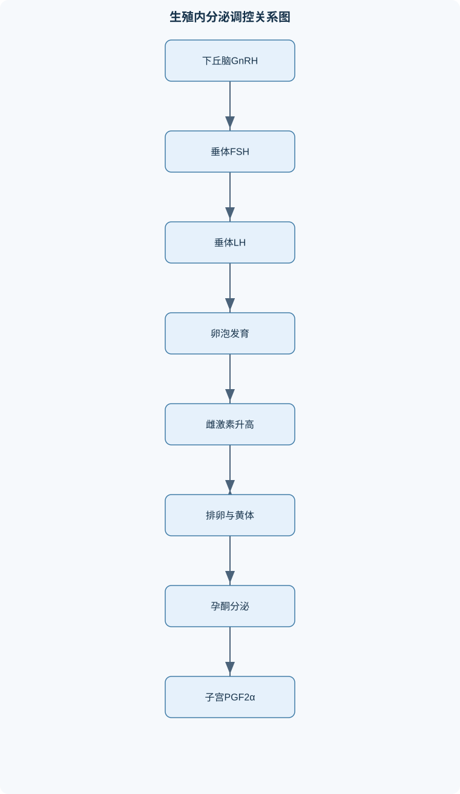
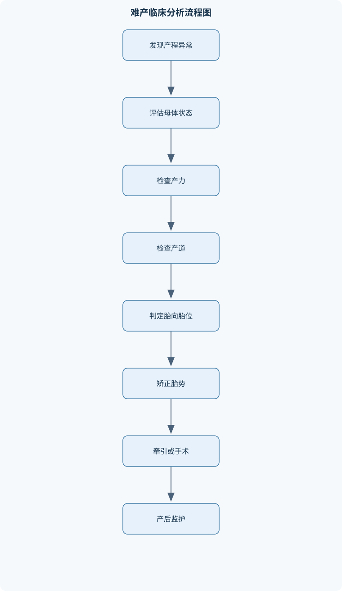

# 兽医产科学

## 一、课程整体知识框架

### 课程边界与先修知识

兽医产科学研究家畜、伴侣动物及部分经济动物的生殖生理、繁殖管理、妊娠、分娩、产后恢复及相关疾病的发生机制、临床诊断、处理原则和预防。课程对象包括牛、羊、猪、马、犬、猫等常见动物，但不同物种的发情周期、妊娠期、排卵机制、胎盘类型、分娩表现和疾病谱必须分别说明。先修知识包括动物解剖学、生理学、生物化学、胚胎学、微生物学、病理学、药理学、临床诊断学和动物饲养管理。课程边界不替代专门的兽医内科学、外科学、兽医繁殖生物技术、动物营养学和兽医公共卫生课程；涉及激素或药物处理时，应依据动物种类、妊娠状态、适应证、禁忌证、当地法规和兽医处方规范执行，不以固定剂量替代临床决策。





### 1. 学科对象、任务与边界

兽医产科学研究动物从性成熟、配子形成、发情与配种、受精、胚胎发育、妊娠、分娩、产后恢复到再次繁殖全过程中的生理规律、管理技术和疾病防治。其核心不是单纯“促进繁殖”，而是在动物福利、母体安全、胎儿存活、仔畜质量和群体生产效率之间建立可验证的诊断与管理决策。

课程对象包括牛、羊、猪、马、犬、猫等。不同物种的发情周期、排卵诱因、妊娠维持机制、胎盘结构和分娩表现不能互相套用。牛通常为自发排卵动物，发情周期约为一个月左右，妊娠期约九个月；羊的繁殖具有较明显季节性，妊娠期约五个月；猪为多排卵动物，妊娠期通常约三个半月；马为季节性多发情、自发排卵动物，妊娠期约十一个月；犬通常为季节性或非严格季节性单次发情，发情后黄体期较长，妊娠期按排卵或受精时间计算约两个月；猫为典型交配诱导排卵动物，交配刺激可诱发LH释放，妊娠期通常约两个月。上述时间为生理范围而非个体诊断标准，受品种、胎儿数、营养、疾病和配种日期记录误差影响。

课程边界包括繁殖生理和产科诊疗原则，但不替代兽医内科学、外科学、繁殖生物技术、动物营养学和兽医公共卫生课程。涉及激素、抗感染药物、镇痛、麻醉、剖腹产或产后急救时，必须结合种属、妊娠阶段、适应证、禁忌证、药物残留规定、当地法规和执业兽医处方。教材中的生理机制不能直接转化为固定剂量或个体化治疗方案。

### 2. 生殖器官与生殖内分泌基础

雌性生殖系统包括卵巢、输卵管、子宫、子宫颈、阴道和外阴。卵巢兼具配子发生和内分泌功能：卵泡产生雌激素，排卵后形成的黄体主要产生孕酮。输卵管承担卵母细胞运输、受精和早期胚胎发育的重要环境功能；子宫接受胚胎、形成胎盘并为胎儿提供营养交换环境；子宫颈在非发情期通常较紧闭，妊娠期形成屏障，分娩时逐步松弛开放。

雄性生殖系统包括睾丸、附睾、输精管、尿道及副性腺。睾丸曲细精管中的支持细胞参与精子发生，间质细胞在LH作用下产生睾酮；附睾承担精子成熟、浓缩和储存功能；副性腺分泌液体形成精浆，影响精子运动、营养和运输。FSH主要作用于卵泡、颗粒细胞和雄性支持细胞，LH主要参与排卵、黄体形成以及雄性间质细胞分泌睾酮。

下丘脑—垂体—性腺轴的基本因果链为：下丘脑脉冲式分泌GnRH，垂体前叶受其刺激释放FSH和LH，卵巢或睾丸产生性激素及抑制素，反过来调节下丘脑和垂体。GnRH不是垂体激素，也不能与FSH、LH归为同一层次；PRL或LTH主要参与乳腺发育、泌乳、母性行为及某些物种的黄体支持，不是典型意义上直接刺激配子发生的主要促性腺激素。

FSH、LH和性激素的关系不能简化为固定比例。卵泡发育可分为募集、选择、优势化和排卵前成熟。FSH促进早期卵泡生长及颗粒细胞功能；LH作用于卵泡膜细胞，促进雄激素合成，颗粒细胞再将部分雄激素转化为雌激素。优势卵泡产生较多E2并获得LH反应能力。当E2在特定周期阶段达到足够浓度并持续一定时间时，可由负反馈转为正反馈，形成LH峰；LH峰促使卵泡壁重塑、卵丘扩展、卵泡液压力和蛋白酶系统改变，最终发生排卵。

雌激素E2在低至中等水平时通常参与生殖道准备，并对下丘脑—垂体产生负反馈；在发情前特定背景下可对LH产生正反馈。孕酮P4由黄体产生，能使子宫内膜进入适宜胚胎发育的状态，抑制发情和过早子宫收缩，并参与维持妊娠。PGF2α主要由子宫内膜产生，在未妊娠时可引起黄体溶解，但其释放模式和黄体敏感性具有物种差异。OT即催产素，参与子宫收缩、排乳及部分物种的黄体调节。INH主要抑制FSH。MLT由松果体产生，受光暗周期调节，对羊、马等季节性繁殖动物的繁殖季节转换有影响。eCG总体偏FSH样作用并有一定LH样作用，hCG总体偏LH样作用，二者不可完全等同。

### 3. 发情周期、排卵与物种差异

发情周期通常可按卵泡期、发情期、排卵期和黄体期理解。卵泡期卵泡生长、E2升高，外生殖道充血，子宫和阴道分泌活动增强；发情期出现接受交配、站立反射、鸣叫、爬跨或活动增加等表现；排卵后卵泡壁黄体化，P4升高，进入黄体期；若未妊娠，子宫PGF2α引发黄体退化，P4下降，新一轮卵泡活动开始。

“发情”不能只靠单一行为判断。高产牛可能出现静默发情，马和犬的外部表现与排卵时间并不完全同步，猫若无交配刺激可能不发生排卵。诊断应结合行为、外阴变化、阴道分泌物、阴道细胞学、直肠或腹部超声、卵巢结构及既往记录。排卵时间还取决于物种是自发排卵还是交配诱导排卵。牛、羊、猪、马通常属于自发排卵；猫主要为交配诱导排卵。犬虽为自发排卵，但排出的卵母细胞还需经历一定成熟过程，因此配种时间不能简单按“出现发情即立即授精”处理。

季节性繁殖与光周期有关。长日照动物和短日照动物的繁殖季节不同，光照通过视网膜—松果体—MLT通路影响下丘脑GnRH释放。营养不足、过度消瘦、热应激、哺乳和疾病均可抑制GnRH脉冲，导致发情延迟、排卵障碍或受胎率下降。

### 4. 配种、采精与人工授精

发情和配种时机判断应先记录发情起始时间，再结合物种排卵规律和多项检查证据。自然交配管理需评估公畜性欲、肢蹄和生殖器官状态、配种次数、母畜接受程度以及传染病风险。人工授精则要求精液身份、保存条件、稀释比例、温度变化和输精部位均有记录。

精液检查包括射精量、颜色、气味、凝集、杂质、精子密度、总活力、前向运动、活率、畸形率和微生物学评价。精子活力反映运动能力，活率反映存活状态，密度反映单位体积内数量，受胎率则是最终繁殖结果，四者不能互相替代。

若射精量为 $V$，精子密度为 $C$，则总精子数为：

$$
N_{\text{total}}=V\times C
$$

若前向运动比例为 $p$，其中 $p$ 必须以 $0$ 到 $1$ 的小数表示，则总前向运动精子数为：

$$
N_{\text{progressive}}=V\times C\times p
$$

公式要求 $V$ 和 $C$ 的单位相容，例如 $V$ 用 mL、$C$ 用精子/mL，则结果为精子总数。该计算只估计数量和运动性，不代表完整授精能力；畸形率高、DNA损伤、细菌污染、冷冻损伤或样品检测延迟均可能使受胎率下降。不同物种精液浓度、精浆组成和保存方法差异明显，不能直接套用同一阈值。

### 5. 受精、早期胚胎发育与胚胎移植

精子进入雌性生殖道后需经过获能，膜性质和运动方式发生变化，随后发生顶体反应，释放有助于穿越卵丘和透明带的酶。精卵结合后，卵母细胞发生皮质反应和透明带改变，形成多精入卵阻滞。若多精入卵，染色体数目和胚胎发育通常异常。

受精卵依次经过卵裂、桑葚胚和囊胚阶段。早期卵裂主要增加细胞数而不明显增加总体积；囊胚形成滋养层、内细胞团和囊胚腔。胚胎在输卵管和子宫之间运输，必须在适宜时间进入子宫。着床或胎盘附着的形式受胎盘类型影响，牛、羊、马、猪和犬猫的胎盘结构与母胎界面不同，因而胎盘脱落、胎儿营养交换和免疫屏障也有差异。

母体识别妊娠是胚胎避免黄体溶解的信号过程，不同物种信号分子和作用方式不同。妊娠时胚胎或胎膜改变子宫内膜分泌模式，使PGF2α不能形成足以造成黄体溶解的有效脉冲；随后P4维持子宫内膜和妊娠环境。早期胚胎死亡可被吸收而不出现明显排出物，原因包括配子异常、染色体异常、母体发热、营养缺乏、内分泌失衡、感染和子宫环境异常。

胚胎移植的基本逻辑是：选择供体并进行超数排卵，采集质量合格的胚胎，再将胚胎移入生殖周期与胚胎阶段相匹配的受体。供体和受体的发情同步、黄体状态、胚胎质量和操作卫生共同决定成功率。胚胎移植属于繁殖生物技术范畴，不能用普通人工授精操作替代。

### 6. 妊娠生理、胎盘功能与妊娠诊断

妊娠期母体发生心肺负荷增加、腹腔器官位置改变、乳腺发育、代谢需求增加和免疫调节。胎膜包括绒毛膜、尿膜、羊膜等结构，胎液具有缓冲、润滑和保护作用。胎盘承担氧气、二氧化碳、营养物质和代谢产物交换，并分泌部分激素。胎盘类型和母胎组织接触层数存在物种差异，牛羊为子叶型胎盘，猪和马属于弥散型胎盘，犬猫为带状胎盘；不同类型决定胎盘排出方式、母体抗体向胎儿转移能力及新生仔对初乳的依赖程度。

妊娠诊断应依据配种日期、物种、妊娠阶段和检测条件选择方法。直肠检查适用于部分大动物，但需要受过训练的操作者，粗暴操作可能造成损伤；超声可观察胎囊、胚胎、胎心和胎儿结构，且可估计妊娠阶段；激素或妊娠相关标志物检测具有种属和时间限制。一次过早阴性不能完全排除妊娠，应根据孕周安排复查。假妊娠、持久黄体、子宫蓄脓和卵巢疾病可造成类似妊娠的表现。

妊娠期管理应兼顾体况、矿物质、能量、蛋白质、运动、疫病防控和环境卫生。过度肥胖增加难产和代谢病风险，过度消瘦则影响胚胎存活、胎儿生长和泌乳。妊娠后期胎儿快速生长，能量需要增加；多胎动物还可能因采食不足发生妊娠毒血症。

### 7. 分娩发动、正常分娩与难产

分娩发动是胎儿成熟、胎盘和母体内分泌共同作用的结果。胎儿下丘脑—垂体—肾上腺轴成熟后，胎儿肾上腺皮质醇增加，推动胎盘类固醇代谢改变；孕酮作用相对减弱，雌激素、松弛素和催产素作用增强，子宫肌对催产素敏感性提高。产程中的关键不是某一种激素单独升高，而是雌激素、孕酮、PGF2α、OT和松弛素在时间上的协调变化。

正常分娩必须同时具备三要素：产力、产道和胎儿。产力包括子宫收缩力和腹压；产道包括骨盆这一硬产道以及子宫颈、阴道、阴门等软产道；胎儿因素包括体型、胎向、胎位和胎势。胎向是胎儿纵轴与母体纵轴的关系，胎位是胎儿背部或脊柱相对于母体骨盆入口的方位，胎势是头、颈和四肢相对于躯干的屈曲或伸展状态。

正常分娩通常分为三期：第一期为子宫颈扩张和产道准备；第二期为胎儿排出；第三期为胎衣排出。牛常见胎儿纵向、背侧朝上、头颈前伸的正常姿势；羊、猪多胎分娩时应关注胎儿间隔和母体疲劳；马的分娩进展通常较快，延误处理可能迅速危及母体和胎儿；犬猫分娩可出现产力不足、胎儿过大或胎道阻塞，需结合胎儿数和影像检查。

难产可分为母体性、胎儿性和混合性。母体性因素包括骨盆狭窄、子宫扭转、子宫收缩无力和软产道阻塞；胎儿性因素包括胎儿过大、胎向横向、胎位异常、头颈或四肢屈曲、多胎拥挤和胎儿畸形。助产前必须评估母体全身状态、产道开放程度、胎儿活力和三要素。未确认胎位胎势前反复强力牵拉，可能造成阴道撕裂、子宫损伤、胎儿骨折或母体休克。无法安全矫正、母体或胎儿风险持续增加、产道严重阻塞或子宫扭转时，应及时进行手术评估，而不是无限延长产道操作。

### 8. 产后期、新生仔畜与泌乳

产后子宫复旧包括子宫体积缩小、组织修复

## 二、章节和模块划分

### 核心知识覆盖清单

本清单用于检查正文是否覆盖本课程的主要知识模块：

- **生殖器官与生殖内分泌基础**：雌性生殖器官结构与功能、雄性生殖器官结构与功能、下丘脑垂体性腺轴、GnRH脉冲与促性腺激素、FSH与卵泡发育、LH与排卵及黄体形成、雌激素与孕酮作用、抑制素催产素及前列腺素。
- **发情周期与排卵生理**：发情周期分期及变化、卵泡募集选择与优势化、卵泡膜细胞与颗粒细胞协同、雌激素正负反馈、LH峰与排卵机制、排卵类型及物种差异、黄体形成维持与退化、季节性发情与光周期。
- **配种与人工授精技术**：发情鉴定与配种时机、自然交配管理、采精方法与精液保存、精液一般性状检查、精子活力和密度检查、精子畸形率检查、精液微生物学评价、人工授精操作与受胎率分析。
- **受精与早期胚胎发育**：获能与顶体反应、精卵结合与多精入卵阻滞、卵裂与卵裂球、桑葚胚与囊胚形成、胚胎运输与定位、着床及母体识别妊娠、胚胎早期死亡与吸收、胚胎移植基本原理。
- **妊娠生理与妊娠诊断**：妊娠期母体变化、胎膜胎液与胎盘功能、胎儿生长及营养交换、妊娠识别机制、孕酮维持妊娠、妊娠诊断方法比较、直肠检查和超声检查、妊娠期饲养与保健。
- **分娩发动与正常分娩**：分娩发动的内分泌机制、雌激素孕酮比例变化、胎儿肾上腺与皮质醇作用、松弛素和催产素作用、产道产力胎儿三要素、胎向胎位胎势判定、分娩三期及正常过程、不同物种分娩管理。
- **难产诊断与助产**：难产分类与病因、母体性难产、胎儿性难产、产道检查与卫生要求、胎位胎势异常矫正、牵引和产科操作原则、剖腹产适应证判断、助产并发症与预防。
- **产后期与新生仔畜管理**：子宫复旧与恶露、胎衣排出和胎衣不下、产后感染与毒血症、产后低血钙和子痫、产后泌乳与排乳反射、初乳摄取与被动免疫、新生仔畜体温和呼吸适应、新生仔畜常见疾病。
- **繁殖障碍与妊娠异常**：不孕和不育的分类、卵泡囊肿和黄体囊肿、持久黄体与排卵障碍、子宫内膜炎和子宫蓄脓、流产早产小产鉴别、胎儿干尸化和气肿性流产、妊娠毒血症、繁殖障碍的群体性调查。
- **繁殖管理与综合病例分析**：同期发情技术原理、超数排卵基本原理、繁殖记录与受胎率、空怀日和产犊间隔分析、母畜繁殖性能评价、公畜繁殖力评价、疾病防控与生物安全、个体病例和群体问题整合诊断。


### 1. 生殖器官与生殖内分泌基础

兽医产科学首先建立在雌、雄性生殖器官的结构—功能关系上。雌性卵巢同时承担卵母细胞发育和激素分泌功能；卵泡主要分泌雌二醇（E2），排卵后形成的黄体主要分泌孕酮（P4）。输卵管不仅运输卵母细胞和早期胚胎，也是受精及受精后早期发育的重要场所。子宫负责胚胎着床、胎膜形成、胎儿营养交换及分娩时的收缩；子宫颈在非发情期和妊娠期形成屏障，临近分娩时逐步软化、松弛和开放。

雄性睾丸由曲细精管和间质组织组成。曲细精管内的支持细胞参与精子发生，并分泌抑制素；间质细胞在LH作用下产生睾酮。附睾完成精子成熟、浓缩和储存，输精管负责运输精子，副性腺分泌液与精子混合形成精浆。精液中的精子数量、运动能力和形态，既受睾丸精子发生影响，也受附睾成熟、采精方法、温度和保存条件影响。

下丘脑—垂体—性腺轴的基本调控顺序为：下丘脑脉冲式释放GnRH，垂体前叶在GnRH作用下分泌FSH和LH，性腺产生E2、P4、睾酮和INH，并对下丘脑和垂体进行反馈调节。FSH主要促进卵泡募集、颗粒细胞功能和雄性支持细胞活动；LH参与卵泡膜细胞类固醇生成、排卵、黄体形成以及雄性间质细胞分泌睾酮。GnRH属于下丘脑激素，PRL主要参与乳腺发育、泌乳、母性行为和部分物种的黄体支持，不能将这些激素笼统归为同一种“促性腺激素”。

卵泡发育可分为募集、选择、优势化和排卵前成熟。FSH支持早期卵泡发育，LH促进卵泡膜细胞产生雄激素，颗粒细胞在芳香化酶作用下将部分雄激素转化为E2。E2在周期早期和中期通常对下丘脑—垂体产生负反馈；在发情前特定的浓度、持续时间和生理背景下，可转为正反馈，引起LH峰。LH峰导致卵泡壁重塑、卵丘扩展、局部蛋白酶活化和排卵。排卵后卵泡壁血管化并黄体化，黄体细胞产生P4，使子宫内膜适于胚胎发育，并抑制发情和过早子宫收缩。

常见考法是给出发情前后E2、P4和LH变化曲线，要求说明因果关系。完整回答应指出：优势卵泡发育使E2升高；在适当背景下E2正反馈形成LH峰；LH峰诱导排卵；排卵后形成黄体并分泌P4；未妊娠时子宫PGF2α作用于黄体，引起黄体退化，P4下降，新的卵泡波和发情周期重新出现。具体时序必须结合动物种类，不能套用单一模式。

### 2. 发情周期、排卵及主要物种差异

发情周期可按卵泡期、发情期、黄体期和间情期等阶段理解，但不同物种的分期表现和排卵机制不同。牛通常为自发排卵动物，周期平均约三周，发情鉴定以站立接受爬跨、活动增加、外阴和阴道分泌物变化为重要线索；隐性发情、热应激、跛行和产后能量负平衡可降低行为表现。羊的周期通常短于牛，具有明显季节性，短日照条件下繁殖活动增强；在非繁殖季可能出现发情不明显或卵巢活动下降。

猪属于多排卵动物，发情周期通常约三周，静立反射、耳部和外阴变化以及公猪接触反应可辅助判断。母猪排卵发生在发情期的一定阶段，配种过早或过晚都会使精子与卵母细胞不同步，从而降低受胎率和产仔数。母马为季节性多发情动物，通常在日照较长季节繁殖，周期约三周；发情表现包括接近公马、频繁排尿和外阴变化，排卵多发生在发情末期附近。马的排卵时间与配种安排关系密切，临床上常需结合卵巢超声判断卵泡成熟度。

犬的发情周期与农场动物不同，发情间隔较长，发情后黄体期往往较长，未妊娠时也可出现明显的P4分泌和假妊娠表现。仅凭腹围或乳房变化不能确认妊娠。猫为交配诱导排卵动物，交配刺激经神经反射促进GnRH和LH释放，继而诱发排卵；若未发生有效交配，可能不能形成足够的黄体。因此，猫的发情、排卵和妊娠判断必须考虑交配史。

排卵可分为自发排卵和交配诱导排卵。牛、羊、猪、马和犬通常属于自发排卵动物；猫是典型的交配诱导排卵动物。季节性繁殖还受到褪黑素和光周期影响，绵羊多表现为短日照繁殖，马多表现为长日照繁殖。同期发情的本质是通过调节黄体寿命、卵泡波或排卵时间，使一群母畜在相近时间出现发情或排卵；其实施必须考虑妊娠状态、卵巢功能、动物种类、法规和兽医处方要求，不能把某种激素方案直接跨物种复制。

### 3. 配种、采精与人工授精

发情鉴定的目标不是简单确认“是否发情”，而是估计排卵窗口，并据此安排自然交配或人工授精。判断时应综合动物种类、发情起始时间、行为表现、外阴和阴道变化、阴道细胞学、卵巢超声以及既往周期记录。若行为表现与卵巢检查结果不一致，应复查而不能强行确定配种时间。静默发情、季节性繁殖动物和交配诱导排卵动物尤其需要依靠多项证据。

自然交配管理要评估公畜性欲、肢体和生殖器官状态、精液质量、母畜发情阶段以及交配安全。过度频繁使用种公畜可能造成精液量和精子成熟度下降；长期不使用也可能影响采精表现。人工授精前要核对母畜身份、发情记录、精液批号、保存状态和操作器械，避免样本混淆和交叉污染。

精液评价应按“样本身份与保存条件—一般性状—显微指标—微生物学—繁殖结果”的顺序进行。一般性状包括射精量、颜色、气味、凝集、杂质和异常稀释；显微评价包括精子密度、总运动、前向运动、活率和畸形率。精子活力指运动能力，活率指存活比例，密度指单位体积中的精子数量，三者不能互相替代。精子污染、温度骤变、渗透压不适、稀释液不合适和解冻损伤，均可导致检测结果下降。

精液计算题中，若射精量为 $V$，精子密度为 $C$，前向运动比例为 $M$，则：

$$
N_{\mathrm{total}}=V\times C
$$

$$
N_{\mathrm{progressive}}=V\times C\times M
$$

其中，$V$必须与$C$的体积单位一致，$M$应以小数表示，例如前向运动率为 $60\%$时取 $0.60$。该结果只反映数量和前向运动能力，不能替代畸形率、精子膜完整性、顶体状态、微生物污染和实际受胎率评价。若题目没有给出单位、检测温度或样本状态，应先说明数值比较存在边界。

### 4. 受精、早期胚胎发育与胚胎移植基础

受精通常发生于输卵管壶腹部或其邻近区域。精子进入雌性生殖道后需要经历获能，细胞膜和运动方式发生改变，随后在透明带识别和顶体反应作用下穿过卵丘及透明带。精卵膜融合后，卵母细胞完成减数分裂，发生皮质反应和透明带改变，以阻止多精入卵。多精受精会导致染色体异常，通常不能形成正常胚胎。

受精卵经卵裂形成多个卵裂球，继续发育为桑葚胚和囊胚。早期胚胎在输卵管和子宫之间运输，运输速度必须与子宫内膜发育阶段相匹配。胚胎过早或过晚进入子宫，均可能影响继续发育。囊胚形成后，胚胎与母体之间通过物种特异性信号建立妊娠识别。牛、羊等反刍动物的胚胎通过延长和分泌信号改变子宫内膜分泌模式，抑制PGF2α的黄体溶解作用；猪胚胎通过胚胎信号改变子宫内膜对黄体的作用方式；马胚胎在子宫内迁移与妊娠识别密切相关。不能将某一物种的妊娠识别机制直接套用到所有动物。

胚胎早期死亡可能表现为胚胎被吸收、母畜返情或妊娠检查由阳性转为阴性。原因包括配子质量差、染色体异常、子宫炎症、黄体功能异常、热应激、营养失衡、感染、毒物和操作损伤。胚胎移植的基本原则是选择发育阶段和质量相近的供体胚胎，准备生殖周期同步的受体，并保证移植过程中的无菌、低损伤和记录可追溯。胚胎形态正常并不等于一定具有较高妊娠能力，还需考虑受体子宫环境和移植技术。

### 5. 妊娠生理、胎盘功能与妊娠诊断

妊娠建立后，母体发生心血管、呼吸、消化、代谢和乳腺变化。随着胎儿和胎膜增长，母体对能量、蛋白质、矿物质和氧的需求增加；妊娠后期若胎儿数多、采食不足或体况过差，容易出现能量负平衡。妊娠母畜管理的核心是维持合理体况、减少应激、预防传染病和保证分娩前后饲养衔接，而不是盲目增加精料。

胎盘由胎儿胎膜和母体子宫组织共同构成，承担气体交换、营养转运、代谢废物排出和内分泌功能。牛、羊胎盘由多个胎盘单位组成，胎儿绒毛与母体子宫阜形成胎盘结；猪和马的胎盘分布较弥散；犬、猫为带状胎盘。胎盘屏障和结构不同，决定母体抗体向胎儿转移的程度存在差异，因此新生仔畜是否必须依赖初乳获得被动免疫，不能仅凭物种名称作简单推断。

妊娠诊断要结合配种日期、物种、既往繁殖史、临床表现和检测时间。直肠检查适用于部分大型动物，可评估子宫大小、内容物和卵巢黄体，但必须由受训人员规范操作，避免造成直肠损伤。超声检查可观察胚胎囊、胎儿结构、胎心、胎膜和胎盘变化，适合早期妊娠判断及胚胎活力评价。犬猫常用腹部超声，并可结合影像和实验室指标；单次早期阴性结果不能完全排除妊娠。

妊娠诊断流程包括：核对配种记录；询问返情、阴道分泌物和全身状况；根据种属和孕周选择超声、直肠检查或实验室方法；将结果与假妊娠、子宫炎、子宫蓄脓、持久黄体和妊娠丢失进行鉴别；在结果不确定或孕周过早时安排复查。考试中常要求比较直肠检查与超声检查的优缺点，答案应说明检查时间、操作者经验、动物种类、设备条件和假阴性风险。

### 6. 分娩发动、正常分娩与物种特点

分娩发动是胎儿成熟、胎儿—胎盘信号和母体内分泌变化共同作用的结果。胎儿下丘脑—垂体—肾上腺轴成熟后，胎儿皮质醇增加，促进胎盘类固醇代谢改变，使雌激素相对作用增强、孕酮维持作用减弱，并促进前列腺素、松弛素和催产素相关过程。雌激素有利于子宫肌兴奋性、子宫颈软化和产道准备；松弛素促进骨盆韧带及软产道松弛；催产素主要增强子宫收缩，也参与排乳。不同物种中各激素作用的时间和强度存在差异。

正常分娩必须同时满足产力、产道和胎儿三个条件。产力包括子宫收缩和腹压；产道包括骨盆等硬产道以及子宫颈、阴道和阴门等软产道；胎儿因素包括体型、姿势、胎向和胎位。胎向是胎儿纵轴与母体纵轴的关系，胎位是胎儿背部或脊柱相对母体骨盆的方位，胎势是头、颈和四肢相对躯干的屈曲或伸展状态。

分娩可分为三个阶段。第一期为子宫开始规律收缩、子宫颈扩张和产道准备；第二期为胎儿进入产道并排出；第三期为胎膜和胎衣排出。牛、羊和猪常需观察产程进展及胎儿数目；母猪还要注意产仔间隔和仔猪窒息风险。马的第二期分娩通常进展较快，胎膜异常或胎儿姿势异常时延误风险高。犬猫分娩时应结合产程、胎儿数和影像检查判断是否异常，不能单凭间歇性喘息或腹部收缩作出难产诊断。

胎向纵向、胎位上位、头颈及前肢伸直，通常是较有利的正生姿势，但能否顺利排出仍取决于胎儿大小、骨盆宽度和产力。考试题若描述“胎儿纵轴与母体一致、背部朝向母体背侧、头颈和前肢伸直”，应答为纵向、上位、正生且姿势伸展，随后还要说明需继续评估产道和产力。

### 7. 难产诊断、助产与剖腹产判断

难产是胎儿不能在合理产程内安全排出，或继续等待将危及母体、胎儿及新生仔的状态。病因可分为母体性、胎儿性和综合性。母体性因素包括骨盆狭窄、子宫扭转、子宫收缩无力、子宫颈开放不全、软产道水肿和母体衰弱；胎儿性因素包括胎儿过大、双胎同时进入产道、胎向横向、胎位异常、头颈或肢体屈曲以及胎儿死亡后体积或姿势改变。

现场处理应先评估母体意识、呼吸、循环、出血、脱水和感染风险，再判断产力、产道和胎儿。检查前应固定动物，清洁外阴，使用足够润滑，并遵守清洁和防污染要求。未确认胎向、胎位和胎势前，不能反复强力牵拉。若胎儿仍有活力且可通过矫正进入产道，应先将屈曲的头颈或肢体伸展，解除嵌顿，再以与母体收缩相协调的低创伤方式牵引。牵引方向和力度必须遵循产道轴线，防止阴道撕裂、子宫损伤、胎儿骨折和母体休克。

当产道严重狭窄、子宫扭转无法纠正、胎儿无法安全矫正、胎儿过大、母体状态恶化或经合理助产仍不能排出时，应及时考虑剖腹产或转诊。药物促进子宫收缩不能代替产道和胎儿评估；若存在机械性阻塞，盲目增强收缩可能加重子宫破裂和胎儿损伤。难产后的监护还应包括胎衣排出、出血、体温、恶露、子宫复旧、乳房状况和新生仔吸吮情况。

### 8. 产后恢复、新生仔管理与常见疾病

产后期包括子宫复旧、恶露排出、乳腺泌乳、母体代谢恢复和再次发情准备。正常恶露可随时间发生颜色和性状变化，但恶臭、脓性分泌物、持续发热、食欲下降、精神沉郁或子宫复旧迟缓提示产后子宫感染等异常。胎衣排出时间具有物种差异，胎衣不下可继发子宫炎、全身炎症和繁殖力下降，处理应根据母体状态、胎衣情况和感染风险制定，不能强行撕扯胎衣。

泌乳和排乳是两个不同过程。催乳素、营养状态和乳腺细胞功能主要影响乳汁合成；乳头刺激引起神经传入，促进催产素释放，催产素使乳腺肌上皮细胞收缩，乳汁才被排出。初乳含有免疫球蛋白、能量和多种生物活性物质，新生仔应尽早、足量获得适宜初乳。初乳管理失败可造成低血糖、低体温、脐部感染和新生仔败血症风险增加。

新生仔出生后应依次评估呼吸、心率或循环、体温、黏膜颜色、吞咽和吸吮反射。对呼吸不良者，首先清理气道、保持体温并进行规范复苏；对虚弱、不能吸吮或体温过低者，应及时进行兽医评估。牛、羊、猪等仔畜出生后体温下降较快，犬猫幼仔也容易因体温调节不完善而出现低体温和低血糖。不同胎盘结构导致胎儿获得母源抗体的方式不同，因此初乳摄取和被动免疫评估必须结合物种。

产后低血钙可表现为震颤、步态异常、卧地、肌肉无力或意识改变；犬猫产后子痫常见于泌乳期母体，焦躁、喘息、震颤和痉挛时应优先考虑，但必须鉴别低血糖、中毒、癫痫和感染。处理顺序是保障气道、呼吸和循环，检测血钙及相关指标，并在兽医监护下进行钙代谢支持和心电监测。具体制剂、浓度、给药速度和哺乳安排不能用固定数值替代个体化处方。

### 9. 繁殖障碍、妊娠异常与群体分析

不孕是未能建立妊娠，不育可理解为妊娠建立或繁殖结果不能正常完成；实际调查时还需区分发情障碍、配种失败、受精失败、胚胎早期死亡、流产、胎儿死亡和产后再次受胎延迟。卵泡囊肿、黄体囊肿、持久黄体和排卵障碍必须结合卵巢结构、排卵情况、激素环境及发情表现鉴别，不能仅凭一次触诊或单个激素值诊断。

子宫内膜炎可降低胚胎存活和受胎率；犬猫子宫蓄脓常发生于发情后孕酮环境，开放型可见阴道分泌物，闭锁型可能无分泌物而出现腹围增大、精神沉郁和全身中毒表现。闭锁型、脱水、休克或全身状态恶化时属于高风险急症，应结合血液检查、腹部超声和全身状态制定处理方案。

流产鉴别要同时依据妊娠阶段、胎儿是否存活及胎儿组织变化。早期胚胎死亡并被母体吸收属于胚胎吸收；不足月排出且仍有存活可能的胎儿偏向早产；排出死亡但尚未明显干尸化或腐败的胎儿通常称小产；胎儿在子宫内死亡后水分逐渐吸收、组织变干可形成干尸化；腐败性流产则常伴胎儿和胎膜腐败、恶臭及母体感染风险。

群体性繁殖障碍调查应从时间、空间、胎次、品种、饲养单元和配种批次进行分层。受胎率可表示为：

$$
R=\frac{N_{\mathrm{pregnant}}}{N_{\mathrm{eligible}}}\times100\%
$$

其中，$N_{\mathrm{pregnant}}$为规定时间点确认妊娠的母畜数，$N_{\mathrm{eligible}}$为符合统计条件并进入配种或授精分母的母畜数。空怀日通常为分娩后至再次确认妊娠之间的未妊娠天数，但必须预先统一起止点。受胎率下降时，应同时检查发情漏检、配种时机、精液质量、公畜繁殖力、子宫疾病、营养、热应激和记录偏差，不能把原因简单归于单一因素。

### 10. 常见综合病例与工作流程

#### 发情与配种时机判定

输入包括物种、发情记录、行为表现、外阴和阴道变化、卵巢或子宫检查结果；输出为发情阶段和建议配种窗口。工作步骤为记录发情起始时间，结合外部表现和适用的细胞学或超声结果，判断是否接近排卵，再依据物种的排卵规律安排配种。若记录与检查结果矛盾，应重复检查。其适用边界是必须有可靠的配种记录和基本检查条件，静默发情、季节性发情和猫的交配诱导排卵需调整流程。

#### 难产现场分析

输入包括产程时间、母体全身状态、产力、产道、胎向、胎位、胎势和胎儿活力；输出为观察、矫正、牵引、药物辅助或手术转诊的决策。步骤为先排除休克和严重出血，再进行卫生条件下的产道检查，明确三要素中哪一环节异常；可矫正者先纠正胎势，随后采用低创伤牵引；不能纠正或母体恶化时立即转入手术处理。关键不变量是不得在未确认机械性阻塞前强行增强宫缩或反复牵拉。

#### 流产病例调查

输入包括流产时间、妊娠阶段、母畜病史、胎儿胎膜、饲料和环境资料；输出为流产类型、病因分层和群体防控方案。调查时先隔离病例并记录母畜和群体资料，再规范采集胎儿、胎膜、母体血液及必要环境样本，同时检查感染、营养、霉菌毒素、毒物、应激、遗传和胎盘异常。实验室阳性结果必须与病理和临床资料对应，阴性结果也要考虑采样时机、样本腐败、运输和污染造成的假阴性。

#### 妊娠后期绵羊能量代谢异常

妊娠后期母羊，尤其多胎母羊，胎儿生长导致能量需求上升；若采食不足或体况过低，脂肪动员增强，酮体增加，可能出现食欲减退、精神沉郁、步态异常和卧地。诊断应结合妊娠阶段、胎儿数、体况、血糖、血酮、脱水和酸碱状态，并鉴别低血钙、消化道疾病和中毒。处理原则是纠正能量失衡、维持水电解质和酸碱状态，并依据母体和胎儿风险决定继续妊娠或采取其他产科措施，不能仅凭神经症状确诊。

#### 犬产后抽搐

母犬产后哺乳期出现焦躁、喘息、震颤或肌肉痉挛，应优先考虑产后低血钙性子痫，但必须检测血钙并鉴别低血糖、毒物、癫痫和感染。首先保证气道和环境安全，防止母犬及幼犬受伤，必要时暂时停止幼犬持续吸乳；随后由兽医进行钙代谢支持和心电监护，并重新评估哺乳、营养和复发风险。具体药物、浓度、给药速度和监护要求不得由教材固定数值替代。

#### 犬子宫蓄脓

未绝育母犬在发情后出现饮水增加、精神沉郁、食欲下降、腹围增大或阴道分泌物时，应考虑子宫蓄脓，并与妊娠、假妊娠、阴道炎和其他腹腔疾病鉴别。开放型可有脓性分泌物，闭锁型可能无分泌物但全身毒性更重。诊断需结合发情史、体格检查、血液检查和腹部超声；闭锁型、休克、脱水或腹膜炎风险高时应按急症处理，治疗方案须由兽医根据繁殖价值和全身风险决定。

## 三、核心概念的详细解释

### 1. 生殖器官与下丘脑—垂体—性腺轴

雌性生殖系统由卵巢、输卵管、子宫、子宫颈、阴道和外阴组成。卵巢同时承担卵母细胞发育和内分泌功能：发育中的卵泡主要产生雌二醇（E2），排卵后的黄体主要产生孕酮（P4）。输卵管完成卵母细胞运输、受精及早期胚胎发育；子宫接受胚胎、形成胎盘并维持胎儿生长；子宫颈在妊娠期形成屏障，分娩时逐步软化和开放。

雄性生殖系统包括睾丸、附睾、输精管、尿道和副性腺。睾丸曲细精管内的支持细胞参与精子发生，间质细胞在促黄体素（LH）刺激下产生睾酮；附睾承担精子成熟、浓缩和储存功能；副性腺分泌物与精子混合形成精浆，影响精子运动、营养和运输。

下丘脑—垂体—性腺轴的基本过程为：下丘脑脉冲式释放促性腺激素释放激素（GnRH），垂体前叶受刺激后释放促卵泡素（FSH）和LH，性腺产生E2、P4、睾酮及抑制素（INH），这些激素再对下丘脑和垂体进行反馈调节。GnRH属于下丘脑激素，FSH和LH属于垂体促性腺激素，催乳素（PRL或LTH）主要参与乳腺发育、泌乳、母性行为和部分物种的黄体支持，不能把这些激素笼统归为同一类。

GnRH的脉冲频率和振幅会影响FSH、LH的释放，但不存在适用于所有物种的固定比例。一般而言，较合适的FSH作用有利于卵泡募集和颗粒细胞发育，LH作用于卵泡膜细胞，促进雄激素形成；颗粒细胞在FSH和芳香化酶系统参与下，将部分雄激素转化为E2。优势卵泡形成后，E2分泌增加，在特定浓度、持续时间和周期背景下，反馈方向可由负反馈转为正反馈，诱发LH峰。

### 2. 发情周期、卵泡发育和排卵

发情周期可从卵泡期、发情期、排卵期和黄体期理解，但不同物种的分期表现和持续时间并不完全一致。卵泡发育通常经历募集、选择、优势化和排卵前成熟四个功能阶段。募集是多个卵泡在FSH支持下开始生长；选择是部分卵泡获得继续发育优势；优势化表现为一个或少数卵泡具有更强的E2分泌能力和LH反应能力；排卵前成熟包括卵丘扩展、卵母细胞成熟、卵泡壁重塑和排卵准备。

LH峰可通过多条途径促成排卵：促进卵泡壁局部蛋白酶和炎症样介质活动，使胶原结构降解；改变卵泡液压力和血流；诱发卵丘扩展及卵母细胞成熟。排卵后，残留的卵泡壁细胞发生黄体化、血管化，形成黄体并分泌P4。黄体使子宫内膜进入适于胚胎发育的状态，并抑制发情行为和新的排卵。

自发排卵动物在无交配刺激时也能按周期发生排卵，牛、羊、猪、马通常属于这一类。猫是典型的交配诱导排卵动物，交配刺激通过神经内分泌反射促进LH释放；犬通常为自发排卵动物。排卵类型直接影响发情鉴定、授精时间和妊娠诊断，不能将猫的排卵规律套用于牛或犬。

黄体退化主要与子宫内膜释放PGF2α及黄体对其的敏感性有关。未妊娠时，子宫内膜的周期性信号可诱导黄体溶解，P4下降，卵泡重新募集。妊娠时，胚胎通过物种特异性的母体识别妊娠信号，抑制或改变子宫内膜的黄体溶解信号。不同物种的胚胎信号、作用时间和胎盘参与程度不同，因此不能以单一机制解释全部动物。

### 3. 主要物种的繁殖特点

| 物种 | 发情与排卵特点 | 妊娠期的通常范围 | 产科关注点 |
|---|---|---:|---|
| 牛 | 多为自发排卵，发情行为和站立反射较重要 | 约九个月 | 难产、胎衣不下、产后子宫感染和低血钙 |
| 羊 | 季节性繁殖较明显，多为自发排卵 | 约五个月 | 多胎、妊娠毒血症、产后低血钙和胎膜异常 |
| 猪 | 多排卵，发情期需结合静立反射判断 | 约三个半月 | 多胎分娩、产力不足、产后无乳或乳房炎 |
| 马 | 季节性多发情，自发排卵 | 约十一个月 | 妊娠期长、胎盘异常、分娩进程快、胎儿窒息 |
| 犬 | 发情后黄体期较长，假妊娠可能明显 | 约两个月 | 胎儿过大、产力不足、子宫蓄脓和产后低血钙 |
| 猫 | 交配诱导排卵 | 约两个月 | 排卵是否发生、胎儿数、产力不足和胎儿阻塞 |

这些妊娠期只能作为生理范围，不能替代个体判断。配种日期记录不准确、排卵与受精时间存在差异、胎儿数不同、品种差异和疾病均可使实际分娩日期偏离平均值。

### 4. 配种、人工授精与精液评价

发情鉴定应综合行为、外阴变化、阴道分泌物、子宫颈状态、卵巢超声表现和必要的细胞学或激素资料。单一指标容易误判。例如，外阴肿胀只能说明生殖道受雌激素影响，不能单独证明已经接近排卵；孕酮升高可提示排卵后黄体活动，但其解释必须结合物种和检测时间。

精液质量评价至少包括射精量、颜色和气味、精子密度、总活力、前向运动、活率、畸形率、凝集情况、污染情况及保存条件。精子活力表示运动能力，活率表示存活状态，密度表示单位体积内精子数量，受胎率则是最终繁殖结果，四者不能互相替代。精液外观正常也不能排除低活力、畸形率升高或微生物污染。

人工授精的受胎结果由多因素共同决定：母畜是否处于适宜发情阶段，精液是否在采集、稀释、冷却、保存和解冻过程中受到损伤，输精部位是否正确，母畜子宫环境是否适宜，以及公畜精液是否具有足够受精能力。若受胎率降低，应同时调查公畜、母畜、操作、时间和环境，而不能仅归因于“母畜不孕”。

### 5. 受精、早期胚胎发育和胚胎死亡

精子进入雌性生殖道后需经历获能，获能包括精子膜和表面蛋白变化，使其具备与卵母细胞结合和发生顶体反应的能力。顶体反应释放相关酶并改变精子头部结构，帮助精子穿过卵丘和透明带。精卵膜融合后，卵母细胞发生皮质反应和透明带改变，形成多精入卵阻滞，防止多个精子同时参与受精。

受精卵随后进行卵裂，形成多个卵裂球；继续发育形成桑葚胚，再形成具有内细胞团、滋养层和腔体的囊胚。胚胎在输卵管和子宫之间运输，其速度必须与子宫内膜容受性相协调。胚胎到达适宜部位后，通过着床或胎盘附着建立母胎联系。胚胎早期死亡可表现为胚胎被吸收、再次发情或妊娠诊断由阳性转为阴性；其原因包括配子质量不良、染色体异常、母体营养不足、感染、子宫环境异常、热应激和管理操作损伤。

胚胎移植的基本逻辑是：选择遗传和繁殖性能合适的供体，获得可移植胚胎；准备与胚胎发育阶段和周期相匹配的受体；将胚胎置于适宜子宫部位；随后通过妊娠诊断和产犊记录评价移植结果。供体排卵数、胚胎质量、受体黄体功能和移植操作均会影响结果。

### 6. 妊娠、胎盘与妊娠诊断

妊娠不是单一器官的变化，而是母体、胎儿和胎盘共同作用的状态。母体通常出现采食、代谢、血容量、乳腺、腹围和行为变化；子宫逐渐扩大，胎膜和胎液增多，胎儿通过胎盘获得氧和营养，并将二氧化碳和代谢产物转移给母体。

牛、羊为子叶型胎盘，猪和马为弥散型胎盘，犬和猫为带状胎盘。胎盘结构影响母胎交换方式、胎儿抗体获得途径和产后初乳依赖程度。多数家畜新生仔在出生时免疫保护不足，必须及时获得质量合格的初乳；这既是营养问题，也是被动免疫问题。

妊娠诊断流程应先核对配种日期和物种，再根据孕周、设备和动物状态选择超声、直肠检查、激素或妊娠相关标志物检测。超声可观察胎囊、胚胎、胎心和胎儿结构；直肠检查适用于部分大动物，但必须由训练有素人员完成；一次过早阴性结果不能完全排除妊娠。假妊娠、子宫蓄脓、持久黄体和卵巢疾病均可造成类似妊娠的表现。

### 7. 分娩、难产与产后恢复

分娩发动涉及胎儿肾上腺皮质醇、胎盘类固醇转换、孕酮作用相对减弱、雌激素和松弛素作用增强，以及子宫对催产素敏感性提高。PGF2α和催产素参与子宫收缩，但正常分娩不是某一种激素单独升高的结果，而是胎儿成熟、胎盘信号和母体神经内分泌变化的协调结果。

正常分娩需要产力、产道和胎儿三要素共同协调。胎向描述胎儿纵轴与母体纵轴的关系；胎位描述胎儿背部或脊柱相对于母体骨盆入口的方位；胎势描述头、颈和四肢相对于躯干的屈曲或伸展状态。三者必须分别判断。牛胎儿“纵向、上位、头颈和前肢伸直”通常是有利于进入产道的状态，但仍需结合胎儿大小、骨盆和产力判断是否能够自然排出。

产程通常分为子宫颈扩张期、胎儿排出期和胎衣排出期。羊和猪的多胎分娩需要关注胎儿间隔和母体疲劳；马分娩进程常较快，异常时需迅速评估；犬猫应结合胎儿数、胎儿大小、产力和影像学结果判断是否难产。

难产可能由骨盆狭窄、子宫扭转、子宫收缩无力、子宫颈或阴道阻塞、胎儿过大、胎向横向、胎位异常、头颈或四肢屈曲、胎儿畸形等引起。助产时应先评估母体生命状态和胎儿活力，清洁外阴并规范检查产道，确认能否矫正胎位胎势后再进行低创伤牵引。若无法安全矫正、牵引阻力异常、母体损伤风险升高或全身状态恶化，应停止反复牵拉并进行手术评估。

产后应观察子宫复旧、恶露、胎衣排出、体温、采食、乳房和泌乳。正常恶露不应简单等同于化脓性子宫炎；若分泌物恶臭、颜色异常、持续时间过长并伴发热、精神沉郁或采食下降，应考虑产后感染。产后低血钙可表现为震颤、步态异常、卧地、肌无力或意识改变，犬猫哺乳期抽搐还应鉴别低血糖、中毒、癫痫和感染。处理优先级是保障呼吸循环、检测关键指标、纠正代谢紊乱并进行监护，不能凭单一症状自行确定病因或使用固定药物剂量。

### 8. 繁殖障碍、流产和群体调查

不孕是未能建立妊娠或反复不能受胎的表现，不育则更强调生殖能力丧失或严重降低。卵泡囊肿、黄体囊肿、持久黄体、排卵障碍、子宫内膜炎、子宫蓄脓、精液质量下降和配种时机错误均可能造成繁殖障碍。卵泡囊肿与黄体囊肿不能仅凭卵巢体积区分，还需结合是否排卵、组织来源、P4水平、发情表现和超声特征。

胚胎早期死亡后被吸收属于胚胎吸收；不足月排出活胎偏向早产；排出死亡但尚未出现明显干尸化或腐败的胎儿通常称小产；胎儿失水、组织干燥并长期滞留可形成干尸化；胎儿和胎膜被细菌分解并产生气体，则可能出现气肿性腐败。流产调查必须同时记录妊娠阶段、胎儿是否存活、胎膜状态、母体症状、群体发病情况、饲料和环境暴露。

妊娠毒血症常见于妊娠后期，尤其是多胎或采食不足的母羊。胎儿生长使葡萄糖需求增加，母体若能量摄入不足或糖异生能力不能满足需要，就会发生脂肪动员和酮体增加。诊断应结合妊娠阶段、胎儿数、体况、血糖、血酮、脱水、神经症状和其他疾病检查，不能仅凭“卧地”或“有酮体”确诊。

## 四、重要定义、公式、定理和推导

### 专业审校补充：关键定义与适用边界

胎盘类型决定母体抗体能否在出生前大量进入胎儿循环，也决定新生仔畜对初乳的依赖程度。牛、羊、猪和马的胎盘屏障较厚，母源免疫球蛋白基本不能通过胎盘，因此仔畜出生时血液中的免疫球蛋白很少，必须依靠出生后尽早摄入足量、质量合格的初乳获得被动免疫；犬、猫的胎盘屏障相对较薄，可有少量产前抗体转移，但仍不足以替代初乳。这里的“初乳摄取”不等于“已经获得免疫”，还必须考虑摄入时间、摄入量、初乳免疫球蛋白浓度、仔畜吸吮能力和肠道吸收状态。出生后肠道对完整免疫球蛋白的吸收能力会随时间下降，早产、难产窒息、低体温、母畜乳房疾病或初乳污染均可造成被动免疫失败。因此，不能用母畜是否有乳汁、仔畜是否吸过乳或外观是否活泼单独判断免疫是否充分；应结合物种、出生后时间、初乳记录和血液学或血清学复核。该边界不适用于把所有新生仔畜的免疫水平按同一标准比较。


### 1. 生殖内分泌调控的因果推导

典型卵泡期可按以下顺序推导：

1. FSH升高或作用增强，促进一批卵泡募集和颗粒细胞发育。
2. LH作用于卵泡膜细胞，促进雄激素前体形成。
3. 颗粒细胞在FSH参与下将部分雄激素转化为E2。
4. 优势卵泡形成并持续分泌E2。
5. 当E2达到特定生理背景并持续足够时间时，反馈由负反馈转为正反馈。
6. 垂体释放LH峰。
7. LH峰促使卵丘扩展、卵泡壁重塑和卵母细胞成熟，最终发生排卵。
8. 排卵后卵泡壁黄体化，P4升高，抑制新的发情和排卵。

该推导的边界是：不同物种的LH峰时间、排卵时间、黄体形成速度和胚胎信号均不同，不能把激素曲线中的某一个峰值直接等同于所有动物的排卵时刻。

### 2. 精液数量计算

若射精量为 $V$，单位为毫升（mL）；精子密度为 $C$，单位为每毫升精子数（个/mL），则总精子数为：

$$
N_{\text{total}}=V\times C
$$

若前向运动比例为 $M$，以小数表示，例如 $70\%=0.70$，则总前向运动精子数为：

$$
N_{\text{progressive}}=V\times C\times M
$$

若需要估算每个授精剂量中的精子数，且分装体积为 $v$，则：

$$
N_{\text{dose}}=v\times C
$$

上述公式只计算数量，不评价精子畸形率、DNA完整性、微生物污染、冷冻损伤和雌性生殖道环境。$V$和$v$必须使用相同体积单位，$C$必须与体积单位匹配，$M$必须先转换为小数。不同物种、不同保存方法和不同授精方式的可用性标准不能直接互换。

### 3. 繁殖性能指标

受胎率可定义为某一明确统计批次中最终确认妊娠的母畜数与具有有效配种或授精记录的母畜数之比：

$$
\text{受胎率}=\frac{\text{确认妊娠母畜数}}{\text{有效配种或授精母畜数}}\times 100\%
$$

分母必须事先明确。例如，失访母畜、配种记录缺失母畜和未达到复查时间的母畜不能随意混入分母。早期妊娠阳性后又发生胚胎死亡时，应根据统计目的区分“初次妊娠率”和“最终产仔率”。

空怀日通常指母畜分娩后至再次确认受胎之间的未妊娠天数。若分娩日期为 $D_{\text{parturition}}$，确认受胎日期为 $D_{\text{conception}}$，则：

$$
\text{空怀日}=D_{\text{conception}}-D_{\text{parturition}}
$$

实际记录中必须明确日期是否按自然日计算，以及采用配种日、推定受精日还是妊娠确认日作为终点。若只知道配种日而不知道受精日，不能把配种日自动当作受精日。

### 4. 发情与配种时机判定流程

**输入：**动物种类、配种记录、发情起始时间、行为表现、外阴和阴道变化、卵巢或子宫检查结果。  
**输出：**发情阶段、可能排卵窗口和配种或授精安排。  
**过程：**

1. 记录首次观察到发情的时间，避免只记录“今天发情”。
2. 结合物种特征观察站立反射、接受爬跨、鸣叫、外阴变化和分泌物。
3. 必要时使用超声、阴道细胞学或激素检查。
4. 根据物种的排卵规律估计排卵窗口。
5. 将多项证据进行一致性比较，证据矛盾时复查而不是强行决定。
6. 配种后记录公畜、精液批次、操作人员和授精时间，便于受胎失败追溯。

**终止条件：**至少有多项相互支持的证据，且结果与物种生理规律相符。季节性繁殖动物、静默发情动物和交配诱导排卵动物需要调整流程。若连续观察次数为 $n$，逐次增加检查时，资料整理量可表示为 $O(n)$；这只是记录流程的复杂度，不代表临床耗时。

```text
输入：物种、发情开始时间、行为观察、外阴变化、辅助检查结果
输出：发情阶段和配种窗口

记录发情开始时间
检查行为与生殖道表现
若证据不足：
    增加一次观察或选择合适的辅助检查
否则：
    结合物种排卵机制估计排卵窗口
    安排自然交配或人工授精
记录配种时间、精液信息和操作结果
若不同证据相互矛盾：
    标记为不确定，不直接安排高风险操作
```

### 5. 代表性例题与逐步解答

#### 例题一：激素变化与排卵

**题干：**某母牛发情前E2逐渐升高，P4较低，随后出现LH峰，排卵后P4升高。解释其生理过程。

**分析：**应按“卵泡发育—E2反馈—LH峰—排卵—黄体形成”的顺序回答，不能把LH峰直接写成“黄体产生”。

**解答：**

1. 卵泡发育使颗粒细胞和卵泡膜细胞协同产生E2。
2. 在发情前的特定浓度和持续时间下，E2对下丘脑—垂体的反馈由负反馈转为正反馈。
3. LH峰引起卵母细胞成熟、卵丘扩展和卵泡壁重塑。
4. 卵泡破裂后发生排卵。
5. 排卵后的卵泡壁细胞黄体化并血管化，形成黄体。
6. 黄体产生P4，使子宫内膜适合胚胎发育，并抑制新的发情和排卵。
7. 若未妊娠，子宫内膜在相应周期释放PGF2α，黄体退化，P4下降。

**结果验证：**若排卵后P4不升高，应考虑未排卵、黄体形成不足、采血时间不合适或检测误差。  
**变式：**若动物为猫，不能直接采用母牛的排卵时间推断，因为猫的排卵主要受交配刺激诱导。

#### 例题二：精液总运动精子数

**题干：**一次采精获得精液 $V=8$ mL，精子密度 $C=1.5\times10^9$ 个/mL，前向运动比例为 $70\%$。计算总精子数和总前向运动精子数。

**解答：**

先统一比例：

$$
M=70\%=0.70
$$

总精子数为：

$$
N_{\text{total}}=8\times1.5\times10^9
=12\times10^9
=1.2\times10^{10}\text{ 个}
$$

总前向运动精子数为：

$$
N_{\text{progressive}}
=1.2\times10^{10}\times0.70
=8.4\times10^9\text{ 个}
$$

**结果验证：**前向运动精子数不能大于总精子数，且应随前向运动比例下降而下降。  
**边界：**若密度单位为“每微升”，不能直接代入，必须先转换为每毫升；若题目只给“活力好”而没有数值比例，则不能进行可靠数值计算。  
**变式：**若解冻后前向运动比例下降，计算出的运动精子数只能反映数量和运动能力，仍需结合畸形率、活率和保存损伤评价授精适用性。

#### 例题三：胎向、胎位和胎势

**题干：**检查发现胎儿纵轴与母体纵轴一致，胎儿背部朝向母体背侧，头颈和前肢均伸直。判断胎向、胎位和胎势。

**解答：**

1. 胎儿纵轴与母体纵轴一致，因此为纵向胎向。
2. 胎儿背部朝向母体背侧，因此为上位胎位。
3. 头颈和前肢伸直，属于有利于进入产道的伸展胎势。
4. 该组合通常接近正常头位，但还需判断胎儿大小、骨盆宽度、子宫收缩和产道开放程度。

**结果验证：**不能仅凭胎位正常就断定可以顺产，因为产力不足或胎儿过大仍可导致难产。  
**变式：**若胎儿纵轴与母体纵轴垂直，应先判断为横向胎向，再检查是否能够安全进行复位；未经确认就强行牵拉可能造成产道撕裂。

#### 例题四：流产类型鉴别

**题干：**三个病例分别表现为：早期妊娠后胚胎消失；妊娠不足月排出仍有生命的胎儿；排出死亡但尚未明显腐败的胎儿。分别判断类型。

**解答：**

1. 早期胚胎死亡后被母体吸收，属于胚胎吸收。
2. 不足月排出仍有生命的胎儿，属于早产，但存活能力还取决于妊娠阶段和物种。
3. 排出死亡且尚未明显腐败或干尸化的胎儿，通常称小产。

**结果验证：**判断依据不仅是“是否死亡”，还包括妊娠阶段、胎儿是否已经形成、排出时是否存活以及排出物的组织变化。  
**变式：**胎儿长期滞留、组织脱水干燥可形成干尸化；若发生细菌分解并产生气体，则应考虑气肿性腐败，处理重点转向母体感染和毒血症风险。

#### 例题五：妊娠毒血症

**题干：**妊娠后期母羊食欲下降、精神沉郁、步态异常，血酮升高。说明诊断思路。

**解答：**

1. 先确认妊娠阶段和胎儿数，重点询问是否多胎。
2. 判断近期采食量、体况、饲料能量和是否存在饲料更换或运输应激。
3. 妊娠后期胎儿生长加速，母体葡萄糖需求增加；采食不足时，糖异生不能满足需要。
4. 机体动员脂肪，肝脏产生大量酮体，形成酮血或酮尿，并可伴低血糖。
5. 同时检查脱水、酸碱状态和神经症状。
6. 鉴别低血钙、消化道疾病、中毒、肝病和感染。
7. 处理目标是纠正能量失衡、维持水电解质和酸碱平衡，并根据母体和胎儿状况决定继续妊娠或采取产科处置。

**结果验证：**血酮升高支持能量代谢异常，但不能单独证明妊娠毒血症。  
**变式：**若仅有卧地而无血酮、血糖和妊娠资料，不能直接诊断妊娠毒血症。

### 6. 实验与项目工作流程

#### 实验一：精液质量综合评价

**输入数据：**动物种类、采精时间、样本温度、射精量、颜色、气味、精子密度、总活力、前向运动、畸形率、保存时间和微生物检查结果。  
**步骤：**

1. 核对样本编号、动物身份、采集时间和保存条件。
2. 观察颜色、气味、凝集、杂质和异常沉淀。
3. 记录射精量并测定精子密度。
4. 在规定观察条件下评价活力、前向运动和畸形率。
5. 必要时进行染色复核或微生物学检查。
6. 结合物种、保存方式和授精目的作出综合分级。
7. 对异常结果进行重复检测，确认是否由温度骤变、污染或观察时间过长造成。

**评价标准：**样本身份完整，单位统一，检测过程温度和时间可追溯，结果不能依赖单一指标。  
**排错方法：**若活力突然降低，先检查温度变化和显微镜观察延迟；若密度异常高或低，检查稀释倍数和计数方法；若气味异常或细胞凝集，增加污染和微生物学评价。

#### 实验二：流产病例群体调查

**输入数据：**流产日期、妊娠阶段、母畜年龄和胎次、胎儿及胎膜、母体血液、饲料与环境资料、同群动物发病情况。  
**步骤：**

1. 隔离病例并记录母畜全身症状和繁殖史。
2. 区分胚胎吸收、早产、小产、干尸化和腐败性流产。
3. 规范采集胎儿、胎膜、母体血液及必要的饲料或环境样本。
4. 调查饲料霉变、营养不足、药物或毒物暴露、运输和热应激。
5. 统计同群妊娠数、流产数、胎次、时间分布和空间分布。
6. 将病因分为感染性、营养代谢性、遗传性、毒物性、管理性和母体疾病相关因素。
7. 在证据支持的范围内制定隔离、消毒、饲料调整、繁殖操作改进和复查方案。

**评价标准：**样本标识完整，采样避免交叉污染，病因判断有临床、病理和流行病学证据支持。  
**排错方法：**若实验室检测阴性，检查是否采样过晚、样本腐败、运输条件不当或检测对象选择错误；若多个因素同时存在，不应把第一个发现的因素直接认定为唯一病因。

## 五、算法、流程和实现思路

### 方法与流程覆盖索引

下列方法或流程应在正文中说明输入、步骤、适用条件、结果检查和边界：

- 发情与配种时机判定流程：输入为动物种类、发情记录、行为表现、外阴和阴道变化、卵巢或子宫检查结果；输出为发情阶段判断和配种窗口。过程为记录发情起始时间，检查外部表现，结合阴道细胞学或超声等证据，判断是否接近排卵，再依据物种排卵规律安排自然交配或人工授精；若证据矛盾则重复检查而不强行确定。终止条件为获得足以支持决策的多项一致证据。适用于有明确发情周期且检查条件允许的母畜；季节性、静默发情或诱导排卵动物需调整。复杂度可按检查次数计为O(n)，其中n为连续观察或检测次数。
- 精液质量综合评价流程：输入为新鲜或解冻精液样本、动物种类、采样时间和保存条件；输出为可用性分级及是否需要复检。过程为先核对样本身份和温度，观察颜色、气味、凝集和杂质，记录射精量；再评估精子密度、总活力、前向运动、畸形率和细菌污染，必要时复核染色或显微结果，最后结合保存时间和授精目标作出结论。关键不变量是样本全程避免温度骤变、污染和长时间暴露。适用于繁殖站和临床采精评价；不同物种阈值不可直接互换。检测项目数固定时复杂度为O(1)，批量样本数为n时为O(n)。
- 妊娠诊断流程：输入为配种日期、动物种类、既往繁殖史和临床检查条件；输出为妊娠可能性、妊娠阶段估计及鉴别诊断。过程为核对配种记录，先进行非侵入性观察和病史询问，再选择超声、直肠检查、激素或妊娠相关标志物检测；将阳性结果与假妊娠、子宫疾病、黄体异常进行鉴别，并根据孕周选择复查。终止条件为获得与孕周相符的胚胎、胎膜、胎心或可靠实验室证据。适用边界取决于种属、设备、操作者和检测时间；早期阴性不能完全排除妊娠。若按候选证据逐项排查，复杂度为O(n)。
- 难产现场分析流程：输入为产程时间、母畜全身状态、产道检查结果、胎儿胎向胎位胎势和胎儿活力；输出为继续观察、矫正牵引、药物辅助或手术转诊的决策。过程为先确保人员和动物安全，评估休克、出血和感染风险；清洁外阴并进行规范产道检查，判断产力、产道和胎儿三要素；若胎儿可经产道排出则先纠正姿势和位置，再采用低创伤原则牵引；若无法纠正、母体或胎儿存在严重风险，则停止反复牵拉并转入手术处理。终止条件为胎儿安全排出、手术接管或母体情况需要急救。适用于现场急诊，不适用于未经训练者自行深入操作；流程复杂度为O(1)，但实际耗时受检查和手术条件影响。
- 流产病例调查流程：输入为流产时间、妊娠阶段、母畜群体资料、胎儿胎膜和饲料环境样本；输出为流产类型、可能病因和防控措施。过程为隔离病例并记录临床史，区分胚胎吸收、早产、小产、干尸化和腐败性流产；检查母体生殖道和全身状态，规范采集胎儿、胎膜、母体血液及环境样本；同时调查饲料霉变、营养、应激、传染病暴露和繁殖操作，最后形成病因分层和群体控制方案。关键不变量是样本标识完整、采样避免污染、未经证据不得将病因归于单一因素。适用于个体和群体性流产调查；实验室结果应结合临床病理解释。按样本和风险因素数量计为O(n)。
- 产后低血钙与子痫鉴别流程：输入为产后时间、动物种属、泌乳量、精神和神经肌肉表现、体温及血钙检测；输出为低血钙可能性、严重程度和转诊优先级。过程为先处理呼吸循环危险，观察震颤、步态异常、肌肉痉挛、卧地和意识改变，检测血钙并排查低血糖、毒物、产后感染和癫痫等鉴别诊断；依据病情在兽医监督下进行钙代谢支持和监护，同时评估乳房、子宫及胎衣排出情况。终止条件为临床症状稳定且复查指标改善，或出现需要急救转诊的情况。适用于产后急症分流，不可仅凭抽搐即确诊子痫；复杂度按检查项目计为O(n)。


### 1. 发情鉴定与配种时机判定流程

#### 1.1 输入、输出与适用边界

该流程的输入包括动物种类、年龄、胎次、上次分娩日期、既往发情记录、配种记录、外部行为、外阴变化、阴道分泌物、卵巢和子宫检查结果，以及必要时的超声或阴道细胞学结果。输出包括发情阶段、是否接近排卵、建议复查时间和自然交配或人工授精的适宜窗口。

该流程适用于具有相对明确发情周期、能够连续观察并具备基本检查条件的动物。对于羊、马等季节性发情动物，应先判断是否处于繁殖季；对于猫，应考虑交配刺激诱导排卵；对于母牛，还要注意静默发情；对于犬，单凭外阴肿胀不能精确确定排卵时间。一次观察结果与既往记录矛盾时，不应强行作出配种决定。

#### 1.2 逐步过程

1. **核对时间轴。**记录上次发情、配种、分娩和产后恢复日期，估计本次周期所处阶段。日期只能提供先验信息，不能替代临床证据。
2. **观察行为。**牛可重点观察站立接受爬跨，猪可观察静立反射，马、羊需结合求偶行为和群体活动，犬猫则要结合外阴、尾部姿态及交配接受行为。
3. **检查生殖道。**观察外阴充血、水肿和黏液性分泌物，必要时进行阴道检查或细胞学评价。黏液增多提示雌激素作用，但不等于已经排卵。
4. **检查卵巢和子宫。**通过超声或适用的大动物生殖道检查，判断优势卵泡、黄体、子宫内膜及是否存在囊肿、持久黄体或子宫疾病。
5. **结合物种排卵规律。**牛、羊、猪、马通常为自发排卵动物；猫为交配诱导排卵动物。犬的排卵发生在发情后期，配种安排不能简单按照外阴表现推断。
6. **形成一致性判断。**至少将行为、外部生殖道表现和卵巢证据进行交叉验证。若证据不一致，重复观察或安排复查。
7. **确定配种窗口。**根据精子在雌性生殖道内的存活时间、卵母细胞排卵和成熟时间以及物种差异安排授精。人工授精应同时核对精液质量和输精操作条件。

流程的终止条件是获得足以支持决策的多项一致证据，或确定存在疾病、妊娠、静默发情等需要转入其他诊断路径的情况。若连续观察次数为 $n$，仅按检查次数计算，时间复杂度可表示为 $O(n)$；这一表示不代表临床耗时恒定，因为超声、实验室检测和复查间隔会显著影响实际时间。

#### 1.3 伪代码实现

```text
输入：物种、发情记录、行为表现、外阴与分泌物、卵巢检查、既往繁殖史
输出：发情阶段、排卵接近程度、配种决策或复查计划

开始
    核对动物身份、物种、配种史和健康状态
    如果存在发热、明显疼痛、恶臭分泌物或全身沉郁：
        输出“先排查生殖道或全身疾病”
        结束
    记录发情起始时间和当前行为
    评估外阴、阴道分泌物和子宫状态
    评估卵泡、黄体及其他卵巢结构
    根据物种确定排卵类型和可能窗口
    如果行为、外部表现和卵巢证据一致：
        如果接近排卵且精液质量合格：
            输出“进入配种或人工授精安排”
        否则：
            输出“继续观察并按物种安排复查”
    否则：
        输出“证据矛盾，重复检查，不强行配种”
结束
```

关键不变量是动物身份、样本和检查时间必须可追溯；任何一次结果都不得脱离物种背景解释。假发情、子宫蓄脓、卵巢囊肿和持久黄体均可造成发情判断错误。

### 2. 精液质量综合评价流程

#### 2.1 评价顺序和核心计算

精液评价应先保证样本身份和保存条件可靠，再进行外观、数量、运动性、形态学和微生物学评价。射精量、精子密度、活力、活率、畸形率和受胎率不是同一指标：

- 射精量通常以 $\mathrm{mL}$ 表示；
- 精子密度可表示为 $\mathrm{精子/mL}$；
- 前向运动比例用 $p$ 表示，$p$ 为 $0$ 到 $1$ 之间的小数；
- 总精子数为  
$$
N_{\mathrm{total}}=V\times C
$$
其中，$V$ 为射精量，单位为 $\mathrm{mL}$；$C$ 为精子密度，单位为 $\mathrm{精子/mL}$。
- 总前向运动精子数为  
$$
N_{\mathrm{progressive}}=V\times C\times p
$$

上述公式的前提是射精量和精子密度属于同一样本、单位已经统一，且 $p$ 来自可靠的运动性检测。该计算只反映数量与运动性的乘积，不能替代畸形率、DNA完整性、污染程度和授精后受胎结果的判断。

#### 2.2 操作步骤与排错

第一步核对采精动物、采样时间、采集方法、保存温度和稀释情况。第二步观察颜色、气味、凝集、血液、尿液和杂质。第三步记录体积并测定精子密度。第四步在规定温度和观察时间内评价总活力与前向运动。第五步检查头部、中段和尾部畸形。第六步根据物种和保存方式，决定是否进行复检、染色或微生物学检查。

关键不变量是避免温度骤变、渗透压变化、污染和长时间暴露。若活力异常下降，应先检查样本是否冷休克、过热、稀释液不合适或观察延迟；若密度异常，应复核取样是否充分混匀、计数板是否清洁、稀释倍数是否正确；若出现凝集，应考虑抗精子抗体、污染、精液成分异常或处理不当。

### 3. 妊娠诊断与复查流程

#### 3.1 诊断逻辑

输入包括物种、配种日期、年龄、胎次、既往妊娠史、发情是否返回、临床表现和可用设备。首先核对配种记录，然后选择与孕周相匹配的方法。超声能够观察胎囊、胚胎、胎心和胎儿结构；部分大动物可在训练有素人员操作下进行直肠检查；激素或妊娠相关标志物检测具有种属和时间限制。

一次过早阴性不能完全排除妊娠。假妊娠、子宫蓄脓、持久黄体和卵巢疾病都可能造成类似妊娠的表现。诊断结论应包括“妊娠可能性”“估计孕周”“胎儿存活情况”和“需要排除的疾病”，而不是只写阳性或阴性。

#### 3.2 诊断例题

**题干：**母牛配种后早期未再发情，但超声未见清晰胚胎结构，问能否诊断妊娠。

**分析：**未返情只能作为间接证据，过早超声可能因孕周不足、操作条件或胚胎早期死亡而出现假阴性。

**解答：**不能仅凭一次阴性超声排除妊娠。应核对配种日期，评价黄体和子宫变化，按适当间隔复查；若持续无妊娠证据，则进一步考虑早期胚胎死亡、周期记录错误、卵巢功能异常或子宫疾病。

**结果验证：**复查时若观察到胎囊、胚胎或胎心，支持妊娠；若黄体退化并重新出现发情，支持未妊娠；若有脓性分泌物或子宫异常，则应转入生殖道疾病诊断。

**变式：**犬在发情后腹围增大、乳房发育，但超声未见胎儿，应鉴别假妊娠和子宫蓄脓，不能直接认定妊娠。

### 4. 难产现场分析流程

#### 4.1 三要素评估

难产诊断必须同时评价产力、产道和胎儿。产力包括子宫收缩和腹压；产道包括骨盆、子宫颈、阴道和阴门；胎儿则需判断胎向、胎位、胎势、大小、数量和活力。

处理步骤为：先保障人员与动物安全，评估休克、出血、脱水和感染；清洁外阴并进行规范产道检查；判断子宫收缩是否存在、产道是否开放、胎儿是否能够通过；若胎儿可经产道排出，则在充分润滑和正确定位后先矫正异常姿势，再采用低创伤牵引；若无法矫正、母体风险升高或胎儿过大，应停止反复牵拉并转入手术评估。

#### 4.2 难产例题

**题干：**检查发现胎儿纵轴与母体一致，背部朝向母体背侧，但头颈屈曲、前肢未伸直，母体仍有较强宫缩。

**分析：**胎向为纵向，胎位为上位，异常主要在胎势。产力并非主要问题，但异常胎势会使胎儿不能顺利通过产道。

**解答：**应先充分润滑并将胎儿推回适当空间，逐步矫正头颈和前肢，再判断胎儿大小、骨盆和产道是否允许牵引。未完成矫正前不能强力拉拽。

**结果验证：**矫正后若胎儿能够随宫缩或轻柔牵引前进，说明主要障碍已解除；若仍无法通过，应重新评估骨盆狭窄、胎儿过大、子宫扭转或软产道阻塞。

**变式：**若母体出现休克、产道撕裂或胎儿无法矫正，优先级转为母体急救和手术处理，而非继续产道操作。

### 5. 流产病例调查流程

#### 5.1 类型区分

早期胚胎死亡并被母体吸收，通常表现为配种后未能确认妊娠或妊娠信号消失；不足月排出且胎儿具有存活可能，偏向早产；排出死亡但尚未明显腐败或干尸化的胎儿通常称小产；胎儿长期滞留后脱水、组织干燥，属于干尸化；胎儿在子宫内死亡并发生腐败、产道排出恶臭物质，则考虑腐败性流产或气肿性改变。

调查步骤包括隔离病例、记录妊娠阶段、检查母体、采集胎儿和胎膜、调查饲料与环境、统计同群病例分布，并将病因分为感染性、营养代谢性、遗传性、毒物性、应激性、胎盘性和母体疾病相关因素。样本必须有完整标识并避免污染。单个阳性病原学结果不能自动证明其为唯一病因，应结合病理损伤和群体流行病学解释。

### 6. 产后低血钙与子痫鉴别流程

#### 6.1 输入、判断和边界

输入包括产后时间、物种、泌乳量、胎次、精神状态、震颤、步态、肌肉痉挛、卧地、意识变化、体温和血钙结果。牛产后低血钙常表现为虚弱、卧地和胃肠运动减弱；犬在哺乳期可出现焦躁、喘息、震颤和痉挛，需考虑低血钙性子痫，但不能仅凭抽搐确诊。

首先处理气道、呼吸和循环危险；随后检测血钙，必要时检查血糖、电解质和酸碱状态，并排除低血糖、中毒、癫痫、产后感染和严重疼痛。治疗制剂、浓度、给药速度和心电监护必须由兽医依据种属和病情决定。停止幼仔持续吸乳、调整哺乳安排等措施也应在稳定母体和评估仔畜营养需求后实施。

### 7. 代表性笔试例题及解答思路

#### 例题一：激素调控

**题干：**解释母牛发情前E2升高、LH峰出现、排卵和黄体形成的因果关系。

**解答：**优势卵泡生长使E2升高；在特定周期背景和持续时间下，E2反馈由负转正，促进GnRH和LH释放，形成LH峰；LH诱导卵泡壁重塑和排卵；排卵后卵泡壁细胞黄体化并分泌P4；若未妊娠，子宫释放PGF2α使黄体退化。答案应注明这是典型机制，激素时序受物种影响。

#### 例题二：精液计算

**题干：**射精量为 $V$，精子密度为 $C$，前向运动比例为 $p$，求总前向运动精子数。

**解答：**先统一单位，再计算 $N_{\mathrm{total}}=V\times C$，最后计算 $N_{\mathrm{progressive}}=V\times C\times p$。结果只能反映数量和运动性，仍须结合畸形率、污染和保存条件。

#### 例题三：胎向、胎位和胎势

**题干：**胎儿纵轴与母体纵轴一致，胎背朝向母体背侧，头颈和前肢伸直。

**解答：**胎向为纵向，胎位为上位，胎势为正生且头颈、前肢伸直。该状态接近正常进入产道的描述，但是否能分娩还取决于胎儿大小、骨盆和产力。

#### 例题四：流产鉴别

**题干：**早期妊娠信号消失、排出不足月活胎、排出死亡但尚未明显腐败的胎儿分别属于什么情况？

**解答：**依次考虑胚胎吸收、早产和小产。区分依据是妊娠阶段、胎儿是否形成、排出时是否存活及组织变化。处理时先评估母体和感染风险，再进行样本采集和病因调查。

#### 例题五：妊娠毒血症

**题干：**妊娠后期母羊食欲下降、步态异常、卧地且血酮升高，如何分析？

**解答：**多胎或胎儿快速生长使能量需要增加，若采食不足或糖异生能力受限，则发生低血糖倾向、脂肪动员和酮体增加。应检查体况、胎儿数、血糖、血酮、脱水和酸碱状态，并鉴别低血钙、消化道疾病和中毒。处理目标是纠正能量失衡、维持水电解质和酸碱稳定，并根据母体和胎儿状态决定继续妊娠或其他产科处置。

### 8. 实验和项目评价

#### 实验一：不同物种发情鉴定记录项目

**输入数据：**牛、羊、猪、马、犬或猫的连续行为记录、外阴和分泌物照片描述、超声结果及配种结局。  
**步骤：**建立统一记录表；按物种记录发情起始时间；将行为、外部表现和卵巢证据分层；预测排卵窗口；安排配种或复查；将预测与实际妊娠结果比较。  
**评价标准：**记录完整、物种规则未混用、配种决策有证据链、失败病例能够解释。  
**排错方法：**若预测错误，检查是否把犬的发情表现套用于牛、是否忽视猫的交配诱导排卵、是否将假妊娠或子宫疾病误作妊娠。

#### 实验二：繁殖群体指标分析项目

**输入数据：**配种数、确认妊娠数、分娩数、流产数、空怀日、产犊或产仔间隔、胎次和疾病记录。  
**步骤：**先明确统计分母和观察时间点；计算受胎率  
$$
\text{受胎率}=\frac{\text{规定时间点确认妊娠的母畜数}}{\text{同期纳入统计的配种或授精母畜数}}\times100\%
$$
再按胎次、月份、饲养区和疾病状态分层；分析空怀日延长与产后疾病、发情漏检、配种时机及营养状况的关系；提出改进措施。  
**评价标准：**分母明确、时间点一致、缺失记录单独标记、不能把受胎率等同于分娩率。  
**排错方法：**发现受胎率异常升高时，检查是否遗漏未妊娠动物；空怀日异常时，核对分娩日期和再次受胎日期定义；群体问题不能仅依据一个个体病例推断。

## 六、概念之间的关系与对比

### 1. 主要激素及其作用层次比较

| 激素 | 主要来源 | 核心作用 | 不应混淆之处 |
|---|---|---|---|
| GnRH | 下丘脑 | 脉冲刺激垂体释放FSH和LH | 不是垂体促性腺激素 |
| FSH | 垂体前叶 | 卵泡募集、颗粒细胞功能、支持细胞相关功能 | 不能单独解释排卵 |
| LH | 垂体前叶 | 卵泡成熟、排卵、黄体形成、睾酮分泌 | 不是所有物种中唯一的排卵决定因素 |
| E2 | 卵泡等 | 发情表现、生殖道准备、特定阶段LH正反馈 | 反馈方向随浓度、持续时间和周期阶段变化 |
| P4 | 黄体等 | 子宫内膜准备、妊娠维持、抑制发情和过早宫缩 | 不是单纯“保胎激素”，其作用依赖组织和阶段 |
| PGF2α | 子宫内膜 | 主要参与黄体溶解和子宫收缩 | 作用受物种和生理阶段影响 |
| OT | 下丘脑合成、垂体后叶释放 | 子宫收缩和排乳 | 不等于乳汁合成激素 |
| PRL | 垂体前叶 | 乳腺发育、泌乳和母性行为 | 不应与OT的排乳作用混为一谈 |
| INH | 卵泡颗粒细胞或睾丸支持细胞 | 主要负反馈抑制FSH | 不能直接代替卵巢功能综合评价 |

### 2. FSH、LH、E2和P4的因果关系

FSH主要支持早期卵泡募集和颗粒细胞发育，LH通过卵泡膜细胞参与雄激素形成，颗粒细胞再将部分雄激素转化为E2。优势卵泡形成后，E2增加并改变下丘脑—垂体反馈，可能形成LH峰。LH峰促成排卵和黄体化，黄体产生P4。P4升高后抑制新的发情和排卵，并使子宫内膜适合胚胎发育。

这一链条不是单向线性关系。若卵泡发育不足，E2不足，可能没有有效LH峰；若排卵后黄体形成不良，P4不足，可能影响胚胎存活；若子宫存在炎症，PGF2α释放异常，可能导致黄体提前退化。诊断时必须区分“激素水平异常”“靶器官反应异常”和“生殖道疾病”三个层次。

### 3. 自发排卵与交配诱导排卵

牛、羊、猪、马和犬通常属于自发排卵动物，排卵主要由周期性卵巢—下丘脑—垂体活动触发；猫为交配诱导排卵动物，交配刺激引起神经内分泌反射并促进LH释放。二者在配种管理上的差别是：自发排卵动物重点是识别发情与排卵时间的相对关系，猫则还要考虑交配次数、交配刺激是否足够和交配后黄体形成情况。

将猫的交配诱导机制套用于牛，会导致配种时机判断错误；将牛的发情观察方法机械套用于猫，也可能忽视猫的排卵诱因。犬虽为自发排卵，但其发情后黄体期较长，假妊娠表现可能使妊娠判断复杂化。

### 4. 卵泡囊肿、黄体囊肿与持久黄体

| 状态 | 主要病理特点 | 激素环境倾向 | 临床表现和鉴别重点 |
|---|---|---|---|
| 卵泡囊肿 | 卵泡未正常排卵并持续存在 | 常伴E2作用，P4相对不足 | 发情持续、发情异常或不规则；需结合超声和黄体情况 |
| 黄体囊肿 | 排卵后结构异常并形成囊性改变 | 可有较强P4作用 | 可能表现为不发情或周期延长 |
| 持久黄体 | 黄体未按正常周期退化 | P4持续存在 | 长期不发情，需排查妊娠、子宫疾病和黄体退化障碍 |

三者不能只凭“卵巢上有囊性结构”诊断。必须结合是否排卵、结构壁厚、血流、P4环境、发情行为和子宫状态。超声所见的囊性结构还可能与正常卵泡、黄体腔或其他卵巢病变混淆。

### 5. 妊娠、假妊娠与子宫蓄脓的对比

妊娠需要胚胎、胎膜和母体妊娠识别机制共同维持，P4保持在适宜水平；假妊娠可出现乳房发育、筑巢、泌乳或腹部变化，但没有正常胎儿发育；子宫蓄脓则是在特定激素环境和病原体参与下，子宫内积聚炎性分泌物，可伴发热、沉郁、多饮多尿，闭锁型病例可能没有阴道排出物。

犬出现发情后腹围增大时，必须结合超声、血液检查、子宫内容物和全身状态鉴别。开放型子宫蓄脓可见分泌物，闭锁型可能无分泌物但病情更危险。不能用“有乳汁”或“腹围增大”直接确认妊娠。

### 6. 胎向、胎位和胎势的层次区别

胎向描述胎儿纵轴与母体纵轴的关系，分为纵向和横向；胎位描述胎儿背部或脊柱相对于母体骨盆入口的方位，如上位、下位或侧位；胎势描述头、颈和四肢相对于躯干的屈曲或伸展。三者分别回答“长轴是否一致”“背部朝向哪里”“具体姿势是否正常”。

例如胎儿纵轴与母体纵轴一致、胎背朝向母体背侧、头颈和前肢伸直，可描述为纵向、上位、正生且胎势伸展。若胎向正常但头颈屈曲，仍可造成难产；若胎向横向，即使头颈和四肢正常，也通常难以通过正常产道。因此难产判断不能只记录一个术语。

### 7. 产力、产道和胎儿三要素对比

产力不足时，可能表现为宫缩弱、产程延长和胎儿排出困难；产道异常包括骨盆狭窄、子宫扭转、子宫颈未充分开放和阴道阻塞；胎儿异常包括过大、畸形、胎向横向、胎位异常和胎势屈曲。三者可单独存在，也可相互叠加。

例如母羊多胎时，宫缩可能因疲劳减弱，同时胎儿拥挤造成胎势异常；母牛即使宫缩良好，骨盆狭窄或胎儿过大也会发生难产；马分娩进程较快，胎位或胎势异常需要迅速识别。助产前必须分别记录三要素，不能把“有宫缩”误认为一定可以自然分娩。

### 8. 正常恶露与产后感染

产后恶露是子宫排出的血液、组织碎片、胎液和分泌物的混合物，随产后恢复逐渐减少和改变。正常恶露不能简单等同于脓液。若分泌物长期恶臭、颜色和量异常，并伴发热、精神沉郁、食欲下降、脱水或泌乳减少，则需考虑产后子宫炎、胎衣不下继发感染或全身毒血症。

鉴别应结合产后时间、体温、子宫大小和张力、分泌物性状、胎衣排出情况以及血液检查。只看颜色不够，单纯使用局部或全身药物也不能替代病因诊断和支持治疗。

### 9. 产后低血钙、妊娠毒血症与产后感染

产后低血钙常与泌乳开始后钙需求增加和钙动员不足有关，主要表现为虚弱、震颤、卧地、胃肠运动减弱或神经肌肉异常；妊娠毒血症多发生于妊娠后期能量供需失衡，表现为食欲下降、酮体升高、精神沉郁，严重时出现神经症状；产后感染则更常见发热、恶臭分泌物、毒血症和全身炎症表现。

三者可能同时存在，且临床表现可重叠。产后抽搐不能直接等同于子痫，应检测血钙并排除低血糖、中毒和癫痫；妊娠后期卧地也不能只归因于妊娠毒血症，应检查低血钙、胎儿负荷、消化道疾病和其他代谢病。

### 10. 胚胎死亡、流产、早产、小产和干尸化

胚胎早期死亡后被吸收，外部可能没有明显排出物；早产强调妊娠尚未足月但排出胎儿仍可能存活；小产通常指排出死亡但尚未明显腐败或干尸化的胎儿；干尸化则是胎儿死亡后长期滞留、液体被吸收、组织干燥变硬；腐败性流产伴随细菌分解和恶臭，可能危及母体。

判断时应同时考虑妊娠阶段、胎儿是否形成、排出时是否存活、胎儿组织变化及母体全身状态。不能把所有妊娠失败都归因于孕酮不足，也不能把所有流产病例都归因于霉变饲料。

### 11. 精液指标与受胎结果的区别

精子密度反映单位体积内的数量，活率反映存活比例，活力或前向运动反映运动能力，畸形率反映形态异常，微生物结果反映污染或感染风险，受胎率则是配种后母畜最终妊娠的群体或批次结果。精液指标是近端质量指标，受胎率还受发情鉴定、授精时间、子宫环境、母畜营养、疾病和操作者技术影响。

因此，精子活力高不等于一定受胎；密度高也不能抵消严重畸形或污染；受胎率低也不能立即归咎于公畜，必须将公畜、母畜、精液处理和配种时机分层分析。

### 12. 关键易错点及纠正

1. 把GnRH、FSH、LH和PRL统称为同一类促性腺激素；应按下丘脑、垂体及主要功能分层。
2. 把FSH理解为单独诱导排卵；FSH主要支持卵泡发育，排卵涉及LH峰和卵泡成熟事件。
3. 把LH峰解释为所有物种完全相同；排卵诱因和激素时序具有物种差异。
4. 认为E2永远产生正反馈；反馈方向取决于浓度、持续时间和周期阶段。
5. 认为P4只有保胎作用；P4还调节子宫内膜、发情抑制和子宫收缩。
6. 把OT等同于泌乳；OT主要促进排乳，乳汁合成还受PRL、乳腺细胞和营养影响。
7. 把eCG和hCG完全等同；前者总体偏FSH样，后者总体偏LH样。
8. 把卵泡囊肿、黄体囊肿和持久黄体混为一类；必须结合排卵情况、结构和P4环境。
9. 用固定妊娠期套用所有动物；物种、品种、胎儿数和记录误差都会影响妊娠长度。
10. 以一次阴性妊娠检查排除妊娠；检查过早和方法敏感性不足都会造成假阴性。
11. 把胎向、胎位和胎势当作同义词；三者描述的空间关系不同。
12. 只检查胎儿而忽略产力和产道；难产三要素必须同时评价。
13. 在胎位未明确时强力牵拉；可能导致产道撕裂、子宫损伤和胎儿骨折。
14. 把正常恶露直接当作化脓性子宫炎；应结合气味、持续时间和全身症状。
15. 把所有流产归因于孕酮不足或霉变饲料；感染、遗传、营养、毒物、胎盘和母体疾病均可能参与。
16. 把精子活力、活率、密度和受胎率视为同一指标；它们反映不同环节。
17. 认为犬产后抽搐必然是子痫；需检测血钙并排除低血糖、中毒和癫痫。
18. 认为有阴道分泌物就排除闭锁型子宫蓄脓；闭锁型可能无外排物但全身风险更高。

### 13. 常见笔试问题及解答思路

#### 问题一：为什么GnRH脉冲频率变化会影响FSH和LH？

应从下丘脑脉冲、垂体受体反应和性腺反馈三层解释。不能用固定的“某频率必然产生某激素”概括全部物种，还要考虑E2、P4和INH的反馈调节。

#### 问题二：为什么E2既能负反馈又能正反馈？

低至中等水平或非发情前背景下多表现为负反馈；在特定周期阶段达到足够浓度并持续一定时间时，可对GnRH和LH形成正反馈，诱导LH峰。

#### 问题三：为什么排卵后P4升高？

LH促使排卵后卵泡壁细胞黄体化和血管化，形成黄体；黄体细胞产生P4，使子宫内膜进入妊娠准备状态并抑制新一轮排卵。

#### 问题四：如何区别猫与牛的排卵机制？

牛通常自发排卵，猫主要由交配刺激诱导LH释放并促进排卵。配种管理必须据此安排，不能直接移植发情判断方法。

#### 问题五：为什么一次妊娠阴性不能排除妊娠？

检查可能过早，胚胎尚未达到可识别阶段；还可能存在操作、设备、样本和方法敏感性问题。应结合孕周选择复查。

#### 问题六：受胎率如何计算？

必须先定义分母和确认妊娠的时间点，再用确认妊娠母畜数除以同期纳入统计的配种或授精母畜数，并乘以 $100\%$。不能将分娩率或返情率直接代替受胎率。

#### 问题七：为什么助产前必须判断胎向、胎位和胎势？

胎向决定胎儿长轴能否与产道一致，胎位决定背部方位，胎势决定头颈和四肢是否能通过产道。任何一项异常都可能造成阻塞，错误牵拉会加重损伤。

#### 问题八：如何分析妊娠毒血症？

先从妊娠后期胎儿能量需求增加、采食不足和脂肪动员解释，再结合体况、胎儿数、血糖、血酮、脱水和酸碱状态诊断，并排除低血钙、中毒和消化道疾病。

### 14. 常见面试问题、参考答案与追问要点

#### 问题一：发现母牛发情记录与超声结果矛盾，如何处理？

**参考答案：**不立即安排配种，先核对动物身份、记录时间和操作者，重新进行行为、子宫和卵巢检查，并结合物种周期安排复查。  
**追问要点：**说明静默发情、卵巢囊肿、持久黄体和早期妊娠均可能造成矛盾。

#### 问题二：如何评价一份精液是否可用于授精？

**参考答案：**综合外观、射精量、密度、总活力、前向运动、畸形率、保存时间、温度和微生物学结果，不能依赖单一指标。  
**追问要点：**能够说明总精子数和总前向运动精子数的计算条件及单位统一要求。

#### 问题三：遇到难产，你首先做什么？

**参考答案：**先保障人员和动物安全，评估母体全身状态，再清洁外阴并进行规范产道检查，系统判断产力、产道和胎儿。  
**追问要点：**说明何时停止牵拉、何时转手术，以及如何识别休克、产道撕裂和子宫扭转。

#### 问题四：如何向养殖场解释空怀日延长？

**参考答案：**空怀日是分娩后至再次受胎之间的未妊娠天数，应核对日期定义，再从产后疾病、发情漏检、配种时机、营养和公畜或精液质量多因素分析。  
**追问要点：**不能将所有空怀日延长归结为母畜“不发情”。

#### 问题五：犬产后抽搐是否可以直接补钙？

**参考答案：**应先保障气道和循环，检测血钙并鉴别低血糖、中毒、癫痫和感染；钙制剂、浓度、给药速度和监护必须由兽医决定。  
**追问要点：**说明持续哺乳可能增加钙需求，稳定后还需重新安排母犬和幼犬营养管理。

#### 问题六：如何调查一个群体的流产问题？

**参考答案：**隔离病例，记录妊娠阶段和繁殖史，规范采集胎儿、胎膜和母体样本，同时调查饲料、环境、应激、传染病暴露和同群病例分布。  
**追问要点：**强调不能凭单一阳性结果认定唯一病因，样本标识和避免污染是关键。

#### 问题七：如何区分妊娠和子宫蓄脓？

**参考答案：**结合发情史、全身状态、血液检查和腹部超声，观察子宫内容物、胎儿结构和胎心；开放型与闭锁型子宫蓄脓均需考虑。  
**追问要点：**闭锁型可能无分泌物但更易出现腹围增大和全身恶化。

#### 问题八：如何评价一次人工授精失败？

**参考答案：**按公畜和精液、母畜和子宫、发情鉴定、授精时间、操作过程、保存条件及群体疾病逐层排查。  
**追问要点：**受胎率下降需要分层统计，不能仅根据一次失败判断某个环节一定有问题。

### 15. 岗位关联与产出验收

#### 15.1 动物繁殖场繁殖技术员

实际任务包括发情观察、配种记录、妊娠复查、产前监护和产后记录。使用的知识包括物种发情周期、排卵规律、妊娠诊断、难产三要素和受胎率计算。主要产出是完整繁殖记录、配种计划、异常母畜清单和群体繁殖指标。验收标准是身份和日期无缺失、配种时机有依据、异常病例及时转诊、统计分母明确。

#### 15.2 精液质量检测人员

实际任务包括采样核对、外观观察、密度与运动性评价、形态学检查和保存条件记录。使用精液质量综合评价流程及数量计算公式。产出为可追溯的精液检测报告和复检建议。验收标准是单位统一、样本无混淆、关键指标完整、异常结果有排错记录，不能只报告精子密度。

#### 15.3 产科临床兽医

实际任务包括妊娠诊断、难产处理、胎衣异常、产后感染、低血钙和新生仔畜评估。使用三要素难产分析、产后急症鉴别、超声或直肠检查原则和生物安全流程。产出为病例记录、诊断分层、处理计划和复诊安排。验收标准是先评估母体生命风险，操作过程卫生、诊断证据充分，药物和手术决策符合种属、适应证及处方规范。

#### 15.4 规模化牧场繁殖管理人员

实际任务包括空怀日、产犊间隔、受胎率、流产率和产后疾病的群体分析。使用繁殖记录、分层统计和流产调查流程。产出为月度繁殖报告、问题分群和改进措施。验收标准是指标定义一致，能区分个体病例与群体问题，提出的措施能够对应发情漏检、营养、疾病、生物安全或操作环节。

#### 15.5 动物医院母畜与伴侣动物兽医

实际任务包括犬猫妊娠鉴别、子宫蓄脓、产后子痫、难产和幼仔初生适应评估。使用妊娠诊断流程、急症分流和产科鉴别诊断知识。产出为病例分诊、影像与实验室检查计划、监护记录和主人沟通内容。验收标准是能识别闭锁型子宫蓄脓和产后低血钙等急症，不将单一症状当作确诊依据，并明确复查和转诊条件。

#### 15.6 繁殖生物技术实验员

实际任务包括精液处理、胚胎早期发育观察、胚胎移植前后记录和样本质量控制。使用获能、顶体反应、卵裂、桑葚胚、囊胚、胚胎运输和母体识别妊娠等知识。产出为实验记录、胚胎分级和样本追踪文件。验收标准是温度、时间、培养和样本身份可追溯，胚胎评价不脱离物种和操作条件，异常结果有复核和污染排查记录。

## 七、典型例题和应用场景

### 专业审校补充：综合例题

题干：一头初产母牛分娩过程较长，犊牛出生后呼吸浅弱、站立困难。母牛有乳汁，但犊牛出生后数小时仍未有效吸吮。工作人员随后发现初乳较稀，无法确认犊牛实际摄入量。请分析主要风险、现场处理顺序、需要记录的证据，并说明如何验证处理效果。分析：牛属于胎盘屏障较厚的动物，犊牛出生时不能依靠胎盘获得足量母源免疫球蛋白，因此本病例同时存在新生儿窒息、低体温、低血糖和被动免疫失败风险。不能因母牛有乳汁就推断犊牛已获得保护，也不能在未清理气道和恢复体温前强行灌喂，以免误吸。逐步解答：第一，先记录出生时间、分娩难度、胎位胎势、脐带情况、呼吸频率和反应性，并将犊牛置于干燥、保温且通风适当的环境。第二，清除口鼻分泌物，评估呼吸和循环；若持续呼吸困难、意识低下或体温异常，应立即由兽医进行复苏和监护。第三，确认吞咽反射恢复后，收集清洁、标识明确的初乳，评价外观、储存时间和免疫球蛋白质量，记录实际摄入时间和估计量；不能把固定数量套用于所有体重、品种和物种。第四，若犊牛不能自主吸吮，应由受训人员依据吞咽能力和误吸风险选择合适的辅助喂食方式，必要时转诊。第五，在适宜时间复查精神、体温、站立和吸吮能力，并按机构流程检测血清总蛋白、血清免疫球蛋白或其他被动免疫指标。结果验证：若呼吸稳定、体温恢复、能主动吸吮，且复查指标与充分被动免疫相符，说明初步处理有效；若仍虚弱、腹泻或复查提示免疫不足，应继续排查败血症、低血糖、脐炎和持续低体温。变式：若对象改为幼犬，虽可有部分产前抗体转移，仍不能省略初乳摄取和被动免疫评估；若幼犬持续呕吐或吞咽反射消失，重点应转为气道安全、低体温和急诊转诊，而不是强行灌喂。


### 典型题型与应用覆盖索引

建议通过下列题型或应用检查概念是否能够迁移：

- 激素调控综合题：题目给出母牛发情前后E2、P4和LH的变化，要求解释排卵和黄体形成。完整解答应先说明发育卵泡使E2升高，达到特定生理背景后对下丘脑—垂体产生正反馈，形成LH峰；LH峰促进卵泡壁重塑和排卵，排卵后卵泡细胞黄体化并分泌P4；P4升高后抑制发情和新的排卵周期，若未妊娠则子宫释放PGF2α引起黄体退化。答案必须注明这是典型机制，具体激素时序随物种而异。
- 精液检查计算题：给出某次采精的射精量、精子密度和前向运动比例，要求估算总运动精子数。解答步骤为统一单位，先计算总精子数=射精量×精子密度，再计算总运动精子数=总精子数×前向运动比例；随后说明该数值只能反映数量和运动性，仍需结合畸形率、活率、污染和保存条件评价授精适用性。若题目未给出单位或检测方法，应先指出不能进行可靠数值比较。
- 胎位胎势判断题：题目描述胎儿背部朝向母体背侧、胎儿纵轴与母体纵轴一致、头颈和前肢伸直。解答为胎向纵向，胎位上位，胎势正生且头颈前肢伸直；随后说明这是相对正常的头位进入产道描述，仍须结合胎儿大小、骨盆和产力判断是否能够顺利分娩。
- 流产鉴别题：题目分别给出早期胚胎消失、排出不足月活胎、排出死亡但组织未明显变化的胎儿。解答依次为胚胎吸收、早产和小产；比较依据是妊娠阶段、排出物是否形成胎儿、排出时是否存活以及组织变化。处理上先评估母体生命状态和感染风险，再根据病因进行隔离、样本采集、营养与繁殖管理调整，不将孕酮或其他激素作为所有流产病例的通用治疗。
- 绵羊妊娠毒血症病例题：母羊妊娠后期出现食欲下降、精神沉郁、步态异常或卧地，并伴有酮体升高。解答应从胎儿数目、妊娠后期能量需求和饲料摄入不足解释病因；检查体况、脱水、血糖和血酮，鉴别低血钙、消化道疾病和中毒；处理原则为尽快纠正能量失衡、维持水电解质和酸碱状态，并根据胎儿和母体状况决定继续妊娠、诱导分娩或其他处置。不得仅凭神经症状作出诊断。
- 犬产后抽搐病例题：母犬产后哺乳期出现焦躁、喘息、震颤和肌肉痉挛。解答应首先考虑产后低血钙性子痫，但必须检测血钙并鉴别低血糖、中毒、癫痫和感染；先保障气道和环境安全，停止幼犬持续吸乳，进行兽医监护下的钙代谢纠正和心电监测，稳定后重新评估哺乳和营养安排。具体制剂、浓度和给药速度必须依照规范处方，不能凭教材固定数值自行处理。
- 犬子宫蓄脓鉴别题：未绝育母犬在发情后出现饮水增加、精神沉郁和阴道分泌物，或出现无分泌物但腹围增大。解答应结合发情史和孕酮环境，进行体格检查、血液检查和腹部超声，区分开放型与闭锁型子宫蓄脓，并与妊娠、假妊娠、阴道炎和其他腹腔疾病鉴别；闭锁型或全身状态恶化时应视为急症，治疗决策需由兽医根据繁殖价值和全身风险制定。





### 1. 激素变化与排卵、黄体形成的综合分析

#### 题干

某母牛在发情前出现外阴充血、透明黏液增多和站立接受爬跨。检测显示，卵泡逐渐增大，E2持续升高，P4处于较低水平；随后出现LH短时明显升高，之后卵泡消失并在原部位形成黄体，P4逐渐升高。要求解释上述变化，并说明若未妊娠时下一周期如何重新开始。

#### 分析与逐步解答

第一步，判断卵泡期。发育卵泡的颗粒细胞和卵泡膜细胞协同合成E2。FSH主要支持卵泡募集、颗粒细胞增殖和芳香化过程，LH参与卵泡膜细胞的类固醇生成。随着优势卵泡形成，E2分泌增加，生殖道黏膜充血、分泌物增多，母牛出现发情行为。

第二步，解释LH峰。E2在低至中等水平时通常对下丘脑—垂体轴产生负反馈；但在特定周期阶段，当E2达到足够浓度并持续一定时间，反馈方向可转为正反馈，促进GnRH和LH释放，形成LH峰。不能把雌激素在任何浓度下都解释为正反馈。

第三步，解释排卵。LH峰引起卵丘扩展、卵泡壁组织重塑、局部蛋白酶活性增强及卵泡破裂，成熟卵母细胞排出。排卵的具体时间与发情表现并非完全同步，配种时机必须结合物种规律和检测证据。

第四步，解释黄体形成。排卵后，残留的卵泡壁细胞发生黄体化和血管化，形成黄体。黄体分泌P4，使子宫内膜进入有利于胚胎发育的状态，同时抑制发情行为和新的排卵。

第五步，解释未妊娠时的变化。若胚胎未能形成或未产生有效的母体识别妊娠信号，子宫内膜可释放PGF2α，引起黄体溶解。P4下降后，GnRH脉冲、FSH和LH分泌模式重新调整，新的卵泡募集和发情周期开始。

#### 结果验证与边界

该解释能够同时说明E2、LH、排卵、P4和PGF2α之间的因果顺序，但不能据此推断所有物种具有完全相同的时间间隔。猫属于交配诱导排卵动物，排卵触发机制不同；犬的黄体期较长，发情后即使未妊娠也可能存在较长时间的P4分泌。若母牛存在卵泡囊肿、持久黄体或子宫疾病，单凭行为和激素变化可能作出错误判断。

#### 变式

若题目显示E2升高但未出现LH峰，且卵泡持续存在，应考虑排卵障碍或卵泡囊肿，而不能直接判定为正常发情。若P4持续较高、长期不发情，则需鉴别妊娠、持久黄体和黄体囊肿。

### 2. 精液质量综合评价与总运动精子数计算

#### 题干

某次采精获得精液$6\ \mathrm{mL}$，精子密度为$1.2\times10^9\ \mathrm{个/mL}$，前向运动比例为$70\%$。要求计算总精子数和总运动精子数，并说明该结果能否直接证明精液适合人工授精。

#### 分析与逐步解答

总精子数的计算式为：

$$
N_{\mathrm{total}}=V\times C
$$

其中，$N_{\mathrm{total}}$为总精子数，单位为“个”；$V$为精液体积，单位为$\mathrm{mL}$；$C$为精子密度，单位为“个/$\mathrm{mL}$”。

代入数据：

$$
N_{\mathrm{total}}=6\ \mathrm{mL}\times1.2\times10^9\ \mathrm{个/mL}
=7.2\times10^9\ \mathrm{个}
$$

总运动精子数为：

$$
N_{\mathrm{motile}}=N_{\mathrm{total}}\times p
$$

其中，$p$为前向运动比例，以小数表示。$70\%=0.70$，因此：

$$
N_{\mathrm{motile}}=7.2\times10^9\times0.70
=5.04\times10^9\ \mathrm{个}
$$

结果为总精子数$7.2\times10^9$个，总前向运动精子数约为$5.04\times10^9$个。

#### 结果验证与边界

单位相乘后，$\mathrm{mL}$约去，得到精子总数；再乘以无量纲比例，仍为“个”。该计算只反映数量和前向运动，不包括精子活率、畸形率、顶体完整性、DNA损伤、细菌污染、保存时间和解冻损伤。即使总运动精子数较高，若畸形率明显增加、样本污染或温度控制不当，仍可能不适合授精。

若精子密度单位为“亿个/mL”，必须先换算为“个/mL”；若前向运动比例记录为“70”而不是“70%”，不能直接代入，应先确认记录格式。不同物种、精液保存方式和授精目标的评价阈值不能互相套用。

#### 变式

若精液经过稀释，稀释后体积为原体积的$4$倍而精子总数不变，则稀释后密度约为原密度的$1/4$。若又分装为若干剂，应计算每剂的总精子数和运动精子数，而不能只看稀释液总体积。

### 3. 胎向、胎位和胎势判定

#### 题干

产道检查发现，胎儿纵轴与母体纵轴一致，胎儿背部朝向母体背侧，头颈伸直、两前肢向产道方向伸出。母体子宫收缩存在，骨盆大小尚可。要求判断胎向、胎位和胎势，并说明是否一定能够正常分娩。

#### 分析与逐步解答

胎向描述胎儿纵轴与母体纵轴的关系。本题二者一致，因此为纵向胎向。

胎位描述胎儿背部或脊柱相对于母体骨盆入口的方位。胎儿背部朝向母体背侧，因此为上位。

胎势描述头、颈和四肢相对于胎儿躯干的伸展或屈曲状态。头颈伸直、两前肢伸展并进入产道，属于相对正常的正生胎势。

三要素分析如下：产力方面，已有子宫收缩，但还要观察收缩是否协调、有力和持续；产道方面，骨盆尚可并不等于软产道完全开放，也不能排除子宫颈扩张不足；胎儿方面，虽然胎向、胎位和胎势较理想，还要判断胎儿体型、是否过大、是否死亡肿胀以及肩部能否通过骨盆。

#### 结果验证与边界

该描述有利于阴道分娩，但不能仅凭胎位正常就保证顺产。母体肥胖、骨盆狭窄、子宫收缩无力、胎儿过大或产道水肿都可能造成难产。助产时应保持清洁、充分润滑，先确认胎儿与产道关系，再采用低创伤、与宫缩协调的牵引方式。若阻力异常增大，不应继续强行牵拉，应重新检查胎位、胎势和母体产道，必要时转入手术评估。

#### 变式

若胎儿纵向但背部朝向母体腹侧，说明胎位异常；若头颈或一侧前肢屈曲，则属于胎势异常。矫正时应先将胎儿推回子宫腔以获得操作空间，再尝试将屈曲部位伸直，不能直接拉拽已卡在产道中的肢体。

### 4. 流产、早产、小产与胚胎吸收的鉴别

#### 题干

病例甲在妊娠早期未见胎儿排出，随后母畜恢复发情；病例乙在不足足月时排出仍有活动的胎儿；病例丙排出已经形成但死亡、尚未明显腐败的胎儿；病例丁发现子宫内存在形态异常、干燥变硬的胎儿组织。要求进行分类并说明调查重点。

#### 分析与逐步解答

病例甲符合胚胎早期死亡并被母体吸收的表现。此时可能没有明显排出物，只能通过妊娠复查、发情记录和群体繁殖记录发现。

病例乙为早产倾向，即妊娠尚未达到足月但胎儿已具有一定发育程度并在排出时存活。是否能够存活还取决于物种、胎龄和新生仔护理条件。

病例丙属于小产，即排出死亡胎儿，但尚未发生明显腐败、干尸化或气肿性改变。应检查母体是否发热、恶露异常、胎膜滞留或子宫感染。

病例丁提示胎儿干尸化。胎儿死亡后，子宫颈闭合、无明显细菌腐败和体液被吸收时，胎儿可逐渐脱水、变硬并残留于子宫内。

#### 调查步骤

1. 核对配种日期和妊娠阶段。
2. 检查母体体温、精神状态、阴道分泌物、子宫和胎膜排出情况。
3. 采集胎儿、胎膜、母体血液以及必要的饲料和环境样本。
4. 调查感染暴露、霉变饲料、营养不足、应激、毒物、遗传因素和繁殖操作。
5. 结合病理、微生物学和群体时间分布判断病因。

#### 结果验证与边界

不能仅凭“流产”二字判断病因，更不能把所有病例归因于孕酮不足。感染性流产、胎盘功能障碍、营养代谢病、遗传异常、机械损伤和毒物暴露均可能参与。单个实验室阳性结果也不一定证明因果关系，必须结合临床病理和群体资料解释。

### 5. 产后急症鉴别：低血钙与子痫

#### 题干

一只母犬产后哺乳期出现焦躁、喘息、震颤和肌肉痉挛。另一只奶牛产后出现卧地、耳冷、精神沉郁和肌肉无力。要求说明初步判断、鉴别诊断和处理顺序。

#### 分析与逐步解答

母犬病例首先考虑产后低血钙性子痫，但不能仅凭抽搐确诊。应鉴别低血糖、中毒、癫痫、产后感染和严重疼痛。处理顺序是保障气道和环境安全，减少幼犬持续吸乳，检测血钙、血糖和必要的生化指标，并在兽医监护下进行钙代谢支持及心电监测。具体制剂、浓度、给药速度和哺乳安排必须依据种属、病情和处方规范决定。

奶牛产后卧地可能与低血钙有关，但还要鉴别难产损伤、低磷、酮病、子宫感染、乳房炎和神经肌肉损伤。应先评估意识、呼吸、循环、体温和脱水程度，再结合血钙、血糖、酮体及产后病史。不能把所有产后卧地都当作低血钙，也不能在未评估心脏风险时盲目快速补钙。

#### 结果验证与变式

若症状在钙代谢纠正后改善，支持低血钙参与，但仍需检查诱因和复发风险。若无改善，应重新考虑低血糖、毒物、感染、创伤和神经系统疾病。羊妊娠后期出现食欲下降、精神沉郁、步态异常和酮体升高时，应优先考虑妊娠毒血症，但必须结合胎儿数、体况、能量摄入、血糖和脱水情况判断。

### 6. 典型应用场景：个体病例与群体繁殖问题

#### 6.1 规模化奶牛场的空怀日分析

空怀日是母畜分娩后至再次受胎之间的未妊娠天数。计算时必须明确起止点，例如从分娩登记日期起算，至首次确认妊娠日期为止。场内出现空怀日延长时，不能直接归因于“发情不明显”，应分层检查：产后子宫感染、胎衣不下、低血钙、能量负平衡、发情漏检、输精时机、精液质量和胚胎早期死亡。

实际产出应包括按胎次、产后阶段和牛舍分层的异常清单，以及对应纠正措施。验收标准是每个异常指标都有明确分母、日期和诊断依据。

#### 6.2 犬的子宫蓄脓鉴别

未绝育母犬在发情后出现饮水增加、精神沉郁、阴道分泌物或腹围增大时，应结合发情史、全身状态、血液检查和腹部超声，鉴别开放型与闭锁型子宫蓄脓。闭锁型病例可能没有阴道分泌物，但子宫扩张和全身感染风险更高；还需与妊娠、假妊娠、阴道炎及其他腹腔疾病鉴别。发现循环不稳定、腹膜炎风险或全身状态恶化时，应作为急症处理，而不是等待自然排液。

## 八、实验、实践和项目相关知识

### 专业审校补充：实践任务

开展“产后母畜—新生仔畜初乳与被动免疫记录”案例实践。输入材料包括牛、羊、猪、犬或猫的物种信息，母畜胎次和分娩过程，出生时间，仔畜体重与活力，乳房检查记录，初乳采集和储存记录，首次摄入时间、方式和估计量，以及后续体温、吸吮、腹泻和血清学检测资料。步骤如下：先按物种判断胎盘屏障和初乳依赖程度；再建立出生后时间轴，标出呼吸恢复、保温、首次摄入和复查节点；随后判断仔畜是否具备安全吸吮条件，区分自主吸吮、辅助喂食和必须转诊的情形；检查初乳是否存在污染、储存不当或身份混淆；最后将资料与脐部、体温、精神、粪便和母畜乳房及子宫状况合并分析。输出包括一份个体护理记录、一张风险分层表、一份被动免疫是否充分的证据链和一份群体改进方案。评价标准是物种差异正确，时间记录连续，实际摄入与“接触过初乳”明确区分，能识别窒息、低体温、低血糖和败血症风险，且不把单一外观或单次检测作为最终结论。排错方法：若记录显示“已喂初乳”但摄入量不明，应追溯容器、操作者和时间；若血清指标异常而摄入记录充分，应检查初乳质量、检测时间、吸收障碍和疾病因素；若多只仔畜同时异常，应调查母畜群体营养、初乳收集卫生、储存链和分娩环境，而不是只归因于个体先天问题。


### 1. 实验一：不同物种发情与排卵判定综合实践

#### 1.1 实验目的

通过牛、羊、犬或猫的病例资料，比较自发排卵与交配诱导排卵动物在发情识别和配种时机判断上的差异，训练从行为、外阴、子宫、卵巢和时间记录进行综合判断的能力。

#### 1.2 输入数据

每组病例应提供动物种类、年龄、胎次、上次分娩时间、发情起始时间、行为变化、外阴表现、分泌物、卵巢超声描述、P4或其他检测结果，以及是否存在发热、恶臭分泌物、腹痛或全身沉郁。

#### 1.3 操作步骤

1. 核对动物种类和繁殖史，先确定其季节性和排卵类型。
2. 将观察资料按时间顺序排列，记录发情开始和各项检查时间。
3. 区分正常发情、静默发情、假发情和生殖道疾病。
4. 对牛、羊、马等自发排卵动物，重点结合优势卵泡和周期时间判断排卵窗口。
5. 对猫，重点说明交配刺激与LH释放的关系，不能套用牛的配种规则。
6. 对犬，结合发情阶段和排卵后生理变化，避免只按外阴肿胀确定授精时间。
7. 形成“支持正常发情的证据”“反对正常发情的证据”和“需要复查的证据”三栏记录。

#### 1.4 评价标准与排错

评价标准包括：物种规律正确，发情证据至少来自两个相互独立的方面，能指出检测时间过早造成的假阴性，并能识别疾病对发情表现的干扰。

若行为表现与卵巢检查不一致，应先检查观察时间、操作者判断、超声图像质量和样本记录，而不是简单选择其中一个结果。若动物处于季节性繁殖间歇期，还应考虑光周期、体况和营养因素。猫未发生有效交配时不能仅凭发情表现推断已排卵。

### 2. 实验二：精液质量检测与数据审查

#### 2.1 实验目的与输入

对新鲜或解冻精液进行外观、体积、密度、运动性、形态学和污染风险评价。输入包括样本编号、动物种类、采精时间、保存温度、精液体积、精子密度、活力、前向运动比例、畸形率和显微镜观察记录。

#### 2.2 操作步骤

1. 核对样本身份、采精时间和保存温度。
2. 观察颜色、气味、凝集、杂质和异常沉淀。
3. 测量体积并统一单位。
4. 采用适合该物种的计数方法测定精子密度。
5. 在规定时间内观察总活力和前向运动，避免样本暴露过久。
6. 通过染色或其他适用方法评价精子形态和活率。
7. 对异常气味、凝集、白细胞增多或运动性突降的样本进行污染和微生物学排查。
8. 计算总精子数和总运动精子数，最后结合畸形率和保存条件作出结论。

#### 2.3 数据评价

计算时使用：

$$
N_{\mathrm{total}}=V\times C
$$

$$
N_{\mathrm{motile}}=V\times C\times p
$$

其中，$V$为精液体积，单位为$\mathrm{mL}$；$C$为精子密度，单位为“个/$\mathrm{mL}$”；$p$为前向运动比例，取$0$到$1$之间的小数。若计算结果超过样本理论数量范围，应检查体积单位、密度单位、稀释倍数和百分比格式。

评价不能只依据运动性。高密度但畸形率高的精液，或运动性尚可但细菌污染明显的精液，均需谨慎判断。不同物种、鲜精和冻精的评价标准不能直接互换。

#### 2.4 排错方法

若显微镜下精子运动性突然下降，先检查样本是否受到冷激、热激或观察延迟影响；若密度异常，复核计数板装样、稀释比例和混匀过程；若多个视野差异过大，应增加重复视野并记录取样位置；若样本有凝集，需区分正常精液成分、污染、炎症细胞和解冻损伤。所有修正都应保留原始记录，不得只保留修改后的数字。

### 3. 实验三：难产模型与助产决策演练

#### 3.1 项目任务

使用标准化病例或低风险模型，训练产力、产道和胎儿三要素的同步评估。练习对象可包括正常头位、头颈屈曲、前肢屈曲、横向胎向和母体产道狭窄等情境。

#### 3.2 输入数据

输入包括物种、产程时间、母体体温和精神状态、子宫收缩情况、产道开放程度、胎向、胎位、胎势、胎儿活力、胎儿大小和既往难产史。

#### 3.3 操作步骤

1. 先进行人员防护、动物保定和环境消毒。
2. 判断是否存在休克、严重出血、腹膜炎或明显全身感染风险。
3. 评估子宫收缩是否存在、是否协调、是否持续。
4. 进行充分润滑和规范产道检查，确认胎儿结构。
5. 分别记录胎向、胎位和胎势，禁止用一个词代替三者。
6. 若胎位胎势可矫正且母体和胎儿风险可接受，先推回胎儿以获得空间，再进行姿势矫正。
7. 牵引必须与宫缩协调，力量逐渐增加并保持方向合理。
8. 若反复矫正失败、阻力异常、母体恶化或胎儿无法安全通过，应停止继续牵拉，转入手术评估。

#### 3.4 评价标准与排错

评价标准是先安全评估、后产道检查；能准确区分三要素；操作有卫生和润滑措施；出现异常阻力时会停止强力牵拉；能够说明何时需要剖腹产或转诊。

常见排错点包括：把子宫收缩弱误判为胎位异常；只看到一条前肢就直接牵拉，未检查另一条肢体和头颈；忽略胎儿过大；忽略子宫扭转或骨盆狭窄；在胎儿已经死亡或发生气肿时仍反复强行牵拉。马的分娩进展通常较快，犬猫可能因胎儿过大、产力不足或胎儿数异常而发生难产，演练时必须保留物种差异。

### 4. 实验四：流产病例与群体繁殖问题调查项目

#### 4.1 项目目标

建立从个体病例延伸到群体问题的调查流程，区分胚胎吸收、早产、小产、胎儿干尸化和腐败性流产，并对感染、营养、毒物、遗传、管理和母体疾病进行分层分析。

#### 4.2 输入数据

输入包括流产日期、妊娠阶段、母畜年龄、胎次、配种方式、疫苗和疾病史、胎儿及胎膜状态、母体症状、饲料批次、环境变化、运输应激、同群妊娠数和同时间段其他流产病例。

#### 4.3 项目步骤

1. 隔离流产母畜，记录体温、精神、阴道分泌物和子宫状态。
2. 判断排出物是否为胚胎、活胎、死亡胎儿、干尸化胎儿或腐败胎儿。
3. 规范采集胎儿、胎膜、母体血液和必要环境样本。
4. 核查样本编号、采集时间、保存和运输条件。
5. 绘制按日期、牛舍、胎次或饲料批次的病例分布表。
6. 将可能病因分为感染性、营养代谢性、毒物性、遗传性、机械性和管理性。
7. 比较病例组与未流产妊娠组的共同暴露因素。
8. 制定隔离、消毒、饲料调整、繁殖操作改进和复查方案。

#### 4.4 评价标准与排错

项目合格标准包括：所有样本具有唯一编号；流产类型判断有妊娠时间和组织变化依据；病因结论区分“已证实”“支持性证据”和“尚不能确定”；群体统计的分母、观察时间和病例定义明确。

若实验室结果阴性，应检查采样时间过晚、样本腐败、污染、运输温度不当或检测对象不适合等问题。若多个母畜在相近时间流产，应扩大对饲料、饮水、环境和传染病暴露的调查，不能只按个体生殖道疾病处理。若只有单个病例，则应避免把偶发事件直接推广为群体性结论。

### 5. 产后母畜与新生仔畜综合实践

#### 5.1 母畜检查内容

产后检查包括胎衣是否排出、恶露的颜色和气味、体温、精神、采食、乳房和乳汁、子宫复旧以及有无腹痛、卧地或脱水。正常恶露可随产后阶段发生变化，但恶臭、持续大量排出、发热和精神沉郁提示产后子宫感染或其他并发症，需要进一步检查。胎衣不下、产道损伤、低血钙、子宫炎、乳房炎和酮病可相互影响，不能只处理一个表面症状。

#### 5.2 新生仔畜检查内容

新生仔畜首先检查呼吸、体温、黏膜颜色、吸吮反射、脐部和活动能力。应及时清除口鼻分泌物、保持体温、确认初乳摄取并观察是否存在呼吸困难、低体温、虚弱、腹泻或脐炎。牛羊猪等胎盘结构和母源抗体转移特点不同，新生仔畜对初乳的依赖程度和管理重点也不同；犬猫幼仔还要关注低体温、低血糖和母体泌乳异常。

#### 5.3 泌乳与排乳的鉴别

乳汁合成与排乳不是同一过程。催乳素等因素参与乳腺细胞合成乳汁，催产素主要使乳腺肌上皮细胞收缩，将乳汁排入乳池和乳头管。乳头刺激后，神经冲动传入下丘脑，促使催产素释放，形成排乳反射。若母畜受到疼痛、恐惧或环境干扰，可能出现排乳障碍，即使乳腺已经产生乳汁，也不等于能够正常排出。

实践中应同时检查乳房硬结、局部热痛、乳汁絮状物或颜色异常、母畜体温和全身状态。不能用乳房外观单独替代乳房炎诊断，也不能将泌乳减少一概归因于催乳素不足。

### 6. 繁殖记录与综合项目验收

#### 6.1 记录字段

繁殖记录至少包括动物身份、物种和品种、出生或引种日期、发情观察日期、配种或人工授精日期、精液批次、妊娠诊断日期、分娩日期、胎儿数、难产情况、胎衣排出、产后疾病、断奶或再次配种日期。每项记录应注明操作者和检查方法。

#### 6.2 核心指标

受胎率应明确分母。例如按授精次数计算时：

$$
\text{受胎率}=
\frac{\text{在规定复查时间确认妊娠的母畜数}}
{\text{纳入统计的配种或授精次数}}
\times100\%
$$

若同一母畜重复授精，必须说明分母按母畜数还是按授精次数计算。空怀日应明确从分娩日期至确认再次妊娠日期的定义；产犊间隔则通常从一次分娩至下一次分娩计算。不同定义不能混合比较。

#### 6.3 项目产出与验收

最终项目应提交个体繁殖档案、群体指标表、异常病例清单、原因分层、改进措施和复查计划。验收重点包括：

1. 物种差异是否正确；
2. 关键日期和分母是否完整；
3. 发情、妊娠、分娩和产后疾病是否建立时间联系；
4. 是否区分个体诊断与群体评价；
5. 是否识别生物安全、营养、饲养、操作和疾病因素；
6. 药物、激素和手术建议是否依据适应证、禁忌证、种属和兽医处方规范；
7. 是否明确转诊、复查和失败后的排错路径。

一个合格的繁殖管理项目不应只给出“受胎率下降”这一结论，而应进一步说明下降发生在哪个胎次、哪个时间段、哪个配种环节或疾病群体中，并用发情记录、精液检测、妊娠复查、产后检查和流产调查等证据支持改进决策。

## 九、常见错误和易混淆内容

### 重点易错项核对清单

复习和回答问题时应逐项检查以下边界：

- 把FSH、LH、PRL和GnRH都笼统称为促性腺激素，忽略GnRH属于下丘脑激素而PRL主要参与泌乳和黄体支持。
- 把eCG和hCG的作用完全等同；eCG总体偏FSH样，hCG总体偏LH样，且跨物种使用时反应存在差异。
- 认为孕酮只抑制发情；孕酮还参与子宫内膜准备、妊娠识别环境和乳腺腺泡发育。
- 把雌激素对垂体的反馈作用固定为正反馈；反馈方向取决于浓度、持续时间、卵巢周期阶段和物种。
- 把催产素等同于泌乳激素；催产素主要引起乳腺肌上皮收缩和排乳，乳汁合成涉及乳腺细胞、催乳素、营养和内分泌环境。
- 把胎向、胎位和胎势混为一个概念；三者分别描述胎儿纵轴关系、空间方位和头颈四肢姿态。
- 只看胎儿是否活着来判断难产；母体产道和产力异常同样可导致难产。
- 用固定妊娠期推断所有动物；妊娠期受物种、品种、胎儿数、胎儿性别和个体差异影响。
- 将所有流产归因于孕酮不足或霉变饲料；流产病因还包括感染、遗传、营养、毒物、应激、胎盘和母体疾病。
- 把黄体囊肿、卵泡囊肿和持久黄体混为一类；应结合排卵情况、组织来源、激素环境和发情表现鉴别。
- 以一次阴性妊娠检测排除妊娠；检测时间过早、样本质量或方法敏感性不足均可造成假阴性。
- 用乳房外观代替乳房炎诊断；应结合触诊、乳汁异常、体细胞或微生物学检查以及全身表现。
- 将产后恶露当作必然的化脓性子宫炎；恶露是产后子宫排出的正常或过渡性内容物，但气味、颜色、持续时间和全身症状异常时需鉴别感染。
- 在难产时反复强力牵拉；未确认产道、胎位和胎势前强行牵拉可能造成子宫、阴道、产道和胎儿损伤。
- 把精子活力、精子活率、精子密度和受胎率视为同一指标；它们分别反映运动、存活、数量和最终繁殖结果。


### 1. 生殖内分泌概念的层级混淆

#### 1.1 把GnRH、FSH、LH和PRL统称为促性腺激素

GnRH由下丘脑脉冲式释放，作用对象主要是垂体前叶；FSH和LH由垂体前叶分泌，直接作用于卵巢、睾丸；PRL主要参与乳腺发育、泌乳、母性行为及部分动物的黄体支持。四者在下丘脑—垂体—性腺轴中处于不同层级，不能因为都与繁殖有关就归为同一类。

答题时应按“产生部位—靶器官—主要作用”作答。例如，FSH主要促进卵泡募集和颗粒细胞功能，在雄性参与支持细胞和精子发生；LH促进卵泡成熟、排卵、黄体形成及睾丸间质细胞分泌睾酮。GnRH持续而非脉冲式给药时，可能导致受体脱敏，不能简单理解为“GnRH越多，FSH和LH越高”。

#### 1.2 混淆eCG与hCG

eCG总体以FSH样作用为主，兼有一定LH样作用；hCG总体以LH样作用为主。二者在不同物种中的受体反应、半衰期和临床效果并非完全相同。题目若要求比较，不能只写“都能促排卵”，而应说明eCG更偏向卵泡募集和生长，hCG更偏向排卵诱导和黄体形成。实际使用还必须考虑物种、妊娠状态、适应证、免疫反应和当地处方规范。

#### 1.3 把雌激素反馈固定为正反馈

E2在卵泡发育早期和中期通常通过负反馈限制FSH、LH释放；在优势卵泡形成后，若E2达到一定水平并持续足够时间，且孕酮环境和周期阶段适宜，才可能转为正反馈，诱发LH峰。因此，“雌激素升高必然导致LH升高”是错误表述。解释激素题时必须写出浓度、持续时间和生理阶段三个条件。

#### 1.4 把孕酮只理解为“抑制发情”

P4不仅抑制发情和排卵，还使子宫内膜进入适合胚胎发育的状态，抑制过强的子宫收缩，参与妊娠维持，并与乳腺发育和母体识别妊娠环境有关。若P4持续偏高而动物长期不发情，应鉴别妊娠、持久黄体、黄体囊肿和某些子宫疾病，而不能直接判定为“发情不明显”。

#### 1.5 把催产素等同于泌乳激素

乳汁生成主要依赖乳腺分泌细胞、营养供应、PRL及其他内分泌因素；催产素主要使乳腺肌上皮细胞收缩，完成排乳。乳房充盈但幼畜吸不到乳，可能是排乳反射受抑，而不一定是乳汁生成不足。排乳反射的因果链为乳头刺激、神经传入、下丘脑调节、催产素释放、乳腺肌上皮收缩和乳汁排出。

### 2. 发情、排卵和妊娠诊断的混淆

#### 2.1 把发情表现当作排卵证据

外阴肿胀、黏液增多、接受爬跨或静立反射只能说明雌激素作用或发情行为，不能单独证明已经排卵。牛、羊、猪、马通常为自发排卵动物，但排卵时间与发情开始并不完全重合；猫是交配诱导排卵动物；犬的排卵发生在发情进程中的特定阶段。配种时机应结合物种、发情起始时间、卵巢检查和必要的细胞学或激素证据。

#### 2.2 用固定妊娠期排除或确认妊娠

牛约九个月、羊约五个月、猪约三个半月、马约十一个月、犬猫约两个月只是通常范围，不能作为个体诊断的唯一标准。妊娠期还受品种、胎儿数、胎儿性别、营养状况和配种日期误差影响。一次过早的阴性检查不能完全排除妊娠，应根据物种和孕周选择超声、直肠检查或其他妊娠相关检测并安排复查。

#### 2.3 把假妊娠、妊娠、子宫蓄脓混为一谈

犬在发情后可能出现乳腺发育、筑巢和泌乳等假妊娠表现；未绝育犬在发情后还可能发生子宫蓄脓。饮水增加、精神沉郁和腹围增大并不能直接证明妊娠。诊断应结合发情史、全身检查、血液检查和腹部超声；有阴道分泌物不排除子宫感染，无分泌物也不能排除闭锁型子宫蓄脓。

### 3. 受精、胚胎和胎盘内容的错误套用

#### 3.1 把受精理解为精子与卵子简单接触

精子必须经过获能，才能获得穿过卵丘和透明带的能力；顶体反应释放相关酶并改变精子头部结构；精卵膜融合后，卵母细胞启动多精入卵阻滞。若只写“精子进入卵子形成受精卵”，没有说明获能、顶体反应和多精阻滞，因果链是不完整的。

#### 3.2 把胚胎早期死亡统称为流产

配种后早期胚胎死亡并被母体吸收，通常表现为“未妊娠”或返情，不一定有可见排出物；不足月排出仍有存活可能的胎儿偏向早产；排出死亡且尚未发生明显干尸化或腐败的胎儿通常称小产；胎儿失水干燥、组织缩小为干尸化，发生腐败和气体积聚则需考虑腐败性或气肿性胎儿。分类必须同时依据妊娠阶段、胎儿形成程度、排出时生命状态和组织变化。

#### 3.3 混淆胎盘类型和初乳作用

牛羊为子叶型胎盘，猪和马为弥散型胎盘，犬猫为带状胎盘。胎盘结构影响母胎物质交换以及抗体转移，但多数家畜新生仔的被动免疫仍高度依赖及时摄取初乳。初乳既提供免疫球蛋白，也提供能量、营养和部分生长调节因子。初乳摄取不足时，应结合动物种类、出生时间、吸吮能力和环境条件评估被动免疫失败风险。

### 4. 分娩和难产判断中的典型错误

#### 4.1 混淆胎向、胎位和胎势

胎向描述胎儿纵轴与母体纵轴的关系；胎位描述胎儿背部或脊柱相对于母体骨盆入口的方位；胎势描述头、颈和四肢相对于躯干的屈曲或伸展。胎儿纵向、背部朝向母体背侧、头颈和前肢伸直，分别可表述为纵向、上位和正生伸展。三者不能合并成一个“胎位正常”。

#### 4.2 只检查胎儿而忽略产力和产道

难产三要素是产力、产道和胎儿。子宫收缩无力、腹压不足、骨盆狭窄、子宫扭转、子宫颈未充分开放，即使胎位正常也可能难产。反过来，产力和产道正常，胎儿过大、横向或头颈屈曲，也可造成阻塞。助产前必须评估母体循环状态、产道开放程度、子宫收缩、胎儿位置和胎儿活力。

#### 4.3 未矫正姿势就强力牵拉

牵拉前应保证润滑、清洁和足够的产道空间，先确认胎向、胎位和胎势，再通过推回、旋转或调整四肢等方式进行矫正。反复强力牵拉可能造成阴道撕裂、子宫损伤、胎儿骨折、母体休克和继发感染。无法安全矫正、母体状态恶化、产道严重阻塞或子宫扭转时，应及时转入手术处理，而不是延长低成功率的产道操作。

### 5. 产后疾病和繁殖管理中的错误

#### 5.1 把恶露都当作化脓性子宫炎

产后恶露是子宫排出的血液、组织碎片、胎膜残留和分泌物的混合物，颜色和量可随产后时间改变。若出现恶臭、脓性分泌物、持续发热、食欲下降、精神沉郁或泌乳下降，应考虑产后子宫感染。诊断需结合全身状态、子宫检查和必要的实验室评价，不能仅凭分泌物颜色下结论。

#### 5.2 把乳房外观代替乳房炎诊断

乳房炎可能表现为乳房肿胀、疼痛、乳汁改变和全身发热，也可能早期症状不明显。应结合乳房触诊、乳汁外观、必要的体细胞或微生物学检查以及母畜全身表现评价。乳汁量减少也可能由排乳反射受抑、营养不足、应激或内分泌异常引起。

#### 5.3 把所有产后抽搐都诊断为子痫

犬产后焦躁、喘息、震颤和肌肉痉挛应首先考虑低血钙性子痫，但仍需鉴别低血糖、中毒、癫痫、产后感染和其他代谢异常。诊断应结合产后时间、泌乳量、神经肌肉表现和血钙检测。急救时先保障气道、呼吸和循环，再在兽医监护下纠正代谢紊乱，不能依据固定剂量自行注射钙制剂。

#### 5.4 把妊娠毒血症归因于单纯“饲料不足”

妊娠毒血症的核心是妊娠后期能量需求增加，而采食、能量供给或糖异生能力不足，导致脂肪动员和酮体增加。多胎、肥胖、消瘦、突然换料、牙齿问题、跛行和其他疾病都可能降低采食量。诊断应结合妊娠阶段、胎儿数、体况、血糖、血酮、脱水和神经症状，不能只根据食欲下降作出判断。

#### 5.5 将个体受胎率与群体繁殖性能混为一谈

受胎率必须明确分母和统计时间点，例如按配种批次、首次授精或全部授精计算；空怀日通常指分娩后到再次受胎之间的未妊娠天数；产犊间隔则从一次分娩到下一次分娩。若不同记录使用不同定义，数字即使计算正确也不能比较。群体调查还应区分发情漏检、配种时机、精液质量、子宫疾病、营养和公畜繁殖力等环节。

## 十、笔试重点、题型和解题方法

### 专业审校补充：笔试题型

题型一：产后胎衣不下与子宫感染风险的病例分析。题目可给出母牛或母羊分娩后胎膜未排出、恶臭分泌物、体温升高和食欲下降等资料，要求区分单纯胎衣排出延迟、产后子宫炎和全身感染风险。解题关键是先核对分娩时间、胎膜状态和全身表现，再检查子宫复旧、恶露性质、体温及循环状况；胎衣不下是风险因素，但不等于已经发生子宫炎。常见失分点是只写“拉出胎衣”、忽略无菌操作和全身评估，或在未鉴别病原和严重程度时写成固定药物方案。
题型二：新生仔畜低活力和被动免疫失败的综合判断。题目给出不同物种、出生难产、首次吸吮延迟、初乳储存不当及血清检测结果，要求说明因果链和处理优先级。解题关键是结合胎盘类型、出生后时间、呼吸循环状态、吞咽反射、初乳质量与摄入记录；先保证气道、呼吸、体温和安全喂食，再评价被动免疫，并排查低血糖、败血症和脐部感染。常见失分点是把“吸过乳”等同于“免疫充分”，把犬猫与牛羊的胎盘抗体转移情况混写，或在吞咽反射消失时仍主张强行灌喂。
题型三：母马或母牛分娩后子宫复旧异常的鉴别题。题目可描述恶露持续、子宫体积变化、发热、泌乳下降和再次配种失败，要求区分正常产后恢复、胎衣不下、子宫炎、子宫脱出或产道损伤。解题关键是按产后时间判断表现是否符合正常变化，同时结合全身症状、分泌物气味和性质、直肠或超声检查及既往难产史；发现子宫脱出、出血或循环不稳定时应优先急救和转诊。常见失分点是仅凭分泌物颜色诊断、忽略物种差异，或把所有产后繁殖力下降都归因于子宫感染。


### 1. 激素调控综合题

#### 题型与解题框架

题目常给出E2、P4、LH或PGF2α的变化，要求说明发情、排卵和黄体退化。应按以下顺序作答：

1. 先确定周期阶段；
2. 说明优势卵泡和E2变化；
3. 解释E2在特定背景下由负反馈转为正反馈；
4. 说明LH峰引发卵泡壁重塑和排卵；
5. 解释黄体形成及P4升高；
6. 若未妊娠，说明PGF2α诱导黄体溶解；
7. 最后注明物种差异和时间顺序不能机械套用。

若题目问“为什么P4升高后不发情”，应同时写出P4对下丘脑—垂体轴、子宫内膜和子宫收缩的作用，不能只写“抑制发情”。

### 2. 精液质量计算题

#### 题型与解题框架

给出射精量、精子密度和前向运动比例时：

$$
N_{\mathrm{total}}=V\times C
$$

$$
N_{\mathrm{motile}}=V\times C\times p
$$

其中，$V$为精液体积，单位为$\mathrm{mL}$；$C$为精子密度，单位为“个/$\mathrm{mL}$”；$p$为前向运动比例，必须由百分数转换为小数；$N_{\mathrm{total}}$和$N_{\mathrm{motile}}$的单位均为“个”。

例如，$V=6\ \mathrm{mL}$、$C=1.2\times10^9\ \mathrm{个/mL}$、$p=0.70$，则总精子数为$7.2\times10^9$个，总前向运动精子数为$5.04\times10^9$个。最后必须补充：该数值不能单独证明精液适合人工授精，还需结合活率、畸形率、污染、保存时间、解冻损伤和物种标准。

### 3. 胎向、胎位和胎势判断题

#### 题型与解题框架

判断时先看胎儿纵轴与母体纵轴，再看胎儿背部朝向，最后看头颈和四肢状态。例如，“胎儿纵轴与母体纵轴一致、背部朝向母体背侧、头颈和前肢伸直”，答案为胎向纵向、胎位上位、胎势正生且头颈和前肢伸直。

解答不能止于术语翻译，还要说明是否有利于分娩。即使胎向、胎位、胎势基本正常，也要结合胎儿大小、母体骨盆、软产道开放程度和子宫收缩判断能否顺利排出。题目若增加“头颈屈曲”或“前肢向后折”，应指出这是胎儿性难产因素，并说明矫正优先于牵拉。

### 4. 流产、早产、小产和胎儿异常鉴别题

#### 题型与解题框架

解题应按照四个维度比较：妊娠阶段、胎儿是否已形成、排出时是否存活、排出物是否发生干尸化或腐败。

- 早期胚胎消失且无明显排出物：考虑胚胎死亡和吸收；
- 不足月排出仍有存活可能的胎儿：偏向早产；
- 排出死亡但未明显干尸化或腐败的胎儿：通常称小产；
- 胎儿失水、缩小、干燥：考虑干尸化；
- 胎儿组织腐败并伴恶臭、气体或母体感染：考虑腐败性或气肿性流产。

病因分析不能只归于孕酮不足或霉变饲料，应从感染、遗传、胎盘、营养、毒物、应激、母体疾病和操作因素分层调查。

### 5. 妊娠诊断方法比较题

#### 题型与解题框架

比较超声、直肠检查和实验室检测时，应从检测时间、可见信息、侵入性、操作者要求和局限性作答。超声可以观察胎囊、胚胎、胎心和胎儿结构，适合判断妊娠存在及阶段；直肠检查适用于部分大动物，但依赖训练，粗暴操作有损伤风险；激素或妊娠相关标志物检测受物种和时间影响，早期阴性不能完全排除妊娠。

鉴别诊断包括假妊娠、持久黄体、卵巢囊肿、子宫蓄脓和子宫积液。高分答案应写出“配种日期—当前孕周—选择方法—解释阳性或阴性—安排复查”的完整流程。

### 6. 妊娠毒血症病例题

#### 题型与解题框架

遇到妊娠后期母羊食欲下降、沉郁、步态异常、卧地和酮体升高，应从能量平衡解释：胎儿后期生长和多胎妊娠增加葡萄糖需求，采食不足时机体动员脂肪，肝脏产生酮体，严重时出现低血糖、脱水、酸碱失衡和神经症状。

逐步作答为：

1. 核对妊娠阶段和胎儿数；
2. 检查体况、采食、脱水、血糖和血酮；
3. 鉴别低血钙、消化道疾病、中毒和感染；
4. 在兽医监护下纠正能量和水电解质失衡；
5. 根据母体和胎儿状态决定继续妊娠、诱导分娩或其他处置；
6. 说明群体预防需改善妊娠后期营养、减少应激并监测体况。

### 7. 犬产后抽搐病例题

#### 题型与解题框架

母犬产后哺乳期出现焦躁、喘息、震颤和痉挛，首先考虑低血钙性子痫，但不能仅凭症状确诊。答案应包含：

- 先判断气道、呼吸、循环和意识状态；
- 暂时避免幼犬持续吸乳，减少母犬代谢负担；
- 检查血钙，并鉴别低血糖、中毒、癫痫和感染；
- 在兽医监护下进行钙代谢支持和心电监测；
- 症状稳定后重新评估哺乳、营养和复发风险。

不得写成固定药物剂量题。若题目要求“为什么产后容易发生”，应联系泌乳导致的钙输出增加、摄入或动员不足，而非笼统归为“产后虚弱”。

### 8. 子宫蓄脓病例题

#### 题型与解题框架

未绝育母犬在发情后出现饮水增加、精神沉郁、腹围增大或阴道分泌物，应考虑子宫蓄脓，同时鉴别妊娠、假妊娠、阴道炎和其他腹腔疾病。开放型子宫蓄脓可能有阴道分泌物；闭锁型没有明显分泌物，但子宫扩张和全身感染风险可能更高。

完整答案应包括发情史、体格检查、血液检查、腹部超声和全身稳定性评估。闭锁型、腹围迅速增大、精神状态恶化、脱水或循环异常时应视为急症。治疗选择要根据全身风险、繁殖价值、子宫病变程度和兽医规范制定，不能将任何单一激素方案作为所有病例的通用治疗。

### 9. 面试问题：如何判断母牛是否接近排卵？

#### 参考答案

应综合发情起始时间、站立接受爬跨、外阴和黏液变化、卵巢优势卵泡及黄体情况，必要时结合超声或其他辅助检查。仅凭外阴肿胀不能确定排卵。判断结果应与精液质量、人工授精操作和复查安排结合。

#### 深入追问要点

若行为表现与卵巢检查不一致，应考虑静默发情、囊肿、持久黄体、妊娠或观察时间错误，不应强行配种。若为猫，则需改用交配诱导排卵的物种背景解释。

### 10. 面试问题：精液评价为什么不能只看活力？

#### 参考答案

活力反映精子的运动状态，但受胎能力还取决于精子数量、前向运动比例、存活率、形态、顶体完整性、污染、保存和解冻损伤。高活力但总数不足，或数量较高但畸形率和污染严重，都可能导致授精失败。

#### 深入追问要点

应说明采样温度、检测延迟、稀释液和保存时间会影响结果；不同物种的评价阈值不能直接互换。异常结果应复检并核对样本身份和操作记录。

### 11. 面试问题：难产现场的第一步是什么？

#### 参考答案

先保障人员和动物安全，评估母体生命状态、休克、出血和感染风险，再清洁外阴并进行规范产道检查。随后按产力、产道和胎儿三要素判断是继续观察、姿势矫正、有限牵引还是手术转诊。

#### 深入追问要点

若未确认胎位胎势就反复牵拉，可能造成产道撕裂、子宫损伤和胎儿骨折。产道无法通过、胎儿过大、子宫扭转或母体状态恶化时，应停止低成功率操作，及时手术接管。

### 12. 面试问题：如何调查群体性流产？

#### 参考答案

先隔离病例并记录流产时间、胎次、妊娠阶段、饲养区和同群发病情况；再规范采集胎儿、胎膜、母体血液及必要的饲料和环境样本。同时调查感染暴露、霉变饲料、营养、毒物、应激、疫苗和繁殖操作，最后进行病因分层和群体防控。

#### 深入追问要点

样本阴性不能立即排除传染病，需检查采样时间、组织是否腐败、运输条件和检测对象。若感染和营养因素同时存在，应分别验证，不能将第一个阳性结果认定为唯一病因。

### 13. 面试问题：如何鉴别产后恶露和子宫感染？

#### 参考答案

应结合产后时间、分泌物量和气味、颜色变化、子宫复旧、体温、食欲、精神状态和泌乳。正常恶露可随恢复过程改变；恶臭、脓性分泌物、持续发热、沉郁或泌乳下降提示感染风险，需要进一步检查。

#### 深入追问要点

不能只凭颜色诊断，也不能因为有分泌物就直接使用抗感染药物。处理应结合母体全身状态、子宫检查、病原学和处方规范。

### 14. 面试问题：怎样判断妊娠毒血症的严重程度？

#### 参考答案

综合妊娠后期阶段、胎儿数、体况、采食量、脱水、神经症状、血糖和血酮判断。轻度病例可能主要表现为食欲下降和酮体升高，严重病例可出现卧地、失明样表现、震颤、昏迷和酸碱失衡。

#### 深入追问要点

必须鉴别低血钙、消化道疾病、中毒和感染。治疗重点不是单纯“补糖”，还包括水电解质、酸碱和胎儿负担评估，并根据母体及胎儿状态决定妊娠管理。

### 15. 面试问题：如何评价一个牧场的繁殖性能？

#### 参考答案

先统一指标定义，再分析受胎率、返情率、空怀日、产犊间隔、流产率、胎衣不下、产后子宫疾病和新生仔成活情况。指标应按胎次、季节、牛舍或管理单元分层，寻找问题集中环节。

#### 深入追问要点

受胎率下降可能来自发情漏检、配种时机错误、精液质量、子宫疾病、公畜繁殖力或营养不足，不能只归咎于配种员。验收标准是每项结论都有记录、检查或病例证据支持。

### 16. 面试问题：为什么初乳管理是新生仔管理的关键？

#### 参考答案

许多家畜新生仔出生时自身免疫保护有限，胎盘对免疫球蛋白转移的能力受物种胎盘类型限制，初乳因此承担被动免疫、能量供应和肠道成熟等作用。应尽早确认新生仔是否能够呼吸、吞咽和有效吸吮，并记录摄取情况。

#### 深入追问要点

若新生仔虚弱、低体温或吸吮反射差，应先处理呼吸、体温和低血糖风险，再评估初乳摄取和替代方式。初乳质量、摄取时间和摄取量都影响被动免疫结果，不能只看“是否吸过”。

### 17. 岗位关联：繁殖技术员和人工授精人员

实际任务包括发情观察、配种记录、精液接收与质量核对、人工授精和妊娠复查。需要使用发情排卵规律、精液综合评价、物种差异和生物安全知识。主要产出为配种记录、精液检测表、异常母畜清单和受胎结果。验收标准是动物身份、发情时间、精液批号、操作人员和复查日期完整，异常结果有复核或转诊记录。

### 18. 岗位关联：产科临床兽医

实际任务包括妊娠诊断、难产处理、胎衣异常、产后子宫感染、低血钙、子痫和新生仔评估。需要使用三要素难产分析、胎向胎位胎势判断、产后急症鉴别和规范卫生流程。产出为病例记录、诊断分层、处置方案和复诊计划。验收标准是先识别母体生命危险，操作有卫生和动物福利控制，药物、激素和手术决策符合物种、适应证、禁忌证及兽医处方规范。

### 19. 岗位关联：规模化养殖场繁殖管理人员

实际任务包括统计空怀日、产犊间隔、受胎率、流产率和产后疾病，定位群体繁殖效率下降的环节。需要使用繁殖记录定义、分层统计、流产调查、营养与疾病风险分析。产出为阶段性繁殖报告、问题分群和改进计划。验收标准是分母和时间点明确，能够区分个体病例与群体问题，改进措施必须对应发情漏检、配种技术、精液质量、营养、疾病或环境管理中的具体原因。

## 十一、面试重点、追问方向和回答要点

### 专业审校补充：面试追问

问题一：母畜分娩后出现恶臭分泌物、发热和食欲下降，你如何区分正常恶露、胎衣不下相关炎症和产后子宫炎？参考回答：先核对物种、分娩时间、难产史和胎膜排出情况，再评估体温、精神、食欲、泌乳、脱水和循环状态；观察分泌物的量、气味和性质，结合子宫复旧、产道损伤及必要的超声或实验室检查。正常恶露应随产后恢复逐步变化，单有少量分泌物不能诊断感染；恶臭、脓性分泌物、持续发热和全身沉郁提示炎症或感染风险。不能只凭颜色决定用药，也不能把胎衣不下直接等同于子宫炎。深入追问：若动物卧地、循环不稳或疑有子宫脱出，回答要点是先处理生命危险、控制污染和出血并立即转入规范急诊流程，不能继续进行常规繁殖评估。
问题二：为什么新生仔畜必须重视初乳，且不同物种的管理重点不同？参考回答：初乳不仅提供能量和水分，还提供免疫球蛋白及其他生物活性成分。牛、羊、猪和马的胎盘屏障较厚，出生前母源抗体转移有限，仔畜高度依赖出生后尽早摄入初乳；犬猫虽可有部分产前抗体转移，但仍不能以此替代初乳。判断是否获得被动免疫，应结合摄入时间、摄入量、初乳质量、吸吮能力和后续血清学或血液学证据。深入追问：若仔畜出生后呼吸困难且吞咽反射消失，回答要点是先保障气道、呼吸、体温和循环，避免强行灌喂导致误吸；待状态稳定或由兽医采取替代方案后，再重新安排初乳和被动免疫评估。


### 1. 如何解释下丘脑—垂体—性腺轴对繁殖活动的调节？

#### 参考答案

下丘脑以脉冲方式释放GnRH，刺激垂体前叶分泌FSH和LH。FSH主要促进卵泡募集、生长和颗粒细胞功能，在雄性参与支持细胞和精子发生；LH参与卵泡膜细胞类固醇生成、排卵、黄体形成，并刺激雄性间质细胞分泌睾酮。卵巢或睾丸产生E2、P4、睾酮和INH，对下丘脑及垂体实施反馈调节。

卵泡发育过程中，FSH支持早期生长，LH参与卵泡膜细胞产生雄激素，颗粒细胞再将部分雄激素转化为E2。优势卵泡形成后，E2在特定浓度、持续时间和周期背景下可由负反馈转为正反馈，诱发LH峰；LH峰促使卵泡壁重塑并发生排卵。排卵后形成黄体，P4升高，抑制新的发情和排卵并准备妊娠环境。

#### 深入追问要点

不能把GnRH、FSH、LH和PRL统称为同一类激素。GnRH属于下丘脑激素，FSH和LH属于垂体促性腺激素，PRL主要参与泌乳、母性行为和部分物种的黄体支持。也不能把激素变化解释为固定比例，因为GnRH脉冲频率和振幅、垂体敏感性、性腺反馈及物种差异都会影响最终结果。

持续而非脉冲式的GnRH刺激可能使垂体受体脱敏，不能简单认为“GnRH越多，FSH和LH越高”。雌激素也不能被固定解释为正反馈：在许多阶段主要表现为负反馈，只有在发情前的特定内分泌背景下才可能诱导LH峰。

### 2. FSH、LH、eCG和hCG的作用有什么区别？

#### 参考答案

FSH主要促进卵泡募集、生长和颗粒细胞功能，在雄性参与曲细精管支持细胞功能和精子发生；LH参与排卵、黄体形成及雄性间质细胞分泌睾酮。eCG总体以FSH样作用为主，同时具有一定LH样作用；hCG总体以LH样作用为主，更偏向促进卵泡成熟、排卵和黄体形成。

这些激素的作用不能脱离物种、卵巢状态和给药时机解释。临床上是否采用激素处理，要根据动物种类、妊娠状态、适应证、禁忌证、既往治疗史、当地法规和兽医处方规范决定。教材中的作用机制不能直接转换为固定剂量或通用治疗方案。

#### 深入追问要点

若题目问“为什么不能把eCG和hCG完全等同”，应回答：二者受体作用倾向、卵泡募集与排卵作用比例、跨物种反应和免疫学反应均可能不同。若问超数排卵，应说明其基本原理是通过外源性促性腺激素使多个卵泡同步发育，但实际效果受卵巢储备、物种、个体和方案影响，不能仅凭激素名称判断成功率。

### 3. 如何判断母畜是否处于适宜配种阶段？

#### 参考答案

首先核对物种、上次发情、分娩和既往配种记录；其次观察行为和外阴、阴道变化；再次通过超声、适用的直肠检查或阴道细胞学等手段判断卵泡、黄体和子宫状态；最后结合该物种的排卵类型确定授精窗口。

牛、羊、猪、马通常为自发排卵动物，但发情行为与实际排卵时间并不完全同步。猫属于交配诱导排卵动物，交配刺激会影响LH释放；犬的排卵发生在发情进程中的特定阶段，不能仅凭外阴肿胀判断。若行为、分泌物和卵巢检查结果互相矛盾，应重复检查，而不是强行配种。

#### 深入追问要点

外阴肿胀、黏液增多和接受爬跨只能说明存在雌激素作用或发情行为，不能单独证明排卵已经发生。静默发情、卵巢囊肿、持久黄体、子宫疾病和假妊娠均可能造成误判。配种记录应至少包括动物身份、发情开始时间、观察证据、精液批次、授精时间和后续妊娠复查日期。

### 4. 如何评价一份精液是否适合人工授精？

#### 参考答案

精液评价必须综合射精量、外观、精子密度、总活力、前向运动、活率、畸形率、污染情况、保存时间和检测温度。总精子数可按下式估算：

$$
N_{\mathrm{total}}=V\times C
$$

其中，$V$为精液体积，单位为$\mathrm{mL}$；$C$为精子密度，单位为“个/$\mathrm{mL}$”；$N_{\mathrm{total}}$为总精子数。若前向运动比例为$p$，则总前向运动精子数为：

$$
N_{\mathrm{motile}}=N_{\mathrm{total}}\times p
$$

$p$必须以小数代入，例如$70\%=0.70$。这一计算仅反映数量和运动性，不能直接等同于授精能力。

#### 深入追问要点

若精子密度高但畸形率高、活力低或存在明显污染，仍可能不适合授精。若活力突然下降，应先排查温度骤变、稀释液不适配、解冻过程、观察延迟和样本污染。不同物种精液的正常范围、保存方式和评价阈值不能直接互换；人工授精结果还受发情鉴定、输精部位、时间和母畜子宫健康影响。

### 5. 如何判断妊娠并排除假妊娠、持久黄体和子宫疾病？

#### 参考答案

妊娠诊断应先核对配种日期、物种和既往繁殖史，再按照孕周选择检查方法。超声可观察胎囊、胚胎、胎心和胎儿结构；部分大动物可在受训操作者实施下进行直肠检查；激素或妊娠相关标志物检测则受物种和检测时间限制。

阳性结果应与孕周相符，并结合胎膜、胚胎或胎心等证据解释。一次过早阴性不能完全排除妊娠，应根据检测方法敏感性和孕周复查。犬的假妊娠可出现乳腺发育、筑巢和泌乳；持久黄体可造成P4持续升高；子宫蓄脓可出现腹围增大、精神沉郁或饮水增加，必须与妊娠鉴别。

#### 深入追问要点

如果母犬在发情后出现饮水增加和阴道分泌物，应考虑开放型子宫蓄脓；无分泌物但腹围增大不能排除闭锁型子宫蓄脓。诊断需结合全身检查、血液检查和腹部超声。闭锁型、全身状态恶化或存在循环障碍时，应按急症处理，不能只用孕酮结果判断。

### 6. 难产时为什么必须同时评估产力、产道和胎儿？

#### 参考答案

正常分娩需要产力、产道和胎儿三要素共同协调。产力包括子宫收缩和腹压；产道包括骨盆硬产道及子宫颈、阴道、阴门等软产道；胎儿因素包括胎儿大小、胎向、胎位和胎势。任一环节异常都可能造成难产。

胎向描述胎儿纵轴与母体纵轴的关系，胎位描述胎儿背部或脊柱相对于母体骨盆入口的空间方位，胎势描述头、颈和四肢相对于躯干的屈曲或伸展。例如胎儿纵向、背部朝向母体背侧、头颈和前肢伸直，可描述为纵向、上位、正生且胎势基本正常，但是否能顺利娩出仍取决于胎儿大小、骨盆和产力。

#### 深入追问要点

助产前应先评估母体生命状态、产程时间、产道开放程度和胎儿活力，再进行规范清洁和产道检查。若胎位或胎势异常，应优先采用低创伤的矫正方法；未确认情况前反复强力牵拉，可能造成阴道撕裂、子宫损伤、胎儿骨折和母体休克。胎儿过大、严重阻塞、子宫扭转或无法安全矫正时，应及时停止反复产道操作并转入手术评估。

### 7. 如何区分正常恶露、胎衣不下和产后子宫感染？

#### 参考答案

产后子宫复旧包括子宫体积缩小、组织修复和内容物排出。恶露是产后子宫排出的内容物，其颜色、量和性质会随恢复阶段变化，不能见到分泌物就直接诊断为感染。

胎衣不下主要表现为胎膜未按该物种正常时间排出或部分悬挂于阴门。产后子宫感染则需结合恶臭或脓性分泌物、发热、食欲下降、精神沉郁、泌乳下降、子宫复旧不良和全身炎症表现判断。诊断应结合产程、胎衣排出、体温、子宫检查、乳房状态和全身情况。

#### 深入追问要点

胎衣不下可能增加子宫感染和毒血症风险，但不能在所有病例中采取相同处理。应避免未经检查的粗暴牵拉，因为可能造成出血和子宫损伤。产后恶露与子宫感染的区分，重点在于时间进程、气味、全身症状和子宫恢复，而不是单一颜色。

### 8. 如何分析妊娠毒血症和产后低血钙？

#### 参考答案

妊娠毒血症多发生于妊娠后期，尤其是多胎、体况不佳或采食不足的母羊。胎儿快速生长使能量需求增加，若摄入不足或糖异生能力不能满足需要，就会出现脂肪动员、酮体增加、低血糖和酸碱紊乱。临床上可见食欲下降、沉郁、步态异常、卧地甚至神经症状。

产后低血钙或子痫则与分娩后大量泌乳、钙需求骤增和调节能力暂时不足有关，可表现为震颤、步态异常、肌肉痉挛、卧地或意识改变。犬产后出现喘息、焦躁和肌肉痉挛时，应考虑低血钙，但必须检测血钙并鉴别低血糖、中毒、癫痫和感染。

#### 深入追问要点

妊娠毒血症的判断应结合妊娠阶段、胎儿数、体况、血糖、血酮、脱水和酸碱状态，不能仅凭酮体或神经症状确诊。低血钙急症首先要保障气道、呼吸和循环，随后在兽医监护下进行钙代谢支持并观察心电变化。具体制剂、浓度、给药速度和补液方案必须依据种属、病情和规范处方，不能用教材固定数值自行处理。

### 9. 如何组织流产病例的个体和群体调查？

#### 参考答案

首先记录流产时间、妊娠阶段、母畜年龄、胎次、疫苗和用药史、饲料变化、运输应激及同群动物情况。其次区分胚胎吸收、早产、小产、胎儿干尸化和腐败性流产。然后规范采集胎儿、胎膜、母体血液以及必要的饲料和环境样本，并保证样本标识和运输条件可靠。

病因分析应分为感染性、营养代谢性、遗传性、毒物性、应激管理性、胎盘异常和母体疾病等层次。个体病例要结合临床病理证据，群体调查还要观察时间、空间、胎次和饲养单元的聚集性。不能因为发现霉变饲料、某种病原或孕酮异常，就未经排证认定为唯一病因。

#### 深入追问要点

若实验室结果阴性，应排查采样过晚、样本腐败、污染、运输温度不当和检测对象选择错误。流产病例具有潜在传染风险时，应先隔离病例、加强人员和器械卫生，并根据风险采取生物安全措施。部分流产病原可能具有公共卫生意义，现场处理必须遵守相关防疫和操作要求。

### 10. 如何评价一个养殖群体的繁殖性能？

#### 参考答案

先统一指标定义和统计时间点，再分析受胎率、返情率、空怀日、产犊或产仔间隔、流产率、难产率、胎衣不下、产后子宫疾病、新生仔成活率和断奶前损失。受胎率可表示为：

$$
R=\frac{N_{\mathrm{pregnant}}}{N_{\mathrm{eligible}}}\times100\%
$$

其中，$N_{\mathrm{pregnant}}$为在预先规定时间点确认妊娠的动物数，$N_{\mathrm{eligible}}$为符合统计条件且进入配种或授精分母的动物数。若分母把未配种动物、淘汰动物或尚未到复查时间的动物混入，结果就不能与其他批次直接比较。

空怀日通常指分娩后至再次确认妊娠之间的未妊娠天数，但起止定义必须在记录制度中固定。群体分析还应按胎次、季节、栏舍、配种员、精液批次和疾病状态分层，避免总体平均数掩盖局部问题。

#### 深入追问要点

受胎率下降可能由发情漏检、配种时机错误、精液质量、输精操作、母畜子宫疾病、公畜繁殖力、营养和热应激共同造成。不能只把问题归咎于某一名操作人员。繁殖性能报告的验收标准是定义清楚、记录可追溯、分母一致、异常分层明确，并且每项改进措施都能对应具体风险环节。

## 十二、与岗位技能和实际工作的关联

### 1. 动物繁殖场繁殖技术员

#### 实际任务

繁殖技术员通常负责观察发情、登记繁殖事件、协助配种、安排妊娠检查和发现异常母畜。工作对象可能包括牛、羊、猪、马等，不同物种不能使用同一套发情判断标准。牛应重视站立接受爬跨和卵巢检查，猪可结合静立反射，羊和马需考虑季节性发情，猫则必须考虑交配诱导排卵。

#### 使用的课程知识

需要掌握发情周期、FSH和LH作用、E2与P4的周期变化、自发排卵和交配诱导排卵的区别，以及卵巢囊肿、持久黄体、子宫炎和妊娠的鉴别原则。对配种时间的判断不能依赖单一行为，应结合记录、外部表现和适用的生殖道检查。

#### 产出与验收标准

主要产出包括发情观察表、配种记录、返情记录、妊娠复查清单和异常动物转诊记录。验收时应检查动物身份、发情起始时间、配种时间、配种方式、精液批次、操作人员和复查日期是否完整。若出现发情与超声结果矛盾、反复返情或长期不发情，应记录问题而不是擅自使用激素处理。

### 2. 种畜场配种与人工授精技术员

#### 实际任务

工作包括采精或接收精液、样本编号、外观检查、精子密度和运动性评价、精液保存、人工授精以及授精效果追踪。操作中必须避免样本混淆、温度骤变、污染和保存时间超限。

#### 使用的课程知识

需要掌握副性腺和精浆功能、精子在附睾中的成熟过程、精子获能和顶体反应、精液质量综合评价以及人工授精时机。总精子数和总运动精子数的计算可作为数量核对工具，但不能替代精子形态、污染和保存质量评价。

#### 产出与验收标准

产出包括采精记录、精液质量报告、稀释或保存记录、授精记录和受胎结果。验收时应确认单位一致、样本身份可追溯、检测时间和温度有记录、异常结果有复检。精液密度高而运动性差、畸形率高或污染明显时，不能仅凭数量合格就判定可用。

### 3. 规模化牧场繁殖管理技术员

#### 实际任务

主要负责建立繁殖档案，统计受胎率、空怀日、产犊间隔、流产率、难产率、胎衣不下和产后疾病，并按照胎次、季节、舍区和饲养批次寻找问题集中环节。

#### 使用的课程知识

需要综合运用繁殖生理、妊娠诊断、产后恢复、能量代谢、妊娠毒血症、低血钙和群体流行病学调查知识。对空怀日和受胎率进行比较时，必须先明确分母、起止日期和妊娠确认时间。对流产增加的群体，应同时调查传染病、饲料霉变、营养不足、热应激、运输、配种操作和母体疾病。

#### 产出与验收标准

产出包括月度或阶段性繁殖报告、问题分群表、个体异常清单和整改计划。合格报告不应只写“受胎率下降”，还应说明下降发生在何种胎次、哪个时间段、哪个舍区或哪个配种环节，并提出可追踪的复查指标。整改后应比较同一口径下的返情率、空怀日、流产率和产后疾病率。

### 4. 产科临床兽医

#### 实际任务

负责妊娠诊断、难产处理、胎衣异常、产后子宫疾病、产后低血钙、妊娠毒血症、新生仔畜抢救和伴侣动物生殖系统急症诊疗。

#### 使用的课程知识

应掌握产力、产道和胎儿三要素；胎向、胎位和胎势的区别；正常分娩三期；难产的母体性和胎儿性病因；产后子宫复旧和恶露；初乳摄取、体温和呼吸适应；犬猫子宫蓄脓和产后子痫的鉴别。

#### 产出与验收标准

病例产出包括病史、体格检查、影像或实验室检查、诊断分层、处理计划、监护记录和复诊安排。难产病例应记录产程时间、母体状态、产道检查、胎向胎位胎势、胎儿活力以及选择牵引、矫正或手术的理由。验收重点是先处理母体生命危险，操作卫生规范，不在未确认情况时反复强力牵拉，也不以固定药物剂量替代种属、适应证和处方判断。

### 5. 动物医院伴侣动物临床兽医

#### 实际任务

常见任务包括犬猫妊娠诊断、分娩监护、难产、产后低血钙、子宫蓄脓、假妊娠、乳腺疾病和新生幼仔健康评估。

#### 使用的课程知识

犬的发情后黄体期较长，假妊娠表现可能明显；未绝育母犬发情后出现饮水增加、精神沉郁、腹围增大或阴道分泌物时，应鉴别开放型和闭锁型子宫蓄脓。猫的交配诱导排卵会影响发情和妊娠判断。幼仔评估则需要关注呼吸、体温、吞咽和吸吮，不能仅凭是否出生判断健康。

#### 产出与验收标准

产出包括分诊记录、鉴别诊断列表、超声和实验室检查计划、围产期监护记录及主人沟通记录。闭锁型子宫蓄脓、休克、严重产后低血钙、胎儿窒息或持续产力不足时，应明确急症等级和转诊优先级。沟通中应解释诊断依据、可能风险、复查条件和动物福利要求，不能向饲主提供脱离检查结果的固定用药方案。

### 6. 精液质量检测与种公畜评估人员

#### 实际任务

负责采集或接收精液样本，检查射精量、颜色、气味、凝集、密度、活力、前向运动、畸形率和微生物污染，并结合公畜年龄、睾丸和附睾状态、性欲及配种结果进行综合评价。

#### 使用的课程知识

需掌握睾丸间质细胞、支持细胞、附睾成熟和副性腺分泌功能，理解FSH、LH和睾酮在精子发生中的协同作用。还要区分精子活力、活率、密度、畸形率和实际受胎率。单项指标异常时，应先排查采样、温度、保存和检测误差，再判断动物本身的繁殖力。

#### 产出与验收标准

主要产出为精液质量报告、公畜繁殖力评价和复检建议。报告应写明样本来源、采集时间、检测方法、保存条件、物种和主要结果。若发现异常，应区分暂时性应激、发热、热应激、睾丸或附睾疾病、营养问题和持续性生殖障碍，并提出复检或临床检查建议。

### 7. 胚胎工程与繁殖生物技术实验员

#### 实际任务

参与卵母细胞和胚胎处理、早期胚胎观察、胚胎分级、培养条件记录和胚胎移植前后的样本追踪。工作重点是保证操作过程中的温度、时间、培养环境和样本身份稳定。

#### 使用的课程知识

需要理解精子获能、顶体反应、精卵结合、多精入卵阻滞、卵裂、桑葚胚、囊胚形成、胚胎运输、着床和母体识别妊娠。胚胎质量评价不能只看形态，还要结合发育阶段、物种、培养条件和移植受体状态。

#### 产出与验收标准

产出包括实验记录、胚胎发育观察表、胚胎分级、移植对象记录和异常排查报告。验收标准是样本身份全程可追溯，培养和操作时间准确，污染控制有效，异常胚胎有复核依据。若胚胎发育停滞，应排查卵母细胞质量、精液质量、培养条件、温度变化、操作损伤和受体子宫环境，不能直接归因于单一因素。

### 8. 动物疾病防控与群体繁殖顾问

#### 实际任务

负责调查流产、返情增加、受胎率下降、产后疾病集中发生和新生仔畜死亡等群体问题，并制定生物安全、免疫、营养、繁殖操作和环境管理建议。

#### 使用的课程知识

需要把个体病例与群体资料结合起来，使用流产调查流程、样本采集规范、繁殖指标分析和产后疾病鉴别。对流产应区分胚胎吸收、早产、小产、干尸化和腐败性流产；对群体受胎率下降，应同时检查发情鉴定、授精时机、精液质量、公畜繁殖力、母畜子宫疾病和营养状况。

#### 产出与验收标准

产出包括风险评估、病例和群体调查报告、采样计划、控制措施和复评指标。验收时应做到样本标识完整、采样避免污染、结论有临床和流行病学依据，并明确隔离、消毒、人员防护和复查要求。涉及可能传染人或跨群体传播的疾病时，应按当地防疫和公共卫生要求处理，不能仅从繁殖效率角度制定方案。

### 9. 兽医技术推广人员

#### 实际任务

向养殖户、牧场和基层技术人员解释发情观察、妊娠保健、分娩监护、初乳管理、产后疾病识别和繁殖记录方法，将专业知识转化为可执行的现场流程。

#### 使用的课程知识

应能用准确但易懂的语言解释物种差异。例如，牛的空怀问题不能简单套用猪的发情判断；羊的妊娠后期要关注多胎和妊娠毒血症；马分娩进程可能较快，延误风险高；犬猫要重视子宫蓄脓、难产和产后低血钙。推广时应区分正常生理现象和需要兽医介入的危险信号。

#### 产出与验收标准

产出可包括现场检查表、繁殖记录模板、异常病例转诊标准和培训考核材料。验收标准是基层人员能够正确记录发情、配种、妊娠和分娩时间，识别恶臭分泌物、持续难产、卧地、抽搐、呼吸异常和新生仔不吸吮等风险，并知道何时停止自行处理、及时请求执业兽医介入。

### 10. 实际工作中的综合决策原则

#### 从个体到群体建立证据链

无论岗位如何变化，都应按照“动物身份与病史—物种和生理阶段—临床表现—检查证据—鉴别诊断—处理或转诊—复查结果”的顺序建立记录。繁殖问题不能只看一个症状、一个激素值或一次阴性检查。

#### 同时考虑动物福利和生产目标

繁殖管理的目标不是盲目提高配种数，而是降低母体损伤、胎儿死亡、难产、产后疾病和不必要的激素或手术操作。产科操作应遵循低创伤、充分润滑、卫生控制、及时止损和必要时手术转诊的原则。

#### 明确知识适用边界

课程知识可用于解释生理机制、识别风险、组织检查和分析繁殖记录，但不能替代个体化诊疗。涉及激素、抗感染药、镇痛、麻醉、剖腹产和产后急救时，必须结合物种、妊娠状态、适应证、禁忌证、药物残留要求和兽医处方规范。对证据不足、检查条件不具备或病情迅速恶化的病例，应以复查、会诊或转诊保证母体和新生仔安全。
