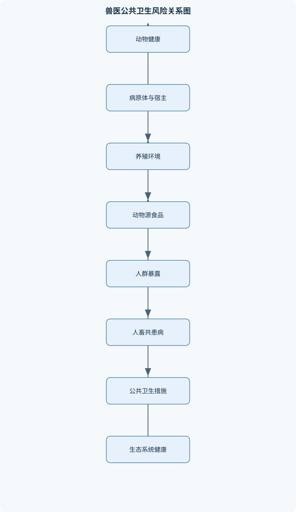
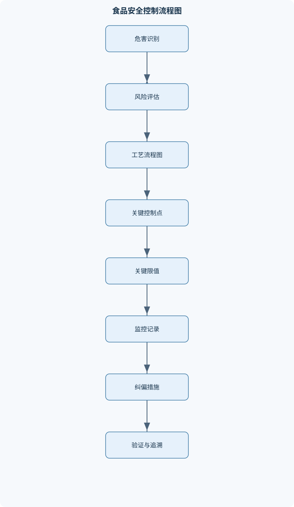

# 兽医公共卫生学

## 一、课程整体知识框架

### 课程边界与先修知识

兽医公共卫生学研究动物源性疾病、动物源性食品安全、动物疫病控制与人类健康之间的联系，重点涵盖人畜共患病、食源性疾病、屠宰检疫、食品卫生监督、兽药与化学污染物残留、寄生虫病、风险分析、HACCP以及“One Health”协同治理。课程对象通常应具备兽医微生物学、兽医寄生虫学、流行病学、动物解剖生理学、病理学、食品卫生学和基础统计学知识。课程边界包括从养殖、运输、屠宰、加工、储藏到消费的全过程风险控制，也包括动物疫病对人群和生态系统的影响；不替代临床兽医学、食品工程学、卫生行政法或人类临床医学的专门训练。





### 1. 学科定位、研究对象与任务

兽医公共卫生学是研究动物健康、动物源性食品安全、生态环境以及人类健康之间相互联系和相互影响的综合性学科。其研究对象不仅是患病动物，也包括健康动物携带并排出病原体的情况、动物产品在生产加工过程中形成的污染、兽药和环境污染物在食品中的残留，以及动物疫病对人群、贸易和生态系统造成的影响。

本课程的核心范围可以概括为“从动物及其环境到人的全过程风险控制”。在养殖阶段，重点关注动物疫病、饲料和饮水污染、用药规范、生物安全以及动物与野生动物或人员的接触；在运输和屠宰阶段，重点关注应激、交叉污染、屠宰检疫和病害动物产品处置；在加工、储藏、流通和消费阶段，重点关注病原微生物增殖、化学污染物残留、冷链连续性、食品加工控制和消费者暴露。

兽医公共卫生学不等同于临床兽医学。临床兽医学主要以个体动物的诊断、治疗和康复为中心，而兽医公共卫生学更强调群体风险、传播链、食品链和预防控制。它也不替代食品工程学、卫生行政法或人类临床医学的专门训练。例如，兽医可以识别动物源性暴露和食品污染风险，但对暴露人员的临床治疗仍需由相应的人类医疗机构完成；食品加工设备的热力学设计则属于食品工程学的专业范围。

### 2. “One Health”与全过程治理框架

“One Health”是以人类、动物和生态环境相互联系为基础的跨学科、跨部门健康治理理念。它不是某一种疾病的名称，也不是由单一机构独立完成的工作。一个动物疫病事件可能同时涉及养殖场兽医、动物卫生监督机构、食品监管部门、公共卫生实验室、临床医疗机构、野生动物管理部门和生态环境管理部门。只有将不同环节的信息整合，才能判断病原体从何处进入、如何传播以及控制措施是否有效。

“One Health”框架通常包括四个相互衔接的层面。第一是共同识别风险，例如判断某种病原体是否能够在动物与人之间自然传播，是否具有环境持留能力，是否可能通过食品传播。第二是联合监测，将动物病例、人的病例、食品检测、环境样品和贸易流向纳入同一风险判断。第三是协同干预，包括动物隔离、食品召回、环境消毒、暴露人员医学评估和公众风险沟通。第四是效果评价，比较控制措施实施前后的新增病例、阳性率、污染水平和传播范围。

可在教学中用风险的半定量表达说明治理逻辑：

$$
R=p\times S
$$

其中，$R$表示风险，$p$表示不良事件发生的概率，$S$表示后果严重程度。$p$可以是某一批食品被污染的概率，也可以是暴露者发生感染的概率；$S$可以综合疾病严重程度、病死风险、经济损失和社会影响。该式适用于定性或半定量比较，不能把不同疾病的复杂后果简单压缩为一个精确的客观数值。若某病原体发生概率较低但一旦发生可导致严重后果，仍可能需要优先控制；反之，发生概率较高但后果较轻的风险，也不能因病死率低而完全忽视。

### 3. 人畜共患病与动物源性风险的基本分类

Zoonosis指可在脊椎动物与人之间自然传播的疾病或感染。这里的“自然传播”强调病原体能够在自然条件下通过接触、吸入、摄食、媒介叮咬或其他途径完成动物与人之间的传播。并非所有动物传染病都是人畜共患病；如果病原体只感染动物而没有自然感染人的证据，不能仅因其具有传染性就归入人畜共患病。

按病原体可分为病毒性、细菌性、寄生虫性、真菌性和朊蛋白相关疾病；按传播生态可分为直接传播型、食源性、媒介传播型和自然疫源性疾病。自然疫源性疾病通常在野生动物、媒介、生境和病原体之间维持循环，人类或家畜属于偶然进入该循环的宿主。防控时不能只针对患者或病畜，还要考察野生动物、节肢动物、土壤、水体和栖息地变化。

新发与再发传染病需要从病原体、宿主、环境和社会行为共同分析。养殖密度增加、动物贸易频繁、野生动物栖息地变化、全球食品供应链延长以及抗菌药物不合理使用，都可能改变传播机会。风险不只来自“是否存在病原体”，还来自病原体排出量、环境存活时间、暴露剂量、食品加工方式、易感人群比例和控制措施执行程度。

### 4. 流行病学指标与传播链

感染链通常包括病原体、传染源、病原体排出、传播途径、侵入门户和易感宿主。传染源可以是发病动物、隐性感染动物、带菌动物、野生动物或污染环境。传播途径包括直接接触、飞沫或气溶胶、经口摄入、经伤口进入、媒介传播和食品传播。控制策略必须对应传播链：阻断传染源、切断传播途径和保护易感者三类措施不能脱离病原体特征机械套用。

常用的累积发病率为：

$$
\text{累积发病率}=\frac{I}{P}
$$

其中，$I$为观察期间新发病例数，$P$为观察开始时处于风险中的人群或动物数。$P$的单位可以是人或头，分子和分母必须来自同一观察群体与同一时间范围。若研究对象中已有病例、已经免疫或不具备暴露机会的个体，应根据研究设计决定是否从分母中排除。

病死率为：

$$
\text{病死率}=\frac{D}{I}
$$

其中，$D$为死亡数，$I$为确诊或发病者数。病死率描述患病者中死亡的比例，不能用全部暴露人数作分母。发病率高不一定表示病死率高；一种疾病可以造成大量轻症病例而病死率较低，另一种疾病也可能病例较少但病死率较高。比较不同地区或不同疾病时，还必须统一病例定义、诊断标准和观察时间。

暴发调查的基本逻辑是先确认事件是否真实存在，再建立可执行的病例定义，随后按照时间、地点和人群寻找病例，分析共同暴露，采集临床、动物、食品和环境样本，并在调查过程中立即采取控制措施。病例定义应明确时间、地点、临床表现和实验室标准。过宽会把非病例纳入，导致发病率被高估；过窄则可能漏掉早期病例，低估传播范围。风险沟通应说明已知事实、未知部分、正在采取的措施和公众需要避免的行为，不能把尚未证实的假设描述为确定结论。

### 5. 动物源性食品安全的风险链

食品安全风险可分为生物性、化学性和物理性危害。生物性危害包括细菌、病毒、寄生虫及其毒素；化学性危害包括兽药残留、农药残留、环境污染物、天然毒素和加工过程中形成的有害物质；物理性危害包括金属、玻璃、骨片和其他异物。不同危害的控制机制不同，不能用一种方法替代全部控制。

微生物污染具有可繁殖、可扩散、来源多和受时间—温度影响明显等特点，因此需要从养殖、屠宰、加工、冷链和消费全过程控制。化学残留通常不能在食品中继续繁殖，控制重点是规范用药、准确记录、遵守休药期、控制环境来源和开展靶向检测。检测结果为阴性也不等于食品绝对安全，因为抽样具有局限性，检测方法存在检出限，且某些危害并不改变食品的感官特征。

微生物定量结果常以CFU/g或CFU/mL表示，CFU是菌落形成单位。若取稀释倍数为$d$的样品接种体积为$V$ mL，平板上计数为$C$个菌落，则在满足菌落数处于方法适宜计数范围、平板分布均匀且无明显抑制或污染的条件下，可按下式估算原样浓度：

$$
X=\frac{C\times d}{V}
$$

其中，$X$为原样微生物浓度，$C$为菌落数，$d$为稀释倍数，$V$为接种体积。若样品经过均质、定容或取样质量换算，还必须把这些体积和质量因素纳入计算，不能把均质液结果直接写成原食品的CFU/g。MPN是最大可能数法，根据不同稀释管的阳性组合用统计模型估计微生物数量，不是直接观察得到的菌落计数值。

### 6. 从风险评估到风险管理

风险分析通常包括危害识别、危害特征描述、暴露评估和风险表征。危害识别回答“什么因素可能造成伤害”；危害特征描述分析剂量与反应、疾病严重程度和易感人群；暴露评估估计人或动物通过何种途径、以多大剂量接触危害；风险表征则综合前述信息，说明风险大小、不确定性和关键影响因素。

风险评估不能只问“有没有病原体”。同一病原体在不同食品中的风险可能不同，因为食品含水量、酸度、储藏时间、消费方式和是否加热均会改变暴露。对化学物质而言，残留浓度、摄入量、体重和暴露持续时间同样重要。风险管理还要考虑控制措施的可执行性、成本、贸易影响和对不同人群的保护效果。风险评估与风险管理需要相互衔接，但不能把管理偏好伪装成科学结论。

## 二、章节和模块划分

### 核心知识覆盖清单

本清单用于检查正文是否覆盖本课程的主要知识模块：

- **兽医公共卫生学总论与One Health**：兽医公共卫生的定义与任务、动物健康与人类健康关系、One Health协同框架、人畜共患病分类、自然疫源性疾病、新发与再发传染病、风险社会与全球食品贸易、兽医在公共卫生中的职责。
- **人畜共患病流行病学基础**：宿主、传染源与传播途径、感染链与传播动力、动物源性暴露类型、易感人群与危险因素、发病率、患病率与病死率、暴发调查基本步骤、病例定义与病例发现、监测、报告与风险沟通。
- **重要病毒性人畜共患病**：狂犬病的宿主与传播、狂犬病临床与实验室诊断、狂犬病暴露后的协同处置、高致病性禽流感与禽类感染、尼帕病毒的动物源性传播、SARS与MERS的流行病学差异、牛海绵状脑病与变异型克雅病关联、口蹄疫的公共卫生和贸易影响。
- **重要细菌性人畜共患病**：炭疽的病原与临床类型、皮肤、肺和肠炭疽鉴别、炭疽芽孢的环境持留、沙门氏菌食源性传播、志贺毒素产生型大肠埃希氏菌、单核细胞增生李斯特菌、弯曲菌与肉乳污染、结核分枝杆菌和副结核分枝杆菌。
- **食源性疾病与食品微生物学**：食源性疾病的定义与分类、感染型与毒素型食物中毒、食品污染的生物性来源、嗜冷微生物及其危害、冷藏食品中的李斯特菌风险、沙门氏菌常见食品载体、诺如病毒食品传播、食品微生物检测方法比较、菌落计数与MPN思想。
- **动物源性寄生虫病与食品安全**：旋毛虫寄生部位与生活史、猪带绦虫与囊尾蚴病、弓形虫宿主与感染途径、棘球绦虫生活史、寄生虫肉品检验、生食和未熟肉的风险、人畜共患寄生虫的控制链、阳性肉品的卫生处理原则。
- **动物性食品卫生与品质评价**：屠宰前检验的目的和意义、屠宰后检验的系统流程、头部和下颌淋巴结检查、病畜隔离与宰后处理、肉的新鲜度和腐败指标、PSE肉与DFD肉、肉的极限pH及其形成机制、鸡蛋新鲜度和卵黄指数、乳的酸度与微生物质量、罐头食品外观和内容物检查。
- **食品加工、储藏与冷链卫生**：冷却与冷冻的区别、冷冻温度对微生物和酶的影响、冻结点与中心温度、单段和两段冻结工艺、冻藏肉异常变化、脂肪氧化和干枯、发黏、发霉与深层腐败、亚硝酸盐和硝石的作用、亚硝酸盐检测与银滴定法、加热、冷藏和交叉污染控制。
- **兽药残留、化学污染与风险分析**：兽药残留的来源、休药期与最大残留限量概念、抗菌药物残留与过敏反应、耐药性选择和传播、致畸、致突变和致癌风险、激素样物质风险、农兽药和环境污染物、危害识别与剂量反应、暴露评估与风险表征、微生物污染和化学残留控制差异。
- **HACCP、食品安全管理与应急处置**：HACCP的前提条件计划、危害分析与预防控制、关键控制点判定、关键限值和监控措施、纠偏、验证与记录、屠宰加工流程图、分子溯源和分子分型、食品安全事件调查、疫病封锁、消毒和无害化处理、跨部门One Health应急响应。


### 1. 兽医公共卫生学总论与“One Health”

本模块建立课程的概念基础，解释兽医在公共卫生中的职责。兽医工作不仅包括诊治动物，还包括动物疫病监测、屠宰检疫、动物产品安全评价、兽药使用指导、食品安全事件调查和跨部门风险沟通。动物健康与人类健康之间存在双向联系：动物可以作为病原体宿主和排出者，人类也可能通过饲养、屠宰、运输和消费行为影响动物疫病传播。

本模块还分析风险社会和全球食品贸易。食品从养殖场到消费者可能跨越多个地区和管理环节，任一环节的记录缺失、冷链中断或供应商控制失效，都可能使局部污染扩散为跨区域事件。国际贸易中的动物疫病不仅影响人的健康，也影响动物产品准入、养殖业损失和区域经济。兽医公共卫生人员应具备识别风险、保存证据、追踪来源和提出控制建议的能力。

### 2. 人畜共患病流行病学基础

本模块围绕宿主、传染源、传播途径、易感人群和危险因素展开。动物源性暴露包括咬伤、抓伤、皮肤或黏膜接触、吸入污染气溶胶、接触分娩物和排泄物、食用未熟肉类或受污染乳制品，以及接触污染土壤和水体。不同暴露方式决定不同的调查重点和处置路径。

课程需要区分监测、报告和暴发调查。监测是持续、系统地收集和分析健康信息；报告是按照规定将病例或异常结果传递给有处置权限的机构；暴发调查则针对某一时间和空间内病例异常增加的事件，寻找共同来源并采取控制。动物监测、食品抽检和人群病例监测应尽可能共享时间、地点、样品和供应链信息，以支持“One Health”判断。

### 3. 重要病毒性人畜共患病

狂犬病是由狂犬病病毒等丽沙病毒引起的急性进行性脑脊髓炎。犬在许多地区是重要传播媒介，但不是唯一宿主或唯一感染来源；蝙蝠和多种野生食肉动物也可参与传播。病毒主要通过感染动物唾液经咬伤、抓伤污染伤口或黏膜进入人体。临床出现典型神经症状后病死风险极高，因此公共卫生重点是动物管理、暴露后协同处置和对可疑动物的规范观察或检测。暴露后的具体医疗处置必须由相应医疗机构依据现行规范完成，兽医部门负责动物控制、样品和流行病学信息衔接。

高致病性禽流感需同时考虑禽类群体感染、人类职业暴露和病毒变异。禽类可能出现呼吸道、消化道或神经系统症状，也可能在高致病性毒株感染时迅速死亡。尼帕病毒的传播涉及动物宿主、动物分泌物、人与人接触以及受污染食品等多种因素，不能把猪是否感染简单作绝对化判断，应结合具体病毒株、动物种类和地区监测证据分析。

SARS和MERS不是同一种病毒。二者病原、动物宿主线索、传播方式和流行病学特征均存在差异，比较时应分别讨论动物源性溢出、医院内传播、病例严重程度和人际传播能力。牛海绵状脑病与变异型克雅病的联系属于异常折叠朊蛋白相关风险，不应把其病原称为普通细菌或病毒。控制重点包括动物识别追踪、禁止特定高风险组织进入食品链和规范副产物处理。口蹄疫对普通公众的直接感染风险通常不是其公共卫生影响的主要部分，但其动物群体传播能力、生产损失和贸易影响十分突出。

### 4. 重要细菌性人畜共患病

炭疽由炭疽芽孢杆菌引起，芽孢可在适宜环境中长期持留。皮肤炭疽最常见，常与皮肤破损接触污染动物、皮毛或肉品有关；吸入炭疽与吸入污染气溶胶有关；肠炭疽则与摄入受污染的动物产品有关。三者在暴露方式、临床表现和防控重点上不同，不能仅凭“发热”或“皮肤病变”作出判断。疑似动物不应随意剖检，以免造成芽孢扩散；样品采集和实验室操作必须符合生物安全要求。

沙门氏菌可通过肉类、蛋类、乳制品和受污染的即食食品传播。志贺毒素产生型大肠埃希氏菌可导致腹泻、出血性结肠炎及严重并发症，O104:H4等菌株的风险分析应结合毒力因子而非只看血清型名称。单核细胞增生李斯特菌具有耐冷性，在部分冷藏条件下仍可缓慢增殖，即食食品长期储存对孕妇、老年人和免疫功能低下者尤其重要。弯曲菌常与禽肉、生乳和交叉污染有关。

结核分枝杆菌复合群中的不同成员在宿主范围、传播和公共卫生意义上存在差异。副结核分枝杆菌主要导致反刍动物慢性消耗性疾病，其与人类疾病的关系不能未经证据直接等同。人工培养生长缓慢的分枝杆菌会增加检测周期，因此实际工作中可能结合分子检测、组织病理和流行病学资料，但PCR阳性不自动等于存在活菌。

### 5. 食源性疾病与食品微生物学

食源性疾病是因摄入被生物性、化学性或物理性因素污染的食品而引起的疾病。感染型通常需要摄入活的病原体并在体内定植或侵袭；毒素型主要由食品中已形成的毒素引起；部分疾病兼有病原体感染和毒素作用。区分两者有助于解释潜伏期、症状特点和加热控制效果。

食品微生物污染可能来自患病或带菌动物、粪便、屠宰设备、加工人员、用水、包装材料、空气和交叉接触。嗜冷微生物能够在低温条件下缓慢生长，李斯特菌因此不能被“放进冰箱”视为已经控制。诺如病毒可通过感染人员、污染水源、生食或即食食品传播，食品加热、人员卫生和防止污染食品接触面同样重要。

传统培养能够提供活菌和菌落信息，但通常耗时较长；免疫学方法较快，却可能受抗原含量、交叉反应和样品基质影响；PCR具有较高的目标核酸检测敏感性和特异性，但可检出死亡微生物核酸，不能单独证明存在活菌或感染性。检测方法的选择必须结合检测目的、检出限、样品类型和确认要求。

### 6. 动物源性寄生虫病与食品安全

寄生虫控制必须结合生活史。旋毛虫幼虫主要寄生于横纹肌，生食或未熟肉可造成感染；猪带绦虫成虫寄生于人的肠道，而人摄入虫卵后可发生囊尾蚴病，二者不是同一种感染形式。弓形虫的终末宿主为猫科动物，其他多种动物和人可作为中间宿主，感染途径包括摄入组织囊殖体、卵囊污染物或经胎盘传播。

棘球绦虫的生活史涉及犬科动物等终末宿主和草食动物等中间宿主。控制不能只依靠屠宰检验，还必须防止犬科动物摄食感染性内脏，控制粪便污染、饲料污染和屠宰副产物去向。阳性肉品的处理应依据病变部位、感染程度、产品类别和适用规定决定限制利用、无害化处理或销毁，不能把局部切除机械地适用于所有寄生虫病。

### 7. 动物性食品卫生与品质评价

屠宰前检验的主要目的，是及时发现异常动物，区分健康动物与疑似患病动物，防止病畜混入正常屠宰流程，并为宰后检验提供产地、运输和临床信息。屠宰后检验则通过观察胴体、内脏、头部、淋巴结和特定组织病变，发现宰前不易识别的疾病和局部病变。头部和下颌淋巴结具有重要检验意义，因为其可反映口腔、咽部及头部区域的感染或炎症，但不能把单个淋巴结异常直接等同于全身性疾病。

肉的新鲜度不能只靠气味和颜色判断，还应结合腐败产物、微生物结果和理化指标。PSE肉与DFD肉属于宰后肌肉生化过程异常，不等同于腐败肉。宰后糖原酵解过快，肌温仍较高时pH迅速下降，可导致蛋白变性、持水性下降，形成苍白、松软和渗出明显的PSE肉；宰前长期应激造成糖原耗竭，宰后乳酸生成不足，终末pH偏高，可形成颜色深、质地紧实但更易腐败的DFD肉。肉的极限pH是糖原酵解完成后肌肉达到的相对稳定pH，不等于任意时间测得的即时pH。

蛋的新鲜度可结合气室大小、蛋白状态、卵黄指数和气味等指标评价。卵黄指数通常反映卵黄高度与直径的相对关系，新鲜蛋卵黄较挺立，储藏时间延长后卵黄膜和蛋白结构逐渐变化，指数下降。乳的酸度可反映乳糖发酵和微生物变化，但酸度正常不能排除所有病原体或化学污染。罐头检查应同时观察外观、胀罐、泄漏、腐蚀、内容物气味、色泽和组织状态，不能仅凭罐体是否鼓起判断安全性。

### 8. 食品加工、储藏与冷链卫生

冷却是将食品温度降至接近但通常高于冻结点，以抑制微生物生长和延缓酶促变化；冷冻则使食品中部分水分形成冰晶，显著降低可利用水分。低温通常抑制微生物增殖，但不等于灭菌。部分病原体可在冷冻状态下存活，解冻后又可能恢复生长，因此冷冻食品仍需防止解冻污染和反复冻融。

冻结点与食品溶质浓度有关，不能把单一环境温度直接当作产品中心温度。冻结速度会影响冰晶大小和组织损伤，单段或两段冻结工艺的选择应结合产品厚度、设备能力和品质要求。冻藏肉可能出现脂肪氧化、干枯、失水、颜色变化和反复冻融造成的组织损伤。发黏、发霉和深层腐败分别提示表面微生物生长、霉菌污染或内部腐败，感官检查不能取代微生物和理化评价。

亚硝酸盐或硝石在腌肉中可参与发色和风味形成，并对部分厌氧芽孢菌具有抑制作用，但其效果受酸碱度、盐度、温度、有机物和加工时间影响。其使用必须受适用规定、工艺条件和残留控制约束，不能因为具有抑菌作用就无限添加，也不能将含有亚硝酸盐等同于食品绝对安全。加工控制还应包括充分加热、减少交叉污染、保持冷链和控制储藏时间。

### 9. 兽药残留、化学污染与风险分析

兽药残留可能来源于未遵守休药期、超范围或超剂量用药、记录不完整、饲料或饮水交叉污染以及环境持续暴露。最大残留限量是对食品中特定药物残留允许水平的管理概念；休药期是从最后一次用药到动物或其产品可按规定进入食品链所需的时间。二者相互关联，但不是同一个概念。兽医应指导养殖者依据药品标签和适用规定规范用药，建立用药、动物身份和产品去向记录。

抗菌药物残留可能引起过敏反应或其他毒理学危害，更广泛的抗菌药物使用还可能选择耐药菌，耐药性可通过动物、食品、环境和人员接触传播。致畸、致突变、致癌风险以及激素样物质风险，需要结合危害性质、暴露剂量、暴露时间和易感人群评估。农药、重金属、持久性环境污染物和加工污染物也应纳入动物源性食品风险分析。

### 10. HACCP、食品安全管理与应急处置

HACCP以危害预防为核心，不能替代前提条件计划。清洁消毒、人员卫生、设备维护、虫害控制、供水管理、原料验收、供应商管理和可追溯制度，是HACCP有效运行的基础。建立HACCP时，应绘制并现场确认屠宰或加工流程图，逐步列出生物性、化学性和物理性危害，评价危害显著性，再判断哪些步骤适合设为CCP。

CCP是控制措施能够预防、消除或把显著危害降低到可接受水平的关键步骤。不是所有检验点、外观检查点或操作步骤都是CCP。例如，放血是否为CCP不能脱离具体工艺、危害类型和后续控制直接判断；若后续存在决定性加热或检疫控制，放血通常不一定具有同等关键作用。CCP必须设定可验证的关键限值，配套监控、纠偏、验证和记录。计划实施后还要通过现场观察、记录审核、抽样检测和趋势分析确认其持续有效。

食品安全事件调查需要整合临床样本、食品样本、环境样本、动物样本和供应链记录。分子分型或全基因组比较可以帮助判断不同样品中的菌株是否具有遗传相关性，但分子相近不等于已经证明直接传播，仍需结合采样时间、地点和暴露证据。疫病应急处置包括报告、隔离、封锁、限制动物和产品移动、规范采样、消毒、无害化处理、追踪接触者和风险沟通。具体消毒参数、免疫措施和药物使用应依据适用地区的现行要求及专业机构指引执行。

## 三、核心概念的详细解释

### 1. 兽医公共卫生、Zoonosis与One Health

兽医公共卫生学研究动物健康、动物源性食品、生态环境与人类健康之间的联系，核心任务是识别、评估和控制由动物、动物产品及其环境引起的人群健康风险。其对象包括患病动物，也包括外表健康但携带并排出病原体的动物，以及食品生产链中形成的微生物、化学和物理危害。

Zoonosis指能够在脊椎动物与人之间自然传播的疾病或感染。判断一种疾病是否属于人畜共患病，至少要考察三个条件：一是病原体能够感染人和一种或多种脊椎动物；二是动物与人之间存在自然传播途径；三是这种传播不是仅在实验接种等特殊条件下发生。并非所有动物传染病都属于人畜共患病。例如某些病原体仅在动物群体内传播，不能因为其具有传染性就称为人畜共患病。

One Health不是某种疾病、检测方法或行政机构，而是以人类、动物和生态环境相互依赖为基础的协同治理框架。狂犬病防控需要动物免疫、犬只管理、野生动物监测、暴露人员医学处置和公众教育共同参与；食品安全事件则需要养殖、屠宰、食品加工、市场监管、医疗机构、实验室和疾控部门共享信息。One Health的关键不在于把所有工作交给同一个部门，而在于建立共同的病例定义、样品信息、风险判断和应急响应机制。

### 2. 人畜共患病的传播链与流行病学

感染链通常包括病原体、传染源、病原体排出途径、传播方式、侵入门户和易感宿主。动物可以是显性感染病例、隐性感染者、携带者、储存宿主或偶然宿主。犬是许多地区狂犬病传播中的重要宿主和传播媒介，但不是狂犬病的唯一宿主；蝙蝠及多种野生食肉动物也可能维持或传播相关病毒。不同地区的主要储存宿主不同，不能把某一地区的流行特征推广为全球结论。

自然疫源性疾病在野生动物、媒介、病原体和特定生态环境之间维持循环。人或家畜通常是在进入该生态循环后被感染。森林破碎化、野生动物栖息地改变、气候变化、动物贸易和养殖密度增加，都可能改变病原体与宿主的接触机会。新发和再发传染病的风险不仅由病原体本身决定，还与宿主范围、环境持留能力、人口流动、食品贸易和卫生行为有关。

动物源性暴露包括咬伤和抓伤、处理病畜或尸体、吸入含病原体的气溶胶、摄入未充分加热的动物产品、接触污染水土、媒介叮咬以及职业性接触。危险人群包括儿童、老年人、孕妇、免疫功能低下者、屠宰加工人员、兽医、养殖人员、实验室人员以及频繁接触野生动物的人群。易感性并不等于一定发病，实际结局还取决于病原体剂量、侵入途径、毒力、宿主免疫状态和暴露后处置。

暴发调查首先要核实事件是否超过预期背景水平，然后建立病例定义。病例定义应规定时间、地点、临床表现和实验室证据，必要时分为疑似、可能和确诊病例。随后主动搜索病例，绘制时间、地点和人群分布，调查动物、食品、环境和人员暴露，采集具有代表性的样品，并将实验室结果与供应链记录相互印证。控制措施可以先于最终病因结论实施，例如隔离疑似动物、暂停可疑食品流通和加强个人防护，但风险沟通必须区分已证实事实、合理推断和仍待确认的内容。

### 3. 重要病毒性人畜共患病及其公共卫生意义

狂犬病是由狂犬病病毒及相关丽沙病毒引起的急性进行性脑脊髓炎。病毒主要通过感染动物唾液进入咬伤、抓伤或黏膜破损处传播。临床出现典型神经症状后病死风险极高，因此公共卫生重点是暴露前预防、动物管理、伤口规范处理、暴露后医学评估和必要的免疫预防，而不是等待实验室结果后再处置。兽医应协助确认动物暴露史、开展动物隔离观察或依法处置，并及时向相关机构报告。

高致病性禽流感涉及特定流感病毒亚型和毒力特征，禽类感染可表现为呼吸道、消化道或神经系统症状，也可能出现高死亡率。人感染风险与接触病禽、污染环境或未经充分加热的禽产品有关。禽流感病毒的禽类致病性与人类致病性并不完全相同，不能仅凭禽群死亡率推断人群风险。尼帕病毒可在动物与人之间传播，猪等动物在特定流行生态中可能参与传播，但不能把“猪不会感染尼帕病毒”作为绝对命题。其公共卫生判断应依据病毒株、动物种类、地区监测和实际暴露证据。

SARS与MERS不是同一种病毒。二者均属于冠状病毒相关疾病，但病原体、动物宿主线索、传播场景和流行病学特征不同。分析动物源性冠状病毒时，应分别考察病毒基因型、动物宿主、人与动物接触方式、是否发生持续人际传播以及医疗机构内传播风险。

牛海绵状脑病属于异常折叠朊蛋白相关疾病，不是普通病毒或细菌感染。人类摄入受污染的特定高风险组织可与变异型克雅氏病风险相关，因此控制重点是动物识别追踪、异常神经症状监测、高风险组织剔除、屠宰副产物规范处理和食品链隔离。BSE、羊瘙痒病与诺如病毒没有同一病原学基础，不能因均可涉及动物或食品而混为一谈。口蹄疫主要是偶蹄动物的重要传染病，人感染并非其主要公共卫生问题，但疫情会造成动物损失、贸易限制和食品供应链影响。

### 4. 重要细菌性人畜共患病

炭疽由炭疽芽孢杆菌引起。其芽孢可在适宜环境中长期持留，病畜尸体、皮毛、土壤和污染物可能成为感染来源。皮肤炭疽通常与皮肤破损接触污染材料有关，肺炭疽与吸入芽孢有关，肠炭疽与摄入污染食品有关。肠炭疽的病原不是刚地弓形虫；后者是寄生虫。疑似炭疽动物不应随意剖检，以免造成芽孢扩散。处置应包括报告、隔离、规范采样、暴露人员医学评估、污染环境控制和病畜及其产品的无害化处理。

沙门氏菌常通过禽肉、蛋、肉制品、乳制品及受污染的即食食品传播。其风险不仅来自原料本身，也来自屠宰加工中的肠内容物污染、加热不足和交叉污染。志贺毒素产生型大肠埃希氏菌可引起腹泻、出血性结肠炎，并在部分病例中导致溶血性尿毒综合征；O104:H4相关事件说明血清型、毒力基因和食品供应链均需纳入分析。

单核细胞增生李斯特菌具有较强耐冷性，可在部分冷藏条件下缓慢增殖。即食食品、冷藏熟肉、乳制品和其他开封后长期保存的食品，如果存在原料污染、加工后再污染或储存时间过长，仍可能造成风险。孕妇、胎儿、新生儿、老年人和免疫功能低下者属于重点保护人群。冷藏不是灭菌，冰箱储存也不能消除李斯特菌风险。

弯曲菌常与禽肉、生乳和动物接触有关；结核分枝杆菌可通过动物、气溶胶或未经适当处理的乳制品传播。副结核分枝杆菌在人工培养中生长较慢，监测和培养确认可能需要较长时间。不能将动物副结核病简单等同于人类克罗恩病，二者之间的病因关系仍不能据此直接确定。

### 5. 食源性疾病、寄生虫病与食品微生物学

食源性疾病是因摄入被生物性、化学性或其他有害因素污染的食品而发生的疾病。感染型食物中毒需要摄入活病原体并在体内定植、繁殖或侵入；毒素型食物中毒主要由食品中已经形成的毒素引起；部分疾病兼有感染和毒素作用。诺如病毒可通过感染者、污染水、贝类、即食食品和加工环境传播，食品是否来自动物并不是判断其能否造成食源性疾病的唯一条件。

嗜冷微生物能够在低温下生长或维持较强生存能力，但“嗜冷”不等于所有低温环境下都快速繁殖。冷藏通常降低多数微生物的生长速率，却不能保证病原体死亡。食品微生物检测可采用培养计数、选择性富集、免疫学方法和PCR。培养可提供活菌信息，PCR主要检测目标核酸，核酸阳性不能单独证明存在活菌，也不能自动证明具有感染性。

旋毛虫主要寄生于肌肉组织，猪肉和野生动物肉未经充分加热可能造成感染。猪带绦虫可通过含囊尾蚴的猪肉传播，虫卵经摄入后还可能导致人囊尾蚴病，因此“吃肉感染成虫”和“摄入虫卵造成组织感染”是不同过程。弓形虫的终末宿主为猫科动物，其他多种动物可作为中间宿主；人可通过生食或未熟肉、污染食物和环境等途径感染。棘球绦虫生活史涉及犬科动物与中间宿主，控制犬粪便污染、禁止犬摄食生内脏和加强屠宰检验必须同时进行。

### 6. 屠宰检疫、食品品质与冷链卫生

屠宰前检验的目的，是在动物进入屠宰流程前发现患病、疑似患病、运输应激严重或不适宜正常屠宰的动物，并将其与健康动物隔离。屠宰前检验不能替代宰后检验，因为有些病变在活体不明显，或需要通过胴体、内脏和淋巴结检查才能发现。

宰后检验通常按照头部、下颌淋巴结、胴体、内脏和特定病变部位进行。下颌淋巴结具有较重要的剖检意义，可反映口腔、咽部及头部局部感染，但不同病变仍需结合其他淋巴结、脏器和全身表现判断。疑似传染病动物不得与健康动物混流，阳性产品应依据适用规定作限制利用、无害化处理或销毁决定。

PSE肉和DFD肉不是同义词，也不等同于腐败肉。PSE肉通常与宰前应激和宰后早期糖原酵解过快有关，肌温尚高时pH快速下降，导致蛋白质变性、持水性下降，肉色苍白、质地松软并有较多渗出。DFD肉通常与宰前长期应激导致糖原耗竭有关，宰后乳酸形成不足，终末pH偏高，肉色深、质地紧实，但较适合腐败微生物生长。判断应结合pH、持水性、肉色和屠宰过程，不能只看颜色。

鸡蛋新鲜度可结合气室大小、蛋清状态、卵黄指数和异味等指标评价。卵黄指数通常表示卵黄高度与卵黄直径的比值，数值较高一般说明卵黄保持较好形态，但必须明确测量条件和样品状态。蛋壳、壳膜和气室构成屏障，但某些细菌在适宜条件下可以通过蛋壳孔隙或裂纹进入，不能笼统认为所有微生物都不能穿透蛋壳。

乳的酸度反映乳中酸性物质和缓冲体系的综合作用，可用于评价乳的异常变化，但不能单独等同于细菌总数。乳制品加工和验收应结合酸度、微生物指标、感官、温度及其他理化指标。罐头检查不能只看是否胀罐，还应观察罐体锈蚀、泄漏、变形、内容物气味、色泽和组织状态。

### 7. 兽药残留、化学污染与HACCP

兽药残留可能来自不遵守休药期、超范围用药、饲料或饮水交叉污染、用药记录不完整以及环境持续暴露。最大残留限量是食品中某种残留物允许达到的管理限值；休药期是最后一次用药后，动物或其产品达到可按规定进入食品链条件所需的时间。二者不能互相替代。

微生物污染比药物残留更难控制，原因在于微生物能够繁殖、扩散和形成交叉污染，污染来源多样，且受温度、时间、水分、人员操作和设备卫生共同影响。药物残留通常可通过规范用药、身份记录、休药期管理和靶向检测控制；微生物风险则需要养殖、运输、屠宰、加工、冷链和消费全过程控制。

HACCP的核心是对显著危害进行预防性控制，而不是简单增加检验次数。前提条件计划包括人员卫生、清洁消毒、设备维护、虫害控制、供水管理、原料验收和追溯制度。CCP是能够预防、消除或将显著危害降低到可接受水平的关键步骤。放血是否为CCP不能脱离具体流程直接判断；若放血步骤不是决定性控制点，且后续有充分加热或其他有效控制，通常不应机械地将其列为CCP。

## 四、重要定义、公式、定理和推导

### 专业审校补充：关键定义与适用边界

兽医公共卫生中的“食品安全危害”应区分危害、暴露和风险。危害是某一生物、化学或物理因素具有造成不良健康效应的潜在能力，例如沙门氏菌、兽药残留或骨片；暴露是人通过摄食、接触或环境途径实际接触该因素的过程；风险则是特定暴露条件下发生不良健康效应的可能性及后果。存在危害不等于已经形成相同程度的风险：同一种病原体在生食即食食品、充分加热食品和完全隔离的原料中的风险不同。风险判断还必须考虑剂量、暴露频率、食品储存时间、易感人群和控制措施。对微生物而言，检测到目标核酸只能说明存在相应遗传物质，不能单独证明存在活菌、达到感染剂量或已经造成传播；对兽药残留而言，检出残留也不能直接等同于超过管理限值或必然产生毒性。风险沟通应分别说明检测结果、健康意义和不确定性，不能把“检出”“超限”“发病”三个概念混用。


### 1. 流行病学指标及其适用边界

累积发病率用于表示一定观察期间内新发病例在有风险人群中的比例：

$$
\text{累积发病率}=\frac{I}{P}
$$

其中，$I$为观察期间新发病例数，$P$为观察开始时处于风险中的人或动物总数。$I$和$P$必须采用同一时间、地点和病例定义。若研究对象已经患病或不再具有发病风险，则不应直接纳入分母。

病死率表示病例中死亡者所占比例：

$$
\text{病死率}=\frac{D}{I}
$$

其中，$D$为死亡数，$I$为确诊或发病病例数。病死率不是死亡率，不能用全部暴露者作为分母。疾病的发病率高，不一定病死率高；病死率高，也不一定造成最大总死亡人数。

患病率反映某一时间点或期间现有病例占人群的比例，既受新发病例影响，也受疾病持续时间和康复、死亡、迁出等因素影响。因此，患病率升高不一定说明发病率同步升高。

### 2. 风险分析的逻辑

风险可作定性或半定量表示：

$$
R=p\times S
$$

其中，$R$为风险，$p$为不良事件发生概率，$S$为后果严重程度。该式适用于比较不同风险的优先级，不宜被解释为精确的客观风险值。若一种病原体发生概率较低，但可造成严重后果，仍可能具有较高治理优先级。

规范的风险分析包括危害识别、剂量—反应评估、暴露评估和风险表征。危害识别回答“可能造成什么不良健康后果”；剂量—反应评估分析摄入剂量与感染、发病或毒性效应之间的关系；暴露评估估计人群通过食品、接触或环境摄入危害的机会和数量；风险表征则综合前述证据，说明不确定性、易感人群和控制措施效果。

化学残留和微生物污染的风险评估不能完全套用同一模式。药物残留通常关注剂量、长期摄入、过敏性、致畸、致突变和致癌性；微生物风险还必须考虑活菌数量、繁殖、毒素形成、感染剂量、食品储存时间和交叉污染。

### 3. 菌落计数与MPN

若取稀释倍数为$d$的样液，接种体积为$V$ mL，平板平均菌落数为$C$，则原样中可培养微生物浓度可估算为：

$$
X=\frac{C\times d}{V}
$$

其中，$X$为原样浓度，单位通常为CFU/mL；$C$为菌落形成单位数；$d$为稀释倍数；$V$为接种体积。若样品为固体食品，应进一步结合均质液总体积和原始样品质量换算为CFU/g。平板计数要求菌落数量处于适合计数的范围，并保证样品充分混匀、稀释准确和培养条件一致。

例如，取$10^{-4}$稀释液$1$ mL接种平板，平均计数$86$个菌落，则：

$$
X=\frac{86\times 10^4}{1}=8.6\times10^5\ \text{CFU/mL}
$$

如果该均质液由$10$ g肉样加入稀释液并定容至$90$ mL制成，则还必须说明均质液的实际总体积，才能换算为CFU/g。不能只凭平板结果直接写出固体食品单位。

MPN，即最大可能数法，是根据多管稀释试验中各管阳性和阴性组合，利用概率模型估计样品中微生物数量的方法。MPN不是直接观察到的菌落数，结果受管数、稀释梯度、阳性判定标准和统计模型影响，适合某些难以直接平板计数或数量较低、分布不均匀的微生物检测。

### 4. 温度、时间与冷冻控制

食品安全不能只由温度或时间单独判断。设温度为$T$，单位为°C，时间为$t$，单位为h或d；同一温度下，储存时间不同，微生物增殖风险可能不同；同一储存时间下，温度波动不同，风险也可能不同。

冷却主要降低食品温度并抑制微生物生长，冷冻则使部分水分形成冰晶并降低可利用水分。冷冻通常不会杀灭所有病原体，解冻后仍可能恢复生长。冻结速度、食品厚度、包装状态和中心温度都会影响结果。表面结冰、包装完整或无异味均不能单独证明食品安全。

### 5. 肉的极限pH与品质形成

肉的极限pH是宰后糖原酵解和乳酸积累基本完成后，肌肉达到的相对稳定pH。它不是宰后一测得的即时pH。宰前糖原储备、应激时间、运输条件和宰后降温共同决定pH变化。

宰后糖原充足且酵解过快时，乳酸迅速形成，pH在肌温较高时快速下降，蛋白质变性增加，容易形成PSE肉。宰前长期应激导致糖原耗竭时，宰后乳酸形成不足，终末pH偏高，容易形成DFD肉。由此可推导出：肉色不能单独代表新鲜度，必须结合pH、持水性、微生物污染和储藏条件判断。

### 6. 亚硝酸盐、硝石与加工安全

亚硝酸盐或硝石可参与腌肉发色、风味形成，并抑制部分厌氧芽孢菌。其效果受pH、盐度、温度、有机物含量和加工时间影响。控制硝石的质量，是为了防止原料含量不明、杂质或污染造成额外风险；控制用量，是为了避免过量残留及相关毒理学危害。

亚硝酸盐的存在不等于食品绝对安全。它不能替代原料验收、充分加热、冷链控制、清洁消毒和防止交叉污染。腌制过程还应控制配方、混合均匀性、加工时间和最终残留，具体限值须依据适用规定和产品类别执行。

### 7. 代表性计算与判断题

#### 例题一：发病率与病死率

某宴席共有$120$人，报告胃肠道症状者$30$人，其中实验室确认病例$18$人，死亡$1$人。

分析：报告病例累积发病率的分母是全部暴露者；确认病例病死率的分母是确认病例。

解答：

$$
\text{累积发病率}=\frac{30}{120}=25\%
$$

$$
\text{确认病例病死率}=\frac{1}{18}\approx5.56\%
$$

结果验证：若以$120$作为病死率分母，得到的是暴露人群死亡比例，不是病例病死率。

变式：若死亡者未被实验室确认，但临床上符合病例定义，应先明确病例分类，再决定是否纳入病死率分母，不能随意把所有暴露者或所有死亡者混合计算。

#### 例题二：判断检测方法

问题：PCR阳性是否等于食品中存在活菌？

分析：PCR检测目标核酸，死亡微生物残留的核酸也可能被检出；此外，PCR阳性还可能受到扩增污染、样品抑制物和非特异扩增影响。

结论：PCR阳性提示目标核酸存在或曾经存在，不能单独证明活菌数量、感染性或毒力表达。若判定食品中是否有活菌，应结合富集培养、分离鉴定、活性检测和流行病学证据。

#### 例题三：判断冷藏食品风险

问题：含单核细胞增生李斯特菌的食品放入冰箱后是否安全？

分析步骤：第一，冷藏可抑制许多微生物，但李斯特菌具有耐冷生长能力；第二，食品储存时间越长，菌量可能逐渐增加；第三，即食食品缺少后续加热环节；第四，孕妇、老年人和免疫功能低下者后果更严重。

结论：冰箱不能消除李斯特菌风险。应控制原料、加工后污染、储存时间和温度，并特别保护易感人群。

#### 例题四：判断CCP

问题：放血步骤是否必然是HACCP的CCP？

分析步骤：先列出放血环节可能引入或扩大的显著危害，再判断该步骤是否具有控制措施；然后判断该步骤能否预防、消除或显著降低危害；最后检查后续是否存在同等或更有效的控制。

结论：不能仅凭“放血是屠宰步骤”就判定为CCP。若后续加热、检疫或其他环节能够决定性控制该危害，放血可能只是一般操作控制点。

#### 例题五：比较PSE肉与DFD肉

PSE肉的主要机制是宰后早期糖原酵解过快，pH快速下降且肌温仍较高，表现为苍白、松软、渗出增加。DFD肉主要由宰前长期应激和糖原耗竭引起，宰后乳酸形成不足，终末pH偏高，表现为颜色深、质地紧实和保水性表面较强，但更易发生腐败。二者均与宰前应激和宰后代谢有关，却不是同一种品质缺陷。

### 8. 常见易错点与岗位应用

常见错误包括：把所有动物传染病都称为人畜共患病；把犬说成狂犬病唯一宿主；把冷冻等同于灭菌；把冰箱储存视为李斯特菌风险消失；把PCR阳性等同于活菌；把病死率和死亡率混淆；把PSE、DFD当作腐败肉；把感官正常当作食品安全充分条件；把放血等任意步骤都判为CCP；把亚硝酸盐的抑菌作用理解为可以无限添加；忽略寄生虫的终末宿主和中间宿主；只控制屠宰环节而不控制粪便、饲料和犬科动物；把BSE病原误认为病毒或细菌；把SARS和MERS视为同一种病毒；把人类克罗恩病与动物副结核病直接等同。

在动物疫病防控岗位中，实际任务包括病例发现、隔离、报告、样品采集、疫情调查和控制措施评价，产出应包括病例清单、流行病学调查表、风险判断和处置记录，验收标准是信息完整、样品可追溯、疑似动物不与健康动物混流、控制措施得到验证。在屠宰检疫岗位中，重点使用屠宰前后检验、淋巴结和脏器病变判断、食品卫生处置及追溯知识，产出为准宰、隔离、限制利用或无害化处理决定。

在食品企业HACCP岗位中，实际工作包括绘制并确认流程图、分析生物性化学性和物理性危害、确定CCP、设定关键限值、监控偏差并记录纠偏。验收标准不是记录数量多，而是危害分析与实际工艺一致，关键限值可测量，监控记录真实，偏差能够及时纠正，验证活动能够证明计划持续有效。在公共卫生实验室岗位中，应依据样品类型选择培养、免疫学或PCR方法，控制阴阳性对照和交叉污染，并在报告中明确检出限、结果含义及不能由检测结果推出的结论。

## 五、算法、流程和实现思路

### 方法与流程覆盖索引

下列方法或流程应在正文中说明输入、步骤、适用条件、结果检查和边界：

- 暴发调查流程：输入为疑似病例、时间地点、动物和食品暴露信息；输出为病例定义、可能污染源、控制措施和调查报告。过程为核实事件、建立病例定义、主动搜索病例、绘制时间—地点—人群分布、采集临床与食品样本、开展描述性和分析性流行病学、实施控制并验证效果。终止条件为传播链被控制且新增病例降至背景水平；适用于聚集性人畜共患病和食源性事件。
- 屠宰前后检验流程：输入为待宰动物、产地信息和健康记录；输出为准宰、隔离、限制利用、无害化处理或销毁决定。过程为核对身份和运输信息、观察整体状态、测量必要指标、隔离疑似病畜、宰后检查胴体和脏器、检查淋巴结及特定病变、综合判定并记录追溯信息。关键不变量是疑似传染病动物不得与健康动物混流；适用于屠宰场和动物产品监管。
- HACCP建立流程：输入为工艺流程、原辅料、设备和已知危害；输出为危害分析表、CCP、关键限值、监控和纠偏方案。过程为绘制流程图、确认现场流程、列出每一步生物性化学性和物理性危害、评价显著性、使用判断树确定CCP、设定可验证限值、制定监控与纠偏、验证和记录。终止条件是计划经现场验证并能够持续执行；不适用于替代前提卫生计划。
- 食品微生物检测流程：输入为具有代表性的食品样品；输出为定性检出、定量结果或未检出结论。过程为无菌采样、均质、梯度稀释、选择培养或富集、菌落观察、纯化鉴定、必要时进行免疫学或PCR确认、设置阳性阴性对照并报告检出限。关键不变量是样品代表性和防止检测过程交叉污染；适用边界是核酸阳性不能单独证明存在活菌。
- 肉品冷链风险评估流程：输入为产品初始污染水平、温度—时间记录、包装状态和销售方式；输出为可接受、需复检、限制流通或报废建议。过程为核对冷链连续性、识别温度偏离、评估病原体生长可能、检查感官和理化指标、结合微生物结果与产品类别作出决定。不能仅凭无异味或表面结冰判定安全；适用于冷却肉、冷冻肉和解冻再冷冻产品。
- 食品安全事件分子溯源流程：输入为临床、食品、环境和动物样本；输出为菌株或病毒株之间的遗传相关性及传播链假设。过程为分离或核酸检测、质量控制、基因分型或全基因组比较、构建聚类关系、结合采样时间地点和供应链记录进行流行病学解释。终止条件为证据足以支持或排除共同来源；分子相近不等于已证明直接传播，必须结合时空和暴露证据。
- 动物源性寄生虫控制流程：输入为养殖场、屠宰检验和食品加工信息；输出为合格、限制利用、无害化处理和场群控制措施。过程为识别终末宿主和中间宿主、控制粪便和饲料污染、执行肉品检验、阻止生内脏被犬科动物摄食、对阳性动物和产品按法规处理、开展人群健康教育。关键不变量是必须同时切断动物间循环和动物到人的食品传播。





### 1. 兽医公共卫生风险识别与分级流程

兽医公共卫生风险评估的输入包括动物种类与数量、临床症状、病原体或污染物检测结果、暴露途径、食品加工方式、消费人群、时间—温度记录以及既往监测信息；输出是风险等级、优先控制环节、需要补充的证据和建议采取的管理措施。其基本逻辑不是“检出病原体就一定发生疾病”，而是依次判断危害、暴露和后果。

第一步是危害识别，明确风险因子属于活病原体、病原体毒素、寄生虫、兽药残留、环境污染物还是物理性异物。第二步是剂量—反应分析，判断暴露剂量、暴露频率、侵入途径和宿主易感性如何影响发病概率。第三步是暴露评估，估计人或动物通过接触、吸入、摄食、伤口或媒介叮咬获得危害因子的机会。第四步是风险表征，将危害严重程度与发生可能性结合。教学中可用下式进行定性或半定量排序：

$$
R=p\times S
$$

其中，$R$为风险，$p$为不良事件发生概率，$S$为后果严重程度。$p$没有固定单位，可以表示为某批食品污染的概率、暴露者感染的概率或某时间范围内发生事件的可能性；$S$可以综合疾病严重程度、病死风险、经济损失和社会影响。该式只能用于同一评价框架下的比较，不能把不同疾病的复杂后果压缩成绝对精确的数值。

风险评估完成后还要进行风险管理和风险沟通。风险管理决定隔离、召回、限制流通、加强加工控制、调整监测频率或开展人群医学评估；风险沟通则要分别说明已经证实的事实、合理推断和仍存在的不确定性。风险评估本身不等于行政处罚，也不替代临床诊断或实验室确证。

#### 风险识别的伪代码

```python
def assess_public_health_risk(hazard_present, exposure_level,
                              severity, control_effectiveness):
    """
    输入：
        hazard_present: 是否存在已识别危害，布尔值
        exposure_level: 暴露水平，取值范围 0~1，仅用于教学排序
        severity: 后果严重程度，取值范围 1~5
        control_effectiveness: 现有控制措施有效程度，取值范围 0~1
    输出：
        风险等级和处理建议
    """
    if not hazard_present:
        return {"risk_level": "当前证据未发现该危害",
                "action": "保持监测并复核采样代表性"}

    residual_exposure = exposure_level * (1 - control_effectiveness)
    score = residual_exposure * severity

    if score >= 3:
        level = "优先控制"
        action = "立即核查来源，限制相关产品或动物流动，并开展联合调查"
    elif score >= 1:
        level = "需要管理"
        action = "加强监测，改进过程控制，并根据新证据复评"
    else:
        level = "较低但非零风险"
        action = "维持前提卫生措施和常规监测"

    return {"risk_level": level, "score": score, "action": action}
```

该程序的输入数值只是标准化教学变量，不是法定限值，也不能替代正式风险评估模型。其不变量是：没有证据证明危害存在时，不能直接把风险写成“零”；已有控制措施后应评估剩余暴露，而不是只看原始污染水平。流程在完成危害识别、暴露评估、控制措施评价和结果复核后终止。适用边界是教学排序、企业内部初筛和调查优先级安排；不适用于直接决定食品是否符合法定标准。

### 2. 人畜共患病和食源性事件的暴发调查流程

暴发调查的输入包括疑似病例、发病时间、地点、动物接触史、食品消费史、人员流动信息以及临床、食品、动物和环境样本；输出包括病例定义、病例清单、可能传播链、可疑来源、控制措施和调查报告。

#### 2.1 核实事件并建立病例定义

首先应确认病例数是否超过通常背景水平，排除重复报告、诊断标准改变和检测方法改变造成的假性增加。病例定义必须包含时间、地点和临床或实验室条件。例如，可以将“在某时间段内参加同一宴席并出现腹泻或呕吐者”定义为疑似病例，将具有相应实验室证据者定义为确诊病例。病例定义过宽会引入大量非病例，过窄则可能遗漏轻症和非典型病例。

#### 2.2 主动搜索和描述性分析

调查人员应按时间、地点和人群主动搜索病例，记录年龄、职业、动物接触、食品消费、发病时间、就诊情况和实验室结果。对食源性事件，可绘制发病时间分布，比较不同食品消费组的发病比例；对动物源性传染病，还应记录动物种类、群体规模、来源、疫苗或用药情况、死亡率和动物移动路线。

常用的累积发病率为：

$$
\text{累积发病率}=\frac{I}{P}
$$

其中，$I$为观察期内新发病例数，$P$为观察开始时处于风险中的人群或动物数。其分母必须是有可能发病的对象，不能把已经患病或不具备暴露机会的对象随意纳入。

病死率为：

$$
\text{病死率}=\frac{D}{I}
$$

其中，$D$为死亡数，$I$为确诊或发病者数。病死率反映病例中的死亡比例，不等于总体死亡率。若病例定义、观察时间和诊断能力不同，两个地区的病死率不能直接比较。

#### 2.3 样品采集、实验室检测与证据整合

样品应覆盖临床、食品、动物和环境等可能环节，采样过程必须记录时间、地点、样品类型、批次、温度和运输条件。传统培养适合确认活菌并进行菌落计数，但耗时较长；免疫学检测可以较快识别抗原或抗体，但可能受交叉反应和样品基质影响；PCR对目标核酸具有较高分析敏感性和特异性，但阳性不必然等于存在活菌，也不自动证明病原体具有感染性。因此，PCR结果应结合培养、富集、活性检测、毒力基因和流行病学证据解释。

定量培养中，如果某稀释度平板平均计数为$C$，接种体积为$V$ mL，稀释倍数为$d$，可按下式估算原样浓度：

$$
X=\frac{C\times d}{V}
$$

其中，$X$的单位取决于样品处理方式，可为CFU/mL或进一步换算为CFU/g。若肉样以一定质量均质于规定体积的稀释液中，必须保留样品质量、均质液总体积和接种体积，不能把CFU/mL直接写成CFU/g。菌落计数还必须考虑平板是否处于可计数范围、稀释误差和重复平板的一致性。

MPN是最大可能数法。它根据不同稀释管的阳性和阴性组合，利用概率模型估计样品中的微生物数量，结果不是直接观察到的菌落数。MPN适合低水平或难以在平板上形成可靠菌落的微生物估计，但受管数、稀释设计和概率区间影响，不能与平板计数结果不加说明地直接等同。

#### 2.4 控制和终止条件

控制措施可以在病因完全确认前启动，例如隔离疑似动物、暂停可疑批次流通、加强个人防护、停止食用剩余食品和保护高危人群。对炭疽疑似事件，不能随意剖检病死动物，因为芽孢形成和环境持留可能扩大污染；应在适当生物安全条件下采样、隔离、追溯和处置。对狂犬病暴露，应由动物防疫和人类医疗系统协同完成动物观察或依法处理、伤口处置和暴露后医学评估。

调查的终止条件不是“找到唯一阳性样品”，而是传播链得到控制，新增病例降至预期背景水平，重点动物和食品环节完成追溯，控制措施经过效果评价，并形成可复核的调查记录。

### 3. 屠宰前后检验与动物产品处置流程

该流程的输入是待宰动物、身份和来源记录、运输信息、健康状况及屠宰后胴体和脏器；输出是准宰、隔离、限制利用、进一步检验、无害化处理或销毁等决定。

#### 3.1 屠宰前检验

屠宰前检验的首要任务是及时发现患病、疑似患病、运输损伤严重或状态异常的动物，防止其与健康动物混流。检查内容包括身份核对、整体精神状态、呼吸和运动异常、体表损伤、异常分泌物、体温或其他必要指标，以及同群动物的发病和死亡情况。

屠宰前检验不能发现所有疾病。有些动物在外观上无明显症状，但其胴体或脏器可能存在寄生虫、局限性病变、早期感染或残留风险。因此，屠宰前检验和屠宰后检验是互补关系，而不是二选一。疑似传染病动物必须隔离，隔离区、工具、人员和运输路线应与健康动物分开。

#### 3.2 屠宰后检验

屠宰后检验包括观察胴体、头部、内脏和相应淋巴结，结合颜色、气味、出血、肿胀、结节、囊肿、脓肿、寄生虫病变和组织结构变化进行综合判断。头部和下颌淋巴结具有重要剖检意义，因为其可反映口腔、咽部、头部组织及相关系统的局部或全身性病变。检查淋巴结不能只看大小，还要结合切面、质地、颜色、坏死和周围组织变化。

屠宰检验的关键不变量是：疑似传染性病变的胴体、脏器和污染工具不得与合格产品混流；任何处置决定都要保留动物身份、病变部位、检验人员、时间和产品去向信息。某些疾病可能在屠宰后才被发现，例如脑部病变、寄生虫病、李斯特菌相关病变或局部脓肿，因此不能以屠宰前外观正常作为放行的充分条件。

### 4. 食品微生物检测与冷链风险评估流程

食品微生物检测的输入是具有代表性的食品样品，输出是定性检出、定量结果或在特定方法检出限下未检出的结论。流程包括无菌采样、均质、梯度稀释、选择性培养或增菌、菌落观察、纯化鉴定、必要时PCR或免疫学确认，以及阳性和阴性对照。

“未检出”不等于“绝对不存在”。样品量、采样位置、微生物分布不均、检测灵敏度和抑制物都会影响结果。感官正常也不能证明食品安全，因为许多病原体和化学污染物不会明显改变气味、颜色或口感。

冷链风险评估应同时考察产品初始污染水平、温度$T$、时间$t$、包装完整性、解冻和再冷冻情况。温度和时间必须联合解释，不能仅凭“曾经冷藏”或“表面结冰”判定安全。冷却主要降低温度并抑制增殖；冷冻使部分水分形成冰晶，降低微生物可利用水分，但通常不能灭活全部病原体。耐冷的单核细胞增生李斯特菌在部分冷藏条件下仍可能缓慢生长，尤其是即食食品储藏时间过长或开封后发生交叉污染时。

冷链评估可以按以下顺序进行：核对温度记录是否连续；识别温度偏离及持续时间；判断该食品是否支持相关病原体生长；检查包装、渗漏和交叉污染；结合感官、理化和微生物检测；最后决定继续流通、限制流通、复检或报废。任何单一指标都不能替代综合判定。

### 5. 动物源性寄生虫控制流程

寄生虫控制必须按照生活史设计，而不能只在屠宰环节被动发现。流程输入包括养殖环境、饲料和饮水卫生、终末宿主与中间宿主信息、屠宰检验结果以及食品加工和消费方式；输出是养殖控制、肉品合格或限制利用、无害化处理和人群风险干预措施。

旋毛虫可在动物肌肉组织中形成幼虫，生食或未熟肉是重要传播风险；猪带绦虫既涉及成虫寄生，也涉及人摄入虫卵后发生囊尾蚴病，不能把“吃肉感染成虫”和“摄入虫卵导致组织感染”混为一谈；弓形虫的终末宿主为猫科动物，其他多种动物和人可作为中间宿主；棘球绦虫的生活史涉及犬科终末宿主与多种中间宿主，犬摄食受感染内脏会维持传播循环。

控制步骤包括防止犬科动物接触受污染内脏，管理猫、犬粪便污染，保护饲料和饮水，开展屠宰检验，对阳性产品按适用规定限制利用或无害化处理，并向消费者强调充分加热和避免生食。若只检查肉而不控制犬科动物和饲料污染，寄生虫循环仍可能持续。

### 6. HACCP建立和验证流程

HACCP建立的输入包括工艺流程、原辅料、设备、人员、环境、预期用途和已知危害；输出包括危害分析表、CCP、关键限值、监控方法、纠偏程序、验证计划和记录体系。

第一步是建立并现场确认流程图。屠宰加工流程通常涉及接收、待宰、屠宰、去皮或脱毛、开膛、胴体处理、冷却、分割、包装和储藏，但具体步骤必须按实际工艺确认。第二步是逐步列出生物性、化学性和物理性危害。第三步评价危害的发生可能性、严重程度和现有控制措施。第四步判断控制点是否为CCP。

CCP的判定标准是：该步骤对显著危害具有决定性控制作用，能够预防、消除或降低危害至可接受水平，并且后续没有同等有效的控制步骤。放血并非必然是CCP；是否属于CCP要看具体危害、工艺和后续控制，不能因该步骤位于屠宰流程中就直接判定。

关键限值必须可测量或可验证，例如温度、时间、酸碱度、检测结果或设备运行状态。监控应明确谁负责、监控什么、何时监控、如何记录。发生偏差时，应隔离受影响产品、查明原因、纠正过程并评价产品去向。验证包括记录审核、现场观察、设备校准、抽样检测和趋势分析。HACCP不能替代清洁消毒、人员卫生、虫害控制、设备维护、供水管理和供应商管理等前提条件计划。

### 7. 分子溯源与食品安全事件分析流程

分子溯源的输入包括临床、食品、动物和环境样本，输出是不同样品中菌株或病毒株的遗传相关性、共同来源假设及供应链传播线索。流程包括病原体分离或核酸检测、样品和序列质量控制、基因分型或全基因组比较、构建遗传聚类，再与采样时间、地点、食品批次、动物来源和流通记录结合。

分子相近说明样本之间具有较近的遗传关系，但不等于已经证明直接传播。若两个样本在遗传上相近，却没有共同时间、地点或供应链联系，仍需考虑背景流行株、采样偏差和实验室污染。相反，分子结果不完全一致也不能立即排除共同来源，尤其在病原体群体多样性较高、样本采集时间相隔较长或检测覆盖不足时。分子证据必须与流行病学和供应链证据共同解释。

### 8. 典型计算与综合题的解答示例

#### 例题一：累积发病率与病死率

某宴席有120人，30人出现胃肠道症状，其中18人为实验室确认病例，死亡1人。

分析时必须区分分母。报告病例累积发病率为：

$$
\frac{30}{120}=0.25=25\%
$$

确认病例病死率为：

$$
\frac{1}{18}\approx5.56\%
$$

若用120人作为病死率分母，所得是全体参加者中的死亡比例，不是病例病死率。

#### 例题二：菌落计数换算

某肉样取$10^{-4}$稀释液1 mL接种平板，平均计数86个菌落。

若结果基于液体样品，原样浓度为：

$$
X=\frac{86\times10^4}{1}=8.6\times10^5\ \text{CFU/mL}
$$

若要报告为CFU/g，还必须知道取样质量、均质液总体积和样品处理过程。缺少这些信息时，不能直接把$8.6\times10^5$写成CFU/g。

#### 例题三：PSE肉与DFD肉

PSE肉通常与宰前应激和宰后早期糖原酵解过快有关。肌肉温度仍较高时，pH迅速下降，蛋白质变性增加，持水性下降，肉表现为苍白、松软和渗出。DFD肉则常与宰前长期应激和糖原耗竭有关，宰后乳酸生成不足，终末pH偏高，肉色深、质地紧实，但较高的终末pH会增加部分腐败微生物生长风险。二者不能只凭颜色判断，应结合pH、持水性、屠宰前应激和储藏表现。

#### 例题四：李斯特菌冷藏风险

冰箱低温能够抑制许多微生物，但不能保证所有病原体死亡。单核细胞增生李斯特菌具有较强耐冷性，在某些冷藏条件下仍可缓慢增殖。即食食品没有再加热步骤，若储存时间过长、包装破损或开封后反复污染，风险会增加。控制重点是原料卫生、加工环境分区、防止交叉污染、合理储存时间和高危人群保护。

#### 例题五：HACCP中的CCP判定

判断某步骤是否为CCP，先列出该步骤的显著危害，再确认是否存在有效控制措施；随后判断该步骤能否将危害降至可接受水平，以及后续是否还有同等有效的控制。若某步骤只是一般卫生检查，而决定性加热或冷却控制位于后续步骤，则该步骤通常不应直接判为CCP。放血是否为CCP不能脱离实际工艺和危害分析作绝对判断。

## 六、概念之间的关系与对比

### 1. 兽医公共卫生、One Health与单一部门管理

兽医公共卫生学是学科和实践领域，关注动物及其产品、环境与人类健康之间的风险；One Health是跨学科、跨部门的治理理念，强调共同识别、联合监测、协同干预和效果评价。二者相关但不等同。兽医公共卫生可以在单个屠宰场开展检疫和食品卫生监督，One Health则要求同时连接动物防疫、食品监管、公共卫生、生态环境、野生动物管理和医疗机构。

单一部门管理容易出现信息断裂。例如，动物群体出现异常死亡，动物部门掌握动物病例；人类医疗部门掌握暴露者就诊信息；食品监管部门掌握同批肉品流向。只有统一时间、地点、批次和病例定义，才能判断这些信息是否属于同一传播链。

### 2. 人畜共患病、动物传染病与食源性疾病

动物传染病强调病原体在动物群体中的传播，未必能感染人。人畜共患病强调脊椎动物与人之间存在自然传播。食源性疾病强调食品或饮水是重要暴露媒介，病原体可以来自动物、环境、人员或加工过程。因此三者存在交集，但不能互相替代。

例如，某种只在动物间传播的疾病属于动物传染病，但不一定是人畜共患病；通过污染肉品传播给人的沙门氏菌感染同时属于人畜共患病和食源性疾病；狂犬病通常以咬伤和唾液污染伤口传播，属于人畜共患病，但不属于典型食源性疾病。判断分类时应先看传播链，而不是只看病原体名称。

### 3. 感染型食物中毒与毒素型食物中毒

感染型食物中毒是摄入活病原体后，病原体在人体内定植、侵袭或繁殖而致病；毒素型食物中毒则主要由食品中已经形成的毒素引起，摄入的活菌数量不一定决定全部症状。两者在潜伏期、临床表现和加工控制重点上可能不同。

感染型疾病通常更依赖活菌数量、侵入能力和宿主易感性，加热、避免交叉污染和冷链控制十分重要；毒素型疾病还要关注毒素的形成条件和热稳定性，单纯杀死产毒菌未必能消除已经形成的耐热毒素。食品检出某种菌也不能简单推断一定已经形成相应毒素，必须结合病原体特征和食品条件分析。

### 4. 发病率、患病率、病死率与总体死亡率

发病率关注观察期内新发生的病例，患病率关注某一时间点或期间现有病例，病死率关注病例中死亡的比例，总体死亡率关注全体风险人群中的死亡。四者分母和时间范围不同，不能相互替代。

发病率高说明新病例增加，不一定意味着疾病严重程度高；病死率高说明病例结局严重，但若病例数量很少，总体死亡人数未必最多。比较不同地区或不同疾病时，必须统一病例定义、观察时间、诊断能力和分母范围。

### 5. 宿主、储存宿主、传播媒介与偶然宿主

宿主是病原体能够感染或维持其生命过程的生物。储存宿主能够在自然条件下维持病原体并参与传播；传播媒介通常帮助病原体从一个宿主传到另一个宿主，可以是动物、节肢动物或其他传播环节；偶然宿主可能被感染，但通常不是病原体长期维持所必需的宿主。

犬是许多地区狂犬病传播中的重要宿主和传播媒介，但不是唯一宿主。蝙蝠及多种野生食肉动物也可能参与病毒维持和传播。判断某动物的作用必须结合具体病原体、地区生态和监测证据，不能把“常见传播动物”写成“唯一宿主”。

### 6. 冷却、冷冻与灭菌

冷却主要降低食品温度，减缓微生物增殖和酶促变化；冷冻使部分水分形成冰晶并降低可利用水分；灭菌则要求通过规定处理使目标微生物达到规定的控制水平。冷冻不是灭菌，低温也不能自动消除已经存在的毒素或污染物。

低温效果取决于温度、时间、食品组成、初始污染量和微生物种类。冷冻可使多数微生物停止或显著减慢生长，但部分病原体能够存活，解冻后仍可能恢复活性。反复冻融还会损伤组织、增加汁液流失并扩大交叉污染机会。

### 7. PSE肉、DFD肉与腐败肉

PSE肉和DFD肉主要是宰前应激及宰后肌肉糖原酵解过程异常造成的品质缺陷，不等同于微生物腐败。PSE肉的典型机制是宰后早期pH下降过快并伴随蛋白变性；DFD肉的典型机制是宰前长期应激导致糖原耗竭，乳酸形成不足，终末pH偏高。

腐败肉则主要涉及微生物增殖、蛋白质和脂肪分解以及感官和理化变化。DFD肉因终末pH较高，可能更适合部分腐败微生物生长，但“更易腐败”不等于已经腐败。判断应综合pH、持水性、气味、表面黏液、微生物结果和储藏时间。

### 8. 休药期、最大残留限量与抗菌药物耐药性

休药期是最后一次用药后，动物或其产品在规定条件下可以进入食品链前所需等待的时间；最大残留限量是食品中特定药物残留允许达到的管理水平。休药期是使用和生产管理概念，最大残留限量是食品检测和风险管理概念，二者不能混为同一数值。

残留控制主要依靠规范用药、动物身份记录、用药记录、遵守标签和适用规定、执行休药期以及靶向检测。耐药性控制则不仅关注食品中的药物残留，还关注抗菌药物使用对动物、人员、食品和环境中耐药菌及耐药基因的选择和传播。因此，残留检测合格不等于耐药性风险已经消失，耐药性治理需要“One Health”协同。

### 9. 微生物污染与化学残留控制

微生物可以繁殖、扩散并在生产过程中通过人员、设备、空气、水、动物和食品表面交叉传播，因此控制重点是全过程卫生、分区操作、加热、冷却、冷链、清洁消毒和防止再污染。化学残留通常不会在食品中继续繁殖，控制重点是规范用药、饲料和环境管理、休药期、供应链记录和靶向检测。

二者都需要风险分析，但不能使用完全相同的控制策略。冷冻可能抑制微生物生长，却不能消除药物残留；延长休药期不能解决食品加工环节的沙门氏菌交叉污染。实际管理必须按照危害性质选择控制措施。

### 10. 传统培养、免疫学检测、PCR与分子分型

传统培养能够提供活菌、菌落形态和部分定量信息，并可进一步进行药敏或分型，但耗时较长，且对难培养或受损微生物敏感性有限。免疫学检测速度较快，依赖抗原抗体反应，可能受到交叉反应、抗原变异和样品基质影响。PCR针对特定核酸序列，通常具有较高分析敏感性和目标特异性，但可能检出死亡微生物核酸，也可能受到抑制物影响。

分子分型或全基因组比较用于分析不同样本之间的遗传相关性，不等于普通PCR阳性。检测的“特异性”是区分目标与非目标的能力，“准确性”是结果接近真实状态的程度，“精密性”是重复测量结果之间的一致性。PCR可提高目标检测的分析敏感性和特异性，但实际准确性仍受采样、保存、提取、扩增抑制和结果解释影响。

### 11. 屠宰前检验与屠宰后检验

屠宰前检验适合发现整体状态异常、传染病疑似动物、运输损伤和群体性问题，可以在进入屠宰流程前实施隔离和分流。屠宰后检验适合发现内脏、淋巴结、胴体和局部组织病变，对某些外观隐匿性疾病具有不可替代的作用。

屠宰前检验不能替代屠宰后检验，屠宰后检验也不能替代动物来源、运输和健康记录审查。二者共同构成动物产品安全控制链。发现病畜后，处理决定应结合临床表现、病变范围、传染性、产品用途、实验室证据和适用规定，不能只凭单一外观指标放行或销毁。

### 12. 寄生虫生活史与控制链

寄生虫病控制必须同时处理终末宿主、中间宿主、环境和食品链。旋毛虫重点是控制含幼虫肌肉进入人体；猪带绦虫需要区分人摄入囊尾蚴感染成虫与摄入虫卵发生囊尾蚴病；弓形虫控制要关注猫科动物粪便污染、肉品和生食行为；棘球绦虫控制的关键之一是阻断犬科动物摄食感染内脏。

因此，肉品检验只是控制链的一环。若阳性内脏被犬科动物摄食，或饲料、饮水和环境持续受到粪便污染，单次肉品检验不能消除群体传播风险。有效控制必须将养殖管理、屠宰检验、无害化处理、环境卫生和消费行为结合起来。

### 13. HACCP、前提条件计划与终检抽样

前提条件计划提供基本卫生环境，包括人员卫生、清洁消毒、设备维护、虫害控制、供水、供应商管理和可追溯制度。HACCP针对经过危害分析后确定的显著危害，选择能够决定性控制危害的CCP。终检抽样则是对产品或过程结果进行检查，不能单独替代预防性控制。

“找到污染源”属于调查和纠偏的重要目标，但HACCP的核心不是等污染发生后寻找责任方，而是在危害进入产品或扩散前设置可验证的预防控制。不是所有检验点都是CCP，也不是所有CCP都必须依靠终产品检测；如果过程控制能够连续、及时地控制危害，过程监控通常比事后抽样更具有预防价值。

### 14. 风险分析与风险沟通

风险分析包括风险评估、风险管理和风险沟通。风险评估回答“危害是什么、发生概率多大、后果如何”；风险管理回答“采取什么控制、由谁实施、如何权衡成本和可行性”；风险沟通回答“如何向养殖者、从业人员、消费者和其他部门准确传递信息”。

风险沟通不能把“检出”直接说成“必然患病”，也不能把“未检出”说成“绝对安全”。对高危人群，应说明其易感性和可采取的防护措施；对不确定证据，应说明不确定性的来源，例如样本量不足、采样时点不合适或检测方法无法判断活性。准确沟通本身是控制传播和减少恐慌的重要公共卫生措施。

## 七、典型例题和应用场景

### 专业审校补充：综合例题

题干：某次动物源性食品暴发调查中，将参加者按是否食用某种未充分加热的禽肉分组。食用组40人，其中20人发病；未食用组60人，其中6人发病。计算两组累积发病率、相对危险度和暴露组归因危险度，并判断该食品是否可作为重点调查对象。分析：这是队列式比较，分母分别是各暴露组人数，不能用全体参加者作为两组的共同分母。相对危险度用于比较暴露组发病风险与未暴露组发病风险的倍数；归因危险度表示暴露组中可归因于该暴露的绝对发病差异。解答：食用组发病率为20/40=50%；未食用组发病率为6/60=10%。相对危险度为0.50/0.10=5.0，表示在本次调查条件下，食用组发病风险约为未食用组的5倍。暴露组归因危险度为0.50−0.10=0.40，即40个百分点，表示每100名具有相似背景的食用者中，理论上有约40例发病风险差异可归因于该暴露。结果验证：两组发病率均不超过100%，相对危险度大于1，说明存在正相关；但相关不等于已经证明因果关系，还需核对食物来源、加工时间、共同调味料、其他食品暴露、病例定义、样品检测和选择偏倚。若未食用组人数很少或两组基础特征差异明显，单纯比较可能产生混杂。变式：若改为病例—对照研究，选取20名病例和20名未发病对照，其中病例中15人食用该禽肉，对照中6人食用，则优势比为(15×14)/(5×6)=7.0。此时不能把优势比直接称为相对危险度，除非疾病罕见或研究设计及解释条件允许。


### 典型题型与应用覆盖索引

建议通过下列题型或应用检查概念是否能够迁移：

- 例题一：某食源性疾病调查中，某宴席共有120人，报告胃肠道症状30人，其中实验室确认病例18人，死亡1人。要求分别计算报告病例的累积发病率和确认病例病死率，并说明两者分母不同。解答：累积发病率为$30/120=25\%$；确认病例病死率为$1/18\approx5.56\%$。若用120作病死率分母，得到的是人群死亡比例，不是病例病死率。
- 例题二：某肉样经十倍系列稀释，取$10^{-4}$稀释液1 mL平板培养，平均计数86个菌落。要求计算原样菌落数并写出单位。解答：原样浓度为$86\times10^4=8.6\times10^5$ CFU/mL。若样品起始为10 g肉并定容至90 mL，必须进一步说明均质液体积和取样质量，不能直接把该结果写成CFU/g。
- 例题三：比较PSE肉和DFD肉的形成机制。解答：PSE肉主要与宰前应激和宰后早期糖原酵解过快有关，肌温尚高时pH迅速下降，蛋白变性增加，表现为苍白、松软、渗出；DFD肉多与宰前长期应激造成糖原耗竭有关，宰后乳酸生成不足，终末pH偏高，肉色深、质地紧实但更易腐败。二者不能仅凭颜色判断，应结合pH、持水性和屠宰过程。
- 例题四：判断某加工步骤是否为HACCP的CCP。解答：先列出该步骤的显著危害，再判断是否有控制措施；若该步骤能够将危害降至可接受水平且后续没有同等控制，则可确定为CCP；若只是一般卫生检查、后续仍有决定性杀菌步骤，则通常不是CCP。放血步骤是否为CCP不能脱离具体流程和危害分析直接作答。
- 例题五：解释为什么李斯特菌在冰箱中仍可能造成风险。解答：冷藏可抑制许多细菌的生长，但单核细胞增生李斯特菌具有较强耐冷性，在部分冷藏条件下仍可缓慢增殖；即食食品若储存时间过长、开封后反复污染或缺乏再加热步骤，风险会上升。控制重点是原料卫生、避免交叉污染、缩短储存时间并保护孕妇、老年人和免疫功能低下者。
- 例题六：设计炭疽疑似疫情的兽医公共卫生处置。解答：立即按规定报告并隔离疑似动物和人员，避免剖检造成芽孢扩散；在生物安全条件下采集适当样本，开展实验室确认；追溯动物来源、接触人员、肉品和污染环境；对病畜、同群畜及污染物按现行防疫要求处理，对暴露人员进行医学评估；完成终末消毒和环境监测。具体治疗、免疫和消毒参数必须依据主管部门和实验室生物安全要求执行。
- 例题七：分析BSE与人类健康的关系。解答：BSE病原属于异常折叠朊蛋白相关感染因子，主要累及中枢神经系统，临床表现为进行性神经异常和共济失调。人类健康风险主要与摄入受污染的特定组织及食品链控制失效有关，不能简单表述为普通接触传播。卫生控制应包括动物识别追踪、禁止高风险组织进入食品链、规范屠宰副产物处理和异常神经症状监测。
- 例题八：比较传统培养、免疫学检测和PCR。解答：传统培养可提供活菌和菌落数量信息，但耗时较长；免疫学检测速度较快，依赖抗原抗体特异性，可能受交叉反应和样品基质影响；PCR灵敏度和目标特异性较高，但可能检出死亡微生物核酸，也可能受抑制物影响。实际判定应根据检测目的、检出限、样本类型和确认要求组合使用。


### 1. 食源性暴发调查中的发病率与病死率

#### 题干

某宴席共有 $120$ 人参加，其中 $30$ 人在规定观察期内出现恶心、呕吐或腹泻等胃肠道症状，$18$ 人经实验室检测或病例定义确认属于该次事件病例，其中 $1$ 人死亡。计算报告病例的累积发病率和确认病例病死率，并说明两者的分母为什么不同。

#### 分析与解答

累积发病率反映在一定观察期内，具有发病风险的人群中出现新病例的比例。题目给出的有风险人群数为 $P=120$，报告病例数为 $I=30$，因此：

$$
\text{累积发病率}=\frac{I}{P}=\frac{30}{120}=0.25=25\%
$$

这里的分母是全部参加宴席且处于发病风险中的人员，而不是实验室确认病例数。

病死率反映已经发病或确诊的病例中死亡者所占比例。死亡数为 $D=1$，确认病例数为 $I=18$，因此：

$$
\text{病死率}=\frac{D}{I}=\frac{1}{18}\approx5.56\%
$$

若计算 $1/120$，得到的是全部暴露人群中的死亡比例，不是病死率。病死率比较还必须统一病例定义和观察时间。一个疾病可以发病率较高但病死率较低，也可以发病人数较少但病死率较高。

#### 结果验证与变式

若后来发现另有 $10$ 名参加者出现轻微症状但未报告，则病例搜索更充分后，报告病例数可能增加，累积发病率需要重新计算。若死亡病例尚未完成医学观察，则病死率可能被低估。若不同地区采用的病例定义不同，直接比较病死率会产生偏差。

该例适用于食源性疾病暴发、动物接触性疾病聚集事件和养殖场人畜共患病调查，但不适合把患病率直接当作发病率。患病率还包括观察时点以前已经存在的病例，分母和观察设计必须另行说明。

### 2. 菌落计数与单位换算

#### 题干

某肉样经十倍系列稀释，取 $10^{-4}$ 稀释液 $1\ \mathrm{mL}$ 接种平板，两个平板平均计数为 $86$ 个菌落。计算该均质液的菌落浓度。若样品为 $10\ \mathrm{g}$ 肉，加无菌稀释液至总体积 $90\ \mathrm{mL}$，又应如何换算为原肉样的 CFU/g？

#### 分析与解答

平板上的菌落数为 $C=86\ \mathrm{CFU}$，接种体积为 $V=1\ \mathrm{mL}$，稀释倍数为 $d=10^4$。均质液中的浓度为：

$$
X=\frac{C\times d}{V}
=\frac{86\times10^4}{1}
=8.6\times10^5\ \mathrm{CFU/mL}
$$

如果 $10\ \mathrm{g}$ 肉加稀释液后总体积为 $90\ \mathrm{mL}$，且上述结果代表这 $90\ \mathrm{mL}$ 均质液，则原样总菌量近似为：

$$
8.6\times10^5\ \mathrm{CFU/mL}\times90\ \mathrm{mL}
=7.74\times10^7\ \mathrm{CFU}
$$

再除以原肉质量 $10\ \mathrm{g}$：

$$
\frac{7.74\times10^7\ \mathrm{CFU}}{10\ \mathrm{g}}
=7.74\times10^6\ \mathrm{CFU/g}
$$

#### 结果验证与边界

若实际只取均质液的一部分进行进一步稀释，必须把所有稀释和取样体积纳入计算。不能看到 $8.6\times10^5\ \mathrm{CFU/mL}$ 就直接写成 $8.6\times10^5\ \mathrm{CFU/g}$，因为质量单位尚未转换。

菌落计数法要求菌落具有可计数性，平板过度拥挤会造成菌落融合，菌落过少则随机误差较大。该结果表示在规定培养条件下形成可见菌落的微生物数量，不等同于样品中所有活菌，也不等同于病原菌数量。若检测目标是特定病原体，还需要选择性培养、鉴定或分子确认。

### 3. PSE肉与DFD肉的形成机制比较

#### 题干

比较 PSE 肉和 DFD 肉的形成原因、极限 pH、外观及食品卫生意义。为什么二者不能只凭颜色判断？

#### 分析与解答

肉的极限 pH 是宰后肌肉糖原酵解产生乳酸，且糖原消耗和酸化过程基本完成后，肌肉达到的相对稳定 pH。它不是宰后某一时刻测得的即时 pH。

PSE 肉通常与宰前应激及宰后早期糖原酵解过快有关。动物宰后肌温仍较高时，肌肉 pH 快速下降，肌原纤维和细胞结构蛋白发生较明显变性，肉表现为苍白、松软和渗出，持水性降低。其核心机制是“酸化速度过快”。

DFD 肉通常与宰前长期应激、疲劳或饥饿导致肌糖原储备不足有关。宰后可生成的乳酸较少，极限 pH 偏高，肉色较深、质地较紧实，表面可能较干。较高的最终 pH 往往意味着肉的保存稳定性下降，微生物更容易繁殖。

两者的比较如下：

| 项目 | PSE肉 | DFD肉 |
|---|---|---|
| 主要原因 | 宰后早期糖原酵解过快 | 宰前长期应激导致糖原耗竭 |
| pH变化 | 下降过快，终末pH相对较低 | 乳酸生成不足，终末pH相对较高 |
| 外观 | 苍白、松软、渗出 | 深色、紧实、表面较干 |
| 主要品质问题 | 持水性差、加工损失大 | 储藏稳定性降低、易腐败 |
| 判定依据 | pH、持水性、温度和过程记录 | pH、肉色、质地和微生物状况 |

颜色会受到光照、氧合状态、包装和观察时间影响，不能替代 pH 和微生物检测。PSE、DFD 也不能直接等同于腐败肉；前者主要是宰后生化异常，腐败则主要涉及微生物生长及其代谢产物。

### 4. 冷藏条件下李斯特菌风险分析

#### 题干

某即食肉制品在冷藏条件下保存较长时间，外观和气味正常，但检测出单核细胞增生李斯特菌。解释为什么冷藏仍可能有风险，并提出控制措施。

#### 分析与解答

冷藏通常降低多数微生物的生长速率，但不是灭菌。单核细胞增生李斯特菌具有较强耐冷性，在部分冷藏环境中仍可缓慢增殖。即食食品在加工后没有再次加热步骤，消费者可能直接摄入污染物；如果储藏时间较长，低速增殖也可能造成剂量累积。

风险还与以下因素有关：

1. 食品初始污染水平和污染发生时间；
2. 冷藏温度是否稳定，是否存在局部温度升高；
3. 储存时间和开封后反复接触；
4. 切片设备、操作人员和包装表面的交叉污染；
5. 孕妇、老年人和免疫功能低下者等易感人群比例。

控制措施包括降低原料和加工环境污染、严格清洁消毒、区分生熟区域、避免即食食品与生肉交叉接触、保持冷链连续、缩短储存时间和加强环境监测。不能凭“没有异味”判定安全，因为李斯特菌在达到明显腐败感官之前就可能造成健康风险。

### 5. HACCP关键控制点判定

#### 题干

某屠宰加工流程包括待宰检查、放血、去毛、开膛、内脏检查、胴体冲洗、冷却和包装。有人认为放血步骤一定是 HACCP 的关键控制点，是否正确？请说明判定方法。

#### 分析与解答

不正确。CCP不是固定对应某个工序名称，而是通过危害分析确定的。判定步骤如下：

第一，列出该步骤可能存在的生物性、化学性和物理性危害。例如开膛可能造成胃肠内容物污染，冷却可能控制微生物增殖，化学消毒剂使用不当可能造成化学危害。

第二，判断危害是否显著。需要考虑危害发生可能性、后果严重程度、污染水平和后续扩散机会。

第三，确认该步骤是否有能够控制该危害的措施。若放血对某一显著危害没有决定性控制作用，则不能仅因为它是屠宰操作就认定为 CCP。

第四，判断后续是否存在同等或更有效的控制。如果后续有经过验证的加热或冷却控制，前一步可能属于一般操作控制，而非 CCP。

第五，设定可测量的关键限值，并规定监控、纠偏、验证和记录。例如冷却过程可以围绕产品中心温度、达到目标温度的时间和设备运行状态设置控制要求，但具体限值应依据适用法规、产品类型和经过验证的工艺确定。

放血、冲洗或外观检查有时可能属于重要卫生控制点，但“重要”不等于“CCP”。HACCP的核心是预防显著危害，而不是把所有检查点都命名为关键控制点。

### 6. 炭疽疑似事件中的综合处置

#### 题干

某养殖场突然出现多头动物死亡，部分动物有鼻孔或天然孔出血，工作人员曾接触尸体并进行剖检。设计兽医公共卫生处置流程。

#### 分析与解答

首先应将事件作为疑似严重动物疫病和人畜共患病事件处理，立即报告并限制动物、尸体、肉品、人员和相关设备的非必要移动。炭疽芽孢具有较强环境持留能力，随意剖检可能增加污染扩散，因此不应为了“看清病变”而在缺乏生物安全条件下继续解剖。

其次，划定暴露人员和污染环境范围，要求相关人员停止无防护接触，由专业机构进行医学评估。样品采集应由经过培训的人员在适当生物安全条件下完成，样品种类、包装、运输和检测程序必须遵循现行防疫和实验室安全要求。

再次，追溯动物来源、同群动物、饲料、水源、运输工具、屠宰去向和人员接触史。对疑似污染的动物、尸体、垫料、工具和场地采取隔离、消毒或无害化处理措施，具体方法和参数依据主管部门要求执行。

最后开展效果评价，包括是否出现新增动物病例、暴露人员是否完成医学随访、污染区域是否得到控制以及相关产品是否已阻断进入食品链。此处不能把抗菌药物是否“有用”作为现场唯一处置依据；抗菌药物使用属于临床和防疫专业决策，不能替代隔离、报告、采样和环境控制。

### 7. 兽药残留与微生物污染控制的比较

#### 题干

为什么与动物源性食品中的兽药残留相比，食品微生物污染往往更难控制？

#### 分析与解答

兽药残留通常具有相对明确的来源和控制节点，例如用药品种、用药剂量、用药时间、动物身份和休药期。通过规范处方或用药记录、执行休药期、避免饲料和饮水交叉污染，并进行靶向抽检，可以降低残留风险。最大残留限量是食品中某种残留物的管理限值，休药期则是最后一次用药到产品可按规定进入食品链所需的时间，二者不是同一概念。

微生物污染则可能来自患病动物、健康带菌动物、粪便、屠宰设备、人员、用水、空气、害虫、运输工具和包装表面。病原体还可能繁殖、扩散、形成交叉污染，并受温度、时间、水分活度和食品酸碱度影响。冷冻通常抑制增殖，但不一定杀灭病原体；解冻后仍可能恢复活性。

因此，微生物控制需要全过程卫生管理，包括养殖生物安全、屠宰卫生、充分加热、防止交叉污染、冷链、储存时间和人员操作控制。单次终产品抽检不能代替过程卫生管理；而兽药残留控制也不能只依赖抽检，必须从规范用药和可追溯记录开始。

## 八、实验、实践和项目相关知识

### 专业审校补充：实践任务

项目任务：为一条即食熟肉切片生产线建立一次针对沙门氏菌、李斯特菌、清洁剂残留和金属异物的HACCP初步分析。输入材料包括原料验收记录、工艺流程图、设备清洗记录、加热和冷却记录、包装方式、储存温度、人员操作说明，以及近三批次的微生物和化学检测结果。步骤如下：第一，现场核对流程，从原料验收、冷藏、预处理、加热、冷却、切片、包装到成品储存逐步确认，不得只依据纸面流程。第二，在每一步列出生物性、化学性和物理性危害，说明危害来源、发生条件和已有控制措施。第三，判断哪些危害属于显著危害，再分析加热、冷却、切片环境卫生、清洗剂管理和金属检测是否具有决定性控制作用。第四，为确定的关键控制点分别写明可测量的关键限值、监控对象、监控频率、责任人员、偏差时的隔离和纠偏措施，并安排验证活动。第五，检查前提卫生计划是否覆盖人员卫生、设备清洁、虫害控制、供水和供应商管理。输出包括经现场确认的流程图、危害分析表、CCP判定依据、监控记录样表、偏差处置流程和验证报告。评价标准是：危害与实际工艺相符；CCP不是凭经验罗列；关键限值可测量且有依据；偏差能追溯到受影响批次；记录能证明监控真实完成；验证能区分过程失控与检测误差。排错时，若所有步骤均被列为CCP，应重新区分前提计划和关键控制；若把终产品抽检当作唯一控制，应补充过程控制；若加热记录正常但成品阳性，应调查冷却、切片、包装后的再污染和采样代表性；若清洗剂残留异常，应核对配制、冲洗、设备死角及检测方法，而不能只增加终产品抽检。


### 1. 食品样品微生物检测实验

#### 实验目的

建立从采样、均质、梯度稀释、培养计数到结果报告的完整流程，理解菌落形成单位、检测限、样品代表性和“核酸阳性不等于活菌”的边界。

#### 输入材料与数据

输入为具有明确批次、采样时间、储存条件和包装状态的肉、乳或即食食品样品。需要记录样品质量、均质液总体积、每级稀释倍数、接种体积、平板重复数、培养条件、菌落数和阴性对照结果。样品应采用无菌方式取得，并尽量覆盖同一批次不同位置，避免只取外观最正常或最异常的一处。

#### 实验步骤

1. 核对样品身份、批次、温度和包装完整性。
2. 使用无菌器具取样并称量，加入规定体积的无菌稀释液进行均质。
3. 制备十倍系列稀释液，至少选择两个相邻稀释度接种平板。
4. 设置培养基空白或稀释液阴性对照，必要时设置已知阳性对照。
5. 培养结束后选择菌落数处于可计数范围的平板，记录每个平板菌落数。
6. 对可疑病原菌菌落进行纯化、形态观察和鉴定；需要时结合免疫学或 PCR 检测。
7. 按样品质量、均质液体积、稀释倍数和接种体积换算为 CFU/g 或 CFU/mL。
8. 报告平均值、重复结果、检测限、异常情况及结果解释边界。

#### 评价标准

实验记录应能够追溯到样品批次和具体平板。平行平板之间不应出现无法解释的巨大差异；阴性对照不得出现目标菌或明显污染。结果报告必须写清单位，不能将均质液浓度直接写成原食品浓度。若只有 PCR 阳性而未分离到活菌，应报告为“检出目标核酸”或使用实验室规定的准确表述，不能直接写成“活菌数”。

#### 常见排错

若所有平板均无菌落，应检查样品是否经过抑菌处理、培养条件是否适宜、稀释是否过度以及培养基是否失效。若所有平板菌落过多，应增加稀释梯度。若阴性对照阳性，应优先怀疑培养基、移液器、操作台或人员操作造成的交叉污染，不能继续解释样品结果。若平板重复差异很大，应检查混匀是否充分、接种体积是否一致以及菌液是否沉降。

### 2. 肉品冷链风险评估项目

#### 项目目标

评价从屠宰后冷却、运输、储藏到销售过程中的温度—时间控制是否连续，区分冷藏、冷冻和反复冻融造成的不同风险，并形成可供质量管理和监管使用的项目报告。

#### 输入数据

项目组应收集以下数据：

- 产品种类、包装方式、生产批次和初始微生物检测结果；
- 冷却或冻结开始时间、达到中心目标温度的时间；
- 运输、仓储和销售环节的温度记录；
- 包装完整性、解冻液、表面发黏、霉斑、颜色变化等观察结果；
- 储存时间、是否发生断电或设备故障；
- 采样点、采样数量和实验室检测结果。

温度和时间必须结合分析。不能只凭“环境温度低”判断产品中心已经达到目标，也不能只凭表面有冰判断产品始终处于安全状态。

#### 项目步骤

1. 绘制产品从生产到消费前的流程图，标出可能发生温度偏离和交叉污染的节点。
2. 核对温度记录仪的时间是否连续，检查是否存在缺测、异常尖峰或长时间恒定不变的可疑数据。
3. 比较产品中心温度与环境温度，识别冷却不充分、冻结不完全和反复冻融。
4. 对不同环节进行微生物、理化和感官检测，不能以感官正常替代实验室检测。
5. 结合食品种类、包装、储存时间、病原体特征和易感消费者，进行风险分级。
6. 提出纠偏措施，例如隔离可疑批次、复检、缩短保质时间、改进冷却能力、加强设备维护或限制流通。
7. 复核纠偏后的温度记录和检测结果，判断风险是否已降低。

#### 评价标准

项目报告应能回答三个问题：温度控制是否连续，产品是否存在可能支持病原体存活或增殖的条件，现有检测结果能否支持放行或限制流通。不得以“无异味”“表面结冰”或“未发现霉斑”作为食品安全充分证明。对已发生严重温度偏离且缺乏可靠时间记录的产品，应结合产品类别和检测证据谨慎处理，不能仅凭主观经验放行。

#### 排错方法

若温度记录与产品状态矛盾，应检查探头位置、校准状态和记录时间。若表面温度正常而中心温度异常，应优先怀疑测量位置不当或产品厚度导致传热滞后。若冷链数据完整但微生物结果异常，应调查采样代表性、屠宰加工卫生、包装后污染和实验室交叉污染。若不同实验室结果相反，应比较样品是否来自同一位置、检测方法检出限是否一致，以及样品运输过程中是否发生温度变化。

### 3. 屠宰前后检验实践流程

#### 输入与输出

输入为待宰动物、产地和运输信息、健康记录、临床观察结果以及宰后胴体和脏器。输出为准宰、隔离、限制利用、进一步检验、无害化处理或销毁等卫生处理决定，并形成可追溯记录。

#### 操作步骤

屠宰前先核对动物身份、来源、检疫证明和运输记录，观察精神状态、呼吸、步态、体表、排泄物和异常分泌物。发现疑似传染病、严重全身症状或异常死亡时，不得与健康动物混流，应立即隔离并按规定报告。

屠宰后进行胴体、脏器和淋巴结系统检查。头部检查中，下颌淋巴结具有重要意义，因为其能够反映头部、口腔及邻近组织的炎症或感染情况，但不能仅凭一个淋巴结的外观作最终结论。还应结合咽喉、肺、肝、脾、肾、肠道和肌肉病变进行综合判定。

某些疾病在屠宰前不一定表现明显，必须依靠宰后病变、实验室检查和流行病学信息识别。疑似神经系统疾病、炭疽、寄生虫病或全身性败血症时，应防止不当剖检和污染扩散。对于阳性或疑似产品，应依据适用规定采取限制利用、加热处理、无害化处理或销毁，不能由单个操作人员凭感官决定。

#### 质量评价

检验流程的关键不变量是：疑似传染病动物不得与健康动物混流，病变产品不得在未作卫生判定前进入食品链，所有处置决定必须能够追溯到动物身份和检验记录。评价内容包括检验覆盖是否完整、异常动物是否及时隔离、宰后病变是否记录准确、样品采集是否避免交叉污染以及处理决定是否与风险相匹配。

### 4. HACCP建立与现场验证项目

#### 项目输入

输入包括原辅料清单、屠宰或加工流程、设备布局、人员流线、清洁消毒程序、供应商信息、历史检测结果和产品消费方式。输出包括流程图、危害分析表、CCP判定、关键限值、监控计划、纠偏程序、验证方案和记录表。

#### 建立步骤

1. 明确产品、预期用途和消费人群，特别标记即食食品及高危人群。
2. 绘制从原料验收到产品出厂的完整流程，并在现场核对实际操作是否与文件一致。
3. 在每个步骤识别生物性、化学性和物理性危害。
4. 评价危害发生可能性、后果严重程度、已有控制措施和后续控制能力。
5. 使用结构化判断方法确定 CCP，避免把所有卫生检查点都列为 CCP。
6. 为每个 CCP 设定可测量、可验证的关键限值，并明确监控频率、责任人和记录方式。
7. 规定偏离限值时的纠偏措施，包括产品隔离、原因调查、设备调整和重新验证。
8. 通过现场观察、记录审核、抽样检测和趋势分析验证计划有效性。
9. 定期复审流程，尤其在原料、设备、包装或产品用途改变后重新进行危害分析。

#### 评价与排错

如果记录显示全部批次“完全正常”，但现场观察与记录不一致，应优先检查记录是否事后补填、监控责任是否明确以及测量设备是否正常。若某个 CCP 长期出现偏差，不能只反复签字确认，而应调查设备能力、人员培训、原料波动和工艺设计。若终产品检测合格但过程卫生严重失控，也不能据此证明 HACCP 有效，因为抽样具有局限性，污染可能未被抽中或在后续环节重新发生。

HACCP 不能替代清洁消毒、人员卫生、虫害控制、供水管理和供应商控制等前提条件计划。只有前提条件稳定，CCP监控记录才具有实际意义。

## 九、常见错误和易混淆内容

### 重点易错项核对清单

复习和回答问题时应逐项检查以下边界：

- 把所有动物传染病都称为人畜共患病；只有能够在脊椎动物与人之间自然传播的疾病或感染才符合该定义。
- 把犬说成狂犬病唯一宿主；犬是许多地区重要传播媒介，但蝙蝠及多种野生食肉动物可作为储存宿主或感染来源。
- 把猪不会感染尼帕病毒作为绝对结论；宿主感染性和地区流行情况应依据具体病毒株、动物种类和监测证据判断。
- 把SARS和MERS当作同一种病毒；二者病原、动物宿主线索、传播特点和流行病学并不相同。
- 将BSE病原称为普通病毒或细菌；其核心病原因子与异常构象朊蛋白相关，理化抵抗性和控制要求不同。
- 把冷冻等同于灭菌；低温通常主要抑制生长，解冻后部分病原体仍可能存活并恢复活性。
- 把冰箱储存视为李斯特菌风险消失；耐冷菌的慢速增殖和即食食品长期储存仍可造成风险。
- 将PSE、DFD与腐败肉混为一谈；PSE和DFD主要是宰后生化过程异常，腐败还涉及微生物增殖和感官变化。
- 把放血、外观检查或任意检验点一律判定为CCP；CCP必须由危害分析和后续控制条件确定。
- 把PCR阳性直接解释为存在活菌或一定具有致病性；核酸检测结果必须结合活性、剂量、毒力基因和流行病学解释。
- 把硝石或亚硝酸盐的发色、风味和抑菌作用理解为可以无限添加；其使用必须受适用法规、工艺条件和残留控制约束。
- 把病死率和死亡率混淆；病死率以患病者为分母，死亡率以总体或特定人群为分母。
- 忽略寄生虫生活史中的终末宿主和中间宿主；只控制屠宰环节而不管理粪便、犬科动物和饲料污染，难以切断循环。
- 把感官正常作为食品安全充分条件；许多病原体和化学污染物不会改变食品的气味、颜色或口感。
- 用过时的具体免疫、消毒或药物剂量替代现行规定；疫情处置和化学品使用应以适用地区的现行法规、标签和专业机构指引为准。


### 1. 人畜共患病、动物传染病与“One Health”的概念边界

**Zoonosis**是能够在脊椎动物与人之间自然传播的疾病或感染。判断某种疾病是否属于人畜共患病，不能只看动物是否发病，也不能只看病原体是否具有传染性，而要同时确认：人和脊椎动物均可感染；存在自然条件下的传播途径；传播具有现实的流行病学意义。仅在实验接种条件下能感染人的动物病原体，不能据此直接归入典型人畜共患病。

“One Health”不是某种疾病、检验技术或行政部门，而是将人类、动物和生态环境视为相互联系的健康系统。其核心是共同识别风险、联合监测、协同干预和效果评价。例如，狂犬病防控不能仅由医院处理暴露者，也不能仅由养犬部门进行动物管理，还需要兽医、医疗机构、实验室、野生动物管理部门和公众共同参与。

### 2. 宿主、储存宿主与传播媒介不能混同

犬是许多地区狂犬病传播中的重要宿主和传播媒介，但不是狂犬病的唯一宿主。蝙蝠、多种野生食肉动物和其他哺乳动物均可能感染相关病毒。某一地区的主要传播动物，不能简单推广为所有地区的唯一储存宿主。

“宿主”是病原体能够在其中生存或复制的生物；“储存宿主”强调其能够在自然界中维持病原体并参与传播；“传播媒介”通常指帮助病原体从一个宿主转移到另一个宿主的生物或工具。一个动物可以同时具有多种角色，但这些术语不能在所有疾病中互换使用。

猪可感染尼帕病毒，且在某些流行生态中可成为重要的扩增宿主或传播环节。把“某地区或某病毒株目前未发现某动物发挥主要作用”表述成“该动物绝不会感染”，属于过度绝对化。判断宿主范围必须结合病毒株、动物种类、感染实验、自然监测和地区生态条件。

### 3. 重要病毒性疾病的易混淆点

SARS与MERS不是同一种病毒。二者均属于冠状病毒相关疾病，但病原体、动物宿主线索、传播方式、临床表现和人群流行病学并不相同。考试中如果要求比较，不能只写“都由冠状病毒引起”，还应说明二者的动物源性线索、人与人传播能力及医疗机构传播风险存在差异。

高致病性禽流感中的“高致病性”主要是对禽类，尤其是家禽群体致病性或死亡表现的分类，并不等同于对人类的致病性。某些禽流感病毒对禽类高度致病，但人感染风险和临床结局仍需依据具体亚型、暴露方式和个体状态判断；相反，禽类症状较轻也不代表人类风险必然为零。

BSE与变异型克雅病存在动物源性食品安全关联，但二者不是同一种疾病。BSE发生于牛等反刍动物，变异型克雅病发生于人，关联重点是摄入受污染的特定高风险组织或食品链控制失效。朊蛋白相关疾病也不能与诺如病毒混同，前者不属于普通病毒、细菌或寄生虫感染，传播和控制逻辑不同。

### 4. 炭疽的病原、临床类型与操作风险

炭疽由炭疽芽孢杆菌引起，不是由刚地弓形虫引起。炭疽芽孢具有较强环境持留能力，病畜尸体、血液、皮毛、土壤和污染设备均可能成为风险来源。疑似炭疽动物不能因“需要剖检确认”而随意剖开尸体，否则可能增加芽孢扩散和人员暴露。

皮肤炭疽通常与皮肤破损接触污染物有关；肺炭疽与吸入含芽孢颗粒有关；肠炭疽与摄入受污染动物产品有关。临床类型的区分依赖暴露史、病变部位、症状和实验室检测，不能仅凭发热或皮肤损伤作出结论。抗菌药物可能用于临床治疗或暴露后医学处置，但具体方案须由相关医疗和防疫机构依据现行规范决定，不能用未经确认的剂量替代专业处置。

### 5. 食源性疾病与食物中毒不能简单画等号

食源性疾病是因摄入被污染的食品或饮料而发生的疾病或感染，范围包括感染型、毒素型、化学性和寄生虫性疾病。食物中毒常用于描述由食品中的病原体、毒素或有害化学物质导致的急性健康损害，但二者在不同教材和管理语境中的使用范围可能有所差异。

感染型疾病需要摄入具有感染性的病原体，病原体可在人体内增殖；毒素型疾病主要是摄入食品中已经形成的毒素，症状出现时间和机制可能不同。诺如病毒常通过受污染的即食食品、水、贝类或被感染人员的手部和操作环境传播。食品不一定有明显异味、变色或腐败外观，感官正常不能排除病原体污染。

### 6. PCR、培养和免疫学检测的结果不能互相替代

传统培养能够在适当条件下获得活菌，并可进行菌落计数、纯化和药敏或分型，但耗时较长，且某些细菌难以培养。免疫学检测速度较快，但可能受到抗原含量、抗体特异性、样品基质和交叉反应影响。PCR通常具有较高的目标特异性和分析敏感性，但检测到的是目标核酸，不能自动证明样品中存在活菌，也不能单独证明病原体具有传播能力。

因此，PCR阳性可能代表活菌、死亡菌或残留核酸；PCR阴性也可能受到采样部位、样品量、抑制物、靶基因变异和检测限影响。实验室结论必须明确“检测到核酸”“分离到活菌”“检出毒力基因”和“证明感染”之间的区别。

### 7. 微生物污染控制与兽药残留控制不可混为一谈

兽药残留通常与用药品种、给药方式、剂量、最后用药时间、休药期、动物身份记录和产品去向有关。控制重点是规范用药、遵守适用休药期、避免交叉污染、建立用药档案并开展靶向检测。

微生物污染更难控制，原因在于微生物可繁殖、可扩散、可在多个环节重新进入食品，并且污染来源可能包括动物肠道、皮肤、设备、人员、用水、环境和交叉操作。冷链只能减缓部分微生物的增殖，不能替代清洁、分区、加热、包装和交叉污染控制。化学残留一般不会在食品中自行繁殖，而微生物污染可能随时间和温度变化扩大，这构成二者控制逻辑的重要差异。

### 8. 冷冻、冷藏与灭菌的边界

冷藏主要抑制微生物生长，冷冻通过形成冰晶并降低可利用水分来减缓生长，但二者通常都不等于灭菌。部分病原体可在冷冻条件下长期存活，解冻后仍可能恢复活性。反复冻融会造成组织损伤、汁液流失和交叉污染风险增加。

单凭“食品表面结冰”“冰箱温度较低”或“食品没有异味”，不能判断食品绝对安全。安全判断还需要结合产品中心温度、储藏时间、包装完整性、解冻过程、初始污染水平、加工方式和目标微生物的耐受性。单核细胞增生李斯特菌具有较强耐冷性，部分冷藏食品在储存时间过长时仍可能发生缓慢增殖，因此即食食品尤其需要控制储存时间和开封后污染。

### 9. 肉的极限 pH、PSE 与 DFD 不能等同于腐败

肉的极限 pH 是宰后糖原酵解基本完成后肌肉达到的相对稳定 pH，不是屠宰后即时测得的任意 pH。宰后糖原转化为乳酸，pH下降；糖原储备、宰前应激、肌肉温度和酵解速度共同决定最终状态。

PSE肉通常与宰后早期糖原酵解过快有关，肌温仍较高时 pH 快速下降，蛋白质变性增加，表现为颜色苍白、质地松软和汁液渗出。DFD肉常与宰前长期应激导致糖原耗竭有关，宰后乳酸形成不足，极限 pH 偏高，表现为颜色深、质地紧实、持水性表面上较强，但更容易支持腐败微生物生长。

PSE和DFD是肉质异常，不等于已经腐败。腐败还需要结合微生物增殖、异味、发黏、产硫化氢、挥发性碱性物质和其他理化指标判断。颜色正常也不能排除病原体或化学污染。

### 10. 亚硝酸盐、硝石与食品安全

硝石可作为腌制过程中形成亚硝酸盐的来源之一，亚硝酸盐参与腌肉发色、风味形成，并对部分厌氧芽孢菌具有抑制作用。其效果受 pH、盐度、温度、有机物含量和加工时间影响，不能把“具有抑菌作用”理解为“加入越多越安全”。

亚硝酸盐的使用必须符合适用规定、工艺要求和残留控制。控制其用量是因为过量或不规范使用可能造成急性毒性及其他健康风险；同时，腌制和加热过程中的化学反应也需要纳入风险评估。亚硝酸盐检测结果与肉的新鲜度不是同一概念，不能用亚硝酸盐结果单独代替菌落计数、感官检查或腐败指标评价。

### 11. 屠宰前、屠宰后检验与淋巴结检查

屠宰前检验的目的包括及时发现病畜、隔离异常动物、防止病畜与健康动物混流、判断是否适合屠宰以及减少屠宰过程中的污染和人员暴露。屠宰后检验用于发现宰前不易识别的疾病和局部或全身性病变。两者不能相互替代。

头部检查中，下颌淋巴结具有重要剖检意义，可帮助判断口腔、咽喉、头部及邻近组织的炎症或感染。但检查下颌淋巴结不能只看是否肿大，还要结合切面、质地、出血、坏死、脓肿、胴体和内脏病变综合判定。单个淋巴结异常也不必然等于全胴体必须销毁，处理决定要依据疾病性质、病变范围和适用规定。

### 12. 蛋、乳和罐头食品的质量指标不能混用

蛋的新鲜度可结合气室大小、蛋黄指数、蛋白状态、气味和壳膜完整性评价。蛋黄指数通常表示蛋黄高度与直径的关系，蛋越新鲜，蛋黄保持能力通常越好，蛋黄指数相对较高。气室增大提示储藏过程中水分和气体变化，但单一指标不能替代微生物安全评价。

并非所有微生物都能穿透完整蛋壳。蛋壳表面污染、壳膜完整性、冷凝水、储藏温度和时间均会影响微生物进入风险。判断某种细菌是否能够进入鸡蛋，必须结合蛋壳孔隙、壳膜损伤和实际污染条件，不能用“鸡蛋有壳”推出内部绝对无菌。

乳酸度可反映乳中乳酸积累和一定程度的微生物变化，但不能把某一个酸度指标直接等同于所有乳制品的合格界限。巴氏杀菌乳、炼乳和发酵乳的原料、工艺与评价要求不同，题目若给出具体限值，必须确认其适用产品和单位。罐头检查也不能只看罐体是否膨胀，还应结合外观、密封、内容物气味、色泽、组织状态和必要的实验室检验。

### 13. 寄生虫生活史与控制环节

旋毛虫主要以幼虫形式存在于感染动物的横纹肌中；猪带绦虫需要区分成虫感染和囊尾蚴病；弓形虫的终宿主为猫科动物，人和多种动物可作为中间宿主；棘球绦虫生活史涉及犬科动物、家畜或野生动物以及污染环境。若忽略终宿主、中间宿主和环境环节，只做一次肉品抽检，往往不能切断传播循环。

生食或未熟肉会增加寄生虫感染风险，但不同寄生虫的危险食品和控制方式并不完全相同。阳性肉品的处理不能由个人自行决定，必须依据检验结论、病原体性质、病变范围和适用规定采取限制利用、无害化处理或销毁。生内脏不得被犬科动物随意摄食，是棘球绦虫控制中的重要环节。

### 14. HACCP中的“找到污染源”与CCP判定

HACCP的核心是预防和控制显著危害，不是发生问题后才寻找责任人。“找到污染源”可以是事件调查和纠偏的重要目标，但不能替代危害分析、关键控制点设置、关键限值监控和验证。

CCP不是所有检验点，也不是所有操作步骤。判断某一步是否为CCP，应依次考虑：该步骤是否存在显著危害；是否有可行控制措施；该步骤能否预防、消除或将危害降至可接受水平；后续是否还有同等有效的控制。如果后续存在决定性加热步骤，前面的普通外观检查通常不必自动列为CCP。放血是否为CCP必须结合具体流程和危害分析，不能一概而论。

### 15. 流行病学指标的分母不能混淆

累积发病率为：

$$
\text{累积发病率}=\frac{I}{P}
$$

其中，$I$为观察期间新发病例数，$P$为观察开始时处于发病风险的人群或动物数。病死率为：

$$
\text{病死率}=\frac{D}{I}
$$

其中，$D$为死亡数，$I$为确诊或发病病例数。病死率的分母不是全部暴露者。若把 $D/P$ 称为病死率，实际上计算的是暴露人群中的死亡比例。比较不同地区或不同疾病的病死率时，还必须统一病例定义、诊断标准、观察期和病例发现能力。

## 十、笔试重点、题型和解题方法

### 专业审校补充：笔试题型

1. 病例分析题：比较感染型食物中毒、毒素型食物中毒和混合机制食源性疾病。解题关键是分别从病原体是否需要在人体内繁殖、毒素形成地点、潜伏期特点、主要症状、食品储存条件和控制措施组织答案；应指出某些病原体可同时具有定植、侵袭或产毒作用，不能仅凭“出现呕吐”确定类型。常见失分点是把所有食源性疾病都称为食物中毒，把食品中的预形成毒素与进入人体后产生的毒素混为一谈，或忽略不同病原体和食品基质的差异。2. 简答或辨析题：说明最大残留限量、休药期和兽药残留检测结果之间的关系。解题关键是先定义：最大残留限量是食品中残留物的管理限值，休药期是末次用药后动物产品达到规定要求前所需的时间；执行休药期是降低超限风险的重要措施，但不能替代规范用药、记录和抽检。检测到残留不等于超限，低于限值也不代表对所有个体绝对无风险。常见失分点是把休药期写成药物在动物体内完全消失的时间，把最大残留限量写成药品说明书剂量，或忽略样品种类、组织差异和检测方法的检出限。3. 病例流程题：某养殖场发现猪囊尾蚴或疑似旋毛虫相关肉品风险，要求从生活史、样品和食品链控制角度制定措施。解题关键是区分终宿主、中间宿主和人作为感染者或宿主的不同角色，追溯饲料、饮水、鼠类、犬科动物、屠宰检验和生食习惯，并说明阳性产品应隔离、复核和按适用卫生要求处理。常见失分点是把猪带绦虫成虫和囊尾蚴混称为同一阶段，把所有寄生虫都归因于生肉而忽略环境和宿主管理，或只写终末检验而不控制养殖端和食品加工端。


### 1. 名词解释题：先定义，再写边界和公共卫生意义

名词解释不能只写同义词。推荐采用“定义—关键特征—控制意义”的结构。

#### 例：Zoonosis

Zoonosis指可在脊椎动物与人之间自然传播的疾病或感染。其判断重点是人和动物均可感染，并存在自然传播途径；并非所有动物传染病都是人畜共患病。公共卫生控制需要根据病原体、传染源、传播途径和易感人群阻断感染链。

#### 例：风险评估

风险评估是对危害识别、剂量—反应关系、暴露水平和风险表征进行系统分析的过程。它回答危害是什么、暴露如何发生以及可能造成什么后果，不等于风险管理或行政处罚。半定量教学中可用 $R=p\times S$ 比较风险，但不能将其当作所有疾病的精确客观数值。

#### 例：DFD肉

DFD肉是宰后极限 pH 偏高的肉质异常，常与宰前长期应激、糖原耗竭和乳酸形成不足有关，表现为颜色深、质地紧实。其表面持水性可能较强，但较高 pH 更有利于腐败微生物生长。DFD肉不能简单等同于腐败肉。

#### 例：CCP

CCP是能够预防、消除或把显著危害降低到可接受水平的关键步骤。确定CCP必须建立在危害分析、控制措施评价和后续步骤判断基础上，并配套关键限值、监控、纠偏、验证和记录。

### 2. 计算题：先写定义，再代入数值并检查单位

#### 典型题

某次聚餐有 $120$ 人，$30$ 人出现症状，$18$ 人被确认为病例，死亡 $1$ 人。求累积发病率和病死率。

#### 解题步骤

1. 识别累积发病率分母是有风险人群数 $P=120$。
2. 识别病死率分母是病例数 $I=18$。
3. 分别计算：

$$
\frac{30}{120}=25\%
$$

$$
\frac{1}{18}\times100\%\approx5.56\%
$$

4. 检查：若用 $120$ 作病死率分母，计算的是暴露人群死亡比例，不是病死率。

菌落计数题也必须检查单位。若 $10^{-4}$ 稀释液接种 $1\ \mathrm{mL}$，平均菌落数为 $86$，则均质液浓度为：

$$
X=\frac{86\times10^4}{1}=8.6\times10^5\ \mathrm{CFU/mL}
$$

若题目要求 CFU/g，还需要知道原始样品质量、均质液总体积和所有取样稀释步骤。不能直接把 CFU/mL 改写成 CFU/g。

### 3. 比较题：按“形成机制—表现—风险—控制”组织答案

#### 典型题：比较PSE肉与DFD肉

PSE肉的主要机制是宰后早期糖原酵解过快，肌温仍高时 pH 快速下降，蛋白质变性增加，表现为苍白、松软和渗出。DFD肉主要与宰前长期应激导致糖原耗竭有关，宰后乳酸形成不足，极限 pH 偏高，表现为颜色深、质地紧实，并具有较高腐败风险。二者均属于肉质异常，不等同于腐败；评价时应结合 pH、持水性、储藏条件和微生物指标，而不能只看颜色。

#### 典型题：比较培养、免疫学检测和PCR

培养能证明并分离活菌，还可进行计数和后续鉴定，但耗时较长；免疫学检测速度较快，但可能受交叉反应和样品基质影响；PCR通常具有较高的目标特异性和敏感性，但可能检出死亡微生物核酸，不能单独证明活菌或感染性。答案最后应指出，检测方法的选择取决于检测目的、样品类型、检出限和确认要求。

### 4. “为什么”题：从因果链回答，不要只写结论

#### 典型题：为什么冷冻不能等同于灭菌？

冷冻会降低温度和可利用水分，从而抑制多数微生物的增殖，但不能保证破坏所有病原体。部分病原体可在冻藏中存活，解冻后恢复活性；解冻液还可能在操作过程中造成交叉污染。因此，冷冻食品仍需控制原料污染、包装完整性、解冻方式、加热过程和冷链连续性。

#### 典型题：为什么李斯特菌在冰箱中仍有风险？

单核细胞增生李斯特菌具有较强耐冷性，在部分冷藏条件下仍可缓慢增殖。即食食品通常缺少消费前加热步骤，若储存时间过长、开封后反复污染，病原体可能达到具有健康意义的水平。孕妇、老年人和免疫功能低下者后果更严重，因此控制重点包括原料卫生、避免交叉污染、缩短储存时间和加强高危人群风险沟通。

#### 典型题：为什么微生物污染比药物残留更难控制？

药物残留主要与规范用药、记录、休药期和靶向检测有关；微生物污染来源多，可在养殖、屠宰、加工、运输和消费环节反复进入食品，并可能随时间和温度增殖。微生物还可通过人员、设备、用水和空气扩散，单次终产品抽检无法覆盖所有污染。因此必须采用前提卫生计划、HACCP、冷链、分区操作和全过程追溯。

### 5. 简答题：屠宰前检验的意义和屠宰后检验流程

屠宰前检验的意义包括及时发现病畜、隔离异常动物、防止健康动物与疑似病畜混流、判断动物是否适合屠宰、减少屠宰场污染和人员暴露。屠宰后检验应按照胴体、头部、淋巴结和主要脏器的系统流程进行，结合病变范围、实验室结果和产地信息综合判定。

答题时应写出以下要点：核对身份和来源；观察整体状态；隔离疑似动物；检查头部及下颌淋巴结；检查肺、肝、脾、肾、肠道和肌肉；识别局部病变与全身性病变；对阳性或疑似产品采取限制利用、无害化处理或销毁；完整记录并保留追溯信息。不能写成“只要宰后检查正常就可放行”，也不能把感官检查替代实验室确证。

### 6. HACCP判断题：如何判断某步骤是不是CCP

#### 题型

题目问“放血、外观检查、冷却、加热、金属探测或终产品抽检中哪一个是CCP”，不能凭记忆固定选择。

#### 解题方法

1. 先识别该步骤涉及的生物性、化学性或物理性危害。
2. 判断危害是否显著，是否具有实际发生可能和严重后果。
3. 判断该步骤是否存在有效控制措施。
4. 判断该步骤能否把危害预防、消除或降低到可接受水平。
5. 检查后续是否还有同等有效的控制。
6. 若确定为CCP，还要能设置可测量的关键限值、监控方法和纠偏程序。

因此，放血不是在所有屠宰流程中都自动成为CCP；它是否关键取决于具体危害和后续控制。普通外观检查可能是检验环节，却不一定是CCP。终产品检测也不必然是CCP，因为终检可能具有抽样局限，不能替代过程预防。

### 7. 选择题和判断题：抓绝对化词语与概念层级

遇到“唯一、绝对、全部、一定不会、冷冻必然杀死、PCR阳性必然有活菌”等表述，应重点检查其是否超出了学科边界。以下判断通常是错误的：

- 犬是狂犬病唯一宿主。
- 猪不会感染尼帕病毒。
- 冷冻等同于灭菌。
- 食品没有异味就一定安全。
- PCR阳性必然代表活菌。
- 所有动物传染病都是人畜共患病。
- 所有检验点都是CCP。
- 亚硝酸盐加得越多，腌肉越安全。
- 只要肉品检验一次阴性，就能消除寄生虫循环。
- 病死率的分母是所有暴露者。

但不能反过来把所有绝对化答案都直接判错。例如，若题目明确限定某一检测方法、某一产品类别和某一法规条件，结论可能在限定范围内成立。解题时应同时看疾病、宿主、样品、时间、温度和适用场景。

### 8. 病原体与临床表现题：先按传播途径定位

尼帕病毒感染可表现为发热、呼吸道症状和脑炎等，严重时可导致神经系统损害；不能只写“腹泻”作为其特异表现。大肠杆菌 O104:H4 相关感染可出现腹泻，严重者可能发生出血性肠炎和溶血性尿毒综合征，判断时应结合毒力因子和病例表现。单核细胞增生李斯特菌对孕妇、胎儿、新生儿、老年人和免疫功能低下者尤其重要，可造成胃肠道症状、败血症、脑膜脑炎或妊娠相关不良结局。

“致死率最高的食源性疾病”不是脱离病例定义、地区、病例发现能力和观察时间即可作答的固定问题。应先判断题目所比较的是病死率、死亡率、重症率还是总死亡人数，再结合病原体、暴露剂量和易感人群分析。

### 9. 面试题：作为兽医如何为公共卫生作贡献？

#### 参考答案

兽医应在养殖、运输、屠宰、食品加工和动物疫病监测全过程中识别风险。具体任务包括开展动物疫病监测和报告，指导规范用药与休药期管理，实施生物安全和免疫计划，参与屠宰前后检验，识别动物源性食品污染，协助暴发调查、样品采集、风险沟通和应急处置。

#### 深入追问要点

若追问“发现疑似炭疽动物怎么办”，应强调立即隔离和报告，避免随意剖检，规范采样，追溯接触人员、同群动物和污染环境，并由相关机构实施消毒、无害化处理和人员医学评估。回答中不能擅自给出未经确认的药物剂量或消毒参数。

### 10. 面试题：如何指导养殖场合理使用抗菌药物？

#### 参考答案

首先确认动物身份、临床表现、可能病原体和群体流行病学信息，避免把抗菌药物作为所有发热、腹泻或死亡问题的通用解决方案。应在兽医指导下选择适应证明确的药物，遵循标签和适用规定，记录药物名称、批号、动物群、给药时间、给药方式和最后用药时间，严格执行休药期，并防止饲料、饮水和设备交叉污染。

#### 深入追问要点

应区分“药物残留风险”和“耐药性风险”。休药期主要针对产品进入食品链前的残留控制；耐药性则与抗菌药物选择压力、耐药菌传播和环境排放有关。二者相关但不等同，均需要监测和管理。

### 11. 面试题：如何解释食品微生物检测的阴性结果？

#### 参考答案

阴性结果表示在规定样品量、检测方法、检测限和采样时间下未检出目标，不能直接表述为“食品绝对无菌”或“绝对安全”。还要检查采样是否具有代表性、样品是否正确保存、检测过程是否有阳性和阴性对照、方法是否适用于该食品基质，以及目标病原体是否可能处于不均匀分布状态。

#### 深入追问要点

若PCR阴性而培养阳性，需要考虑靶基因变异、PCR抑制物、核酸提取失败或样品分配不均；若PCR阳性而培养阴性，则可能是死亡菌核酸、活但不可培养状态、培养条件不适宜或污染。应结合复核、富集培养、替代靶标和流行病学证据解释。

### 12. 面试题：如何现场判断冷链失控风险？

#### 参考答案

不能只看冰箱显示温度或产品表面是否结冰。应核对产品中心温度、温度—时间记录、运输和装卸环节、包装完整性、解冻和再冷冻情况、产品类别、储存时间、初始污染水平及是否为即食食品。对耐冷病原体、孕妇和免疫功能低下者消费的食品，应采用更谨慎的风险判断。

#### 深入追问要点

若发生短时温度偏离，不能直接依据“有没有异味”决定放行。应评估偏离幅度、持续时间、产品中心温度、病原体可能增殖程度和后续处理能力，必要时隔离产品并开展复检或限制利用。

### 13. 面试题：如何确定一个步骤是否为CCP？

#### 参考答案

先绘制并现场确认流程图，列出该步骤的生物性、化学性和物理性危害，再判断危害是否显著、该步骤是否有有效控制、是否能达到可接受水平以及后续是否存在同等控制。只有满足关键性条件，才将其确定为CCP，并设定关键限值、监控、纠偏、验证和记录。

#### 深入追问要点

若某一步无法设置可测量的关键限值，或只是一般卫生管理而不是显著危害的决定性控制，通常不宜强行列为CCP，而应纳入前提条件计划或操作卫生标准。HACCP不能替代清洁消毒、人员卫生和设备维护。

### 14. 面试题：如何开展一次食源性疾病暴发调查？

#### 参考答案

流程包括核实事件、建立病例定义、主动搜索病例、描述时间—地点—人群分布、调查动物和食品暴露、采集临床和食品环境样本、开展描述性和分析性流行病学、实施隔离或召回等控制，并验证新增病例是否下降。病例定义应区分疑似、可能和确诊病例，不能在调查过程中随意改变分母。

#### 深入追问要点

若食品样本与患者样本检测结果不一致，不能立即排除食品来源。需要检查采样时间、食品剩余量、病原体分布、病例暴露是否一致、实验室方法是否相同，并结合供应链和分子分型结果综合判断。分子相近可以支持共同来源假设，但不能单独证明直接传播。

### 15. 面试题：如何处置疑似人畜共患病动物群？

#### 参考答案

应先保护人员安全，限制动物、产品和人员不必要移动，隔离疑似动物，核实动物身份、来源、接触史和临床表现，按生物安全要求采样并报告。随后追溯同群动物、饲料、饮水、运输车辆、屠宰场和接触人员，依据风险采取监测、限制利用、无害化处理、环境清洁消毒和医学评估等措施。

#### 深入追问要点

One Health要求动物、医疗、实验室、食品监管和生态环境部门共享信息。处置中应区分已确认事实和推测，避免没有证据时扩大封锁范围，也不能因等待最终结果而延误必要的隔离和风险沟通。

### 16. 面试题：如何解释分子溯源结果？

#### 参考答案

分子分型或全基因组比较可以判断来自不同样品的菌株或病毒株是否具有遗传相关性，并与采样时间、地点和供应链记录结合，提出共同来源或传播链假设。结果应包含样本编号、采样时间地点、检测方法、质量控制、分型结果和流行病学解释。

#### 深入追问要点

分子相近不等于已经证明直接传播，因为同一克隆型可能在环境中长期存在，也可能来自共同的上游来源。必须结合病例时间线、暴露关系、食品批次、动物群和环境样品，不能单凭一张系统发育树下结论。

### 17. 岗位关联：动物疫病防控与动物卫生监督人员

实际任务包括动物疫情监测、病例核查、隔离封锁、移动监管、采样送检和无害化处理协调。使用的知识包括感染链、病例定义、自然疫源性疾病、One Health、风险沟通和动物卫生监督流程。主要产出是疫情调查报告、动物清单、流行病学地图、采样记录、处置记录和风险评估意见。

验收标准包括疑似动物是否及时隔离、报告是否完整、采样是否符合生物安全要求、追溯链是否闭合、健康动物是否与疑似动物混流、处置措施是否与风险相匹配，以及控制后新增病例是否下降。

### 18. 岗位关联：屠宰检疫和动物产品检验人员

实际任务包括核验产地和检疫信息、开展屠宰前观察、识别异常动物、进行胴体和脏器检查、检查头部及下颌淋巴结、记录病变并作卫生处理决定。使用的知识包括屠宰前后检验、寄生虫生活史、肉品 pH、PSE与DFD、病害肉处理和追溯要求。

验收标准包括检验项目无重大遗漏，疑似传染病动物不混流，病变产品有明确去向，抽检和复检记录完整，判定依据可追溯，工作人员能够区分局部病变、全身性病变、肉质异常和腐败。

### 19. 岗位关联：食品安全风险评估与风险管理人员

实际任务包括识别病原体、兽药残留、寄生虫和环境污染物风险，进行危害识别、暴露评估和风险表征，提出监测、召回、限制流通或工艺改进建议。使用的知识包括 $R=p\times S$ 的半定量比较、剂量—反应关系、食品消费方式、易感人群、监测数据解释和风险沟通。

验收标准不是“给出一个看似精确的风险数字”，而是明确假设、数据来源类型、样本代表性、不确定性、适用人群和控制措施效果，并能区分风险评估结论与风险管理决定。

### 20. 岗位关联：食品企业HACCP和质量管理人员

实际任务包括绘制并确认工艺流程图、识别显著危害、确定CCP、设定关键限值、安排监控、处理偏差、开展验证和维护记录。使用的知识包括前提条件计划、交叉污染控制、冷链卫生、加热控制、兽药残留与微生物风险差异及可追溯管理。

验收标准包括流程图与现场一致，危害分析有依据，CCP数量合理，关键限值可测量，监控记录真实，偏差有及时纠偏，验证能证明系统有效。若企业把所有检验点都列为CCP，或只依赖终产品抽检而忽视卫生前提条件，说明HACCP理解不完整。

### 21. 岗位关联：兽药残留和食品污染物检测人员

实际任务包括制定采样计划、核对动物和产品信息、选择适用检测方法、设置质量控制、解释检测结果并报告异常。需要掌握休药期与最大残留限量的区别、样品代表性、检出限、假阳性和假阴性来源，以及抗菌药物耐药性与残留危害的差异。

验收标准包括样品链条完整、样品保存条件适宜、方法学质量控制合格、结果单位正确、报告明确检测对象和适用范围。检测结果超过管理限值时，应进一步核对采样、实验室质量控制、动物用药记录和产品流向，不能只报告一个数字而不说明风险含义。

### 22. 岗位关联：公共卫生实验室和分子溯源人员

实际任务包括处理动物、食品、环境和临床样品，开展培养、免疫学检测、PCR、分子分型或全基因组比较，维护阴阳性对照和防止交叉污染。需要掌握检测方法的分析敏感性、特异性、检出限、活菌与核酸结果的区别，以及分子结果和流行病学证据的整合。

验收标准包括样品编号和链条可追溯，实验室质量控制合格，阳性和阴性对照符合要求，报告准确区分“检出核酸”“分离到活菌”和“支持感染”，分子聚类结果不脱离时间、地点、暴露和供应链信息单独解释。

## 十一、面试重点、追问方向和回答要点

### 专业审校补充：面试追问

1. 问题：为什么抗菌药物耐药性属于兽医公共卫生和“One Health”问题，而不只是临床用药问题？参考回答：抗菌药物在动物治疗、养殖环境和人类医疗中的使用都可能对微生物产生选择压力，使耐药菌或耐药基因增加。耐药性可通过动物接触、食品、环境水体、人员流动和基因水平转移在不同系统间传播，因此不能只关注某一只患病动物是否治愈。兽医公共卫生应结合规范诊疗、必要时的药敏依据、用药记录、动物源性食品监测、环境管理和人畜间信息共享，区分“药物残留风险”和“耐药性传播风险”，二者相关但不是同一概念。深入追问：如果某批食品未检出药物残留，是否能排除耐药性风险？回答要点：不能。残留检测主要回答样品中是否含有目标药物及其水平，不能直接判断其中是否存在耐药菌或耐药基因；还需结合微生物分离、耐药表型或基因检测以及流行病学信息。2. 问题：屠宰检验中发现一头动物存在局部化脓性病变和邻近淋巴结异常，应如何作出公共卫生判断？参考回答：不能仅凭一个病变或单个淋巴结立即作出整胴体放行或销毁决定。应先隔离相关胴体和脏器，扩大检查范围，观察病变是否局限、是否存在多器官或全身性改变，并结合屠宰前状态、来源、同群情况和必要的实验室检查判断。局部病变与全身性感染的卫生后果不同，处理决定必须依据适用检疫规范和风险程度形成可追溯记录。深入追问：为什么不能只依赖感官检查？回答要点：部分病原体或早期感染不一定造成明显肉眼病变，感官检查还受检验者经验、病变部位和样品状态影响；因此需要把系统检查、实验室检测、流行病学信息和食品链控制结合起来。


### 1. 如何理解兽医公共卫生学与“One Health”？

#### 参考回答

兽医公共卫生学研究动物、动物源性食品、生态环境与人类健康之间的联系，重点不是治疗某一只动物，而是识别和控制群体层面的健康风险。其工作范围包括人畜共患病监测、动物疫病控制、屠宰检疫、动物源性食品安全、兽药残留、环境污染和食品安全事件应急处置。

“One Health”强调人类、动物和生态环境是相互联系的健康系统，需要跨学科、跨部门协同。以狂犬病为例，动物防疫人员负责犬猫等动物的免疫、管理和疫情监测，兽医和实验室负责动物样品检测，医疗机构负责暴露者的医学评估和规范处置，相关部门还需要开展野生动物监测和公众风险沟通。单一部门只能控制传播链的一部分，不能替代完整的协同治理。

#### 深入追问与回答要点

如果追问“兽医公共卫生是否等同于动物防疫”，应说明动物防疫是其重要组成部分，但兽医公共卫生还包括食品卫生、兽药残留、环境健康、职业暴露和风险分析等内容。

如果追问“为什么不能把所有动物传染病都叫人畜共患病”，应指出，Zoonosis要求疾病或感染能够在脊椎动物与人之间自然传播。仅能在动物之间传播的疾病，或只有实验接种条件下能够感染人的病原体，不能直接归入人畜共患病。

如果追问“如何评价One Health是否有效”，可从信息是否共享、病例定义是否统一、样品和数据是否可追溯、控制措施是否覆盖动物—食品—环境—人的传播链，以及干预后新增病例和污染水平是否下降等方面回答。

### 2. 如何分析一起人畜共患病或食源性疾病暴发？

#### 参考回答

暴发调查应先核实事件，判断病例数是否超过当地或该群体的预期背景水平；随后建立病例定义，通常分为疑似、可能和确诊病例。病例定义应明确时间、地点、临床表现和实验室证据。接着开展主动病例搜索，按时间、地点和人群整理病例分布，调查共同接触的动物、食品、饮水、环境和人员，采集临床、动物、食品及环境样品。

分析时要区分描述性流行病学与分析性流行病学。描述性分析回答“何时、何地、哪些人或动物发病”；分析性研究进一步比较不同暴露组的发病风险，寻找可能的共同来源。控制措施不必等到所有证据完全确定后才开始，例如可先隔离疑似动物、暂停可疑食品流通、加强个人防护和采集追溯信息。终止条件通常是传播链受到控制，新增病例降至背景水平，并且控制措施经过复核。

#### 深入追问与回答要点

若要求解释发病率和病死率，应明确分母不同。累积发病率为：

$$
\text{累积发病率}=\frac{I}{P}
$$

其中，$I$为观察期内新发病例数，$P$为具有发病风险的人群或动物数。病死率为：

$$
\text{病死率}=\frac{D}{I}
$$

其中，$D$为死亡数，$I$为病例数。病死率不能用全部暴露人数作分母。比较不同事件时，还必须统一病例定义和观察时间。

若追问“PCR阳性是否能证明病原体正在传播”，应回答：PCR主要检测目标核酸，不能单独证明核酸来自活菌或具有感染性的病毒，也不能直接说明检测对象就是本次事件的传播来源。应结合培养、活性检测、毒力或耐药基因、样品采集时间、接触史和供应链证据综合判断。

### 3. 如何回答狂犬病暴露事件中的兽医职责？

#### 参考回答

狂犬病是由狂犬病毒及相关丽沙病毒引起的急性进行性脑脊髓炎，主要通过感染动物唾液经咬伤、抓伤或破损黏膜进入人体。兽医的职责包括核实动物身份和免疫记录，调查动物来源、接触史和行为异常，按照适用规定对涉事动物进行隔离观察、采样或依法处置，并将信息及时反馈给动物防疫和医疗机构。

对人员的伤口处理、暴露后预防和临床治疗属于人类医疗机构职责，兽医不能以动物观察结果替代人的医学评估。对疑似动物，不能因外观暂时正常而简单排除风险，也不能随意放生、转运或与其他动物混养。处置过程中应做好人员防护、样品包装、运输和信息记录。

#### 深入追问与回答要点

如果问“犬是不是狂犬病唯一宿主”，应明确否定。犬在许多地区是重要传播动物，但蝙蝠及多种野生食肉动物也可能成为感染来源或维持相关病毒的宿主。具体主要宿主取决于地区生态和病毒类型。

如果问“为什么狂犬病处置强调暴露后管理”，应说明狂犬病一旦出现典型神经症状，病死风险极高；暴露后的规范伤口处理、风险评估和免疫预防具有关键意义，不能等待动物出现临床症状后再决定是否采取措施。

### 4. 炭疽疑似疫情应如何处置？

#### 参考回答

炭疽由炭疽芽孢杆菌引起，芽孢能够在环境中长期持留。发现疑似动物或异常死亡时，应立即报告并隔离相关动物和污染区域，避免随意剖检、搬运尸体、剥皮或分割肉品，以减少芽孢扩散和人员暴露。在生物安全条件下采集适当样品进行实验室确认，同时追溯动物来源、同群动物、接触人员、肉品流向和可能污染的土壤、设备及运输工具。

控制措施包括限制动物和产品移动、对相关人员进行医学风险评估、按规定开展动物和产品处理、对污染环境进行规范消毒和必要的无害化处置。具体消毒剂、浓度、接触时间、人员预防和临床治疗方案，必须由有资质的专业机构依据适用要求确定。

#### 深入追问与回答要点

皮肤炭疽通常与皮肤接触污染物有关，肺炭疽与吸入含芽孢颗粒有关，肠炭疽与摄入受污染动物产品有关。三者的区分要结合暴露史、病变部位和实验室结果，不能把所有皮肤溃疡都判断为皮肤炭疽。

如果追问“抗菌药物对炭疽是否有用”，可回答抗菌治疗在临床或暴露后处置中可能具有作用，但应由医疗或防疫机构根据病例类型、暴露程度和现行规范决定。药物治疗不能代替隔离、环境控制、样品安全和污染源追踪。

### 5. 如何解释沙门氏菌、致病性大肠埃希氏菌和李斯特菌的食品风险？

#### 参考回答

沙门氏菌可通过禽肉、蛋、肉制品、乳及其他受污染食品传播。风险与原料带菌、屠宰加工交叉污染、加热不足和冷藏时间有关。志贺毒素产生型大肠埃希氏菌可引起腹泻、出血性结肠炎，部分病例可能发生溶血性尿毒综合征，评价时必须重视毒力基因和临床表现，不能只把它当作一般指示菌。

单核细胞增生李斯特菌具有较强耐冷性，在部分冷藏条件下仍可能缓慢增殖，因此冰箱不能消除其风险。即食食品、冷藏时间过长、开封后反复污染，以及食品不再经过加热，都会增加风险。孕妇、胎儿、新生儿、老年人和免疫功能低下者通常需要重点保护。

#### 深入追问与回答要点

若问“传统培养、免疫学检测和PCR如何选择”，应比较检测目的。培养可提供活菌和菌落数量信息，但耗时较长；免疫学检测速度较快，但可能受抗原含量和交叉反应影响；PCR具有较高的目标特异性和分析敏感性，但可能检出死亡微生物核酸，也可能受到食品基质抑制。实际工作中应根据样品类型和判定目的组合使用。

若问“感官正常是否说明食品安全”，应明确否定。病原微生物、寄生虫和许多化学污染物可能不改变食品的颜色、气味和口感，感官检查只能作为初筛，不能替代实验室检测和过程控制。

### 6. 如何比较PSE肉、DFD肉和腐败肉？

#### 参考回答

PSE肉主要与宰前应激和宰后早期糖原酵解过快有关。肌肉温度仍较高时，乳酸快速形成，pH迅速下降，蛋白质变性增加，表现为颜色苍白、质地松软和汁液渗出增多。DFD肉多与宰前长期应激导致糖原耗竭有关，宰后乳酸形成不足，终末pH偏高，表现为肉色深、质地紧实和持水性表面上较强，但高pH环境可能有利于腐败微生物生长。

肉的极限pH是宰后糖原酵解完成后肌肉达到的相对稳定pH，不是屠宰后即时测得的任意pH。PSE和DFD属于宰后生化过程异常，腐败肉则主要涉及微生物增殖、蛋白质和脂肪分解及感官变化，三者不能混为一谈。

#### 深入追问与回答要点

不能只凭颜色作判断，应结合pH、持水性、温度—时间记录、气味、表面状态和微生物结果。若问控制方法，应从减少宰前应激、改善运输和待宰管理、优化屠宰冷却流程、保持冷链和缩短储藏时间等方面回答。

### 7. 如何解释肉品冷冻、冷藏与李斯特菌风险？

#### 参考回答

冷藏是将食品温度降低到接近但通常高于冻结点，主要作用是减慢微生物生长和酶促反应；冷冻则使部分水分形成冰晶，降低可利用水分并进一步抑制生长。两者都不能等同于灭菌。部分病原体可在冷冻状态下存活，解冻后可能恢复活性，反复冻融还会造成组织损伤和汁液流失。

评价冷链时必须结合温度$T$和时间$t$，不能只看某一时刻的表面温度或是否有冰霜。冷冻食品中心温度、冻结速度、包装完整性和解冻过程均会影响安全性。李斯特菌在部分冷藏条件下仍能缓慢增殖，尤其要关注即食食品、储藏时间过长和开封后交叉污染。

### 8. 兽药残留与微生物污染的控制有何不同？

#### 参考回答

兽药残留主要通过规范用药、准确识别动物、记录用药时间和剂量、遵守休药期、控制饲料饮水交叉污染以及开展靶向检测来控制。最大残留限量是食品中某种残留物的管理限值，休药期是最后一次用药到动物或其产品允许进入食品链之间的时间要求，二者相关但不是同一概念。

微生物污染的控制更复杂，因为微生物能够繁殖、扩散，并可能在养殖、屠宰、加工、运输和消费多个环节重新污染食品。即使某一批产品未检出病原体，后续操作不卫生仍可能造成再污染。因此必须结合前提条件计划、清洁消毒、人员卫生、交叉污染控制、加热、冷链和HACCP过程监控。

如果问抗菌药物残留是否等同于耐药性，应区分两者：残留是食品中存在药物或其代谢物的化学暴露问题；耐药性是微生物对药物反应降低的生物学问题。抗菌药物使用可以选择耐药菌并促进其在动物、食品、环境和人员之间传播，但食品中的药物残留与食品中耐药菌不是同一检测对象。

### 9. 如何判断某一步骤是否为HACCP的CCP？

#### 参考回答

首先列出该步骤可能存在的生物性、化学性和物理性危害，并判断危害是否显著；然后确认该步骤是否存在有效控制措施；再判断该步骤能否预防、消除或将危害降低到可接受水平，以及后续是否还有同等效果的控制步骤。只有在该步骤对显著危害具有决定性作用时，才适合确定为CCP。

CCP不是所有检验点，也不是所有需要记录的步骤。放血是否属于CCP不能脱离具体工艺、危害类型和后续控制直接回答。如果后续有经过验证的关键加热步骤，某些前端操作可能只是一般卫生控制点。CCP应配套关键限值、监控、纠偏、验证和记录。

#### 深入追问与回答要点

关键限值必须可测量或可观察，例如温度、时间、酸碱度、密封状态或金属检测响应，但具体数值应根据产品、设备、工艺和适用要求确定。若某一CCP频繁偏离限值，应调查设备能力、人员操作、原料波动和记录真实性，而不是只补写记录。

### 10. 为什么需要分子分型和分子溯源？

#### 参考回答

传统病例调查能够发现病例和共同暴露，但在多来源食品供应链中，单靠时间、地点和普通培养特征可能难以判断不同样品是否来自同一污染源。分子分型或全基因组比较可以分析临床、食品、动物和环境样品中病原体之间的遗传相关性，帮助构建传播链假设、识别共同来源和支持召回范围判断。

分子结果必须与流行病学证据结合。两个菌株分子相近，不等于已经证明一个样品直接传播给另一个人；相反，分子差异也可能受到采样时间、菌株变异和样品质量影响。需要综合采样时间、地点、供应链记录、暴露史、菌株分离结果和病例分布作出结论。

## 十二、与岗位技能和实际工作的关联

### 1. 动物疫病防控与动物卫生监督

#### 实际任务

该岗位通常承担动物疫情监测、养殖场生物安全指导、疑似病例报告、动物隔离、流行病学调查、移动监管和应急处置。工作对象包括养殖动物、运输车辆、人员、饲料饮水、排泄物、尸体和污染环境。

#### 使用的课程知识

需要综合运用感染链、传染源与传播途径、病例定义、发病率和病死率、自然疫源性疾病、消毒与无害化处理以及One Health协同治理知识。对狂犬病、炭疽、禽流感等事件，应能识别动物源性暴露，判断是否需要联动医疗、实验室和生态环境部门。

#### 主要产出与验收标准

产出包括疫情报告、现场调查表、风险评估、隔离和封锁建议、采样记录、动物和产品追踪清单、消毒及无害化处理记录。验收重点是报告是否及时，病例定义是否清楚，样品和动物身份是否可追溯，疑似动物是否与健康动物分开，控制措施是否覆盖传染源、传播途径和易感群体。

### 2. 屠宰检疫和动物产品检验

#### 实际任务

工作包括核对待宰动物来源和检疫证明、开展屠宰前观察、隔离异常动物、执行宰后胴体和脏器检查、检查淋巴结、判定病害产品处理方式并记录追溯信息。屠宰前检验有助于及时发现病畜，防止病畜与健康动物混流；屠宰后检验则用于发现临床阶段不明显、但在胴体和脏器中出现病变的疾病。

#### 使用的课程知识

需要掌握头部和下颌淋巴结检查的意义、系统性病变识别、寄生虫肉品检验、异常神经症状与朊蛋白相关风险、炭疽疑似尸体处理、肉品新鲜度、PSE与DFD判别以及阳性产品卫生处理原则。

#### 主要产出与验收标准

产出包括准宰或隔离决定、宰后检验记录、病害胴体和脏器处置决定、样品送检单及产品流向记录。验收要求是检验部位完整、病变描述客观、判定依据明确、疑似传染病动物不被随意剖检或转运、限制利用和无害化处理过程可追溯。感官正常不能作为放行的唯一依据。

### 3. 食品加工企业HACCP和质量管理

#### 实际任务

企业质量人员需要建立和维护前提条件计划、绘制生产流程图、分析生物性、化学性和物理性危害、确定CCP、设定关键限值、实施监控、处理偏差并进行验证。还要审核供应商、管理清洁消毒、控制人员卫生和交叉污染，并维护产品召回和追溯体系。

#### 使用的课程知识

核心是HACCP逻辑、微生物生长条件、冷却与冷冻区别、李斯特菌耐冷风险、沙门氏菌和致病性大肠埃希氏菌食品传播、亚硝酸盐工艺作用及残留控制、兽药残留和食品化学污染风险。

#### 主要产出与验收标准

产出包括工艺流程图、危害分析表、CCP判断记录、监控表、纠偏报告、验证报告、清洁消毒记录和召回演练记录。验收不仅看终产品检测是否合格，还要看监控记录是否实时、关键限值是否可验证、偏差是否真正纠正、设备是否经过校准、前提卫生计划是否稳定执行。

### 4. 食品安全风险评估与风险管理

#### 实际任务

该岗位需要整合动物疫情、食品检测、消费方式、加工条件和人群健康资料，评估某种病原体、寄生虫、兽药残留或环境污染物的暴露风险，并提出抽检、限制流通、召回、加工控制或公众沟通建议。

#### 使用的课程知识

需要掌握危害识别、剂量—反应关系、暴露评估、风险表征以及风险管理与风险沟通的区别。风险的半定量表示可写为：

$$
R=p\times S
$$

其中，$p$为不良事件发生概率，$S$为后果严重程度。该式仅用于同一评价框架下的定性或半定量比较，不能替代详细的定量风险评估，也不能把“检出危害”直接等同于“必然发病”。

#### 主要产出与验收标准

产出包括风险评估报告、风险分级、控制措施建议、监测方案和风险沟通材料。验收要求是明确危害、暴露途径、易感人群和不确定性，区分已证实证据与推断，说明控制措施的预期效果，并避免使用“零风险”或“检出即患病”等绝对化表达。

### 5. 兽药残留与食品污染物检测

#### 实际任务

工作包括抽取动物、动物产品、饲料和饮水样品，核对动物用药记录，选择适当的筛查和确证方法，判断残留结果是否需要复检，并对异常批次开展来源追溯。

#### 使用的课程知识

需要区分休药期、最大残留限量、检测限和定量限，理解药物残留、环境污染物、激素样物质、致畸、致突变和致癌风险的不同含义。还应了解微生物污染与化学残留的控制差异：化学残留通常不会在食品中自行繁殖，但微生物可能增殖、扩散并发生交叉污染。

#### 主要产出与验收标准

产出包括采样记录、检测结果、复核意见、超限调查报告和用药合规性分析。验收要求是样品具有代表性，样品链条完整，检测方法与目标物匹配，结果单位准确，报告说明是否为筛查结果或确证结果，并将实验室数据与动物身份、用药记录和产品流向关联起来。

### 6. 动物源性食品微生物检验

#### 实际任务

该岗位涉及食品无菌采样、均质、系列稀释、菌落计数、选择性培养、富集、纯化鉴定、免疫学检测和PCR确认。还要处理培养阴性但PCR阳性、平板菌落过多或过少、样品保存不当以及实验室交叉污染等问题。

#### 使用的课程知识

菌落计数可用下式说明基本换算关系：

$$
X=\frac{C\times d}{V}
$$

其中，$X$为原样或待测均质液浓度，单位可为CFU/mL或经质量换算后的CFU/g；$C$为菌落数，单位为CFU；$d$为稀释倍数；$V$为接种体积，单位为mL。若原始样品以克计量，还必须纳入样品质量、均质液总体积和各级取样体积，不能把CFU/mL直接写成CFU/g。

MPN是根据不同稀释管的阳性组合，通过统计模型估计微生物数量，不是直接观察到的菌落数。PCR阳性也不能直接证明存在活菌，应结合培养、富集、活性检测和流行病学资料解释。

#### 主要产出与验收标准

产出包括原始记录、培养和分子检测结果、质量控制记录、检出限说明和正式检验报告。验收要求是阳性和阴性对照符合要求，样品编号可追溯，平板计数选择合理，稀释倍数和单位换算正确，报告明确“未检出”的含义并说明方法边界。

### 7. 人畜共患病流行病学调查

#### 实际任务

流行病学调查人员需要处理动物、人员、食品和环境的联合信息，建立病例定义，主动发现病例，调查暴露史，绘制时间—地点—人群分布，并提出控制措施。调查对象可能包括养殖场、屠宰场、食品企业、医疗机构和野生动物栖息地。

#### 使用的课程知识

需要综合使用感染链、宿主范围、传播动力、暴露类型、发病率、病死率、病例对照思路、样品采集、分子溯源和风险沟通。对动物病例与人的病例，不能机械套用同一病例定义；必须根据不同宿主的临床表现、采样条件和实验室证据分别建立标准。

#### 主要产出与验收标准

产出包括病例定义、调查表、病例线名单、暴露矩阵、疫情分析报告、控制建议和效果评估。验收要求是病例信息完整、时间和地点准确、样品与病例对应、调查结论不超过证据范围，并能说明哪些措施已经实施、哪些传播链仍需监测。

### 8. 公共卫生实验室分子诊断与溯源

#### 实际任务

该岗位负责临床、动物、食品和环境样品的核酸提取、PCR检测、菌株分离、分子分型及相关数据库信息整理。发生食品安全事件时，还需将实验室结果与供应链、病例和采样时间进行整合。

#### 使用的课程知识

需要理解PCR提高的是目标核酸检测的分析敏感性和特异性，不自动等于提高所有检测结果的准确性，也不能单独证明病原体存活或具有感染性。分子聚类能够支持共同来源假设，但必须结合时间、地点、暴露和流向证据。

#### 主要产出与验收标准

产出包括检测报告、分子分型结果、菌株聚类分析、样品关联表和溯源报告。验收要求是实验室质量控制合格，样品链条完整，分子结果与流行病学证据一致，报告明确相关性和不确定性，不能把“遗传相近”直接表述为“已证明直接传播”。

### 9. 养殖场生物安全和兽医技术服务

#### 实际任务

养殖场兽医负责动物健康监测、免疫和用药记录、生物安全分区、人员车辆管理、病死动物处理、饲料饮水卫生以及与屠宰和监管部门的信息衔接。

#### 使用的课程知识

需要掌握传染源控制、隔离、消毒、动物密度、野生动物接触风险、抗菌药物合理使用、休药期、寄生虫生活史和One Health协同。对寄生虫病，不能只依赖屠宰检验，还要控制粪便污染、犬科动物摄食感染内脏和饲料污染。

#### 主要产出与验收标准

产出包括场区生物安全方案、用药记录、疫情监测表、死亡动物处置记录、消毒记录和培训材料。验收要求是动物身份和用药记录一致，异常动物及时隔离，病死动物不进入食品链，人员和车辆流线合理，消毒措施能够覆盖实际污染区域。

### 10. 国际贸易检疫与合规管理

#### 实际任务

该岗位需要审核动物及动物产品的来源、健康证明、检疫证明、加工和储藏条件，评估疫病和食品安全风险，处理出口批次抽检、异常批次隔离和贸易风险沟通。

#### 使用的课程知识

需要综合运用动物疫病控制、屠宰检疫、食品微生物、寄生虫、兽药残留、冷链、HACCP和风险分析。贸易风险不只取决于病原体是否存在，还与产品是否经过充分加工、消费方式、供应链可追溯性和控制措施有效性有关。

#### 主要产出与验收标准

产出包括检疫审核意见、批次风险评估、抽检计划、异常处置记录和追溯报告。验收要求是证明文件与实际货物一致，样品和批次信息完整，风险判断有明确依据，发现异常时能够及时限制流通并完成来源和去向追踪。

### 11. 野生动物疾病监测与生态健康管理

#### 实际任务

该岗位关注野生动物死亡、异常行为、病原体在野生动物和家畜之间的传播，以及栖息地变化、动物迁徙和人类活动带来的接触风险。工作可能包括样品采集、死亡动物调查、媒介监测和家畜—野生动物界面风险评估。

#### 使用的课程知识

需要理解自然疫源性疾病、储存宿主、偶然宿主、媒介传播、生态环境改变和One Health。不能因为某一物种在一次调查中未检出病原体，就断定该物种不可能参与传播；也不能只调查家畜而忽视野生动物和环境样品。

#### 主要产出与验收标准

产出包括野生动物监测报告、死亡事件调查报告、家畜接触风险评估和跨部门预警建议。验收要求是样品采集符合生物安全要求，物种、地点和时间记录准确，结果解释结合生态背景，防控建议能够降低动物—人或野生动物—家畜之间的接触风险。
