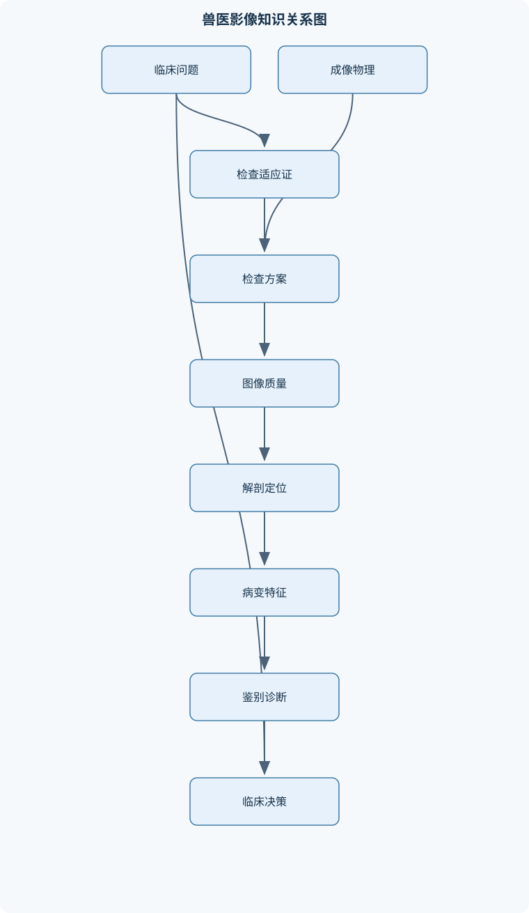
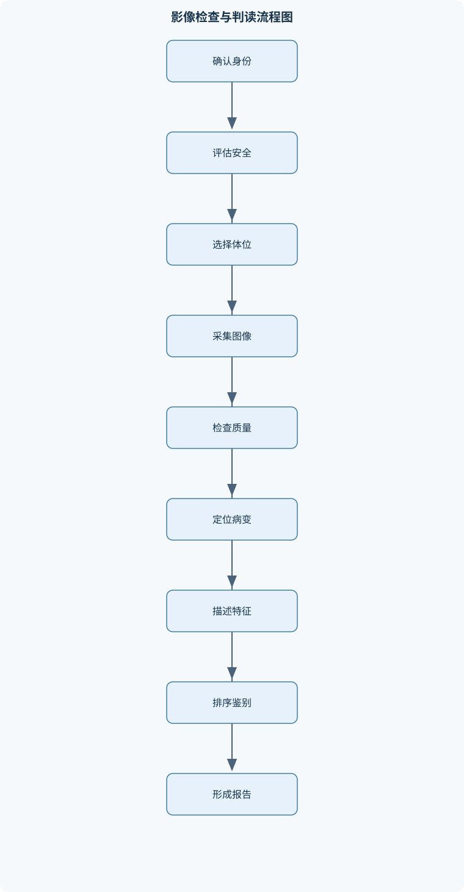

# 兽医影像学

## 一、课程整体知识框架

### 课程边界与先修知识

本课程系统讲授犬猫及常见伴侣动物、部分经济动物的医学影像学原理、检查实施、图像质量控制、正常解剖识别、常见疾病影像表现与临床决策边界。内容覆盖数字X线摄影、超声、计算机断层成像（CT）、磁共振成像（MRI）、核医学与介入及能量治疗影像基础。重点训练从临床问题、检查适应证、检查参数、图像伪影到鉴别诊断和报告表达的完整推理链。先修知识包括动物解剖学、生理学、病理学、基础放射学、麻醉与保定、基础统计学和医学物理学。课程不替代病理学、细胞学、实验室诊断或手术探查；影像学结论通常应与病史、体格检查、实验室结果及随访变化结合解释。





### 1. 课程对象、任务边界与推理主线

兽医影像学研究如何利用 X 线、超声、CT、MRI、核医学及影像引导技术，显示动物体内结构、运动、血流、组织密度和病变分布。课程对象以犬、猫及常见伴侣动物为主，部分原理可用于经济动物，但不同物种的体型、骨骼比例、胸腔形态、胃肠位置和正常生理参数不能直接互换。影像学的任务不是单独“看图命名疾病”，而是完成以下链条：

$$
\text{临床问题}\rightarrow \text{适应证与风险评估}\rightarrow \text{检查方案}\rightarrow \text{图像质量控制}\rightarrow \text{定位与描述}\rightarrow \text{鉴别诊断}\rightarrow \text{临床决策}
$$

影像结论应与病史、体格检查、实验室检查、细胞学、病理学和治疗反应结合。影像通常能够回答“病变在哪里、范围多大、是否侵袭、是否存在并发症”，但不能在所有情况下回答“病变的最终组织学类型”。例如，CT增强显示肿块强化并不等于恶性；超声显示膀胱壁局灶性增厚可提示移行细胞癌，但仍需结合尿液检查、细胞学或组织学确认。

先修知识包括动物解剖学、生理学、病理学、麻醉与保定、基础放射学、医学物理学和基础统计学。检查前必须明确动物身份、检查部位、临床问题、是否需要麻醉或镇静、是否存在妊娠可能、肾功能或造影剂风险，以及是否有金属植入物。任何影像判读的前提都是图像质量可接受、投照方向明确、解剖结构未被严重伪影遮挡。

### 2. 影像学基础与安全规范

犬猫影像描述应使用统一的解剖方向和体位术语。背侧、腹侧、头侧、尾侧、近端、远端、内侧和外侧必须结合动物站立姿势及检查部位解释。X 线片应确认左右标记、投照方向、是否旋转及是否覆盖完整目标区域。超声、CT 和 MRI 则需记录扫描平面、层面方向、序列及增强时相。

X 线穿过组织时可近似服从指数衰减：

$$
I=I_0e^{-\mu x}
$$

其中，$I_0$ 为入射 X 线强度，$I$ 为穿过组织后的强度，单位可用相对强度表示；$\mu$ 为线性衰减系数，通常单位为 $\mathrm{cm^{-1}}$；$x$ 为射线路径长度，单位为 $\mathrm{cm}$。该式适用于均匀介质、近似固定光子能量和单一路径的理想模型。实际动物腹部由脂肪、肌肉、液体、骨和气体组成，射线经过的是多种组织叠加，且存在散射和射束硬化，因此不能把单一 $\mu$ 值直接用于整张腹部图像。若 $\mu x=0.693$，则 $I/I_0=e^{-0.693}\approx0.50$，表示约一半强度保留；厚度增加、组织密度增大或射线能量降低，均可能使探测器入射强度下降。

辐射防护遵循 ALARA 原则，即在获得足够诊断信息的前提下，使辐射暴露保持在合理可行的最低水平。三要素为时间、距离和屏蔽：减少人员在辐射场中的停留时间，增加人与射线源及散射体的距离，使用合适的防护屏蔽。防护并非以“完全没有剂量”为目标，而是避免重复曝光和无诊断价值的暴露。保定应优先采用低风险、可重复的方式；必须人工保定时，应评估工作人员站位、手部是否进入主射线束以及动物突然移动的可能性。

检查记录至少应包括动物身份、日期、检查部位、体位、设备或序列信息、造影剂情况、图像质量、主要影像所见、鉴别诊断和建议。报告应区分“所见”和“结论”：所见描述可观察事实，结论解释其临床意义，不能把未经证实的病理诊断写成确定事实。

### 3. 数字 X 线摄影

X 线由电子在高电压作用下撞击靶物质产生，图像对比主要来自不同组织对 X 线的衰减差异。骨、金属和矿化组织衰减较强，气体衰减较弱，软组织和液体之间的差异较小。投照几何学包括焦点、物体和探测器之间的距离。物体放大、边缘模糊和形变会受到焦点大小、物体到探测器距离、焦点到物体距离及中心射线方向影响。四肢关节需尽量使目标结构靠近探测器并保持正确对位；胸部和腹部则要考虑呼吸相、体位和重叠结构。

曝光参数通常涉及管电压、管电流和曝光时间。提高管电压通常增加穿透力并改变组织对比；增加管电流或曝光时间主要增加到达探测器的光子数量。数字探测器将 X 线转换为像素阵列，像素是二维图像中的最小显示单元。数字系统具有较宽的曝光容忍范围，但这不等于曝光错误没有危害：过度曝光可能增加剂量，曝光不足会增加噪声并掩盖细节。窗宽和窗位是显示处理参数，不会改变原始射线剂量。窗位决定显示灰度中心，窗宽决定显示的密度范围；窗宽过窄会夸大微小密度差，过宽则可能降低视觉对比。

胸部 X 线应按固定顺序检查：先看投照质量和呼吸相，再看胸壁、胸膜腔、肺野、肺血管、气管和支气管、心影及纵隔。肺泡型改变常表现为肺泡实变、空气支气管征或肺叶边界消失；间质型改变表现为肺纹理增粗、结节性或弥漫性密度增加；支气管型改变表现为支气管壁增厚、环形或轨道样影。肺水肿可表现为间质型向肺泡型进展，并伴肺静脉扩张和心影增大，但分布受体位、病程和个体差异影响。左心衰竭的连续病理链为左心压力升高、肺静脉回流压力升高、肺间质或肺泡液体增加；肺炎、非心源性肺水肿和肺出血仍需鉴别。

腹部 X 线重点观察腹腔浆膜细节、肝脾肾位置和大小、胃肠道气体、膀胱及腹膜后区。腹腔浆膜细节下降可见于腹水、腹膜炎、幼龄动物或腹腔脂肪不足。胃扩张扭转应先确认胃是否扩张，再在正位和侧位追踪胃底、胃体和幽门的位置及胃轴。胃内气液平面和异常分区支持严重胃扩张；幽门移至异常位置可支持扭转，但单张影像不能替代完整临床评估和必要的手术探查。

骨骼摄影需描述骨的位置、骨端和干骺端、骨干、骨皮质、骨髓腔、关节间隙及周围软组织。骨膜反应包括连续光滑、层状、栅栏状、放射状和不连续三角形等。生长缓慢的刺激通常允许形成连续规则的骨膜反应，进展快的病变更可能产生不连续、放射状或层状反应，但感染、创伤修复和部分良性病变也可呈侵袭性外观。骨溶解可为地理性、虫蚀样或渗透性；大量针尖样或点状骨质丢失属于渗透性模式，提示病变进展快，但不能单独诊断恶性。死骨片提示局部骨组织坏死，细菌性骨髓炎是重要鉴别，但肿瘤、创伤和血供障碍也可能造成类似表现。

### 4. 超声诊断学

超声依靠机械声波在组织中的传播、反射、折射和散射成像。频率 $f$、波长 $\lambda$ 和介质中的声速 $c$ 满足：

$$
c=f\lambda
$$

$f$ 和频率单位为赫兹，$\lambda$ 为长度单位，$c$ 通常以 $\mathrm{m/s}$ 表示。高频探头波长短、空间分辨率较高但穿透深度较小；低频探头穿透较深但分辨率相对下降。声阻抗为：

$$
Z=\rho c
$$

其中 $\rho$ 为介质密度，单位可用 $\mathrm{kg/m^3}$，$c$ 为声速，$Z$ 为声阻抗。相邻组织声阻抗差越大，界面反射通常越明显，因此软组织与气体、骨之间容易形成强反射和声学遮挡。

二维灰阶图像中，回声强弱受组织界面、探头频率、增益、入射角和深度补偿影响。液体通常呈无回声，但蛋白、细胞、血液或碎屑会使液体出现低到中等回声。后方回声增强是因为低衰减结构使声束更充分到达深部，常见于液体性病灶；它不能直接等同于囊肿。声影通常由气体、骨、结石、金属或高衰减结构产生，也可能由探头角度造成，必须结合多平面扫查和病灶内部特征判断。

腹部扫查应选择合适频率、深度、增益和焦点，按固定顺序观察肝胆胰、脾、胃肠、肾脏、膀胱、腹腔淋巴结和主要血管。每个病变至少在两个互相垂直平面确认，记录大小、边界、内部回声、后方效应、血流、压缩性和邻近关系。彩色和频谱多普勒用于观察血流方向、速度和阻力变化，但低流速、角度不当、增益过高和运动均可导致假性血流或漏诊。

超声引导穿刺应先确定安全针道，避开主要血管、肠管和胆道，实时观察针尖而不是仅根据针杆回声判断位置。穿刺结果代表取样区域，阴性结果不能排除未取到的病灶区域。超声对气体遮挡后的结构、骨后结构和深部小病灶存在明显限制，因此复杂三维关系可转向 CT 或 MRI。

### 5. CT 物理与临床应用

CT 通过不同角度采集 X 线衰减信息，再重建为断层图像。CT 值以亨氏单位 HU 表示，定义为：

$$
HU=1000\times\frac{\mu_{\text{组织}}-\mu_{\text{水}}}{\mu_{\text{水}}}
$$

其中 $\mu_{\text{组织}}$ 和 $\mu_{\text{水}}$ 分别为组织和水的线性衰减系数，单位通常为 $\mathrm{cm^{-1}}$。当组织衰减系数等于水时，$HU=0$；低于水时为负值，高于水时为正值；空气约为 $-1000$ HU，致密皮质骨通常为正高值。HU 是相对衰减指标，不是组织学诊断标签，且会受设备校准、造影剂、扫描参数、重建算法和部分容积效应影响。

像素是二维显示单元，体素是具有层厚的三维体积单元。若视野宽度为 $F$、矩阵边长为 $M$，则平面像素尺寸近似为 $F/M$；体素尺寸近似为：

$$
\text{体素尺寸}=\text{像素尺寸}\times\text{层厚}
$$

层厚增大可降低噪声，但会增加部分容积效应，使小病灶与邻近组织平均化；薄层重建有利于显示小结构和多平面重组，但噪声、数据量和处理负担可能增加。多排探测器和螺旋采集可在较短时间完成大范围扫描。68 排 CT 的核心特点是多排探测器同时采集多个层面，并结合连续床移与螺旋重建提高覆盖效率；“排数”不应被误解为所有图像都具有相同的空间分辨率或诊断质量。

CT 窗位和窗宽分别控制显示中心和显示范围。肺窗适合观察含气肺和细小肺部结构，骨窗适合观察皮质、骨折和骨溶解，软组织窗适合腹部脏器和肌肉。增强 CT 应根据临床问题安排平扫、动脉期、静脉期或延迟期，比较病变增强前后的密度变化、血管关系、淋巴结和远处转移。造影剂使用前应评估静脉通路、既往反应和肾功能风险，并准备监护和不良反应处理流程。增强不等于恶性，炎症、肉芽组织和正常血管丰富组织同样可以强化。

### 6. MRI 物理与序列

MRI 利用具有磁矩的质子在静磁场中的行为成像。射频磁场使纵向磁化偏离平衡，停止激励后，组织通过纵向恢复和横向相位一致性衰减产生信号。纵向弛豫时间为 $T1$，横向弛豫时间为 $T2$。在简化自旋回波模型中：

$$
M_z=M_0(1-e^{-t/T1})
$$

$$
M_{xy}=M_{xy0}e^{-t/T2}
$$

$M_0$ 为平衡纵向磁化，$M_z$ 为时刻 $t$ 的纵向磁化，$M_{xy0}$ 为初始横向磁化，$M_{xy}$ 为时刻 $t$ 的横向磁化，$t$ 的单位为时间。重复时间 TR 和回波时间 TE 共同影响加权特征：短 TR、短 TE 倾向于增强 T1 差异；长 TR、长 TE 倾向于增强 T2 差异。实际信号还受翻转角、质子密度、脂肪抑制、序列结构和磁场均匀性影响。

T1 加权图像中脂肪通常较高信号、自由液体相对较低信号；T2 加权图像中自由水和多数液体通常较高信号。T1 低信号、T2 高信号常提示含水量增加，但水肿、炎症、囊性病变和部分肿瘤均可出现，不能凭信号强弱确定病理类型。脂肪抑制可压低脂肪信号，使水肿、炎症和强化区域更突出，但磁场不均匀时可能出现抑制不均。梯度系统用于空间编码和频率定位，像素、体素、矩阵及层厚共同决定空间分辨率。

MRI 对脑、脊髓、关节软骨、韧带、肌肉和骨髓病变具有优势，但检查时间长，通常需要麻醉或深度镇静。磁体间必须确认氧气设备、麻醉监护设备、金属异物和植入物的兼容性。MRI 安全风险包括物体被磁场吸引、射频加热、设备故障及麻醉监护受限。MRI 信号强度不能像 HU 一样作为跨设备的绝对标准，必须结合序列、参照组织、病变形态和增强表现解释。

### 7. 胸部、心脏、腹部及泌尿生殖系统影像

心脏 X 线评估包括心影大小、形态、肺血管、主动脉、气管和胸腔。心脏时钟图用于按标准方位描述心脏和大血管结构，但具体方位受投照角度、动物体位、旋转和个体解剖差异影响。肺静脉扩张、心影增大和肺水肿组合出现时支持左心衰竭，但需要与肺炎、非心源性肺水肿、肺出血等鉴别。犬动脉导管未闭可出现连续性杂音、左心容量负荷增加和肺血流改变，不能只凭心影增大确诊，需结合超声心动图和彩色多普勒评价分流和血流动力学。

心脏超声可观察瓣膜、房室腔、心肌收缩、血流方向和速度。二维图像负责形态，M 型或二维测量可评价腔室尺寸和运动，多普勒评价血流。测量必须记录切面、时相、体型和心率，不能脱离动物个体直接套用单一正常值。

腹部影像需综合浆膜细节、器官大小和邻近关系。肾脏可在侧位片上测量长轴，并与第二腰椎长度作内部参照，但必须考虑体型、年龄、投照放大、旋转和双肾对称性。肾梗死超声可见局灶性楔形异常回声、皮质髓质结构改变或局部灌注下降，但早期病变可能不典型，需结合血液和尿液结果。膀胱壁局灶性不规则增厚或腔内基底宽的肿块可提示移行细胞癌，但炎症、血凝块和其他肿瘤也可模拟。尿路造影和 CT 尿路成像可显示尿路通畅性、狭窄、充盈缺损和输尿管走行，但造影剂风险和肾功能必须评估。

### 8. 骨骼肌肉、肿瘤、介入及特殊技术

骨病变分析应结合部位、边界、骨溶解模式、骨膜反应、皮质完整性、死骨片和软组织改变。肿瘤分期需要评估原发灶范围、区域淋巴结、肺和腹腔脏器转移，CT 对肺部和骨性结构较有优势，MRI 对骨髓、神经和软组织界面更敏感。影像引导活检要兼顾诊断价值和针道安全，针道应尽量位于未来可一并切除的区域，避免穿过重要血管、关节腔或污染多个组织间隙。

核医学通过示踪剂在体内的分布反映功能和代谢，骨显像可显示骨重塑活跃区域，但空间定位和特异性有限，常需与 X 线、CT 或 MRI 融合解释。数字减影血管造影通过去除骨和软组织背景突出造影血管，适用于血管结构和介入操作，但需要造影剂、辐射和麻醉风险控制。HIFU 是高强度聚焦超声治疗技术，不是普通超声检查；其能量在靶区聚焦并产生热损伤，必须明确声窗、靶区、邻近组织保护和治疗后监测。热消融可通过超声或 CT 监测针尖、消融范围和残余强化区域，疗效评价应比较治疗前后病灶大小、密度或信号、强化模式及临床变化。

## 二、章节和模块划分

### 核心知识覆盖清单

本清单用于检查正文是否覆盖本课程的主要知识模块：

- **影像学基础与安全规范**：影像诊断的任务边界、犬猫体位与解剖方向、影像密度与组织对比、检查适应证与禁忌证、影像设备质量控制、动物保定与麻醉风险、电离辐射生物效应、ALARA三要素、影像记录与报告结构。
- **数字X线摄影**：X线产生与衰减、投照几何学、曝光参数与图像质量、数字探测器与像素、窗宽窗位基础、胸部X线评估、腹部X线评估、骨骼与关节摄影、常见摄影伪影。
- **超声诊断学**：声波传播与声阻抗、反射折射与散射、探头频率选择、二维灰阶成像、多普勒血流成像、后方回声增强、声影形成机制、腹部脏器扫查、超声引导穿刺、超声伪影鉴别。
- **CT物理与临床应用**：CT断层重建概念、X线衰减系数、CT值与亨氏单位、像素体素与空间分辨率、层厚与部分容积效应、螺旋CT与多排探测器、增强CT时相、窗位窗宽选择、68排CT技术特点、CT辐射与造影剂风险。
- **MRI物理与序列**：质子磁矩与静磁场、射频磁场激励、纵向弛豫与T1、横向弛豫与T2、梯度回旋与空间编码、像素体素与矩阵、T1加权成像、T2加权成像、脂肪抑制技术、MRI安全与麻醉监护。
- **胸部与心脏影像学**：胸部X线判读顺序、肺泡型间质型与支气管型、肺水肿影像表现、左心衰竭的影像线索、胸腔积液与气胸、心脏轮廓和心脏时钟图、肺血管与主动脉定位、动脉导管未闭、心脏超声基础测量、胸部CT与MRI适用边界。
- **腹部与泌尿生殖系统影像**：腹部浆膜细节、肝胆胰影像评估、胃肠道气体分布、胃扩张扭转定位、幽门摆位与胃轴判断、肾脏长度与第二腰椎参照、肾梗死超声表现、膀胱壁与腔内病变、移行细胞癌影像线索、尿路造影与CT尿路成像。
- **骨骼肌肉与肿瘤影像**：骨皮质与骨髓腔、骨折定位与愈合、骨膜反应类型、侵袭性骨病变判断、渗透性骨质溶解、地理性骨质溶解、死骨片与骨髓炎、关节软组织影像、肿瘤分期与转移筛查、影像引导活检原则。
- **影像诊断流程与鉴别推理**：临床问题结构化、检查方案选择、正常与异常对照、病变定位与定性、病变分布模式、严重程度与侵袭性评估、鉴别诊断排序、影像报告规范表达、影像与病理结果整合、随访影像比较。
- **介入影像与特殊技术**：超声引导穿刺、CT引导活检、造影检查风险控制、数字减影血管造影基础、核医学示踪剂概念、骨显像适用范围、高强度聚焦超声治疗、热消融影像监测、治疗前后疗效评价、影像设备维护与数据归档。


### 1. 系统影像判读流程

**输入**：病史、体格检查、检查部位、完整影像序列和图像质量信息。  
**输出**：定位明确、依据充分、能够回应临床问题的影像报告。

过程如下：

1. 核对动物身份、检查部位、左右标记、投照方向和扫描序列。
2. 评价曝光、噪声、运动、旋转、覆盖范围和伪影。
3. 按解剖结构逐项检查，不先根据单个异常影像命名疾病。
4. 描述病变的位置、大小、形态、边界、密度或信号、分布及邻近关系。
5. 判断病变是否具有侵袭性、压迫效应、梗阻、出血、转移或功能异常。
6. 将影像特征与病史、实验室结果和物种特点整合，按可能性和危险性排序鉴别诊断。
7. 给出必要的下一步检查建议，如超声、CT、MRI、细胞学、活检或随访。

不变量是：未确认图像质量和解剖定位前，不得直接下疾病结论。终止条件是所有相关结构均有记录，且结论明确回应临床问题。若待检查结构数为 $n$，按固定顺序逐项检查的结构性工作量可近似表示为 $O(n)$；这不是诊断准确率公式。

#### 伪代码示例

```text
语言：伪代码

函数 影像判读(病史, 影像集):
    核对患者身份、部位、体位和左右标记
    如果身份或部位不明确:
        返回 "暂停判读，先补全记录"

    质量 <- 评估曝光、运动、旋转、覆盖范围和伪影
    如果质量严重影响目标结构:
        记录质量缺陷
        返回 "建议补拍或重新扫描后再作结论"

    所见 <- 空列表
    对每个解剖结构 按固定顺序:
        记录结构位置、大小、形态和密度/信号
        如果发现异常:
            在至少一个正交平面或相邻序列确认
            记录边界、分布、侵袭性和伴随改变

    结合病史和实验室结果
    鉴别诊断 <- 按影像符合度、危险性和可验证性排序
    结论 <- 回答临床问题，并注明必要的限制条件
    返回 质量、所见、鉴别诊断、结论和建议
```

### 2. 犬猫腹部 X 线与胃扩张扭转分析流程

**输入**：至少两个相互垂直的腹部投照方向。  
**输出**：腹腔浆膜细节、器官位置、胃肠气体分布和胃扩张扭转可能性的结构化判断。

先确认腹腔覆盖范围、曝光和旋转，再观察肝脾肾、胃肠、膀胱和腹膜后区。若胃扩张，记录胃内气体、液体、内容物及气液平面；随后在正位和侧位追踪胃底、胃体和幽门。胃底、胃体与幽门形成异常分区，或幽门移出正常解剖位置，可支持胃扭转。评价时必须使用整体解剖关系，不能只依据“胃变大”或单一投照片确诊。复杂三维扭转、胃壁活性和血供可进一步采用超声或 CT 评估。

### 3. 骨病变侵袭性分析流程

**输入**：骨骼 X 线或 CT 图像。  
**输出**：病变部位、骨溶解模式、骨膜反应、皮质状态、软组织改变和侵袭性评价。

步骤为：确定病变位于骨端、干骺端还是骨干；判断边界清楚的地理性溶解、虫蚀样溶解或渗透性溶解；观察皮质是否变薄、膨胀、断裂及是否发生病理性骨折；描述骨膜反应连续性和形态；寻找软组织肿胀、矿化、气体和死骨片；最后结合年龄、疼痛、发热、血液检查和病程提出肿瘤、感染、创伤或代谢性疾病鉴别。侵袭性评价不是恶性诊断，感染和快速修复中的创伤也可有不连续骨膜反应。

### 4. 典型例题与逐步解答

#### 例题一：X 线指数衰减

**题干**：一束初始强度为 $I_0$ 的 X 线通过均匀组织，已知 $\mu x=0.693$，求透射强度与入射强度的比值。

**分析**：使用 $I=I_0e^{-\mu x}$。这里假设组织均匀、射线能量近似固定，不能直接代表真实腹部的综合衰减。

**解答**：

$$
\frac{I}{I_0}=e^{-0.693}\approx0.50
$$

因此透射强度约为入射强度的 50%。如果组织厚度增加而 $\mu$ 不变，$\mu x$ 增大，透射强度继续按指数下降。

**结果验证**：$\mu x=0$ 时应有 $I/I_0=1$，符合没有组织衰减的边界；当 $x$ 趋近无穷大时，$I/I_0$ 趋近 0。

**变式**：若 $\mu$ 加倍而厚度不变，则新的指数项为 $-1.386$，透射比例约为 0.25，而不是简单减少 0.5。

#### 例题二：CT 值计算

**题干**：某组织线性衰减系数为水的 1.2 倍，求其 HU。

**分析**：令 $\mu_{\text{组织}}=1.2\mu_{\text{水}}$，代入 CT 值公式。

**解答**：

$$
HU=1000\times\frac{1.2\mu_{\text{水}}-\mu_{\text{水}}}{\mu_{\text{水}}}
=1000\times0.2=200
$$

结果为 200 HU，表示该组织相对于水具有更高的 X 线衰减。

**结果验证**：若组织衰减系数等于水，公式应得 0 HU；若低于水，则结果为负值。

**变式**：病灶内含造影剂或骨小梁时，测得 HU 可能升高；若病灶很小而层厚较大，部分容积效应可使测量值偏离真实组织值，因此不能凭 200 HU 直接称为某一种肿瘤。

#### 例题三：超声回声鉴别

**题干**：肝内有一圆形、边界光滑、内部无回声病灶，后方回声增强；另一病灶内部强回声并有清晰后方声影。如何分析？

**分析**：第一病灶使声束衰减较少，后方获得的声能相对更多；第二病灶可能具有强反射或高衰减成分。

**解答**：第一病灶更符合液体性结构，如囊性病变，但仍需观察压缩性、内部细小回声、彩色多普勒和多个切面。第二病灶可能含结石、矿化、骨样结构或气体。声影不是结石特异征象，探头角度、气体和强纤维化同样可造成遮挡。

**结果验证**：改变探头角度后，若声影消失，需考虑角度伪影；若不同平面均存在且病灶内有强界面，则真实矿化或结石的可能性增加。

**变式**：若第一病灶内部出现大量细点状回声并可移动，则血液、脓液或细胞碎屑的可能性上升，不能继续简单称为单纯囊肿。

#### 例题四：T1 与 T2 信号判断

**题干**：某病灶在 T1 加权图像上接近肌肉信号，在 T2 加权图像上明显高信号。应如何推理？

**分析**：T2 高信号通常说明自由水或组织含水量增加，但并非疾病特异表现。

**解答**：首先考虑水肿、炎症、囊性成分或部分肿瘤；再观察脂肪抑制序列、增强方式、边界、占位效应、周围骨髓和神经结构。若液体均匀、无强化且边界清楚，更支持囊性或液体性结构；若不均匀强化并伴浸润，需提高对炎症或肿瘤的警惕。

**结果验证**：同一病灶在不同序列的表现应具有内部一致性；若仅一套序列异常，需排除运动、磁敏感和脂肪抑制不均。

**变式**：含脂肪、亚急性出血、浓蛋白液体或矿化物质可改变通常的 T1/T2 规律，因此信号不能脱离序列解释。

#### 例题五：骨肿瘤与骨感染鉴别

**题干**：长骨干骺端出现渗透性骨质溶解、断续放射状骨膜反应、软组织肿胀和高密度死骨片，如何排列鉴别诊断？

**分析**：渗透性溶解和放射状骨膜反应说明病变进展较快，属于侵袭性骨病变；死骨片提示局部骨坏死，但不具有绝对特异性。

**解答**：首先将病变归类为侵袭性过程；主要鉴别包括恶性骨肿瘤和细菌性骨髓炎。死骨片、发热、白细胞变化、伤口或感染史使骨髓炎可能性上升；年龄、原发部位、转移灶和进行性骨破坏可支持肿瘤。最终应结合细针取样、组织活检、培养和实验室检查。

**结果验证**：若仅因放射状骨膜反应就诊断恶性，忽略感染和创伤，是推理错误。

**变式**：若存在病理性骨折或局部软组织气体，应进一步评估感染、开放性损伤和手术风险，而不能只讨论肿瘤类型。

### 5. 实验与项目

#### 项目一：数字 X 线图像质量控制

**输入数据**：同一犬胸部或腹部的标准投照影像、不同曝光条件影像、体位旋转影像及运动模糊影像。  
**步骤**：记录投照方向和呼吸相；评价覆盖范围、旋转、曝光、散射、运动和标记；在肺野、心影、腹部浆膜和骨结构中分别选取可辨识结构；比较不同窗宽窗位对观察结果的影响；填写质量缺陷、可能原因和是否需要重拍。

**评价标准**：左右标记和体位明确；目标区域完整；主要结构未被运动或旋转严重影响；曝光足以显示软组织和骨性细节；窗位调整不能被误认为重新曝光；重拍建议必须说明诊断信息缺失的具体原因。

**排错方法**：若全片过亮或过暗，先区分曝光问题和显示窗位问题；若心影或脊柱偏向一侧，检查动物旋转；若边缘模糊，判断运动而不是简单提高对比度；若腹部浆膜差，考虑体脂、腹水、曝光和散射共同影响。

#### 项目二：腹部超声结构化扫查

**输入数据**：禁食或未禁食犬猫、探头频率、目标器官和临床问题。  
**步骤**：记录体位和探头频率；调整深度、增益和焦点；按固定顺序扫查肝胆胰、脾、胃肠、双肾、膀胱和主要血管；每个器官获取纵向和横向图像；对异常区域进行彩色多普勒和不同角度复查；记录病灶大小、边界、内部回声、后方效应和血流。

**评价标准**：目标器官覆盖完整；病灶在两个正交平面确认；测量标尺和方向清楚；能够区分真实病灶与气体、骨或探头角度造成的伪影；报告同时描述阳性和重要阴性所见。

**排错方法**：深部结构噪声大时检查频率和总增益；近场显示不佳时调整焦点和探头贴合；彩色血流过多可能为增益过高或运动伪影；病灶只在一个角度出现时，先改变探头方向并寻找正交证据。

### 6. 常见易错点、笔试与面试考查

#### 具体易错点

1. 把 CT 的 HU、MRI 信号强度和超声回声强度当作同一类单位。
2. 把后方回声增强直接等同于囊肿。
3. 把声影直接等同于结石，忽略气体、骨、金属和角度伪影。
4. 把 T1 低信号、T2 高信号直接诊断为恶性肿瘤。
5. 认为不连续骨膜反应必然是恶性。
6. 只依据一张腹部 X 线片诊断胃扩张扭转。
7. 忽略投照旋转对心脏时钟图和血管定位的影响。
8. 仅凭心影增大诊断动脉导管未闭。
9. 把肾脏与第二腰椎的比例作为不受体型影响的绝对标准。
10. 只看到骨溶解就判断恶性，忽略骨感染和创伤。
11. 把数字 X 线窗位窗宽调整误认为改变了真实曝光。
12. 在 MRI 磁体间使用未经兼容性确认的氧气瓶或监护设备。
13. 将增强后病灶变亮直接称为恶性。
14. 忽略麻醉、呼吸和体位对动态影像及图像质量的影响。
15. 将 HIFU 当作普通超声检查，忽视其聚焦能量和热损伤边界。

#### 典型笔试问题与解答思路

1. **说明 X 线指数衰减公式中各变量及适用边界。**  
   解答应写明 $I_0$、$I$、$\mu$ 和 $x$ 的含义及单位，说明均匀介质、固定能量是理想条件，真实动物存在多组织叠加、散射和射束硬化。

2. **为什么水为 0 HU，空气约为负高值，骨为正高值？**  
   由 HU 公式说明三者相对于水的衰减关系，强调 HU 是相对物理量，不直接等同组织学诊断。

3. **解释像素、体素和部分容积效应。**  
   说明像素为二维单元，体素包含层厚；层厚增大时不同组织平均到同一体素，导致小病灶密度被稀释。

4. **比较 T1 加权和 T2 加权图像。**  
   从短 TR、短 TE 与长 TR、长 TE 解释加权基础，再说明脂肪、自由液体和含水病变的常见表现及例外。

5. **为什么超声液体病灶后方常出现回声增强？**  
   说明低衰减液体使声束到达深部并返回探头的能量相对增加，同时指出增强不是囊肿特异征象。

6. **如何判断骨病变是否具有侵袭性？**  
   综合骨溶解边界、溶解模式、骨膜反应、皮质破坏、软组织改变和病程，不能只看单一骨膜反应。

7. **左心衰竭如何形成肺水肿影像链？**  
   按左心压力升高、肺静脉淤血、肺间质或肺泡液体增加的顺序作答，并讨论肺炎和非心源性肺水肿鉴别。

8. **增强 CT 中病灶强化说明什么？**  
   说明强化反映血流、通透性和间质分布，炎症、肉芽组织和部分正常组织也可强化，最终诊断仍需结合临床和病理。

#### 典型面试问题与参考回答要点

1. **拿到一组胸部 X 线片，你先做什么？**  
   先核对身份、体位、左右标记、呼吸相和图像质量，再按胸壁、胸膜、肺、血管、气管、心影和纵隔顺序判读。追问时应说明不能在旋转或运动伪影未排除前判断心脏大小。

2. **动物呼吸困难但胸片不典型，如何选择下一步检查？**  
   结合稳定性、心源性或肺源性线索选择心脏超声、胸部超声、CT 或实验室检查；若动物不稳定，应先处理生命风险，不能为追求影像完整性延误急救。

3. **超声发现膀胱壁肿块，你如何表达？**  
   描述位置、基底、边界、内部回声、血流和是否造成梗阻，可提出移行细胞癌等鉴别，但不把影像表现写成组织学确诊。

4. **如何向临床医生解释“侵袭性骨病变”？**  
   说明这是影像学行为描述，意味着进展快或破坏性强，恶性肿瘤和感染均可能，建议结合活检、培养和分期检查。

5. **使用造影剂前要核对哪些内容？**  
   核对适应证、静脉通路、既往反应、肾功能风险、麻醉状态、监护能力和急救准备；追问时应说明增强信息不能替代组织学诊断。

6. **MRI 检查前最重要的安全问题是什么？**  
   确认动物体内金属或植入物、监护设备和麻醉设备的磁兼容性，避免铁磁物体进入磁体间，并建立持续监护和应急撤离流程。

7. **影像结果与病理结果不一致时如何处理？**  
   先检查取样是否代表病灶、影像和病理是否来自同一区域，再核对切片、标本处理和病变异质性；必要时进行影像—病理联合复核，而不是简单认定一方错误。

8. **如何评价一次影像检查是否合格？**  
   以临床问题是否得到回答、目标结构是否覆盖、图像质量是否允许观察、伪影是否可控、报告是否区分所见与结论、建议是否可执行为标准。

### 7. 岗位关联与产出要求

兽医影像诊断医师的实际任务包括检查方案选择、影像判读、鉴别诊断、报告签发和与临床、病理联合讨论；使用解剖、病理、物理、麻醉风险和结构化判读知识，产出可追溯影像报告，验收标准是定位准确、描述完整、结论回应临床问题并明确不确定性。

小动物或大型动物临床兽医主要负责提出临床问题、判断适应证、配合保定麻醉并整合影像结果；产出是明确的诊疗决策和随访计划，验收标准是检查选择与病情相符，影像结论未被脱离病史误用。

放射技师、超声检查技师及 CT、MRI 操作技师负责体位、参数、采集、质量控制和数据归档；产出是完整、标记清楚、伪影可控的影像数据，验收标准包括覆盖范围、方向、序列、层厚、增强期相及设备安全记录符合检查目的。

麻醉与监护人员负责麻醉风险评估、呼吸循环监护、造影剂反应观察和恢复期管理；验收标准是关键生理参数持续记录、异常有处置记录，且影像检查未因可避免的麻醉风险中断。

影像引导介入人员负责穿刺、活检、引流、血管造影和热消融定位；使用超声、CT、解剖、无菌操作和并发症识别知识，产出安全可追踪的介入记录与标本，验收标准是针道和靶区明确、重要结构避让、标本可诊断且并发症及时记录。

动物医院质量与辐射安全管理员负责设备维护、辐射防护、重复曝光分析、数据归档和流程审查；产出是质量控制记录、设备异常处置记录和安全培训材料，验收标准是在满足诊断质量的前提下减少不必要曝光，并保证影像数据与报告可追溯。

## 三、核心概念的详细解释

### 3.1 影像诊断的任务边界与检查前提

兽医影像学的核心任务是把临床问题转化为可观察、可测量和可比较的影像信息。完整推理链为：明确病史与体格检查重点，判断检查适应证和风险，选择合适的成像技术，核对图像质量与解剖方向，完成病变定位和形态描述，再结合病理生理过程提出鉴别诊断。影像学能够较好回答病变的位置、范围、密度或信号、血流、骨破坏、脏器关系和并发症，但不能在所有情况下直接确定组织学类型。

检查前应确认动物身份、物种、年龄、体型、检查部位、临床问题、是否可能妊娠、是否需要镇静或麻醉、是否存在肾功能风险、既往造影剂反应及体内金属或植入物。犬猫正常解剖不能简单套用人体资料；同一物种内部也会受到体型、年龄、体位、呼吸状态和个体变异影响。

影像报告应把“所见”和“结论”分开。所见是可被图像直接支持的事实，例如“膀胱三角区可见基底宽、边界不规则的软组织样结构，彩色多普勒可见内部血流”；结论是基于这些事实提出的解释，例如“膀胱壁肿块，移行细胞癌、炎性增生或血凝块为主要鉴别”。影像描述不应把“可能符合”写成“已经确诊”。

### 3.2 体位、解剖方向与图像质量

犬猫影像中，头侧、尾侧、背侧、腹侧、近端、远端、内侧和外侧必须以动物自身解剖姿势为参照。X线检查应确认左右标记、投照方向、是否旋转、目标部位是否完整覆盖以及曝光是否满足诊断要求。胸部影像通常需要相互垂直的投照方向；腹部急症至少应比较两个互相垂直的方向，以减少体位造成的假性移位。

图像质量不合格时，病变不存在与病变未显示不能混为一谈。曝光不足可能使肺野显得过度浑浊，曝光过度可能掩盖软组织细节；运动会造成边缘模糊；旋转会改变心影、纵隔和器官的相对位置；散射会降低对比度。数字图像可以通过窗位、窗宽或后处理改善显示，但后处理不能恢复采集时已经丢失的信息。

### 3.3 X线衰减、摄影几何学与数字图像

X线由高电压加速电子撞击靶物质产生。光子穿过动物后，因光电吸收和康普顿散射等过程而衰减。气体通常衰减较少，骨和金属衰减较强，软组织和液体之间的差异较小。影像对比来自不同路径上衰减差异的累积，而不是某个组织具有固定不变的“颜色”。

理想情况下，均匀介质中的衰减可表示为：

$$
I=I_0e^{-\mu x}
$$

其中，$I_0$ 是入射强度，$I$ 是穿过组织后的强度，$\mu$ 是线性衰减系数，单位通常为 $\mathrm{cm^{-1}}$，$x$ 是射线路径长度，单位为 $\mathrm{cm}$。该式假设介质均匀、射线能量近似固定且只考虑单一路径。真实动物体内存在多种组织叠加、散射和射束硬化，因此实际衰减是多个组织贡献的综合结果。

焦点、动物和探测器之间的几何关系影响放大率和清晰度。物体距离探测器越远，放大越明显；焦点越大，几何不清晰度越明显；动物运动会增加运动不清晰度。骨骼摄影需要减少运动、合理固定关节并尽量使目标部位靠近探测器。数字探测器把X线转换为离散像素；像素是二维图像的最小显示单元，像素越小，理论平面分辨率越高，但在剂量不足时噪声也可能增大。

窗位是显示灰度中心，窗宽是显示灰度覆盖范围。窗宽较窄有利于显示细微密度差，窗宽较宽可容纳更大的密度范围。窗位和窗宽只改变显示方式，不改变原始衰减信息，也不应被误认为提高了真实空间分辨率。

### 3.4 超声传播、回声与伪影

超声是机械波，需要介质传播。频率记为 $f$，波长记为 $\lambda$，介质中的声速记为 $c$，三者满足：

$$
c=f\lambda
$$

软组织中常采用近似声速，但不同组织、病变和温度会造成实际声速差异。高频探头波长短，理论空间分辨率较高，但穿透深度有限；低频探头穿透更深，分辨率相对下降。探头选择应根据动物体型、目标器官深度、病变大小和声窗共同决定。

声阻抗定义为：

$$
Z=\rho c
$$

其中，$\rho$ 为介质密度，单位可用 $\mathrm{kg/m^3}$；$c$ 为声速，单位为 $\mathrm{m/s}$；$Z$ 为声阻抗。两种组织的声阻抗差异越大，界面反射越明显。软组织与气体、骨或金属之间阻抗差异大，声波容易被强烈反射或吸收，形成深部声学遮挡。

后方回声增强常见于液体或低衰减结构之后。其物理逻辑是：声束通过前方结构时能量损失较少，深部组织接收到的声能较多，返回探头的回声相对增强。增强不能直接等同于囊肿，因为部分低细胞性软组织、血管或技术因素也可能产生类似表现。

声影通常出现在气体、骨、结石、金属或强纤维化结构之后。强反射、强吸收或折射会减少进入深部的有效声能，使后方呈低回声或无回声带。声影不能直接等同于结石；应结合病灶内部强回声、移动性、压缩性、多平面表现和不同探头角度判断。

超声扫查中，真病灶应尽量在两个相互垂直的平面确认。各向异性、边缘伪影、旁瓣伪影、镜像伪影和增益设置不当均可能制造假性病变。多普勒可评估血流方向和相对速度，但低速血流、深部结构、角度偏差和运动伪影会影响结果。超声引导穿刺要求识别靶区、针尖和重要血管，不能只看到针体而未确认针尖位置。

### 3.5 CT的物理基础、CT值与多排技术

CT利用X线从多个角度穿过动物身体，计算机根据各方向衰减数据重建横断面。二维显示单元为像素，具有层厚后形成三维体积单元，即体素。若视野长度为 $FOV$，矩阵一边的像素数为 $N$，则平面像素尺寸近似为：

$$
\Delta x=\frac{FOV}{N}
$$

体素尺寸可近似表示为：

$$
\text{体素尺寸}=\text{像素尺寸}\times\text{层厚}
$$

层厚增加会降低纵向分辨率并加重部分容积效应；薄层重建有利于显示小病灶、骨折线和血管，但图像噪声、数据量和重建时间可能增加。

CT值以亨氏单位（HU）表示，水标定为0 HU，空气约为−1000 HU，脂肪通常为负值，软组织多接近水的正负小范围，致密骨通常为明显正值。其公式为：

$$
HU=1000\times\frac{\mu_{\text{组织}}-\mu_{\text{水}}}{\mu_{\text{水}}}
$$

其中，$\mu_{\text{组织}}$ 和 $\mu_{\text{水}}$ 分别为组织与水的线性衰减系数。若组织衰减系数为水的1.2倍，则：

$$
HU=1000\times(1.2-1)=200
$$

这只表示该体素相对于水的衰减较高，不能单独据此确认肿瘤、血块或骨组织。造影剂、金属伪影、骨赘、部分容积和扫描参数都会改变测量值。

多排CT通过多个探测器排同时采集数据，配合床位连续移动形成螺旋扫描。较多探测器排可在较短时间覆盖更大范围，有利于减少呼吸和运动影响，并支持薄层重建及多平面重组。所谓“68排”主要描述探测器采集结构和覆盖能力，并不意味着所有动物、所有病变都自动获得更高诊断质量；扫描速度、层厚、剂量、重建算法和动物配合仍然重要。

增强CT需要根据临床问题安排平扫、动脉期、静脉期或延迟期。强化反映血流、血管通透性和间质分布，炎症、肉芽组织、部分正常组织和肿瘤均可强化。使用造影剂前应核对静脉通路、既往反应、肾功能风险、监护能力和急救准备。

### 3.6 MRI信号、弛豫与序列

MRI利用质子磁矩在静磁场中的排列及射频激励后的信号变化成像。射频磁场使净磁化偏离平衡方向；停止激励后，纵向磁化逐步恢复，横向磁化因自旋相位失配而衰减。

纵向恢复可近似写为：

$$
M_z=M_0(1-e^{-t/T_1})
$$

横向衰减可近似写为：

$$
M_{xy}=M_{xy0}e^{-t/T_2}
$$

其中，$M_0$ 为平衡纵向磁化，$M_z$ 为时刻 $t$ 的纵向磁化，$M_{xy0}$ 为初始横向磁化，$M_{xy}$ 为时刻 $t$ 的横向磁化；$T_1$ 是纵向弛豫时间，$T_2$ 是横向弛豫时间，时间单位通常为毫秒。梯度磁场通过改变不同空间位置的进动频率和相位实现空间编码；“梯度回旋”并不是普通摆位动作，而是利用梯度改变局部磁场，使空间位置与信号频率或相位建立对应关系。

重复时间 $TR$ 和回波时间 $TE$ 共同影响图像权重。短 $TR$、短 $TE$ 通常增强T1差异；长 $TR$、长 $TE$ 通常增强T2差异。T1加权图像中脂肪常呈较高信号，自由液体相对较低；T2加权图像中自由水和多数液体常呈较高信号。脂肪抑制可压低脂肪信号，使水肿、炎症或肿瘤强化更容易显示。

MRI信号强度 $SI$ 不是像HU那样的绝对定量单位，受磁场强度、线圈、序列、参数、增益和重建方式影响。相同病灶在不同序列或设备上信号可能不同，必须结合参照组织、形态、增强表现和病理生理过程解释。血液分解产物、蛋白浓度、纤维化、钙化和磁敏感效应均可改变通常的T1/T2规律。

MRI安全重点包括金属异物、植入物、氧气设备、麻醉机、监护线缆和铁磁性物品。动物通常需要麻醉以减少运动，但麻醉设备必须确认磁兼容性，并持续监测呼吸循环状态。

### 3.7 胸部、心脏与血管影像

胸部X线判读可按“投照质量—胸壁和胸膜—纵隔—心脏—肺血管—肺实质—气管和支气管”的顺序进行。肺泡型阴影表现为肺泡充盈、空气支气管征或边界模糊；间质型表现为肺纹理增粗、网状或结节样改变；支气管型表现为支气管壁增厚、环形或平行线样改变。三种模式可以重叠，不能仅凭一种模式直接确定病因。

左心衰竭的影像病理链通常是左心充盈压力升高，肺静脉回流压力增加，继而出现肺静脉扩张和肺水肿。犬猫可见心影增大、肺静脉扩张及肺门或周围肺野间质—肺泡型阴影，但分布受体位、病程和个体差异影响。非心源性肺水肿、肺炎、肺出血也可能相似，因此需要结合呼吸困难、听诊、心脏超声和实验室资料。

胸腔积液在X线中可造成肺叶回缩、裂隙线和胸腔软组织密度增加；气胸则可见肺叶回缩、胸壁与肺叶之间出现气体透亮区。心脏时钟图用于按标准方位描述心脏轮廓和大血管，但必须结合投照角度、体位旋转和物种差异。动脉导管未闭是犬常见先天性心脏病之一，影像可提示心脏和肺血管容量负荷，但不能仅凭心影增大确诊，需结合连续性杂音、超声心动图和彩色多普勒。

### 3.8 腹部、泌尿生殖系统与急腹症

腹部X线首先评价浆膜细节、肝脾肾位置和大小、胃肠气体分布、腹膜后区、膀胱及异常矿化。浆膜细节下降可见于腹腔积液、腹膜炎、脂肪减少或曝光问题；不能把所有腹部对比度下降都解释为积液。

胃扩张扭转的判断必须先确认胃是否扩张，再追踪胃底、胃体和幽门的相对位置，比较正位和侧位上的胃轴。幽门异常移位、胃内容物异常分区和气液平面支持扭转，但单一投照图可能因体位造成误判。该病涉及急诊稳定性评估，影像不能延误必要的临床处置。

肾脏长度可与第二腰椎长度作内部参照，但比例受体型、年龄、投照放大、旋转、脱水和慢性肾病影响，不能脱离物种和个体情况机械套用。肾梗死超声可表现为局灶性楔形低回声或回声异常区、皮髓质结构改变及局部血流减少，但早期或小梗死可能不典型，需结合多普勒、血液和尿液结果。

膀胱壁局灶性不规则增厚或腔内基底宽肿块可提示移行细胞癌，但血凝块、炎症、息肉样增生和局部膀胱未充分充盈也可相似。尿路造影和CT尿路成像有助于观察输尿管、膀胱和尿道的通畅性及占位关系。

### 3.9 骨骼肌肉、感染与肿瘤影像

骨病变应描述所在骨、骨端或骨干位置、病灶边界、骨质溶解类型、皮质完整性、骨膜反应、软组织改变和是否存在病理性骨折。地理性骨溶解边界相对清楚，通常提示进展较慢；虫蚀样和渗透性骨溶解常提示病变进展较快或侵袭性较强。大量针尖状或点状、边界不清的骨质流失属于渗透性骨质溶解表现，但不能单独断言恶性。

骨膜反应包括连续光滑、层状、栅栏状、放射状和不连续三角形等。生长缓慢的刺激允许骨膜形成较规则的骨反应；快速或破坏性病变可能形成断续、层状、栅栏状或放射状反应。感染、骨折修复和部分良性病变也可能产生侵袭性外观，因此骨膜反应只能用于判断生长行为，不能单独等同于恶性肿瘤。

细菌感染造成骨缺血、骨坏死后可形成死骨片，影像上表现为坏死骨片与周围骨质破坏、骨膜反应或软组织肿胀并存。死骨片支持骨髓炎，但不是绝对特异征象。侵袭性骨病变需要结合发热、疼痛、血液检查、细针采样、培养和组织活检。MRI更适合显示骨髓、软组织、关节软骨和神经结构，CT更适合显示皮质骨、复杂骨折、矿化和三维关系。

### 3.10 介入、核医学与能量治疗

超声引导穿刺适合可见、可接近且重要血管能够避开的病灶；CT引导活检适合深部、被气体遮挡或需要精确三维定位的病灶。两者都要求明确靶区、避开重要血管和脏器、确认针尖位置、记录取材部位，并建立并发症监测流程。影像引导不能替代无菌操作、凝血风险评估和标本固定管理。

核医学利用示踪剂在体内的分布反映组织灌注、代谢或受体活动，骨显像对某些骨重塑活跃病变敏感，但空间分辨率和特异性有限，通常需要结合X线、CT或MRI定位和定性。

高强度聚焦超声（HIFU）不是普通超声检查。它把声能聚焦于靶区，通过热效应或机械效应造成组织损伤，需要明确声窗、靶区、周围重要结构、温度或能量监测和治疗后评价。热消融的疗效评价不能只看治疗区变亮或变暗，而应结合增强缺损、残余血流、病灶体积变化、临床症状和随访结果。

### 3.11 结构化影像判读流程

**输入**：病史、体格检查、完整影像、检查部位和投照或扫描参数。  
**输出**：定位明确、依据充分、区分所见与结论的影像报告。  
**过程**：

1. 核对动物身份、左右标记、投照方向、扫描范围和图像完整性。
2. 判断曝光、噪声、运动、旋转、伪影和增强期相是否满足临床问题。
3. 按固定解剖顺序逐一评价正常结构。
4. 对异常结构描述位置、大小、形状、边界、密度或信号、内部成分、血流、邻近关系和分布模式。
5. 判断病变的局限性、侵袭性、严重程度及可能并发症。
6. 结合年龄、物种、症状、实验室检查和既往影像排序鉴别诊断。
7. 给出与临床问题对应的结论和必要的进一步检查建议。

不变量是：未确认图像质量和定位前，不直接命名疾病；未完成主要结构检查前，不因某一异常而停止判读。终止条件是所有相关结构均有描述，结论能够回应临床问题，并且不确定性已被明确记录。若按结构逐项检查，待评价结构数为 $n$ 时，流程复杂度可近似表示为 $O(n)$。

```text
伪代码
输入：病史H，影像集合I，目标区域R
输出：影像报告Q

确认身份、方向和扫描范围
如果目标区域未覆盖或伪影严重：
    标记“质量受限”
    判断是否需要补拍或补扫
按照R的解剖顺序建立结构列表S
对S中的每个结构s：
    记录正常或异常
    若异常：
        描述位置、大小、边界、密度/信号、血流和邻近关系
        判断侵袭性、分布和并发症
结合H、物种、年龄和实验室信息
按可能性及临床危险性排序鉴别诊断
分别生成“影像所见”和“影像结论”
检查结论是否回应H中的临床问题
输出Q
```

### 3.12 典型易错点与实际验证

常见错误包括：把HU、MRI信号和超声回声强度当作同一单位；把后方回声增强直接等同于囊肿；把声影直接等同于结石；把T1低信号或T2高信号直接等同于恶性肿瘤；把放射状骨膜反应直接等同于恶性；只凭一张腹部X线片诊断胃扩张扭转；忽略投照角度对心脏时钟图的影响；仅凭心影增大确诊动脉导管未闭；把肾脏与第二腰椎的比例当作绝对标准；只看到骨溶解就判断肿瘤；忽略数字X线曝光和运动伪影；MRI检查前未确认金属和监护设备安全；把HIFU当作普通超声；把造影后变亮直接称为恶性。

实际质量控制可设计为两个项目。项目一是“同一腹部病例的多模态比较”：输入同一动物的两种以上投照X线、腹部超声及必要的CT图像，步骤包括记录浆膜细节、胃肠气体、肾脏、膀胱和异常矿化，再比较不同技术对气体、液体、软组织和三维关系的显示能力。评价标准是每个主要器官均有记录、病变至少在两个平面确认、结论区分事实与推断。排错时先检查体位、膀胱充盈、超声声窗和CT层厚，不应先假定不同结果必然互相矛盾。

项目二是“骨病变侵袭性分级”：输入骨骼X线或CT，步骤包括确定骨段、判断地理性或渗透性溶解、记录皮质破坏和骨膜反应、寻找死骨片及软组织肿胀，再结合病史提出肿瘤、感染和创伤鉴别。评价标准是描述完整、不能仅凭单一征象下结论，并能提出组织学或培养验证路径。排错时应检查曝光、患肢旋转、是否将重叠结构误认为骨溶解，以及死骨片是否真的与感染区域相连。

## 四、重要定义、公式、定理和推导

### 专业审校补充：关键定义与适用边界

彩色及频谱多普勒中的血流速度估算受多普勒角影响。理想条件下，血流速度可近似表示为 v = cΔf/(2f₀cosθ)，其中 v 为血流速度，单位为 m/s；c 为组织内声速，软组织常近似取 1540 m/s；Δf 为发射与接收频率差，单位为 Hz；f₀ 为探头发射频率，单位为 Hz；θ 为声束与血流方向的夹角。角度越接近 90°，cosθ 越小，速度误差越大，通常应尽量使角度不超过 60°，并在整个测量过程中保持角度校正一致。脉冲波多普勒还受奈奎斯特极限约束：可测最高频移约为脉冲重复频率 PRF 的一半；超过该值会出现混叠，表现为频谱方向折返或彩色显示反转。提高 PRF、降低发射频率、调整基线或改用连续波可缓解混叠，但可能牺牲浅表低速血流的敏感性。血流速度不能脱离血管直径、心动周期、呼吸、操作者取样位置及动物镇静状态解释；角度错误、增益过高和壁滤波设置不当均可能制造假性血流异常。


### 4.1 X线指数衰减的推导与边界

设均匀组织厚度增加一个极小距离 $dx$，射线强度减少量与当前强度 $I$ 及厚度增量成正比：

$$
dI=-\mu I\,dx
$$

整理得：

$$
\frac{dI}{I}=-\mu dx
$$

从入射位置 $0$ 积分到组织厚度 $x$：

$$
\int_{I_0}^{I}\frac{dI}{I}
=
-\mu\int_0^x dx
$$

因此：

$$
\ln\frac{I}{I_0}=-\mu x
$$

取指数后得到：

$$
I=I_0e^{-\mu x}
$$

若 $\mu x=0.693$，则：

$$
\frac{I}{I_0}=e^{-0.693}\approx0.50
$$

说明约一半强度保留。该推导适用于均匀介质和近似固定能量；真实动物体内应把不同组织的衰减贡献相加，散射和射束硬化会使理想模型与实际图像产生偏差。

### 4.2 CT值的推导与数值例题

CT值以水为参照，将相对衰减差放大1000倍：

$$
HU=1000\times\frac{\mu_{\text{组织}}-\mu_{\text{水}}}{\mu_{\text{水}}}
$$

若 $\mu_{\text{组织}}=\mu_{\text{水}}$，则 $HU=0$；若组织衰减低于水，HU为负；若高于水，HU为正。设某区域 $\mu_{\text{组织}}=1.2\mu_{\text{水}}$，代入可得：

$$
HU=1000\times\frac{1.2\mu_{\text{水}}-\mu_{\text{水}}}{\mu_{\text{水}}}
=200
$$

结果验证：分子为 $0.2\mu_{\text{水}}$，除以 $\mu_{\text{水}}$ 后为0.2，再乘1000得到200 HU。变式是若组织衰减系数为水的0.8倍，则 $HU=-200$。这仍只是相对衰减测量，不能单凭数值确定病理性质；造影剂、部分容积、ROI位置和伪影均需纳入解释。

### 4.3 像素、体素与部分容积效应

若视野为 $FOV$，矩阵尺寸为 $N\times N$，则平面像素尺寸为：

$$
\Delta x=\frac{FOV}{N}
$$

例如，视野为 $200\ \mathrm{mm}$，矩阵为 $512\times512$：

$$
\Delta x=\frac{200}{512}\approx0.391\ \mathrm{mm}
$$

若层厚为 $1.0\ \mathrm{mm}$，则体素近似为：

$$
0.391\ \mathrm{mm}\times0.391\ \mathrm{mm}\times1.0\ \mathrm{mm}
$$

当一个体素同时包含液体、软组织和骨时，测得的CT值是这些成分衰减的混合结果，即部分容积效应。减小层厚和像素尺寸有助于降低混合，但会增加噪声、数据量或扫描成本。空间分辨率提高并不等于低对比度分辨率必然提高。

### 4.4 超声反射、波长与声学遮挡

由：

$$
c=f\lambda
$$

可得：

$$
\lambda=\frac{c}{f}
$$

在声速近似固定时，频率升高，波长缩短，理论分辨率提高；但高频声波衰减更快，穿透深度下降。低频探头适合深部或大型动物，不能因为分辨率较低就判断其“质量差”。

声阻抗界面反射的强弱与两介质阻抗差有关。液体与软组织阻抗差较小，界面反射通常较弱；软组织与气体或骨阻抗差较大，反射和遮挡明显。后方增强的推理是：前方结构衰减小，深部接收并返回的声能相对增加；声影的推理是：前方结构强反射、强吸收或严重折射，使深部有效声束不足。二者均必须结合内部回声、边界、压缩性和多平面扫查。

### 4.5 MRI信号权重的推导

在简化自旋回波模型中，信号可近似受纵向恢复和横向衰减共同影响：

$$
SI\propto \rho
\left(1-e^{-TR/T_1}\right)
e^{-TE/T_2}
$$

其中，$\rho$ 为质子密度，$TR$ 为重复时间，$TE$ 为回波时间，$T_1$ 和 $T_2$ 为弛豫时间。若 $TR$ 较短，$1-e^{-TR/T_1}$ 对不同组织差异更明显，T1权重增强；若 $TR$ 较长，纵向恢复差异相对减弱。若 $TE$ 较长，$e^{-TE/T_2}$ 对组织横向衰减差异更敏感，T2权重增强。

例如，病灶在T1加权图像接近肌肉，在T2加权图像明显高信号，首先可推测其含水量增加或存在液体成分。但水肿、炎症、囊性病变和部分肿瘤均可呈现这一组合，因此还需结合脂肪抑制、增强方式、边界、占位效应和临床病程。MRI信号没有跨设备绝对可比性，不能像HU一样直接设定普遍适用的组织数值标准。

### 4.6 侵袭性骨病变的时间尺度推理

骨膜反应可以视为骨组织对刺激速度的记录。刺激缓慢时，骨膜有时间形成连续、平滑的骨反应；刺激快速或破坏性强时，骨膜反应不连续，可能出现层状、栅栏状、放射状或三角形表现。渗透性骨溶解表示病变在多个微小区域快速破坏骨质，通常比边界清晰的单一地理性溶解更具侵袭性。

但“侵袭性”是行为描述，不是病理学名称。恶性骨肿瘤、细菌性骨髓炎、某些真菌感染、快速创伤修复和部分代谢性病变均可造成侵袭性外观。完整判断必须同时考虑年龄、疼痛、发热、病程、软组织肿胀、死骨片、病理性骨折以及实验室结果。

### 4.7 代表性病例的逐步分析

**病例一：CT值。**  
题干：某病灶ROI测得的衰减系数为水的1.2倍。  
分析：采用相对水的CT值公式。  
解答：代入得到200 HU。  
结果验证：衰减高于水，因此HU为正。  
变式：若为水的0.8倍，则为−200 HU；若增强后数值升高，只说明衰减改变，不能单独确认恶性。

**病例二：超声液体性病灶。**  
题干：肝内圆形、边界光滑、内部无回声病灶，后方增强，无明显内部血流。  
分析：无回声、边界清晰和后方增强支持液体结构。  
解答：可优先考虑囊性病变，但需在两个平面确认，并检查压缩性、内部细小回声和后壁。  
结果验证：若不同角度均存在且后壁清晰，真病灶可能性增加。  
变式：若内部出现可移动回声或液平面，应考虑复杂液体、血液或感染性内容物。

**病例三：胃扩张扭转。**  
题干：腹部X线显示胃明显扩张并含气液平面，幽门偏离正常位置。  
分析：先确认胃扩张，再追踪胃底、胃体和幽门在正位、侧位的相对位置。  
解答：幽门异常移位和胃内异常分区支持胃轴改变，但应结合整体解剖关系作急诊判断。  
结果验证：第二投照方向若仍显示幽门异常位置，可信度增加。  
变式：若只有一张片或动物明显旋转，不能直接作最终诊断。

**病例四：侵袭性骨病变。**  
题干：长骨干骺端出现渗透性骨溶解、断续放射状骨膜反应、软组织肿胀和高密度死骨片。  
分析：渗透性溶解与断续骨膜反应提示快速进展；死骨片支持感染，但并非绝对特异。  
解答：应提出恶性骨肿瘤和细菌性骨髓炎等鉴别，建议结合体温、血液检查、培养、细针采样或活检。  
结果验证：若培养或组织学显示感染，影像上的死骨片和骨膜反应得到整合解释。  
变式：没有发热不能排除感染，已有肿瘤坏死也可能形成复杂骨反应。

**病例五：左心衰竭。**  
题干：犬呼吸困难，胸片显示心影增大、肺静脉扩张和肺门至周围肺野的间质—肺泡型阴影。  
分析：心脏增大提示容量或压力负荷，肺静脉扩张提示静脉回流压力增加，肺泡阴影提示水肿可能。  
解答：影像组合支持心源性肺水肿，但肺炎、非心源性肺水肿和肺出血仍需鉴别。  
结果验证：超声心动图若显示瓣膜病变、左房增大或血流动力学改变，可增强心源性解释。  
变式：没有明显心影增大不能完全排除急性心源性肺水肿，必须结合病程和临床状态。

## 五、算法、流程和实现思路

### 方法与流程覆盖索引

下列方法或流程应在正文中说明输入、步骤、适用条件、结果检查和边界：

- 系统影像判读流程：输入为病史、体格检查、检查部位和完整影像序列；输出为定位明确、依据充分、带鉴别诊断的影像报告。过程包括确认患者和投照方向、评估图像质量、按解剖区域逐一检查、描述病变位置和分布、判断密度或信号、评估边界与侵袭性、整合临床信息、按可能性和危险性排序鉴别诊断。全过程不变量是不能在未确认图像质量和解剖定位前直接命名疾病；终止条件为所有相关结构均有描述且结论能回应临床问题。适用于X线、CT、MRI和超声静态图像；对动态超声还应加入实时功能评估。若按结构逐项检查，判读复杂度可近似记为O(n)，其中n为待评估解剖结构数。
- 犬猫腹部X线分析流程：输入为至少两种互相垂直投照方向的腹部影像；输出为腹腔器官位置、大小、形态、浆膜细节和气体分布的结构化判断。过程依次检查腹腔整体对比度、肝脾肾大小和位置、胃与肠管气体及内容物、膀胱和生殖系统区域、腹膜后区及异常矿化；若怀疑胃扩张扭转，则重点确认胃底、胃体和幽门相对位置并比较不同体位。质量控制条件是曝光范围覆盖目标区且无严重旋转；终止条件是所有主要器官和异常气体模式均已记录。适用于急腹症初筛，不适合替代CT判断复杂三维扭转关系。结构化检查复杂度近似O(n)。
- 骨病变侵袭性分析流程：输入为骨骼X线或CT图像；输出为病变定位、骨质溶解类型、骨膜反应类型、皮质完整性和侵袭性分级。过程包括确定病变位于骨端、干骺端或骨干，判断地理性、虫蚀样或渗透性骨溶解，检查皮质破坏和病理性骨折，描述骨膜反应连续性及形态，寻找软组织肿胀、矿化和死骨片，最后结合年龄、疼痛、发热和实验室结果区分肿瘤、感染、创伤和代谢性病变。不变量是不能仅凭单一骨膜反应断言恶性；终止条件是完成病变边界、反应速度和伴随软组织改变的综合评价。适用于四肢和轴骨初步鉴别，复杂关节软骨和骨髓病变需结合MRI。
- 超声腹部扫查流程：输入为动物体位、探头频率、禁食状态及目标器官；输出为器官大小、轮廓、实质回声、内部结构、血流和邻近关系。过程包括选择适当频率和深度、调整增益与焦点、按固定顺序扫查肝胆胰、脾、胃肠、肾脏、膀胱和腹腔淋巴结，分别记录横断面与纵断面，观察后方回声增强、声影和边缘伪影，最后使用多普勒评估血流。质量不变量是病变至少在两个互相垂直平面确认，并区分真病灶和探头角度造成的伪影；终止条件是目标器官和关键血管均完成检查。适用于液体、软组织和动态结构评估，不适合被气体或骨遮挡的深部区域。
- CT增强检查流程：输入为临床问题、动物体重、静脉通路、基础实验室资料和扫描范围；输出为平扫及增强期的病变密度、强化模式、血管关系和分期信息。过程包括核对适应证与肾功能风险、选择扫描范围和层厚、完成平扫、根据目标器官安排动脉期或静脉期、进行薄层重建及多平面重组、比较病灶强化前后变化并记录造影剂相关反应。安全不变量是造影剂使用前确认静脉通路和急救准备，不能用增强密度替代组织学诊断；终止条件是目标期相覆盖完整且图像伪影不影响结论。适用于血管、肿瘤、复杂创伤和腹部急症，严重运动伪影或无法配合麻醉时诊断价值下降。扫描和重建的计算量由图像体素数N决定，通常可近似记为O(N)。





### 5.1 系统影像判读与报告生成流程

系统影像判读的输入包括动物身份、物种与体型、病史、体格检查结果、实验室资料、检查部位、完整影像序列及检查参数；输出应为定位明确、描述客观、鉴别诊断有依据并能回应临床问题的影像报告。该流程适用于数字X线、CT、MRI及超声静态图像；动态超声还必须增加运动、血流和实时功能观察。

#### 5.1.1 逐步流程

1. **核对检查对象与临床问题。**  
   确认动物身份、物种、年龄、性别、检查部位、左右侧及检查目的。应将“呼吸困难”“腹部急性疼痛”“跛行”转化为具体问题，例如是否存在肺水肿、胃扩张扭转、骨折或关节积液。

2. **评估图像质量。**  
   检查投照方向、体位、覆盖范围、曝光或信号质量、运动伪影、旋转、金属伪影、呼吸伪影及增强期相是否满足要求。质量不足时，应明确“未见异常”不能等同于“异常不存在”。

3. **按解剖区域逐项检查。**  
   先观察整体，再按器官或结构顺序检查，避免只盯住临床怀疑部位而遗漏其他病变。胸部可依次观察胸壁、胸膜腔、肺、气管和主支气管、心影、肺血管、纵隔及膈肌；腹部可依次观察浆膜细节、肝胆、脾、胃肠道、肾脏、膀胱、生殖系统、腹膜后区和骨结构。

4. **描述病变而非立即命名疾病。**  
   应记录位置、数量、大小、形状、边界、密度或信号、内部结构、强化、血流、邻近关系及分布模式。骨病变需进一步描述骨质溶解类型、皮质完整性、骨膜反应、病理性骨折及软组织改变。

5. **判断病变的定位和行为。**  
   先回答病变属于哪个器官、哪个解剖区或哪个组织层次，再判断其是否局限、弥漫、单灶、多灶、对称或沿血管分布。随后评价压迫、浸润、破坏、阻塞、出血、坏死和转移等行为。

6. **整合临床资料形成鉴别诊断。**  
   鉴别诊断应按可能性、危险性和可验证性排序。对肺泡型阴影，可将心源性肺水肿、肺炎、肺出血等结合心脏大小、肺静脉状态、体温、咳嗽和实验室结果排序；不能仅凭“肺部变白”命名某一种疾病。

7. **形成报告结论和建议。**  
   结论应简明回答临床问题，并说明不确定性。建议可包括复查、超声心动图、增强CT、细针采样、组织活检、培养或专科会诊，但建议必须与已有影像所见和风险相匹配。

判读过程中的不变量是：在图像质量、解剖定位和投照方向未确认前，不直接命名疾病；不把影像表现等同于组织学确诊；不忽略与主要病变无关但具有临床意义的偶然发现。若待检查结构数记为 $n$，在每个结构只进行一次固定顺序检查时，基础判读工作量可近似记为 $O(n)$；复杂三维重建、病灶定量和多期相比较会增加实际工作量。

#### 5.1.2 报告实现模板

- **检查方法：**记录投照方向、扫描范围、层厚、重建方式、MRI序列、超声探头及是否使用造影剂。
- **图像质量：**说明是否存在运动、旋转、气体遮挡、金属伪影或增强期相不足。
- **影像所见：**按照解剖结构描述可观察事实。
- **主要病变：**明确位置、范围、密度或信号、边界、强化、血流及邻近结构关系。
- **鉴别诊断：**按可能性和危险性排序，并说明支持或反对依据。
- **结论与建议：**回应临床问题，提出必要的下一步检查，但不把建议写成强制性诊疗命令。

### 5.2 腹部X线与胃扩张扭转判断流程

该流程的输入为至少两个互相垂直的腹部投照方向，输出为腹腔整体对比度、脏器位置、胃肠道气体分布、胃轴变化及可能的梗阻或扭转线索。它适合急腹症初筛，不能替代复杂三维关系判断，也不能仅凭单张片确诊胃扩张扭转。

#### 5.2.1 检查步骤

1. 确认腹部是否完整覆盖，动物是否明显旋转，曝光是否足以显示浆膜细节。
2. 观察胃是否扩张，并区分气体、液体、食物和软组织样内容物。
3. 在正位和侧位片上追踪胃底、胃体、胃窦和幽门的位置。
4. 判断是否出现异常胃腔分隔、气液平面、胃轴改变或幽门移位。
5. 检查小肠和大肠气体分布，寻找继发性梗阻、肠管扩张、腹腔积液或游离气体。
6. 将胃的位置与肝脏、脾脏、膈肌及腹壁关系整合，而不是孤立判断幽门。
7. 结合腹痛、腹胀、呕吐或干呕、休克和胃管通过情况，提出急诊处置建议。

幽门异常摆位支持胃轴改变，但不同体位、胃内容物、膈肌形态和影像旋转也可改变其表观位置。若影像不能明确三维关系，可采用超声或CT进一步评估；动物出现循环不稳定时，应优先进行急诊稳定和外科评估，不能为了等待完整影像而延误处理。

### 5.3 超声腹部扫查与伪影排错流程

输入包括动物体位、禁食状态、目标器官、探头频率和临床问题；输出包括器官大小、轮廓、实质回声、内部结构、血流、邻近关系及病灶在至少两个平面的表现。

#### 5.3.1 操作步骤

1. 根据动物体型和病灶深度选择探头。高频探头有利于浅表和小病灶显示，低频探头适合深部器官。
2. 调整深度、总增益、时间增益补偿和焦点位置，使目标器官处于有效显示范围。
3. 按固定顺序扫查肝胆、脾、胃肠道、胰腺、肾脏、膀胱、生殖系统及腹腔淋巴结。
4. 对每个可疑病灶进行纵向和横向扫查，记录边界、内部回声、压缩性、后方回声和血流。
5. 对疑似血管性病变使用彩色或频谱多普勒，并注意呼吸、心搏和探头角度造成的变化。
6. 若发现后方回声增强，考虑低衰减液体性结构，但必须排除增益过高、侧方声影和切面效应。
7. 若出现声影，考虑气体、骨、结石、金属或强纤维化等强反射或高衰减结构，不能直接称为结石。

超声检查的核心质量不变量是：病灶需在两个互相垂直的平面中重复确认；改变探头角度后仍存在，才更支持真实病灶；图像中的单个亮点、局部低回声或边缘缺损不能脱离伪影机制解释。

### 5.4 CT增强检查与风险控制流程

输入为临床问题、动物体重、扫描范围、静脉通路、基础实验室资料和麻醉监护条件；输出为平扫与增强期相的密度变化、病灶强化模式、血管关系、转移范围和可供介入规划的信息。

检查前应核对造影剂使用必要性、既往反应、肾功能风险、脱水或低血容量状态、静脉通路可靠性及急救能力。完成平扫后，根据目标选择动脉期、静脉期或延迟期。增强前后应在相近层面比较病灶变化，但不能把“增强后变亮”直接解释为恶性，因为炎症、肉芽组织、正常血管和部分良性病变也可强化。

多排CT通过多个探测器排同时采集数据，在动物短暂屏气或麻醉条件下获得较大范围的薄层数据。较薄层厚有利于小病灶显示、多平面重组和三维血管评价，但会增加噪声、数据量和重建要求。CT值以HU表示：

$$
HU=1000\times\frac{\mu_{\text{组织}}-\mu_{\text{水}}}{\mu_{\text{水}}}
$$

其中，$\mu_{\text{组织}}$和$\mu_{\text{水}}$分别为组织和水的线性衰减系数。若某组织的衰减系数为水的1.2倍，则：

$$
HU=1000\times(1.2-1)=200\ \text{HU}
$$

这表示该组织相对水具有更高衰减，不能单独证明其为肿瘤、骨或出血。造影剂、骨赘、部分容积效应、设备校准和重建方法均可改变测量值。

### 5.5 典型影像分析例题

#### 例题一：CT值计算

**题干：**某组织的线性衰减系数是水的1.2倍，求其CT值并说明意义。

**分析：**CT值是相对于水的衰减差，不是组织学标签。

**解答：**

$$
HU=1000\times(1.2-1)=200\ \text{HU}
$$

**结果验证：**组织衰减系数高于水，因此计算结果为正值；若等于水则为0 HU，低于水则为负值。

**变式：**若测量区域同时包含软组织和少量骨，部分容积效应可使HU落在两者之间，不能按单一组织解释。

#### 例题二：X线指数衰减

**题干：**一束初始强度为 $I_0$ 的X线通过均匀组织，若 $\mu x=0.693$，求出射强度与入射强度的比值。

**解答：**

$$
\frac{I}{I_0}=e^{-\mu x}=e^{-0.693}\approx0.50
$$

因此约有一半强度保留。

**结果验证：**当路径厚度或衰减系数继续增加时，$I/I_0$ 将以指数形式进一步降低。

**变式：**真实腹部不是均匀介质，射线需连续穿过脂肪、肌肉、液体、气体和骨，因此不能用一个固定 $\mu$ 代表整个腹部。

#### 例题三：超声病灶鉴别

**题干：**肝内圆形病灶呈无回声、边界光滑，后方增强；另一病灶内部强回声并有清晰声影。

**分析与解答：**前者更符合低衰减液体性结构，可能为囊性病变；后者可能含结石、矿化、气体或强纤维化成分。应进一步观察病灶是否可压缩、是否存在内部血流、改变扫查角度后声影是否仍存在。

**结果验证：**真实液体性病灶通常在不同平面保持无回声和后方增强，但蛋白、出血或感染可使其内部出现回声；声影不能单独证明结石。

**变式：**若后方增强仅在一个角度出现，需优先排查切面和增益伪影。

#### 例题四：T1、T2信号判断

**题干：**某MRI病灶在T1加权图像接近肌肉信号，在T2加权图像明显高信号。

**分析：**T2高信号常提示自由水增加，可见于水肿、炎症、囊液和部分肿瘤。

**解答：**应结合脂肪抑制序列、增强表现、边界、占位效应和邻近组织改变进行鉴别，不能仅凭T1低或等信号、T2高信号诊断恶性肿瘤。

**结果验证：**若脂肪抑制后信号仍高，且增强环形或不均匀，可进一步考虑炎症、坏死性肿块或脓肿，但仍需临床和采样支持。

**变式：**出血分解产物、蛋白浓度、纤维化和磁敏感效应均可改变常见信号规律。

#### 例题五：骨病变侵袭性判断

**题干：**长骨干骺端出现渗透性骨质溶解、断续放射状骨膜反应、软组织肿胀和死骨片。

**分析与解答：**渗透性骨溶解和断续放射状骨膜反应提示病变进展较快，属于侵袭性骨病变。恶性骨肿瘤和细菌性骨髓炎均应列入鉴别；死骨片使感染的可能性增加，但不是绝对特异征象。

**结果验证：**应结合发热、白细胞变化、疼痛、培养、细针采样或组织活检。没有发热也不能排除感染。

**变式：**创伤修复期和部分快速进展的非肿瘤病变也可表现为侵袭性骨膜反应。

#### 例题六：左心衰竭影像链

**题干：**犬出现呼吸困难，胸片显示心影增大、肺静脉扩张和肺门至周围肺野的间质—肺泡型阴影。

**分析：**心脏增大提示慢性容量或压力负荷，肺静脉扩张提示静脉回流压力增加，肺泡型阴影提示液体进入肺间质和肺泡的可能。

**解答：**影像组合支持左心衰竭相关肺水肿，但肺炎、肺出血和非心源性肺水肿仍需鉴别。超声心动图可评价瓣膜、左房、收缩功能和血流动力学。

**结果验证：**若复查中肺水肿随治疗改善，且心脏结构异常得到证实，连续病理链更完整；但治疗反应不能替代病因诊断。

**变式：**急性心源性肺水肿未必有明显心影增大，必须结合病程和临床状态。

### 5.6 影像实验与项目流程

#### 项目一：胸部X线结构化判读质量评价

**输入数据：**同一犬的正位和侧位胸部X线片、病史摘要及体格检查记录。

**步骤：**

1. 核对左右标记、投照方向和旋转程度。
2. 按胸壁、胸膜腔、肺、气管、心影、肺血管、纵隔和膈肌顺序记录。
3. 描述肺部阴影属于肺泡型、间质型、支气管型或混合型。
4. 评价心脏大小、肺静脉和肺动脉相对关系。
5. 列出至少两个鉴别诊断，并分别写出支持依据和不足。
6. 由另一名判读者独立复核，比较遗漏结构和结论差异。

**评价标准：**目标结构覆盖完整；所见与结论分开；定位、分布和影像行为描述清楚；未把肺水肿或肿瘤写成未经证实的确诊；报告能够回答临床问题。

**排错方法：**若两位判读者差异较大，先复核体位、曝光和旋转，再检查是否跳过肺血管、心脏或胸膜腔，最后重新区分影像事实与病因推断。

#### 项目二：超声伪影识别与病灶复核

**输入数据：**腹部超声动态图像，包括疑似囊性病灶、强回声病灶及彩色多普勒资料。

**步骤：**

1. 在纵向和横向两个平面确认病灶。
2. 改变探头角度和焦点，观察病灶是否持续存在。
3. 调整增益和深度，排除设备设置造成的假性回声。
4. 观察后方增强、声影、侧方阴影和边缘伪影。
5. 进行彩色多普勒检查，记录是否存在内部或周边血流。
6. 将影像表现与腹部X线、实验室结果或随访变化整合。

**评价标准：**病灶位置和大小可重复；伪影机制解释合理；不能仅凭声影诊断结石，不能仅凭后方增强诊断囊肿；最终报告能区分确定所见和可能病因。

**排错方法：**若病灶只在一个切面出现，先排除切面效应；若彩色多普勒出现片状噪声，降低增益并检查运动伪影；若深部结构显示不清，重新选择探头频率和声窗。

## 六、概念之间的关系与对比

### 6.1 各成像技术的物理基础与适用边界

| 技术 | 主要物理基础 | 优势 | 主要限制 |
|---|---|---|---|
| 数字X线 | X线在组织中的差异性衰减 | 快速、成本相对低、适合胸部、骨骼和急腹症初筛 | 二维重叠明显，软组织对比有限 |
| 超声 | 声波传播、反射、折射、散射和多普勒频移 | 无电离辐射，可观察运动、血流和液体性结构 | 受气体、骨和声窗影响，依赖操作者 |
| CT | X线多角度衰减测量与断层重建 | 解剖定位准确，适合复杂骨病、胸腹部、血管和分期 | 有电离辐射，常需麻醉，造影剂有风险 |
| MRI | 静磁场、射频激励、弛豫和空间编码 | 软组织、神经、关节和骨髓对比优良 | 检查时间长，需麻醉，存在金属和监护设备风险 |
| 核医学 | 放射性示踪剂在体内分布及辐射探测 | 反映功能和代谢，可发现结构改变前的功能异常 | 解剖分辨率有限，存在放射性管理要求 |
| 介入影像 | 实时影像定位穿刺、引流、活检或治疗 | 将诊断与治疗结合 | 需无菌、麻醉、监护和并发症处理能力 |

X线和CT都依赖X线衰减，但X线将三维结构投影为二维重叠影像，CT则通过多角度采集和重建获得断层信息。超声与MRI通常不使用电离辐射，但“无电离辐射”不等于无风险：超声可能受声窗和热效应边界限制，MRI则必须重视强磁场、射频能量、金属和麻醉安全。

### 6.2 CT值、MRI信号与超声回声不可直接等同

CT的HU以水为参照，具有相对定量意义；MRI的信号强度 $SI$ 受序列、TR、TE、翻转角、线圈、磁场、脂肪抑制和设备处理影响；超声回声强度还受频率、增益、焦点、入射角和声阻抗差影响。因此，以下表述是不正确的：

- “MRI高信号等于CT高HU。”
- “超声强回声等于高密度组织。”
- “不同设备上的MRI信号可以直接用绝对数值比较。”
- “CT增强后变亮必然是恶性肿瘤。”

MRI中，短TR和短TE通常加强T1差异，长TR和长TE通常加强T2差异。纵向磁化恢复和横向磁化衰减可近似表示为：

$$
M_z=M_0(1-e^{-t/T_1})
$$

$$
M_{xy}=M_{xy0}e^{-t/T_2}
$$

其中，$M_z$为纵向磁化，$M_{xy}$为横向磁化，$M_0$为平衡磁化，$t$为时间，$T_1$和$T_2$分别为纵向弛豫和横向弛豫时间。上述关系是理想近似，实际MRI信号还受到序列结构和组织成分影响。

### 6.3 超声后方增强与声影的对比

后方回声增强通常说明声束经过低衰减结构后，深部仍有较多声能到达并返回探头，液体性结构后方较常见。声影则常由气体、骨、结石、金属或强纤维化结构引起，原因可能是强反射、高衰减或声束严重偏转。

二者都不能脱离病灶边界、内部回声、扫查角度和邻近结构解释。液体病灶可能有增强，但复杂囊肿、脓肿或出血性病灶可出现内部回声；声影可能提示结石，但肠道气体、骨性结构和探头角度同样能够造成类似表现。

### 6.4 胸部疾病表现之间的因果关系

左心衰竭可形成连续病理链：左心充盈或射血异常导致左房和肺静脉压力升高，继而出现肺静脉扩张；肺毛细血管静水压升高后，液体先进入肺间质，进一步进入肺泡，形成间质型或肺泡型阴影。心影增大、肺静脉扩张和肺水肿共同出现时，心源性解释更有支持。

然而，肺泡型阴影并不等于心源性肺水肿。肺炎、肺出血、吸入性损伤和非心源性肺水肿也可产生类似表现。心脏时钟图只能帮助按标准方位描述心脏和大血管结构，不能脱离投照角度、动物体位和旋转状态单独定位病变。

动脉导管未闭属于先天性心脏病，影像提示应结合连续性杂音、心脏超声、彩色多普勒和血流动力学改变。单纯心影增大不能确诊，也不能仅凭胸片判断分流方向和严重程度。

### 6.5 腹部影像概念的关系

腹部X线擅长观察整体浆膜细节、气体分布、矿化、器官位置和胃肠道扩张；超声更适合观察实质脏器、胆囊、膀胱壁、液体性病灶、血流和动态结构；CT适合显示复杂三维解剖、肿瘤分期、血管关系、尿路和胃肠道扭转。

膀胱局灶性壁增厚或腔内肿块可提示移行细胞癌，但炎症、血凝块和其他肿瘤也可产生类似表现。肾脏长度与第二腰椎长度的比值可作为内部参照，但应同时考虑物种、体型、年龄、脱水、慢性肾病、投照放大和是否明显旋转。肾梗死在超声上可能表现为局部楔形低回声、皮质回声改变或灌注减少，但早期病变、探头角度和血流设置可能影响显示，不能仅凭一个低回声区确诊。

### 6.6 骨病变侵袭性与病因的关系

骨膜反应反映骨膜受到刺激后的成骨速度和持续时间。连续光滑反应通常提示刺激较慢或病变稳定；层状、栅栏状、放射状及不连续三角形反应更提示快速或反复刺激，但感染、创伤修复和部分良性病变也可表现为侵袭性。

骨质溶解可按边界和进展速度描述为地理性、虫蚀样或渗透性。渗透性骨质溶解表现为大量针尖状或点状、边界不清的骨质缺损，常提示病变进展快，但不是恶性肿瘤的专属表现。死骨片由缺血、感染和骨组织坏死等过程形成，对骨髓炎有提示意义，但坏死性肿瘤或复杂创伤也可能形成类似高密度结构。因此，骨病变应综合年龄、疼痛、发热、血液检查、培养、细胞学和组织病理学。

### 6.7 侵袭性判断与肿瘤确诊的边界

“侵袭性骨病变”是影像学行为描述，不等于“恶性肿瘤”。侵袭性判断依据包括骨溶解边界、骨膜反应连续性、皮质破坏速度、病理性骨折、软组织肿块和病变范围。最终病因仍可能是恶性肿瘤、细菌或真菌感染、骨梗死、创伤或其他快速进展病变。

同样，CT强化、MRI占位效应、膀胱肿块、肺结节和淋巴结增大都只能提供病变行为和分布信息。若临床决策需要组织学类型、分级或治疗方案，必须考虑影像引导细针采样、活检、培养或手术标本，并在影像—病理不一致时复核取样位置和病灶异质性。

### 6.8 介入技术与普通诊断检查的区别

超声引导穿刺和CT引导活检不仅要求看见病灶，还要求规划针道、避开主要血管、肠管和重要器官，并记录靶区、取样次数、标本质量和并发症。普通超声的目标是诊断性显示；介入超声还必须满足实时针尖追踪、无菌操作和风险控制。

高强度聚焦超声治疗（HIFU）不能视为普通超声检查。HIFU将声能集中于靶区，产生热损伤或机械效应，需要明确靶区、声窗、能量控制、邻近结构保护和治疗后评价。热消融同样需要影像监测消融范围、残余活性组织和并发症，治疗前后应使用一致或可比较的影像方案。

### 6.9 常见易错点及纠正

1. 把HU、MRI信号和超声回声当作同一单位。  
   **纠正：**HU相对定量，MRI和超声显示值高度依赖采集条件。

2. 把MRI T2高信号直接当作恶性肿瘤。  
   **纠正：**水肿、炎症、囊液和部分正常结构也可T2高信号。

3. 把后方增强直接诊断为囊肿。  
   **纠正：**结合内部回声、边界、压缩性和多平面表现。

4. 把声影直接诊断为结石。  
   **纠正：**气体、骨、金属和纤维化也可形成声影。

5. 把不连续骨膜反应直接等同于恶性。  
   **纠正：**感染、创伤修复和部分良性快速病变也可侵袭性外观。

6. 只依据一张腹部X线片诊断胃扩张扭转。  
   **纠正：**至少结合两个方向，追踪胃底、胃体和幽门关系。

7. 只凭心影增大诊断动脉导管未闭。  
   **纠正：**需结合连续性杂音、超声心动图和彩色多普勒。

8. 忽视投照旋转对心脏和纵隔位置的影响。  
   **纠正：**先检查体位、左右标记和旋转程度。

9. 把肾脏与第二腰椎的比值当作绝对正常范围。  
   **纠正：**结合物种、体型、年龄、两侧对称性和放大因素。

10. 把增强后病灶变亮直接称为恶性。  
    **纠正：**强化反映血流、通透性和间质分布，炎症和肉芽组织也可强化。

11. 认为数字图像后处理能够恢复丢失细节。  
    **纠正：**窗位、窗宽和锐化改变显示方式，不能恢复采集时未记录的信息。

12. 忽视MRI磁场和监护设备风险。  
    **纠正：**进入磁体间前核对动物体内金属、植入物及设备磁兼容性。

13. 忽视麻醉和呼吸状态对影像的影响。  
    **纠正：**运动、呼吸相位和体位变化会改变病灶显示及心肺参数。

14. 把“未见异常”写成“完全排除疾病”。  
    **纠正：**报告应说明检查范围、图像质量和本技术不能排除的病变。

15. 把影像诊断替代病理、细胞学或培养。  
    **纠正：**影像可指导定位、分期和取样，但组织学和微生物学问题需相应检验。

### 6.10 常见笔试问题及解答思路

#### 问题一：为什么厚度增加会降低X线强度？

**解答思路：**使用 $I=I_0e^{-\mu x}$，说明 $x$ 增大时指数项减小；同时指出真实动物体内存在多种组织叠加、散射和射束硬化，单一均匀介质模型只是近似。

#### 问题二：CT值为什么以水作为0 HU？

**解答思路：**将 $\mu_{\text{组织}}=\mu_{\text{水}}$ 代入CT值公式，得到0；衰减系数低于水时为负值，高于水时为正值，并说明造影剂、部分容积效应和校准会影响实际读数。

#### 问题三：像素和体素有什么区别？

**解答思路：**像素是二维显示单元，体素是具有层厚的三维体积单元；体素大小由平面像素尺寸和层厚共同决定，薄层有利于纵向分辨率，但可能增加噪声和数据量。

#### 问题四：超声后方增强和声影分别如何形成？

**解答思路：**低衰减结构使深部声能保留较多，形成后方增强；气体、骨、结石等强反射或高衰减结构使深部声能减少，形成声影。两者都需结合切面和伪影排查。

#### 问题五：如何解释T1和T2加权图像？

**解答思路：**T1反映纵向磁化恢复，T2反映横向相位一致性衰减；短TR、短TE倾向T1加权，长TR、长TE倾向T2加权。说明脂肪和液体的常见信号规律不是绝对标准。

#### 问题六：什么影像表现支持左心衰竭？

**解答思路：**按照病理链说明心脏增大、肺静脉扩张、间质或肺泡型阴影之间的关系，再列出肺炎、肺出血和非心源性肺水肿等鉴别。

#### 问题七：为什么渗透性骨溶解提示侵袭性但不能确诊恶性？

**解答思路：**渗透性溶解表示骨破坏进展较快，恶性肿瘤常见，但感染、骨髓炎和部分创伤性病变也可快速破坏骨组织；应结合骨膜反应、软组织改变、年龄、发热和活检。

#### 问题八：增强CT能否直接诊断肿瘤性质？

**解答思路：**不能。强化反映灌注、血管通透性和间质分布，炎症、肉芽组织和良性病变也可强化；增强CT主要用于定位、范围、血管关系和分期，组织学类型仍需取样确认。

### 6.11 常见面试问题、参考答案与追问要点

#### 问题一：接到呼吸困难的犬，你如何选择影像检查？

**参考答案：**先评估呼吸稳定性和麻醉风险；稳定动物可先进行胸部X线观察肺型、心影、肺血管和胸膜腔，若怀疑心脏病进一步做超声心动图，复杂肺部或纵隔病变可考虑CT。  
**追问要点：**不稳定时先氧疗和急救；不能为追求CT而延误生命支持；影像结论需结合听诊、血氧和实验室结果。

#### 问题二：如何报告膀胱肿块？

**参考答案：**描述位置、大小、基底、边界、内部回声、血流、膀胱壁浸润和尿道或输尿管梗阻，不直接写成移行细胞癌确诊，可将移行细胞癌、炎症性增生和血凝块列为鉴别。  
**追问要点：**说明取样风险、尿液检查、细胞学或组织学的必要性；避免穿刺路径污染或损伤重要结构。

#### 问题三：发现侵袭性骨病变，你会给出怎样的建议？

**参考答案：**先明确病变骨和部位，描述溶解类型、骨膜反应、皮质完整性、病理性骨折和软组织改变，再提出肿瘤与感染鉴别，建议血液检查、培养和影像引导采样。  
**追问要点：**放射状骨膜反应不是恶性专属；活检应避开重要神经血管并规划未来手术切口。

#### 问题四：造影CT前要核对哪些内容？

**参考答案：**核对检查必要性、静脉通路、既往造影剂反应、肾功能风险、脱水或低血容量、麻醉状态、监护能力和急救准备。  
**追问要点：**造影后变亮不能直接证明恶性；出现反应时需立即停止相关操作并按机构急救流程处理。

#### 问题五：MRI检查前最重要的安全措施是什么？

**参考答案：**确认动物体内金属或植入物，并核对所有麻醉、氧气和监护设备的磁兼容性；建立持续监护和应急撤离流程。  
**追问要点：**MRI无电离辐射不代表无风险；强磁场、射频能量和麻醉环境均需单独评估。

#### 问题六：如何判断一次超声检查是否合格？

**参考答案：**目标器官覆盖完整，病灶在两个互相垂直平面可重复，增益和焦点合理，关键血管完成评估，伪影得到解释，必要时有多普勒和动态记录。  
**追问要点：**深部显示差时更换探头或声窗；不能用单一切面或过高增益制造诊断。

#### 问题七：影像和病理结果不一致怎么办？

**参考答案：**先确认影像病灶与取样位置相同，再检查标本是否具有代表性、病灶是否异质、固定和制片是否合格；必要时进行影像—病理联合复核或重新取样。  
**追问要点：**不能简单认为影像或病理必有一方错误；坏死中心取样可能无法代表增强活性边缘。

#### 问题八：如何向临床医生解释影像学不确定性？

**参考答案：**将确定性所见、最可能解释、重要危险鉴别和验证方法分开表达。例如说明“存在膀胱壁肿块，影像上最疑似肿瘤，但炎症或血凝块不能排除，建议结合尿液检查和组织学”。  
**追问要点：**不确定性应具体说明来源，是分辨率不足、伪影、病变异质性还是缺少临床资料，而不是笼统写“待定”。

### 6.12 岗位关联、实际任务与验收标准

- **兽医影像诊断医师：**负责检查方案选择、图像判读、鉴别诊断和报告签发。使用解剖、病理、物理、麻醉风险及结构化判读知识。产出为可追溯报告和必要的进一步检查建议；验收标准是定位准确、所见与结论分开、结论回应临床问题并明确限制。

- **小动物或大型动物临床兽医：**负责提出临床问题、判断适应证、配合保定麻醉并整合影像结果。产出为诊疗决策和随访计划；验收标准是检查选择与病情相符，不把影像提示脱离物种、体型和病史使用。

- **放射技师和超声检查技师：**负责体位、参数、采集、质量控制和数据归档。产出为标记清楚、覆盖完整、伪影可控的影像数据；验收标准包括投照方向、层厚、增强期相、探头选择和重复检查记录符合临床问题。

- **CT与MRI操作技师：**负责扫描范围、重建序列、期相、线圈或探测器使用及设备安全。产出为可供多平面观察和报告的完整数据集；验收标准是关键结构未遗漏，运动伪影可控，MRI设备和动物金属风险核对完整。

- **麻醉与监护人员：**负责麻醉评估、呼吸循环监护、造影剂反应观察和恢复期管理。产出为连续监护记录和异常处置记录；验收标准是关键生理参数可追溯，检查中断或风险事件有明确记录和处理。

- **影像引导介入人员：**负责超声或CT引导穿刺、活检、引流和热消融定位。产出为靶区、针道、标本和并发症记录；验收标准是重要血管和器官得到避让，标本具有诊断价值，操作过程和复查结果完整。

- **动物医疗质量与辐射安全管理员：**负责设备维护、重复曝光分析、辐射防护、数据归档和流程审查。产出为质量控制记录、设备异常记录和安全培训材料；验收标准是在满足诊断质量的前提下减少不必要曝光，影像和报告能够按动物身份、检查时间和检查部位追溯。

- **兽医病理与影像联合诊断人员：**负责将病灶定位、影像异质性、取样部位和组织学结果进行对应。产出为影像—病理整合意见；验收标准是取样位置明确、病理结果能够解释主要影像表现，若不一致则提出复核或重新取样方案。

## 七、典型例题和应用场景

### 专业审校补充：综合例题

题干：一只犬进行腹部超声检查，门静脉频谱多普勒测得探头发射频率 f₀ 为 5 MHz，血流方向与声束夹角 θ 为 60°，频移 Δf 为 2.6 kHz，组织声速取 1540 m/s。计算估计血流速度，并判断当 PRF 为 3.0 kHz 时是否会发生脉冲波多普勒混叠。分析：先统一单位，5 MHz = 5,000,000 Hz，2.6 kHz = 2600 Hz；60°的余弦为 0.5。速度公式为 v = cΔf/(2f₀cosθ)。逐步计算：分母为 2 × 5,000,000 × 0.5 = 5,000,000；分子为 1540 × 2600 = 4,004,000；因此 v = 4,004,000/5,000,000 ≈ 0.801 m/s。结果验证：将 0.801 m/s 代回公式，得到 Δf ≈ 2,600 Hz，与题设一致。混叠判断：PRF 为 3000 Hz 时，奈奎斯特极限约为 1500 Hz；实测频移 2600 Hz 大于 1500 Hz，因此会发生混叠。可提高 PRF、适当降低探头频率、调整基线或改用连续波，但必须重新确认取样位置和目标血流。变式：若其他条件不变而声束角改为 45°，cos45°约为 0.707，计算速度约为 1540×2600/(2×5,000,000×0.707) ≈ 0.566 m/s。该数值变化并不表示动物血流必然改变，而是说明角度校正错误会显著影响速度估计；实际扫查应尽量使声束平行于血流，并记录角度和取样位置。


### 典型题型与应用覆盖索引

建议通过下列题型或应用检查概念是否能够迁移：

- CT值计算例：某组织线性衰减系数为水的1.2倍，代入HU = 1000 × (μ组织−μ水)/μ水，得到HU = 1000 × (1.2−1) = 200 HU。解答必须说明这是相对水的衰减差，不可直接据此断言该组织一定为肿瘤或骨组织，并讨论造影剂和部分容积效应。
- X线衰减例：一束初始强度为I₀的X线通过厚度x的均匀组织，若μx = 0.693，则I/I₀ = e^(−0.693)≈0.50，说明约一半强度被保留。解答应解释指数衰减、厚度和组织密度的影响，并指出真实腹部是多种组织叠加而非单一均匀介质。
- 超声回声鉴别例：肝内无回声、边界光滑的圆形病灶后方出现增强，另一病灶内部强回声并伴清晰后方声影。应分别推断前者更符合液体性结构，后者可能含结石、矿化或气体，但必须结合病灶压缩性、彩色多普勒、不同角度扫查及临床资料排除伪影。
- T1与T2加权判断例：某MRI病灶在T1加权图像接近肌肉信号，在T2加权图像明显高信号。应先判断其含水量增加或液体成分较多，再结合脂肪抑制、增强表现、边界和占位效应区分水肿、炎症、囊性病变或部分肿瘤；不能仅依据信号强弱确定病理类型。
- 胃扩张扭转分析例：腹部X线显示胃明显扩张并含气液平面，幽门在正常解剖位置以外且胃底、胃体和幽门形成异常分区。解答应先确认胃扩张，再在正位和侧位影像上追踪胃轴与幽门位置，说明异常移位支持胃扭转，并提出需要急诊临床评估和必要时手术探查，不能把单一投照图直接作为最终确诊依据。
- 骨肿瘤与骨感染鉴别例：长骨干骺端有不规则渗透性骨质溶解、断续放射状骨膜反应和软组织肿胀，局部可见高密度死骨片。解答应将病变归为侵袭性骨病变，提出恶性骨肿瘤和细菌性骨髓炎等鉴别，说明死骨片更支持感染但不是绝对特异征象，并建议结合体温、血液检查、细针或组织活检。
- 左心衰竭影像例：犬出现咳嗽和呼吸困难，胸部影像显示心影增大、肺静脉扩张及肺门至周围肺野的间质或肺泡型阴影。解答应把心脏增大、静脉淤血和肺水肿作为连续病理链分析，同时讨论非心源性肺水肿、肺炎和肺出血等鉴别，并指出超声心动图可进一步评价瓣膜、收缩功能和肺动脉压力。
- 肾脏测量例：在侧位腹部影像中测得肾脏长轴长度，并以第二腰椎长度作为内部参照。解答应先确认侧位投照未明显旋转，再计算肾脏长度与第二腰椎长度的比值，结合体型、年龄和两侧对称性判断是否异常；不能把单一比例脱离物种、体型和图像放大因素使用。


### 7.1 影像判读的通用解题框架

兽医影像学典型题目和临床应用都应遵循同一条推理链：先确认检查对象、物种、体位和图像质量，再定位异常结构，随后描述密度、回声、信号、边界、分布和邻近关系，最后结合病史形成鉴别诊断。不能在未确认投照方向、扫描平面或严重伪影前直接命名疾病。

对于数字X线，首先判断曝光、旋转、运动和覆盖范围；对于超声，应确认病灶是否在两个相互垂直的平面均可见，并排除增益、声束角度和边缘伪影；对于CT，应结合平扫、增强期相、窗位窗宽和多平面重组；对于MRI，应同时考虑序列、TR、TE、脂肪抑制、病变形态和参照组织。CT的HU可用于相对衰减比较，MRI信号强度和超声回声强度则不能跨设备直接当作绝对定量指标。

### 7.2 例题一：X线衰减与厚度变化

#### 题干

一束初始强度为 $I_0$ 的X线通过均匀组织，组织的线性衰减系数为 $\mu$，路径长度为 $x$。当 $\mu x=0.693$ 时，求透射后的强度比例，并说明动物腹部实际成像时为什么不能只用一个衰减系数解释整张图像。

#### 分析

理想均匀介质中的衰减关系为：

$$
I=I_0e^{-\mu x}
$$

其中，$I_0$ 和 $I$ 为相对强度，$\mu$ 的单位通常为 $\mathrm{cm^{-1}}$，$x$ 的单位为 $\mathrm{cm}$。题目给出的 $\mu x$ 是无量纲量，因此可以直接代入。

#### 逐步解答

$$
\frac{I}{I_0}=e^{-0.693}\approx0.50
$$

因此约有50%的初始强度穿过组织，另约50%在传播过程中被吸收或散射。

#### 结果验证与边界

当 $x=0$ 时，公式应给出 $I=I_0$；当 $\mu x$ 增大时，$I/I_0$ 应持续下降，这与指数衰减规律一致。实际腹部由脂肪、肌肉、液体、气体、骨和器官叠加构成，不同组织具有不同的衰减特征，还存在散射和射束硬化，因此实际总衰减更接近多种组织路径贡献的综合结果。该公式适用于解释基本物理趋势，不适合直接用单一数值预测一张腹部片的亮度。

### 7.3 例题二：CT值计算与增强判断

#### 题干

某组织的线性衰减系数为水的1.2倍。计算该组织的CT值，并说明增强CT中病灶变亮能否直接证明恶性肿瘤。

#### 分析与解答

CT值以HU表示，计算式为：

$$
HU=1000\times\frac{\mu_{\text{组织}}-\mu_{\text{水}}}{\mu_{\text{水}}}
$$

令 $\mu_{\text{组织}}=1.2\mu_{\text{水}}$，则：

$$
HU=1000\times\frac{1.2\mu_{\text{水}}-\mu_{\text{水}}}{\mu_{\text{水}}}
=1000\times0.2=200\ \mathrm{HU}
$$

该组织相对于水具有较高衰减。200 HU只是某次扫描、某个体素或感兴趣区中的相对测量结果，可能受造影剂、骨边缘、部分容积效应、重建算法和设备校准影响。

增强后病灶密度升高，通常说明病灶内血流、血管通透性或间质分布发生改变，但炎症、肉芽组织、正常血管和部分良性病变也会强化。因此，增强模式应与边界、坏死、浸润、淋巴结、远处病灶及临床资料共同解释，不能把“变亮”直接等同于恶性。

### 7.4 例题三：超声回声增强与声影

#### 题干

腹部超声发现肝内两个圆形病灶。病灶A内部近似无回声，边界光滑，后方回声增强；病灶B内部强回声，后方出现清晰声影。如何分析？

#### 分析与解答

病灶A的低衰减特征使声束能够更充分地到达深部并返回探头，因此后方回声增强，常提示液体含量较高的结构，但不能单凭增强确诊囊肿。应继续观察病灶是否真正无回声、边界是否完整、是否可压缩、后壁是否清晰，并在纵断面和横断面确认。

病灶B的强回声和后方声影可由结石、矿化、气体、骨样结构、金属或强纤维化造成。声影不是结石的专属表现。应改变扫查角度、使用不同频率探头、观察是否随探头移动而改变，并结合彩色多普勒和临床资料。若强回声随呼吸或肠蠕动移动，气体的可能性增加；若固定于胆囊或尿路并形成稳定清晰声影，矿化或结石的可能性增加。

### 7.5 例题四：T1、T2加权MRI信号分析

#### 题干

某犬脑内病灶在T1加权图像上接近肌肉信号，在T2加权图像上明显高信号，脂肪抑制T2序列上仍为高信号，并伴轻度占位效应。应如何解释？

#### 分析与解答

T1加权图像通常由较短TR和较短TE形成较明显的纵向弛豫差异；T2加权图像通常采用较长TR和较长TE，以突出横向弛豫差异。T1加权图像中脂肪通常较高信号、自由液体相对低信号；T2加权图像中自由水和许多含水增加的病灶通常较高信号。

该病灶T1接近肌肉、T2明显高信号且脂肪抑制后仍高信号，提示病灶含水量增加，可能见于水肿、炎症、囊性成分或部分肿瘤。占位效应说明病灶已对邻近脑组织产生压迫或空间影响，但不能据此区分炎症和肿瘤。还需评价增强方式、边界、周围水肿、弥散特征、出血或矿化迹象，并结合神经症状及实验室检查。

MRI信号强度记为 $SI$，不具有像HU那样可跨设备、跨序列比较的绝对标准。血液分解产物、蛋白浓度、纤维化、钙化和磁敏感效应都可能改变信号表现。

### 7.6 例题五：胃扩张扭转的定位

#### 题干

犬急性腹胀、干呕。腹部X线显示胃明显扩张，胃内含气体和液体，幽门未位于通常的腹侧或右侧位置，胃内出现异常分区。如何作出影像学判断？

#### 分析与解答

第一步是确认胃确实扩张，而不是邻近肠管或结肠扩张。第二步在正位和侧位片上追踪胃底、胃体和幽门的相对位置。第三步判断胃轴是否发生异常旋转，是否出现胃腔分隔、液气平面异常或胃壁位置改变。第四步检查是否存在脾脏移位、腹腔游离气体、胃壁灌注异常或其他并发症线索。

幽门异常移位并伴胃内异常分区，支持胃轴改变和胃扩张扭转的可能性，但不能只凭单张影像或单一征象下最终结论。动物出现急性腹胀和循环不稳定时，应将其视为需要立即临床评估的急腹症；影像检查不能延误复苏和外科处理。若投照明显旋转、胃过度重叠或定位不清，可考虑超声或CT进一步评估，但检查方式应服从动物稳定程度。

### 7.7 例题六：骨病变侵袭性与死骨片

#### 题干

某犬长骨干骺端出现渗透性骨质溶解、断续放射状骨膜反应、皮质局部中断、软组织肿胀和高密度片状结构。如何鉴别？

#### 分析与解答

渗透性骨质溶解说明骨质破坏范围不规则、病变进展可能较快；断续放射状骨膜反应说明骨膜反应速度可能超过骨组织重建能力，属于侵袭性影像行为。皮质中断和软组织肿胀进一步支持局部破坏或扩展。

高密度片状结构可符合死骨片，细菌感染、骨缺血和骨髓炎时较常见，但死骨片并非感染的绝对特异表现。主要鉴别包括恶性骨肿瘤、细菌性骨髓炎、严重创伤后骨坏死及少数其他快速进展性病变。应结合疼痛、发热、伤口史、血液检查、培养、细针采样和组织活检。

骨膜反应形态只能反映骨膜受刺激后的形成速度，不能单独等同于恶性肿瘤。慢性刺激可能形成连续光滑反应，快速或破坏性刺激可形成层状、栅栏状、放射状或不连续三角形反应；感染和创伤同样可能呈侵袭性外观。

### 7.8 例题七：左心衰竭与肺水肿

#### 题干

犬出现咳嗽、呼吸困难和运动不耐受。胸片显示心影增大、肺静脉扩张及肺门至周围肺野的间质—肺泡型阴影。如何建立病理链？

#### 分析与解答

左心衰竭可使左心房和肺静脉回流压力升高，先出现肺静脉充血或扩张，随后肺毛细血管静水压升高，液体进入肺间质和肺泡，形成间质型或肺泡型阴影。心影增大、肺静脉扩张和肺水肿构成相互支持的影像链。

但肺部阴影不能自动等同于心源性肺水肿。肺炎、非心源性肺水肿、肺出血和吸入性损伤也可能表现为肺泡型改变。应结合心脏听诊、呼吸频率、体温、病程和实验室检查，并通过超声心动图评价瓣膜、心房心室大小、收缩功能和血流动力学。犬的常见先天性心脏病之一是动脉导管未闭，但不能仅凭心影增大确诊，连续性杂音和彩色多普勒血流证据更为重要。

### 7.9 例题八：肾脏、膀胱和泌尿系统应用

#### 题干

腹部侧位片显示一侧肾脏长度较短；超声显示另一侧肾脏局部楔形低回声区，膀胱三角区有基底较宽的壁性肿块。如何组织判断？

#### 分析与解答

肾脏测量应先确认侧位片未明显旋转，再将肾脏长轴与第二腰椎长度进行内部参照比较。该比例只能作为辅助指标，必须结合体型、年龄、两侧对称性、脱水状态、慢性肾病和放大因素解释，不能脱离物种和体型直接套用固定界限。

肾脏局部楔形低回声区可提示灌注异常或梗死，尤其在病灶呈楔形、边界相对清楚且彩色多普勒血流减少时更有支持意义，但超声结果还需与肾功能、尿液检查及必要时增强CT结合。

膀胱三角区基底较宽、不规则或向腔内突出的壁性肿块，可将移行细胞癌作为重要鉴别，但炎性增生、血凝块和其他肿瘤也可能类似。应记录肿块位置、基底、血流、是否造成输尿管口或尿道梗阻，并结合尿液检查、细胞学或组织学。影像表现不能替代病理诊断。

### 7.10 综合应用：68排CT、介入与特殊技术

68排CT使用多排探测器同时采集多个层面，结合螺旋扫描可在较短时间覆盖较大范围，并生成薄层、多平面和三维重组图像。其优势是速度快、空间分辨率较好、适合复杂骨折、肺部结节、血管、肿瘤分期和胃肠道三维关系评估；限制包括电离辐射、运动伪影、造影剂风险、麻醉需求和数据量增加。排数本身不等同于诊断质量，扫描范围、层厚、重建算法和运动控制同样重要。

超声引导穿刺适合实时观察针尖、液体病灶和浅表器官；CT引导活检适合深部、气体遮挡或解剖关系复杂的病灶。介入前必须规划针道，避开主要血管、肠管、胸膜和重要神经结构，并准备止血、镇痛和并发症监测流程。采样后应记录靶区、针道、标本数量、标本性质及是否出现出血或气胸。

核医学通过示踪剂分布反映组织功能或代谢，骨显像可用于寻找多灶性骨代谢活跃区，但空间定位和特异性有限，异常摄取仍需结合X线、CT、MRI或病理学。高强度聚焦超声治疗（HIFU）不是普通诊断性超声，而是将声能聚焦于靶区产生热损伤或机械效应，需要明确声窗、靶区、周围敏感结构、温度或治疗反应监测和并发症边界。热消融后的疗效评价通常需要比较治疗前后的增强、坏死范围、残余血流和病灶体积，不能只看病灶是否缩小。

```python
def structured_reading_case(case):
    """
    输入：包含物种、体位、图像质量、解剖结构和病变描述的病例字典
    输出：结构化影像报告草稿
    本程序只进行信息组织，不替代兽医诊断。
    """
    required = ["species", "modality", "quality", "structures", "lesions"]
    for item in required:
        if item not in case:
            raise ValueError("缺少必要信息：" + item)

    report = {
        "检查对象": case["species"],
        "检查技术": case["modality"],
        "图像质量": case["quality"],
        "影像所见": [],
        "鉴别诊断": [],
        "限制": []
    }

    if case["quality"] != "可诊断":
        report["限制"].append("图像质量不足，阴性结果不能排除病变")

    for structure in case["structures"]:
        report["影像所见"].append({
            "结构": structure["name"],
            "状态": structure.get("status", "未提供")
        })

    for lesion in case["lesions"]:
        report["影像所见"].append({
            "位置": lesion["location"],
            "形态": lesion["morphology"],
            "密度或信号": lesion.get("appearance", "未提供"),
            "邻近关系": lesion.get("relationship", "未提供")
        })

    if case["lesions"]:
        report["鉴别诊断"].append("依据病变定位、形态和临床资料排序鉴别诊断")
    else:
        report["鉴别诊断"].append("未记录明确局灶性病变，但需结合图像质量解释阴性结果")

    return report
```

该流程的不变量是：缺少检查对象、检查技术或图像质量信息时，不直接输出确定性诊断；病变必须至少包含位置和形态描述。终止条件是主要解剖结构完成检查、病变描述完整且限制因素已记录。实际报告仍需由具备相应资质的兽医人员审核。

## 八、实验、实践和项目相关知识

### 专业审校补充：实践任务

开展“犬门体分流的超声多普勒定位与报告”案例任务。输入材料包括犬的年龄、体重、呕吐或生长迟缓等病史，血氨及肝功能资料，肝脏和门静脉的二维超声图像，彩色多普勒短视频，以及至少一组频谱多普勒记录；训练材料应同时包含正常门静脉、呼吸和体位造成的流速变化、疑似肝外分流及血流显示不充分的病例。步骤如下：先核对物种、体位、禁食状态和影像方向；再在二维图像上追踪门静脉、后腔静脉、肝静脉及可疑异常血管，确认异常血管是否在两个互相垂直的平面连续显示；随后调整彩色增益、速度标尺、壁滤波和取样框，记录血流方向、颜色混叠、血管走行及与胃肠道或肾血管的关系；进行频谱多普勒时记录角度校正、取样门位置、峰值速度和波形，并比较肝内门静脉分支与异常血管；最后结合病史和实验室结果形成“所见—定位—鉴别—限制”的报告。输出包括标注图像、测量表、结构化报告和是否建议CT血管成像的理由。评价标准：异常血管必须有多平面定位依据；不能把彩色信号缺失直接解释为无血流；必须记录PRF、增益、角度及取样位置；鉴别诊断应包括先天性分流、获得性多发分流及技术性假象，并说明超声不能完整显示时的边界。排错时，若血流颜色反转，先检查彩色标尺和基线；若无血流，检查壁滤波、增益、呼吸运动及声窗；若频谱混叠，先提高PRF或调整基线，再确认角度和血流方向。


### 8.1 实验一：犬猫腹部X线结构识别与胃扩张扭转分析

#### 实验目的

通过正位和侧位腹部X线，训练腹腔浆膜细节、肝脾肾、胃肠道、膀胱、腹膜后区和骨结构的系统识别能力，并建立胃扩张与胃扩张扭转的定位流程。

#### 输入数据

输入包括犬或猫的物种、年龄、体型、临床主诉、至少两个互相垂直的腹部投照方向、体位标记、曝光条件及是否存在镇静或麻醉。练习数据应包含正常腹部片、胃扩张片、疑似胃扭转片和存在明显旋转或运动伪影的低质量片。

#### 实验步骤

1. 核对动物身份、左右标记、投照方向和覆盖范围。
2. 评价图像是否存在旋转、曝光不足、运动模糊、腹腔气体过多或散射造成的对比度下降。
3. 按固定顺序检查腹腔整体对比度、肝脏、脾脏、肾脏、胃、小肠、结肠、膀胱及腹膜后区。
4. 对胃部记录扩张程度、气液分布、胃底、胃体和幽门位置。
5. 在正位和侧位片之间比较胃轴、幽门相对位置及异常分区。
6. 记录是否有腹腔游离气体、肠管梗阻、脾脏移位或其他并发症线索。
7. 形成“影像所见—鉴别诊断—检查限制”的结构化报告。

#### 评价标准

合格结果应包括：能够正确区分正位与侧位；主要腹腔器官均有记录；能说明图像质量对结论的影响；对胃扩张先确认扩张，再判断胃轴和幽门位置；不把单张片或单一征象写成确定性诊断。若报告只写“胃扭转”而没有胃部定位依据，或忽略投照旋转，应判为不合格。

#### 排错方法

若器官位置异常，先排除动物旋转和体位差异；若胃部结构不清，检查曝光、气液重叠和是否需要补充投照；若幽门位置无法确定，不应强行解释，可建议超声或CT。若临床动物循环不稳定，应将急救优先于完善影像序列。

### 8.2 实验二：超声腹部扫查与伪影鉴别

#### 实验目的

训练肝胆、脾、肾、膀胱和腹腔淋巴结的二维灰阶观察，掌握后方回声增强、声影、边缘伪影和镜像伪影的识别方法，并练习膀胱肿块、肾梗死和液体性病灶的描述。

#### 输入数据

输入包括动物体型、禁食状态、目标器官、探头频率、扫描深度、增益和焦点设置。可使用含有正常器官、肝内液性病灶、胆囊或尿路矿化、膀胱壁肿块及肾脏楔形异常区的训练病例。

#### 实验步骤

1. 根据动物体型和目标深度选择高频或低频探头。
2. 调整深度、总增益、时间增益补偿和焦点位置，使目标器官位于有效显示区域。
3. 按固定顺序完成肝胆、脾、双肾、胃肠、膀胱和腹腔淋巴结扫查。
4. 每个疑似病灶至少在横断面和纵断面观察，并记录大小、边界、内部回声、后方改变和血流。
5. 对无回声病灶观察后方回声增强、后壁显示和压缩性。
6. 对强回声病灶改变探头角度和体位，判断声影是否稳定。
7. 对膀胱壁异常观察基底、位置、血流和是否影响输尿管口或尿道。
8. 对肾脏楔形异常区检查局部血流，并与对侧肾脏比较。

#### 评价标准

每个病灶应有至少两个平面的确认；报告必须区分真病灶和伪影；不能把后方增强直接等同于囊肿，也不能把声影直接等同于结石。膀胱壁肿块应提出包括移行细胞癌在内的鉴别，但需说明细胞学或组织学确认的必要性。肾脏局部无血流或低血流区可提示梗死，但必须结合临床和其他影像检查。

#### 排错方法

若病灶只在一个平面出现，首先改变探头角度并检查边缘伪影；若整个图像过亮或过暗，重新调整增益而不是将显示效果当作病变特征；若深部结构不可见，降低频率或改变声窗；若彩色多普勒显示无血流，应先检查速度标尺、增益、呼吸运动和血流方向，避免把技术设置错误解释为血管闭塞。

### 8.3 项目一：胸部影像与左心衰竭的多模态整合

#### 项目任务

为出现咳嗽、呼吸困难或运动不耐受的犬建立从胸部X线到超声心动图、必要时CT的检查方案，并完成一份多模态影像报告。

#### 项目输入

病例资料包括症状持续时间、呼吸频率、心脏听诊结果、胸部正位和侧位片、血液检查摘要以及超声心动图静态图或动态测量记录。若存在连续性杂音，应特别考虑动脉导管未闭等先天性心脏病，但不能仅凭杂音或心影大小作出最终判断。

#### 项目步骤

1. 评价胸片是否存在心影增大、肺静脉扩张、肺泡型或间质型阴影、胸腔积液和气胸。
2. 判断肺部异常是否具有依赖体位或局部区域分布的特点。
3. 将心影、肺静脉和肺实质变化组成病理链，提出心源性肺水肿、肺炎、非心源性肺水肿和肺出血等鉴别。
4. 通过超声心动图观察瓣膜、房室大小、收缩功能、异常分流和血流方向。
5. 若胸部X线不能说明肺结节、纵隔病变或复杂血管关系，可评估CT的收益与麻醉、辐射和造影剂风险。
6. 报告中分开写出影像所见、主要结论、鉴别诊断和建议。

#### 评价标准

项目产出应能回答：肺部阴影是否可能为肺水肿；是否存在支持左心压力升高的影像线索；心脏结构异常是否需要超声确认；何时CT有附加价值。合格报告不能把肺泡型阴影直接写成心源性肺水肿确诊，也不能把心影增大直接等同于动脉导管未闭。

#### 排错方法

若肺部阴影与临床严重程度不一致，应复核吸气程度、体位、曝光和是否存在运动伪影；若肺静脉未显示扩张，不能单独据此排除早期或急性心源性病变；若超声测量受到呼吸或心搏影响，应记录测量条件并进行重复观察。

### 8.4 项目二：骨病变分期与影像引导活检规划

#### 项目任务

对一例长骨侵袭性病变或疑似骨肿瘤，完成X线初筛、CT骨窗评估、胸部转移筛查和活检路径设计。

#### 项目输入

输入包括疼痛和跛行病史、年龄、受累骨、正交X线片、必要时CT薄层数据、胸部影像及血液检查。若存在渗透性骨质溶解、断续骨膜反应、软组织肿胀或死骨片，应将病变归入侵袭性骨病变，而不是直接等同于恶性。

#### 项目步骤

1. 确定病变位于骨端、干骺端或骨干，记录单骨或多骨分布。
2. 判断骨质溶解属于地理性、虫蚀样还是渗透性。
3. 检查皮质完整性、病理性骨折、骨膜反应连续性和软组织矿化。
4. 使用CT观察复杂三维骨破坏、关节关系、软组织扩展和手术通道。
5. 进行胸部影像筛查肺部转移或其他胸腔异常。
6. 依据病变可疑活性区规划影像引导活检路径，避开主要血管、神经、关节腔和不必要的大块软组织。
7. 记录取样部位、针道、标本数量、标本保存方式和并发症观察计划。
8. 将影像、细胞学、组织学和培养结果进行联合解释。

#### 评价标准

项目报告应明确病变定位、破坏类型、侵袭性依据、皮质和软组织状态、是否存在转移线索及活检建议。影像引导活检的验收标准包括靶区明确、重要结构避让、标本来自具有代表性的病灶区域、针道和并发症可追踪。不能因某一种骨膜反应便直接断言恶性，也不能因没有发热便排除感染。

#### 排错方法

若X线与CT对病变范围判断不一致，应优先检查投照重叠、层厚、窗位窗宽和部分容积效应；若活检结果与影像不一致，应核对标本是否来自病灶核心或坏死区、取样是否足量以及影像和病理是否来自同一位置。必要时进行影像—病理联合复核或重新取样，而不是简单认定影像或病理一方必然错误。

### 8.5 设备安全、数据归档与实践验收

CT、MRI、超声和介入项目均应建立可追溯记录。CT记录扫描范围、层厚、重建方式、增强期相和造影剂相关信息；MRI记录磁场环境、序列、TR、TE、线圈、麻醉监护和金属风险核对；超声记录探头、频率、深度、增益、重点器官及动态图像；介入记录靶区、针道、无菌措施、标本和并发症。

X线和CT涉及电离辐射，应遵循ALARA原则，减少不必要的重复曝光，合理控制时间、增加距离并使用屏蔽。MRI检查前必须确认动物体内异物、植入物以及监护和麻醉设备的磁兼容性。造影检查前应核对适应证、静脉通路、既往反应、肾功能风险、监护能力和急救准备。

一次实践是否合格，不仅看图像是否“清楚”，还要看是否回答了临床问题、覆盖目标结构、记录了关键参数、说明了限制因素、完成了数据归档，并使其他临床人员能够依据报告和影像继续进行诊疗决策。

## 九、常见错误和易混淆内容

### 重点易错项核对清单

复习和回答问题时应逐项检查以下边界：

- 把CT的HU、MRI的信号强度和超声回声强度混为同一种可比较单位；HU具有相对定量意义，而MRI信号和超声回声高度依赖设备、序列、增益及操作条件。
- 把超声后方回声增强直接等同于囊肿；增强可见于多种低衰减结构，必须结合内部回声、边界、压缩性和多平面表现。
- 把声影直接解释为结石；气体、骨、金属、强纤维化和探头角度均可造成声学遮挡或伪影。
- 把T1低信号、T2高信号直接等同于恶性肿瘤；水肿、炎症、囊液和部分正常结构也可出现相似信号。
- 认为不连续或放射状骨膜反应必然是恶性；感染、骨折修复和部分快速进展的非肿瘤病变同样可呈侵袭性反应。
- 只依据一张腹部X线片诊断胃扩张扭转；应结合至少两个投照方向、胃轴和幽门位置，必要时采用超声或CT。
- 忽略投照角度对心脏时钟图和血管定位的影响；心脏结构的影像位置必须结合体位、旋转和正常解剖变异。
- 把犬常见先天性心脏病动脉导管未闭仅凭心影增大确诊；应结合连续性杂音、超声心动图、彩色多普勒和血流动力学改变。
- 把肾脏长度与第二腰椎的参照关系当作绝对正常范围；体型、年龄、脱水、慢性肾病和投照放大均会影响测量。
- 只看到骨溶解就判断恶性；需同时评价病灶边界、骨膜反应、软组织改变、死骨片、病史和实验室检查。
- 忽视数字X线中曝光不足、过度曝光、运动和旋转造成的伪影；图像质量不合格时不应过度解读细节。
- 在MRI检查中忽视金属、氧气设备、麻醉监护设备和植入物的磁场风险；进入磁体间前必须确认设备兼容性和动物体内异物情况。
- 将HIFU的高强度聚焦超声治疗视为普通超声检查；HIFU具有能量聚焦和热损伤效应，需要明确靶区、声窗、监测和并发症边界。
- 把造影后病灶变亮直接称为恶性；强化反映血流、血管通透性和间质分布，炎症、肉芽组织和部分正常组织也可强化。
- 忽视动物麻醉和保定对影像质量及安全性的影响；呼吸、心搏、体位变化和镇静药物会改变动态影像及部分生理参数。


### 9.1 把影像表现直接等同于疾病诊断

影像学首先提供的是结构、密度、回声、信号、血流和病变分布信息，疾病名称属于整合病史、体格检查、实验室检查、细胞学或组织学后的解释。增强CT中病灶密度升高，只能说明局部血流、血管通透性或间质分布发生变化，炎症、肉芽组织、部分良性肿瘤和恶性肿瘤均可强化。超声显示膀胱三角区或膀胱颈部不规则软组织肿块，可提出移行细胞癌、炎性增生和血凝块等鉴别，但不能仅凭超声完成组织学确诊。

规范表达应区分“所见”和“结论”。例如，所见可写为“膀胱三角区见基底较宽、边界不规则的软组织样结构，内部可见血流信号”；结论可写为“膀胱壁局灶性肿块，移行细胞癌可能，建议结合尿液检查及组织学或细胞学评价”。这种表达既保留影像判断，也明确诊断边界。

### 9.2 混淆不同成像技术的定量单位

CT值以亨氏单位（HU）表示，建立在组织线性衰减系数与水的相对关系上：

$$
HU=1000\times\frac{\mu_{\text{组织}}-\mu_{\text{水}}}{\mu_{\text{水}}}
$$

其中，$\mu_{\text{组织}}$和$\mu_{\text{水}}$的单位通常为 $\mathrm{cm^{-1}}$。水标定为约 $0$ HU，空气约为 $-1000$ HU，致密骨通常为正高值。若某组织的衰减系数为水的 $1.2$ 倍，则：

$$
HU=1000\times(1.2-1)=200\ \mathrm{HU}
$$

但HU会受到造影剂、层厚、部分容积效应、重建算法和设备校准影响。

MRI的信号强度（SI）不是跨设备、跨序列通用的绝对单位。病灶在T1加权图像上高信号，可能与脂肪、亚急性出血、浓缩蛋白液体或某些顺磁性物质有关；T2加权图像高信号常提示自由水增加，但炎症、囊液、水肿和部分肿瘤都可能呈现类似表现。超声回声强弱还会受到增益、频率、入射角、焦点和探头压力影响，不能与HU或MRI信号直接比较。

### 9.3 误判X线曝光、投照几何学和伪影

数字X线具有一定的曝光宽容度，图像“看起来能看见”并不等于曝光和对比度合格。曝光不足可使噪声增加、软组织层次丢失；过度曝光可能掩盖细微密度差。运动会使心脏边缘、肺血管和骨皮质模糊；动物旋转会造成心影、纵隔、膈肌和腹腔器官的假性不对称。散射会降低整体对比度，金属物则可产生条状或星芒状伪影。

图像质量评价应先于病变判断。必须确认动物身份、左右标记、投照方向、目标区域是否完整覆盖、是否明显旋转，以及呼吸相位是否适合胸部评价。窗位和窗宽只能改变显示灰度，不能恢复采集时没有记录的信息，也不能弥补运动造成的空间分辨率下降。

### 9.4 把超声后方增强和声影作单一解释

后方回声增强的物理基础是声束通过低衰减结构后，在深部仍保留较多能量，因此深部回波相对增强。它常见于液体性结构，但不是囊肿的专属表现。坏死、部分低细胞性病灶或声束路径上的其他低衰减结构也可能造成增强。判断液体性病灶还需结合内部是否真正无回声、边界是否光滑、是否可压缩、是否存在分隔或壁结节，以及在两个相互垂直平面是否均能复现。

声影可由结石、骨、气体、金属、强纤维化或其他高反射、高衰减结构造成。气体产生的声影常伴混响和不规则强回声，结石通常可见相对锐利的强回声界面和后方声影，但小病灶、斜入射和增益设置也会制造类似表现。因此不能把“有声影”直接写成“结石”。

### 9.5 混淆MRI序列和组织信号规律

MRI信号受质子密度、T1、T2、TR、TE、翻转角、脂肪抑制方式和序列结构共同影响。在自旋回波近似模型中：

$$
M_z=M_0(1-e^{-t/T1})
$$

表示纵向磁化恢复；横向磁化衰减可近似表示为：

$$
M_{xy}=M_{xy0}e^{-t/T2}
$$

其中，$M_0$为平衡磁化，$M_z$为纵向磁化，$M_{xy}$为横向磁化，$t$为恢复或衰减时间，$T1$和$T2$分别为纵向弛豫和横向弛豫时间。短TR、短TE通常有利于T1加权；长TR、长TE通常有利于T2加权，但实际图像还受序列设计影响。

T1加权图像中脂肪通常较高信号，液体相对较低信号；T2加权图像中自由水和多数液体通常较高信号。不能把T1低信号、T2高信号直接解释为恶性肿瘤，因为水肿、炎症、囊性病变和部分正常结构也会出现类似组合。脂肪抑制图像应结合未抑脂图像判断高信号是否来自脂肪。MRI检查前还必须核对动物体内金属、植入物、麻醉机、监护仪和氧气设备的磁兼容性。

### 9.6 混淆CT层厚、像素、体素和空间分辨率

像素是二维图像单元，体素是具有层厚的三维体积单元。若视野宽度为 $FOV$，矩阵某一方向为 $N$，则平面像素尺寸可近似表示为：

$$
\text{像素尺寸}=\frac{FOV}{N}
$$

体素尺寸还包括层厚：

$$
\text{体素尺寸}=\text{像素尺寸}\times\text{层厚}
$$

即使平面像素很小，层厚过大仍会降低纵向分辨率并增加部分容积效应。薄层重建有利于显示小结节、细小骨折、血管和复杂三维关系，但会增加图像数量、数据量和噪声。多排CT，包括具有较多探测器排数的设备，能够在较短时间内采集更大范围并进行高质量多平面重组，但不意味着所有病变都无需调整扫描范围、层厚和重建算法。

### 9.7 忽视胸部和心脏影像的定位条件

左心衰竭的影像病理链通常是左心压力升高、肺静脉回流压力增加、肺静脉扩张，继而出现间质性或肺泡性肺水肿。影像上可见心影增大、肺静脉扩张和肺门或周围肺野的间质—肺泡型阴影。但肺炎、非心源性肺水肿、肺出血和严重体位改变也可产生相似肺部表现。

心脏时钟图用于描述心脏和大血管在标准方位上的投影位置，不能脱离投照方向、动物体位、旋转和个体解剖变异使用。犬常见先天性心脏病之一为动脉导管未闭，但仅凭心影增大不能确诊。应结合连续性心脏杂音、肺血流变化、超声心动图和彩色多普勒评价。

### 9.8 忽视腹部器官的物种、体型和体位差异

胃扩张扭转的判断不能只看胃是否扩张。应先确认胃内气体或液体增加，再在正位和侧位片上追踪胃底、胃体与幽门的相对位置，判断胃轴是否异常及胃腔是否形成异常分区。幽门异常移位支持胃扭转，但单一投照方向、动物旋转或严重胃扩张均可能造成定位误差。疑难病例可结合超声或CT，但影像判断不能延误急诊稳定和外科评估。

肾脏长度可与第二腰椎长度作内部参照，但该比例不是脱离物种、体型、年龄和投照放大因素的绝对标准。应同时观察两侧肾脏是否对称、轮廓是否规则、皮髓质分界是否清楚及是否有腹膜后异常。肾梗死在超声上可能表现为局灶性楔形回声异常、皮质变薄或局部灌注减少，但早期病变和小梗死可能不典型，需结合多普勒、临床症状和实验室结果。

### 9.9 过度依赖单一骨病变征象

骨膜反应的连续光滑、层状、栅栏状、放射状或不连续三角形形态，反映骨膜受刺激后的反应速度和持续性，但不能单独等同于恶性肿瘤。快速生长的感染、骨折修复和部分良性病变也可出现不连续或放射状骨膜反应。

病变侵袭性应综合判断骨质溶解类型、边界、皮质破坏、骨膜反应、软组织肿胀和病理性骨折。大量针尖状或点状、不规则且边界不清的骨质丢失属于渗透性骨质溶解，通常提示病变进展较快，但感染和肿瘤均可导致。细菌感染、骨缺血或坏死后可形成死骨片，死骨片支持骨髓炎等感染性过程，却不是绝对特异征象。最终鉴别需要结合发热、疼痛、血液检查、培养、细胞学或组织活检。

### 9.10 忽视介入、核医学和能量治疗的边界

超声引导穿刺和CT引导活检的核心不是“针到达异常影像区”这么简单，还要考虑靶区代表性、针道安全、主要血管和神经避让、无菌操作、标本数量及并发症观察。坏死中心可能缺乏诊断价值，影像应帮助选择活性边缘或具有代表性的实性部分。

核医学通过示踪剂分布反映组织灌注、代谢或受体功能，骨显像对骨重塑活跃区域较敏感，但特异性有限，创伤、感染和肿瘤均可能出现摄取增加。HIFU不是普通超声检查，而是将高强度声能聚焦于靶区并产生热损伤或机械效应的治疗技术，需要明确声窗、靶区、能量控制、实时监测和邻近组织保护。热消融后影像评价应比较治疗前后病灶范围、强化残留、坏死区和并发症，不能只看治疗后病灶是否缩小。

### 9.11 影像安全和数据管理中的典型错误

ALARA的三要素为时间、距离和屏蔽。减少暴露时间、增加与射线源及散射体的距离、正确使用屏蔽，目标是在满足诊断质量的前提下降低不必要剂量。重复曝光往往说明体位、保定、参数或质控流程存在问题，不能简单归因于动物“不配合”。

造影CT前应核对适应证、静脉通路、既往反应、肾功能风险、麻醉状态、监护能力和急救准备。造影剂引起的密度变化不能代替组织学诊断。影像归档还应保证动物身份、检查日期、侧别、序列、增强期相和报告之间可追溯；缺少原始序列、关键期相或方向标记时，即使单张图像清楚，也不属于完整检查。

## 十、笔试重点、题型和解题方法

### 专业审校补充：笔试题型

题型一：多普勒速度计算与混叠判断。题目方向是给定声速、探头频率、频移、声束角和PRF，计算血流速度并判断是否超过奈奎斯特极限。解题关键是统一 Hz 与 MHz、代入 v = cΔf/(2f₀cosθ)，并比较 Δf 与 PRF/2；还要说明角度误差和取样位置会影响结果。常见失分点是漏写 cosθ、把 PRF/2误当成PRF、忽略单位换算，或把混叠直接诊断为血管病变。题型二：增强CT时相选择与强化模式分析。题目方向是根据怀疑的血管病变、肝脏肿块、尿路梗阻或肺部结节，选择平扫、动脉期、门静脉期或延迟期，并解释不同期相的诊断目的。解题关键是先明确临床问题，再说明平扫用于基线密度和矿化判断，动脉期突出动脉及富血供结构，门静脉期适合腹部实质器官和门静脉关系，延迟期可观察持续强化或排泄。常见失分点是把增强CT写成单一固定时相、未说明扫描范围和造影剂风险，或把强化模式直接等同组织学诊断。题型三：MRI伪影与序列选择。题目方向是给出犬脊髓或关节的T1、T2、脂肪抑制图像，要求判断运动伪影、磁敏感伪影或部分容积效应，并选择补充序列。解题关键是结合病变解剖位置、信号变化、多个平面和参照组织判断；骨髓水肿或软组织液体成分通常需结合T2脂肪抑制或STIR，出血、矿化和金属附近信号缺失要考虑磁敏感效应。常见失分点是仅凭一张图命名疾病、把所有低信号都解释为矿化，或忽略麻醉状态、呼吸运动和线圈覆盖范围。


### 10.1 计算与物理原理题

#### 题型一：X线指数衰减

**题目：**一束初始强度为 $I_0$ 的X线通过均匀组织，若 $\mu x=0.693$，求透射强度比例。

**解题方法：**写出适用模型：

$$
I=I_0e^{-\mu x}
$$

代入得：

$$
\frac{I}{I_0}=e^{-0.693}\approx0.50
$$

**结论：**约50%的强度保留。答题时要说明该模型假设组织均匀、光子能量近似固定；真实腹部由多种组织叠加，并存在散射和射束硬化，不能用单一$\mu$值解释整张片。

#### 题型二：CT值计算

**题目：**某组织的衰减系数为水的1.2倍，计算CT值。

**解题方法：**

$$
HU=1000\times\frac{1.2\mu_{\text{水}}-\mu_{\text{水}}}{\mu_{\text{水}}}
=200\ \mathrm{HU}
$$

**结论：**该组织相对水为约200 HU。必须补充说明HU受造影剂、部分容积效应、设备校准和重建方法影响，不能据此直接命名组织学类型。

#### 题型三：体素和部分容积效应

**题目：**某CT扫描平面像素尺寸为 $0.5\ \mathrm{mm}$，层厚为 $2\ \mathrm{mm}$，说明体素特征和薄层重建的影响。

**解题方法：**

$$
\text{体素尺寸}=0.5\ \mathrm{mm}\times0.5\ \mathrm{mm}\times2\ \mathrm{mm}
$$

层厚方向明显大于平面像素尺寸，属于各向异性体素，纵向分辨率较低。小病灶若只占据部分层厚，测得密度会与周围组织平均，形成部分容积效应。减小层厚有利于小病灶和多平面重组，但可能增加噪声和数据量。

### 10.2 影像识别和机制解释题

#### 题型四：超声后方增强与声影

**题目：**一个肝内病灶近似无回声且后方增强，另一个病灶强回声并伴后方声影，分别如何解释？

**解题方法：**前者符合低衰减、液体性结构的可能表现，但需排除坏死和伪影；后者提示结石、矿化、气体或强纤维化等高反射或高衰减成分。应结合边界、内部结构、压缩性、彩色多普勒和不同角度扫查。不能将增强直接等同囊肿，也不能将声影直接等同结石。

#### 题型五：T1WI和T2WI信号判断

**题目：**病灶在T1WI接近肌肉，在T2WI明显高信号，如何分析？

**解题方法：**首先考虑病灶含水量增加或液体成分较多，再观察脂肪抑制、增强、边界、占位效应和邻近组织改变。鉴别可包括水肿、炎症、囊性病变和部分肿瘤。答题必须指出MRI信号不是绝对组织学标准，血液分解产物、蛋白浓度、纤维化和钙化均可改变信号。

#### 题型六：MRI物理概念

**题目：**解释射频磁场、T1、T2、TR和TE的关系。

**解题方法：**静磁场使质子磁矩形成净磁化；射频磁场提供与共振频率相适应的能量，使净磁化偏离平衡；停止激励后，纵向磁化恢复称T1弛豫，横向相位一致性丧失称T2弛豫。TR是重复激励之间的时间，TE是激励后采集回波的时间。短TR、短TE倾向T1加权，长TR、长TE倾向T2加权，但序列结构和脂肪抑制会改变最终对比。

### 10.3 病例推理和鉴别诊断题

#### 题型七：胃扩张扭转

**题目：**腹部X线显示胃明显扩张、含气液平面，幽门偏离通常位置，胃底和幽门形成异常分区，如何作答？

**解题方法：**按“胃扩张—胃轴—幽门定位—多投照验证”的顺序回答。胃扩张是基础表现，幽门异常移位及胃内异常分隔支持扭转。必须说明至少比较正位和侧位，排除动物旋转及单片假象。结论可写为“胃扩张伴胃轴和幽门位置异常，高度怀疑胃扩张扭转；需立即结合临床稳定性进行急诊评估，必要时手术探查”。

#### 题型八：左心衰竭与肺水肿

**题目：**犬呼吸困难，胸片显示心影增大、肺静脉扩张及肺门周围肺泡型阴影，如何解释？

**解题方法：**建立连续病理链：心脏扩大提示容量或压力负荷，肺静脉扩张提示静脉回流压力升高，肺泡型阴影提示液体进入肺泡。整体支持左心衰竭相关肺水肿，但仍需鉴别肺炎、肺出血和非心源性肺水肿。应提出超声心动图、心脏听诊和必要实验室评价，而不能只写“肺炎”或“心衰已确诊”。

#### 题型九：侵袭性骨病变

**题目：**长骨干骺端出现渗透性骨溶解、放射状骨膜反应、软组织肿胀和死骨片，如何排序鉴别？

**解题方法：**先定性为侵袭性骨病变，再列恶性骨肿瘤和细菌性骨髓炎等鉴别。渗透性骨溶解和断续骨膜反应支持进展较快；死骨片使感染可能性增加，但并不排除肿瘤坏死或继发感染。应结合年龄、疼痛、发热、血液检查、培养、细胞学和组织活检，必要时进行胸部转移筛查。

#### 题型十：膀胱肿块和肾梗死

**题目：**超声显示膀胱三角区不规则壁性肿块；另一病例肾脏出现楔形低回声区并局部血流减少，分别如何表达？

**解题方法：**膀胱病例应描述部位、基底、边界、内部回声、血流和是否造成输尿管或尿道梗阻，移行细胞癌可列为主要鉴别，但需尿液检查、细胞学或组织学。肾脏楔形回声异常和局部灌注下降可提示肾梗死，但应结合急性疼痛、肾功能指标、血栓风险和随访变化，排除炎症、瘢痕和技术性伪影。

### 10.4 面试或口试问题及参考回答

#### 问题一：如何选择X线、超声、CT和MRI？

**参考答案：**X线适合骨骼、胸腔气体和急腹症初筛；超声适合液体、腹部软组织、动态结构和血流评估；CT适合复杂骨性结构、肺部、血管、肿瘤分期和三维关系；MRI适合脑、脊髓、关节软组织和骨髓。选择时还要考虑动物稳定性、麻醉需求、设备可及性、造影剂风险和检查结果是否会改变决策。

**深入追问要点：**不能把“分辨率最高”作为唯一标准；不稳定动物应先处理生命风险，不能为完成高级影像检查延误急救。

#### 问题二：如何判断一组X线片是否合格？

**参考答案：**核对动物身份、左右标记、投照方向、覆盖范围、曝光、旋转、运动和呼吸相位。胸部和腹部通常需要相互垂直的投照方向。若伪影或定位错误足以影响结论，应说明检查受限或建议补拍，而不是强行作出阴性判断。

**深入追问要点：**数字后处理不能恢复丢失信息；重复曝光应分析保定、参数和流程原因，不能只归因于动物移动。

#### 问题三：如何解释“侵袭性骨病变”？

**参考答案：**这是行为学描述，表示骨质破坏或骨反应提示病变进展较快、破坏性较强，不是恶性肿瘤的同义词。恶性肿瘤、细菌性骨髓炎、快速骨折修复和部分其他病变均可能表现为侵袭性。应综合溶解类型、骨膜反应、皮质破坏、软组织改变和临床资料。

**深入追问要点：**死骨片支持感染，但不具有绝对特异性；最终诊断可能需要培养或组织学。

#### 问题四：使用造影剂前需要核对什么？

**参考答案：**核对适应证、动物身份、体重、静脉通路、既往造影剂反应、肾功能风险、脱水状态、麻醉监护和急救条件。增强后应比较平扫与增强期相，评价强化程度、分布和血管关系。

**深入追问要点：**病灶强化不等于恶性；增强方案应根据临床问题选择动脉期、静脉期或延迟期，不能机械执行单一期相。

#### 问题五：MRI检查最重要的安全环节是什么？

**参考答案：**进入磁体间前确认动物体内是否有金属异物、植入物或不明材料，并确认麻醉机、氧气设备、监护仪和线圈的磁兼容性。检查中持续监测呼吸和循环，建立异常情况下的撤离和复苏流程。

**深入追问要点：**MRI没有电离辐射，但不等于没有风险；强磁场、射频能量、设备缠绕和麻醉延长均需纳入安全评估。

#### 问题六：如何描述心脏时钟图和动脉导管未闭？

**参考答案：**心脏时钟图是按标准方位描述心脏轮廓和大血管投影位置的工具，使用时必须结合投照方向、体位和旋转。动脉导管未闭可出现连续性杂音、肺血流增加和左心容量负荷，但心影增大本身不能确诊，应结合超声心动图和彩色多普勒。

**深入追问要点：**不同物种、体型和投照角度会影响心脏轮廓；影像位置不能脱离解剖和血流动力学解释。

#### 问题七：超声发现膀胱肿块时如何处理？

**参考答案：**记录病灶位于膀胱哪个壁或三角区，描述大小、边界、基底、内部回声、血流、活动性及是否影响输尿管口或尿道。移行细胞癌是重要鉴别，但炎性增生、血凝块和其他肿瘤也需考虑。应结合尿液检查、细胞学、CT分期或组织学。

**深入追问要点：**血凝块可能随体位改变而移动，壁性肿瘤通常与膀胱壁关系更固定；超声不能替代病理诊断。

#### 问题八：影像结果与病理结果不一致怎么办？

**参考答案：**先核对影像和病理是否来自同一病灶、同一部位和同一时间；再检查取样是否来自坏死区、边缘区或非代表性区域，是否存在病变异质性、标本不足或处理问题。必要时进行影像—病理联合复核、补充免疫或重新活检。

**深入追问要点：**不能简单认为影像或病理一方必然错误；影像可帮助选择更具代表性的再次取样区域。

### 10.5 岗位关联、实际任务与验收标准

#### 兽医影像诊断医师

实际任务包括根据临床问题选择检查方案、判读X线、超声、CT和MRI，完成定位、鉴别诊断和报告沟通。主要使用动物解剖、病理生理、医学物理、麻醉风险和结构化判读知识。产出为完整影像报告及必要的进一步检查建议。验收标准是图像方向和质量核对完整，所见与结论分开，鉴别诊断有影像依据，报告能够回应临床问题并说明限制。

#### 小动物和大型动物临床兽医

实际任务包括提出具体临床问题、判断检查适应证、安排保定或麻醉，并把影像结果与病史、体格检查和实验室结果整合。产出为检查决策、治疗方案和随访计划。验收标准是检查选择符合物种、体型和病情，未将影像提示误作病理确诊，急症病例未因非必要检查延误稳定处理。

#### 放射技师、超声技师及CT/MRI技师

实际任务包括动物体位、探头或扫描参数选择、目标区域覆盖、序列与期相采集、伪影控制和数据归档。产出为方向标记正确、覆盖完整、层厚和序列适当、可供判读的影像数据。验收标准包括重复曝光率受到控制、关键结构未遗漏、增强期相符合临床问题、MRI磁安全核对和设备记录完整。

#### 麻醉与监护人员

实际任务包括麻醉前风险评估、呼吸循环监护、造影剂反应观察、体位安全和恢复期管理。产出为可追溯的麻醉记录、监护记录和异常处置记录。验收标准是关键生理参数连续记录，异常能够及时识别和处理，影像检查未因可预防的麻醉问题中断，动物恢复过程有明确交接。

#### 影像引导介入人员

实际任务包括超声或CT引导下穿刺、活检、引流、血管造影和热消融定位。主要使用断层解剖、血管和脏器关系、无菌操作、穿刺路径规划及并发症识别知识。产出包括靶区定位、针道记录、标本和术后复查影像。验收标准是避开主要血管、神经和重要器官，标本来自具有代表性的区域，针道和并发症记录完整。

#### 辐射安全与影像质量管理员

实际任务包括设备维护、质量控制、重复曝光分析、辐射防护、数据归档和流程审查。产出为设备检查记录、辐射安全记录、图像质量改进报告和可追溯的数据管理流程。验收标准是在满足诊断质量的前提下落实ALARA，确保时间、距离和屏蔽措施有效，并使动物身份、检查参数、影像和报告能够相互对应。

## 十一、面试重点、追问方向和回答要点

### 专业审校补充：面试追问

问题一：如果超声提示疑似肝外门体分流，但彩色多普勒和频谱结果不一致，你如何处理？参考回答：先不把矛盾结果直接写成确诊或排除。应复核二维图像中的血管连续性，改变动物体位和探头声窗，在两个互相垂直的平面重新追踪异常血管；同时检查PRF、壁滤波、彩色增益、取样门位置及角度校正，排除低速血流漏检、混叠和呼吸运动伪影。若血管走行仍不完整或血流动力学结果不能回答临床问题，应说明超声限制，并考虑CT血管成像或其他适宜检查，结合肝功能和血氨解释。深入追问：为什么不能以“没有彩色血流”排除分流？回答要点：低速血流、角度接近垂直、标尺过高、增益不足或深部衰减均可造成假阴性；血流显示参数不是病变本身。问题二：进行超声引导穿刺或CT引导活检前，你如何评估风险并保证取样有效？参考回答：先确认临床问题和取样是否会改变诊疗决策，核对病变位置、血管关系、可达路径、动物凝血状态及麻醉和监护条件；选择避开大血管、胆道、肠管和重要神经的路径，比较不同体位和影像引导方式。操作中保持无菌流程，实时确认针尖位置，分次取样并记录病灶的具体区域；取样后观察出血、气体进入、疼痛及生命体征变化，并将标本按细胞学、组织学或微生物学要求正确分装。深入追问：为什么影像上最明显的区域不一定是最佳取样点？回答要点：中央坏死、出血或纤维化区域可能缺乏代表性；应结合增强模式、实性成分、边缘活跃区和安全通道选择，并在报告中说明取样误差和未取到代表性组织的可能性。


### 11.1 影像诊断的基本立场与回答框架

兽医影像学面试回答的核心，不是背诵某一种疾病的单一征象，而是说明从临床问题到影像结论的完整推理链：先确认动物种属、年龄、体型、病史和检查目的，再判断检查适应证与风险；随后核对体位、投照方向、扫描范围和图像质量；在此基础上完成病变定位、形态描述、严重程度及侵袭性评价，最后结合实验室、细胞学、病理学和随访信息提出鉴别诊断。

回答中应主动区分“影像所见”和“最终诊断”。例如，膀胱三角区出现基底宽、边缘不规则且有血流的软组织样结构，可以描述为膀胱壁局灶性肿块，并将移行细胞癌列入鉴别诊断，但不能仅凭超声直接写成组织学确诊。影像学较擅长回答病变在哪里、范围多大、是否浸润、是否存在梗阻或转移线索；组织学类型仍可能需要细胞学、活检或手术标本确认。

### 11.2 典型面试问题一：如何选择X线、超声、CT和MRI？

#### 参考答案

检查方式应由临床问题和组织特征决定，而不是由设备先进程度决定。数字X线适合胸部、骨骼、关节和部分急腹症的快速初筛，优点是速度快、成本相对低，但二维重叠和软组织对比有限。超声适合液体、腹部实质器官、胆道、膀胱、心脏、血流和动态结构评估，缺点是受气体、骨和操作者声窗影响。CT能够快速获得断层图像，适合复杂骨折、肺部结节、血管、肿瘤分期、胃扩张扭转和创伤范围评价；增强CT还可分析病灶强化和血管关系。MRI软组织对比度高，适合脑、脊髓、关节软骨、肌肉、肌腱和骨髓病变，但检查时间较长，通常需要麻醉，并存在磁场安全要求。

#### 深入追问与回答要点

若动物呼吸困难且病情不稳定，应先进行生命支持和快速胸部X线或床旁超声，不应为了获得完整MRI而延误处理。若怀疑脊髓压迫，MRI通常更适合显示脊髓和软组织；若主要问题是骨性结构、肺部转移或复杂骨折，CT可能更高效。选择检查时还要考虑麻醉风险、造影剂风险、设备可及性、动物能否保持体位以及检查结果是否会改变治疗方案。

### 11.3 典型面试问题二：如何评价一次影像检查是否合格？

#### 参考答案

影像检查合格不等同于图像“看起来清楚”。首先要核对动物身份、左右标记、投照方向、检查部位和扫描范围；其次评价曝光、信号、对比度、空间分辨率、运动伪影、旋转、金属伪影和呼吸伪影；对于CT还要确认层厚、重建方式和增强期相，对于MRI要确认序列是否覆盖目标结构，对于超声要确认病灶是否在两个互相垂直的平面显示，并记录关键动态或多普勒信息。

#### 深入追问与回答要点

如果图像质量不足以回答临床问题，应明确指出限制，必要时补拍或改用其他检查。不能因为数字X线能够通过后处理显示图像，就忽略曝光不足、运动和散射造成的信息丢失；窗位和窗宽只改变显示方式，不能恢复已经丢失的原始信息。验收还包括影像是否完整归档、报告是否能够追溯到检查对象和检查时间。

### 11.4 典型面试问题三：如何解释ALARA和实际辐射防护？

#### 参考答案

ALARA表示在获得足够诊断信息的前提下，使辐射暴露保持在合理可行的最低水平。其三个核心因素是时间、距离和屏蔽。减少人员在辐射场中的停留时间，增加人与X线源及散射体的距离，并使用符合要求的防护屏蔽，可以降低工作人员受照。

#### 深入追问与回答要点

ALARA不是简单追求最低曝光，而是避免因剂量过低导致图像不可诊断并产生重复检查。实际工作中应先优化体位和保定，尽量避免动物移动；合理设置曝光参数和准直范围，减少无关组织进入射线束；工作人员不应把手置于主射线束内；需要人工保定时，应选择最安全的站位并评估动物突然挣扎的风险。重复曝光应记录原因，用于改进设备、保定和流程，而不是只归咎于操作者。

### 11.5 典型面试问题四：如何解释CT值、MRI信号和超声回声的差别？

#### 参考答案

CT值以HU表示，建立在组织线性衰减系数与水的相对关系上：

$$
HU=1000\times\frac{\mu_{\text{组织}}-\mu_{\text{水}}}{\mu_{\text{水}}}
$$

其中，$\mu$的单位通常为$\mathrm{cm^{-1}}$。水标定为约$0$ HU，空气约为$-1000$ HU，致密骨通常为正高值。若组织衰减系数为水的$1.2$倍，则：

$$
HU=1000\times(1.2-1)=200\ \mathrm{HU}
$$

但造影剂、部分容积效应、层厚、重建算法和设备校准都会影响实际测量。

MRI的信号强度不是跨设备、跨序列通用的绝对单位。短TR、短TE通常有利于形成T1加权特征，长TR、长TE通常有利于形成T2加权特征；T1加权图像中脂肪通常较高信号，T2加权图像中自由水常较高信号，但出血、蛋白、纤维化、钙化和磁敏感效应会改变这些规律。超声回声强度受频率、增益、入射角、焦点、探头压力和组织界面影响，不能与HU或MRI信号直接换算。

#### 深入追问与回答要点

增强CT中病灶变亮只能说明衰减增加，常与血流或造影剂分布有关，不能直接证明恶性。MRI病灶T1低、T2高可能见于水肿、炎症、囊性病变和部分肿瘤，必须结合边界、增强、占位效应和临床背景。超声后方增强提示声束经过低衰减结构后深部回波相对增强，常见于液体，但不能单独等同于囊肿；声影也不能单独等同于结石，气体、骨、金属和强纤维化均可造成声学遮挡。

### 11.6 典型面试问题五：如何分析左心衰竭的影像线索？

#### 参考答案

左心衰竭的影像推理应建立连续病理链：左心压力或容量负荷增加可造成心影增大；左心房和肺静脉回流压力升高可使肺静脉扩张；肺毛细血管压力持续升高后，液体进入肺间质和肺泡，形成间质型或肺泡型阴影。胸片若同时显示心影增大、肺静脉扩张以及肺门或周围肺野的间质—肺泡型阴影，支持心源性肺水肿。

#### 深入追问与回答要点

不能把肺部阴影直接等同于心源性肺水肿，还需鉴别肺炎、肺出血和非心源性肺水肿。动物体位、呼吸相位、病程和个体差异会影响分布。超声心动图可进一步评价瓣膜、心腔大小、收缩功能、血流和肺动脉压力。犬出现咳嗽或呼吸困难时，应结合听诊、呼吸频率、血压和其他临床信息；严重不稳定动物应先处理呼吸循环风险。

### 11.7 典型面试问题六：如何判断胃扩张扭转的影像线索？

#### 参考答案

首先确认胃是否明显扩张，并观察气体、液体和胃内容物分布；随后在相互垂直的投照方向上追踪胃底、胃体、胃窦和幽门的相对位置，判断胃轴是否异常。胃明显扩张、内部形成异常气液分区、幽门偏离正常解剖位置并与胃底、胃体形成异常空间关系时，支持胃扩张扭转。

#### 深入追问与回答要点

幽门异常摆位是重要线索，但不能脱离整体解剖关系单独下结论。动物旋转、投照方向不足和胃过度扩张均可能造成误判。需要同时观察脾脏、膈肌、腹腔气体和其他并发征象。疑似病例属于急诊情境，影像判断应迅速服务于临床稳定、减压和手术评估，不能为了等待更多影像而延误处置。

### 11.8 典型面试问题七：如何评价侵袭性骨病变？

#### 参考答案

侵袭性骨病变的判断依赖多个指标：骨质溶解速度和边界、皮质是否破坏、骨膜反应是否连续、软组织是否肿胀或矿化、是否存在病理性骨折以及病变范围。地理性骨质溶解通常边界相对清楚，提示进展较慢；虫蚀样和渗透性骨质溶解表现为多个小灶或大量点状、针尖状骨质丢失，提示病变进展较快。连续光滑骨膜反应常说明刺激较慢，不连续、层状、栅栏状或放射状骨膜反应提示快速刺激，但感染、创伤和部分良性病变也可呈侵袭性外观。

#### 深入追问与回答要点

不能仅凭骨膜反应断言恶性。细菌性骨髓炎可出现死骨片，即缺血、坏死后与周围活骨分离的高密度骨片；死骨片支持感染，但并非绝对特异。应结合年龄、疼痛、发热、血液检查、培养、细胞学或组织活检。CT适合显示复杂皮质破坏和三维关系，MRI更适合评价骨髓、肌肉、软组织和神经血管受累。

### 11.9 典型面试问题八：MRI检查和造影检查分别有哪些安全重点？

#### 参考答案

MRI检查前必须核对动物体内是否有金属异物、植入物或无法确认材质的装置，并确认麻醉机、监护仪、氧气系统及其他设备是否适用于磁场环境。进入磁体间前应完成设备和人员清场，防止铁磁物体被吸入磁体。由于MRI通常需要较长时间保持体位，应建立连续呼吸和循环监护、应急撤离以及麻醉恢复流程。

造影检查前应核对适应证、既往造影剂反应、静脉通路、脱水状态、肾功能风险、麻醉状态、监护能力和急救准备。造影后病灶强化反映血流、血管通透性或间质分布，炎症和肉芽组织同样可能强化，不能将强化直接解释为恶性。

#### 深入追问与回答要点

若发生造影剂不良反应，应立即停止相关操作并按照机构急救流程处理，持续监测呼吸、循环和意识状态。若增强期相不符合临床问题，例如动脉期未覆盖目标血管，不能简单用静脉期图像替代。若MRI存在金属风险且无法确认安全性，应优先选择其他适宜技术，而不是在风险不明时进入磁体环境。

### 11.10 典型面试问题九：影像结果与病理结果不一致怎么办？

#### 参考答案

首先确认影像和病理是否来自同一病灶、同一解剖区域和相同时间点；随后检查取样是否具有代表性，是否取到了坏死区、出血区或病灶边缘，标本是否足量，固定和运输是否合适。还应考虑病变内部异质性、治疗后改变、影像分期与组织学取样范围不一致等因素。

#### 深入追问与回答要点

影像和病理并非简单的“谁对谁错”。应组织影像、临床和病理联合复核，必要时重新定位活检靶区或补充培养、细胞学和免疫相关检测。影像报告应明确提示病变异质性和取样局限，介入记录则应标明针道、靶区和标本来源，以便后续判断结果是否真正具有对应关系。

## 十二、与岗位技能和实际工作的关联

### 12.1 兽医影像诊断医师

#### 实际任务

影像诊断医师负责把临床诉求转化为检查方案，审核图像质量，进行X线、超声、CT和MRI判读，提出鉴别诊断，撰写报告，并与临床、病理和介入团队沟通。面对胸部疾病，要综合肺型、肺血管、心影、胸膜腔和纵隔；面对腹部病变，要综合器官位置、浆膜细节、气体分布和邻近结构；面对骨病变，要评价骨质溶解、骨膜反应、皮质、骨髓和软组织。

#### 使用知识与产出

需要使用动物解剖、病理生理、X线衰减、超声传播、CT值、MRI序列、造影时相、麻醉风险和报告规范知识。主要产出是结构化影像报告、会诊意见、介入取样建议和随访比较意见。

#### 验收标准

报告应说明检查方法和质量限制，所见与结论分开，病变定位清楚，描述能够支持鉴别诊断，结论回应临床问题，并指出是否需要超声心动图、增强CT、MRI、细胞学、组织活检或复查。不能把不确定的影像表现写成绝对确诊。

### 12.2 小动物与大型动物临床兽医

#### 实际任务

临床兽医负责提出明确的临床问题，判断检查是否会改变诊疗决策，配合动物保定、镇静或麻醉，并将影像结果与病史、体格检查、实验室结果和治疗反应整合。小动物急腹症中，需要判断腹部X线是否足以完成初筛，何时应转为超声或CT；大型动物则还要考虑体型、设备承载能力、运输和保定条件。

#### 使用知识与产出

需要掌握不同物种和体型的正常解剖差异、影像适应证、辐射防护、造影剂风险、麻醉风险和影像结论边界。产出包括检查申请中的结构化临床问题、诊疗决策、治疗前分期方案和随访计划。

#### 验收标准

检查方式与临床问题相符，动物风险已经评估，影像结论没有脱离物种和体型使用。若报告提示“侵袭性骨病变”，临床决策不应停留在“可能是肿瘤”，而应继续安排细胞学、活检、培养或分期检查。若影像提示左心衰竭线索，应结合听诊、呼吸状态和超声心动图，而不能仅根据胸片单独确定病因。

### 12.3 放射技师和超声检查技师

#### 实际任务

放射技师负责动物体位、准直、曝光参数、标记、重复曝光控制和图像归档。应根据胸部、腹部和骨骼等不同部位选择合适的投照方向，减少旋转和运动，避免工作人员进入主射线束。超声检查技师负责选择探头频率、调整深度、增益、焦点和动态范围，按固定顺序扫查器官，并通过多平面和多普勒观察确认病变。

#### 使用知识与产出

需要掌握投照几何学、像素与空间分辨率、曝光与噪声、超声频率与穿透深度、声影和后方增强的形成机制，以及动物解剖方向。产出是覆盖完整、方向正确、标记清楚、伪影可控的影像数据和检查记录。

#### 验收标准与排错

若X线出现明显模糊，应区分动物运动、呼吸相位和焦点—物体—探测器几何关系；若腹部浆膜细节差，应检查曝光、散射、肥胖和腹腔液体等因素。若超声病灶只在一个切面出现，应先排除声束角度、边缘伪影和肠气遮挡；病变至少应在两个互相垂直平面确认。技术人员不应把后处理造成的显示变化直接解释成病灶变化。

### 12.4 CT与MRI操作技师

#### 实际任务

CT操作技师负责扫描范围、患者定位、层厚、重建算法、窗位窗宽、增强期相和多平面重组。对于肿瘤分期，应保证原发灶、区域淋巴结、重要血管及潜在转移部位均被覆盖；对于胃扩张扭转或复杂创伤，应尽量保留能够显示三维关系的薄层数据。

MRI操作技师负责选择线圈、摆位、序列、扫描平面、TR、TE、脂肪抑制方式和运动控制方案，并完成磁场环境安全核查。T1加权、T2加权和脂肪抑制序列不能相互替代，序列组合应服务于脑、脊髓、关节、肌肉或骨髓等不同目标。

#### 验收标准

CT数据应满足目标区域覆盖、层厚合理、增强期相有效、运动伪影可接受和重建完整。MRI数据应保证关键序列齐全，目标结构未被遗漏，麻醉和监护设备安全兼容，动物体内金属风险有明确记录。若增强扫描静脉通路不可靠、目标期相错过或严重运动影响诊断，应在报告中说明限制并评估是否需要重复检查。

### 12.5 麻醉与影像监护人员

#### 实际任务

影像检查中的麻醉人员负责检查前风险评估、保定或麻醉方案、气道管理、呼吸循环监护、造影剂反应观察和恢复期管理。CT和MRI常要求动物在较长时间内保持稳定体位，MRI还增加了设备可见性受限、磁场环境和应急撤离等特殊要求。

#### 使用知识与产出

需要理解呼吸、心搏和体位变化对胸部影像、动态超声及部分血流参数的影响，识别造影剂反应和麻醉相关风险，并与影像人员协调检查时序。产出为麻醉评估、连续监护记录、异常处置记录和恢复交接记录。

#### 验收标准

动物在检查期间保持必要体位，关键生理参数连续记录；发生呼吸抑制、循环异常或造影剂反应时能够及时处理；检查结束后完成安全恢复。不能为了获得“完整影像”而忽视动物生命风险，也不能因麻醉记录不完整而使影像结果失去临床解释基础。

### 12.6 影像引导介入人员

#### 实际任务

介入人员使用超声或CT确定穿刺靶点和安全路径，实施细针采样、粗针活检、引流、血管造影、热消融或其他影像引导操作。穿刺前要确认病灶范围、坏死区、主要血管、胆道、肠管、膀胱和其他重要结构的位置，并规划能够获得代表性标本且并发症风险较低的路径。

#### 使用知识与产出

需要综合断层解剖、超声声窗、CT多平面重组、无菌操作、出血和感染风险、标本处理及术后影像评价。产出包括操作计划、靶区和针道记录、标本、并发症记录及术后复查影像。

#### 验收标准

针尖位置能够在影像上确认，穿刺路径避开主要血管和重要器官，标本来自具有代表性的病灶区域，标本信息与动物身份和病灶位置对应。若病理结果与影像高度不符，应检查是否取到了坏死区或非目标区域，必要时进行影像—病理联合复核，而不是直接重复盲目取样。

### 12.7 设备维护、质量控制与数据归档人员

#### 实际任务

质量与安全管理人员负责X线、超声、CT和MRI设备的日常检查、性能记录、故障上报、辐射防护、重复曝光分析、数据归档和流程审核。应建立从检查申请、图像采集、报告签发到随访比较的可追溯链条。

#### 使用知识与产出

需要理解不同设备的基本物理原理、图像质量指标、ALARA三要素、MRI磁场安全、造影剂风险和信息归档要求。产出包括设备维护记录、图像质量评价、重复检查原因分析、辐射安全记录、数据备份和异常事件报告。

#### 验收标准

影像应能够通过动物身份、检查时间、检查部位和设备信息准确追溯；报告和影像应相互对应；设备异常应有暂停使用、复核和恢复记录；重复曝光率的改善应通过流程、保定、参数和设备维护共同实现，而不能以降低诊断质量为代价。对于HIFU、热消融等能量治疗，还应记录靶区、能量作用范围、监测方式和治疗前后影像变化，不能把治疗设备当作普通诊断超声使用。
