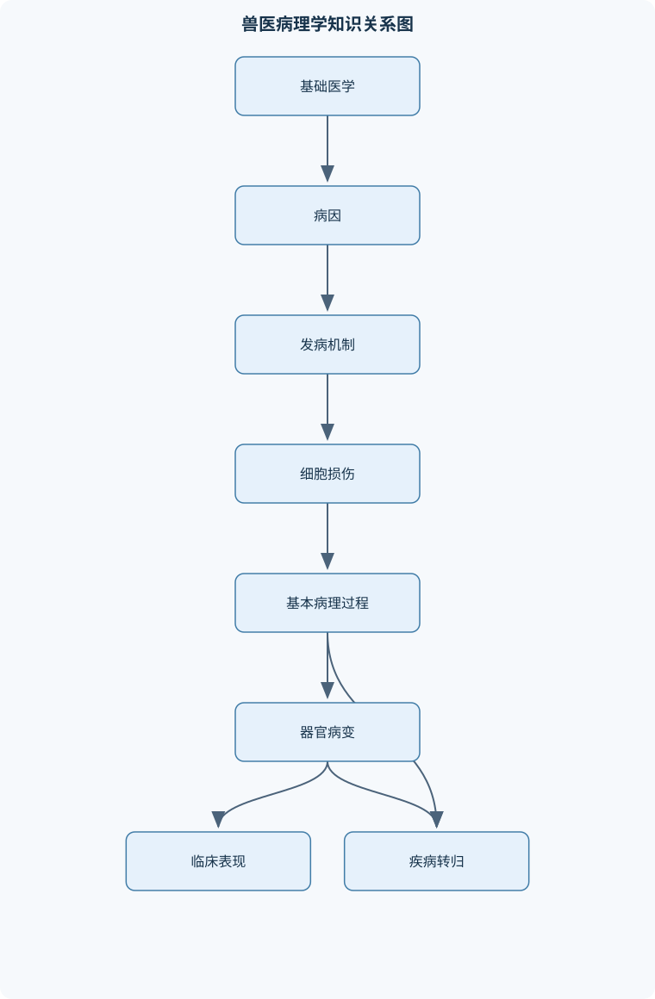
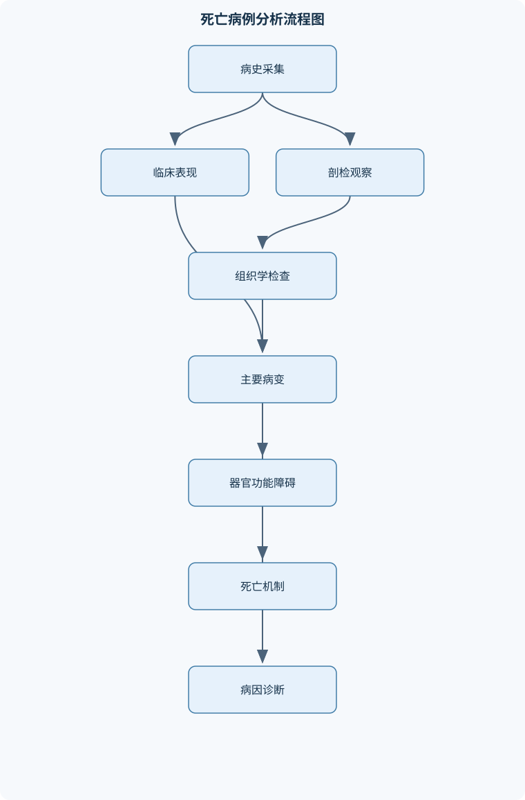

# 兽医病理学

## 一、课程整体知识框架

### 课程边界与先修知识

兽医病理学研究动物疾病的病因、发病机制，以及患病机体在代谢、功能、组织结构和器官形态方面的变化，并据此解释疾病的发生、发展、转归、死亡机制、诊断依据和防治原则。课程边界包括病理学总论、病理生理学基础、病理解剖学基础、各器官系统常见疾病病理、动物尸体剖检和组织病理学分析；重点覆盖炎症、发热、应激、缺氧、休克、循环障碍、水盐代谢紊乱、酸碱平衡紊乱、细胞和组织损伤、修复、肿瘤以及心血管、呼吸、消化、泌尿、生殖和神经系统疾病。不以临床药物剂量和具体治疗方案为主要内容。先修知识包括动物解剖学、组织学、生理学、生物化学、微生物学、免疫学和基础临床诊断学。应区分理想化病理生理模型与不同动物种属、年龄、营养状态、病程及混合感染造成的实际差异。





### 1. 兽医病理学的研究对象与基本任务

兽医病理学研究动物疾病发生时的病因、发病机制，以及机体在代谢、功能、组织结构和器官形态方面的改变。其核心任务不是简单描述“哪里发生了病变”，而是建立一条能够被证据支持的因果链：

$$
病因\rightarrow 细胞和组织损伤\rightarrow 局部功能障碍\rightarrow 器官功能障碍\rightarrow 全身反应\rightarrow 疾病转归或死亡
$$

其中，病因是引起疾病或促使疾病发生的外界因素、机体因素和条件因素；发病机制是病因作用于机体后，引起功能、代谢、结构和形态改变的连续因果过程。病因与发病机制不能混为一谈。例如，细菌感染可以是病因，细菌毒素损伤血管内皮、诱导炎症并引起微循环障碍，则属于发病机制。营养不良、年龄、妊娠、免疫状态和环境温度等因素，常常不是直接病因，却能改变疾病发生的概率、严重程度和形态表现。

疾病的病理学解释至少应回答四个问题：第一，最初的致病因素是什么；第二，病变如何从局部扩展到组织、器官和全身；第三，病变如何导致临床症状和实验室异常；第四，病变最终是恢复、适应、机化、纤维化、复发、慢性化还是死亡。实际动物病例中，病因可能具有多因素性，且混合感染、继发感染、年龄差异、种属差异、营养状态和治疗过程都会改变经典病变。

### 2. 总论与各论的递进关系

课程总论研究不同疾病共有的基本病理过程，包括细胞损伤、变性、坏死、炎症、发热、修复、循环障碍、缺氧、休克、水盐代谢紊乱、酸碱平衡紊乱、免疫病理和肿瘤。这些过程是各器官疾病的共同病理基础。例如，肺炎可同时包含充血、渗出、白细胞浸润、肺泡实变和低氧血症；肾炎可同时出现免疫损伤、肾小球滤过下降、水钠潴留和酸碱紊乱。

各论按照心血管、呼吸、消化、肝胆、泌尿、生殖和神经等系统，说明基本病理过程如何在具体器官中表现。总论强调机制的普遍性，各论强调器官结构、血液供应、功能特点和动物种属对病变的修饰作用。二者不能相互替代：仅掌握炎症的通用过程，不能直接判断肺炎处于哪一阶段；仅记住某种肺炎的肉眼表现，也不能解释其为何导致呼吸衰竭。

### 3. 病理解剖学、病理生理学与相关分支

病理解剖学以器官、组织和细胞的形态结构改变为主要研究对象，包括肉眼病变、组织学病变、超微结构变化以及病变的分布、范围和相互关系。病理生理学以功能和代谢紊乱为重点，解释血流、呼吸、体液、电解质、酸碱、神经内分泌和免疫系统如何发生异常。病理解剖学提供“发生了什么形态改变”的证据，病理生理学解释“这些改变如何造成机体功能障碍”。

免疫病理学用于解释超敏反应、自身免疫性损伤、免疫缺陷、免疫抑制和部分肿瘤。分子病理学将基因表达、信号转导、细胞死亡、病原体分子和免疫标志物与形态改变联系起来。比较病理学比较不同动物种属之间，或动物疾病与其他物种疾病之间的共同机制和差异，但不能把某一物种的病变、参考范围或药理反应不加区别地套用于另一物种。动物卫生病理学还需结合屠宰检验、病变鉴别、食品卫生评价和无害化处理原则。

### 4. 从细胞损伤到全身疾病的层级结构

疾病过程可以按四个层级理解。细胞层级包括能量代谢障碍、膜损伤、线粒体功能下降、钙稳态破坏、氧化应激、蛋白质变性和细胞死亡。组织层级包括变性、坏死、炎症、出血、修复和纤维化。器官层级表现为通气障碍、滤过下降、心泵功能下降、肠屏障损伤或神经传导异常。全身层级则表现为发热、休克、酸碱失衡、水盐紊乱、毒血症和多器官功能障碍。

缺氧是连接多种疾病的重要共同通路。细胞缺氧时，氧化磷酸化下降，三磷酸腺苷生成减少，细胞转向无氧糖酵解，乳酸生成增加，继而出现细胞内酸中毒、离子泵功能障碍、细胞水肿和膜损伤。若缺氧持续，线粒体和细胞膜损伤加重，可能进入凋亡或坏死。不同器官的耐受性不同：神经组织对缺氧通常较敏感，肝、肾和心肌也可因持续灌注不足发生严重损伤；实际严重程度还受缺氧速度、持续时间、体温、年龄和基础疾病影响。

### 5. 体液、血气和酸碱平衡的统一框架

体液主要分为细胞内液（ICF）和细胞外液（ECF）。二者容量、渗透压和主要离子组成不同。水在两区之间移动，主要受渗透梯度影响；钠离子是ECF的重要有效渗透粒子，钾离子是ICF的重要阳离子。描述脱水时必须同时判断容量和渗透压，不能把“高渗”直接等同于“容量增加”，也不能把水肿和水中毒混为一谈。水肿是组织间隙或体腔液体增多，水中毒则强调全身水分相对过多、体液低渗和细胞水肿。

血氧评价应区分氧分压和氧含量。$PaO_2$表示动脉血氧分压，单位通常为压力单位；$SaO_2$表示血红蛋白氧饱和度；$Hb$表示血红蛋白浓度；$CaO_2$表示每分升动脉血的氧含量。常用近似关系为：

$$
CaO_2\approx 1.34\times Hb\times SaO_2+0.003\times PaO_2
$$

其中，$1.34\times Hb\times SaO_2$代表血红蛋白结合氧，$0.003\times PaO_2$代表血浆物理溶解氧。该式用于理解机制而非替代所有检测方法，具体系数会受检测单位和测量条件影响。贫血和一氧化碳中毒时，$PaO_2$可以相对正常，但氧含量或组织释氧能力已明显下降，因此不能仅凭$PaO_2$排除组织缺氧。动静脉氧差为$CaO_2-CvO_2$，反映组织从血液中摄取氧的程度，但必须结合心输出量、血流分布和组织利用氧的能力解释。

酸碱分析通常从$pH$、$PaCO_2$和$HCO_3^-$开始。$PaCO_2$主要反映呼吸性成分，$HCO_3^-$主要反映代谢性成分。阴离子隙为：

$$
AG=Na^+-(Cl^-+HCO_3^-)
$$

式中各离子通常以同一浓度单位表示。分析时先判断酸血症或碱血症，再判断$PaCO_2$和$HCO_3^-$的变化方向，随后评价代偿是否合理并计算阴离子隙。代偿只能减轻$pH$变化，不能消除腹泻、肾衰竭、通气障碍或中毒等原发病。$pH$接近正常也不能排除混合性酸碱紊乱，因为两个方向相反的原发过程可能相互抵消。

### 6. 形态学概念与病理诊断证据

增生是细胞数目增加，肥大是细胞体积增大，化生是一种成熟细胞类型被另一种成熟细胞类型替代，通常具有适应性并可能在刺激消除后部分恢复。坏死是活体内局部细胞或组织死亡，并伴随细胞膜破坏和炎症反应；凋亡是受调控的细胞死亡，通常细胞膜在早期保持完整，炎症反应较轻。肉芽组织由新生毛细血管、成纤维细胞和炎症细胞构成，属于修复组织；肉芽肿则以巨噬细胞、上皮样细胞和多核巨细胞为主，属于慢性炎症反应。术语相似但病理含义不同，不能根据名称相近进行替代。

形态学诊断应将观察事实与病因推断分开。例如，“肺右前叶多发暗红色、实变、切面有少量黏液脓性分泌物”是形态描述；“支气管肺炎”是形态学诊断；“由某种病原体引起”则需要结合病原学、免疫组化、分子检测和流行病学证据。病理诊断的可靠性取决于病变定位、取材质量、固定是否及时、切片是否具有代表性以及是否结合病史和实验室资料。

## 二、章节和模块划分

### 核心知识覆盖清单

本清单用于检查正文是否覆盖本课程的主要知识模块：

- **绪论与病理学研究方法**：兽医病理学的定义与任务、病因与疾病条件、发病机制的因果链、疾病的经过与转归、病理解剖学与病理生理学、比较病理学与免疫病理学、分子病理学基本方法、尸体剖检与取材原则。
- **细胞和组织损伤**：可逆性细胞损伤、细胞水肿与脂肪变性、透明变性和黏液样变性、细胞器与细胞骨架损伤、缺氧与氧化应激、细胞凋亡与坏死、凝固性和液化性坏死、坏疽与坏死结局。
- **炎症、发热与修复**：炎症的原因和基本特征、急性炎症血管反应、白细胞迁移和吞噬、炎症介质及其作用、浆液性和纤维素性炎症、化脓性和出血性炎症、慢性炎症与肉芽肿、发热与过热的区别、肉芽组织和瘢痕形成、组织再生、机化与化生。
- **血液循环障碍**：充血与淤血、出血及其结局、血栓形成条件与过程、栓塞的类型和运行路径、梗死及其形态、水肿的发生机制、淋巴循环障碍、弥散性血管内凝血、局部与全身循环衰竭。
- **缺氧、休克与应激**：缺氧的四种基本类型、血氧分压和血氧含量、一氧化碳中毒机制、高铁血红蛋白血症、休克的分期与微循环变化、低血容量性和感染性休克、应激反应的神经内分泌机制、应激性胃肠道溃疡、缺氧导致器官损伤的共同通路。
- **水盐代谢与酸碱平衡**：体液分区与渗透压、等渗性高渗性低渗性脱水、水中毒与盐中毒、钠代谢紊乱、低钾血症和高钾血症、代谢性酸中毒、代谢性碱中毒、呼吸性酸中毒和碱中毒、阴离子隙与代偿判断、严重腹泻的全身病理生理变化。
- **免疫病理与肿瘤**：超敏反应的病理机制、自身免疫性损伤、免疫缺陷与免疫抑制、肿瘤的实质和间质、良性与恶性肿瘤特征、肿瘤细胞异型性、膨胀性和浸润性生长、肿瘤转移途径、肿瘤代谢与恶病质、肉瘤和癌的鉴别。
- **心血管系统病理**：心肌变性和坏死、心肌炎与心包炎、心包积液和心包填塞、心力衰竭的病理机制、肺淤血和体循环淤血、慢性肝淤血与虎斑心、血管炎和动脉硬化、心脏瓣膜病变、心源性水肿与休克。
- **呼吸系统病理**：肺充血和肺水肿、肺气肿和肺不张、支气管肺炎、大叶性纤维素性肺炎四期、间质性肺炎、胸膜炎和胸腔积液、肺梗死与出血、呼吸衰竭的病理生理、动物呼吸道病毒性疾病的组织损伤、血管内皮损伤与呼吸道疾病。
- **消化系统和肝胆病理**：口腔和食管炎症、胃炎与胃溃疡、纤维素性肠炎分类、肠炎导致的脱水和酸碱紊乱、肠梗阻与肠坏死、肝细胞变性和坏死、肝淤血与肝硬变、胆汁淤积与黄疸、胰腺炎、肠道疾病的毒血症和休克。
- **泌尿、生殖和神经系统病理**：急性肾损伤及其分期、肾小球肾炎、肾小管变性和坏死、肾盂肾炎与肾盂积水、慢性肾炎与皱缩肾、睾丸炎和附睾炎、乳腺炎的化脓性与肉芽肿性病变、神经元基本病理变化、脑水肿和颅内压升高、脑炎、脑膜炎与神经功能障碍。
- **尸体剖检、组织病理与病例综合分析**：剖检场地和生物安全要求、死亡后变化与病理变化鉴别、系统性剖检顺序、病变描述的规范术语、组织取材和固定原则、镜检中的病变定位、病原学与免疫组化证据整合、主要病变和次要病变判定、死亡原因与死亡机制分析、动物疾病病例报告结构。


### 1. 绪论与病理学研究方法

本模块说明兽医病理学在基础兽医学与临床兽医学之间的桥梁作用。先修知识包括动物解剖学、组织学、生理学、生物化学、微生物学、免疫学和基础临床诊断学。疾病分析从病因、条件、发病机制、病程、转归和死亡机制展开。疾病可恢复、迁延为慢性、形成瘢痕或机化，也可因器官衰竭、休克、严重缺氧或多器官功能障碍而死亡。

尸体剖检的基本流程包括核对身份和病史、评估尸体冷却与腐败程度、外部检查、按系统顺序开检、记录器官位置和肉眼病变、对病变组织及相应对照组织取材，并分别进行固定、病原学采样和编号。每个关键病变至少记录部位、分布、数量、大小、颜色、形状、边界、质地、切面和与周围组织的关系。死亡后自溶、腐败、尸冷、血液坠积和尸僵可模拟活体病变，必须结合病史、分布和组织学反应鉴别。

### 2. 细胞和组织损伤

可逆性损伤常由轻度或短时间缺氧、代谢障碍、毒物作用和温度异常引起。能量不足导致钠钾泵功能下降，细胞内钠和水增加，形成细胞水肿；脂肪变性则常见于肝细胞、心肌细胞等代谢负荷较大的细胞，表现为脂质摄取、合成、氧化或输出失衡。透明变性和黏液样变性属于形态学描述，必须结合部位、染色特点和病因解释，不能把所有嗜伊红、透明或黏液样物质视为同一种病变。

缺氧、氧化应激、钙离子内流、线粒体损伤、内质网应激和细胞骨架破坏可共同导致不可逆损伤。坏死的类型包括凝固性坏死和液化性坏死。凝固性坏死的推导链是：缺血或损伤导致蛋白质变性，变性蛋白抑制组织自溶，使早期组织轮廓仍可保留，常见于心、肾和脾的缺血性梗死；脑组织缺血则通常更易发生液化性坏死。坏疽是大体形态和继发变化的描述，不等同于凝固性坏死；坏死组织还可被溶解吸收、排出、机化、包囊或钙化。

### 3. 炎症、发热与修复

炎症是活体组织对损伤因素的血管反应、细胞反应和体液反应，目的在于清除病因、限制损伤并启动修复，但过度或持续炎症也会造成继发性组织损伤。急性炎症通常经历血流改变、血管通透性升高、白细胞边集、滚动、黏附、穿越血管壁和趋化。白细胞迁移必须有内皮激活和黏附分子表达；白细胞附壁不等于已经穿出血管。

炎症介质可改变血管舒缩、通透性、疼痛敏感性、凝血状态和白细胞活性。浆液性炎症以低蛋白液体渗出为主；纤维素性炎症含较多纤维蛋白，常见于浆膜和肺泡；化脓性炎症以中性粒细胞、脓液和组织溶解为特征；出血性炎症伴血管严重损伤。慢性炎症常同时存在单核细胞浸润、组织破坏、血管生成和纤维化；肉芽肿是巨噬细胞和上皮样细胞聚集形成的慢性炎症结节。

发热是体温调定点上移后机体主动升高体温，通常伴寒战、产热增加和散热减少；过热则调定点未上移，而是由于产热过多或散热障碍使体温升高。修复可通过实质细胞再生或结缔组织替代完成。肉芽组织转变为瘢痕时，炎症细胞减少，新生血管退化，成纤维细胞产生胶原，胶原逐渐重塑并伴组织收缩；若组织缺损过大或实质细胞再生能力不足，纤维化将成为主要结局。机化是纤维组织长入血栓、渗出物或坏死物并将其替代的过程。

### 4. 血液循环障碍

动脉性充血主要由小动脉扩张和血流输入增加引起，组织通常较红、温度升高；淤血主要由静脉回流受阻引起，因脱氧血红蛋白增多而呈暗红或发绀。出血的后果取决于出血速度、部位、失血量和机体代偿能力，可被吸收、机化、包囊、形成含铁血黄素沉着，严重时导致贫血性缺氧和休克。

血栓形成通常与血管内皮损伤、血流异常和血液高凝状态有关。血栓可阻塞局部血流，也可脱落形成栓子。栓子除血栓外，还可由脂肪、气体、细菌团块或肿瘤组织形成；静脉栓子通常随静脉回流进入右心和肺循环，动脉栓子可进入体循环并堵塞相应器官。梗死是血流中断导致的局部缺血性坏死，肾、脾和心肌梗死多呈凝固性坏死，脑梗死多呈液化性坏死。

水肿形成可由毛细血管静水压升高、血浆胶体渗透压降低、血管通透性升高、淋巴回流受阻和钠水潴留引起。不同机制可单独存在，也可共同作用。弥散性血管内凝血表现为全身微血栓形成、凝血因子和血小板消耗，以及继发出血。局部循环衰竭可进展为全身灌注不足，最终形成休克和多器官功能障碍。

### 5. 缺氧、休克与应激

缺氧可分为乏氧性、血液性、循环性和组织性四类。乏氧性缺氧的主要问题是吸入或肺交换导致$PaO_2$下降；血液性缺氧由血红蛋白减少或功能异常造成；循环性缺氧由心输出量下降或局部灌注不足造成；组织性缺氧则是细胞利用氧的能力受阻。一氧化碳与血红蛋白结合后减少有效携氧位点，并提高剩余血红蛋白对氧的亲和力，造成组织释氧障碍，故$PaO_2$可以相对正常。高铁血红蛋白血症则使血红蛋白铁处于不能正常结合氧的状态，同样不能仅靠$PaO_2$判断组织供氧。

休克由有效循环血容量或组织灌注下降开始，依次出现代偿性血管收缩、微循环障碍、细胞缺氧、乳酸增加、代谢性酸中毒、内皮损伤和多器官功能障碍。低血容量性休克常由失血、脱水或严重渗出引起；感染性休克还可出现血管扩张、血管通透性升高、炎症介质释放和凝血紊乱。应激反应由神经系统和内分泌系统共同介导，儿茶酚胺和糖皮质激素改变心血管、糖脂代谢和免疫功能。持续应激可造成胃肠道血流减少、黏膜屏障减弱、酸分泌和局部防御失衡，形成应激性糜烂或溃疡。

### 6. 水盐代谢与酸碱平衡

等渗性脱水主要表现为ECF容量减少而渗透压变化相对不大；高渗性脱水时水丢失相对多于钠，细胞内水向ECF移动并发生细胞脱水；低渗性脱水时钠丢失相对多于水，ECF渗透压下降，水进入细胞，可能造成脑细胞水肿。水中毒则是体内水分相对过多并形成低渗性体液。低钾血症可引起肌无力、肠道运动减弱和复极异常；高钾血症严重时可使心肌传导障碍甚至心搏停止，不能简单理解为“兴奋性升高”。

代谢性酸中毒可由碳酸氢根丢失或固定酸增加引起；严重腹泻时，肠液和碳酸氢根丢失使ECF容量下降，继而发生低血容量、组织灌注下降、乳酸增加和代谢性酸中毒，伴随丢钾时还会出现肌无力、心律失常和肾浓缩能力改变。代谢性碱中毒可由酸性胃液丢失、肾脏排氢增加、低钾或碳酸氢根负荷增加引起。呼吸性酸中毒通常源于通气不足和二氧化碳潴留；呼吸性碱中毒则与过度通气有关。分析必须区分急性和慢性代偿，并警惕多重紊乱。

### 7. 免疫病理与肿瘤

超敏反应可通过抗体、免疫复合物、补体、肥大细胞或T细胞介导，最终造成血管损伤、组织坏死、支气管痉挛或慢性炎症。自身免疫性损伤源于免疫耐受破坏；免疫缺陷和免疫抑制则使病原体清除、肿瘤监视和组织修复能力下降。免疫病理判断不能只看抗体阳性，还要结合沉积部位、炎症类型和组织损伤之间的对应关系。

肿瘤由肿瘤实质和肿瘤间质构成。实质是肿瘤细胞，间质包括结缔组织、血管、淋巴管和神经。良性肿瘤通常分化较好、生长膨胀、局部压迫明显而转移少；恶性肿瘤可表现为细胞异型性、病理性核分裂、浸润性生长、血管或淋巴转移和复发。包膜完整或生长速度快慢只能作为辅助依据，不能单独判定良恶性。来源于上皮的恶性肿瘤称癌，来源于间叶组织的恶性肿瘤称肉瘤。肿瘤代谢异常、炎症介质、营养消耗和细胞因子作用可造成恶病质。

### 8. 心血管系统病理

心肌可发生变性、坏死和炎症，严重时导致收缩力下降、心律失常和心力衰竭。心包积液在积液快速增加或心包弹性受限时可形成心包填塞，使心室舒张充盈减少、心输出量下降。左心衰竭更直接造成肺静脉回流受阻、肺淤血和肺水肿；右心衰竭主要造成体循环淤血、肝淤血、腹水和外周水肿。

慢性肝淤血时中央静脉和小叶中央区窦状隙淤血，中央区肝细胞萎缩或坏死，小叶周边可因代谢负荷和脂肪变性形成不均匀外观。虎斑心主要描述心肌脂肪变性形成的黄红相间外观，不能与肝脏慢性淤血相互替代。血管炎、动脉硬化和瓣膜病变可造成管腔狭窄、血流紊乱、栓塞风险增加或心脏负荷上升。

### 9. 呼吸系统病理

肺充血和肺水肿可由静水压升高、血管通透性增加或淋巴回流障碍引起。肺气肿是肺泡过度扩张并伴肺组织破坏或气体排出障碍，肺不张则是肺泡萎陷或未充分扩张。支气管肺炎以支气管和邻近肺泡的斑片状炎症为特征，常呈多灶性分布。

大叶性纤维素性肺炎可按充血水肿期、红色肝变期、灰色肝变期和消散期理解。红色肝变期肺泡内充满红细胞、纤维素和炎症细胞；灰色肝变期红细胞减少而纤维素和白细胞仍较多。若纤维素未被充分溶解吸收，而被结缔组织替代，可形成肺肉样变。间质性肺炎主要累及肺泡间隔和间质，常伴肺泡上皮损伤、血管内皮损伤和气体交换障碍。胸膜炎、胸腔积液、肺梗死和肺出血均可进一步降低通气或灌注效率，最终导致呼吸衰竭。

### 10. 消化系统和肝胆病理

口腔、食管和胃肠道炎症可由机械损伤、化学刺激、感染、毒素和免疫反应引起。胃炎和胃溃疡的形成涉及黏膜屏障破坏、局部缺血、酸和消化酶侵袭、应激反应及修复不足。纤维素性肠炎可按病变分布和渗出物特点区分，纤维素覆盖黏膜表面时可形成伪膜，渗出物与坏死组织结合时可造成更深的坏死性病变。

肠炎通过液体和电解质丢失造成脱水、低血容量、酸碱紊乱和休克；肠梗阻则可导致肠腔扩张、静脉回流受阻、肠壁水肿、细菌移位和坏死。肝细胞可发生脂肪变性、颗粒变性、坏死和胆汁淤积。肝淤血需与原发性肝硬变鉴别：前者以中央区淤血、出血和肝细胞萎缩为主，后者以慢性炎症、纤维隔形成和结节性再生为主要特征。胆汁淤积可造成黄疸；胰腺炎可通过自身消化、脂肪坏死、炎症介质释放和休克影响全身。肠道屏障破坏、毒素吸收和细菌移位可造成毒血症及感染性休克。

### 11. 泌尿、生殖和神经系统病理

急性肾损伤可经历少尿期、多尿期和恢复期，但并非所有病例均完整经历三期。少尿期由肾小球滤过下降、肾小管损伤和水钠潴留主导；多尿期虽然滤过液增加，但肾小管重吸收功能尚未恢复，容易发生水和电解质丢失；恢复期则表现为结构和功能逐步改善。肾小球肾炎常与免疫复合物、抗体或补体介导的损伤有关，肾小管变性和坏死则常由缺血、毒物或感染引起。

肾盂肾炎累及肾盂和肾实质，肾盂积水则与尿路阻塞和压力升高有关。慢性肾炎可导致间质纤维化、肾单位丢失和皱缩肾，并继发氮质血症、酸碱紊乱和水盐代谢异常。睾丸炎和附睾炎可造成生精组织损伤、输精障碍和不育。乳腺炎可表现为化脓性或肉芽肿性病变，组织学上应注意脓肿、菌团、巨噬细胞、纤维包膜及特殊结构，并结合病原学验证。

神经元病理变化包括变性、肿胀、嗜酸性改变、核固缩、神经元死亡和胶质反应。脑水肿可增加颅内压，压迫脑组织和血管，导致灌注下降、神经功能障碍，严重时发生脑疝。脑炎主要累及脑实质，脑膜炎主要累及脑膜，二者可并存；炎症、出血、坏死和水肿共同决定临床神经症状。

### 12. 尸体剖检、组织病理与病例综合分析

规范剖检的输入包括死亡动物、病史、临床经过和已有检验资料，输出包括剖检记录、主要病变清单、组织学样本和病原学样本。剖检时应先判断尸体保存状态，再进行外部检查和系统性开检，避免先入为主地只观察一个器官。组织取材应包含病变中心、病变边缘和相对正常对照区；组织学固定样本与病原学样本应分开处理，避免固定液影响病原检测。

显微镜下要先定位病变位于实质、间质、血管、腔面还是浆膜，再判断细胞损伤、炎症类型、坏死类型、血管变化和修复反应。病原学和免疫组化结果必须与病变分布、组织损伤和临床病程相互印证，单独检出病原体并不必然证明其为致病因素。病例综合分析应区分原发病、主要病变、继发病变、并发症、死亡原因和直接死亡机制。例如，严重肠炎可为原发病，脱水和低血容量为主要并发过程，代谢性酸中毒和急性肾损伤为继发改变，休克和多器官功能障碍则可能是直接死亡机制。最终结论必须形成前后一致、证据相互支持的因果链，而不能把临终时观察到的单一表现直接当作原发疾病。

## 三、核心概念的详细解释

### 1. 病因、条件与发病机制

病因是引起疾病或促使疾病发生的外界因素、机体因素和条件因素。外界因素包括病原体、毒物、机械损伤、温度异常、营养缺乏和放射性损伤；机体因素包括遗传背景、年龄、种属、免疫状态和器官基础疾病；条件因素包括饲养密度、通风、运输、应激、卫生状况和混合感染。病因回答“疾病由什么引起”，发病机制回答“病因通过什么连续过程造成损伤”。例如，细菌感染是病因，细菌黏附、侵入、释放毒素、激活炎症反应、损伤血管内皮并引起微循环障碍，则属于发病机制。

疾病的因果链通常为：

$$
病因\rightarrow 细胞损伤\rightarrow 组织反应\rightarrow 器官功能障碍\rightarrow 全身反应\rightarrow 转归或死亡
$$

该链条不是固定不变的直线。病因可能同时作用于多个器官，疾病过程中也可能出现继发感染、治疗影响和新的并发症。病例分析时应区分原发病、主要病变、继发病变、并发症、死亡原因和直接死亡机制，不能把“呼吸困难”“酸中毒”或“休克”等终末表现直接当作原发病。

### 2. 病理解剖学、病理生理学与分支方法

病理解剖学观察器官、组织和细胞的结构变化，包括病变的部位、分布、颜色、大小、质地、边界和组织学特征。病理生理学解释血流、呼吸、体液、电解质、酸碱、内分泌和免疫功能如何异常。肉眼或镜下观察到的病变必须与功能改变相互联系。例如肺泡内充满纤维素和中性粒细胞属于形态学事实，肺泡通气下降、通气血流比例失调和低氧血症属于功能后果。

免疫病理学用于解释抗体、补体、免疫复合物、效应细胞和细胞因子造成的组织损伤；分子病理学可通过核酸、蛋白质、受体和信号通路把病原体或基因异常与形态改变联系起来；比较病理学比较不同动物种属的共同机制及差异。不同物种、年龄、营养状态和病程可改变病变程度，不能将某一动物的参考范围、组织反应或临床表现不加区别地套用于另一动物。

尸体剖检、组织病理、病原学和免疫组化属于互补证据。组织内检出病原体并不必然证明其是致病因素，必须判断其是否位于病变部位、是否造成相应损伤、是否与临床经过相符。

### 3. 细胞和组织损伤

可逆性损伤通常发生于能量供应暂时不足、轻度毒物作用或短时间缺氧。ATP减少使钠钾泵功能下降，Na+和水进入细胞，形成细胞水肿；内质网扩张、核糖体脱落和线粒体轻度肿胀可在病因解除后恢复。脂肪变性主要见于肝细胞等代谢活跃细胞，机制包括脂肪酸摄取增加、氧化减少、甘油三酯合成增加或脂蛋白输出障碍。

持续缺氧、严重钙超载、活性氧增多和膜损伤可使可逆性损伤转为不可逆损伤。坏死是活体内局部细胞或组织死亡并伴有膜破坏和炎症反应；凋亡是受调控的细胞死亡，通常细胞膜相对完整、细胞碎片被吞噬，周围炎症较轻。凝固性坏死中蛋白质变性抑制组织自溶，早期保留组织轮廓，常见于心、肾和脾的缺血性梗死；脑组织因脂质丰富、溶酶体和吞噬反应突出，缺血后通常发生液化性坏死。

坏死的结局包括溶解吸收、脱落排出、机化、包囊、钙化和继发感染。坏死细胞不能因病因消失而恢复。干性、湿性和气性坏疽属于大体病变及继发变化的描述，不等同于组织学上的凝固性坏死。

### 4. 炎症、发热与修复

炎症是活体组织对损伤因子的防御性反应，基本目的包括清除病因、限制损伤、清除坏死组织并启动修复，但炎症过强或持续过久也可造成继发组织损伤。急性炎症首先出现小血管扩张、血流加快，随后因内皮收缩或内皮损伤而通透性增加，血浆蛋白和液体外渗。白细胞迁移依次包括边集、滚动、黏附、穿越血管壁和趋化；内皮激活及黏附分子表达是白细胞由血液进入组织的关键条件。

浆液性炎症以蛋白含量相对较低的液体渗出为主；纤维素性炎症因血管通透性明显增加，纤维蛋白原进入组织并转变为纤维蛋白；化脓性炎症以中性粒细胞、脓液和组织液化为特点；出血性炎症伴大量红细胞外渗。慢性炎症常同时存在淋巴细胞、巨噬细胞、浆细胞浸润、组织破坏和纤维化。肉芽肿是以巨噬细胞、上皮样细胞和多核巨细胞为主的慢性炎症结节，不能与由新生毛细血管、成纤维细胞和炎症细胞组成的肉芽组织混淆。

发热是体温调定点上移后机体主动升高体温，通常与外源性或内源性致热信号有关；过热是调定点未上移，因产热过多或散热障碍导致体温升高。修复可通过实质细胞再生或纤维组织替代完成。肉芽组织转变为瘢痕时，炎症细胞减少，新生血管退化，成纤维细胞产生胶原，胶原重塑并发生组织收缩。

### 5. 循环障碍、缺氧、休克与应激

动脉性充血是小动脉扩张、局部血流增加，组织多呈鲜红并可能温度升高；淤血是静脉回流受阻，组织因脱氧血红蛋白增加而呈暗红、发绀，长期淤血可造成水肿、出血、含铁血黄素沉积和纤维化。水肿由毛细血管静水压升高、血浆胶体渗透压降低、血管通透性升高、淋巴回流受阻或钠水潴留引起。水肿是局部或体腔液体增多，水中毒则强调全身水分相对过多、体液低渗和细胞水肿，二者不能混同。

血栓形成需要血管内皮损伤、血流异常和血液高凝状态等条件。栓子可为血栓、脂肪、气体、细菌团块、肿瘤组织等；静脉栓子通常随血流进入肺，体循环动脉栓子可阻塞肾、脾、脑和肢体血管。梗死是局部血流中断造成的缺血性坏死，肾、脾和心肌多为凝固性坏死，脑梗死多为液化性坏死。

缺氧可分为乏氧性、血液性、循环性和组织性四类。乏氧性缺氧主要是吸入氧不足或肺换气障碍；血液性缺氧是血红蛋白数量减少或功能异常；循环性缺氧是局部或全身灌注不足；组织性缺氧是细胞不能利用氧。一氧化碳中毒属于血液性缺氧：一氧化碳占据血红蛋白结合位点，并使剩余位点对氧的亲和力升高，组织释氧受阻，因此PaO2可相对正常，不能仅凭PaO2排除组织缺氧。

休克由有效循环血容量或组织灌注下降开始，随后出现微循环障碍、细胞缺氧、乳酸增加、代谢性酸中毒、内皮损伤和多器官功能障碍。低血容量性休克常见于失血、呕吐、腹泻和严重渗出；感染性休克还伴血管舒缩异常、内皮激活、炎症介质释放和毛细血管通透性增加。应激时交感神经和下丘脑—垂体—肾上腺轴被激活，血流重新分配、胃肠黏膜灌注下降、黏液屏障和修复能力减弱，酸和消化酶侵袭可造成应激性溃疡。

### 6. 水盐代谢与酸碱平衡

体液主要分为细胞外液（ECF）和细胞内液（ICF）。ECF以Na+、Cl-和HCO3-为主要离子，ICF以K+和有机磷酸盐、蛋白质为主。等渗、低渗和高渗描述体液渗透状态；等渗性脱水主要导致ECF容量减少，低渗性脱水时细胞外液渗透压下降并有水进入细胞，高渗性脱水时细胞外液渗透压升高并使细胞失水。血钠反映水与钠的相对关系，不能单独决定总容量。

严重水样腹泻会丢失水、Na+、Cl-、K+和HCO3-。其因果链为：ECF容量下降，静脉回流和心输出量下降，组织灌注不足，乳酸生成增加；HCO3-丢失形成代谢性酸中毒；K+丢失可造成肌无力、心律失常和肾浓缩能力改变。若肾灌注继续下降，可出现急性肾损伤、氮质血症和多器官功能障碍。

酸碱判断应先观察pH，再分析PaCO2和HCO3-。pH下降提示酸血症，升高提示碱血症；PaCO2主要反映呼吸性成分，HCO3-和BE主要反映代谢性成分。代偿只能减轻pH变化，不能消除腹泻、肾衰、通气障碍或中毒等原发病。pH接近正常时仍可能存在呼吸性和代谢性紊乱相互抵消的混合性酸碱失衡。

### 7. 免疫病理与肿瘤

超敏反应可通过抗体、免疫复合物、补体、肥大细胞或T淋巴细胞介导；自身免疫性损伤源于对自身抗原的免疫耐受破坏；免疫缺陷和免疫抑制则增加继发感染和肿瘤发生风险。

肿瘤由实质和间质组成。实质是肿瘤细胞，间质包括结缔组织、血管、淋巴管和神经。良性肿瘤通常膨胀性生长、分化较好、边界相对清楚；恶性肿瘤常有浸润性生长、细胞异型性、病理性核分裂、血管或淋巴转移和复发倾向，但包膜和生长速度只能作为辅助特征。癌主要来源于上皮组织，肉瘤主要来源于间叶组织。恶病质与肿瘤代谢改变、炎症细胞因子、食欲下降和蛋白质分解增加有关。

### 8. 器官系统病理的共同机制

心肌变性、坏死和心肌炎可降低收缩力并诱发心律失常；心包积液快速增加可形成心包填塞，限制心室舒张和静脉回流。左心衰竭主要导致肺淤血和肺水肿，右心衰竭主要导致体循环淤血、肝淤血和外周水肿。慢性肝淤血可见中央静脉和窦状隙扩张、中央区肝细胞萎缩坏死，并形成斑驳的“虎斑”外观；这不同于心包表面纤维素沉积形成的“绒毛心”。

呼吸道疾病可引起肺充血、水肿、气肿、不张、支气管肺炎、间质性肺炎、胸膜炎和胸腔积液。大叶性纤维素性肺炎可分为充血水肿期、红色肝变期、灰色肝变期和消散期；纤维素未被充分清除而被结缔组织替代，可形成肺肉样变。肺炎通过肺泡实变、弥散障碍、通气血流比例失调和呼吸肌负荷增加导致呼吸衰竭。

胃肠道炎症、溃疡、梗阻和坏死可造成水盐丢失、细菌移位、毒血症和休克。肠梗阻时肠腔扩张、静脉回流受阻、肠壁水肿，严重时发生缺血坏死和穿孔。肝细胞脂肪变性、坏死、肝淤血和胆汁淤积分别反映代谢障碍、细胞死亡、静脉回流障碍和胆汁排出障碍。胰腺炎可通过自身消化、脂肪坏死和炎症介质释放造成全身损伤。

急性肾损伤的少尿期以滤过率下降、水钠潴留为主，多尿期虽滤过液增加但肾小管重吸收尚未恢复，恢复期则逐渐改善。肾小球肾炎偏重免疫性滤过屏障损伤，肾小管坏死常与缺血、毒物和感染有关。脑水肿可升高颅内压，压迫血管导致脑灌注下降，严重时发生脑疝。脑炎主要累及脑实质，脑膜炎主要累及脑膜，二者可同时存在。

### 9. 尸体剖检与病理诊断流程

输入为死亡动物、病史、临床经过和已有检验资料；输出为剖检记录、主要病变清单、组织学样本和病原学样本。流程为核对身份与病史，评估尸体腐败，进行外部检查，按系统顺序开检，记录器官位置及病变，对病变中心、边缘和相对正常组织取材，分别进行固定和病原学采样，最后完成初步诊断。

记录病变时应依次描述器官和部位、分布、数量、大小、形状、颜色、表面、切面、质地、气味、边界及与周围组织的关系。观察事实与病因推断应分开。例如“肺前腹侧呈暗红色实变，切面有纤维素样物”为形态描述；“提示细菌性支气管肺炎”为形态学诊断或鉴别诊断。终止条件是所有主要系统均检查，且每份样本与记录编号一致。

#### 代表性病例分析例题

**例题一：严重水样腹泻。**  
题干：动物持续水样腹泻，眼窝凹陷、少尿、血压下降，血气提示pH下降、HCO3-降低。  
分析：腹泻造成ECF容量下降和HCO3-丢失。容量下降导致静脉回流、心输出量和肾灌注下降；组织缺氧又增加乳酸生成。  
解答：主要诊断为低血容量性脱水并代谢性酸中毒，进一步可发生休克和急性肾损伤。若K+降低，应考虑胃肠道丢钾；若严重酸中毒伴肾排钾障碍，则血清K+也可能升高。  
验证：脱水体征、低血压、少尿、HCO3-下降和乳酸升高应相互支持。  
变式：若PaCO2同时显著下降，应判断是否存在呼吸性代偿或合并呼吸性碱中毒，而不能仅凭pH下结论。

**例题二：燃烧废气暴露。**  
题干：动物接触燃烧废气后出现昏迷，黏膜颜色异常，PaO2相对正常但组织有明显缺氧表现。  
分析：PaO2反映血浆中溶解氧分压，不能完整反映血红蛋白携氧和组织释氧。  
解答：一氧化碳与Hb结合，减少有效携氧位点，并使剩余Hb对氧的亲和力升高，造成血液性缺氧和释氧障碍。  
验证：病史、组织缺氧表现及血红蛋白功能异常相互印证。  
变式：贫血也可在PaO2相对正常时产生缺氧，但机制是Hb总量减少，而不是Hb被一氧化碳占据。

**例题三：肾脏苍白楔形病灶。**  
题干：肾脏表面可见苍白楔形病灶，镜下组织轮廓保留、细胞核消失。  
分析：楔形分布提示血管阻塞后的缺血性损伤，组织轮廓保留提示蛋白质变性和自溶受抑。  
解答：判断为肾梗死伴凝固性坏死，可能由血栓或动脉栓塞造成。  
验证：病灶尖端通常指向血管供血区域，镜下可见坏死细胞核消失及炎症、修复反应。  
变式：若病灶位于脑组织并出现液化空腔，应优先考虑液化性坏死。

**例题四：大叶性肺实变。**  
题干：肺叶体积增大、质地坚实，红色或灰色切面，肺泡内有纤维素和中性粒细胞。  
分析：充血水肿期有血管扩张和肺泡液体；红色肝变期红细胞、纤维素和中性粒细胞进入肺泡；灰色肝变期红细胞分解、纤维素和白细胞占优势；消散期纤维素被溶解、吸收或机化。  
解答：结合颜色和细胞成分判断阶段；若纤维素清除不全并被结缔组织替代，可形成肺肉样变。  
验证：肉眼肝样实变与组织学肺泡填充相符。  
变式：散在小叶性病灶、支气管腔内脓性分泌物和不同阶段病灶并存，更符合支气管肺炎。

**例题五：混合性酸碱紊乱。**  
题干：动物发热、过度通气，HCO3-降低，pH接近正常，同时有肾功能障碍。  
分析：发热和过度通气可造成呼吸性碱中毒；肾功能障碍可造成代谢性酸中毒。两者方向相反，pH可能接近正常。  
解答：先分别判断PaCO2和HCO3-方向，再利用代偿关系判断是否为单纯性紊乱；若代偿幅度不合理，应考虑第三种代谢性过程。  
验证：必须解释所有异常数据，不能因pH正常而否定酸碱紊乱。  
变式：若伴持续呕吐，应进一步考虑胃酸丢失造成的代谢性碱中毒。

### 10. 实验与项目工作流程

#### 项目一：动物尸体剖检与组织取材

输入数据包括动物身份、死亡时间、病史、临床检验结果和尸体保存状态。步骤为：  
1. 穿戴适当防护装备，确认场地通风、消毒和废弃物处置条件。  
2. 记录外观、营养状态、可见出血、分泌物、体表损伤和尸体变化。  
3. 按固定系统顺序检查胸腹腔、消化道、肝胆、泌尿、生殖、神经及淋巴器官。  
4. 对每个病变记录部位、分布、大小、颜色、质地、切面和边界。  
5. 组织学样本取病变中心、边缘和对照组织；病原学样本不与固定液样本混装。  

评价标准是病变记录可由另一名观察者定位复核，样本编号与记录完全一致，且每个主要病变均有适宜样本。排错方法包括：发现病原学样本被固定液污染时重新采样；发现只取病变中心而无边缘组织时补取交界区；若腐败严重，则降低对自溶组织形态的解释强度，并结合病史和辅助检测。

#### 项目二：组织病理与病原学证据整合

输入数据包括切片、特殊染色或免疫标记结果、病原检测结果和临床病史。步骤为：先定位病变所在的实质、间质、血管、腔面或浆膜；再判断细胞损伤、炎症类型、坏死类型、血管反应和修复反应；最后将病原体位置、数量、组织损伤和病程相互比较。  
评价标准是形态学诊断与病原学结果相符，鉴别诊断有排除依据，结论明确区分“观察到的事实”和“推断的病因”。排错方法包括：病原阳性但无相应组织损伤时考虑污染、定植或偶然检出；切片阴性但病史高度支持时考虑取材错误、病程过晚或检测灵敏度限制；免疫标记阳性时仍须结合定位和阴性对照解释。

### 11. 具体易错点

1. 把病因与发病机制混为一谈。  
2. 把发热和过热都解释为体温调定点升高。  
3. 把水肿和水中毒当作同义词。  
4. 把凝固性坏死等同于干性坏疽。  
5. 认为所有坏死都可逆。  
6. 把附壁、黏附与白细胞穿出混为一过程。  
7. 认为栓塞只能由血栓引起。  
8. 以PaO2正常排除组织缺氧。  
9. 将肺淤血简单归因于右心衰竭。  
10. 把肉芽组织与肉芽肿混淆。  
11. 认为良性肿瘤一定有包膜、恶性肿瘤一定生长迅速。  
12. 以单个器官病变直接确定死亡原因。  
13. 把代偿误认为原发病已经纠正。  
14. 认为pH正常即无酸碱紊乱。  
15. 把尸体自溶、腐败和尸冷误判为活体病变。  

### 12. 常见笔试与面试问题

#### 常见笔试问题及解答思路

1. **为什么严重腹泻可导致休克？**  
   应按水和电解质丢失、ECF容量下降、静脉回流下降、心输出量下降、组织灌注不足、乳酸增加和多器官损伤的顺序作答。

2. **凝固性坏死的形态学依据是什么？**  
   说明蛋白质变性抑制自溶，早期组织轮廓保留、细胞核消失；举例时列举心、肾、脾缺血性梗死，并指出脑组织通常例外。

3. **如何解释一氧化碳中毒时PaO2可能正常？**  
   PaO2只表示血浆溶解氧分压，CO主要影响Hb携氧位点和释氧能力，因此血液运输和组织利用阶段已受损。

4. **炎症为什么既有防御作用又能造成损伤？**  
   防御作用包括稀释和清除病因、吞噬坏死物、启动修复；过量炎症介质、白细胞酶和氧自由基可破坏正常组织。

5. **如何区别肉瘤与癌？**  
   依据组织来源、细胞形态、间质特点、浸润方式和转移途径综合判断；肉瘤主要来源于间叶组织，癌主要来源于上皮组织。

6. **左心衰竭和右心衰竭的淤血部位有何不同？**  
   左心衰竭使肺静脉回流受阻，造成肺淤血和肺水肿；右心衰竭使体静脉回流受阻，造成肝、脾、肾和外周组织淤血。

7. **怎样判断酸碱紊乱是否为混合性？**  
   先判定pH方向，再看PaCO2和HCO3-，随后检查代偿是否合理并计算AG；若某项变化超出单纯性紊乱预期，应考虑混合性异常。

8. **如何区分肝淤血与原发性肝硬变？**  
   肝淤血以中央区扩张、出血和肝细胞萎缩为主；肝硬变以慢性炎症、纤维隔和再生结节为主，不能仅凭肝脏大小判断。

#### 常见面试问题、参考答案与追问要点

1. **如何完成一次规范剖检？**  
   参考答案：先核对病史和身份，再评估尸体变化，进行外部及系统性检查，记录病变，规范取材并完成样本编号。追问时应说明生物安全、固定样本与病原学样本分开。

2. **怎样判断一个病变是否为主要病变？**  
   参考答案：看其发生时间、分布范围、组织损伤程度及与临床症状和死亡机制的联系。追问时应说明不能只按病变大小判断，还要排除尸后变化和继发感染。

3. **病原学阳性但组织学无明显病变，如何解释？**  
   参考答案：考虑定植、污染、感染早期、取材不当或病原量低，不能直接认定为致病。追问时应提出重新取材、定位检测和对照样本。

4. **遇到肺实变，你会如何鉴别？**  
   参考答案：结合分布、颜色、切面、质地、气道内容物和镜下肺泡内成分，区分支气管肺炎、大叶性纤维素性肺炎、出血、水肿和不张。追问时应联系病程和通气血流障碍。

5. **如何分析动物死亡机制？**  
   参考答案：按时间顺序连接原发病、主要器官损伤、功能障碍和终末事件，判断是否经过缺氧、休克、酸碱紊乱、心律失常或多器官衰竭。追问时应要求每一步都有病史、实验室或剖检证据。

6. **为什么不能只依靠肉眼诊断肿瘤良恶性？**  
   参考答案：边界、包膜和生长速度只是辅助特征，必须结合细胞分化、核异型性、病理性核分裂、浸润和转移。追问时应说明必要时需要组织学和免疫标记支持。

7. **如何评价组织取材质量？**  
   参考答案：样本应包含病变中心、边缘和相对正常组织，厚度适宜，固定充分，编号和记录对应。追问时应指出坏死组织单独取材常不能解释病变起始部位。

8. **如何处理不同动物种属之间的病理差异？**  
   参考答案：先确认种属、年龄、生理状态和病程，再使用相应解剖和生理背景解释病变，不能机械套用其他动物的参考范围。追问时应结合营养、应激、混合感染和治疗史说明形态差异来源。

### 13. 岗位关联

动物疾病病理诊断人员需要完成剖检、组织学判读、鉴别诊断和病例报告，使用炎症、坏死、循环障碍及器官病理知识，产出可复核的诊断意见，验收标准是病变描述完整、诊断与证据一致、样本和记录可追溯。兽医病理实验室技术人员负责固定、包埋、切片、染色和样本质量控制，验收标准是切片完整、背景清晰、编号准确和阳性、阴性对照合理。动物疫病监测与防控人员需识别群体性病变、整合病原学和病理学证据，产出监测报告和风险判断，验收标准是结论具有代表性、证据链完整且符合生物安全要求。屠宰检验人员需区分寄生虫、炎症、梗死、肿瘤和尸后变化，产出卫生评价和处理建议，验收标准是病变定位准确、鉴别理由清楚、处理结论有形态学依据。动物实验和比较医学研究人员则需控制动物种属、年龄、饲养和取材时间等变量，产出可重复的组织学和病理生理数据。

## 四、重要定义、公式、定理和推导

### 专业审校补充：关键定义与适用边界

弥散性血管内凝血（DIC）不是独立病因，而是由严重感染、组织损伤、产科异常、肿瘤或休克等触发的全身性凝血失衡综合征。其核心是组织因子暴露、凝血酶生成增加和微血栓形成，继而消耗血小板及凝血因子；纤溶系统和内皮损伤又可使纤维蛋白降解产物增加，最终同时出现微循环障碍、器官缺血和出血倾向。病理上可见肾小球、肺毛细血管、肝窦或脑微血管内纤维蛋白性微血栓，但阴性结果不能排除DIC，因为病变呈斑片状且受病程影响。DIC应与局部血栓形成、单纯血小板减少、肝脏合成功能下降及尸后凝血块鉴别：前者强调全身性激活和消耗，后几者未必同时存在微血栓与继发性出血。剖检时应结合病史、血小板、凝血时间、纤维蛋白降解产物及组织学证据；不同动物种属、采血时机、样本溶血和尸后变化都会影响检测结果，不能凭单项指标确诊。


### 1. 水肿形成的血流动力学推导

毛细血管液体交换可用简化的Starling关系表示：

$$
J_v=K_f\left[(P_c-P_i)-\sigma(\pi_c-\pi_i)\right]
$$

其中，$J_v$为单位时间净液体滤出量，常用体积单位表示；$K_f$为滤过系数，反映毛细血管面积和通透性；$P_c$和$P_i$分别为毛细血管内、组织间隙静水压；$\pi_c$和$\pi_i$分别为血浆、组织间隙胶体渗透压；$\sigma$为蛋白质反射系数，取值接近1时表示血管较能阻挡蛋白质。该式是假定局部处于近似稳态、血管壁性质和压力在短时间内相对稳定的理想模型。

推导步骤为：毛细血管静水压升高使液体向组织间隙滤出增加；血浆蛋白减少使$\pi_c$下降，回吸作用减弱；炎症使$K_f$升高、$\sigma$下降并使$\pi_i$升高；淋巴回流受阻使多余液体和蛋白不能清除；肾性钠水潴留则增加血容量并提高$P_c$。因此，水肿常是多个因素共同作用的结果。该公式不能单独解释淋巴管主动运输、细胞内水肿或严重组织坏死，实际判断必须结合器官和病程。

### 2. 血氧运输公式及缺氧类型判别

动脉血氧含量可近似表示为：

$$
C_{a}O_2=1.34\times Hb\times S_{a}O_2+0.003\times P_{a}O_2
$$

静脉血氧含量为：

$$
C_{v}O_2=1.34\times Hb\times S_{v}O_2+0.003\times P_{v}O_2
$$

$C_aO_2$和$C_vO_2$的单位通常为每分升血液的毫升氧；$Hb$为血红蛋白浓度，单位应与实验室采用的公式一致；$S_aO_2$和$S_vO_2$为小数形式的氧饱和度；$P_aO_2$和$P_vO_2$为氧分压。$1.34$是每单位血红蛋白结合氧的近似容量，$0.003$代表氧在血浆中的溶解部分近似系数。不同检测方法和单位换算会影响数值，不能把公式中的常数脱离单位使用。

动静脉氧差为：

$$
C_aO_2-C_vO_2
$$

其反映组织从血液中提取氧的程度。乏氧性缺氧常表现为$P_aO_2$下降；血液性缺氧可表现为$Hb$下降或Hb功能异常，而$P_aO_2$相对正常；循环性缺氧主要表现为血流量或心输出量下降；组织性缺氧时氧已到达组织，但细胞利用氧的能力受损。单凭发绀不能区分四种类型，贫血和一氧化碳中毒也未必出现典型发绀。

### 3. 酸碱平衡与阴离子隙

血液酸碱关系可用Henderson–Hasselbalch形式表示：

$$
pH=pK_a+\log\frac{[HCO_3^-]}{\alpha P_{a}CO_2}
$$

其中，$pH$为酸碱度，$pK_a$为碳酸体系解离常数的负对数，$[HCO_3^-]$为血浆碳酸氢根浓度，单位通常为mmol/L，$P_aCO_2$为动脉二氧化碳分压，$\alpha$为二氧化碳在血浆中的溶解系数。该公式说明，代谢性成分主要改变分子$[HCO_3^-]$，呼吸性成分主要改变分母$P_aCO_2$。

分析步骤为：第一，观察pH确定酸血症或碱血症；第二，看PaCO2和HCO3-哪一项变化与pH方向相符；第三，判断另一项是否为代偿；第四，检查代偿是否超出合理范围；第五，计算阴离子隙：

$$
AG=Na^+-(Cl^-+HCO_3^-)
$$

$AG$单位为mmol/L，Na+、Cl-和HCO3-均应使用同一单位。AG升高提示未测定阴离子增加，如乳酸、酮体或某些毒性代谢物；但参考范围受检测方法、白蛋白浓度和动物种属影响。低白蛋白可使AG升高幅度被低估，不能机械使用单一参考界限。

代谢性酸中毒时，HCO3-下降；呼吸性代偿通过增加通气降低PaCO2。呼吸性酸中毒时，通气不足使PaCO2升高，肾脏通过增加H+排出和HCO3-保留进行代偿。代谢性碱中毒可由酸丢失、HCO3-增加或低钾等引起；呼吸性碱中毒通常由过度通气导致。若pH接近正常但PaCO2和HCO3-均明显异常，应优先考虑混合性酸碱紊乱，而不是宣布“正常”。

### 4. 缺氧导致器官损伤的共同通路

缺氧时氧化磷酸化下降，ATP生成减少，细胞转向无氧糖酵解，乳酸增加并造成细胞内酸中毒。ATP不足使Na+/K+-ATP酶功能下降，Na+和水进入细胞，形成细胞水肿；Ca2+内流激活磷脂酶、蛋白酶和核酸酶，破坏膜、细胞骨架和核酸；线粒体损伤进一步减少ATP并增加活性氧。持续损伤可激活凋亡通路，或因膜破裂、酶释放和炎症反应发生坏死。

该推导适用于休克、严重贫血、肺部换气障碍、心力衰竭和局部梗死，但器官耐受性不同。脑和心肌对缺氧较敏感，肾小管上皮和肝细胞也可因能量需求高而受损；慢性、轻度缺氧可能先表现为代偿和肥大，急性、重度缺氧则更易迅速进入不可逆损伤。

### 5. 肺炎导致呼吸衰竭的机制推导

肺泡炎症时，血管通透性增加，液体、纤维素、红细胞和白细胞进入肺泡，导致肺泡实变。实变肺泡通气下降，但其灌注可能继续存在，形成低通气—灌注失衡；炎症和水肿增厚肺泡—毛细血管屏障，氧弥散距离增加；胸膜炎和肺组织僵硬又增加呼吸功。最终表现为低氧血症，严重时二氧化碳排出也受阻。

该机制适用于多种肺炎，但具体病变取决于病原体、年龄、免疫状态和感染途径。单纯肺泡出血、肺水肿、肺不张和肺梗死也可造成呼吸衰竭，必须结合组织学和病原学鉴别。

### 6. 休克进展的因果推导

有效循环容量或组织灌注下降后，机体首先通过交感神经兴奋、心率增加、外周血管收缩和体液调节维持重要器官灌注，此阶段属于代偿期。若病因持续，微循环灌注不均、毛细血管淤滞和内皮通透性增加，细胞转入无氧代谢，乳酸和酸性代谢物增加，进入失代偿期。继续发展可出现线粒体损伤、血管反应性下降、凝血激活、内皮屏障破坏和多器官功能障碍，形成难以逆转的终末阶段。

低血容量性、心源性、阻塞性和感染性休克的共同核心是组织灌注不足，但起点不同。感染性休克还包含炎症介质释放、血管扩张和微血栓形成；心源性休克以泵功能下降为主；阻塞性休克以回心血量或血液流出受阻为主。

### 7. 病理诊断伪代码

```text
病理诊断流程:
输入：病史、临床资料、剖检所见、组织切片、病原学结果
输出：形态学诊断、病因判断、死亡机制和鉴别诊断

1. 核对动物种属、年龄、病程和样本编号
2. 判断尸体变化，排除尸冷、自溶和腐败造成的假病变
3. 对每个病变记录部位、分布、大小、颜色、质地和边界
4. 在切片中定位病变：实质、间质、血管、腔面或浆膜
5. 判断细胞损伤、炎症类型、坏死类型和修复反应
6. 比较病原体定位与组织损伤是否一致
7. 建立“病因—病变—功能障碍—死亡机制”因果链
8. 列出与主要病变相符的鉴别诊断
9. 若证据不足，输出“形态学诊断明确、病因尚需进一步验证”
终止条件：所有主要病变均有记录、样本和证据解释
不变量：观察事实与病因推断分开书写
复杂度：若以病变数量为n，逐一记录和初筛的工作量为O(n)；
实际诊断时间还受取材质量、病变复杂度和检测项目影响。
```

该流程适用于教学剖检和常规病理诊断，不适用于替代生物安全风险评估、法定疫病确认或需要专门实验条件的病原检测。

## 五、算法、流程和实现思路

### 方法与流程覆盖索引

下列方法或流程应在正文中说明输入、步骤、适用条件、结果检查和边界：

- 尸体剖检与取材流程：输入为死亡动物、病史和基本临床资料；输出为规范剖检记录、主要病变清单和检验样本。过程为核对身份与病史、评估尸体腐败程度、外部检查、按系统顺序开检、记录器官位置和肉眼病变、对病变及对照组织取材、分别进行固定和病原学采样、建立样本编号并完成初步诊断。不变量是每个关键病变均有部位、分布、大小、颜色、质地和边界记录；终止条件是所有主要系统完成检查且样本与记录一一对应。适用条件为具备生物安全设施和合规处置条件的教学或诊断剖检。
- 病变描述流程：输入为肉眼或镜下观察对象；输出为可复核的形态学描述。过程为先写器官和部位，再写分布方式，随后描述数量、大小、形状、颜色、表面、切面、质地、气味和与周围组织的关系，最后提出形态学诊断及鉴别诊断。不变量是观察事实与病因推断分开书写；终止条件是描述足以让另一名观察者定位和复核病变。适用于剖检报告、切片报告和病例讨论。
- 缺氧类型判别流程：输入为病史、临床表现、PaO2、血氧饱和度、血红蛋白和组织灌注信息；输出为主要缺氧类型及机制。过程为先判断PaO2是否降低，再判断血红蛋白数量或功能，再评估心输出量和局部血流，最后结合组织利用氧的能力；PaO2降低支持乏氧性缺氧，血红蛋白异常而PaO2相对正常支持血液性缺氧，灌注不足支持循环性缺氧，组织利用障碍支持组织性缺氧。不变量是不能只凭发绀判定缺氧类型；终止条件是完成吸入、运输、循环和利用四个环节的排查。适用于急性缺氧和死亡机制分析。
- 酸碱紊乱分析流程：输入为pH、PaCO2、HCO3-、Na+和Cl-等血气及电解质数据；输出为主要酸碱紊乱、代偿状态和可能病因。过程为判断酸血症或碱血症、比较PaCO2和HCO3-方向、估算代偿是否符合单纯性紊乱、计算AG、寻找混合性紊乱并结合病史定位病因。不变量是代偿不会使原发指标方向完全相反；终止条件是解释所有异常指标。适用于腹泻、肾衰、呼吸障碍、休克和中毒病例。
- 水盐代谢分析流程：输入为体重变化、饮水和丢失史、血钠、血钾、血浆渗透压、尿量和循环状态；输出为脱水或水中毒类型及主要病理机制。过程为先判断ECF容量，再判断血钠和渗透压方向，随后区分水和钠的相对丢失，评估细胞容积改变、循环影响及神经症状，最后寻找肾性或肾外性原因。不变量是高渗或低渗描述体液渗透状态，不能直接等同于容量状态；终止条件是同时解释容量和渗透压变化。适用于腹泻、呕吐、肾病和不当补液病例。
- 病例死亡机制分析流程：输入为病史、临床经过、实验室数据、剖检和组织学结果；输出为原发病、主要病变、并发症和直接死亡机制。过程为建立时间顺序，区分病因与结果，寻找最早病变，连接器官功能障碍，再判断是否经过缺氧、休克、酸碱失衡、脑疝、心律失常或多器官衰竭等终末通路，并用剖检和镜检证据验证。不变量是死亡原因必须有证据支持，不能把终末表现直接当作原发病；终止条件是形成前后一致的因果链。适用于综合病例题和实际病理报告。





### 1. 尸体剖检、取材与证据整合流程

尸体剖检的目的不是罗列器官异常，而是将病史、临床经过、肉眼病变、组织学病变和辅助检验整合为可复核的病理判断。流程的输入为死亡动物、身份信息、病史、临床症状、治疗经过和已有检验结果；输出为剖检记录、主要病变清单、组织学样本、病原学样本以及初步病理诊断。

#### 1.1 标准流程

1. **核对资料与生物安全评估**：确认动物种属、年龄、性别、来源和死亡时间，了解是否存在人畜共患病、烈性传染病或毒物暴露风险。根据风险选择个人防护、器械和尸体处理方式。
2. **评估尸体保存状态**：记录尸冷、尸僵、尸斑、自溶、腐败、胃肠道内容物外溢等情况。尸体变化可造成器官颜色改变、组织松软、细胞核溶解，必须与活体病变区分。
3. **外部检查**：观察体况、被毛、皮肤、可视黏膜、天然孔、体表创伤、分泌物、脱水征象和尸体污染。外部检查应在切开前完成，避免切开造成出血或内容物污染。
4. **按系统顺序开检**：先观察体腔内液体、器官位置和浆膜，再检查淋巴结、呼吸系统、心血管系统、消化系统、肝胆、泌尿系统、生殖系统和神经系统。应同时记录器官重量、大小、颜色、形状、质地、表面和切面。
5. **描述病变而非先下病因结论**：先记录“肺前腹侧多灶性暗红、质地变实、切面有脓性液体”，再提出“支气管肺炎”的形态学诊断，最后讨论可能病因。
6. **规范取材**：组织学样本应包含病变中心、病变边缘和相对正常组织；病灶过小或分布不均时应取多个部位。病原学样本应使用未固定的新鲜组织，并与固定组织分开编号。
7. **建立一一对应关系**：样本编号、器官部位、病变描述和检验目的必须相互对应。若一个样本同时用于组织学、细菌学和分子检测，应在记录中明确分装和保存条件。

不变量是每个主要病变均具有明确的部位、分布、大小、颜色、质地、边界和样本编号。终止条件是所有主要系统检查完成，主要病变均已记录，样本与记录能够相互追溯。若以病变数量为 $n$，逐一记录的基本工作量约为 $O(n)$；实际耗时还受尸体腐败程度、样本数量和检测复杂度影响。

#### 1.2 取材与证据强度

组织学能回答“组织发生了什么形态改变”，病原学能回答“是否存在特定病原体或病原成分”，免疫组化能回答“特定抗原是否位于相应细胞或病变部位”。单独检出病原体不能自动证明其为致病因素。证据强度通常取决于以下一致性：

- 病原体是否位于病变中心或病变相关细胞内；
- 病原体分布是否与组织损伤范围相符；
- 病变类型是否符合该病原体的致病机制；
- 临床病程和流行病学资料是否支持；
- 阴性对照、阳性对照和取样质量是否合格。

例如，肠道内检出某种细菌，若组织中无侵袭、炎症或黏膜损伤，可能只是定植或尸后增殖；若病原体位于坏死边缘并伴有相符的炎症和血管损伤，则病因关联性更强。

### 2. 病变描述与形态学诊断流程

#### 2.1 输入、输出和步骤

输入为肉眼或镜下观察对象，输出为可复核的形态学描述和鉴别诊断。描述顺序可采用：

$$
器官与部位\rightarrow 分布\rightarrow 数量与大小\rightarrow 颜色与形状\rightarrow 表面与切面\rightarrow 质地\rightarrow 周围关系
$$

例如：“肺右前叶腹侧，多灶性分布，病灶直径约 $0.5\sim2$ cm，暗红色，局部融合，质地变实，切面湿润并有脓性物，支气管内含黏稠分泌物。”这一表述首先陈述观察事实，不直接等同于某一病原感染。

镜下描述应先定位病变所在结构：实质、间质、血管、支气管、浆膜或淋巴组织；再描述细胞损伤、炎症细胞、渗出物、坏死、血管改变和修复反应。最后才形成形态学诊断，例如“急性化脓性支气管肺炎”或“肾小管上皮变性伴局灶性坏死”。

#### 2.2 形态学诊断与病因诊断的边界

“纤维素性肺炎”是形态学诊断，不等于已经确定某种病原体；“肝细胞脂肪变性”是病变类型，不等于已经确定营养、毒物或缺氧原因。病因诊断需要将形态、病原学、毒理学、流行病学和临床资料整合。证据不足时，应表述为“形态学诊断明确，病因尚需进一步验证”，而不能将可能病因写成确定结论。

### 3. 缺氧类型判别流程

#### 3.1 四类缺氧的判别顺序

输入为病史、临床表现、$PaO_2$、$SaO_2$、血红蛋白、血流动力学和组织利用氧的信息；输出为主要缺氧类型及其机制。

1. 先判断吸入和肺部气体交换：$PaO_2$降低、$SaO_2$降低，支持乏氧性缺氧。
2. 再判断血液携氧能力：贫血时血红蛋白总量减少；一氧化碳中毒时有效携氧位点减少且组织释氧受阻；高铁血红蛋白血症时血红蛋白铁被氧化，均属于血液性缺氧。此时 $PaO_2$可相对正常。
3. 再判断循环灌注：心输出量下降、局部血流减少或微循环障碍，支持循环性缺氧。
4. 最后评估细胞利用氧的能力：某些毒物使线粒体氧化利用受阻，即使氧已经到达组织，细胞仍不能有效利用，属于组织性缺氧。

血氧含量可近似表示为：

$$
C_{aO_2}\approx 1.34\times Hb\times S_{aO_2}+0.003\times P_{aO_2}
$$

其中，$C_{aO_2}$为每分升动脉血氧含量，单位为 $\text{mL/dL}$；$Hb$为血红蛋白浓度，单位通常为 $\text{g/dL}$；$S_{aO_2}$为小数形式的动脉血氧饱和度；$P_{aO_2}$为动脉血氧分压，单位通常为 $\text{mmHg}$。第一项表示血红蛋白结合氧，第二项表示物理溶解氧。该式是近似关系，不能单独判断氧利用障碍，也不能用正常 $PaO_2$排除组织缺氧。

#### 3.2 一氧化碳中毒的机制

一氧化碳与血红蛋白的结合能力高于氧，形成碳氧血红蛋白后，既减少有效携氧位点，又使剩余结合位点对氧的亲和力升高，造成氧合血红蛋白向组织释放氧的能力下降。因此，组织会出现缺氧，而 $PaO_2$主要反映血浆中物理溶解氧，可能相对正常。判断时必须结合暴露史、神经症状、心肌或骨骼肌损伤以及血红蛋白功能检测，不能只看 $PaO_2$。

### 4. 酸碱紊乱分析流程

#### 4.1 基本算法

输入为 $pH$、$PaCO_2$、$HCO_3^-$、$Na^+$、$Cl^-$，必要时加入血乳酸、尿液和病史；输出为原发性酸碱紊乱、代偿状态、阴离子隙及可能病因。

```text
输入：pH、PaCO2、HCO3-、Na+、Cl-、病史
输出：主要酸碱紊乱、代偿情况、AG及可能病因

1. 若 pH下降，记录酸血症；若pH升高，记录碱血症。
2. 比较 PaCO2 和 HCO3-：
   a. pH下降且PaCO2升高：考虑呼吸性酸中毒；
   b. pH下降且HCO3-下降：考虑代谢性酸中毒；
   c. pH升高且PaCO2下降：考虑呼吸性碱中毒；
   d. pH升高且HCO3-升高：考虑代谢性碱中毒。
3. 若PaCO2和HCO3-均异常，检查二者是否符合单一紊乱的代偿方向。
4. 计算 AG = Na+ - (Cl- + HCO3-)。
5. 结合腹泻、呕吐、肾衰、肺通气障碍、发热、休克和中毒等病史寻找病因。
6. 若pH接近正常但PaCO2和HCO3-均明显异常，优先考虑混合性紊乱。
7. 输出原发病、继发代偿和不能解释的异常指标。
```

不变量是代偿不会使原发指标完全转向相反方向。例如，代谢性酸中毒的呼吸代偿是 $PaCO_2$下降；若同时出现 $PaCO_2$升高，应考虑呼吸性酸中毒，而不是“代偿过度”。阴离子隙为：

$$
AG=Na^+-(Cl^-+HCO_3^-)
$$

单位通常为 $\text{mmol/L}$。该公式假定主要测得的阳离子为 $Na^+$、主要测得的阴离子为 $Cl^-$和 $HCO_3^-$，未测阴离子增多时 $AG$可升高。不同实验室参考范围、白蛋白水平和检测方法会影响解释，不能机械套用单一界值。

### 5. 水盐代谢紊乱分析流程

#### 5.1 容量与渗透压必须分开判断

输入为体重变化、饮水和丢失史、血钠、血浆渗透压、尿量、皮肤弹性、黏膜湿润程度和循环状态；输出为体液容量、渗透状态和主要病理机制。

第一步判断细胞外液（ECF）容量：低血压、心率增快、少尿、眼球凹陷和皮肤弹性下降支持容量减少。第二步判断血钠和渗透压：水丢失多于钠丢失时趋向高渗性脱水；水和钠按相近比例丢失时趋向等渗性脱水；钠丢失多于水丢失时趋向低渗性脱水。第三步判断细胞容积：高渗性体液使细胞内水移向 ECF，细胞脱水；低渗性体液使水进入细胞，严重时发生脑水肿。水肿则主要是组织间隙或体腔内液体增加，不等同于水中毒。

严重腹泻的因果链为：

$$
肠液和HCO_3^-\丢失
\rightarrow ECF容量下降
\rightarrow 低血容量和组织灌注下降
\rightarrow 乳酸生成增加
\rightarrow 代谢性酸中毒
\rightarrow 肾灌注不足和多器官功能障碍
$$

若同时丢失大量 $K^+$，可发生低钾血症；若严重酸中毒导致细胞外钾转移，或肾排钾能力下降，则也可能出现高钾血症。因此，不能仅凭腹泻判断钾变化方向。

### 6. 死亡原因与死亡机制分析流程

输入为病史、临床经过、实验室结果、剖检和组织学资料；输出为原发病、主要病变、并发症和直接死亡机制。

1. 按时间顺序排列最早症状、病变出现和临终变化。
2. 区分病因、原发病变、继发病变和终末表现。
3. 将器官病变连接到功能障碍，例如肠黏膜损伤导致液体丢失，肺泡实变导致气体交换障碍，心肌损伤导致泵功能下降。
4. 判断是否经过缺氧、休克、酸碱失衡、心律失常、脑水肿或多器官功能障碍等终末通路。
5. 用肉眼和组织学证据验证因果链，排除尸后变化和偶然性病变。
6. 输出“原发病—主要病理过程—器官功能障碍—直接死亡机制”的完整链条。

### 7. 代表性病例例题

#### 例题一：严重水样腹泻

**题干**：动物持续水样腹泻，眼窝凹陷、皮肤弹性下降、少尿、血压下降，血液中 $HCO_3^-$降低，血钾偏低。

**分析**：腹泻直接造成肠液、水和碳酸氢根丢失。体征表明 ECF 容量减少；$HCO_3^-$降低支持代谢性酸中毒；低钾提示钾随粪便丢失并可能伴随肾小管功能改变。

**逐步解答**：  
第一，水和电解质丢失导致低血容量；第二，循环灌注下降导致肾血流量减少和少尿；第三，碳酸氢根丢失使代谢性酸中毒；第四，低灌注和组织缺氧增加乳酸生成，使酸中毒加重；第五，持续休克可引起肾小管损伤和多器官功能障碍。

**结果验证**：若补充病史显示心动过速、毛细血管再充盈时间延长、乳酸升高，则与低血容量性休克链条一致。  
**变式**：若血钾升高，应考虑严重酸中毒导致细胞外钾转移、肾排钾障碍或组织坏死，不能简单认为腹泻必然导致低钾。

#### 例题二：一氧化碳中毒

**题干**：动物处于燃烧废气环境后出现虚弱、步态异常和昏迷，$PaO_2$相对正常，但有明显组织缺氧表现。

**分析**：正常或接近正常的 $PaO_2$不能排除缺氧，因为 $PaO_2$主要反映血浆溶解氧。一氧化碳损害血红蛋白携氧和释氧功能，属于血液性缺氧。

**逐步解答**：一氧化碳与血红蛋白结合形成碳氧血红蛋白，减少有效携氧位点；剩余位点对氧亲和力升高，使组织释氧减少；脑和心肌耗氧量高，首先出现神经和心血管表现。

**结果验证**：暴露史、血红蛋白功能检测和组织缺氧性损伤相互支持时，诊断可信度提高。  
**变式**：若同时存在肺水肿和 $PaO_2$降低，则可能是血液性缺氧与乏氧性缺氧并存。

#### 例题三：肾脏梗死

**题干**：肾脏表面有苍白楔形病灶，镜下组织轮廓尚存，细胞核消失，炎症反应不明显。

**分析**：楔形分布提示血管供血区域受阻；组织轮廓保留、核消失和细胞蛋白质变性符合凝固性坏死。

**逐步解答**：血栓或栓子阻塞肾动脉分支，局部缺血；缺氧导致细胞能量耗竭和蛋白质变性；变性蛋白抑制组织自溶，因此早期保留组织轮廓；随后炎症细胞清除坏死组织并可能发生机化或瘢痕化。

**结果验证**：病灶位于血管供血区、周围有充血反应且能发现血栓或栓子时，因果链得到支持。  
**变式**：若病灶位于脑组织，即使同样由缺血造成，也通常表现为液化性坏死。

#### 例题四：纤维素性肺炎

**题干**：肺组织呈红色或灰色肝样变，肺泡腔内有纤维素和中性粒细胞。

**分析**：应结合肺组织颜色、质地和镜下内容物判断病程阶段。红色肝变期通常有充血、肺泡腔内纤维素、红细胞和中性粒细胞；灰色肝变期红细胞减少，纤维素和白细胞相对突出。

**逐步解答**：病原或损伤首先引起肺血管扩张和通透性升高，形成充血水肿；纤维蛋白原渗出并转变为纤维素，肺泡腔被渗出物填充，肺组织失去含气性而变实；若消散不充分，纤维素被成纤维细胞和毛细血管替代，可形成肺肉样变。

**结果验证**：肉眼肝样变与镜下肺泡纤维素相符时，支持纤维素性肺炎。  
**变式**：若主要病变位于支气管和邻近肺小叶、分布不均，则更符合支气管肺炎，而非典型大叶性肺炎。

#### 例题五：肿瘤鉴别

**题干**：某结节边界不整，细胞排列紊乱，核大小不一，可见病理性核分裂，并侵入周围组织；另一结节有完整包膜，细胞分化较好，无转移。

**分析**：判断良恶性不能只看肿块大小或生长速度，应综合包膜、边界、分化、异型性、核分裂、浸润和转移。

**逐步解答**：前一结节具有浸润性生长、细胞异型和病理性核分裂，恶性可能性高；若来源于上皮，称癌，若来源于间叶组织，称肉瘤。后一结节虽倾向良性，但仍需结合复发、压迫和局部侵袭情况。

**结果验证**：组织来源、免疫表型和转移检查可进一步验证。  
**变式**：有包膜不等于绝对良性，部分恶性肿瘤早期可呈膨胀性生长；无包膜也不等于绝对恶性，必须结合浸润和转移。

### 8. 实验与项目工作流程

#### 8.1 组织病理切片综合判读项目

**步骤**：选择具有炎症、坏死或肿瘤特征的组织切片；先低倍定位病变分布，再中倍判断组织结构破坏，最后高倍识别细胞类型、核变化、渗出物和血管反应；填写形态学描述、诊断和鉴别诊断。

**输入数据**：切片编号、器官名称、动物种属、病史摘要、低倍和高倍观察记录。  
**评价标准**：病变部位定位正确；观察事实与病因推断分开；炎症类型、坏死类型或肿瘤特征描述完整；诊断与镜下证据相符；鉴别诊断具有排除依据。  
**排错方法**：若把肉芽组织误判为肉芽肿，应重新寻找新生毛细血管、成纤维细胞与炎症细胞，并与上皮样巨噬细胞和多核巨细胞区分；若把自溶误判为坏死，应检查是否存在炎症反应、病变分布和病史支持。

#### 8.2 尸体剖检与死亡机制综合项目

**步骤**：记录外部状态和尸体变化；按系统完成剖检；列出所有肉眼病变；对主要病变取病理组织和病原学样本；将临床症状、组织学和实验室结果排列成时间链；最后写出原发病、主要病变、并发症和死亡机制。

**输入数据**：死亡动物、病史、临床治疗记录、剖检观察、组织学结果和实验室资料。  
**评价标准**：样本编号与记录一致；主要病变不遗漏；尸后变化与活体病变区分正确；死亡机制具有至少两类相互支持的证据；结论不过度超出资料范围。  
**排错方法**：若结论只包含“休克死亡”，应追问休克的病因和证据；若病原学阳性但组织无相应损伤，应考虑定植、污染或尸后增殖；若剖检发现多个器官病变，应依据时间顺序和功能联系确定主次。

## 六、概念之间的关系与对比

### 1. 兽医病理学不同层次的关系

病因、发病机制、病理变化和临床表现处于不同层次。病因是起点，发病机制是连续过程，病理变化是结构和形态证据，临床表现是功能障碍的外在表现。四者关系可表示为：

$$
病因\rightarrow 发病机制\rightarrow 结构与功能改变\rightarrow 临床表现
$$

但该关系不是一一对应。同一病因可引起不同器官病变，同一形态病变也可能由缺氧、毒物、感染或免疫损伤等不同原因造成。因此，病理诊断不能只凭一个症状或一个形态词完成。

病理解剖学回答“组织和器官变成什么样”，病理生理学回答“功能为什么异常”。例如，肺泡内纤维素和中性粒细胞是病理解剖学事实，肺泡通气下降和低氧血症是病理生理学后果；肾小球毛细血管损伤是形态改变，滤过率下降和氮质血症是功能后果。

### 2. 关键概念比较

| 对比项目 | 概念一 | 概念二 | 核心区别 |
|---|---|---|---|
| 发热与过热 | 发热 | 过热 | 发热有体温调定点上移，过热没有调定点上移；前者是主动调节，后者多由产热过多或散热障碍造成 |
| 水肿与水中毒 | 水肿 | 水中毒 | 水肿强调局部组织间隙或体腔积液；水中毒强调全身水相对过多、低渗性体液和细胞水肿 |
| 增生与肥大 | 增生 | 肥大 | 增生是细胞数目增加，肥大是细胞体积增大；两者可同时存在 |
| 增生与化生 | 增生 | 化生 | 增生改变细胞数量，化生是一种成熟细胞类型被另一种成熟细胞类型替代 |
| 凋亡与坏死 | 凋亡 | 坏死 | 凋亡通常由细胞内调控程序启动、膜相对完整、炎症较轻；坏死常伴膜破裂、内容物外泄和炎症 |
| 肉芽组织与肉芽肿 | 肉芽组织 | 肉芽肿 | 肉芽组织是修复结构，由新生毛细血管、成纤维细胞和炎症细胞构成；肉芽肿是慢性炎症结节，以巨噬细胞、上皮样细胞和多核巨细胞为主 |
| 肉瘤与癌 | 肉瘤 | 癌 | 肉瘤主要来源于间叶组织，癌主要来源于上皮组织；二者均可恶性生长和转移 |
| 充血与淤血 | 动脉性充血 | 静脉性淤血 | 充血是小动脉扩张、流入增加，组织多鲜红且温度升高；淤血是静脉回流受阻，组织暗红、发绀并可水肿 |
| 梗死与出血 | 梗死 | 出血 | 梗死是血供中断造成局部缺血性坏死；出血是血液逸出血管，二者可因血管破裂或栓塞相互联系 |
| 凝固性坏死与干性坏疽 | 凝固性坏死 | 干性坏疽 | 前者是组织学坏死类型，强调蛋白质变性和组织轮廓保留；后者是大体表现，常与缺血、脱水和继发变化有关 |
| 肺淤血与体循环淤血 | 肺淤血 | 体循环淤血 | 肺淤血更直接与左心衰竭、肺静脉回流受阻有关；体循环淤血更常见于右心衰竭 |
| 肺炎与肺水肿 | 肺炎 | 肺水肿 | 肺炎以炎症细胞和炎症渗出为核心；肺水肿以液体异常积聚为核心，二者可同时存在 |
| 原发病与死亡机制 | 原发病 | 直接死亡机制 | 原发病是最初致病过程；死亡机制是最终造成生命维持失败的通路，如休克、严重缺氧、心律失常或多器官衰竭 |

### 3. 炎症、免疫损伤与修复的联系

炎症既是防御反应，也是组织损伤来源。病原体、坏死组织或异物被识别后，血管扩张、通透性升高和白细胞迁移有助于清除病因；但中性粒细胞释放蛋白酶、活性氧和炎症介质，也可能损伤周围正常组织。若病因清除，炎症逐步消退并进入修复；若病因持续或免疫反应失控，则转为慢性炎症、肉芽肿、纤维化或器官功能衰竭。

肉芽组织转变为瘢痕的顺序为：炎症细胞减少，新生血管逐渐退化，成纤维细胞产生胶原，胶原发生重塑并伴组织收缩。实质细胞再生能力强且支架保存时，可能恢复结构；若基底膜破坏、组织缺损过大或病因持续，修复主要表现为纤维化。

### 4. 循环障碍、缺氧与休克的联系

毛细血管静水压升高、血浆胶体渗透压降低、血管通透性升高、淋巴回流受阻和钠水潴留，均可促成水肿。水肿本身又会增加组织间距离、压迫微血管，进一步降低氧扩散效率。休克则以有效循环血容量或组织灌注下降为起点，继而出现细胞缺氧、乳酸增加、代谢性酸中毒、内皮损伤和多器官功能障碍。

低血容量性休克主要由失血、严重脱水或大量体液丢失造成；感染性休克除低灌注外，还具有炎症介质释放、血管扩张、毛细血管渗漏和微循环分流等特点。两者均可导致肾损伤、肠屏障破坏和凝血异常，但病因和血流分布机制不同。

### 5. 呼吸、血液和组织性缺氧的关系

$PaO_2$主要反映血浆溶解氧，不能代表组织总供氧。血红蛋白减少、一氧化碳中毒、循环障碍和线粒体利用障碍，都可能在 $PaO_2$相对正常时造成组织缺氧。组织总供氧还取决于心输出量、血红蛋白浓度、血氧饱和度和微循环灌注。

呼吸系统疾病常同时包含多个机制：肺泡炎症和渗出降低通气，肺水肿增加弥散距离，肺血管阻塞造成灌注下降，胸腔积液限制肺扩张，最终产生通气血流比例失调和呼吸衰竭。因此，不能只依据“肺部有炎症”判断低氧程度，也不能只依据发绀判断缺氧类型。

### 6. 肝、肾和消化道之间的系统联系

肠炎导致液体和碳酸氢根丢失，首先造成 ECF 容量下降和代谢性酸中毒；低灌注使肾小球滤过率下降，严重时出现急性肾损伤。肾功能下降又会影响水钠排泄、钾排泄和酸碱调节，使原有紊乱加重。肝脏参与蛋白质、脂质和胆红素代谢，肝细胞损伤可造成低蛋白血症、脂肪代谢异常和胆汁淤积，并通过血浆胶体渗透压下降促进水肿。

慢性肝淤血主要表现为中央区淤血、肝细胞萎缩或坏死以及小叶周边脂肪变性；原发性肝硬变则更强调慢性炎症、纤维隔和再生结节。两者都可能造成肝功能障碍，但病变分布和病因机制不同。

### 7. 常见易错点及纠正

1. 把病因当作发病机制：细菌是病因，内皮损伤、炎症和微循环障碍是机制。
2. 把发热和过热混同：必须判断体温调定点是否上移。
3. 认为 $PaO_2$正常就没有缺氧：血液性、循环性和组织性缺氧可使 $PaO_2$相对正常。
4. 把水肿和水中毒当作同义词：前者是液体分布异常，后者是全身低渗状态。
5. 把所有坏死都看作可逆：坏死细胞不能恢复，组织只能通过清除、机化、包囊或钙化处理。
6. 把凝固性坏死和干性坏疽等同：一个是组织学类型，一个是大体和继发变化描述。
7. 把附壁当成穿出：白细胞滚动、黏附和穿越血管壁是不同阶段。
8. 认为肉芽组织就是肉芽肿：一个属于修复，一个属于慢性炎症。
9. 认为良性肿瘤一定有包膜：包膜只是辅助特征，浸润和转移更重要。
10. 认为恶性肿瘤一定生长很快：生长速度受分化、血供、宿主和病程影响。
11. 认为栓塞只由血栓造成：脂肪、气体、细菌团块和肿瘤组织均可形成栓子。
12. 将肺淤血归因于右心衰竭：肺淤血更直接与左心衰竭相关。
13. 认为代偿等于病因被纠正：代偿只能减轻 $pH$变化，不能消除腹泻、肾衰或通气障碍。
14. 把高钾和低钾都简单解释为兴奋性升高：高钾严重时可导致传导障碍和心搏停止。
15. 只凭病原学阳性确定病因：必须结合病变部位、组织损伤和临床病程。
16. 把尸后自溶、腐败和尸冷当作活体病变：应结合炎症反应、病史和组织学判断。
17. 把单个器官病变直接当作死亡原因：死亡分析必须建立全身因果链。
18. 认为所有急性肾损伤都完整经历少尿期、多尿期和恢复期：实际病程可缺少某一阶段。

### 8. 典型笔试问题与解答思路

#### 问题一：坏死的结局有哪些？

**解答思路**：先说明坏死不可逆，再按组织清除和修复方式作答：溶解吸收、脱落排出、机化、包囊、钙化、继发感染或液化。应指出结局取决于坏死范围、部位、病因是否持续和局部血供。

#### 问题二：创伤修复中肉芽组织如何转变为瘢痕？

**解答思路**：依次写炎症细胞减少、新生血管退化、成纤维细胞产生胶原、胶原重塑和组织收缩。最后说明实质细胞再生不足或支架破坏时，瘢痕替代增加。

#### 问题三：一氧化碳中毒为什么造成组织缺氧？

**解答思路**：写出减少有效携氧位点和增加剩余血红蛋白氧亲和力两个环节，并说明 $PaO_2$可相对正常，因此不能用单一分压排除血液性缺氧。

#### 问题四：何为凝固性坏死？举出实例。

**解答思路**：定义为蛋白质变性占优势、自溶受抑、早期组织轮廓保留的坏死类型。实例可包括心肌梗死、肾梗死和脾梗死；补充脑缺血通常为液化性坏死。

#### 问题五：严重水样腹泻有哪些病理生理变化？

**解答思路**：按因果链回答：水和钠丢失导致 ECF 容量下降；碳酸氢根丢失导致代谢性酸中毒；低血容量导致组织灌注下降和休克；钾丢失或酸中毒导致钾紊乱；肾灌注不足导致急性肾损伤；持续发展可至多器官功能障碍。

#### 问题六：如何理解炎症是防御性反应？

**解答思路**：先写炎症清除病因、限制损伤、清除坏死组织并启动修复；再说明炎症介质、白细胞和渗出反应过强时会损伤正常组织，因此炎症具有保护和损伤的双重性。

#### 问题七：如何区分肉瘤、癌和肉芽肿？

**解答思路**：肉瘤和癌都是肿瘤，分别主要来源于间叶组织和上皮组织；肉芽肿不是肿瘤，而是由巨噬细胞、上皮样细胞和多核巨细胞构成的慢性炎症结节。

#### 问题八：酸碱紊乱如何判断混合性病变？

**解答思路**：先看 $pH$，再看 $PaCO_2$和 $HCO_3^-$方向，随后判断代偿是否合理并计算 $AG$。若 $pH$接近正常但两个主要指标均明显异常，不能认为正常，而应考虑酸碱紊乱相互抵消。

### 9. 典型面试问题、参考答案与追问要点

#### 问题一：剖检时如何避免漏检？

**参考答案**：先核对病史和安全风险，再做外部检查和系统性剖检，按固定顺序检查器官并记录主要病变，最后对病变中心、边缘和对照组织取材。  
**追问要点**：若病变分散，应增加取材点；若高度腐败，应降低对尸后变化的形态学推断强度。

#### 问题二：如何判断病原体是病因而非污染？

**参考答案**：应观察病原体是否位于病变相关部位，是否与组织损伤和炎症类型相符，并结合临床病程、培养或分子检测质量和对照结果。  
**追问要点**：阳性结果不能替代组织学证据；样本污染、定植和尸后增殖均需排除。

#### 问题三：为什么不能只用 $PaO_2$判断缺氧？

**参考答案**：$PaO_2$反映血浆溶解氧，而组织供氧还取决于血红蛋白、血氧饱和度、心输出量和细胞利用氧的能力。贫血、一氧化碳中毒、休克和线粒体利用障碍均可出现组织缺氧。  
**追问要点**：应进一步检查血氧含量、血红蛋白功能、灌注和乳酸等信息。

#### 问题四：如何区分肺炎和肺水肿？

**参考答案**：肺炎以炎症细胞、组织损伤和感染性或非感染性炎症渗出为核心；肺水肿以肺泡和间质液体增多为核心，常与静水压升高、通透性增加或淋巴回流障碍有关。  
**追问要点**：两者可并存，必须依据肺泡内容物、炎症细胞类型和心血管病变综合判断。

#### 问题五：如何判断肿瘤恶性程度？

**参考答案**：综合分化程度、细胞异型性、核分裂、病理性核分裂、浸润性生长、血管或淋巴转移及复发情况，不能依赖单一指标。  
**追问要点**：肿瘤大小和生长速度只能辅助判断；应进一步确认组织来源。

#### 问题六：严重腹泻为什么会导致休克？

**参考答案**：肠液大量丢失使 ECF 容量下降，静脉回流和心输出量减少，组织灌注下降，继而出现细胞缺氧、乳酸增加、代谢性酸中毒和微循环障碍。  
**追问要点**：感染性肠炎还可能通过毒素、炎症介质和血管通透性增加形成感染性休克成分。

#### 问题七：如何区分发热与过热？

**参考答案**：发热是调定点上移后机体主动升高体温，常伴寒战和产热增加；过热是调定点未上移，由环境高温、产热过多或散热障碍造成。  
**追问要点**：判断时需结合环境、炎症指标、行为反应和体温调节过程。

#### 问题八：如何写死亡原因分析？

**参考答案**：按照原发病、主要病变、继发功能障碍、并发症和直接死亡机制排列，并用病史、剖检、组织学和实验室资料逐项支持。  
**追问要点**：不能把“休克”“呼吸衰竭”单独作为完整病因；应说明其由何种原发病变引起。

### 10. 岗位关联与成果验收

#### 10.1 动物疾病病理诊断人员

实际任务包括尸体剖检、组织取材、切片判读、病原学结果整合和病例报告撰写。使用的知识包括炎症、坏死、肿瘤、器官系统病理、死亡机制和鉴别诊断。产出为剖检记录、组织病理报告、病因验证建议和主要病变清单。验收标准是描述可复核、样本可追溯、形态诊断与证据一致、结论不过度推断。

#### 10.2 兽医病理实验室技术人员

实际任务包括样本接收、编号、固定、包埋、切片、染色和质量控制。使用的知识包括取材原则、组织自溶、炎症和坏死形态以及实验室生物安全。产出为合格切片、样本流转记录和质量控制记录。验收标准是样本无错配、组织结构保存良好、切片厚度和染色质量满足阅片要求。

#### 10.3 动物疫病监测与防控人员

实际任务包括发现群体性死亡线索、采集病料、分析病变分布并提出进一步检测方向。使用的知识包括传染病病理、血管内皮损伤、肺炎、肠炎、休克和病原学证据评价。产出为现场调查记录、病变模式分析和送检方案。验收标准是采样部位合理、风险分级清楚、病变与流行病学资料相互对应。

#### 10.4 临床兽医和实验室检验人员

实际任务包括解释血气、电解质、肝肾功能和炎症指标，并将结果与病理变化联系。使用的知识包括酸碱平衡、缺氧、休克、水盐代谢和器官系统病理。产出为病例功能障碍分析和病理生理解释。验收标准是能区分原发异常与代偿改变，能解释矛盾数据，不能把单项指标直接等同于疾病诊断。

#### 10.5 动物卫生监督和屠宰检验人员

实际任务包括识别局部病变、全身性病变、寄生虫性病变和疑似传染性病变，并作出卫生评价依据。使用的知识包括肉眼病变描述、淋巴结变化、炎症、梗死、肿瘤和病变分布。产出为检验记录、可疑病变分类和进一步送检样本。验收标准是记录客观、病变定位准确、局部与全身影响区分清楚，并符合生物安全和无害化处置流程。

## 七、典型例题和应用场景

### 专业审校补充：综合例题

题干：一头成年牛因急性严重肺部感染死亡。病程中出现高热、精神沉郁、黏膜出血点和少尿。剖检见肺部多灶性化脓性炎，肾皮质散在针尖至粟粒大小出血点，胃肠浆膜有点状出血。临床资料显示血小板由发病初期的180×10^9/L降至55×10^9/L；凝血酶原时间由13秒延长至24秒，活化部分凝血活酶时间由正常范围内延长，纤维蛋白降解产物升高。要求判断主要病理过程，并说明证据链。

分析：第一步确定原发病。肺部多灶性化脓性炎和高热提示严重感染，是全身炎症反应的可能诱因。第二步判断是否存在全身凝血失衡。血小板明显下降、内源性和外源性凝血途径均延长，且纤维蛋白降解产物增加，支持凝血因子和血小板被消耗，同时伴随继发性纤溶。第三步连接器官病变。肺部感染损伤内皮并释放促凝信号，凝血酶生成增加，微血栓可阻塞肾、肺和其他器官的微循环；凝血因子及血小板消耗后，血管损伤处又容易发生出血。因此，少尿可由肾微循环障碍和灌注下降解释，肾皮质及胃肠浆膜出血则与消耗性出血倾向相符。

逐步结论：原发病为严重化脓性肺炎；全身性并发过程为DIC；主要功能后果是微循环障碍、急性肾损伤和组织缺氧；出血是消耗性凝血障碍的结果，而不是DIC的唯一表现。结果验证应包括肾、肺、肝和脑等多个器官的组织学检查，寻找毛细血管内纤维蛋白性微血栓，并核对采血是否在死亡前完成。若仅在尸后血管内发现松软、无附着的凝血块，不能据此诊断DIC。

变式：若该牛血小板减少、凝血时间延长，但纤维蛋白降解产物未升高，且肝脏严重萎缩、无微血栓和多器官出血，应优先考虑肝脏合成功能下降或其他凝血因子缺乏，而不能直接判定为DIC；仍需结合白蛋白、肝细胞病变、病程和重复检测结果。


### 典型题型与应用覆盖索引

建议通过下列题型或应用检查概念是否能够迁移：

- 严重水样腹泻病例：给出持续腹泻、眼窝凹陷、皮肤弹性下降、少尿、低血压和血气异常，完整分析ECF容量下降、低血容量性休克、碳酸氢根丢失、代谢性酸中毒、低钾或高钾风险，以及最终肾灌注不足和多器官功能障碍。
- 一氧化碳中毒病例：根据接触燃烧废气、黏膜颜色、PaO2相对正常和组织缺氧表现，区分乏氧性缺氧与血液性缺氧，解释一氧化碳对血红蛋白结合和组织释氧的双重影响。
- 肾脏梗死切片：根据苍白楔形病灶、病灶边界、细胞核消失和组织轮廓保留，判断凝固性坏死，并解释血栓或栓塞到梗死的因果过程。
- 纤维素性肺炎剖检：根据肺组织肝样变、红色或灰色切面、肺泡内纤维素和中性粒细胞，判断所处阶段，并说明消散不全时形成肺肉样变的机制。
- 肿瘤鉴别病例：比较结节是否包膜完整、细胞分化程度、核异型性、病理性核分裂、浸润和转移，完成良性肿瘤、癌和肉瘤之间的形态学鉴别。
- 酸碱混合紊乱病例：给出发热过度通气、肾功能不全、低HCO3-和pH接近正常的数据，依次判断呼吸性碱中毒、代谢性酸中毒及可能的第三种代谢性成分，说明不能仅依据正常pH排除混合紊乱。
- 乳腺炎组织学病例：根据脓肿、菌团、放射状菌丝样结构、周围中性粒细胞和纤维组织包膜，区分普通化脓性炎症与放线菌性或诺卡氏菌性病变，并提出病原学验证思路。
- 慢性肝淤血病例：根据中央静脉和窦状隙淤血、中央区肝细胞萎缩坏死及小叶周围脂肪变性，解释右心衰竭到肝脏形态改变的连续机制，并与原发性肝硬变鉴别。


### 1. 病例分析的统一思路

兽医病理学病例题不能只根据一个症状或一个器官病变下结论，应按“病因—主要病变—功能障碍—继发改变—死亡机制”的顺序建立因果链。首先判断病变发生的器官和组织层次，其次确定病变性质，如变性、坏死、炎症、出血、梗死、肿瘤或修复，随后分析病变如何影响器官功能，最后说明全身性后果。

例如，严重肠炎不是“腹泻导致死亡”这么简单。较完整的因果链是：

$$
肠黏膜损伤\rightarrow 肠液和电解质丢失\rightarrow ECF容量下降\rightarrow 静脉回流减少\rightarrow 心输出量下降\rightarrow 组织灌注不足\rightarrow 细胞缺氧和乳酸增加\rightarrow 休克及多器官功能障碍
$$

若同时丢失大量碳酸氢根，还会出现代谢性酸中毒；若伴随肾灌注下降，肾小球滤过率下降，酸和钾排出减少，酸中毒及高钾血症可能进一步加重。实际病例中，低钾和高钾均可能出现，取决于丢失阶段、肾功能、酸碱状态和细胞内外离子转移，不能仅凭“腹泻”直接判断钾离子方向。

### 2. 例题一：严重水样腹泻的病理生理分析

#### 题干

某幼龄动物持续发生水样腹泻，精神沉郁，眼窝凹陷，皮肤弹性降低，四肢发凉，尿量减少，血压降低。血液检查显示血浆碳酸氢根减少，血液酸碱度降低，血乳酸升高。请分析其主要病理生理变化、酸碱紊乱类型及可能的死亡机制。

#### 分析与逐步解答

第一步，判断体液容量。水样粪便含有水、Na+、Cl-、K+和一定量的碳酸氢根。丢失量超过摄入和肾脏补偿能力时，ECF容量下降，表现为皮肤弹性降低、眼窝凹陷、少尿和外周循环不良。

第二步，分析循环变化。ECF容量下降使静脉回流减少，心室充盈不足，心输出量下降。早期交感神经兴奋可使心率加快、外周血管收缩；持续丢失后，代偿不足，组织灌注量下降，形成低血容量性休克。

第三步，判断酸碱变化。碳酸氢根丢失使血浆碱储备下降，属于代谢性酸中毒。低灌注又使组织转向无氧糖酵解，乳酸增加，进一步降低酸碱度。若出现呼吸加深加快，通常是呼吸性代偿，不表示原发病因已经消失。

第四步，分析肾脏和细胞损伤。肾灌注下降导致滤过率降低，尿量减少，代谢性酸和含氮废物排出减少。细胞缺氧使三磷酸腺苷生成下降，离子泵功能障碍，细胞水肿；缺氧持续可引起肾小管上皮变性和坏死。

第五步，确定死亡机制。较完整的死亡机制可表述为：严重腹泻引起低血容量性休克，继发组织缺氧、代谢性酸中毒和急性肾损伤，最终发生多器官功能障碍。若同时存在病原体毒素和炎症介质释放，还可能叠加感染性休克机制。

#### 结果验证

若主要机制判断正确，应能同时解释少尿、低血压、乳酸升高、碳酸氢根降低和精神沉郁。尸体剖检可能见脱水、胃肠道黏膜充血或出血、肠内容物稀薄，严重时可见肾脏缺血性损伤。若仅诊断为“肠炎”，则不能解释低血压和乳酸升高；若仅诊断为“酸中毒”，又不能解释最初的体液丢失。

#### 变式

若病例同时出现持续呕吐，除腹泻造成的代谢性酸中毒外，还可能有胃酸丢失造成的代谢性碱中毒，最终形成混合性酸碱紊乱。此时不能只看酸碱度接近正常就判断机体正常，应综合 PaCO2、HCO3-、BE 和 AG，并结合病程判断不同过程的叠加。

### 3. 例题二：一氧化碳中毒与缺氧类型

#### 题干

一只动物在通风不良、存在燃烧废气的环境中突然死亡。剖检未见明显气道阻塞，血液颜色异常鲜红，PaO2相对保持正常，但动物生前表现为虚弱、共济失调和意识障碍。请判断缺氧类型并说明机制。

#### 分析与逐步解答

第一步，排查乏氧性缺氧。乏氧性缺氧通常表现为吸入气氧分压降低、肺通气或气体交换障碍，PaO2往往下降。本病例 PaO2相对正常，且没有明显气道阻塞，因此不能优先归因于单纯乏氧性缺氧。

第二步，分析血红蛋白功能。一氧化碳与血红蛋白的亲和力明显高于氧，结合后形成碳氧血红蛋白，减少可用于携氧的血红蛋白位点。同时，一氧化碳使剩余血红蛋白与氧结合更牢固，氧离曲线向左移，组织获得氧和释放氧均受阻。

第三步，解释 PaO2正常的原因。PaO2反映血浆中溶解氧的分压，而不是血液总携氧量。即使血红蛋白携氧能力下降，血浆溶解氧的分压仍可相对正常。因此，正常 PaO2不能排除一氧化碳造成的血液性缺氧。

第四步，确定类型。该病例主要属于血液性缺氧，并可继发组织细胞能量代谢障碍。若中毒严重，循环障碍和呼吸中枢抑制还可能叠加循环性或乏氧性因素。

#### 结果验证与变式

若仅凭“PaO2正常”排除缺氧，结论错误。应结合血红蛋白状态、组织缺氧表现、暴露史和血液检测。变式为高铁血红蛋白血症：此时血红蛋白中的铁处于不能正常结合氧的状态，亦属于血液性缺氧，但机制不同于一氧化碳中毒，不能混为一谈。

### 4. 例题三：肾脏楔形苍白病灶

#### 题干

肾脏表面和切面见一个边界较清楚、底部靠近包膜、尖端朝向肾门的苍白楔形病灶。镜下病灶内细胞核消失，但组织轮廓在早期仍可辨认。请判断病变并说明其形成过程。

#### 分析与逐步解答

第一步，依据形状判断血管分布。楔形病灶通常提示血管阻塞后形成的梗死，底部位于器官表面，尖端朝向血管进入部位，符合某一终末动脉供血区受阻的形态。

第二步，判断坏死类型。病灶内细胞核消失，细胞结构破坏，但肾组织轮廓暂时保留，提示凝固性坏死。其机制是缺血导致蛋白质变性，变性蛋白抑制组织自溶，因此早期仍可辨认组织框架。

第三步，连接病因。血栓、栓塞、严重血管炎或局部血管压迫均可能减少肾组织血流。若栓子来自远端血管，则需结合心脏、主动脉或其他器官的病变寻找来源。

第四步，说明结局。小梗死可被炎症细胞清除并机化，形成纤维瘢痕；较大梗死可导致肾功能下降。脑组织缺血后通常倾向液化性坏死，因此不能把所有器官的缺血坏死都解释为凝固性坏死。

#### 结果验证与变式

应检查病灶周围是否有充血带、组织学上是否存在炎症细胞和修复反应，并寻找血管内血栓或栓子。若病灶呈不规则软化、液化，且位于脑组织，则应优先考虑液化性坏死，而不是根据“缺血”二字机械判断。

### 5. 例题四：大叶性纤维素性肺炎分期

#### 题干

肺某一大叶体积增大、质地变实。切面暗红，肺泡内含有大量纤维素和中性粒细胞；另一病例中病变区呈灰白色、质地较实，切面可见纤维素性物质。请判断两者可能处于何种阶段，并说明大叶性肺炎的演变。

#### 分析与逐步解答

大叶性纤维素性肺炎可按典型过程分为四期。

第一期为充血水肿期。肺毛细血管扩张充血，肺泡内出现浆液性渗出，肺组织重量增加，颜色偏红，质地尚未完全变实。

第二期为红色肝变期。肺泡内充满纤维素、红细胞和中性粒细胞，肺组织因实变而类似肝脏，颜色呈红色或暗红色。题干中“暗红、实变、纤维素和中性粒细胞”主要符合这一阶段。

第三期为灰色肝变期。红细胞逐渐崩解或被清除，纤维素和白细胞仍存在，组织颜色由红转灰白，切面较干燥或含纤维素性物质。第二个病例更接近灰色肝变期。

第四期为消散期。纤维素被溶解、吞噬和吸收，肺泡重新开放，肺组织逐渐恢复。若纤维素未被清除，而是由成纤维细胞长入并形成胶原，则发生机化，形成肺肉样变，肺功能恢复受限。

#### 结果验证与变式

判断分期不能只看颜色，应结合肺泡内容物、红细胞数量、纤维素状态和炎症细胞组成。若肺泡内主要是水肿液而没有明显纤维素，应考虑充血水肿期；若肺泡间隔增宽、炎症细胞主要位于间质，则需与间质性肺炎鉴别。

### 6. 例题五：肿瘤性质与组织来源鉴别

#### 题干

某动物皮下有一枚生长缓慢、边界较清楚的结节，切面灰白。镜下细胞排列较规则，但局部可见细胞突破周围组织并进入血管。另一肿块由明显异型的梭形细胞组成，核分裂象多，呈浸润性生长。请分析其良恶性及可能的组织来源。

#### 分析与逐步解答

良性和恶性不能由生长速度或是否有包膜单独判断。第一枚结节虽然生长慢、边界较清楚，但存在突破周围组织并进入血管的行为，浸润和血管侵犯支持恶性可能，必须结合细胞异型性、核分裂和是否有转移进一步判断。

第二枚肿块由梭形细胞构成，明显异型、核分裂多并呈浸润性生长，符合恶性间叶性肿瘤的形态特征，组织来源上更接近肉瘤。若细胞形成腺管、鳞状结构或其他上皮性排列，则需考虑癌。

肉瘤主要来源于间叶组织，癌主要来源于上皮组织；肉芽肿则是巨噬细胞、上皮样细胞和多核巨细胞为主的慢性炎症结节，不是肿瘤。应避免将“肉瘤”和“肉芽肿”因名称相似而混淆。

#### 结果验证与变式

进一步判断需结合组织结构、免疫标志物、转移情况和病史。良性肿瘤可以没有完整包膜，恶性肿瘤也不一定快速生长；低度恶性肿瘤可能生长缓慢，但仍能浸润或转移。

### 7. 病例综合分析的应用场景

在动物尸体剖检中，应将肉眼病变与死亡时间、治疗史和尸体变化结合。尸冷、尸僵、尸斑、自溶和腐败可造成颜色变暗、组织松软、细胞核溶解，不能直接诊断为活体坏死。组织取材应包括病变中心、边缘和相对正常区；固定组织适合组织学观察，病原学样本应使用未固定材料并单独编号。

在动物群体性死亡调查中，应先确认病变是否具有共同分布模式。例如，多只动物均出现肺水肿、肺泡损伤和血管内皮改变，提示共同暴露、感染或循环因素；若仅个别动物有局部梗死，则可能属于个体性血管事件。病原检测结果必须与病变位置、组织损伤和流行病学资料一致，单独检出病原体不能证明其为致病因素。

### 8. 酸碱紊乱分析流程与示例代码

#### 8.1 流程

**输入**为 pH、PaCO2、HCO3-、Na+、Cl-、病史和临床表现；**输出**为主要酸碱紊乱、可能的代偿方向、AG变化及需要排查的混合性紊乱。

1. 先判断 pH 是酸血症、碱血症还是接近参考范围。
2. 比较 PaCO2 和 HCO3- 的变化方向，判断主要是呼吸性还是代谢性。
3. 计算阴离子隙：
   
   $$
   AG=Na^+-(Cl^-+HCO_3^-)
   $$
   
   其中 Na+、Cl- 和 HCO3-通常以 mmol/L 表示，AG的单位同样为 mmol/L。该公式未计入未测定阳离子和蛋白质等因素，解释时需结合物种、实验室方法、白蛋白水平和参考区间。
4. 判断代偿是否合理。代偿只能减轻 pH 变化，不能使原发病因消失；若 PaCO2 与 HCO3- 的变化不能由单一紊乱解释，应考虑混合性酸碱紊乱。
5. 结合病史寻找病因，如腹泻、肾功能障碍、通气不足、发热过度通气、呕吐或矿物质丢失。

```python
# 仅用于教学演示：根据输入的血气和电解质数据进行初步分类
def analyze_acid_base(ph, paco2, hco3, na, cl):
    """
    输入：
        ph: 酸碱度，无量纲
        paco2: 动脉血二氧化碳分压，单位可为 mmHg，但必须与参考范围一致
        hco3: 碳酸氢根浓度，mmol/L
        na, cl: 钠和氯浓度，mmol/L
    输出：
        初步分类结果和阴离子隙
    注意：
        该函数不替代物种特异性参考范围、临床判断或实验室复核。
    """
    ag = na - (cl + hco3)

    if ph < 7.35:
        ph_state = "酸血症"
    elif ph > 7.45:
        ph_state = "碱血症"
    else:
        ph_state = "pH接近参考范围，不能排除混合性紊乱"

    if hco3 < 参考下限:
        metabolic = "存在代谢性酸中毒倾向"
    elif hco3 > 参考上限:
        metabolic = "存在代谢性碱中毒倾向"
    else:
        metabolic = "HCO3-未明显偏离参考范围"

    if paco2 < PaCO2参考下限:
        respiratory = "存在呼吸性碱中毒倾向"
    elif paco2 > PaCO2参考上限:
        respiratory = "存在呼吸性酸中毒倾向"
    else:
        respiratory = "PaCO2未明显偏离参考范围"

    return {
        "pH状态": ph_state,
        "代谢成分": metabolic,
        "呼吸成分": respiratory,
        "AG": ag
    }
```

代码中的“参考下限”和“参考上限”不能直接使用固定数值替代，因为不同动物种属、年龄、采血部位、样本处理和仪器方法均可影响参考范围。该算法的终止条件是所有输入指标均已解释；若 pH接近正常但 PaCO2和HCO3-均异常，应输出“需排查混合性酸碱紊乱”，不能简单输出“正常”。

### 9. 病变描述流程

**输入**为肉眼或镜下观察对象；**输出**为可复核的形态学描述、形态学诊断和鉴别诊断。

描述顺序为：

$$
器官与部位\rightarrow 分布\rightarrow 数量与大小\rightarrow 颜色与形状\rightarrow 表面与切面\rightarrow 质地\rightarrow 周围关系
$$

例如：“肺右前叶腹侧多灶性暗红病灶，直径约 $0.5\sim2$ cm，部分融合，质地变实，切面湿润并有脓性物，相关支气管内含黏稠分泌物。”这段话先写观察事实，再根据事实提出“急性化脓性支气管肺炎”的形态学诊断。病因如细菌感染、病毒继发感染或误吸，应另列为病因推断，并以病原学和免疫组化等证据验证。

## 八、实验、实践和项目相关知识

### 专业审校补充：实践任务

开展“感染性疾病并发DIC的病理证据整合”案例实践。输入材料包括一份动物病史和死亡经过、死亡前血常规及凝血资料、肺和肾的肉眼照片、福尔马林固定的肺肾组织切片、必要时的纤维蛋白或血小板相关免疫标记结果，以及一份没有DIC的局部肺炎对照病例。步骤如下：先按时间顺序整理原发感染、循环变化、出血和少尿等事件；再分别记录肺炎、出血、微血栓和器官损伤的观察事实；随后比较两病例的血小板、凝血时间、纤维蛋白降解产物和病变分布；最后建立“感染或组织损伤—内皮激活—微血栓—凝血因子消耗—出血及器官功能障碍”的因果链，并写出分层诊断。

输出包括一页病例摘要、主要病变表、组织学描述、DIC支持证据与反证证据清单，以及不超过三句话的病理诊断和死亡机制。评价标准是：能区分原发肺炎与继发DIC；每项形态学判断均有部位、分布和细胞或血管依据；能说明检测结果受病程和尸后变化影响；不把“出血”单独当作DIC诊断依据；能提出至少一个鉴别诊断。排错时，若只见出血而未见微血栓，应检查取材是否覆盖肾、肺和肝等器官，并考虑病程过晚；若凝血结果异常但组织学无相应病变，应核对是否使用了死亡后血液、样本是否溶血或抗凝比例是否合适；若发现血管内凝块，应观察其是否附着于内皮、是否呈层状及是否伴周围组织缺血，避免把尸后凝血块误判为血栓。


### 1. 尸体剖检与组织取材实践

#### 1.1 实验目的

本实践用于训练学生识别尸体变化与活体病变，掌握系统性剖检顺序、肉眼病变描述、组织取材和样本编号方法，并将病变与死亡机制联系起来。实践不以“发现异常器官”为终点，而以形成可复核的病理记录和证据链为终点。

#### 1.2 输入材料

输入包括死亡动物或教学标本、身份和病史资料、临床记录、死亡时间、治疗信息、剖检器械、个人防护用品、固定液容器、未固定样本容器、标签和记录表。若存在疑似人畜共患病、烈性传染病或不明毒物暴露，必须先进行风险评估，并由具备相应条件的人员按生物安全流程处理。

#### 1.3 操作步骤

1. 核对种属、年龄、性别、编号和死亡时间。
2. 观察体况、被毛、皮肤、黏膜、天然孔、创伤和脱水表现。
3. 记录尸冷、尸僵、尸斑、自溶和腐败程度。
4. 观察体腔内液体、器官位置、浆膜和淋巴结。
5. 按呼吸、心血管、消化、肝胆、泌尿、生殖和神经系统检查器官。
6. 对每个病变记录部位、分布、数量、大小、颜色、形状、质地、边界和切面。
7. 对主要病变取病变中心、边缘和相对正常区；对弥漫性病变取多个代表部位。
8. 组织学样本与病原学样本分开处理，分别建立编号和保存记录。
9. 完成主要病变清单，区分原发病变、继发病变、并发症和死亡相关终末病变。

#### 1.4 评价标准

- 每个主要病变均能准确定位。
- 观察事实与病因推断分开书写。
- 样本编号、器官部位和记录一一对应。
- 能识别尸体自溶、腐败和活体病变的差异。
- 能依据病史和形态学证据提出合理鉴别诊断。
- 对死亡原因的判断具有病史、剖检或组织学证据支持。

#### 1.5 常见排错方法

若器官颜色异常，先判断是否存在尸斑、淤血、出血或腐败，而不是立即诊断为坏死。若组织松软，需结合细胞核保存情况、炎症反应和尸体保存时间。若检出病原体但无相应组织损伤，应考虑定植、污染或尸后增殖，并重新评价采样部位和样本保存条件。若记录中出现“肺炎”“肾炎”等术语，却没有分布、颜色和质地描述，应补充原始观察事实。

### 2. 组织病理学观察与病原学证据整合

#### 2.1 实验目的

本项目以肺炎、肠炎或乳腺炎组织为对象，训练从低倍定位到高倍判断的观察顺序，并将组织学病变、病原学结果和临床资料整合。重点是区分“组织中存在某成分”和“该成分造成病变”这两个不同命题。

#### 2.2 输入数据

输入包括固定组织切片、相应肉眼照片或剖检记录、临床病程、常规染色结果、必要的特殊染色或免疫标记结果，以及病原学检测结果。组织切片应有明确编号，且与取材部位和病变描述相对应。

#### 2.3 镜检步骤

1. **低倍定位**：判断病变位于实质、间质、血管、腔面、浆膜还是淋巴组织。
2. **中倍判断分布**：观察病变是局灶性、多灶性、弥漫性还是沿支气管、血管或小叶分布。
3. **高倍识别细胞反应**：区分中性粒细胞、巨噬细胞、淋巴细胞、嗜酸性粒细胞和多核巨细胞。
4. **判断组织损伤**：观察细胞水肿、脂肪变性、核固缩、核溶解、凝固性坏死、液化性坏死和纤维化。
5. **识别血管变化**：观察充血、血栓、血管炎、内皮损伤和出血。
6. **识别修复反应**：观察肉芽组织、新生毛细血管、成纤维细胞、胶原沉积和组织收缩。
7. **整合辅助证据**：判断病原体是否位于病变区域、是否与受损细胞相关、是否与临床病程相符。

#### 2.4 典型实践：乳腺炎鉴别

普通化脓性乳腺炎常见乳腺导管和腺泡内中性粒细胞、脓液、组织坏死和细菌菌团。慢性病例可出现巨噬细胞、纤维组织包膜和腺体结构破坏。若见放射状菌丝样或颗粒样结构，应考虑特殊病原相关的肉芽肿性炎症，但不能仅凭形态直接确定病原体，需结合特殊染色、培养或分子检测。

若病变表现为巨噬细胞、上皮样细胞、多核巨细胞和纤维化，则更接近肉芽肿性炎症；若主要是中性粒细胞和脓腔，则更接近化脓性炎症。二者可以同时存在，尤其在慢性化脓性病变中，不能将炎症类型绝对割裂。

#### 2.5 评价标准与排错

评价时要求能够写出病变部位、分布、主要细胞、组织损伤和修复反应，并说明病原学证据的支持程度。若镜下只写“炎症明显”，则缺少可诊断信息；应进一步说明是支气管肺炎、间质性肺炎、化脓性乳腺炎还是肉芽肿性乳腺炎。

若病原学阳性但组织学阴性，应检查是否取样错误、病原体位于未取到的区域、检测到定植菌，或组织损伤已经消退。若组织学显示典型病变但病原学阴性，可能与样本固定、病原体数量少、病程较晚或检测灵敏度有关。此时可形成“形态学诊断明确，病因仍需进一步验证”的分层结论。

### 3. 缺氧、休克和死亡机制综合项目

#### 3.1 项目任务

选择一个具有呼吸困难、循环衰竭、严重腹泻、中毒或急性肾损伤表现的动物病例，建立从原发病到死亡机制的时间顺序。项目最终产出包括病例摘要、主要病变清单、病理生理因果链、辅助检验解释和死亡原因报告。

#### 3.2 分析步骤

1. 确定最早出现的异常及其可能病因。
2. 判断缺氧属于乏氧性、血液性、循环性还是组织性。
3. 分析是否存在低血容量、感染性休克或心源性循环衰竭。
4. 解释酸碱和电解质变化，必要时计算 AG。
5. 将器官病变与功能障碍对应起来，如肺泡实变与低氧血症、肾小管坏死与急性肾损伤、肝淤血与右心衰竭。
6. 区分原发病、继发改变、并发症和直接死亡机制。
7. 用剖检、组织学和病原学结果验证因果链。

#### 3.3 评价标准

合格报告应能够解释主要临床表现和实验室异常，不能把“休克”“酸中毒”“呼吸衰竭”等终末表现单独作为完整病因。每个关键判断均应有资料支持，且时间顺序前后一致。例如，严重肺炎可先造成肺泡实变和气体交换障碍，继而导致乏氧性缺氧、呼吸衰竭和继发循环障碍；不能把临终时出现的肺水肿直接认定为原发病。

### 4. 组织修复与病变转归观察

#### 4.1 实践内容

观察创伤或炎症组织的不同阶段，比较肉芽组织、瘢痕、机化和再生。肉芽组织由新生毛细血管、成纤维细胞和炎症细胞构成，颜色通常较红、质地较软且易出血。随着病因清除和炎症细胞减少，新生血管逐渐退化，成纤维细胞产生胶原，胶原发生重塑并伴组织收缩，最终形成较致密、血管较少的瘢痕。

若损伤范围小、组织支架保存且实质细胞具有增殖能力，可能以再生为主；若实质细胞不能再生、基底膜破坏或组织缺损过大，则主要通过纤维化修复。纤维素性渗出物若不能被清除，可被成纤维细胞和毛细血管长入，形成机化。此过程与“肉芽组织”有关，但不能将修复性肉芽组织和炎症性肉芽肿混为一谈。

#### 4.2 评价与排错

评价重点是能否根据细胞组成和组织结构判断阶段。新生血管多、成纤维细胞活跃且炎症细胞较多，提示肉芽组织形成期；胶原束增多、血管减少、炎症细胞减少，提示瘢痕成熟期。若见上皮或实质细胞重新覆盖缺损，应考虑再生；若见大量胶原替代原有结构，则应考虑纤维化或机化。已发生坏死的细胞不能因病因消失而恢复，后续只能通过清除、吸收、机化、包囊或钙化等方式转归。

## 九、常见错误和易混淆内容

### 重点易错项核对清单

复习和回答问题时应逐项检查以下边界：

- 把发热和过热混为一谈；发热有体温调定点上移，过热没有调定点上移。
- 把水肿和水中毒当作同一概念；水肿是局部或体腔液体增多，水中毒强调全身低渗状态和细胞水肿。
- 认为所有坏死组织都能恢复；坏死后可溶解吸收、脱落排除、机化、包囊或钙化，已坏死细胞不能因病因消除而恢复。
- 把凝固性坏死与干性坏疽等同；凝固性坏死是组织学和病理形态学类型，干性坏疽还涉及大体外观和继发变化。
- 把肉瘤误认为来源于上皮；肉瘤主要来源于间叶组织，癌主要来源于上皮组织。
- 认为良性肿瘤一定有包膜、恶性肿瘤一定生长迅速；包膜和速度只是辅助特征，必须结合浸润、转移和细胞异型性。
- 将肺淤血归因于右心衰竭；肺静脉回流受阻和左心衰竭更直接造成肺淤血，右心衰竭主要造成体循环淤血。
- 认为栓塞只指血栓；栓子还可由脂肪、气体、细菌团块、羊水或肿瘤组织等形成。
- 把白细胞附壁等同于白细胞穿出；附壁是靠近并黏附于内皮，穿出还包括通过内皮和基底膜进入组织。
- 用PaO2正常排除缺氧；贫血、一氧化碳中毒、循环障碍和组织利用障碍均可在PaO2相对正常时发生组织缺氧。
- 把低钾血症和高钾血症都简单归结为心肌兴奋性升高；高钾严重时可因钠通道失活导致传导障碍和心搏停止，低钾则常增加异位兴奋和复极异常风险。
- 认为酸碱代偿等于病因纠正；代偿只能减轻pH变化，不能消除腹泻、肾衰、肺通气障碍或中毒等原发病。
- 把肉芽组织和肉芽肿混淆；肉芽组织是修复结构，肉芽肿是慢性炎症组织反应。
- 将死亡后自溶、腐败和尸冷误判为活体病变；判断病变时要结合分布、组织反应、病史和组织学证据。
- 只根据单个器官病变确定死亡原因；死亡机制分析必须整合病史、病变顺序、器官功能障碍和终末事件。


### 1. 病因、发病机制、病变与死亡机制混淆

病因是引起疾病或促使疾病发生的因素，例如病原体、毒物、营养缺乏、机械损伤或遗传异常；发病机制是病因作用于机体后引起连续变化的过程。例如，细菌感染是病因，细菌黏附肠黏膜、破坏上皮屏障、诱导炎症、促进液体分泌并造成电解质丢失，属于发病机制。病变是可以观察或检测到的结构异常，如肠黏膜坏死、肺泡内纤维素渗出；死亡机制则是导致生命活动终止的终末过程，如严重低血容量性休克、呼吸衰竭、脑疝或多器官功能障碍。

病例分析不能把“腹泻”“酸中毒”“休克”直接写成完整病因。较完整的表达应为：原发性肠炎造成水和电解质大量丢失，继发细胞外液（ECF）容量下降、低血容量性休克、组织缺氧和代谢性酸中毒，最终因多器官功能障碍死亡。

### 2. 发热与过热不是同义词

发热是体温调定点上移后，机体主动通过寒战、外周血管收缩和代谢增强使体温升高。过热则是调定点未上移，由环境温度过高、产热过多或散热障碍造成体温升高。发热时，动物在体温上升初期可能出现寒战、四肢发凉；过热时，常直接表现为喘息、外周血管扩张和散热障碍。

不能仅依据体温数值区分二者。应结合感染或炎症证据、环境温度、行为表现、产热和散热情况判断。发热是调节性升高，过热是调节失衡或散热失败；二者均可导致蛋白质变性、酶活性异常、细胞膜损伤和多器官功能障碍，但病理机制不同。

### 3. 水肿与水中毒的区别

水肿是组织间隙或体腔内液体异常增多，可以是局部的，也可以是全身性的；水中毒是体内水分相对过多并造成低渗性体液和细胞水肿。心力衰竭导致静脉压升高可产生下垂部位水肿，但不一定发生水中毒；过量摄水或排水能力严重下降可导致水中毒，主要表现为血浆渗透压降低和细胞，尤其是脑细胞水肿。

水肿的主要机制包括毛细血管静水压升高、血浆胶体渗透压降低、血管通透性升高、淋巴回流受阻和钠水潴留。分析水盐紊乱时，必须分别判断ECF容量和体液渗透压。高渗性脱水、低渗性脱水和等渗性脱水描述的是渗透状态，不能直接等同于轻重程度。

### 4. 凝固性坏死、液化性坏死与坏疽的区别

凝固性坏死的核心是蛋白质变性超过组织自溶作用，因而坏死早期组织轮廓仍可保留，常见于心、肾和脾的缺血性梗死。液化性坏死以酶性消化和组织液化为特征，脑组织缺血坏死和脓肿常属于此类。脑组织的特殊结构、脂质含量和吞噬反应使其不宜简单套用其他器官的凝固性坏死规律。

坏疽是临床和大体病理学术语，强调坏死组织与外界环境、腐败菌感染及干湿状态的关系。干性坏疽常见于组织失血后逐渐干燥，湿性坏疽伴水分多和腐败感染，气性坏疽伴产气微生物繁殖。坏疽不等于凝固性坏死，某些坏疽病灶可同时包含凝固性坏死、液化、腐败和炎症反应。

### 5. 坏死与凋亡的鉴别

坏死是活体内局部细胞或组织死亡并伴细胞膜破坏和炎症反应，常表现为细胞肿胀、核固缩、核碎裂、核溶解及组织结构破坏。凋亡是受调控的细胞死亡，细胞体积通常缩小，染色质凝集，形成凋亡小体，细胞膜早期相对完整，周围炎症较轻。

“没有炎症就一定是凋亡”是错误判断。早期凋亡可能不伴明显炎症，晚期凋亡小体未及时清除也可继发炎症；轻度、局灶性坏死的炎症反应也可能不明显。判断应综合细胞形态、组织分布、膜完整性、吞噬现象和周围炎症。

### 6. 肉芽组织与肉芽肿的区别

肉芽组织是修复组织，主要由新生毛细血管、成纤维细胞和炎症细胞构成。其作用是填补组织缺损、清除坏死物并为瘢痕形成提供基础。随着修复进展，炎症细胞减少，血管退化，胶原增多和重塑，肉芽组织逐渐转变为瘢痕。

肉芽肿是慢性炎症反应形成的结节，主要由活化巨噬细胞、上皮样细胞、多核巨细胞及周围淋巴细胞构成，可见于难以清除的病原体、异物或持续性免疫刺激。肉芽组织偏向修复过程，肉芽肿偏向慢性炎症组织反应，二者不能依据“肉芽”二字混同。

### 7. 增生、肥大与化生的区别

增生是细胞数目增加，肥大是细胞体积增大，二者可以同时发生。化生是一种成熟细胞类型被另一种成熟细胞类型替代，通常是对持续刺激的适应性反应，刺激消除后在一定条件下可能逆转。化生不是肿瘤，也不是未分化细胞任意转变。

例如，慢性刺激下上皮由纤毛柱状上皮转为鳞状上皮，属于化生；炎症后上皮细胞数量增加，属于增生；长期负荷增加导致心肌细胞体积增大，属于肥大。若持续刺激导致化生区域发生异型增生、基底膜破坏和浸润，才需考虑肿瘤性转化。

### 8. 充血、淤血、出血与梗死的区别

动脉性充血是小动脉扩张、血流流入增加，组织通常较红、温度升高；淤血是静脉回流受阻，组织常呈暗红或发绀，长期可出现水肿、出血、含铁血黄素沉积和纤维化。肺淤血主要与左心衰竭或肺静脉回流受阻有关，体循环淤血主要与右心衰竭有关。

出血是血液逸出血管外，可由血管破裂、血管壁损伤或凝血障碍引起。梗死是局部组织因血供中断而发生的缺血性坏死，通常与血栓或栓塞有关。梗死不是单纯“局部发白”，其诊断需要结合血供分布、病灶形状、坏死类型和周围反应。

### 9. 栓塞不等于血栓

血栓是在活体血管或心腔内形成并附着于原处的凝血块；栓塞是栓子随血流运行并阻塞远端血管。栓子可以是脱落血栓，也可以是脂肪、气体、细菌团块、肿瘤组织或其他异物。血栓形成通常涉及血管内皮损伤、血流异常和血液高凝状态；栓塞则还要分析栓子运行路径。

例如，静脉血栓通常随静脉回流进入右心和肺动脉，可能造成肺栓塞；左心或动脉系统栓子可进入体循环并阻塞肾、脾、脑等器官。判断栓塞部位时，不能只看病灶形态，还要结合血管解剖和血流方向。

### 10. 白细胞附壁、黏附和穿出不是同一过程

炎症早期血流减慢，白细胞由血流中央移向血管壁，称为边集或附壁；白细胞通过选择素介导滚动，再通过整合素与内皮黏附，随后穿过内皮连接处和基底膜进入组织，最后沿趋化因子浓度梯度移动。附壁不等于穿出，黏附也不等于已经进入组织。

若题目要求说明白细胞迁移过程，应按血流改变、边集、滚动、黏附、穿越血管壁和趋化的顺序解释，并指出内皮激活及黏附分子表达是关键条件。

### 11. PaO2正常不能排除组织缺氧

PaO2表示血浆中溶解氧的分压，不能完全代表血液携氧能力。动脉血氧含量可近似表示为：

$$
C_{a}O_{2}=1.34\times Hb\times S_{a}O_{2}+0.003\times P_{a}O_{2}
$$

其中，$C_aO_2$为每分升动脉血氧含量，单位通常为毫升氧/分升；$Hb$为血红蛋白浓度，单位为克/分升；$S_aO_2$为动脉血红蛋白氧饱和度；$P_aO_2$为动脉血氧分压，单位通常为毫米汞柱。公式中的第一项为血红蛋白结合氧，第二项为溶解氧，后者通常所占比例较小。

贫血、一氧化碳中毒、循环灌注不足和组织利用氧障碍，都可能在PaO2相对正常时发生组织缺氧。一氧化碳还会使剩余血红蛋白对氧的亲和力升高，导致组织释氧障碍，因此不能仅凭PaO2排除血液性缺氧。

### 12. 低钾血症与高钾血症的影响不能简单概括

低钾血症常导致肌无力、胃肠运动减弱、心肌复极异常和异位兴奋风险增加；高钾血症早期可影响兴奋性和传导，严重时因膜电位异常和钠通道失活导致传导阻滞、心搏停止。两者均可能引起心律失常，但机制和心电表现不同。

腹泻时既可能低钾，也可能高钾。肠液丢失和摄入不足倾向于低钾；若同时存在急性肾损伤、酸中毒和细胞损伤，钾排出减少或由细胞内移向细胞外，则可能出现高钾。必须结合血钾、尿量、肾功能和酸碱状态判断。

### 13. 酸碱代偿不是病因消除

酸碱分析应先判断pH方向，再比较PaCO2和HCO3-的变化，最后判断代偿是否合理并计算阴离子隙：

$$
AG=Na^+-(Cl^-+HCO_3^-)
$$

其中，$AG$为阴离子隙，$Na^+$、$Cl^-$和$HCO_3^-$为血浆相关离子浓度，通常以毫摩尔/升计。代偿可减轻pH变化，但不能消除腹泻、肾衰竭、通气障碍或毒物作用。pH接近正常也不能排除混合性酸碱紊乱，因为一种酸碱过程可能抵消另一种过程。

### 14. 肿瘤良恶性不能靠单一特征判断

良性肿瘤常呈膨胀性生长、边界较清楚、细胞分化较好；恶性肿瘤常有浸润、破坏周围组织、细胞异型性、病理性核分裂和转移。但“有包膜即良性”“生长快即恶性”“体积小即良性”均不可靠。恶性肿瘤也可生长缓慢，某些良性肿瘤也可因部位特殊而造成严重后果。

癌主要来源于上皮组织，肉瘤主要来源于间叶组织。二者最终应结合细胞形态、组织排列、间质特点以及必要的免疫表型进行鉴别，不能把所有实性恶性肿瘤都称为肉瘤。

### 15. 虎斑心与绒毛心的区别

虎斑心通常指慢性心肌脂肪变性或脂肪浸润造成的黄红相间条纹，常位于心肌，肉眼呈类似虎斑的外观，核心病变是心肌细胞内脂质积聚或脂肪组织增多。绒毛心则是纤维素性心包炎时，纤维蛋白附着于心包表面，因心脏搏动牵拉而形成绒毛状、粗糙状外观。前者主要是心肌病变，后者主要是心包病变。

### 16. 死亡后变化不能误判为活体病变

尸冷、尸僵、尸斑、自溶和腐败可改变尸体的颜色、硬度、气味和组织结构。尸后自溶常见细胞核溶解、组织松软；腐败可产生气体、恶臭和组织液化。这些变化不等于活体内发生的坏死、炎症或感染。

鉴别时应结合死亡时间、腐败程度、病变分布、炎症细胞浸润、纤维素形成、血管反应和病史。活体炎症通常具有血管扩张、白细胞浸润和组织反应；尸后变化一般缺乏有组织的炎症反应。

## 十、笔试重点、题型和解题方法

### 专业审校补充：笔试题型

1. 病例综合分析题：给出严重感染动物的血小板下降、凝血时间延长、纤维蛋白降解产物升高、皮肤出血点和肾微血栓资料，要求写出DIC的病因、发病机制、主要形态改变和死亡机制。解题关键是按“原发病—凝血激活—微血栓—消耗—出血及器官衰竭”建立因果链，并说明DIC可同时表现为缺血和出血。常见失分点是只写“凝血功能亢进”、把DIC等同于单纯出血，或遗漏微循环障碍和器官损伤。

2. 病理鉴别题：比较DIC、局部静脉血栓、肝功能严重下降和尸后凝血块。解题关键是从分布范围、血栓与血管壁关系、是否有多器官微血栓、凝血实验变化及病史触发因素进行区分。常见失分点是把任何血管内凝块都称为血栓；忽视尸后变化；认为纤维蛋白降解产物升高即可单独确诊；没有指出肝功能下降可造成凝血因子合成不足，但不必然产生全身性微血栓。

3. 组织病理描述题：给出肾小球毛细血管内嗜伊红色纤维蛋白样物质、内皮肿胀、管腔狭窄及周围小灶性出血的切片，要求完成规范描述、提出形态学诊断并说明还需哪些证据。解题关键是先写器官和部位，再写分布、血管内物质、内皮变化及组织后果，诊断可表述为“肾脏微血管内纤维蛋白性微血栓伴出血”，病因层面仍需结合全身资料。常见失分点是把纤维蛋白性微血栓直接写成某一病原感染，或只描述“肾炎”而不说明血管和微循环病变。


### 1. 名词解释题

#### 常见考法与答题结构

名词解释应包含“定义＋核心机制或形态＋必要的区别”。例如：

- **肉芽组织**：由新生毛细血管、成纤维细胞和炎症细胞构成的修复组织，随炎症减轻和胶原重塑可转变为瘢痕。
- **肉芽肿**：以巨噬细胞、上皮样细胞和多核巨细胞为主的慢性炎症结节，常由难以清除的病原体或异物引起。
- **梗死**：局部组织因血供中断而发生的缺血性坏死，常由血栓或栓塞导致。
- **发热**：体温调定点上移后，机体主动使体温升高的过程。
- **过热**：调定点未上移而因产热过多或散热障碍引起的体温升高。
- **化生**：一种成熟细胞类型被另一种成熟细胞类型替代，常为对持续刺激的适应性反应。
- **水肿**：组织间隙或体腔内液体异常增多。
- **水中毒**：体内水分相对过多，造成低渗性体液和细胞水肿。

答题时不要只写一个同义词，也不要用结果代替定义。例如，将“休克”写成“血压下降”不完整，因为休克的本质是有效循环和组织灌注不足，并伴随细胞缺氧、微循环障碍和器官功能损害。

### 2. 名词比较题

#### 肉瘤与肉芽肿

肉瘤是来源于间叶组织的恶性肿瘤，具有异型性、浸润性生长和转移潜能；肉芽肿是慢性炎症反应形成的结节，主要由巨噬细胞、上皮样细胞、多核巨细胞和淋巴细胞组成。二者均可形成结节或团块，但前者是肿瘤性增殖，后者是炎症性组织反应。

#### 发热与过热

二者均可导致体温升高，但发热有调定点上移，过热没有调定点上移。发热常伴主动产热和寒战，过热常与环境高温、运动产热或散热障碍有关。

#### 化生与增生

化生是成熟细胞类型的替代，增生是细胞数目增加。化生可伴随增生，但二者的判断标准不同：前者看细胞类型是否改变，后者看细胞数量是否增加。

#### 水肿与水中毒

水肿强调液体在组织间隙或体腔内积聚，水中毒强调全身低渗性体液和细胞水肿。局部静脉回流受阻可导致水肿，却不一定发生水中毒。

#### 虎斑心与绒毛心

虎斑心是心肌脂肪变性或脂肪浸润形成的黄红相间条纹；绒毛心是纤维素性心包炎时纤维素附着于心包表面形成的绒毛状外观。前者病变在心肌，后者病变在心包。

### 3. 简答题：坏死的结局有哪些

#### 解题思路

先写坏死细胞不能恢复，再分点说明坏死组织的去向：

1. 坏死组织可在水解酶作用下液化，由吞噬细胞清除并吸收。
2. 可从体表、呼吸道、消化道或尿路等排出，形成溃疡、空洞或瘘管。
3. 坏死组织可被肉芽组织长入，逐渐机化并形成瘢痕。
4. 坏死灶可被结缔组织包围，形成包囊。
5. 坏死组织可发生营养不良性钙化。
6. 可继发细菌感染、腐败和坏疽。
7. 某些组织缺损过大时，可造成器官功能永久性下降。

答题时应指出“坏死后的组织不能恢复为原来存活的细胞”，否则容易将坏死与可逆性变性混淆。

### 4. 简答题：肉芽组织如何转变为瘢痕

#### 解题思路

按时间顺序回答：

1. 病因逐渐清除，坏死物被吞噬，炎症细胞数量减少。
2. 新生毛细血管由多变少，部分血管闭塞或退化。
3. 成纤维细胞增殖并合成胶原。
4. 胶原由疏松、排列不规则逐渐变为粗大、排列较规则的纤维束。
5. 胶原发生重塑，组织含水量下降。
6. 成纤维细胞及肌成纤维细胞收缩，使创面缩小。
7. 最终形成血管较少、细胞较少、胶原较多的瘢痕组织。

最后应补充适用边界：若组织支架完整、实质细胞有较强再生能力，可能以再生为主；若缺损过大或实质细胞不能再生，则主要形成瘢痕。

### 5. 简答题：一氧化碳中毒导致缺氧的机制

#### 参考答案结构

一氧化碳与血红蛋白的亲和力高于氧，结合后形成碳氧血红蛋白，使有效携氧位点减少；同时，一氧化碳使剩余血红蛋白对氧的亲和力升高，血红蛋白氧解离曲线左移，导致组织释氧困难。因此，一氧化碳中毒属于血液性缺氧，PaO2可相对正常，但血液有效携氧能力和组织供氧均下降。

答题不能只写“一氧化碳夺取氧”，还应说明两个层面：一是减少氧结合位点，二是妨碍组织释氧。严重时还可影响线粒体呼吸和细胞能量代谢，加重组织损伤。

### 6. 简答题：应激性胃肠道溃疡的机制

#### 参考答案结构

应激反应通过交感神经—肾上腺髓质系统和下丘脑—垂体—肾上腺皮质系统产生作用。交感神经兴奋和儿茶酚胺增加可引起胃肠道血管收缩，黏膜缺血；低血容量、休克或缺氧又使黏膜灌注进一步下降。缺血使黏液、碳酸氢根和局部修复能力下降，胃酸和消化酶对屏障的侵袭作用增强。持续应激还可影响胃肠运动、免疫反应和上皮再生，最终形成糜烂、出血和溃疡。

答题应把“应激”连接到“血管收缩—黏膜缺血—屏障破坏—酸性内容物侵袭—修复不足”的因果链，而不能只写“应激导致胃酸增多”。

### 7. 简答题：纤维素性肠炎的分类与特点

#### 解题思路

可根据纤维素和坏死组织在肠黏膜表面的关系进行描述：

- **纤维素性肠炎**：血管通透性明显增加，纤维蛋白原渗出并转变为纤维蛋白，黏膜表面覆盖黄白色纤维素。
- **伪膜性病变**：纤维素、坏死上皮、白细胞和细菌等混合形成膜状物，表面覆盖较浅，剥脱后可见糜烂面。
- **坏死性或纤维素坏死性肠炎**：病变向黏膜深层或更深组织发展，纤维素与坏死组织结合牢固，常伴出血、溃疡和全身毒血症。

不同教材可能依据病变深度或伪膜形成方式进一步细分，答题时应以“渗出物成分、黏膜坏死深度、伪膜是否牢固、剥脱后组织状态”作为判别依据。

### 8. 问答题：炎症为何是防御性反应，又为何会造成损伤

#### 参考答案结构

炎症是机体对损伤因子作出的局部和全身性反应。其防御作用包括：

1. 通过血管扩张和通透性增加，将抗体、补体和凝血因子带到病灶。
2. 通过白细胞迁移和吞噬清除病原体及坏死组织。
3. 通过纤维素沉积、局部凝血和组织屏障限制病原体扩散。
4. 通过生长因子和细胞因子启动组织修复。

炎症也可能造成损伤：

1. 中性粒细胞释放蛋白酶、活性氧和炎症介质，损伤周围正常组织。
2. 血管通透性过高可导致严重水肿和低血容量。
3. 全身炎症反应可引起发热、血管扩张、微循环障碍、休克和多器官功能障碍。
4. 慢性炎症可造成纤维化、组织结构破坏和器官功能下降。

因此，炎症的结果取决于病因强度、持续时间、炎症范围、机体免疫状态和修复能力。不能简单把炎症理解为“有害”，也不能认为炎症越强防御越好。

### 9. 问答题：严重持续水样腹泻的全身病理生理变化

#### 分步作答

第一，肠液、Na+、Cl-、K+和HCO3-大量丢失，导致ECF容量下降，出现脱水、血液浓缩、静脉回流减少和心输出量下降。

第二，低血容量使组织灌注不足，机体早期通过交感神经兴奋、心率加快和外周血管收缩代偿；持续丢失后进入低血容量性休克，微循环灌注下降。

第三，细胞供氧不足，氧化磷酸化下降，无氧糖酵解增强，乳酸增加，形成组织性酸中毒。HCO3-直接丢失还造成代谢性酸中毒，必要时可计算AG判断是否同时存在乳酸性酸中毒。

第四，肾灌注下降使肾小球滤过率下降，少尿、氮质血症和酸排出减少；若肾小管损伤发展，可出现急性肾损伤。

第五，钾的变化取决于肠液丢失、摄入、尿量、酸碱状态和细胞损伤，既可能低钾，也可能在肾衰和酸中毒时高钾。

第六，肠屏障破坏可导致细菌或毒素进入循环，炎症介质使血管扩张和通透性升高，形成感染性休克成分。

第七，最终可出现代谢性酸中毒、心律失常、脑功能障碍、急性肾损伤和多器官功能障碍，直接死亡机制可能是难以逆转的休克和循环衰竭。

### 10. 病例分析题：统一解题流程

#### 第一步：提取时间顺序

按“最初症状—病程进展—治疗反应—临终表现—剖检结果”排列资料。时间顺序有助于区分原发病和继发改变。

#### 第二步：确定主要病变性质

先判断是炎症、变性、坏死、出血、梗死、肿瘤、循环障碍还是修复，再说明其部位和分布。例如肺前腹侧多灶性实变、支气管内脓性分泌物和肺泡内中性粒细胞，支持急性化脓性支气管肺炎。

#### 第三步：建立功能障碍链

将形态改变与功能变化对应起来：

- 肺泡内渗出和实变导致通气下降、弥散障碍和乏氧性缺氧；
- 肾小管坏死导致重吸收障碍、滤过下降和水盐紊乱；
- 肠黏膜损伤导致腹泻、脱水、酸碱失衡和休克；
- 心肌损伤导致收缩力下降、心输出量减少和心源性休克。

#### 第四步：区分死亡原因与死亡机制

“严重肠炎”可以是死亡原因，“低血容量性休克”可以是主要死亡机制，“代谢性酸中毒和急性肾损伤”可以是重要继发改变。报告中应说明各者之间的因果关系。

#### 第五步：检查证据是否充分

若病原学结果与病变不一致，不能强行下病因结论。可写为“形态学诊断明确，病因仍需结合病原学、免疫组化或流行病学资料进一步验证”。

### 11. 面试题与参考回答

#### 面试题一：如何进行一次规范的动物尸体剖检？

**参考回答**：先核对身份和病史，进行生物安全风险评估；随后检查尸体保存状态和外部表现；再按系统观察体腔、器官位置、浆膜、淋巴结及各器官的大小、颜色、质地和切面；对主要病变取病变中心、边缘和对照组织；固定组织用于组织学，未固定样本用于病原学；最后确保样本编号、剖检记录和检验目的相互对应。

**深入追问要点**：如何避免先入为主？应先记录观察事实，再提出形态学诊断和病因推断；如何判断取材合格？应有病变中心、边缘和相对正常区，并保证样本可追溯。

#### 面试题二：如何区分尸后自溶和活体坏死？

**参考回答**：结合死亡时间、尸体保存状态、病变分布、组织学炎症反应和临床病史判断。活体坏死常有局部组织反应、炎症细胞浸润、血管变化和明确的病变分布；尸后自溶主要表现为弥漫性组织松软、细胞核溶解和结构崩解，缺乏有组织的炎症反应。

**深入追问要点**：腐败气体、恶臭和组织液化可进一步提示尸后腐败，但腐败也可能叠加活体感染，不能只凭气味下结论。

#### 面试题三：为什么病原体阳性不等于病因确定？

**参考回答**：某些病原体可为正常定植、污染或尸后增殖。只有当病原体位于相应病变部位，病变类型符合其致病机制，临床经过和流行病学资料相符，且取样和对照合格时，病因关联性才较强。

**深入追问要点**：应整合组织学、培养或分子检测、免疫组化定位以及阴性和阳性对照，而不能只看一个检测结果。

#### 面试题四：如何判断动物发生哪种类型的缺氧？

**参考回答**：先看PaO2和血氧饱和度判断吸入或气体交换问题，再看Hb数量和功能判断血液性缺氧，随后评估心输出量和局部灌注，最后考虑细胞利用氧的能力。PaO2下降支持乏氧性缺氧；Hb减少或异常而PaO2相对正常支持血液性缺氧；灌注不足支持循环性缺氧；组织无法利用氧支持组织性缺氧。

**深入追问要点**：不能只凭发绀判断，因为一氧化碳中毒可表现为组织缺氧而发绀不典型。

#### 面试题五：如何分析一份异常血气结果？

**参考回答**：先判断pH是酸血症还是碱血症，再观察PaCO2和HCO3-的方向，确定主要是呼吸性还是代谢性；随后判断代偿是否合理，计算AG并寻找混合性紊乱；最后结合腹泻、呕吐、肾衰、通气障碍、休克和中毒等病史解释。

**深入追问要点**：pH正常不能排除混合性紊乱；代偿只能减轻pH变化，不代表原发病已经治愈。

#### 面试题六：如何鉴别肝淤血与原发性肝硬变？

**参考回答**：慢性肝淤血主要表现为中央静脉和窦状隙淤血、中央区肝细胞萎缩或坏死，严重时形成黄红相间的斑纹；原发性肝硬变主要表现为慢性炎症、纤维隔形成和再生结节，肝脏整体结构被重塑。还应结合心脏检查判断是否存在右心衰竭。

**深入追问要点**：肝淤血长期存在也可继发纤维化，因此晚期病例可能出现重叠，必须依靠病变分布和病史综合判断。

#### 面试题七：如何判断肿瘤的良恶性？

**参考回答**：综合细胞分化程度、核异型性、核分裂象尤其是病理性核分裂、浸润性生长、血管或淋巴转移、复发倾向及对周围组织的破坏。包膜和生长速度只能作为辅助指标，不能单独决定良恶性。

**深入追问要点**：肿瘤大小不等同于恶性程度；位于重要部位的良性肿瘤也可能造成严重功能障碍。

#### 面试题八：如何写一份有质量的病理报告？

**参考回答**：包括病例信息、剖检或取材方法、肉眼病变、组织学所见、辅助检验结果、形态学诊断、鉴别诊断、病因判断、主要病变与次要病变、死亡原因和死亡机制。观察事实与推断应分开，结论应与证据强度相匹配。

**深入追问要点**：证据不足时应明确说明局限，不把推测写成确诊；报告还应保证样本编号与文字记录一一对应。

### 12. 实验与项目型考法

#### 12.1 组织病理切片综合判读项目

**输入数据**：一张或多张组织切片、动物种属、病史、器官部位和染色信息。  
**步骤**：先确定低倍镜下病变分布，再定位病变所在结构；随后判断细胞损伤、炎症类型、坏死类型、血管变化和修复反应；最后形成形态学诊断并列出鉴别诊断。  
**评价标准**：病变定位准确，观察事实与推断分开，能解释主要组织结构变化，诊断与病史相符。  
**排错方法**：若只凭一个视野下结论，应扩大观察范围；若病变与临床不一致，应检查取材部位、切片质量和是否存在混合病变；若炎症细胞判断困难，应结合细胞核形态、胞质特征和组织位置，而不能只凭颜色。

#### 12.2 酸碱和水盐代谢病例分析项目

**输入数据**：动物体重变化、饮水和丢失史、尿量、血液pH、PaCO2、HCO3-、Na+、K+、Cl-和乳酸等。  
**步骤**：先判断ECF容量，再判断血钠和渗透压方向；随后按pH、PaCO2、HCO3-顺序分析酸碱状态；计算$AG$；结合尿量和肾功能判断钾离子变化；最后建立“丢失或摄入异常—体液改变—循环障碍—器官损伤”的因果链。  
**评价标准**：同时解释容量状态、渗透状态和酸碱状态；能识别混合性紊乱；能将实验数据与腹泻、呕吐、肾衰或休克联系。  
**排错方法**：若只依据一个指标下结论，应重新检查是否存在代偿或混合紊乱；若高钾和低钾判断矛盾，应核对尿量、酸碱状态、肾功能和采血溶血情况；若pH正常，应继续检查PaCO2、HCO3-和AG，而不能停止分析。

### 13. 岗位关联与产出验收

#### 动物疾病病理诊断人员

实际任务包括尸体剖检、病变描述、组织取材、切片判读和病因证据整合。主要使用炎症、坏死、循环障碍、器官系统病理和死亡机制知识。产出包括剖检记录、组织病理报告、主要病变清单和进一步检测建议。验收标准是病变定位准确、描述可复核、样本可追溯、形态诊断与辅助检测相互支持。

#### 兽医病理实验室技术人员

实际任务包括样本接收、编号、固定、包埋、切片、染色和质量控制。主要使用组织取材、尸后变化、炎症和坏死形态知识。产出包括合格切片、样本流转记录和质量控制记录。验收标准是无样本错配、组织结构保存良好、染色背景可接受、关键病变未因取材或处理不当而丢失。

#### 动物疫病监测与防控人员

实际任务包括群体性死亡调查、病变模式识别、采样和送检方案设计。主要使用传染性炎症、血管内皮损伤、肺炎、肠炎、休克和病原学证据评价知识。产出包括现场调查记录、主要病变模式、风险判断和样本清单。验收标准是采样部位与病变相符，生物安全措施适当，能够区分原发病变、继发感染和尸后污染。

#### 临床兽医与兽医检验人员

实际任务包括解释血气、电解质、肝肾功能和炎症指标，并与病理形态联系。主要使用缺氧、休克、水盐代谢、酸碱平衡和器官病理知识。产出包括病理生理分析、病例讨论意见和需要进一步检查的项目。验收标准是能解释主要异常，能识别代偿和混合紊乱，不能将单项化验结果直接等同于病因诊断。

#### 动物卫生监督与屠宰检验人员

实际任务包括识别局部病变、全身性病变、寄生虫性病变和疑似传染性病变，并提出卫生评价依据。主要使用肉眼病变描述、淋巴结病理、炎症、梗死、肿瘤和病变分布知识。产出包括检验记录、病变分类和进一步送检建议。验收标准是观察客观、定位准确、局部与全身影响区分清楚，并符合生物安全和无害化处理要求。

## 十一、面试重点、追问方向和回答要点

### 专业审校补充：面试追问

1. 问题：为什么DIC既会形成微血栓，又会发生出血？参考回答：原发病使组织因子暴露、凝血酶生成和纤维蛋白沉积增加，微血栓造成器官微循环障碍；持续凝血又消耗血小板和凝血因子，继发纤溶并破坏内皮屏障，所以出血与缺血可同时存在。不能把出血理解为凝血完全停止。深入追问：如果只有出血点而没有凝血资料，能否诊断DIC？回答要点是不能，仅能描述出血性病变；还需结合原发病、血小板和凝血指标、纤维蛋白降解产物及多器官组织学证据。

2. 问题：剖检时如何区分生前微血栓与尸后凝血？参考回答：应综合观察血栓是否与血管壁附着、是否有层状结构和纤维蛋白成分、是否造成远端组织缺血或出血，并比较多个器官的分布；尸后凝血通常缺乏明确附壁性和相应组织反应，但腐败和取材伪影会使判断困难。深入追问：若病原学阳性但未见微血栓，是否排除DIC？回答要点是不能。可能处于早期、病变呈斑片状、取材未覆盖病灶，或死亡前凝血变化已部分恢复；应结合采血时机、病程、组织取材和其他器官病变作分层判断。


### 1. 如何说明兽医病理学的研究对象、任务及其与临床的关系

**参考回答：**兽医病理学研究动物疾病的病因、发病机制，以及患病机体在代谢、功能、组织结构和器官形态方面的变化，并据此解释疾病的发生、发展、转归、死亡机制、诊断依据和防治原则。病理解剖学主要回答“发生了什么形态改变”，病理生理学主要回答“这些改变如何造成机体功能障碍”。例如，肺泡内有纤维素和中性粒细胞是形态学事实，通气下降、通气血流比例失调和低氧血症是病理生理后果。

**深入追问要点：**

1. 应区分病因与发病机制。病原体、毒物、机械损伤和营养缺乏属于病因；病原体侵入、毒素释放、炎症介质增加、血管通透性升高和组织坏死属于发病机制。
2. 应说明病理学是基础兽医学与临床兽医学之间的桥梁，不能只停留在“描述病灶”。
3. 病例分析应建立“病因—细胞损伤—组织反应—器官功能障碍—全身反应—死亡或恢复”的因果链。
4. 动物种属、年龄、营养状态、免疫状态、混合感染和治疗过程会改变病变，不能把一种动物的表现机械套用到另一种动物。

### 2. 炎症为什么既是防御反应，又可能造成组织损伤

**参考回答：**炎症是活体组织对损伤因子的防御性反应，其作用包括稀释和限制损伤、清除病原体、吞噬坏死组织并启动修复。急性炎症通常先发生小血管扩张和血流改变，随后血管通透性增加，血浆蛋白和液体外渗；白细胞经边集、滚动、黏附、穿越血管壁和趋化进入病灶，进行吞噬和杀伤。

炎症也可能造成继发损伤。例如，中性粒细胞释放蛋白酶、活性氧和炎症介质，可能损伤邻近正常细胞；全身性炎症可造成血管扩张、毛细血管渗漏、低血压、微循环障碍和感染性休克。因此，炎症的结果取决于病因强度、持续时间、局部组织特点和机体免疫反应。

**深入追问要点：**

- 浆液性炎症以液体渗出为主；纤维素性炎症提示血管通透性明显增加；化脓性炎症以中性粒细胞和脓液为主；肉芽肿性炎症以巨噬细胞、上皮样细胞和多核巨细胞为主。
- 白细胞附壁不等于穿出。附壁包括边集、滚动和黏附，穿出还要求白细胞通过内皮连接和基底膜进入组织。
- 肉芽组织是修复组织，肉芽肿是慢性炎症结节，二者不可混淆。

### 3. 如何解释坏死、凋亡及坏死后的转归

**参考回答：**坏死是活体内局部细胞或组织死亡，并伴有细胞膜破坏、细胞内容物释放和炎症反应。凋亡是受调控的细胞死亡，细胞通常缩小、染色质凝集并形成凋亡小体，细胞膜在早期相对完整，周围炎症较轻。

凝固性坏死的形成链为：局部缺血或严重损伤导致蛋白质变性，变性蛋白抑制组织自溶，因此早期仍可保留组织轮廓，常见于心、肾和脾的缺血性梗死。脑组织缺血后通常发生液化性坏死，因为脑组织自溶和吞噬过程较明显。

坏死后的结局包括溶解吸收、脱落排出、机化、包囊、钙化和继发感染。已坏死的细胞不能因病因解除而恢复。

**深入追问要点：**

- 不能认为“没有明显炎症就是凋亡”，早期凋亡可未被及时清除，坏死在局部或早期也可能炎症不明显。
- 凝固性坏死是组织学和形态学类型，干性坏疽还包括组织干燥、缺血和继发变化，二者不是同义词。
- 坏死的结局取决于病灶大小、部位、血供、病原体性质和清除能力。

### 4. 如何判断缺氧的类型及其机制

**参考回答：**缺氧类型判断应依次排查氧的吸入、运输、循环和组织利用四个环节。乏氧性缺氧主要表现为吸入氧不足、肺通气障碍或气体交换障碍，PaO2通常降低；血液性缺氧由贫血、一氧化碳中毒或高铁血红蛋白血症引起，PaO2可相对正常；循环性缺氧由心输出量下降或局部血流不足引起；组织性缺氧是细胞不能利用氧，常见于某些毒物作用。

一氧化碳与Hb结合后减少有效携氧位点，并使剩余Hb与氧的亲和力升高，导致组织释氧障碍。因此，一氧化碳中毒时PaO2可相对正常，不能据此排除组织缺氧。

**深入追问要点：**

- 氧含量不等于氧分压。血氧含量可近似表示为：
  
  $$
  C_{a}O_{2}\approx1.34\times Hb\times S_{a}O_{2}+0.003\times P_{a}O_{2}
  $$
  
  其中，$C_aO_2$为每分升动脉血氧含量，单位通常为 mL/dL；$Hb$为血红蛋白浓度，单位为 g/dL；$S_aO_2$为动脉血红蛋白氧饱和度；$P_aO_2$为动脉血氧分压，单位为 mmHg。公式适用于解释血红蛋白结合氧占主要部分的常规情况，不能单独用于判断组织实际利用氧的能力。
- 发绀不是所有缺氧类型的必然表现，贫血和一氧化碳中毒时可不典型。
- 循环性缺氧时，局部组织灌注不足比PaO2更能反映问题。

### 5. 严重水样腹泻为什么会导致休克和死亡

**参考回答：**严重水样腹泻造成水、Na+、Cl-、K+及部分HCO3-大量丢失。首先，ECF容量下降，静脉回流减少，心输出量下降；随后组织灌注不足，细胞转向无氧糖酵解，乳酸增加，形成代谢性酸中毒。肾灌注下降使肾小球滤过率降低，出现少尿、氮质废物潴留和急性肾损伤。若同时丢失K+，可发生肌无力、肠道运动异常和心律失常；若肾功能严重下降或酸中毒造成K+外移，也可能出现高钾血症。

完整因果链为：

$$
肠黏膜损伤\rightarrow 水盐及HCO_3^-丢失\rightarrow ECF容量下降\rightarrow 低血容量性休克\rightarrow 组织缺氧和代谢性酸中毒\rightarrow 急性肾损伤\rightarrow 多器官功能障碍
$$

若同时有病原体毒素、细菌移位和炎症介质释放，还可能叠加感染性休克。

**深入追问要点：**

- “腹泻必然低钾”不正确，应结合肾功能、酸碱状态、丢失阶段和采血情况判断。
- “pH接近正常即无酸碱紊乱”不正确，呼吸性和代谢性过程可能相互抵消。
- 应区分原发肠炎、继发脱水、休克、急性肾损伤和直接死亡机制。

### 6. 如何区分发热与过热

**参考回答：**发热是体温调定点上移后，机体主动通过寒战、血管收缩和产热增加使体温升高；过热是调定点未上移，而因环境温度过高、产热过多或散热障碍导致体温升高。发热常见于感染和炎症，体温上升初期可有寒战、四肢发凉；过热常伴喘息、外周血管扩张和散热失败。

**深入追问要点：**

- 不能仅凭体温数值区分二者，应结合环境、炎症证据、行为表现和体温变化过程。
- 发热的本质是调节性升高，过热的本质是散热或产热失衡。
- 二者均可造成蛋白质变性、酶活性异常、细胞膜损伤和多器官功能障碍，但病因和处理原则不同。

### 7. 如何解释水肿形成机制，并与水中毒鉴别

**参考回答：**水肿是组织间隙或体腔内液体异常增多，主要机制包括毛细血管静水压升高、血浆胶体渗透压降低、血管通透性升高、淋巴回流受阻和钠水潴留。心力衰竭、低蛋白血症、炎症、淋巴管阻塞和肾脏排钠排水障碍均可导致水肿。

水中毒强调全身水分相对过多、体液渗透压降低和细胞水肿，尤其可造成脑细胞水肿。局部炎症性水肿并不等于水中毒。分析水盐紊乱时，应分别判断ECF容量和渗透压，不能把高渗性、低渗性直接等同于容量状态。

**深入追问要点：**

- 右心衰竭主要造成体循环淤血和外周水肿；左心衰竭更直接造成肺淤血和肺水肿。
- 淋巴回流受阻时，蛋白质丰富的液体滞留于组织间隙，长期可伴纤维化。
- “水肿”描述液体分布，“水中毒”描述全身水代谢和渗透状态。

### 8. 如何鉴别良性肿瘤、癌和肉瘤

**参考回答：**判断肿瘤性质不能依据单一特征，而应综合分化程度、细胞异型性、核分裂象、病理性核分裂、浸润性生长、血管或淋巴转移以及复发情况。良性肿瘤通常生长较慢、边界较清、膨胀性生长和转移少，但不意味着一定有完整包膜或一定生长缓慢。恶性肿瘤常有浸润、破坏周围组织、细胞异型性明显并可发生转移。

癌主要来源于上皮组织，常形成巢状、腺样、乳头状或鳞状结构；肉瘤主要来源于间叶组织，常呈梭形、圆形或多形性细胞排列，间质和血管关系具有参考价值。肿瘤实质是肿瘤细胞，间质包括结缔组织、血管、淋巴管和神经。

**深入追问要点：**

- 肿瘤恶性程度不能由细胞大小或核分裂象单独决定。
- 转移途径包括淋巴道、血道、体腔种植和直接蔓延，具体取决于肿瘤来源和解剖位置。
- 恶病质与肿瘤代谢改变、炎症介质、食欲下降和组织分解增加有关。

### 9. 如何分析心血管、呼吸和消化系统之间的病理联系

**参考回答：**器官系统病理不能孤立分析。左心功能不全使肺静脉回流受阻，造成肺淤血和肺水肿，进一步引起气体交换障碍和乏氧性缺氧；右心功能不全使体循环静脉压升高，造成肝淤血、外周水肿和腹腔积液。肺炎造成肺泡实变、通气血流比例失调和呼吸衰竭，也可能因缺氧和炎症介质释放继发循环障碍。

消化系统疾病可通过水盐丢失、肠屏障损伤、细菌移位和毒素吸收影响全身。严重肠炎可导致低血容量性休克；胰腺炎可因自身消化、脂肪坏死和炎症介质释放造成全身性损伤；肝淤血应与原发性肝硬变区分，前者以中央区淤血和肝细胞萎缩坏死为主，后者以慢性炎症、纤维隔和再生结节为主。

**深入追问要点：**

- 大叶性纤维素性肺炎可按充血水肿期、红色肝变期、灰色肝变期和消散期解释；消散不全可发生肺肉样变。
- 肠梗阻可造成肠腔扩张、静脉回流障碍、肠壁水肿、细菌移位、坏死和休克。
- 不能把肺淤血简单归因于右心衰竭，也不能把所有肝脏大结节都诊断为肿瘤。

### 10. 尸体剖检中如何保证结论可靠

**参考回答：**剖检前应核对动物信息、病史、死亡时间和生物安全风险；先进行外部检查，再按系统顺序检查体腔、器官和淋巴结。病变描述应先记录观察事实，再提出形态学诊断和鉴别诊断。每个主要病变均应记录部位、分布、大小、颜色、质地、边界、切面和与周围组织的关系。

组织学取材应包含病变中心、边缘及相对正常对照区；固定组织与病原学样本必须分开处理并分别编号。病原学或免疫组化结果应与组织损伤、病变分布、临床经过和流行病学资料相互印证。

**深入追问要点：**

- 尸冷、尸僵、尸斑、自溶和腐败可模拟活体病变，必须结合病史、分布和组织学区分。
- 单独检出病原体不能证明其为病因，必须判断其是否位于病变部位并造成相符损伤。
- 主要病变应能解释临床表现或死亡机制，次要病变则可能是伴随改变、继发感染或尸后变化。
- 若证据不足，应写明“形态学诊断明确，病因尚需进一步验证”，不能过度推断。

### 11. 常见笔试问题及解答思路

#### 11.1 坏死有哪些结局

应按“清除—修复—遗留”作答：溶解吸收、脱落排出、机化、包囊、钙化和继发感染。答题时说明坏死细胞不能恢复，结局取决于病灶大小、血供、组织类型和清除能力。

#### 11.2 肉芽组织如何转变为瘢痕

应写出连续过程：炎症细胞减少，新生血管退化，成纤维细胞产生胶原，胶原重塑和组织收缩，最终形成血管较少、胶原较多的瘢痕。若实质细胞不能再生或组织支架破坏，修复以纤维化为主。

#### 11.3 何谓凝固性坏死，举例并解释

应先写蛋白质变性抑制组织自溶、早期保留组织轮廓，再举心肌、肾和脾的缺血性梗死为例，并说明脑组织缺血通常发生液化性坏死。

#### 11.4 应激性胃肠道溃疡如何形成

应围绕神经内分泌和局部屏障作答：应激激活交感神经和下丘脑—垂体—肾上腺轴，血流重新分配，胃肠黏膜灌注下降；黏液和碳酸氢根屏障减弱，局部缺氧、酸和消化酶侵袭增强，若伴休克、败血症或药物损伤，则溃疡进一步加重。

#### 11.5 严重腹泻引起哪些病理生理变化

应按顺序回答：水盐和HCO3-丢失、ECF容量下降、低血容量、组织灌注不足、乳酸增加、代谢性酸中毒、肾灌注下降、急性肾损伤，严重时休克和多器官功能障碍。应补充钾离子变化具有条件性，不能简单固定为低钾或高钾。

#### 11.6 如何判断酸碱紊乱

先看pH确定酸血症或碱血症，再看PaCO2和HCO3-判断呼吸性或代谢性成分，随后检查代偿是否合理，最后计算：

$$
AG=Na^+-(Cl^-+HCO_3^-)
$$

$Na^+$、$Cl^-$和$HCO_3^-$通常以 mmol/L 表示，$AG$同样以 mmol/L 表示。应结合病史判断高AG代谢性酸中毒、腹泻性酸中毒、肾衰或混合性紊乱。pH接近正常不能排除混合性酸碱紊乱。

#### 11.7 肉瘤和肉芽肿有何不同

肉瘤是恶性间叶源性肿瘤，表现为肿瘤性细胞增殖、异型性、浸润和可能转移；肉芽肿是慢性炎症结节，主要由巨噬细胞、上皮样细胞、多核巨细胞和淋巴细胞构成。二者在病因、细胞来源、组织结构和生物学行为上均不同。

#### 11.8 虎斑心和绒毛心如何区分

虎斑心是心肌脂肪变性或脂质沉积造成的黄红相间条纹，多与心肌代谢障碍、缺氧或中毒有关；绒毛心是纤维素性心包炎时纤维素附着于心包表面形成绒毛状外观，属于心包炎性渗出病变。前者主要在心肌，后者主要在心包表面，不能混为一谈。

## 十二、与岗位技能和实际工作的关联

### 1. 动物疾病病理诊断人员

#### 1.1 实际任务

主要承担死亡动物接收、病史核对、尸体剖检、肉眼病变记录、组织取材、切片判读、病原学结果整合和病理报告撰写。遇到群体性死亡时，还要判断病变是否具有同源性、是否存在传染性风险以及哪些器官可能是原发损伤部位。

#### 1.2 使用的课程知识

需要综合使用病因与发病机制、炎症、坏死、循环障碍、缺氧、休克、肿瘤和各器官系统病理。病例分析时还要区分原发病、继发病变、并发症、死亡原因和直接死亡机制。例如，严重肺炎导致肺泡实变和低氧血症，继发呼吸衰竭、循环障碍和多器官功能障碍，不能仅写“肺部有炎症”。

#### 1.3 工作产出与验收标准

产出包括剖检记录、主要病变清单、组织病理报告、病原学送检建议和死亡机制分析。验收标准包括：

- 病变部位、分布、大小、颜色、质地和边界记录完整；
- 观察事实与病因推断分开书写；
- 样本编号与病变描述一一对应；
- 组织学、病原学和免疫组化结果相互支持；
- 结论不过度超出证据范围；
- 能够解释临床症状、实验室异常和死亡经过。

### 2. 兽医病理实验室技术人员

#### 2.1 实际任务

负责样本接收、编号、固定、修切、包埋、切片、染色、切片质量检查和样本归档。还需识别固定不足、自溶、腐败、组织破碎、取材过浅或病变未包含在切面中的问题。

#### 2.2 使用的课程知识

需要理解尸后变化与活体病变的区别，知道炎症、坏死、出血、纤维化和肿瘤在组织学上的基本表现。取材时应优先选择病变中心、边缘和相对正常对照区；疑似感染性病变还要避免固定液污染病原学样本。

#### 2.3 工作产出与验收标准

产出包括合格组织切片、样本流转记录、染色质量记录和异常样本说明。验收标准是样本无错配、组织结构保存良好、切片完整、染色对比清晰、关键病变可被观察。若组织已严重自溶，应在记录中说明其对诊断可靠性的影响，而不能将自溶造成的核消失直接诊断为坏死。

### 3. 动物疫病监测与防控人员

#### 3.1 实际任务

承担群体性死亡调查、现场病料采集、病变模式判断、风险分级和送检方案设计。工作重点不只是发现病原体，还要判断病原体与病变是否具有因果联系。

#### 3.2 使用的课程知识

需要应用传染性炎症、血管内皮损伤、肺炎、肠炎、出血、血栓、梗死、休克和多器官功能障碍知识。例如，血管内皮损伤可导致通透性增加、出血、血栓和组织缺氧；呼吸道疾病可同时造成气道上皮损伤、肺泡炎症和气体交换障碍。

#### 3.3 工作产出与验收标准

产出包括现场调查表、剖检照片和文字记录、采样清单、群体病变分析和进一步检测建议。验收标准是：

- 采样部位与病变部位相符；
- 样本包含急性病变和必要的对照组织；
- 固定组织与新鲜病原学样本分开；
- 生物安全和人员防护措施适当；
- 能够区分原发感染、继发感染和尸后污染。

### 4. 动物卫生监督与屠宰检验人员

#### 4.1 实际任务

识别局部炎症、脓肿、寄生虫性病变、梗死、肿瘤、全身性败血性病变及可疑传染性病变，并根据病变分布、程度和全身影响提出卫生评价意见。

#### 4.2 使用的课程知识

需要掌握淋巴结反应、化脓性炎症、肉芽肿性炎症、坏死、出血、肿瘤和病变转移途径。局部小脓肿与全身性败血症的卫生意义不同，判断时应检查多个器官和淋巴结，不能只依据单个病灶。

#### 4.3 工作产出与验收标准

产出包括屠宰检验记录、可疑病变分类、进一步送检样本和处置建议。验收标准是病变描述客观、定位准确、局部病变与全身性病变区分清楚，记录能够支持复核，并符合生物安全和无害化处理要求。

### 5. 临床兽医和兽医检验人员

#### 5.1 实际任务

将血气、电解质、肝肾功能、炎症指标和临床表现与病理过程联系起来，判断主要功能障碍和病程阶段。对于重症动物，还要分析是否存在缺氧、休克、酸碱紊乱、急性肾损伤或多器官功能障碍。

#### 5.2 使用的课程知识

应熟悉PaO2、PaCO2、HCO3-、BE、AG、Na+、K+和乳酸等指标的病理意义。酸碱分析必须先判断pH方向，再判断PaCO2和HCO3-的原发变化，之后判断代偿和混合紊乱。不能把代偿误认为病因已经消失，也不能把一个异常指标直接等同于某种疾病。

#### 5.3 工作产出与验收标准

产出包括病例讨论记录、病理生理分析、进一步检查建议和死亡风险判断。验收标准是能用统一因果链解释主要症状和实验室结果，能处理相互矛盾的数据，能够区分原发异常、继发改变和终末表现。

### 6. 动物实验与比较医学研究人员

#### 6.1 实际任务

负责实验动物分组、病理观察、组织取材、实验终点判断、组织学评价和不同动物种属之间的病变比较。研究中必须控制年龄、性别、营养、饲养环境和基础疾病等条件。

#### 6.2 使用的课程知识

需要运用比较病理学、免疫病理学、分子病理学、细胞损伤和组织修复知识。动物实验结果不能不加区别地外推到其他物种；同一病因在不同物种中可能表现出不同的炎症强度、代谢反应、器官易感性和死亡机制。

#### 6.3 工作产出与验收标准

产出包括实验动物病理评分、组织学图像分析、病变分布记录、机制解释和研究报告。验收标准是评分标准明确、观察者之间具有一致性、对照组设置合理、形态学结果与功能指标相符，并明确结论适用的动物种属和实验条件。

### 7. 兽药、疫苗与诊断试剂研发人员

#### 7.1 实际任务

在研发过程中评价药物、疫苗或诊断试剂引起的组织反应、靶器官损伤、免疫反应和保护效果。需要区分疾病本身造成的病变、实验操作造成的改变和干预措施可能造成的不良反应。

#### 7.2 使用的课程知识

主要使用细胞损伤、炎症、免疫病理、肿瘤、器官系统病理和毒性病理知识。疫苗研究需观察局部炎症、淋巴组织反应和免疫介导损伤；药物研究需关注肝细胞变性、肾小管损伤、心肌损伤和造血组织变化。

#### 7.3 工作产出与验收标准

产出包括组织病理评价、毒性靶器官分析、病理评分和机制解释。验收标准是病变分级标准清楚、对照组和剂量或暴露条件明确、病变与功能指标相互印证，并能够说明病变是否具有可逆性、是否存在累积性或种属差异。

### 8. 高校和科研机构兽医病理学教学人员

#### 8.1 实际任务

承担课程讲授、切片教学、剖检示范、病例讨论和实验报告评价。教学内容应同时覆盖总论机制、器官系统病理、尸体剖检和综合病例分析。

#### 8.2 使用的课程知识

需要把细胞损伤、炎症、修复、循环障碍、缺氧、休克、水盐代谢、酸碱平衡和肿瘤等共同机制，与心血管、呼吸、消化、泌尿、生殖和神经系统病变联系起来。教学病例应强调从观察事实到形态学诊断，再到病因推断和死亡机制的证据链。

#### 8.3 工作产出与验收标准

产出包括切片描述、病例分析报告、剖检记录和综合诊断意见。验收标准是学生或受训人员能够准确描述病变，区分相似概念，解释主要病理生理变化，提出合理鉴别诊断，并在证据不足时明确说明诊断边界，而不是用未经证实的病因替代形态学证据。
