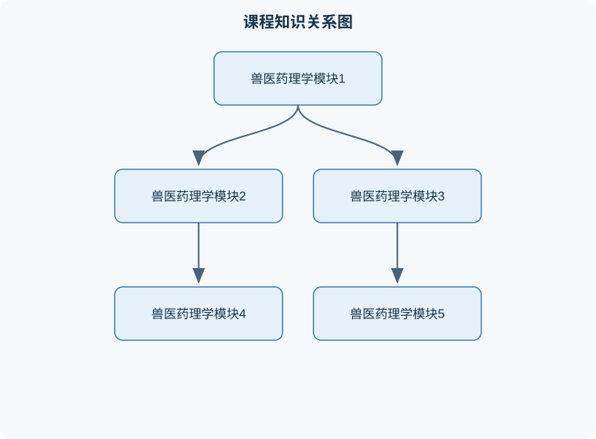

# 兽医药理学

## 一、课程整体知识框架

### 课程边界与先修知识

兽医药理学研究药物与动物机体相互作用的规律，涵盖药物效应动力学、药物代谢动力学、处方与合理用药、各系统药理、抗微生物药物、抗寄生虫药物、药物中毒与解救，以及动物种属、年龄、妊娠、生产用途和食品安全对药物应用的影响。课程重点是解释药物作用机制、体内过程、疗效与毒性的因果关系，并将这些知识用于兽医临床的药物选择、给药方案设计、疗效评价、不良反应识别、配伍审查和用药风险管理。先修知识包括动物生理学、生物化学、病理生理学、微生物学、寄生虫学、免疫学、基础统计学和常用临床诊断方法。课程不替代针对特定动物、疾病和制剂说明书的临床处方，具体剂量、休药期、适用动物和法规要求必须依据当前批准信息及兽医诊疗规范核对。





### 1. 学科对象、任务与基本术语

兽医药理学研究药物与动物机体相互作用的规律，核心内容包括药物效应动力学和药物代谢动力学。前者研究药物对机体的作用，简称药效学；后者研究机体对药物的处置过程，简称药动学。药物不只限于治疗疾病的化学物质，也包括能够影响动物生理功能、病理过程或病原体活动，并可用于预防、诊断、治疗或改善生产性能的物质。兽医药理学的特殊性在于必须同时考虑动物种属、年龄、体重、生产阶段、靶组织、食品动物残留和动物福利等因素，不能把人体用药资料不加区别地用于动物。

药物作用的基本表现可以概括为机体功能或形态的改变。功能改变包括神经兴奋性变化、心率和血压变化、胃肠运动改变、腺体分泌改变以及免疫反应调节；形态改变包括细胞损伤、组织修复、炎症消退或病原体结构受损。药理学任务通常依靠实验观察、定量分析和临床评价完成。按研究性质，可分为实验药理学、临床药理学和基础药理学。实验药理学强调在可控条件下分析作用机制；临床药理学关注药物在患病动物中的疗效、安全性和合理使用；基础药理学研究受体、信号转导、药物转运、代谢和排泄等一般规律。

药物效应具有两面性。同一药物既可能产生治疗作用，也可能引起不良反应；治疗作用是符合用药目的的效应，不良反应则包括副作用、毒性反应、过敏反应、继发反应、后遗效应和停药反应等。副作用通常发生在治疗剂量范围内，原因是药物选择性不足或同一受体系统在不同组织中的作用不同；毒性反应多与剂量过大、给药过快、蓄积或个体易感性有关；过敏反应则与免疫机制有关，不一定与剂量呈简单正相关。

### 2. 药物作用的靶点与机制

药物作用首先取决于药物能否到达靶部位，其次取决于药物与靶点之间的相互作用。常见靶点包括受体、酶、离子通道、转运体、核酸和结构蛋白。受体是能够识别特定配体并将结合信息转化为细胞反应的生物大分子。药物对受体具有亲和力，表示药物与受体结合的能力；内在活性表示药物与受体结合后引发受体效应的能力。激动药具有亲和力和内在活性，能够激活受体；拮抗药具有亲和力但通常缺乏内在活性，能够占据受体并阻断激动药或内源性配体的作用。

受体激活后可通过不同信号机制产生效应。配体门控离子通道起效快，常在毫秒至秒级改变膜电位或离子通透性；G蛋白偶联受体通过第二信使调节酶和离子通道，效应持续时间通常较长；具有酪氨酸激酶活性或与酪氨酸激酶相关的受体主要调节细胞生长、分化和代谢；细胞内受体与脂溶性配体结合后调节基因转录，起效较慢但持续时间较长。肾上腺素受体属于G蛋白偶联受体，其不同亚型通过不同信号通路调节心血管、呼吸和胃肠功能。

药物与受体的结合可用占有模型作定性说明。若药物浓度为 $C$，解离常数为 $K_d$，受体占有率可表示为：

$$
f=\frac{C}{C+K_d}
$$

其中，$f$ 为受体占有率，取值范围为 $0$ 到 $1$；$C$ 和 $K_d$ 的单位必须相同，通常为摩尔浓度。$K_d$ 越小，表示达到相同受体占有率所需的药物浓度越低，亲和力越强。该模型假设受体均一、结合达到平衡且不存在明显的信号放大差异。实际动物体内常有多个受体亚型、活性代谢物、组织分布差异和受体脱敏，因此受体占有率不一定等于最终药效。

药物效应可受效价强度和效能两个概念描述。效价强度表示产生一定效应所需的药物剂量或浓度，所需量越小，效价强度越高；效能表示药物能够达到的最大效应。部分激动药即使占据全部受体，也可能只能达到低于完全激动药的最大效应。竞争性拮抗药通常使激动药的量效曲线右移，但在理论上增加激动药浓度可部分克服阻断；非竞争性拮抗或不可逆性阻断则可能降低最大效能。上述结论依赖于受体结合可逆、拮抗作用类型明确和实验系统稳定等条件，不能把所有曲线右移都解释为竞争性拮抗。

### 3. 药动学：药物在动物体内的过程

药动学包括吸收、分布、代谢和排泄，即ADME。吸收是药物从给药部位进入血液循环的过程；静脉内给药可绕过吸收步骤，但并不意味着药物立即到达所有靶组织。分布是药物随血液进入组织和体液的过程，受组织灌流量、毛细血管通透性、脂溶性、血浆蛋白结合和组织亲和力影响。代谢主要发生在肝脏，也可发生于肠壁、肾脏、肺和血浆，常使药物失活、水溶性增加，但也可能形成仍有活性或毒性更强的代谢物。排泄主要通过肾脏，也可经胆汁、粪便、乳汁、呼出气体或其他分泌物排出。

被动扩散是多数药物跨细胞膜的主要方式，通常遵循浓度梯度，不需要能量。脂溶性高、非解离比例较大的药物更易穿过脂质膜。主动转运需要能量和特异性转运体，可以逆浓度梯度转运，具有选择性、饱和性和竞争性；易化扩散依赖转运体但不直接消耗能量，仍沿电化学梯度移动。药物与血浆蛋白结合后通常暂时处于不能自由扩散的状态，结合型药物一般不易通过毛细血管壁和肾小球滤过，但结合是可逆的，游离药物不断被分布、代谢和排泄后，结合型药物可重新解离。因此，“结合后永久失去药理活性”是错误理解。

弱酸性或弱碱性药物的解离程度会影响跨膜转运和肾小管重吸收。以弱酸为例，其解离关系可用 Henderson-Hasselbalch 方程表示：

$$
\mathrm{pH}=\mathrm{p}K_a+\log\frac{[\mathrm{A^-}]}{[\mathrm{HA}]}
$$

其中，$\mathrm{pH}$ 无量纲，$\mathrm{p}K_a$ 为药物酸性解离常数的负对数，$\mathrm{A^-}$ 为解离型弱酸浓度，$\mathrm{HA}$ 为未解离型弱酸浓度。若弱酸的 $\mathrm{pH}$ 高于 $\mathrm{p}K_a$，解离型比例增加；碱化尿液通常有利于弱酸性药物排出，酸化尿液通常有利于弱碱性药物排出。但这种规律受肾功能、尿流速、转运体、代谢途径和毒性风险影响，不能仅凭尿液酸碱度决定临床处理方案。

线性、单室、一级消除模型下，药物浓度可近似表示为：

$$
C_t=C_0e^{-kt}
$$

其中，$C_t$ 是时间 $t$ 时的血浆药物浓度，单位可为 $\mathrm{mg/L}$；$C_0$ 是理论初始浓度；$k$ 是消除速率常数，单位为 $\mathrm{h^{-1}}$；$t$ 是时间，单位通常为小时。半衰期为：

$$
t_{1/2}=\frac{\ln 2}{k}
$$

半衰期表示血浆药物浓度下降一半所需的时间，不是药物质量单位，也不等于药效持续时间。该公式要求消除过程近似一级动力学，且研究对象的分布相和消除相已区分。零级消除、代谢酶饱和、严重肝肾功能障碍或多室分布时，简单半衰期模型可能失真。

### 4. 剂量、疗效与安全性

药物效应通常随剂量或浓度变化。最小有效量是开始产生预期治疗作用的最低剂量，治疗量是在一定动物群体中能够获得治疗效果的剂量范围，最小中毒量是出现毒性表现的最低剂量，极量是通常允许使用的最高剂量。不同动物、疾病状态和给药途径会使这些界限改变，因此不能把某个物种的治疗量直接推给另一个物种。

治疗指数可定义为：

$$
\mathrm{TI}=\frac{\mathrm{LD}_{50}}{\mathrm{ED}_{50}}
$$

其中，$\mathrm{ED}_{50}$ 是使半数实验对象达到预定治疗效应的剂量，$\mathrm{LD}_{50}$ 是使半数实验对象死亡的剂量。治疗指数越大，通常表示安全余地越大，但它只是群体统计指标，不能替代个体风险判断。治疗窗是产生有效作用而不产生明显毒性的血药浓度或剂量范围；治疗指数使用中位数，治疗窗强调实际临床浓度边界，二者不能混同。若药物的有效剂量和中毒剂量高度重叠，即使治疗指数看似可接受，也可能需要密切监测。

药物安全性还受给药速度、给药途径、重复给药间隔、肝肾功能、脱水、低蛋白血症、年龄和种属差异影响。重复给药时，若给药间隔短于药物消除所需时间，药物可能蓄积。稳态不是药物停止变化，而是平均输入速率与平均消除速率相等。一级消除条件下，达到稳态所需时间主要取决于半衰期，而不是简单取决于给药剂量；增加剂量主要改变稳态浓度，不能按比例缩短达到稳态的时间。

### 5. 自体活性物质、炎症与变态反应

自体活性物质是动物体内产生并发挥调节作用的生物活性物质。它们常以前体或储存形式存在，在刺激下被激活或释放；作用多局限于产生部位附近，通常通过特异性受体发挥作用，并不一定有一个专门产生该物质的器官。组胺、五羟色胺、前列腺素、白三烯、腺苷、一氧化氮、血管活性神经肽和细胞因子均可参与血管张力、平滑肌活动、炎症、疼痛、发热和免疫调节。

过敏反应是免疫系统对通常无害物质产生的异常反应。其表现可涉及皮肤、呼吸道、消化道或全身循环。组胺参与血管扩张、毛细血管通透性增加和平滑肌收缩，因此H1受体阻断药可减轻部分组胺介导的皮肤和黏膜变态反应，但不等同于能够逆转所有严重过敏反应。部分H1受体阻断药可进入中枢神经系统，引起镇静、嗜睡或运动协调改变；不同动物种属的中枢反应和安全边界可能不同。

非甾体解热镇痛抗炎药主要通过抑制环氧合酶，减少前列腺素合成，产生解热、镇痛和抗炎作用。发热时，炎症介质可提高下丘脑体温调节设定点；抑制前列腺素形成后，设定点回落，散热增强，体温下降。疼痛缓解主要与外周炎症组织中致痛介质减少有关；抗炎效果与炎症介质生成受抑有关。由于前列腺素也参与胃黏膜保护、肾血流维持和血小板功能调节，环氧合酶抑制可能带来胃肠道、肾脏或凝血方面的不良影响。弱酸性非甾体抗炎药常在胃肠道前部吸收较快，并主要经肝脏代谢，但种属差异显著，不能跨物种照搬剂量或给药间隔。

## 二、章节和模块划分

### 核心知识覆盖清单

本清单根据本课程的章节划分整理，用于检查正文是否覆盖各个核心模块：

- **模块一：药理学基本概念与研究方法**。
- **模块二：药物跨膜转运、吸收与分布**。
- **模块三：药物代谢、排泄与药动学参数**。
- **模块四：受体、信号转导与药物效应**。
- **模块五：自主神经系统药理学**。
- **模块六：炎症介质、解热镇痛抗炎药与抗组胺药**。
- **模块七：药物不良反应、相互作用与合理用药**。
- **模块八：药理学实验、临床评价与岗位应用**。
- **实验与项目一：药物剂量—效应关系分析**。
- **实验与项目二：跨物种用药风险评价流程**。


### 模块一：药理学基本概念与研究方法

本模块建立“药物—机体—效应—风险”的基本分析框架。学习对象包括药物作用、药效学、药动学、治疗作用、不良反应、受体、效能、效价强度和安全性。分析一个用药问题时，应先确认动物种属、年龄、体重、疾病状态、给药途径和治疗目标，再区分问题属于药物对机体的作用，还是机体对药物的处置。

代表性流程是：明确临床效应；提出可能的药物靶点；判断药物能否到达靶部位；分析受体或酶的作用；结合药动学判断暴露时间；最后评价疗效与风险。该流程的终止条件是已经能够说明“为什么有效、何时有效、可能为何无效或有害”，而不是仅列出药名。

### 模块二：药物跨膜转运、吸收与分布

本模块解释被动扩散、主动转运、易化扩散、胞吞和胞吐等过程，重点分析脂溶性、分子大小、解离度、膜表面积、血流量及蛋白结合对药物分布的影响。药物吸收不等于药物发挥作用，口服药还可能受到胃肠道运动、食物、肠壁代谢和肝脏首过效应影响。

一个常见计算是根据 $\mathrm{pH}$ 与 $\mathrm{p}K_a$ 判断弱酸或弱碱的解离比例。例如某弱酸的 $\mathrm{p}K_a=2.8$，在 $\mathrm{pH}=4.8$ 时：

$$
\frac{[\mathrm{A^-}]}{[\mathrm{HA}]}=10^{4.8-2.8}=100
$$

因此解离型占比为：

$$
\frac{100}{100+1}\times100\%\approx99.0\%
$$

该结果只说明在理想平衡条件下的酸碱分布，不等于血浆中实际吸收率，也不表示药物有99%的比例一定被排出。血浆蛋白结合率、组织分布和代谢均会改变实际过程。

### 模块三：药物代谢、排泄与药动学参数

本模块包括生物转化、肝药酶、首过效应、肾排泄、胆汁排泄、清除率、表观分布容积和半衰期。清除率表示单位时间内从血液中清除药物的“血浆体积”，单位可为 $\mathrm{L/h}$，并不等于单位时间排出的药物质量。表观分布容积定义为体内药物总量与血浆浓度之比：

$$
V_d=\frac{X}{C}
$$

其中，$V_d$ 为表观分布容积，单位为升或 $\mathrm{L/kg}$；$X$ 为体内药物量，单位为毫克；$C$ 为血浆浓度，单位为 $\mathrm{mg/L}$。$V_d$ 较大通常提示药物更多分布到组织，但它是表观参数，不代表真实解剖腔体积。

例：某催眠药半衰期为1小时，给药后体内药物量从100毫克降至12.5毫克。每经过一个半衰期，药量减半：100毫克变为50毫克需要1小时，变为25毫克需要2小时，变为12.5毫克需要3小时。因此在符合一级消除模型且药效由药物量直接决定的假设下，药物达到该水平约需3小时。现实中动物醒来还受药物作用部位浓度、活性代谢物、睡眠状态和疾病影响，不能简单把醒来时间等同于半衰期计算结果。

### 模块四：受体、信号转导与药物效应

本模块系统分析激动药、拮抗药、部分激动药、反向激动药、竞争性拮抗和非竞争性拮抗。重点不是记忆名称，而是判断药物是否具有亲和力、是否具有内在活性，以及受体被调节后会产生何种组织效应。

分析题可按以下顺序处理：第一，确定内源性配体或激动药；第二，判断药物是否与受体结合；第三，判断结合是否激活受体；第四，观察增加激动药浓度能否克服阻断；第五，结合组织中的受体储备和信号放大解释效应大小。受体阻断药具有亲和力但无内在活性，这是其能够占据受体而不直接激活受体的原因。若药物还具有内在活性，则不能称为典型的纯阻断药。

### 模块五：自主神经系统药理学

本模块围绕胆碱能系统和肾上腺素能系统展开。需要区分受体分布、信号机制和器官效应。胆碱能受体包括毒蕈碱型受体和烟碱型受体；肾上腺素能受体包括不同的 $\alpha$ 和 $\beta$ 亚型。相同受体在不同器官中的作用可能不同，例如某类受体在血管、心脏和支气管中的表达及信号环境不同，因此不能根据一个器官的效应推断所有器官的反应。

综合分析时，应把药物的直接作用、反射性调节、剂量变化和动物基础状态同时纳入。例如影响血压的药物可能同时改变心率、血管阻力和肾脏水盐平衡；停药后出现血压剧烈反跳，可能与受体适应、交感神经反应和疾病本身共同有关，不能只归因于药物半衰期。

### 模块六：炎症介质、解热镇痛抗炎药与抗组胺药

本模块重点解释前列腺素、白三烯、组胺和细胞因子在炎症、疼痛、发热和过敏中的作用。非甾体抗炎药通过抑制环氧合酶减少前列腺素生成，适合用于炎症性疼痛、发热和部分炎症过程的对症控制，但不直接清除所有病因。抗组胺药主要阻断H1受体，可缓解组胺介导的血管通透性增加、皮肤瘙痒和部分平滑肌收缩；若症状由其他介质或严重循环障碍导致，单纯阻断H1受体可能不足。

变式判断：若动物出现发热，同时伴有脱水、肾灌注下降或胃肠道损伤风险，应先评价基础状态和用药风险，再考虑解热镇痛抗炎药。若出现皮肤风团和瘙痒，应区分组胺介导的变态反应、寄生虫性皮炎、接触性损伤和感染性皮肤病，不能见到瘙痒就直接归为过敏。

### 模块七：药物不良反应、相互作用与合理用药

本模块包括副作用、毒性反应、过敏反应、耐受性、依赖性、停药反应和药物相互作用。药物相互作用可发生在药动学环节，也可发生在药效学环节。吸收阶段可能出现胃肠道螯合或酸碱环境改变；代谢阶段可能出现酶诱导或酶抑制；排泄阶段可能因肾功能改变而延长暴露；药效学层面则可能出现协同、相加或拮抗。

规范分析流程应包括：核对动物种属和生产用途；核对既往用药和当前症状；识别重复用药或同类药物叠加；评估肝肾功能及脱水状态；确定需要监测的临床指标；记录疗效和不良反应。食品动物还必须考虑休药期和药物残留管理，不能只依据临床症状决定用药方案。

### 模块八：药理学实验、临床评价与岗位应用

本模块把基础知识转化为实验和实际工作能力。实验应包括明确假设、选择对照、规定观察指标、记录时间点、分析剂量—效应关系、评价不确定性和复核异常数据。不能把“出现变化”直接解释为“药物有效”，还要排除自然波动、操作刺激、溶剂影响和测量误差。

一个完整的药理学数据分析伪代码如下：

```text
输入：动物分组数据 D，包括组别、时间、剂量、效应值和不良反应记录
输出：剂量-效应摘要、效应变化、异常记录和结论

1. 检查每条记录是否包含组别、时间、单位和效应值
2. 统一剂量单位、体重单位和时间单位
3. 按组别和时间排序，计算每组基线值与处理后值
4. 对每只动物计算变化量：
      变化量 = 处理后效应值 - 基线效应值
5. 汇总各组的平均变化量和离散程度
6. 检查异常值：
      若记录缺失、单位冲突或超出仪器有效范围，则标记并复核
7. 比较处理组与对照组，同时检查不良反应是否随剂量增加
8. 若疗效改善且风险可接受，输出“支持药物产生预期效应”
9. 若疗效与对照无明显差异，或风险超过预设边界，输出“不能支持安全有效”
10. 终止条件：所有记录均已核查，且结论注明适用条件与局限
```

该流程的关键不变量是所有比较都必须基于同一单位、同一时间定义和相同的评价指标。它适用于结构化药理学实验数据，不适用于缺乏对照、时间点混乱或效应指标本身未经验证的资料。若用程序实现，排序和分组通常需要 $O(n\log n)$ 时间，遍历和汇总需要 $O(n)$ 时间，其中 $n$ 为记录条数；但统计推断的可靠性并不由计算复杂度决定，而取决于实验设计、样本质量和测量误差。

#### 综合例题一：药物作用类型判断

题干：某药物能与受体结合，但单独使用不能产生受体激活效应，却可降低激动药的作用。该药物属于哪类药物？

分析：题干给出“能结合”，说明具有亲和力；给出“不能激活”，说明缺乏内在活性；给出“降低激动药作用”，说明占据受体后产生阻断。

解答：该药物属于受体拮抗药。若增加激动药浓度能够克服阻断，倾向于竞争性拮抗；若最大效应仍下降，则需考虑非竞争性或不可逆性阻断。

结果验证：不能把它判为无亲和力药物，因为无亲和力就不能有效占据受体；也不能判为激动药，因为激动药具有内在活性。

变式：若该药物单独可产生较弱效应，同时又能削弱完全激动药的效应，则应考虑部分激动药，而不是纯拮抗药。

#### 综合例题二：半衰期计算

题干：某药物符合一级消除，半衰期为2小时。给药后体内药量为80毫克，经过6小时后理论剩余多少？

分析：6小时等于3个半衰期。每个半衰期剩余一半。

解答：

$$
80\times\left(\frac12\right)^3=10\ \mathrm{mg}
$$

结果验证：80毫克经2小时为40毫克，经4小时为20毫克，经6小时为10毫克。该结果只适用于一级消除、无新输入和测量对象为同一药物或等效药物量的条件。

变式：若药物存在活性代谢物，动物的临床效应可能持续超过母药血药浓度下降所提示的时间。

#### 综合例题三：弱酸解离度

题干：某弱酸药物的 $\mathrm{p}K_a$ 为3，在环境 $\mathrm{pH}$ 为5时，未解离型与解离型的比例如何？

分析：

$$
\frac{[\mathrm{A^-}]}{[\mathrm{HA}]}=10^{5-3}=100
$$

解离型与未解离型比例为100∶1，解离型约占99.0%。

结果验证：环境越偏碱，弱酸越容易解离；解离型通常水溶性较高，跨脂质膜能力较弱。该结论不能直接等同于吸收减少，因为胃肠道不同部位的表面积、血流和转运体也会影响吸收。

变式：弱碱在酸性环境中通常更容易形成解离型，跨膜能力可能下降，但实际吸收仍需结合给药部位和制剂特点判断。

#### 综合例题四：治疗指数解释

题干：某药物的 $\mathrm{ED}_{50}$ 为5毫克，$\mathrm{LD}_{50}$ 为100毫克。计算治疗指数并解释。

解答：

$$
\mathrm{TI}=\frac{100\ \mathrm{mg}}{5\ \mathrm{mg}}=20
$$

治疗指数为20，表示在该实验条件下，致死中位剂量是产生治疗效应中位剂量的20倍。

结果验证：计算时分子和分母必须使用同一给药途径、同一动物种属和相同剂量单位。该数值不能直接作为个体安全保证，也不能替代对肝肾功能、年龄和合并用药的评价。

变式：如果有效剂量分布很宽，而中毒剂量分布很窄，仅比较两个中位数可能低估个体重叠风险。

#### 综合例题五：非甾体抗炎药的综合判断

题干：动物出现发热和疼痛，使用环氧合酶抑制药后体温下降，但同时出现食欲下降和胃肠道不适。如何解释？

分析：环氧合酶抑制减少前列腺素合成，可降低发热设定点并减轻炎症性疼痛；但前列腺素也参与胃黏膜保护和肾脏灌流调节，因此可能出现胃肠道或肾脏风险。

解答：体温下降支持药物产生了解热效应，但不能据此证明原发病已经治愈。应进一步核对脱水、肾灌注、胃肠道病变、联合用药和给药持续时间，并根据动物种属和生产用途进行风险评价。

结果验证：如果停药后体温再次升高，可能提示病因仍在；如果出现黑粪、持续呕吐、少尿或精神沉郁，应优先处理潜在不良反应，而不是单纯增加解热药用量。

变式：若症状主要是瘙痒和风团，应考虑组胺及其他炎症介质参与，不能把非甾体抗炎药作为抗组胺药的替代物。

### 实验与项目一：药物剂量—效应关系分析

步骤：先提出假设，例如同一药物浓度增加将使某项可测效应增强；设置空白对照、溶剂对照和不同浓度处理组；统一动物种属、性别、年龄范围、观察时间和测量方法；记录基线值、处理后值和不良反应；计算每只动物的变化量，再比较各组的平均效应和离散程度。

输入数据：动物编号、组别、体重、给药浓度或剂量、给药时间、基线效应值、处理后效应值、不良反应等级及缺失记录说明。剂量必须明确单位，例如 $\mathrm{mg/kg}$；浓度必须注明是质量浓度还是摩尔浓度。

评价标准：处理组相对对照组存在可重复的效应变化；效应方向与药理机制一致；剂量增加时效应在一定范围内呈规律变化；不良反应记录完整；结论明确指出实验模型、样本量和观察时间的限制。

排错方法：若所有组均发生相同变化，检查环境、操作刺激或溶剂影响；若高剂量组效应反而消失，检查毒性、受体脱敏或测量饱和；若数据单位不一致，先统一单位后重新计算；若个别值极端，核对原始记录、仪器范围和动物状态，不能未经核查直接删除。

### 实验与项目二：跨物种用药风险评价流程

步骤：确定目标动物和用途；收集药物的作用机制、吸收分布、代谢排泄和已知不良反应；核对该物种是否存在明显代谢差异；评估疾病、脱水、肝肾功能和联合用药；制定疗效指标、风险指标和停止条件；记录用药后反应并进行复盘。

输入数据：动物种属、体重、年龄、生产阶段、疾病诊断、既往用药、给药途径、计划观察指标、肝肾功能信息及食品安全相关要求。

评价标准：不能以人体剂量或另一物种剂量直接替代；用药目的、疗效指标和风险指标清楚；能够说明为何选择该药物以及何时停止或调整；食品动物必须纳入残留和休药期管理；记录可追溯、单位统一、异常反应有处理流程。

排错方法：若疗效不足，先区分诊断错误、药物未到达靶部位、病原体耐药、给药方式错误和个体代谢差异；若毒性增加，检查重复用药、蓄积、肝肾清除下降、脱水和高敏反应；若结论仅依据单次观察，应降低结论强度并补充连续监测。

## 三、核心概念的详细解释

### 1. 兽医药理学的研究对象与基本关系

兽医药理学研究药物与动物机体相互作用的规律。药物对机体产生什么作用、作用强弱和作用机制，属于药效学；机体如何吸收、分布、代谢和排泄药物，属于药动学。药物要产生效应，通常须经历制剂释放、跨膜转运、吸收进入循环、分布到靶组织、与靶点结合并触发效应等过程。因而“药物已经给入”不等于“药物已经产生有效作用”。

药理作用的基本表现是动物机体功能或形态的改变。功能改变包括心率、血压、呼吸、胃肠运动、腺体分泌和神经兴奋性的变化；形态改变包括细胞损伤、炎症消退、组织修复或病原体结构受损。药理学研究依靠实验观察、定量分析和临床评价。实验药理学强调在控制条件下研究机制，临床药理学强调患病动物中的疗效和安全性，基础药理学则研究受体、信号转导、转运、代谢和排泄等一般规律。

兽医用药必须同时考虑动物种属、品种、年龄、体重、性别、妊娠状态、生产阶段、疾病状态和食品用途。人体药物资料不能未经校正直接用于动物，因为不同物种的胃肠道结构、肝脏代谢酶、肾脏排泄能力、受体亚型和敏感性可能存在显著差异。食品动物还必须考虑药物残留、允许使用范围和休药管理；伴侣动物则要特别重视个体差异、依从性和动物福利。

### 2. 药物作用的靶点、选择性与双重性

常见药物靶点包括受体、酶、离子通道、转运体、核酸和结构蛋白。受体能够识别内源性配体或药物，并把结合信息转化为细胞反应。药物与受体结合的能力称为亲和力；药物结合后激活受体并引起效应的能力称为内在活性。激动药具有亲和力和内在活性，能够激活受体；拮抗药具有亲和力但内在活性很低或没有，能够占据受体并阻断激动药或内源性配体的作用。

完全激动药可在特定系统中产生最大效应，部分激动药即使占据大量受体，也只能达到低于完全激动药的最大效应。部分激动药在缺乏完全激动药时可以产生一定刺激作用，在完全激动药存在时又可能竞争受体而降低总体效应。因此，不能仅根据“能够结合受体”判断药物是激动药还是拮抗药。

药物作用具有双重性，即治疗作用与不良反应可以同时存在。副作用通常发生在治疗剂量范围内，常由药物选择性不足或同一受体在不同组织中的作用造成；毒性反应多与剂量过大、给药过快、药物蓄积或清除下降有关；过敏反应由免疫机制参与，不一定与剂量呈简单正相关。停药反应是长期用药后突然停药引起的反跳或戒断样表现，不能简单归为药物仍在发挥治疗作用。

药物选择性是相对的而非绝对的。低剂量时药物可能主要作用于治疗靶点，剂量升高后则可能影响其他受体、酶或器官。选择性下降可以解释许多副作用，也说明“增加剂量以加强疗效”存在边界。判断不良反应时，应区分疾病自然进程、药物直接作用、继发反应、过敏反应和给药操作造成的损伤。

### 3. 受体与量效关系

在理想的平衡结合模型中，设药物浓度为 $C$，解离常数为 $K_d$，受体占有率为 $f$，则：

$$
f=\frac{C}{C+K_d}
$$

其中，$C$ 与 $K_d$ 必须采用相同单位，通常为 $\mathrm{mol/L}$；$f$ 的范围是 $0$ 到 $1$。当 $C=K_d$ 时，$f=0.5$。$K_d$ 越小，表示达到相同占有率所需的浓度越低，亲和力越强。该式假设受体均一、结合达到平衡、药物浓度能够代表靶部位浓度，并且没有明显的协同结合或受体储备。动物体内若存在活性代谢物、多个受体亚型、组织屏障或受体脱敏，受体占有率就不一定等于最终药效。

药物效应常用最大效能和效价强度描述。最大效能是药物在特定实验系统中能够达到的最大效应；效价强度反映产生某一效应所需的剂量或浓度，所需量越小，效价强度越高。二者不能混淆：一种药物可以效价较高但最大效能较低，也可以最大效能较高但需要较大剂量才能起效。

可用下式表示理想化的浓度—效应关系：

$$
E=E_0+\frac{E_{\max}C}{EC_{50}+C}
$$

其中，$E$ 为观察到的效应，$E_0$ 为基础效应，$E_{\max}$ 为在该系统中可增加的最大效应，$EC_{50}$ 为达到最大增量效应一半所需的药物浓度，$C$ 为作用部位药物浓度。该模型适用于单一主要作用机制、效应随浓度单调增加且观察时间足以接近平衡的情形。若药物存在毒性、受体脱敏、反向效应或高浓度时抑制作用，量效曲线可能不再符合此式。

竞争性拮抗药通常使激动药量效曲线右移，即达到相同效应需要更高的激动药浓度，而理论最大效能可保留；如果拮抗不可逆或属于非竞争性阻断，则可能降低最大效能。这个判断要求实验条件稳定、拮抗类型明确。仅凭“曲线右移”不能证明一定是竞争性拮抗，因为药物分布改变、受体储备变化和信号通路抑制也可能造成类似现象。

### 4. 跨膜转运、蛋白结合与药动学联系

大多数药物通过被动扩散跨越细胞膜。被动扩散不需要能量，转运方向主要由浓度梯度决定，脂溶性较高、分子较小且未解离的药物通常更容易通过脂质膜。主动转运需要能量和特异性转运体，可以逆浓度梯度转运，具有饱和性和竞争性。易化扩散需要转运体但不直接消耗能量，仍然沿浓度梯度进行。胞吞和胞吐适合大分子或特殊颗粒，不是大多数小分子药物的主要途径。

弱酸性或弱碱性药物的解离程度受环境酸碱度和药物自身酸碱性影响。未解离型通常更容易透过脂质膜，解离型更易留在水相中。弱酸性药物在较酸环境中未解离比例相对较高，弱碱性药物在较碱环境中未解离比例相对较高，但这只是跨膜转运的一个因素，不能忽略组织血流、膜面积、蛋白结合和转运体作用。

药物与血浆蛋白结合后，结合型药物通常暂时不能自由透过膜，也不能立即与靶点结合，但并非永久失活。结合型与游离型之间可逆平衡，游离型可分布、代谢、排泄并产生药理作用。若另一药物竞争蛋白结合位点，游离比例可能短时升高；但临床影响取决于分布容积、清除能力和靶组织暴露，不能仅凭蛋白结合率高就断定一定发生严重相互作用。

血浆药物浓度下降一半所需的时间称为血浆消除半衰期，记为 $t_{1/2}$，单位通常为小时。它描述的是浓度变化的时间尺度，不是剂量单位，也不是蛋白结合率下降一半所需的时间。在一室模型、一级消除条件下：

$$
t_{1/2}=\frac{0.693}{k}
$$

其中，$k$ 为消除速率常数，单位为 $\mathrm{h^{-1}}$。该公式不适用于零级消除或明显多室分布的全部过程。半衰期还会受到清除率、分布容积、肝肾功能、疾病状态和物种差异影响。

### 5. 自体活性物质、过敏与抗组胺药

自体活性物质是机体自身产生、可调节邻近组织或全身功能的化学信号物质。许多自体活性物质以前体、储存形式或无活性形式存在，在刺激后释放或转化；通常在局部生成，作用于邻近细胞；多数具有相应的特异性受体，但不一定存在一个专门产生该物质的器官。组胺、五羟色胺、前列腺素、白三烯、一氧化氮、腺苷、血管活性神经肽和细胞因子均属于重要的信号分子类别。

过敏反应是免疫系统对通常无害物质产生的异常或过强反应。临床表现可包括瘙痒、红斑、风团、面部或黏膜水肿、呕吐、腹泻、支气管收缩、低血压和循环衰竭。过敏反应不应仅凭症状确定，还要结合用药或接触史、发病时间、暴露途径和鉴别诊断。呼吸困难、黏膜苍白、虚脱等表现提示可能存在危重反应，应先进行规范的急救评估和支持处理，不能只依赖口服抗组胺药。

H1受体阻断药可对抗组胺引起的血管扩张、毛细血管通透性增加和平滑肌收缩，适用于部分皮肤和黏膜变态反应性疾病。部分药物可进入中枢神经系统，引起镇静、嗜睡或反应迟钝。H1受体阻断药不能替代针对感染、寄生虫、内分泌疾病或接触性刺激的病因治疗，也不能把所有呼吸道症状都归因于组胺。

### 6. 非甾体抗炎药的作用与边界

非甾体抗炎药主要通过抑制环氧合酶，减少前列腺素等炎症介质的生成，从而产生解热、镇痛和抗炎作用。发热时，炎症介质可提高下丘脑体温调节设定点；减少相关前列腺素生成后，设定点下降，体温可随散热过程降低。炎症性疼痛中，前列腺素可提高伤害感受器敏感性，因此抑制其合成可减轻疼痛。

环氧合酶通路也参与胃黏膜保护、肾脏灌流和血小板功能调节，因此非甾体抗炎药可能造成胃肠道刺激、溃疡或出血风险，也可能在脱水、低血容量或肾灌注不足时增加肾脏损伤风险。不同物种对药物吸收、代谢和清除的差异很大，尤其不能把一种动物的剂量直接套用于另一种动物。用药前应核对种属、年龄、脱水状况、肝肾功能、既往胃肠道疾病和联合用药情况。

非甾体抗炎药可以按化学结构分为水杨酸类、苯胺类、吡唑酮类和有机酸类等，但分类并不等同于安全性排序。解热后体温下降只能说明相关效应出现，不能证明感染或原发病已经治愈。若动物出现黑粪、持续呕吐、明显少尿、精神沉郁或进行性脱水，应重新评估药物风险和原发病，而不是单纯增加用量或叠加另一种同类药物。

### 7. 问题分析与用药评价流程

兽医药理学问题可按以下流程分析：

1. **确定对象与目标**：明确动物种属、年龄、体重、生产用途、疾病诊断和治疗目标。
2. **判断药物是否到达靶部位**：分析给药途径、吸收、分布、血脑屏障、组织灌流和蛋白结合。
3. **判断作用机制**：确定靶点、激动或拮抗性质、剂量—效应关系及可能的信号通路。
4. **评估获益与风险**：同时列出疗效指标、不良反应指标、禁忌因素和停止条件。
5. **核查时间因素**：区分起效时间、作用持续时间、半衰期、蓄积和停药反应。
6. **复核结果**：若无效，依次排查诊断错误、给药错误、药物未到达靶部位、耐药或个体清除过快；若毒性增加，排查重复用药、清除下降、脱水、蓄积和过敏。

#### 可执行的药理数据分析伪代码

```python
# 输入：每只动物的组别、剂量、基线效应、处理后效应和不良反应记录
# 输出：各组平均变化、剂量趋势和需要复核的异常记录

def analyze_response(records):
    groups = {}
    for r in records:
        required = ["animal_id", "group", "dose_mg_per_kg",
                    "baseline", "after", "adverse_event"]
        if any(key not in r for key in required):
            continue

        if r["baseline"] is None or r["after"] is None:
            continue

        change = r["after"] - r["baseline"]
        item = {
            "animal_id": r["animal_id"],
            "dose": r["dose_mg_per_kg"],
            "change": change,
            "adverse_event": r["adverse_event"]
        }
        groups.setdefault(r["group"], []).append(item)

    summary = {}
    for group, items in groups.items():
        changes = [x["change"] for x in items]
        mean_change = sum(changes) / len(changes)
        adverse_count = sum(
            1 for x in items
            if x["adverse_event"] not in [None, "", "无"]
        )
        summary[group] = {
            "n": len(items),
            "mean_change": mean_change,
            "adverse_count": adverse_count
        }

    return summary
```

该流程的输入是结构统一的观察记录，输出是各组样本数、平均效应变化和不良反应数量。其不变量是每一条纳入分析的记录必须具有可比较的基线和处理后数据，且剂量单位统一为 $\mathrm{mg/kg}$。遍历全部记录后终止，时间复杂度为 $O(n)$，其中 $n$ 是记录数；空间复杂度为 $O(n)$。它不能代替统计检验、剂量—效应模型或临床判断，尤其不能在物种、观察时间或测量方法不一致时直接比较。

### 8. 代表性例题

#### 例题一：弱酸性药物的解离

**题干**：某弱酸性药物的 $\mathrm{p}K_a=2.8$，环境 $\mathrm{pH}=4.8$。判断其未解离型与解离型的比例。

**分析**：弱酸性药物可用：

$$
\mathrm{pH}=\mathrm{p}K_a+\log\frac{[A^-]}{[HA]}
$$

其中，$HA$ 是未解离型，$A^-$ 是解离型。

**解答**：

$$
4.8=2.8+\log\frac{[A^-]}{[HA]}
$$

$$
\log\frac{[A^-]}{[HA]}=2
$$

$$
\frac{[A^-]}{[HA]}=100
$$

因此解离型与未解离型之比为 $100:1$，未解离型约占总量的 $1/101$，约为 $0.99\%$。

**结果验证**：由于环境的 $\mathrm{pH}$ 比 $\mathrm{p}K_a$ 高两个单位，弱酸性药物主要呈解离型。该结论只描述酸碱平衡，不能单独预测吸收速度，因为吸收还受膜面积、血流、制剂和转运体影响。

**变式**：若环境 $\mathrm{pH}=1.8$，则 $[A^-]/[HA]=0.1$，未解离型比例约为 $90.9\%$，但胃内实际吸收仍取决于胃排空和药物稳定性。

#### 例题二：半衰期与醒觉时间

**题干**：某催眠药半衰期为 $1$ 小时，给药后体内初始量为 $100\ \mathrm{mg}$。当体内药物量降至 $12.5\ \mathrm{mg}$ 时动物醒来。求经过多长时间。

**解答**：药物量依次为：

$$
100\rightarrow50\rightarrow25\rightarrow12.5\ \mathrm{mg}
$$

经历了三次半衰期，因此：

$$
t=3\times1\ \mathrm{h}=3\ \mathrm{h}
$$

**结果验证**：$100\times(1/2)^3=12.5\ \mathrm{mg}$，计算一致。

**变式**：若存在活性代谢物，或催眠效应取决于靶组织浓度而不是血浆总药物量，则醒来时间可能不等于三倍血浆半衰期。

#### 例题三：治疗指数的解释

**题干**：某药物的 $\mathrm{ED}_{50}=5\ \mathrm{mg}$，$\mathrm{LD}_{50}=100\ \mathrm{mg}$，求治疗指数并说明意义。

**解答**：

$$
\mathrm{TI}=\frac{\mathrm{LD}_{50}}{\mathrm{ED}_{50}}
=\frac{100\ \mathrm{mg}}{5\ \mathrm{mg}}=20
$$

治疗指数为 $20$，表示在相同实验条件下，产生半数动物有效反应的剂量与导致半数动物死亡的剂量之间存在数量级差异。

**结果验证**：分子、分母必须使用相同种属、给药途径、观察终点和剂量单位。

**边界**：治疗指数是群体参数，不能保证每一只动物都安全；若有效剂量和中毒剂量分布重叠，单独使用治疗指数可能掩盖个体风险。

#### 例题四：受体阻断性质

**题干**：某药物能与受体结合，但单独给药不产生该受体的激活效应，却能降低激动药作用。判断其性质。

**解答**：该药物具有亲和力，能够占据受体；但缺乏足够内在活性，不能自行激活受体，因此属于拮抗药。若增加激动药浓度后能够部分恢复效应，提示可能为可逆竞争性拮抗；若最大效能下降且不能通过增加激动药完全恢复，则需考虑非竞争性或不可逆性阻断。

**结果验证**：不能仅凭“药物能结合受体”判断其为激动药，必须同时考察内在活性和功能效应。

**变式**：部分激动药也可能在完全激动药存在时表现为功能性拮抗，因此实验中必须说明参照药物和系统条件。

#### 例题五：解热后症状复发

**题干**：动物发热并伴有疼痛，给予非甾体抗炎药后体温下降，但数小时后再次升高。如何判断？

**分析**：非甾体抗炎药抑制环氧合酶，减少前列腺素生成，可降低发热设定点，但不一定消除感染、炎症病灶或其他原发病。

**解答**：体温下降说明解热效应可能出现；停留时间过后再次发热，提示原发病因仍存在或药物效应已减弱。应重新评价诊断、感染控制、脱水、胃肠道和肾脏风险，并核查是否重复使用同类药物。

**结果验证**：若同时出现黑粪、持续呕吐、少尿或明显沉郁，应优先排查药物不良反应，而不是单纯增加解热药用量。

**变式**：若主要表现为瘙痒、风团和局部水肿，应考虑组胺参与及过敏性疾病，不能把非甾体抗炎药当作H1受体阻断药替代。

### 9. 实验与项目流程

#### 项目一：剂量—效应关系分析

**步骤**：先提出假设，例如某药物剂量升高将在一定范围内增强镇痛效应；设置空白对照、溶剂对照和多个剂量组；统一动物种属、年龄范围、观察时间和测量方法；记录基线、处理后效应和不良反应；计算每只动物的变化量，再比较组间效应。

**输入数据**：动物编号、种属、组别、体重、剂量、剂量单位、给药时间、基线值、处理后值、不良反应等级和缺失记录说明。

**评价标准**：剂量单位统一；对照组设置合理；效应方向与机制一致；剂量增加时趋势具有可解释性；高剂量组没有因毒性或运动抑制造成假性效应；结论明确说明观察时间和动物模型的限制。

**排错方法**：所有组均改变时，检查环境、操作刺激和溶剂；高剂量效应反而下降时，检查毒性、受体脱敏和测量饱和；个别极端值出现时，先核对原始记录和动物状态，不能未经核查删除。

#### 项目二：跨物种用药风险评价

**步骤**：确定目标动物、用途和治疗目标；分析药物的作用机制、吸收、分布、代谢、排泄和已知不良反应；评估物种差异、肝肾功能、脱水、妊娠和联合用药；规定疗效指标、风险指标和停止条件；用药后连续记录并复盘。

**输入数据**：动物种属、品种、体重、年龄、生产阶段、诊断、既往用药、给药途径、观察指标、肝肾功能和食品安全要求。

**评价标准**：不能直接套用人体或另一物种剂量；选择药物的理由清楚；疗效和风险指标可观测；食品动物纳入残留和休药管理；所有记录可追溯。

**排错方法**：疗效不足时，依次排查诊断错误、药物未到达靶部位、给药方式错误、病原体耐药和个体清除过快；毒性增加时，检查重复用药、蓄积、清除下降、脱水和过敏。

### 10. 易错点与常见考法

#### 具体易错点

1. 把药效学与药动学混淆：前者是药物对机体的作用，后者是机体对药物的处置。
2. 把亲和力等同于内在活性：拮抗药有亲和力但通常无内在活性。
3. 把效价强度与最大效能混淆：前者反映达到一定效应所需的量，后者反映能达到的最高效应。
4. 认为蛋白结合后药物永久失活：结合通常是可逆的。
5. 把半衰期理解为药物减少一半的剂量：半衰期描述血浆浓度或体内量减少一半的时间。
6. 认为所有药物均以主动转运跨膜：多数小分子药物主要通过被动扩散。
7. 把解离度直接等同于吸收率：吸收还取决于血流、膜面积、制剂和转运体。
8. 认为竞争性拮抗一定降低最大效能：理想可逆竞争性拮抗主要使曲线右移。
9. 认为解热等于治愈病因：解热只是改变体温调节效应。
10. 把所有皮肤瘙痒都诊断为过敏：寄生虫、感染、内分泌和接触刺激均可引起瘙痒。
11. 认为非甾体抗炎药只有胃肠道风险：脱水和肾灌注不足时还可能增加肾脏风险。
12. 把人体资料直接用于动物：物种间受体、代谢和排泄差异可能改变疗效与毒性。
13. 认为治疗指数越大就能保证个体安全：治疗指数是群体统计参数。
14. 忽略给药途径：相同剂量经不同途径给药，生物利用度和起效时间可能不同。
15. 高估单次观察结果：一次体温下降不能证明感染已经控制。
16. 用总血药浓度替代游离药物浓度：真正能自由分布并作用于靶点的主要是游离部分，但临床解释还需结合清除和组织分布。

#### 典型笔试问题及解答思路

1. **问：药理学研究的两个基本方面是什么？**  
   **答题思路**：写出药效学和药动学，并分别解释“药物对机体”和“机体对药物”。

2. **问：受体阻断药的基本特点是什么？**  
   **答题思路**：说明具有亲和力、内在活性不足或缺乏，可占据受体并降低激动药效应。

3. **问：治疗指数如何计算？**  
   **答题思路**：写出 $\mathrm{TI}=\mathrm{LD}_{50}/\mathrm{ED}_{50}$，同时说明必须统一种属、途径、单位和观察终点。

4. **问：为什么药物会产生副作用？**  
   **答题思路**：重点解释选择性不足、同一受体在不同组织中的作用及剂量升高后的靶点扩展。

5. **问：半衰期有什么意义？**  
   **答题思路**：说明它反映浓度下降速度，影响给药间隔和蓄积判断，但不能单独决定疗效持续时间。

6. **问：非甾体抗炎药为什么能解热？**  
   **答题思路**：由炎症介质、环氧合酶、前列腺素和下丘脑体温设定点逐步推导。

7. **问：为什么不同物种不能直接套用剂量？**  
   **答题思路**：从吸收、代谢酶、蛋白结合、肾排泄、受体敏感性和疾病状态说明。

8. **问：弱酸性药物的尿液碱化为何可能促进排出？**  
   **答题思路**：解释碱性尿液增加弱酸性药物解离比例，使其较难被肾小管重吸收；同时指出必须考虑药物毒性、肾功能和实际临床条件，不能机械操作。

### 11. 面试问题与岗位关联

#### 常见面试问题

1. **问：如何向养殖场解释药物残留风险？**  
   **参考答案**：说明药物在动物体内会经历代谢和排泄，部分原药或代谢物可能残留于可食组织；必须依据合法适用范围、规范记录和休药管理控制风险。  
   **追问要点**：不能用“动物看起来正常”判断残留合格，还要核对用途、最后给药时间和批次记录。

2. **问：动物用药后症状没有改善，你先查什么？**  
   **参考答案**：先确认诊断和疗效指标，再检查剂量单位、给药途径、实际摄入量、药物保存、依从性和观察时间。  
   **追问要点**：还需考虑耐药、药物未到达靶部位、清除过快和病因未控制。

3. **问：如何区分药物副作用和过敏反应？**  
   **参考答案**：副作用常与药理作用相关并有一定剂量关系；过敏反应由免疫机制参与，可能在较小剂量下发生，伴有瘙痒、风团、水肿或全身反应。  
   **追问要点**：不能仅凭一次症状定论，应结合时间关系、暴露史和鉴别诊断。

4. **问：如何判断非甾体抗炎药使用风险？**  
   **参考答案**：检查脱水、肾灌注、胃肠道病史、肝肾功能、年龄、联合用药和疗效目标。  
   **追问要点**：若出现黑粪、呕吐、少尿或沉郁，应重新评估并考虑停止相关风险暴露。

5. **问：为什么血药浓度高不一定疗效好？**  
   **参考答案**：疗效取决于游离药物是否到达靶组织、靶点敏感性和疾病机制，血浆总浓度不等于靶部位有效浓度。  
   **追问要点**：还要考虑蛋白结合、组织屏障、活性代谢物和受体脱敏。

6. **问：如何评价一项动物药理实验？**  
   **参考答案**：检查对照、随机化、剂量单位、观察时间、基线、效应指标、不良反应记录和统计解释。  
   **追问要点**：若数据异常，先核对原始记录和操作流程，不能为了得到预期趋势而任意删除数据。

7. **问：如何处理不同来源的药理数据不一致？**  
   **参考答案**：先核对物种、品种、给药途径、制剂、剂量单位、测定终点和观察时间，再判断是否属于条件差异。  
   **追问要点**：若关键条件无法统一，应降低结论强度，而不是简单取平均。

8. **问：药理学知识如何服务研发或技术岗位？**  
   **参考答案**：用于设计剂量—效应实验、分析药动学数据、筛选安全窗口、解释不良反应和制定动物试验记录。  
   **追问要点**：研发结论必须能追溯到原始数据，说明适用物种、边界条件和验收指标。

#### 岗位任务、知识应用与验收标准

- **兽医临床技术岗位**：任务是根据动物种属、诊断和风险因素选择合理药物并监测疗效。使用药效学、药动学、受体机制和不良反应知识。产出包括用药记录、疗效评估和异常反应报告。验收标准是剂量单位和途径清楚、疗效指标可观察、风险和停止条件明确。
- **动物药品研发岗位**：任务是设计体外或体内剂量—效应实验，比较候选药物的效能和安全窗口。使用受体理论、量效关系、半衰期、清除和物种差异知识。产出包括实验方案、原始数据、分析表和结论。验收标准是对照合理、数据可追溯、模型假设写明、结论不超出实验边界。
- **药品质量与注册技术岗位**：任务是审查药物规格、稳定性、适用动物和风险信息。使用药动学、残留风险、给药途径和不良反应知识。产出包括技术审查记录和风险评价文件。验收标准是单位统一、适用范围明确、关键限制条件完整。
- **养殖场兽医或技术服务岗位**：任务是制定群体用药和疗效监测流程，减少不合理联合用药与残留风险。使用疾病诊断、药物机制、耐药风险和休药管理知识。产出包括用药台账、疗效记录和异常事件复盘。验收标准是每次用药可追溯，疗效和不良反应均有记录，食品动物风险得到控制。

## 四、重要定义、公式、定理和推导

### 专业审校补充：关键定义与适用边界

兽医抗感染药物评价不能只看血药浓度是否升高，还应将药动学暴露与病原体敏感性联系起来。常用药动学—药效学指标包括：时间依赖型作用的有效暴露时间比例 $fT>MIC$，即游离药物浓度高于最低抑菌浓度的时间占给药间隔的比例；浓度依赖型作用的峰浓度与MIC之比 $C_{\max}/MIC$；以及总暴露量与MIC之比 $AUC/MIC$。其中，$MIC$ 是在规定实验条件下抑制可见生长所需的最低药物浓度，单位必须与药物浓度一致；$AUC$ 为浓度—时间曲线下面积，常用单位为 $\mathrm{mg\cdot h/L}$。这些指标只能在药物、病原体、动物种属、给药途径和感染部位相匹配时解释，不能把体外MIC直接当作动物体内靶组织浓度，也不能仅凭血浆总浓度判断疗效。蛋白结合率高、炎症导致组织屏障改变、脓液或缺氧环境、细菌接种量效应和耐药亚群，都可能使血浆暴露与感染部位实际效应不一致。食品动物还必须同步考虑批准适用范围、残留控制和休药管理，不能为了达到某一药效学指标而擅自改变给药方案。


### 1. 酸碱平衡与膜转运公式

对弱酸性药物：

$$
\mathrm{pH}=\mathrm{p}K_a+\log\frac{[A^-]}{[HA]}
$$

其中，$\mathrm{pH}$ 为环境酸碱度；$\mathrm{p}K_a$ 为药物酸解离常数的负对数；$[A^-]$ 为解离型浓度；$[HA]$ 为未解离型浓度。由此可得：

$$
\frac{[A^-]}{[HA]}=10^{\mathrm{pH}-\mathrm{p}K_a}
$$

总浓度为 $[A^-]+[HA]$，因此未解离型比例为：

$$
\frac{[HA]}{[A^-]+[HA]}
=
\frac{1}{1+10^{\mathrm{pH}-\mathrm{p}K_a}}
$$

推导条件是体系达到酸碱平衡，且只考虑一个主要可解离基团。若药物为多元酸、多元碱、两性化合物，或局部环境存在蛋白结合和主动转运，则不能仅用单一公式完整描述体内分布。

### 2. 受体占有率与效应公式

受体占有率：

$$
f=\frac{C}{C+K_d}
$$

当 $C=K_d$ 时：

$$
f=\frac{K_d}{K_d+K_d}=\frac{1}{2}
$$

因此，$K_d$ 是达到半数受体占有率时的平衡浓度。该结论只适用于单一结合位点和平衡状态，不能直接把 $K_d$ 当作临床有效浓度。

理想化效应模型：

$$
E=E_0+\frac{E_{\max}C}{EC_{50}+C}
$$

当 $C=EC_{50}$ 时：

$$
E=E_0+\frac{E_{\max}}{2}
$$

因此，$EC_{50}$ 是达到最大增量效应一半所需的浓度。它描述的是功能效应，不一定等于结合实验中的 $K_d$，因为细胞信号放大、受体储备和组织耦联效率会使结合与效应之间产生差异。

### 3. 半衰期、清除率与分布容积

一级消除条件下，体内药物量或血浆浓度随时间变化为：

$$
C_t=C_0e^{-kt}
$$

其中，$C_t$ 是时间 $t$ 时的浓度，$C_0$ 是初始浓度，$k$ 是消除速率常数，单位为 $\mathrm{h^{-1}}$，$t$ 的单位为小时。令 $C_t=C_0/2$：

$$
\frac{1}{2}=e^{-kt}
$$

两边取自然对数：

$$
\ln\frac{1}{2}=-kt
$$

由于 $\ln(1/2)=-0.693$，得到：

$$
t_{1/2}=\frac{0.693}{k}
$$

若清除率为 $CL$，分布容积为 $V_d$，则：

$$
k=\frac{CL}{V_d}
$$

所以：

$$
t_{1/2}=0.693\frac{V_d}{CL}
$$

其中，$CL$ 的单位可为 $\mathrm{L/h}$，$V_d$ 的单位为 $\mathrm{L}$，二者相除得到 $\mathrm{h^{-1}}$。该关系说明分布容积增大或清除率下降，半衰期可能延长。它适用于近似一室、一级消除条件；多室分布、零级消除、非线性代谢或严重疾病状态下，必须谨慎解释。

### 4. 负荷剂量与维持给药的概念推导

在理想模型中，若目标血药浓度为 $C_{\mathrm{target}}$，分布容积为 $V_d$，生物利用度为 $F$，则达到目标浓度的理论负荷量可表示为：

$$
D_{\mathrm{loading}}=\frac{C_{\mathrm{target}}V_d}{F}
$$

其中，$D_{\mathrm{loading}}$ 为理论负荷给药量，$C_{\mathrm{target}}$ 与 $V_d$ 的单位必须相容，$F$ 为 $0$ 到 $1$ 之间的无量纲生物利用度。该式假设目标浓度与效应之间关系明确，分布容积稳定，且药物迅速达到可代表的分布状态。实际动物用药不能仅凭公式直接确定剂量，因为物种差异、制剂差异、疾病状态和安全上限都可能改变参数。

在稳定状态下，单位时间内输入量与清除量相等。若给药速率为 $R_{\mathrm{in}}$，则：

$$
R_{\mathrm{in}}=CL\cdot C_{\mathrm{ss}}
$$

其中，$C_{\mathrm{ss}}$ 为稳态平均浓度。若采用间歇给药，给药间隔、峰谷波动和生物利用度必须同时考虑。该式用于说明药动学关系，不应脱离具体药物和动物种属直接制定临床剂量。

### 5. 治疗指数与安全范围

治疗指数定义为：

$$
\mathrm{TI}=\frac{\mathrm{LD}_{50}}{\mathrm{ED}_{50}}
$$

其中，$\mathrm{ED}_{50}$ 是使半数实验对象达到规定有效终点的剂量，$\mathrm{LD}_{50}$ 是导致半数实验对象死亡的剂量。治疗指数越大，通常表示有效剂量与致死剂量的相对距离越大，但它不能替代个体化安全评价。

安全范围强调从最小有效量到最小中毒量或最小致死量之间的实际距离。与治疗指数相比，安全范围更关注剂量分布边界，而非两个中位数的比值。若有效量与中毒量分布高度重叠，即使 $\mathrm{TI}$ 数值看似不小，个体仍可能发生严重不良反应。

### 6. 统计结果与药理结论的边界

药理数据解释至少应区分四种层次：观察到效应、效应与药物暴露具有相关性、效应符合某种机制、药物能够改善临床结局。第一层不自动推出第四层。例如，体温下降只能证明观察期内出现解热效应，不能单独证明感染被清除；血药浓度升高只能说明暴露增加，不能单独证明疗效增强。

任何公式和模型都带有前提。受体公式需要平衡和单一位点假设；半衰期公式需要近似一级消除；治疗指数需要统一实验条件；跨物种推断需要确认代谢和受体差异可接受。若前提不满足，应降低结论强度，并明确指出模型不能解释的部分。

## 五、算法、流程和实现思路

### 方法与流程覆盖索引

下列方法或流程应在正文中说明输入、步骤、适用条件、结果检查和边界：

- 1. 兽医用药问题的通用分析流程
- 2. 受体—效应关系的计算流程
- 3. 药动学计算与血药浓度分析流程
- 4. 给药问题的伪代码实现
- 5. 典型例题与逐步解答
- 6. 实验与项目流程
- 7. 常见易错点与纠正


### 1. 兽医用药问题的通用分析流程

兽医药理学中的“算法”主要是可重复的问题分析流程，而不是脱离临床条件的机械计算。一个完整的用药判断应同时回答四个问题：药物能否到达靶部位，能否在靶点产生预期效应，动物能否耐受该暴露，药物或其代谢物是否会造成食品安全、环境或动物福利风险。

#### 1.1 输入、输出与基本步骤

**输入**包括动物种属、品种、年龄、性别、体重、妊娠或泌乳状态、生产用途、疾病诊断、肝肾功能、脱水程度、既往用药、给药途径、制剂信息和拟观察指标。

**输出**应包括：药物选择的药理学依据；预期疗效终点；可能的不良反应及监测方式；是否存在种属、生产用途或残留方面的限制；用药后何时复评以及何种情况应停止或调整方案。

具体步骤如下：

1. **确认问题性质。** 区分感染、炎症、疼痛、过敏、内分泌异常、行为或功能障碍，避免仅凭单一症状选择药物。
2. **确认治疗目标。** 例如降低炎症反应、缓解疼痛、解除支气管痉挛，或抑制病原体复制。体温下降、精神改善等观察结果属于效应指标，但不一定等同于病因治愈。
3. **匹配药物靶点。** 分析药物作用于受体、酶、离子通道、转运体、病原体结构或核酸的哪一环节，并判断该靶点是否参与目标动物的疾病过程。
4. **判断暴露能否形成。** 结合制剂释放、吸收、分布、代谢和排泄，判断药物是否能达到靶组织。血浆浓度不一定等于靶组织浓度。
5. **检查个体风险。** 重点考察肝肾清除能力、脱水、胃肠道病变、过敏史、年龄和合并用药。
6. **制定监测方案。** 同时记录疗效终点和安全性终点。例如使用解热镇痛抗炎药时，既要观察疼痛或体温，也要观察食欲、呕吐、粪便、尿量和精神状态。
7. **复核结论。** 若疗效不足，应区分诊断错误、给药途径不合适、靶组织暴露不足、病原体耐药、受体反应差异和疾病不可逆损伤；不能简单地增加剂量。

该流程的终止条件是：已获得足以支持药物选择的诊断和药理证据，疗效与风险均有可操作的监测指标，并明确了复评和停止条件。若关键输入缺失，结论只能保持为风险评估，不能伪装成确定的给药方案。

### 2. 受体—效应关系的计算流程

#### 2.1 输入与输出

输入为药物浓度 $C$、解离常数 $K_d$、实验系统的效应观测值及拮抗药存在与否。$C$ 和 $K_d$ 必须使用相同单位，通常为 $\mathrm{mol/L}$；$K_d$ 越小，表示亲和力越强。

理想单一位点平衡结合模型为：

$$
f=\frac{C}{C+K_d}
$$

其中，$f$ 为受体占有率，范围为 $0$ 到 $1$。输出包括受体占有率、浓度变化对占有率的影响，以及是否可以把占有率变化解释为药效变化。

#### 2.2 计算步骤与边界

1. 统一 $C$ 和 $K_d$ 的单位。
2. 将浓度代入公式，计算 $C+K_d$。
3. 用 $C$ 除以 $C+K_d$，得到 $f$。
4. 检查结果是否在 $0$ 到 $1$ 之间。
5. 判断模型条件是否满足：是否近似平衡、受体是否可视为同质、游离药物浓度是否能够代表靶部位浓度。
6. 若存在多个受体亚型、活性代谢物、受体储备、脱敏或组织屏障，只能把结果解释为理想模型下的占有率，不能直接视为临床效应。

当 $C=K_d$ 时，$f=0.5$；当 $C$ 远小于 $K_d$ 时，浓度增加可能明显改变占有率；当 $C$ 远大于 $K_d$ 时，受体逐渐接近饱和，继续增加浓度对占有率的提高有限，但不良反应仍可能增加。

#### 2.3 竞争性拮抗的判读流程

若拮抗药与激动药竞争同一可逆结合位点，常见表现是激动药量效曲线向右移动，即产生相同效应需要更高浓度的激动药；理论上增加激动药浓度可以部分克服阻断。若最大效能下降，或即使增加激动药也无法恢复原最大效应，则应考虑非竞争性阻断、不可逆结合、受体储备减少或细胞损伤。

不能仅凭曲线右移断定存在竞争性拮抗，因为药物吸收下降、代谢加快、组织分布改变和实验系统漂移也可能造成类似现象。

### 3. 药动学计算与血药浓度分析流程

#### 3.1 半衰期的计算与限制

血浆药物半衰期 $t_{1/2}$ 是血浆药物浓度在消除阶段下降一半所需的时间，单位通常为小时，而不是毫克。对于近似一级消除的药物：

$$
C_t=C_0e^{-kt}
$$

其中，$C_0$ 为初始浓度，$C_t$ 为经过时间 $t$ 后的浓度，$k$ 为消除速率常数，单位为 $\mathrm{h^{-1}}$。半衰期与 $k$ 的关系为：

$$
t_{1/2}=\frac{\ln 2}{k}
$$

这组关系要求消除过程在观察范围内近似一级动力学，即单位时间内消除的药物比例近似恒定。若存在饱和代谢、主动分泌饱和、严重肝肾功能变化或多室分布，不能机械套用单一半衰期。

#### 3.2 多次半衰期的推导

若初始体内药量为 $100\ \mathrm{mg}$，每经过一个半衰期剩余一半，则：

- $0$ 个半衰期：$100\ \mathrm{mg}$；
- $1$ 个半衰期：$50\ \mathrm{mg}$；
- $2$ 个半衰期：$25\ \mathrm{mg}$；
- $3$ 个半衰期：$12.5\ \mathrm{mg}$。

因此，剩余量为 $12.5\ \mathrm{mg}$ 时经过了 $3t_{1/2}$。若 $t_{1/2}=1\ \mathrm{h}$，对应时间为 $3\ \mathrm{h}$。这只是依据剩余量推算药物浓度或药量的时间，不等于动物必然持续睡眠相同时间，因为药效还受靶组织浓度、受体效应、活性代谢物和个体敏感性影响。

### 4. 给药问题的伪代码实现

下面的伪代码用于结构化分析，不输出具体给药剂量，也不替代兽医临床判断。

```text
输入：
    animal_species, age, weight, production_use
    diagnosis, liver_status, kidney_status
    drug_target, route, formulation
    efficacy_endpoints, safety_endpoints
    concurrent_drugs

过程：
    1. 若 diagnosis 不明确：
           输出“先完成诊断与鉴别”
           终止

    2. 检查 drug_target 是否与治疗目标相关
       若不相关：
           输出“药理靶点与目标不匹配”
           终止

    3. 检查 species、route、formulation 的适用信息
       若缺少关键种属资料：
           标记“跨物种不确定性”

    4. 检查 liver_status、kidney_status、脱水和 concurrent_drugs
       若存在清除下降或明显相互作用：
           标记“暴露或毒性风险升高”

    5. 建立疗效监测表：
           记录基线值
           设定复评时间
           记录效应方向、幅度和持续时间

    6. 建立安全监测表：
           记录胃肠道、神经、心血管、肾脏及过敏表现
           设定停止条件

    7. 若疗效改善且无重要不良反应：
           输出“继续按既定复评流程观察”
       若疗效不足：
           分析诊断、暴露、靶点、耐药或疾病进展
       若出现严重不良反应：
           输出“停止原方案并进行紧急风险处理”

终止条件：
    已完成复评，或达到停止条件，或关键资料不足无法安全判断。

输出：
    药理学依据、疗效评价、安全性评价、复评结论和资料缺口。
```

该流程的核心不变量是：任何结论都必须同时保留动物种属、给药途径、制剂和疾病状态；不能在流程中途把人体资料、另一物种资料或体外浓度直接改写成动物临床剂量。若将流程实现为表格或软件，至少应设置单位检查、缺失项提示、异常值复核和种属适用性标记。其计算复杂度通常不是主要限制，关键限制是输入数据质量、模型前提和临床可解释性。

### 5. 典型例题与逐步解答

#### 5.1 例题一：受体占有率

**题干：** 某药物在理想平衡条件下，$C=3K_d$，求受体占有率。

**分析：** 代入受体占有模型：

$$
f=\frac{C}{C+K_d}
$$

令 $C=3K_d$。

**解答：**

$$
f=\frac{3K_d}{3K_d+K_d}
=\frac{3K_d}{4K_d}
=0.75
$$

受体占有率为 $0.75$，即理论上为 $75\%$。

**结果验证：** $K_d$ 在分子、分母中约去，说明比例关系足以完成计算；结果在 $0$ 到 $1$ 之间。该结果不代表药效必然为最大效应的 $75\%$。

**变式：** 若存在部分激动药，受体占有率仍可达到较高水平，但最大效能可能低于完全激动药。

#### 5.2 例题二：半衰期与剩余量

**题干：** 某药物半衰期为 $2\ \mathrm{h}$，初始药量为 $80\ \mathrm{mg}$。经过 $6\ \mathrm{h}$ 后剩余多少？

**解答：** 经过的半衰期数为：

$$
n=\frac{6\ \mathrm{h}}{2\ \mathrm{h}}=3
$$

剩余量为：

$$
A_t=80\times\left(\frac12\right)^3=10\ \mathrm{mg}
$$

**结果验证：** 依次减半为 $80\to40\to20\to10\ \mathrm{mg}$。该结果建立在一级消除和药物量可代表血浆浓度变化的近似下。

**变式：** 若药物存在活性代谢物，即使母药量下降，整体药理效应也可能维持更久。

#### 5.3 例题三：治疗指数

**题干：** 某实验条件下，$\mathrm{ED}_{50}=4\ \mathrm{mg}$，$\mathrm{LD}_{50}=80\ \mathrm{mg}$，求治疗指数。

**解答：**

$$
\mathrm{TI}=\frac{\mathrm{LD}_{50}}{\mathrm{ED}_{50}}
=\frac{80\ \mathrm{mg}}{4\ \mathrm{mg}}=20
$$

治疗指数为 $20$。

**结果验证：** 分子和分母必须来自同一动物种属、同一给药途径和相同实验条件。治疗指数较大通常提示中位有效量与中位致死量相距较远，但不能保证每个个体都安全。

**变式：** 若有效剂量和中毒剂量分布重叠，单一的中位数比值不能反映个体风险，应进一步观察安全范围和剂量—反应分布。

#### 5.4 例题四：弱酸性药物与尿液碱化

**题干：** 某弱酸性药物在碱性尿液中排泄增加，解释其原因。

**分析：** 弱酸性药物在较高 pH 条件下解离比例增加。离子化形式脂溶性较低，较难被肾小管重吸收，因此排泄可能增加。

**解答：** 尿液碱化可使弱酸性药物更多处于离子化状态，减少被动重吸收，增加尿中排出。但该原理必须考虑动物种属、肾功能、尿液 pH 的实际变化和药物毒性，不能仅凭理论酸碱关系进行临床处理。

**结果验证：** 如果药物主要通过主动分泌或存在严重肾损伤，单纯依据离子化程度推断清除速度可能不准确。

**变式：** 对弱碱性药物，尿液酸化在理论上可增加离子化和排出，但实际应用需评估酸碱平衡风险，不能机械反向操作。

#### 5.5 例题五：解热镇痛抗炎药不良反应

**题干：** 动物用药后体温下降，但出现食欲减退、呕吐和尿量减少，如何分析？

**解答：** 环氧合酶抑制可减少前列腺素合成，产生解热、镇痛和抗炎效应；但前列腺素也参与胃黏膜保护和肾脏灌流调节。因此，胃肠道不适和肾脏风险可能与药物作用有关，脱水或原有肾灌注不足会进一步放大风险。

分析顺序应为：确认给药记录和联合用药；评估脱水、肾脏和胃肠道状态；记录体温、疼痛、食欲、呕吐、粪便和尿量变化；判断症状是疾病进展、药物不良反应还是两者并存；出现明显少尿、持续呕吐或消化道出血迹象时，不应单纯增加解热镇痛药。

**结果验证：** 体温下降只能证明出现解热效应，不能证明原发病已经治愈；不良反应的出现也不能仅凭时间先后完全证明因果关系，需要结合停药、再暴露风险和其他病因进行判断。

### 6. 实验与项目流程

#### 6.1 项目一：剂量—效应关系分析

**目的：** 判断某药物在特定动物模型中是否产生可重复的效应，并分析效应是否随暴露变化而改变。

**输入数据：** 动物编号、种属、体重、组别、剂量或浓度、给药途径、基线效应、处理后效应、观察时间、不良反应等级和缺失记录。剂量必须明确为 $\mathrm{mg/kg}$ 等单位，浓度须说明质量浓度或摩尔浓度。

**步骤：**

1. 设定空白对照、溶剂对照和若干处理水平。
2. 统一动物条件、观察时间和测量方法。
3. 记录给药前基线值，计算每只动物的变化量。
4. 比较各组效应方向、效应大小和离散程度。
5. 同时整理不良反应，不能只保留有利结果。
6. 判断是否存在平台、反应减弱或高暴露毒性。

**评价标准：** 对照设置合理；单位和时间点一致；处理组变化具有重复性；效应与已知机制基本一致；结论明确限定在本实验动物、观察期和给药条件内。

**排错方法：** 若所有组均变化，检查环境、操作刺激和溶剂；若高处理水平效应反而降低，检查毒性、受体脱敏和测量饱和；若出现极端值，先核对原始记录和动物状态，不能未经说明删除。

#### 6.2 项目二：跨物种用药风险评价

**目的：** 判断某药物资料能否合理外推到目标动物，而不是直接套用另一物种的剂量。

**输入数据：** 目标种属、年龄、体重、生产阶段、疾病、肝肾功能、给药途径、制剂、合并用药、疗效指标、安全指标和食品用途。

**步骤：**

1. 确认目标动物与参考资料的种属差异。
2. 比较吸收、分布、代谢和排泄特点。
3. 分析受体亚型、靶组织分布和敏感性是否可能不同。
4. 评估脱水、肝肾功能下降及药物相互作用。
5. 制定疗效和安全性复评节点。
6. 对食品动物增加残留和休药管理审查。
7. 形成“支持使用、资料不足或风险不接受”的结论。

**评价标准：** 不把人体资料直接等同于动物资料；明确外推依据和不确定性；设定可测量的疗效与风险指标；记录完整且可追溯。

**排错方法：** 疗效不足时依次检查诊断、制剂释放、吸收、靶组织暴露、耐药和疾病进展；毒性增加时检查蓄积、清除下降、重复用药、脱水和过敏；若只观察一次即下结论，应降低结论强度。

### 7. 常见易错点与纠正

1. 把药效学和药动学混淆：前者是药物对机体的作用，后者是机体对药物的处置。
2. 把给药等同于起效：药物还需释放、吸收、分布并到达靶部位。
3. 把亲和力等同于内在活性：能结合受体不等于能激活受体。
4. 把部分激动药当作单纯拮抗药：其在无完全激动药时仍可产生一定效应。
5. 把效价强度等同于最大效能：所需剂量小不代表最大效应高。
6. 把受体占有率直接等同于药效：信号放大、受体储备和组织分布会改变二者关系。
7. 把副作用当作毒性反应：副作用可发生于治疗剂量，毒性通常与过量或蓄积相关。
8. 把过敏反应理解为简单剂量依赖：免疫机制使其不一定随剂量线性增加。
9. 把血浆半衰期单位写成毫克：半衰期是时间，常用单位为小时。
10. 把半衰期用于所有消除过程：饱和代谢和多室分布时单一半衰期可能失真。
11. 把蛋白结合型药物理解为永久失活：结合通常是可逆的，游离部分才较易跨膜并产生作用。
12. 把高蛋白结合率直接理解为高疗效：药效取决于游离药物到达靶点后的作用。
13. 把弱酸性药物的尿液碱化原理用于所有药物：酸碱性、肾功能和排泄机制必须先确认。
14. 把解热当成病因治疗：体温下降不能单独证明感染或炎症病因消失。
15. 把非甾体抗炎药的胃肠道风险只归因于剂量：脱水、肾灌注不足、联合用药和种属差异同样重要。
16. 把人体或另一物种的剂量直接移植到目标动物：跨物种代谢酶、受体和清除能力可能显著不同。

## 六、概念之间的关系与对比

### 1. 药效学与药动学的关系

药动学决定“药物能否以何种浓度和多长时间到达靶部位”，药效学决定“达到该暴露后会产生什么效应”。二者共同决定临床表现。只有药物进入体内而没有足够的靶组织暴露，可能无效；即使暴露足够，若靶点不存在、病因不匹配或组织已经不可逆损伤，也可能无效。

| 比较项目 | 药动学 | 药效学 |
|---|---|---|
| 核心问题 | 机体如何处理药物 | 药物如何影响机体 |
| 主要过程 | 吸收、分布、代谢、排泄 | 受体结合、信号转导、组织反应 |
| 常见指标 | 血药浓度、半衰期、清除 | 最大效能、效价强度、量效曲线 |
| 主要影响因素 | 给药途径、制剂、肝肾功能、转运 | 受体类型、内在活性、组织敏感性 |
| 典型错误 | 以给药量代替靶部位暴露 | 以血药浓度变化直接代替药效 |

### 2. 亲和力、内在活性、效价与效能

亲和力描述“能否结合”，内在活性描述“结合后能否激活”，效价强度描述“达到某一效应需要多少药物”，最大效能描述“最多能达到多大效应”。

- **激动药：** 通常具有亲和力和内在活性。
- **拮抗药：** 通常具有亲和力但缺乏足够内在活性。
- **部分激动药：** 具有亲和力和有限内在活性，最大效能低于完全激动药。
- **竞争性拮抗：** 常使激动药曲线右移，最大效能理论上可保留。
- **非竞争性或不可逆阻断：** 可能降低最大效能。

例如，药物甲产生目标效应所需浓度较低，但最大效应有限；药物乙需要较高浓度，却能达到更高最大效应。甲的效价强度可能较高，乙的效能可能较高，不能据此说甲“更强”或乙“更安全”。

### 3. 治疗作用、不良反应、毒性与过敏反应

| 概念 | 主要特征 | 与剂量关系 | 典型判断重点 |
|---|---|---|---|
| 治疗作用 | 符合治疗目标的效应 | 通常存在有效剂量范围 | 是否改善临床结局 |
| 副作用 | 治疗剂量下出现的非目标作用 | 可随剂量增加而明显 | 受体选择性和组织分布 |
| 毒性反应 | 过量、蓄积或清除下降导致的损伤 | 通常较相关 | 暴露、肝肾功能和给药速度 |
| 过敏反应 | 免疫机制参与 | 不一定呈简单正相关 | 既往致敏、皮肤和呼吸表现 |
| 停药反应 | 长期适应后突然停药引起反跳或戒断样表现 | 与用药持续时间和停药方式相关 | 受体调节和生理代偿 |

同一药物可同时产生治疗作用和不良反应。评价药物不能只看疗效，也不能因出现轻微副作用就推断药物必然有毒性。

### 4. 安全范围、治疗指数与个体风险

治疗指数为：

$$
\mathrm{TI}=\frac{\mathrm{LD}_{50}}{\mathrm{ED}_{50}}
$$

其中，$\mathrm{ED}_{50}$ 和 $\mathrm{LD}_{50}$ 必须来自相同种属、给药途径和实验条件。治疗指数是群体实验参数，不能直接表示某一动物的安全界限。

安全范围更强调从最小有效量到最小中毒量或最小致死量之间的距离。若有效剂量分布与中毒剂量分布重叠，单纯比较两个中位数可能掩盖个体风险。老龄动物、幼龄动物、脱水动物、肝肾功能异常动物及合并用药动物，实际安全范围可能明显缩小。

### 5. 被动转运、主动转运与蛋白结合

大多数药物跨细胞膜时以被动扩散为主，其方向通常由浓度梯度和脂溶性决定，不直接消耗能量。主动转运依靠转运体和能量，具有选择性、可饱和性和竞争性；某些药物还可通过易化扩散转运，依赖转运体但不直接消耗能量。

药物与血浆蛋白结合通常是可逆的。结合型药物暂时不易跨膜、代谢和排泄，游离型药物更容易到达靶组织并产生药理作用。蛋白结合并不等于永久失活，也不等于一定不能发挥作用；当游离药物被消除后，结合型药物可重新解离。低白蛋白血症、竞争性结合和酸碱状态改变都可能改变游离比例。

### 6. 脂溶性、解离度与跨膜能力

非离子型、脂溶性较高的药物通常更易通过脂质膜；离子型药物水溶性较高，跨膜被动扩散能力相对较弱。弱酸性和弱碱性药物的离子化程度受环境 pH 影响，因此胃肠道不同部位、尿液 pH 和组织局部环境都可能影响吸收和排泄。

但“非离子型比例高”并不自动意味着吸收一定好。制剂释放、胃肠蠕动、食物、转运体、肠壁代谢和血流同样重要。尿液碱化或酸化也不是普遍适用的排毒方法，必须先明确药物的酸碱性质、主要排泄途径和动物的酸碱平衡状态。

### 7. 自体活性物质与经典内分泌信号的对比

自体活性物质通常在组织局部生成或由前体释放，作用于邻近细胞，许多具有相应的特殊受体。组胺、五羟色胺、前列腺素、白三烯、一氧化氮和腺苷属于小分子信号；血管活性神经肽和细胞因子属于大分子信号。

它们与经典内分泌激素的主要区别不在于是否能进入血液，而在于产生部位、释放方式、作用距离、代谢速度和靶组织范围。局部产生不代表作用一定微弱；炎症、过敏和血管反应中，局部介质可以引发明显的全身表现。

### 8. 解热镇痛抗炎药与抗组胺药的对比

| 比较项目 | 解热镇痛抗炎药 | H1受体阻断药 |
|---|---|---|
| 主要靶点 | 环氧合酶及前列腺素合成通路 | H1受体 |
| 主要作用 | 解热、镇痛、抗炎 | 对抗组胺所致血管扩张和平滑肌收缩 |
| 适用机制 | 炎症介质和前列腺素参与的发热、疼痛、炎症 | 组胺参与的皮肤、黏膜变态反应 |
| 典型风险 | 胃肠道损伤、肾脏灌注风险、种属差异 | 镇静、嗜睡，部分动物可有中枢抑制 |
| 不能替代的治疗 | 不能替代病因治疗或抗感染治疗 | 不能替代非组胺机制的抗炎和镇痛治疗 |

解热镇痛抗炎药减少环氧合酶介导的前列腺素合成，可降低发热设定点并减轻炎症性疼痛；H1受体阻断药主要阻断组胺与 H1 受体结合，对抗组胺引起的血管扩张、毛细血管通透性增加和平滑肌收缩。若动物出现风团、瘙痒和急性变态反应表现，应分析组胺参与程度；若主要表现为组织炎症、疼痛或发热，则不能用抗组胺药替代所有抗炎药。

### 9. 八个典型笔试问题及解答思路

#### 问题一：受体阻断药具有什么特点？

**答案思路：** 受体阻断药通常具有亲和力，但缺乏足够的内在活性；它能够占据受体并减少激动药或内源性配体的作用。不能写成“对受体无亲和力”。

#### 问题二：为什么药物作用强度主要取决于靶器官浓度？

**答案思路：** 药物必须在靶部位达到一定游离浓度，才能与靶点结合并产生效应。血浆浓度、蛋白结合率和排泄速度只能间接影响靶部位暴露，不能单独代替靶组织浓度。

#### 问题三：副作用为何常发生在治疗剂量？

**答案思路：** 由于药物选择性不是绝对的，同一药物在治疗剂量下即可作用于其他受体或组织；副作用不等同于过量中毒。

#### 问题四：治疗指数如何计算？有什么局限？

**答案思路：** $\mathrm{TI}=\mathrm{LD}_{50}/\mathrm{ED}_{50}$。计算时统一动物种属、给药途径和单位；其局限是只比较两个中位数，不能反映剂量分布重叠和个体差异。

#### 问题五：血浆半衰期的单位是什么？

**答案思路：** 半衰期是血浆药物浓度下降一半所需的时间，单位通常是小时或分钟，不是毫克。若消除近似一级动力学，则 $t_{1/2}=\ln2/k$。

#### 问题六：蛋白结合型药物是否永久失活？

**答案思路：** 不是。蛋白结合通常可逆，结合型药物暂时不易跨膜和排泄，游离型药物更容易产生药理作用；二者可动态平衡。

#### 问题七：为什么人体剂量不能直接套用于动物？

**答案思路：** 不同动物的吸收部位、代谢酶、转运体、受体亚型、肾清除和敏感性不同；食品动物还涉及残留和休药管理。因此必须进行种属和用途风险评价。

#### 问题八：非甾体抗炎药为什么既能解热又可能损伤胃肠道和肾脏？

**答案思路：** 抑制环氧合酶可减少前列腺素，降低发热和炎症性疼痛；但前列腺素也参与胃黏膜保护和肾脏灌流，所以抑制作用具有治疗和不良反应两面性。

### 10. 八个面试问题、参考答案与追问要点

#### 问题一：如何判断某药物是否适合目标动物？

**参考答案：** 先确认诊断和治疗目标，再核对靶点、种属药动学、给药途径、肝肾功能、合并用药和生产用途，最后制定疗效与安全监测指标。

**追问要点：** 资料不足时不能直接补写剂量，应说明不确定性，并优先补充种属、制剂和清除能力资料。

#### 问题二：血药浓度升高但疗效没有增强，如何解释？

**参考答案：** 可能存在靶点饱和、受体下调、组织分布不足、疾病机制不匹配、活性成分不是母药，或药效已经达到平台。

**追问要点：** 应同时检查靶组织暴露和临床终点，不能仅凭血药浓度判断治疗成功。

#### 问题三：药物引起的呕吐是否一定是毒性？

**参考答案：** 不一定。可能是直接胃肠道刺激、中枢作用、疾病进展、给药操作或过敏反应。需要结合时间关系、剂量变化、其他症状和动物基础病进行鉴别。

**追问要点：** 若伴随少尿、黑粪、呼吸困难或面部水肿，风险判断和处理优先级不同。

#### 问题四：如何区分竞争性和非竞争性拮抗？

**参考答案：** 竞争性拮抗常表现为激动药曲线右移而最大效能基本保留，增加激动药理论上可部分克服；非竞争性或不可逆阻断常降低最大效能。

**追问要点：** 曲线变化还可能来自药动学改变、组织损伤或实验系统漂移，需排除替代解释。

#### 问题五：为什么部分激动药可能表现为拮抗药？

**参考答案：** 部分激动药占据受体后能产生有限效应，但会减少完全激动药可占据的受体数量，因此在完全激动药存在时可降低总体效应。

**追问要点：** 其表现取决于受体储备、药物浓度和组织系统，不能脱离实验环境一概而论。

#### 问题六：如何评价解热镇痛抗炎药的疗效？

**参考答案：** 不能只看体温，应结合疼痛行为、活动、食欲、炎症表现和原发病指标；同时监测胃肠道、肾脏和脱水风险。

**追问要点：** 体温下降可能是暂时的症状改善，不能代替病因治疗和病程判断。

#### 问题七：实验中高浓度组效应反而下降，如何排错？

**参考答案：** 检查毒性导致的功能抑制、受体脱敏、细胞损伤、测量饱和、制剂沉淀和浓度计算错误。

**追问要点：** 先核对原始记录和单位，不能直接把反向变化解释为“药物无效”。

#### 问题八：食品动物药理评价应增加哪些内容？

**参考答案：** 除疗效和个体安全性外，还要评估残留组织、代谢物、生产阶段、用药记录和休药管理，确保动物产品在规定条件下具有可接受的安全性。

**追问要点：** 不能以伴侣动物疗效资料替代食品安全评价，也不能用症状改善推断残留风险已经消失。

### 11. 与岗位任务的关联

#### 11.1 兽医临床与动物健康技术岗位

实际任务包括收集病史、识别症状、评估药物靶点、记录给药与反应、监测疗效和不良反应。使用的知识包括受体药理、药动学、种属差异、药物相互作用和风险管理。主要产出是用药评估记录、监测表和复评结论。验收标准是诊断依据清楚、单位统一、疗效和安全指标均有记录、异常反应有处理路径，并且没有把人体剂量直接移植到动物。

#### 11.2 兽药研发与药理评价岗位

实际任务包括建立动物模型、设计对照和处理组、测定血药浓度或药效指标、分析量效关系和安全窗口。使用的知识包括受体占有模型、半衰期、清除、效能、效价强度和实验偏倚控制。产出包括原始数据表、药效曲线、毒性观察记录和研究报告。验收标准是实验条件可重复、样本和单位可追溯、模型前提明确、异常值处理有依据，并且结论不超出实验范围。

#### 11.3 兽药质量与注册技术岗位

实际任务包括核对制剂规格、给药途径、稳定性、杂质、动物安全性资料和残留风险资料。使用的知识包括药物释放、吸收、代谢、排泄、种属外推和食品安全评价。产出是技术审查表、风险清单和资料一致性报告。验收标准是药物名称、含量、单位、动物种属、观察时间和结论相互一致，任何关键缺口均被明确标记，而不是用推测填补。

#### 11.4 动物生产与用药管理岗位

实际任务包括建立群体用药记录、区分治疗目标与生产管理目标、监测疗效和不良反应、执行残留和休药管理。使用的知识包括药物作用双重性、种属差异、药物排泄和食品安全边界。产出包括批次用药记录、异常动物清单、复评报告和产品放行前的风险核查。验收标准是记录完整、个体和批次可追溯、生产用途明确、停药或隔离条件清楚，不能仅以动物外观改善作为产品安全证明。

## 七、典型例题和应用场景

### 专业审校补充：综合例题

题干：某抗菌药在一只目标动物中的游离血浆浓度已通过监测获得，给药间隔为8小时。某病原体的MIC为1\ \mathrm{mg/L}，观察到的浓度数据如下：给药后0小时为4.0\ \mathrm{mg/L}，2小时为2.0\ \mathrm{mg/L}，4小时为0.8\ \mathrm{mg/L}，6小时为0.4\ \mathrm{mg/L}，8小时为0.2\ \mathrm{mg/L}。假设相邻时间点之间浓度近似线性变化，计算本次间隔内的 $fT>MIC$，并计算用梯形法估计的AUC。分析：题目给的是游离浓度，因此可以直接与MIC比较；若给的是总血浆浓度而药物蛋白结合明显，则不能未经修正直接计算。第一步判断浓度高于MIC的时间。0小时和2小时分别为4.0和2.0，均高于1；4小时为0.8，低于1。因此交叉发生在2至4小时之间。线性插值：浓度从2.0降至0.8，下降1.2\ \mathrm{mg/L}；从2.0降至1.0需下降1.0，因此经过时间为 $2\times(1.0/1.2)=1.67\ \mathrm{h}$。浓度降至MIC的时间约为3.67小时，所以 $fT>MIC=3.67/8\approx45.9\%$。第二步计算AUC。各相邻区间面积分别为：0—2小时，$(4.0+2.0)\times2/2=6.0$；2—4小时，$(2.0+0.8)\times2/2=2.8$；4—6小时，$(0.8+0.4)\times2/2=1.2$；6—8小时，$(0.4+0.2)\times2/2=0.6$，总AUC约为 $10.6\ \mathrm{mg\cdot h/L}$。由于MIC为1\ \mathrm{mg/L}$，本周期的 $AUC/MIC=10.6\ \mathrm{h}$。结果验证：AUC单位为浓度乘时间，$fT>MIC$为无量纲比例；浓度在2至4小时之间穿过MIC，计算的超MIC时间应小于4小时，45.9%符合这一边界。该结果不能单独推出治疗成功，因为还需确认感染部位暴露、病原体耐药机制、动物临床反应和安全性。变式：若MIC改为0.5\ \mathrm{mg/L}$，则浓度约在5.5小时才降至MIC，$fT>MIC$约为68.8%；但不能因此直接调整动物用药，仍须依据适用种属、批准制剂和兽医诊疗规范复核。


### 典型题型与应用覆盖索引

建议通过下列题型或应用检查概念是否能够迁移：

- 1. 药物解离度与跨膜吸收
- 2. 半衰期与体内药量变化
- 3. 受体、效能和拮抗作用
- 4. 治疗指数与安全范围
- 5. 非甾体抗炎药的综合判断
- 6. 典型概念题与综合应用题
- 7. 典型易错点
- 8. 常见笔试问题及解答思路
- 9. 面试问题、参考答案与追问要点
- 10. 相关岗位的实际应用


### 1. 药物解离度与跨膜吸收

#### 例题一：弱酸性药物在不同 pH 下的解离

**题干：**某弱酸性药物的 $\mathrm{p}K_a=2.8$，血浆 $\mathrm{pH}=4.8$。求其在血浆中的解离度，并说明解离状态对膜转运的影响。

**分析：**弱酸性药物的解离平衡可写为：

$$
\mathrm{HA}\rightleftharpoons \mathrm{H^+}+\mathrm{A^-}
$$

其中，$\mathrm{HA}$ 为未解离型，$\mathrm{A^-}$ 为解离型。弱酸性药物的解离型比例为：

$$
f_{\mathrm{ionized}}=\frac{10^{\mathrm{pH}-\mathrm{p}K_a}}{1+10^{\mathrm{pH}-\mathrm{p}K_a}}
$$

代入 $\mathrm{pH}=4.8$、$\mathrm{p}K_a=2.8$：

$$
f_{\mathrm{ionized}}
=\frac{1}{1+10^{4.8-2.8}}
=\frac{10^2}{1+10^2}
=\frac{100}{101}
\approx 0.9901
$$

这里得到的是解离型比例，约为 $99.01\%$；未解离型比例约为 $0.99\%$。因此，若题目中的“解离度”指解离型比例，答案约为 $1\%$；若题目将“未解离比例”作为考查对象，则答案约为 $99\%$。

**结果验证：**对于弱酸，环境 pH 高于 $\mathrm{p}K_a$ 越多，解离型比例越高。血浆 pH 比 $\mathrm{p}K_a$ 高 $2$ 个单位，理论上解离型与未解离型的比例约为 $100:1$，因此计算结果合理。

**边界与变式：**膜通透性不能只由解离度决定。脂溶性、分子大小、膜转运体、血流量和制剂释放也会影响吸收。若题目改为弱碱性药物，应使用相应的弱碱平衡关系，不能直接套用弱酸公式。尿液碱化可促进某些弱酸性药物排泄，但是否适用还取决于药物性质、动物种属、肾功能和临床风险，不能据此自行设计处理方案。

### 2. 半衰期与体内药量变化

#### 例题二：根据半衰期计算药物剩余量

**题干：**某催眠药的消除半衰期为 $1$ 小时，给药后体内药物量为 $100\ \mathrm{mg}$。当体内剩余药量降至 $12.5\ \mathrm{mg}$ 时，动物苏醒。动物持续睡眠多长时间？

**分析：**在近似一级消除条件下，每经过一个半衰期，体内药量减少一半：

- $0$ 小时：$100\ \mathrm{mg}$；
- $1$ 小时：$50\ \mathrm{mg}$；
- $2$ 小时：$25\ \mathrm{mg}$；
- $3$ 小时：$12.5\ \mathrm{mg}$。

也可用公式表示：

$$
A_t=A_0\left(\frac12\right)^{t/t_{1/2}}
$$

其中，$A_t$ 为时间 $t$ 时的药量，单位为 $\mathrm{mg}$；$A_0$ 为初始药量；$t_{1/2}$ 为消除半衰期，单位为小时；$t$ 为经过的时间。令 $A_t/A_0=12.5/100=0.125=1/8$，可知经历了 $3$ 个半衰期：

$$
t=3\times1\ \mathrm{h}=3\ \mathrm{h}
$$

**结果验证：**药量连续减半三次后为初始量的八分之一，因此结果为 $3$ 小时。

**边界与变式：**该计算假定药物遵循近似一级消除、分布过程已完成且半衰期在观察期间保持稳定。若发生饱和代谢、肝肾清除能力改变、活性代谢物持续存在或多室分布，血浆浓度下降可能不再表现为单一指数过程。药物量达到某一数值也不必然等于药效立即消失，因为药效还取决于靶组织浓度和受体反应。

### 3. 受体、效能和拮抗作用

#### 例题三：判断受体阻断药的性质

**题干：**下列关于受体阻断药的描述哪一项正确：  
A. 对受体无亲和力，有内在活性；  
B. 对受体有亲和力，无内在活性；  
C. 既无亲和力，又无内在活性；  
D. 对受体有亲和力，有内在活性。

**解答：**选择 B。受体阻断药能够识别并结合受体，因此具有亲和力；但通常不能像激动药那样激活受体，因此缺乏明显内在活性。这里的“无内在活性”是相对于激活该受体而言，并不表示药物在机体内绝对没有任何效应。

**结果验证：**若药物没有亲和力，就不能占据受体；若具有明显内在活性，则更接近激动药或部分激动药。因而“有亲和力、无内在活性”符合经典拮抗药定义。

**变式：**竞争性拮抗药通常使激动药量效曲线右移，在理想条件下增加激动药浓度可部分克服阻断；不可逆性阻断或非竞争性拮抗则可能降低最大效能。仅凭曲线右移不能绝对断定为竞争性拮抗，还要考虑受体储备、实验系统和药物浓度是否达到平衡。

### 4. 治疗指数与安全范围

#### 例题四：治疗指数的计算和解释

**题干：**某药物的 $\mathrm{ED}_{50}$ 为 $5\ \mathrm{mg}$，$\mathrm{LD}_{50}$ 为 $100\ \mathrm{mg}$，求治疗指数并解释其含义。

**解答：**

$$
\mathrm{TI}
=\frac{\mathrm{LD}_{50}}{\mathrm{ED}_{50}}
=\frac{100\ \mathrm{mg}}{5\ \mathrm{mg}}
=20
$$

治疗指数为 $20$，表示在相同实验种属、给药途径和观察条件下，导致半数动物死亡的剂量约为产生规定有效反应中位剂量的 $20$ 倍。

**结果验证：**分子和分母必须采用相同剂量单位、相同给药途径和同类终点。若一个数据来自口服，另一个来自注射，直接相除没有合理意义。

**边界与变式：**治疗指数只比较两个中位数，不能反映有效剂量和中毒剂量分布是否重叠。若动物个体差异大、毒性终点严重或肝肾清除下降，即使治疗指数较大，也不能据此保证每个动物都安全。安全范围强调从最小有效量到最小中毒量或最小致死量之间的实际距离，与治疗指数不是同一个概念。

### 5. 非甾体抗炎药的综合判断

#### 例题五：解热、镇痛与胃肾不良反应

**题干：**动物出现发热和疼痛，使用环氧合酶抑制药后体温下降，但同时食欲减退、呕吐或粪便异常。如何解释这一现象？

**分析与解答：**环氧合酶参与前列腺素合成。炎症和发热状态下，前列腺素，特别是前列腺素相关信号，可参与痛觉敏化和体温调节。抑制环氧合酶、减少前列腺素生成，可产生解热、镇痛和抗炎作用。但前列腺素也参与胃黏膜保护、肾脏灌流调节等生理过程，因此药物选择性不足、暴露过高、脱水或原有胃肾疾病可能增加胃肠道和肾脏风险。

体温下降只能证明出现了解热效应，不能单独证明感染或原发病已经治愈。应复核诊断、脱水状态、肝肾功能、既往胃肠道疾病和是否合并使用其他可能损伤胃肾的药物。出现持续呕吐、黑色粪便、明显少尿、精神沉郁或循环状态恶化时，应优先评估严重不良反应，而不是机械增加解热镇痛药用量。

**变式：**若主要表现为风团、瘙痒和黏膜水肿，应考虑组胺等过敏介质参与。抗炎药并不能替代抗组胺或其他针对过敏机制的处理。若症状发生迅速并伴呼吸困难，应按急性过敏反应的规范流程处理。

### 6. 典型概念题与综合应用题

#### 例题六：药物作用的主要决定因素

**题干：**药物作用强度主要取决于什么？

**解答思路：**在药物已经到达作用部位的前提下，靶部位的游离药物浓度、受体或其他靶点的数量和敏感性、药物与靶点的亲和力及内在活性共同决定效应。血浆浓度可以作为暴露指标，但不一定等于靶器官浓度；血浆蛋白结合率、排泄速率和制剂特点只有通过影响游离药物和靶部位暴露，才间接影响药效。

**变式：**若血浆浓度相同而效应不同，应考虑组织分布、受体敏感性、活性代谢物、疾病状态和测量时间差异。

#### 例题七：药物转运方式判断

**题干：**大多数药物通过细胞膜的主要方式是什么？主动转运有哪些特点？

**解答：**多数药物以被动扩散为主。被动扩散不直接消耗能量，通常沿浓度或电化学梯度转运，脂溶性高、分子较小且未解离比例较高的药物更易通过。主动转运需要转运体和能量，可逆浓度梯度，具有选择性、饱和性和竞争性，转运体还可能受到抑制或诱导。

**变式：**易化扩散也依赖转运体，但不直接消耗能量，不能与主动转运混为一谈。

#### 例题八：药物与血浆蛋白结合

**题干：**药物与血浆蛋白结合后是否永久失去药理活性？

**解答：**不是。结合型药物通常暂时不能自由扩散到靶部位，也不容易直接被肾小球滤过，但结合是可逆的。游离型与结合型之间可建立动态平衡，游离型通常更容易跨膜、代谢和排泄，也更直接参与受体结合。高蛋白结合药物之间可能发生置换，使游离浓度短时间升高，但临床意义还取决于分布容积、清除能力和靶组织暴露。

**变式：**不能简单地认为蛋白结合率越高，药效越弱；应同时评价游离比例、分布和清除。

### 7. 典型易错点

1. 把药效学和药动学混淆：药效学是药物对机体的作用，药动学是机体对药物的处置。  
2. 把药物“已给入”理解成“已到达靶点”，忽略释放、吸收、分布和组织屏障。  
3. 把亲和力等同于内在活性；拮抗药有亲和力，但通常没有激活受体的内在活性。  
4. 把效价强度和最大效能混为一谈；前者关注达到某效应所需量，后者关注最大效应。  
5. 认为副作用一定发生在大剂量；副作用可在治疗剂量范围内出现。  
6. 把毒性反应和过敏反应混同；毒性通常与暴露相关，过敏反应受免疫机制影响，不一定呈简单剂量关系。  
7. 把治疗指数当成个体安全保证；治疗指数只是特定实验条件下的相对指标。  
8. 把半衰期误认为药效持续时间；药效还受受体结合、活性代谢物和疾病过程影响。  
9. 认为血浆蛋白结合后药物永久失活；结合通常是可逆的。  
10. 看到弱酸性药物就直接认为“在酸性环境中解离更多”；弱酸在较高 pH 下通常更易解离。  
11. 把所有曲线右移都解释为竞争性拮抗；还要排除受体脱敏、实验条件改变和测量误差。  
12. 把解热当成病原体清除；体温下降只说明出现了观察到的解热效应。  
13. 把抗组胺药和非甾体抗炎药当成同类药；前者主要影响组胺受体，后者主要抑制环氧合酶通路。  
14. 将人体资料或一个动物种属的剂量直接用于另一种动物，忽略代谢酶、受体和排泄差异。  
15. 忽略食品动物的残留和休药管理，只记录临床症状改善。  
16. 单位不统一就代入公式，例如把毫克、克和毫克每千克直接混算。  
17. 只记录疗效，不记录呕吐、粪便、尿量、精神状态和过敏表现等安全指标。  
18. 发现无效就立即加量，未先排查诊断错误、给药途径不当、耐药、靶组织暴露不足和疾病不可逆损伤。

### 8. 常见笔试问题及解答思路

#### 问题一：兽医药理学研究什么？

答题应包括药物与动物机体相互作用、药效学、药动学以及种属差异、食品安全和动物福利等兽医特殊边界。

#### 问题二：受体阻断药为什么能阻断激动药？

先写出其具有受体亲和力，再说明其占据受体而缺乏明显内在活性，最后补充竞争性和非竞争性阻断的差异。

#### 问题三：为什么大多数药物通过被动扩散？

应说明细胞膜脂质双层、药物脂溶性和未解离比例，并指出小分子、脂溶性药物更容易扩散；同时说明转运体可改变这一一般规律。

#### 问题四：如何解释血浆半衰期？

先定义为血浆药物浓度在消除阶段下降一半所需时间，再指出它受清除和分布影响，不能直接等同于药效持续时间。

#### 问题五：治疗指数有什么局限？

应写出 $\mathrm{TI}=\mathrm{LD}_{50}/\mathrm{ED}_{50}$，说明其依赖同一实验条件，并指出它不能反映个体差异、剂量分布重叠、器官毒性和特殊种属风险。

#### 问题六：非甾体抗炎药为什么既能治疗炎症又可能损伤胃肾？

回答环氧合酶和前列腺素通路；炎症相关前列腺素减少可产生解热镇痛抗炎作用，但生理性前列腺素减少可能削弱胃黏膜保护和肾灌流调节。

#### 问题七：药物蛋白结合率高是否一定意味着药效弱？

不能。应区分结合型和游离型，说明游离型更易分布、代谢和排泄，但总浓度与游离浓度的关系会受清除、分布和疾病状态影响。

#### 问题八：为什么不能直接套用人体用药资料？

应从胃肠道结构、代谢酶、肾脏排泄、受体敏感性、年龄和生产用途等方面说明种属差异，并补充食品动物残留和休药管理要求。

### 9. 面试问题、参考答案与追问要点

#### 面试问题一：如果动物用药后体温下降，你能否判断疾病已经治愈？

**参考答案：**不能。体温下降只能说明出现解热效应，还要结合病原学、炎症指标、精神食欲、疼痛、器官功能和疾病复发情况判断原发病是否改善。  
**深入追问：**若体温再次升高，应先复核诊断、药物暴露和病因控制，而不是立即增加剂量。

#### 面试问题二：如何判断药物无效的原因？

**参考答案：**依次核对诊断、药物靶点、给药途径、制剂释放、靶组织暴露、病原体敏感性、治疗时间和个体清除能力。  
**深入追问：**若血药浓度足够但无效，应考虑靶点差异、受体下调、疾病阶段和不可逆组织损伤。

#### 面试问题三：如何向养殖人员解释休药管理？

**参考答案：**休药管理是为了使药物及其代谢物残留下降到规定安全范围，不能以动物外观正常或症状消失作为产品放行依据。  
**深入追问：**必须保证用药记录、动物批次、药物名称、给药时间和停药时间可追溯。

#### 面试问题四：发现动物出现呕吐和少尿，你如何处理药理学分析？

**参考答案：**先评估脱水、肾灌流、胃肠道疾病、药物不良反应和联合用药，记录时间关系和严重程度，必要时停止可疑风险因素并进行规范诊疗。  
**深入追问：**不能只根据症状判断为药物毒性，也不能未经评估继续增加药量。

#### 面试问题五：如何设计一个剂量—效应实验？

**参考答案：**设置空白、溶剂和不同剂量组，统一动物种属、年龄、观察时间和测量方法，记录基线与处理后变化，同时监测不良反应。  
**深入追问：**若高剂量效应反而下降，应检查毒性、受体脱敏、测量饱和和数据记录错误。

#### 面试问题六：如何区分副作用和过敏反应？

**参考答案：**副作用常是药物已知药理作用在非目标组织中的表现，可在治疗剂量出现；过敏反应由免疫机制参与，可能表现为瘙痒、风团、黏膜水肿或呼吸异常，剂量与严重程度不一定呈简单关系。  
**深入追问：**应结合时间关系、既往暴露、临床表现和重复暴露风险判断，不能仅按剂量归因。

#### 面试问题七：为什么不能只看总血药浓度？

**参考答案：**总浓度包括游离型和结合型，真正能扩散到靶组织并与受体作用的部分通常主要是游离药物；同时血浆浓度不一定代表靶组织浓度。  
**深入追问：**低蛋白血症、药物置换、肝肾功能变化都可能改变游离暴露。

#### 面试问题八：你如何评价一种新兽药的安全性？

**参考答案：**从作用机制、急性和重复暴露风险、靶器官毒性、种属差异、药动学、药效学、特殊生理阶段和食品残留等方面建立评价框架。  
**深入追问：**结论必须限定在实验种属、给药途径、观察时间和检测终点内，不能把动物试验结果无限外推到所有动物。

### 10. 相关岗位的实际应用

#### 10.1 临床兽医和动物健康技术岗位

实际任务包括病史采集、药物靶点匹配、给药记录、不良反应识别和疗效复评。需要使用受体药理、药动学、种属差异、药物相互作用和风险管理知识。产出包括用药评估表、疗效与安全性监测记录、异常反应报告和复评结论。验收标准是诊断依据清楚、动物种属和生产用途明确、单位统一、疗效与安全指标同时记录。

#### 10.2 兽药研发与药理评价岗位

实际任务包括建立动物模型、设置对照和处理组、测定药效指标、分析量效关系和观察毒性。需要使用受体占有模型、半衰期、清除、效价强度、最大效能和实验偏倚控制知识。产出包括原始数据表、药效曲线、毒性记录和研究报告。验收标准是实验条件可重复、原始数据可追溯、模型前提明确、异常值处理有依据，结论不超过实验范围。

#### 10.3 兽药质量、注册和技术支持岗位

实际任务包括核对制剂规格、给药途径、稳定性资料、动物安全性资料和残留风险。需要使用药物释放、吸收、代谢、排泄、种属外推和食品安全知识。产出包括技术审查表、风险清单和资料一致性报告。验收标准是药物名称、规格、单位、动物种属、观察时间和结论相互一致，关键风险有明确说明。

#### 10.4 动物生产与用药管理岗位

实际任务包括建立群体用药记录、监测疗效和不良反应、执行停药或隔离管理、核查产品上市前风险。需要使用药物作用双重性、群体药动学差异、残留和休药管理知识。产出包括批次用药档案、异常动物清单、复评报告和产品放行核查记录。验收标准是动物批次可追溯、给药和停药时间完整、特殊个体被单独标记，不能仅凭动物外观改善判断产品安全。

## 八、实验、实践和项目相关知识

### 专业审校补充：实践任务

开展“抗菌药物药动学—药效学与残留风险综合审查”案例项目。输入材料包括：目标动物种属、年龄和生产用途；感染部位及临床表现；病原体鉴定结果；药敏试验报告及MIC；连续血浆游离浓度—时间表；肝肾功能和脱水情况；既往用药记录；制剂标签中的适用动物、给药途径、禁忌和休药信息。步骤如下：第一，确认病原体和感染部位，区分病因治疗与症状控制；第二，核对MIC、浓度单位、采样时间和游离或总浓度属性；第三，用线性插值估计浓度穿越MIC的时间，用梯形法估计AUC，并计算适用的$fT>MIC$、$C_{\max}/MIC$或$AUC/MIC$；第四，检查肝肾功能、组织穿透、联合用药和耐药风险；第五，将疗效终点、安全性终点、复评时间、停止条件及食品动物残留管理列入审查表。输出包括计算表、暴露—敏感性解释、风险清单、复评流程和结论边界。评价标准是单位统一、插值过程可追溯、药动学指标选择有理由、总浓度与游离浓度未混淆、不能把体外结果直接等同于临床治愈，并完整记录生产用途和残留风险。排错时，若$fT>MIC$异常偏高，检查MIC单位、浓度是否误写为总浓度及采样时间；若AUC异常大，检查时间单位、重复采样和梯形面积；若暴露达标但动物无改善，依次排查病原体诊断、感染部位穿透、耐药亚群、不可逆病理损伤和非感染性病因，而不是先假定需要增加用药。


### 1. 药物剂量—效应关系实验

#### 1.1 实验目的与输入数据

实验目的不是简单证明“剂量越大作用越强”，而是观察剂量增加与效应变化的关系，判断效应是否出现平台、是否存在毒性限制，并区分效价强度与最大效能。

输入数据包括动物编号、种属、性别、年龄、体重、分组、药物名称、剂量或浓度、给药途径、给药时间、基线效应值、处理后效应值、不良反应等级和缺失数据说明。剂量必须注明单位，如 $\mathrm{mg/kg}$；浓度须注明质量浓度或摩尔浓度。

#### 1.2 实验步骤

1. 明确假设，例如药物暴露增加将在一定范围内增强镇痛、解热或平滑肌舒张效应。  
2. 设置空白对照、溶剂对照和至少两个不同暴露水平的处理组。  
3. 统一动物种属、年龄范围、观察环境、测量仪器和观察时间。  
4. 先记录基线，再给药并在预定时间点记录效应和不良反应。  
5. 对每只动物计算变化量，例如：

$$
\Delta E=E_{\mathrm{post}}-E_{\mathrm{baseline}}
$$

其中，$\Delta E$ 为效应变化量；$E_{\mathrm{post}}$ 为处理后效应值；$E_{\mathrm{baseline}}$ 为基线效应值。三者必须使用同一测量单位。  
6. 比较各组效应方向、平均水平、离散程度和不良反应分布。  
7. 结合药理机制解释结果，不能仅凭一组均值下结论。

#### 1.3 评价标准和排错

评价标准包括：处理组与对照组存在可重复差异；效应方向与作用机制相符；暴露增加在一定范围内产生规律变化；高暴露下的不良反应得到记录；原始数据、缺失值和异常值处理过程完整。

若所有组均发生相同变化，应检查环境温度、操作刺激、应激和溶剂效应。若高剂量组效应反而下降，应检查毒性、受体脱敏、动物状态恶化和测量饱和。若结果差异很大，应先检查体重单位、给药体积、药物配制、动物分组和观察时间，而不能先归因于个体药理差异。

### 2. 跨物种用药风险评价项目

#### 2.1 输入和项目目标

项目目标是判断某药物是否具有明确的动物种属适用依据，并识别疗效不足、毒性增加、残留和动物福利风险。

输入包括目标动物种属、品种、体重、年龄、妊娠或泌乳状态、生产用途、疾病诊断、肝肾功能、脱水情况、既往用药、计划给药途径、监测指标和食品安全要求。

#### 2.2 工作步骤

1. 明确治疗目标，区分病因治疗、症状缓解和支持治疗。  
2. 查明药物作用靶点、主要药效、已知不良反应和药动学特点。  
3. 分析目标动物与资料来源动物在胃肠道、代谢酶、肾排泄和受体敏感性方面的差异。  
4. 评估药物是否能到达靶组织，不能只依据给药剂量判断疗效。  
5. 核对脱水、肝肾功能异常、胃肠道疾病和联合用药风险。  
6. 同时设置疗效终点和安全性终点。疗效终点可包括疼痛、体温、呼吸状态或病原学指标；安全性终点可包括食欲、呕吐、粪便、尿量、精神状态和器官功能。  
7. 对食品动物建立用药、停药、隔离和残留风险记录。  
8. 规定复评时间和停止条件，明确何种情况需要更换治疗目标或重新诊断。

#### 2.3 评价标准和排错

项目合格的基本标准是：不能把人体或另一物种资料直接当作目标动物方案；药物选择具有明确机制依据；疗效和风险均有可观察指标；食品动物的残留和休药管理被纳入；异常反应能够追溯到动物、批次和给药记录。

若疗效不足，应依次排查诊断错误、病原体耐药、药物未到达靶组织、给药途径不合适、制剂失效、观察时间不当和疾病已进入不可逆阶段。若毒性增加，应检查药物蓄积、肝肾清除下降、脱水、重复用药、药物相互作用和高敏反应。单次观察不能支持过强结论，应通过连续监测和复评降低不确定性。

### 3. 受体占有率计算与数据核查流程

#### 3.1 输入、输出和适用条件

输入为药物浓度 $C$ 和解离常数 $K_d$，二者必须使用相同的浓度单位；输出为理想单一位点平衡模型下的受体占有率 $f$：

$$
f=\frac{C}{C+K_d}
$$

该流程适用于受体近似均一、结合达到平衡、游离药物浓度能够代表靶部位浓度的理想情况。若存在受体亚型、不可逆结合、活性代谢物、受体储备或明显脱敏，结果只能作为模型估计。

#### 3.2 带语言标注的伪代码

```python
# Python：计算理想单一位点模型下的受体占有率
# 无联网、无文件操作，仅处理输入数值

def receptor_occupancy(concentration, kd):
    """
    concentration: 药物浓度，必须为正数
    kd: 解离常数，必须与 concentration 使用相同单位
    return: 受体占有率，范围为 0 到 1
    """
    if concentration < 0 or kd <= 0:
        raise ValueError("浓度不能为负，Kd 必须为正数")
    occupancy = concentration / (concentration + kd)

    if not 0 <= occupancy <= 1:
        raise ArithmeticError("结果超出理论范围，请检查输入")
    return occupancy

c = 2.0       # 例如：2 微摩尔/升
kd = 2.0      # 例如：2 微摩尔/升
f = receptor_occupancy(c, kd)
print(f)      # 0.5
```

程序不变量是：只要输入满足 $C\geq0$、$K_d>0$，输出必在 $0$ 到 $1$ 之间。终止条件是完成一次有限次加法、除法和范围检查。该计算的时间复杂度为 $O(1)$，空间复杂度为 $O(1)$；但数学计算复杂度低不代表临床解释可以脱离模型前提。

#### 3.3 手工计算例

若 $C=2\ \mu\mathrm{mol/L}$、$K_d=2\ \mu\mathrm{mol/L}$：

$$
f=\frac{2}{2+2}=0.5
$$

表示理想模型下约有 $50\%$ 的受体处于占有状态。若将 $C$ 改为 $18\ \mu\mathrm{mol/L}$、$K_d$ 仍为 $2\ \mu\mathrm{mol/L}$：

$$
f=\frac{18}{18+2}=0.9
$$

浓度增加九倍并未使占有率增加九倍，因为受体占有率逐渐接近饱和。继续提高药物浓度可能增加不良反应，却只能带来有限的占有率增益。

### 4. 非甾体抗炎药与抗组胺药的实践比较

| 比较项目 | 非甾体抗炎药 | H1受体阻断药 |
|---|---|---|
| 主要靶点或通路 | 环氧合酶及前列腺素生成通路 | H1组胺受体 |
| 主要作用 | 解热、镇痛、抗炎 | 减轻组胺引起的血管扩张、毛细血管通透性增加和平滑肌反应 |
| 适用问题 | 炎症性疼痛、发热等 | 荨麻疹、部分接触性皮炎和其他组胺参与的变态反应表现 |
| 主要风险方向 | 胃肠道、肾脏及个体特异性毒性 | 部分药物可引起中枢抑制、镇静和嗜睡 |
| 不能替代的治疗 | 不能替代病因治疗或抗感染治疗 | 不能替代对严重过敏反应、感染或其他炎症病因的处理 |

实践中首先根据病理过程选择药物类别，再根据动物种属、疾病严重程度、肝肾功能、联合用药和生产用途评估风险。对于过敏表现，必须观察呼吸状态、循环状态和黏膜水肿；对于解热镇痛药，则要持续监测食欲、呕吐、粪便、尿量和精神状态。两类药物均不能仅凭症状改善判断病因已被消除。

### 5. 综合实践项目的验收清单

一个完整的兽医药理学实践报告至少应包含：

1. 动物种属、年龄、体重、生产用途和疾病背景；  
2. 药物的作用靶点、药效学依据和主要药动学特点；  
3. 给药途径、制剂信息、观察时间和所有剂量单位；  
4. 疗效指标、安全性指标和停止或复评条件；  
5. 原始观察记录，包括阴性结果和异常反应；  
6. 对照组或基线数据及其合理性说明；  
7. 计算公式、符号定义、单位换算和结果验证；  
8. 对实验模型、样本量、观察时间和跨物种外推的限制说明；  
9. 食品动物的残留、停药和记录追溯要求；  
10. 对无效或毒性结果的排错过程，而不是只给出单一归因。

验收时应重点检查结论是否超过数据支持范围。例如，体温下降可以支持“出现解热效应”，但不能直接写成“感染已经治愈”；血浆药物浓度达到预期可以支持“暴露形成”，但不能单独证明靶组织一定达到有效浓度；实验动物未出现明显不良反应，也不能据此宣称所有动物种属和所有生产阶段均安全。

## 九、常见错误和易混淆内容

### 重点易错项核对清单

复习和回答问题时应逐项检查以下边界：

- 1. 把药效学与药动学混为一谈
- 2. 把给药、吸收和产生药效视为同一过程
- 3. 混淆亲和力与内在活性
- 4. 把效价强度与效能混淆
- 5. 错把所有受体阻断都理解为同一种拮抗
- 6. 错误理解解离度和膜通透性
- 7. 把血浆蛋白结合理解为永久失活
- 8. 混淆被动转运、主动转运和易化扩散
- 9. 错把血浆半衰期当成药物作用持续时间
- 10. 忽视一级消除公式的适用条件
- 11. 把副作用、毒性反应和过敏反应混为一谈
- 12. 误用治疗指数和安全范围
- 13. 忽视动物种属差异
- 14. 把症状改善等同于病因治愈
- 15. 忽视自体活性物质和局部作用特点


### 1. 把药效学与药动学混为一谈

药效学研究药物对动物机体的作用，包括作用部位、作用机制、效应强度、最大效能和不良反应；药动学研究机体对药物的处置，包括吸收、分布、代谢和排泄。前者回答“药物对动物做了什么”，后者回答“动物如何处理药物”。

例如，某药物能够抑制环氧合酶并减少前列腺素合成，这是药效学内容；该药物经胃肠道吸收、与血浆蛋白结合、在肝脏代谢并由肾脏排泄，则属于药动学内容。药物浓度改变会影响药效，但血浆浓度不一定等于靶组织浓度，因而不能用单一血药浓度直接替代全部药效评价。

### 2. 把给药、吸收和产生药效视为同一过程

药物给入动物体内后，通常还要经历制剂释放、跨膜转运、吸收入血、分布到靶组织、与靶点结合以及细胞反应等环节。口服药物还可能受到胃肠道内容物、胃肠运动、首过代谢和肠道屏障的影响。

因此，“已经给药”只能说明药物进入了给药部位，不能证明已经达到有效浓度。若动物呕吐、胃肠道蠕动异常或肝肾清除能力下降，药物暴露和药效都可能偏离预期。

### 3. 混淆亲和力与内在活性

亲和力是药物与受体结合的能力；内在活性是药物与受体结合后激活受体并引起效应的能力。激动药通常具有亲和力和内在活性；拮抗药具有亲和力，但缺乏或仅有很低的内在活性。

“能结合受体”不等于“能激活受体”。部分激动药能够结合并激活受体，但最大效能低于完全激动药。在完全激动药存在时，部分激动药还可能竞争受体，使总体效应下降。因此，判断药物作用不能只看结合能力，还要看受体结合后的功能结果。

### 4. 把效价强度与效能混淆

效价强度表示产生一定效应所需的药物剂量或浓度；效能表示药物能够达到的最大效应。所需剂量较小，说明效价强度较高，但不代表最大效能更大。

若药物甲达到某一效应需要较低浓度，但最大效应有限；药物乙需要较高浓度，却能达到更大的最大效应，则甲的效价强度较高，乙的效能较大。临床选择药物时，必须同时考虑目标效应、剂量可行性和安全范围。

### 5. 错把所有受体阻断都理解为同一种拮抗

可逆性竞争性拮抗通常使激动药量效曲线右移，理论上增加激动药浓度可以部分克服阻断；不可逆性阻断或非竞争性拮抗则可能降低最大效能。若实验中最大效应下降，不能仅凭这一现象断定存在非竞争性拮抗，还应排除细胞损伤、受体脱敏、药物毒性、测量饱和及制剂问题。

“曲线右移”也不能自动等同于竞争性拮抗，因为药物可能改变吸收、代谢、转运或组织反应性，从而产生表面相似的结果。

### 6. 错误理解解离度和膜通透性

弱酸性或弱碱性药物的解离状态受环境 pH 和 $\mathrm{p}K_a$ 影响。未解离型通常更容易通过脂质膜，但膜通透性还受脂溶性、分子大小、转运体、血流和局部屏障影响。

以弱酸性药物为例，若 $\mathrm{pH}=4.8$、$\mathrm{p}K_a=2.8$，解离型比例为：

$$
f_{\mathrm{ionized}}=\frac{10^{\mathrm{pH}-\mathrm{p}K_a}}{1+10^{\mathrm{pH}-\mathrm{p}K_a}}
=\frac{10^2}{1+10^2}
=\frac{100}{101}\approx99.01\%
$$

因此未解离型约为 $0.99\%$。题目若问“解离型比例”，答案约为 $99\%$；若问“未解离型比例”，答案约为 $1\%$。不能把两个百分数混为一谈。

### 7. 把血浆蛋白结合理解为永久失活

药物与血浆蛋白结合通常是可逆的。结合型药物一般暂时不能自由通过某些膜，也通常不能直接与靶点充分结合；游离型药物较容易分布、代谢和排泄，并常是产生药效的重要部分。

蛋白结合率高不一定意味着药物完全无效，也不一定意味着毒性更低。不同药物竞争蛋白结合位点、低蛋白血症、酸碱状态改变和组织分布变化，都可能改变游离药物比例。评价蛋白结合时，应结合游离浓度、分布容积、清除能力和靶组织暴露综合分析。

### 8. 混淆被动转运、主动转运和易化扩散

大多数药物跨膜转运主要依赖被动扩散，其动力来自膜两侧的浓度或电化学梯度，不需要能量，通常不具有明显饱和性。主动转运需要载体和能量，可逆浓度梯度进行，并具有选择性、竞争性和饱和性。易化扩散也依赖载体，但不直接消耗能量，只能顺浓度梯度转运。

若某转运过程存在最大转运能力，且两种药物之间会互相竞争，应考虑载体参与，而不能简单归为普通被动扩散。

### 9. 错把血浆半衰期当成药物作用持续时间

血浆消除半衰期 $t_{1/2}$ 是血浆药物浓度在近似一级消除条件下下降一半所需的时间，单位通常为小时。它不是药物剂量的单位，也不是药物作用必然持续的时间。

药物作用持续时间还取决于受体结合时间、活性代谢物、不可逆性作用、靶组织蓄积和生理效应恢复速度。例如，血浆浓度已经降低，受体下游效应仍可能持续；相反，血药浓度尚未完全消失，效应也可能因受体脱敏而减弱。

### 10. 忽视一级消除公式的适用条件

近似一级消除时：

$$
A_t=A_0\left(\frac12\right)^{t/t_{1/2}}
$$

其中，$A_0$ 和 $A_t$ 分别为初始和时间 $t$ 时的体内药量，单位为 $\mathrm{mg}$；$t$ 和 $t_{1/2}$ 的单位必须一致。若药物从 $100\ \mathrm{mg}$ 降至 $12.5\ \mathrm{mg}$，相当于连续经历三次减半，因此为 $3t_{1/2}$。

当代谢酶饱和、肝肾功能明显改变、存在多室分布或活性代谢物时，不能机械套用单一半衰期模型。

### 11. 把副作用、毒性反应和过敏反应混为一谈

副作用通常发生在治疗剂量范围内，是药物选择性不足或同一药理作用在其他器官表现的结果。毒性反应多与剂量过大、给药过快、蓄积或清除下降有关。过敏反应由免疫机制参与，剂量与反应强度不一定呈简单正相关。

例如，非甾体抗炎药抑制环氧合酶可减少炎性前列腺素，产生解热、镇痛和抗炎作用；但前列腺素也参与胃黏膜保护和肾脏灌流调节，胃肠道不适或肾脏风险可能属于药理作用相关的不良反应，不应直接称为过敏。

### 12. 误用治疗指数和安全范围

治疗指数为：

$$
\mathrm{TI}=\frac{\mathrm{LD}_{50}}{\mathrm{ED}_{50}}
$$

其中，$\mathrm{ED}_{50}$ 是使半数实验对象达到规定有效终点的剂量，$\mathrm{LD}_{50}$ 是导致半数实验对象死亡的剂量。两者必须来自相同或可比的动物种属、给药途径、观察终点和实验条件。

治疗指数较大通常提示相对安全范围较宽，但不能保证每个个体都安全。若有效剂量和中毒剂量分布重叠，即使两个中位数相距较大，个体仍可能出现严重不良反应。安全范围更关注最小有效量与最小中毒量或最小致死量之间的实际距离，不能与治疗指数完全等同。

### 13. 忽视动物种属差异

不同动物的胃肠道结构、肝脏代谢酶、肾脏排泄能力、血浆蛋白结合、受体亚型和药物敏感性可能不同。某一动物种属的剂量、半衰期和不良反应资料不能未经分析直接移植到另一种动物。

尤其是食品动物，除疗效和个体安全性外，还必须考虑药物残留、代谢物、生产阶段、产品用途和休药管理。人体资料只能作为药理机制参考，不能不加区别地作为动物用药依据。

### 14. 把症状改善等同于病因治愈

解热药使体温下降，只能说明出现了解热效应；镇痛药使动物活动增加，也不能证明原发病已经消除。非甾体抗炎药可抑制环氧合酶、减少前列腺素生成，但不能因此替代针对病原体、创伤或免疫异常的病因处理。

若停药后症状反复，应区分药物作用消失、病因未控制、病情进展和新的并发症，而不能简单地继续增加剂量。

### 15. 忽视自体活性物质和局部作用特点

组胺、五羟色胺、前列腺素、白三烯、一氧化氮、腺苷、血管活性神经肽和细胞因子等自体活性物质，常在局部产生、释放并作用于邻近细胞。它们通常以储存形式或前体形式存在，受到刺激后才被激活或释放，并不一定由一个固定器官持续分泌。

因此，血液中检测到的浓度与局部组织效应不一定一致。抗组胺药主要阻断 H1 受体，可减轻组胺引起的血管扩张、毛细血管通透性增加和平滑肌反应，但不能代替对严重过敏反应、感染或其他炎症病因的处理。

## 十、笔试重点、题型和解题方法

### 专业审校补充：笔试题型

1. 药动学—药效学计算题：给出一组游离血药浓度、给药间隔和病原体MIC，要求判断浓度穿越MIC的时间并计算$fT>MIC$或AUC/MIC。解题关键是先统一单位，明确使用游离浓度，必要时用线性插值，再用梯形法计算AUC。常见失分点是把总浓度直接与MIC比较、把百分比写成无量纲小数而不说明、遗漏时间单位，或把AUC/MIC误认为浓度。 2. 病例综合分析题：给出不同动物种属、感染部位、肝肾功能、既往用药和药敏结果，要求评价抗菌药物选择及监测方案。解题关键是按“诊断依据—作用机制—靶部位暴露—种属和个体风险—疗效与安全性终点—复评条件”作答。常见失分点是只写药物名称、不说明病原体和感染部位，忽略脱水或器官功能异常，把症状改善等同于病原体清除。 3. 论述与辨析题：比较时间依赖型、浓度依赖型和暴露量相关型药物的药效学评价思路，并说明MIC的适用边界。解题关键是分别联系$fT>MIC$、$C_{\max}/MIC$和AUC/MIC，同时指出这些指标受游离比例、组织穿透、病原体耐药和体外实验条件影响。常见失分点是声称所有抗菌药都以峰浓度越高越好，认为MIC越低即可保证临床治愈，或忽略食品动物残留与批准适用范围。


### 1. 概念判断题的解题框架

概念题首先判断题目考查的是对象、机制、效应、剂量关系还是临床边界。看到“对机体的作用”选择药效学，看到“机体对药物的处置”选择药动学；看到“有亲和力但无内在活性”选择拮抗药；看到“最大效应”判断效能，看到“达到一定效应所需剂量”判断效价强度。

#### 例题一：受体阻断药的特点

**题干：**受体阻断药的主要特点是什么？

**分析：**阻断药必须能够占据受体，所以具有亲和力；但通常不能激活受体，因此缺乏内在活性。

**答案：**对受体有亲和力、无内在活性。

**验证：**若既无亲和力，就不能占据受体；若有较强内在活性，则更接近激动药而非典型拮抗药。

**变式：**部分激动药有亲和力和内在活性，但内在活性低于完全激动药，不能与拮抗药混同。

#### 例题二：药物产生药效必须经过哪些过程

**题干：**药物进入动物体内后产生作用，需要经过哪些基本过程？

**分析：**制剂要先释放，药物再完成吸收、分布、代谢和排泄等药动学过程，并在靶点处发生药效学作用。

**答案：**不能只选“药效学过程”或“药剂学过程”；应理解为药剂学、药动学和药效学过程共同参与。

**验证：**没有释放，药物不能有效吸收；没有到达靶组织，药物即使具有活性也可能无法产生预期效应；没有药效学反应，药物浓度也不等于临床疗效。

#### 例题三：药物血浆半衰期

**题干：**血浆半衰期的含义是什么？

**分析：**半衰期描述血浆药物浓度或体内药量在特定消除模型下下降一半所需的时间，单位为时间而非质量。

**答案：**血浆药物浓度下降一半所需的时间。

**验证：**若初始药量为 $100\ \mathrm{mg}$，经过一个半衰期后为 $50\ \mathrm{mg}$，经过两个半衰期后为 $25\ \mathrm{mg}$。

**变式：**多室分布、饱和代谢和活性代谢物存在时，单一半衰期可能不能完整描述药物作用。

#### 例题四：非甾体抗炎药的机制

**题干：**动物使用非甾体抗炎药后体温降低，但出现食欲下降，如何解释？

**分析：**抑制环氧合酶可减少前列腺素合成，从而产生解热、镇痛和抗炎作用；但前列腺素也参与胃黏膜保护和肾脏灌流调节，因此可能出现胃肠道和肾脏风险。

**解答：**体温下降支持解热效应，但食欲下降提示需要监测胃肠道耐受性、脱水和肾功能，不能简单增加剂量。

**结果验证：**若出现持续呕吐、黑色粪便、少尿或精神沉郁，应优先重新评估不良反应和原发病。

**变式：**若主要表现为风团、瘙痒和黏膜水肿，应考虑组胺及其他炎症介质参与，不能把非甾体抗炎药作为抗组胺药的替代物。

#### 例题五：治疗指数计算

**题干：**某药物 $\mathrm{ED}_{50}=5\ \mathrm{mg}$，$\mathrm{LD}_{50}=100\ \mathrm{mg}$，求治疗指数。

**解答：**

$$
\mathrm{TI}=\frac{100\ \mathrm{mg}}{5\ \mathrm{mg}}=20
$$

治疗指数为 $20$。

**结果验证：**分子和分母单位相同，结果无量纲；两者必须来自相同给药途径和可比实验条件。

**变式：**若有效剂量和中毒剂量分布重叠，不能仅因治疗指数为 $20$ 就认定个体用药一定安全。

### 2. 受体占有率计算题

**题干：**某药物浓度 $C=2\ \mu\mathrm{mol/L}$，解离常数 $K_d=2\ \mu\mathrm{mol/L}$，求受体占有率。

**解答：**

$$
f=\frac{C}{C+K_d}
=\frac{2}{2+2}
=0.5
$$

因此理想单一位点平衡模型下，受体占有率为 $50\%$。

**解题步骤：**

1. 检查 $C$ 和 $K_d$ 单位是否一致；
2. 代入公式；
3. 检查 $f$ 是否位于 $0$ 至 $1$；
4. 说明这是受体占有率，不必然等于临床效应。

**边界：**如果存在多个受体亚型、活性代谢物、受体储备、组织屏障或受体脱敏，不能直接把 $f$ 当作药效百分比。

### 3. 半衰期计算题

**题干：**某药物半衰期为 $1$ 小时，初始体内药量为 $100\ \mathrm{mg}$，动物在剩余 $12.5\ \mathrm{mg}$ 时恢复清醒，持续作用时间是多少？

**解答：**

$$
100\rightarrow50\rightarrow25\rightarrow12.5
$$

经历三次减半，因此：

$$
t=3\times1\ \mathrm{h}=3\ \mathrm{h}
$$

**验证：**$100/2^3=12.5$，计算一致。

**边界：**该结果只适用于近似一级消除且半衰期稳定的条件。不能由此推断所有动物、所有给药途径和所有制剂的作用持续时间。

### 4. “以上都不对”类选择题的处理

遇到此类题，不能凭印象选择“最接近”的选项，应逐项核对定义、单位和适用条件。例如“药物的作用强度主要取决于血浆蛋白结合率”并不准确，更直接的决定因素是靶部位的有效药物浓度和靶点反应。血浆蛋白结合率只能通过改变游离比例间接影响作用，且影响方向取决于分布和清除。

### 5. 兽医用药问题的标准分析流程

#### 输入

动物种属、年龄、体重、生产阶段、疾病诊断、肝肾功能、脱水程度、既往用药、制剂和给药途径。

#### 输出

药物类别及作用依据、预期疗效指标、风险指标、复评时间、停止条件和食品安全管理要求。

#### 流程

1. 区分病因与症状；
2. 确认治疗目标；
3. 选择对应靶点和药物类别；
4. 判断药物能否到达靶组织；
5. 评估种属差异、肝肾清除和联合用药；
6. 规定疗效与不良反应监测指标；
7. 复评疗效，排查无效原因；
8. 对食品动物补充残留和休药管理。

终止条件是：治疗目标明确，药物作用依据和风险指标清楚，给药记录可追溯，且已规定复评与停止条件。若诊断或关键生理资料缺失，只能进行风险评估，不能把结论写成确定的用药方案。

### 6. 药理数据检查的伪代码

```python
def assess_pharmacology(animal, drug, observation):
    # 输入：
    # animal：种属、年龄、体重、生产用途、肝肾状态等
    # drug：作用靶点、给药途径、药动学资料、已知风险
    # observation：疗效指标、不良反应、观察时间和单位
    # 输出：结构化风险判断，不产生实际给药操作

    required = ["species", "weight", "purpose", "diagnosis"]
    for item in required:
        if animal.get(item) is None:
            return "资料不足：不能完成确定性评价"

    if observation.get("units_consistent") is not True:
        return "排错：先统一剂量、浓度和时间单位"

    if observation.get("effect") is None:
        return "资料不足：缺少疗效终点"

    if observation.get("adverse_signs") is None:
        return "资料不足：缺少安全性观察"

    if animal["purpose"] == "food_animal":
        if observation.get("residue_management") is not True:
            return "风险未闭合：需要残留和休药管理"

    if observation["effect"] == "improved":
        conclusion = "观察到目标效应，但不能单独证明病因已消除"
    else:
        conclusion = "疗效不足，需排查诊断、暴露、耐药、靶点和个体差异"

    return conclusion
```

该流程的输入是动物、药物和观察记录，输出是风险判断。其不变量是：缺少关键资料时不输出确定性结论；单位不一致时不进行数值比较；出现疗效时仍保留安全性和病因判断。流程复杂度主要为对有限字段进行检查，约为 $O(n)$，其中 $n$ 为检查字段数；但算法复杂度低不代表临床结论可以脱离药理学前提。

### 7. 实验与项目题的组织方法

#### 实验一：药物浓度—效应关系分析

**步骤：**

1. 设置空白对照、溶剂对照和多个浓度处理组；
2. 统一动物种属、年龄范围、观察时间和测量方法；
3. 记录给药前基线值及给药后的效应值；
4. 记录不良反应等级；
5. 比较处理组与对照组的变化量；
6. 判断是否存在剂量增加、效应增强和高剂量毒性导致效应下降的情况。

**输入数据：**动物编号、组别、体重、剂量或浓度、基线值、处理后值、观察时间和不良反应记录。

**评价标准：**单位统一，数据可追溯；效应方向与机制一致；对照合理；高剂量反应能够结合毒性解释；结论不超出模型和观察时间范围。

**排错方法：**若所有组变化相同，应检查环境和操作刺激；若高剂量组效应反而降低，应排除毒性、受体脱敏、测量饱和和制剂问题；若出现极端值，应核对原始记录，不能未经核查删除。

#### 实验二：跨物种用药风险评价

**步骤：**

1. 明确目标动物和生产用途；
2. 收集药物作用机制、吸收、分布、代谢和排泄资料；
3. 分析目标种属的代谢和受体差异；
4. 检查疾病、脱水、肝肾状态和联合用药；
5. 设定疗效指标、安全性指标和停止条件；
6. 连续记录用药后的反应并复盘。

**输入数据：**种属、体重、年龄、生产阶段、疾病诊断、既往用药、给药途径、计划观察指标和残留管理要求。

**评价标准：**不得直接照搬人体或另一物种的剂量；疗效和风险指标均明确；食品动物具有完整的残留和休药管理；记录能够追溯。

**排错方法：**疗效不足时区分诊断错误、靶组织暴露不足、给药途径不当、病原体耐药和个体代谢差异；毒性增加时检查蓄积、清除下降、重复用药、脱水和高敏反应。

### 8. 常见笔试问题与答题要点

#### 问题一：为什么药物作用具有双重性？

**答题要点：**治疗作用和不良反应可能来自同一药理机制；选择性不足或剂量升高会使药物影响其他组织。应区分副作用、毒性反应、过敏反应和停药反应。

#### 问题二：为什么药物作用强度主要取决于靶部位浓度？

**答题要点：**药物必须到达靶组织并与靶点相互作用才产生效应。血浆浓度、蛋白结合率和排泄速率只能通过影响游离药物及靶组织暴露间接影响药效。

#### 问题三：为什么肾上腺素受体属于 G 蛋白偶联受体？

**答题要点：**其受体通过 G 蛋白和第二信使系统调节细胞功能，不是配体门控离子通道，也不是具有酪氨酸激酶活性的受体。

#### 问题四：为什么竞争性拮抗可以被较高浓度激动药部分克服？

**答题要点：**两者竞争同一可逆结合位点，提高激动药浓度可增加其占据受体的机会；但该结论依赖于竞争性、可逆性和实验系统稳定等条件。

#### 问题五：为什么蛋白结合药物仍可能产生药效？

**答题要点：**蛋白结合通常可逆，游离型与结合型之间存在平衡；游离药物可分布、代谢并与靶点作用。高蛋白结合不等于永久失活。

#### 问题六：为什么半衰期不能直接等同于作用时间？

**答题要点：**药效还受到受体结合、活性代谢物、组织蓄积和下游生理恢复速度影响。半衰期只是特定条件下血浆浓度或体内药量变化的参数。

#### 问题七：为什么非甾体抗炎药可能引起胃肠道和肾脏不良反应？

**答题要点：**抑制环氧合酶减少前列腺素生成，虽然可解热、镇痛和抗炎，但也可能削弱胃黏膜保护和肾脏灌流调节。

#### 问题八：食品动物用药为什么不能只看疗效？

**答题要点：**还要评价药物及代谢物残留、生产阶段、产品用途、记录追溯和休药管理。个体症状改善不能证明动物产品已经满足安全要求。

### 9. 常见面试问题与参考回答

#### 面试问题一：如何区分药效学和药动学？

**参考答案：**药效学研究药物对动物的作用，药动学研究动物对药物的吸收、分布、代谢和排泄。实际评价中二者必须结合，因为没有足够靶组织暴露，药效学机制也难以转化为实际疗效。

**深入追问要点：**血浆浓度不一定等于靶组织浓度；活性代谢物和种属差异会同时影响药动学与药效学。

#### 面试问题二：发现用药后疗效不足，你如何排查？

**参考答案：**先复核诊断和治疗目标，再检查制剂、给药途径、记录和单位；随后评估吸收、分布、靶组织暴露、病原体耐药、受体反应和疾病不可逆损伤。

**深入追问要点：**不能第一步就增加剂量；高剂量可能增加毒性而不能解决诊断错误或耐药问题。

#### 面试问题三：如何解释部分激动药？

**参考答案：**部分激动药有亲和力和内在活性，但最大效能低于完全激动药。在没有完全激动药时可产生一定作用，在完全激动药存在时又可能产生竞争性抑制。

**深入追问要点：**应区分亲和力、内在活性、效能和效价强度。

#### 面试问题四：如何评价一个药物是否适合跨物种使用？

**参考答案：**比较目标种属与原始资料种属在代谢、排泄、受体敏感性、毒性和生产用途方面的差异，并结合疾病状态、肝肾功能、给药途径和残留要求进行风险评价。

**深入追问要点：**人体资料不能直接替代动物资料；食品动物还需单独评价残留与休药管理。

#### 面试问题五：动物出现呕吐和少尿，你如何判断是否与药物有关？

**参考答案：**应核对给药时间、剂量记录、既往用药、脱水程度、原发病和肝肾状态，并比较用药前后变化。不能仅凭时间先后确定因果关系，也不能继续增加可疑药物暴露。

**深入追问要点：**需要同时评估胃肠道风险、肾灌流下降、蓄积和其他疾病因素。

#### 面试问题六：如何设计剂量—效应实验？

**参考答案：**设置空白和溶剂对照、多个剂量组，统一动物条件和观察时间，记录基线及处理后效应，同时记录不良反应。分析时比较变化量和离散程度，并说明模型边界。

**深入追问要点：**高剂量效应下降可能源于毒性或测量饱和，不能直接解释为剂量越高药物越弱。

#### 面试问题七：如何理解治疗指数？

**参考答案：**治疗指数为 $\mathrm{LD}_{50}/\mathrm{ED}_{50}$，反映实验条件下致死中位剂量与有效中位剂量的相对距离。它不能替代个体化安全评价，也不能忽视剂量分布重叠和种属差异。

**深入追问要点：**必须核对给药途径、动物种属、观察终点和单位是否一致。

#### 面试问题八：如何向生产人员解释“停药后症状复发”？

**参考答案：**症状复发可能表示药物效应消失而病因仍未控制，也可能提示疾病进展或新的并发症。应重新评估诊断和治疗目标，而不是单纯重复或增加用药。

**深入追问要点：**解热、镇痛和抗炎属于症状或炎症通路控制，不等于病原体被清除。

### 10. 岗位关联与产出要求

#### 兽医临床和动物健康技术岗位

实际任务包括采集病史、判断治疗目标、选择药物类别、记录给药和监测不良反应。使用受体药理、药动学、种属差异和药物相互作用知识。产出应包括用药评估记录、疗效监测表和复评结论。验收标准是诊断依据清楚、单位统一、疗效与安全指标完整、异常反应有处理路径。

#### 兽药研发与药理评价岗位

实际任务包括建立动物模型、设计对照组、测定药效指标和分析安全窗口。使用量效关系、半衰期、受体占有率、效能和效价强度等知识。产出包括原始数据表、效应曲线、毒性观察记录和研究报告。验收标准是实验条件可重复、数据可追溯、模型前提明确、异常值处理有依据，且结论不超过实验支持范围。

#### 兽药质量与技术审查岗位

实际任务包括核对制剂规格、给药途径、含量单位、稳定性、动物安全性和残留资料。使用药物释放、吸收、代谢、排泄及跨物种评价知识。产出包括技术审查表、风险清单和资料一致性报告。验收标准是药物名称、规格、单位、动物种属、观察时间和结论相互一致，关键缺口不能用推测替代。

#### 动物生产与用药管理岗位

实际任务包括建立群体用药记录、监测疗效和不良反应、执行隔离与残留管理。使用药物双重性、清除规律、种属差异和食品安全知识。产出包括批次用药记录、异常动物清单和复评报告。验收标准是个体和批次可追溯、生产用途明确、停药或隔离条件清楚，不能仅以动物外观改善作为产品安全证明。

## 十一、面试重点、追问方向和回答要点

### 专业审校补充：面试追问

1. 问：药敏试验显示病原体对某药敏感，为什么动物仍可能治疗失败？参考回答：药敏结果主要反映规定体外条件下病原体对药物的反应，不能独立代表动物体内疗效。失败可能来自药物未到达感染部位、游离暴露不足、脓液或缺氧环境影响、病原体混合感染或耐药亚群、诊断错误、病变已不可逆，以及动物未按方案接受治疗。还应结合MIC、药动学—药效学指标、临床反应和安全性复评。追问：血药浓度达标是否足够？回答要点：不一定，必须考虑靶组织浓度和感染微环境，血浆总浓度也不能替代游离药物暴露。 2. 问：如何向养殖场解释“停药或休药管理”不能简单按症状消失决定？参考回答：症状改善只反映部分临床终点，不等于药物及其代谢物已降至残留风险可接受水平。应依据目标动物、制剂、给药途径、批准信息和完整用药记录执行管理，并区分治疗结束、停药观察、屠宰或乳蛋采集限制等不同概念。追问：记录中最重要的信息是什么？回答要点：动物或群体身份、药物制剂、批次、给药时间和途径、适用种属、治疗对象、停止用药时间、异常反应及后续复核结果，确保残留风险可追溯。


### 1. 面试回答的总体逻辑

兽医药理学问题不能只回答药物名称或单一作用。完整回答通常应按照“治疗目标—作用靶点—药动学过程—动物个体差异—疗效与安全性监测—结论边界”的顺序展开。

例如，被问到“某药为什么能降低动物体温”时，不能只回答“因为它是解热药”。较完整的回答应包括：药物抑制环氧合酶，减少前列腺素，尤其是与发热反应有关的前列腺素生成，从而降低升高的体温调节设定点；这一作用主要是对症处理，并不等于消除了感染、炎症或其他原发病因；使用时还需关注动物种属、脱水、胃肠道病变、肝肾功能、合并用药以及食品动物的残留管理。

回答计算题时，应先写明模型和单位，再计算，最后验证结果是否符合边界。比如半衰期计算必须说明假定药物在观察期间近似一级消除；受体占有率计算必须保证药物浓度和解离常数单位一致；治疗指数必须使用相同动物种属、给药途径和观察终点所得的剂量数据。

### 2. 典型笔试问题及解答思路

#### 问题一：药效学与药动学有什么区别？

**解答思路：**药效学研究药物对动物机体产生什么作用，包括作用部位、作用机制、效应强度、最大效能和不良反应；药动学研究动物机体如何处理药物，包括吸收、分布、代谢和排泄。药效学回答“药物对机体做了什么”，药动学回答“机体对药物做了什么”。

**易错点：**血药浓度属于药动学观察指标，但血药浓度变化对药效的影响需要结合药效学分析。不能把药物浓度升高直接等同于疗效增强，也不能把给药后出现症状改善简单归因于吸收过程。

#### 问题二：受体阻断药为什么具有亲和力而通常没有内在活性？

**解答思路：**亲和力表示药物与受体结合的能力，内在活性表示结合后激活受体并引起效应的能力。受体阻断药能够占据受体，因此具有亲和力；但它通常不能有效诱导受体构象变化和下游信号，因此没有或只有很低的内在活性。

**结果验证：**如果一种药物既能结合受体，又能激活受体，则不能简单归类为典型阻断药，需进一步判断其是完全激动药还是部分激动药。部分激动药在没有完全激动药时可产生效应，在完全激动药存在时又可能竞争受体并降低总体反应。

#### 问题三：解释受体占有率公式

在理想的单一位点平衡结合模型中，受体占有率为：

$$
f=\frac{C}{C+K_d}
$$

其中，$f$ 为受体占有率，取值范围为 $0$ 到 $1$；$C$ 为游离药物浓度，通常以 $\mathrm{mol/L}$ 表示；$K_d$ 为解离常数，单位必须与 $C$ 相同。由式可知，当 $C=K_d$ 时，$f=0.5$；当 $C$ 远大于 $K_d$ 时，受体逐渐接近饱和；当 $C$ 远小于 $K_d$ 时，浓度变化对占有率影响较明显。

**适用边界：**该公式假定结合达到平衡、受体较为均一且游离药物浓度能够代表靶部位浓度。体内若存在多个受体亚型、活性代谢物、组织屏障、受体储备或脱敏，计算结果只能解释为理想条件下的占有率，不能直接作为临床药效。

#### 问题四：某弱酸性药物的 $\mathrm{p}K_a=2.8$，在 $\mathrm{pH}=4.8$ 的血浆中解离型比例是多少？

**解答：**弱酸性药物的解离型比例为：

$$
f_{\mathrm{ionized}}=\frac{10^{\mathrm{pH}-\mathrm{p}K_a}}{1+10^{\mathrm{pH}-\mathrm{p}K_a}}
$$

代入数据：

$$
f_{\mathrm{ionized}}
=\frac{1}{1+10^{4.8-2.8}}
=\frac{100}{101}
\approx0.9901
$$

因此解离型比例约为 $99.01\%$，未解离型约为 $0.99\%$。

**结果验证：**环境 pH 比 $\mathrm{p}K_a$ 高两个单位，弱酸性药物的解离型与未解离型相对比例约为 $100:1$，因此计算结果合理。应注意“解离型比例”和“未解离型比例”不是同一个答案。

#### 问题五：某药物半衰期为 $1$ 小时，体内药量由 $100\ \mathrm{mg}$ 降至 $12.5\ \mathrm{mg}$ 需要多长时间？

**解答：**在近似一级消除条件下，每经过一个半衰期，药量减少一半：

- 初始：$100\ \mathrm{mg}$；
- $1$ 小时后：$50\ \mathrm{mg}$；
- $2$ 小时后：$25\ \mathrm{mg}$；
- $3$ 小时后：$12.5\ \mathrm{mg}$。

因此需要 $3$ 小时。

也可用：

$$
A_t=A_0\left(\frac12\right)^{t/t_{1/2}}
$$

其中，$A_t$ 为时间 $t$ 时的药量，$A_0$ 为初始药量，$t_{1/2}$ 为半衰期。这里假定消除过程近似一级、半衰期在观察期间基本稳定，且不存在明显的活性代谢物影响。

#### 问题六：如何区分副作用、毒性反应和过敏反应？

**解答思路：**

- **副作用**通常发生在治疗剂量范围内，是药物选择性不足或同一受体在不同组织中发挥作用的结果。
- **毒性反应**通常与剂量过大、给药过快、药物蓄积、肝肾清除能力下降或个体易感性有关。
- **过敏反应**与免疫机制有关，不一定和剂量呈简单正相关，既往致敏史和再次暴露可能影响反应。

**追问要点：**遇到异常反应，不能仅依据“用药后出现”就认定为过敏。应结合发生时间、剂量变化、症状类型、重复暴露情况、疾病进展和其他用药进行鉴别。

#### 问题七：为什么同一药物不能把一种动物的用量直接套用于另一种动物？

**解答思路：**不同动物在胃肠道结构、吸收速度、血浆蛋白结合、肝脏代谢酶、肾脏排泄能力、受体亚型和组织敏感性方面可能存在差异。即使按体重计算相同的药物量，血药浓度、靶组织暴露和药效也可能不同。

此外，幼龄、老龄、妊娠、泌乳、脱水、肝肾功能异常和疾病状态都可能改变药物处置。食品动物还必须纳入残留组织、代谢物、生产用途和休药管理。因此，跨物种资料只能作为药理学依据之一，不能替代针对目标动物的安全性和有效性评价。

#### 问题八：治疗指数和安全范围有什么区别？

**解答思路：**治疗指数为：

$$
\mathrm{TI}=\frac{\mathrm{LD}_{50}}{\mathrm{ED}_{50}}
$$

其中，$\mathrm{ED}_{50}$ 为使半数实验对象达到规定有效终点的剂量，$\mathrm{LD}_{50}$ 为使半数实验对象死亡的剂量。治疗指数是两个中位数的比值，能够表示相对距离，但不能代表所有个体均安全。

安全范围更强调从最小有效量到最小中毒量或最小致死量之间的实际距离。若有效剂量和中毒剂量的个体分布高度重叠，即使治疗指数看起来较大，仍可能存在明显风险。

### 3. 典型面试问题、参考答案与深入追问

#### 面试问题一：药物产生作用必须经过哪些过程？

**参考答案：**药物通常要经历制剂释放、从给药部位吸收、在体内分布、到达靶组织、与靶点结合并触发细胞反应；随后还会经代谢和排泄被清除。不同给药途径会改变吸收环节，制剂性质会影响释放速度，肝肾功能会影响药物暴露。

**深入追问要点：**给药不等于吸收，血浆浓度不等于靶组织浓度，血浆药物消失也不等于药效立即消失。应同时考虑活性代谢物、组织蓄积和受体反应持续时间。

#### 面试问题二：如何解释“药物浓度升高但疗效没有继续增加”？

**参考答案：**可能是受体逐渐饱和，继续增加浓度只能带来有限的占有率变化；也可能是效应系统已达到最大效能。此外，还要排查药物进入靶组织受限、受体脱敏、疾病机制并非该药物可以控制，以及测量指标已经达到上限等情况。

**深入追问要点：**浓度升高仍可能增加毒性，因此不能把无效的加量作为默认处理方式。应区分药物暴露不足、药效平台期和疾病机制不匹配。

#### 面试问题三：非甾体抗炎药为什么既能解热镇痛，又可能造成胃肠道和肾脏风险？

**参考答案：**非甾体抗炎药抑制环氧合酶，减少前列腺素生成，从而降低炎症性疼痛和发热反应。前列腺素同时参与胃黏膜保护、肾脏灌流调节等生理过程，因此抑制其生成可能增加胃肠道和肾脏风险，尤其在脱水、原有胃肠病变或肾灌注不足时。

**深入追问要点：**观察体温下降只能说明出现解热效应，不能证明原发病痊愈。用药监测应包括食欲、呕吐、粪便性状、尿量、精神状态及疾病本身的进展。

#### 面试问题四：抗组胺药与非甾体抗炎药如何区别？

**参考答案：**抗组胺药主要阻断 H1 受体，减轻组胺引起的血管扩张、毛细血管通透性增加和平滑肌反应，可用于部分荨麻疹、接触性皮炎等变态反应表现。部分药物还可引起中枢抑制、镇静和嗜睡。非甾体抗炎药主要通过抑制环氧合酶和前列腺素生成发挥解热、镇痛和抗炎作用。

**深入追问要点：**两者的作用通路不同，不能互相替代。严重过敏反应需要评估呼吸和循环状态，不能仅凭皮肤症状选择对症药物。

#### 面试问题五：动物用药后疗效不足，你会如何排查？

**参考答案：**首先核对诊断是否正确，再检查药物是否针对该病理过程、给药途径和制剂释放是否合适、动物是否真正摄入或吸收、靶组织暴露是否足够，以及是否存在病原体耐药、肝肾功能异常或药物相互作用。还要判断观察时间是否合理，因为某些药物起效较慢，而某些疾病损伤具有不可逆性。

**深入追问要点：**不能先假定“剂量不足”。增加剂量可能扩大毒性，而不能解决诊断错误、靶点不匹配或病原体耐药。

#### 面试问题六：动物出现用药后呕吐或精神沉郁，如何判断是否为药物不良反应？

**参考答案：**应记录症状出现的时间、与给药的时间关系、剂量和给药途径，了解动物既往病史、脱水程度、基础疾病和联合用药。同时比较用药前后的状态，判断是否存在疾病自然进展、运输应激、操作刺激或其他原因。

**深入追问要点：**若出现持续呕吐、明显精神沉郁、少尿、黑粪、呼吸困难或循环异常，应优先进行风险处置和重新评估，而不是单纯继续增加原药物。

#### 面试问题七：如何理解治疗指数？

**参考答案：**治疗指数是实验条件下 $\mathrm{LD}_{50}$ 与 $\mathrm{ED}_{50}$ 的比值，用于表示有效剂量和致死剂量中位数之间的相对距离。它受动物种属、给药途径、观察终点和实验设计影响，不能作为单个动物的安全保证。

**深入追问要点：**如果有效剂量分布和中毒剂量分布相互重叠，单独比较两个中位数可能掩盖个体风险。实际评价还需要关注最小中毒量、器官毒性、可逆性和监测条件。

#### 面试问题八：如何向养殖人员解释食品动物用药管理？

**参考答案：**食品动物用药不仅要看动物是否改善，还要考虑药物及其代谢物是否可能残留于肉、奶、蛋等产品中。必须记录动物种属、生产阶段、药物名称、给药时间、给药途径和批次信息，并按照适用的残留管理要求执行停药或隔离措施。

**深入追问要点：**动物外观恢复正常不等于组织中药物残留已经消失；伴侣动物的临床经验也不能直接替代食品动物安全评价。

### 4. 十二个以上具体易错点

#### 易错点一：把药效学和药动学混淆

药物抑制环氧合酶属于药效学；药物经肝脏代谢、肾脏排泄属于药动学。两者相互影响，但不能互换概念。

#### 易错点二：把给药、吸收和起效当成同一件事

给药只表示药物进入给药部位。口服药还要经历释放、胃肠道转运、吸收和首过代谢；局部给药也不代表药物一定到达病变深部。

#### 易错点三：把亲和力等同于内在活性

药物能够结合受体，不代表能够激活受体。受体阻断药通常具有亲和力而没有明显内在活性。

#### 易错点四：把部分激动药当作单纯拮抗药

部分激动药本身能够产生一定效应，在完全激动药存在时又可能竞争受体。因此其作用取决于受体环境和内源性配体水平。

#### 易错点五：混淆效价强度与最大效能

产生某一效应所需剂量较小，说明效价强度可能较高；但最大效能要看药物最终能够达到的最高效应，不能用剂量大小代替。

#### 易错点六：把所有曲线右移都判断为竞争性拮抗

曲线右移还可能由吸收减少、代谢加快、组织分布改变或实验条件变化造成。判断竞争性拮抗需要结合最大效应是否保留、结合特点和实验控制。

#### 易错点七：把药物蛋白结合理解为永久失活

药物与血浆蛋白通常是可逆结合。游离型与结合型之间可以动态平衡，低蛋白血症或竞争结合可能改变游离药物比例。

#### 易错点八：把半衰期当作药效持续时间

半衰期描述血浆浓度或体内药量下降的时间尺度，不等同于药效持续时间。活性代谢物、受体结合、不可逆损伤或组织蓄积均可能使两者不一致。

#### 易错点九：忽视主动转运的饱和性

主动转运需要转运体和能量，具有选择性、竞争性和饱和性。达到转运上限后，增加药物量不一定按比例增加转运速度。

#### 易错点十：把解离度和未解离度混为一谈

弱酸或弱碱性药物计算时必须先确认题目问的是解离型比例还是未解离型比例。两者相加应为 $100\%$，但数值通常相差很大。

#### 易错点十一：把血药浓度直接当作靶组织浓度

血浆浓度受蛋白结合、组织屏障和转运体影响，不能单独证明药物已经到达病变部位。

#### 易错点十二：忽视种属差异

不同动物的代谢酶、胃肠道、肾脏排泄、受体敏感性和毒性阈值不同。不能因某物种耐受良好就推断另一物种同样安全。

#### 易错点十三：将过敏反应等同于剂量过大

过敏反应主要涉及免疫机制，剂量与反应强度不一定呈简单正相关。毒性反应才更常与过量、蓄积或清除下降有关。

#### 易错点十四：把对症缓解当作病因治愈

体温下降、疼痛减轻、皮疹减少说明相应症状或通路受到控制，不能单独证明感染、过敏原暴露或原发病已经消除。

#### 易错点十五：食品动物只记录用药量而不记录时间和批次

残留管理需要可追溯的动物、批次、药物、给药时间和生产阶段信息。缺少时间记录就无法可靠判断停药或隔离状态。

### 5. 综合回答示例：从症状到用药风险

**情境：**某动物发热、食欲下降，给药后体温下降，但随后出现呕吐和精神沉郁。

**规范回答：**

1. 先确认发热是否真实存在，并重新评估感染、炎症、疼痛、环境因素和脱水等可能原因。
2. 判断所用药物的靶点和预期目标。若为环氧合酶抑制药，体温下降可由前列腺素减少和体温调节设定点改变解释。
3. 不能将体温下降等同于原发病治愈，应继续观察食欲、精神、呼吸、粪便、尿量和基础疾病指标。
4. 对呕吐和精神沉郁进行时间相关性分析，核对给药途径、制剂、重复用药、联合用药和动物的肝肾功能。
5. 检查脱水和胃肠道病变，因为这些情况可能增加非甾体抗炎药相关风险。
6. 根据异常程度决定复评、暂停风险药物或启动进一步诊断，不能只通过增加剂量来维持体温下降。
7. 若属于食品动物，还要记录给药时间、动物批次和残留管理状态。

这个回答同时体现药效学、药动学、动物种属差异、不良反应鉴别和实际风险管理，避免把单一症状变化当成完整疗效结论。

## 十二、与岗位技能和实际工作的关联

### 1. 兽医临床与动物健康技术岗位

#### 1.1 典型工作任务

主要任务包括采集病史、确认动物种属和生产用途、识别疾病表现、判断治疗目标、选择适合的药物类别、记录给药过程，并持续评价疗效和不良反应。临床工作中常见的错误是只依据症状选药，而忽略疾病病因、靶组织暴露和动物个体风险。

处理一个用药问题时，应先建立基本资料：动物种属、品种、年龄、体重、性别、妊娠或泌乳状态、生产用途、病程、既往用药、肝肾功能和脱水程度。随后明确治疗目标，例如控制疼痛、降低发热、减轻炎症、缓解变态反应，还是直接抑制病原体。最后制定疗效指标与安全性指标。

#### 1.2 使用的课程知识

该岗位需要综合使用受体药理、量效关系、药物转运、吸收分布代谢排泄、半衰期、药物相互作用、种属差异和不良反应鉴别知识。对于非甾体抗炎药，需要知道解热、镇痛和抗炎作用与环氧合酶—前列腺素通路有关，也要知道胃肠道和肾脏风险可能增加。对于抗组胺药，需要理解 H1 受体阻断、变态反应表现和中枢抑制风险。

#### 1.3 主要产出与验收标准

主要产出包括用药评估记录、给药记录、疗效监测表、异常反应记录和复评结论。验收标准包括：

- 动物种属、体重、生产用途和疾病背景记录完整；
- 药物名称、规格、给药途径和单位前后一致；
- 选择药物的作用靶点和治疗目标明确；
- 疗效指标和安全性指标同时记录；
- 异常反应有时间顺序和排错过程；
- 不把人体或其他物种资料直接当作目标动物的确定方案；
- 食品动物有可追溯的残留和停药管理记录。

### 2. 兽药研发与药理评价岗位

#### 2.1 典型工作任务

研发岗位需要建立合适的动物模型，设置空白对照、溶剂对照、阳性对照和不同暴露水平的处理组，观察药物的效应、起效时间、持续时间和不良反应。若研究药物的受体作用，还需比较不同浓度下的效应变化，判断效价强度、最大效能和拮抗类型。

在药动学评价中，应明确采样时间、检测对象和单位，区分总药物浓度、游离药物浓度、活性代谢物浓度以及靶组织浓度。若观察到血药浓度下降，不能直接认为药效消失，还要结合药效指标和代谢物资料判断。

#### 2.2 数据分析与质量控制

实验数据至少应包含动物编号、种属、体重、组别、给药信息、采样时间、基线值、处理后值、异常反应和缺失原因。剂量必须明确为质量剂量或体重校正剂量，浓度必须注明质量浓度或摩尔浓度。

评价结果时，应检查：

- 剂量单位和浓度单位是否统一；
- 对照组是否受到溶剂、操作刺激或环境变化影响；
- 高剂量组效应下降是否由毒性、受体脱敏或测量饱和造成；
- 极端值是否有原始记录、仪器故障或动物状态方面的解释；
- 观察时间是否足以覆盖药物起效和消除过程；
- 结论是否超出动物种属、模型和观察时长的范围。

#### 2.3 主要产出与验收标准

主要产出包括实验方案、原始数据表、量效或时效曲线、药动学分析、毒性观察记录和研究报告。验收标准是实验条件可重复、原始数据可追溯、对照设置合理、模型前提明确、统计和药理解释相互一致。

研发报告不能只写“药物有效”或“药物安全”。应说明在何种动物、何种疾病模型、何种暴露水平和何种观察时间内出现了什么效应，并同时报告未观察到的效应、出现的不良反应以及研究限制。

### 3. 兽药质量控制与技术审查岗位

#### 3.1 典型工作任务

质量与技术岗位需要核对药物名称、制剂规格、含量、批号、储存条件、给药途径和稳定性资料，判断不同资料中的药物信息是否一致。还需审查药效学、药动学、动物安全性、残留和代谢物资料之间是否相互支持。

常见审查问题包括：药物浓度单位前后不一致；实验中使用的动物种属与结论描述不一致；给药途径改变但仍直接沿用原有暴露数据；药物名称相同但制剂释放性质不同；只报告疗效而没有不良反应观察；将血浆药物浓度误写成靶组织浓度。

#### 3.2 使用的课程知识

该岗位需要理解药物释放、膜转运、血浆蛋白结合、肝脏代谢、肾脏排泄、半衰期和活性代谢物。还需判断实验模型中的受体占有率、最大效能和安全范围能否外推到实际使用情境。

#### 3.3 主要产出与验收标准

主要产出包括技术审查表、资料一致性报告、风险清单和补充资料意见。验收标准包括：

- 药物名称、规格、单位、批号和给药途径一致；
- 动物种属、年龄、体重和观察时间明确；
- 结论与原始数据对应；
- 关键公式中的符号和单位定义完整；
- 受体模型、半衰期模型和治疗指数均注明适用条件；
- 对跨物种外推、食品安全和个体差异明确说明边界；
- 不用推测填补缺失数据。

### 4. 动物生产与群体用药管理岗位

#### 4.1 典型工作任务

动物生产岗位面对的往往不是单只动物，而是一个群体或一个生产批次。任务包括识别患病动物、区分治疗用药与生产管理、记录批次和个体信息、实施用药后的观察、隔离和复评，并防止不符合要求的动物产品进入后续环节。

群体用药时，个体之间的年龄、体重、疾病严重程度、采食量和肝肾功能可能不同，因此群体平均反应不能完全代表每只动物的风险。观察到大多数动物症状改善，也不能排除少数动物存在严重不良反应或药物摄入不足。

#### 4.2 使用的课程知识

该岗位主要使用药物作用双重性、药物清除、半衰期、种属差异、药物残留、药物相互作用和不良反应监测知识。对食品动物，必须特别关注药物及其代谢物在可食组织中的残留和用药记录的可追溯性。

#### 4.3 主要产出与验收标准

主要产出包括批次用药记录、个体异常动物清单、观察记录、复评报告和停药或隔离状态记录。验收标准包括：

- 生产批次、个体编号和用药时间可追溯；
- 给药药物、途径和数量记录完整；
- 疗效与安全性观察有明确时间点；
- 异常个体能够被识别并单独处理；
- 产品进入后续环节前完成相应的残留风险核查；
- 不能以动物外观改善替代食品安全判断。

### 5. 兽药销售、技术支持与业务岗位

#### 5.1 典型工作任务

技术支持人员需要向养殖场、动物医院或客户解释药物的作用范围、适用动物、主要风险和监测方法，帮助客户区分对症治疗与病因治疗。面对客户提出的“能否加量”“能否换成另一种动物使用”“症状消失后是否立即停药”等问题，应从药理机制和风险边界出发回答，而不能只提供简单结论。

#### 5.2 合格沟通的内容

解释药物时，应至少说明四点：

1. 药物作用于什么靶点或通路；
2. 预期改善什么症状或病理过程；
3. 可能出现哪些重要不良反应；
4. 哪些动物、疾病状态或生产阶段需要特别谨慎。

例如，解释非甾体抗炎药时，应说明其可产生解热、镇痛和抗炎作用，但不能替代感染病因治疗；脱水、胃肠道病变或肾灌注不足时风险可能增加。解释抗组胺药时，应说明其主要针对 H1 受体介导的变态反应表现，部分药物可能引起镇静，且不能替代对严重过敏反应的综合处置。

#### 5.3 产出与验收标准

主要产出包括客户技术答复、用药风险说明、产品适用性评估和异常事件反馈。验收标准是表述准确、种属和用途边界明确、不提供未经确认的具体剂量承诺、不把单一症状改善夸大为治愈，并能将客户反馈转化为可追踪的药效或安全性问题。

### 6. 药物不良事件分析流程

#### 6.1 输入信息

不良事件分析至少需要：动物种属、年龄、体重、生产用途、基础疾病、给药药物、制剂、给药途径、给药时间、用药前状态、异常表现、异常出现时间、合并用药、既往类似事件和处理结果。

#### 6.2 分析步骤

1. **确认事件真实性。** 排除记录错误、观察误差、设备故障和疾病本身的自然变化。
2. **建立时间关系。** 判断异常是否发生在药物吸收、分布、起效或重复给药后。
3. **检查剂量与暴露。** 核对体重、单位、重复给药、制剂浓度和肝肾清除情况。
4. **区分反应类型。** 判断更符合副作用、毒性、过敏、继发反应、停药反应还是疾病进展。
5. **评估严重程度。** 关注呼吸、循环、意识、尿量、消化道出血表现和持续恶化等风险信号。
6. **复核合并用药。** 检查是否存在相同靶点叠加、代谢抑制、蛋白结合竞争或对同一器官的共同损伤。
7. **形成可追溯结论。** 说明支持药物相关性的证据、仍存在的不确定性和后续监测要求。

#### 6.3 排错原则

如果所有动物在相同时间出现相同变化，应检查环境、饲料、操作刺激和溶剂；如果只有少数动物发生严重反应，应考虑个体敏感性、基础病、脱水、剂量记录错误或遗传差异；如果高暴露组效应反而下降，应排查毒性、受体脱敏和测量饱和。任何异常值都不应在没有原始记录核对的情况下直接删除。

### 7. 岗位能力的综合验收标准

能够将兽医药理学知识用于实际工作的人员，应做到以下几点：

- 能区分药效学、药动学、药物作用机制和临床结局；
- 能根据动物种属、年龄、体重、疾病状态和生产用途进行风险分层；
- 能解释受体亲和力、内在活性、效价强度、最大效能和拮抗类型；
- 能正确使用半衰期、受体占有率和治疗指数等公式，并说明单位与适用条件；
- 能把疗效指标和安全性指标同时纳入观察；
- 能识别副作用、毒性反应、过敏反应、停药反应和疾病进展；
- 能排查给药失败、吸收不足、分布受限、代谢改变、排泄障碍和靶点不匹配；
- 能在食品动物工作中维护用药记录、残留风险和停药管理；
- 能说明理想药理模型与现实动物个体之间的差异；
- 能让每一项药物判断都对应到可观察、可记录和可复核的实际证据。
