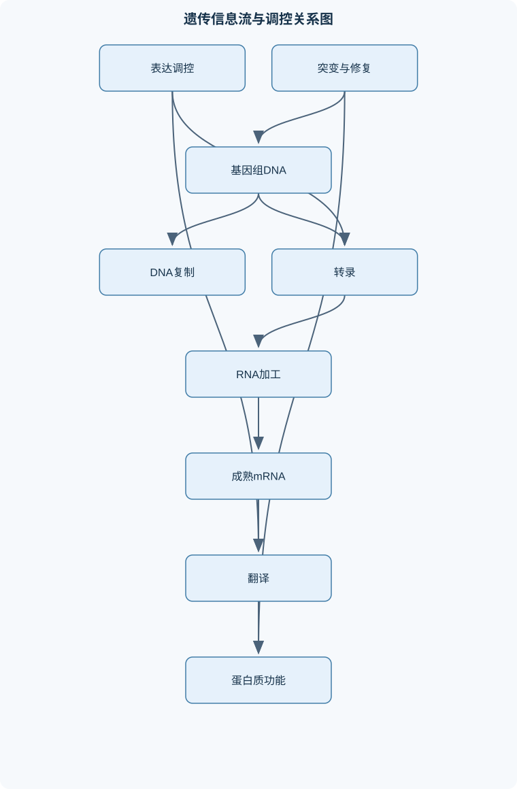
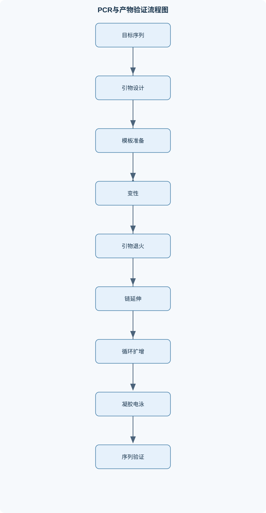

# 分子生物学

## 一、课程整体知识框架

### 课程边界与先修知识

分子生物学研究遗传信息在分子层面的储存、复制、表达、调控、变异及实验分析方法，重点涵盖DNA、RNA、蛋白质及其相互作用。课程边界包括原核与真核生物的基因组结构、DNA复制、转录、RNA加工、翻译、基因表达调控、突变与基因组学，以及PCR、凝胶电泳、杂交、重组DNA和基因表达分析等基础技术；可延伸至表观遗传、非编码RNA和现代测序分析。先修知识包括细胞生物学、遗传学、生物化学和基础统计学，需掌握核苷酸与氨基酸结构、化学键、酶催化、细胞结构、孟德尔遗传和基本概率。课程不以完整的代谢生化网络、群体遗传学或临床诊断为主要内容，但会说明能量代谢、遗传变异与分子机制之间的联系。





### 1. 研究对象、核心问题与学科边界

分子生物学研究遗传信息在分子层面的储存、复制、表达、调控、变异及实验分析。其主要分子对象是 DNA、RNA、蛋白质以及它们之间形成的复合物。DNA通常承担相对稳定的遗传信息储存功能；RNA既可以作为信息传递中间体，也可以作为催化、结构或调控分子；蛋白质则通过催化、结构组装、运输、信号转导和调控等方式执行大量细胞功能。

分子生物学与遗传学、生物化学、细胞生物学、结构生物学和生物信息学相互衔接。遗传学关注遗传信息如何在个体和细胞间传递及产生表型差异；生物化学关注分子反应、能量变化和酶催化；分子生物学进一步解释基因序列如何通过复制、转录、RNA加工和翻译形成可观察的分子与细胞结果。课程不以完整代谢网络、群体遗传学或临床诊断为主要内容，但需要理解 ATP、NADH、NADPH 等能量或还原性辅酶如何支持核酸合成、蛋白质合成和主动调控。

分子生物学的基本问题可以归纳为四类：第一，遗传信息以什么化学结构储存；第二，信息如何被准确复制并在细胞分裂时传递；第三，特定基因何时、何地以及以多大程度表达；第四，突变、重组和调控改变如何造成分子及表型差异。实验技术的作用是把这些问题转化为可测量的序列、片段大小、表达量、蛋白质丰度或功能变化。

### 2. 中心法则及其适用边界

经典中心法则可概括为 DNA 复制、DNA 到 RNA 的转录以及 RNA 到蛋白质的翻译。它描述的是遗传信息在不同分子层级之间的主要传递方向，而不是“所有 DNA 都必须表达为蛋白质”的绝对规则。许多 RNA 不编码蛋白质，却参与剪接、翻译、染色质调控、RNA降解和基因沉默；某些病毒还存在 RNA 复制或 RNA 反向转录等过程。

DNA复制的结果是子代 DNA，每个子代双链通常含有一条亲代链和一条新生链。转录产生 RNA，RNA序列由模板链决定；翻译则以 mRNA 的密码子为单位合成多肽。信息流中每一步都可能受到调控，因此 DNA 序列不变时，转录量、成熟 mRNA 数量、翻译效率和蛋白质稳定性仍可能发生变化。

“基因表达”不能简单等同于 mRNA 丰度。一个基因的表达结果至少受到转录起始、RNA加工、核输出、mRNA降解、翻译起始、蛋白质折叠、翻译后修饰和蛋白质降解等环节影响。因此，mRNA增加不必然意味着蛋白质活性增加，蛋白质丰度增加也不必然意味着其功能增强。

### 3. 基因、基因组及调控区域

基因是能够产生功能性 RNA 或蛋白质产物，并包含其表达所需遗传信息的 DNA 区域。基因组是一个细胞或生物体全部遗传物质的总和，包括蛋白质编码区、非编码 RNA 基因、调控序列、重复序列、间隔区和其他结构区域。等位基因是同一基因座上可发生序列差异的不同版本。等位基因差异可以是单个碱基改变，也可以是插入、缺失、重复或更大尺度的结构变异。

结构基因包含产生 RNA 或蛋白质产物的主要信息；调控序列包括启动子、增强子、沉默子、操纵基因等。顺式作用元件位于被调控基因所在的 DNA 分子上，反式作用因子则通常是可以扩散的蛋白质或 RNA。例如，启动子序列改变通常影响同一 DNA 分子上的邻近基因，而转录因子浓度变化可能同时影响多个靶基因。

管家基因通常在多种细胞类型中维持基本生命活动所需的表达，但“管家”并不表示其表达量永远不变；细胞状态、应激和代谢条件仍可影响其表达。诱导型基因的表达可因底物、信号分子或环境变化而增强，阻遏型基因则可在特定条件下受到抑制。基因表达的调控不只发生在转录起始阶段，也发生在 RNA加工、翻译和蛋白质降解阶段。

### 4. 核酸结构与方向性的推导

DNA和RNA都是由核苷酸连接形成的多聚核苷酸。一个核苷酸由含氮碱基、五碳糖和磷酸组成；没有磷酸的核糖核苷称为核苷。DNA含脱氧核糖和胸腺嘧啶 T，RNA含核糖和尿嘧啶 U。核苷酸通过一个核苷酸的3端羟基与另一个核苷酸的5端磷酸形成磷酸二酯键。

由于新加入核苷酸必须与生长链的3端羟基形成新的磷酸二酯键，DNA聚合酶和RNA聚合酶均沿新链5端到3端延伸。聚合酶读取模板链的方向则为3端到5端。这个结论不依赖具体基因序列，是判断复制、转录、PCR引物方向的基础。

DNA双链具有反向平行结构：一条链按5端到3端排列，互补链按3端到5端排列。A与T通常形成两个氢键，G与C通常形成三个氢键。若一条 DNA 链按5端到3端写作：

```text
5'-A C G T T A-3'
```

其互补链应写作：

```text
3'-T G C A A T-5'
```

若要求按5端到3端书写互补链，则必须反向排列为：

```text
5'-T A A C G T-3'
```

DNA双链的稳定性不仅由 G-C 比例决定，还受盐浓度、序列邻近关系、错配、超螺旋和结合蛋白影响。DNA变性主要破坏链间氢键和碱基堆积等非共价作用，通常不切断磷酸二酯骨架；降低温度或改变盐条件可使互补链重新配对，这一过程称为复性。两条来源不同但具有互补序列的核酸链也可以发生杂交。

### 5. 原核与真核基因组的组织差异

原核生物通常没有核膜包围的细胞核，DNA主要位于拟核区域，并可能含有质粒。其基因密度通常较高，基因间隔区相对较短，多个相关结构基因可组成操纵子并转录为多顺反子 mRNA。转录与翻译在空间上不完全分隔，因此常可发生转录—翻译偶联。

真核生物的 DNA 主要位于细胞核内，并与组蛋白形成染色质。真核基因通常含有外显子和内含子，RNA聚合酶II转录的前体 mRNA需要经过加帽、3端切割与多聚腺苷酸化、剪接等加工，成熟 mRNA再输出到细胞质。真核基因通常产生单顺反子 mRNA，但可变剪接可使一个基因产生多个成熟 RNA 和蛋白质异构体。

基因组大小、基因数量和基因密度不是同一概念。基因组更大不必然意味着编码蛋白质的基因更多，也不必然意味着生物体更复杂；重复序列、内含子和其他非编码区域可能占据很大比例。

### 6. DNA复制与基因组稳定性

DNA复制采用半保留模型。复制起点处，解旋酶分离双链，单链结合蛋白稳定暴露的单链 DNA，拓扑异构酶缓解复制叉前方的扭转张力。引物酶合成 RNA 引物，为 DNA 聚合酶提供可延伸的3端羟基。

由于 DNA 聚合酶只能沿5端到3端合成，而两条模板链方向相反，复制叉两侧的合成方式不同。前导链可朝复制叉方向连续合成；后随链只能背离复制叉分段合成，形成冈崎片段。随后 RNA 引物被去除，缺口由 DNA 填补，DNA连接酶封闭相邻片段之间的磷酸二酯键。

复制保真性来自碱基互补、聚合酶选择性和部分 DNA 聚合酶的3端到5端校对功能。复制错误或外源损伤若未被修复，可能固定为突变。DNA损伤包括碱基氧化、脱氨、烷基化、紫外线导致的相邻嘧啶损伤、单链断裂和双链断裂。不同损伤可通过错配修复、碱基切除修复、核苷酸切除修复、同源重组或非同源末端连接等途径处理。

线性真核染色体末端存在端粒复制问题。由于去除最后一个 RNA 引物后，末端缺少可供延伸的上游3端，普通 DNA 聚合酶不能完全复制线性末端。端粒酶以自身携带的 RNA 为模板延长端粒重复序列，再由复制系统完成互补链合成。端粒酶活性受细胞类型和发育状态影响，不能简单等同于“越高越好”。

### 7. 转录、RNA加工与运输

转录以 DNA 一条链为模板，由 RNA聚合酶催化合成 RNA。模板链不等同于固定的一条 DNA 链；不同基因由于转录方向不同，可能使用不同 DNA 链作为模板。编码链与成熟 RNA 的序列通常相同，只是 RNA 中以 U 替代 T，且真核 RNA 还可能经过剪接和其他加工。

转录包括起始、延伸和终止。启动子决定 RNA聚合酶及相关因子的结合位置，转录起始位点是第一个被转录进 RNA 的核苷酸位置。原核生物依靠不同 σ 因子帮助 RNA聚合酶识别启动子；真核生物的 Pol I、Pol II 和 Pol III 分别转录不同类别的 RNA，Pol II主要转录蛋白质编码基因和部分非编码 RNA 基因。

真核前体 mRNA通常在5端加帽，在3端切割并添加多聚腺苷酸尾。帽结构有助于 RNA 稳定、核输出和翻译起始；多聚腺苷酸尾可影响稳定性、运输和翻译效率。剪接体识别内含子两端和分支点，去除内含子并连接外显子。可变剪接可改变成熟 mRNA 的外显子组合，从而改变蛋白质结构域、亚细胞定位或稳定性。

RNA的命运还包括定位和降解。mRNA经核孔输出后，可被运输到特定细胞区域；去腺苷化、去帽、外切降解或内切降解可缩短其半衰期。小 RNA 可通过与靶 RNA 互补配对抑制翻译或促进降解。RNA编辑则可能改变转录本序列，说明基因组 DNA 序列与成熟 RNA 序列并非总是完全相同。

### 8. 翻译与蛋白质形成

遗传密码以连续、非重叠且固定阅读框的三个核苷酸为一个密码子。mRNA密码子按5端到3端读取；起始密码子通常为 AUG，终止密码子包括 UAA、UAG 和 UGA。遗传密码具有简并性，即多个密码子可指定同一种氨基酸，但多数密码子仍只对应一种氨基酸或终止信号。

tRNA通过反密码子与 mRNA 密码子反向平行配对，并在另一端携带特定氨基酸。氨酰-tRNA合成酶先利用 ATP 活化氨基酸，形成氨酰-AMP 中间体，再将氨基酸转移到相应 tRNA。翻译准确性不仅依赖密码子—反密码子配对，也依赖氨酰-tRNA合成酶对氨基酸和 tRNA 的识别及校对。

核糖体含有 A 位、P 位和 E 位。翻译起始时，起始 tRNA进入 P 位；延伸时，新氨酰-tRNA进入 A 位，肽链从 P 位 tRNA 转移到 A 位氨基酸上，核糖体移位后，原 P 位 tRNA进入 E 位并离开。终止密码子不对应普通 tRNA，而由释放因子识别，使新生肽链释放。

原核 mRNA的核糖体结合通常涉及 RBS及 Shine-Dalgarno 序列；真核翻译起始通常依赖5端帽、起始因子和对起始密码子的扫描。多个核糖体可同时翻译同一 mRNA，形成多聚核糖体。新生多肽还需要折叠、靶向、剪切、磷酸化、糖基化或形成二硫键等，最终蛋白质功能不能仅由翻译完成这一事实推断。

### 9. 基因表达调控与表观遗传

原核操纵子通常包括启动子、操纵基因和多个结构基因，调控基因可编码阻遏蛋白或激活因子。负调控通过阻遏蛋白阻止转录，正调控通过激活因子促进 RNA聚合酶募集。乳糖操纵子同时受诱导物和分解代谢物阻遏影响：乳糖或其衍生物可降低阻遏作用，而葡萄糖缺乏时的信号可增强正调控；只有解除负调控并获得足够正调控时，转录才达到较高水平。

色氨酸操纵子可通过阻遏和衰减共同调节。当色氨酸充足时，阻遏蛋白活化并抑制转录；当核糖体在前导肽区域的翻译状态改变时，RNA二级结构也可影响转录终止。原核转录与翻译偶联，使新生 RNA 的翻译状态能够反馈影响转录终止。

真核调控涉及核心启动子、近端启动子元件、增强子、沉默子和绝缘子。转录因子的 DNA结合结构域包括锌指、螺旋—转折—螺旋和碱性亮氨酸拉链等；转录激活结构域可募集共激活因子、染色质重塑复合物和 RNA聚合酶相关复合物。增强子可通过 DNA环化与启动子接近，但其作用依赖细胞类型、空间构象和相应转录因子。

核小体定位、DNA甲基化、组蛋白修饰和染色质重塑共同影响 DNA可及性。某一修饰不能脱离位点、细胞类型和组合背景而被简单定义为永远激活或永远抑制。表观遗传调控改变的是基因可利用状态或转录环境，通常不等同于 DNA 碱基序列改变。

### 10. 突变、重组与基因组变化

碱基替换可产生同义、错义或无义突变；插入或缺失若不是三个核苷酸的整数倍，通常会造成移码，使下游密码子整体改变。突变后果取决于所在密码子、氨基酸性质、结构域位置、剪接信号和表达背景，不能只按“点突变”或“插入突变”判断严重程度。

正向突变是从原有表型变为另一表型的改变；回复突变可恢复原始序列或原始功能；抑制突变则通过第二位点变化补偿第一位点的影响。抑制突变可能发生在同一基因内部，也可能发生在另一基因中，例如改变相互作用蛋白或补偿翻译读框。

同源重组依赖较长的同源序列，可用于准确交换或修复 DNA；非同源末端连接直接连接断裂末端，速度较快但更容易产生小片段插入或缺失。转座元件可在基因组内移动，导致插入、缺失、重复或重排。基因重复为新基因功能演化提供原材料，重复拷贝可能发生功能分化、亚功能化或失活。

### 11. 重组 DNA、分子检测与基因组学

限制性内切酶识别特异性 DNA 位点并切割。切割可形成平末端或具有单链突出端的黏性末端。质粒通常包括复制起点、选择标记、克隆区域和表达调控元件；作为载体时，还需要考虑插入方向、启动子关系、读框以及宿主细胞兼容性。

重组克隆通常包括目的片段和载体的切割、末端连接、转化、选择和鉴定。抗性标记只能说明细胞获得了带有相应标记的载体，不等于目的片段一定正确插入。鉴定可结合菌落 PCR、限制性酶切、电泳和测序；序列确认是判断插入序列、方向和读框是否正确的重要步骤。

琼脂糖凝胶电泳中，DNA带负电，在电场中向正极移动。对于同一类型、近似线性、构象相近的 DNA 片段，迁移距离与片段长度的对数常近似线性相关。但超螺旋、开环和线性质粒的迁移行为不同，因此单凭位置不能直接确定分子身份或功能。

Southern检测 DNA，Northern检测 RNA，Western检测蛋白质。Southern和Northern通常利用互补探针识别目标核酸，Western利用特异性抗体识别蛋白质。三者的样品处理、分离介质、转膜条件和结果含义不能互相替代。

PCR每轮理想情况下使目标分子数加倍：

$$
N=N_0\times 2^n
$$

其中，$N_0$ 为初始目标分子数，$n$ 为循环数，$N$ 为理论扩增后的目标分子数；若把分子数作为计数，三者单位均为“分子数”。实际扩增效率低于100%时，可写作：

$$
N=N_0(1+E)^n
$$

其中 $E$ 为每轮扩增效率，$0\leq E\leq1$。当引物、dNTP、酶或模板受限，或产物重新退火、抑制物积累时，扩增进入平台期，不能继续按指数规律增长。正确大小的条带只能说明存在可能的目标片段，不能证明序列完全正确。

基因组学包括结构基因组学、功能基因组学和比较基因组学。结构基因组学关注基因组序列、物理图谱和重复区域；功能基因组学关注基因功能、表达谱和调控网络；比较基因组学通过保守序列、同源基因和基因家族推断进化关系或潜在功能。开放阅读框（ORF）识别可提供候选编码区，但最长 ORF 不一定是真实基因，还需结合启动子、剪接信息、核糖体结合位点、同源性和实验表达证据。

## 二、章节和模块划分

### 核心知识覆盖清单

本清单用于检查正文是否覆盖本课程的主要知识模块：

- **分子生物学基本概念与研究框架**：分子生物学的研究对象与学科边界、遗传信息的储存、复制与表达、中心法则及其适用边界、基因、基因组与等位基因、结构基因、调控序列与非编码区、原核细胞与真核细胞的基因组差异、管家基因与诱导型基因、分子生物学与遗传学、生物化学的关系。
- **DNA与RNA的结构和性质**：核苷、核苷酸与多聚核苷酸、DNA的一级、二级和高级结构、DNA双螺旋的反向平行与互补配对、A-T与G-C碱基配对及氢键、DNA的变性、复性与杂交、RNA与DNA在糖、碱基和结构上的差异、mRNA、tRNA、rRNA及非编码RNA、5端帽、3端多聚腺苷酸尾和RNA稳定性、染色质、核小体、常染色质与异染色质、DNA拓扑结构与超螺旋。
- **DNA复制与基因组稳定性**：DNA半保留复制模型、复制起点、复制叉与复制泡、解旋酶、单链结合蛋白和拓扑异构酶、引物酶与RNA引物、DNA聚合酶的5端到3端合成、前导链与后随链、冈崎片段、RNA引物去除与DNA连接、端粒复制问题与端粒酶、DNA复制保真性与校对、复制损伤、修复与基因组稳定性。
- **转录机制与RNA合成**：转录模板链、编码链与转录方向、启动子、转录起始位点和转录单位、RNA聚合酶的结构与催化机制、转录起始、延伸和终止、原核生物转录因子与启动子识别、真核RNA聚合酶I、II和III的分工、真核转录前起始复合体、转录延伸中的染色质重塑、内在终止与因子依赖型终止、转录与DNA链方向的关系。
- **RNA加工、运输与降解**：真核前体mRNA的5端加帽、3端切割与多聚腺苷酸化、内含子、外显子与剪接位点、剪接体介导的RNA剪接、可变剪接与蛋白质多样性、原核多顺反子mRNA与真核单顺反子mRNA、mRNA核输出与细胞质定位、mRNA稳定性和降解途径、小RNA介导的转录后调控、RNA编辑与非编码RNA功能。
- **遗传密码与蛋白质翻译**：密码子、开放阅读框与阅读框、遗传密码的连续、非重叠和固定阅读规则、遗传密码的简并性与同义密码子、起始密码子与终止密码子、tRNA结构、反密码子和氨基酸装载、氨酰-tRNA合成酶的识别与校对、核糖体A位、P位和E位、翻译起始、延伸、移位和终止、原核Shine-Dalgarno序列与真核起始机制、多聚核糖体、蛋白质折叠与翻译后加工。
- **原核生物基因表达调控**：操纵子及其结构组成、结构基因、调控基因和操纵基因、顺式作用元件与反式作用因子、负调控、正调控与协同调控、诱导型基因与阻遏型基因、乳糖操纵子的诱导与分解代谢物阻遏、色氨酸操纵子的阻遏与衰减、转录起始水平的调控、转录终止与抗终止调控、原核转录与翻译偶联。
- **真核生物基因表达调控与表观遗传**：核心启动子与近端启动子元件、增强子、沉默子和绝缘子、转录因子的DNA结合结构域、锌指、螺旋-转折-螺旋和碱性亮氨酸拉链、转录激活结构域与共激活因子、增强子与启动子远距离作用、核小体定位与染色质可及性、DNA甲基化与组蛋白修饰、细胞类型特异性和信号依赖性表达、转录后、翻译和蛋白质降解层面的调控。
- **基因突变、重组与遗传信息变化**：点突变、替换、插入和缺失、同义、错义、无义和移码突变、正向突变、回复突变与抑制突变、突变对蛋白质序列和功能的影响、复制错误与化学、物理诱变、DNA损伤类型与修复机制、同源重组与非同源末端连接、转座元件与基因组重排、单核苷酸多态性与群体遗传差异、基因家族、基因重复与功能分化。
- **重组DNA技术与分子检测**：限制性内切酶与特异性切割位点、平末端与黏性末端、质粒、载体与复制起点、DNA连接、转化与重组克隆、选择标记与重组子筛选、琼脂糖凝胶电泳与片段大小判断、DNA和RNA杂交原理、Southern、Northern与Western blot的对象差异、探针标记与信号检测、PCR扩增、引物设计与扩增特异性。
- **基因组学与分子数据分析**：结构基因组学与物理图谱、功能基因组学与基因功能注释、比较基因组学与保守序列、基因组大小、基因数和基因密度、编码区、非编码区和重复序列、序列比对与同源性判断、开放阅读框识别、转录组与表达谱分析、基因表达差异的实验设计、分子结果的阳性、阴性和内参控制。


### 1. 模块一至三：基本概念、核酸结构与 DNA复制

#### 1.1 模块内容组织

第一模块建立“基因—基因组—表达—表型”的概念链，区分结构基因、调控序列、等位基因、顺式元件和反式因子。第二模块处理核苷酸结构、DNA双螺旋、RNA类型、染色质和 DNA拓扑结构。第三模块解释复制起点、复制叉、解旋酶、引物酶、DNA聚合酶、冈崎片段、连接酶、校对、端粒和修复。

DNA复制与转录都合成核酸，但复制通常复制整个复制单位，需要引物并产生两个 DNA 分子；转录从启动子开始，只产生某一基因或转录单位的 RNA。不能因为两者都需要模板，就把转录等同于 DNA复制。

#### 1.2 代表性例题一：互补链与转录产物

**题干：**给定 DNA 模板链：

```text
3'-TAC GGA CTT-5'
```

要求写出编码链和 mRNA，并说明方向。

**分析：**RNA聚合酶读取模板链3端到5端，合成 RNA5端到3端。RNA与模板链互补，编码链与 RNA 序列相同，但 DNA 使用 T，RNA 使用 U。

**逐步解答：**

1. 模板链为 $3'-TACGGACTT-5'$。
2. 与模板链互补的 mRNA 为 $5'-A C G C C U G A A-3'$。
3. 编码链按 DNA形式写为 $5'-ACGCC TGAA-3'$，规范连续写作：
   $$
   5'-ACGCCTGAA-3'
   $$
4. mRNA中相应位置使用 U，不使用 T。

**结果验证：**将 mRNA 按反向互补关系转换回模板链，应得到 $3'-TACGGACTT-5'$。若将模板链直接抄写为 mRNA，方向和互补关系均错误。

**变式：**若题目给出的是编码链，mRNA通常与编码链同序，只需将 T 换成 U；但若存在内含子，基因组 DNA 中的外显子并不一定在成熟 mRNA 中连续出现。

#### 1.3 代表性例题二：后随链判断

**题干：**复制叉向右移动。上方模板链方向为 $3'\rightarrow5'$，下方模板链方向为 $5'\rightarrow3'$。判断前导链、后随链以及 DNA聚合酶的合成方向。

**分析：**DNA聚合酶沿新链5端到3端合成。若模板链在复制叉前方按3端到5端延伸，则可连续合成与复制叉同向移动的前导链。

**逐步解答：**

1. 上方模板链方向为 $3'\rightarrow5'$，适合 DNA聚合酶连续读取。
2. 上方对应的新链为前导链，通常只需一个起始引物即可连续延伸。
3. 下方模板链方向相反，无法让新链持续朝复制叉方向延伸。
4. 下方对应的新链为后随链，需要反复放置 RNA引物并形成冈崎片段。
5. 去除引物、填补缺口后，由 DNA连接酶连接相邻片段。

**结果验证：**每个新生 DNA 片段都必须按5端到3端合成。若图中标出的某段 DNA 聚合酶沿新链3端到5端延伸，则该判断不成立。

**变式：**若复制叉改为向左移动，前导链和后随链的上下位置可能互换，不能死记“上链永远是前导链”。

### 2. 模块四至六：转录、RNA加工与翻译

#### 2.1 模块内容组织

转录部分包括启动子、转录起始位点、模板链、编码链、RNA聚合酶、起始、延伸、终止以及原核和真核转录体系。RNA加工部分包括5端加帽、3端多聚腺苷酸化、剪接、可变剪接、核输出、定位、降解、RNA编辑和小 RNA 调控。翻译部分包括密码子、ORF、tRNA、氨酰-tRNA合成酶、核糖体 A/P/E 位、起始、延伸、移位、终止、蛋白质折叠和翻译后修饰。

#### 2.2 代表性例题三：密码子与突变后果

**题干：**某 mRNA 编码区为：

```text
5'-AUG GAA UUU UGC UAA-3'
```

分别举出一种同义突变、错义突变、无义突变和单碱基插入造成的移码突变，并说明后果。

**分析：**先按三个碱基读取密码子：AUG—GAA—UUU—UGC—UAA。AUG为起始密码子，UAA为终止密码子。

**逐步解答：**

1. 原多肽为 Met—Glu—Phe—Cys。
2. 同义突变：将 UUU 改为 UUC，二者均编码 Phe，蛋白质一级序列通常不变。
3. 错义突变：将 GAA 改为 GUA，Glu 变为 Val，氨基酸性质由带负电转为疏水，功能影响需结合结构域判断。
4. 无义突变：将 UGC 改为 UGA，Cys密码子变为终止密码子，产生提前终止。
5. 移码突变：在起始密码子后插入一个 A，后续三联体分组改变，通常会产生大量改变的下游氨基酸，并可能提前遇到终止密码子。

**结果验证：**删除或插入三个核苷酸通常不改变下游阅读框，只增加或减少一个密码子；插入或缺失一个、两个核苷酸通常造成移码。实际后果还取决于突变是否位于非编码区、剪接位点或蛋白质关键结构域。

**变式：**即使属于错义突变，也可能因保守替换、位于非关键区域或蛋白质具有冗余功能而影响较小；无义突变也可能因位于蛋白质末端而影响有限。

#### 2.3 代表性例题四：RNA剪接

**题干：**前体 mRNA 由外显子 $E_1$、内含子 $I_1$、外显子 $E_2$、内含子 $I_2$ 和外显子 $E_3$组成，长度分别为 90 nt、120 nt、150 nt、80 nt 和 180 nt。求正常剪接产物长度，并给出一种跳过 $E_2$ 的可变剪接产物长度。

**逐步解答：**

1. 正常成熟 mRNA 保留 $E_1+E_2+E_3$：
   $$
   90+150+180=420\ \text{nt}
   $$
2. 跳过 $E_2$ 时保留 $E_1+E_3$：
   $$
   90+180=270\ \text{nt}
   $$
3. 两种成熟 RNA相差 $150\ \text{nt}$，若该外显子长度不是3的整数倍，则对应蛋白质阅读框可能改变；若是3的整数倍，则可能只缺失一个完整氨基酸或若干氨基酸。

**结果验证：**内含子长度不应计入成熟 mRNA 长度。若把前体 mRNA 总长度 $620$ nt 直接作为成熟 mRNA 长度，说明未执行剪接步骤。

**变式：**若跳过的外显子包含终止密码子或剪接调控元件，后果可能不仅是蛋白质长度变化，还可能影响 mRNA稳定性和核输出。

#### 2.4 翻译方向的代码化分析

下面的 Python 代码只进行离线序列分析，不联网、不执行外部命令，也不修改文件。输入为按5端到3端给出的 mRNA，输出三个阅读框中的候选 ORF。

```python
CODON_TABLE = {
    "AUG": "M", "UUU": "F", "UUC": "F",
    "UUA": "L", "UUG": "L", "UAA": "*",
    "UAG": "*", "UGA": "*", "GAA": "E",
    "GAG": "E", "GGU": "G", "GGC": "G",
    "GGA": "G", "GGG": "G"
}

def find_orfs(mrna):
    """
    输入：5'到3'方向的mRNA字符串，只允许A/U/G/C。
    输出：每个阅读框中的候选ORF及其氨基酸序列。
    """
    mrna = mrna.upper().replace(" ", "")
    if any(base not in "AUGC" for base in mrna):
        raise ValueError("序列含有非A/U/G/C字符")

    results = []
    for frame in range(3):
        i = frame
        while i + 2 < len(mrna):
            codon = mrna[i:i + 3]
            if codon == "AUG":
                protein = []
                j = i
                while j + 2 < len(mrna):
                    current = mrna[j:j + 3]
                    aa = CODON_TABLE.get(current, "X")
                    if aa == "*":
                        results.append({
                            "frame": frame,
                            "start": i,
                            "stop": j,
                            "protein": "".join(protein)
                        })
                        break
                    protein.append(aa)
                    j += 3
                i = j + 3
            else:
                i += 3
    return results

print(find_orfs("CCAUGGAAUUUUAA"))
```

**输入、输出与边界：**输入必须是方向正确的成熟 mRNA；输出的 ORF 只是候选，不等于真实基因。程序按每次前进3 nt读取，保持阅读框不变；遇到同一阅读框的终止密码子即停止。扫描序列长度为 $L$ 时，基础扫描复杂度通常为 $O(L)$。实际注释还需结合启动子、RBS、剪接信息、同源性和实验结果。

### 3. 模块七至九：原核调控、真核调控与表观遗传

#### 3.1 调控推理框架

分析调控案例时，应依次判断：调控元件属于顺式还是反式；阻遏蛋白或激活因子是否处于活化状态；启动子是否可被 RNA聚合酶识别；染色质是否开放；RNA是否能完成加工和输出；mRNA是否稳定；翻译和蛋白质降解是否受限。该顺序可避免把“转录量变化”直接当作“蛋白质功能变化”。

#### 3.2 代表性例题五：操纵子综合判断

**题干：**某诱导型操纵子同时受阻遏蛋白和分解代谢物阻遏调控。设有四种条件：无诱导物且葡萄糖充足；有诱导物且葡萄糖缺乏；有诱导物且葡萄糖充足；无诱导物且葡萄糖缺乏。比较转录水平。

**逐步解答：**

1. 无诱导物时，阻遏蛋白结合操纵区域，转录受抑制，因此无论葡萄糖状态如何，转录通常较低。
2. 有诱导物且葡萄糖缺乏时，阻遏作用解除，正调控信号增强，转录最高。
3. 有诱导物且葡萄糖充足时，阻遏作用解除，但正调控不足，转录可有一定程度但通常低于第二种条件。
4. 无诱导物且葡萄糖缺乏时，正调控可能存在，但阻遏蛋白仍阻断转录，因此不能达到高水平。

**结果验证：**必须同时考虑负调控和正调控，不能只根据“有诱导物”就判定高表达。

**变式：**若阻遏蛋白发生不能结合 DNA 的突变，诱导物是否存在将不再是唯一决定因素；若启动子发生破坏性突变，即使激活因子存在，RNA聚合酶也可能无法有效起始。

### 4. 模块十至十二：突变、重组 DNA、分子检测与基因组分析

#### 4.1 限制性酶切与重组载体设计流程

**输入：**载体序列、目的片段序列、可用限制性位点、启动子与读框要求。  
**输出：**方向明确、读框正确且可鉴定的重组载体方案。

**步骤：**

1. 扫描载体和目的片段中的限制性位点。
2. 排除会切断目的片段内部的位点。
3. 优先选择两个不同位点，以形成方向性克隆。
4. 模拟酶切后检查载体骨架、插入片段和末端兼容性。
5. 检查目的基因与启动子、标签、终止密码子之间的读框。
6. 设计菌落 PCR、诊断性酶切和测序验证。
7. 若目的基因需要表达，还应检查宿主、启动子、核糖体结合位点或真核翻译起始环境。

对长度为 $L$ 的序列进行固定长度位点扫描，通常可视为 $O(L)$。该流程的关键不变量是目的序列不能被内部切断，连接后读框和调控关系必须保持正确。抗性生长只能证明选择标记存在，不能单独证明目的片段正确。

#### 4.2 PCR设计与结果判读流程

**输入：**目标序列、扩增边界、模板类型、预期片段长度。  
**输出：**引物方案、实验条件和电泳结果解释。

**步骤：**

1. 确定待扩增区域及两端序列。
2. 设计两个方向相反、延伸方向朝向目标区域的引物。
3. 检查引物长度、GC比例、明显发卡结构和引物二聚体。
4. 选择接近的 $T_m$，即引物与模板形成稳定双链时的近似熔解温度。
5. 设置模板阴性对照、阳性对照和必要的内参。
6. 进行变性、退火和延伸循环。
7. 通过凝胶比较样品条带与分子量标准。
8. 对正确大小条带进行测序或独立方法验证。

理想扩增量为 $N_0 2^n$，但实际受引物、酶、dNTP、模板抑制物和平台期影响。两个引物若朝向相同或背离目标区域，不能形成标准指数扩增。

#### 4.3 凝胶电泳片段分析流程

**输入：**DNA样品、分子量标准、凝胶浓度和电泳图像。  
**输出：**条带大小的近似值及样品完整性判断。

**步骤：**

1. 根据预期片段范围选择凝胶浓度。
2. 同时加载分子量标准和未知样品。
3. 在相同电泳条件下分离。
4. 记录标准品和未知条带的迁移距离。
5. 对线性 DNA，可用迁移距离与片段长度对数建立近似关系。
6. 估算未知条带大小并判断是否出现弥散、降解或非特异条带。

关键不变量是标准品和未知样品必须在相同凝胶、电压、缓冲液和运行方向下比较。过量上样、样品盐分过高、凝胶浓度不适或 DNA构象不同，均会使大小估算产生偏差。

#### 4.4 Southern、Northern 与 Western 的选择流程

**输入：**待检测分子类型、样品状态、目标序列或蛋白质特异性试剂。  
**输出：**检测方法、识别试剂和对照方案。

1. 检测 DNA 拷贝数或特定 DNA片段，选择 Southern。
2. 检测某基因 mRNA 大小或丰度，选择 Northern。
3. 检测蛋白质丰度，选择 Western。
4. DNA或RNA检测使用互补探针；蛋白质检测使用特异性抗体。
5. 设置阳性对照、阴性对照和适当内参。
6. 根据条带位置、信号强度和背景共同解释。

Southern信号变化不能直接证明基因表达改变；Northern信号变化不能直接证明蛋白质活性改变；Western信号变化也不能直接证明蛋白质定位、修饰状态或催化功能正确。

### 5. 实验与项目一：PCR扩增及条带判读

#### 5.1 输入数据与步骤

**输入数据：**目标 DNA 序列、预期片段长度、模板样品、阳性对照、无模板阴性对照、分子量标准。  
**步骤：**

1. 根据目标区域设计 F 和 R 引物，并检查二者方向。
2. 计算或估计两个引物的 $T_m$，使退火条件具有兼容性。
3. 准备样品、阳性对照和无模板对照。
4. 按变性、退火、延伸进行预设循环。
5. 进行琼脂糖凝胶电泳。
6. 将样品条带与标准品和阳性对照比较。
7. 对正确大小条带进行测序或再次扩增验证。

#### 5.2 评价标准与排错方法

有效结果通常要求：阳性对照出现预期条带；无模板对照无条带；样品出现与预期大小相符的清晰条带；重复样品结果具有一致性。若阴性对照出现条带，应优先排查污染、气溶胶带入或试剂污染。若阳性对照无条带，应检查酶活性、模板质量、引物序列、退火条件和反应组分。若出现多个条带，应检查引物特异性、退火条件、模板复杂度和循环数。正确大小条带仍需测序确认，不能只凭电泳位置断言序列正确。

### 6. 实验与项目二：差异表达分析

#### 6.1 输入数据与分析步骤

**输入数据：**实验组和对照组的表达矩阵、样本分组、样本质量信息、生物学重复和归一化信息。  
**步骤：**

1. 检查样本是否存在严重测序或实验质量问题。
2. 确认实验组和对照组具有合理的生物学重复。
3. 依据数据类型选择总量、文库深度或其他适当归一化方式。
4. 计算组间表达差异和效应方向。
5. 评估组内变异，避免把技术波动当作生物学差异。
6. 对多个基因检验进行多重比较校正。
7. 同时考虑效应大小、统计不确定性和生物学意义。
8. 用独立方法验证候选基因。

若基因数为 $G$、样本数为 $S$，基础矩阵处理至少涉及 $O(GS)$ 个数据项。评价标准包括样本质量合格、重复设计合理、归一化方法一致、统计阈值预先确定以及结果能够通过独立实验复核。排错时应检查批次效应、样本标签错误、低表达过滤不当和内参不稳定。差异表达不等同于因果关系，因果判断还需要遗传扰动、互补实验或时间顺序证据。

### 7. 典型笔试问题及解答思路

#### 7.1 为什么 DNA聚合酶只能沿5端到3端合成？

DNA聚合酶利用新生链3端羟基攻击进入的 dNTP，形成磷酸二酯键并释放焦磷酸。因此延伸必须发生在3端，方向固定为5端到3端。该结论解释了前导链连续、后随链不连续，也解释了 PCR引物必须提供可延伸的3端。

#### 7.2 模板链与编码链有什么区别？

模板链是 RNA聚合酶读取的 DNA 链，方向为3端到5端；编码链与 RNA 序列基本相同，方向按5端到3端书写，仅 DNA中的 T 对应 RNA中的 U。模板链不是固定的某一条 DNA 链，不同基因可使用不同链。

#### 7.3 为什么插入一个碱基会造成移码？

密码子以三个核苷酸为单位连续读取。插入一个碱基后，插入点下游的分组三联体全部改变，直到遇到新的终止密码子。插入三个碱基通常不改变下游阅读框，但可能增加一个氨基酸并影响结构。

#### 7.4 为什么 mRNA 丰度不能代表蛋白质丰度？

mRNA还受到翻译效率、核糖体装载、蛋白质折叠、翻译后修饰和降解速率影响。mRNA增加可能伴随翻译抑制，蛋白质也可能因稳定性不同而积累或快速降解。

#### 7.5 如何区分 Southern、Northern 和 Western？

先判断检测对象：DNA用 Southern，RNA用 Northern，蛋白质用 Western。DNA或RNA使用互补探针，蛋白质使用抗体。结果分别反映核酸片段、RNA转录本或蛋白质信号，不能越过检测对象直接推出功能。

#### 7.6 PCR为什么会进入平台期？

随着循环进行，引物和 dNTP 消耗，产物重新退火，酶活性下降，抑制物和非特异产物积累，实际扩增效率下降。因此 $N=N_0 2^n$ 仅是理想早期模型，不适用于无限循环。

#### 7.7 增强子如何影响远距离启动子？

增强子结合转录因子后，可通过 DNA环化或染色质空间接近招募共激活因子、染色质重塑复合物和转录机器。其效果依赖细胞类型、转录因子、染色质状态和基因组空间结构，不能认为所有增强子都在任何细胞中持续激活。

#### 7.8 如何证明某基因变化与表型之间存在因果关系？

仅有表达相关性不足以证明因果。可进行基因敲除、敲低、过表达或定点突变，观察表型是否改变；再通过互补实验恢复表型，并设置阴性和阳性对照。若改变只影响相关指标而不能重现实验结果，应谨慎解释。

### 8. 常见面试问题、参考答案与追问要点

#### 8.1 如何判断 PCR引物设计是否合理？

参考答案：先确认两个引物位于目标区域两端且方向相反，检查长度、GC比例、$T_m$、发卡结构和二聚体风险，再结合预期产物大小设置对照。  
深入追问要点：正确大小条带仍可能是非特异扩增；应说明测序或独立引物验证；阴性对照有条带时先排查污染。

#### 8.2 你如何解释一个表达量上升的结果？

参考答案：先确认检测对象是 RNA 还是蛋白质，再检查归一化、内参、生物学重复和统计不确定性。表达上升只能说明测量指标增加，不自动说明蛋白质活性或表型因果。  
深入追问要点：讨论批次效应、翻译效率、蛋白质降解和独立验证。

#### 8.3 质粒克隆失败可能有哪些原因？

参考答案：可能是内部限制性位点、末端不兼容、连接方向错误、读框错误、载体自连、转化效率不足或筛选条件不合适。  
深入追问要点：说明诊断性酶切只能初筛，最终需测序；抗性生长不能证明目的片段正确。

#### 8.4 如何区分 DNA降解与 DNA变性？

参考答案：变性主要是双链分离，磷酸二酯骨架仍在；降解则涉及链断裂，常表现为片段弥散或长度明显缩短。  
深入追问要点：盐浓度、温度、pH和核酸酶均可影响结果，需结合凝胶、电泳条件和对照判断。

#### 8.5 为什么一个基因能产生多个蛋白质？

参考答案：可变剪接可产生不同成熟 mRNA；此外还可能存在不同启动子、不同终止位点、RNA编辑和翻译后加工。  
深入追问要点：不同产物的存在需要转录本、蛋白质或功能层面的证据，不能只根据基因组结构推断。

#### 8.6 如何判断一个 ORF 是否是真实编码基因？

参考答案：先扫描起始密码子、阅读框和终止密码子，再结合启动子、RBS或真核剪接信息、同源性、保守结构域、表达证据和蛋白质检测。  
深入追问要点：最长 ORF 不是充分条件；非编码 RNA 也可能含有长开放阅读框而不产生稳定蛋白质。

#### 8.7 如何处理实验结果与预期不一致？

参考答案：先确认样品标签、试剂、仪器和阳性阴性对照，再定位问题属于样品质量、反应条件、检测灵敏度还是理论模型不适用。记录每一步，改变单一变量进行复核。  
深入追问要点：不能为了符合预期而删除异常样本；应区分技术重复与生物学重复。

#### 8.8 你怎样理解分子生物学中的质量控制？

参考答案：质量控制要求每个结论都有与检测对象匹配的对照，包括阳性、阴性、内参和必要的重复。样品身份、核酸完整性、污染控制、仪器状态和数据分析参数均应可追溯。  
深入追问要点：条带大小、表达量或抗体信号只提供有限证据，验收标准必须写明检测对象、允许误差和独立验证方式。

### 9. 易错点与边界反例

1. 中心法则不是“所有 RNA 都必须翻译成蛋白质”；非编码 RNA 可执行结构和调控功能。  
2. 模板链不是固定的一条 DNA 链；不同基因可使用不同链。  
3. DNA聚合酶和 RNA聚合酶都沿模板3端到5端读取，并沿新链5端到3端合成。  
4. G-C较多通常增强双链稳定性，但盐浓度、错配和蛋白质结合也会改变稳定性。  
5. DNA变性不等于 DNA降解；前者主要破坏非共价作用。  
6. mRNA密码子与 tRNA反密码子是反向平行配对，不能按相同方向直接抄写。  
7. 遗传密码简并不等于密码子无特异性；大多数密码子仍只指定一种氨基酸。  
8. 启动子是顺式 DNA元件，转录因子通常是反式因子，二者不可混称。  
9. 原核操纵子常为多顺反子，但不是所有原核基因都组成操纵子。  
10. 真核增强子可远离启动子，但其功能依赖细胞类型和染色质环境。  
11. Pol I、Pol II、Pol III 的底物和启动子体系不同，不能视为同一种酶。  
12. mRNA丰度、蛋白质丰度和蛋白质活性不是同一指标。  
13. PCR正确大小条带不能排除非特异扩增，序列确认通常需要测序。  
14. 引物方向必须朝向待扩增区域，否则不能形成标准指数扩增。  
15. Western检测的是蛋白质信号，不能直接证明蛋白质活性或定位正确。  
16. 质粒的超螺旋、开环和线性构象会造成电泳迁移差异，不能只凭条带位置断言大小。  
17. 点突变的功能影响取决于密码子、氨基酸性质、结构域和表达背景。  
18. DNA甲基化和组蛋白修饰具有位点和细胞类型依赖性，不能简单归类为永远激活或永远抑制。  
19. 酶降低活化能并加快反应，但不改变反应平衡位置；速率与热力学可行性不是同一概念。  
20. 相关性表达变化不等于因果关系，需要扰动、互补或独立验证支持。

### 10. 岗位关联与能力产出

分子生物学研究助理通常承担核酸提取、PCR、凝胶电泳、克隆和表达检测，要求能判断模板质量、引物方向、对照有效性和条带含义；产出包括实验记录、凝胶图、序列确认和可重复的实验方案，验收标准是对照有效、结果可重复、样品和参数可追溯。

基因工程与重组蛋白研发人员需要设计载体、检查限制性位点、维护读框、选择表达宿主并验证蛋白质产物；产出是方向和序列正确的重组质粒、表达数据及蛋白质检测结果，验收标准包括测序正确、表达构建无破坏性突变、检测结果符合对照要求。

PCR和核酸检测实验员需要进行引物设计、扩增条件控制和结果判读；产出是有效的扩增结果及质量控制记录，验收标准包括阳性对照有效、阴性对照无污染、样品信号可解释，不能仅以单条目标大小条带作为全部证据。

测序与基因组学分析人员需要进行序列比对、ORF识别、同源性判断、重复序列分析和功能注释；产出为可追溯的注释结果、候选基因清单和不确定性说明，验收标准是方向、坐标、版本和筛选条件明确，候选结果经过独立证据支持。

转录组与表达谱分析人员需要设计分组、检查重复、执行归一化、分析差异表达并进行多重比较校正；产出为表达矩阵、候选差异基因和验证方案，验收标准包括样本分组正确、批次效应得到评估、统计方法与数据类型匹配，且不把表达相关性直接解释为因果关系。

生物制品质量控制人员需要理解核酸、蛋白质和抗体检测对象的差异，选择适当的 Southern、Northern、Western、PCR或电泳流程；产出为批次检测记录、对照结果和偏差分析，验收标准是方法与检测对象匹配、关键对照合格、异常结果有排错和复核过程。

生物信息学分析员需要处理序列、表达矩阵和基因组注释数据；产出包括可复现脚本、参数记录、比对或注释结果及质量控制报告。验收标准是输入输出格式清晰、算法边界明确、结果可由独立数据或实验验证，不能以复杂度低代替生物学解释。

## 三、核心概念的详细解释

### 1. 分子生物学的研究对象与信息流框架

分子生物学研究遗传信息在分子层面的储存、复制、表达、调控、变异及实验分析。主要对象包括 DNA、RNA、蛋白质及其形成的核酸—蛋白质复合物。遗传信息并非只表现为一段“能翻译成蛋白质的序列”，还包括启动子、增强子、沉默子、剪接信号、非编码 RNA 基因、重复序列和染色体结构等。

经典中心法则可表示为：

$$
\mathrm{DNA}\xrightarrow{\text{转录}}\mathrm{RNA}\xrightarrow{\text{翻译}}\mathrm{蛋白质}
$$

DNA 还可通过复制产生 DNA。该框架说明主要信息传递方向，但不是“所有 RNA 都编码蛋白质”的绝对规则。rRNA、tRNA、snRNA、miRNA、siRNA、lncRNA 等非编码 RNA 能够承担结构、催化、剪接、降解调控和染色质调控功能。某些生物或病毒还存在 RNA 复制、RNA 反向转录等信息过程，因此中心法则应理解为分子信息流的基本框架，而不是排除其他路径的定义。

基因是能够产生功能性 RNA 或蛋白质产物，并包含其表达所需遗传信息的 DNA 区域。基因组是一个细胞或生物体全部遗传物质的总和，包括编码区、非编码区、调控区、重复序列和染色体结构区域。等位基因是同一基因座上的不同序列版本。等位基因差异可以表现为单碱基替换、短片段插入或缺失、重复扩增及大片段结构变异。

结构基因主要提供 RNA 或蛋白质产物的序列信息；调控序列决定基因何时、何地以及以多大程度表达。启动子通常位于转录起始位点附近，是 RNA 聚合酶及相关因子识别和组装的顺式作用元件。增强子和沉默子可以位于距离启动子较远的位置，通过 DNA 环化及蛋白质相互作用影响转录。调控蛋白、某些调控 RNA 和染色质重塑复合物通常属于反式作用因子，因为它们能够扩散并作用于多个 DNA 位点。

### 2. DNA、RNA及核酸方向性

核苷由含氮碱基和五碳糖组成；核苷酸是在核苷上连接一个或多个磷酸基团形成的分子。DNA 的糖是脱氧核糖，RNA 的糖是核糖。DNA主要使用 A、T、G、C 四种碱基，RNA主要使用 A、U、G、C 四种碱基。核苷酸之间通过一个核苷酸的3′羟基与下一个核苷酸的5′磷酸形成3′—5′磷酸二酯键。

由于新加入核苷酸必须与正在延伸的链的3′羟基反应，DNA和RNA聚合酶通常只能沿新链5′端到3′端方向合成。聚合酶读取模板链的方向则是3′端到5′端。这里的“读取方向”和“合成方向”必须区分。

DNA双链具有反向平行结构。一条链按5′到3′方向排列时，互补链必然按3′到5′方向排列。A与T通常形成两个氢键，G与C通常形成三个氢键。互补配对使一条链的序列能够确定另一条链的互补序列，也解释了 DNA 复制、DNA—RNA 杂交和探针检测的特异性。

若给出编码链：

$$
5′\text{-ATGCCAT-}3′
$$

其互补模板链应写为：

$$
3′\text{-TACGGTA-}5′
$$

若以该模板链转录，mRNA为：

$$
5′\text{-AUGCCAU-}3′
$$

因此，mRNA与编码链在方向相同的书写方式下序列基本一致，只是 RNA 使用 U 替代 T。模板链不是固定的“某一条链”；不同基因，甚至同一基因组中转录方向相反的基因，可能使用不同 DNA 链作为模板。

DNA双螺旋可进一步形成超螺旋并与组蛋白结合。原核生物通常具有相对紧凑的环状染色体和质粒；真核生物 DNA 与组蛋白形成核小体，核小体进一步构成染色质。常染色质通常较为开放，转录可及性较高；异染色质通常更致密，但“开放”或“致密”并不等同于在所有细胞和所有位点上永远激活或沉默。

DNA变性是双链之间氢键和碱基堆积等非共价相互作用被破坏，两个链分离，而磷酸二酯骨架通常仍保持完整。降低温度、降低变性条件或使互补链重新接近，可以发生复性。不同序列之间若具有足够互补性，也可形成杂交。杂交特异性取决于序列互补程度、温度、盐浓度、错配位置和片段长度，不能简单认为“只要有一处互补就一定杂交”。

### 3. RNA的种类、加工与命运

mRNA把基因序列信息传递给翻译系统。真核细胞中，RNA聚合酶 II 产生的前体 mRNA 通常需要经历5′端加帽、3′端切割与多聚腺苷酸化以及内含子剪接，才能成为成熟 mRNA。5′端帽结构参与核输出、翻译起始和抗降解；3′端多聚腺苷酸尾通常有助于提高稳定性、促进核输出并影响翻译效率。多聚腺苷酸尾不是编码区，也不应误认为是蛋白质序列的一部分。

外显子是成熟 RNA 中保留下来的区域，内含子通常在剪接过程中被移除。剪接体识别5′剪接位点、分支点和3′剪接位点，通过两次转酯反应去除内含子。可变剪接可以使同一基因产生不同成熟 mRNA，进而产生结构和功能不同的蛋白质。由此可见，基因组 DNA 中外显子的分散排列不能直接等同于成熟 mRNA 的连续序列。

原核生物通常缺少由核膜隔开的转录与翻译空间，转录尚未完成时，核糖体即可结合 mRNA 进行翻译，形成转录—翻译偶联。原核 mRNA 常为多顺反子，一个转录本可以包含多个开放阅读框。真核 mRNA通常为单顺反子，但一个基因仍可能通过可变剪接、不同启动子或不同多聚腺苷酸化位点产生多个产物。

RNA的稳定性由5′帽、3′尾、序列元件、RNA结合蛋白、核酸酶和小RNA共同决定。miRNA或siRNA可以通过与靶 mRNA 配对，抑制翻译或促进 mRNA 降解。RNA编辑则是在转录后改变 RNA 序列的过程，可能改变密码子、剪接模式或 RNA 的稳定性。RNA丰度不是固定值，而是转录产生和降解清除之间的动态平衡。

### 4. DNA复制与基因组稳定性

DNA复制是以亲代 DNA 为模板合成子代 DNA 的过程，基本模型是半保留复制：每个子代双链 DNA 含有一条亲代链和一条新生链。复制通常从复制起点开始，局部解开形成复制泡，复制泡两端形成复制叉。

解旋酶破坏双链之间的碱基配对，使两条模板链分离；单链结合蛋白防止模板链重新配对并减少二级结构；拓扑异构酶缓解解旋造成的扭转张力。引物酶先合成短 RNA 引物，DNA聚合酶以其3′羟基为起点延伸 DNA。

由于两条模板链反向平行，而 DNA 聚合酶只能合成5′到3′方向的新链，复制叉一侧形成连续的前导链，另一侧形成不连续的后随链。后随链由多个冈崎片段组成，每个片段都需要引物。RNA引物被去除后，缺口由 DNA 聚合酶填补，DNA连接酶封闭相邻片段之间的磷酸二酯骨架缺口。

DNA复制准确性来自多个层次：碱基互补选择、聚合酶的结构选择性、3′到5′外切酶校对以及复制后修复。复制错误、氧化损伤、脱氨、烷基化、紫外线造成的嘧啶二聚体以及双链断裂都可能威胁基因组稳定性。错配修复主要处理复制后未被校正的错配；碱基切除修复适合处理受损的单个碱基；核苷酸切除修复可去除造成明显螺旋变形的较大片段；同源重组和非同源末端连接则主要处理 DNA 双链断裂。

线性真核染色体末端存在端粒复制问题。普通 DNA 聚合酶不能直接复制去除最后一个 RNA 引物后留下的末端区域。端粒酶以自身携带的 RNA 作为模板，延长端粒 DNA，为后续复制提供模板空间。端粒酶活性受到细胞类型和调控状态限制，并不是所有细胞都具有相同水平的端粒酶活性。

### 5. 转录的分子机制

转录是以 DNA 一条链为模板合成 RNA 的过程。转录单位通常包括启动子、转录区和终止相关序列。RNA聚合酶识别启动子后，在转录起始位点附近形成局部解链，使用 DNA 模板链合成互补 RNA。RNA链的合成方向为5′到3′，模板链的读取方向为3′到5′。

转录包括起始、延伸和终止三个主要阶段。起始阶段需要聚合酶和相关因子识别启动子；延伸阶段，RNA聚合酶沿模板移动并逐步加入核糖核苷三磷酸；终止阶段，聚合酶停止延伸并释放 RNA。RNA聚合酶不需要预先存在的核酸引物，这是转录与 DNA 复制的重要区别。

原核生物通常由一种主要 RNA聚合酶完成多类 RNA 的合成，启动子识别依赖不同的 σ 因子。转录终止可通过 RNA 内在终止结构或因子依赖机制完成。真核生物具有功能分工不同的 RNA聚合酶：Pol I 主要转录大部分核糖体 RNA，Pol II 主要转录 mRNA及部分非编码 RNA，Pol III 主要转录 tRNA、5S rRNA及其他小 RNA。三种聚合酶的启动子识别、辅助因子和产物不同，不能相互等同。

真核转录通常需要转录因子先识别核心启动子及近端调控元件，再组装转录前起始复合体。增强子结合转录因子后，可通过 DNA 环化与启动子附近的复合体接触。染色质重塑、组蛋白修饰和核小体定位会改变 DNA 的可及性，从而影响 RNA聚合酶募集及转录起始。

### 6. 翻译、遗传密码与蛋白质形成

遗传密码由连续排列的三个核苷酸组成一个密码子。mRNA从5′到3′方向按固定阅读框读取。密码子的读取具有连续、非重叠和方向固定的特点。AUG通常是起始密码子，并编码甲硫氨酸；UAA、UAG和UGA是终止密码子。终止密码子通常不对应氨基酸，而是被释放因子识别。

开放阅读框是从起始密码子开始，在同一阅读框中连续读取，直到遇到终止密码子的编码区。寻找 ORF 时，必须确认序列方向和阅读框，不能只选择最长片段作为真实基因。启动子、RBS、剪接信息、同源性和实验表达证据都可用于进一步判断。

遗传密码具有简并性，即多个密码子可以编码同一种氨基酸，但一个密码子通常只指定一种氨基酸或终止信号。tRNA的反密码子与mRNA密码子反向平行配对。由于摆动配对，一个 tRNA 可能识别多个同义密码子，但摆动不等于任意错配，也不消除翻译的特异性。

氨酰-tRNA合成酶负责将正确氨基酸装载到对应 tRNA 上。反应通常先利用 ATP 形成氨酰-AMP 中间体，再将氨基酸转移至 tRNA。许多氨酰-tRNA合成酶具有编辑或校对能力。因此，翻译准确性不仅取决于密码子—反密码子配对，也取决于 tRNA 装载是否正确。

核糖体具有 A 位、P 位和 E 位。带有新氨基酸的 tRNA进入 A 位，携带正在延伸肽链的 tRNA通常位于 P 位，空载 tRNA经 E 位离开。肽链从 P 位转移到 A 位氨基酸上，随后核糖体沿 mRNA移动一个密码子。翻译包括起始、延伸、移位和终止。

原核翻译起始通常依赖 mRNA上的 Shine–Dalgarno 序列与小亚基 rRNA互补配对，使起始密码子定位于核糖体适当位置。真核翻译起始通常由小亚基结合5′端帽结构并扫描至合适的起始环境。多个核糖体可以同时结合同一 mRNA，形成多聚核糖体。新生肽链还需要折叠、切割、修饰、运输或与其他亚基装配；翻译完成不等于功能蛋白质已经成熟。

### 7. 原核与真核基因表达调控

操纵子是原核生物中多个相关基因受到共同调控的组织形式，通常包括启动子、操纵基因和多个结构基因，有时还包括调控基因。启动子和操纵基因属于顺式 DNA元件；阻遏蛋白、激活蛋白和其他调控蛋白属于反式因子。

负调控是阻遏蛋白结合调控区并降低转录；正调控是激活蛋白结合 DNA 后促进 RNA聚合酶募集或稳定起始复合体。诱导型系统通常在诱导物出现时解除阻遏或增强表达；阻遏型系统则在终产物积累时降低相关合成基因的表达。

乳糖操纵子体现负调控和正调控的叠加。没有诱导物时，阻遏蛋白结合操纵区，转录受到抑制；有诱导物时，阻遏蛋白构象改变，负调控解除。但若优先利用的碳源充足，分解代谢物阻遏会降低激活因子的作用，使转录仍不一定达到最高水平。因此，判断表达量必须同时考虑诱导物和碳源状态，不能只看一个条件。

色氨酸操纵子可通过阻遏和衰减机制调控。色氨酸充足时，色氨酸与阻遏蛋白结合，使其能够抑制转录；同时，前导区翻译状态影响 RNA 二级结构，形成终止结构并提前结束转录。色氨酸不足时，核糖体在前导肽相关密码子处停顿，RNA结构改变，允许下游结构基因继续转录。

真核基因调控层次更多，包括核心启动子、近端启动子元件、增强子、沉默子、绝缘子、转录因子、共激活因子、染色质重塑、DNA甲基化、组蛋白修饰、RNA加工、mRNA降解、翻译效率和蛋白质降解。锌指、螺旋—转折—螺旋和碱性亮氨酸拉链等结构域可参与 DNA结合或蛋白质二聚化。转录因子的 DNA结合结构域负责定位，转录激活结构域则可招募共激活因子、重塑复合物或转录机器。

### 8. 突变、重组与遗传信息变化

点突变可表现为一个碱基对的替换、插入或缺失。编码区碱基替换可能产生同义、错义或无义突变。同义突变不改变所编码氨基酸，但可能影响剪接、mRNA稳定性或翻译速度；错义突变改变一个氨基酸，影响大小取决于新旧氨基酸的性质、结构域位置和保守程度；无义突变产生提前终止密码子，可能导致截短蛋白或触发无义介导的 mRNA 降解。

插入或缺失的核苷酸数若不是三个的倍数，通常会改变下游阅读框，形成移码突变。移码可能很快产生提前终止密码子，因此常对蛋白质结构和功能产生明显影响。插入或缺失三个核苷酸的倍数通常不改变下游阅读框，但仍可能增减关键氨基酸并影响功能。

正向突变是从原始表型产生突变表型；回复突变可恢复原始序列或恢复原始功能；抑制突变则通过另一个突变减弱或抵消原突变的影响。抑制突变可以位于同一基因内部，也可以位于其他基因。不能仅凭表型恢复就断言原始突变已被真正“修复”。

同源重组依赖较长的同源序列配对，能够进行相对准确的序列交换和断裂修复；非同源末端连接直接连接断裂末端，速度较快但可能引入小片段插入或缺失。转座元件能够在基因组不同位置移动，可能改变基因表达、造成基因破坏或促进基因组重排。基因重复则可为新功能演化提供冗余拷贝，重复基因可能发生功能分化或表达分化。

### 9. 重组 DNA技术与分子检测

限制性内切酶识别特定 DNA序列并切割磷酸二酯骨架。切割后可形成黏性末端或平末端。黏性末端具有单链突出端，能通过互补配对提高连接效率；平末端没有突出端，但不同片段之间可以在连接酶作用下连接。

质粒是独立于染色体、能够在细胞内复制的小型 DNA分子。作为载体时，通常需要复制起点、选择标记、克隆位点和适宜的表达调控元件。克隆设计必须检查目的片段内部是否存在所选限制性位点、插入方向、启动子与目的基因的关系以及读框是否连续。抗性标记只能用于筛选具有相应标记的细胞，不能单独证明目的片段已经正确插入。

琼脂糖凝胶电泳中，带负电的 DNA通常向正极迁移，较小片段在凝胶孔隙中移动更快。在线性 DNA且条件适当时，迁移距离与片段长度的对数可近似呈线性关系：

$$
d \approx a-b\log_{10}(L)
$$

其中，$d$为迁移距离，单位通常为 mm；$L$为 DNA片段长度，单位可用 bp；$a$和$b$为由凝胶浓度、电场强度、缓冲液和电泳时间共同决定的经验参数。未知条带大小应通过同一块胶上的 DNA标准品估算。超螺旋、开环和线性质粒的迁移行为不同，不能只凭条带位置直接确定真实长度。

Southern检测 DNA，Northern检测 RNA，Western检测蛋白质。Southern和Northern通常使用与目标序列互补的探针；Western使用识别目标蛋白的抗体。三类方法的样品处理、转膜材料、识别试剂和对照均不同。检测到信号只能说明目标分子在检测条件下存在或丰度发生变化，不能自动证明其功能、定位或因果作用。

PCR利用两个引物和耐热 DNA聚合酶扩增目标片段。每个循环通常包含变性、退火和延伸。若理想情况下每轮目标双链 DNA加倍，初始目标分子数为 $N_0$，循环数为 $n$，则：

$$
N=N_0\times 2^n
$$

该式中的 $N$和 $N_0$是目标分子数，$n$为无量纲循环次数。实际扩增可写成近似形式：

$$
N=N_0(1+E)^n
$$

其中 $E$为每循环的扩增效率，理想完全复制时 $E=1$。实际反应受引物浓度、模板质量、Mg$^{2+}$、dNTP、酶活性、抑制物、非特异扩增和平台期影响，因此指数增长只适用于扩增早期且试剂未成为限制因素的阶段。

### 10. 基因组学与表达分析

结构基因组学关注基因组序列、染色体位置、重复序列和物理图谱；功能基因组学关注基因功能、表达模式和调控网络；比较基因组学通过不同物种或不同个体间的保守性和差异推断同源关系与功能约束。

基因组大小、基因数和基因密度是不同概念。基因组更大不一定意味着蛋白质编码基因更多，也不一定意味着生物体复杂程度更高。许多基因组含有大量重复序列、内含子和非编码调控区。保守序列可能提示重要功能，但序列保守本身不能单独确定具体生化功能。

序列比对用于识别相似区域、保守位点、插入缺失和潜在同源关系。同源性是进化关系判断，而“相似性”通常是序列统计结果，二者不能完全等同。ORF识别可以提出候选编码区，但单凭最长 ORF 不能确认实际基因。还需结合启动子、剪接信息、保守结构域、表达证据和实验验证。

转录组分析得到的表达量可以是原始读数、归一化信号或相对表达量，三者不能混用。差异表达分析应明确实验组和对照组、样本重复、归一化方法、批次因素和多重比较校正。表达量变化只能支持相关性，不能直接证明因果关系。阳性对照用于证明体系能够产生预期信号；阴性对照用于排除污染或非特异信号；内参用于评估样品量、上样量或技术波动，但内参本身必须在相应实验条件下稳定。

## 四、重要定义、公式、定理和推导

### 专业审校补充：关键定义与适用边界

DNA损伤修复不是单一通路，而是由损伤类型、链信息是否保留及细胞周期共同决定。碱基切除修复（BER）主要处理单个受损碱基或小范围非螺旋畸变，先由DNA糖基化酶切除异常碱基，再经AP内切酶、DNA聚合酶和连接酶完成修补；核苷酸切除修复（NER）主要处理使DNA双螺旋明显变形的较大损伤，切除包含损伤位点的一段单链DNA后重新合成。错配修复（MMR）针对复制后未纠正的错配或小插入缺失环，必须识别新生链而不是误修复模板链。双链断裂可通过同源重组（HR）或非同源末端连接（NHEJ）修复：HR依赖同源模板，通常准确性较高且受细胞周期影响；NHEJ直接处理断端，速度较快但可能产生小片段插入或缺失。修复结果不能仅由“损伤消失”判断，还需区分序列是否恢复、是否产生突变以及细胞是否仍存活。


### 1. 核酸方向、互补链与转录产物

设 DNA 模板链为：

$$
3′-\mathrm{TACGGA}-5′
$$

聚合酶沿模板链3′到5′方向读取，并合成5′到3′方向的 RNA。因此，RNA为：

$$
5′-\mathrm{AUGCCU}-3′
$$

同一 DNA 双链的编码链为：

$$
5′-\mathrm{ATGCCT}-3′
$$

推导步骤如下：

1. 根据反向平行原则，将模板链按3′到5′方向读取。
2. 对每个模板碱基写互补碱基：T对应A，A对应U，C对应G，G对应C。
3. 按新生 RNA 的5′到3′方向书写。
4. 若改写为编码链方向，mRNA与编码链一致，但将 T 改为 U。

该推导的边界是：必须明确给出的是模板链还是编码链，并确认序列方向。若题目只给出一段未标明方向的 DNA，不能唯一确定转录产物。

### 2. 半保留复制与前导链、后随链

半保留复制的基本结论是：每个子代双链 DNA 中，一条链来自亲代 DNA，另一条链是新合成链。其推导依据是：

1. 解旋酶使亲代双链分离。
2. 每条亲代链分别作为模板。
3. DNA聚合酶按照互补配对加入新核苷酸。
4. 两条新生链分别与原来的两条模板链配对。
5. 因而每个子代分子都含一条旧链和一条新链。

复制叉处两条模板方向相反，而 DNA聚合酶只能沿新链5′到3′方向合成。因此，一条新链可朝复制叉方向连续合成，称为前导链；另一条新链必须背离复制叉分段合成，称为后随链。后随链片段需要多个 RNA引物，最终经过引物去除、缺口填补和连接形成连续链。

该推导不适用于将 RNA 作为模板的所有复制过程，也不能据此认为每种病毒或细胞器都具有完全相同的复制蛋白质体系。方向性结论适用于以核苷酸磷酸二酯键为基础、由常规聚合酶催化的核酸链延伸。

### 3. PCR扩增公式及其适用条件

理想 PCR 中，设初始目标分子数为 $N_0$，每轮复制效率为100%，经过 $n$ 个循环：

第一轮后：

$$
N_1=2N_0
$$

第二轮后：

$$
N_2=2N_1=2^2N_0
$$

经过 $n$ 轮：

$$
N_n=N_0\times 2^n
$$

若每轮效率为 $E$，则每轮增长因子为 $1+E$，有：

$$
N_n=N_0(1+E)^n
$$

当 $E=1$时，退化为理想公式。若 $E=0.8$，每轮增长因子为 $1.8$，而不是 $2$。

该公式只适用于目标模板、引物和 dNTP 仍未明显耗尽，且产物能够有效作为下一轮模板的阶段。进入平台期后，酶活性下降、产物再退火、引物或底物不足会使实际扩增量低于理论值。非特异扩增和引物二聚体还可能消耗反应资源，使目标产物增长进一步偏离公式。一个正确大小条带只能说明存在与预期长度相符的 DNA片段，不能证明其序列完全正确。

### 4. 遗传密码、阅读框与突变后果

设 mRNA编码区为：

$$
5′-\mathrm{AUG\ GCU\ UUU\ UGA}-3′
$$

按三个核苷酸分组：

- AUG：起始密码子，编码甲硫氨酸；
- GCU：编码丙氨酸；
- UUU：编码苯丙氨酸；
- UGA：终止密码子。

若第二个密码子的一个碱基发生替换，可能出现三类结果：

1. 变为仍编码丙氨酸的密码子，属于同义突变；
2. 变为编码其他氨基酸的密码子，属于错义突变；
3. 变为终止密码子，属于无义突变。

若在第二个密码子前插入一个核苷酸，之后的分组方式全部改变，通常形成移码。若插入三个核苷酸，阅读框通常保持不变，但多出一个氨基酸。上述判断依赖突变位于编码区且未涉及复杂剪接；若突变位于剪接位点、启动子或非编码调控区，其影响不能只按密码子规则判断。

### 5. 酶催化、热力学与米氏方程

反应的吉布斯自由能变化为：

$$
\Delta G=\Delta H-T\Delta S
$$

其中，$\Delta G$为吉布斯自由能变化，单位通常为 $\mathrm{kJ\ mol^{-1}}$；$\Delta H$为焓变，$T$为绝对温度，单位为 K；$\Delta S$为熵变。$\Delta G<0$表示在给定条件下热力学上具有自发方向，但不表示反应一定快速。酶通过降低活化能加快达到平衡的速度，却不改变反应物和产物的平衡位置。

对于满足单底物、稳态、初始速率和酶量固定等条件的基本米氏模型：

$$
v=\frac{V_{\max}[S]}{K_m+[S]}
$$

其中，$v$为初始反应速率，单位可为 $\mathrm{mol\ L^{-1}\ s^{-1}}$；$V_{\max}$为底物充分时的最大速率；$[S]$为底物浓度，单位通常为 $\mathrm{mol\ L^{-1}}$；$K_m$为米氏常数，单位与 $[S]$相同。

当 $[S]=K_m$ 时：

$$
v=\frac{V_{\max}K_m}{K_m+K_m}
=\frac{V_{\max}}{2}
$$

因此，$K_m$是使初始速率达到 $V_{\max}/2$ 时的底物浓度。在存在变构调控、多个底物、产物抑制或远离稳态条件时，不能直接套用该公式。

### 6. 顺式作用、反式作用与操纵子推导

顺式作用元件位于被调控基因所在 DNA 分子上，不能独立扩散；反式作用因子通常是蛋白质或 RNA，可以在细胞中扩散。由此可以推导：

1. 若启动子序列发生突变，通常影响与该启动子处于同一 DNA 分子上的基因。
2. 若编码阻遏蛋白的基因发生突变，产生的异常蛋白可能影响多个含有相应靶序列的操纵子。
3. 若操纵基因发生改变，阻遏蛋白即使结构正常，也可能无法识别变异后的 DNA 位点。
4. 若调控蛋白发生改变，其他 DNA 位点的序列未变，但其表达仍可能受到影响。

这一区分可用于解释操纵子实验中的顺式显性、反式互补和多基因调控。不能将启动子、操纵基因和调控蛋白都笼统称为“调控基因”，因为它们的化学实体、遗传位置和作用方式不同。

### 7. 表达量与蛋白质量的关系

mRNA丰度可以近似看作转录产生速率与降解速率共同决定的动态结果。设 mRNA产生速率为 $k_{\mathrm{syn}}$，降解常数为 $k_{\mathrm{deg}}$，则可用简化模型表示：

$$
\frac{dM}{dt}=k_{\mathrm{syn}}-k_{\mathrm{deg}}M
$$

其中，$M$为 mRNA浓度，单位可为 $\mathrm{mol\ L^{-1}}$；$t$为时间；$k_{\mathrm{syn}}$为单位时间内的产生量；$k_{\mathrm{deg}}$为一阶降解常数，单位为 $\mathrm{time^{-1}}$。在稳态条件下：

$$
M_{\mathrm{ss}}=\frac{k_{\mathrm{syn}}}{k_{\mathrm{deg}}}
$$

该模型说明，mRNA升高既可能来自转录增强，也可能来自降解减慢。蛋白质丰度还受到翻译速率、折叠、修饰、运输和降解影响。因此，mRNA丰度增加不必然造成等比例的蛋白质增加，更不能直接推出蛋白质活性增强。

### 8. 电泳、杂交与检测结果的边界

线性 DNA 电泳中，片段迁移距离常可用经验关系描述：

$$
d=a-b\log_{10}(L)
$$

其中，$d$为迁移距离，$L$为片段长度，$a$和$b$为实验条件相关参数。实际使用时，应先利用标准品拟合 $a$和 $b$，再代入未知条带的迁移距离估计长度。该关系要求标准品和未知样品处于相同凝胶浓度、缓冲体系、电压和电泳时间下。

电泳结果能够支持片段大小和样品完整性的判断，但不能直接确定 DNA 序列、基因身份或功能。构象、电荷、染料结合、上样量过大、条带弥散和凝胶条件都会影响迁移率。

Southern、Northern和Western的对象分别是 DNA、RNA和蛋白质。若目标是基因组 DNA拷贝数或结构变化，应选择 Southern 或其他 DNA检测方法；若目标是某基因 mRNA丰度，应选择 Northern、RT-PCR或其他 RNA表达分析；若目标是蛋白质丰度，应选择 Western 或适当的蛋白质检测方法。每种方法都必须配置相应的阳性、阴性和内参对照，且不能把某一层面的信号直接解释为另一层面的功能结果。

### 9. 实验分析中的必要控制

阳性对照含有已知能够产生预期信号的材料，用于证明反应体系、试剂和检测流程有效。阴性对照缺少目标模板或使用无关材料，用于发现污染、非特异反应和背景信号。内参对照用于校正样品输入量、上样量或技术差异，但内参表达必须在实验条件下相对稳定。

在 PCR 中，模板阴性对照出现目标大小条带，首先应考虑污染或引物二聚体，并不能直接解释为样品阳性。在表达分析中，如果处理组和对照组缺少生物学重复，统计显著性和结果稳定性都难以可靠评估。在 Western 中，如果内参也发生明显变化，目标蛋白信号不能简单按该内参进行归一化。在凝胶电泳中，如果标准品条带弥散或跑出胶体，未知样品的大小估计也失去可靠比较基础。

### 10. 差异表达与基因组注释的推导边界

差异表达分析的基本逻辑是比较实验组和对照组的表达分布，而不是只比较两个单独数值。分析应包括样本质量检查、分组确认、归一化、效应大小估计、变异评估和多重比较校正。统计显著不等于生物学效应重要，效应明显也不等于具有因果关系。

基因组注释通常依次判断序列方向、潜在转录单位、外显子与内含子边界、开放阅读框、启动子或其他调控信号，并结合保守结构域和同源序列。每一步都依赖前一步的边界判断。例如，若把内含子误判为外显子，成熟 mRNA长度、阅读框和预测蛋白质都会错误。仅凭序列预测不能充分证明基因在特定细胞中表达，也不能证明预测蛋白质具有实际功能；需要转录、蛋白质或遗传扰动等独立证据支持。

## 五、算法、流程和实现思路

### 方法与流程覆盖索引

下列方法或流程应在正文中说明输入、步骤、适用条件、结果检查和边界：

- PCR实验设计与结果判读：输入为目标序列、上下游边界、模板类型和预期片段长度；输出为引物方案、扩增条件和条带解释。过程包括确定扩增区域、设计方向相反且分别互补两条模板链的引物、检查长度和GC比例、避免明显二聚体与发卡结构、选择接近的退火温度、设置模板阴性对照和阳性对照、依次进行变性、退火和延伸循环，最后通过电泳判断条带大小。终止条件为达到预设循环数或扩增进入平台期。适用条件是模板中存在可识别的两端序列且样品抑制物已被去除；不能仅凭正确大小条带证明序列完全正确。复杂度方面，理想扩增循环数为n时目标分子数呈O(2^n)增长，但计算分析复杂度取决于序列长度和比对方法。
- 限制性酶切与重组载体设计：输入为载体序列、目的片段序列、可用限制性位点和筛选策略；输出为方向明确的重组质粒设计。过程包括扫描载体和插入片段中的酶切位点、排除会切断目的片段内部的位点、选择两个不同且产生兼容末端的位点、分别模拟酶切片段、按互补末端确定插入方向、连接后检查读框和启动子关系，再设计筛选和鉴定步骤。不变量是每一步都必须保持目标序列完整及读框正确。终止条件为获得满足方向、长度和调控元件要求的唯一构型。适用条件是限制性位点可用且载体与插入片段具有兼容末端；复杂度为对序列长度L进行位点扫描时通常为O(L)。
- 凝胶电泳片段分析：输入为DNA样品、分子量标准、凝胶浓度和电泳图像；输出为条带大小的近似估计和样品完整性判断。过程包括根据片段范围选择凝胶浓度、同时上样标准品、在合适电场下分离、记录条带位置、以标准品的迁移距离与片段长度的对数建立近似关系，再估算未知条带大小。关键不变量是标准品和未知样品必须在相同凝胶与电泳条件下比较。终止条件为条带达到可分辨位置且未跑出胶体。适用条件是样品量适中、条带未严重弥散；复杂度主要由条带检测数量决定，自动图像分析通常为O(P)，其中P为图像像素数。
- Southern、Northern和Western检测选择流程：输入为待检测分子类型、样品状态、目标序列或蛋白质特异性试剂；输出为适用的检测方法及对照方案。过程为先判断目标是DNA、RNA还是蛋白质，再选择电泳分离介质和转膜材料，DNA或RNA采用互补探针，蛋白质采用特异性抗体，设置阴性、阳性和内参对照，最后根据信号位置、强度和背景进行解释。判断不变量是检测对象、识别分子和样品处理必须相互匹配。终止条件为信号达到可检测范围且对照结果有效。适用条件是样品质量和目标丰度满足检测需求；不能将RNA印迹结果直接解释为蛋白质活性。
- 开放阅读框识别：输入为一条按5端到3端给出的DNA编码链或mRNA序列；输出为候选起始位点、阅读框、终止位点和预测多肽长度。过程包括分别扫描三个阅读框、寻找起始密码子、向下游每三个碱基读取一次、遇到同一阅读框中的终止密码子即停止、记录无内部终止且长度合理的候选区，再结合启动子、核糖体结合位点、剪接信息或同源性进行验证。核心不变量是读取过程中每次前进三个核苷酸且不改变阅读框。终止条件为到达序列末端或遇到终止密码子。适用条件是序列方向正确且编码区边界信息足够；单凭最长ORF不能保证其就是实际基因。扫描复杂度为O(L)，L为序列长度。
- 差异表达结果分析：输入为实验组与对照组的表达矩阵、样本分组、内参或归一化信息；输出为候选差异基因及其效应方向。过程包括检查样本质量、确认生物学重复、进行文库深度或总量归一化、计算组间表达差异、评估变异、进行多重比较校正、结合效应大小和统计不确定性筛选候选基因，并通过独立方法验证。关键不变量是样本分组、归一化方法和统计检验必须在分析前确定，不能根据结果反复改变标准。终止条件为质量控制合格且获得预先定义的候选集合。适用条件是样本具有合理重复和可比性；表达差异不等同于因果关系。基因数为G、样本数为S时，基础矩阵处理通常至少为O(GS)。
- 中心法则机制分析：输入为给定DNA变异、RNA加工事件、调控变化或蛋白质表型；输出为从分子改变到表型改变的因果链。过程包括定位变化发生在DNA复制、转录、RNA加工、翻译或蛋白质稳定性哪个层面，判断是否改变序列、表达量、亚细胞定位或活性，再检查补偿机制、冗余通路和环境依赖性，最后设计能够区分相关性与因果性的对照实验。不变量是每一层的证据必须与该层的分子对象相匹配。终止条件为提出可检验的机制模型和至少一个排他性预测。适用条件是具有相应分子测量手段；中心法则是信息流框架，不意味着所有RNA都编码蛋白质或所有遗传信息都按单一路径传递。





### 1. 分子生物学问题的通用分析流程

分子机制题或实验设计题，首先要确定研究对象和信息层级：DNA序列、RNA加工、蛋白质翻译、表达量、蛋白质活性或表型。随后按照“序列与方向—分子过程—调控节点—可观测结果—对照验证”的顺序分析。

输入可以是核酸序列、突变位置、实验组与对照组数据或凝胶图像；输出应是可检验的机制判断、候选序列、实验结果解释或后续验证方案。分析过程中应保持三个不变量：核酸链方向始终明确，密码子按 mRNA 的 $5′\to3′$ 方向读取，实验结论不超过检测方法能够支持的范围。若题目要求解释表型，应将 DNA 变化、RNA变化、蛋白质变化和功能变化逐层连接，而不能从单个条带或单个表达值直接跳到最终功能结论。

例如，某基因 mRNA 增加只能说明转录或 RNA 稳定性等环节发生变化，不能直接推出蛋白质活性增加。若要建立因果链，至少还需要检测蛋白质丰度、定位或活性，并通过抑制、过表达、突变回补等方式检验干预后的结果。

### 2. PCR设计、扩增与结果判读流程

#### 输入、输出与设计约束

输入包括目标序列、扩增区域、模板类型、预期片段长度和可用检测方式。输出包括正向引物 F、反向引物 R、预期扩增片段以及对照方案。F 与 R 必须分别结合两条互补链，且延伸方向朝向目标区域内部。若两个引物方向相背，聚合酶无法在同一目标区间形成标准指数扩增。

设计时应检查以下条件：

1. 两条引物长度和碱基组成应使其退火温度 $T_m$ 大致接近。
2. 引物的 $3′$ 端不应存在明显互补，避免引物二聚体。
3. 引物内部不宜形成稳定发卡结构。
4. 目标区域应尽量唯一，避免基因组中存在多个高度相似位点。
5. 模板中若存在内含子，应根据实验目的选择基因组 DNA 或 cDNA；检测成熟 mRNA 时通常以反转录得到的 cDNA 为模板。
6. 必须设置无模板阴性对照、已知阳性对照；若检测 RNA，还应设置无逆转录对照以排除基因组 DNA污染。

理想情况下，每轮 PCR 将目标双链分子数扩大约一倍。初始目标分子数为 $N_0$，循环数为 $n$，理想产物数为：

$$
N=N_0\times 2^n
$$

其中 $N$ 和 $N_0$ 的单位均为“分子数”，$n$ 为无量纲循环次数。若每轮扩增效率为 $E$，其中完全扩增时 $E=1$，则可近似写为：

$$
N=N_0(1+E)^n
$$

该公式只适用于扩增效率在一段循环范围内近似稳定的阶段。实际 PCR 会因引物耗尽、dNTP减少、酶活性下降、焦磷酸盐积累和产物再退火而进入平台期，因此不能用终点条带强度严格反推初始模板量。

#### 过程与伪代码

```text
输入：目标序列 T，扩增边界，模板类型
输出：引物方案、预期片段、对照和判读结论

1. 确认 T 的方向，并确定目标片段左端和右端。
2. 在左端附近选择 F，使 F 与一条模板链互补。
3. 在右端附近选择 R，使 R 与另一条模板链互补；
   书写 R 时按 5' 到 3' 方向表示其实际合成序列。
4. 检查 F、R 的长度、GC比例、近似Tm、发卡和二聚体风险。
5. 检查两引物之间是否存在唯一目标区间。
6. 设置阳性对照、无模板阴性对照和必要的无逆转录对照。
7. 每个循环依次进行变性、退火和延伸，达到预设循环数后终止。
8. 进行凝胶电泳，比较样品与分子量标准。
9. 若样品出现预期大小条带且所有对照有效，报告“存在候选目标片段”；
   若需确认序列，再进行测序或独立方法验证。
```

不变量是引物方向和目标边界在整个分析中保持一致。终止条件是完成预定循环或扩增进入平台期。适用边界是模板含有两个可识别的邻近引物结合位点，且抑制物已被去除。引物设计的序列扫描复杂度通常随候选区域长度 $L$ 增长，基础位点检查可近似为 $O(L)$；复杂的全基因组特异性比对则取决于数据库和比对算法。

### 3. 限制性酶切与重组质粒设计

#### 设计流程

输入包括载体序列、目的片段序列、限制性内切酶位点、启动子、复制起点和筛选标记；输出是方向明确、读框正确且能够被鉴定的重组质粒。

第一步扫描载体和目的片段中的候选酶切位点。若某位点存在于目的基因内部，使用该酶会切断目的片段，应排除。第二步选择两个不同的限制性位点，使插入片段两端产生不相同的黏性末端，从而提高方向性克隆概率。第三步模拟酶切，确认载体骨架、插入片段和预期长度。第四步检查目的基因与启动子、标签序列、终止密码子之间的读框关系。第五步规划筛选和鉴定：抗性标记用于初步筛选，菌落 PCR、酶切图谱和测序用于确认。

扫描长度为 $L$ 的序列时，若每个候选位点逐碱基检查，基础复杂度通常为 $O(L)$。关键不变量是目的序列完整、读框连续、调控元件方向正确。仅有抗性菌落不能证明插入正确，因为载体可能发生自连或插入方向错误。

### 4. 开放阅读框识别与序列注释

#### 算法步骤

输入是一条按 $5′\to3′$ 给出的 mRNA 或 DNA 编码链；输出为候选起始密码子、阅读框、终止密码子和预测多肽长度。

1. 分别从第一个、第
二个和第三个核苷酸开始扫描三个阅读框。
2. 在每个阅读框内寻找起始密码子 AUG；DNA序列中相应位置通常为 ATG。
3. 从起始密码子开始，每次向下移动三个核苷酸。
4. 遇到同一阅读框中的 UAA、UAG 或 UGA 时停止。
5. 记录起始位点、终止位点和密码子数。
6. 结合启动子、RBS或 SD 序列、剪接信息、保守结构域和同源性判断候选可信度。

若从起始密码子到终止密码子共包含 $k$ 个密码子，其中最后一个为终止密码子，则实际编码氨基酸数通常为 $k-1$。扫描复杂度为 $O(L)$，其中 $L$ 为序列长度。最长 ORF 只能作为候选，不能单独证明其为真实基因，因为随机序列也可能出现较长无终止区，且真实基因可能使用非典型起始信号或存在内含子、RNA编辑和可变剪接。

### 5. 代表性例题与逐步解答

#### 例题一：由模板链推导 mRNA

**题干：** 已知 DNA 模板链为 $3′$-TAC GGA CTT- $5′$，写出编码链和 mRNA。

**分析：** 模板链按 $3′\to5′$ 方向被 RNA 聚合酶读取，mRNA 按 $5′\to3′$ 方向合成，并与模板链互补。

**解答：**

编码链为：

$$
5′\text{-ATG CCT GAA-}3′
$$

mRNA为：

$$
5′\text{-AUG CCU GAA-}3′
$$

RNA使用 U 替代 T，且 mRNA 与编码链在同方向书写时序列基本相同。

**结果验证：** mRNA 与模板链逐位互补，方向相反；mRNA 与编码链方向相同，T被U替代。

**变式：** 若题目给出的是编码链而非模板链，应直接将 T 替换为 U，不能再次取互补链。

#### 例题二：PCR理论扩增量

**题干：** 初始有 $N_0=100$ 个目标分子，进行 $n=10$ 个循环，假设扩增效率为100%，求理论产物数。

**分析：** 100%效率表示每个循环产物数乘以2。

**解答：**

$$
N=100\times2^{10}=102400
$$

单位为目标分子数。

**结果验证：** 每5个循环扩大 $2^5=32$ 倍，10个循环应扩大 $32^2=1024$ 倍，故为 $102400$。

**变式：** 若每轮效率为80%，则：

$$
N=100\times(1+0.8)^{10}
$$

但该估算仍假设效率恒定，不能解释平台期后的终点信号。

#### 例题三：密码子突变后果

**题干：** 原 mRNA 编码区为 $5′$-AUG GAA UGG UAA-$3′$。分别给出一种同义、错义、无义和移码突变。

**分析与解答：**

原序列编码 Met-Glu-Trp。

1. 同义突变：GAA 改为 GAG，仍编码 Glu，蛋白质一级序列通常不变。
2. 错义突变：GAA 改为 GUA，Glu变为 Val，可能改变电荷、结构或活性。
3. 无义突变：UGG 改为 UGA，Trp密码子变为终止密码子，肽链提前终止。
4. 移码突变：在起始密码子后插入一个碱基，后续三联体分组全部改变，常在下游较早遇到终止密码子。

**结果验证：** 同义突变不改变密码子指定的氨基酸；错义突变改变一个氨基酸；无义突变产生提前终止；插入或缺失一个、两个碱基通常改变下游阅读框。

**变式：** 插入三个碱基通常不造成移码，但可能增加一个氨基酸并破坏蛋白质结构。

#### 例题四：操纵子调控判断

**题干：** 某诱导型操纵子受阻遏蛋白负调控，同时受分解代谢物阻遏正调控。判断无诱导物、有诱导物但能量来源不足、有诱导物且能量来源充足时的转录水平。

**分析：** 诱导物主要解除负调控；能量来源不足通常允许正调控因子活化。两层调控必须同时考虑。

**解答：**

- 无诱导物：阻遏蛋白结合操纵序列，转录低。
- 有诱导物但能量来源不足：阻遏解除，但正调控不足，转录通常为中等或偏低。
- 有诱导物且能量来源充足：阻遏解除，正调控增强，转录最高。

**结果验证：** 负调控决定“能否解除阻断”，正调控决定“能否高水平启动”。

**变式：** 若操纵序列发生不能结合阻遏蛋白的突变，即使无诱导物也可能出现组成型表达，但仍可能受到启动子强度和正调控影响。

#### 例题五：凝胶条带大小估算

**题干：** DNA标准品中，迁移距离较短的条带为 2 kb，较长的条带为 0.5 kb。未知条带位于二者之间，且迁移距离约为两标准条带距离的中点。估计未知片段大小。

**分析：** 在一定凝胶和电泳条件下，迁移距离 $d$ 与片段大小对数 $\log_{10}L$ 近似线性，而不是与长度本身线性。

**解答：**

若未知条带在两条标准带的迁移距离中点，可近似取两者对数的平均：

$$
\log_{10}L=\frac{\log_{10}(2)+\log_{10}(0.5)}{2}=0
$$

所以：

$$
L\approx10^0=1\ \text{kb}
$$

**结果验证：** 1 kb 的对数正好位于 0.5 kb 和 2 kb 的对数中点。

**变式：** 若样品是超螺旋质粒，不能直接使用线性 DNA 标准品按条带位置估算其长度，因为构象会显著影响迁移率。

### 6. 实验与项目流程

#### 实验一：PCR—凝胶电泳验证目标片段

**输入数据：** 模板 DNA、目标序列、F和R引物、阳性模板、无模板对照、DNA分子量标准和预期片段长度。

**步骤：**

1. 根据目标序列确认引物方向和结合位置。
2. 配置样品、阳性对照和无模板阴性对照。
3. 完成变性、退火和延伸循环。
4. 将扩增产物与分子量标准同时进行琼脂糖凝胶电泳。
5. 比较条带位置、亮度和弥散程度。
6. 对正确大小条带进行测序或独立酶切验证。

**评价标准：**

- 阳性对照应出现预期条带。
- 阴性对照不应出现目标大小条带。
- 样品若出现单一预期大小条带，只能报告“存在候选目标片段”。
- 若出现多个条带，应报告非特异扩增风险，不能挑选最亮条带直接作为结论。

**排错方法：**

- 阳性和样品均无条带：检查模板完整性、引物结合位点、酶活性和反应条件。
- 阴性对照有条带：优先考虑污染，需重新分区配置和更换试剂。
- 多条带：检查引物特异性、退火温度和模板复杂度。
- 条带弥散：检查上样量、模板降解和电泳条件。

#### 实验二：差异表达分析项目

**输入数据：** 实验组和对照组的 RNA测序表达矩阵、样本分组、至少若干生物学重复以及测序质量信息。

**步骤：**

1. 检查样本质量、测序深度和异常样本。
2. 明确实验组、对照组和可能的批次因素。
3. 进行适合数据类型的归一化，避免直接比较原始测序读数。
4. 估计组间表达差异及样本内变异。
5. 进行多重比较校正，同时报告效应大小和不确定性。
6. 选择候选基因，使用 qPCR、蛋白质检测或遗传扰动验证。
7. 记录分析参数、筛选阈值和排除样本的理由。

**评价标准：** 分组和重复合理，归一化方法与数据类型匹配，批次效应得到检查，候选基因具有明确效应方向，且结论不把相关性表述为因果关系。

**排错方法：**

- 样本聚类与分组严重不一致：检查样本标签、污染和批次效应。
- 所有基因都显示极高差异：检查测序深度、归一化和样本混淆。
- 只有一个重复：不能可靠估计生物学变异，应降低结论强度。
- mRNA变化与蛋白质结果不一致：检查翻译效率、蛋白质降解、抗体特异性和时间点差异。

### 7. 典型笔试问题与解答思路

#### 问题一：为什么 DNA聚合酶只能沿 $5′\to3′$ 合成？

因为新核苷酸的进入需要与新生链3′羟基形成磷酸二酯键。若缺少3′羟基，链延伸不能继续。该化学约束导致模板链必须按 $3′\to5′$ 被读取。

#### 问题二：为什么复制产生前导链和后随链？

两条DNA链反向平行，而聚合酶只能沿 $5′\to3′$ 合成。朝向复制叉方向的模板可连续合成，另一条模板只能分段合成冈崎片段，再由连接酶连接。

#### 问题三：DNA变性是否意味着DNA降解？

不是。变性主要破坏碱基配对和堆积等非共价作用，磷酸二酯骨架通常仍保持。降解则涉及骨架断裂或核酸酶切割。

#### 问题四：为什么 mRNA丰度不能代表蛋白质丰度？

蛋白质结果还受翻译起始、密码子使用、蛋白质折叠、翻译后修饰和降解速率影响。mRNA增多可能被快速降解，或其翻译效率下降。

#### 问题五：为什么单凭最长 ORF不能确定基因？

随机序列可能产生较长无终止区；真实基因还需要启动子、剪接、保守结构域、同源性和表达证据支持。

#### 问题六：为什么 G-C含量高不必然意味着 DNA一定更稳定？

G-C碱基对通常具有更多氢键，但稳定性还受盐浓度、碱基堆积、序列邻近关系、超螺旋和结合蛋白影响。

#### 问题七：Southern、Northern和Western为何不能互相替代？

三者检测对象分别是DNA、RNA和蛋白质。样品处理、分离介质和识别试剂不同；检测 mRNA 不能直接证明蛋白质活性。

#### 问题八：为什么酶能加快反应却不改变平衡位置？

酶降低正向和逆向反应的活化能，使达到平衡的速度加快，但不改变反应物与产物的热力学相对稳定性。$\Delta G$ 描述热力学方向，活化能主要影响速率。

### 8. 面试问题、参考答案与追问要点

#### 问题一：如何判断 PCR结果是否可信？

参考答案：先看阳性对照是否有预期条带、阴性对照是否无条带，再看样品是否为单一预期大小条带。正确大小只能证明存在候选片段，关键样品还需测序确认。  
追问要点：如何排除污染、如何处理多条带、为什么需要无逆转录对照。

#### 问题二：如何设计方向性克隆？

参考答案：选择两个不同限制性位点，确认它们不切断目的片段内部序列，模拟酶切后检查黏性末端互补、插入方向和读框，再通过抗性筛选、酶切和测序鉴定。  
追问要点：载体自连怎么办、内部存在酶切位点怎么办、标签融合时如何维持读框。

#### 问题三：mRNA升高但蛋白质不变，可能原因是什么？

参考答案：可能是翻译效率下降、mRNA定位改变、蛋白质快速降解、抗体检测受限或采样时间不匹配。应检测蛋白质丰度、稳定性和活性，并设置时间梯度。  
追问要点：如何区分转录后调控与蛋白质降解，如何设计阻断或回补实验。

#### 问题四：如何解释一个突变的功能影响？

参考答案：先判断替换、插入、缺失或结构变异，再定位密码子、剪接信号、调控元件或结构域，评估对 RNA、蛋白质序列、折叠和活性的可能影响，最后用表达、功能和回补实验验证。  
追问要点：同义突变为何也可能有影响，如何判断是否为因果突变。

#### 问题五：为什么电泳上出现两个质粒条带？

参考答案：同一质粒可能以超螺旋、开环和线性构象存在，不同构象迁移率不同；也可能存在不同长度的质粒或降解产物。  
追问要点：如何通过线性化酶切确认真实长度，为什么不能直接按条带位置估算。

#### 问题六：如何判断转录因子是顺式还是反式因素？

参考答案：启动子、增强子和操纵序列等位于 DNA 上，属于顺式元件；转录因子、阻遏蛋白和调控 RNA可扩散，通常属于反式因子。  
追问要点：如何利用报告基因、突变和互补实验区分两者。

#### 问题七：差异表达分析中最重要的质量控制是什么？

参考答案：检查样本标签、测序质量、重复一致性、批次效应、归一化方式和多重比较校正。筛选标准应在观察结果前确定，不能为了得到显著结果反复修改。  
追问要点：为什么统计显著不等于生物学重要，如何进行独立验证。

#### 问题八：中心法则能否解释非编码 RNA？

参考答案：可以。中心法则描述主要信息流，并不要求所有 RNA 都翻译为蛋白质。非编码 RNA可参与剪接、翻译、RNA降解和染色质调控。  
追问要点：如何区分非编码 RNA的表达相关性与直接调控作用，如何设计敲低和回补实验。

### 9. 常见易错点及边界

1. 把模板链和编码链当成固定名称；实际上不同基因可使用不同模板链。
2. 将模板链和新生链都按同一方向书写，导致互补关系错误。
3. 认为 RNA聚合酶也必须使用 RNA引物；转录通常由启动子起始，不同于 DNA复制。
4. 把复制看作整条DNA连续合成，忽略后随链和冈崎片段。
5. 认为 DNA复制和转录都会复制整个基因组；转录通常只处理特定转录单位。
6. 把 mRNA中的密码子与 tRNA反密码子按同一方向直接抄写。
7. 把密码子简并误解为翻译没有特异性。
8. 把启动子称为调控蛋白，混淆顺式元件与反式因子。
9. 认为所有原核基因都属于操纵子，忽略单基因转录单位。
10. 认为所有真核 mRNA都只产生一种蛋白质，忽略可变剪接和起始位点差异。
11. 认为 DNA甲基化或组蛋白修饰在所有位点上具有固定方向的作用。
12. 认为 PCR扩增量始终严格为 $2^n$，忽略效率差异和平台期。
13. 认为正确大小条带即可证明扩增序列完全正确。
14. 认为 Western 条带强度直接等于蛋白质活性。
15. 认为基因组越大，蛋白质编码基因数必然越多。
16. 认为表达相关性可以直接证明调控因果关系。
17. 认为突变类型本身能够决定功能后果，而不考虑结构域、氨基酸性质和遗传背景。
18. 认为电泳迁移距离与分子长度成简单线性关系；实际上常与长度对数近似相关，且受构象和凝胶条件影响。
19. 认为酶催化使平衡产物增加；酶主要改变达到平衡的速率。
20. 认为检测到 DNA、RNA或蛋白质就等于证明其具有生物学功能；功能还需要定位、活性或遗传学证据。

## 六、概念之间的关系与对比

### 1. DNA复制、转录与翻译的比较

| 比较维度 | DNA复制 | 转录 | 翻译 |
|---|---|---|---|
| 主要模板 | DNA双链 | DNA的一条模板链 | mRNA |
| 主要产物 | DNA | RNA | 多肽 |
| 基本单位 | dNTP | NTP | aa |
| 起始信号 | 复制起点 | 启动子 | 起始密码子及核糖体识别信号 |
| 是否需要引物 | 需要RNA引物 | 通常不需要预成型引物 | 不适用 |
| 合成方向 | 新链 $5′\to3′$ | RNA $5′\to3′$ | 从N端到C端 |
| 主要准确性机制 | 碱基配对、校对和修复 | 启动子识别、配对和终止控制 | 密码子配对、tRNA装载和核糖体校对 |

三者都依赖模板或识别规则，但功能范围不同。复制通常复制一个复制单位，目标是保存遗传信息；转录只产生特定基因或转录单位的 RNA；翻译将核酸序列转换为氨基酸序列，依赖遗传密码而不是直接复制模板。

### 2. 原核与真核基因表达的对比

| 特征 | 原核生物 | 真核生物 |
|---|---|---|
| 基因组组织 | 通常较紧凑，常有环状染色体和质粒 | 多条线性染色体，染色质层级复杂 |
| mRNA组织 | 常见多顺反子 | 通常单顺反子 |
| 转录与翻译 | 可在空间和时间上偶联 | 转录在细胞核，翻译主要在细胞质 |
| RNA加工 | 相对简化，但并非没有加工 | 常见加帽、剪切和多聚腺苷酸化 |
| 调控重点 | 操纵子、启动子、终止和衰减 | 增强子、染色质、转录因子和多层级加工 |
| 翻译起始 | 常依赖 RBS 或 SD 序列 | 依赖 5′端帽、扫描和起始环境 |

这种差异解释了为什么一个原核操纵子可以产生多个相关蛋白，而真核一个基因也可能通过可变剪接产生多个蛋白质异构体。两者都能进行转录起始调控，但真核调控更明显地受到染色质可及性和远距离增强子影响。

### 3. 顺式作用与反式作用的关系

顺式元件是 DNA上的位置性信息，包括启动子、操纵序列、增强子、沉默子和绝缘子。它们通常只能影响所在 DNA 分子附近的基因。反式因子包括转录因子、阻遏蛋白、共激活因子和某些调控 RNA，能够在细胞内扩散并作用于多个靶位点。

若启动子发生突变，通常主要影响同一 DNA 分子上相邻基因的转录；若编码阻遏蛋白的基因发生突变，可能同时影响多个操纵子。这一区分可通过互补实验验证：若提供正常反式因子后功能恢复，提示缺陷可能位于反式因子；若只有修复目标 DNA 位点才恢复，提示问题更可能位于顺式元件。

### 4. 负调控、正调控、诱导与阻遏

负调控是阻遏蛋白降低转录；正调控是激活蛋白促进 RNA聚合酶募集或启动。诱导型系统在诱导信号存在时表达增强，阻遏型系统在特定终产物存在时表达降低。

乳糖操纵子可同时受到两类调控：诱导物使阻遏蛋白失去对操纵序列的有效抑制；当优先能量来源不足时，正调控因子增强转录。因而“有诱导物”并不必然等于“最高表达”，还需考虑正调控状态。色氨酸操纵子则可通过终产物结合阻遏蛋白，并结合衰减机制进一步降低转录。两者都体现反馈调控，但具体分子开关不同。

### 5. 基因组、基因、等位基因与基因家族

基因组是全部遗传物质，基因是其中具有功能产物和表达信息的区域，等位基因是同一基因座的不同版本，基因家族则是由共同祖先基因重复和分化形成的一组相关基因。基因重复增加了遗传冗余和功能创新的可能；随后突变积累可能使不同拷贝获得新的表达模式或分子功能。

基因组大小、基因数和基因密度不能互相替代。重复序列、内含子、间隔区和调控区都可能增加基因组大小，但不一定增加蛋白质编码基因数量。一个基因也不一定只对应一个蛋白质，因为可变剪接、不同起始位点和翻译后加工都可能产生多个产物。

### 6. 突变类型与分子后果

| 突变类型 | 直接改变 | 常见分子后果 |
|---|---|---|
| 同义替换 | 密码子改变，氨基酸不变 | 可能影响翻译速度、剪接或 mRNA稳定性 |
| 错义替换 | 一个氨基酸改变 | 影响电荷、折叠、活性或相互作用 |
| 无义替换 | 产生终止密码子 | 肽链提前终止或触发 mRNA质量控制 |
| 插入/缺失1或2 nt | 改变阅读框 | 下游密码子整体改变，常造成早停 |
| 插入/缺失3 nt | 增加或删除一个或多个密码子 | 不一定移码，但可能破坏结构域 |
| 调控区突变 | 改变转录或加工信号 | mRNA丰度、组织特异性或表达时机改变 |

突变后果不能只按类别判断。例如，同义突变可能改变剪接位点或密码子使用；错义突变若发生在非关键区域可能影响较小，而位于催化中心或蛋白质界面的错义突变可能严重改变功能。

### 7. DNA损伤修复与重组机制

DNA损伤可来自复制错误、氧化、烷基化、紫外线或双链断裂。碱基损伤常可通过碱基切除修复处理，较大螺旋扭曲可涉及核苷酸切除修复，复制错配可由错配修复纠正。双链断裂的修复可依赖同源重组，也可通过非同源末端连接直接连接断端。

同源重组通常利用高度相似的模板，准确性较高，但需要可用同源序列；非同源末端连接速度较快，不依赖长同源区，却可能产生插入、缺失或连接位点变化。修复本身不是绝对无错过程，修复选择和细胞周期状态会影响最终基因组稳定性。

### 8. Southern、Northern、Western与PCR的对象边界

| 方法 | 检测对象 | 主要识别试剂 | 能支持的结论 |
|---|---|---|---|
| Southern | DNA | 互补核酸探针 | 特定位点或片段的存在、大小或拷贝变化 |
| Northern | RNA | 互补核酸探针 | RNA大小和相对丰度 |
| Western | 蛋白质 | 特异性抗体 | 蛋白质相对丰度及表观分子量 |
| PCR | DNA或cDNA | 特异性引物 | 目标片段是否可扩增及其近似大小 |

Southern不能直接说明基因是否转录，Northern不能直接证明蛋白质是否有活性，Western也不能直接证明蛋白质定位正确。PCR的优势是灵敏和快速，但容易受污染和非特异扩增影响；其正确大小条带仍需序列或独立方法确认。

### 9. 凝胶电泳与杂交的互补关系

凝胶电泳主要依据分子迁移差异进行分离，DNA在常见琼脂糖凝胶中通常因带负电而向正极移动，较小片段迁移更快。迁移率还受凝胶浓度、电场、样品构象和上样量影响。杂交则利用互补序列之间的碱基配对，将目标分子从复杂背景中识别出来。

因此，电泳负责“分开”，探针或抗体负责“认出”。只有电泳而无特异识别，不能确定条带身份；只有杂交而无适当分离，也可能难以区分不同长度或不同加工状态的目标分子。

### 10. 表达量、蛋白质丰度与功能活性的层级关系

可以将表达结果分为四层：

1. **转录层：** 某基因是否产生初始 RNA。
2. **RNA层：** 成熟 mRNA或非编码 RNA的数量、加工形式和稳定性。
3. **蛋白质层：** 翻译产物的丰度、折叠和修饰状态。
4. **功能层：** 蛋白质的催化活性、定位、复合物组装和细胞表型。

层级之间存在联系，但不是一一对应。mRNA丰度增加可能源于转录增强或降解减慢；蛋白质增加可能源于翻译增强或降解减慢；功能增强还需要正确折叠、定位和必要修饰。因此严谨结论应明确测量对象和单位，例如相对表达量、每单位总 RNA 的归一化信号、蛋白质相对丰度或单位时间酶活性，不能笼统说“表达升高”。

### 11. 技术流程与岗位产出的对应关系

分子生物学研究助理的实际任务通常是核酸提取、PCR、凝胶、电泳和克隆。其知识重点是核酸方向、引物设计、对照和条带边界；产出包括实验记录、凝胶图和序列确认，验收要求是样品可追溯、对照有效、结果可重复。

基因工程与重组蛋白研发人员需要把载体启动子、复制起点、筛选标记、目的基因和标签序列整合成可表达构建。验收不只看抗性菌落，还要检查测序、读框、方向、表达量和蛋白质质量。

测序与基因组学分析人员需要完成序列比对、ORF识别、保守性分析和功能注释。产出应包含坐标、方向、筛选参数和不确定性说明，不能用“最长 ORF”替代完整注释证据。

转录组分析人员需要处理表达矩阵、样本分组、归一化、差异分析和验证设计。验收标准包括重复和批次因素处理合理、统计方法适配数据、候选结果可复现，并明确区分表达相关性与机制因果性。

质量控制人员则需要根据检测对象选择 PCR、电泳、Southern、Northern 或 Western 等流程，记录阳性、阴性和内参结果。方法选择错误时，即使信号清晰，也不能支持相应结论。例如，用 RNA检测结果不能直接替代蛋白质活性检测。

## 七、典型例题和应用场景

### 专业审校补充：综合例题

题干：某真核基因的编码区出现三种不同DNA损伤。甲为一个胞嘧啶脱氨形成的尿嘧啶，乙为紫外线造成的相邻胸腺嘧啶二聚体，丙为复制后产生的一个碱基错配。请分别判断优先修复途径，并说明主要步骤、修复后如何验证。分析：甲属于单个异常碱基，通常不造成显著螺旋变形，适合BER；乙造成局部双螺旋畸变，适合NER；丙发生在复制之后，属于错配，适合MMR。逐步解答：第一，甲先由能识别尿嘧啶的DNA糖基化酶切除碱基，形成无碱基位点；随后AP内切酶切开磷酸二酯骨架，DNA聚合酶补入正确碱基，DNA连接酶封闭缺口。第二，乙由损伤识别蛋白定位后，在损伤两侧切开含损伤的一段单链DNA，解旋并移除该片段，再以未损伤互补链为模板合成新链并连接。第三，丙先由MMR系统识别错配及新生链上的缺口，切除包含错配的片段，再重新合成和连接。结果验证：可在修复前后扩增同一区域并测序；甲应由异常的U恢复为正常C对应的互补序列，乙应不再出现二聚体导致的阻滞，丙应恢复原定碱基配对。若只观察到细胞继续生长，不能证明序列已准确修复。变式：若丙不是单碱基错配，而是两个碱基造成的小插入缺失环，仍可归入MMR；若丙改为染色体双链断裂，则应比较HR与NHEJ，不能继续按MMR处理。


### 典型题型与应用覆盖索引

建议通过下列题型或应用检查概念是否能够迁移：

- DNA互补链与转录产物推导：给出一段5端到3端的DNA模板链，要求写出编码链和mRNA序列，完整标出两条DNA链及RNA方向，说明模板链读取方向、RNA合成方向以及U替代T的原因。
- PCR扩增倍数与实际限制：设初始存在N0个目标分子，理想扩增n个循环，推导N=N0×2^n；再比较扩增效率低于100%时的结果，解释平台期、引物二聚体、模板抑制物和非特异扩增。
- 后随链合成机制：给出复制叉方向和双链DNA方向，判断哪一条链为前导链、哪一条链为后随链，标注引物、冈崎片段、DNA聚合酶移动方向和连接酶作用位置。
- 密码子和突变后果：给出一段mRNA编码区，分别设计一个同义突变、错义突变、无义突变和单碱基插入造成的移码突变，翻译突变前后的多肽并说明蛋白质后果。
- tRNA装载与翻译循环：根据给定氨基酸、tRNA反密码子和mRNA密码子，判断配对关系、氨基酸装载位置、A位与P位变化以及肽键形成顺序，区分密码子识别错误和氨基酸装载错误。
- 操纵子调控预测：给出诱导物、阻遏蛋白、操纵基因和启动子状态，分别判断无诱导物、有诱导物但缺乏能量来源以及存在分解代谢物阻遏时的转录水平，并解释正调控与负调控的叠加。
- 真核基因表达调控案例：给出启动子、增强子、转录因子和染色质状态的变化，判断转录起始复合体是否形成、RNA聚合酶是否被募集以及mRNA和蛋白质表达的可能变化。
- RNA剪接分析：给出含两个内含子和三个外显子的前体mRNA，要求写出正常剪接产物及一种可变剪接产物，计算两种成熟mRNA的长度并说明蛋白质结构差异可能来自何处。
- 电泳条带大小估算：给出DNA标准品的迁移距离与片段大小以及未知样品条带位置，利用迁移距离和片段大小对数的近似线性关系估算未知片段长度，并讨论凝胶浓度、构象和上样量对估算的影响。
- Southern、Northern与Western方法选择：针对DNA拷贝数变化、某基因mRNA表达变化和蛋白质丰度变化三个问题，分别选择检测方法，写出样品处理、识别试剂、关键对照及不能由结果直接推出的结论。
- 质粒克隆方案：给定载体启动子、抗性标记、复制起点和目的基因序列，选择限制性位点，检查读框、方向和内部切点，画出重组质粒结构并列出酶切鉴定与测序验证逻辑。
- 基因组注释推理：给出一段含启动子、外显子、内含子和终止信号的真核DNA序列，定位转录单位、预测成熟mRNA、识别ORF，并说明仅凭序列预测仍需实验验证的原因。


### 1. DNA互补链、模板链与转录产物推导

#### 题干

给出一段 DNA 编码链：

$$
5′\text{-ATGCCATGAACTGA-}3′
$$

要求写出其互补模板链和由该模板链转录得到的 mRNA，并判断 mRNA 的开放阅读框及其编码的氨基酸序列。

#### 分析与逐步解答

第一步，依据 DNA 的互补配对规则确定模板链。编码链按 $5′\to3′$ 方向书写，因此互补模板链必须按相反方向排列：

$$
3′\text{-TACGGTACTTGACT-}5′
$$

第二步，RNA 聚合酶沿模板链的 $3′\to5′$ 方向读取，并沿新生 RNA 的 $5′\to3′$ 方向合成。mRNA 与编码链方向相同，序列基本一致，但以 U 替代 T：

$$
5′\text{-AUGCCAUGAACUGA-}3′
$$

第三步，从起始密码子 AUG 开始，每三个核苷酸读取一次：

$$
\text{AUG-CCA-UGA}
$$

其中 AUG 编码甲硫氨酸，CCA 编码脯氨酸，UGA 为终止密码子。因此，该序列对应的短肽为甲硫氨酸—脯氨酸。若题目要求记录终止信号，UGA 应写出，但它不编码氨基酸。

#### 结果验证与变式

验证时必须检查三点：模板链与编码链是否反向平行；mRNA 是否按 $5′\to3′$ 方向书写；密码子是否从起始密码子开始按三个核苷酸分组。若将模板链错误地按 $5′\to3′$ 方向直接互补，得到的 RNA 将方向和序列同时错误。

变式是给出模板链：

$$
5′\text{-TCAGTTCATGGCAT-}3′
$$

此时必须先将模板链反向，再进行互补配对。其 mRNA 为：

$$
5′\text{-AUGCC AUG AACUGA-}3′
$$

实际书写时应连续标为：

$$
5′\text{-AUGCCAUGAACUGA-}3′
$$

不能把“互补”误认为“同方向逐位替换”。

### 2. PCR扩增倍数与平台期分析

#### 题干

某 PCR 反应开始时有 $N_0=100$ 个目标 DNA 分子，理想扩增 20 个循环。求理论产物分子数。若平均扩增效率为 $E=0.8$，重新估算产物数量，并说明实际终点产物为什么通常低于理论值。

#### 分析与逐步解答

理想扩增时，每轮目标分子数加倍：

$$
N=N_0\times2^n
$$

其中 $N$ 为产物分子数，单位为分子数；$N_0$ 为初始目标分子数；$n$ 为循环次数，无量纲。代入 $N_0=100$、$n=20$：

$$
N=100\times2^{20}=104857600
$$

因此，理想条件下约有 $1.05\times10^8$ 个目标分子。

当每轮扩增效率为 $E=0.8$ 时，可用近似式：

$$
N=N_0(1+E)^n
$$

因此：

$$
N=100\times1.8^{20}\approx3.66\times10^6
$$

该估算假设每轮效率基本稳定。实际 PCR 后期会受到引物和 dNTP 消耗、酶活性下降、产物重新退火、焦磷酸盐积累以及抑制物影响，扩增进入平台期。平台期后，循环次数继续增加，目标产物不再按指数增长。

#### 结果验证与变式

若阴性对照出现与样品相同大小的条带，应优先考虑污染或引物二聚体，而不能把样品条带直接判为阳性。若样品出现多个条带，可能存在退火温度不合适、引物非特异结合或模板复杂度过高等问题。

变式是比较两种引物：引物 F 与 R 的延伸方向均朝向目标区域，能形成标准扩增；若 R 的方向与目标区域背离，两条引物不能在同一片段两端产生相向延伸，不能形成正常的指数扩增。正确大小的条带也只能说明存在候选扩增片段，不能证明序列完全正确，必要时应进行测序确认。

### 3. 后随链、冈崎片段与复制方向

#### 题干

复制叉向右移动。上方亲代 DNA 链按 $5′\to3′$ 方向从左向右排列，下方亲代链按 $3′\to5′$ 方向从左向右排列。判断两条新生链中哪一条连续合成，哪一条不连续合成，并说明引物、DNA 聚合酶和 DNA 连接酶的作用。

#### 分析与逐步解答

DNA 聚合酶只能沿新生链的 $5′\to3′$ 方向合成。复制叉向右移动时，下方模板链的方向为左到右 $3′\to5′$，DNA 聚合酶可以沿该模板向右读取并连续延伸，因此下方对应的新生链为前导链。

上方模板链的方向为左到右 $5′\to3′$，若要使新链仍按 $5′\to3′$ 合成，聚合酶必须远离复制叉方向工作。因此该链不能连续合成，而是先由引物酶在靠近复制叉处合成 RNA 引物，再形成一段冈崎片段；复制叉继续前进后，重复这一过程。

完整过程包括：

1. 解旋酶打开 DNA 双链。
2. 单链结合蛋白稳定暴露的模板链。
3. 拓扑异构酶缓解复制叉前方的扭转张力。
4. 引物酶合成短 RNA 引物，提供可延伸的 $3′$-OH。
5. DNA 聚合酶延伸前导链或冈崎片段。
6. 去除 RNA 引物并填补缺口。
7. DNA 连接酶封闭相邻片段之间的磷酸二酯键缺口。

#### 结果验证与变式

判断前导链和后随链时，不能只看亲代链名称，而要同时看复制叉移动方向和模板链方向。无论前导链还是后随链，所有新生 DNA 都是 $5′\to3′$ 合成的。

若题目改变为复制叉向左移动，则连续合成链的判断相应改变，但“聚合酶沿模板 $3′\to5′$ 读取、新链 $5′\to3′$ 合成”的不变量不变。若缺少引物酶，DNA 聚合酶不能从无核酸链的模板上直接开始合成；若缺少连接酶，冈崎片段之间将保留缺口，后随链不完整。

### 4. 密码子、点突变与移码突变

#### 题干

某 mRNA 编码区为：

$$
5′\text{-AUG GAA CCG UUU UGA-}3′
$$

分别设计一种同义突变、错义突变、无义突变和单碱基插入造成的移码突变，并说明其可能后果。

#### 分析与逐步解答

原始密码子及其产物为：

- AUG：甲硫氨酸；
- GAA：谷氨酸；
- CCG：脯氨酸；
- UUU：苯丙氨酸；
- UGA：终止。

同义突变可以将 GAA 改为 GAG。两个密码子都编码谷氨酸，因此蛋白质一级序列可能不变，但 mRNA 二级结构、翻译速度或剪接相关信号在特殊情况下仍可能受到影响。

错义突变可以将 CCG 改为 CUG。CCG 编码脯氨酸，CUG 编码亮氨酸，属于氨基酸替换。其功能后果取决于替换位置、氨基酸理化性质以及该位置是否位于活性中心或结构域。

无义突变可以将 UUU 改为 UAA。UAA 是终止密码子，会使翻译提前终止，产生截短蛋白质。若提前终止发生在靠近编码区前端的位置，通常更可能破坏蛋白质功能，但不能仅根据“无义”二字断言一定失活。

单碱基插入，例如在 AUG 后插入一个 A，原序列分组将改变：

原始：

$$
\text{AUG-GAA-CCG-UUU-UGA}
$$

插入后可能变为：

$$
\text{AUG-AGA-ACC-GUU-UUG-...}
$$

从插入点之后，所有密码子分组发生变化，直到遇到新的终止密码子。单碱基缺失也通常造成移码，而三个碱基的插入或缺失一般只增加或删除一个氨基酸，不改变下游阅读框。

#### 结果验证与变式

验证突变后果时，应先确认突变发生在编码区、剪接位点、启动子还是非编码调控区。若突变位于内含子边界，虽然 DNA 编码区不变，也可能因异常剪接而改变成熟 mRNA。若突变位于启动子，可能主要改变表达量而不是蛋白质序列。

变式是要求判断回复突变和抑制突变。回复突变可以恢复原始密码子，也可以通过第二个突变恢复原有阅读框或功能；抑制突变则可能发生在另一位置，通过改变 tRNA、第二个密码子或调控水平部分抵消原突变的影响。

### 5. 操纵子调控与转录水平预测

#### 题干

某细菌具有乳糖利用操纵子。分析以下条件下结构基因的转录水平：无乳糖且葡萄糖丰富；有乳糖且葡萄糖缺乏；有乳糖但葡萄糖丰富。

#### 分析与逐步解答

乳糖操纵子通常受到负调控和正调控共同影响。无乳糖时，阻遏蛋白能够结合操纵基因，阻碍 RNA 聚合酶通过，因此转录处于低水平。此时即使葡萄糖状态改变，阻遏仍是主要限制因素。

有乳糖且葡萄糖缺乏时，乳糖或其衍生物使阻遏蛋白失活或离开操纵基因，解除负调控；葡萄糖缺乏使细胞内环腺苷酸水平相对升高，促进 CAP-cAMP 复合物结合启动子附近的正调控位点，从而增强 RNA 聚合酶募集。此时转录水平通常较高。

有乳糖但葡萄糖丰富时，乳糖解除阻遏，但葡萄糖丰富会减弱 CAP-cAMP 正调控，RNA 聚合酶募集效率较低，因此转录可处于中等或较低水平。

#### 结果验证与变式

必须同时判断阻遏蛋白和 CAP-cAMP 两个调控层面。只写“有乳糖所以转录开启”是不完整的，因为正调控还决定转录能否达到高水平。

变式是分析色氨酸操纵子。色氨酸充足时，色氨酸作为辅阻遏物增强阻遏蛋白作用，同时可通过衰减机制促进终止；色氨酸缺乏时，阻遏减弱，核糖体在前导肽区域停顿，改变 RNA 二级结构，使转录继续进入结构基因区域。该机制体现了原核生物转录与翻译偶联的特点。

### 6. 电泳条带大小估算与边界判断

#### 题干

DNA 分子量标准品在同一块琼脂糖凝胶上的迁移距离与片段大小如下：1.0 kb 片段迁移 6.0 cm，2.0 kb 片段迁移 4.5 cm，4.0 kb 片段迁移 3.0 cm。未知条带迁移 3.7 cm，估计其大小范围。

#### 分析与逐步解答

在相同凝胶和电泳条件下，线性双链 DNA 的迁移距离与片段长度的对数通常近似线性关系：

$$
d=a+b\log_{10}(L)
$$

其中 $d$ 为迁移距离，单位为 cm；$L$ 为片段长度，单位可取 bp 或 kb，但标准品和未知样品必须使用同一单位；$a$ 和 $b$ 为由标准品拟合得到的参数。

未知条带迁移距离 3.7 cm，介于 2.0 kb 片段的 4.5 cm 和 4.0 kb 片段的 3.0 cm 之间，因此其大小应介于 2.0 kb 与 4.0 kb 之间，并更接近 4.0 kb。若进行线性拟合，可用标准品建立校准关系，再代入 $d=3.7$ cm 反推 $L$。

#### 结果验证与变式

该估算要求未知样品与标准品在同一凝胶、同一电压、同一缓冲液和相近上样条件下比较。条带弥散、上样过量、凝胶浓度不适宜都会降低估算可靠性。

若样品是质粒，超螺旋、开环和线性构象会造成不同迁移率。同一长度的三种构象不一定位于同一位置，因此不能直接用线性 DNA 标准品判断质粒真实大小。电泳也不能直接确定序列、拷贝数或功能，仍需限制性酶切、PCR或测序等方法验证。

### 7. 分子检测方法的选择与应用边界

当问题是检测特定 DNA 片段、基因拷贝或较大 DNA 重排时，可选择 Southern 检测；其识别分子是与目标 DNA 互补的标记探针。样品通常先经限制性内切酶处理、电泳分离、转膜，再进行探针杂交。

当问题是检测某基因的 mRNA 大小和相对丰度时，可选择 Northern 检测。样品必须保持 RNA 完整性，识别试剂通常为互补核酸探针，并设置 RNA 上样量或内参控制。Northern 信号增加只能说明 RNA 信号增加，不能直接推出蛋白质活性增强。

当问题是检测蛋白质丰度时，可选择 Western blot。样品经变性电泳后转移至膜上，用特异性一抗和标记二抗检测。内参或总蛋白染色可用于校正上样差异，但 Western 信号仍不能单独证明蛋白质具有正确定位、折叠或催化活性。

PCR 适合快速扩增特定区域。若要检测表达，通常以 RNA 反转录得到的 cDNA 为模板，并设置无逆转录对照以排除基因组 DNA污染。若研究基因组拷贝数、RNA丰度和蛋白质丰度，必须分别选择与检测对象相匹配的方法，不能用一种检测结果替代另一种分子层级的证据。

### 8. 基因组注释与表达结果解释

在基因组注释中，首先确定序列方向和可能的转录方向；其次识别启动子、外显子、内含子、剪接位点和终止信号；然后预测成熟 mRNA 和 ORF。ORF 扫描必须在三个阅读框中分别进行，从候选起始密码子开始，每次向下游移动三个核苷酸，直到遇到同一阅读框中的终止密码子。

最长 ORF可以作为候选编码区，但不能单独证明其为真实基因。进一步判断还需结合启动子或 RBS、剪接结构、跨物种保守性、蛋白质结构域、转录证据和翻译证据。对于真核基因，还应考虑可变剪接可能产生多个成熟 mRNA 和多个蛋白质异构体。

表达谱分析中，必须区分生物学重复和技术重复。生物学重复反映样本间真实变异，技术重复主要反映测量误差。分析流程包括样本质量检查、归一化、组间比较、效应大小估计和多重比较校正。差异表达结果只能支持“某基因在给定条件下的表达信号发生变化”，不能直接证明该基因导致表型变化。要建立因果关系，应加入基因敲低、过表达、突变回补、时间序列或蛋白质功能检测。

## 八、实验、实践和项目相关知识

### 专业审校补充：实践任务

案例项目：设计“DNA损伤类型—修复通路—验证方法”判读报告。输入材料包括四张损伤示意图或序列片段：单个脱氨碱基、紫外线诱导的相邻嘧啶二聚体、复制后碱基错配和双链断裂；另提供细胞周期信息、是否存在同源模板以及修复前后的测序片段。步骤如下：1. 标注每种损伤是否改变碱基本身、造成螺旋畸变、影响单链还是双链。2. 根据损伤类型选择BER、NER、MMR、HR或NHEJ，并写出识别、切除或断端处理、DNA再合成和连接的先后顺序。3. 判断修复是否依赖未损伤互补链或姐妹染色单体。4. 设计至少两种验证：一种检测序列恢复，如扩增后测序；一种检测损伤或修复表型，如损伤特异性信号、断裂标记或细胞存活差异。5. 对每个结论写出一个不能由现有材料直接推出的内容。输出包括损伤分类表、通路选择流程图、验证方案、预期结果和不确定性说明。评价标准：分类无混淆，能说明选择依据；修复步骤顺序合理；区分“损伤被去除”“序列恢复”和“细胞存活”；验证具有阳性、阴性或未损伤对照；不把相关性当作因果性。排错方法：若把BER用于双链断裂，重新检查损伤尺度；若把HR和NHEJ仅按“准确与不准确”机械区分，应补充细胞周期、同源模板和断端状态；若测序正常但损伤信号仍高，应考虑样品中存在未修复细胞、检测时间不同或信号反映的是修复过程而非最终序列。


### 1. PCR与琼脂糖凝胶电泳综合实验

#### 实验目标与输入数据

实验目标是从含有目标基因片段的 DNA 模板中扩增预定区域，并通过凝胶电泳判断是否获得预期大小的产物。输入包括模板 DNA、目标区域序列、正向引物 F、反向引物 R、PCR 反应体系、分子量标准和阴性、阳性对照。

在实验开始前，应根据目标序列确认两个引物的结合位置和方向。F 的延伸方向应指向目标区域内部，R 也必须朝向目标区域。两条引物的近似 $T_m$ 应相近，且不应有明显的 $3′$ 端互补、稳定发卡或高度重复序列。

#### 实验步骤

1. 检查 DNA 模板的完整性和纯度，记录样品编号、浓度和保存条件。
2. 按实验设计配置反应体系，设置样品、无模板阴性对照和已知阳性对照。
3. 依次完成变性、退火和延伸循环。具体温度和时间应根据所用酶、引物和模板类型确定，不能脱离试剂条件机械套用。
4. PCR结束后，使用适合目标片段范围的琼脂糖浓度制胶。
5. 将分子量标准、样品和对照分别上样，在相同电泳条件下分离。
6. 记录条带位置、亮度、是否弥散以及是否存在额外条带。
7. 对预期大小条带进行必要的回收和测序，以确认序列。

#### 评价标准

合格结果应同时满足：

- 阳性对照出现预期大小条带；
- 无模板阴性对照无可见目标条带；
- 样品出现与预期长度相符的主要条带；
- 条带不应严重弥散或伴随大量非特异条带；
- 若需作序列或克隆结论，应有测序或限制性酶切等独立验证。

“条带大小正确”只说明存在候选目标片段，不能排除非特异扩增。若样品和阴性对照均有条带，应优先怀疑污染；若只有样品有多个条带，应考虑退火条件、引物设计和模板复杂度。

#### 排错方法

若阳性对照无条带，先检查模板、酶、dNTP、引物和程序设置，而不要先判定样品阴性。若阴性对照出现条带，应重新检查配液区域、气溶胶污染和试剂分装。若出现引物二聚体，通常表现为凝胶低分子量处的短小条带，可通过调整引物设计和退火条件改善。若出现大片段弥散，可能与模板降解、上样量过多、扩增循环过多或电泳条件不合适有关。

### 2. 限制性酶切与重组质粒项目

#### 项目目标与输入数据

项目目标是设计一个方向明确、读框正确且能在目标宿主中复制和筛选的重组质粒。输入包括载体序列、目的基因序列、载体启动子、复制起点、选择标记、可用限制性位点以及表达宿主的要求。

#### 项目步骤

1. 扫描载体和目的片段中的限制性位点。
2. 排除会切断目的基因内部或破坏载体关键元件的位点。
3. 优先选择两个不同的限制性位点，以形成方向性克隆，避免插入片段随机反向连接。
4. 分别模拟载体和目的片段酶切，确认末端能够互补。
5. 将目的片段按方向插入载体，检查启动子—目的基因—终止信号之间的相对位置。
6. 若表达融合蛋白，检查标签序列、连接区和目的基因是否保持同一阅读框。
7. 连接后转化适宜宿主，利用选择标记获得候选克隆。
8. 对候选克隆进行菌落 PCR、限制性酶切鉴定和测序确认。
9. 根据测序结果确认方向、长度、读框和是否存在突变。

#### 评价标准

项目合格的核心标准不是“获得抗性菌落”，而是：

- 载体和插入片段序列均完整；
- 插入方向符合设计；
- 目的基因读框正确；
- 启动子、标签和终止信号关系正确；
- 测序没有破坏性突变；
- 质粒在目标宿主中具有可维持性；
- 表达结果与阴性载体对照存在可解释差异。

#### 排错方法

若没有菌落，可能是载体未有效线性化、连接体系失效、转化效率不足或选择条件不合适。若菌落很多但大多为空载体，应检查载体自连以及是否采用了方向性末端。若插入方向错误，应重新检查限制性位点设计；若测序显示移码，应检查插入片段两端是否多出或缺失碱基。若质粒序列正确但无蛋白表达，应进一步检查启动子是否适配宿主、诱导条件是否合适、mRNA是否稳定以及蛋白质是否发生降解，不能仅凭质粒结构断言表达必然成功。

### 3. 基因表达分析项目：从RNA到蛋白质

#### 项目问题与输入数据

项目问题是比较处理组和对照组中某基因的表达变化，并判断变化发生在 mRNA 层面还是蛋白质层面。输入包括生物学重复样品、RNA、蛋白质提取物、目标基因引物或探针、蛋白质抗体以及适当的内参。

#### 实验和分析步骤

1. 设计独立的生物学重复，并随机化样品处理顺序，尽量降低批次效应。
2. 提取 RNA 后检查完整性和污染；提取蛋白质后记录总蛋白浓度。
3. RNA 样品经反转录获得 cDNA，使用目标基因引物进行定量 PCR或其他表达检测。
4. 设置无模板对照和无逆转录对照，排除试剂污染和基因组 DNA干扰。
5. 蛋白质样品进行 Western blot，选择合适的内参或总蛋白校正上样差异。
6. 对表达结果进行归一化，比较处理组与对照组的相对变化。
7. 若 mRNA 与蛋白质变化不一致，检查翻译效率、蛋白质降解、亚细胞定位和检测抗体特异性。
8. 对关键结果使用独立方法验证，例如改变引物、使用另一抗体或进行功能扰动。

#### 评价标准

样品分组和重复必须在分析前确定；内参在处理条件下应具有相对稳定性，不能假定所有管家基因永远不变。结果应报告相对量、绝对量或归一化信号中的具体类型。mRNA升高而蛋白质不变，可能说明翻译效率降低或蛋白质降解加快；蛋白质升高而 mRNA 不变，可能来自蛋白质稳定性增加。两者不一致并不自动表示实验失败。

#### 排错方法

若所有样品的表达值高度波动，应检查 RNA完整性、逆转录效率、移液误差和批次因素。若阴性对照有扩增，检查污染和引物特异性。若 Western 出现多条带，应考虑抗体非特异结合、蛋白质降解或目标蛋白存在异构体。若内参随处理条件明显变化，应更换内参或采用总量归一化。若表达变化与功能表型不一致，应增加蛋白质活性、定位或遗传互补实验，而不是仅依据 mRNA数据修改结论。

### 4. 基因组序列与转录组数据分析流程

#### 输入、输出和主要过程

输入包括基因组序列、注释坐标、转录组表达矩阵、样本分组和质量控制信息。输出包括候选 ORF、基因结构、保守序列、差异表达基因及其不确定性说明。

分析过程可分为四步：

1. 对序列进行方向检查，识别可能的编码链和反向互补序列。
2. 在三个阅读框中扫描起始密码子和终止密码子，生成候选 ORF。
3. 将候选 ORF 与剪接结构、启动子或 RBS、同源序列和保守结构域进行综合判断。
4. 对表达矩阵进行样本质量检查、归一化、组间比较和多重比较校正。

ORF扫描的基本复杂度通常为 $O(L)$，其中 $L$ 为序列长度；但当加入大量序列比对、重复序列处理和结构域搜索时，整体计算量会受到算法和数据库规模影响。复杂度只能描述计算成本，不能替代生物学证据。

#### 结果验收与边界

一个可接受的注释结果应明确序列方向、坐标、阅读框、剪接边界、筛选条件和证据等级。最长 ORF不一定是真实编码基因；没有表达信号的 ORF可能是随机出现的开放序列。差异表达基因也不一定是致病或功能变化的直接原因，必须结合遗传扰动、时间关系或独立实验验证。

### 5. 典型岗位任务与项目产出

#### 分子生物学研究助理

实际任务包括核酸提取、PCR、凝胶电泳、克隆和表达检测。需要使用核酸方向、引物设计、对照设置、条带解释和序列验证等知识。主要产出为实验记录、原始图像、样品编号、扩增结果和验证报告。验收标准是样品可追溯、对照有效、参数完整、结果可以重复。

#### 基因工程与重组蛋白研发人员

实际任务包括选择载体、设计插入片段、检查限制性位点、维护阅读框并验证表达。需要掌握启动子、复制起点、选择标记、标签、翻译起始和蛋白质加工。产出为结构正确的重组质粒、测序结果、表达检测和蛋白质质量数据。验收不能只看菌落数量，还要确认序列、方向、读框及功能性表达。

#### PCR和核酸检测实验员

实际任务包括引物设计、扩增、阴阳性对照设置和结果判读。需要区分模板污染、非特异扩增、引物二聚体和真实阳性。产出为扩增图谱、样品判定和质量控制记录。验收标准是阳性对照有效、阴性对照无污染、结果与预设判读规则一致，必要时有独立确认步骤。

#### 测序与基因组学分析人员

实际任务包括序列比对、ORF识别、同源性判断、重复序列分析和基因功能注释。需要记录序列方向、坐标、比对参数和候选结果筛选条件。产出为注释表、比对结果、候选基因清单和不确定性说明。验收标准是结果可追溯、坐标无歧义、关键候选有多重证据支持。

#### 转录组与表达谱分析人员

实际任务包括实验设计、样本质量检查、表达矩阵处理、归一化、差异分析和验证方案设计。需要理解生物学重复、批次效应、内参和多重比较。产出为质量控制报告、表达矩阵、候选差异基因列表及验证实验。验收标准是分组预先确定、统计方法与数据类型匹配、效应大小和不确定性同时报告，且不把表达相关性直接解释为因果关系。

#### 生物制品质量控制人员

实际任务包括根据检测对象选择 PCR、电泳、Southern、Northern、Western 或其他核酸和蛋白质检测流程。需要区分 DNA、RNA和蛋白质的样品处理与识别试剂。产出为批次检测记录、对照结果、偏差调查和复核结论。验收标准是方法与目标分子匹配、关键对照合格、异常结果有排错路径，并且检测信号没有超出方法本身能够支持的结论范围。

## 九、常见错误和易混淆内容

### 重点易错项核对清单

复习和回答问题时应逐项检查以下边界：

- 中心法则不是“DNA只能转录成mRNA再翻译成蛋白质”的绝对规则；非编码RNA、RNA加工和RNA介导调控属于正常分子信息过程。
- DNA复制和转录都能合成核酸，但DNA复制需要引物并复制整个复制单位，转录通常从启动子开始且只产生特定基因的RNA。
- 模板链与编码链不是固定指同一条DNA链；不同基因或同一基因不同转录方向可能使用不同模板链。
- DNA聚合酶和RNA聚合酶都沿新链5端到3端合成，不能把模板链方向与新生链方向混淆。
- A-T之间通常形成两个氢键、G-C之间通常形成三个氢键，但DNA稳定性还受序列环境、盐浓度、拓扑结构和蛋白质结合影响。
- DNA双链分离不等于DNA降解；变性主要破坏链间非共价相互作用，磷酸二酯骨架通常仍保持完整。
- mRNA中的密码子从5端到3端读取，tRNA反密码子与之反向平行配对，不能按同一方向直接抄写。
- 遗传密码简并不等于密码子与氨基酸之间没有特异性；大多数密码子仍只指定一种氨基酸或终止信号。
- 摆动配对主要影响密码子第三位与反密码子对应位置，不能解释所有碱基错配，也不能取消翻译准确性。
- 启动子是顺式DNA元件，转录因子通常是反式因子；把二者都称为“调控基因”会导致概念混乱。
- 原核操纵子通常产生多顺反子mRNA，但并非所有原核基因都成组排列；真核mRNA通常为单顺反子，但一个基因可因可变剪接产生多个产物。
- 真核增强子可远离启动子且方向依赖性较弱，但其功能仍依赖细胞类型、染色质结构和相应转录因子。
- RNA聚合酶II主要转录真核蛋白质编码基因，聚合酶I和III的底物与启动子体系不同，不能将三者视为完全等价。
- mRNA丰度、蛋白质丰度和蛋白质活性不是同一指标；翻译效率、蛋白质折叠、修饰和降解都会造成差异。
- PCR条带大小正确只能说明存在可能的目标片段，不能排除非特异扩增；序列确认通常需要测序或其他独立验证。
- 引物方向必须使两个引物的延伸方向朝向待扩增区域；两个引物若朝向相反，不能形成标准指数扩增。


### 1. 中心法则、基因表达与非编码 RNA

中心法则描述 DNA 复制、DNA 到 RNA 的转录以及 RNA 到蛋白质的翻译等主要信息流向，但不等于“所有 RNA 都必须翻译成蛋白质”。rRNA、tRNA、snRNA、miRNA、siRNA 和部分长链非编码 RNA 均可直接发挥结构、催化、剪接或调控作用。某些病毒还存在 RNA 复制或 RNA 反向转录过程。因此，判断一个分子是否属于基因产物，不能只看它是否编码蛋白质，还要看它是否产生具有功能的 RNA。

“基因表达”也不能等同于 mRNA 丰度。mRNA 数量受到转录速率、加工效率、核输出和降解速率影响；蛋白质数量还受到翻译效率、折叠、翻译后修饰和降解速率影响。若某基因 mRNA 增加而蛋白质不变，可能是翻译受到抑制或蛋白质降解加快；若蛋白质增加而 mRNA 不变，可能是翻译效率提高或蛋白质稳定性增强。

### 2. DNA链方向、模板链和编码链

DNA 聚合酶和 RNA 聚合酶都沿新链的 $5′\to3′$ 方向合成，聚合酶读取模板链的方向则是 $3′\to5′$。模板链与编码链不是固定对应某一条 DNA 链，而取决于具体基因的转录方向。编码链与成熟 mRNA 在方向相同的书写方式下通常具有相同序列，只是 DNA 中的 T 在 RNA 中对应 U。

例如编码链为：

$$
5′\text{-ATGCCAT-}3′
$$

则模板链应为：

$$
3′\text{-TACGGTA-}5′
$$

mRNA 为：

$$
5′\text{-AUGCCAU-}3′
$$

常见错误是将模板链直接按 $5′\to3′$ 方向逐位替换，或把反向互补链误写成同向互补链。解题时应先标出两条 DNA 链的方向，再判断 RNA 聚合酶沿哪条链读取。

### 3. DNA复制、转录与PCR的区别

DNA复制通常复制整个复制单位，需要复制起点、引物、解旋酶、DNA聚合酶、引物去除系统和连接酶等；转录则从特定启动子开始，通常只生成某个基因或转录单位的 RNA，RNA 聚合酶可以直接起始，一般不需要预先存在的 RNA 引物。PCR是体外选择性扩增技术，依靠人为设计的两条引物限定片段边界，不等同于细胞内完整复制。

DNA复制具有半保留性质，每个子代 DNA 双链含一条亲代链和一条新生链。复制叉两侧由于模板方向相反，一侧形成连续的前导链，另一侧形成由冈崎片段组成的后随链。转录则通常只使用一条 DNA 链作为特定基因的模板。

### 4. DNA结构、稳定性和变性复性

A—T通常形成两个氢键，G—C通常形成三个氢键，但不能简单认为 GC 含量越高，任何条件下 DNA 都越稳定。DNA稳定性还受到盐浓度、碱基堆积、序列环境、超螺旋状态和结合蛋白影响。双链 DNA 变性主要是链间非共价作用被破坏，磷酸二酯骨架通常不被切断，因此变性不等于 DNA 降解。

复性是互补单链重新形成双链的过程，杂交是不同来源但具有互补序列的核酸链形成双链的过程。杂交严格程度受温度、盐浓度、序列长度和错配程度影响。探针能够产生信号，只说明存在足够互补的序列，不能仅凭杂交信号确定该序列的完整功能。

### 5. 端粒、复制方向与引物

DNA聚合酶不能从无核酸链的状态直接开始合成，必须利用已有的 $3′$ 羟基。DNA复制因此需要引物酶先合成 RNA 引物。前导链通常只需一个起始引物，后随链则需要多个引物产生冈崎片段。RNA引物被去除并由 DNA 填补后，DNA连接酶封闭相邻片段之间的缺口。

线性真核染色体的末端存在末端复制问题：去除最末端 RNA 引物后，常规 DNA 聚合酶无法从上游重新填补末端区域。端粒和端粒酶可部分解决这一问题，但端粒酶活性并不意味着染色体末端永不缩短，也不意味着所有细胞都具有相同的端粒维持机制。

### 6. 转录链、启动子与终止信号

启动子是 DNA 上的顺式作用元件，不是“启动基因”的蛋白质。转录因子通常是可扩散的反式作用因子。启动子决定 RNA 聚合酶及相关因子的组装位置和转录起始方向；转录起始位点是 RNA 第一位核苷酸对应的位置，二者不能混为一谈。

RNA 聚合酶沿模板链读取并合成互补 RNA。原核生物可通过内在终止或因子依赖型终止停止转录；真核生物不同 RNA 聚合酶具有不同启动子体系和产物范围。Pol II主要转录蛋白质编码基因的前体 mRNA，但并非所有真核 RNA 都由 Pol II 转录；Pol I和Pol III的底物及启动子体系不同。

### 7. RNA加工、外显子和成熟 mRNA

真核前体 mRNA 通常需要经历 $5′$ 端加帽、3′端切割与多聚腺苷酸化以及内含子剪接。基因组 DNA 中外显子并非一定在物理上连续排列；成熟 mRNA 是剪接后由多个外显子连接形成的连续序列。因此，不能把基因组 DNA 直接当作成熟 mRNA 的模板序列，也不能把含内含子的 DNA 直接用于判断翻译阅读框。

可变剪接可使同一基因产生不同成熟 mRNA，进而形成结构或功能不同的蛋白质。但“存在可变剪接”不等于所有剪接形式在所有细胞中都同样多；剪接形式具有细胞类型、发育阶段和环境依赖性。

### 8. 密码子、反密码子与阅读框

mRNA 的密码子按 $5′\to3′$ 方向读取，每三个核苷酸确定一个氨基酸或终止信号。tRNA 反密码子与密码子反向平行配对，不能将反密码子按与密码子相同的方向直接抄写。AUG通常是起始密码子，同时编码甲硫氨酸；UAA、UAG和UGA是终止密码子。

遗传密码具有简并性，多个密码子可以编码同一种氨基酸，但每个密码子仍具有明确含义。摆动配对可使一个 tRNA 识别多个同义密码子，却不能取消密码子识别的特异性。氨基酸装载错误与密码子—反密码子配对错误是两个不同层面的错误：前者主要涉及氨酰-tRNA合成酶，后者涉及核糖体识别和配对。

### 9. 操纵子、顺式元件与反式因子

启动子和操纵基因属于顺式作用元件，通常固定在被调控 DNA 分子上；阻遏蛋白、激活蛋白和某些 RNA 属于反式作用因子，可以在细胞内扩散。改变顺式元件通常主要影响同一 DNA 分子上的相邻基因；改变反式因子则可能影响多个靶基因。

乳糖操纵子的表达不是简单的“有乳糖就开启”。诱导物可使阻遏蛋白失活，但若分解代谢物阻遏仍存在，转录水平可能不高。色氨酸操纵子则体现终产物阻遏和衰减调控。分析操纵子题目时，应分别判断阻遏状态、激活状态、启动子可用性以及转录与翻译是否偶联。

### 10. 真核调控与表观遗传

增强子、沉默子、绝缘子、启动子和核心启动子不是完全等价的调控区域。增强子可以远距离作用，方向依赖性通常较弱，但其功能仍取决于细胞类型、结合的转录因子、染色质可及性和三维基因组结构。

DNA甲基化、组蛋白修饰和核小体定位不能被简单归类为“甲基化必然抑制、乙酰化必然激活”。同一种修饰在不同基因位点、不同细胞类型和不同组合背景下可能产生不同后果。表观遗传调控改变的是基因可利用性和表达状态，不一定改变 DNA 碱基序列。

### 11. 突变类型与功能后果

同义突变改变密码子但不改变所编码的氨基酸；错义突变改变氨基酸；无义突变将氨基酸密码子变成终止密码子；插入或缺失一个、两个核苷酸通常造成下游移码。插入或缺失三个核苷酸通常不改变下游阅读框，但可能增加或删除一个氨基酸。

不能只根据突变名称判断功能严重程度。一个错义突变若发生在催化位点可能严重影响功能，而另一个错义突变若位于不重要的表面区域，影响可能较小。剪接位点、启动子、增强子和蛋白质结构域中的突变，即使不改变编码序列，也可能显著改变表达或功能。

回复突变恢复的可能是原始序列，也可能是通过第二个突变恢复阅读框或部分功能。抑制突变可以发生在同一基因内部，也可以发生在另一个基因中。因此，表型恢复不必然说明原始突变已经被精确纠正。

### 12. 重组DNA、凝胶和印迹技术

限制性内切酶识别特定序列并切割 DNA，产生平末端或黏性末端。两个末端兼容不等于插入方向唯一；若使用相同酶产生相同末端，插入片段可能正向或反向连接。方向性克隆通常选择两个不同的限制性位点，并检查目的片段内部是否含有这些位点。

质粒条带位置不能直接等同于质粒长度，因为超螺旋、开环和线性构象的迁移行为不同。线性 DNA 的凝胶迁移通常与片段大小的对数近似相关，但凝胶浓度、电压、缓冲液、DNA构象和上样量都会影响结果。

Southern检测 DNA，Northern检测 RNA，Western检测蛋白质。Southern和Northern通常使用互补探针，Western使用抗体。Western出现目标大小条带，只能说明有抗体可识别的蛋白质信号，不能单独证明蛋白质活性、定位或生物学功能。

### 13. PCR结果与实验对照

PCR出现预期大小条带只能说明样品中存在可能的目标片段，不能排除非特异扩增。若阴性对照也出现条带，应优先考虑污染、引物二聚体或体系问题。若阳性对照不扩增，则样品阴性不能直接解释为目标不存在，因为可能是酶失活、模板抑制或程序设置不当。

RNA表达实验还需区分基因组 DNA 污染与真实 cDNA扩增。无逆转录对照可以帮助判断扩增是否依赖 RNA 反转录产物。内参不应被假定为任何条件下都稳定，需确认其在实验处理和样本类型中确实适合归一化。

### 14. 基因组学和表达分析中的统计误区

基因组大小、基因数量和基因密度是不同指标。基因组更大不必然意味着蛋白质编码基因更多，也不必然代表生物体更复杂。重复序列、非编码区和基因间区可占据较大比例。

差异表达分析不能只比较两个平均值。还要考虑生物学重复、批次效应、归一化方式、变异大小和多重比较。统计显著的基因可能效应很小，效应较大的基因也可能因样本量不足而不显著。表达相关性不能直接证明因果关系，仍需遗传扰动、互补、时间顺序或独立功能实验。

## 十、笔试重点、题型和解题方法

### 专业审校补充：笔试题型

1. DNA损伤修复路径匹配题：给出尿嘧啶、胸腺嘧啶二聚体、复制错配和双链断裂，要求选择BER、NER、MMR、HR或NHEJ并写出关键步骤。解题关键是先按损伤的化学性质、螺旋畸变程度、单链或双链状态分类，再判断是否存在可利用的同源模板。常见失分点是把所有碱基损伤都归为NER，或认为NHEJ一定不会产生序列变化。2. 真核转录后调控综合题：给出同一基因的两个3′端加工位点、不同稳定性以及蛋白质表达结果，要求分析可变多聚腺苷酸化、mRNA半衰期与蛋白质丰度之间的关系。解题关键是区分转录终止、3′端加工、RNA降解和翻译效率四个层次；同一基因可产生不同长度的成熟mRNA，改变其调控元件和稳定性。常见失分点是把mRNA增加直接等同于蛋白质活性增加，或把poly(A)尾当作编码序列。3. 基因组变异注释题：给出一个位于启动子、剪接供体位点、编码区或增强子中的单碱基变异，要求判断可能影响的分子层次并设计验证。解题关键是先定位变异相对于转录单位和外显子边界的位置，再分别讨论转录起始、剪接、蛋白质序列或组织特异性表达。常见失分点是把所有变异按同义、错义或无义分类，忽略非编码调控区和剪接位点；仅凭预测软件或单一表达差异就下因果结论。


### 1. 序列方向与转录产物题

**题型：**给出编码链或模板链，要求写互补链、mRNA和翻译产物。

**解题方法：**先标明每条链的 $5′$ 和 $3′$ 端；若给出模板链，按反向互补原则生成 mRNA；若给出编码链，直接将 T 改为 U，同时保持 $5′\to3′$ 方向。随后从规定的起始密码子开始按三个碱基分组。

**常见陷阱：**把模板链和编码链混淆；将反密码子按与密码子相同方向书写；从序列第一个碱基而不是起始密码子开始翻译。验证时应检查 mRNA 是否与模板链反向互补，以及终止密码子是否位于同一阅读框。

### 2. DNA复制与后随链题

**题型：**给出复制叉方向，判断前导链、后随链、引物和冈崎片段位置。

**解题方法：**先记住 DNA 聚合酶只能沿新链 $5′\to3′$ 合成，再观察复制叉移动方向。能够朝复制叉方向连续延伸的是前导链；需要背离复制叉分段合成的是后随链。每个冈崎片段都需要 RNA引物，片段完成后由引物去除、DNA填补和DNA连接酶封口。

**评分要点：**不能只写“后随链不连续”，还应说明不连续的根本原因是两条模板链反向平行，而聚合酶合成方向固定。若题目涉及端粒，应说明末端复制问题源于末端引物去除后缺少可供延伸的 $3′$ 羟基。

### 3. PCR设计和扩增量计算题

**题型：**判断引物方向、计算理想扩增量或分析异常条带。

理想扩增量为：

$$
N=N_0\times2^n
$$

若平均扩增效率为 $E$，可用近似式：

$$
N=N_0(1+E)^n
$$

其中 $N$ 和 $N_0$ 的单位为目标分子数，$n$ 为循环次数，$E$ 为无量纲效率。该计算只适用于指数扩增阶段，不能直接解释平台期后的终点产物量。

**解题方法：**先确定两个引物是否分别结合两条模板链，并且延伸方向朝向目标区域；再检查预期片段是否位于两引物之间。异常条带应结合阴性对照、阳性对照和条带大小判断，不能只看样品。

### 4. RNA加工与可变剪接题

**题型：**给出外显子和内含子排列，要求写成熟 mRNA、比较可变剪接产物或预测蛋白质差异。

**解题方法：**先保留外显子顺序，删除内含子，再根据不同剪接方式删除或保留特定外显子。计算成熟 mRNA 长度时只统计保留下来的外显子；若题目要求蛋白质，应重新寻找起始密码子、阅读框和终止密码子。

**深入判断：**外显子跳跃可能导致氨基酸片段缺失；若被删除片段长度不是 $3$ 的倍数，可能导致下游移码；若影响剪接位点，也可能产生提前终止密码子。成熟 mRNA 序列不能直接从含内含子的基因组 DNA 连续抄写。

### 5. 密码子与突变后果题

**题型：**判断同义、错义、无义和移码突变，并比较突变前后多肽。

**解题方法：**将 mRNA 按固定阅读框分成密码子，逐一比较改变前后的密码子。若氨基酸不变，是同义突变；若氨基酸改变，是错义突变；若变为终止密码子，是无义突变；若插入或缺失非三个碱基的整数倍，应重新划分下游阅读框。

**结果验证：**不能只看碱基数量，还要检查突变是否位于起始密码子、终止密码子、剪接信号或调控区。一个同义突变也可能影响剪接、mRNA稳定性或翻译速度，因此“同义”只描述密码子对应的氨基酸未改变，不等于完全无功能影响。

### 6. 翻译循环和 tRNA装载题

**题型：**根据 mRNA密码子和 tRNA反密码子，判断 A位、P位、E位变化及肽键形成方向。

**解题方法：**起始 tRNA 通常先定位于 P位；新的氨酰-tRNA进入 A位；肽链从 P位 tRNA转移到 A位氨基酸上；核糖体移位后，携带肽链的 tRNA进入 P位，空载 tRNA经过 E位离开。

氨酰-tRNA合成酶先利用 ATP 活化氨基酸，再把氨基酸连接到 tRNA。若密码子和反密码子配对正确但装载的氨基酸错误，错误来源主要在氨酰-tRNA合成酶识别或校对；若氨基酸正确但配对错误，则主要涉及密码子识别过程。

### 7. 操纵子调控判断题

**题型：**给出诱导物、阻遏蛋白、分解代谢物或终产物状态，判断转录水平。

**解题方法：**将调控拆成两层：第一层判断阻遏蛋白是否结合操纵基因；第二层判断激活蛋白是否能提高 RNA 聚合酶募集。乳糖操纵子中，诱导物解除负调控并不等于高水平表达；若分解代谢物阻遏存在，正调控不足，表达可能只有低水平。色氨酸操纵子还应考虑终产物阻遏和衰减机制。

**常见失分点：**把操纵基因当成蛋白质编码基因；把“诱导”理解成任何条件下都达到最大转录；忽视原核转录与翻译偶联对衰减调控的影响。

### 8. 真核表达调控综合题

**题型：**给出增强子、转录因子、染色质状态或 DNA甲基化变化，判断 mRNA和蛋白质表达。

**解题方法：**依次分析核小体可及性、转录因子是否结合、增强子与启动子是否形成有效接触、PIC是否组装、Pol II是否启动，再考虑 RNA加工、翻译和蛋白质稳定性。若增强子存在但相应转录因子缺失，增强子不一定能激活表达；若启动子序列未变，染色质关闭仍可能阻碍转录。

**边界：**表达增强不一定带来蛋白质活性增强。还需考虑可变剪接、翻译效率、蛋白质折叠和降解。DNA甲基化和组蛋白修饰的作用依赖具体位点与细胞环境，不能使用绝对化结论。

### 9. 凝胶电泳和印迹方法选择题

**题型：**要求根据检测对象选择琼脂糖电泳、Southern、Northern或Western，并说明对照。

**判断原则：**

| 问题 | 主要对象 | 识别试剂 | 结论边界 |
|---|---|---|---|
| DNA片段大小或构象 | DNA | 分子量标准、染料 | 估算大小或观察完整性 |
| 特定DNA序列 | DNA | 标记互补探针 | 判断特定序列信号 |
| 特定RNA表达 | RNA | 互补探针 | 判断RNA丰度或大小 |
| 特定蛋白质丰度 | 蛋白质 | 特异性抗体 | 判断抗体可识别的蛋白质信号 |

若题目问“蛋白质是否具有催化活性”，Western不能单独回答；若题目问“某基因 DNA 拷贝数或片段结构”，Northern和Western均不适用。解释电泳结果时还必须考虑样品量、凝胶浓度、分子构象和背景信号。

### 10. 质粒克隆设计题

**题型：**给定载体、目的片段和限制性位点，设计方向明确且读框正确的重组质粒。

**解题方法：**

1. 检查载体和目的片段中的限制性位点。
2. 排除会切断目的片段内部的位点。
3. 优先选择两个不同的酶切位点，以产生方向性黏性末端。
4. 检查插入片段与启动子、标签和终止信号的相对位置。
5. 检查起始密码子、终止密码子和标签之间是否保持阅读框。
6. 通过菌落筛选、酶切鉴定和测序确认构建。

**结果验证：**抗性菌落只能说明细胞获得了可能的载体，不能证明插入方向或序列正确。若两个酶切位点相同或末端兼容，需额外设计方向鉴定；最终序列确认通常需要测序。

### 11. 差异表达分析题

**题型：**给出实验组、对照组和表达矩阵，要求判断差异基因及其解释边界。

**解题方法：**先检查样本分组和生物学重复，再进行质量控制和归一化，随后评估组间效应大小、样本变异和统计不确定性，并进行多重比较校正。若基因数为 $G$、样本数为 $S$，基础矩阵处理至少涉及约 $O(GS)$ 级别的数据访问，但计算复杂度不等于生物学结论可靠性。

**结果验证：**候选差异基因应结合独立实验，如 PCR、Northern或蛋白质检测进行验证。表达变化只能说明关联，不能单独证明某基因是表型变化的直接原因；机制结论还需要扰动实验、互补实验或时间序列证据。

### 12. 常见面试问题与参考回答

#### 问题一：为什么 DNA聚合酶只能沿 $5′\to3′$ 合成？

**参考回答：**新进入的 dNTP 的 5′ 磷酸与生长链末端 3′ 羟基反应形成磷酸二酯键，因此延伸依赖已有的 3′ 羟基。聚合酶读取模板链方向与新链合成方向相反，即沿模板 $3′\to5′$ 读取、沿新链 $5′\to3′$ 合成。

**追问要点：**说明该方向性如何导致前导链连续合成和后随链不连续合成，并说明 RNA聚合酶在链方向上具有相同的基本限制。

#### 问题二：PCR出现正确大小条带，是否能证明样品阳性？

**参考回答：**不能完全证明。正确大小条带说明存在候选扩增产物，但仍可能是非特异扩增。需要检查无模板阴性对照、阳性对照和必要的无逆转录对照；若要求确认序列，应进行测序或其他独立验证。

**追问要点：**说明阴性对照出现条带时如何判断污染或引物二聚体，并指出终点 PCR 条带强度不能直接等同于初始模板量。

#### 问题三：如何区分 Southern、Northern和Western？

**参考回答：**Southern检测 DNA，Northern检测 RNA，Western检测蛋白质。前两者通常使用互补核酸探针，Western使用特异性抗体。样品处理、转膜材料和结果解释必须与检测对象匹配。

**追问要点：**指出 Western 信号不能直接证明蛋白质活性或定位，Northern信号也不能直接推出蛋白质丰度。

#### 问题四：mRNA增加但蛋白质不增加，可能是什么原因？

**参考回答：**可能是翻译起始受抑、mRNA定位改变、核糖体装载减少、蛋白质折叠失败或降解加快，也可能存在可变剪接导致转录本不产生稳定蛋白质。应同时检测蛋白质丰度、翻译效率、亚细胞定位和蛋白质稳定性。

**追问要点：**提出多聚核糖体分析、蛋白质检测、蛋白质半衰期测定或翻译抑制后的时间序列等验证思路。

#### 问题五：如何设计方向性克隆？

**参考回答：**选择两个不同的限制性位点，确认它们不切断目的片段内部，并使载体和插入片段产生不兼容方向的末端。连接后还要检查启动子、标签、起始密码子、终止密码子和阅读框关系，最后通过酶切和测序确认。

**追问要点：**说明若只能使用一个限制性位点，插入方向可能随机，需要反向和正向筛选；若使用平末端连接，方向性和连接效率通常更难控制。

#### 问题六：同义突变是否一定没有影响？

**参考回答：**不一定。虽然同义突变不改变密码子对应的氨基酸，但可能影响剪接信号、mRNA稳定性、翻译速度、密码子使用偏好或 RNA 二级结构。因此应结合转录本、蛋白质产量和功能检测判断。

**追问要点：**区分“氨基酸序列未改变”和“基因表达及蛋白质功能未改变”两个结论层级。

#### 问题七：如何判断一个 ORF 是否是真实基因？

**参考回答：**先检查序列方向、起始和终止密码子，再结合启动子或 RBS、剪接结构、保守性、同源性、表达证据和蛋白质结构域。最长 ORF只能作为候选，不能单独证明真实编码功能。

**追问要点：**说明非编码区中也可能随机出现较长 ORF；还应考虑假基因、基因组污染、注释边界错误和物种特异性基因。

#### 问题八：DNA甲基化是否总是抑制基因表达？

**参考回答：**不能绝对化。启动子或增强子附近的 DNA甲基化常可能降低某些转录因子结合或染色质可及性，但具体作用取决于位点、甲基化模式、结合蛋白和细胞类型。基因体区域的甲基化可能具有不同关联。

**追问要点：**说明需要结合染色质开放性、转录因子占据、mRNA表达和位点特异性甲基化数据综合判断，而不能仅依据“有甲基化”下结论。

### 13. 岗位关联与考核产出

分子生物学研究助理的常见任务包括核酸提取、PCR、凝胶电泳、克隆和表达检测。笔试或面试中应能说明模板质量、引物方向、对照有效性和条带解释。实际产出包括实验记录、原始图像、样品编号、扩增结果及序列确认；验收标准是样品可追溯、关键对照有效、实验参数完整、结果可重复。

基因工程与重组蛋白研发人员需要设计载体和目的基因构建，检查限制性位点、启动子关系、阅读框、标签位置及终止信号。产出包括方向和序列正确的重组质粒、表达数据和蛋白质检测结果。仅有抗性菌落或单个电泳条带不能作为最终验收依据，通常还需要测序和表达验证。

PCR和核酸检测实验员需要设计引物、优化扩增特异性、设置阳性和阴性对照并判读结果。验收标准包括阳性对照有效、阴性对照无污染、样品信号处于可解释范围；若结果用于确认序列或高特异性检测，还需独立验证。

测序与基因组学分析人员需要进行序列比对、ORF识别、保守性分析、重复序列分析和功能注释。产出应明确序列方向、坐标、参数、候选证据和不确定性。最长 ORF、单次比对或单个表达信号均不足以替代综合注释。

转录组与表达谱分析人员需要处理样本分组、质量控制、归一化、差异表达和验证设计。验收标准包括生物学重复合理、批次因素得到评估、统计方法与数据类型匹配、结果具有可复现性，并且报告中明确区分表达差异、统计显著性和因果机制。

生物制品质量控制人员需要根据目标分子选择 PCR、凝胶、Southern、Northern、Western或其他检测流程，记录阳性、阴性和内参结果。岗位考核重点是检测对象与方法匹配、对照设置完整、异常结果有排错路径，以及报告结论不超过检测方法本身能够支持的范围。

## 十一、面试重点、追问方向和回答要点

### 专业审校补充：面试追问

1. 问题：为什么同一个基因的mRNA水平变化不能直接代表蛋白质功能变化？参考回答：mRNA丰度由转录速率、加工、核输出和降解决定；蛋白质水平还受翻译效率、折叠、定位、修饰和降解影响。因此mRNA升高可能没有对应的蛋白质增加，蛋白质增加也可能来自稳定性提高。应通过RNA检测、蛋白质定量以及必要的活性或表型实验进行分层验证。深入追问：若mRNA升高而蛋白质不变，优先考虑哪些解释？回答要点：检查翻译抑制、miRNA介导的抑制、蛋白质降解加快、抗体检测线性范围和样品归一化，并设置独立蛋白质内参或功能读出。2. 问题：如何判断一个剪接位点变异是否真正造成异常剪接？参考回答：不能只依据序列预测。应比较变异与正常等基因背景，提取RNA并进行逆转录后扩增跨外显子连接区域，观察是否出现外显子跳跃、异常内含子保留或隐蔽剪接位点使用，再对产物测序确认；同时评估异常转录本是否可能因无义介导的mRNA降解而减少。深入追问：若异常转录本丰度很低，怎样避免误判？回答要点：增加独立生物学重复，设置未处理和已知正常样本，采用跨越特异连接处的检测并结合蛋白质或功能实验；低丰度信号既可能是真实异常剪接，也可能来自扩增偏倚或非特异产物。


### 1. 中心法则及其适用边界

#### 常见问题：如何理解中心法则？它是否意味着所有遗传信息都必须经过“DNA—mRNA—蛋白质”？

参考回答：中心法则描述遗传信息在分子层面的主要传递方向，包括 DNA 复制、DNA 到 RNA 的转录以及 RNA 到蛋白质的翻译。DNA通常承担稳定遗传信息储存功能，RNA既可以作为 mRNA 传递编码信息，也可以作为 rRNA、tRNA 或非编码 RNA 直接参与结构、催化、剪接、降解和表达调控。因而，中心法则是信息流框架，不是“所有 RNA 都编码蛋白质”的绝对规则。某些病毒还存在 RNA 复制或 RNA 反向转录过程，但这些过程不否定中心法则对一般细胞遗传信息流的解释作用。

深入追问的回答要点：应进一步区分“信息传递方向”和“分子功能”。非编码 RNA 并非没有遗传信息，而是其信息通常体现为 RNA 的结构、结合位点或调控能力，而非氨基酸序列。还应说明 mRNA 丰度、蛋白质丰度和蛋白质活性不是同一指标，表达变化可能在转录、RNA降解、翻译、蛋白质折叠或降解等多个层面产生。

### 2. DNA链方向、模板链和编码链

#### 常见问题：给定一段 DNA，怎样判断模板链、编码链和 mRNA 序列？

参考回答：首先标明两条 DNA 链的 $5′$ 和 $3′$ 方向。RNA 聚合酶沿模板链的 $3′\to5′$ 方向读取，并沿新生 RNA 的 $5′\to3′$ 方向合成。编码链与 mRNA 在同向书写时序列基本一致，只是 DNA 中的 T 在 RNA 中对应 U。例如编码链为：

$$
5′\text{-ATGCCATGAACTGA-}3′
$$

模板链为：

$$
3′\text{-TACGGTACTTGACT-}5′
$$

转录产生的 mRNA 为：

$$
5′\text{-AUGCCAUGAACUGA-}3′
$$

若从 AUG 开始读取，则密码子为 AUG—CCA—UGA，其中 UGA 是终止密码子。

深入追问的回答要点：模板链不是固定指某一条 DNA 链，具体由基因的转录方向决定。解题时不能把模板链按 $5′\to3′$ 方向直接逐位替换，也不能把 mRNA 与模板链写成同一方向的直接互补。若给出的是 DNA 模板链，必须先依据方向进行反向互补。

### 3. DNA复制与转录的区别

#### 常见问题：DNA复制和转录都合成核酸，它们的关键区别是什么？

参考回答：DNA复制的目标是复制完整复制单位，使子代 DNA 分子分别含有一条亲代链和一条新生链；转录的目标是从特定启动子开始合成某个转录单位的 RNA。DNA复制通常需要解旋酶、单链结合蛋白、拓扑异构酶、引物酶、DNA聚合酶、引物去除系统和连接酶；转录主要依赖 RNA 聚合酶及相关转录因子，RNA聚合酶可以在启动子处起始，通常不需要预先存在的 RNA 引物。复制必须解决前导链和后随链方向不一致的问题，转录则通常只使用特定基因的一条模板链。

深入追问的回答要点：DNA聚合酶和 RNA 聚合酶都沿新链 $5′\to3′$ 方向合成，但 DNA 聚合酶通常需要 $3′$ 羟基作为起点，而 RNA 聚合酶可以在启动子附近直接形成第一个磷酸二酯键。PCR是体外扩增方法，依赖人为设计的 F 和 R 两条引物限定片段边界，不能把 PCR 简化为细胞内完整 DNA 复制。

### 4. 复制保真性、DNA损伤与修复

#### 常见问题：DNA复制为什么具有较高保真性？复制错误是否一定会导致突变？

参考回答：复制保真性来自多个层次：首先，模板链与新生链之间的互补配对提供初步选择；其次，部分 DNA 聚合酶具有校对功能，能够识别并切除新生链末端的错误核苷酸；再次，错配修复、损伤修复和细胞周期检查等机制能够进一步降低错误保留概率。复制错误若在复制后被及时修复，通常不会固定为突变；若错误未被修复，并在后续复制中作为模板传递，则可能形成稳定的碱基替换、插入或缺失。

深入追问的回答要点：应区分 DNA 损伤与突变。损伤是 DNA 化学结构受到破坏的状态，突变是能够稳定遗传或在细胞谱系中保留的序列改变。还可追问同源重组和非同源末端连接的差异：前者利用同源序列进行较准确修复，后者不要求长同源模板，速度较快但可能引入小片段插入或缺失。

### 5. 转录起始、RNA加工与表达调控

#### 常见问题：真核基因表达为什么不能只看启动子？

参考回答：启动子是转录起始复合体组装的重要顺式元件，但真核表达还受到增强子、沉默子、绝缘子、转录因子、共激活因子、染色质可及性、DNA甲基化、组蛋白修饰和染色质重塑等多层因素影响。RNA聚合酶II转录产生的前体 mRNA 还需经历 $5′$ 端加帽、3′端切割与多聚腺苷酸化、内含子去除和外显子连接，随后才能输出到细胞质。可变剪接还可能使一个基因产生多个成熟 mRNA 和蛋白质产物。

深入追问的回答要点：增强子与启动子可以相距较远，其作用通常依赖 DNA 环化和蛋白质复合物相互作用。DNA甲基化或组蛋白修饰不能简单归类为“永远抑制”或“永远激活”，其作用取决于修饰位置、细胞类型、结合蛋白和染色质环境。还应强调 mRNA增加不必然等于蛋白质增加，因为 RNA 稳定性、翻译效率和蛋白质降解速度也会改变最终结果。

### 6. 翻译准确性与突变后果

#### 常见问题：翻译准确性仅由密码子和反密码子配对决定吗？

参考回答：不是。密码子—反密码子配对负责核糖体中的序列识别，但氨酰-tRNA合成酶负责把正确氨基酸装载到对应 tRNA 上。该酶通常先利用 ATP 形成氨酰-AMP 中间体，再将氨基酸转移到 tRNA，部分酶还具有编辑和校对功能。因此，翻译错误可能来自密码子识别错误，也可能来自氨基酸装载错误。核糖体的 A 位、P 位和 E 位分别参与新 tRNA进入、肽链保持和 tRNA离开。

深入追问的回答要点：遗传密码具有简并性，但不代表密码子与氨基酸之间没有特异性；多数密码子仍只指定一种氨基酸。单碱基替换可能是同义、错义或无义突变；一个或两个碱基的插入或缺失通常会造成下游移码，而三个碱基的插入或缺失可能只增加或减少一个氨基酸。突变严重程度还取决于结构域位置、保守程度、剪接信号、蛋白质折叠和细胞背景。

### 7. PCR设计与结果解释

#### 常见问题：怎样设计 PCR 引物？出现正确大小的条带后能否直接判定目标序列正确？

参考回答：设计 PCR 引物时，先确定目标区域和两端边界，再分别选择 F 和 R。两个引物应结合不同 DNA 链，且延伸方向相向并指向目标区域。需要检查引物长度、GC比例、近似 $T_m$、3′端互补、发卡结构和潜在非特异结合位点。实验中应设置阳性对照、无模板阴性对照；以 RNA 反转录产物为模板时，还应根据情况设置无逆转录对照。

正确大小的条带只能说明存在长度符合预期的候选扩增产物，不能证明其序列完全正确，也不能排除同长度的非特异产物。若序列正确性重要，应进行测序或采用另一组引物、限制性酶切、探针检测等独立方法验证。

深入追问的回答要点：若阴性对照出现条带，应优先考虑污染或非特异扩增；若样品出现多个条带，可检查退火条件、引物特异性、模板复杂度和循环数；若阳性对照无条带，则不能解释样品阴性，需先排查酶、模板、引物、反应体系或设备问题。PCR理论扩增量可写为 $N=N_0(1+E)^n$，其中 $E$ 为单轮扩增效率，实际后期会受到平台期限制。

### 8. 凝胶、电泳和印迹方法的选择

#### 常见问题：Southern、Northern和Western分别检测什么？如何避免方法混用？

参考回答：Southern主要检测 DNA，通常先对 DNA进行限制性酶切和凝胶分离，再转膜并用互补探针检测；Northern主要检测 RNA，重点分析特定 RNA 的大小和丰度；Western检测蛋白质，通常利用电泳分离蛋白质并通过特异性抗体识别。三者的检测对象、样品处理、分离介质和识别试剂不同，不能相互替代。

深入追问的回答要点：Southern信号变化可以提示 DNA片段大小、拷贝数或结构发生变化，但不能单独证明基因功能；Northern可以反映 RNA 丰度和转录本大小，不能直接推出蛋白质活性；Western可以反映蛋白质免疫反应信号，不能仅凭条带证明蛋白质定位、正确折叠或催化活性。三类实验都应设置阳性、阴性和适当内参或上样控制。

### 9. 重组DNA、载体与克隆鉴定

#### 常见问题：设计重组质粒时，为什么要同时检查限制性位点、方向和读框？

参考回答：限制性位点决定载体和目的片段能否产生兼容末端；选择两个不同位点通常可以提高插入方向的确定性。还必须检查目的片段内部是否含有会被选用的限制性酶切位点，否则酶切可能破坏目的序列。若目的基因用于表达，则插入片段还必须与启动子、起始密码子、标签和终止信号保持正确方向和读框。连接得到的质粒不能仅凭抗性菌落判断正确，应经过菌落筛选、酶切鉴定和测序确认。

深入追问的回答要点：质粒包含复制起点、选择标记以及可插入和表达目的基因的区域。平末端可以连接但方向随机、连接效率通常较低；黏性末端有互补突出端，有利于定向连接。若载体和插入片段采用两个不同且不兼容的末端，通常能减少载体自连和反向插入，但最终仍需测序确认。

### 10. 差异表达与因果关系

#### 常见问题：某基因在实验组中表达升高，能否说明它导致了表型变化？

参考回答：不能直接说明。表达升高首先说明该基因在给定实验条件下的 RNA 或蛋白质信号发生变化，可能是原因、结果或伴随反应。需要确认样本分组、生物学重复、归一化方法和批次效应，并结合效应大小、不确定性和多重比较校正。若要支持因果关系，还应进行基因敲低、敲除、过表达、互补或药理干预，并观察表型是否按预期改变。

深入追问的回答要点：应区分统计显著性和生物学意义；表达量差异较小但统计稳定，不一定具有重要功能，表达量差异较大但重复不足，也可能不可靠。还应检测蛋白质丰度或活性，因为 mRNA 与蛋白质之间可能存在翻译和降解层面的调控。验证实验应尽量使用独立样本或独立检测方法。

### 11. 面试中的实验排错思路

#### 常见问题：如何处理“实验没有结果”或“对照异常”？

参考回答：排错应先判断问题发生在哪一层：样品、试剂、操作、仪器、设计还是结果解释。若阳性对照无信号，优先检查反应体系、酶活性、引物或探针、模板完整性和操作步骤；若阴性对照有信号，优先考虑污染、样品交叉或非特异检测；若内参异常，则应先确认样品质量和归一化可靠性，不能急于解释目标信号。所有排错都应保留原始记录，改变一个主要变量后重新验证，避免同时修改多个条件导致原因无法判断。

深入追问的回答要点：要区分“检测无信号”和“目标不存在”。没有信号可能由样品降解、抑制物、检测灵敏度不足、转膜失败或抗体失效造成。实验报告中应明确哪些结论已经被对照支持，哪些结论仍需独立验证，而不能把不确定结果写成肯定结论。

## 十二、与岗位技能和实际工作的关联

### 1. 分子生物学研究助理

#### 实际任务与知识应用

研究助理通常负责核酸提取、浓度与完整性检查、PCR、凝胶电泳、质粒构建、转化、菌落筛选以及基因表达检测。工作中需要把 DNA 链方向、引物设计、限制性酶切、连接、转化和对照设置联系起来。进行 PCR 时，必须根据目标序列确定 F 和 R 的方向；进行克隆时，必须检查目的片段内部切点、插入方向和读框；进行表达分析时，不能把 mRNA 变化直接等同于蛋白质功能变化。

#### 主要产出与验收标准

主要产出包括实验方案、样品编号表、原始凝胶图、PCR参数、质粒图谱、测序文件和结果报告。验收标准包括样品和参数可追溯、阳性和阴性对照有效、关键实验具有重复性、克隆序列经测序确认。若只得到预期大小条带而没有序列验证，应将结果表述为“获得候选片段”，而不是“构建已正确完成”。

### 2. 基因工程与重组蛋白研发人员

#### 实际任务与知识应用

该岗位需要依据目的蛋白的表达宿主和用途设计重组载体，包括启动子、复制起点、选择标记、标签、连接位点和终止信号。设计时要保证目的基因方向正确、读框连续，避免标签与目的蛋白之间产生意外移码或提前终止。还要理解原核和真核表达系统的差异：原核表达通常缺乏部分真核 RNA加工和翻译后修饰能力，真核表达则涉及剪接、分泌、折叠和修饰等因素。

#### 主要产出与验收标准

产出包括重组质粒、载体结构图、酶切鉴定结果、测序报告、表达检测和蛋白质质量评价。验收不能只看菌落或抗性生长，还要确认插入序列无破坏性突变、读框正确、表达产物大小符合预期，并根据需要检测可溶性、聚集、定位或功能。Western条带只能说明免疫反应信号，不能单独证明蛋白质具有正确活性。

### 3. PCR和核酸检测实验员

#### 实际任务与知识应用

该岗位重点使用引物设计、模板质量控制、扩增条件优化、对照设置和凝胶或荧光信号判读知识。需要区分目标扩增、非特异扩增、引物二聚体和污染信号。若模板是 RNA，必须考虑反转录步骤和基因组 DNA 污染；若目标存在高度同源序列，需通过引物位置、探针特异性或扩增片段测序提高判别能力。

#### 主要产出与验收标准

主要产出是扩增结果、样品判定、质量控制记录和异常结果说明。阳性对照无信号时，不能把样品无信号解释为阴性；阴性对照出现信号时，不能继续按正常批次报告阳性。正确大小条带只能提供候选证据，若检测风险较高或目标序列要求严格，应增加测序、第二组引物或独立检测方法。

### 4. 细胞与分子实验技术员

#### 实际任务与知识应用

细胞和分子实验技术员需要结合细胞状态、核酸提取、转染或转化、RNA表达和蛋白质检测等流程工作。分子生物学知识用于判断某种表型是否可能来自基因表达改变、转染效率差异、RNA降解、蛋白质稳定性变化或细胞状态差异。处理不同生物来源的样品时，不能未经区分地套用人体、动物、植物或微生物材料的结论；应根据样品类型和实验体系确认适用条件。

#### 主要产出与验收标准

产出包括细胞或样品状态记录、核酸和蛋白质检测结果、处理条件、重复实验和异常说明。验收要求是样品身份和处理条件明确，内参或上样控制有效，实验组与对照组具有可比性。若细胞活性、样品完整性或转染效率存在明显差异，应先处理这些混杂因素，再解释基因表达变化。

### 5. 测序与基因组学分析人员

#### 实际任务与知识应用

该岗位需要进行序列质量检查、方向确认、序列比对、ORF识别、保守序列分析、重复序列判断和结构变异初步解释。开放阅读框识别时，应在三个阅读框中扫描起始和终止密码子，并结合启动子、RBS、剪接边界、同源性和保守结构域判断候选基因。不能因为某个 ORF 较长，就直接断定它是真实编码基因。

#### 主要产出与验收标准

产出包括比对文件、基因结构坐标、候选基因清单、变异注释和质量控制报告。验收标准是序列方向、坐标体系、参考序列和筛选参数明确；关键结论有独立证据支持；对低质量区域、重复区域和无法确定的边界进行说明。若要判断变异功能，还需结合表达、蛋白质结构、保守性或实验扰动，不能只依据碱基位置。

### 6. 生物信息学分析员

#### 实际任务与知识应用

生物信息学分析员需要处理序列、基因组注释和表达矩阵。序列任务包括比对、ORF识别、同源性判断和保守区域筛选；表达任务包括样本质量检查、归一化、差异分析和候选基因排序。基础复杂度可用于估算任务规模，例如长度为 $L$ 的序列线性扫描通常为 $O(L)$，表达矩阵有 $G$ 个基因和 $S$ 个样本时，基础矩阵处理至少涉及 $O(GS)$ 的数据量。

#### 主要产出与验收标准

产出包括可复现脚本、输入输出说明、参数记录、质量控制报告、分析表格和可视化结果。验收标准不是“程序运行成功”，而是输入格式正确、关键参数可追溯、结果能够复算、异常值有处理依据，并且生物学解释不超过数据本身能够支持的范围。脚本输出差异基因不能直接证明因果关系，仍需实验验证。

### 7. 转录组与表达谱分析人员

#### 实际任务与知识应用

该岗位需要参与实验设计、样本分组、生物学重复、批次安排、表达量归一化、差异表达和验证实验设计。分析前应明确比较对象和主要效应，不能在看到结果后反复改变分组或筛选阈值。需要同时关注表达差异的方向、效应大小、样本变异和多重比较影响。若表达矩阵来自不同测量平台，不能未经处理直接比较原始信号值。

#### 主要产出与验收标准

产出包括样本信息表、质量控制报告、归一化表达矩阵、差异基因表、通路或功能分类结果以及独立验证方案。验收标准包括样本分组合理、重复数量能够支持变异评估、批次效应得到检查、统计方法与数据类型匹配。验证时应使用独立样本或不同方法，并区分 mRNA、蛋白质和功能活性三个层面的证据。

### 8. 生物制品质量控制人员

#### 实际任务与知识应用

质量控制人员需要根据检测对象选择方法：DNA可采用 PCR、凝胶或 Southern，RNA可采用 Northern 或定量表达分析，蛋白质可采用 Western、免疫检测或其他蛋白质分析方法。分子生物学知识用于判断样品是否降解、信号是否特异、内参是否合适以及批次之间的差异是否可能由上样量、转膜或反应效率造成。

#### 主要产出与验收标准

产出包括批次检测记录、原始数据、对照结果、偏差调查和复核结论。验收标准是检测对象与方法匹配，阳性、阴性和内参控制符合预先规定的判读条件，异常结果有排错、复测和偏差记录。质量控制报告应区分“未检出”“低于检测能力”“样品不合格”和“方法失效”，不能把所有无信号情况都归为目标不存在。

### 9. 生物医药研发人员

#### 实际任务与知识应用

生物医药研发涉及靶基因表达、重组蛋白、核酸构建、细胞反应和机制验证。分子生物学知识用于建立从 DNA 变异、RNA加工、蛋白质表达至细胞表型的因果链。研发人员需要考虑基因调控的细胞类型特异性、非编码 RNA 影响、蛋白质折叠和降解，以及实验体系与实际生物环境之间的差异。

#### 主要产出与验收标准

产出包括候选靶点报告、构建方案、表达和功能数据、机制模型及验证计划。验收标准是分子层证据与功能层证据相互支持，关键结果具有独立重复，阴阳性对照有效，结论明确区分相关性和因果性。单一表达检测或单一蛋白质条带不能作为完整机制证明。

### 10. 农业与动物分子育种技术人员

#### 实际任务与知识应用

该岗位可利用 PCR、测序、基因型分析、表达检测和基因组比较识别遗传变异，并分析候选基因与性状之间的分子联系。需要区分基因型、基因表达和表型三个层次：某个碱基变异可能影响蛋白质序列，也可能影响启动子、剪接或 RNA稳定性；表达差异则可能受到组织、发育阶段和环境条件影响。

#### 主要产出与验收标准

产出包括基因型判定、候选变异注释、表达验证和育种材料比较结果。验收标准是样本身份清晰、变异位置和方向准确、分子标记具有可重复性，并通过独立材料或功能实验验证候选关系。动物、植物和微生物的基因组结构及调控背景并不完全相同，不能不加区别地套用同一实验结论。

### 11. 生物技术产品开发人员

#### 实际任务与知识应用

产品开发人员需要把分子检测、重组构建、表达分析或基因组分析转化为稳定、可操作的流程。工作重点包括方法特异性、灵敏度、重复性、样品兼容性、流程时间和异常处理。PCR产品需明确引物和对照；核酸提取产品需确认不同样品中的抑制物影响；表达检测产品需规定归一化和判读边界。

#### 主要产出与验收标准

产出包括产品方案、操作流程、性能验证数据、质量控制标准和用户判读说明。验收标准是流程能够在预设样品范围内稳定工作，阳性和阴性结果边界清楚，异常情况有处理步骤，说明书不超出实验结果的证据范围。例如，检测到某段 DNA 只能说明目标序列或高度相似序列存在，不能自动推出该基因正在表达或蛋白质具有活性。

### 12. 科研实验室质量管理人员

#### 实际任务与知识应用

质量管理人员需要检查实验记录、样品追踪、试剂批次、仪器状态、对照结果和偏差处理。分子生物学中的关键质量点包括核酸方向和编号、PCR引物批次、阳性与阴性对照、凝胶电泳条件、质粒序列确认、表达分析内参以及数据归一化方法。

#### 主要产出与验收标准

产出包括标准操作流程、记录审核表、偏差报告、纠正和预防措施以及数据完整性检查结果。验收标准是实验过程可追溯、原始数据未被选择性删除、分析参数有记录、结论与证据匹配。若对照失败，应暂停批次解释并启动排错；若只保留“好看”的条带或删除异常样本而不记录原因，则不能认为结果具有可靠性。
