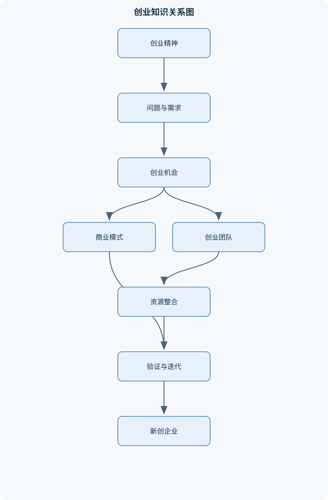
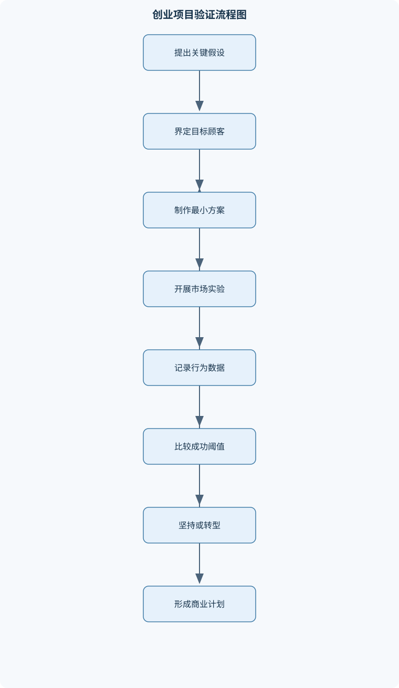

# 创业启程

## 一、课程整体知识框架

### 课程边界与先修知识

本课程研究从创业动机与创业精神出发，识别和评价创业机会，设计商业模式，组建创业团队，获取与整合资源，运用精益创业方法验证需求，编制商业计划并管理新创企业成长的基本理论与实践流程。课程边界包括机会识别、市场与顾客分析、价值创造、收入与成本结构、团队治理、融资规划、风险管理、商业计划表达和创业项目迭代；不以企业日常运营、成熟企业职能管理、专业会计准则、证券发行实务或具体行业技术开发为主要内容。先修知识为基础经济学、管理学、市场营销和基础财务常识；学习者应能理解供求关系、成本与收入、市场细分、现金流和基本百分比计算。课程中的市场规模、增长率、利润率和融资数据均应结合具体项目重新调查，不把示例数据当作普遍规律。





### 1. 课程对象、问题边界与基本逻辑

《创业启程》研究的是从“发现值得解决的问题”到“形成可验证、可持续并能够成长的新创企业”的完整过程。课程核心不是把一个新颖想法包装成项目，而是回答四个相互连接的问题：

1. 谁在什么场景下遇到了什么问题？
2. 创业项目能否以顾客愿意接受的方式创造价值？
3. 项目能否通过收入、资源和组织安排持续获得价值？
4. 在不确定性、竞争、法规和现金约束下，团队是否能够验证、调整并承担相应风险？

课程边界包括机会识别、顾客与市场分析、商业模式设计、创业团队、资源整合、精益验证、商业计划、融资、风险和成长管理。不把成熟企业的日常职能管理、专业会计准则、证券发行实务或具体行业技术开发作为主要内容。创业项目可能需要这些专业知识，但本课程关注的是创业决策的逻辑和早期验证流程。

课程的基本因果链可以表示为：

> 创业者动机与资源基础 → 发现或创造机会 → 识别顾客问题 → 设计价值主张与商业模式 → 组建团队并获取资源 → 通过实验验证关键假设 → 编制计划并筹措资金 → 在现金、风险和组织能力允许的范围内成长。

这条链条不是一次性线性流程。市场反馈可能否定原有需求，团队需要修改产品；融资条件可能限制扩张速度；法规变化可能使原机会失效。因此，创业过程应被理解为“阶段推进与循环迭代”的结合。

### 2. 创业与创业精神

#### 2.1 狭义创业与广义创业

狭义创业通常指个人或团队创办新的、具有独立经营和风险承担特征的组织，目标是通过产品或服务创造价值并获得收入、利润或其他可持续回报。广义创业还包括企业内部创业、社会创业、公共部门创新和个体以新方式组织资源解决问题。二者共同点是：在资源有限和结果不确定的情况下，主动识别机会，重新组合资源并实施新方案。

创意不等于机会。创意只是对产品、服务或经营方式的设想；创业机会至少还需要存在可识别的需求、可行的价值交付路径和能够获得回报的机制。若顾客喜欢某个概念，却不愿意使用、付费或持续使用，该概念仍不能直接判定为创业机会。

创业精神不是“敢冒险”或“永不放弃”，而是在不确定环境中主动行动、持续学习、承担可控制风险并进行价值创造的综合倾向。其核心包括机会敏感性、创新意识、责任承担、行动能力、资源整合能力和反思修正能力。理性创业者不会追求所有风险，而会明确最大损失、验证成本、替代方案和停止条件。

#### 2.2 创业活动的经济与社会作用

创业活动能够通过新产品、新服务、新渠道和新组织方式提高资源配置效率。新企业可能创造就业、增加供给、推动上下游需求、促进技术扩散，并迫使成熟企业改进产品和流程。创新也可能来自成熟企业的内部创业，即原有企业重新组合资源、进入新市场或建立新业务。

创业活动与经济增长之间不是简单的必然关系。只有当创业项目能够产生真实价值、提高生产率或满足有效需求时，才可能形成持续的经济贡献。大量缺乏需求、治理混乱或现金无法持续的创业项目，也可能造成资源浪费。因此，不能仅依据“创业数量增加”推断经济质量提高。

创业还可能促进社会流动。创业者可以通过知识、技能、创意和社会网络获得新的收入与职业机会，创业团队也会形成新的合作关系。但创业并不自动消除不平等，资金、教育、信息、家庭支持和制度环境都会影响机会获取。分析创业的社会作用时，应同时考虑机会扩大和风险分布。

#### 2.3 创业生态系统与一般环境

创业生态系统是影响创业活动产生、成长和退出的多主体环境，通常包括创业者、顾客、供应商、金融机构、投资者、大学与科研机构、孵化器、行业组织、政府部门、专业服务机构和社会网络。生态系统提供信息、人才、资金、技术、渠道、信任和合法性，但不能替代项目自身的顾客价值。

一般环境是影响所有企业的宏观条件，包括经济周期、人口结构、技术发展、社会文化、法规政策和自然环境。创业环境则更强调这些条件如何具体作用于新创企业，例如同一项法规变化可能给新企业带来制度机会，也可能增加许可和合规成本。宏观行业增长率不能直接等同于某一项目的可获得市场。

### 3. 创业过程与企业生命周期

#### 3.1 创意、机会与新创企业

创意是可能的解决方案，机会是需求、价值创造和收益路径相互连接后的可行动空间，新创企业则是将机会转化为组织、产品、交易和现金流的载体。三者不能混为一谈。创意可能经过顾客观察、访谈和实验成为机会；机会也可能因法规、竞争或成本变化而无法形成企业。

创业过程可划分为机会形成、种子期、初创期、发展期和成熟或退出期。各阶段没有绝对统一的时间界限，应依据顾客、收入、团队和资源状态判断。

- **种子期**：主要任务是明确问题、识别顾客、验证价值主张和形成最小可行产品。主要风险是把个人偏好误认为市场需求。
- **初创期**：主要任务是获取首批顾客、建立交付流程、验证价格和单位经济性。主要风险是获客成本过高、交付不稳定和现金不足。
- **发展期**：主要任务是扩大销售、提升复购、形成组织能力和改善盈利。主要风险是增长速度超过团队、供应链和资金承受能力。
- **成熟期**：主要任务是保持效率并持续创新。主要风险是路径依赖和创新惰性，即原有收入模式使组织忽视新需求。

创业资源包括人力资本、金融资本、技术资源、信息资源、社会资本、品牌与合法性、供应链和渠道。资源整合不是简单罗列已有资源，而是让不同资源共同形成交付能力。例如，技术本身不能替代渠道，渠道承诺也不能替代真实订单。

### 4. 创业机会的来源与理论

机会可能来自需求缺口、资源闲置、技术进步、法规变化、价值链重构和市场失灵。

- **需求缺口**：顾客现有方案不能充分解决问题，表现为时间浪费、成本过高、体验不稳定或风险过大。
- **资源闲置**：未被充分利用的设备、数据、空间、技能或闲置时间被重新组合。
- **技术进步**：新技术降低生产成本、提高交付能力或使原本不可行的服务成为可能。但技术先进不代表顾客一定需要。
- **制度变化**：法规、许可、补贴、行业规则或公共政策改变交易条件。制度机会必须同时评估政策持续性和合规成本。
- **价值链与渠道重构**：生产者、平台、零售商、服务商和顾客之间的关系改变，可能产生新的中介或直达模式。
- **市场失灵**：信息不对称、外部性、公共品供给不足等问题可能产生创业空间，但也可能需要较强的监管与社会责任。

机会理论通常区分**机会发现**和**机会创造**。机会发现强调需求或技术变化在一定程度上已经存在，创业者通过观察和分析识别它；机会创造强调创业者通过试验、合作、产品发布和市场教育逐步塑造需求。现实项目往往兼有两种特征：问题可能已经存在，但顾客愿意支付的方案需要通过互动创造。

### 5. 创业机会识别与评价

#### 5.1 机会感知、发现和创造

机会感知是注意到潜在变化；机会发现是通过证据确认存在需求和价值实现路径；机会创造是通过行动改变顾客认知、交易方式或资源组合。评价机会时必须区分四种证据：顾客喜欢、愿意试用、愿意付费、持续复购。证据强度依次提高，但不同产品的验证周期可能不同。

机会评价应先检查门槛条件，再比较相对吸引力。顾客是否愿意承担成本、产品是否能够交付、是否符合法规，通常属于门槛条件；市场增长率、毛利率、竞争强度和退出可能性属于比较指标。市场大不能弥补无法合规，利润率高也不能弥补无人购买。

Timmons机会评价框架通常强调机会、资源和团队三者的匹配。评价时可从以下方面展开：

1. 机会是否具有明确顾客、真实需求和合理时机；
2. 市场是否足够大或具有可扩展性；
3. 产品是否能够交付，关键技术和供应链是否可获得；
4. 团队是否具备必要能力，能力缺口能否补足；
5. 投入资源、现金需求和潜在回报是否相称；
6. 风险是否可识别、可控制并设有退出条件。

市场规模必须区分：

- $TAM$：理论可服务市场总量；
- $SAM$：受地域、产品和渠道限制后可服务的细分市场；
- $SOM$：在竞争和资源约束下项目实际可能获得的市场。

若某类顾客总数为 $N_c$，可接受的年购买次数为 $f$，单位价格为 $p$，则在简单估算中：

$$
TAM=N_cfp.
$$

该式假设顾客数量、购买频率和价格口径一致，且没有重复计算顾客。它只能产生理论上限，不能直接作为销售预测。$SAM$ 还应剔除项目无法覆盖的地区、渠道和产品规格；$SOM$ 则必须受到团队产能、竞争、获客成本和资金的约束。

### 6. 商业模式设计与数字检验

商业模式解释企业如何识别顾客、创造价值、交付价值并获得价值；创业战略还要进一步处理竞争定位、进入时机、资源优先级和长期行动。因此，商业模式不等于创业战略。

商业模式至少包括顾客定位、价值主张、关键资源、关键活动、渠道、顾客关系、收入来源和成本结构。应特别区分使用者、购买者、付款者和受益者。例如校园设备可能由学生使用、场地经营者付款、广告主承担部分费用；若只访谈使用者而忽略付款者，需求结论会失真。

收入、成本和利润的简化模型为：

$$
R=pQ,
$$

$$
C=C_f+c_vQ,
$$

$$
\pi=R-C=(p-c_v)Q-C_f.
$$

其中，$p$ 为单位销售价格，单位为货币每件或每次；$Q$ 为分析期间的销售数量，单位为件或次；$C_f$ 为相关期间内近似不随销量变化的固定成本，单位为货币；$c_v$ 为单位变动成本，单位为货币每件或每次；$R$ 为销售收入；$C$ 为总成本；$\pi$ 为经营利润，不等于现金余额；$CM=p-c_v$ 为单位贡献。

当 $p>c_v$ 且产量等于销量、价格和成本在分析期间近似稳定、暂不考虑税费、融资费用、库存变化和退款时，盈亏平衡条件 $\pi=0$ 给出：

$$
Q_{BE}=\frac{C_f}{p-c_v}.
$$

若计算结果不是整数，实际最低销量应向上取整。若 $p=c_v$，单位销售只能覆盖变动成本，无法覆盖固定成本；若 $p<c_v$，每多销售一单位反而增加损失，增加销量不能解决问题。该模型不适用于阶梯定价、多产品组合、产能突变或单位成本随规模明显变化的情形。

目标利润为 $\pi^*$ 时：

$$
Q=\frac{C_f+\pi^*}{p-c_v}.
$$

多产品项目不能直接用单一产品公式，需使用加权平均单位贡献，且必须说明销售组合假设。

现金流应独立于利润记录。设第 $t$ 期现金流入为 $I_t$、现金流出为 $O_t$、期初现金为 $B_0$，则：

$$
B_t=B_0+\sum_{i=1}^{t}(I_i-O_i).
$$

启动资金不是固定资产总额，而是覆盖现金最低点、安全现金下限和启动支出的资金需求。赊销可能增加收入和利润，却不能立即增加现金；预收款可能改善现金，却不代表全部收入已经实现。

定价应同时考虑顾客支付意愿、竞争替代、单位成本、渠道分成、服务成本和项目定位。低价可能提高试用率，但也可能无法覆盖 $CAC$ 和交付成本。顾客获取成本定义为：

$$
CAC=\frac{\text{某期间获客相关支出}}{\text{该期间新增付费顾客数}}.
$$

计算时必须说明是否包含销售人员、广告、促销、渠道佣金和试用成本。$LTV$ 是顾客生命周期内累计贡献的估计量，不应直接等同于销售额。忽略时间价值、留存损失和固定服务费用时，只有 $LTV>CAC$ 才具有正的单位经济性，但这不是盈利的充分条件，因为项目还要承担固定成本、现金周期和组织费用。

### 7. 创业者、团队与治理

创业者的动机可能包括经济收益、独立性、成就感、社会价值、技术实现和职业转换。动机本身不决定创业结果，但会影响目标设定、风险承受和长期投入。创业者应把自信建立在证据、试验和能力边界上，而不是把坚持本身当作正确。

人力资本包括知识、技能、经验和学习能力；社会资本包括信任关系、合作网络、信息渠道和资源动员能力。团队可作狭义和广义理解：狭义团队是共同承担创业责任并参与关键决策的核心成员；广义团队还包括顾问、兼职人员、供应商和关键合作方。股权和治理安排应明确贡献、重要性、风险承担、职责、归属期、离职处理、重大事项表决和后续融资稀释。

股权不能只按最初现金投入分配。全职时间、关键技术、客户渠道、机会成本、持续责任和不可替代性都应记录。承诺的渠道不能直接等同于已实现收入，技术成果也应明确知识产权归属。团队冲突可分为任务冲突、关系冲突和利益冲突，处理时应先澄清事实、职责和决策权限，再通过数据、实验和书面协议减少争议。

### 8. 精益创业与项目验证

精益创业的基本假设是：早期项目最稀缺的不是功能数量，而是关于顾客、需求、价格、渠道、成本、合规和资源的可靠知识。因此，团队应以较低成本制作最简可行产品（$MVP$），通过真实行为获得验证性学习。

$MVP$ 是以最低必要功能检验关键顾客假设的产品或服务版本，不等于粗糙、不安全或违反法规的产品。人工服务、原型、落地页、小批量产品和模拟交付都可能成为 $MVP$，但涉及安全、隐私、知识产权和行业许可时，不能以“测试”为由跳过必要要求。

客户开发通常包括客户发现、客户确认、客户创造和规模化。客户发现验证问题是否真实；客户确认验证是否有人愿意采用和付费；客户创造建立获客与销售机制；规模化则在单位经济性和交付能力可接受后扩大投入。

漏斗总体转化率等于各阶段转化率的乘积。若访问、注册、试用和付费的转化率分别为 $r_1,r_2,r_3,r_4$，则：

$$
N_{pay}=N_{visit}r_1r_2r_3r_4.
$$

每个转化率的分母必须明确，否则不同口径不能直接相乘。转型、坚持或停止的判断应预先设定样本量、观察期、成功阈值和安全停止条件。注册增长但付费率持续低，可能说明宣传有效而价值主张无效；一次促销购买也不能证明稳定复购。

### 9. 市场分析、营销、商业计划与成长

市场分析应明确目标市场、细分变量、顾客画像、购买场景、竞争者、替代方案、产业链和价值链。竞争者不仅是提供同类产品的企业，也包括顾客继续使用的旧方法、人工服务、自建系统和“不解决问题”。营销方案要把产品或服务、价格、渠道和促销联系起来，并用转化漏斗追踪从触达、访问、注册、试用到付费和复购的变化。

商业计划书的目的因读者而异。团队把它作为行动计划和假设清单；投资者关注机会、团队、证据、资金用途、风险和回报逻辑；合作方关注交付、责任和资源安排。基本结构包括执行摘要、企业概况、产品或服务、技术研发、市场和竞争分析、营销销售计划、生产或交付计划、团队与治理、财务与融资、风险管理和退出安排。

执行摘要不是目录，而是用最少篇幅说明问题、顾客、解决方案、市场、商业模式、证据、团队、融资需求和关键风险。种子期应重点说明核心问题、技术或产品假设及验证计划；成长阶段应重点说明市场定位、销售效率、复购和组织能力；成熟企业内部创业则要说明与原有战略、资源和渠道的协同关系。

成长管理的核心是速度与能力匹配。销售增长若快于交付、现金回收、人员培训和治理能力，可能导致质量下降、退款增加和现金断裂。风险管理应经历风险识别、概率与影响判断、应对方案、责任分配、预警指标和复盘。风险不能只写“市场竞争激烈”，而应说明触发条件、影响、缓解措施和剩余风险。

## 二、章节和模块划分

### 核心知识覆盖清单

本清单用于检查正文是否覆盖本课程的主要知识模块：

- **创业与创业精神**：狭义创业与广义创业、创业精神的核心特征、创业活动与经济增长、创业活动与社会流动、创新、创业与成熟企业再生、创业者动机与价值目标、创业生态系统的构成、一般环境与创业环境的区别。
- **创业过程与企业生命周期**：创意、机会与新创企业的关系、创业过程的阶段划分、种子期的任务与风险、初创期的顾客获取、发展期的盈利与扩张、成熟期的创新惰性、创业资源的类型与整合、创业过程中的不确定性管理。
- **创业机会的来源与理论**：创业机会的定义、需求缺口与资源闲置、技术进步带来的机会、法规变化与制度机会、价值链和渠道重构、市场失灵与创业机会、非均衡与机会持续存在、机会发现与机会创造的区别。
- **创业机会识别与评价**：机会感知、发现和创造、顾客痛点与未满足需求、行业生命周期分析、市场规模与成长性分析、产业结构与进入条件、机会与创业者资源匹配、Timmons机会评价框架、机会评价中的假设与证据。
- **商业模式设计**：商业模式的概念与边界、顾客定位、价值主张与价值创造、关键资源与关键活动、渠道与顾客关系、收入来源与定价逻辑、成本结构与盈亏平衡、商业模式与创业战略的区别、商业模式的逻辑检验与数字检验、商业模式本土化与持续创新。
- **创业者与创业团队**：创业者的动机与人格特征、风险认知与理性承担风险、创业者的机会识别能力、人力资本与社会资本、创业团队的狭义与广义定义、团队成员的能力互补、团队沟通与冲突管理、股权与控制权配置、激励与约束机制、团队动态调整。
- **精益创业与项目验证**：精益创业的基本假设、最简可行产品、客户发现、客户确认与转型、客户创造与规模化、验证性学习、关键指标与反馈闭环、资源最小化与控制权、转型、坚持与停止的判断、实验设计的伦理与合规边界。
- **市场分析与营销方案**：目标市场与市场细分、顾客画像与购买场景、竞争者识别与比较、产业链和价值链分析、产品与服务组合、定价策略、渠道策略、促销与获客成本、销售目标与转化漏斗、市场进入与扩张条件。
- **商业计划书编制**：商业计划书的目的与读者、执行摘要的功能、企业概况与组织结构、产品、服务与技术研发、市场和竞争分析、营销与销售计划、生产或交付计划、管理团队与治理安排、融资计划与资金用途、风险管理与退出安排。
- **创业财务、融资与成长管理**：收入、成本与利润的关系、固定成本与可变成本、盈亏平衡分析、现金流与营运资金、启动资金需求测算、自筹、债务与股权融资、融资成本与控制权稀释、创业阶段与资源需求变化、成长速度与组织能力匹配、风险识别、应对与复盘。


### 第一章 创业与创业精神

本章说明狭义创业、广义创业、创业者动机、创业精神、创新和成熟企业再生的关系。重点分析创业如何通过新企业、内部创业和社会创新促进价值创造、就业、资源重组与社会流动，同时区分创业活动的潜在贡献与失败成本。还应建立创业生态系统和一般环境的区别，避免把宏观政策、行业增长或社会热点直接当作具体项目需求。

### 第二章 创业过程与企业生命周期

本章按照创意、机会、种子期、初创期、发展期和成熟期组织内容，解释各阶段任务、风险和资源需求的变化。种子期重点验证问题与价值主张，初创期重点验证顾客获取、交付和单位经济性，发展期重点处理盈利、扩张与组织能力，成熟期重点防止创新惰性。生命周期不是固定时间表，阶段判断应依据顾客、收入、现金、团队和流程证据。

### 第三章 创业机会的来源与理论

本章从需求缺口、资源闲置、技术进步、法规变化、价值链重构和市场失灵分析机会来源。机会发现强调识别已存在的变化，机会创造强调通过试验和合作塑造新的需求与交易方式。分析时要说明机会持续存在的原因，例如信息不对称、资源重新配置速度较慢、技术扩散不均衡或制度转换存在滞后，但不能把所有变化都视为稳定机会。

### 第四章 创业机会识别与评价

本章建立从机会感知到证据验证的评价流程。顾客痛点应落实到具体场景、行为、频率和损失；行业生命周期用于判断进入时机；产业结构用于分析供应商、顾客、替代品、竞争者和进入条件；市场规模则要区分 $TAM$、$SAM$ 和 $SOM$。Timmons框架强调机会、资源和团队的动态匹配。评价结论必须对应假设和证据，不以指标机械加总替代判断。

### 第五章 商业模式设计

本章分析顾客定位、价值主张、价值创造、关键资源、关键活动、渠道、顾客关系、收入来源和成本结构。应区分商业模式与创业战略：前者回答价值如何创造、交付和获得，后者还回答如何竞争、何时进入、资源如何配置。数字检验包括收入、成本、单位贡献、盈亏平衡、现金流、$CAC$、$LTV$ 和敏感性分析。所有数字必须说明单位、期间和口径。

### 第六章 创业者与创业团队

本章讨论创业者动机、人格特征、机会识别能力、风险认知、人力资本和社会资本。团队分析包括核心成员定义、能力互补、沟通、冲突、股权、控制权、激励、约束和动态调整。股权方案应记录现金、时间、技术、渠道、机会成本、持续责任和后续稀释，不能把未验证的承诺资源视为已实现成果。

### 第七章 精益创业与项目验证

本章围绕“假设—实验—数据—学习—调整”展开。客户发现验证问题，客户确认验证采用与付费，客户创造建立获客机制，规模化要求单位经济性和交付能力可接受。$MVP$ 的功能应尽量少，但安全、隐私、知识产权和许可要求不能删减。关键指标应与假设直接相关，转型、坚持和停止要依据预设阈值而非个人偏好。

### 第八章 市场分析与营销方案

本章分析目标市场、市场细分、顾客画像、购买场景、竞争者、替代方案、产业链和价值链。产品与服务组合应与顾客任务和交付能力一致；定价要考虑支付意愿、竞争、成本和渠道分成；渠道策略要衡量覆盖、控制力、成本和回款；促销要连接获客成本和转化率。市场进入和扩张必须满足顾客证据、交付能力、现金安全和合规条件。

### 第九章 商业计划书编制

本章说明商业计划书的读者、目的和结构。正文应包括企业概况、产品服务、技术研发、市场竞争、营销销售、生产或交付、团队治理、融资用途、风险和退出安排。审查时要检查摘要与正文是否一致，市场规模与目标份额是否匹配，团队能力与任务是否对应，融资金额是否能覆盖现金缺口，风险是否有具体预警和应对方案。商业计划书不是确定性承诺，也不能替代法律、审计或投资尽调。

### 第十章 创业财务、融资与成长管理

本章建立收入、固定成本、变动成本、利润、现金流和营运资金的区别。使用盈亏平衡公式时必须确认 $p>c_v$，并统一货币、产品单位和统计期间。融资方式包括自筹、债务和股权融资，应比较融资成本、还款压力、控制权稀释和资金可得性。成长管理关注阶段性资源变化、组织承载能力、现金安全、风险复盘和退出安排。

### 代表性流程一：创业机会筛选流程

**输入**：创意集合、目标顾客、初步资源、约束条件。  
**输出**：保留、修改、暂缓或放弃的机会清单。

**步骤**：

1. 描述目标顾客和具体使用场景；
2. 记录顾客当前行为、痛点频率和损失；
3. 提出价值主张、付款主体和收入方式；
4. 检查技术、供应链、团队和法规可行性；
5. 估算 $TAM$、$SAM$、$SOM$、单位贡献和现金需求；
6. 设计低成本访谈、观察、原型或付费试点；
7. 用证据更新假设并作出决策。

**不变量**：每个结论必须对应一个可追溯假设和证据。  
**终止条件**：关键假设被证伪，或已达到预设证据阈值。  
**适用条件**：信息不完整但能够通过访谈、观察和小规模实验获得新证据。  
**复杂度**：若有 $m$ 个机会、每个机会检查 $k$ 项指标，基础表格筛选约为 $O(mk)$；这只是数据处理复杂度，不代表创业决策可以机械自动化。

### 代表性流程二：顾客访谈与问题验证

**输入**：目标顾客样本、待验证问题、访谈提纲。  
**输出**：问题频率、现有替代方案、损失程度、支付证据和未验证假设。

访谈先界定样本边界，再询问最近一次真实行为，记录问题造成的时间、金钱或风险损失，追问现有解决办法及其缺点，最后才展示概念。应区分“我觉得不错”和“我已经使用、付费或愿意预订”。访谈过程的不变量是先问事实、后问方案，避免诱导。若新增访谈不再产生新的问题类别，或关键假设达到样本证据阈值，可以结束一轮访谈。熟人样本不能直接推断总体市场。

### 代表性流程三：MVP验证闭环

**输入**：核心需求假设、最小功能集合、目标顾客、指标和成功阈值。  
**输出**：坚持、转型或停止的决策。

过程是：列出顾客、需求、价格、渠道、成本和合规假设；删除不能直接验证核心需求的功能；制作原型、人工服务、落地页或小批量产品；招募符合条件的顾客；记录激活、使用、付费、复购、投诉和退款；将结果与阈值比较；保留、修改或否定假设。每轮实验只改变少数关键变量，并保留原始数据。达到样本量、时间或安全停止条件时终止。不能因为注册量增加就宣布商业模式成立。

```python
# Python：简化的MVP漏斗计算
# 输入：访问、注册、试用、付费人数
# 输出：各阶段转化率和总体付费转化率

def funnel_result(visits, signups, trials, paid):
    if visits <= 0:
        raise ValueError("访问人数必须为正")
    if not (0 <= paid <= trials <= signups <= visits):
        raise ValueError("人数必须满足访问 >= 注册 >= 试用 >= 付费")

    signup_rate = signups / visits
    trial_rate = trials / signups if signups else 0
    paid_rate = paid / trials if trials else 0
    total_rate = paid / visits

    return {
        "访问到注册": signup_rate,
        "注册到试用": trial_rate,
        "试用到付费": paid_rate,
        "访问到付费": total_rate
    }

print(funnel_result(20000, 2400, 600, 96))
```

该程序的输入是不重复统计且口径一致的人数，输出为比例；若同一用户被重复计数，结果会失真。其主要排错点包括分母为零、阶段人数逆序和不同统计期间混用。

### 代表性流程四：商业模式数字检验

统一期间、货币和产品单位后，先计算 $R=pQ$，再计算 $C=C_f+c_vQ$ 和 $\pi=R-C$；然后计算 $CM=p-c_v$ 和 $Q_{BE}=C_f/CM$；再按月或季度建立现金流表；最后改变价格、销量、变动成本、获客成本和回款周期，观察结果对现金安全和利润的影响。当关键变量无法准确估计时，应输出区间或情景，而不是伪造精确单点。若有 $t$ 个期间和 $s$ 个情景，基础计算约为 $O(ts)$。

### 例题一：单店服务项目盈亏平衡

**题干**：某服务每次收费80元，单位变动成本32元，月固定成本24000元，预计每月服务420次。求单位贡献、盈亏平衡次数和预计利润。

**分析**：单位贡献为价格减单位变动成本；盈亏平衡次数为固定成本除以单位贡献；利润为单位贡献乘销量再减固定成本。

**解答**：

$$
CM=80-32=48\text{元/次}
$$

$$
Q_{BE}=\frac{24000}{48}=500\text{次}.
$$

预计利润为：

$$
\pi=48\times420-24000=-3840\text{元}.
$$

**结果验证**：420次低于500次，项目应亏损；亏损额为3840元。  
**变式**：若固定成本提高到30000元，则盈亏平衡次数为 $30000/48=625$ 次。该结果未计税费、退款、折旧和回款延迟。

### 例题二：平台漏斗与访问量目标

**题干**：某平台月访问量20000次，访问到注册转化率为12%，注册到试用为25%，试用到付费为16%。求付费人数和总体转化率；若目标为150名付费顾客，需要多少访问量？

**解答**：

注册人数：

$$
20000\times12\%=2400.
$$

试用人数：

$$
2400\times25\%=600.
$$

付费人数：

$$
600\times16\%=96.
$$

总体转化率：

$$
\frac{96}{20000}=0.48\%.
$$

目标访问量：

$$
N_{visit}=\frac{150}{12\%\times25\%\times16\%}=31250.
$$

**结果验证**：$31250\times0.12\times0.25\times0.16=150$。  
**变式**：若注册到试用率降为20%，在其他条件不变时，访问量需求变为 $150/(12\%\times20\%\times16\%)=39063$ 次，实际计划应向上取整。

### 例题三：销售额、利润与成本重复计算

**题干**：某项目月销量1000件，单价50元，单位变动成本30元，月固定成本15000元，另有5000元营销费用。若营销费用已包含在固定成本中，利润是多少？若未包含，利润是多少？

**解答**：

若营销费用已包含：

$$
\pi=(50-30)\times1000-15000=5000\text{元}.
$$

若营销费用未包含，固定成本为20000元：

$$
\pi=(50-30)\times1000-20000=0.
$$

**结果验证**：销售收入为50000元，变动成本为30000元，贡献为20000元；分别减去15000元或20000元即可得到两种利润。  
**变式**：若营销费用随销量变化，应将其按单位费用计入 $c_v$，不能继续全部作为 $C_f$。

### 例题四：现金缺口与启动资金

**题干**：某项目期初现金为10000元，第1至第3个月净现金流分别为−18000元、−5000元和12000元，安全现金下限为5000元。求各期现金余额和最低补充资金。

**解答**：

第1个月：

$$
B_1=10000-18000=-8000.
$$

第2个月：

$$
B_2=-8000-5000=-13000.
$$

第3个月：

$$
B_3=-13000+12000=-1000.
$$

最低余额为−13000元。要使最低余额不低于5000元，至少需要：

$$
5000-(-13000)=18000\text{元}.
$$

**结果验证**：补充18000元后，最低现金余额为5000元。  
**变式**：若第2个月有一笔8000元应收账款延迟到第4个月，启动资金需求还会增加，因为利润或合同收入不能替代当期现金。

### 例题五：顾客生命周期价值与获客成本

**题干**：某项目每位顾客每月支付100元，贡献毛利率为60%，平均留存6个月，平均服务成本已反映在贡献毛利率中，$CAC$ 为280元。忽略时间价值和流失分布，判断是否具有正的单位经济性。

**解答**：

每月贡献为：

$$
100\times60\%=60\text{元}.
$$

简化的生命周期贡献为：

$$
LTV=60\times6=360\text{元}.
$$

由于：

$$
LTV=360>CAC=280,
$$

在该简化假设下，单位顾客贡献为80元，具有正的单位经济性。

**结果验证**：360元是生命周期贡献，不是销售额600元。  
**变式**：若平均留存下降到4个月，$LTV=60\times4=240$元，小于 $CAC$，则应降低获客成本、提高留存或调整价格与服务成本。

### 实验一：目标顾客问题验证

**步骤**：

1. 明确目标顾客、场景、待验证痛点和付款主体；
2. 选择符合边界的受访者，避免只访问熟人；
3. 询问最近一次真实行为、现有替代方案、时间和金钱损失；
4. 对访谈记录进行问题类别编码；
5. 比较不同顾客群的问题频率和支付证据；
6. 修订价值主张并设计下一轮实验。

**输入数据**：受访者身份与场景、问题发生频率、现有支出、替代方案、实际购买或使用行为。  
**评价标准**：问题是否真实发生，是否足够频繁，损失是否足够大，付款主体是否明确，是否存在可验证的付费行为。  
**排错方法**：若所有受访者都说“听起来不错”但无人愿意试用，应检查问题是否过于引导；若使用者积极而付款者拒绝，应重新分析价值归属和收费对象；若样本来自单一圈层，应扩大样本边界。

### 实验二：小规模MVP付费试点

**步骤**：

1. 选定一个核心需求和最小功能；
2. 设定样本量、试验周期、价格、成功阈值和安全停止条件；
3. 招募符合条件的顾客并记录来源；
4. 观察激活、使用、付费、复购、退款和投诉；
5. 按渠道和顾客群比较转化率与单位贡献；
6. 根据证据决定坚持、转型或停止。

**输入数据**：顾客来源、访问人数、试用人数、付费人数、单价、变动成本、服务时间、退款和投诉。  
**评价标准**：付费转化率、复购或留存、单位贡献、$CAC$、退款率、交付质量和合规情况。  
**排错方法**：转化率低时区分是流量不匹配、价值主张不清、价格不合适还是交付体验差；复购低时检查是否只解决一次性问题；投诉或安全事件出现时，应优先停止相关试验并修正风险，不得为了达到样本量继续扩大。

### 典型易错点

1. 把创意直接等同于创业机会，忽略真实需求和价值实现路径。
2. 把宏观行业规模当作项目实际可获得市场，忽略 $TAM$、$SAM$、$SOM$ 的差别。
3. 把顾客喜欢、试用、付费和复购当作同一证据。
4. 将使用者、购买者、付款者和受益者混为一谈。
5. 把商业模式等同于创业战略，忽略竞争、时机和资源配置。
6. 使用盈亏平衡公式时忘记检查 $p>c_v$。
7. 忽略价格、成本、销量和统计期间的单位一致性。
8. 将销售额、会计利润和现金余额混为一谈。
9. 重复计入营销费用或遗漏渠道佣金、退款和服务成本。
10. 把 $LTV$ 当作销售额，而没有扣除变动成本和服务成本。
11. 将注册增长误认为需求成立，没有检查付费和复购。
12. 把 $MVP$ 理解为不安全、无隐私保护或不合规的残缺产品。
13. 只按现金出资额分配股权，忽略时间、技术、机会成本和持续责任。
14. 把创业者自信等同于理性风险承担，忽略最大损失和退出条件。
15. 用政策支持或行业增长叙述替代顾客证据。
16. 使用过度精确的市场增长率和利润率，却不披露假设、口径和敏感性。
17. 把一次促销购买当作稳定复购证据。
18. 认为增长越快越好，忽略交付、现金、人员和治理能力的限制。

### 常见笔试问题及解答思路

#### 问题一：为什么创意不等于创业机会？

**解答思路**：先定义创意是解决方案设想，再说明机会需要真实需求、可行交付和价值回报。最后用反例说明技术先进但无人付费的方案不能直接视为机会。

#### 问题二：如何区分机会发现与机会创造？

**解答思路**：机会发现强调识别已经存在的需求或环境变化；机会创造强调通过产品、实验、合作和市场教育塑造新的交易关系。现实项目可能同时包含二者。

#### 问题三：为什么要区分 $TAM$、$SAM$ 和 $SOM$？

**解答思路**：分别说明理论总市场、受地域产品渠道限制的可服务市场和受竞争及资源约束的实际可获得市场，并指出用 $TAM$ 直接代替销售预测会夸大机会。

#### 问题四：推导单产品盈亏平衡销量。

**解答思路**：从 $R=pQ$、$C=C_f+c_vQ$ 出发，得到 $\pi=(p-c_v)Q-C_f$；令 $\pi=0$，得到 $Q_{BE}=C_f/(p-c_v)$。补充条件是 $p>c_v$、价格和成本稳定、产量等于销量。

#### 问题五：为什么利润为正仍可能现金不足？

**解答思路**：说明利润按收入和费用确认，现金按实际收付款确认。赊销、库存、预付款、设备支出和债务偿还都会造成利润与现金时间错配。

#### 问题六：如何判断一个MVP实验有效？

**解答思路**：检查是否有明确假设、目标顾客、最小功能、可观测指标、样本量、成功阈值和停止条件；实验是否只改变少数变量；数据是否来自真实行为而非口头承诺。

#### 问题七：股权分配为什么不能只按出资额？

**解答思路**：比较资金、全职时间、关键技术、渠道、机会成本、持续责任和控制权的不同贡献，并说明应通过归属期、离职处理和后续稀释降低动态风险。

#### 问题八：商业计划书中执行摘要的作用是什么？

**解答思路**：执行摘要应让读者快速理解问题、顾客、解决方案、证据、商业模式、团队、融资用途和关键风险；它不是目录，也不能写成脱离正文的宣传口号。

### 常见面试问题与回答要点

#### 问题一：你如何判断一个创业想法是否值得继续？

**参考答案**：我会先明确顾客和场景，再验证问题是否真实、频繁且有损失，随后检查付款主体、交付可行性、法规要求和单位经济性，最后用低成本试验获取行为证据。  
**深入追问要点**：说明停止条件、样本边界、口头意愿与付费行为的差异。

#### 问题二：如果注册人数很多但付费率很低，你会怎么做？

**参考答案**：先分解漏斗，判断问题发生在目标顾客不匹配、价值主张、价格、产品体验还是付款流程；再访谈未付费用户并设计小规模付费试验，不能只继续扩大流量。  
**深入追问要点**：说明如何选择转型、坚持或停止的阈值。

#### 问题三：如何处理联合创始人之间的股权争议？

**参考答案**：把现金、时间、技术、渠道、机会成本和持续责任分别记录，明确职责、决策权限、归属期、离职处理和后续融资稀释，再用不同贡献情景测试方案。  
**深入追问要点**：说明未验证渠道承诺不能等同于收入，重大事项应有明确表决机制。

#### 问题四：你如何理解风险？

**参考答案**：风险不是简单的“敢不敢”，而是结果不确定性及其影响。我会设定最大损失、预警指标、替代方案和退出条件，优先验证高影响且可低成本验证的假设。  
**深入追问要点**：区分可控风险、不可控风险和必须遵守的合规边界。

#### 问题五：为什么不能把市场总规模直接写成销售预测？

**参考答案**：市场总规模只说明潜在上限，实际销售还受地域、渠道、竞争、产能、获客成本、价格和资金约束，应分别计算 $TAM$、$SAM$ 和 $SOM$。  
**深入追问要点**：要求给出一个从顾客数量、购买频率到项目实际份额的计算链条。

#### 问题六：你会优先追求增长还是利润？

**参考答案**：要根据阶段和单位经济性判断。早期可以验证需求和复购，但不能以持续亏损和现金失控换取表面增长；当 $LTV$ 不高于 $CAC$ 或交付能力不足时，应先修正模式。  
**深入追问要点**：说明固定成本、现金周期和组织能力如何限制扩张。

#### 问题七：如何向投资者解释项目风险？

**参考答案**：列出风险来源、发生条件、影响、当前证据、缓解措施、责任人和剩余风险，并说明融资资金将如何降低关键不确定性。  
**深入追问要点**：不能用“市场前景广阔”替代风险分析，也不能把风险全部隐藏。

#### 问题八：如果实验结果否定了原假设，你会怎么做？

**参考答案**：先确认实验设计和数据质量，再定位被否定的是顾客、需求、价格、渠道还是功能假设。若问题场景仍有价值，可以更换付款主体或交付方式重新测试；若核心问题不存在，应停止投入。  
**深入追问要点**：说明转型不是随意改变方向，而是保留被证据支持的部分、修改被证伪的部分。

### 岗位关联与课程产出

#### 创业项目负责人

实际任务包括确定机会、组织验证、协调团队、分配资源和制定阶段目标。主要使用机会评价、商业模式、精益验证、融资和风险管理知识。产出包括机会筛选表、实验记录、现金计划、商业计划书和阶段决策报告。验收标准是关键假设有证据、资源用途可追溯、风险有责任人和停止条件。

#### 产品经理

实际任务是把顾客问题转化为价值主张、产品功能和MVP，并根据行为数据迭代。主要使用顾客访谈、用户场景、MVP、转化漏斗和验证性学习。产出包括需求假设、原型、实验方案、指标看板和迭代记录。验收标准是功能与核心假设直接相关，数据口径统一，未把功能数量当作价值证据。

#### 用户研究员

实际任务是选择目标顾客、开展访谈和观察、编码问题并识别替代方案。主要使用机会识别、顾客画像、购买场景和访谈流程。产出包括样本说明、访谈记录、问题分类和证据缺口清单。验收标准是样本边界明确、先事实后评价、区分使用者与付款者，且结论不超出样本证据。

#### 商业分析师

实际任务是测算市场、收入、成本、单位贡献、盈亏平衡和现金需求，并开展敏感性分析。主要使用 $TAM$、$SAM$、$SOM$、$CAC$、$LTV$、$Q_{BE}$ 和现金流模型。产出包括财务模型、情景分析、资金缺口表和假设清单。验收标准是单位、期间、成本口径和收入确认方式明确，利润与现金分开，边界条件得到说明。

#### 市场营销与增长经理

实际任务是设计目标市场、渠道、定价、促销和转化漏斗。主要使用市场细分、顾客画像、竞争分析、$CAC$ 和转化率。产出包括获客方案、渠道比较、漏斗数据和复购分析。验收标准是每个转化率分母清楚，获客费用完整，增长结论不脱离单位经济性。

#### 商业计划书分析师

实际任务是审查计划书的逻辑、证据、数字和风险，确保摘要、商业模式和财务计划一致。主要使用商业模式、市场分析、团队治理、融资和风险管理。产出包括证据缺口表、数字核对表、风险清单和修改建议。验收标准是每项关键数字有口径和期间，融资用途与现金缺口匹配，不能以宣传语言替代证据。

#### 创业投资分析师

实际任务是评价机会、团队、市场、商业模式、融资需求和退出可能性。主要使用机会评价框架、产业结构、单位经济性、现金流和治理知识。产出包括项目评价报告、关键假设清单、风险排序和尽调问题。验收标准是区分门槛条件与比较指标，不把市场规模或增长率直接当作投资结论。

#### 创业孵化器项目经理

实际任务是组织项目筛选、实验辅导、资源对接和阶段复盘。主要使用机会筛选流程、MVP验证、团队评估、商业计划和风险控制。产出包括项目评审表、实验进度表、导师或资源匹配记录和阶段结论。验收标准是项目获得的资源与关键假设对应，评审过程可追溯，未通过项目有明确的修改、暂缓或退出理由。

## 三、核心概念的详细解释

### 1. 创业、创业精神与创业环境

#### 1.1 狭义创业、广义创业与创新

狭义创业是个人或团队创办新的、具有相对独立经营责任的组织，并在不确定条件下承担资源投入、经营结果和机会成本。广义创业还包括企业内部创业、社会创业、公共服务创新以及个体通过新方式整合资源解决问题。二者的共同核心不是“成立公司”这一形式，而是发现或创造价值机会，组织资源进行实施，并承担结果的不确定性。

创业精神不是简单的冒险、乐观或坚持到底，而是在信息不完整时主动行动、识别机会、整合资源、持续学习并承担可控制风险的综合能力。理性承担风险要求创业者事先说明最大可接受损失、验证成本、替代方案和停止条件。没有损失上限的冒险，不能称为理性创业。

创新是对产品、服务、流程、渠道、组织方式或商业模式的有价值改进。创新不必然导致创业，因为成熟企业也能创新；创业也不必然包含技术创新，新的服务组合、定价方式或渠道安排同样可能形成创业机会。成熟企业再生通常表现为进入新市场、重构价值链、内部孵化新业务或用新技术改变原有经营方式。

创业活动可能促进就业、资源重新配置、技术扩散、产业协作和社会流动，但创业数量增加不等于经济质量必然提高。只有当项目满足有效需求、提高生产率或提供可持续价值时，才可能形成长期经济贡献。创业者获得机会的能力还受到教育、资金、信息、社会网络和制度环境影响，因此创业并不会自动消除社会不平等。

#### 1.2 创业生态系统与一般环境

创业生态系统由创业者、顾客、供应商、投资者、金融机构、科研机构、孵化器、行业组织、专业服务机构、政府部门和社会网络等组成。它可以提供人才、资金、技术、渠道、信息、信任和合法性，但生态系统资源不能替代具体顾客的真实需求。

一般环境是影响所有企业的宏观条件，例如经济周期、人口结构、技术发展、社会文化、法律制度和自然环境。创业环境则更强调这些条件如何具体影响新创企业的机会、进入障碍、资源获取和成长速度。同一项政策变化可能为某类项目创造制度机会，也可能提高另一类项目的合规成本，不能脱离行业和项目条件作抽象判断。

### 2. 创业过程与企业生命周期

#### 2.1 创意、机会与新创企业

创意是对问题解决方案的设想；机会是具有可识别需求、可行价值交付路径和潜在回报机制的创意。新创企业是将机会转化为持续组织活动的载体。三者关系不是“有创意就成立企业”，而是：

> 创意提出假设，机会评价检验假设，新创企业通过组织、资源和实验把机会转化为价值。

机会可以来自需求缺口、资源闲置、技术进步、法规变化、价值链重构、渠道变化和市场失灵。例如，某类顾客长期承担高时间成本，而现有服务交付效率低，可能产生需求缺口；某项技术降低了原有服务的交付成本，可能形成技术机会。法规变化只有在改变交易条件、责任边界或准入方式时，才可能转化为具体制度机会。

“机会发现”强调机会在一定程度上已经存在，创业者通过观察和信息搜寻识别它；“机会创造”强调机会是在试验、协商、资源重组和市场教育中逐步形成的。现实项目往往同时包含两种成分：顾客已有痛点属于发现部分，新的使用场景和付费方式则可能通过试验创造出来。

#### 2.2 种子期、初创期、发展期与成熟期

种子期的主要任务是明确问题、顾客、价值主张和关键假设，风险集中在需求是否真实、团队是否具备关键能力、方案是否符合法规以及是否存在可行的交付路径。此阶段不宜过早扩张固定成本。

初创期的重点是获得首批真实顾客，验证顾客获取、交付、收费和反馈机制。注册、试用或口头认可只能说明兴趣，不能直接证明顾客愿意付费和持续复购。

发展期需要检验单位经济性、现金流、组织能力和供应链稳定性，再决定是否扩大市场。若顾客获取成本上升、服务质量下降或团队承载能力不足，盲目增长可能放大亏损。

成熟期的主要风险从“找不到需求”转向“创新惰性”。原有产品、流程和组织权责可能使企业难以尝试新业务。成熟企业需要防止既有收入和制度安排阻碍新机会，但新业务仍必须接受顾客、财务和风险检验。

### 3. 创业机会识别与评价

#### 3.1 顾客问题与机会来源

顾客痛点应具体到对象、场景、频率、损失和现有替代方案。 “用户觉得不方便”不是充分描述，应进一步说明谁在什么时间、何种情境下遇到问题，问题造成多少时间、金钱、风险或情绪损失，以及目前如何解决。

机会评价至少包括五个问题：

1. 需求是否真实、频繁且足够重要；
2. 顾客或付款者是否明确；
3. 团队是否能以可接受成本交付价值；
4. 市场是否有进入空间；
5. 项目是否满足法规、安全、隐私和知识产权要求。

顾客、使用者和付款者可能不是同一主体。例如校园服务的使用者可能是学生，付款者可能是学校或商户；若只验证学生喜欢使用，却没有验证付款主体的预算和采购流程，机会评价仍不完整。

#### 3.2 市场、产业结构与机会匹配

行业生命周期可分为导入、成长、成熟和衰退等阶段。导入期需求教育成本高、标准不稳定；成长期市场扩张较快但竞争者也会增加；成熟期客户和渠道相对稳定，但价格竞争和替代压力可能更强；衰退期通常需要寻找新场景、降低成本或进行业务转型。

产业结构分析应关注进入壁垒、供应商议价能力、顾客议价能力、替代品和现有竞争者。市场增长率高并不意味着项目容易成功，若关键渠道被少数企业控制，或顾客转换成本很低，新进入者仍可能难以获利。

机会评价还必须考虑创业者与机会的匹配。匹配包括知识和技术能力、行业经验、社会资本、可投入时间、风险承受能力以及能够获得的资源。资源不足不一定否定机会，但需要说明如何通过合作、外包、试点或融资弥补缺口。

### 4. 商业模式与创业战略

#### 4.1 商业模式的构成

商业模式解释项目如何创造、交付和获取价值。核心要素包括目标顾客、价值主张、关键资源、关键活动、合作伙伴、渠道、顾客关系、收入来源和成本结构。

价值主张不是产品功能清单，而是对顾客问题的可验证解决承诺。它应说明顾客获得什么结果、相较现有替代方案改善在哪里，以及为什么愿意付费。商业模式与创业战略不同：商业模式说明价值如何运转，战略还要处理竞争定位、进入时机、资源优先级和防御方式。

收入来源可能是一次销售、订阅、交易佣金、广告、授权、增值服务或组合收费。定价不能只依据成本，还要考虑顾客感知价值、竞争替代、支付能力、渠道分成、交付成本和价格变化对需求的影响。成本结构应区分固定成本、单位变动成本、获客成本、服务成本、研发成本和现金支付时点。

#### 4.2 市场分析与营销方案

市场细分可以依据地理、人口、行为、需求、使用场景或支付能力进行，但细分结果必须能指导产品、渠道或定价决策。顾客画像应描述实际行为，而不是只写年龄和职业。

市场规模应区分 $TAM$、$SAM$ 和 $SOM$。$TAM$ 是理论可服务市场总量；$SAM$ 是受到地域、产品和渠道限制后可服务的细分市场；$SOM$ 是在竞争、团队、资金和交付能力约束下可能实际获得的部分。把 $TAM$ 直接当作销售目标，会夸大机会。

营销方案应连接渠道、促销、销售流程和单位经济性。转化率 $r$ 的分母必须明确，例如访问到注册、注册到试用、试用到付费不能混为一个比例。获客成本 $CAC$ 应说明是否包含广告、销售人员、渠道佣金、促销和活动支出。若获客后顾客不能产生足够的生命周期贡献，增长越快可能亏损越快。

### 5. 创业者、团队与治理

#### 5.1 创业者能力与社会资本

创业者的人力资本包括知识、技能、经验、学习能力和行业理解；社会资本包括客户关系、供应链联系、专业声誉、合作网络和获取信息的能力。人格特征如主动性、坚韧性和开放性可能帮助创业，但不能代替需求证据、财务纪律和团队治理。

风险认知应区分可计算风险与不确定性。前者可以在一定程度上估计结果和概率，后者连结果范围都可能不清楚。面对不确定性，创业者应采用小规模实验、分阶段投入和可撤销承诺，而不是仅凭信心加大投入。

#### 5.2 团队分工、股权与冲突

狭义创业团队通常指共同承担创业责任并参与关键决策的核心成员；广义团队还包括长期承担关键任务的兼职成员、顾问和合作伙伴。团队评价应关注能力互补、责任边界、沟通机制和持续投入。

股权不能只按现金投入比例分配。资金、全职时间、关键技术、渠道资源、机会成本、持续责任和风险承担都应记录。股权安排还需要说明归属期、离职处理、重大事项表决权、后续融资稀释和知识产权归属。没有事先规则的“平均分配”可能在成员投入差异扩大后引发严重冲突。

### 6. 精益创业、验证与迭代

#### 6.1 关键假设与最简可行产品

关键假设集合记为 $E$，包括顾客、需求、价格、渠道、成本、合规和资源等假设。精益创业的核心不是盲目快速发布，而是用最低必要成本获得能够改变决策的证据。

$MVP$ 是能够检验关键顾客假设的最简可行产品或服务版本。它可以是人工服务、原型、落地页、小批量产品或有限功能的软件，但不能削弱必要的安全、隐私和合规要求。一个功能很多但无法说明验证了什么的产品，不一定是有效的 $MVP$。

验证性学习要求在实验前明确假设、指标、样本边界、成功阈值和停止条件。顾客喜欢、愿意试用、愿意付费和持续复购是不同层级的证据。出现失败时，团队可以坚持原假设、修改产品或付费主体、转型，或停止项目；“坚持”不能等同于拒绝证据。

#### 6.2 实验伦理与边界

实验不得以误导顾客、隐瞒重要风险、非法收集个人信息、侵犯知识产权或绕过行业许可为代价。预售、试用和数据采集都应明确服务内容、退款规则、隐私用途和安全限制。精益方法追求资源最小化，不意味着降低责任标准。

### 7. 商业计划、融资与成长

#### 7.1 商业计划书

商业计划书既是对外沟通材料，也是内部行动计划。不同读者关注点不同：团队关注任务和现金，投资者关注机会、风险、回报与治理，合作方关注交付能力和关系稳定性。

常见结构包括执行摘要、企业概况、产品或服务、技术与研发、市场和竞争分析、营销销售计划、生产或交付计划、组织与治理、财务计划、融资用途、风险管理和退出安排。种子期应突出问题、技术可行性和验证计划；发展期应加强市场定位、销售效率、现金流和组织能力；成熟企业内部创业则要说明新业务与整体战略的关系。

摘要不能写成宣传口号。摘要中的顾客、市场、收入和融资数字必须与正文一致，每个关键数字都要注明期间、单位和口径。

#### 7.2 融资与成长管理

自筹资金控制权成本较低但规模有限；债务融资需要还本付息并承受现金流压力；股权融资不要求固定偿还，但会带来控制权稀释、治理要求和投资人预期。融资选择应结合项目阶段、现金流稳定性、资产状况、风险水平和资金用途。

成长速度必须与交付能力、人才、供应链、现金和管理制度匹配。销售快速增加但退款、投诉、延期交付和应收账款同步增加，可能是“虚假成长”。风险管理应包括识别、评估、应对、监测和复盘，且为重大风险设置责任人和触发条件。

## 四、重要定义、公式、定理和推导

### 专业审校补充：关键定义与适用边界

创业融资中的估值、融资额与控制权是相互关联但不能混同的三个概念。融资额是项目实际取得的资金，投前估值是投资进入前企业股权价值，投后估值等于投前估值加本轮新增资金。在不考虑期权池、可转债转换和其他股东变化的简化情形下，投资人持股比例为：$$s=\frac{F}{V_{pre}+F}$$其中，$F$为本轮融资额，$V_{pre}$为投前估值，二者单位必须一致，$s$为投资人融资完成后的股权比例。原股东合计持股比例为$1-s$。该公式只描述本轮直接股权融资，不等同于企业真实市场价值，也不处理清算优先权、反稀释、表决权和分期到款等合同条款。若项目尚未证明需求、单位经济性和现金使用计划，估值数字不能替代机会证据；融资额也不应按“估值越高越好”决定，而应与达到下一验证节点所需的现金缺口、风险缓冲和控制权承受能力相匹配。


### 1. 创业机会评价的门槛逻辑

机会评价不是把所有指标机械加总。顾客是否愿意付费、项目是否可交付、是否满足安全与法规要求，通常是门槛条件；市场增长率、毛利率、竞争强度和退出可能性则是比较指标。

若任一必要门槛不满足，项目不能仅凭高增长率或大市场规模判定为成立。例如，顾客愿意使用但付款者拒绝承担成本，说明使用需求存在，但商业机会尚未成立；技术可实现但没有合法交付资格，也不能直接进入市场。

### 2. 收入、成本、利润与盈亏平衡

在单产品、单期间、产量等于销量、价格和单位变动成本稳定、不考虑税费、融资费用、库存变化及退款的简化模型中：

$$
R=pQ
$$

其中，$R$ 为销售收入，单位为货币；$p$ 为单位销售价格，单位为货币每件；$Q$ 为销售数量，单位为件或次。

总成本为：

$$
C=C_f+c_vQ
$$

其中，$C_f$ 为期间固定成本，单位为货币；$c_v$ 为单位变动成本，单位为货币每件。

经营利润为：

$$
\pi=R-C
$$

代入收入和成本：

$$
\pi=pQ-(C_f+c_vQ)
$$

整理得：

$$
\pi=(p-c_v)Q-C_f
$$

单位贡献为：

$$
CM=p-c_v
$$

它表示每销售一单位产品，在覆盖固定成本后形成利润的能力。当 $p>c_v$ 时，单位贡献为正；当 $p=c_v$ 时，新增销量只能覆盖自身变动成本；当 $p<c_v$ 时，每增加一单位销量都会扩大经营亏损。

盈亏平衡时 $\pi=0$，因此：

$$
(p-c_v)Q_{BE}-C_f=0
$$

在 $p>c_v$ 的前提下：

$$
Q_{BE}=\frac{C_f}{p-c_v}
$$

若计算结果不是整数，实际最低销量应向上取整。若固定成本为 $24000$ 元、单位价格为 $80$ 元、单位变动成本为 $32$ 元，则：

$$
CM=80-32=48\text{ 元}
$$

$$
Q_{BE}=\frac{24000}{48}=500\text{ 次}
$$

若预计销量为 $420$ 次，则：

$$
\pi=48\times420-24000=-3840\text{ 元}
$$

该结论不代表现金余额减少恰好为 3840 元，因为利润还可能受折旧、应收账款、库存、税费和融资支出影响。

目标利润为 $\pi^*$ 时：

$$
Q=\frac{C_f+\pi^*}{p-c_v}
$$

该公式不能用于价格、成本随销量显著变化，或多产品收入结构复杂的情况。多产品项目应使用加权平均单位贡献，并明确销售组合；若销售组合不断变化，单一盈亏平衡点会失去稳定意义。

### 3. 市场漏斗与单位经济性

设访问、注册、试用、付费四个阶段转化率分别为 $r_1,r_2,r_3,r_4$，访问量为 $N_{visit}$，则：

$$
N_{pay}=N_{visit}r_1r_2r_3r_4
$$

若访问量为 $20000$，四阶段转化率分别为 $12\%、25\%、16\%$，则：

$$
N_{register}=20000\times12\%=2400
$$

$$
N_{trial}=2400\times25\%=600
$$

$$
N_{pay}=600\times16\%=96
$$

总体转化率为：

$$
\frac{96}{20000}=0.48\%
$$

若目标付费顾客为 $150$ 人，其他转化率不变，则需要访问量：

$$
N_{visit}=\frac{150}{0.12\times0.25\times0.16}=31250
$$

漏斗公式的边界是各阶段分母必须一致，且样本来自同一期间或具有可比性。把“点击到注册”和“所有访问到注册”混用，会使乘积失真。

$CAC$ 定义为某期间获客支出除以新增付费顾客数。$LTV$ 是顾客生命周期内贡献价值的估计量，不能直接等同于销售额。简化条件下，若单个顾客生命周期累计贡献为 $LTV$，获客成本为 $CAC$，则：

$$
LTV>CAC
$$

才可能具有正的单位经济性。现实中还应考虑留存损失、退款、服务成本、回款周期、资金时间价值和固定支持费用，因此 $LTV>CAC$ 只是必要的简化判断，不是盈利保证。

### 4. 现金流与启动资金

现金流不等于利润。赊销会增加收入和利润，但在顾客付款前不会增加现金；购买设备会立即产生现金流出，但其会计成本可能分期确认。

设第 $t$ 期现金流入为 $I_t$，现金流出为 $O_t$，期初现金为 $B_0$，则：

$$
B_t=B_0+\sum_{i=1}^{t}(I_i-O_i)
$$

若企业设定安全现金下限为 $B_{\min}$，则启动资金至少应覆盖使所有关键期间满足：

$$
B_t\geq B_{\min}
$$

的资金缺口。启动资金不能只按设备采购额计算，还应纳入工资、租金、押金、研发、营销、库存、税费、退款、应收账款延迟和应急储备。

### 5. 代表性流程与伪代码

#### 5.1 创业机会筛选流程

输入为创意集合、目标顾客、初步资源和约束条件；输出为保留、修改、暂缓或放弃的机会清单。每个判断都必须连接到一个具体假设和证据。基本步骤是：描述顾客场景，验证问题频率，识别付款者，提出价值主张，检查技术、供应链和法规可行性，估算市场与单位经济性，设计低成本实验，再依据证据更新结论。

```text
伪代码
输入：Ideas，顾客信息，团队资源，法规和预算约束
输出：OpportunityDecisions

对每个 idea 执行：
    定义顾客、场景、问题和付款者
    建立假设集合 E
    若问题不具体或没有可观察行为：
        标记为“修改”
        继续下一个 idea
    收集访谈、观察、预订单或试用证据
    检查交付能力、供应链、知识产权和合规要求
    估算 p、cv、Cf、CAC、现金需求及市场边界
    若存在未满足的必要门槛：
        标记为“暂缓或放弃”
    否则设计 MVP 实验和成功阈值
    若实验结果达到阈值：
        标记为“保留”
    否则若问题成立但付款主体、渠道或方案需改变：
        标记为“转型修改”
    否则：
        标记为“放弃”
返回 OpportunityDecisions
```

不变量是每项结论均有可追溯证据；当关键假设被证伪，或达到预设样本量、预算和安全停止条件时，当前轮实验终止。若有 $m$ 个机会、每个机会检查 $k$ 项指标，基础表格筛选复杂度约为 $O(mk)$，但复杂度不代表判断质量，证据有效性仍取决于样本和实验设计。

### 6. 代表性例题

#### 例题一：价格变化与盈亏平衡

**题干：**某服务单价为 $100$ 元，单位变动成本为 $40$ 元，月固定成本为 $36000$ 元。求盈亏平衡销量。若价格降至 $80$ 元，其他条件不变，重新计算。

**分析：**先计算单位贡献，再用固定成本除以单位贡献。

**解答：**

原单位贡献：

$$
CM=100-40=60\text{ 元}
$$

原盈亏平衡销量：

$$
Q_{BE}=\frac{36000}{60}=600\text{ 次}
$$

降价后：

$$
CM'=80-40=40\text{ 元}
$$

$$
Q_{BE}'=\frac{36000}{40}=900\text{ 次}
$$

**结果验证：**原方案销售 $600$ 次时利润为 $60\times600-36000=0$；降价方案销售 $900$ 次时利润为 $40\times900-36000=0$。

**变式：**若降价能够使销量从 $600$ 次提高到 $750$ 次，则新利润为 $40\times750-36000=-6000$ 元，说明销量增加并未抵消单位贡献下降。

#### 例题二：市场漏斗倒推

**题干：**某项目访问量为 $30000$，访问到注册转化率为 $10\%$，注册到试用转化率为 $20\%$，试用到付费转化率为 $15\%$。求付费人数和总体转化率。

**解答：**

注册人数：

$$
30000\times10\%=3000
$$

试用人数：

$$
3000\times20\%=600
$$

付费人数：

$$
600\times15\%=90
$$

总体转化率：

$$
\frac{90}{30000}=0.3\%
$$

**结果验证：**

$$
30000\times0.10\times0.20\times0.15=90
$$

**变式：**若目标付费人数为 $120$，在其他比例不变时，所需访问量为：

$$
\frac{120}{0.10\times0.20\times0.15}=40000
$$

这只是数学倒推，不代表增加访问量后各阶段转化率仍然稳定。

#### 例题三：成本重复计入

**题干：**项目月销量为 $1000$ 件，单价 $50$ 元，单位变动成本 $30$ 元。月固定成本报告为 $15000$ 元，其中可能已经包含 $5000$ 元营销支出。判断两种口径下的利润。

**解答：**单位贡献为：

$$
CM=50-30=20\text{ 元}
$$

若 $15000$ 元已包含营销支出：

$$
\pi=20\times1000-15000=5000\text{ 元}
$$

若 $15000$ 元不含营销支出，则总固定成本为 $20000$ 元：

$$
\pi=20\times1000-20000=0
$$

**结果验证：**两种结果差异正好为重复或遗漏的 $5000$ 元营销支出。

**变式：**若营销费用中 $3000$ 元随销量变化，不能全部放入固定成本，应拆分为固定部分与单位变动部分后重新计算。

#### 例题四：现金缺口

**题干：**项目期初现金为 $50000$ 元，连续三个月净现金流分别为 $-30000$、$-25000$ 和 $20000$ 元，安全现金下限为 $10000$ 元。求最低新增资金缺口。

**解答：**

第一月期末现金：

$$
B_1=50000-30000=20000
$$

第二月期末现金：

$$
B_2=20000-25000=-5000
$$

第三月期末现金：

$$
B_3=-5000+20000=15000
$$

第二月低于安全下限 $10000$ 元，缺口为：

$$
10000-(-5000)=15000\text{ 元}
$$

因此至少需要新增 $15000$ 元，且还应考虑预测误差和应急储备。

**变式：**如果第二月收入只是赊销，未形成现金流入，则现金缺口应按实际收款时间重新计算。

#### 例题五：机会评价中的付款主体

**题干：**某设备受到学生使用者欢迎，试用频率较高，但场地经营者不愿支付设备租金和维护费。能否直接判定机会成立？

**分析：**使用价值与支付价值属于不同假设。学生的使用行为支持需求假设，但场地经营者的付款意愿、预算和采购流程尚未成立。

**解答：**不能直接判定机会成立。应进一步验证：付款主体是否可以改变；是否能采用广告、交易分成或按次收费；维护成本由谁承担；场地经营者是否从客流、收入或管理效率中获得足够收益；合同和责任如何安排。

**结果验证：**只有当使用者、付款者、交付者和风险承担者之间形成可持续交易关系，机会评价才完成。

**变式：**若场地经营者愿意试点但要求按收入分成，应重新估算单位收入、渠道分成、维护成本和现金回收周期。

### 7. 实验与项目流程

#### 7.1 顾客问题验证实验

**输入数据：**目标顾客样本、问题假设、访谈提纲、现有替代方案记录表。

**步骤：**先规定样本边界，区分使用者与付款者；询问最近一次真实经历，而非先介绍产品；记录问题频率、损失和现有解决方式；最后才展示概念并询问是否愿意试用、预订或付费。

**评价标准：**问题应能被多个独立样本描述，且存在实际行为或可观察损失；访谈应形成问题类别、替代方案和未验证假设；口头“有兴趣”不得单独作为成功证据。

**排错方法：**若所有受访者都是熟人，应重新抽取非熟人样本；若问题只来自引导性提问，应改为行为回顾；若只记录使用者而未访问付款者，应补充采购和支付角色。

#### 7.2 MVP 付费验证实验

**输入数据：**一个核心需求假设、最小功能、目标顾客、价格、样本量、成功阈值和安全停止条件。

**步骤：**删除不能验证核心假设的功能；制作人工服务、原型或小批量产品；招募符合条件的顾客；记录激活、使用、付费、退款、复购和投诉；比较实际数据与预设阈值；决定坚持、转型或停止。

**评价标准：**实验应能区分真实付费与口头意愿；价格、服务内容和退款规则必须明确；必须同时记录正向指标和失败、投诉、安全事件。

**排错方法：**注册多而付费少，应检查付款主体、价格和价值主张；一次性购买多而复购少，应检查持续需求和交付质量；试验样本偏向熟人，应重新进行独立样本验证；出现安全或合规问题时，应立即停止相关实验，而不是继续追求转化率。

### 8. 具体易错点

1. 把创意直接等同于创业机会。  
2. 把顾客喜欢、愿意试用、愿意付费和持续复购混为一谈。  
3. 把 $TAM$ 当作项目实际销售目标。  
4. 只分析使用者，不验证付款者。  
5. 把商业模式写成产品功能清单。  
6. 把商业模式与创业战略混为一谈。  
7. 忽略 $p\leq c_v$ 时盈亏平衡公式失去可行意义。  
8. 把销售额、经营利润和现金余额混为一谈。  
9. 把赊销收入当成当期现金流入。  
10. 计算 $CAC$ 时漏掉销售人员、渠道和促销支出。  
11. 把 $LTV$ 直接等同于顾客销售额。  
12. 把 $MVP$ 理解为不安全或不合规的残缺产品。  
13. 用少量熟人访谈推断整个市场。  
14. 只依据注册量增长宣布商业模式成功。  
15. 股权只按最初现金投入比例分配。  
16. 用行业增长率替代具体项目的顾客证据。  
17. 商业计划书中的成本项目重复或遗漏。  
18. 预测使用过度精确的增长率，却不披露假设和敏感性。

### 9. 常见笔试问题与解答思路

#### 问题一：为什么创意不等于创业机会？

应答应指出：创意只是设想，机会还必须有真实需求、可行交付路径和回报机制；还要验证顾客、付款者、竞争替代和合规条件。

#### 问题二：推导盈亏平衡销量公式。

先写 $R=pQ$ 和 $C=C_f+c_vQ$，再写 $\pi=R-C$，令 $\pi=0$，得到 $Q_{BE}=C_f/(p-c_v)$，并说明前提是 $p>c_v$。

#### 问题三：如何区分 $TAM$、$SAM$ 和 $SOM$？

应说明三者分别对应理论总市场、受地域产品渠道约束的可服务市场，以及在竞争和资源约束下实际可获得市场，不能逐级直接当作销售预测。

#### 问题四：精益创业为什么强调 $MVP$？

重点不是快速发布低质量产品，而是用最低必要成本检验关键假设，减少在未经验证功能上的投入，同时不能降低安全、隐私和合规要求。

#### 问题五：$LTV>CAC$ 是否等于项目一定盈利？

不是。该关系只说明简化的单位经济性可能为正，还需考虑固定成本、现金回收周期、留存不确定性、退款、服务成本和融资成本。

#### 问题六：股权为什么不能只按现金投入分配？

因为全职时间、关键技术、渠道、机会成本、持续责任和风险承担也创造价值。合理分配还应考虑归属期、离职处理、控制权和未来稀释。

#### 问题七：商业计划书的执行摘要有什么作用？

摘要用于让读者快速理解问题、顾客、价值主张、商业模式、证据、团队、融资需求和主要风险。摘要不是广告，数字必须与正文和财务计划一致。

#### 问题八：为什么销售增长可能带来更严重的现金危机？

若销售依赖赊销、库存和提前支付营销费用，收入增加未必同步带来现金；若单位经济性为负，销售越多亏损越大。因此必须同时检查利润、现金流和营运资金。

### 10. 常见面试问题与回答要点

#### 问题一：你如何筛选一个创业机会？

参考答案应包括顾客场景、问题频率、付款者、价值主张、交付和合规可行性、市场边界、单位经济性及低成本验证。追问时应说明如何处理证据冲突和何时停止。

#### 问题二：如果用户注册很多但没有付费，你怎么办？

应先区分注册质量、付款主体、价格、价值主张和交付体验，再通过访谈和付费实验定位原因。不能直接把注册量当作成功。追问可要求说明转型条件和样本阈值。

#### 问题三：团队成员对股权分配产生冲突，如何处理？

应将资金、时间、技术、渠道和持续责任分别记录，设置归属期、离职机制和重大事项规则，并通过情景测试检验分配。追问重点是如何处理未兑现的渠道承诺。

#### 问题四：投资人要求快速扩张，你是否接受？

应先检查单位经济性、交付能力、现金安全、团队和供应链。若关键能力不足，应提出分阶段融资和里程碑，而不是仅依据市场规模扩张。追问可要求说明扩张失败的停止条件。

#### 问题五：你会怎样设计一个 $MVP$？

先列出最关键假设，再删除不能验证该假设的功能，选择人工服务、原型或小批量方案，预先规定样本、指标、阈值和安全边界。追问应说明如何防止把一次性促销购买误判为稳定需求。

#### 问题六：项目出现负面反馈时如何处理？

先分类为需求、产品、交付、价格、安全或合规问题，保留原始数据，判断是否为个别事件还是系统性问题，再决定修改、转型或停止。不能通过删除负面反馈来制造成功结论。

#### 问题七：为什么你认为自己适合创业？

回答应结合具体人力资本、行业知识、资源网络、持续投入能力和风险边界，避免只说“我有激情、能吃苦”。追问应要求举出一次根据证据改变原判断的经历。

#### 问题八：商业计划书最容易被质疑的地方是什么？

通常是市场规模口径、顾客和付款者混淆、竞争优势不可验证、财务预测过度精确、融资用途不清和团队能力缺口。回答时应说明每项数字的期间、来源口径、计算方法和敏感性。

### 11. 岗位关联与验收标准

#### 创业项目负责人

实际任务是确定机会、协调团队、安排验证和控制现金。使用机会评价、商业模式、精益创业、财务和风险知识。产出为假设清单、实验计划、阶段决策和资源申请。验收标准是每次投入对应明确假设，每个阶段有继续、转型或停止依据。

#### 产品经理与用户研究员

实际任务是识别顾客问题、设计 $MVP$、记录反馈并维护需求优先级。使用顾客访谈、市场细分、价值主张和验证性学习。产出为访谈编码、产品原型、实验报告和需求决策表。验收标准是事实行为与主观意见分开，关键需求有证据，产品功能与验证目标对应。

#### 市场营销与增长经理

实际任务是选择目标市场、设计渠道、管理漏斗并计算 $CAC$。使用市场细分、顾客画像、转化率、定价和单位经济性。产出为渠道比较、获客计划、漏斗报表和复购分析。验收标准是每个转化率分母清楚，获客费用口径完整，增长结论没有脱离 $LTV$ 和现金约束。

#### 商业计划书分析师

实际任务是检查计划书中的市场、竞争、团队、财务和风险逻辑。使用商业模式、$TAM/SAM/SOM$、盈亏平衡、现金流和治理知识。产出为证据缺口表、数字核对表、风险清单和修改建议。验收标准是摘要与正文一致，融资用途与现金缺口匹配，关键数字有期间、单位和计算依据。

#### 创业投资分析师

实际任务是评价项目机会、团队、市场、商业模式、融资需求和退出可能性。使用门槛条件、单位经济性、产业结构、现金流和治理知识。产出为项目评价报告、尽调问题、风险排序和投资条件建议。验收标准是区分必要条件与比较指标，不以市场总量或宏观增长直接代替项目证据。

#### 创业孵化器项目经理

实际任务是组织项目筛选、实验辅导、资源对接和阶段复盘。使用机会筛选流程、$MVP$ 验证、团队评价、融资和风险管理知识。产出为评审表、实验进度表、资源匹配记录和阶段结论。验收标准是资源投入与关键假设对应，过程可追溯，暂缓或退出项目有明确理由。

## 五、算法、流程和实现思路

### 方法与流程覆盖索引

下列方法或流程应在正文中说明输入、步骤、适用条件、结果检查和边界：

- 创业机会筛选流程：输入为若干创意、目标顾客、初步资源和约束条件；输出为保留、修改、暂缓或放弃的机会清单。过程为：第一步描述顾客及具体场景；第二步确认痛点是否真实且频繁；第三步提出价值主张和付费方式；第四步检查技术、供应链、团队和法规可行性；第五步估算市场规模、单位经济性和现金需求；第六步设计低成本验证；第七步依据证据更新判断。不变量是每个结论都必须对应一个可追溯假设和证据；当关键假设被证伪或达到预设证据阈值时终止当前轮筛选。适用条件是信息不完整但可以通过访谈、观察或小规模实验获得新证据；不适合把主观兴趣直接当作市场需求。若有$m$个机会、每个机会检查$k$项指标，基础表格筛选复杂度为$O(mk)$。
- 顾客访谈与问题验证流程：输入为目标顾客样本、待验证问题和访谈提纲；输出为问题频率、现有替代方案、支付意愿证据和未验证假设。过程为：先定义样本边界，再询问最近一次真实行为，记录问题造成的时间、金钱或风险损失，追问现有解决办法及其缺点，最后再展示概念并区分口头意愿与真实行为。每轮访谈后汇总编码并修订提纲。不变量是先询问事实行为、后讨论方案，避免引导性问题；当新增访谈不再产生新的问题类别，或关键假设已达到预设样本证据阈值时终止。适用于早期需求探索，不适合用少量熟人访谈推断总体市场。若访谈$n$人、每人编码平均$k$类信息，整理复杂度约为$O(nk)$。
- MVP验证闭环：输入为一个核心需求假设、最小功能集合、目标顾客和成功阈值；输出为坚持、转型或停止的决策。过程为：列出假设及可观测指标；删除不能直接验证核心需求的功能；制作人工服务、原型、落地页或小批量产品；招募符合条件的顾客；记录激活、使用、复购、付费和投诉；比较实际数据与事先阈值；分析失败原因并保留、修改或否定假设。不变量是每次实验只改变少数关键变量，并保留原始数据；达到样本量、时间或安全停止条件时终止。适用于高不确定性早期项目，不适合绕过产品安全、隐私、知识产权和行业许可要求。若每轮实验包含$n$个样本和$k$项指标，数据处理复杂度为$O(nk)$。
- 商业模式数字检验流程：输入为顾客群、价格、销量假设、单位成本、固定成本、获客成本和资金计划；输出为收入模型、盈亏平衡点、现金缺口和敏感性分析。过程为：统一期间和单位；计算收入与总成本；计算单位贡献和盈亏平衡销量；按月或季度制作现金流表；分别改变价格、销量、变动成本、获客成本和回款周期；识别最影响现金安全的变量。不变量是收入确认、现金收款和成本支付分别记录；当关键变量范围无法估计时，输出区间而非伪造单点精确值。适用于可量化的产品或服务，不适合把早期不可靠预测包装成确定性财务承诺。若有$t$个期间和$s$个情景，计算复杂度为$O(ts)$。
- 商业计划书审查流程：输入为商业计划初稿和目标读者；输出为证据缺口、逻辑矛盾、财务风险和修改清单。过程为：检查摘要是否与正文一致；核对顾客、需求、产品和收入逻辑；核对市场规模与目标份额；核对竞争优势是否可验证；核对团队职责与能力缺口；核对融资金额、资金用途和现金流；最后进行风险、合规和退出情景审查。不变量是每项关键数字均注明口径、期间和计算依据；当摘要、商业模式和财务计划相互矛盾时不得进入融资表达阶段。适用于种子期至成长期项目的内部决策和外部沟通，不替代法律、审计或投资尽调。若文档有$L$个关键主张，逐项核验的复杂度约为$O(L)$。





### 1. 创业机会筛选与评价流程

创业机会筛选的目的不是从多个创意中选出“最有想象力”的一个，而是在资源有限、信息不完整的条件下，判断某个创意是否值得继续投入验证。输入包括若干创意、目标顾客、初步资源、时间约束、资金约束和法规边界；输出可以是“保留验证、修改后验证、暂缓、放弃”四类结论。

#### 1.1 分阶段筛选步骤

第一步，描述具体顾客和使用场景。不能只写“面向年轻人”或“服务所有企业”，而要说明谁在什么时间、地点和任务中遇到什么问题。例如，“校园周边设备使用者”仍然过宽，应进一步区分实际使用者、付款者、场地提供者和维护者。

第二步，确认问题是否真实、频繁且有代价。问题代价可以表现为额外时间、金钱损失、操作风险、机会成本或情绪负担。顾客说“这个想法不错”只能证明兴趣，不能证明需求；更有力的证据包括已经购买替代方案、主动寻找解决办法、愿意试用并付费、持续复购或签订采购意向。

第三步，提出价值主张和价值实现路径。价值主张回答“为谁解决什么问题，以及为什么比现有替代方案更好”；价值实现路径回答“谁付款、通过什么渠道付款、项目如何交付、每次交付需要哪些成本”。如果使用者和付款者不是同一主体，应分别验证双方的利益和决策条件。

第四步，检查必要的可行性条件，包括技术可行性、供应链可得性、团队能力、交付能力、知识产权、数据隐私、产品安全和行业许可。顾客需求很强但无法合法交付的项目，不能直接进入扩张阶段。

第五步，进行市场和单位经济性估算。市场应区分 $TAM$、$SAM$ 和 $SOM$。$TAM$ 是理论市场总量，$SAM$ 是受地域、产品和渠道限制后能够服务的市场，$SOM$ 是考虑竞争、团队能力和资金后实际可能取得的部分。不能用 $TAM$ 直接替代项目销售目标。

第六步，列出关键假设集合 $E$，包括顾客假设、需求假设、价格假设、渠道假设、成本假设、合规假设和资源假设。每个假设都应对应证据来源、验证方法、成功阈值和失败后的处理方式。

第七步，设计低成本验证。验证应优先针对“最可能使项目失败”的假设，而不是先制作大量功能。例如，若最大风险是付款者不愿购买，首先应测试真实付费或预订，而不是继续优化界面。

该流程的不变量是：每项结论都必须能够追溯到一个明确假设和一组证据。若关键门槛条件被否定，例如目标付款者明确拒绝、单位贡献长期为负或项目无法取得必要许可，应停止当前方案，转向修改或放弃，而不是用次要指标掩盖失败。

若有 $m$ 个创意、每个创意检查 $k$ 项指标，表格筛选的基础计算复杂度约为 $O(mk)$。这里的复杂度只表示整理和比较工作量，不代表市场研究质量；一次高质量访谈可能比大量无效评分更有价值。

### 2. 顾客访谈与问题验证流程

#### 2.1 访谈设计

访谈输入包括目标顾客样本、待验证问题、访谈提纲和记录表；输出包括问题出现频率、具体使用场景、现有替代方案、损失程度、支付行为和未验证假设。

访谈应先定义样本边界。例如，面向企业客户时，需要区分最终使用者、部门负责人、采购人员和付款审批人。样本不匹配会导致“使用者喜欢但采购者拒绝”的误判。

问题顺序应遵循“事实行为优先、概念评价在后”。较好的提问方式是：“请回忆最近一次遇到这个问题的情况”“当时使用了什么解决办法”“花费了多少时间或费用”“为什么没有继续使用原方案”。较差的提问方式是：“如果我们做一个这样的产品，你会不会购买”。后者容易得到礼貌性肯定，却难以预测真实购买行为。

#### 2.2 信息整理与证据分级

访谈记录可以编码为五类信息：问题场景、问题频率、损失程度、替代方案和支付行为。应区分以下证据强度：

1. 顾客能准确回忆真实问题，说明问题可能存在；
2. 顾客已经采用替代方案，说明问题具有一定重要性；
3. 顾客愿意投入时间试用，说明存在兴趣；
4. 顾客愿意付费或签署采购安排，说明出现较强商业证据；
5. 顾客持续使用并复购，才初步支持留存和长期价值。

访谈$n$人、每人平均编码$k$类信息时，整理复杂度约为$O(nk)$。但样本量不能机械替代代表性。若全部受访者来自创业者熟人圈，即使人数很多，也可能无法代表真正的付款者。

### 3. 最简可行产品验证闭环

#### 3.1 MVP的设计原则

$MVP$ 是能够以最低必要成本检验核心顾客假设的产品或服务版本，不等于功能残缺、不安全或质量低劣。$MVP$ 可以是人工服务、交互原型、落地页、小批量产品、预约服务或模拟交付，关键在于它是否能够观察真实行为。

设计步骤如下：

1. 明确一个核心假设，例如“某类企业愿意按月付费使用自动报表服务”；
2. 规定可观测指标，例如有效注册率、试用完成率、付费率、复购率、投诉率；
3. 删除不能直接验证核心假设的功能；
4. 选择成本最低且风险可控的交付方式；
5. 预先规定样本量、测试时间、成功阈值和停止条件；
6. 记录原始数据，避免只保留有利结果；
7. 根据结果作出坚持、修改、转型或停止的判断。

实验每轮只应改变少数关键变量，否则无法判断结果变化的原因。产品安全、隐私保护、知识产权和行业许可不能因“测试阶段”而被省略。

### 4. 商业模式的数字检验

#### 4.1 收入、成本与利润推导

在单一产品、产量等于销量、价格和单位变动成本在分析期内近似稳定的简化模型中：

$$
R=pQ
$$

其中，$R$ 为销售收入，单位为货币；$p$ 为单位销售价格，单位为货币每件；$Q$ 为销售数量，单位为件或次。

总成本为：

$$
C=C_f+c_vQ
$$

其中，$C_f$ 为固定成本，$c_v$ 为单位变动成本。经营利润为：

$$
\pi=R-C=pQ-(C_f+c_vQ)
$$

整理得：

$$
\pi=(p-c_v)Q-C_f
$$

单位贡献为：

$$
CM=p-c_v
$$

当 $p>c_v$ 时，每增加一个销量单位，项目可贡献 $CM$ 货币覆盖固定成本并形成利润。令 $\pi=0$，得到盈亏平衡销量：

$$
Q_{BE}=\frac{C_f}{p-c_v}
$$

若计算结果不是整数，实际最低销量应向上取整。若 $p=c_v$，单位贡献为零，无论销量多大都无法覆盖正的固定成本；若 $p<c_v$，增加销量反而扩大经营亏损，必须先调整价格、变动成本或产品结构。

该模型不包括税费、融资费用、库存变化、退款、折旧口径差异和回款延迟，因此只能用于早期简化判断，不能代替完整财务预测。

#### 4.2 现金流检验

利润不等于现金余额。赊销可能已经确认收入，却尚未收到现金；采购预付款可能尚未形成费用，却已经造成现金流出。设第 $t$ 期现金流入为 $I_t$，现金流出为 $O_t$，期初现金为 $B_0$，则：

$$
B_t=B_0+\sum_{i=1}^{t}(I_i-O_i)
$$

启动资金应根据现金余额最低点测算，而不是只把设备购置额相加。若安全现金下限为 $B_{\min}$，则至少需要覆盖使所有关键期间满足 $B_t\geq B_{\min}$ 的资金缺口。

#### 4.3 商业模式数字检验伪代码

```python
def check_business_model(price, variable_cost, fixed_cost,
                         expected_quantity, cash_in, cash_out,
                         initial_cash=0, safety_cash=0):
    """
    输入：
        price：单位销售价格，货币/件
        variable_cost：单位变动成本，货币/件
        fixed_cost：分析期间固定成本，货币
        expected_quantity：预计销量，件
        cash_in：各期间现金流入列表，货币
        cash_out：各期间现金流出列表，货币
        initial_cash：期初现金，货币
        safety_cash：安全现金下限，货币
    输出：
        收入、总成本、利润、盈亏平衡销量、最低现金余额和资金缺口
    """
    if price <= variable_cost:
        break_even = None
        warning = "单位贡献不为正，不能用增加销量解决问题"
    else:
        break_even = fixed_cost / (price - variable_cost)
        warning = "结果需结合退款、税费和回款周期复核"

    revenue = price * expected_quantity
    total_cost = fixed_cost + variable_cost * expected_quantity
    profit = revenue - total_cost

    balance = initial_cash
    minimum_balance = initial_cash
    for inflow, outflow in zip(cash_in, cash_out):
        balance += inflow - outflow
        minimum_balance = min(minimum_balance, balance)

    funding_gap = max(0, safety_cash - minimum_balance)

    return {
        "revenue": revenue,
        "total_cost": total_cost,
        "profit": profit,
        "break_even_quantity": break_even,
        "minimum_cash_balance": minimum_balance,
        "funding_gap": funding_gap,
        "warning": warning
    }
```

程序的输入假设是各列表长度一致，且现金流入、流出已经按同一期间统计。输出的利润属于简化经营利润，最低现金余额属于现金管理结果，二者不能混为一谈。循环每个期间处理一次，若有 $t$ 个期间，时间复杂度为 $O(t)$，空间复杂度为 $O(1)$，不计输出字典占用。

### 5. 典型例题与逐步解答

#### 例题一：单店服务项目的盈亏平衡

**题干：**某服务项目每次收费80元，单位变动成本32元，月固定成本24000元，预计每月完成420次。求单位贡献、盈亏平衡次数和预计利润。

**分析：**价格、成本和销量单位均为“元/次”和“次/月”，口径一致，可以使用简化模型。

**解答：**

单位贡献：

$$
CM=80-32=48\text{元/次}
$$

盈亏平衡次数：

$$
Q_{BE}=\frac{24000}{48}=500\text{次/月}
$$

预计利润：

$$
\pi=48\times420-24000=-3840\text{元/月}
$$

**结果验证：**420次低于500次，因此利润应为负，计算结果一致。

**变式：**若每次价格降至30元，则 $p<c_v$，单位贡献为负，不能再使用“固定成本除以单位贡献”的正常盈亏平衡解释；项目必须先调整价格、变动成本或服务流程。

#### 例题二：市场漏斗分析

**题干：**某项目一个月有20000次访问，访问到注册转化率为12%，注册到试用率为25%，试用到付费率为16%。求各阶段人数和总体转化率。

**解答：**

注册人数：

$$
20000\times12\%=2400
$$

试用人数：

$$
2400\times25\%=600
$$

付费人数：

$$
600\times16\%=96
$$

总体访问到付费转化率：

$$
\frac{96}{20000}=0.48\%
$$

**结果验证：**

$$
12\%\times25\%\times16\%=0.48\%
$$

与逐阶段计算一致。

**变式：**若目标付费人数为150人，其他转化率不变，需要访问量：

$$
N=\frac{150}{12\%\times25\%\times16\%}=31250
$$

此处的转化率必须来自同一期间、同一用户口径，否则不能直接相乘。

#### 例题三：市场规模与项目目标

**题干：**某项目估计理论市场有100万名潜在使用者，其中只有30万人所在地区具备服务条件，团队计划第一年获得1.5万名顾客。如何区分 $TAM$、$SAM$ 和 $SOM$？

**解答：**

理论市场：

$$
TAM=1000000\text{人}
$$

受地域和服务条件限制的可服务市场：

$$
SAM=300000\text{人}
$$

第一年计划获得的实际市场：

$$
SOM=15000\text{人}
$$

项目目标占可服务市场比例为：

$$
\frac{15000}{300000}=5\%
$$

**结果验证：**$SOM$ 不应大于 $SAM$；若计划目标超过30万人，必须说明新增地域、渠道或产品能力，否则市场口径不一致。

**变式：**若团队只有两名销售人员，且每人每年最多服务3000名顾客，则人员能力上限为6000名。此时即使市场足够大，1.5万名目标也不具备当前组织可行性。

#### 例题四：$LTV$ 与 $CAC$ 的单位经济性

**题干：**某项目每位顾客每月产生100元收入，贡献毛利率为40%，平均留存5个月，平均获客成本为150元。忽略时间价值和额外服务固定费用，判断单位经济性。

**解答：**

每月单位贡献：

$$
100\times40\%=40\text{元}
$$

顾客生命周期内累计贡献：

$$
LTV=40\times5=200\text{元}
$$

因为：

$$
LTV=200>CAC=150
$$

所以在简化条件下，每获得一位顾客的累计贡献为：

$$
200-150=50\text{元}
$$

**结果验证：**只有在留存期、贡献毛利、获客费用口径一致时，比较才成立。

**变式：**如果150元只包含线上广告，不包括销售人员和渠道佣金，那么实际 $CAC$ 会更高，原结论可能被改变。$LTV$ 也不能把100元月收入直接乘以留存月数，因为销售额不是贡献。

#### 例题五：商业计划中的成本重复计算

**题干：**某项目月销量1000件，单价50元，单位变动成本30元。计划书写月固定成本15000元，同时另列营销费用5000元。若营销费用已经包含在固定成本中，利润是多少？若没有包含，利润是多少？

**解答：**

收入：

$$
R=50\times1000=50000\text{元}
$$

单位贡献：

$$
CM=50-30=20\text{元}
$$

若固定成本已经包含营销费用：

$$
\pi=20\times1000-15000=5000\text{元}
$$

若营销费用未包含在固定成本中，总固定成本为：

$$
15000+5000=20000\text{元}
$$

利润为：

$$
\pi=20\times1000-20000=0
$$

**结果验证：**先检查成本分类和重复计入，再进行利润判断。只看销售额50000元不能得出盈利结论。

**变式：**若营销费用中3000元随销量变化，应将其重新分类为单位变动成本的一部分，而不能全部按固定成本处理。

### 6. 实验与项目工作流程

#### 6.1 顾客问题验证实验

**输入数据：**目标顾客名单、访谈提纲、问题假设、替代方案记录表和支付行为记录表。

**步骤：**

1. 将样本按使用者、付款者和决策者分类；
2. 每位受访者先回答最近一次真实经历；
3. 记录问题频率、时间损失、费用损失和现有替代方案；
4. 询问是否为现有方案付费、是否愿意更换；
5. 最后展示概念方案，并单独记录口头意愿；
6. 对记录进行分类编码，找出重复问题和反例；
7. 更新关键假设，决定继续验证、修改顾客群或停止。

**评价标准：**样本与目标顾客匹配；问题来自真实行为而非引导；付款者身份清楚；至少区分“喜欢”“愿意试用”“愿意付费”和“持续复购”四种证据。

**排错方法：**若所有受访者都表示认可但无人愿意付费，应检查样本是否为熟人、问题是否具有社会期许偏差、价格是否含糊以及是否把使用者误当付款者。若访谈结论互相矛盾，应按顾客类型、场景和问题严重程度重新分组，而不是简单计算平均值。

#### 6.2 MVP小规模付费试点

**输入数据：**核心需求假设、最小功能集合、目标顾客、试点周期、样本数量、价格、成功阈值和安全边界。

**步骤：**

1. 只保留验证核心需求所必需的功能；
2. 设定激活、使用、付费、复购和投诉指标；
3. 采用人工服务、原型或小批量交付完成首轮试点；
4. 记录每位顾客从接触到付款的完整路径；
5. 计算各阶段转化率，并记录交付成本；
6. 将实际结果与预设阈值比较；
7. 根据失败位置判断是顾客问题、价值主张、价格、渠道还是交付能力出现问题；
8. 形成坚持、转型或停止结论。

**评价标准：**核心指标事先定义；数据来自真实目标顾客；样本、期间和分母清楚；产品安全、隐私和合规要求得到满足；项目能够说明下一轮只修改哪些变量。

**排错方法：**注册率高但付费率低时，不应直接宣布需求成立，应检查付款者、价格、信任、交付承诺和替代方案。付费率高但复购率低时，应检查一次性促销、交付质量和持续价值。投诉率上升时，应优先处理安全和服务质量，而不是继续扩大投放。

## 六、概念之间的关系与对比

### 1. 创意、机会、商业模式与创业战略

| 概念 | 核心问题 | 主要证据 | 常见误区 |
|---|---|---|---|
| 创意 | 可以提出什么新方案 | 新颖性、问题联想、技术可能性 | 把新颖等同于有市场 |
| 创业机会 | 是否存在值得利用的价值缺口 | 顾客问题、付费行为、可行性、回报路径 | 只引用宏观趋势 |
| 商业模式 | 如何创造、交付并获取价值 | 顾客、价值主张、渠道、收入、成本、资源 | 只写产品功能 |
| 创业战略 | 在竞争和不确定性中如何取舍 | 进入时机、定位、资源配置、竞争应对 | 把战略等同于商业模式 |

创意是起点，机会是经过需求与可行性检验的判断，商业模式是价值实现机制，战略则进一步处理竞争、时机、资源优先级和成长路径。一个创意可能具有市场需求，却因成本过高而没有可行商业模式；一个商业模式在小范围成立，也可能因竞争者模仿和渠道变化而需要重新制定战略。

### 2. 机会发现与机会创造

#### 2.1 机会发现

机会发现强调市场中已经存在某种需求缺口、资源闲置或效率损失，创业者通过观察、调研和信息搜寻识别它。例如，顾客长期使用低效替代方案，且愿意为更好的方案付费，机会可能已经存在。

发现逻辑适合问题边界较清楚、顾客已有替代行为的项目。其风险在于把“已经存在的问题”误认为“创业者一定能解决的问题”。

#### 2.2 机会创造

机会创造强调创业者通过产品试验、顾客教育、合作协商、资源重组和新场景设计，使原本不明确的需求逐渐形成。例如，顾客一开始没有明确要求某种服务，但在体验新方案后形成新的使用习惯和付费方式。

创造逻辑适合新技术、新渠道和新消费场景，但验证成本通常更高。顾客在概念阶段没有表达需求，并不一定代表机会不存在；同样，试用阶段的短期兴趣也不代表长期商业机会成立。

### 3. 顾客喜欢、试用、付费与复购

这四种行为的证据强度依次增强，但不具有必然递进关系。顾客可能喜欢概念，却不愿承担价格；可能愿意免费试用，却没有持续使用场景；可能因折扣首次付费，却不愿按正常价格复购。

因此，创业者应分别记录：

- 喜欢：概念态度证据；
- 试用：时间投入和初步行为证据；
- 付费：价值交换证据；
- 复购：持续价值和留存证据。

将这四者混为一谈，会造成市场需求被高估、$LTV$ 被高估和融资计划过度乐观。

### 4. 商业模式与创业战略

商业模式解释项目如何服务顾客、创造价值、获得收入并承担成本；创业战略解释项目在竞争环境中选择什么位置、何时进入、优先投入什么资源以及如何应对模仿和不确定性。

例如，采用订阅收费属于商业模式安排；先进入某个细分市场、暂不与大型平台正面竞争，则属于战略选择。同一商业模式可以支持不同战略，不同商业模式也可能服务于同一战略目标。

### 5. 收入、利润与现金流

| 项目 | 计算或含义 | 主要风险 |
|---|---|---|
| 销售收入 | $R=pQ$ | 赊销可能尚未收款 |
| 经营利润 | $\pi=R-C$ | 不代表银行账户现金增加 |
| 现金流 | 某期现金流入减现金流出 | 受回款、预付款和库存影响 |
| 单位贡献 | $CM=p-c_v$ | 必须确认变动成本口径完整 |
| 盈亏平衡销量 | $Q_{BE}=C_f/(p-c_v)$ | 仅适用于 $p>c_v$ 的简化模型 |

销售收入反映销售确认，利润反映收入与成本的配比，现金流反映实际收付款。创业早期尤其容易出现“账面盈利但现金不足”，原因包括客户延期付款、供应商要求预付款、库存积压和一次性设备支出。因此，商业计划必须同时呈现利润逻辑和现金流逻辑。

### 6. 固定成本与变动成本

固定成本是在相关分析期间不随产量变化的成本，例如一定期间的场地租金；变动成本随销量或服务次数变化，例如每件产品的材料成本。分类依赖分析期间和成本行为，不能把“金额较大”直接等同于固定成本。

若某项营销费用包含基础月费和按成交支付的佣金，应拆分为固定部分和变动部分。成本分类错误会同时改变单位贡献、盈亏平衡点和利润预测。

### 7. $TAM$、$SAM$ 与 $SOM$

$TAM$ 描述理论上可能存在的总需求，适合说明机会边界；$SAM$ 加入地域、产品、渠道和服务能力限制，反映可服务范围；$SOM$ 进一步考虑竞争、团队、资金和进入速度，反映项目实际争取的目标。

市场总量越大不代表项目越有吸引力。若进入成本高、付款者不明确、团队无法交付，项目的 $SOM$ 仍可能很小。市场规模必须与销售能力、渠道转化率和现金计划相互验证。

### 8. $CAC$、$LTV$ 与成长速度

$CAC$ 是某期间获客支出除以新增付费顾客数，是否包含销售人员、促销、渠道费用必须明确。$LTV$ 应基于顾客留存、购买频率、贡献毛利和服务成本估算，不能直接等同于销售额。

在简化条件下，$LTV>CAC$ 表示顾客生命周期累计贡献能够覆盖获客成本。但这不是无限扩张的充分条件，还要考虑回收时间、现金流、服务容量、退款、留存下降和新增市场质量。若顾客需要很长时间才能产生贡献，项目可能在会计意义上有正的单位经济性，却因现金耗尽而无法成长。

### 9. 团队互补与股权控制

团队互补不是成员数量越多越好，而是关键能力之间能够形成有效组合，包括产品、技术、市场、销售、交付、财务和治理能力。成员之间还应明确职责、决策权、信息共享和冲突处理机制。

股权分配不能只按初始现金投入比例决定。合理分析应同时记录资金、全职时间、关键技术、渠道可验证程度、机会成本、持续责任和承担风险。还应提前约定归属期、离职处理、重大事项表决权和未来融资稀释。资金、技术和渠道的价值不能因为“容易计量”或“口头承诺”而被不加区别地评价。

### 10. 精益创业与传统商业计划

精益创业强调在不确定性高的早期，以低成本实验获取验证性学习，通过“构建—测量—学习”循环修正顾客、产品和商业模式假设。传统商业计划强调结构化表达、资源安排、融资需求、市场分析、财务预测和风险管理。

二者不是相互替代关系。精益方法帮助项目获得真实证据，商业计划帮助团队和外部读者理解逻辑、资源需求和发展安排。早期计划应明确假设和区间，避免把不可靠预测写成确定承诺；随着证据增加，计划书中的市场、收入、成本和融资数据才可以逐步收敛。

### 11. 坚持、转型与停止

坚持适用于核心假设得到支持、反馈问题可以通过有限修改解决且资源仍足够的情况。转型适用于原方案未成立，但问题场景、顾客需求或某项能力仍有价值，例如从个人订阅转向企业采购。停止适用于关键门槛被否定、单位经济性长期无法改善、合规条件无法满足或继续投入的预期损失超过可接受范围。

“坚持”不等于拒绝反馈，“转型”不等于随意改变方向，“停止”也不等于创业失败。三者都应依据预设指标、证据质量、资源上限和风险边界作出，并记录为什么改变判断。

## 七、典型例题和应用场景

### 专业审校补充：综合例题

题干：某创业团队在产品完成小规模付费试点后，预计需要融资60万元，用于未来12个月的研发、交付和市场验证。投资人提出投前估值240万元，双方暂不考虑期权池、可转债和其他股东变化。问：投资人融资后持股比例是多少？原股东合计持股多少？若团队只融资30万元而投前估值不变，结果如何？分析：这是简化的直接股权融资问题，不能把融资额除以投前估值作为持股比例，因为投资人投入后企业股权价值增加，分母应为投后估值。逐步解答：第一步，计算60万元融资对应的投后估值：$V_{post}=240+60=300$万元。第二步，计算投资人持股：$s=60/300=20\%$。第三步，原股东合计持股为$1-20\%=80\%$。第四步，若只融资30万元，投后估值为$240+30=270$万元，投资人持股为$30/270\approx11.11\%$，原股东合计持股约为$88.89\%$。结果验证：在第一种方案中，投资人股权价值按投后估值计算为$300\times20\%=60$万元，与投入资金相等；原股东股权价值为$300\times80\%=240$万元，与融资前投前估值一致。在第二种方案中，投资人股权价值为$270\times11.11\%\approx30$万元，同样吻合。变式：若投资人要求融资后持股25%，且团队仍希望融资60万元，设投前估值为$V$，则$60/(V+60)=25\%$，解得$V+60=240$，所以$V=180$万元。该结果只说明股权比例的算术关系，不代表应接受该估值；实际决策还需检查资金用途、下一阶段里程碑、控制权安排、信息权和后续稀释。


### 典型题型与应用覆盖索引

建议通过下列题型或应用检查概念是否能够迁移：

- 单店服务项目的盈亏平衡：某项目每次服务收费80元，单位变动成本32元，月固定成本24000元。单位贡献为$80-32=48$元，盈亏平衡次数为$24000/48=500$次，因此至少完成500次服务才能覆盖简化模型中的月度成本；若预计每月仅420次，预计利润为$(80-32)\times420-24000=-3840$元。答案还应说明未计税费、退款、设备折旧和回款延迟。
- 平台型项目的漏斗分析：一个月有20000次访问，注册转化率为12%，注册到试用率为25%，试用到付费率为16%。注册人数为$20000\times12\%=2400$人，试用人数为$2400\times25\%=600$人，付费人数为$600\times16\%=96$人，总体访问到付费转化率为$96/20000=0.48\%$。若目标为150名付费顾客，在其他转化率不变时，需要访问量为$150/(12\%\times25\%\times16\%)=31250$次，结果应向上取整为31250次。
- 校园周边智能设备项目的机会评价：先列出顾客问题、使用场景、替代方案和付费主体；再访谈学生、场地经营者和维护人员，区分使用者与付款者；随后测算设备采购、场地分成、维护、获客和退款成本；若顾客愿意使用但付款主体不愿承担成本，机会不能直接判定为成立，应调整收费对象或价值主张；最后用小规模设备试点验证使用频率、故障率、复购率和单位贡献。完整答案应给出证据链，而不是只写“市场前景广阔”。
- 创业团队股权分配案例：甲投入现金10万元并全职负责产品，乙提供核心技术并全职研发，丙提供渠道但只能兼职。分析时先将现金、全职时间、技术稀缺性、渠道可验证程度和持续责任分别记录，再约定归属期、离职处理、重大事项表决权和后续融资稀释规则。若三人初步拟定甲40%、乙40%、丙20%，还需通过贡献变化和风险情景测试；不能仅因甲现金投入可见就忽略乙的关键技术，也不能仅因丙承诺渠道就把未验证资源等同于已实现收入。
- 商业计划书财务检查：某项目预计月销量1000件，单价50元，单位变动成本30元，月固定成本15000元，月营销费用中有5000元属于固定支出。若固定成本已包含该营销费用，则利润为$(50-30)\times1000-15000=5000$元；若未包含，则固定成本为20000元，利润为$0$元。完整解答必须先检查成本是否重复计入，再判断项目是否真正达到盈亏平衡，不能只根据销售额50万元得出盈利结论。
- 精益创业转型判断：某服务原假设为“个人用户愿意按月订阅”，三轮测试显示注册率较高但付费率低；访谈发现企业客户更关心批量管理和报表。合理处理是保留问题场景，修改付费主体、产品功能和销售渠道，形成面向企业客户的新假设，再设计小规模付费试点。不能仅因注册人数增长就宣布原商业模式成功，也不能把一次促销购买当作稳定复购证据。


### 1. 创业机会识别与门槛条件判断

创业机会不是“有趣的创意”，而是顾客存在可识别需求，团队能够以可行方式交付价值，并且项目存在获得收入或其他持续回报的路径。机会评价应先检查门槛条件，再比较市场规模、增长性和盈利潜力。顾客是否愿意付费、项目是否具备交付能力、是否满足必要的安全与合规要求，通常属于门槛条件；市场增长率、预计利润率和未来融资可能性属于比较指标，不能替代门槛条件。

#### 例题一：校园设备服务项目的机会评价

**题干：**某团队计划在校园周边投放一种智能设备。学生可以使用设备获得便利，场地经营者需要提供放置空间，团队计划通过设备使用费和广告收入获利。团队认为“学生数量多，因此市场很大”。请分析该项目是否已经构成创业机会，并提出验证步骤。

**分析：**题干只说明了潜在使用者数量，没有说明具体痛点、付款者、使用频率、替代方案和交付成本。学生是使用者，不一定是唯一付款者；场地经营者可能要求分成，广告主也需要看到有效曝光。若使用者愿意使用但没有人愿意支付，项目仍未形成可持续商业模式。

**逐步解答：**

第一步，拆分利益相关者。至少包括学生使用者、实际付款者、场地经营者、广告主、设备维护人员和团队自身。对每一类主体分别记录需求、收益、决策权和成本。

第二步，描述具体场景。例如，学生在某时段、某地点遇到设备短缺、排队时间长或临时服务不可得的问题。不能只使用“年轻人需要便利”这种宽泛表述。

第三步，调查替代方案。替代方案可能包括步行到其他地点、使用已有公共设施、向同伴借用或放弃需求。若替代方案成本很低，项目就需要提供足够明显的便利或价格优势。

第四步，验证付款意愿。可以通过小规模预订、付费试用、场地合作意向或广告主真实投放意向进行验证。口头表示“会使用”只能说明兴趣，不能等同于付费承诺。

第五步，核算单位经济性。若单次收费为 $p$，单次耗材、平台服务、场地分成和维护等单位变动成本合计为 $c_v$，则单位贡献为：

$$
CM=p-c_v
$$

当 $p\leq c_v$ 时，每增加一次使用不能贡献固定成本和利润，单纯增加投放数量反而可能扩大损失。

第六步，计算试点所需现金。设备采购、安装、押金、维护、推广和退款准备金属于现金流出，不应只看设备资产价值。若试点期间各期现金流入为 $I_t$、现金流出为 $O_t$、期初现金为 $B_0$，则第 $t$ 期末现金为：

$$
B_t=B_0+\sum_{i=1}^{t}(I_i-O_i)
$$

**结果验证：**如果学生使用频率高、付款者明确、场地愿意合作、设备故障率可接受，且单位贡献为正，则项目可以进入小规模验证；如果学生愿意使用但付款者不愿承担费用，应修改收费对象、价值主张或渠道，而不能直接宣布“市场前景广阔”。

**变式：**若使用者不愿付费，但场地经营者愿意按使用量支付服务费，项目可以从“学生直接付费”转为“场地采购服务”。此时必须重新验证采购决策周期、场地收益、维护责任和合同期限，原有顾客假设不能直接沿用。

### 2. 盈亏平衡与目标利润计算

#### 例题二：单店服务项目的盈亏平衡

**题干：**某服务项目每次收费 80 元，每次服务的材料、支付手续费和临时人工成本合计 32 元，每月固定成本为 24000 元。预计每月服务 420 次。求单位贡献、盈亏平衡销量和预计经营利润，并说明模型边界。

**逐步解答：**

单位销售价格为 $p=80$ 元，单位变动成本为 $c_v=32$ 元，月固定成本为 $C_f=24000$ 元。单位贡献为：

$$
CM=p-c_v=80-32=48\text{ 元/次}
$$

因为 $p>c_v$，单位服务能够覆盖固定成本。盈亏平衡销量满足利润为零：

$$
Q_{BE}=\frac{C_f}{p-c_v}
=\frac{24000}{48}=500\text{ 次}
$$

预计销量为 $Q=420$ 次，经营利润为：

$$
\pi=(p-c_v)Q-C_f
=48\times420-24000
=20160-24000
=-3840\text{ 元}
$$

因此，预计每月亏损 3840 元；要达到简化模型下的盈亏平衡，至少需要完成 500 次服务。

**结果验证：**将 500 次代入利润公式：

$$
\pi=48\times500-24000=0
$$

结果与盈亏平衡定义一致。若计算得到 499.6 次，实际最低销量应向上取整为 500 次，因为服务次数不能出现小数。

**适用条件与边界：**该公式假设价格、单位变动成本和固定成本在分析期间近似稳定，且产量等于销量，不考虑税费、融资费用、库存变化、退款、坏账、设备折旧和回款延迟。若每月达到 500 次会导致加班费上升，或者价格因促销降至 70 元，则应重新计算。若 $p\leq c_v$，单位贡献为零或负数，公式不适用；当 $p=c_v$ 时分母为零，不存在有限的盈亏平衡销量，当 $p<c_v$ 时增加销量只会扩大经营亏损。

**变式：**若团队希望每月获得 12000 元目标经营利润，则所需销量为：

$$
Q=\frac{C_f+\pi^*}{p-c_v}
=\frac{24000+12000}{48}
=750\text{ 次}
$$

这只是达到目标利润的理论销量。若团队最多只能服务 600 次，就应从提高价格、降低单位变动成本、降低固定成本或增加服务能力等方向调整，而不能仅把销售预测改成 750 次。

### 3. 市场漏斗与顾客获取成本

#### 例题三：平台项目的转化漏斗

**题干：**某平台一个月有 20000 次有效访问，访问到注册的转化率为 12%，注册到试用的转化率为 25%，试用到付费的转化率为 16%。求注册人数、试用人数、付费人数和总体访问到付费的转化率。如果下月目标是获得 150 名付费顾客，在其他转化率不变时需要多少次访问？

**逐步解答：**

注册人数为：

$$
N_1=20000\times12\%=2400\text{ 人}
$$

试用人数为：

$$
N_2=2400\times25\%=600\text{ 人}
$$

付费人数为：

$$
N_{\text{pay}}=600\times16\%=96\text{ 人}
$$

总体访问到付费转化率为：

$$
r=12\%\times25\%\times16\%=0.48\%
$$

也可以用付费人数除以访问人数验证：

$$
r=\frac{96}{20000}=0.0048=0.48\%
$$

要获得 150 名付费顾客，需要的访问量为：

$$
N_{\text{visit}}=\frac{150}{0.12\times0.25\times0.16}
=31250\text{ 次}
$$

因为访问次数必须为整数，结果为 31250 次。

**结果验证：**

$$
31250\times12\%\times25\%\times16\%=150
$$

说明计算口径一致。

**常见错误：**不能把 12%、25% 和 16% 相加；漏斗的总体转化率是各阶段转化率的乘积。也不能把“注册人数”与“独立注册用户数”混用。如果同一用户重复访问或重复试用，分母必须说明是次数还是去重人数。

**变式：**若访问量不变，团队希望付费人数从 96 人提升到 144 人，而注册和试用转化率不变，则试用到付费转化率应达到：

$$
r_3=\frac{144}{20000\times12\%\times25\%}
=24\%
$$

这意味着最后一阶段需要从 16% 提升到 24%。团队应进一步调查原因，例如价格、试用体验、付费流程、功能限制或信任问题，而不能只写“加强推广”。

### 4. 顾客生命周期价值与获客成本

#### 例题四：判断单个顾客是否具有正的单位经济性

**题干：**某订阅服务平均每位顾客每月支付 100 元，贡献毛利率为 60%，平均持续 8 个月。每获得一位付费顾客的平均获客成本为 420 元，其中已经包含广告、销售人员和渠道费用。忽略时间价值、退款和固定服务费用，计算简化的 $LTV$，并判断是否具有正的单位经济性。

**逐步解答：**

每月贡献为：

$$
100\times60\%=60\text{ 元}
$$

顾客生命周期内累计贡献为：

$$
LTV=60\times8=480\text{ 元}
$$

因为：

$$
LTV-CAC=480-420=60\text{ 元}
$$

所以在给定简化条件下，每位顾客的生命周期贡献扣除获客成本后为 60 元，具有正的单位经济性。

**结果验证：**若只比较销售额，顾客生命周期销售额为 $100\times8=800$ 元，看起来远高于 420 元；但销售额未扣除履约、服务和其他变动成本，不能据此判断获利。使用贡献而不是销售额进行比较，结论更符合单位经济性分析。

**适用边界：**该结论不意味着项目可以无限扩张。若获客成本随规模上升、顾客留存率下降、服务成本在高峰期增加，实际 $LTV$ 可能低于估计值。还应考虑回款周期：即使最终 $LTV>CAC$，若顾客需要 12 个月才能产生累计贡献，而项目在第 2 个月就必须支付广告费用，仍可能发生现金短缺。

**变式：**如果平均生命周期缩短为 6 个月，则：

$$
LTV=60\times6=360\text{ 元}
$$

此时 $LTV<CAC$，项目应优先改善留存、降低获客成本或提高贡献，而不是继续扩大投放。

### 5. 商业计划书的数字一致性审查

#### 例题五：识别重复计入成本

**题干：**某项目预计月销量 1000 件，单价 50 元，单位变动成本 30 元。计划书写明月固定成本为 15000 元，另列出每月营销费用 5000 元。请判断月利润。若 15000 元已经包含营销费用，和未包含营销费用两种情况分别计算。

**逐步解答：**

收入为：

$$
R=pQ=50\times1000=50000\text{ 元}
$$

若固定成本 15000 元已经包含营销费用，则总成本为：

$$
C=15000+30\times1000=45000\text{ 元}
$$

利润为：

$$
\pi=50000-45000=5000\text{ 元}
$$

若 15000 元不包含营销费用，则实际固定成本为：

$$
C_f=15000+5000=20000\text{ 元}
$$

总成本为：

$$
C=20000+30\times1000=50000\text{ 元}
$$

利润为：

$$
\pi=50000-50000=0
$$

**结果验证：**两种结果差异正好为 5000 元，说明营销费用是否重复计入会直接改变项目的盈利判断。商业计划书审查不能只看收入增长，也要检查每项成本的分类、期间、是否含税、是否已在其他表格中出现。

**变式：**如果营销费用按每件 5 元随销量变化，则它应计入单位变动成本，新的单位变动成本为 35 元，而不是简单地作为月固定成本增加 5000 元。成本分类取决于费用是否随销量变化，而不是取决于费用名称。

### 6. 商业模式逻辑检验流程与伪代码

商业模式数字检验的输入包括顾客群、价格、预计销量、单位变动成本、固定成本、获客成本、回款周期和资金余额；输出包括收入、成本、单位贡献、盈亏平衡销量、现金缺口和敏感性分析。流程必须先统一货币单位和统计期间，再计算利润与现金流。利润和现金余额不能混为一谈。

```text
伪代码
输入：p, cv, Cf, Q[1..t], I[1..t], O[1..t], B0, safety_cash
输出：CM, profit[1..t], cash[1..t], QBE, decision

CM ← p - cv

如果 CM <= 0：
    输出“单位贡献非正，不能用增加销量解决盈亏问题”
    decision ← “修改价格或成本结构”
    终止

QBE ← 向上取整(Cf / CM)

cash ← B0
对 period 从 1 到 t：
    revenue ← p × Q[period]
    cost ← Cf + cv × Q[period]
    profit[period] ← revenue - cost
    cash ← cash + I[period] - O[period]
    cash[period] ← cash

如果 cash[period] < safety_cash：
    标记该期间存在现金缺口

如果所有期间 cash[period] >= safety_cash 且关键假设已有证据：
    decision ← “进入下一轮验证或谨慎扩张”
否则：
    decision ← “降低支出、调整模式或暂缓扩张”
```

该流程的不变量是：利润表中的收入与成本、现金表中的收款与付款必须分开记录；每个期间的单位一致；当 $CM\leq0$ 时不得继续使用 $Q_{BE}=C_f/CM$ 得出具有误导性的负数或无限大销量。若有 $t$ 个期间，基础计算复杂度为 $O(t)$；若同时测试 $s$ 个情景，复杂度约为 $O(ts)$。该流程适用于早期量化检验，不替代专业会计、税务、审计或法律判断。

## 八、实验、实践和项目相关知识

### 专业审校补充：实践任务

项目任务：制作一份“融资需求与控制权影响”小型决策实验，判断项目应融资多少、何时融资以及融资后控制权如何变化。输入材料包括：团队当前现金余额、未来12个月按月列出的现金流入和流出、最低安全现金余额、下一验证节点及其成本、创始团队现有股权、至少两组投前估值与融资额假设。步骤如下：第一，按月记录收款与付款，计算每月期末现金，找出低于安全下限的最早月份；第二，估算达到下一验证节点所需的最低资金，并增加合理的现金缓冲，但必须说明缓冲依据；第三，分别测算“少融资、适度融资、过度融资”三种情景的投后估值、投资人持股和原股东稀释比例；第四，检查融资后的资金是否覆盖关键支出，不能只比较总融资额；第五，列出控制权、信息权、后续融资和项目失败时的主要风险；第六，根据现金安全、验证目标和控制权影响形成融资建议。输出包括月度现金表、三种融资情景表、关键假设清单、风险与应对表以及一页决策说明。评价标准：现金流入与收入、现金流出与成本的口径分开；每个数字有单位和期间；融资额能够对应具体里程碑；股权计算正确；建议同时说明不融资或延后融资的代价。排错方法：若利润为正但现金提前跌破安全线，应检查回款周期、预付款和设备支出；若持股比例超过100%或融资额增加却投资人比例下降，应检查投前、投后估值定义；若三种情景只有融资额变化而现金支出不变，应补充资金使用计划；若结论只依据估值高低，应重新加入验证证据和控制权约束。


### 1. 顾客问题验证实验

#### 1.1 实验目标与输入数据

本实验用于区分“顾客觉得有趣”和“顾客确实存在愿意解决的问题”。实验输入包括目标顾客定义、待验证问题、访谈提纲、样本筛选条件和记录表。建议至少区分实际使用者、付款者和决策者；若三者不同，应分别安排样本。

实验不以收集赞美为目标，而要取得以下证据：顾客最近一次真实问题的发生场景、问题频率、时间或金钱损失、现有替代方案、替代方案的缺陷，以及已经发生的支付或采购行为。

#### 1.2 实验步骤

第一步，提出关键假设。例如：“在特定场景下，目标顾客每周至少遇到一次该问题，并已经为替代解决方案付出成本。”

第二步，制定半结构化访谈提纲。先询问事实行为，再询问态度评价，最后才展示概念方案。避免先介绍产品功能，否则顾客容易围绕产品给出礼貌性反馈。

第三步，按预先设定的样本条件招募对象。不能只访谈熟人、同学或团队成员，因为他们可能具有较高的宽容度和支持意愿，不能代表付款市场。

第四步，逐份记录原话、场景、频率、损失和替代方案，不要只在访谈结束后凭印象总结。

第五步，将信息编码为问题类别，并标记证据等级。顾客能复述最近一次真实行为，证据强度高于“将来可能会使用”；已经付费或签订采购意向，证据强度高于口头承诺。

第六步，根据结果修订 $E$ 中的顾客、需求和价格假设。若发现使用者和付款者不同，应重新设计价值主张和销售流程。

#### 1.3 评价标准与排错方法

评价标准至少包括：样本是否符合目标顾客边界；问题是否发生过而非假设存在；顾客是否承担了明确损失；现有替代方案是否真实存在；是否出现实际支付、试用、预订或采购行为；不同受访者的回答是否具有一致的场景结构。

常见排错方法如下：

- 若所有人都表示“听起来不错”，但无人能描述最近一次真实问题，说明提问过于引导或样本不匹配；
- 若使用者愿意试用而付款者拒绝，应重新访谈采购、管理和付款主体；
- 若顾客说问题严重，却从未采取任何替代行动，应检查问题是否真的优先级高；
- 若访谈结果差异很大，应按场景、行业、支付能力或使用频率重新细分，而不是简单取平均；
- 若样本来自同一社交圈，应扩大样本来源，避免把关系支持误认为市场需求。

实验输出应包括问题分类表、顾客画像修订版、证据等级、仍未验证的假设以及下一轮实验方案。实验结论只能说明当前样本和条件下的证据，不应直接外推为整个市场的确定结论。

### 2. 最简可行产品验证项目

#### 2.1 项目目标与设计原则

$MVP$ 是能以最低必要功能检验关键顾客假设的产品或服务版本，不等于功能残缺、不安全或质量失控的产品。项目目标是验证顾客是否愿意采取目标行为，例如注册、使用、付费、复购、推荐或签订采购协议。

输入包括一个核心需求假设、目标顾客、最小功能集合、实验周期、样本量、成功阈值、安全边界和停止条件。一个实验不宜同时改变价格、渠道、功能和顾客群，否则即使结果变化，也难以判断原因。

#### 2.2 项目步骤

第一步，列出关键假设集合 $E$。例如：“目标顾客愿意为某项服务按月付费”“顾客能够在首次使用后完成关键任务”“人工交付的服务成本不会超过单位贡献”。

第二步，选择最小验证形式。不同假设可以采用不同形式：

- 需求假设：使用落地页、预约登记或访谈验证；
- 交付假设：采用人工服务或半自动流程验证；
- 价格假设：采用真实付费试用、预订或小额订单验证；
- 复购假设：观察一段时间内的重复使用或续费；
- 渠道假设：比较不同渠道带来的有效顾客，而非只比较点击量。

第三步，设定事前指标和阈值。例如，在符合条件的 50 名目标顾客中，至少有 10 人完成付费试用，且退款率低于预先设定上限。阈值应在实验前确定，避免看到结果后任意修改标准。

第四步，实施实验并保留原始数据。记录访问、注册、激活、使用、付费、退款、投诉、复购和服务时间。所有转化率都必须说明分母。例如，付费转化率是付费人数除以试用人数，还是除以注册人数，不能混用。

第五步，比较实际结果与阈值。若结果支持核心假设，可进入下一轮验证；若部分支持，应定位失败环节；若关键假设被否定，应转型或停止当前方案。

第六步，召开复盘会议。复盘不能只写“效果不好”，而应说明失败发生在哪个环节，是顾客不需要、价格不接受、渠道不匹配、产品难以使用，还是交付成本过高。

#### 2.3 评价标准、风险与排错

评价标准包括：是否验证了预先定义的核心假设；样本是否属于目标顾客；指标是否可观测；是否记录了负面反馈和流失原因；是否满足产品安全、隐私、知识产权和行业许可要求；实验成本是否在可接受范围内。

排错时应区分以下情况：

- 注册率高但付费率低，可能是宣传吸引了不匹配人群，也可能是价格、信任或付费流程问题；
- 付费率高但复购率低，可能是一次性新鲜感，不能据此证明长期商业模式成立；
- 使用率低但访谈评价高，可能是顾客缺少时间、切换成本高或实际优先级不足；
- 订单增加但现金减少，可能存在回款周期、库存采购、退款或履约支出问题；
- 指标改善但投诉和故障增加，说明增长建立在不可接受的质量或安全代价上，不能继续扩张。

实验结果可以形成“坚持、转型、停止”三类决策。坚持要求核心假设获得支持且资源能够承受下一阶段投入；转型要求原方案失败但仍保留有价值的问题场景、能力或顾客关系；停止适用于关键需求不存在、单位经济性长期无法改善、合规条件无法满足或继续投入会超过损失上限的情况。

### 3. 商业计划书编制与交叉审查项目

#### 3.1 项目任务

该项目要求团队围绕一个创业机会编写结构化商业计划，并用证据和数字说明项目如何创造、交付和获取价值。计划书的读者可以是团队成员、孵化机构、投资人、合作方或潜在贷款方，不同读者关心重点不同，但任何版本都不能牺牲事实准确性。

计划书应至少包括执行摘要、企业概况、产品或服务、目标市场、竞争分析、商业模式、营销与销售计划、生产或交付计划、团队与治理、融资计划、财务预测、风险管理和退出安排。种子期计划书应重点说明核心问题、技术或交付可行性和验证进展；初创期和发展期应增加顾客获取、留存、单位经济性和组织承载能力分析。

#### 3.2 项目步骤

第一步，确定目标读者和决策问题。若面向内部团队，重点是行动优先级和资源约束；若面向融资方，重点还包括资金用途、风险、治理和回报逻辑。

第二步，绘制商业模式逻辑。明确顾客群、价值主张、渠道、顾客关系、收入来源、关键资源、关键活动、合作方和成本结构。商业模式解释价值如何创造和获取，不能把它与竞争战略完全等同。

第三步，建立证据台账。每项关键主张都要记录数据口径、统计期间、计算方法和证据状态。例如，“市场规模为某数值”必须说明是 $TAM$、$SAM$ 还是 $SOM$；“用户增长”必须说明新增用户、活跃用户还是付费用户。

第四步，制作财务模型。至少分别列出收入、固定成本、单位变动成本、现金流出、融资到账和回款时间。利润使用：

$$
\pi=(p-c_v)Q-C_f
$$

现金余额则使用：

$$
B_t=B_0+\sum_{i=1}^{t}(I_i-O_i)
$$

二者不能相互替代。

第五步，进行敏感性分析。分别改变价格、销量、单位变动成本、获客成本、回款周期和固定支出，观察盈亏平衡点、现金缺口和融资需求如何变化。若关键变量无法可靠估计，应给出区间或情景，不应写出虚假的精确预测。

第六步，进行交叉审查。检查执行摘要是否与正文一致，市场规模是否与销售目标匹配，营销计划是否与获客成本匹配，团队职责是否覆盖关键任务，融资金额是否能覆盖现金缺口，风险应对是否具有负责人和触发条件。

#### 3.3 验收标准与排错方法

项目合格标准包括：顾客、付款者和使用者边界清楚；价值主张能够对应具体问题；竞争分析包含真实替代方案；收入来源和付款路径明确；成本没有重复计入；利润、现金流和融资用途口径一致；每项关键数字注明单位和期间；团队分工与能力缺口明确；风险具有概率、影响、应对措施和停止条件。

常见排错方法如下：

- 计划书声称市场巨大，但销售目标只按市场总量比例直接推导，应重新区分 $TAM$、$SAM$ 和 $SOM$；
- 收入增长很快但现金余额下降，应检查赊销、库存、设备采购、回款周期和融资支出；
- 预计利润为正但无法支付工资，应检查固定成本是否漏列以及收款时间是否晚于付款时间；
- 竞争优势只写“技术领先”，应改写为可验证的成本、性能、渠道、服务或转换优势；
- 只展示最好情景，应增加销量下降、价格下降、成本上升和融资延迟情景；
- 团队成员职责重叠或无人负责合规、财务和交付，应重新分配责任并设置决策机制；
- 融资金额按设备总价确定，却没有覆盖试运营期间的工资、营销、维护和现金安全下限，应按现金支出峰值重新测算。

### 4. 创业团队股权与治理实践

#### 4.1 项目目标

团队治理实践用于训练成员在创业早期处理贡献、责任、控制权和退出问题。股权不是单纯奖励，也不是只对初始现金投入的回报，而是与持续贡献、风险承担、决策责任和未来组织稳定性相关的安排。

项目输入包括成员现金投入、全职或兼职时间、技术贡献、渠道资源、机会成本、持续职责、预期工作期限和融资计划。输出包括职责矩阵、股权分配逻辑、重大事项决策规则、离职处理、归属安排和后续融资稀释假设。

#### 4.2 实施步骤

第一步，分别记录每位成员的可验证贡献，不把现金、技术、渠道和承诺混在一个总分中。

第二步，区分已经实现的资源和未来承诺的资源。例如，已经签署的渠道合同与“认识某些客户”不是同等证据；已经完成并可交付的核心技术与“计划开发技术”也不能等同。

第三步，设置岗位责任和交付结果。技术负责人不仅要写“负责研发”，还应明确版本交付、稳定性、安全和维护责任；市场负责人应明确有效顾客、转化和获客成本，而不是只负责“宣传”。

第四步，讨论控制权与重大事项。融资、增发股权、核心人员任免、重大负债、业务转型和停止运营等事项，应提前约定表决规则。

第五步，进行情景测试。分别模拟成员提前离开、投入时间减少、关键技术延期、渠道未实现、项目转型和新一轮融资，观察原股权和控制安排是否仍然合理。

#### 4.3 评价标准

合格成果应能解释每项股权安排的依据，区分已完成贡献和未来责任，说明成员离职或未履责时如何处理，并明确未来融资导致的稀释原则。不能把所有股权一次性无条件授予后，再依赖个人关系解决冲突。团队治理的目标不是消除所有分歧，而是让分歧具有可讨论、可记录和可执行的处理机制。

## 九、常见错误和易混淆内容

### 重点易错项核对清单

复习和回答问题时应逐项检查以下边界：

- 把创意直接等同于创业机会；机会必须同时具备可识别需求和可行的价值实现路径。
- 把市场规模总量当作项目可获得市场；应区分理论市场、可服务市场和实际可获得市场。
- 把顾客喜欢、愿意试用、愿意付费和持续复购混为一谈；四者对应不同证据强度。
- 把商业模式等同于创业战略；商业模式解释价值如何创造和获取，战略还要处理竞争、时机和资源配置。
- 把销售额、会计利润和现金流混为一谈；赊销可能增加销售额但暂时没有现金流入。
- 使用盈亏平衡公式时忽略单位贡献为零或负数的边界；当价格不高于单位变动成本时，增加销量不能解决问题。
- 把精益创业理解为可以忽略产品安全、隐私保护、知识产权和行业监管。
- 把MVP理解为功能残缺的正式产品；MVP的核心是最小化验证成本，而不是降低必要的安全和质量要求。
- 把创业者的自信等同于过度自信；合理承担风险要求明确损失上限、替代方案和退出条件。
- 股权只按出资额分配，忽略技术、时间、机会成本、持续责任、控制权和未来稀释。
- 用宏观政策或行业增长叙述替代顾客证据；政策支持不等于具体项目拥有稳定需求。
- 把访谈中的口头承诺当作支付行为；应结合预订单、试用、复购、合同或其他可验证行为。
- 在财务预测中使用过度精确的增长率和利润率，却不披露假设、期间、口径和敏感性。
- 商业计划书只写产品功能，不说明付款者、渠道、交付成本、竞争替代和风险应对。
- 将创业成功案例的结果倒推为必然因果；创业结果还受到时机、制度、竞争和偶然因素影响。


### 1. 把创意、机会和企业混为一谈

创意只是对问题或解决方案的设想，例如“开发一个智能设备平台”“为小商户提供数字化工具”。创业机会则必须同时具备三个条件：存在可以识别的需求，团队能够以可行方式交付价值，并且存在获得收入、节约成本或其他持续回报的机制。新创企业是承载机会、组织资源并持续交付价值的组织形式。

因此，“有创意”不能推出“有机会”，“有机会”也不能推出“企业一定成功”。一个方案可能技术上可行，但顾客不愿付费；也可能顾客有需求，但团队没有供应链、技术或合规能力；还可能短期有订单，但单位经济性长期为负。机会评价必须把需求证据、交付条件和价值获取路径联系起来。

### 2. 把顾客喜欢、愿意试用、愿意付费和持续复购混为一谈

顾客对概念表示喜欢，只能说明存在初步兴趣；愿意试用说明尝试成本可能较低；愿意付费才说明价值达到了一定程度；持续复购或续约则进一步说明价值能够稳定实现。四类行为的证据强度不同，不能用访谈中的“我会购买”替代真实交易。

进行顾客验证时，应优先询问最近一次真实行为：顾客过去是否遇到过该问题，采用了什么替代方案，花费多少时间或金钱，为什么更换或停止使用。对于企业客户，还要区分使用者、建议者、采购者和付款审批者。使用者认可产品，不代表采购者一定批准预算。

### 3. 把市场总量当作项目能够获得的市场

市场分析应区分 $TAM$、$SAM$ 和 $SOM$。$TAM$ 是理论上所有潜在需求构成的市场总量；$SAM$ 是考虑地域、产品范围、渠道能力和服务条件后项目能够服务的细分市场；$SOM$ 是在竞争、团队能力、资金和进入速度约束下，项目实际可能取得的市场份额。

例如，某行业有一百亿元总交易额，并不意味着新创企业可以获得其中的百分之一。项目还要说明目标顾客数量、客单价、购买频率、渠道覆盖率、竞争者份额和交付容量。市场规模越大不一定越适合早期项目，因为大市场可能意味着更强竞争、更高合规成本和更长销售周期。

### 4. 用宏观趋势替代具体顾客证据

人口变化、技术进步、政策支持和行业增长可以帮助发现机会，但它们只是外部条件，不是项目需求已经成立的证明。某项政策支持某个产业，不等于目标顾客已经形成稳定购买行为；某项技术成本下降，也不等于顾客愿意采用新的解决方案。

正确做法是建立“外部趋势—具体场景—顾客问题—付款机制”的证据链。例如，技术进步降低了设备成本，还需要进一步验证谁使用设备、谁付款、设备使用频率、维护责任和故障损失。不能只写“行业前景广阔”作为商业计划书的市场结论。

### 5. 把商业模式等同于创业战略

商业模式主要回答项目如何为顾客创造价值、如何交付价值以及如何获取价值，内容包括顾客群、价值主张、渠道、顾客关系、关键资源、关键活动、收入来源和成本结构。创业战略还要处理竞争定位、进入时机、资源配置、扩张顺序、竞争反应和长期取舍。

例如，“通过低价快速获客”是一个战略选择；它背后的商业模式需要说明低价由什么收入来源支持、服务成本是否可控、何时达到盈亏平衡以及竞争者降价时如何应对。只描述产品功能而不说明付款者、交付成本和收入来源，不能称为完整商业模式。

### 6. 忽略价格、单位变动成本和单位贡献的边界

在单一产品、价格稳定、产量等于销量的简化模型中：

$$
R=pQ
$$

$$
C=C_f+c_vQ
$$

$$
\pi=R-C=(p-c_v)Q-C_f
$$

其中，$p$ 是单位销售价格，单位为货币每件或每次；$c_v$ 是单位变动成本，单位为货币每件或每次；$C_f$ 是分析期间内不随产量变化的固定成本，单位为货币；$Q$ 是分析期间的销售数量；$\pi$ 是经营利润，不等同于现金余额。

单位贡献为：

$$
CM=p-c_v
$$

只有当 $p>c_v$ 时，单位贡献为正，销量增加才有助于覆盖固定成本。当 $p=c_v$ 时，增加销量只能覆盖变动成本，无法覆盖固定成本；当 $p<c_v$ 时，每增加一单位销售都会产生额外单位损失，单纯扩大销量不能解决问题。

在 $p>c_v$ 的条件下，盈亏平衡销量为：

$$
Q_{BE}=\frac{C_f}{p-c_v}
$$

若计算结果不是整数，实际最低销量应向上取整。该公式不适用于价格随销量变化、单位成本显著变化、多产品组合复杂、库存大量变动或税费和融资费用必须单独计入的情形。

### 7. 把销售额、利润和现金流混为一谈

销售额是某期间确认或实现的销售收入，利润是收入减去相关成本后的经营结果，现金流是实际现金流入减现金流出的差额。三者可能同时变化，也可能方向不同。

例如，企业以赊销方式卖出一批产品，销售额和可能的会计利润增加，但顾客尚未付款，现金并未流入。相反，企业收到融资款时现金增加，但融资款不是销售收入，不能直接当作经营利润。现金余额还会受到设备采购、押金、库存、应收账款、还款和融资活动影响。

因此，创业财务分析至少要分别列示收入、成本、利润和现金流。创业项目可能“账面盈利但现金不足”，也可能“现金暂时为正但经营仍亏损”。

### 8. 把固定成本和变动成本重复计算

固定成本是在相关分析期间不随产量变化的成本，例如固定场地租金、基本软件订阅费或固定工资；变动成本则随销售数量变化，例如单件材料、支付手续费、按订单支付的配送费和按使用量计费的服务费。

判断成本类别必须结合分析期间和合同条件。同一项支出在不同期间可能具有不同性质。例如，年度软件订阅费在短期内近似固定成本，但按使用次数收费的接口费用属于变动成本。营销费用也可能同时包含固定部分和按成交计费部分。

常见错误是把月营销费用已经计入固定成本后，又在单位成本中再次扣除，造成利润被重复压低；也可能把全部人工成本都视为固定成本，忽略兼职人员或按订单计酬人员随业务量变化的部分。商业计划书应在表格中标明每项成本的计算口径。

### 9. 把 $LTV>CAC$ 当作无限扩张的充分条件

$CAC$ 是某期间获客支出除以新增付费顾客数，必须说明是否包括销售人员、广告、促销、渠道佣金和市场活动费用。$LTV$ 是顾客生命周期内可获得的累计贡献估计，不是销售额。计算时要考虑留存、购买频率、贡献毛利、退款、服务成本和顾客流失。

在忽略时间价值、留存损失和固定服务费用的简化条件下，$LTV>CAC$ 表示顾客生命周期累计贡献可以覆盖获客成本。但如果顾客需要很长时间才回本，项目仍可能先因现金耗尽而停止；如果扩大投放后新增顾客质量下降，原有 $LTV$ 也不能直接适用。因此还要检查回收期、现金流、服务容量和不同渠道顾客的质量。

### 10. 把 $MVP$ 理解为粗糙、不安全或功能残缺的产品

$MVP$ 是最简可行产品，目标是在最低必要成本下检验关键顾客假设，不等于可以忽略安全、隐私、知识产权、产品质量和行业许可。最简指功能范围最小，不代表安全标准最低，也不代表允许将明显未达到使用条件的产品交给顾客。

如果核心假设是顾客是否愿意为人工服务付费，可以先用人工服务、原型或小批量交付进行验证；如果涉及人身安全、支付数据或敏感信息，则必须满足相应的安全和合规边界。精益创业的“快”是缩短学习周期，不是绕开必要责任。

### 11. 把“构建—测量—学习”理解为盲目试错

精益创业不是不断发布功能，而是围绕关键假设设计可解释的实验。每轮实验应说明输入、目标顾客、实验方式、指标、成功阈值、时间范围和停止条件。指标必须与假设相匹配。

如果要验证付款意愿，应观察真实付费、预订、续约或有约束力的采购行为，而不是只统计页面点击。若要验证留存，应明确留存周期和分母，不能用一次登录证明持续使用。每次实验最好只改变少数关键变量，并保留原始数据，避免把多个变化混在一起而无法判断原因。

### 12. 把坚持、转型和停止混为一谈

坚持是核心假设获得支持，问题可以通过有限修改解决，且资源仍足够时继续原方向；转型是保留部分问题、能力或资源，但修改顾客、产品、付款者、渠道或收入机制；停止是关键门槛被否定、合规条件无法满足、单位经济性长期无法改善，或继续投入的预期损失超过可接受范围。

坚持不等于固执，转型不等于随意换方向，停止也不等于否定所有学习成果。团队应在实验开始前设置判断阈值，例如最低付费转化率、最大获客成本、最大故障率或最低复购率。达到停止条件后继续投入，必须说明新增证据和风险上限。

### 13. 只按现金投入分配股权

股权分配还应考虑全职时间、关键技术、客户渠道、机会成本、持续责任和风险承担。现金投入容易计量，但不是唯一贡献。一个成员提供核心技术并全职承担研发，另一个成员提供尚未验证的渠道承诺，二者不能简单视为等价贡献。

合理治理安排还应包括股权归属期、离职处理、重大事项表决权、后续融资稀释、知识产权归属和未履责处理。股权比例只是结果，控制权和责任边界同样重要。若只讨论比例而不讨论退出和决策机制，早期关系良好也可能在融资、转型或成员离开时发生严重冲突。

### 14. 把团队自信等同于创业能力

自信有助于行动和资源整合，但过度自信会导致高估需求、低估竞争、忽略负面证据和扩大不可承受风险。创业能力还包括承认未知、设计验证、修正假设、管理现金和承担责任。

理性风险承担要求先明确最大损失、验证成本、替代方案、现金安全线和停止条件。没有风险边界的“永不放弃”可能只是沉没成本效应，不能作为创业精神的充分证明。

### 15. 商业计划书只写产品，不写执行逻辑

商业计划书的核心不是宣传产品，而是说明项目如何从顾客问题走向可持续行动。完整计划通常应涵盖执行摘要、企业概况、产品或服务、技术与研发、市场与竞争、营销与销售、生产或交付、管理团队、融资计划、风险管理和退出安排。

不同阶段侧重点不同：种子期应重点说明核心问题、技术或方案假设及验证路径；初创期应重点说明首批顾客、渠道、交付和单位经济性；发展期应重点说明市场扩张、组织能力、现金需求和风险控制。任何阶段都不能用过度精确的预测掩盖证据不足。

### 16. 典型排错方法

发现创业分析结论不可信时，可以按以下顺序排错：

1. 检查顾客、付款者和使用者是否被混为一谈；
2. 检查市场规模的地域、产品和时间口径；
3. 检查价格和成本是否使用同一单位与期间；
4. 检查固定成本是否重复计入；
5. 检查销售额、利润和现金流是否分开；
6. 检查漏斗各阶段转化率的分母是否一致；
7. 检查 $CAC$ 是否包含完整获客支出；
8. 检查实验指标是否真正对应关键假设；
9. 检查团队责任、股权和控制权是否匹配；
10. 检查是否存在安全、隐私、知识产权或行业许可风险。

## 十、笔试重点、题型和解题方法

### 专业审校补充：笔试题型

题型一：融资稀释计算与解释。题目方向是给出投前估值、融资额和创始团队原始持股，要求计算投后估值、投资人持股和原股东稀释比例，并解释融资额变化对控制权的影响。解题关键是使用$s=F/(V_{pre}+F)$，统一货币单位，区分投资人新增持股与原股东相对持股下降。常见失分点是用$F/V_{pre}$直接计算、把投前估值当作投后估值、忽略百分比换算，或只写算式不验证股权比例总和为100%。题型二：现金流与利润辨析。题目方向是给出赊销收入、设备采购、工资付款、应收账款回收和融资到账时间，要求判断某期间利润为正但现金是否安全，并找出现金缺口。解题关键是按实际收付款记录现金流，不能把赊销收入当作当期现金流入；同时区分设备采购对现金的影响与其在简化利润分析中的处理。常见失分点是用销售额替代收款额、漏列一次性支出、把融资收入当作经营收入，或只计算期末余额而不检查中间月份是否跌破安全下限。题型三：案例论证题，比较“先融资扩张”和“先小规模验证”两种方案。解题关键是围绕最关键假设、验证成本、现金消耗、单位经济性、控制权和失败退出条件展开，先指出门槛条件，再比较方案。常见失分点是用“市场大、融资多、增长快”替代证据，把融资成功等同于商业模式成立，忽略融资后的交付能力和治理成本，或没有给出明确的坚持、转型、暂缓或停止条件。


### 1. 概念辨析题：创意为什么不等于创业机会？

**常见题目：**说明创意、创业机会和新创企业的区别，并解释为什么创意不能直接转化为机会。

**解题方法：**先分别下定义，再说明三者的因果关系。创意是设想，机会是经需求、可行性和价值获取条件检验后值得投入的可能性，新创企业是组织资源实现机会的载体。最后举反例：技术可行但顾客不付费，或者顾客有需求但无法合法交付，都说明创意尚未构成机会。

**得分要点：**不能只写“创意是想法，机会是商机”。应写出需求证据、交付条件、回报机制和资源组织之间的联系。

### 2. 机会来源题：分析某项目机会来自哪里

**常见题目：**给出某项技术变化、法规变化、资源闲置或渠道重构，要求判断其是否形成创业机会。

**解题方法：**使用“变化—受影响主体—具体问题—解决方案—付款机制—可行性”的链条。技术进步可能降低成本或提高效率；法规变化可能改变准入、责任或交易规则；资源闲置可能使原本不能交易的资源重新配置；价值链重构可能减少中间环节或产生新的服务需求。

**结果判断：**变化本身只是机会来源，不是机会成立的结论。还要验证顾客是否受益、是否愿意付费、团队能否交付以及是否满足合规条件。

### 3. 市场规模题：区分 $TAM$、$SAM$ 和 $SOM$

**常见题目：**某行业总规模为若干金额，项目服务某地区某类客户，要求估算项目可获得市场。

**解题方法：**

第一步，确定 $TAM$ 的统计对象，是总客户数、总交易金额还是总使用次数。

第二步，根据地域、产品能力、渠道和服务范围缩小为 $SAM$。

第三步，根据团队销售能力、竞争格局、资金、交付能力和进入时间估算 $SOM$。

**易错点：**不能直接把行业总量乘一个未经解释的百分比作为 $SOM$。应说明比例由客户数量、渠道覆盖、销售转化和供给能力共同决定，并对结果进行区间表达。

### 4. 盈亏平衡计算题

**常见题目：**某项目给出单位价格、单位变动成本和固定成本，要求计算盈亏平衡销量或目标利润销量。

**解题步骤：**

已知 $p$、$c_v$ 和 $C_f$，先计算单位贡献：

$$
CM=p-c_v
$$

检查 $p>c_v$。若成立，再计算：

$$
Q_{BE}=\frac{C_f}{CM}
$$

若要求实现目标利润 $\pi^*$，使用：

$$
Q=\frac{C_f+\pi^*}{CM}
$$

最后将销量向上取整，并说明价格、成本和固定成本在分析期间内近似稳定，且暂不考虑税费、融资费用、库存变化和价格折扣。

**结果验证：**把向上取整后的 $Q$ 代回利润公式：

$$
\pi=(p-c_v)Q-C_f
$$

若结果不小于零，说明达到或超过盈亏平衡。

### 5. 盈亏平衡边界题：为什么 $p\leq c_v$ 时公式不能照用？

**常见题目：**若单位价格等于或低于单位变动成本，能否用盈亏平衡公式计算销量？

**解题方法：**先分析分母。盈亏平衡公式的分母是 $p-c_v$，它表示单位贡献。当 $p=c_v$ 时，分母为零，销量增加只能覆盖变动成本，无法覆盖固定成本；当 $p<c_v$ 时，分母为负，每增加一单位销售都会增加损失。因此不能机械代入公式。

**经营含义：**项目应优先调整价格、降低单位变动成本、改变产品组合或停止该方案，而不是单纯追求更高销量。若存在引流产品，还需进一步分析其他产品的交叉补贴，但不能把亏损产品的结果直接当作整体盈利。

### 6. 漏斗转化题

**常见题目：**某项目经历访问、注册、试用和付费四个阶段，给出各阶段转化率，要求计算付费人数和总体转化率。

**解题步骤：**设访问人数为 $N_{visit}$，各阶段转化率为 $r_1,r_2,r_3,r_4$，则：

$$
N_{pay}=N_{visit}r_1r_2r_3r_4
$$

若访问量为 20000，注册率为 $12\%$，注册到试用率为 $25\%$，试用到付费率为 $16\%$，则：

$$
N_{register}=20000\times12\%=2400
$$

$$
N_{trial}=2400\times25\%=600
$$

$$
N_{pay}=600\times16\%=96
$$

总体访问到付费转化率为：

$$
r=\frac{96}{20000}=0.48\%
$$

**结果验证：**用各阶段人数逐步相除，确认每个转化率的分母正确。若不同阶段的统计期间、顾客群或去重规则不同，不能直接相乘。

### 7. $CAC$、$LTV$ 与单位经济性题

**常见题目：**分析一个获客渠道是否值得继续投入。

**解题方法：**先确定 $CAC$ 的分子和分母。若某期间获客支出为广告费、销售人员费用、渠道佣金和促销费用之和，新增付费顾客数为 $N_{new}$，则：

$$
CAC=\frac{\text{该期间完整获客支出}}{N_{new}}
$$

再估算顾客生命周期内的累计贡献，而不是直接使用销售额。简化情况下，若每次购买贡献为 $CM$，预计购买次数为 $f$，服务成本和退款损失已扣除，则可近似写为：

$$
LTV\approx CM\times f
$$

当 $LTV>CAC$ 时，说明单位层面可能具有正经济性，但还要检查回收期、现金流、留存率、服务能力和规模扩大后指标是否变化。

### 8. 现金流与启动资金题

**常见题目：**给出若干月份的现金流入、现金流出和期初现金，要求计算资金缺口或最低启动资金。

**解题步骤：**按期间滚动计算：

$$
B_t=B_0+\sum_{i=1}^{t}(I_i-O_i)
$$

其中，$I_i$ 是第 $i$ 期现金流入，$O_i$ 是第 $i$ 期现金流出，$B_0$ 是期初现金，$B_t$ 是期末现金。若项目要求现金余额始终不低于安全下限 $B_{\min}$，则启动资金至少应覆盖最严重期间的缺口。

注意收入确认不等于现金收款，赊销、库存采购、押金、设备预付款和融资还款都要按实际现金发生期间记录。答案应说明启动资金由现金流峰值决定，而不是简单等于固定资产投资总额。

### 9. 团队与股权题

**常见题目：**三名成员分别提供现金、技术和渠道，要求提出股权分配与治理建议。

**解题方法：**分别记录现金投入、全职时间、技术稀缺性、渠道是否已经验证、机会成本、持续责任和风险承担。然后区分经济权益与控制权，进一步约定股权归属期、离职处理、重大事项表决、后续融资稀释和知识产权归属。

**评价标准：**答案不能只给出一个比例。应解释比例依据，并进行成员离开、渠道落空、技术延期、融资稀释和项目转型等情景测试。未验证的渠道承诺不能按已经实现的收入计价。

### 10. 精益创业题

**常见题目：**说明 $MVP$、客户发现、客户确认、转型与坚持之间的关系。

**解题方法：**先写出核心假设，再设计能够直接观察行为的实验。$MVP$ 是验证关键假设所需的最小产品或服务，不等于不安全的残缺品。客户发现用于了解问题、场景和替代方案；客户确认用于检验顾客是否愿意采用、付费和持续使用；客户创造关注可重复的获客和销售机制；规模化则要求单位经济性、交付能力和组织能力相匹配。

若注册率高但付费率低，不能直接宣布成功，应检查付款主体、价值主张和产品功能，必要时进行转型。转型后必须形成新的假设并重新验证。

### 11. 商业计划书分析题

**常见题目：**指出一份商业计划书的问题并提出修改方案。

**解题方法：**按照“摘要—顾客—产品—市场—竞争—营销—交付—团队—财务—风险”的顺序核对。重点检查摘要是否与正文一致，目标市场是否与销售目标匹配，团队能力是否支撑技术和交付，融资金额是否对应现金缺口，财务表中成本是否重复。

商业计划书的读者不同，关注点也不同。团队内部更关心行动、资源和里程碑；投资者更关心市场、团队、回报、风险和治理；合作伙伴更关心交付能力、责任边界和合作收益。计划书不能只写给创业者自己看。

### 12. 风险分析题

**常见题目：**要求识别项目风险并提出应对方案。

**解题方法：**按需求风险、技术风险、市场竞争风险、供应链风险、团队风险、现金流风险、合规风险和声誉风险分类。每项风险至少写明发生条件、可能影响、预警指标、应对措施和责任人。

应区分规避、降低、转移和接受。例如，无法满足必要许可的项目应先解决准入问题，而不是用增加广告预算降低风险；供应商单一可以通过备选供应商和库存策略降低；现金短缺则可能需要延后固定支出、缩短回款周期或调整融资安排。风险清单不是越长越好，关键是有优先级和行动闭环。

### 13. 面试问题一：为什么想创业？

**参考答案：**创业动机可以来自发现未满足需求、希望实现某项价值、获得自主性、推动技术应用或解决社会问题。成熟回答不应只说“想当老板”或“想赚快钱”，还应说明目标问题、服务对象、个人能力基础和愿意承担的具体责任。

**深入追问：如果项目长期不盈利，是否仍然坚持？**

回答要点是区分价值目标与经营方式。可以在明确现金上限和阶段目标的前提下继续验证，但不能无限追加资源。若核心需求被否定、合规无法满足或损失超过承受能力，应考虑转型或停止。

### 14. 面试问题二：如何判断一个想法是否值得做？

**参考答案：**先描述具体顾客和场景，再验证问题频率、损失和现有替代方案；随后确认付款者、价值主张、交付能力、法规条件、市场范围和单位经济性；最后设计低成本实验，用真实行为而非口头评价更新判断。

**深入追问：如果访谈对象都表示感兴趣，但没有人付费怎么办？**

回答要点是检查访谈样本和付款主体是否正确，追问真实行为和购买障碍，尝试预订、付费试用或小额合同。如果仍无付费证据，应修改价值主张、收费对象或暂停项目，不能把礼貌性肯定当作需求成立。

### 15. 面试问题三：你如何选择目标市场？

**参考答案：**目标市场不能只按年龄或行业名称划分，应结合问题场景、需求强度、付款能力、可触达性、竞争状况和交付能力。先选择具有明确痛点、容易接触且能够形成学习闭环的细分市场，再根据证据扩大范围。

**深入追问：为什么不一开始服务所有顾客？**

回答要点是资源有限，过宽定位会导致产品、渠道和信息都不清晰，也难以判断实验结果。早期聚焦不等于永久放弃其他顾客，而是先建立可验证的初始市场。

### 16. 面试问题四：如何确定 $MVP$ 的功能？

**参考答案：**先列出关键顾客假设，再保留能够直接检验核心假设的最小功能，删除暂时不能产生学习的功能。可以采用人工服务、原型、落地页或小批量产品进行验证，但必须满足安全、隐私、知识产权和行业许可要求。

**深入追问：顾客要求增加很多功能时如何处理？**

回答要点是区分顾客真实痛点、偏好和必要条件，记录请求出现的场景与频率，判断是否影响购买和留存。不能因为单个顾客提出需求就立即扩大产品范围，应通过实验确认其普遍性和商业价值。

### 17. 面试问题五：如何处理团队冲突？

**参考答案：**先区分事实分歧、目标分歧、角色分歧和利益分歧。通过明确数据口径、职责边界、决策权限和时间节点解决事实与执行问题；对于方向分歧，应回到顾客证据、现金约束和预设指标；对于利益冲突，应依据书面治理安排处理。

**深入追问：核心成员想退出怎么办？**

回答要点是确认未完成责任、知识产权、客户资料和账户权限，按照股权归属、退出处理和保密约定执行，同时评估对技术、客户和现金流的影响。不能只依靠私人关系，也不能在冲突发生后临时改变规则。

### 18. 面试问题六：如何判断坚持还是转型？

**参考答案：**比较实验结果与预设阈值，分析失败发生在需求、产品、付款者、渠道、价格还是交付环节。如果核心问题仍然真实且团队有可利用资源，可以转型；如果核心需求不存在、必要条件无法满足或继续投入损失不可接受，应停止。

**深入追问：注册量增长但付费率很低，算不算成功？**

回答要点是注册量只能说明兴趣或渠道触达，不能证明价值获取。应进一步检查激活、使用、付费、复购和退款，分析付款主体和产品承诺是否匹配。

### 19. 面试问题七：如何向投资者说明项目风险？

**参考答案：**不应声称项目没有风险，而应列出主要风险、证据状态、影响范围、应对动作、预警指标和停止条件。投资者通常更需要看到团队是否知道自己不知道什么，以及是否有控制损失的能力。

**深入追问：投资者要求快速扩张，但团队交付能力不足怎么办？**

回答要点是展示现金流、服务容量、人员负荷、故障率和顾客满意度等数据，说明过快扩张可能带来的风险，并提出分阶段里程碑、资金用途和扩张前置条件。融资金额不应脱离验证结果和组织能力。

### 20. 面试问题八：如何解释项目的财务预测？

**参考答案：**先说明价格、销量、单位变动成本、固定成本、获客成本、回款周期和资金用途的假设，再提供基准、乐观和谨慎情景。对早期项目应使用区间和敏感性分析，不能把单点预测表达为确定结果。

**深入追问：销售额增长为什么仍可能缺钱？**

回答要点是销售可能采用赊销，现金尚未收回；扩大销售还需要提前采购、备货、支付渠道费用和增加人员；设备投入、押金和还款也会占用现金。因此必须把利润表逻辑和现金流表逻辑分开。

### 21. 面试问题九：你如何评价自己的创业能力？

**参考答案：**应从机会识别、顾客研究、资源整合、沟通协调、数据分析、风险管理和学习修正等方面举出具体行为，不应只使用“我很有激情”“我抗压能力强”等抽象形容词。还应主动说明当前能力缺口和补足方式。

**深入追问：你犯过什么与项目判断有关的错误？**

回答要点是按照“原假设—采取行动—出现证据—发现偏差—修正措施—后续指标”回答，重点体现是否能承认错误、保存证据并改变行动，而不是把失败包装成成功。

### 22. 岗位关联：创业项目负责人

实际任务是确定问题、协调团队、制定验证计划、配置资源并作出坚持、转型或停止决策。使用机会评价、商业模式、精益验证、财务和风险管理知识。主要产出包括关键假设清单、阶段目标、实验记录、现金计划和复盘报告。验收标准是目标顾客与付款者明确，实验有阈值，资源投入可追溯，决策有证据和风险边界。

### 23. 岗位关联：产品经理与用户研究员

产品经理负责把顾客问题转化为价值主张、功能范围和迭代优先级；用户研究员负责访谈、观察、行为记录和问题编码。使用顾客发现、$MVP$、顾客画像、转化漏斗和验证性学习知识。产出包括访谈记录、问题分类、原型实验、指标定义和需求排序。验收标准是事实行为与主观评价分开，功能与关键假设对应，实验结果能够支持保留、修改或删除决策。

### 24. 岗位关联：市场营销与增长经理

实际任务是选择目标市场、设计渠道、管理获客活动、分析转化和复购。使用市场细分、竞争分析、漏斗转化率、$CAC$、$LTV$ 和单位经济性知识。产出包括渠道方案、顾客画像、营销预算、漏斗报表和渠道复盘。验收标准是每个转化率分母清楚，获客支出完整，渠道指标与付费和留存相关，不能只以曝光量作为增长结论。

### 25. 岗位关联：商业分析师与商业计划书分析师

实际任务是核对市场、竞争、商业模式、团队、财务和风险之间是否一致。使用 $TAM$、$SAM$、$SOM$、盈亏平衡、现金流、融资和风险管理知识。产出包括假设表、数字核对表、财务情景分析、证据缺口表和修改清单。验收标准是每项关键数字都有单位、期间和口径，成本没有重复，融资用途与现金缺口匹配，不能用宣传性语言替代证据。

### 26. 岗位关联：创业投资分析师与孵化器项目经理

创业投资分析师负责评价机会、团队、市场、单位经济性、融资需求和治理风险；孵化器项目经理负责项目筛选、实验辅导、资源匹配和阶段复盘。二者都要区分门槛条件与比较指标，不能仅依据市场总量、宏观趋势或团队表达能力作结论。

主要产出包括项目评价报告、尽调问题、实验进度表、资源匹配记录和阶段建议。验收标准是关键假设与证据对应，风险有优先级和责任人，项目获得的资源能够支持具体验证，暂缓、修改或退出结论具有可解释依据。

## 十一、面试重点、追问方向和回答要点

### 专业审校补充：面试追问

问题一：如果项目能够融资，但创始团队因此失去多数表决权，你是否仍会接受？参考回答：不能只按融资成功与否判断，应比较资金对下一阶段验证的必要性、融资后的控制权、投资人参与方式、资金使用效率和失败时的退出空间。如果资金确实能解决关键瓶颈，应先协商分期到款、里程碑融资、保留关键事项表决权等安排；如果融资主要用于未经验证的扩张，即使估值较高也可能放大损失。深入追问：哪些事项应列为关键事项？回答要点包括重大融资、核心资产处置、业务方向改变、关联交易和创始人退出等，并说明权利边界应以书面治理安排明确，而不能依靠口头信任。问题二：团队成员对是否转型意见相反，你如何作出决定？参考回答：先把争议拆成可验证假设，区分需求、价格、渠道、交付成本和团队能力等失败原因；保留原始数据，设定短周期、低成本实验及事前阈值，再根据付费、复购、单位贡献或交付成功率判断。转型不是简单听从多数意见，而是改变顾客、价值主张或渠道中的关键变量，并说明保留什么、放弃什么以及停止条件。深入追问：若实验结果介于成功和失败之间怎么办？回答要点是增加分层分析，检查样本是否符合目标顾客边界，区分一次性促销与持续行为；在证据不足时可暂缓扩张，优先补充最能降低决策不确定性的实验。


### 1. 面试回答的总体逻辑

创业类面试通常不是考查应聘者能否背诵概念，而是考查其能否在信息不完整、资源有限和结果不确定的条件下，识别问题、提出假设、获取证据、作出取舍并承担结果。回答项目问题时，应尽量形成以下闭环：

> 问题场景 → 目标顾客 → 顾客痛点 → 价值主张 → 交付方式 → 收入与成本 → 验证证据 → 风险与下一步行动。

只说“市场很大”“产品很创新”“团队很有激情”，属于结论性宣传，不能替代证据。较完整的回答应说明：结论建立在哪些假设上，已经验证了什么，尚未验证什么，如果数据不支持原方案，团队将如何转型、暂缓或停止。

面试中还应区分四类陈述：

| 陈述类型 | 含义 | 证据要求 |
|---|---|---|
| 事实 | 已发生的行为或结果 | 记录、交易、试用、合同或可追溯数据 |
| 假设 | 对未来顾客、价格、渠道或成本的判断 | 说明验证方法和成功阈值 |
| 推断 | 根据现有证据得到的暂时结论 | 说明推理链和不确定性 |
| 计划 | 下一阶段准备采取的行动 | 说明负责人、资源、期限和停止条件 |

回答数字题时，应先统一单位和期间。例如，月固定成本不能与年度收入直接比较，新增付费顾客数不能与总注册人数混用。若采用简化盈亏平衡模型，应明确价格、单位变动成本和固定成本在分析期间内近似稳定，并且假设产量等于销量、没有税费、融资费用、库存变化和价格折扣。

### 2. 常见综合面试问题

### 2.1 “你如何区分创意和创业机会？”

#### 参考答案

创意是对产品、服务或经营方式的设想；创业机会则至少包含三个条件：第一，存在可以识别且具有一定代价的顾客需求；第二，团队能够以技术、供应链、人员和合规上可行的方式交付价值；第三，存在收入、成本节约或其他能够支持持续活动的价值获取机制。

例如，“开发一个智能设备平台”只是创意。只有进一步证明某类顾客在具体场景下经常遇到问题，愿意采用或付费，团队能够取得设备、完成维护，并且单次收入能够覆盖单位变动成本和相应固定成本，才可以称为具有创业机会的初步证据。若顾客愿意使用但付款者不明确，机会仍未成立。

#### 深入追问的回答要点

- 说明使用者、付款者和决策者可能不是同一主体。
- 区分顾客“觉得有趣”、愿意试用、愿意付费和持续复购。
- 说明机会评价的门槛条件：真实需求、可交付性和合规性。
- 不要用市场总量、宏观政策或技术新颖性直接代替顾客证据。
- 如果关键假设被证伪，应说明修改方案，而不是坚持原结论。

### 2.2 “你如何验证一个新项目是否值得继续投入？”

#### 参考答案

我会先列出关键假设集合 $E$，包括顾客、需求、价格、渠道、成本、合规和资源假设，再找出最可能导致项目失败的假设优先验证。流程通常是：描述具体场景，访谈和观察真实行为，分析顾客现有替代方案，设计最简可行产品或人工服务试验，记录激活、使用、付费、复购、投诉和交付成本，最后将结果与事先设定的阈值比较。

例如，若项目最大风险是企业客户是否愿意采购，不能只测试个人用户的注册率，而应让目标企业完成真实试用、付费试点或采购流程。每轮实验只改变少数关键变量，并保存原始数据。实验结束后，根据证据决定坚持、转型、暂缓或停止。

#### 深入追问的回答要点

- 说明样本为何符合目标顾客边界。
- 说明成功阈值，例如付费率、复购率、单位贡献或交付成功率。
- 不把一次促销购买等同于稳定需求。
- MVP 是检验关键假设的最小方案，不是可以忽视安全、隐私和质量的残缺产品。
- 若实验失败，要区分需求失败、价格失败、渠道失败和交付失败。

### 2.3 “商业模式和创业战略有什么区别？”

#### 参考答案

商业模式解释项目如何为特定顾客创造价值、交付价值并获得价值，主要涉及顾客群、价值主张、渠道、顾客关系、关键资源、关键活动、收入来源和成本结构。创业战略则进一步处理竞争定位、进入时机、扩张顺序、资源配置、竞争反应和长期取舍。

例如，“通过低价迅速获得市场”属于战略选择；商业模式还必须解释低价由什么收入来源支持，单位变动成本是多少，何时达到盈亏平衡，低价带来的服务量是否会超过团队交付能力。商业模式可以暂时成立，但战略仍可能错误，因为竞争者容易模仿，或项目扩张速度超过组织能力。

#### 深入追问的回答要点

- 能否说明项目的付费者和收入来源。
- 是否存在交叉补贴、广告收入、佣金或订阅收入。
- 低价、免费或补贴策略的资金来源和停止条件是什么。
- 项目相对替代方案的优势是否可验证。
- 竞争优势是暂时的功能差异，还是渠道、数据、关系、成本或组织能力形成的较难模仿能力。

### 2.4 “请说明你如何进行市场规模分析。”

#### 参考答案

我会分别计算 $TAM$、$SAM$ 和 $SOM$，并说明口径、期间和计算依据。$TAM$ 是理论上所有潜在需求构成的市场总量；$SAM$ 是受地域、产品范围、渠道能力和服务条件限制后能够服务的细分市场；$SOM$ 是考虑竞争、资金、团队能力和交付容量后，项目在一定期间内实际可能取得的部分。

市场规模不能只用行业总收入乘以一个主观比例。较可靠的估算应结合目标顾客数量、购买频率、客单价、渠道覆盖率和实际转化率。自上而下的行业规模可以帮助确定边界，自下而上的顾客数量和交易假设更适合检验项目是否能够实现销售目标。两种方法结果差异很大时，应解释差异原因，而不是选择看起来更乐观的数字。

#### 深入追问的回答要点

- 目标市场是否与项目当前地域、产品和渠道能力匹配。
- $SOM$ 是否超过团队的销售和交付容量。
- 市场增长率是历史数据、调查结果还是主观预测。
- 竞争者已经占有的份额是否被扣除。
- 市场规模大但销售周期长、合规成本高时，项目是否有足够现金维持。

### 2.5 “请解释项目的单位经济性和盈亏平衡点。”

#### 参考答案

在单一产品或服务的简化模型中，若单位价格为 $p$，单位变动成本为 $c_v$，期间固定成本为 $C_f$，销售数量为 $Q$，则：

$$
R=pQ
$$

$$
C=C_f+c_vQ
$$

$$
\pi=(p-c_v)Q-C_f
$$

单位贡献为：

$$
CM=p-c_v
$$

当 $p>c_v$ 时，盈亏平衡销量为：

$$
Q_{BE}=\frac{C_f}{p-c_v}
$$

如果结果不是整数，实际最低销量应向上取整。例如，单次收费 80 元、单位变动成本 32 元、月固定成本 24000 元，则单位贡献为 48 元，盈亏平衡销量为 $24000/48=500$ 次。若预计只有 420 次，经营利润为 $48\times420-24000=-3840$ 元。

#### 深入追问的回答要点

- $p$ 与 $c_v$ 必须使用相同的单位和统计期间。
- 若 $p\leq c_v$，增加销量不能弥补固定成本。
- 固定成本和变动成本的划分取决于分析期间和成本行为，不能机械套用。
- 该模型通常未考虑税费、退款、折扣、库存、设备折旧、融资费用和回款延迟。
- 利润不等同于现金余额；赊销可能增加收入，却没有立即带来现金。

### 2.6 “为什么销售额增长，项目仍然可能缺钱？”

#### 参考答案

销售额是按照销售或收入确认口径计算的金额，现金流则反映实际收款和付款。项目可能因为赊销、账期延长、库存增加、预付供应商、一次性设备投入或获客支出提前发生而缺少现金。即使长期单位经济性为正，若顾客贡献需要较长时间才能收回，项目仍可能在现金耗尽前无法继续经营。

现金计划应按月或季度列出现金流入 $I_t$、现金流出 $O_t$ 和期初现金 $B_0$：

$$
B_t=B_0+\sum_{i=1}^{t}(I_i-O_i)
$$

启动资金不是简单等于固定资产总额，而应覆盖关键期间的现金缺口，并保留合理安全下限。融资计划还要考虑资金到账时间、融资条件和下一轮融资的不确定性。

#### 深入追问的回答要点

- 是否区分订单、收入确认、实际收款和可支配现金。
- 应收账款、存货、押金和预付款如何影响营运资金。
- 现金流为正不必然代表会计利润为正，出售资产或借款也可能带来现金流入。
- 资金用途是否与现金缺口的时间分布匹配。
- 是否设置现金下限、预警指标和削减支出的顺序。

### 2.7 “创业团队应如何分工和分配股权？”

#### 参考答案

团队分工应围绕项目的关键任务，而不是简单按照成员兴趣分配职位。应明确产品、技术、市场、销售、交付、财务和治理责任，并为每项责任设置可验收的结果。能力互补比成员数量更重要，团队还需要约定沟通机制、冲突处理和重大事项决策规则。

股权分配应综合考虑现金投入、全职时间、关键技术、渠道的真实可验证程度、机会成本、持续责任和承担风险，不能只按初始出资比例决定。还应约定股权归属期、离职处理、重大事项表决权、增资和后续融资稀释。口头承诺的渠道不能与已经签署并产生订单的渠道等量评价。

#### 深入追问的回答要点

- 成员的贡献是一次性投入还是持续责任。
- 若核心成员离开，项目是否有技术和客户交接机制。
- 如何处理成员长期不履责、兼职转全职或投入时间减少。
- 股权比例与控制权、薪酬和奖金是否混为一谈。
- 新融资导致稀释时，原成员如何理解和承担风险。

### 2.8 “你会在什么情况下坚持、转型或停止？”

#### 参考答案

坚持适用于核心假设获得支持，反馈问题属于可通过有限修改解决的问题，并且现金和团队能力仍然允许继续。转型适用于原产品或付款方式未成立，但目标场景、顾客问题、技术能力或渠道资源仍然有价值。例如，个人用户注册率高但付费率低，访谈发现企业客户更需要批量管理和报表，可以将付款主体和销售渠道转向企业，再重新设计付费试点。

停止适用于关键门槛条件被否定，例如目标付款者持续拒绝、单位贡献长期为负、无法取得必要许可，或者继续投入的预期损失超过团队可承受范围。停止不是简单承认失败，而是根据事先设定的证据阈值和风险边界结束当前方案。

#### 深入追问的回答要点

- 停止条件是否在实验开始前确定，还是失败后临时修改。
- 转型究竟保留了什么，改变了什么，新增了哪些假设。
- 是否存在选择性使用数据、只展示有利样本的倾向。
- 失败原因是产品、价格、渠道、顾客群还是时机问题。
- 转型后的验证成本和现金需求是否仍在可承受范围内。

### 3. 商业计划书和项目表达的面试重点

### 3.1 “商业计划书最重要的作用是什么？”

商业计划书既是面向外部读者的沟通文件，也是团队内部的行动和检验工具。它应让读者理解顾客问题、价值主张、商业模式、团队能力、市场进入方式、融资需求、风险和退出安排。不同阶段重点不同：种子期更重视核心问题、技术可行性和验证计划；初创期更重视顾客获取、交付和单位经济性；发展期更重视市场定位、组织能力、现金流和扩张条件。

执行摘要不是把全文宣传性压缩，而是用简洁语言回答“为谁解决什么问题、如何创造和获取价值、已有何种证据、需要多少资源、主要风险是什么”。摘要中的顾客、收入、市场份额和融资数字必须与正文及财务表一致。

### 3.2 “如果计划书中的预测与实际数据不一致，你会如何处理？”

首先检查口径是否一致，包括统计期间、顾客定义、收入确认、成本归类和渠道来源。其次将偏差拆解为流量、转化率、价格、复购率、单位成本、销售周期和回款周期等因素。再次判断偏差是随机波动、执行问题还是原始假设被证伪。

修订时应保留原始预测和实际结果，解释差异原因，更新假设、现金计划和下一轮实验。不能为了保持计划书漂亮而删除不利数据，也不能用一次异常订单推翻长期趋势。好的项目表达不是预测永远正确，而是能够及时识别偏差并作出可解释的调整。

### 3.3 “如何评价一个创业项目的风险？”

应先识别风险，再评估发生可能性、影响程度、可预警性和可控制性。常见风险包括需求风险、价格风险、竞争风险、技术和交付风险、供应链风险、团队风险、现金流风险、知识产权风险、数据隐私风险和行业合规风险。

风险清单应包含具体事件、触发指标、责任人、预防措施、应急方案和停止条件。例如，若项目依赖单一供应商，应记录交付延迟天数、备用供应商启用条件和现金影响，而不是只写“存在供应链风险”。风险管理不是宣称风险可以消除，而是在风险发生前准备选择和边界。

## 十二、与岗位技能和实际工作的关联

### 1. 创业项目负责人

#### 实际任务

创业项目负责人需要把模糊创意转化为可执行的验证计划，协调顾客研究、产品开发、市场进入、融资和团队治理。其核心工作不是替所有成员完成专业任务，而是确保目标、假设、资源、期限和责任彼此一致。

#### 使用的课程知识

主要使用机会识别、商业模式、$MVP$ 验证、团队治理、现金流、融资规划、风险管理和成长阶段分析。负责人需要判断哪些问题必须先验证，哪些功能可以延后，何时坚持、转型或停止。

#### 主要产出与验收标准

产出包括项目路线图、关键假设表、实验记录、阶段复盘、资金使用表和风险清单。验收标准是每项任务有负责人和期限，每项结论有证据，资源投入与关键假设对应，重大决策有记录，现金缺口和合规风险没有被隐藏在宣传性表述中。

### 2. 新业务开发经理

#### 实际任务

新业务开发经理负责寻找新顾客、新渠道、合作伙伴和收入来源，判断某个合作机会是否能够形成可持续业务，而不是只追求签约数量。实际工作包括客户分层、需求沟通、试点设计、合作条件谈判和转化结果跟踪。

#### 使用的课程知识

需要运用市场细分、顾客画像、价值主张、渠道策略、销售漏斗、定价和单位经济性。合作伙伴带来的流量必须与有效付费顾客区分，渠道成本也必须纳入 $CAC$。

#### 主要产出与验收标准

产出包括目标客户清单、合作方案、试点合同要点、渠道转化表和复盘报告。验收标准是明确使用者、决策者和付款者，记录各阶段转化率的分母，说明合作带来的收入、成本、交付责任和数据风险，不能只用曝光量证明业务成功。

### 3. 产品经理

#### 实际任务

产品经理负责理解顾客问题，确定产品范围，安排优先级，协调研发和验证产品是否真正解决问题。创业阶段的产品经理还需要判断哪些功能属于验证核心需求所必需，哪些功能只是团队偏好。

#### 使用的课程知识

主要使用顾客访谈、问题验证、价值主张、$MVP$、验证性学习、转型判断和产品—市场匹配分析。产品功能优先级应由顾客问题的重要性、验证价值、开发成本和合规风险共同决定。

#### 主要产出与验收标准

产出包括问题清单、用户场景、原型、$MVP$ 方案、指标定义和版本复盘。验收标准是每个功能都能对应一个顾客问题或关键假设，指标定义清楚，实验结果能够支持保留、修改或删除功能的决定；产品不能以降低必要安全和隐私要求为代价追求“最小”。

### 4. 用户研究员

#### 实际任务

用户研究员负责招募合适样本，访谈和观察真实行为，识别问题场景、替代方案和购买障碍，并将分散叙述整理为可验证假设。研究对象应覆盖使用者、付款者、采购者和相关影响者。

#### 使用的课程知识

需要掌握顾客画像、市场细分、访谈流程、证据分级、问题编码和验证性学习。访谈应先询问最近一次真实行为，后讨论概念方案，避免把引导性回答当作需求证据。

#### 主要产出与验收标准

产出包括访谈提纲、样本说明、逐项记录、问题编码表、顾客旅程和假设更新表。验收标准是样本边界明确，记录事实行为和主观评价的区别，能够说明问题频率、损失程度、现有替代方案和支付证据；不能只汇总“多数人表示感兴趣”。

### 5. 商业分析师

#### 实际任务

商业分析师负责把市场、销售、成本、现金和实验数据转化为决策依据，识别数字之间的矛盾，并分析价格、销量、成本、获客和回款变化对项目的影响。

#### 使用的课程知识

主要使用 $TAM$、$SAM$、$SOM$、盈亏平衡、单位经济性、漏斗转化率、$CAC$、$LTV$ 和现金流。计算时必须统一统计期间和数据口径，区分销售额、利润和现金余额。

#### 主要产出与验收标准

产出包括市场规模表、漏斗分析、单位经济性表、现金预测和敏感性分析。验收标准是公式中的变量、单位和期间明确，重复成本被排除，收入确认和现金收款分开，关键变量变化能够解释结果。若数据不足，应报告区间和不确定性，不能制造过度精确的增长率。

### 6. 市场营销与增长经理

#### 实际任务

市场营销与增长经理负责目标市场选择、渠道组合、内容和促销方案、顾客获取、转化和留存。创业项目中，增长不能脱离交付能力和单位经济性，否则会把亏损扩大。

#### 使用的课程知识

需要使用市场细分、顾客画像、渠道策略、定价、销售漏斗、转化率、$CAC$ 和 $LTV$。若访问、注册、试用、付费四阶段转化率分别为 $r_1,r_2,r_3,r_4$，访问量为 $N_{visit}$，则付费人数为：

$$
N_{pay}=N_{visit}r_1r_2r_3r_4
$$

例如访问量为 20000，注册率为 12%，注册到试用率为 25%，试用到付费率为 16%，则付费人数为：

$$
20000\times 12\%\times25\%\times16\%=96
$$

#### 主要产出与验收标准

产出包括市场进入方案、渠道实验、销售漏斗表、获客成本表和留存复购分析。验收标准是每个转化率的分母明确，营销费用口径完整，新增付费顾客与注册用户分开，增长方案同时说明服务容量、退款、投诉和后续留存。

### 7. 商业计划书分析师

#### 实际任务

商业计划书分析师负责检查计划书的结构、证据、数字和逻辑一致性，判断它能否支持内部决策、合作沟通或融资表达。其工作不是替项目制造乐观叙事，而是发现关键缺口。

#### 使用的课程知识

需要综合运用商业模式、市场分析、竞争分析、团队治理、融资计划、现金流和风险管理。重点核对执行摘要、市场份额、收入预测、成本结构、团队职责和融资用途是否相互一致。

#### 主要产出与验收标准

产出包括证据缺口表、数字核对表、商业模式逻辑图解、风险清单和修改建议。验收标准是每项关键数字注明单位、期间和计算依据，资金用途能够对应现金缺口，团队承诺与实际能力匹配，退出安排不被写成无条件保证。该分析不能替代法律、审计或投资尽职调查。

### 8. 创业孵化器项目经理

#### 实际任务

创业孵化器项目经理负责筛选项目、组织导师和资源对接、跟踪实验进度、安排阶段评审，并帮助团队把模糊问题转化为可验证任务。

#### 使用的课程知识

主要使用创业机会筛选、顾客访谈、$MVP$ 实验、团队评价、资源整合、商业计划和风险管理。资源对接应围绕关键假设展开，例如将供应链资源用于验证交付能力，将目标客户资源用于验证付费，而不是简单增加活动数量。

#### 主要产出与验收标准

产出包括项目筛选表、实验进度表、资源匹配记录、阶段评审报告和退出建议。验收标准是每个项目有明确阶段目标、证据阈值和风险责任人，未通过项目能够说明是修改、暂缓还是退出，以及作出该结论的依据。

### 9. 企业创新与内部创业经理

#### 实际任务

企业创新与内部创业经理负责在成熟企业内部发现新业务，协调原有资源与新项目之间的关系，防止新项目被成熟业务的短期指标过早否定，也防止内部创业借创新之名逃避经营约束。

#### 使用的课程知识

需要理解创新、创业与成熟企业再生的关系，使用机会识别、商业模式重构、顾客验证、资源配置和阶段治理知识。内部创业还要考虑与企业整体战略、品牌、合规体系和既有渠道的协调。

#### 主要产出与验收标准

产出包括新业务假设表、试点方案、资源申请、阶段性指标和转型建议。验收标准是新项目有独立的验证指标，同时明确对母公司的资源依赖和战略协同；不能只用传统业务利润指标评价尚处于需求验证阶段的项目，也不能无限期容忍没有证据的投入。

### 10. 创业投资分析师

#### 实际任务

创业投资分析师负责初步评价项目机会、团队、市场、商业模式、融资需求、风险和潜在退出路径，并提出需要进一步核查的问题。

#### 使用的课程知识

需要综合机会评价、产业结构、市场规模、单位经济性、现金流、融资方式、控制权和团队治理。评价时应先检查顾客是否愿意付费、项目是否能交付、是否满足必要法规，再比较市场成长性、利润潜力和退出可能性。

#### 主要产出与验收标准

产出包括项目评价报告、关键假设清单、尽调问题、风险排序和投资条件建议。验收标准是区分事实、假设和推断，说明市场规模口径，检查 $LTV$ 与 $CAC$ 的计算边界，识别融资后现金缺口和控制权变化，不能把宏观行业增长直接当作投资结论。

### 11. 创业团队运营经理

#### 实际任务

创业团队运营经理负责建立目标、会议、信息、任务和复盘机制，协调成员之间的依赖关系，并处理职责不清、投入不足和冲突升级等问题。

#### 使用的课程知识

需要使用团队能力互补、沟通、冲突管理、股权与控制权、激励约束和动态调整知识。团队治理既要关注当前任务，也要预先安排成员离职、职责变化、融资稀释和关键岗位替补。

#### 主要产出与验收标准

产出包括职责矩阵、会议纪要、里程碑表、贡献记录、冲突处理记录和股权治理安排。验收标准是任务责任和决策权匹配，成员贡献可追踪，重大事项有表决规则，问题能够在事实和目标层面讨论，而不是依赖个人关系或临时承诺。

### 12. 中小企业战略与融资顾问

#### 实际任务

该岗位帮助项目判断融资需求、资金来源、融资时机、资金用途和成长速度，避免企业在尚未验证需求时承担过高固定成本或过早稀释控制权。

#### 使用的课程知识

需要运用启动资金测算、现金流、盈亏平衡、融资方式、融资成本、控制权稀释、成长阶段和风险管理知识。自筹资金适合控制权要求较高但规模较小的阶段；债务融资需要稳定还款能力和可承受的现金流压力；股权融资减少固定偿还压力，但会带来控制权稀释、治理要求和投资人预期。

#### 主要产出与验收标准

产出包括资金需求表、现金流预测、融资比较表、资金用途方案、融资情景和风险提示。验收标准是融资金额由现金缺口和安全下限推导，而非由一个笼统目标决定；资金用途具体到产品、人员、营销、设备和营运资金；融资条件、到账时间、偿还或稀释影响清楚。顾问还应检查成长速度是否与团队、供应链、交付质量和治理能力匹配，防止“收入增长”掩盖现金和组织危机。
