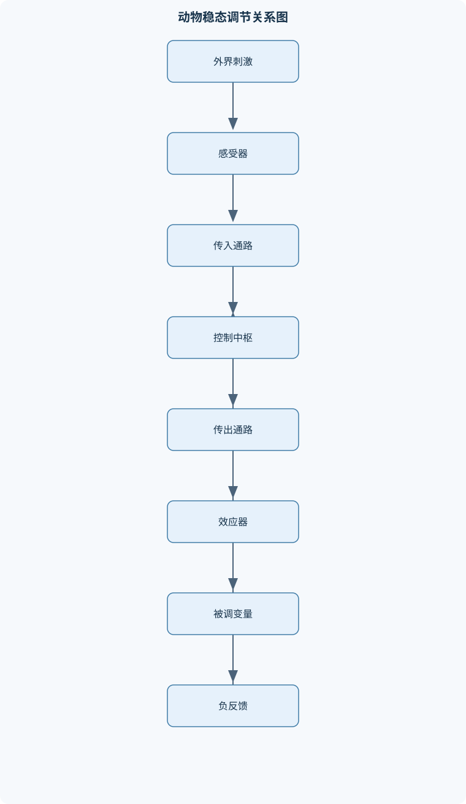
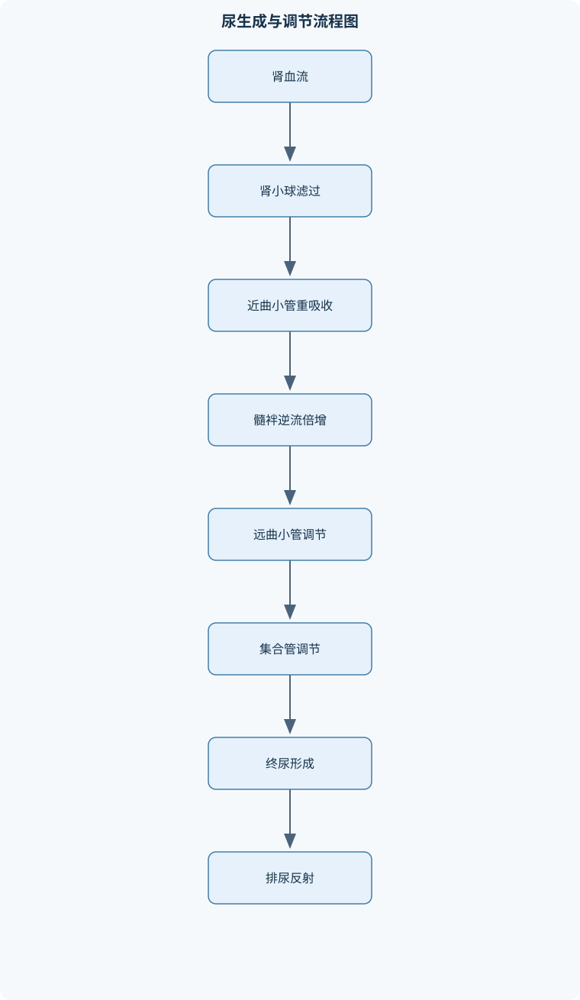

# 动物生理学

## 一、课程整体知识框架

### 课程边界与先修知识

动物生理学研究动物机体各器官系统的正常功能、功能调节及其相互协调，重点包括细胞与组织的功能基础、内环境稳态、血液与循环、神经与肌肉、消化与吸收、呼吸与气体运输、能量代谢与体温调节、泌尿与水盐酸碱平衡、内分泌调节以及生殖和泌乳。课程对象以哺乳动物为主，同时比较鸟类、鱼类、两栖类、爬行类及昆虫的生理适应；不以疾病诊断、药物治疗或临床病理为主要内容。先修知识包括普通生物学、动物解剖学、细胞生物学、组织学、基础化学和基础数学。学习中应能区分结构与功能、局部调节与整体调节、神经调节与体液调节、理想模型与种属差异，并能根据实验数据分析稳态、反馈和器官系统之间的因果关系。





### 1. 研究对象、基本层次与主线

动物生理学研究动物机体在正常状态下各层次的功能及其协调机制。研究层次由低到高包括分子、细胞、组织、器官、器官系统和整体动物。细胞膜上的离子转运构成兴奋性基础，组织的排列方式决定其传导、收缩、分泌或交换能力，器官系统则通过神经、体液和局部调节共同维持整体功能。因此，生理学分析不能只描述结构，也不能把某一器官的局部变化直接等同于整体效应。

课程的中心概念是内环境和稳态。内环境主要指细胞外液，包括血浆、组织液和淋巴等。细胞直接生活在内环境中，氧、营养物质、激素和离子由内环境供应，代谢废物也经内环境转运。稳态不是变量绝对不变，而是在一定范围内受到调节并保持动态相对稳定。例如体温、血糖、血压、血浆渗透压和酸碱度都存在正常波动。稳态调节可按“刺激—感受器—传入通路—控制中枢—传出通路—效应器—反馈”的链条分析。

负反馈使被调变量偏离后产生抵消偏离方向的反应，是体温、血压、血糖和渗透压调节的主要形式。正反馈则使原有变化进一步增强，例如分娩时子宫收缩促进催产素释放，催产素又加强子宫收缩；正反馈必须有明确的终止事件，否则可能破坏系统稳定性。分析调节回路时，应区分控制信息与反馈信息，也应区分控制系统、受控系统和效应器。例如体温调节中，体温感受器和中枢构成控制环节，骨骼肌和代谢器官是效应器，体温本身是被调变量。

### 2. 共同的跨模块因果关系

课程各模块可由四条主线联系起来。第一条是物质和能量流：消化系统摄取并分解营养物质，呼吸系统提供氧并排出二氧化碳，血液循环运输物质，组织细胞进行氧化供能，泌尿系统排出含氮废物并调节水盐和酸碱。第二条是信息流：感受器将刺激换能为电信号，神经系统快速传递，内分泌系统通过激素进行较慢而持久的调节。第三条是机械活动：神经肌肉接头、心肌和胃肠平滑肌均通过膜兴奋、钙离子变化和肌丝相互作用产生收缩，但三类肌肉的调节方式和功能特征不同。第四条是繁殖与后代维持：下丘脑—垂体—性腺轴调节配子发生、排卵、妊娠和泌乳。

细胞膜具有选择透过性。简单扩散由高浓度或高电化学势向低方向移动，不需要代谢能；通道介导扩散依赖特异性离子通道；主动转运可逆电化学梯度进行，需要能量，例如钠钾泵将$3$个$Na^+$泵出细胞、$2$个$K^+$泵入细胞。水跨膜移动主要受渗透压梯度影响。渗透压与溶液中有效渗透粒子数量有关，胶体渗透压则主要由血浆蛋白产生，二者不能混为一谈。

膜电位$V_m$定义为细胞内电位减去细胞外电位，单位通常为mV。理想的单离子平衡电位可由能斯特方程表示：

$$
E_{\mathrm{ion}}=\frac{RT}{zF}\ln\frac{[\mathrm{ion}]_{\mathrm{外}}}{[\mathrm{ion}]_{\mathrm{内}}}
$$

其中$R$为气体常数，$T$为绝对温度，单位为K；$z$为离子价数，$F$为法拉第常数；内外浓度必须使用同一单位。该式只适用于膜对一种离子选择性通透且达到平衡的理想模型。真实细胞同时对多种离子通透，静息电位还受各离子相对通透性、膜泵和细胞内不可透阴离子影响，不能直接把静息电位等同于某一个离子的平衡电位。

动作电位是达到阈值后产生的快速、再生性膜电位变化，具有全或无特征；不应期限制了动作电位频率并保证兴奋沿轴突单向传播。受体可位于细胞膜或细胞内。膜受体常通过离子通道、G蛋白和第二信使发挥作用，起效快；类固醇激素和甲状腺激素可通过细胞内受体调节基因转录，起效较慢但作用持久。组织功能取决于细胞形态、细胞连接、细胞外基质和血供，不能仅按组织名称推断其全部功能。

## 二、章节和模块划分

### 核心知识覆盖清单

本清单用于检查正文是否覆盖本课程的主要知识模块：

- **生理学总论与细胞功能基础**：内环境与稳态的含义、负反馈与正反馈调节、控制系统的感受器、控制中枢和效应器、细胞膜结构与选择透过性、跨膜运输与渗透压、静息电位形成机制、动作电位及其不应期、受体与细胞信号转导、组织结构与功能的关系。
- **血液与体液生理**：血液的组成与功能、血浆、血清及其制备区别、红细胞生成与促红细胞生成素、血红蛋白与氧运输、白细胞分类及免疫防御、血小板与生理性止血、内源性和外源性凝血途径、抗凝与纤维蛋白溶解、血浆渗透压和胶体渗透压、体液分区与水盐平衡。
- **心血管系统生理**：心肌和血管平滑肌的功能特性、心脏传导系统与自律性、心肌动作电位及平台期、心动周期与瓣膜活动、心输出量及其调节、动脉血压的形成与影响因素、血流阻力与血管顺应性、微循环与组织液生成、静脉回心血量调节、压力感受性反射与体液调节。
- **神经生理与肌肉运动**：神经元兴奋性和突触传递、兴奋性与抑制性突触后电位、突触整合、辐散、聚合与环路联系、感受器换能与感觉传导、自主神经系统功能、骨骼肌、心肌和平滑肌比较、神经肌肉接头兴奋传递、骨骼肌兴奋—收缩耦联、肌丝滑行与横桥循环、单收缩、强直收缩、等长和等张收缩。
- **消化、吸收与胃肠调节**：消化道平滑肌的慢波和运动形式、咀嚼、吞咽和食管运动、唾液分泌及其神经调节、胃液成分与胃酸作用、胃运动和胃排空调节、胰液分泌与胰蛋白酶原激活、胆汁、胆盐与脂肪消化吸收、小肠消化和营养物质吸收、反刍动物瘤胃发酵与反刍、胃肠激素和肠神经系统调节。
- **呼吸与气体运输**：呼吸道和肺泡的结构功能、肺通气的压力基础、胸内负压与肺回缩力、肺通气量和肺泡通气量、肺顺应性与气道阻力、肺泡—毛细血管气体交换、通气血流比及其生理意义、血红蛋白运输氧和氧解离曲线、二氧化碳运输与氯转移、呼吸中枢、化学感受器和反射调节。
- **能量代谢与体温调节**：能量代谢的基本概念、直接测热法与间接测热法、呼吸商和氧热价、基础代谢及其测定条件、营养物质的氧化供能、食物特殊动力效应、动物运动时的能量消耗、体温和体核温度、产热与散热途径、体温调节的神经和体液机制。
- **泌尿与水盐酸碱平衡**：肾单位结构与功能分区、肾小球滤过膜、有效滤过压与肾小球滤过率、近曲小管重吸收和分泌、髓袢逆流倍增机制、集合管水重吸收与尿浓缩、抗利尿激素的作用、肾素—血管紧张素—醛固酮系统、酸碱平衡与氢离子排泄、排尿反射与膀胱神经支配。
- **内分泌生理**：激素的分类和作用特征、内分泌、旁分泌和神经分泌、膜受体与第二信使通路、类固醇激素的核受体机制、下丘脑—垂体调节系统、甲状腺激素与生长发育、胰岛素、胰高血糖素和血糖稳态、甲状旁腺激素、维生素D和降钙素、肾上腺皮质和髓质激素、激素分泌的反馈调节。
- **生殖、妊娠与泌乳**：性分化与性成熟、雄性生殖器官和精子发生、支持细胞与间质细胞功能、卵泡发育、排卵和黄体形成、发情周期及其激素基础、受精、顶体反应和多精受精阻断、妊娠识别、着床和胎盘功能、妊娠维持与分娩机制、乳腺发育和乳汁生成、催乳素、催产素与排乳反射。


### 1. 生理学总论与细胞功能基础

本模块建立后续章节共同使用的概念。应先说明细胞外液的分区，再分析稳态调节回路，最后连接膜运输、膜电位、受体和组织功能。一个完整的稳态分析至少要回答：改变的变量是什么、由谁感受、信息通过何种途径传递、效应器改变了什么，以及反馈是否抵消了初始变化。

### 2. 血液与体液生理

血液由血浆和血细胞组成。血浆含水、无机盐、蛋白质、营养物质、激素和代谢产物，承担运输、缓冲、免疫和维持渗透压等功能。血清是血液凝固后析出的液体，通常缺少已参与凝血的纤维蛋白原，部分凝血因子也会减少，并含有凝血过程中释放的物质；血浆则来自加入抗凝剂后分离的液体，保留较完整的凝血成分。样品判别流程为：采血后先判断是否加抗凝剂；未加抗凝剂则待凝固并分离血清；加抗凝剂则离心分离血浆。上清液应基本澄清且无明显细胞成分，但具体实验仍须结合样本质量要求。

红细胞携带血红蛋白，红细胞生成受肾脏产生的促红细胞生成素调节。血红蛋白结合氧的能力受氧分压、pH、二氧化碳、温度和红细胞代谢产物影响。组织代谢增强时，二氧化碳增加、pH下降和温度升高，通常使血红蛋白氧亲和力下降，促进释氧。白细胞包括粒细胞、单核细胞和淋巴细胞等，分别参与吞噬、炎症和特异性免疫。血小板参与黏附、聚集和凝血反应。

凝血可按内源性和外源性启动途径理解，二者汇入共同途径，形成凝血酶并将纤维蛋白原转化为纤维蛋白。抗凝系统限制凝血范围，纤维蛋白溶解系统清除已形成的纤维蛋白。血浆晶体渗透压主要由小分子溶质形成，胶体渗透压主要由蛋白质形成。体液可分为细胞内液和细胞外液，水和电解质在不同区室间分布，受摄入、消化道吸收、肾排泄、皮肤蒸发和呼吸失水共同影响。

### 3. 心血管系统生理

心肌具有兴奋性、传导性、收缩性和自律性。窦房结等特殊心肌细胞能够自发产生节律性兴奋，传导系统使兴奋按一定方向传播。典型工作心肌动作电位的$0$期主要由快速$Na^+$内流引起，平台期有明显$Ca^{2+}$内流并与$K^+$外流相平衡。平台期延长了有效不应期，因此正常心肌不能像骨骼肌那样发生完全强直收缩。

心动周期包括心房收缩、心室收缩和舒张等阶段。房室瓣和半月瓣的开闭由瓣膜两侧压力差决定，而不是由神经直接控制。心输出量$CO$由心率$HR$和每搏量$SV$决定：

$$
CO=HR\times SV
$$

若$HR$单位为次/min、$SV$单位为mL/搏，则$CO$为mL/min，换算为L/min时应除以$1000$。心率适度增加可使心输出量增加，但心率过快会缩短舒张充盈期，使回心血量、心室舒张末期容积和$SV$下降，因此不能断言心输出量必然随心率线性增加。

动脉血压主要取决于心输出量和总外周阻力，可用方向性关系表示：

$$
平均动脉压\approx CO\times 总外周阻力
$$

血管半径对阻力影响显著。理想层流圆管中，流量$Q$与压力差$\Delta P$成正比、与阻力$R$成反比，即$Q=\Delta P/R$；血管内液体黏度用$\eta$表示，管长用$l$表示，半径用$r$表示。该理想关系不适用于强烈脉动、分叉复杂、血管主动收缩或血液非牛顿流动等全部情形。微循环中，毛细血管静水压、组织液静水压、血浆胶体渗透压和组织液胶体渗透压共同影响液体滤出和回流。静脉顺应性大，肌肉泵、呼吸泵和静脉收缩可调节回心血量。压力感受性反射适合快速稳定血压，肾脏、RAAS、ANP和血管加压素等参与较慢调节。

### 4. 神经生理与肌肉运动

神经元兴奋性取决于膜电位、离子通道状态和刺激强度。突触前动作电位使末梢$Ca^{2+}$内流，促进递质释放。兴奋性突触后电位和抑制性突触后电位都是局部电位，能够进行时间总和和空间总和，不等同于动作电位。辐散可使一个神经元影响多个靶细胞，聚合可使多个输入汇聚到一个神经元；环式联系可造成后放现象。感受器把机械、化学、温度或光刺激转换为受体电位，再经感觉传导通路到达中枢。自主神经系统包括交感和副交感部分，其作用具有器官差异，不能简单概括为“交感兴奋、副交感抑制”。

骨骼肌横纹明显、受躯体运动神经支配，适合快速随意运动；心肌具有节律性和长不应期；平滑肌收缩较慢、持续时间较长，受自主神经、激素和局部因素共同调节。骨骼肌兴奋—收缩耦联过程为：神经动作电位到达神经末梢，$Ca^{2+}$内流并释放ACh；ACh引起终板电位和肌膜动作电位；动作电位沿横管传播，促使肌浆网释放$Ca^{2+}$；$Ca^{2+}$与肌钙蛋白结合，使原肌球蛋白移开，肌球蛋白横桥与肌动蛋白结合并进行横桥循环；ATP供应能量，$Ca^{2+}$被泵回肌浆网后肌肉舒张。

单收缩包括潜伏期、收缩期和舒张期。刺激间隔缩短会产生时间总和，连续刺激可形成不完全强直或完全强直。等长收缩时肌肉长度基本不变而张力改变，等张收缩时张力相对稳定而长度改变。实际动作常同时含有两种成分。ATP首先直接供能，磷酸肌酸系统快速补充ATP，糖原和有氧氧化则支持较持久活动。

### 5. 消化、吸收与胃肠调节

消化道平滑肌的慢波决定兴奋性基础，慢波达到阈值后可叠加动作电位并引起收缩。咀嚼增加食物表面积，吞咽由随意期、咽期和食管期组成，唾液分泌主要受神经调节。胃液含盐酸、胃蛋白酶原、黏液和内因子等，盐酸有助于蛋白质变性、激活胃蛋白酶原并抑制部分微生物。胃排空受胃内容物容量、颗粒大小、酸度、渗透压和小肠反馈调节。

胰液中的胰蛋白酶原需在小肠内被肠激酶激活为胰蛋白酶，随后可激活其他酶原。促胰液素主要促进胰腺导管细胞分泌水和碳酸氢盐，胆囊收缩素主要促进胰腺腺泡细胞分泌消化酶并促进胆囊收缩。胆汁中的胆盐乳化脂肪，并形成混合微胶粒，帮助脂肪酸、单酰甘油和脂溶性维生素接近小肠上皮。小肠吸收面积大，具有环形皱襞、绒毛和微绒毛，且黏膜血流和淋巴回流丰富，并具有多种转运蛋白和消化酶，因此是主要吸收部位。

反刍动物瘤胃中的微生物发酵纤维，产生挥发性脂肪酸；反刍有助于重新咀嚼和细化食团。胃肠功能由肠神经系统、迷走神经、交感神经和胃肠激素共同调节，局部调节并不等同于中枢神经直接控制。

### 6. 呼吸与气体运输

肺通气是空气进出肺，肺换气是肺泡与毛细血管之间的气体交换。吸气时膈肌收缩，胸廓扩大，胸膜腔内压进一步降低，跨肺压增大，肺扩张；肺内压低于大气压后空气进入。呼气时静息状态主要依靠肺和胸廓的弹性回缩。胸膜腔负压不是气体直接流动的唯一原因，肺内压与大气压之间的差异才是空气流动的直接动力。

潮气量为$TV$，补吸气量为$IRV$，补呼气量为$ERV$，余气量为$RV$；肺活量$VC=IRV+TV+ERV$，功能余气量$FRC=ERV+RV$，肺总量$TLC=VC+RV$。每分通气量为：

$$
\dot V_E=TV\times 呼吸频率
$$

每分肺泡通气量为：

$$
\dot V_A=(TV-VD)\times 呼吸频率
$$

其中$VD$为生理无效腔，$\dot V_E$和$\dot V_A$单位均为L/min。浅快呼吸时$VD$占$TV$比例较大，肺泡通气效率降低；深慢呼吸在总通气量相近时通常更有利于肺泡换气，但过深或过慢也可能带来其他限制。

气体交换受气体分压差、呼吸膜厚度、交换面积和气体扩散性质影响。通气血流比反映肺泡通气与血流灌注的匹配程度，过高表示通气相对过多，过低表示血流缺少相应通气。血红蛋白运输氧，二氧化碳主要以碳酸氢根形式运输，并伴随氯转移。呼吸中枢受二氧化碳、氢离子和低氧等因素调节，化学感受器与肺牵张反射共同参与呼吸调节。

### 7. 能量代谢与体温调节

能量代谢指机体物质合成、分解和转化中的能量交换。直接测热法测量动物向环境释放的热量；间接测热法根据氧消耗、二氧化碳产生和含氮排出估计能量代谢。呼吸商$RQ$为单位时间二氧化碳产生量与氧消耗量之比，不能在所有情形下与呼吸交换率完全等同。基础代谢测定需控制清醒静息、适宜环境温度、空腹和安静等条件，运动、摄食、寒冷和应激都会提高代谢。

营养物质氧化供能具有底物差异，蛋白质还涉及脱氨和含氮废物处理。食物特殊动力作用以蛋白质最明显。运动时骨骼肌是主要产热器官，肝脏等组织也参与基础产热。体温调节通过产热和散热平衡实现，散热包括辐射、传导、对流和蒸发。下丘脑等中枢整合温度信息，交感神经、躯体运动、甲状腺激素和肾上腺激素共同改变代谢、血流和肌肉活动。恒温动物可在较宽环境温度范围内维持体核温度相对稳定，但鸟类、哺乳动物、爬行类、两栖类和鱼类的体温调节能力存在显著差异。

### 8. 泌尿与水盐酸碱平衡

肾单位包括肾小体、近曲小管、髓袢、远曲小管和集合管。肾小球滤过膜由有孔内皮、基膜和足细胞裂孔构成，既受分子大小影响，也受电荷和膜完整性影响。有效滤过压可写为：

$$
有效滤过压=P_{\mathrm{毛细血管}}+\pi_{\mathrm{囊内}}-\pi_{\mathrm{血浆}}-P_{\mathrm{囊内}}
$$

其中$P$表示静水压，$\pi$表示胶体渗透压；压力方向必须明确。正常情况下囊内液蛋白浓度很低，$\pi_{\mathrm{囊内}}$常近似为零。毛细血管静水压升高使滤过倾向增加，血浆胶体渗透压或囊内压升高使滤过倾向降低；实际GFR还受肾血流、入出球小动脉阻力和滤过膜性质影响。GFR单位为mL/min，RPF表示肾血浆流量，FF为滤过分数，通常定义为$FF=GFR/RPF$。

近曲小管重吸收大量水、钠、碳酸氢根、葡萄糖和氨基酸，并分泌部分有机物和氢离子。髓袢逆流倍增建立肾髓质渗透梯度，集合管在ADH作用下增加水通透性，水沿渗透梯度重吸收，形成浓缩尿；ADH减少时集合管水通透性降低，可形成低渗尿。RAAS在血容量或肾灌注下降时促进钠重吸收、血管收缩和醛固酮释放；ANP则促进钠和水排出。肾脏通过碳酸氢根重吸收、氢离子排泄和氨缓冲维持酸碱平衡。排尿涉及盆神经、腹下神经和阴部神经，膀胱逼尿肌、内括约肌和外括约肌的协调决定排尿。

### 9. 内分泌生理

内分泌是激素进入血液作用于远处靶器官，旁分泌作用于邻近细胞，神经分泌则由神经细胞释放化学信号。肽类和蛋白质激素多作用于膜受体，通过第二信使快速改变酶活性；类固醇激素通过细胞内或核受体调节基因表达；T3和T4虽为含碘激素，但主要通过核受体发挥作用。激素效应取决于浓度、受体数量、受体敏感性、靶细胞状态和降解速度，不能把血液激素浓度变化直接等同于效应变化。

下丘脑通过GnRH、TRH和CRH等调节垂体，垂体再通过TSH、ACTH、FSH、LH、GH和PRL调节靶腺及靶组织。甲状腺激素促进生长发育和基础代谢。进食后胰岛素促进葡萄糖摄取、糖原合成和脂肪合成；禁食时胰高血糖素促进肝糖原分解和糖异生，糖皮质激素通过促进糖异生和提供底物发挥较慢作用。PTH、维生素D和降钙素分别通过骨、肾和肠道以不同方式调节钙磷代谢。肾上腺皮质产生醛固酮和糖皮质激素，髓质产生儿茶酚胺；醛固酮不能归为髓质激素。多数内分泌轴通过负反馈维持稳定。

### 10. 生殖、妊娠与泌乳

性成熟依赖下丘脑—垂体—性腺轴建立。雄性动物中，间质细胞产生雄激素，支持细胞参与精子发生、营养支持和局部屏障形成；精子发生包括精原细胞增殖、减数分裂和精子变形。雌性动物中，卵泡发育伴随雌激素分泌，雌激素在特定阶段可由负反馈转为正反馈，诱发LH峰和排卵；排卵后形成黄体，孕激素升高并改造生殖道环境。

发情周期可按“卵泡生长—雌激素升高—LH峰—排卵—黄体形成—孕激素升高—黄体退化”建立因果链。未妊娠时，子宫产生的PGF2α可促使某些哺乳动物黄体退化；不同物种在排卵方式、妊娠识别、黄体维持和周期长度方面存在差异，不能把一种动物的规律直接推广到全部动物。

受精时精子发生顶体反应并穿过卵母细胞外层，随后形成多精受精阻断。着床后胎盘承担气体、营养、废物和内分泌交换功能。妊娠维持依赖胚胎信号、黄体和胎盘激素的协调；分娩涉及胎儿成熟、子宫机械刺激、催产素和正反馈。乳腺发育受雌激素、孕激素和生长激素等影响，PRL主要促进乳汁合成，OT主要引起肌上皮细胞收缩和排乳。催乳与排乳是不同过程，不能混淆。

### 11. 代表性分析流程与伪代码

#### 稳态调节因果分析流程

输入为刺激、被调变量和观测结果。先判断被调变量偏离方向，再依次确定感受器、传入通路、控制中枢、传出通路和效应器，最后判断反馈方向。若反馈使变量向设定范围返回，则属于负反馈；若使变化增强并由终止事件结束，则属于正反馈。该流程适用于体温、血压、血糖和渗透压分析，按调节环节逐一梳理，复杂度约为$O(n)$。

```text
伪代码
输入：刺激 S，被调变量 X，观测结果 Y
输出：调节回路及反馈类型

1. 确定 X 的正常范围和当前偏离方向
2. 若存在能感受 X 变化的感受器，则记录 R
3. 记录从 R 到控制中枢的传入通路 A
4. 确定控制中枢 C 的整合结果和传出通路 E
5. 确定效应器 F 及其改变的生理过程
6. 判断 F 对 X 的影响方向
7. 若影响抵消 X 的初始偏离，输出“负反馈”
8. 若影响增强初始偏离且存在终止事件，输出“正反馈”
9. 若无法闭合因果链，标记为“信息不足”，不得直接下结论
```

#### 呼吸数据分析流程

输入为$TV$、呼吸频率、$VD$和气体分压。先统一容量单位，再计算$\dot V_E$和$\dot V_A$，比较肺泡与血液的分压差，随后检查呼吸膜厚度、交换面积和通气血流比。输出应是通气改变、扩散限制或灌注匹配改变的机制解释，不能仅凭单项指标进行疾病诊断。

#### 肾功能因果分析流程

输入为血压、血浆渗透压、尿量、尿渗透压或滤过指标。先分析肾小球滤过，再分析肾小管重吸收和分泌，最后加入ADH、RAAS和ANP的作用，形成“血浆—原尿—管液—终尿”的质量守恒链。若解释能够同时说明尿量、尿浓度和水盐变化方向，流程才算闭合。

### 12. 代表性例题

#### 例题一：心率过快时心输出量如何变化

**题干：**某动物心率由每分钟70次升高到每分钟140次，舒张期明显缩短，要求判断心输出量变化趋势。

**分析与解答：**先写$CO=HR\times SV$。心率增加本身有提高$CO$的作用，但舒张期缩短使心室充盈时间减少，回心血量和舒张末期容积下降，进而使$SV$下降。因此最终结果取决于心率增加幅度和每搏量下降幅度，不能简单断言$CO$一定升高或降低。

**结果验证：**若$SV$下降幅度小于心率增加幅度，$CO$可升高；若舒张充盈严重受限，$CO$可不变甚至下降。

**变式：**若同时给予增强静脉回流的刺激，$SV$下降可能减轻，心输出量更可能增加，但仍需结合实际数据。

#### 例题二：肺通气量计算

**题干：**某动物$TV=0.50$ L，呼吸频率为20次/min，$VD=0.15$ L，求每分通气量和每分肺泡通气量。

**逐步解答：**

$$
\dot V_E=0.50\times20=10.0\ \mathrm{L/min}
$$

$$
\dot V_A=(0.50-0.15)\times20=7.0\ \mathrm{L/min}
$$

**结果验证：**肺泡通气量小于每分通气量，差值为无效腔通气量$0.15\times20=3.0$ L/min，单位一致。

**变式：**若$TV=0.30$ L、频率约为33.3次/min，使$\dot V_E$仍约为10 L/min，则$\dot V_A=(0.30-0.15)\times33.3\approx5.0$ L/min，说明浅快呼吸换气效率较低。

#### 例题三：肾小球滤过压变化

**题干：**分别判断肾小球毛细血管血压升高、血浆胶体渗透压升高和囊内压升高对滤过率的影响。

**逐步解答：**根据有效滤过压公式，毛细血管静水压是促进滤过的力量，因此其升高使滤过倾向增加；血浆胶体渗透压是阻碍滤过的力量，其升高使滤过减少；囊内压也是阻力，其升高使滤过减少。

**结果验证：**必须同时考虑肾血流、入出球小动脉阻力和滤过膜通透性，不能只凭单一压力项判断最终GFR。

**变式：**若滤过膜通透性下降，即使毛细血管压升高，GFR也可能升高不明显。

#### 例题四：饮水后的清水利尿

**题干：**动物短时间大量饮用清水后尿量增加，解释其调节过程。

**逐步解答：**饮水使血浆晶体渗透压下降，渗透压感受器兴奋性下降，ADH释放减少；远曲小管和集合管水通透性下降，水重吸收减少，尿量增加且尿渗透压降低。该过程主要涉及晶体渗透压，不应写成血浆胶体渗透压升高。

**结果验证：**若同时存在循环血量显著下降，容量和压力信号可能促进ADH释放，利尿程度会减弱。

**变式：**若ADH水平升高，即使饮水后血浆渗透压下降，集合管仍可保持较高水通透性，尿液浓缩能力增强。

#### 例题五：坐骨神经—腓肠肌兴奋—收缩耦联

**题干：**电刺激坐骨神经后腓肠肌收缩，说明从神经兴奋到肌肉收缩的过程。

**逐步解答：**神经动作电位到达末梢后，电压门控$Ca^{2+}$通道开放；$Ca^{2+}$内流使含ACh的囊泡释放递质；ACh作用于终板受体，引起终板电位和肌膜动作电位；动作电位沿肌膜和横管传导，促使肌浆网释放$Ca^{2+}$；$Ca^{2+}$与肌钙蛋白结合，原肌球蛋白移位，肌球蛋白横桥与肌动蛋白结合并进行横桥循环，肌小节缩短。随后$Ca^{2+}$被泵回肌浆网，肌肉舒张。

**结果验证：**若刺激间隔短于舒张所需时间，机械收缩可发生时间总和；若刺激落在神经或肌肉有效不应期，则不能产生新的正常收缩。

**变式：**直接刺激肌肉可绕过神经末梢，但仍需经过肌膜动作电位、横管传导和钙离子释放过程。

### 13. 实验与项目流程

#### 实验一：验证心肌不发生骨骼肌式完全强直收缩

**输入数据：**适当的离体心肌标本、刺激器、张力或位移记录装置、不同频率的阈上刺激和时间标记。

**步骤：**

1. 在适宜温度和灌流条件下稳定标本，记录自发收缩曲线。
2. 先测定能够引起单次收缩的阈上刺激强度。
3. 分别施加低频和逐步升高频率的刺激，记录刺激时刻、动作反应和机械收缩。
4. 将刺激间隔与心肌动作电位平台期、有效不应期和机械收缩持续时间比较。
5. 观察是否出现收缩融合、完全强直或新的独立收缩。

**评价标准：**若后续刺激常落在有效不应期内，不能引起新的兴奋，机械曲线不出现骨骼肌式完全融合强直，结果支持心肌具有长不应期。评价时需排除刺激强度不足、标本缺氧、温度不当和电极接触不良。

**排错方法：**若完全无反应，应检查标本活性、刺激回路和电极位置；若出现异常叠加，应确认是否为非典型标本、记录伪差或刺激落在相对不应期，而不能立即否定心肌长不应期规律。

#### 实验二：呼吸通气与换气数据分析项目

**输入数据：**不同动物或不同呼吸状态下的$TV$、呼吸频率、$VD$、肺泡氧分压、二氧化碳分压及必要的血液气体数据。

**步骤：**

1. 统一容量、时间和压力单位。
2. 计算$\dot V_E=TV\times频率$和$\dot V_A=(TV-VD)\times频率$。
3. 比较不同状态下肺泡通气量的变化，而不是只比较呼吸频率。
4. 根据肺泡与血液之间的分压差判断扩散动力。
5. 检查通气血流比是否可能失配，并区分通气问题、扩散问题和灌注问题。

**评价标准：**计算结果应单位一致、数值可复核，解释必须同时包含通气量和气体分压，不能仅凭一个指标作疾病判断。项目产出应包括原始数据表、计算过程、机制结论和误差来源。

**排错方法：**若肺泡通气量大于每分通气量，通常是公式、无效腔单位或小数换算错误；若总通气量不变但肺泡通气量明显下降，应优先检查是否存在浅快呼吸，而不是直接判断肺泡扩散障碍。

## 三、核心概念的详细解释

### 1. 内环境、稳态与调节系统

动物细胞并不直接与外界环境接触，而是生活在细胞外液构成的内环境中。血浆、组织液和淋巴是内环境的主要组成部分。内环境为细胞提供氧、葡萄糖、氨基酸、无机盐和激素，并接受二氧化碳、尿素等代谢产物。稳态不是某一指标恒定不变，而是机体通过神经、体液和局部调节，使被调变量在一定范围内动态波动。例如，体温、血糖、血压、血浆渗透压和酸碱度均具有昼夜变化、进食后变化或运动后变化。

一个完整的稳态调节系统包括刺激、感受器、传入通路、控制中枢、传出通路、效应器和反馈信息。感受器检测被调变量或其变化，控制中枢将输入与设定范围比较，效应器改变被调变量，反馈则将调节结果传回控制系统。体温下降时，寒冷感受器和中枢整合信息，交感神经、骨骼肌和内分泌系统共同增加产热、减少散热。此时骨骼肌等产热器官属于效应器或受控系统，而不是控制信息。

负反馈使调节结果抵消原始偏离，是维持稳态的主要机制。血糖升高促进胰岛素分泌，胰岛素促进组织摄取和储存葡萄糖，使血糖回落。正反馈则使变化进一步增强，必须有明确的终止条件。分娩过程中，子宫牵张促进催产素释放，催产素加强子宫收缩，胎儿娩出后牵张刺激消失，正反馈终止。若将正反馈误认为维持稳态的通常机制，便无法解释其必须依赖终止事件的原因。

### 2. 细胞膜、跨膜运输与细胞信号

细胞膜由脂质双层、膜蛋白和糖类结构组成。脂质双层形成疏水屏障，允许部分脂溶性分子通过，但限制离子和大多数极性分子。膜蛋白可作为离子通道、载体、泵、受体或黏附结构，因此膜的选择透过性并不等于“只允许某一种物质通过”。

简单扩散沿浓度梯度或电化学梯度进行，不直接消耗代谢能；通道介导扩散具有选择性和门控特征；主动转运则可逆电化学梯度移动。钠钾泵每水解一个ATP，通常将3个$Na^+$泵出细胞、2个$K^+$泵入细胞，既维持离子梯度，也使膜内相对带负电。协同转运利用一个离子的电化学梯度驱动另一物质运输，例如近曲小管的钠—葡萄糖协同转运。水的净移动受有效渗透粒子造成的渗透压差影响，血浆蛋白形成的胶体渗透压则是血管内留住水分的重要因素。

受体信号可分为膜受体和细胞内受体。配体门控离子通道改变膜通透性，起效最快；G蛋白偶联受体可通过腺苷酸环化酶、磷脂酶等产生第二信使；酶联受体常通过蛋白激酶级联放大信号。类固醇激素和甲状腺激素可进入细胞，与胞质或细胞核受体结合，改变基因转录，起效较慢但作用持续。激素浓度升高不一定导致效应同比增强，因为受体数量、受体敏感性、信号通路状态和靶细胞代谢均会影响最终效应。

### 3. 神经元兴奋性与膜电活动

静息状态下，神经元膜内电位低于膜外，形成静息电位。$V_m$定义为细胞内电位减去细胞外电位，单位通常为mV。静息电位由钾离子漏通道、钠钾泵、细胞内不可透阴离子以及少量钠离子通透共同决定。若膜只对一种离子通透，膜电位趋向该离子的平衡电位；真实神经元同时对多种离子通透，因此静息电位不能简单等同于钾平衡电位。

达到阈值后，电压门控钠通道快速开放，$Na^+$内流使膜去极化；随后钠通道失活，电压门控钾通道开放，$K^+$外流使膜复极，短暂的钾通透性增加可造成超极化。绝对不应期内无论刺激多强都不能产生新的动作电位，相对不应期需要更强刺激。动作电位具有全或无特征，强刺激主要通过增加放电频率或募集更多神经元编码，而不是使单个动作电位无限增大。

突触前膜动作电位使电压门控$Ca^{2+}$通道开放，钙内流触发囊泡释放递质。递质与突触后膜受体结合，形成兴奋性突触后电位或抑制性突触后电位。突触后电位是局部电位，具有时间总和和空间总和，不能与动作电位混为一谈。一个神经元可接受多个突触输入，形成聚合；一个神经元的轴突分支影响多个靶细胞，形成辐散；环式联系可使兴奋在回路中反复传播，产生后放现象。

### 4. 血液、体液与止血

血液由血浆和血细胞组成。血浆含水、无机盐、蛋白质、营养物质、激素和代谢产物，具有运输、缓冲、免疫和维持渗透压等作用。血清是血液凝固后析出的液体，因纤维蛋白原等凝血成分在凝固过程中被消耗或减少，不能把血清视为“含有完整凝血因子的血浆”。制备血浆需在采血时加入适宜抗凝剂并分离上清；制备血清则不加抗凝剂，待凝固后分离液体部分。

红细胞内的血红蛋白可逆结合氧和部分二氧化碳，红细胞生成受肾脏产生的促红细胞生成素调节。白细胞包括粒细胞和无粒细胞，承担吞噬、炎症反应和特异性免疫等功能。血小板参与黏附、聚集和凝血因子反应。凝血过程可由组织因子启动的外源性途径或血液接触激活的内源性途径启动，二者最终汇入共同途径，形成凝血酶并将纤维蛋白原转变为纤维蛋白。抗凝系统和纤维蛋白溶解系统限制凝血范围，避免止血反应扩展为全身性凝固。

血浆总渗透压主要由小分子溶质决定，胶体渗透压主要由血浆蛋白决定。血浆胶体渗透压下降时，组织液生成倾向增加；但组织液回流还取决于毛细血管静水压、淋巴回流和毛细血管通透性，不能仅凭一个压力因素判断水分分布。

### 5. 心血管功能与血流动力学

心肌具有兴奋性、传导性、收缩性和自律性。窦房结等特殊心肌细胞可自发产生节律性兴奋，房室结延迟传导有利于心房收缩后心室充盈。典型工作心肌动作电位的0期主要由快速$Na^+$内流产生，平台期有显著$Ca^{2+}$内流和$K^+$外流，较长的不应期使心肌不能发生骨骼肌式完全强直收缩。

心动周期包括心房收缩、心室收缩和舒张阶段。房室瓣和半月瓣的开闭由瓣膜两侧压力差决定，而不是由神经直接开关。心室收缩时，心室内压升高使房室瓣关闭；当心室压超过动脉压时，半月瓣开放。心输出量由心率和每搏量共同决定：

$$
CO=HR\times SV
$$

其中$CO$为心输出量，单位为L/min；$HR$为心率，单位为次/min；$SV$为每搏量，通常用mL/搏表示，计算时必须统一容量单位。心率适度增加可使$CO$增加，但心率过快会缩短舒张充盈期，降低回心血量和心室舒张末期容积，使$SV$下降，因此不能断言心率越快，心输出量必然越大。

血流量与压力差成正比，与阻力成反比：

$$
Q=\frac{\Delta P}{R}
$$

在理想、稳定、层流且管道为刚性圆管时，泊肃叶关系可写为：

$$
R=\frac{8\eta l}{\pi r^4}
$$

其中$\eta$为黏度，$l$为管长，$r$为管半径。半径对阻力的影响具有四次方关系，是小动脉调节血流的重要基础；但真实血管具有弹性，血液具有细胞成分，流动也可能出现脉动和湍流，不能机械套用理想公式。平均动脉压主要受心输出量和总外周阻力影响，急性变化由压力感受性反射、交感和迷走神经调节，长期则与肾脏水盐排泄及RAAS、ANP等体液机制密切相关。

### 6. 肌肉收缩与运动

骨骼肌由肌纤维、肌束和整块肌肉构成，肌纤维外有肌内膜，肌束外有肌束膜，整块肌肉外有肌外膜。肌小节位于相邻两条Z线之间，粗肌丝主要由肌球蛋白组成，细肌丝含肌动蛋白、原肌球蛋白和肌钙蛋白。横管将膜兴奋传入肌纤维内部，纵管和终末池构成肌浆网系统。

骨骼肌兴奋—收缩耦联的顺序为：运动神经动作电位到达末梢，末梢$Ca^{2+}$内流，释放ACh；ACh作用于终板受体，形成终板电位并触发肌膜动作电位；动作电位沿肌膜和横管传播，促使肌浆网释放$Ca^{2+}$；钙与肌钙蛋白结合，使原肌球蛋白移位，暴露肌动蛋白结合位点；肌球蛋白横桥在ATP参与下完成结合、摆动和脱离，使细肌丝向肌小节中央滑行。$Ca^{2+}$被肌浆网重新摄取后，横桥活动减少，肌肉舒张。

单收缩包含潜伏期、收缩期和舒张期。若下一次刺激到来时前一次收缩尚未完全舒张，机械反应发生时间总和；刺激频率足够高时可形成不完全强直或完全强直。心肌因动作电位平台期长、有效不应期长，通常不能产生正常强直收缩。等长收缩表现为肌肉长度基本不变而张力增加，适于维持姿势；等张收缩表现为张力相对稳定而肌肉长度改变，但真实运动常是两者的组合。

### 7. 消化、吸收与胃肠调节

消化道平滑肌的慢波决定兴奋性基础，慢波本身不一定引起收缩，只有达到阈值并产生动作电位时才引起较强收缩。消化道运动包括分节运动和推进性蠕动。咀嚼、吞咽和食管运动使食物形成适于运输和消化的食团。唾液可润滑食物，并含有初步消化成分；胃液中的盐酸有利于蛋白质变性、杀灭部分微生物并为胃蛋白酶提供适宜环境。胃排空受胃内机械和化学刺激以及小肠反馈共同调节。

胰液含消化酶和碳酸氢盐。胰蛋白酶原需在小肠腔内先由肠激酶（肠刷状缘相关的肠激活酶）激活为胰蛋白酶，随后胰蛋白酶可激活其他酶原。促胰液素主要促进胰腺导管细胞分泌水和碳酸氢盐，胆囊收缩素主要促进胰腺腺泡细胞分泌消化酶并促进胆囊收缩。胆盐乳化脂肪并形成混合微胶粒，帮助脂肪消化产物接近小肠上皮表面。

小肠是主要吸收部位，不仅因为长度较长，还因为环形皱襞、绒毛和微绒毛显著扩大表面积，黏膜具有丰富的毛细血管和淋巴管，且存在多种特异性转运系统。葡萄糖和氨基酸等水溶性产物主要进入毛细血管，长链脂肪酸和单酰甘油经重新合成后形成乳糜微粒，主要进入淋巴。反刍动物的瘤胃微生物可发酵纤维，产生挥发性脂肪酸，为宿主提供重要能量；反刍则有利于重新咀嚼和进一步破碎粗饲料。胃肠功能由肠神经系统、迷走神经、交感神经和胃肠激素共同调节，不能只归因于单一激素。

### 8. 呼吸与气体运输

肺通气是空气进出肺，肺换气是肺泡与毛细血管之间的气体交换，二者必须区分。吸气时膈肌收缩，胸腔容积增加，胸膜腔内压进一步降低，跨肺压增大，肺扩张；肺内压低于大气压后，空气进入。呼气时吸气肌舒张，肺和胸廓的弹性回缩使肺内压相对升高，空气排出。胸内负压是维持肺扩张的重要条件，但空气流动的直接动力是肺内压与外界压力之间的差。

每分通气量和肺泡通气量分别为：

$$
\dot V_E=V_T\times f
$$

$$
\dot V_A=(V_T-V_D)\times f
$$

其中$V_T$为潮气量，$V_D$为生理无效腔，$f$为呼吸频率，$\dot V_E$和$\dot V_A$单位均为L/min。若$V_T=0.50$ L、$V_D=0.15$ L、$f=20$次/min，则$\dot V_E=10.0$ L/min，$\dot V_A=7.0$ L/min。相同每分通气量下，浅快呼吸因无效腔占比更大，肺泡通气量可能下降。

气体交换受气体分压差、交换面积、呼吸膜厚度和气体扩散性质影响。肺泡与血液之间分压差越大、交换面积越大、膜越薄，扩散越有利。通气血流比反映肺泡通气与肺血流的匹配程度；局部通气不足或灌注不足都可降低气体交换效率。血红蛋白氧解离曲线受$pH$、二氧化碳分压、温度和红细胞代谢产物影响。组织活动增强时，$CO_2$增加、$pH$下降、温度升高，血红蛋白对氧的亲和力通常下降，有利于组织摄取氧。

### 9. 能量代谢与体温调节

能量代谢是营养物质在体内转化、储存和利用能量的过程。直接测热法测量动物向环境释放的热量；间接测热法根据氧消耗量、二氧化碳产生量和底物类型估算能量消耗。呼吸商为：

$$
RQ=\frac{\text{单位时间二氧化碳产生量}}{\text{单位时间氧消耗量}}
$$

RQ反映氧化底物的相对类型，但不应在所有情境下与呼吸交换率完全等同。基础代谢的测定需要相对安静、清醒、空腹、适宜环境温度等条件，否则运动、消化、寒冷和应激会改变结果。食物特殊动力作用通常以蛋白质最明显，运动时骨骼肌是主要产热器官之一，肝脏等器官也参与基础产热。

体温由体核温度和体表温度共同构成，哺乳动物通常通过下丘脑等中枢整合温度信息。产热包括基础代谢、肌肉活动、寒战和非寒战产热；散热包括辐射、传导、对流和蒸发。体温调节须区分行为调节与自主性调节，也要考虑鸟类、鱼类、两栖类和爬行类的体温调节能力不同。鱼类和两栖类体温较多受环境影响，不能直接套用哺乳动物的恒温机制。

### 10. 泌尿、水盐和酸碱平衡

尿液形成包括肾小球滤过、肾小管和集合管重吸收以及分泌。肾小球滤过膜由有孔内皮、基底膜和足细胞裂孔等结构组成，允许水和小分子通过，但限制血细胞和大分子蛋白。有效滤过压可表示为：

$$
P_{\mathrm{eff}}=P_{\mathrm{GC}}+\pi_{\mathrm{BS}}-\pi_{\mathrm{GC}}-P_{\mathrm{BS}}
$$

其中$P_{\mathrm{GC}}$为肾小球毛细血管静水压，$P_{\mathrm{BS}}$为囊内压，$\pi_{\mathrm{GC}}$为血浆胶体渗透压，$\pi_{\mathrm{BS}}$为囊内液胶体渗透压。正常情况下囊内蛋白质很少，$\pi_{\mathrm{BS}}$可近似为零。毛细血管压升高使滤过增加，囊内压或血浆胶体渗透压升高使滤过减少；实际滤过率还受肾血流和滤过膜通透性影响。

近曲小管重吸收大量钠、水、碳酸氢盐、葡萄糖和氨基酸，并分泌氢离子和氨。葡萄糖重吸收存在转运上限，超过能力时才会出现在尿中。髓袢逆流倍增机制建立肾髓质渗透梯度，集合管在ADH作用下增加水通透性，水沿渗透梯度重吸收，形成浓缩尿；ADH减少时集合管水通透性降低，可形成低渗尿。RAAS主要在血容量或肾灌注下降时促进钠水潴留，ANP则倾向于促进钠排出和降低容量负荷。

酸碱调节依靠缓冲系统、肺排出二氧化碳以及肾脏排泄氢离子和重吸收碳酸氢盐。排尿时，盆神经促进逼尿肌收缩并使内括约肌舒张；交感神经有利于膀胱储尿；阴部神经控制外括约肌。排尿反射受脊髓反射和高位中枢共同影响，不能简单归结为某一条神经单独控制。

### 11. 内分泌调节

内分泌是腺体或细胞释放激素进入体液后作用于远处靶组织；旁分泌作用于邻近细胞，神经分泌则由神经细胞释放化学信号。肽类和蛋白质激素通常作用于膜受体，通过第二信使快速调节酶活性；类固醇激素通常作用于细胞内受体，调节基因表达。激素效应取决于浓度、受体、靶细胞状态和反馈回路，不能仅凭血液中激素含量判断生理效应。

下丘脑通过释放激素调节垂体，垂体再调节甲状腺、肾上腺皮质和性腺。TRH—TSH—甲状腺轴调节$T_3$、$T_4$，参与生长发育和能量代谢；CRH—ACTH—肾上腺皮质轴调节糖皮质激素；GnRH—FSH/LH—性腺轴调节配子发生和性激素分泌。外周激素升高后反过来抑制上游分泌，构成负反馈。

胰岛素总体促进葡萄糖摄取、糖原合成和脂肪合成，使血糖下降；胰高血糖素促进肝糖原分解和糖异生，使血糖升高；糖皮质激素通过促进糖异生、蛋白质分解等提供底物，作用较慢，常在禁食或应激中更加明显。PTH促进血钙升高，维生素D促进肠道钙磷吸收，降钙素总体上抑制骨吸收倾向，但三者作用部位和调节强度不同。醛固酮由肾上腺皮质分泌，促进远曲小管和集合管钠重吸收、钾排泄，不能归为肾上腺髓质激素。

### 12. 生殖、妊娠与泌乳

雄性生殖系统中，曲细精管支持精子发生；支持细胞提供营养、形成血睾屏障并参与局部调节；间质细胞产生雄激素。雌性生殖中，卵泡发育伴随雌激素变化，成熟卵泡在适宜的LH峰作用下排卵，排卵后形成黄体并分泌孕激素。发情周期各阶段的长度、排卵方式和黄体维持机制具有种属差异，不能将某一种哺乳动物的周期模式直接推广到全部动物。

受精包括精子获能、顶体反应、与卵细胞膜结合以及多精受精阻断。着床后，胎盘承担气体、营养和代谢产物交换，并具有内分泌功能。妊娠识别依赖胚胎信号阻止母体黄体退化，不同动物的妊娠识别信号不同。未妊娠时，子宫产生的$PGF_{2\alpha}$可促使黄体退化；妊娠维持则要求黄体功能或胎盘激素持续存在，具体机制具有种属差异。

乳腺发育受雌激素、孕激素和生长激素等共同影响。PRL主要促进乳汁合成，OT主要引起乳腺肌上皮细胞收缩，使乳汁排出；二者不能混淆。吸吮刺激经感觉神经传入中枢，促进PRL和OT释放，形成泌乳和排乳反射。鸟类、鱼类、两栖类、爬行类和昆虫在生殖方式、胚胎发育、体温调节和繁殖内分泌方面存在明显差异，哺乳动物模型只能作为比较基础，不能作为所有动物的绝对规律。

## 四、重要定义、公式、定理和推导

### 专业审校补充：关键定义与适用边界

酸碱平衡的核心是血液中氢离子浓度、碳酸氢盐和二氧化碳分压之间的协调关系。哺乳动物体液在接近体温、二氧化碳—碳酸氢盐缓冲体系达到近似平衡时，可用Henderson–Hasselbalch关系表示：$pH=6.1+\log_{10}\frac{[HCO_3^-]}{0.03\times P_{CO_2}}$。其中$[HCO_3^-]$单位为mmol/L，$P_{CO_2}$通常用mmHg表示，0.03为二氧化碳在血浆中的溶解系数，具体数值受温度和物种影响。$HCO_3^-$主要反映肾脏及代谢因素，$P_{CO_2}$主要反映肺通气因素，因此碳酸氢盐下降或二氧化碳升高都会使pH下降，但不能仅凭pH判断原发原因。肺调节起效较快，肾脏通过重吸收碳酸氢盐、分泌氢离子及生成新碳酸氢盐进行较慢补偿。补偿只能减小偏离，不能把代偿结果误认为病因已经消失。该公式适合解释哺乳动物细胞外液的理想缓冲关系；鸟类、鱼类及不同体温动物的血液缓冲能力、温度修正和参考范围存在差异，不能机械套用同一数值。


### 1. 膜电位与离子平衡电位

理想单离子条件下，某离子的平衡电位由能斯特方程给出：

$$
E_{\mathrm{ion}}=\frac{RT}{zF}\ln\frac{[\mathrm{ion}]_{\mathrm{外}}}{[\mathrm{ion}]_{\mathrm{内}}}
$$

$R$为气体常数，$T$为绝对温度，单位为K，$z$为离子价数，$F$为法拉第常数，内外浓度必须使用同一单位。推导逻辑是：离子跨膜运动同时受浓度梯度和电场力影响；当两种驱动力大小相等、方向相反时，净电化学驱动力为零，此时膜电位就是该离子的平衡电位。

该式只适用于膜主要对一种离子通透、温度固定且达到电化学平衡的理想模型。真实细胞同时对$Na^+$、$K^+$、$Cl^-$等离子通透，膜电位由多种离子的浓度梯度和相对通透性共同决定，因此应使用多离子模型分析，不能把$V_m$直接写成任一$E_{\mathrm{ion}}$。

### 2. 心输出量、血压与血流

心输出量由每搏量和心率相乘得到：

$$
CO=HR\times SV
$$

若$HR=70$次/min、$SV=70$ mL/搏，则：

$$
CO=70\times70=4900\ \text{mL/min}=4.9\ \text{L/min}
$$

该计算的前提是心率和每搏量在所测时间内具有代表性。若心率从70次/min升高至140次/min，但舒张期明显缩短，回心血量减少并导致每搏量由70 mL降至35 mL，则：

$$
CO=140\times35=4900\ \text{mL/min}
$$

因此，心率增加并不保证心输出量增加。心率继续升高时，每搏量下降幅度若超过心率增加带来的补偿，心输出量还可能下降。

循环系统中：

$$
Q=\frac{\Delta P}{R}
$$

说明在阻力不变时，压力差增大，流量增加；在压力差不变时，阻力增加，流量减少。理想圆管中：

$$
R=\frac{8\eta l}{\pi r^4}
$$

若血管半径缩小为原来的$1/2$，在黏度、管长和压力差均不变的理想条件下，阻力增加为原来的$16$倍，流量降为原来的$1/16$。但真实血管可发生舒缩，且血流常有脉动，故该推导用于说明方向和敏感性，不应直接替代复杂血流测量。

平均动脉压可用近似关系表示为：

$$
MAP\approx CO\times TPR
$$

其中$MAP$为平均动脉压，$TPR$为总外周阻力。急性血压变化主要通过压力感受性反射改变心率、心肌收缩力和血管阻力；长期血压则受到肾脏钠水排泄、RAAS和体液容量调节。将急性神经调节与慢性肾脏调节混为一谈，会错误解释持续性血容量变化。

### 3. 呼吸通气与气体交换

每分通气量为：

$$
\dot V_E=V_T\times f
$$

肺泡通气量为：

$$
\dot V_A=(V_T-V_D)\times f
$$

其中$V_T$、$V_D$的单位必须一致，$f$为每分钟呼吸次数。若动物采用深慢呼吸和浅快呼吸，两者$\dot V_E$相同，但浅快呼吸的$V_D/V_T$较大，$\dot V_A$较小，肺泡气体更新效率较低。这说明评价通气不能只看总进气量，还必须扣除无效腔。

肺泡—毛细血管气体交换可根据扩散关系理解：

$$
\text{扩散量}\propto \frac{A\cdot D\cdot\Delta P}{T}
$$

其中$A$为交换面积，$D$为气体扩散性质，$\Delta P$为气体分压差，$T$为呼吸膜厚度。交换面积减少、膜厚增加、分压差减小或通气血流比例失配，均会降低气体交换。该关系是理想扩散模型，真实气体交换还受血流速度、血红蛋白结合、局部通气和灌注分布影响。

### 4. 氧运输与氧解离曲线

血液中的氧主要与血红蛋白可逆结合，少量溶解于血浆。肺部氧分压较高，有利于血红蛋白结合氧；组织中氧分压较低、$CO_2$和温度较高，且$pH$较低，有利于血红蛋白释放氧。氧解离曲线右移表示血红蛋白对氧亲和力下降，通常有利于组织释氧；左移表示亲和力升高，通常有利于肺部装载氧，但未必有利于组织释放氧。

不能把氧分压和血氧含量等同。血红蛋白数量、血红蛋白饱和度和溶解氧共同决定总氧含量；即使氧分压正常，血红蛋白减少也可能使总携氧量降低。二氧化碳可溶解于血浆、形成碳酸氢盐或与血红蛋白结合运输。组织红细胞中碳酸氢盐生成增加时，氯离子进入红细胞以维持电中性，这一过程称氯转移。

### 5. 肾小球滤过与尿液浓缩

有效滤过压为：

$$
P_{\mathrm{eff}}=P_{\mathrm{GC}}+\pi_{\mathrm{BS}}-\pi_{\mathrm{GC}}-P_{\mathrm{BS}}
$$

若$P_{\mathrm{GC}}$升高而其他因素不变，$P_{\mathrm{eff}}$增大，肾小球滤过倾向增加；若$P_{\mathrm{GC}}$下降，滤过倾向减少。血浆胶体渗透压$\pi_{\mathrm{GC}}$升高会抵抗水分进入肾小囊，使滤过减少；囊内压$P_{\mathrm{BS}}$升高也会抵抗滤过。正常情况下$\pi_{\mathrm{BS}}$较小，可近似忽略，但若囊内出现较多蛋白质，该近似便不再成立。

尿液浓缩可按三步推导：第一，近曲小管重吸收大量水和溶质，减少原尿体积；第二，髓袢升支主动转运盐而对水通透性低，建立髓质渗透梯度，降支则允许水外流；第三，ADH增加集合管水通透性，使水沿髓质渗透梯度重吸收。ADH缺少时，集合管不能有效利用髓质梯度，水重吸收减少，尿量增加且尿液可低渗。若血浆晶体渗透压下降，渗透压感受器兴奋性降低、ADH释放减少，是清水利尿的主要因果链，不能写成血浆胶体渗透压升高所致。

### 6. 血糖与激素反馈

进食后，血糖升高刺激胰岛素释放。胰岛素促进骨骼肌和脂肪组织摄取葡萄糖，促进肝脏和肌肉合成糖原，并促进脂肪合成，因此血糖趋向下降。禁食时，胰高血糖素促进肝糖原分解和糖异生；糖皮质激素通过促进糖异生和蛋白质分解提供底物，但起效较慢。三者共同作用可形成“进食期储存、禁食期动员”的调节逻辑。

该过程是负反馈：血糖升高增强胰岛素作用，血糖下降后胰岛素刺激减弱；血糖下降增强胰高血糖素作用，血糖恢复后其释放减少。实际动物中还需考虑运动、应激、妊娠、泌乳和种属差异。激素浓度与效应之间并非线性关系，受体敏感性、靶组织数量和激素清除速度均会造成偏离。

### 7. 骨骼肌兴奋—收缩耦联

完整因果链为：

1. 电刺激或运动神经动作电位到达神经末梢；
2. 突触前膜电压门控$Ca^{2+}$通道开放，钙内流；
3. ACh囊泡释放并作用于终板受体；
4. 终板电位达到阈值，肌膜产生动作电位；
5. 动作电位沿肌膜进入横管；
6. 横管电活动引起肌浆网释放$Ca^{2+}$；
7. $Ca^{2+}$与肌钙蛋白结合，原肌球蛋白移位；
8. 肌球蛋白横桥与肌动蛋白结合并利用ATP完成摆动；
9. 细肌丝滑向肌小节中央，肌肉产生张力；
10. $Ca^{2+}$被肌浆网重新摄取，横桥活动减少，肌肉舒张。

若连续刺激间隔短于一次收缩的舒张时间，钙离子尚未完全清除，后一次收缩会叠加在前一次收缩上。骨骼肌可出现不完全或完全强直；心肌则因有效不应期长，刺激通常落在不应期内，不能产生骨骼肌式完全强直收缩。

### 8. 发情周期、黄体与妊娠维持

发情周期的基本因果链是：卵泡生长使雌激素升高；当雌激素达到一定水平并作用于下丘脑—垂体系统时，可形成LH峰；LH峰促进排卵和黄体形成；黄体分泌孕激素，使生殖道处于有利于胚胎存活的状态；若未妊娠，子宫等组织产生$PGF_{2\alpha}$，促进黄体退化，孕激素下降，新的卵泡周期开始。

不同动物在排卵是否自发、黄体维持因素、妊娠识别信号和周期长度方面存在差异。因此，不能把“LH峰—排卵—黄体”机械套用为唯一模式，也不能把孕激素本身视为所有动物妊娠黄体维持的主要外源信号。分析具体动物时，应分别判断卵泡期、排卵期、黄体期的激素来源、靶器官和反馈方向。

## 五、算法、流程和实现思路

### 方法与流程覆盖索引

下列方法或流程应在正文中说明输入、步骤、适用条件、结果检查和边界：

- 稳态调节分析流程：输入为刺激、被调变量和观测结果；过程为确定感受器、传入通路、控制中枢、传出通路、效应器及反馈方向；输出为完整调节回路；不变量是被调变量偏离后反馈趋向恢复；适用于体温、血压、血糖和渗透压分析；复杂度为按调节环节线性梳理，约为O(n)。
- 血液样品判别流程：输入为采集后的血液样品；过程为判断是否加抗凝剂，未加抗凝剂则待凝固并分离血清，加抗凝剂则离心分离血浆；输出为血清或血浆及其成分差异；终止条件为上清液澄清且无明显细胞成分；适用于基础生理实验；不能据此替代具体检验项目的样本规范。
- 心血管数据分析流程：输入为心率、每搏量、动脉压或血流量；过程为统一单位，计算心输出量，再根据压力差和阻力判断流量变化，最后分析神经、体液和局部因素；输出为血流动力学解释；终止条件为主要变量之间的方向关系闭合；复杂度为O(1)至O(n)。
- 呼吸实验分析流程：输入为潮气量、呼吸频率、无效腔和气体分压；过程为计算每分通气量和肺泡通气量，比较肺泡与血液分压，检查呼吸膜和通气血流比；输出为通气或换气障碍的机制判断；适用于肺功能和气体交换数据；不适用于仅凭单项指标作疾病诊断。
- 肾功能因果分析流程：输入为血压、血浆渗透压、尿量、尿渗透压或滤过指标；过程为先分析滤过，再分析重吸收和分泌，最后加入ADH、RAAS和ANP的调节；输出为尿量、尿浓度和水盐变化的解释；终止条件为形成原尿到终尿的质量守恒链；复杂度为O(n)。
- 内分泌轴分析流程：输入为某激素水平和靶器官效应；过程为确定激素来源、受体位置、第二信使或基因转录机制、靶组织和反馈信号；输出为分泌变化的方向及效应；适用于下丘脑—垂体—靶腺轴；边界是不能将激素浓度变化直接等同于效应变化，必须考虑受体数量和敏感性。
- 生理实验设计流程：输入为待验证的生理命题；过程为提出假设，设置实验组和对照组，控制刺激强度与时间，记录可量化指标，预测结果并解释异常；输出为可重复的实验方案；终止条件为结果能够区分支持和不支持假设；适用于离体心脏、神经肌肉标本和呼吸数据分析。


### 1. 稳态调节回路的分析流程

#### 1.1 输入、输出与适用条件

该流程用于分析体温、血压、血糖、血浆渗透压、酸碱度以及生殖内分泌等调节问题。

**输入：**

- 外界或体内刺激，例如环境降温、进食、失血、饮水过多；
- 被调变量，例如体温、血糖、动脉压、血浆晶体渗透压；
- 实验观测结果，例如激素浓度、心率、尿量、呼吸频率或血流量。

**输出：**一个方向明确的因果链：

> 刺激 → 感受器 → 传入通路 → 控制中枢 → 传出通路 → 效应器 → 被调变量变化 → 反馈

**适用条件：**被调变量存在可识别的偏离，且能够确定至少一个感受器、控制环节和效应器。若题目只给出某一激素水平而没有靶器官反应，不能直接推断完整调节结果，因为还可能受到受体数量、靶细胞敏感性和代谢清除速度影响。

#### 1.2 具体步骤与不变量

1. **确定被调变量。**不能把刺激和被调变量混为一谈。例如寒冷是刺激，体温是被调变量；进食是刺激，血糖是被调变量。
2. **确定偏离方向。**说明变量是升高还是降低，并判断这种变化是否会触发负反馈或正反馈。
3. **寻找感受器。**血浆晶体渗透压主要由下丘脑渗透压感受器感知；血压急性变化可由颈动脉窦和主动脉弓压力感受器感知；血糖变化主要由胰岛细胞和相关代谢组织感知。
4. **确定中枢或整合器。**可能是下丘脑、延髓心血管中枢、胰岛局部调节系统或下丘脑—垂体轴。
5. **区分传出通路。**神经通路起效快而持续时间相对短；激素通路传播较慢但作用可较持久；局部旁分泌只影响邻近细胞。
6. **确定效应器及其直接作用。**例如ADH作用于远曲小管后段和集合管，增加水通透性；醛固酮作用于远曲小管和集合管，促进钠重吸收并促进钾排出；胰岛素促进骨骼肌和脂肪组织摄取葡萄糖，并促进肝脏糖原合成。
7. **判断反馈方向。**负反馈应使变量向原有范围回归；正反馈应说明终止事件，如分娩时胎儿娩出后牵张刺激消失。

该流程的不变量是：在负反馈系统中，被调变量偏离后，调节反应的净效应应趋向抵消偏离。若分析结果显示反馈使偏离越来越大，就必须检查是否误判了反馈类型、效应器作用或变量方向。按调节环节逐项梳理，时间复杂度可视为$O(n)$，其中$n$为调节环节数。

#### 1.3 带语言标注的伪代码

```text
伪代码
输入：刺激 stimulus，被调变量 variable，观测结果 observation
输出：调节回路及反馈判断

1. variable ← 从题干中确定真正被调节的指标
2. direction ← 判断 variable 相对正常范围的升高或降低
3. receptor ← 查找能够感受该变化的感受器
4. center ← 确定中枢或局部整合环节
5. pathway ← 区分神经、体液或局部传递
6. effector ← 找出直接改变 variable 的器官或细胞
7. effect ← 写明 effector 对 variable 的作用方向
8. feedback ← 比较 effect 与原始偏离方向
9. 如果 effect 抵消原始偏离：
       输出“负反馈”
   否则如果 effect 加强原始偏离且存在终止事件：
       输出“正反馈”
   否则：
       输出“因果链不完整，需检查变量或效应器”
10. 当反馈方向已闭合且每个环节均有生理作用时终止
```

### 2. 心血管数据分析流程

#### 2.1 输入与计算顺序

输入可以是心率、每搏量、动脉压、静脉回心血量、血流量或血管阻力。首先统一单位，再计算：

$$
CO=HR\times SV
$$

其中，$CO$为心输出量，单位为L/min；$HR$为心率，单位为次/min；$SV$为每搏量，单位为L/搏或mL/搏。若$SV$用mL表示，计算后应除以$1000$才能得到L/min。

血流量遵循：

$$
Q=\frac{\Delta P}{R}
$$

其中，$Q$为单位时间内血流量，$\Delta P$为血管两端压力差，$R$为流动阻力。对于近似层流的刚性圆管，阻力还受黏度、管长和半径影响：

$$
R=\frac{8\eta l}{\pi r^4}
$$

式中$\eta$为血液黏度，$l$为血管长度，$r$为血管半径。该关系适用于理想层流、管壁固定、流体近似牛顿流体等条件；真实血管可收缩，血液具有细胞悬浮特性，因此不能把公式当作所有循环状态下的精确值。半径的四次方关系说明小动脉直径变化能显著改变阻力，但必须注意血管网络并非单根直管。

平均动脉压的变化可从心输出量和总外周阻力分析：

$$
MAP\approx CO\times TPR
$$

其中$MAP$为平均动脉压，$TPR$为总外周阻力。该式是近似关系，未直接表现脉压、动脉顺应性和血液容量等因素。

#### 2.2 分析步骤

1. 先计算$CO$，判断心率变化是否被每搏量升降抵消。
2. 再判断静脉回心血量、心室舒张末期容积和心肌收缩力。
3. 根据压力差与阻力方向判断局部血流变化。
4. 最后加入压力感受性反射、交感和副交感神经、RAAS、ANP及局部代谢调节。
5. 若题目涉及急性与慢性变化，应区分：神经反射可在数秒内改变心率和血管张力；肾脏调节水盐排出和细胞外液量，通常参与较慢的长期血压调节。

### 3. 呼吸数据和气体交换分析流程

#### 3.1 通气量计算

每分通气量为：

$$
\dot V_E=V_T\times f
$$

肺泡通气量为：

$$
\dot V_A=(V_T-V_D)\times f
$$

其中，$V_T$为潮气量，单位为L/次；$V_D$为生理无效腔，单位为L/次；$f$为呼吸频率，单位为次/min；$\dot V_E$和$\dot V_A$单位均为L/min。

分析时必须先区分“空气进出肺”的肺通气和“肺泡与毛细血管之间”的肺换气。肺泡通气量大于零并不保证换气正常，因为还需考虑肺泡—毛细血管膜厚度、交换面积、气体分压差和通气血流比。

#### 3.2 气体交换的因果判断

肺泡气体向血液扩散的驱动力主要是分压差。扩散能力随交换面积和分压差增大而增强，随呼吸膜厚度增加而减弱。通气血流比反映肺泡通气与肺灌注是否匹配：通气不足而灌注相对保留时，接近生理性分流；有通气但灌注不足时，接近无效腔效应。单凭低氧或二氧化碳数据不能直接判断具体原因，必须结合通气量、血流和分压信息。

氧运输还受血红蛋白影响。组织代谢增强时，二氧化碳增多、pH降低、温度升高以及红细胞代谢产物增加，通常使血红蛋白对氧的亲和力下降，促进组织释氧；肺部条件则有利于氧结合。该解释适用于血红蛋白正常、温度和酸碱变化处于生理范围的情况。

### 4. 肾功能因果分析流程

#### 4.1 原尿形成

肾小球有效滤过压可近似表示为：

$$
EFP=P_{\mathrm{GC}}-\pi_{\mathrm{GC}}-P_{\mathrm{BS}}
$$

其中，$P_{\mathrm{GC}}$为肾小球毛细血管静水压，促进滤过；$\pi_{\mathrm{GC}}$为血浆胶体渗透压，抵抗滤过；$P_{\mathrm{BS}}$为肾小囊内静水压，也抵抗滤过。肾小囊液中的蛋白质浓度正常情况下很低，其胶体渗透压通常可近似忽略。肾小球滤过率还取决于滤过膜通透性和有效滤过面积：

$$
GFR=K_f\times EFP
$$

其中，$GFR$为肾小球滤过率，单位为mL/min；$K_f$为滤过系数，综合表示滤过膜通透性和有效面积。若肾小球毛细血管血压升高，其他因素不变，$EFP$和$GFR$倾向升高；若血浆胶体渗透压或囊内压升高，$GFR$倾向降低。真实情况下，入球、出球小动脉阻力变化还会同时改变肾血流量和毛细血管压力，不能只看单一压力项。

#### 4.2 从原尿到终尿

质量守恒链应写成：

> 肾小球滤过 → 近曲小管重吸收和分泌 → 髓袢形成渗透梯度 → 远曲小管和集合管精细调节 → 终尿排出

近曲小管重吸收大量水、钠离子、氯离子、碳酸氢根、葡萄糖和氨基酸。葡萄糖重吸收存在转运上限，超过转运能力后可出现在尿中。髓袢降支对水相对通透，升支尤其粗段主动转运氯化钠但对水通透性低，二者共同建立髓质渗透梯度。ADH存在时，集合管水通透性增加，水沿髓质渗透梯度重吸收，形成较浓尿；ADH减少时，集合管对水通透性降低，形成较稀尿。RAAS主要促进钠潴留、血容量恢复和血压维持；ANP则促进钠和水排出，抑制容量扩张。

### 5. 内分泌轴与生殖周期分析流程

分析某激素时依次确定：

1. 激素来源；
2. 靶细胞及受体位置；
3. 第二信使或基因转录机制；
4. 靶器官效应；
5. 对上游分泌的反馈。

例如下丘脑分泌GnRH，作用于垂体促性腺细胞，促进FSH和LH释放；FSH、LH作用于性腺，调节配子发生和性激素分泌；性激素又反馈调节下丘脑和垂体。发情周期可按“卵泡生长—雌激素升高—LH峰—排卵—黄体形成—孕激素升高—未妊娠时黄体退化”建立因果链。$PGF_{2\alpha}$参与某些哺乳动物黄体退化，但具体妊娠识别和黄体维持机制存在种属差异，不能将一种动物的机制直接套用于全部动物。

### 6. 代表性例题与逐步解答

#### 例题一：心率加倍时心输出量如何变化

**题干：**某动物心率由70次/min升高到140次/min，但心室舒张期明显缩短。问心输出量是否必然加倍。

**分析：**先使用$CO=HR\times SV$。心率加倍只说明$HR$增加，不能假定$SV$不变。舒张期缩短使心室充盈时间减少，回心血量和心室舒张末期容积可能下降，导致$SV$下降。

**逐步解答：**

1. 原心输出量为$CO_1=70\times SV_1$。
2. 新心输出量为$CO_2=140\times SV_2$。
3. 若$SV_2=SV_1$，则$CO_2$理论上为原来的2倍。
4. 若$SV_2$因充盈不足下降到原来的一半，$CO_2$可能接近原水平。
5. 若舒张充盈下降超过心率增加带来的补偿，$CO$甚至可能下降。

**结果验证：**必须同时测定或估计每搏量，不能根据心率单独断言心输出量。

**变式：**若交感神经同时增强心肌收缩力，收缩力增加可部分补偿充盈下降，但仍需考虑冠脉灌注和舒张时间缩短。

#### 例题二：肺通气量与肺泡通气量

**题干：**潮气量为0.50 L，呼吸频率为20次/min，生理无效腔为0.15 L，求$\dot V_E$和$\dot V_A$。

**解答：**

$$
\dot V_E=0.50\times20=10.0\ \mathrm{L/min}
$$

$$
\dot V_A=(0.50-0.15)\times20=7.0\ \mathrm{L/min}
$$

**验证：**肺泡通气量不应大于每分通气量，因为其中扣除了未参与气体交换的气体体积。

**变式：**若潮气量改为0.25 L、频率改为40次/min，则$\dot V_E$仍为10.0 L/min，但：

$$
\dot V_A=(0.25-0.15)\times40=4.0\ \mathrm{L/min}
$$

说明浅快呼吸虽然总通气量相同，但肺泡通气效率降低。

#### 例题三：肾小球滤过压力变化

**题干：**分别判断肾小球毛细血管血压升高、血浆胶体渗透压升高、肾小囊内压升高对GFR的影响。

**解答：**

由

$$
EFP=P_{\mathrm{GC}}-\pi_{\mathrm{GC}}-P_{\mathrm{BS}}
$$

可得：

- $P_{\mathrm{GC}}$升高，促进滤过，GFR倾向升高；
- $\pi_{\mathrm{GC}}$升高，抵抗滤过，GFR倾向降低；
- $P_{\mathrm{BS}}$升高，抵抗滤过，GFR倾向降低。

**验证：**每项只改变一个变量，默认滤过膜性质、肾血流和其他压力不变。若同时发生出球小动脉收缩，血浆流量和毛细血管胶体渗透压也会变化，简单的单项结论可能不再适用。

#### 例题四：大量饮水后的利尿

**题干：**动物短时间内饮用大量清水，随后尿量增加，解释其机制。

**解答：**

1. 水进入体液后使血浆晶体渗透压下降。
2. 下丘脑渗透压感受器兴奋性下降。
3. ADH释放减少。
4. 远曲小管后段和集合管对水的通透性降低。
5. 水重吸收减少，尿量增加，尿渗透压下降。

**结果验证：**此过程主要涉及晶体渗透压，而不是血浆胶体渗透压升高。若同时发生大量失血，容量信号可能增强ADH释放，即使血浆渗透压下降也未必出现明显利尿。

#### 例题五：坐骨神经—腓肠肌收缩

**题干：**电刺激坐骨神经后，腓肠肌出现收缩。写出完整机制。

**解答：**

1. 神经纤维产生动作电位并传至神经末梢。
2. 末梢膜去极化，电压门控$Ca^{2+}$通道开放。
3. $Ca^{2+}$进入神经末梢，触发含ACh囊泡胞吐。
4. ACh作用于终板受体，形成终板电位。
5. 肌膜达到阈值后产生动作电位，并沿肌膜和横管传播。
6. 横管兴奋促使肌浆网释放$Ca^{2+}$。
7. $Ca^{2+}$与肌钙蛋白结合，使原肌球蛋白位置改变。
8. 肌球蛋白横桥与肌动蛋白结合，利用ATP循环摆动。
9. 细肌丝向肌小节中央滑行，产生张力。
10. 肌浆网重新摄取$Ca^{2+}$，横桥活动减少，肌肉舒张。

**变式：**若刺激间隔短于舒张时间，胞质内$Ca^{2+}$尚未恢复到低水平，收缩会发生时间总和；若连续刺激频率足够高，骨骼肌可出现完全强直收缩。

### 7. 生理实验与项目流程

#### 7.1 血清与血浆样品判别项目

**输入数据：**采集后的动物全血样品、是否加入抗凝剂、离心后液体层和凝块状态。

**步骤：**

1. 将血液分为两管。
2. 一管不加抗凝剂，静置至凝固并析出清亮上清液。
3. 另一管加入适宜抗凝剂，避免凝固后离心。
4. 比较两管上清液及细胞沉淀。
5. 记录颜色、是否存在凝块以及样品来源。

**评价标准：**

- 不加抗凝剂并凝固后获得的是血清；
- 加抗凝剂并分离细胞后获得的是血浆；
- 血浆保留较完整的可溶性凝血成分；
- 血清中纤维蛋白原等凝血成分已在凝血过程中被消耗或减少。

**排错方法：**若抗凝管出现凝块，应检查抗凝剂是否混匀、采血后是否及时处理；若上清液混浊或明显溶血，应区分样品处理问题与动物本身的生理差异，不能直接将颜色变化解释为某一器官功能改变。

#### 7.2 证明心肌不发生骨骼肌式强直收缩的实验

**输入数据：**适宜的离体心肌标本、刺激器、不同刺激频率、机械收缩记录和刺激时间标记。

**步骤：**

1. 在保持温度、灌流和负荷相对稳定的条件下固定标本。
2. 先给予单个阈上刺激，记录一次收缩曲线。
3. 分别施加低频、中频和高频刺激。
4. 同时记录刺激脉冲与机械收缩的时间关系。
5. 比较刺激间隔是否落在心肌有效不应期内。
6. 观察是否出现收缩叠加和持续平台。

**评价标准：**

- 单次刺激应产生一次有完整收缩和舒张过程的机械反应；
- 高频刺激不能像骨骼肌那样形成持续完全强直收缩；
- 解释必须联系心肌动作电位平台期和较长有效不应期；
- 不能仅凭“曲线没有叠加”下结论，还应排除刺激强度不足、标本活性下降和记录系统响应过慢。

**排错方法：**若所有刺激均无反应，应先检查标本活性和电极接触；若出现异常叠加，应检查刺激是否真正作用于心肌、记录是否存在机械伪差，以及实验温度和离子环境是否偏离正常条件。该实验结论适用于正常工作心肌的生理条件，不应推广到所有异常兴奋状态。

## 六、概念之间的关系与对比

### 1. 结构、功能与调节层级

结构是功能实现的物质基础，但结构相似并不意味着调节方式相同。骨骼肌、心肌和平滑肌都能产生收缩，却分别主要受躯体运动神经、心肌自律与自主神经及体液、局部因素调节。骨骼肌收缩快、易产生强直；心肌具有节律性和长不应期；平滑肌收缩慢而持久，常受慢波和局部化学环境影响。

局部调节与整体调节也不能互相替代。组织缺氧可引起局部血管舒张，增加灌注；血压下降则通过压力感受性反射调整全身心率和血管张力。局部反应保证某一组织的即时需要，神经和体液调节保证不同器官之间的整体协调。

### 2. 神经调节、体液调节与局部调节对比

| 比较项目 | 神经调节 | 体液调节 | 局部调节 |
|---|---|---|---|
| 信息形式 | 动作电位和神经递质 | 激素或其他体液因子 | 组织代谢物、局部递质 |
| 传播范围 | 通路较明确，靶向性强 | 可随血液到达远距离靶器官 | 主要影响邻近细胞 |
| 起效速度 | 通常快 | 通常较慢，部分膜受体激素较快 | 可快可慢 |
| 持续时间 | 常较短 | 可较长 | 取决于局部物质清除 |
| 典型作用 | 压力反射、肌肉运动 | ADH、胰岛素、甲状腺激素 | 组织缺氧时血管舒张 |

三者经常共同工作。例如运动时，交感神经提高心率，肾上腺髓质释放儿茶酚胺，骨骼肌局部代谢物又使血管舒张。不能把交感神经简单概括为“所有器官兴奋”，因为其作用具有器官差异：心脏活动增强，而胃肠运动和部分肾血流可受到抑制。

### 3. 血浆、血清与组织液

血浆是血液去除细胞后的液体部分，含有水、无机盐、营养物质、激素、血浆蛋白和多种凝血成分。血清是血液凝固后析出的液体，纤维蛋白原等部分凝血成分在凝血过程中被消耗或减少，并可能含有凝血过程中由血小板和血管内皮释放的物质。组织液来自血浆滤出并与细胞进行物质交换，蛋白质含量通常低于血浆。淋巴则是部分组织液进入淋巴管后的液体，参与回收组织液和运输脂类。

血浆胶体渗透压主要由白蛋白等血浆蛋白产生；晶体渗透压主要由无机盐和其他小分子溶质产生。前者对血管内保留水分重要，后者是调节细胞内外水分分布和ADH释放的重要信号。把二者都称作“渗透压”而不说明来源，会导致对水转移和利尿机制的误判。

### 4. 心肌动作电位、骨骼肌动作电位与心电图

典型工作心肌动作电位的0期主要由快速$Na^+$内流形成，平台期有明显的$Ca^{2+}$内流并与$K^+$外流相平衡，因而动作电位和有效不应期较长。骨骼肌动作电位短，复极后可较快再次兴奋，因此在高频刺激下容易发生时间总和和强直收缩。

心电图不是单个心肌细胞的动作电位，而是体表电极记录到的心脏整体电活动在不同方向上的综合电位差。心电图的波形不能直接替代细胞膜动作电位曲线，二者在记录位置、形成机制和信号尺度上均不同。

### 5. 肺通气、肺换气与组织气体交换

肺通气是空气进出呼吸道和肺泡；肺换气是肺泡气体与肺毛细血管血液之间的扩散；组织气体交换是血液与组织细胞之间的气体交换。三者相互联系但不等同。

肺通气的动力来自肺泡内压与大气压之间的压力差。胸膜腔负压通过维持肺与胸廓之间的机械耦联，影响跨肺压和肺扩张，但胸膜腔负压本身不是气体直接流动的唯一原因。肺通气还受肺顺应性、气道阻力、呼吸肌活动和表面活性物质影响。

### 6. 滤过、重吸收、分泌与排泄

滤过是液体和小分子从毛细血管进入肾小囊；重吸收是肾小管液中的物质返回血液；分泌是血液中的物质进入肾小管腔；排泄是最终随尿液离开机体的量。某物质的排泄量可用质量守恒理解：

> 排泄量 = 滤过量 − 重吸收量 + 分泌量

例如葡萄糖正常情况下几乎全部被重吸收，因此尿中含量很低；当滤过负荷超过转运上限时，重吸收不能完全跟上，尿中才会出现较多葡萄糖。尿量和尿浓度还取决于ADH、髓质渗透梯度、饮水状况以及RAAS、ANP等因素，不能仅由GFR单独决定。

### 7. 进食期与禁食期的血糖调节

进食后血糖升高，胰岛素分泌增强，促进肝脏和骨骼肌糖原合成、脂肪组织摄取和储存葡萄糖，并抑制肝糖原分解和糖异生。禁食时胰高血糖素作用增强，促进肝糖原分解和糖异生；糖皮质激素作用较慢，可促进糖异生并通过蛋白质分解提供底物。胰高血糖素和糖皮质激素都可提高血糖，但作用时间和靶组织不同，不能认为二者完全等效。

### 8. 生殖、妊娠与泌乳的功能联系

FSH主要支持卵泡发育或精子发生相关过程，LH作用于卵巢和睾丸的特定细胞，调节排卵、黄体形成及雄激素分泌。睾丸间质细胞主要产生雄激素，支持细胞参与生精微环境和精子发生支持，不能将两者功能互换。

催乳素主要参与乳腺腺泡细胞的乳汁合成；催产素主要引起乳腺肌上皮细胞收缩，促进排乳，也参与分娩时子宫收缩。乳汁“生成”和乳汁“排出”是两个不同环节。婴幼动物吮吸乳头可通过神经反射促进两种激素释放，但二者的靶细胞和直接作用不同。

### 9. 反刍动物、鸟类、鱼类与昆虫的比较边界

反刍动物具有瘤胃微生物发酵系统，纤维素等复杂碳水化合物可被微生物转化为挥发性脂肪酸，动物再通过吸收和代谢利用这些产物；这与单胃动物以小肠酶消化为主的模式不同。鸟类具有气囊辅助的单向气流系统，不能简单套用哺乳动物潮气式通气模型。鱼类主要通过鳃进行水—血气体交换，水中氧扩散条件和血流方向关系与肺不同。昆虫依靠气管系统将气体直接输送至组织附近，血淋巴通常不承担哺乳动物血液那样的主要氧运输任务。

因此，$CO$、$\dot V_A$、血红蛋白氧运输、瘤胃发酵和肺泡—毛细血管交换等概念，必须在相应动物的结构基础上使用。哺乳动物模型可以作为比较起点，但不能把其器官结构和调节机制无条件推广到所有动物。

## 七、典型例题和应用场景

### 专业审校补充：综合例题

题干：某哺乳动物在体温校正条件下，静息时血浆$[HCO_3^-]=24$ mmol/L，$P_{CO_2}=40$ mmHg。通气量降低后立即测得$P_{CO_2}=60$ mmHg，而$[HCO_3^-]$仍为24 mmol/L；数小时后肾脏调节使$[HCO_3^-]$升至30 mmol/L，$P_{CO_2}$仍为60 mmHg。请分别计算pH并解释变化。分析：先使用同一公式计算，不把二氧化碳分压的变化直接等同于碳酸氢盐变化。静息状态下，$pH=6.1+\log_{10}[24/(0.03\times40)]$，分母为1.2，比例为20，故$pH\approx6.1+1.30=7.40$。通气减少后，二氧化碳排出不足，立即阶段的碳酸氢盐尚未明显改变，因此$pH=6.1+\log_{10}[24/(0.03\times60)]$；分母为1.8，比例约为13.33，$pH\approx6.1+1.12=7.22$。这说明原发变化是呼吸性因素导致的酸化。数小时后，肾脏增加氢离子排出并保留或生成更多碳酸氢盐，$pH=6.1+\log_{10}[30/(0.03\times60)]$，比例为16.67，$pH\approx6.1+1.22=7.32$。结果验证：补偿后pH由7.22回升至约7.32，但没有回到原来的7.40，符合代偿只能部分纠正偏离的原则；同时$P_{CO_2}$仍高，说明通气障碍这一原始因素并未消失。变式：若某动物$[HCO_3^-]=15$ mmol/L、$P_{CO_2}=30$ mmHg，则$pH=6.1+\log_{10}[15/(0.03\times30)]\approx7.32$。此时碳酸氢盐下降提示代谢性酸化倾向，而二氧化碳下降说明肺通气增强，可能是呼吸性代偿；判断时仍需结合采样时间、物种和体温。


### 典型题型与应用覆盖索引

建议通过下列题型或应用检查概念是否能够迁移：

- 心率变化例题：已知心率由每分钟70次升高到140次，若舒张期明显缩短而收缩期变化较小，要求解释心输出量可能如何变化。解题应先写CO=HR×SV，再说明舒张充盈时间缩短、回心血量和心室舒张末期容积下降，继而判断SV下降；最终变化取决于HR增加幅度与SV下降幅度，不能简单断言CO必然升高或降低。
- 肺通气例题：某动物潮气量为0.50 L、呼吸频率为20次/min、无效腔为0.15 L，要求计算每分通气量和每分肺泡通气量。解答为V̇E=0.50×20=10.0 L/min，V̇A=(0.50−0.15)×20=7.0 L/min，并说明浅快呼吸时无效腔比例增加会使肺泡通气效率下降。
- 肾滤过例题：要求分析肾小球毛细血管血压升高、血浆胶体渗透压升高和囊内压升高分别对滤过率的影响。解答应写出有效滤过压的各项促进力和阻力，逐项判断：毛细血管血压升高使滤过增加，血浆胶体渗透压或囊内压升高使滤过减少；实际结果还取决于肾血流和滤过膜性质。
- 清水利尿例题：动物短时间内大量饮用清水后尿量增加，要求解释原因。解答应依次说明血浆晶体渗透压下降、渗透压感受器兴奋性下降、ADH释放减少、远曲小管和集合管水通透性下降以及水重吸收减少；不能写成血浆胶体渗透压升高导致利尿。
- 坐骨神经—腓肠肌实验例题：要求说明电刺激神经后肌肉收缩的过程。解答应包括神经动作电位、神经末梢钙内流、ACh释放、终板电位、肌膜动作电位、横管传导、肌浆网释放Ca2+、肌钙蛋白构象变化、横桥循环和Ca2+回收；若连续刺激间隔短于舒张时间，收缩会发生时间叠加。
- 心肌强直收缩实验例题：要求验证蟾蜍心肌不发生骨骼肌式完全强直收缩。解答应在离体心脏或适当心肌标本上施加不同频率的阈上刺激，记录机械收缩曲线，并将刺激时间与心肌动作电位平台期和有效不应期比较；若刺激落在有效不应期，不能产生新的兴奋和叠加收缩，结果支持心肌具有长不应期并不发生正常强直收缩。
- 血糖调节例题：进食后与禁食后分别分析胰岛素、胰高血糖素和糖皮质激素的变化。进食后血糖升高主要促进胰岛素释放，促进葡萄糖利用、糖原合成和脂肪合成；禁食时胰高血糖素促进肝糖原分解和糖异生，糖皮质激素通过促进糖异生和蛋白质分解提供底物，但其作用较慢且受应激状态影响。
- 发情周期例题：要求从卵泡期到黄体期解释雌性动物的激素变化。解答应按卵泡生长、雌激素升高、LH峰和排卵、黄体形成、孕激素升高、未妊娠时子宫PGF2α促黄体退化的顺序建立因果链；不同动物的排卵方式、黄体维持因素和周期长度存在种属差异。


### 1. 稳态调节回路的综合分析

#### 1.1 例题：大量饮水后的清水利尿

**题干：**某哺乳动物短时间内摄入大量清水，随后尿量明显增加、尿液渗透压下降。请分析这一变化的生理机制。

**分析：**本题的被调变量主要是血浆晶体渗透压，直接结果是尿量和尿液渗透压的改变。不能把血浆胶体渗透压作为主要感受变量，因为血浆胶体渗透压主要由蛋白质产生，而短时间大量饮水首先改变的是水与可自由移动溶质的相对比例。

**逐步解答：**

1. 大量清水进入体内后，体液中的水相对增多，血浆晶体渗透压下降。
2. 下丘脑渗透压感受器受到的刺激减弱，抗利尿激素（ADH）释放减少。
3. 集合管主细胞膜上与水通透性有关的通道减少或保留程度降低，集合管对水的通透性下降。
4. 肾小管液中的水较少通过集合管返回血液，水重吸收减少。
5. 尿量增加，尿液被稀释，尿液渗透压低于血浆时形成低渗尿。
6. 水分排出后，血浆晶体渗透压逐步回升，负反馈使ADH分泌恢复。

**结果验证：**若实验中观察到ADH浓度下降、尿量增加而尿液渗透压降低，则与上述回路一致。若尿量增加但尿液仍高度浓缩，应进一步考虑集合管对ADH的反应、肾髓质渗透梯度和肾血流是否发生变化，不能仅凭尿量判断机制。

**变式：**若动物同时发生失血，虽然血浆渗透压可能不高，循环血量下降仍可通过容量感受和压力感受通路促进ADH释放。因此，循环血量严重下降时，容量调节信号可能部分压过渗透压调节信号，尿量未必增加。

#### 1.2 例题：进食期与禁食期的血糖调节

**题干：**比较动物进食后和禁食状态下胰岛素、胰高血糖素及糖皮质激素的作用。

**逐步解答：**

- **进食后：**血糖升高主要刺激胰岛β细胞释放胰岛素。胰岛素促进骨骼肌和脂肪组织摄取葡萄糖，促进肝脏和肌肉糖原合成，并促进脂肪合成；同时抑制肝糖原分解和糖异生，使血糖回落。
- **短时间禁食：**胰岛素分泌相对减少，胰高血糖素作用增强，主要促进肝糖原分解，维持血糖供应。
- **较长时间禁食或应激：**肝糖原储备下降后，糖异生的重要性增加。糖皮质激素促进糖异生相关底物供应，例如促进部分组织蛋白质分解，并使肝脏维持糖异生能力；其作用起效较慢，不能等同于胰高血糖素的快速作用。

**结果验证：**若进食后血糖升高而胰岛素随后升高，且肝糖原合成增强，说明负反馈方向正确。若只记录血糖而不记录激素、肝糖原或葡萄糖利用情况，不能完整证明具体调节途径。

**变式：**运动时肌肉对葡萄糖的摄取可增强，且不完全依赖胰岛素；因此，运动后血糖变化不能简单按“胰岛素下降则组织必然不能摄取葡萄糖”解释。

### 2. 心血管系统的定量分析

#### 2.1 例题：心率过快时心输出量的变化

**题干：**某动物心率由每分钟70次升高至每分钟140次。若心室收缩期变化不明显，而舒张期显著缩短，分析心输出量如何变化。

**解答：**

心输出量为：

$$
CO=HR\times SV
$$

其中，$CO$是心输出量，单位为L/min；$HR$是心率，单位为次/min；$SV$是每搏量，单位为mL/搏。计算时应先统一容量单位，例如将mL换算为L。

心率升高本身有增加$CO$的趋势，但心动周期总时间缩短后，舒张充盈时间减少，心室舒张末期容积下降，回心血量减少，因而$SV$可能下降。最终结果取决于心率增加的幅度与每搏量下降的幅度：

- 若$HR$增加的比例大于$SV$下降的比例，$CO$仍可能增加；
- 若$SV$下降幅度较大，$CO$可能不变甚至下降；
- 极快心率下，舒张充盈明显受限，心输出量下降的可能性增加。

**结果验证：**不能只看到心率加倍就断言心输出量必然加倍，必须同时测量或估计每搏量。还需区分交感兴奋、静脉回心血量、心肌收缩力和外周阻力的影响。

#### 2.2 应用场景：运动时血流重新分配

动物运动时，骨骼肌代谢增强，局部二氧化碳、氢离子、钾离子和腺苷等代谢产物增加，局部血管舒张，骨骼肌血流量增加。交感神经兴奋使心率和心肌收缩力增强，通常提高心输出量；但交感作用并非所有器官都相同，胃肠道血流和肾血流可受到抑制，皮肤血流则随散热需要而改变。

平均动脉压可用近似关系分析：

$$
MAP\approx CO\times TPR
$$

其中，$MAP$为平均动脉压，$TPR$为总外周阻力。该式适用于定性分析和近似计算，不等于每一时刻的精确压力波形。运动时$CO$增加，但若活动肌肉广泛舒张使$TPR$下降，平均动脉压的变化幅度可能小于心输出量的变化幅度。

### 3. 呼吸数据的计算与换气效率

#### 3.1 例题：浅快呼吸与深慢呼吸的比较

**题干：**某动物潮气量$TV=0.50$ L，呼吸频率为20次/min，生理无效腔$VD=0.15$ L。计算每分通气量和每分肺泡通气量。若另一种呼吸方式潮气量为0.25 L、频率为40次/min，其他条件相同，比较两者效率。

**解答：**

每分通气量为：

$$
\dot V_E=TV\times f
$$

每分肺泡通气量为：

$$
\dot V_A=(TV-VD)\times f
$$

第一种呼吸方式：

$$
\dot V_E=0.50\times20=10.0\ \mathrm{L/min}
$$

$$
\dot V_A=(0.50-0.15)\times20=7.0\ \mathrm{L/min}
$$

第二种呼吸方式：

$$
\dot V_E=0.25\times40=10.0\ \mathrm{L/min}
$$

$$
\dot V_A=(0.25-0.15)\times40=4.0\ \mathrm{L/min}
$$

两者每分通气量相同，但浅快呼吸的每分肺泡通气量更低，因为每次吸入气体中有较大比例停留在无效腔。该结论成立的前提是无效腔$VD$近似不变，且未考虑肺泡通气分布和通气血流比差异。

#### 3.2 应用场景：区分通气不足与扩散受限

肺通气是空气进出肺，肺换气是肺泡与毛细血管之间的气体交换。若$\dot V_A$降低，肺泡二氧化碳排出减少，肺泡氧分压也可能下降，首先应考虑通气不足。若肺泡通气量尚可，但肺泡与血液之间的氧分压差仍不能正常缩小，则需分析呼吸膜厚度、交换面积、气体扩散性质以及通气血流比。

气体扩散量受分压差、交换面积、膜厚度和气体本身扩散性质影响。理想条件下，增大交换面积、提高分压差或减小呼吸膜厚度有利于扩散；但真实肺还受血流速度、毛细血管灌注和局部通气分布影响，不能仅凭一个分压值判断全部换气过程。

### 4. 肾小球滤过与尿液浓缩

#### 4.1 例题：有效滤过压的变化方向

**题干：**分别判断肾小球毛细血管血压升高、血浆胶体渗透压升高、肾小囊内压升高对肾小球滤过率（GFR）的影响。

肾小球有效滤过压可近似写为：

$$
P_{\mathrm{eff}}=P_{\mathrm{GC}}-\pi_{\mathrm{GC}}-P_{\mathrm{BS}}+\pi_{\mathrm{BS}}
$$

其中，$P_{\mathrm{GC}}$为肾小球毛细血管静水压，$P_{\mathrm{BS}}$为肾小囊内静水压，$\pi_{\mathrm{GC}}$为毛细血管血浆胶体渗透压，$\pi_{\mathrm{BS}}$为囊内液胶体渗透压。正常情况下囊内蛋白质浓度很低，$\pi_{\mathrm{BS}}$通常可近似忽略。

**逐项判断：**

1. $P_{\mathrm{GC}}$升高：促进液体进入肾小囊，$P_{\mathrm{eff}}$增大，GFR趋向升高。
2. $\pi_{\mathrm{GC}}$升高：血浆蛋白对水的回吸引力增强，抵抗滤过，GFR趋向下降。
3. $P_{\mathrm{BS}}$升高：肾小囊内对滤过液的反向压力增加，GFR趋向下降。
4. 若滤过膜通透性或有效滤过面积下降，即使压力不变，滤过系数下降，GFR也可能下降。

**边界：**上述判断是单变量变化的理想分析。真实动物中，血压改变还会引起入球、出球小动脉张力变化和肾血流变化，因此最终GFR可能不同于单独改变某一压力项的结果。

#### 4.2 应用场景：尿液浓缩的因果链

尿液浓缩需要三个条件共同存在：髓质间质形成渗透梯度，集合管具有足够的水通透性，且有适当的水供应和血流维持。髓袢逆流倍增使肾髓质形成由皮质向内髓逐渐升高的渗透梯度；ADH增加集合管对水的通透性，使水沿渗透梯度返回血液，形成少量高渗尿。ADH减少时，集合管水通透性下降，即使髓质仍有一定渗透梯度，水也不易大量重吸收，尿量增加并趋向低渗。

### 5. 肌肉兴奋—收缩耦联

#### 5.1 例题：坐骨神经—腓肠肌标本

**题干：**电刺激蛙坐骨神经后，腓肠肌出现收缩。请说明从神经兴奋到肌肉收缩的完整过程。

**逐步解答：**

1. 刺激使坐骨神经产生动作电位，并沿神经纤维传至神经末梢。
2. 末梢膜去极化，电压门控$Ca^{2+}$通道开放，$Ca^{2+}$进入神经末梢。
3. 突触小泡与突触前膜融合，释放乙酰胆碱（ACh）。
4. ACh与运动终板上的受体结合，使终板膜对阳离子通透性改变，产生终板电位。
5. 若终板电位达到阈值，肌膜产生动作电位，并沿肌膜及横管系统传播。
6. 横管膜电变化促使肌浆网释放$Ca^{2+}$。
7. $Ca^{2+}$与肌钙蛋白结合，使原肌球蛋白位置改变，暴露肌动蛋白上的结合位点。
8. 肌球蛋白横桥与肌动蛋白结合、摆动并脱离，反复利用ATP完成横桥循环，细肌丝向肌小节中央滑动，产生张力。
9. $Ca^{2+}$被重新摄取到肌浆网，横桥活动减少，肌肉舒张。

**结果验证：**若刺激直接作用于肌肉，绕过神经末梢，肌肉仍能收缩，说明肌纤维本身具有兴奋性；若阻断神经肌肉接头后神经刺激不能引起肌肉收缩，而直接肌肉刺激仍可引起收缩，则阻断部位位于神经肌肉接头。

### 6. 发情周期与妊娠维持

#### 6.1 例题：从卵泡期到黄体期的因果链

卵泡发育过程中，卵泡细胞产生的雌激素逐渐增加。雌激素在一定水平和作用时间下，可由对下丘脑—垂体轴的反馈抑制转变为促进，形成LH峰。LH峰参与卵泡成熟、卵泡壁结构变化和排卵，并促进黄体形成。黄体分泌孕激素，使子宫内膜和生殖道处于有利于胚胎存活的状态。

若未形成妊娠，子宫等组织产生$PGF_{2\alpha}$，促进黄体退化，孕激素下降，负反馈减弱，新的卵泡周期开始。不同动物在排卵方式、妊娠识别信号和黄体维持因素方面存在差异，不能把一种动物的周期长度和激素顺序机械推广到所有哺乳动物。

## 八、实验、实践和项目相关知识

### 专业审校补充：实践任务

任务：利用模拟血气数据建立“肺—血液—肾脏”酸碱调节分析表，比较不同动物状态下的原发变化与代偿方向。输入材料包括三组同一哺乳动物的$pH$、$[HCO_3^-]$、$P_{CO_2}$数据，另加一组鸟类或鱼类数据；同时提供采样体温、单位和测量时间。步骤如下：第一，核对物种、体温和单位，若$P_{CO_2}$不是mmHg或碳酸氢盐不是mmol/L，先换算或注明不能直接代入。第二，按$pH=6.1+\log_{10}([HCO_3^-]/(0.03P_{CO_2}))$逐组计算理论pH，并与观测pH比较。第三，判断主要偏离来自$P_{CO_2}$还是$[HCO_3^-]$，再写出肺通气和肾脏调节的方向。第四，按“即时变化—延迟代偿—仍未完全恢复”的时间顺序绘制因果图。第五，对跨物种数据只比较方向，不直接比较绝对参考范围。输出包括计算表、酸碱变化分类、调节回路图、误差分析和结论边界。评价标准：公式和单位正确占30%；能区分呼吸性与代谢性因素占25%；能说明代偿速度和不完全性占20%；能识别物种与温度限制占15%；记录完整、计算可复核占10%。排错时，若理论pH明显不合理，先检查$P_{CO_2}$是否误用kPa、体温修正是否遗漏、对数计算是否错误；若观测值与计算值偏差较大，应排查样品接触空气、延迟测定、气泡或仪器校准问题，不能立即新增一种生理机制解释。





### 1. 血清与血浆的样品判别实验

#### 1.1 实验目的与原理

该实验用于区分血清和血浆，并理解凝血过程对液体成分的影响。血浆来自加抗凝剂血液的液体部分，通常仍含有纤维蛋白原及多种凝血因子；血清来自未加抗凝剂血液凝固后的液体部分，纤维蛋白原等凝血成分已在凝血过程中被消耗或减少，并可能含有凝血过程中由血小板和血管内皮释放的物质。

#### 1.2 输入、步骤与输出

**输入：**同一动物来源、分装处理的血液样品；适宜的抗凝管、无抗凝容器、离心设备和记录表。

**步骤：**

1. 将一份血液置于不加抗凝剂的容器中，静置至血块形成并收缩。
2. 将另一份血液立即置于含适宜抗凝剂的容器中，轻柔混匀，避免剧烈振荡造成溶血。
3. 对需要分离的样品进行离心，使细胞成分与上清液分开。
4. 记录上清液颜色、透明度、是否存在溶血及是否残留明显细胞。
5. 将未加抗凝剂样品凝固后的上清定义为血清，将加抗凝剂并分离后的上清定义为血浆。
6. 对两类样品进行同条件比较，不能仅凭颜色判断其身份。

**输出：**血清和血浆样品、制备过程记录及差异解释。

#### 1.3 评价标准与排错

评价标准包括：是否正确区分加抗凝剂与不加抗凝剂；是否说明纤维蛋白原和凝血因子差异；样品是否基本澄清、细胞沉降是否充分；是否注明抗凝剂可能改变部分离子或酶活性。

若上清呈明显红色，优先排查采血困难、针头过细、剧烈摇晃或离心条件不合适导致的溶血。若未加抗凝剂样品仍有大量纤维蛋白丝，应延长凝固时间或检查样品是否被过早分离。该实验只能说明样品类别，不能替代具体检验项目的采样规范。

### 2. 蟾蜍心肌不发生正常强直收缩的实验

#### 2.1 实验命题与预测

**命题：**在适宜条件下，心肌具有较长的动作电位和有效不应期，不能像骨骼肌那样发生正常的完全强直收缩。

**输入数据：**离体蟾蜍心脏或适当心肌标本、刺激器、记录装置、不同频率和时间间隔的阈上电脉冲，以及机械收缩曲线。

**预测：**

- 低频刺激时，每次有效刺激产生一次收缩；
- 若刺激落在有效不应期内，不产生新的兴奋和机械叠加；
- 提高刺激频率后，收缩频率不一定同步增加，通常不会形成骨骼肌式完全强直平台；
- 若实验条件破坏了心肌节律或刺激强度过大，可能出现异常反应，不能直接作为生理结论。

#### 2.2 实验步骤

1. 在符合动物伦理和实验安全要求的条件下制备心肌标本，并维持适宜温度和灌流或湿润环境。
2. 先记录标本的自发节律和基础收缩曲线，确认标本具有可记录的机械活动。
3. 测定能够稳定引起收缩的阈上刺激强度，避免将刺激强度变化误认为频率效应。
4. 以较长间隔给予单个刺激，记录刺激伪迹、潜伏期、收缩期和舒张期。
5. 逐步缩短刺激间隔，每次记录完整的机械反应。
6. 将刺激时间点与心肌动作电位平台期和有效不应期进行比较。
7. 重复测量并比较不同刺激频率下的收缩曲线，而不是依据一次异常波形下结论。

#### 2.3 评价标准与排错方法

若刺激频率升高后，刺激落在有效不应期内不能引起新的独立收缩，且未形成骨骼肌式完全强直平台，则支持实验命题。评价时必须同时考虑标本状态、温度、刺激位置、刺激强度和记录系统响应。

若波形出现明显叠加，首先检查刺激是否直接作用于邻近骨骼肌组织，或刺激伪迹是否被误认为机械收缩；其次检查标本是否受到损伤、缺氧或温度异常。还应确认刺激间隔是否确实短于心肌有效不应期。心肌收缩曲线不能直接等同于单个心肌细胞动作电位，二者记录对象不同。

### 3. 呼吸通气与气体交换数据项目

#### 3.1 项目任务

分析不同呼吸模式下的每分通气量、每分肺泡通气量和气体交换方向，判断变化主要属于通气量改变、扩散受限还是通气血流比失配。该项目适用于哺乳动物呼吸生理数据，也可用于比较鸟类、鱼类等动物，但必须更换与其呼吸器官结构相适应的解释模型。

#### 3.2 输入数据与计算步骤

**输入：**潮气量$TV$、呼吸频率$f$、无效腔$VD$、肺泡气体分压、肺毛细血管血液气体分压及呼吸膜相关观察资料。

**步骤：**

1. 统一容量单位为L，时间单位为min，压力单位统一为kPa或mmHg。
2. 计算每分通气量：
   $$
   \dot V_E=TV\times f
   $$
3. 计算每分肺泡通气量：
   $$
   \dot V_A=(TV-VD)\times f
   $$
4. 比较肺泡和毛细血管血液中氧、二氧化碳的分压差。
5. 检查呼吸膜厚度、交换面积以及局部通气与灌注是否匹配。
6. 输出“通气量改变”“扩散条件改变”或“通气血流比异常”的主要机制，并列出不能由现有数据判断的部分。

#### 3.3 可复核的计算代码

```python
# 动物呼吸数据的基础计算
# 输入：潮气量和无效腔，单位为 L；呼吸频率，单位为 次/min
# 输出：每分通气量和每分肺泡通气量，单位为 L/min

def ventilation(tv_l, frequency_per_min, dead_space_l):
    if tv_l <= 0 or frequency_per_min <= 0:
        raise ValueError("潮气量和呼吸频率必须为正数")
    if dead_space_l < 0 or dead_space_l > tv_l:
        raise ValueError("无效腔必须不小于0且不超过潮气量")

    minute_ventilation = tv_l * frequency_per_min
    alveolar_ventilation = (tv_l - dead_space_l) * frequency_per_min
    return minute_ventilation, alveolar_ventilation


ve, va = ventilation(0.50, 20, 0.15)
print(f"每分通气量：{ve:.2f} L/min")
print(f"每分肺泡通气量：{va:.2f} L/min")
```

该程序只进行公式计算，不模拟完整肺泡气体交换。其不变量是：在非负无效腔条件下，$\dot V_A\leq\dot V_E$。若计算结果违反这一关系，应检查单位、括号或无效腔输入值。程序适用于基础数据整理，不适用于凭单一计算结果作动物疾病诊断。

### 4. 动物生理综合项目：运动、体温与水盐平衡

#### 4.1 项目设计

观察动物在静息、适度活动和恢复阶段的呼吸频率、心率、体表温度或体核温度、饮水量及尿量变化，分析运动引起的能量代谢、循环、呼吸和泌尿调节之间的联系。

**假设：**活动增强后，骨骼肌代谢增加，氧需求和二氧化碳产生量增加；心输出量和肺泡通气量提高；产热增加，体温调节系统通过增加散热抵消体温升高；水分丢失或血浆渗透压变化可影响ADH释放和尿量。

#### 4.2 步骤与控制条件

1. 选择健康、状态相近的动物，记录体重、基础心率、基础呼吸频率和基础体温。
2. 设定相同的活动强度、活动时间和环境温度，避免把环境温度差异误判为运动效应。
3. 在静息期、活动期和恢复期按固定时间间隔记录各项指标。
4. 保持测量顺序和仪器条件一致，减少抓取、噪声和过度应激。
5. 若测量尿量，应明确收集时间、饮水量和采样完整性。
6. 将数据按时间排序，比较变化方向和恢复时间，而不是只比较单个最高值。

#### 4.3 评价标准与异常解释

合理结果通常包括活动期心率和呼吸频率升高，恢复期逐步下降；体温变化受产热、散热和环境条件共同影响，不一定在所有动物中同样升高；若水分丢失明显，ADH和RAAS参与的保水、保钠机制可能增强，尿量减少、尿液浓缩趋势增强。

若活动后心率不升高，应检查刺激强度、测量时点和仪器接触；若呼吸频率升高但肺泡通气量不升高，可能是潮气量下降造成浅快呼吸；若尿量增加，应同时检查饮水量、环境温度、采尿是否完整以及ADH相关调节，不能直接归因于GFR升高。项目最终产出应包括原始记录表、计算表、时间曲线、机制解释、误差来源和不能由实验数据确定的结论边界。

## 九、常见错误和易混淆内容

### 重点易错项核对清单

复习和回答问题时应逐项检查以下边界：

- 把血清误认为含有完整凝血因子的血浆；血清是凝血后液体，纤维蛋白原等凝血成分已被消耗或减少。
- 把心电图当作单个心肌细胞动作电位；心电图反映体表不同部位记录到的综合电位差。
- 把心室动作电位0期的主要离子流写成Ca2+内流；典型工作心肌0期主要为快速Na+内流，平台期才有显著Ca2+内流。
- 把兴奋性突触后电位当作动作电位；突触后电位是可进行空间和时间总和的局部电位。
- 把交感神经对所有器官的作用简单概括为兴奋；交感作用具有器官差异，例如心脏活动增强而胃肠运动和肾血流可受抑制。
- 把小肠吸收的主要原因只归结为长度；还必须说明黏膜褶皱、绒毛和微绒毛扩大面积，丰富血流和淋巴管，以及适宜的消化酶和转运系统。
- 把肺通气和肺换气混为一谈；肺通气是空气进出肺，肺换气是肺泡与肺毛细血管之间的气体交换。
- 把胸内负压等同于肺内压；胸内压是胸膜腔压力，肺内压是肺泡内压力，二者共同决定跨肺压。
- 把ADH主要感受器写成血浆胶体渗透压感受器；生理上主要感受血浆晶体渗透压，并受循环血量和压力变化调节。
- 把醛固酮归为肾上腺髓质激素；醛固酮由肾上腺皮质分泌，主要促进远曲小管和集合管钠重吸收及钾排泄。
- 把胰岛素和胰高血糖素都写成升高血糖；胰岛素总体降低血糖，胰高血糖素总体升高血糖，但具体效应受营养状态和靶组织影响。
- 把甲状旁腺激素、维生素D和降钙素对钙代谢的作用完全等同；三者在骨、肾和肠道的作用部位及调节方向并不相同。
- 把LH峰直接写成卵泡破裂的唯一原因；排卵还涉及卵泡壁酶活化、局部血流和组织结构变化。
- 把催乳素和催产素混淆；催乳素主要参与乳汁合成，催产素主要引起乳腺肌上皮收缩和排乳，也参与子宫收缩。
- 把动物间的生理规律绝对化；反刍动物、鸟类、两栖类、昆虫与哺乳动物在呼吸、消化、繁殖和体温调节方面存在显著适应差异。
- 将教材理想模型直接用于真实实验；真实测量会受到麻醉、温度、应激、采样、仪器响应和个体差异影响，结论应注明控制条件。


### 1. 稳态、反馈与控制系统的概念混淆

**稳态不是被调变量绝对不变。**体温、血糖、血压和血浆渗透压均会因进食、运动、昼夜节律和环境变化而波动。稳态强调在调节系统作用下维持相对稳定的范围。若题目问“被调变量”，应先找出被机体维持的指标；寒冷是刺激，体温是被调变量，骨骼肌和肝脏等产热器官属于效应器或受控系统，不是控制信息。

**负反馈与正反馈的判断依据不同。**负反馈使被调变量的偏离得到抵消，例如血糖升高促进胰岛素释放，使血糖下降。正反馈使原有变化进一步增强，但必须存在终止事件，例如分娩时胎儿娩出后，子宫牵张消失，催产素促进的收缩增强过程终止。不能因为某一反应“增强”就判断为正反馈，还要判断它是否加强了原始偏离以及是否有终止条件。

### 2. 膜电位、动作电位和突触电位不能互换

膜电位$V_m$定义为细胞内电位减去细胞外电位，单位通常为mV。能斯特方程描述单一离子达到电化学平衡时的平衡电位：

$$
E_{\mathrm{ion}}=\frac{RT}{zF}\ln\frac{[\mathrm{ion}]_{\mathrm{外}}}{[\mathrm{ion}]_{\mathrm{内}}}
$$

其中$R$为气体常数，$T$为绝对温度，单位为K，$z$为离子价数，$F$为法拉第常数，内外浓度必须使用同一单位。该式是单离子、选择性通透的理想模型；真实细胞同时对多种离子通透，静息电位不能简单等同于钾离子平衡电位。

动作电位具有阈值、全或无和不应期等特点。兴奋性突触后电位是局部电位，可发生时间总和和空间总和，并不具有动作电位的全或无特征。动作电位频率增加通常表示刺激强度编码增强，而不是单个动作电位幅度无限增大。

### 3. 心肌动作电位与心电图的层次不同

典型工作心肌动作电位的0期主要是快速$Na^+$内流，平台期存在较明显的$Ca^{2+}$内流，复极期主要与$K^+$外流有关。把0期主要离子流写成$Ca^{2+}$内流，是将平台期与去极化期混淆。

心电图不是单个心肌细胞的动作电位，而是体表电极记录到的许多心肌细胞电活动形成的综合电位差。心电图波形的变化不能直接等同于某一个细胞膜通道的变化，解释时应区分细胞、心脏整体和体表记录三个层次。

心肌不发生骨骼肌式完全强直收缩，主要原因是心肌动作电位平台期较长，有效不应期长。连续刺激若落在有效不应期内，不能引起新的兴奋和机械叠加。不能简单写成“心肌没有叠加”，而应说明不应期与收缩期高度重叠的机制。

### 4. 心输出量、心率和血压的方向不能机械判断

心输出量关系式为：

$$
CO=HR\times SV
$$

其中$CO$为心输出量，单位为L/min；$HR$为心率，单位为次/min；$SV$为每搏量，单位为mL/搏，计算时需统一容量单位。心率升高有增加$CO$的趋势，但心率过快会缩短舒张充盈期，使回心血量和每搏量下降，最终$CO$可能增加不明显、不变甚至下降。

动脉压不能只由心率决定。平均动脉压的变化主要受心输出量和总外周阻力影响，可用方向关系近似表示：

$$
\text{平均动脉压}\sim CO\times \text{总外周阻力}
$$

这是分析变量方向的近似关系，不意味着所有时刻都可用简单乘法精确计算。交感神经兴奋也不能概括为“所有器官功能增强”：心率和心肌收缩力通常增强，但胃肠运动、部分血管床血流和肾血流可受抑制，具体作用取决于器官、受体和血管状态。

### 5. 血清、血浆和血液样品的区别

血浆是加入抗凝剂的血液离心后所得上清液，仍含有纤维蛋白原等凝血相关成分。血清是未加抗凝剂的血液凝固后析出的液体，凝固过程中部分凝血因子被消耗或减少，并含有凝血过程中由血小板和其他细胞释放的物质。因而“血清就是没有红细胞的血浆”是不准确的。

样品判别应按流程进行：先判断是否加入抗凝剂；未加抗凝剂则等待凝固后分离血清；加入抗凝剂则离心分离血浆。实际实验还需考虑抗凝剂种类、采血时间、溶血、离心条件和检测项目要求，不能仅凭上清液颜色判断样品性质。

### 6. 呼吸通气、换气和气体运输的混淆

肺通气是空气进出肺，肺换气是肺泡与肺毛细血管之间的气体交换，组织换气是血液与组织之间的气体交换。三者的地点和驱动力不同。肺泡气体交换依赖气体分压差、足够的交换面积、适宜的呼吸膜厚度和气体扩散性质；氧运输还要受到血红蛋白浓度、氧亲和力和血流量影响。

肺内压是肺泡内压力，胸膜腔内压是胸膜腔压力，二者不能互换。跨肺压可表示为肺泡内压与胸膜腔内压之差，肺的扩张程度还受到肺回缩力和表面张力影响。胸膜腔负压有助于维持肺扩张，但不是气体直接进入肺内的唯一原因；吸气时呼吸肌活动改变胸廓容积，进而改变肺内压，才形成空气流动。

每分通气量和每分肺泡通气量分别为：

$$
\dot V_E=V_T\times f
$$

$$
\dot V_A=(V_T-V_D)\times f
$$

其中$V_T$为潮气量，$V_D$为无效腔，$f$为呼吸频率，$\dot V_E$和$\dot V_A$单位均为L/min。浅快呼吸即使$\dot V_E$不变，也可能因无效腔占潮气量比例增大而使$\dot V_A$下降。

### 7. 消化、吸收和胃肠激素的易错点

胰蛋白酶原主要由小肠黏膜相关的肠激活酶激活为胰蛋白酶，随后胰蛋白酶还可激活其他胰蛋白酶原。不能把胰脂肪酶或胰淀粉酶写成胰蛋白酶原的特异性激活物。

促胰液素主要促进胰腺导管细胞分泌富含碳酸氢盐的液体，有助于中和进入小肠的胃酸；胆囊收缩素主要促进胰腺腺泡细胞分泌消化酶并促进胆囊收缩。小肠是主要吸收部位，不只是因为长度较长，还因为具有环形皱襞、绒毛和微绒毛，扩大吸收面积，并且具有丰富的毛细血管、毛细淋巴管、转运蛋白和消化酶。脂肪消化产物中的一部分经乳糜管进入淋巴，而葡萄糖和氨基酸主要进入血液。

### 8. 泌尿系统中的滤过、重吸收和排泄

尿液形成必须区分滤过、重吸收、分泌和排泄。某物质排泄量可按质量守恒理解：

> 排泄量 = 滤过量 − 重吸收量 + 分泌量。

肾小球有效滤过压的方向可近似写为：

$$
\text{有效滤过压}
=
P_{\mathrm{GC}}+\pi_{\mathrm{囊}}
-\pi_{\mathrm{GC}}-P_{\mathrm{囊}}
$$

其中$P_{\mathrm{GC}}$为肾小球毛细血管静水压，$\pi_{\mathrm{囊}}$为囊内胶体渗透压，$\pi_{\mathrm{GC}}$为肾小球毛细血管血浆胶体渗透压，$P_{\mathrm{囊}}$为肾小囊内静水压。正常情况下囊内蛋白质很少，$\pi_{\mathrm{囊}}$可近似忽略。毛细血管静水压升高通常促进滤过，血浆胶体渗透压升高或囊内压升高通常抑制滤过，但实际变化还受肾血流和滤过膜通透性影响。

近曲小管是碳酸氢盐、葡萄糖、氨基酸和大量钠、水重吸收的重要部位。致密斑主要感受远曲小管液中的$NaCl$变化，并参与肾小球滤过和肾素释放调节；不能将其写成直接分泌肾素的细胞。ADH主要受血浆晶体渗透压变化调节，也受循环血量和压力变化影响，不能写成主要感受血浆胶体渗透压。

### 9. 内分泌、生殖与泌乳的功能区分

醛固酮由肾上腺皮质分泌，主要促进远曲小管和集合管钠重吸收，并促进钾排泄；肾上腺髓质主要分泌儿茶酚胺。胰岛素总体促进葡萄糖利用和储存，使血糖下降；胰高血糖素总体促进肝糖原分解和糖异生，使血糖升高；糖皮质激素作用较慢，主要通过调节基因转录、促进糖异生和提供底物参与血糖维持。三者不能都写成“升高血糖”。

睾丸间质细胞产生雄激素，支持细胞支持生精微环境并参与局部调节，精原细胞和精子细胞属于生殖细胞。卵泡期雌激素升高、LH峰、排卵、黄体形成和孕激素升高构成常见因果链，但不同动物在排卵方式、黄体维持和妊娠识别信号方面存在种属差异，不能把一种动物的机制无条件推广到另一种动物。

催乳素主要参与乳汁合成，催产素主要使乳腺肌上皮细胞收缩，促进排乳，也参与分娩时子宫收缩。乳汁生成与排乳是两个不同环节，二者不能互换。

### 10. 动物种属差异和理想模型边界

反刍动物依靠瘤胃微生物发酵利用纤维性饲料，挥发性脂肪酸是重要能量来源；不能直接用单胃动物小肠酶消化模型解释全部反刍过程。鸟类具有气囊参与的高效通气结构，气流方式不同于哺乳动物的往返式通气。鱼类主要通过鳃进行水—血气体交换，水中氧含量和鳃血流方向影响换气效率。昆虫依靠气管系统将空气直接输送到组织附近，血淋巴通常不承担哺乳动物血液那样的主要氧运输功能。

实验中麻醉、抓取、温度、应激、采样损伤和仪器响应均可能改变生理指标。理想公式适合说明变量关系，真实动物数据还必须说明控制条件、个体差异和测量误差。不能把单项指标直接等同于某种病理诊断，也不能将人体资料不加区别地用于其他动物。

## 十、笔试重点、题型和解题方法

### 专业审校补充：笔试题型

题型一，机制简答题：要求解释动物剧烈运动后血液酸碱状态及肺、肾调节。解题关键是先指出代谢产酸或二氧化碳生成增加，再区分缓冲系统、通气增强和肾脏慢性调节的时间差，说明代偿不等于消除原发因素。常见失分点是把所有酸化都归因于肺通气下降，或把肾脏调节写成数秒内完成。题型二，定量计算题：给出$[HCO_3^-]$和$P_{CO_2}$，要求计算pH并判断变化方向。解题关键是统一单位，逐项代入$pH=6.1+\log_{10}([HCO_3^-]/0.03P_{CO_2})$，最后检查碳酸氢盐升高通常使pH升高、二氧化碳升高通常使pH降低。常见失分点包括把$P_{CO_2}$放在分子、漏写括号、混淆mmol/L与mmHg，或只报数值而不解释生理意义。题型三，综合材料分析题：提供不同时间点或不同物种的血气、呼吸频率和尿液数据，要求判断原发改变、代偿方向及结论边界。解题关键是按时间顺序整合肺通气、缓冲和肾脏处理，结合物种、体温、采样延迟判断数据可比性。常见失分点是凭单个pH直接下结论，把代偿后的正常或接近正常pH误判为没有异常，或把实验生理变化直接写成疾病诊断。


### 1. 单项选择题：用“概念层次—直接机制—排除反例”作答

单项选择题常考直接生理关系，解题时先判断题干问的是结构、功能、调节环节还是结果，再寻找最直接的机制。例如“心率过快导致心输出量下降的主要原因”应选心室充盈期缩短，因为舒张期是主要充盈阶段；“心室肌动作电位0期”应选快速$Na^+$内流；“兴奋性突触后电位”应选局部电位；“运动时主要产热器官”应选骨骼肌。

遇到“主要”“直接”“最重要”等限定词，应选择距离题干结果最近的环节，而不是选择也可能参与但不占主要地位的因素。例如大量饮水后的利尿，直接链条是血浆晶体渗透压下降、ADH释放减少、集合管水通透性下降，而不是血浆胶体渗透压升高。

### 2. 简答题：先定义，再分层次列因果链

#### 2.1 血清与血浆

**题目：**说明血清与血浆的区别及制备方法。

**答题思路：**

1. 血浆是加抗凝剂血液离心后的上清液，含纤维蛋白原等凝血成分。
2. 血清是未加抗凝剂血液凝固后析出的液体，凝血过程中部分凝血因子被消耗或减少。
3. 制备血清：采血入无抗凝剂容器，等待凝固和血块收缩，分离上清。
4. 制备血浆：采血入含抗凝剂容器，离心后分离上清。
5. 补充边界：不同检测项目对抗凝剂和样品处理条件有具体要求，不能把基础流程替代为所有实验的样品规范。

#### 2.2 小肠为何是主要吸收部位

**题目：**为什么小肠是营养物质吸收的主要部位？

**答题思路：**从四方面回答：小肠长度和停留时间较有利；环形皱襞、绒毛和微绒毛显著扩大面积；上皮细胞具有多种转运系统；绒毛内毛细血管和毛细淋巴管丰富，便于水溶性物质入血和脂质相关产物入淋巴。最后指出胃和大肠也具有一定吸收能力，但在消化酶、表面积和转运功能方面不如小肠集中。

#### 2.3 肺换气的动力和影响因素

**题目：**说明哺乳动物肺换气的动力及影响因素。

**答题思路：**肺通气动力来自肺泡内压与外界压力之间的周期性差异；这种压力变化由呼吸肌活动改变胸廓容积，并通过胸膜腔压力和跨肺压影响肺容积。影响肺泡气体交换的因素包括肺泡与血液间分压差、交换面积、呼吸膜厚度、气体扩散性质、通气血流比、血红蛋白浓度和血流速度。答题时必须区分“空气进出肺”的通气与“肺泡—血液”的换气。

### 3. 计算题：先写公式，后统一单位，再判断方向

#### 3.1 肺通气量计算

**题目：**某动物潮气量为$0.50$ L，呼吸频率为$20$次/min，无效腔为$0.15$ L，求每分通气量和每分肺泡通气量。

**解答：**

$$
\dot V_E=V_T\times f=0.50\times20=10.0\ \mathrm{L/min}
$$

$$
\dot V_A=(V_T-V_D)\times f=(0.50-0.15)\times20=7.0\ \mathrm{L/min}
$$

**结果验证：**$\dot V_A$必须不大于$\dot V_E$。若浅快呼吸使潮气量降低而频率升高，在$\dot V_E$相同的情况下，$V_D$占潮气量比例增大，$\dot V_A$可能下降。

**变式：**若潮气量为$0.30$ L、频率为$33.3$次/min，则每分通气量仍约为$10.0$ L/min；但肺泡通气量为$(0.30-0.15)\times33.3\approx5.0$ L/min，说明浅快呼吸换气效率较低。

#### 3.2 心输出量判断

**题目：**心率由每分钟70次增至140次，但舒张充盈时间明显缩短，如何判断心输出量？

**解答：**先写$CO=HR\times SV$。心率加倍有增加$CO$的趋势，但舒张期缩短使回心血量、心室舒张末期容积和$SV$下降。若$SV$下降幅度小于心率增加幅度，$CO$仍可增加；若下降幅度较大，$CO$可不变或下降。不能只凭心率变化作结论。

**结果验证：**需要同时测量每搏量、静脉回心血量或心室充盈指标。若题干说明舒张期严重缩短且每搏量大幅下降，才有充分依据判断心输出量可能下降。

#### 3.3 肾小球滤过方向判断

**题目：**分别判断肾小球毛细血管静水压、血浆胶体渗透压和囊内压升高对滤过率的影响。

**解答：**根据有效滤过压公式，毛细血管静水压是促进滤过的力量，升高使滤过倾向增加；血浆胶体渗透压阻碍滤过，升高使滤过倾向下降；囊内压同样阻碍滤过，升高使滤过倾向下降。实际结果还依赖肾血流、入球和出球小动脉阻力以及滤过膜通透性。

**变式：**若肾小球滤过率下降但尿量未立即按相同比例下降，还需分析ADH、肾小管重吸收、饮水量和集合管通透性，不能把GFR直接等同于尿量。

### 4. 论述题：按“来源—受体或靶器官—作用—反馈—边界”组织

#### 4.1 血糖调节

**题目：**论述胰岛素、胰高血糖素和糖皮质激素维持血糖稳定的作用。

**参考答案要点：**

- 进食后血糖升高，胰岛素释放增加，促进骨骼肌和脂肪组织摄取葡萄糖，促进肝脏和肌肉糖原合成，抑制肝糖原分解和糖异生。
- 短时间禁食时胰岛素作用减弱，胰高血糖素促进肝糖原分解，维持血糖供应。
- 长时间禁食或应激时，糖皮质激素通过调节基因转录促进糖异生，并通过提供氨基酸等底物维持肝脏产糖能力。
- 三者共同构成动态平衡，但作用速度、靶器官和作用持续时间不同；激素浓度还受受体敏感性和靶组织代谢状态影响。

#### 4.2 骨骼肌兴奋—收缩耦联

**题目：**电刺激坐骨神经—腓肠肌标本后，骨骼肌如何收缩？

**参考答案要点：**神经动作电位到达末梢，电压门控$Ca^{2+}$通道开放，$Ca^{2+}$进入神经末梢并促使ACh释放；ACh作用于终板受体，引起终板电位和肌膜动作电位；动作电位沿肌膜和横管传播，促使肌浆网释放$Ca^{2+}$；$Ca^{2+}$与肌钙蛋白结合，使原肌球蛋白位置改变，肌球蛋白横桥与肌动蛋白结合并利用ATP循环；肌丝相对滑行，肌小节缩短；随后$Ca^{2+}$被重新摄取，横桥活动减弱，肌肉舒张。连续刺激间隔过短时，钙离子清除不完全，可出现时间叠加和强直收缩。

### 5. 实验设计题：写清输入、对照、步骤、预期结果和排错

#### 5.1 证明心肌不会发生完全强直收缩

**实验输入：**适当离体心肌标本、刺激器、记录收缩曲线的装置和不同刺激频率。

**步骤：**

1. 稳定标本状态，记录自发或基础收缩曲线。
2. 施加阈上刺激，逐步改变刺激频率。
3. 记录刺激时间、动作电位或机械收缩曲线的对应关系。
4. 将刺激间隔与心肌有效不应期、平台期和收缩时间比较。
5. 设置低频刺激作为对照，观察单次收缩是否稳定。

**预期结果：**若第二个刺激落在有效不应期内，则不能引起新的动作电位和叠加收缩；提高刺激频率也不能形成骨骼肌式完全强直曲线。结果支持心肌有效不应期长、收缩期与不应期重叠的解释。

**排错：**若完全无收缩，应检查标本活性、刺激强度和电极接触；若出现异常叠加，应检查标本是否混入非典型组织、刺激是否真正作用于心肌，以及记录系统是否产生伪信号。不能把“未记录到收缩”直接解释为“不发生强直”。

#### 5.2 呼吸数据综合分析

**输入：**潮气量、呼吸频率、无效腔、肺泡和血液气体分压。

**步骤：**统一单位；计算$\dot V_E$和$\dot V_A$；比较肺泡与血液分压差；再检查呼吸膜厚度、交换面积和通气血流比。

**评价标准：**计算结果应满足$\dot V_A\leq\dot V_E$，方向判断应能解释氧摄取和二氧化碳排出，结论不得超出数据支持范围。

**排错方法：**若$\dot V_A>\dot V_E$，检查无效腔符号和单位；若总通气量不变而肺泡通气量下降，优先考虑浅快呼吸；若分压差存在但换气仍不足，应进一步分析扩散距离、交换面积或灌注，而不能仅凭分压差判断正常换气。

### 6. 面试问题与参考回答

#### 6.1 如何解释“运动后心率和呼吸频率同时升高”？

**参考回答：**运动使骨骼肌代谢和氧需求增加，二氧化碳产生量、热产生和静脉回流变化共同作用于心血管和呼吸调节。交感神经增强使心率和心肌收缩力增加，呼吸中枢受到化学和机械信息调节，使肺泡通气量增加。还应区分呼吸频率升高是否伴随潮气量增加；若为浅快呼吸，肺泡通气效率可能反而下降。

**深入追问要点：**需要测量潮气量、无效腔和气体分压，不能只凭呼吸频率判断换气效率。

#### 6.2 血清与血浆在实验中如何选择？

**参考回答：**若需要保留凝血相关成分，应使用加入适当抗凝剂制备的血浆；若检测对象适合凝固后液体，则可使用血清。选择时要考虑抗凝剂可能对离子、酶活性或检测反应的影响，不能只按“上清液”笼统判断。

**深入追问要点：**还应说明溶血、延迟分离和温度变化会造成样品质量问题。

#### 6.3 为什么心率过快未必提高心输出量？

**参考回答：**$CO=HR\times SV$。心率升高增加单位时间搏动次数，但过快时舒张充盈期缩短，回心血量和每搏量下降；最终结果取决于两个因素的相对变化。

**深入追问要点：**应进一步讨论交感神经对收缩力、静脉回流和血管阻力的影响，不能只谈舒张期。

#### 6.4 ADH和醛固酮有什么区别？

**参考回答：**ADH主要增加远曲小管后段和集合管的水通透性，调节水重吸收和尿液浓缩；醛固酮主要促进远曲小管和集合管钠重吸收，并促进钾排泄，调节钠平衡、细胞外液容量和钾平衡。二者都可影响尿量，但直接靶作用和主要刺激不同。

**深入追问要点：**应说明ADH主要受血浆晶体渗透压调节，醛固酮主要受RAAS和血钾等因素调节。

#### 6.5 如何判断一个激素是膜受体还是细胞内受体作用？

**参考回答：**水溶性肽类和儿茶酚胺通常难以穿过脂质双层，常通过膜受体、G蛋白、第二信使或酶联通路起效；脂溶性类固醇激素以及甲状腺激素可通过细胞内受体调节基因转录。判断还要结合起效速度、作用持续时间和靶细胞类型，不能仅凭激素名称判断。

**深入追问要点：**激素浓度与效应不一定线性对应，还要考虑受体数量、脱敏和信号通路状态。

#### 6.6 如何设计动物呼吸实验？

**参考回答：**先提出明确假设，例如浅快呼吸会降低肺泡通气量；设置不同潮气量和频率组合，使每分通气量可相同，再测量或计算无效腔和肺泡通气量。控制动物状态、环境温度、活动强度和测量时间，记录原始数据并进行重复测量。

**深入追问要点：**评价时应检查单位、$\dot V_A\leq\dot V_E$这一约束和误差来源，不能凭单个呼吸频率作结论。

#### 6.7 为什么反刍动物不能直接套用单胃动物消化模型？

**参考回答：**反刍动物瘤胃内有复杂微生物群，可发酵纤维性物质并产生挥发性脂肪酸，动物通过吸收和代谢这些产物获得能量；单胃动物主要依靠胃肠道自身分泌的酶在小肠完成消化吸收。二者在消化部位、底物转化和吸收产物上均有差异。

**深入追问要点：**还应讨论反刍、瘤胃运动、微生物蛋白形成及挥发性脂肪酸吸收之间的联系。

#### 6.8 如何解释乳汁生成与排乳的区别？

**参考回答：**催乳素主要作用于乳腺分泌细胞，参与乳汁成分的合成和分泌；催产素作用于乳腺肌上皮细胞，使其收缩，把乳汁推入乳管形成排乳反射。幼畜吮吸可通过感觉神经传入下丘脑，促进相关激素释放。

**深入追问要点：**若乳汁生成正常但排乳困难，应从排乳反射、催产素释放和乳腺肌上皮收缩环节分析，而不能简单归因于乳腺没有产生乳汁。

### 7. 岗位关联：知识如何转化为实际任务

#### 7.1 动物营养与饲料研发人员

实际任务包括根据采食量、消化率、粪尿排出和动物增重评价营养利用。需要使用消化吸收、瘤胃发酵、能量代谢、血糖调节和水盐平衡知识。产出可以是饲料配方比较、采食与排泄数据表、能量利用分析和动物生理指标报告。验收标准是单位统一、实验对照明确、能量和物质收支基本闭合，并能说明不同动物种属的适用边界。

#### 7.2 动物繁殖与人工授精技术人员

实际任务包括判断发情阶段、安排配种或采集和评价精液，分析卵泡发育、排卵、黄体形成、妊娠维持和泌乳启动。需要掌握FSH、LH、雌激素、孕激素、催乳素和催产素的来源与靶器官。产出包括繁殖记录、激素变化解释、精液或发情观察结果和妊娠相关时间安排。验收标准是记录完整、激素和行为变化的因果关系合理，并注明不同动物排卵和黄体维持机制的差异。

#### 7.3 兽医实验室技术人员与生物安全监测人员

实际任务包括采集、分离和保存血液样品，进行基础生理指标测定，并判断结果是否受到溶血、凝血、应激和运输条件影响。需要掌握血清与血浆区别、血液组成、酸碱平衡、肾功能和体液分区。产出包括样品标识、处理记录、质量控制表和结果解释。验收标准是样品类型正确、处理流程可追溯、异常结果不被简单等同于疾病诊断，并能区分技术误差与真实生理变化。

#### 7.4 乳业和畜牧生产技术人员

实际任务包括观察采食、反刍、泌乳量、饮水、体温和活动状态，分析营养、体温、水盐平衡与泌乳之间的联系。需要使用能量代谢、体温调节、内分泌和消化生理知识。产出包括日常监测记录、泌乳阶段变化分析和环境调控建议。验收标准是指标有时间序列、结论同时考虑环境与动物状态，并且不把单项指标作为唯一判断依据。

#### 7.5 实验动物设施和实验教学人员

实际任务包括控制动物温度、光照、饲喂、抓取和麻醉条件，组织离体心脏、神经—肌肉标本或呼吸实验。需要使用稳态调节、肌肉兴奋—收缩耦联、心血管和呼吸生理知识。产出包括实验方案、原始曲线、数据分析和安全记录。验收标准是设置适当对照，刺激强度和时间可重复，结果解释符合生理机制，并能说明麻醉、应激和仪器误差的影响。

#### 7.6 动物生理学研究人员和高校实验教学人员

实际任务包括提出可检验的生理假设，设计控制变量实验，处理时间序列和多指标数据，解释局部调节与整体调节之间的联系。需要综合使用稳态、神经调节、体液调节、循环、呼吸、泌尿和内分泌知识。产出包括实验报告、数据图表、机制模型和边界说明。验收标准是输入、过程、输出和终止条件明确，结论能够由数据支持，不能用相关性替代因果性，也不能把理想模型不加条件地推广到所有动物。

## 十一、面试重点、追问方向和回答要点

### 专业审校补充：面试追问

问题一：为什么血液pH不能只由呼吸频率决定？参考回答：呼吸频率只是通气的一个变量，真正影响二氧化碳清除的是肺泡通气量，还受潮气量和无效腔影响。血液pH同时受碳酸氢盐浓度、非碳酸氢盐缓冲物质、组织产酸、肾脏排氢和物种体温等因素影响。因此呼吸频率升高可能是有效通气增加，也可能是浅快呼吸，不能据此直接判断pH变化。深入追问：若呼吸频率升高但肺泡通气量不变，可能如何解释？回答要点：潮气量下降或无效腔比例升高可抵消频率增加，必须同时测量或估算潮气量与无效腔。问题二：如何区分动物体温调节中的行为性调节与自主性调节？参考回答：行为性调节依靠改变姿势、活动、栖息位置或饮水等行为来改变热获得和热散失；自主性调节由神经、内分泌和器官活动实现，如寒冷时血管收缩、骨骼肌产热和代谢改变。哺乳动物通常具有较强自主性调节，鱼类、爬行类等外温动物更依赖环境和行为，但并非完全没有自主性反应。深入追问：为什么不能把外温动物简单称为“不能调节体温”？回答要点：其体温更多随环境变化，但仍可通过晒背、改变水层、聚集或调整代谢等方式调节体温；调节能力的强弱和方式具有种属及环境边界。


### 1. 如何说明动物生理学的研究对象和“稳态”

**参考回答：**动物生理学研究动物机体各层次在正常状态下的功能、调节及相互协调，包括细胞、组织、器官、器官系统和整体动物。其主线是内环境稳态。内环境主要由血浆、组织液和淋巴等细胞外液组成，细胞通过内环境获得氧、营养物质和激素，并向其中释放二氧化碳和代谢废物。稳态不是某一指标绝对不变，而是在一定范围内动态维持相对稳定。

完整的稳态调节回路可表述为：

> 刺激或偏离 → 感受器 → 传入通路 → 控制中枢或整合器 → 传出通路 → 效应器 → 被调变量变化 → 反馈

例如血糖升高时，胰岛分泌胰岛素，促进组织摄取和储存葡萄糖，使血糖回落，这属于负反馈。分娩过程中，子宫牵张促进催产素释放，催产素加强子宫收缩，属于有明确终止事件的正反馈。

**深入追问要点：**

- 被调变量、刺激、控制信息和反馈信息不能混淆。寒冷是刺激，体温是被调变量，骨骼肌是效应器。
- 负反馈的判断依据是调节结果是否抵消原始偏离，而不是反应是否“增强”。
- 正反馈若没有胎儿娩出、刺激消失等终止事件，可能导致系统失稳。
- 同一变量可能同时受神经、体液和局部调节，不能只写一种调节形式。
- 不同动物的稳态范围和调节方式存在种属差异，不能将哺乳动物体温调节模式直接套用于鱼类或昆虫。

### 2. 如何解释静息电位、动作电位和能斯特方程的关系

**参考回答：**膜电位$V_m$定义为细胞内电位减去细胞外电位，单位通常为mV。单一离子的平衡电位可用能斯特方程表示：

$$
E_{\mathrm{ion}}=\frac{RT}{zF}\ln\frac{[\mathrm{ion}]_{\mathrm{外}}}{[\mathrm{ion}]_{\mathrm{内}}}
$$

其中，$R$为气体常数，$T$为绝对温度，单位为K；$z$为离子价数；$F$为法拉第常数；内、外离子浓度必须使用相同单位。能斯特方程表示某一离子电化学驱动力为零时的膜电位，适用于膜主要对一种离子通透的理想模型。

真实细胞同时对多种离子具有不同通透性，静息电位主要受钾离子漏通道、少量钠离子通透、钠钾泵和细胞内不可透阴离子共同影响，因此不能直接把静息电位等同于钾平衡电位。动作电位则是达到阈值后产生的再生性膜电位变化。典型神经元中，电压门控钠通道开放导致钠内流和去极化，随后钠通道失活、钾通道开放，钾外流使膜复极。

**深入追问要点：**

- 动作电位具有全或无特征，刺激增强通常表现为放电频率增加，而不是单个动作电位幅度无限增大。
- 绝对不应期内不能产生新的动作电位，相对不应期需要更强刺激。
- 兴奋性突触后电位是局部电位，可以发生时间总和和空间总和，不能与动作电位混淆。
- 能斯特方程只描述单离子平衡，不能替代多离子膜电位模型。
- 若讨论心室肌，0期主要是快速$Na^+$内流，平台期才有显著$Ca^{2+}$内流；不能将两者混写。

### 3. 如何比较骨骼肌、心肌和平滑肌

**参考回答：**

| 比较项目 | 骨骼肌 | 心肌 | 平滑肌 |
|---|---|---|---|
| 横纹 | 明显 | 明显 | 通常无明显横纹 |
| 控制方式 | 以躯体运动神经为主 | 自律性、神经和体液共同调节 | 自主神经、体液和局部因素共同调节 |
| 收缩特点 | 快速，易出现疲劳 | 有节律，收缩与舒张交替 | 收缩较慢，持续时间较长 |
| 兴奋—收缩耦联 | 肌浆网释放$Ca^{2+}$为主 | 细胞外$Ca^{2+}$进入与肌浆网释放共同参与 | 主要通过钙—钙调蛋白等机制调节 |
| 强直收缩 | 可发生 | 正常情况下不发生骨骼肌式完全强直 | 具有不同于骨骼肌的持续张力调节方式 |

骨骼肌兴奋—收缩耦联的因果链为：运动神经动作电位到达神经肌肉接头，突触前膜$Ca^{2+}$内流并释放ACh；ACh作用于终板受体，形成终板电位并触发肌膜动作电位；动作电位沿肌膜和横管传播，促使肌浆网释放$Ca^{2+}$；$Ca^{2+}$与肌钙蛋白结合，使原肌球蛋白移位，暴露肌动蛋白结合位点；肌球蛋白横桥循环，细肌丝向肌小节中央滑行，肌肉产生张力。舒张时，$Ca^{2+}$被主动转运回肌浆网，横桥活动减少。

**深入追问要点：**

- ACh是神经肌肉接头的递质，AChE负责终止其作用。
- 等长收缩是长度基本不变而张力改变，常见于维持姿势；等张收缩是张力相对稳定而长度改变，常见于产生位移。
- 连续刺激间隔短于舒张时间可形成时间总和和强直收缩。
- 心肌有效不应期长，动作电位平台期与机械收缩重叠，因此通常不发生完全强直收缩。
- “肌肉收缩需要ATP”不仅指横桥摆动，也包括钙离子重新摄取和离子梯度维持。

### 4. 心率、每搏量和血压如何联系

**参考回答：**心输出量由心率和每搏量共同决定：

$$
CO=HR\times SV
$$

其中，$CO$为心输出量，单位为L/min；$HR$为心率，单位为次/min；$SV$为每搏量，单位为mL/搏。计算时必须统一容量单位。

心率升高在短时间内可能增加心输出量，但心率过快会显著缩短舒张充盈期，使静脉回心血量、心室舒张末期容积和每搏量下降。因此，心输出量的最终变化取决于心率增加与每搏量下降的相对幅度。动脉血压主要受心输出量和总外周阻力影响，可用方向关系表示：

$$
\text{平均动脉压}\sim CO\times \text{总外周阻力}
$$

急性血压变化主要由压力感受性反射、交感和副交感神经调节；长期血压则与肾脏水盐排出、RAAS、ADH和ANP等因素密切相关。

**深入追问要点：**

- 不能将心率加倍直接等同于心输出量加倍。
- 交感神经兴奋通常增强心率和心肌收缩力，但对不同器官血管床的作用不同。
- 血流量与压力差、阻力相关：

$$
Q=\frac{\Delta P}{R}
$$

其中，$Q$为单位时间血流量，$\Delta P$为血管两端压力差，$R$为流动阻力。
- 血管半径改变对阻力影响很大，血管顺应性则影响动脉压力波动和静脉储血。
- 心电图反映整体心脏电活动的体表综合记录，不能当作单个心肌细胞动作电位。

### 5. 如何解释小肠是主要吸收部位

**参考回答：**小肠具有较长的消化吸收通路，黏膜形成环形皱襞、绒毛和微绒毛，大幅增加有效吸收面积。绒毛内有丰富的毛细血管和淋巴管，水溶性营养物质如葡萄糖、氨基酸及部分水溶性维生素主要进入毛细血管；脂肪消化产物形成微粒后，可通过肠上皮进入乳糜管，再经淋巴系统运输。

小肠腔内有胰液、胆汁和肠液参与消化，胰蛋白酶原先由肠腔内的肠激酶或肠刷状缘相关激活机制转为胰蛋白酶，随后可激活其他胰蛋白酶原。胆盐促进脂肪乳化和脂溶性消化产物形成混合微粒。小肠上皮还具有多种载体和转运系统，使营养物质可通过主动转运、协同转运或易化扩散进入体内。

**深入追问要点：**

- “小肠长”只是原因之一，还必须说明面积、血流、淋巴、消化酶和转运蛋白。
- 胃主要承担初步消化和储存，结肠主要吸收水分和部分电解质，并非主要营养物质吸收部位。
- 反刍动物的瘤胃先进行微生物发酵，挥发性脂肪酸是重要代谢底物，不能完全套用单胃动物模式。
- 胆汁不是消化酶，胆盐主要通过乳化和形成混合微粒促进脂肪消化吸收。
- 胃肠运动、分泌和吸收受肠神经系统、迷走神经和胃肠激素共同调节。

### 6. 如何区分肺通气、肺换气和气体运输

**参考回答：**肺通气是空气进出肺，肺换气是肺泡与肺毛细血管之间的气体交换，组织换气是血液与组织之间的气体交换，气体运输则是血液将氧和二氧化碳运送到相应部位。

肺通气的机械动力来自呼吸肌活动造成的胸廓容积变化和压力变化。吸气时，膈肌和吸气肌收缩，胸廓扩大，胸膜腔压力降低，跨肺压增大，肺扩张；肺内压低于大气压，空气进入肺。呼气时，吸气肌舒张，肺和胸廓回缩，肺内压高于大气压，空气排出。胸膜腔负压并不是气体直接流动的唯一原因，肺顺应性、气道阻力和表面活性物质也会影响通气。

每分通气量和肺泡通气量分别为：

$$
\dot V_E=TV\times f
$$

$$
\dot V_A=(TV-VD)\times f
$$

其中，$TV$为潮气量，$VD$为生理无效腔，$f$为呼吸频率，$\dot V_E$和$\dot V_A$单位均为L/min。浅快呼吸时，较大比例的潮气量进入无效腔，肺泡通气效率下降。

**深入追问要点：**

- 肺泡气体交换受气体分压差、交换面积、呼吸膜厚度和气体扩散性质影响。
- 通气血流比失配时，即使总通气量正常，也可能造成气体交换效率下降。
- 氧主要与血红蛋白结合运输，二氧化碳以溶解形式、碳酸氢盐形式和氨基甲酸化合物形式运输。
- 组织中二氧化碳增加、pH下降、温度升高等可降低血红蛋白对氧的亲和力，促进组织释氧。
- 鸟类气囊和单向气流系统、鱼类鳃呼吸、昆虫气管系统与哺乳动物肺泡呼吸不同。

### 7. 如何分析肾脏滤过、重吸收和尿液浓缩

**参考回答：**尿生成包括肾小球滤过、肾小管和集合管重吸收以及分泌。物质排泄可按质量守恒表示：

> 排泄量 = 滤过量 − 重吸收量 + 分泌量

肾小球有效滤过压可近似表示为：

$$
\text{有效滤过压}
=
P_{\mathrm{毛细血管}}
-
P_{\mathrm{囊内}}
-
\pi_{\mathrm{血浆}}
$$

在肾小囊液中蛋白质浓度很低的理想条件下，可忽略囊内胶体渗透压。肾小球毛细血管静水压升高会促进滤过；囊内压升高或血浆胶体渗透压升高会抑制滤过。真实结果还受肾血流、入球和出球小动脉阻力以及滤过膜通透性影响。

近曲小管重吸收大量水、钠、碳酸氢盐、葡萄糖和氨基酸；髓袢逆流倍增建立肾髓质渗透梯度；ADH增加远曲小管后段和集合管的水通透性，使水在髓质渗透梯度作用下重吸收，形成浓缩尿。ADH减少时，集合管水通透性下降，形成较稀尿。RAAS促进钠重吸收、血容量维持和血压调节，ANP则有利于钠和水排出。

**深入追问要点：**

- ADH主要感受血浆晶体渗透压，也受循环血量和压力变化影响，不能写成感受胶体渗透压。
- 致密斑感受远曲小管液中NaCl变化，通过管球反馈影响肾小球和肾素释放。
- 醛固酮由肾上腺皮质分泌，主要促进远曲小管和集合管钠重吸收并促进钾排出，不是髓质激素。
- 近曲小管是碳酸氢盐重吸收的重要部位，酸碱平衡还涉及氢离子排泄和氨生成、分泌。
- 尿量不能单独用GFR解释，必须综合重吸收、分泌、ADH、RAAS、饮水量和渗透梯度。

### 8. 如何说明生殖周期、妊娠和泌乳的激素联系

**参考回答：**雄性生殖中，LH作用于睾丸间质细胞，促进雄激素产生；FSH主要作用于支持细胞及生精微环境，支持精子发生。支持细胞、间质细胞和生殖细胞功能不同，不能相互替代。

雌性动物发情周期通常可按以下因果链分析：卵泡生长，雌激素升高；适宜水平的雌激素作用于下丘脑—垂体系统，形成LH峰；LH峰促进排卵和黄体形成；黄体分泌孕激素，使子宫环境适于胚胎存活。若未妊娠，子宫等组织释放$PGF_{2\alpha}$，促进黄体退化，孕激素下降，新的周期开始。不同动物在自发排卵、诱导排卵、妊娠识别和黄体维持方面存在差异。

妊娠包括受精、卵细胞膜和透明带等结构参与的多精受精阻断、着床、胎盘形成和母体—胎儿物质交换。分娩与胎儿和子宫的机械、内分泌信号有关。泌乳中，PRL主要参与乳汁合成，OT主要引起乳腺肌上皮收缩，促进排乳；婴幼动物吮吸可通过神经反射促进二者释放。

**深入追问要点：**

- LH峰不是卵泡破裂的唯一机械原因，排卵还涉及卵泡壁酶活化、局部血流和组织结构变化。
- 孕激素的来源和维持机制具有种属差异，不能将一个动物的妊娠机制直接推广到所有动物。
- PRL与OT分别对应乳汁合成和排乳，二者不能混淆。
- 生殖内分泌轴存在反馈调节，激素效应还受受体数量、靶组织敏感性和激素清除速度影响。
- 人体或某一哺乳动物的生殖资料不能未经区分地用于鸟类、鱼类、两栖类或昆虫。

### 9. 面试中的实验设计题：如何证明心肌不发生完全强直收缩

**参考回答：**

**实验目的：**观察不同刺激频率下心肌机械收缩是否发生类似骨骼肌的完全强直。

**实验材料与输入：**适宜的离体心肌或离体心脏标本、刺激器、张力或位移记录装置、生理液和恒温条件。输入变量为刺激频率、刺激强度和刺激间隔；输出变量为心肌收缩曲线。

**实验步骤：**

1. 在稳定灌流和恒温条件下平衡标本，记录自发收缩或基线。
2. 施加单个阈上刺激，记录一次收缩、舒张过程及其持续时间。
3. 逐渐提高刺激频率，保证刺激强度超过阈值，并记录每次收缩曲线。
4. 比较刺激时刻与心肌动作电位平台期、有效不应期及机械收缩期的关系。
5. 设置适当间隔的低频刺激作为对照，避免把机械损伤、温度变化或缺氧影响误判为生理现象。

**预期结果与解释：**若刺激落在有效不应期，不能产生新的动作电位和新的机械收缩；提高刺激频率时，收缩曲线不会出现骨骼肌式持续融合的完全强直。其机制是心肌动作电位平台期较长，有效不应期长，并且与机械收缩期高度重叠。

**评价标准：**

- 刺激参数、温度、灌流和记录方法明确；
- 具有不同频率或不同间隔的比较；
- 结果能与不应期机制对应；
- 能区分“未发生强直”与“标本已失活”。

**排错方法：**若收缩幅度逐渐下降，应先检查缺氧、温度、灌流和标本损伤；若出现异常叠加，应核对刺激是否真正落在有效不应期内，并排除电刺激伪迹。

## 十二、与岗位技能和实际工作的关联

### 1. 动物生理学研究人员和实验教学人员

#### 1.1 实际任务

常见任务包括设计离体心脏、神经肌肉、呼吸或肾功能实验，记录心率、张力、膜电位、呼吸频率、气体分压、尿量和激素等指标，并分析刺激与反应之间的因果关系。研究人员还需区分相关性和因果性，例如心率与血压同时升高，并不等于心率变化单独造成血压升高，还要考虑交感活动、血管阻力和循环血容量。

#### 1.2 使用的生理学知识

- 用稳态回路分析实验刺激、感受器、中枢、效应器和反馈。
- 用$CO=HR\times SV$解释心脏泵血变化。
- 用$\dot V_E=TV\times f$和$\dot V_A=(TV-VD)\times f$分析呼吸效率。
- 用肾小球滤过、重吸收和分泌解释尿量与尿浓度。
- 用动作电位、突触传递和兴奋—收缩耦联解释神经肌肉实验。
- 用内分泌轴解释血糖、体温和生殖周期数据。

#### 1.3 产出与验收标准

产出通常包括实验方案、原始数据表、质量控制记录、统计或图表分析、机制解释和实验报告。验收重点是：

- 输入变量、控制变量和输出指标定义清楚；
- 单位、时间尺度和动物种属记录完整；
- 计算过程可复核；
- 结论与数据相符，不把单项指标直接等同于疾病诊断；
- 对麻醉、应激、温度、采样、仪器响应和个体差异作出误差说明；
- 能指出由当前实验不能确定的部分。

### 2. 畜牧生产技术人员

#### 2.1 实际任务

生产技术人员需要根据环境温度、饮水、饲料、运动、采食量、产奶量、繁殖表现和行为变化，判断动物是否处于适宜的生理状态，并调整饲养管理。重点不是凭一个表型作结论，而是综合采食、呼吸、心率、体温、排泄和生产指标。

#### 2.2 使用的生理学知识

高温环境下，动物产热与散热平衡改变，呼吸、外周血流、饮水和电解质排出可能发生变化。水盐平衡分析需要结合血浆渗透压、ADH、RAAS和肾脏浓缩能力。营养管理则需理解碳水化合物、脂肪和蛋白质的消化、吸收及氧化供能。反刍动物还需考虑瘤胃微生物发酵和挥发性脂肪酸利用，不能按单胃动物的消化模式处理。

#### 2.3 产出与验收标准

产出包括饲养观察记录、环境—生理指标对照表、饮水和采食评估、生产性能分析及管理调整建议。验收标准包括：

- 同时记录环境温度、湿度、采食量、饮水量和动物生理反应；
- 将短期应激反应与长期适应区分开；
- 不把呼吸频率升高直接解释为某一种病因；
- 说明不同品种、年龄、妊娠状态和生产阶段的差异；
- 调整措施有明确目标和可监测指标。

### 3. 动物营养与饲料研发人员

#### 3.1 实际任务

饲料研发涉及营养物质消化率、代谢能、氮利用、采食后血糖变化、瘤胃发酵和生产性能评价。实验中常需比较不同饲料配方对采食量、消化率、粪尿排出、血液代谢物和泌乳表现的影响。

#### 3.2 使用的生理学知识

消化道各段的运动、分泌和吸收决定营养物质的利用效率。小肠的绒毛、微绒毛、毛细血管和淋巴管共同形成高效吸收结构。胰液中的消化酶、胆汁中的胆盐和肠道转运蛋白分别承担不同功能。蛋白质消化后形成氨基酸，过量氮需通过肝脏代谢和肾脏排泄。反刍动物还需分析瘤胃发酵产物如何被吸收和转化。

#### 3.3 产出与验收标准

产出包括配方评价、消化代谢试验数据、营养物质利用率、血液或瘤胃液指标和生产性能报告。验收时应满足：

- 明确试验动物、日粮、采食量和观察周期；
- 区分摄入量、消化量、吸收量和沉积量；
- 对采样时间进行控制，避免把进食后短时变化当作长期代谢结果；
- 同时关注能量、蛋白质、水盐和酸碱平衡；
- 结论适用于明确的动物种类和生产阶段。

### 4. 兽医实验室技术人员和动物疫病监测人员

#### 4.1 实际任务

相关岗位需要完成血液、血浆、血清、组织液或尿液样品的采集、分离、保存和生理指标分析，并判断样品是否适用于后续检测。动物生理学知识主要用于理解样品组成和指标变化，不能以生理学知识替代具体疾病诊断标准。

#### 4.2 使用的生理学知识

血浆是加入抗凝剂后离心获得的上清液，仍含有纤维蛋白原等凝血相关成分；血清是未加抗凝剂的血液凝固后析出的液体，部分凝血因子在凝固过程中被消耗或减少。血液还包含红细胞、白细胞和血小板，分别参与氧运输、免疫防御和止血。

血红蛋白运输氧，红细胞数量和血液含氧能力会影响组织供氧；血浆胶体渗透压主要由蛋白质贡献，影响血管内外水分分布。样品溶血、凝固、延迟分离、温度不当和反复冻融都可能改变测量结果，因此应把前处理作为结果解释的一部分。

#### 4.3 产出与验收标准

产出包括样品接收记录、样品类型判别、离心分离记录、质量评价和检测结果解释。验收标准包括：

- 明确样品是否加抗凝剂；
- 标明血清或血浆，不能混用名称；
- 记录采样时间、动物种属、样品状态和保存条件；
- 对溶血、脂血、凝块和样品量不足进行标记；
- 解释结果时区分生理变化、操作误差和可能的异常状态；
- 不凭单一生理指标作出疾病诊断。

### 5. 动物繁殖与人工授精技术人员

#### 5.1 实际任务

实际工作包括发情观察、繁殖时机判断、精液质量评价、人工授精操作配合、妊娠识别和繁殖记录管理。生理学知识用于建立发情行为、卵泡发育、排卵、黄体形成与激素变化之间的联系。

#### 5.2 使用的生理学知识

FSH、LH、雌激素和孕激素在卵泡期、排卵期和黄体期的作用不同。卵泡生长导致雌激素升高，适宜条件下形成LH峰，促进排卵和黄体形成；黄体分泌孕激素，改变子宫和生殖道环境。未妊娠时，$PGF_{2\alpha}$可促进黄体退化，但不同动物的黄体维持和妊娠识别机制存在差异。

受精过程包括精子获能、顶体反应、精卵膜相互作用和多精受精阻断。妊娠后，胚胎着床、胎盘形成及母体—胎儿物质交换共同支持妊娠维持。不能把发情行为、排卵时刻和受精成功简单视为同一事件。

#### 5.3 产出与验收标准

产出包括发情与配种记录、精液质量记录、繁殖周期分析、妊娠检查记录和繁殖效率评价。验收标准是：

- 记录动物种属、周期阶段、观察时间和激素或行为指标；
- 根据具体动物的排卵类型和周期规律安排操作；
- 将发情表现、LH峰、排卵和受精分开判断；
- 对妊娠维持失败不能只归因于某一种激素；
- 繁殖记录应可追溯，时间和个体信息一致。

### 6. 乳业和奶牛生产技术人员

#### 6.1 实际任务

乳业生产涉及乳腺发育、乳汁合成、排乳反射、泌乳周期和营养供给。技术人员需要根据采食量、饮水量、产奶量、乳房状态、挤奶过程和动物应激情况分析泌乳表现。

#### 6.2 使用的生理学知识

PRL主要促进乳腺腺泡细胞进行乳汁合成，OT主要引起乳腺肌上皮细胞收缩，使乳汁排出。吮吸、挤奶、声音和环境刺激均可通过神经反射影响催乳素和催产素释放。高应激可能干扰排乳反射，即使乳汁已经合成，也可能因为乳腺肌上皮收缩不足而排出减少。

乳汁合成需要水、能量、氨基酸、脂肪酸和矿物质。泌乳动物的能量需求升高，呼吸、循环、消化和内分泌系统需要协同调节。不能只通过增加饲料量解释产奶变化，还需考虑采食量、消化吸收、体况、水盐状态和泌乳阶段。

#### 6.3 产出与验收标准

产出包括泌乳记录、采食和饮水记录、挤奶过程评价、乳成分分析和应激因素评估。验收标准包括：

- 区分乳汁合成不足与排乳反射受阻；
- 记录挤奶时间、环境、操作一致性和动物行为；
- 将产奶量与泌乳阶段、营养摄入和体况结合分析；
- 不将PRL和OT的功能混写；
- 对不同动物和不同生产阶段注明适用边界。

### 7. 实验动物设施技术人员

#### 7.1 实际任务

实验动物设施工作需要维持适宜温度、湿度、通风、光照、饮水和饲养密度，并监测动物体温、采食、排泄、呼吸和行为。麻醉、保定、运输和实验刺激都可能改变动物的生理状态。

#### 7.2 使用的生理学知识

体温是产热和散热平衡的结果。骨骼肌活动、肝脏代谢和基础代谢参与产热；辐射、传导、对流和蒸发参与散热。呼吸频率、心率和体温变化必须结合环境条件解释。麻醉还可能改变神经调节、循环、呼吸和体温维持，因此实验结果需要记录麻醉和恢复条件。

#### 7.3 产出与验收标准

产出包括环境监测记录、动物状态观察表、实验前后生理数据和异常事件记录。验收标准包括：

- 环境参数和动物生理指标同步记录；
- 对测量仪器进行校准和一致性检查；
- 对应激、麻醉、运输和昼夜节律进行控制；
- 发现呼吸、体温、采食或活动明显变化时，按规定流程记录和报告；
- 不把实验动物观察结果直接推广到所有动物种类或自然环境。

### 8. 动物药理和生物制品研发辅助岗位

#### 8.1 实际任务

相关岗位可能参与生物制品、激素制剂或其他候选干预措施的动物实验，负责观察心率、血压、呼吸、体温、血糖、尿量和行为等生理终点，并协助解释剂量—反应关系。

#### 8.2 使用的生理学知识

受体位置决定起效速度和作用方式。膜受体常通过离子通道、G蛋白或第二信使快速改变细胞功能；类固醇激素和甲状腺激素可通过细胞内受体改变基因转录，起效较慢但作用持久。激素浓度与效应不一定成简单线性关系，还会受受体敏感性、信号通路、反馈调节和清除速度影响。

例如分析某物质对血压的影响时，应同时考虑心率、每搏量、血管阻力、肾脏水盐排出和压力感受性反射；分析对血糖的影响时，应区分胰岛素、胰高血糖素、糖皮质激素及靶器官对葡萄糖的利用变化。

#### 8.3 产出与验收标准

产出包括实验记录、时间—效应曲线、生理指标汇总、异常反应说明和机制分析。验收标准包括：

- 明确动物种属、处理条件、观察时间和对照设置；
- 区分直接药理作用与继发性稳态反应；
- 同时记录相关系统指标，避免单一终点误判；
- 说明理想机制与真实动物个体差异；
- 结论只覆盖实验条件，不将动物实验结果无条件推广到其他动物或临床场景。
