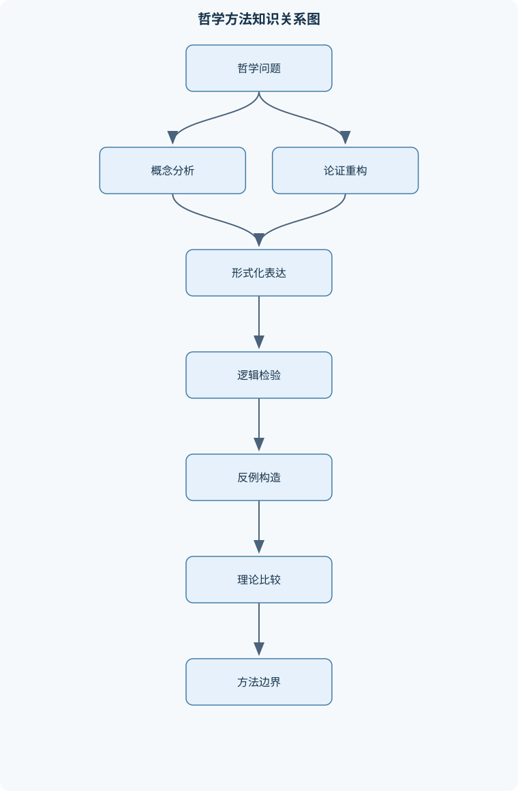
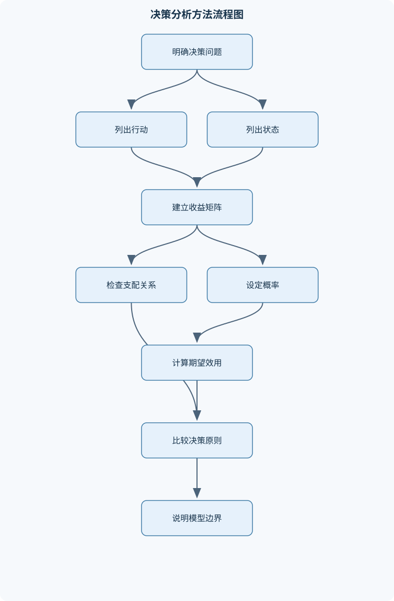

# 哲学方法

## 一、课程整体知识框架

### 课程边界与先修知识

本课程研究哲学论证、概念分析、形式化表达、反例构造、解释与评价的方法。核心内容包括论证识别与重构、演绎与归纳推理、命题逻辑与谓词逻辑基础、概念与定义、模态和真理论、概率与决策、博弈分析、集合论基础、部分与整体问题，以及哲学思想实验。课程不以哲学史或某一哲学家的体系为主，而关注能够跨伦理学、认识论、形而上学、科学哲学和语言哲学使用的方法工具。先修知识包括基本阅读能力、自然语言句法的初步认识、初等集合运算、分数与概率计算；不要求高等数学，但要求能够理解符号、条件、反例和简单证明。





### 1. 课程对象、问题意识与方法边界

《哲学方法》不以哲学史叙述或某一位哲学家的完整体系为主，而研究哲学论证如何提出、表达、检验和修正。它处理的核心问题不是“某个结论是否令人赞同”，而是：一个主张究竟在断言什么；支持它的理由是什么；理由是否与结论相关；前提是否足以支持结论；论证依赖哪些未明说的概念和假设；若改变某一条件，结论是否仍然成立。

哲学问题与单纯经验问题需要区分。经验问题主要通过观察、测量或实验确定事实，例如“某种药物是否降低某种症状的发生率”。哲学问题通常进一步追问概念、理由和规范结构，例如“什么算作降低风险”“因果关系是否等同于概率相关”“一个行动在什么条件下应被认为是正当的”。二者并非互相排斥：哲学论证可以使用经验事实，经验研究也依赖关于证据、解释、因果和概念分类的哲学假设。方法边界在于，概念分析和逻辑证明不能代替对现实事实的测量；经验数据也不能单独决定“应当如何行动”这类规范结论。

课程的基本分析链条是：

1. 从自然语言材料中识别主张、理由和结论；
2. 将论证重构为清晰的前提—结论结构；
3. 区分演绎推理、归纳推理、类比推理和解释性推理；
4. 用概念分析、反例、真值条件、量词结构或概率模型检验论证；
5. 识别模型的理想化条件、未说明的价值判断和适用边界；
6. 根据反例或新证据修正定义、前提或结论，而不是仅以“直觉不舒服”结束讨论。

### 2. 统一符号与基本区分

命题用小写字母表示，如 $p$、$q$。$\neg p$ 表示“非$p$”，$p\land q$ 表示“$p$且$q$”，$p\lor q$ 表示“$p$或$q$”。这里的析取通常是相容析取，即$p$和$q$可以同时为真。材料条件句$p\rightarrow q$只有在$p$真而$q$假时为假；它表达真值条件，不自动表达因果关系、时间先后或解释关系。双条件句$p\leftrightarrow q$表示$p$当且仅当$q$。

$\models$表示语义蕴涵，即在所有使前提为真的解释或模型中，结论也为真；$\vdash$表示在某个给定形式系统中可以通过规则推出。前者关注真值保持，后者关注形式可证明性，二者不能不加条件地混用。

个体变量用$x,y,z$表示，谓词用$P(x)$表示个体$x$具有性质$P$，关系谓词用$R(x,y)$表示$x$与$y$之间具有有方向的关系。$\forall x$表示“对所有$x$”，$\exists x$表示“至少存在一个$x$”。集合用大写字母表示，$x\in A$表示$x$是集合$A$的元素，$A\subseteq B$表示$A$是$B$的子集。概率$P(A)$表示事件$A$的概率，条件概率$P(A\mid B)$要求$P(B)>0$。期望效用中，$a$表示行动，$s_i$表示状态，$u(a,s_i)$表示行动在该状态下的效用，效用可理解为模型中用于比较结果的数值，不必解释为物理单位。

“真”“必然”“先验”“分析”属于不同维度。真值回答命题是否成立；必然性回答命题是否在所有相关可能世界成立；先验性回答认识是否依赖经验观察；分析性回答命题是否由意义或概念关系成立。逻辑真理通常具有真、必然、先验和分析等多种性质，但这些词不是同义词。

### 3. 课程的核心评价标准

论证评价至少包含三个维度。相关性要求前提确实涉及结论，而不是只提供心理上的说服力；充分性要求前提在逻辑或概率意义上足以支持结论；可接受性要求前提本身有合理根据，或者至少在当前讨论中得到明确承认。演绎论证可以具有有效形式但前提为假。有效性只表示：如果所有前提都真，结论不可能为假。有效且前提真实的演绎论证才是可靠的。

非演绎论证不追求前提真时结论绝对不能假，而评价证据使结论获得多大支持。例如归纳论证需要考察样本是否具有代表性、样本量是否足够、观察条件是否独立，以及是否存在更好的替代解释。一个结论即使概率很高，也不等于逻辑必然。

反例具有双重功能。若一个定义声称某条件是充分条件，只要找到满足该条件而不属于被定义对象的案例，就能否定其充分性；若声称某条件是必要条件，只要找到属于该对象但不满足该条件的案例，就能否定其必要性。思想实验通过控制假设情境中的变量，检验概念判准、规范原则或身份理论，但它不是经验实验，不能单独证明现实世界中某个普遍事实。

## 二、章节和模块划分

### 核心知识覆盖清单

本清单用于检查正文是否覆盖本课程的主要知识模块：

- **哲学方法与论证结构**：哲学问题与经验问题的区分、论题、前提与结论、描述性命题与规范性命题、演绎论证与非演绎论证、有效性与可靠性、论证重构与隐含前提、反例与思想实验、论证评价的相关性、充分性与可接受性。
- **概念分析与定义方法**：必要条件与充分条件、必要且充分条件、定义、解释与操作化、外延、内涵与语境、家族相似与边界案例、反例对定义的修正、概念混淆与偷换概念、概念分析的适用边界。
- **命题逻辑与形式化推理**：命题变量与逻辑联结词、否定、合取、析取与条件句、真值表、重言式、矛盾式与偶然式、逻辑等值、有效推理形式、充分条件与必要条件的形式化、反事实条件句的初步区分。
- **谓词逻辑、量词与语言歧义**：个体常项与谓词、全称量词与存在量词、量词辖域、量词顺序与意义差异、自由变量与约束变量、关系谓词的方向性、自然语言歧义的形式化、反例模型与满足关系。
- **真理、知识与模态**：分析真理与综合真理、先验知识与后验知识、必然真理与偶然真理、可能世界语义的基本思想、可能、必然与不可能、真值与可断言性的区分、逻辑真理的多重分类、模态推理中的范围限制。
- **概率、归纳与不确定性推理**：样本空间与事件、互斥事件与独立事件、并事件、交事件与补事件、条件概率、全概率公式、贝叶斯定理、客观概率与主体概率、归纳论证与证据强度、概率模型的假设与局限。
- **决策理论与理性选择**：行动、状态与结果、效用函数、最大最大原则、最大最小原则、最小最大遗憾原则、期望效用最大化、支配原则、风险、信息与决策依赖关系、决策模型的价值判断。
- **博弈论与策略分析**：参与者、行动与收益矩阵、严格支配与弱支配、重复删除支配策略、最佳回应、纳什均衡的直观定义、纯策略与混合策略、囚徒困境、合作结果与个体理性冲突、博弈模型的共同知识假设。
- **集合论、关系与部分整体论**：集合、元素与子集、并集、交集与差集、空集与幂集、元素关系与子集关系、有限集与无限集、可数无限与不可数无限、自然数、整数与实数的对应、康托尔对角线思想、部分、整体与构成关系。
- **身份、指称与思想实验**：同一性与莱布尼茨定律、持续性条件与组成条件、忒修斯之船问题、雕像与黏土团问题、专名、描述与指称对象、语境对指称的影响、思想实验的结构、思想实验的证据地位、直觉冲突与理论修正。
- **科学解释与方法论边界**：相关、因果与机制、演绎—定律解释模式、统计解释与概率支持、可证伪性与反例、模型、理想化与近似、观察事实与理论负载、概念框架的选择、哲学论证与经验科学证据的分工。


### 第一章 哲学方法与论证结构

本章建立全课程的共同语言。论题是论证试图确立的中心主张，前提是用于支持结论的陈述，结论是由理由推出或试图推出的主张。“因为”“由于”通常引出理由，“所以”“因此”通常引出结论，但自然语言中的标记并不总是可靠，仍需根据语义关系判断。

描述性命题说明事实状态，例如“会议在下午开始”；规范性命题表达应当、允许、禁止或评价，例如“会议应当公开”。规范性结论不能仅凭一个描述性事实自动推出，通常需要补充规范前提。例如：

- 前提一：公开程序能够提高受影响者获得理由说明的机会；
- 前提二：能够提高受影响者获得理由说明机会的程序，在没有相反理由时应优先采用；
- 结论：在没有相反理由时，该程序应优先采用。

演绎论证的结论由前提的形式保证。非演绎论证则通过证据提高结论可信度，包含归纳、类比和解释。论证重构时，应保留原论述的核心断言，拆分复合句，补出使推理成立所需且有文本依据的隐含前提；不能为了让论证成立而任意添加原文没有支持的强前提。

论证的常见缺陷包括偷换概念、循环论证、诉诸无知、把相关当作因果、把材料条件句当作因果句，以及把结论的真实性误当作论证有效性。论证评价的终点不是简单贴标签，而是指出缺陷发生在哪个前提、哪种推理形式或哪项概念转换上。

### 第二章 概念分析与定义方法

必要条件是某事成立所不可缺少的条件。若$A$是$B$的必要条件，可形式化为$B\rightarrow A$。充分条件是有它就足以保证某事成立，形式化为$A\rightarrow B$。必要且充分条件形式化为$A\leftrightarrow B$。最容易出现的错误是把“有氧是某些燃烧过程的必要条件”误解为“有氧就足以燃烧”；事实上，燃料、温度和反应条件等因素也可能是必要的。

定义可以是词语意义的说明、理论中的分类规则，也可以是为了研究而制定的操作标准。外延是一个概念所涵盖的对象范围，内涵是用于刻画这些对象的性质或条件。操作化定义把抽象概念转化为可观察指标，例如“贫困”可以通过收入、资源占有、生活能力或多维剥夺指标操作化；操作化便于研究，但不等于穷尽概念本身。

概念分析需检验边界案例、反例和语境变化。经典定义往往试图提供必要且充分条件，但伦理、社会和心理概念常表现为家族相似：不同成员共享若干交叉特征，却未必有一个所有成员共同具备的单一特征。边界模糊不意味着概念毫无意义，而意味着必须明确讨论目的、分类标准和容许的模糊程度。

概念混淆发生在同一词语被赋予不同含义却未说明，或论证中从一个含义无提示地切换到另一个含义。修正定义时，应区分删除反例、增加条件、放宽条件和改换理论目标。概念分析的边界是：它能澄清意义和分类规则，却不能仅靠词语分析确定世界中某种实体是否存在，也不能替代关于因果机制的经验研究。

### 第三章 命题逻辑与形式化推理

命题逻辑把完整命题作为基本单位，不分析命题内部的个体和量词。常用联结词的真值由真值表决定：$\neg p$在$p$真时为假；$p\land q$只有两者都真时为真；$p\lor q$只要至少一者为真就为真；$p\rightarrow q$仅在$p$真、$q$假时为假；$p\leftrightarrow q$在两者真值相同的时候为真。

材料条件句满足：

$$
p\rightarrow q\equiv \neg p\lor q
$$

其推导可按四种赋值检查：当$p$真、$q$真时，两式都真；当$p$真、$q$假时，两式都假；当$p$假时，不论$q$真或假，两式都真。因此二者逻辑等值。但自然语言“如果……那么……”还可能表示因果、解释、反事实或承诺，真值表只处理其中的材料条件读法。

若公式在所有赋值下为真，称为重言式；在所有赋值下为假，称为矛盾式；有时真、有时假，称为偶然式。由$p\rightarrow q$和$p$推出$q$是肯定前件；由$p\rightarrow q$和$\neg q$推出$\neg p$是否定后件，二者均为有效形式。由$p\rightarrow q$和$q$推出$p$是肯定后件，通常无效；由$p\rightarrow q$和$\neg p$推出$\neg q$是否定前件，也通常无效。

“$A$是$B$的充分条件”形式化为$A\rightarrow B$，“$A$是$B$的必要条件”形式化为$B\rightarrow A$。反事实条件句，如“如果当时采取另一行动，结果就会不同”，不能直接等同于材料条件句，因为它涉及与实际世界相近的假设世界及其因果背景。

### 第四章 谓词逻辑、量词与语言歧义

谓词逻辑能够表达对象、性质和对象之间的关系。个体常项指向特定对象，变量表示论域中的任意对象。$\forall xP(x)$表示论域中每个对象都具有性质$P$；$\exists xP(x)$表示至少有一个对象具有性质$P$。量词必须有明确论域，否则同一形式可能因论域不同而改变真假。

量词辖域决定量词控制哪些成分。句子“有人给每个人带来了食物”至少有两种结构：

$$
\exists x\forall yB(x,y)
$$

和

$$
\forall y\exists xB(x,y)
$$

前者要求存在同一个人给所有人带食物；后者只要求每个人都有人给其带食物，不要求是同一个人。量词通常不能交换，因为：

$$
\exists x\forall yR(x,y)
$$

要求一个固定的$x$与所有$y$有关系，而

$$
\forall y\exists xR(x,y)
$$

允许不同的$y$对应不同的$x$。让甲给一半人、乙给另一半人，就能使后一式为真而前一式为假。

自由变量没有受到量词绑定，闭式公式则没有自由变量。关系谓词具有方向性，$R(x,y)$不自动等同于$R(y,x)$；例如“甲帮助乙”不能推出“乙帮助甲”。形式化不仅要列出公式，还要给出论域、谓词含义和辖域。反例模型可以用很小的对象集合构造：若一个普遍命题声称所有对象都满足某性质，只需给出一个不满足该性质的模型即可否定它。

### 第五章 真理、知识与模态

分析真理通常依赖意义或概念关系，例如“未婚者不是已婚者”；综合真理需要通过经验确定，例如“此处正在下雨”。先验知识不依赖特定经验观察即可获得，后验知识则依赖观察、记忆、实验或证言。必然真理在所有相关可能世界中为真，偶然真理在实际世界为真但在至少一个相关可能世界中为假。

可能世界语义把“可能”理解为至少存在一个相关世界使命题为真，把“必然”理解为所有相关世界都使命题为真。若命题$p$不可能，则$\neg p$在所有相关世界为真，因此为必然真；但$p$在现实世界为假，只说明现实世界中$p$不成立，不能推出$p$不可能，因为它可能在其他世界成立。

可能世界的“相关性”必须说明。逻辑可能性、物理可能性、技术可能性和概念可能性可能具有不同范围。例如违反物理定律的情境未必在物理可能世界中，但可能在较宽松的逻辑模型中被描述。模态推理不能随意把“实际发生”“能够发生”“必须发生”相互替换。

真值与可断言性也不同。一个命题可能为真，但说话者缺乏足够证据，因而不应断言；一个断言可能在证据条件下合理，却因偶然因素而为假。分析性、先验性和必然性分别涉及意义、认识方式和模态状态，经典逻辑真理常同时具有三者，但一般不能把三者定义为同一概念。

### 第六章 概率、归纳与不确定性推理

样本空间是所有可能结果的集合，事件是样本空间的子集。并事件$A\cup B$表示至少一个事件发生，交事件$A\cap B$表示两者同时发生，补事件$\neg A$表示$A$不发生。加法公式为：

$$
P(A\cup B)=P(A)+P(B)-P(A\cap B)
$$

减去交集是为了避免同时属于两个事件的结果被重复计算。若两个事件互斥，则$P(A\cap B)=0$；互斥不等于独立。独立要求一个事件的发生不改变另一个事件的概率，即$P(A\cap B)=P(A)P(B)$。

条件概率为：

$$
P(A\mid B)=\frac{P(A\cap B)}{P(B)}
$$

其中$P(B)>0$。全概率公式要求$A_i$构成互斥且完备的状态划分：

$$
P(B)=\sum_iP(B\mid A_i)P(A_i)
$$

贝叶斯定理为：

$$
P(A\mid B)=\frac{P(B\mid A)P(A)}{P(B)}
$$

它说明证据后的概率同时取决于证据在假设成立时的可能性，以及假设本身的先验概率。$P(B\mid A)$不能直接改写为$P(A\mid B)$，这两者的分母不同、解释也不同。

三枚公平硬币共有$2^3=8$个等可能结果。恰有两枚反面的结果数为$\binom{3}{2}=3$，概率为$3/8$；至少一枚反面的概率用补集计算为$1-1/8=7/8$。这些计算依赖公平性和独立性；若硬币偏斜或投掷结果相关，等可能样本空间的前提就不能直接使用。

客观概率可理解为某类过程的倾向或长期频率，主体概率则表示特定信息下的合理信念程度。两者都可用于推理，但模型必须说明概率的对象、条件和证据来源。归纳论证的强度不是由结论听起来合理决定，而要考察样本、替代解释、测量误差和先验假设。

### 第七章 决策理论与理性选择

决策模型包括行动、状态和结果。行动是决策者能够选择的方案；状态是行动者无法直接控制但会影响结果的情况；结果是行动与状态组合产生的后果。效用函数用数值表示结果的相对偏好，数值差异只有在模型规定其可比较方式时才有意义。

在不确定状态下，可以使用不同决策原则。最大最大原则对每个行动取最好结果，再选择其中最大的行动，适合极端乐观的风险态度；最大最小原则对每个行动取最坏结果，再选择其中最好的行动，适合强调安全下限；最小最大遗憾原则先在每个状态中找最佳结果，再计算每个行动相对于该最佳结果的机会损失，最后选择最大遗憾最小的行动。

若行动$a$在每个状态下的效用都不低于行动$b$，并且至少一个状态下严格更高，则$a$严格支配$b$。在偏好具有单调性的条件下，理性选择不应选被严格支配的行动。该结论不要求知道状态概率，但要求效用比较可靠，并且两行动在同一状态集合下比较。

给定有限状态和状态概率，期望效用为：

$$
EU(a)=\sum_iP(s_i)u(a,s_i)
$$

其中$P(s_i)\ge 0$，且所有状态概率之和为$1$。选择期望效用较大的行动；若相等，模型本身不能给出唯一选择。

外套与夹克的例子中，寒冷概率为$x$，外套在寒冷和温和时效用分别为$3,0$，夹克分别为$2,1$：

$$
EU(\text{外套})=3x
$$

$$
EU(\text{夹克})=2x+1(1-x)=x+1
$$

令二者相等：

$$
3x=x+1
$$

因此$x=1/2$。当$x>1/2$时，外套期望效用更高；当$x<1/2$时，夹克更高。该结论依赖状态划分完整、概率适当、效用可比较，并不意味着最大期望效用是脱离价值判断的唯一理性原则。

### 第八章 博弈论与策略分析

博弈模型至少包括参与者、行动集合、收益函数和共同知识假设。收益矩阵中的有序对$(r_1,r_2)$表示两个参与者的收益，行参与者先读第一项，列参与者读第二项。严格支配策略无论对手怎样行动都带来更高收益；弱支配策略则允许部分情况下相等，因此删除弱支配策略需要更谨慎。

最佳回应是给定对手策略时，对某参与者收益最大的策略。若一组策略互为最佳回应，则构成纳什均衡：任何一方单独改变策略都不能提高自身收益。纳什均衡不等于集体最优，也不等于道德上最好的结果。

囚徒困境的典型结构是：每个参与者的背叛严格支配合作，因此双方背叛构成唯一纯策略均衡；但双方合作的收益都高于双方背叛。该结构说明个体理性选择可能产生集体较差结果。重复博弈、可信承诺、惩罚机制和沟通规则可能改变结果，但必须明确这些新增条件。

混合策略把不同纯策略赋予概率。混合策略均衡的基本思想是：当参与者随机化时，对手在其支持集内使用的策略应使其无差异，否则对手会转向收益更高的策略。有限矩阵中，消去严格支配策略可缩小分析范围，但不能保证找到全部均衡，尤其不能替代对混合策略的考察。

### 第九章 集合论、关系与部分整体论

集合由元素构成。$A\cup B$包含属于$A$或$B$的元素，$A\cap B$包含同时属于二者的元素，$A\setminus B$包含属于$A$但不属于$B$的元素。$\varnothing$是不含任何元素的空集，$\mathcal P(A)$是$A$的幂集，即$A$所有子集组成的集合。

元素关系和子集关系必须区分：若$A=\{a,b,c\}$，则$\{b,c\}\subseteq A$为真，但$\{b,c\}\in A$为假，因为$A$的元素是$a,b,c$，不是集合$\{b,c\}$。若$X=\{2,3,4,5,6,7,8\}$，则$\{2\}\in\mathcal P(X)$为真，因为$\{2\}\subseteq X$。

有限集的元素数量可用自然数表示。整数虽然无限，却可按$0,1,-1,2,-2,\ldots$排列，因此与自然数存在一一对应，是可数无限集。康托尔对角线思想表明，自然数的幂集不能与自然数一一对应；一般而言，任意集合$A$都不能与其幂集$\mathcal P(A)$建立一一对应。

部分—整体问题进一步追问：一个整体由哪些部分构成；部分的改变何时导致整体改变；两个部分重叠时是否形成一个新整体。集合的包含关系不能直接等同于物体的构成关系，因为物理部分关系可能具有空间、时间、功能和因果限制。一个物体的组成条件需要说明对象身份、部分是否同时存在，以及“构成”是材料关系、结构关系还是功能关系。

### 第十章 身份、指称与思想实验

同一性具有传递性：若$A=B$且$B=C$，则$A=C$。莱布尼茨定律通常表述为：若两个对象同一，则它们具有相同的性质。但应用时必须区分对象的本质性质、关系性质、时间索引性质和语境依赖性质，否则会把“看起来不同”误当作“不是同一对象”。

持续性条件回答对象如何在时间中保持为同一对象；组成条件回答哪些部分构成一个整体。忒修斯之船中，船的部件逐步替换，最终形成船$S_2$；旧部件被重新组装成船$S_3$。历史连续性和功能连续性可能支持$S_2$是原船，材料组成判准可能支持$S_3$是原船。困难并非事实无法描述，而是不同身份判准发生冲突。

雕像与黏土团问题展示了材料相同不必然意味着对象相同。雕像可能在创作后才存在并具有特定形状条件，黏土团可能在更早时已经存在且可以呈现其他形状。若二者具有不同的持续性条件，即使空间位置和材料完全重合，也不能简单断定二者是同一对象。

专名、描述和指称对象也需区分。专名可能通过历史使用链指向对象，描述则通过满足某些性质来确定对象；在不同语境、说话者意图和背景知识下，同一表达式可能产生不同指称。思想实验应明确情境、保持不变条件、改变的单一变量、直觉反应以及由此支持的原则。思想实验不能自动替代经验数据，其证据地位取决于设定是否清晰、直觉是否稳定、是否存在概念偷换，以及不同理论能否对同一情境作出比较透明的解释。

### 第十一章 科学解释与方法论边界

相关性表示变量共同变化，因果性则要求说明一个因素改变是否会导致另一因素改变。机制解释进一步说明中间过程、结构联系和时间顺序。围巾与感冒的例子中，不能因为感冒后戴围巾未必能治病，就断定戴围巾不能影响感冒发生率。应区分$P(\text{感冒}\mid\text{戴围巾})$和$P(\text{感冒}\mid\text{不戴围巾})$，并考察选择戴围巾的人是否本来就处于不同风险中。

演绎—定律解释模式试图从一般规律和初始条件推出待解释事实。统计解释则通过概率规律说明事实获得何种程度的支持；统计支持通常不是必然推出。可证伪性要求理论允许某些可能观察与其冲突，但一次反例是否足以放弃理论，还要考察测量条件、辅助假设和理论适用范围。

科学模型常使用理想化和近似。例如把对象视为无摩擦、把群体视为同质、把参与者视为完全理性，有助于建立可分析模型，但不能把理想化条件当成现实事实。模型评价至少要考虑内部一致性、解释力、预测或比较能力、与证据的关系，以及偏离现实的方式是否可控。

观察事实并非完全脱离理论。测量指标、分类标准和仪器读数的解释依赖背景理论，但这不意味着所有观察都只是主观意见。哲学论证可以澄清“证据”“解释”“因果”“模型”和“可证伪”的条件，经验科学则负责在具体对象和测量条件下提供数据。二者的分工不是绝对隔离，而是相互约束：哲学不能凭空取代实验，实验结果也不能未经概念和推理分析就自动成为完整结论。

### 第十二章 模块之间的贯通关系

课程各模块按照“自然语言—形式结构—模型评价—理论修正”的路径连接。论证重构确定需要检验的前提和结论；概念分析明确关键词的必要、充分或操作条件；命题逻辑处理复合命题之间的真值关系；谓词逻辑处理对象、关系和量词辖域；模态理论区分实际、可能和必然；概率理论处理不确定证据；决策理论把概率与效用结合起来；博弈论进一步处理多个决策者之间的策略依赖；集合论提供对象、关系和无限性的形式基础；身份理论和思想实验检验对象持续、指称和组成判准；科学解释模块则规定何时需要经验数据、因果机制和模型比较。

一个完整的哲学分析应明确其推理层次。例如，“某方案应当采用”可能包含事实前提、概率判断、效用排序和规范原则；如果只给出收益计算而没有说明价值函数，结论就不是纯粹数学结果。如果从“某事在现实中未发生”推出“某事不可能发生”，则混淆了实际性和模态性。如果从“两个概念在某个案例中重合”推出“二者必然同一”，则混淆了外延重合与内涵、指称或身份关系。

课程最终要求的不是把所有哲学争论改写成公式，而是在适合形式化的地方使用公式，在需要语境、历史连续性、规范理由或概念直觉的地方保留论证的实质内容，并持续说明每一种方法能够解决什么问题、不能解决什么问题。

## 三、核心概念的详细解释

### 3.1 哲学问题、论证与论证评价

哲学方法首先区分“事实是什么”“概念意味着什么”“理由是否足够”和“行动是否应当”这几类问题。经验问题通常可以通过观察、测量或实验获得主要证据，例如“某种干预是否降低某事件的发生率”。哲学问题则关注事实背后的概念和理由结构，例如“降低发生率是否等于产生因果作用”“什么条件下一个行动是正当的”。二者并不相互排斥：哲学论证可以使用经验事实，但不能用概念分析代替事实测量；经验数据也不能单独推出规范结论。

一个论证至少包含若干前提和一个结论。前提是被用来支持其他主张的命题，结论是论证试图确立的命题。自然语言中的“因为”“由于”通常引出理由，“因此”“所以”“由此可见”通常引出结论，但标记词不是绝对可靠的，需要结合句意判断。重构论证时，应将复合句拆成相对独立的命题，区分明确表达的前提、结论和未表达的隐含前提。例如：

> 围巾不能治疗已经发生的感冒，所以戴围巾不能降低感冒风险。

其中，前件讨论“感冒已经发生后的治疗效果”，结论讨论“戴围巾对感冒发生概率的影响”，二者不是同一个问题。该推理隐含地把事后治疗效果等同于事前预防效果，属于概念和因果结构的错置。

演绎论证要求：如果所有前提为真，结论就不可能为假。有效性只描述形式关系，不保证前提事实上为真。例如，“所有鱼都会飞；金鱼是鱼；所以金鱼会飞”在形式上可以有效，但前提不真实，因而不是可靠论证。可靠性通常要求论证有效且前提真实。归纳论证不追求绝对保证，而是要求证据提高结论的可信度；其评价取决于样本是否有代表性、观察是否独立、替代解释是否被排除。类比论证则依靠对象在若干相关方面的相似性支持其在另一方面也相似，关键不在相似数量，而在相似特征与待推结论之间是否具有相关性。解释性论证以某种原因、机制或规律说明现象，必须区分“相关”与“因果”：两个变量共同变化，不自动说明其中一个导致另一个。

论证评价通常包括三项标准。相关性要求前提确实涉及结论；充分性要求前提提供足够支持；可接受性要求前提本身有合理根据，或在当前讨论中有明确依据。一个前提即使与结论相关，也可能支持力度不足。例如“某人曾经撒过一次谎，所以他现在说的每句话都是假的”，前提与诚实问题有关，却不能充分支持全称结论。

### 3.2 概念、定义与条件结构

必要条件是某事成立所不可缺少的条件。若$Q$是$P$的必要条件，可形式化为$P\rightarrow Q$：只要$P$成立，$Q$就必须成立。充分条件是只要具备该条件，目标结果就成立。若$P$是$Q$的充分条件，同样写作$P\rightarrow Q$，但此时阅读方向是“$P$足以保证$Q$”。因此，形式相同的条件句不能脱离语境判断“必要”还是“充分”。

例如，氧气可能是普通燃烧的必要条件之一，但“有氧气”并不足以保证燃烧，因为还需要可燃物、达到着火条件等。若“是正方形”是“是矩形”的充分条件，则“是矩形”是“是正方形”的必要条件。必要且充分条件写作$P\leftrightarrow Q$，表示两个方向都成立。定义若要精确刻画概念，通常要求既不遗漏符合对象，也不纳入不符合对象；但许多自然语言概念具有模糊边界，不能简单期待单一组必要且充分条件。

定义、解释和操作化不能混为一谈。定义规定一个词在某理论或语境中的使用条件；解释说明一个现象为何发生；操作化则规定如何通过可观察指标识别或测量某概念。例如“贫困”的规范性定义可能涉及资源、能力和社会参与，操作化定义则可能规定收入阈值、消费水平或多维指标。操作化便于研究，但不等于穷尽概念本身。

外延是一个概念所涵盖的对象集合，内涵是使对象属于该概念的性质或使用规则。两个概念可能在某个现实情境中外延相同，却具有不同内涵；也可能内涵相近但因语境、分类标准不同而外延不同。家族相似概念没有所有成员共同拥有的单一特征，而是通过多重相似关系形成交叉网络。对这类概念，反例不一定摧毁概念，而可能表明该概念不适合采用严格定义。

概念分析的反例应满足三个条件：明确符合原定义或前提；直观上不应属于该概念或不应推出相关结论；差异来自定义所声称的关键条件，而不是无关细节。反例可能迫使我们增加必要条件、削弱充分条件、区分不同概念，或承认概念本身具有开放性。概念混淆包括把不同问题当作同一问题、把描述性词语偷换成规范性词语、把对象类别和对象性质混为一谈。例如“法律允许某行为”不等于“该行为在道德上正当”。

### 3.3 命题逻辑与形式化推理

命题逻辑把完整命题视为真或假的整体。命题变量用$p,q,r$表示，否定为$\neg p$，合取为$p\land q$，析取为$p\lor q$，材料条件句为$p\rightarrow q$，双条件句为$p\leftrightarrow q$。相容析取$p\lor q$在$p$、$q$同时为真时仍为真。材料条件句只有在$p$真而$q$假时为假，因此它不自动表示因果、时间先后或反事实关系。

常用有效形式包括肯定前件：

$$
p\rightarrow q,\quad p\quad \therefore q
$$

以及否定后件：

$$
p\rightarrow q,\quad \neg q\quad \therefore \neg p
$$

前者由条件句和前件推出后件，后者利用逆否关系。相反，肯定后件：

$$
p\rightarrow q,\quad q\quad \therefore p
$$

通常无效，因为$q$可能由其他原因造成。否定前件：

$$
p\rightarrow q,\quad \neg p\quad \therefore \neg q
$$

也通常无效，因为$p$不是$q$的必要条件。

重言式在所有真值赋值下都为真，矛盾式在所有赋值下都为假，偶然式在某些赋值下为真、另一些赋值下为假。逻辑等值表示两个公式在每一种赋值下真值相同，例如：

$$
p\rightarrow q\equiv \neg p\lor q
$$

这一等值只描述材料条件句的真值条件，不能据此断言自然语言中的因果句、解释句或反事实句都具有相同意义。$\models$表示语义蕴涵，强调所有使前提为真的模型也使结论为真；$\vdash$表示在给定证明系统中可形式推出，强调规则和证明过程。

### 3.4 谓词逻辑、量词与自然语言歧义

命题逻辑无法表达“所有人都具有某性质”或“至少有一个对象满足某关系”。谓词逻辑使用个体变量、谓词和量词。$P(x)$表示$x$具有性质$P$，$R(x,y)$表示$x$与$y$之间具有有方向的关系。$\forall xP(x)$表示论域中的每个对象都满足$P$；$\exists xP(x)$表示至少存在一个对象满足$P$。变量若被量词绑定，就是约束变量；未被量词作用的变量是自由变量。含自由变量的公式通常不是完整命题，除非另行指定变量赋值。

量词辖域决定量词约束哪些部分。量词顺序通常不可交换：

$$
\exists x\forall yR(x,y)
$$

表示存在同一个$x$，它与所有$y$满足关系$R$；而

$$
\forall y\exists xR(x,y)
$$

表示对每个$y$，至少有一个$x$与它满足关系，但不同的$y$可以对应不同的$x$。因此，“有人给每个人带来了食物”可以有两种结构：$\exists x\forall yB(x,y)$要求同一个人给所有人带来食物；$\forall y\exists xB(x,y)$只要求每个人都有人给他带来食物。若甲服务一半、乙服务另一半，后一式为真，前一式为假。

关系谓词还具有方向性。$R(x,y)$不等于$R(y,x)$；“甲尊敬乙”不自动推出“乙尊敬甲”。形式化时必须明确论域、谓词含义、变量绑定位置和量词辖域。自然语言中的“某个”“每个”“没有”“只有”等表达式可能引入不同结构，不能只依据词语表面顺序翻译。

### 3.5 真理、知识与模态

分析真理主要由词语意义或概念关系决定，例如“未婚者不是已婚者”；经验或综合真理需要结合世界中的事实，例如“此处正在下雨”。先验知识原则上不依赖特定经验观察即可获得，后验知识则依赖观察、实验或其他经验渠道。必然真理在所有相关可能世界中成立，偶然真理在实际世界成立但在至少一个相关可能世界中不成立。

分析性、先验性和必然性回答不同问题：分析性问“是否由意义或概念关系成立”，先验性问“认识是否依赖经验”，必然性问“在可能世界范围内是否不能为假”。经典逻辑真理通常兼具分析、先验和必然性质，但三者不是一般意义上的同义词。实际为假也不等于不可能。某命题在现实世界为假，可能仍在其他可能世界为真，因此只是偶然不成立。

可能世界语义中的“可能”为至少存在一个相关世界使命题为真，“必然”为所有相关世界都使命题为真。“不可能”可理解为没有相关世界使命题为真。模态推理必须说明相关可能世界的范围；把物理可能、逻辑可能、法律允许和认识上尚未排除混为一谈，会造成范围错误。真值表示命题是否成立，可断言性则涉及说话者是否有足够理由在特定语境下作出断言，二者不能直接等同。

### 3.6 概率、归纳与不确定性

概率模型以样本空间为基础。样本空间$\Omega$是所有可能结果的集合，事件是$\Omega$的子集。并事件$A\cup B$表示至少一个事件发生，交事件$A\cap B$表示二者同时发生，补事件$A^c$表示$A$不发生。互斥事件不能同时发生；独立事件满足一个事件发生不改变另一个事件的概率，但互斥与独立不能在一般正概率情形下同时成立。

加法公式为：

$$
P(A\cup B)=P(A)+P(B)-P(A\cap B)
$$

减去交集是因为交集中的结果在$P(A)$和$P(B)$中各计算了一次。条件概率为：

$$
P(A\mid B)=\frac{P(A\cap B)}{P(B)},\qquad P(B)>0
$$

其分母是竖线右侧的条件事件。不能把$P(A\mid B)$误写成$P(B\mid A)$。归纳论证的强度取决于证据数量、代表性、独立性、测量可靠性及竞争假设。概率值可以表示对象的客观随机结构，也可以表示主体在给定信息下的合理信念；二者需明确区分。

### 3.7 决策理论与理性选择

决策模型包括行动、状态、结果和效用。行动是决策者可选择的方案，状态是决策者不能直接控制但会影响结果的情形，效用是用于比较结果好坏的数值表示。最大最大原则选择各行动的最好结果中最高者，表现出乐观的风险态度；最大最小原则选择各行动最坏结果中最高者，表现出谨慎或保守态度；最小最大遗憾原则先计算每个状态下未选最佳行动所造成的机会损失，再选择最大遗憾最小的行动。

在已给定状态概率且效用可比较时，期望效用为：

$$
EU(a)=\sum_iP(s_i)u(a,s_i)
$$

期望效用最大化不是脱离前提的普遍真理。它依赖状态划分完备、概率可用、效用排序稳定，以及把各状态效用按概率加权具有合理性。支配原则要求：若行动$a$在每个状态下都不差于行动$b$，且至少一个状态下严格优于$b$，则在偏好满足单调性的条件下不应选择$b$。若两个行动期望效用相同，模型本身不能决定唯一选择。

### 3.8 博弈论与策略依赖

博弈模型至少包含参与者、行动集合、收益函数和关于理性、信息及共同知识的假设。收益矩阵中的$(r_1,r_2)$中，第一项是行参与者收益，第二项是列参与者收益。严格支配策略无论对方采取什么行动，都比另一策略收益更高；弱支配策略则允许某些情形相等。反复删除严格支配策略可以缩小理性选择范围，但删除弱支配策略必须谨慎，因为它可能影响均衡。

最佳回应是给定其他参与者策略时能带来最高收益的策略。纳什均衡是每个参与者的策略都对其他人的策略构成最佳回应，因而任何单个参与者都没有通过单方面改变策略提高收益的动机。纳什均衡不等于集体最优。囚徒困境中，背叛可能严格支配合作，导致双方背叛成为均衡；但双方合作的收益又同时高于双方背叛。纯策略直接选择一个行动，混合策略则以概率随机选择行动，混合均衡的概率必须使对方在其支持中的行动无差异。

### 3.9 集合、关系、无限性与部分整体问题

集合是对象的确定性汇集。$x\in A$表示$x$是$A$的元素，$A\subseteq B$表示$A$的每个元素也是$B$的元素。元素关系和子集关系不是同一种关系：若$A=\{a,b,c\}$，则$\{b,c\}\subseteq A$为真，但$\{b,c\}\in A$为假。并集$A\cup B$收集属于至少一个集合的元素，交集$A\cap B$收集同时属于两个集合的元素，差集收集属于一个而不属于另一个的元素。空集$\varnothing$没有元素，幂集$\mathcal P(A)$是$A$所有子集组成的集合。

有限集有有限个元素；无限集没有有限基数。自然数、整数可以建立一一对应，因此整数是可数无限集。无限性不等于不可数性。康托尔对角线思想说明：对任意集合$A$，幂集$\mathcal P(A)$不能与$A$建立一一对应。若假设存在一个穷尽所有子集的列表，则可构造一个新集合，使其在第$i$个元素上的归属与列表中的第$i$个集合相反；该新集合必属于幂集，却不可能等于列表中的任何一项，产生矛盾。

部分与整体问题关注“一个对象由什么构成”“部分相加是否形成同一整体”“组成关系是否等同于集合成员关系”。物体的部分关系通常具有空间、结构或功能含义，不应直接等同于集合中的元素关系。一个零件可能是机器的组成部分，但不一定是机器集合中的元素；同一对象也可能有重叠、嵌套或不同层级的部分。

### 3.10 身份、指称与思想实验

同一性是对象与自身的关系，具有反身性、对称性和传递性。莱布尼茨定律要求：若$A=B$，则二者应具有相同的性质；反向使用时需要注意语境和性质是否真正适用。持续性判准可能依据材料连续性、空间—时间连续性、功能连续性、结构连续性或历史连续性。不同判准发生冲突时，问题不是简单的事实计算，而是我们采用何种身份标准。

忒修斯之船中，若船的部件逐步更换，连续性判准倾向于认为替换后的船仍是原船；若旧部件被重新组装成另一艘船，材料组成判准又可能把后者视为原船。雕像与黏土团问题则显示：雕像可能在特定时间形成和毁坏，而同一块黏土的存在条件不同，二者共享材料却未必是同一对象。材料相同不自动推出对象同一。

专名、描述和指称对象也需区分。专名通常用于指向对象，描述则通过性质筛选对象；同一描述在不同语境、说话者意图或背景知识下可能指向不同对象。思想实验应明确初始情境、保持不变的条件、改变的单一变量、直觉反应和所支持的原则。它可揭示概念冲突、测试理论一致性和产生反例，但不能单独替代经验实验。直觉发生冲突时，应检查情境是否含有无关因素、概念是否偷换，以及理论是否需要修正。

### 3.11 科学解释与方法论边界

相关性是变量共同变化，因果性则涉及干预、时间结构、机制或替代解释排除。若$X$与$Y$相关，可能存在$X$导致$Y$、$Y$导致$X$、共同原因或选择偏差等多种解释。演绎—定律解释试图由一般规律和初始条件推出待解释事实；统计解释则提供概率支持，因此结论通常不是必然推出。

可证伪性要求理论允许某些可能观察与之冲突，但一次不符合数据的结果未必立即推翻理论，因为测量误差、辅助假设和适用范围也可能出错。科学模型通常包含理想化，例如假设无摩擦、完全理性或群体同质。理想化有助于建立清晰模型，但不能把模型条件误当成现实事实。模型评价需考虑内部一致性、解释力、预测或比较能力、证据支持和偏离现实的可控性。哲学论证负责澄清概念、理由和推理边界，经验科学负责在具体对象和测量条件下提供数据，二者既不能相互替代，也不能完全割裂。

## 四、重要定义、公式、定理和推导

### 专业审校补充：关键定义与适用边界

哲学方法中的“概念分析”不等于查词典或寻找一个无例外的本质定义。它至少包括三项工作：说明概念在论证中的功能，区分其必要条件与充分条件，并检验定义能否稳定处理典型案例、边界案例和反例。定义过窄会排除本应纳入的对象，定义过宽会纳入不应属于该概念的对象；但反例也不必立即推翻整个概念，可能只说明概念具有家族相似结构、存在语境依赖，或原定义承担了不同任务。还要区分描述性定义、规范性定义和操作化定义：描述性定义概括实际用法，规范性定义规定应如何使用，操作化定义规定如何通过可观察指标识别对象。一个指标即使便于测量，也不等于穷尽概念内涵。概念分析的结论通常是“在给定语境和判准下更合适”，而不是脱离语境的永恒本质；若不同判准在边界案例中冲突，应明确保留哪一判准、牺牲哪一判准及其理由。


### 4.1 论证有效性、可靠性与反例

论证$\Gamma\models C$的含义是：不存在一个解释或模型，使$\Gamma$中的所有前提同时为真而$C$为假。若能构造这样的模型，就得到一个语义反例，说明论证无效。可靠论证通常定义为有效且所有前提为真。由此可见：

1. 先检查形式关系；
2. 再检查前提的事实或概念根据；
3. 两项均满足时，才能同时获得结论的逻辑保证和前提可信度。

反例只需找到一个满足前提而不满足结论的情形，就足以否定演绎有效性；但一个反例未必推翻一个归纳概括，因为归纳结论本来就允许例外。评价归纳论证时，要比较反例的代表性、数量和是否改变证据总体。

### 4.2 命题逻辑的真值规则与等值推导

基本真值规则如下：

| 公式 | 为真的条件 |
|---|---|
| $\neg p$ | $p$为假 |
| $p\land q$ | $p,q$均为真 |
| $p\lor q$ | 至少一个为真 |
| $p\rightarrow q$ | $p$为假，或$p,q$均为真 |
| $p\leftrightarrow q$ | $p,q$真值相同 |

材料条件句的等值可逐行推导。若$p$为假，则$p\rightarrow q$为真，而$\neg p\lor q$也为真；若$p$为真，则两式的真值都由$q$决定。因此：

$$
p\rightarrow q\equiv\neg p\lor q
$$

双条件句可展开为：

$$
p\leftrightarrow q\equiv(p\rightarrow q)\land(q\rightarrow p)
$$

由此，$p\leftrightarrow q$不仅表示同真同假，还包含两个方向的条件关系。必须注意，逻辑双条件不必等于自然语言中的因果互相成立。

### 4.3 必要条件、充分条件与反例检验

若$P\rightarrow Q$：

- $P$是$Q$的充分条件；
- $Q$是$P$的必要条件；
- 反例为$P$真、$Q$假，因为该情形直接否定条件句。

若要证明$P$是$Q$的必要条件，应证明$Q\rightarrow P$；若要证明$P$是$Q$的充分条件，应证明$P\rightarrow Q$。若要证明必要且充分，应分别证明两个方向。常见错误是把“只有$P$才有$Q$”读成$P\rightarrow Q$，实际上“只有$P$才有$Q$”通常表达$Q\rightarrow P$。

### 4.4 量词顺序的模型证明

令$R(x,y)$表示$x$给$y$带来食物。比较：

$$
\exists x\forall yR(x,y)
$$

与

$$
\forall y\exists xR(x,y)
$$

第一式成立要求找到一个固定对象$x_0$，使对每个$y$都有$R(x_0,y)$。第二式允许选择函数随$y$改变，即每个$y$可以有不同的供给者。要证明第一式蕴含第二式，假设存在$x_0$对所有$y$满足$R(x_0,y)$，则对任意$y$，至少存在一个$x$，即$x_0$，满足$R(x,y)$，所以第二式成立。

反向不成立。构造三个人甲、乙、丙：甲给乙，乙给丙，丙给甲，但没有一个人给所有人带来食物。此时每个人都有某个供给者，第二式为真；不存在一个人服务所有人，第一式为假。因此量词顺序不能任意交换。

### 4.5 模态命题的分类

对命题$p$，设相关可能世界集合为$W$，实际世界为$w_0$：

- 必然：对所有$w\in W$，$p$在$w$为真；
- 可能：至少存在一个$w\in W$，$p$在$w$为真；
- 不可能：不存在$w\in W$使$p$为真；
- 偶然：至少一个世界使$p$真，至少一个世界使$p$假。

因此，若$p$不可能，则$\neg p$在所有相关世界为真，故$\neg p$必然。若$p$仅在实际世界为假，则不能推出$p$不可能，因为仍可能存在其他世界使$p$为真。该推导依赖标准模态语义以及明确的相关世界范围。

### 4.6 概率公式及适用条件

对于两个事件：

$$
P(A\cup B)=P(A)+P(B)-P(A\cap B)
$$

推导原因是$A\cap B$在前两项中被重复计算一次。若$A,B$互斥，则$P(A\cap B)=0$，公式简化为：

$$
P(A\cup B)=P(A)+P(B)
$$

补集公式为：

$$
P(A^c)=1-P(A)
$$

条件概率定义为：

$$
P(A\mid B)=\frac{P(A\cap B)}{P(B)},\qquad P(B)>0
$$

由此得到乘法公式：

$$
P(A\cap B)=P(A\mid B)P(B)
$$

若$A_1,\ldots,A_n$构成互斥且完备的状态划分，即彼此不能同时发生且并集为$\Omega$，则全概率公式为：

$$
P(B)=\sum_{i=1}^{n}P(B\mid A_i)P(A_i)
$$

贝叶斯定理由条件概率直接推导：

$$
P(A\mid B)
=\frac{P(A\cap B)}{P(B)}
=\frac{P(B\mid A)P(A)}{P(B)}
$$

其中$P(B)>0$。后验概率不仅取决于证据在假设成立时的可能性$P(B\mid A)$，还取决于假设的先验概率$P(A)$。因此，不能把$P(B\mid A)$直接当成$P(A\mid B)$。

例如，三枚公平硬币的样本空间有$2^3=8$个等可能结果。恰有两枚反面时，选择哪两枚为反面有$\binom{3}{2}=3$种结果，所以概率为$3/8$。至少一枚反面的补集是“三枚均为正面”，概率为：

$$
1-\frac18=\frac78
$$

### 4.7 期望效用的计算与临界点

设寒冷概率为$x$，外套在寒冷和温和时的效用分别为$3,0$，夹克分别为$2,1$。状态概率满足$0\le x\le1$，因此：

$$
EU(\text{外套})=3x+0(1-x)=3x
$$

$$
EU(\text{夹克})=2x+1(1-x)=x+1
$$

令二者相等以求选择改变的临界点：

$$
3x=x+1
$$

$$
2x=1
$$

$$
x=\frac12
$$

当$x>1/2$时，外套期望效用更高；当$x<1/2$时，夹克更高；当$x=1/2$时，二者在该模型中无差异。若寒冷概率为$1/4$：

$$
EU(\text{外套})=3\times\frac14=\frac34
$$

$$
EU(\text{夹克})=2\times\frac14+1\times\frac34=\frac54
$$

所以按期望效用原则选择夹克。该结论只适用于给定效用、状态概率和状态划分；若考虑价格、舒适度、信息成本或风险厌恶，模型需要增加相应变量。

### 4.8 支配原则与决策规则

若对所有状态$s_i$都有：

$$
u(a,s_i)\ge u(b,s_i)
$$

且至少存在一个状态$s_j$满足：

$$
u(a,s_j)>u(b,s_j)
$$

则$a$严格支配$b$。在概率非负且至少一个状态具有正概率时：

$$
EU(a)-EU(b)
=\sum_iP(s_i)\bigl[u(a,s_i)-u(b,s_i)\bigr]\ge0
$$

若严格更优的状态具有正概率，则差值严格大于零。因此，期望效用最大化不会选择被严格支配的行动。若更优状态概率为零，或效用模型不满足单调性，则不能直接使用这一推导。

无概率决策时，最大最大、最大最小和最小最大遗憾不是数学上唯一正确的规则，而是不同信息条件和风险态度下的决策原则。最大最大关注最好情形，最大最小关注最坏保障，最小最大遗憾关注相对最佳方案的最大机会损失。

### 4.9 纳什均衡与囚徒困境

在有限博弈中，若行参与者的策略$r$是列参与者策略$c$下的最佳回应，且$c$也是$r$下的最佳回应，则$(r,c)$是纯策略纳什均衡。检验步骤是：

1. 固定列策略，在同一列比较各行收益；
2. 标出行参与者的最佳回应；
3. 固定行策略，在同一行比较各列收益；
4. 标出列参与者的最佳回应；
5. 同时被标出的格子就是纯策略均衡候选。

若某参与者的背叛策略在对方合作和背叛时都带来更高收益，则背叛严格支配合作。若双方均如此，双方背叛构成均衡；但若双方合作时的收益高于双方背叛，便出现个体理性与共同利益的冲突。该结论依赖参与者独立选择、收益结构稳定、理性及相关信息假设。重复博弈、沟通、承诺和声誉可能改变实际策略，但不能改变一次性收益矩阵本身的定义。

### 4.10 集合论基本定理与推导

集合运算满足：

$$
A\cap(B\cup C)=(A\cap B)\cup(A\cap C)
$$

证明方法是逐元素证明。任取$x$，若$x\in A\cap(B\cup C)$，则$x\in A$且$x\in B\cup C$，所以$x\in B$或$x\in C$。于是$x\in A\cap B$或$x\in A\cap C$，即$x\in(A\cap B)\cup(A\cap C)$。反向同理。

自然数与整数可通过：

$$
0\mapsto0,\quad1\mapsto1,\quad2\mapsto-1,\quad3\mapsto2,\quad4\mapsto-2,\ldots
$$

建立一一对应，因此整数是可数无限集。康托尔对角线论证表明，若假设自然数与其幂集之间存在穷尽列表$S_0,S_1,S_2,\ldots$，定义新集合$D$：对每个$n$，当且仅当$n\notin S_n$时令$n\in D$。则$D$与每个$S_n$至少在第$n$个元素上不同，所以$D$不在列表中；但$D\subseteq\mathbb N$，应属于$\mathcal P(\mathbb N)$，矛盾。因此$\mathcal P(\mathbb N)$不可数。

### 4.11 身份判准与思想实验的推理结构

若$A=B$且$B=C$，则由同一性的传递性可得$A=C$。但在思想实验中，争议往往不在传递性，而在不同时间点的对象是否确实满足同一性关系。分析持续性问题时，应分别列出材料判准、功能判准、结构判准、历史连续性判准和空间—时间连续性判准，然后检验它们在具体情境中是否给出相同结论。

思想实验的严谨结构可写为：

1. 设定初始对象和背景条件；
2. 只改变一个与争议有关的条件；
3. 说明直觉支持的判断；
4. 将直觉转化为待检验原则；
5. 构造相反情境或边界案例；
6. 比较不同理论的解释代价；
7. 判断应修正情境、概念、原则还是理论。

思想实验的结论不是由假设情境自动证明，而是通过情境控制、概念清晰性、直觉稳定性和理论比较获得支持。若直觉冲突，不能直接宣布某一方错误，必须查明冲突来自身份标准、语义范围、无关细节还是规范原则。

### 4.12 科学解释的形式与边界

演绎解释可抽象为：

$$
L_1,\ldots,L_n,\quad C_1,\ldots,C_m\quad\therefore E
$$

其中$L_i$是一般规律，$C_i$是初始条件，$E$是待解释事件。若前提真实且推导有效，解释对$E$提供演绎保证。统计解释则以概率规律和背景条件支持$E$，即使前提真实，$E$仍可能不发生，因此其支持强度不是必然性。

因果解释不能仅由相关系数或条件概率差异决定。至少应考虑：行动或干预是否改变了原因变量；结果是否在时间上位于原因之后；是否存在共同原因；测量和选择偏差是否足以产生表面关系。模型中的理想化必须标明适用边界：无摩擦模型可用于近似某些运动过程，但不能据此断言现实中不存在摩擦；完全理性模型可用于比较策略，却不能直接描述所有真实决策者。这样的边界说明是哲学论证、科学模型和公共决策中避免过度推断的必要条件。

## 五、算法、流程和实现思路

### 方法与流程覆盖索引

下列方法或流程应在正文中说明输入、步骤、适用条件、结果检查和边界：

- 论证重构流程：输入一段自然语言论述；输出编号化的前提、结论、隐含前提和论证类型。步骤为：识别主张；寻找“因此、因为、所以”等结论和理由标记；将复合句拆为独立命题；补出使推理成立所必需且文本可支持的隐含前提；检查每个前提是否与结论相关；最后区分演绎、归纳、类比或解释。保持不变量是每一步都不改变原论述的核心断言；当所有主张均已归类且不存在未解释的关键跳跃时终止。适用于哲学论文和日常论证分析，不适用于仅有修辞表达而没有可识别主张的文本；对长度为$n$的句子进行线性初筛通常为$O(n)$，但隐含前提评价需要实质判断。
- 真值表判定流程：输入由$n$个命题变量组成的命题公式；输出其为重言式、矛盾式或偶然式的分类。步骤为：列出$2^n$种真值赋值；按括号和联结词优先级计算子公式真值；记录主公式真值；若全真则为重言式，若全假则为矛盾式，否则为偶然式。不变量是每个子公式的真值都由同一行赋值确定；处理完全部$2^n$行后终止。适用于变量数量较少的命题逻辑；时间复杂度为$O(2^n m)$，其中$m$是公式长度，变量较多时应改用语义树或等值变形。
- 量词歧义分析流程：输入一条含多个量词或“某人、每个人”等词语的句子；输出所有有语义依据的量词排列和关系方向。步骤为：确定论域；标记每个名词短语对应的量词；识别量词辖域；分别构造形式式；用小规模模型测试各式是否能产生不同真值；用反例说明差异。保持不变量是每个变量都必须有明确论域和绑定位置；当每种合理辖域都已检验时终止。适用于自然语言歧义分析，不适用于缺乏明确语境的诗性表达；形式化候选数为$k$时，模型检验成本随候选数和论域规模增长。
- 贝叶斯更新流程：输入假设$H$、证据$E$、先验$P(H)$、似然$P(E\mid H)$以及补充假设的概率；输出后验概率$P(H\mid E)$。步骤为：检查所有概率在$[0,1]$内；计算$P(E)=P(E\mid H)P(H)+P(E\mid\neg H)P(\neg H)$；代入$P(H\mid E)=P(E\mid H)P(H)/P(E)$；解释先验和似然对结果的作用。保持不变量是分母必须等于证据的总概率且大于零；计算完成并完成归一化后终止。适用于不确定证据下的信念更新，不适用于证据概率无法估计或假设划分不完备的情形；单次更新的算术复杂度为$O(1)$。
- 决策矩阵分析流程：输入行动集合、状态集合、结果或效用矩阵以及状态概率；输出按指定决策原则得到的行动。步骤为：为每个行动列出各状态结果；最大最大法取每行最大值后选其中最大者；最大最小法取每行最小值后选其中最大者；最小最大遗憾法先按列求最佳结果，再计算遗憾矩阵并取各行最大遗憾的最小者；期望效用法按概率加权求和；最后说明各原则的风险态度和信息假设。保持不变量是每个行动都在同一组状态下比较；完成所有行动和状态的扫描后终止。适用于有限行动和有限状态；若有$m$个行动、$n$个状态，基本计算复杂度为$O(mn)$。
- 博弈策略消去流程：输入收益矩阵和参与者的行动集合；输出未被严格支配的策略、可能的纯策略均衡及其解释。步骤为：逐列比较行参与者收益，删除严格支配行；逐行比较列参与者收益，删除严格支配列；在剩余矩阵中重复，直到没有策略可删除；对每个剩余格检查双方是否互为最佳回应；区分严格支配、弱支配和均衡。保持不变量是删除的严格支配策略不可能成为唯一理性选择；当一轮扫描不再删除策略时终止。适用于参与者、行动和收益均可明确列出的有限博弈；朴素比较在$r$个行策略、$c$个列策略时每轮约为$O(r^2c+rc^2)$，弱支配删除需要更谨慎。
- 思想实验论证流程：输入一个经过设定的假想情境和待支持的哲学结论；输出情境中的直觉、关键原则、潜在反例和理论修正方案。步骤为：明确保持不变的条件；列出情境变化的单一变量；说明直觉支持哪一命题；检查是否存在概念偷换或不相关因素；构造相反情境；比较不同理论的解释代价。保持不变量是每次修改尽量只改变一个哲学相关条件；当直觉冲突能够被明确定位时终止。适用于身份、知识、责任和意识等概念讨论，不等同于经验实验，也不能单独证明一般事实；复杂度不宜用固定数值衡量，关键在于情境控制和论证透明度。





### 5.1 论证重构与评价流程

论证重构的输入是一段包含主张、理由或解释的自然语言文本，输出是编号化的前提、结论、隐含前提、论证类型及评价结果。其目的不是把所有文字机械地改写成符号，而是保持原论述的核心断言，同时使推理跳跃能够被检查。

第一步是识别主张。主张必须具有真假或适当性条件，单纯的感叹、命令和修辞问句不能直接当作命题。第二步是寻找结论标记和理由标记。“因此”“所以”“由此可见”常引出结论，“因为”“由于”“既然”常引出理由，但标记词可能被省略，也可能只是叙事连接词。第三步是把复合句拆成独立命题，避免把一个含有多个断言的长句当作单一前提。第四步是补出隐含前提，但只能补出使推理成立所必需、且能由语境支持的内容，不能为了“修好”论证而任意增加强前提。第五步是判断论证属于演绎、归纳、类比或解释，并分别评价有效性、证据强度、相关性和可接受性。

例如：

> 这项政策会提高效率，因为采用它的机构通常完成任务更快，所以所有机构都应当立即采用。

可重构为：

1. 采用该政策的机构通常完成任务更快。
2. 完成任务更快意味着效率提高。
3. 其他机构采用该政策后也会获得相同效果。（隐含前提）
4. 只要政策能够提高效率，所有机构就都应当立即采用。（规范性隐含前提）
5. 所以，所有机构都应当立即采用该政策。

这里至少有三个问题。第一，“通常更快”是统计性陈述，不能直接推出“所有机构都会更快”。第二，完成速度与效率可能有关，但效率还可能包括质量、成本、风险和公平性。第三，从事实判断“能提高效率”到规范判断“应当立即采用”，需要说明价值目标、替代方案和风险容忍度。论证的核心跳跃不是单纯的形式错误，而是统计概括、概念缩减和规范前提同时缺失。

论证重构的不变量是：编号化后不能改变原文实际主张的范围，尤其不能把“有时”“可能”“通常”改成“必然”“总是”。当所有关键主张都已归类，且不存在未说明的决定性跳跃时，流程终止。对长度为$n$的文本，寻找标记和初步拆句通常可近似看作$O(n)$；隐含前提的识别和评价依赖语境与实质判断，不能用固定的机械复杂度代替。

### 5.2 命题逻辑真值表流程

真值表流程的输入是由$n$个命题变量构成的公式，输出是重言式、矛盾式或偶然式。命题变量如$p,q$分别代表完整命题，$\neg p$表示否定，$p\land q$表示合取，$p\lor q$表示相容析取，$p\rightarrow q$表示材料条件句，$p\leftrightarrow q$表示双条件句。

步骤如下：

1. 列出$n$个变量的全部$2^n$种真值赋值。
2. 按括号和联结词结构计算子公式。
3. 记录主公式在每一行的真值。
4. 若所有行均为真，公式是重言式；若所有行均为假，公式是矛盾式；否则是偶然式。
5. 若要检验论证有效性，则把前提取合取，寻找“所有前提真而结论假”的行。存在这样的行，论证无效；不存在这样的行，论证有效。

例如检验：

$$
((p\rightarrow q)\land p)\rightarrow q
$$

当$p$假时，整个条件句的前件为假，主公式为真；当$p$真时，若$q$真，则前件和结论都真，主公式为真；若$q$假，则$p\rightarrow q$为假，前件合取为假，主公式仍为真。因此四种赋值下公式均为真，它是重言式，对应肯定前件的有效形式。

材料条件句的真值表不能自动表达因果关系。“如果打开开关，灯就亮”在日常语境中通常含有因果和背景条件；$p\rightarrow q$只规定$p$真且$q$假时为假。若讨论反事实或因果，应另行说明世界之间的相似性、干预条件和背景机制。

下面的伪代码完整实现了小规模真值表分类。输入是公式的真值计算函数，输出是分类结果；其中`formula`应对给定赋值返回真或假。

```python
from itertools import product

def classify_formula(variables, formula):
    """variables 是变量名列表；formula 是接收赋值字典并返回布尔值的函数。"""
    results = []
    for values in product([False, True], repeat=len(variables)):
        assignment = dict(zip(variables, values))
        results.append(formula(assignment))

    if all(results):
        return "重言式"
    if not any(results):
        return "矛盾式"
    return "偶然式"

# 检验 ((p -> q) and p) -> q
def modus_ponens_formula(a):
    p, q = a["p"], a["q"]
    implication = (not p) or q
    return (not (implication and p)) or q

print(classify_formula(["p", "q"], modus_ponens_formula))
```

该流程适用于变量数量较少的命题公式。时间复杂度约为$O(2^n m)$，其中$m$是公式长度；变量增加时，真值行数指数增长，应考虑语义树、逻辑等值变形或局部反例搜索。

### 5.3 量词歧义与反例模型流程

量词分析的输入是含有“每个”“某个”“有人”等表达的句子，输出是有语义依据的形式化结构及能区分这些结构的模型。首先要确定论域，例如论域是所有人、所有机构，还是所有时间点。其次为名词短语指定量词，并标记每个量词的辖域。最后检查量词顺序、关系方向以及变量是否被绑定。

“有人给每个人带来了食物”至少有两种形式：

$$
\exists x\forall y\,B(x,y)
$$

表示存在同一个人$x$，他给每个人$y$带来了食物；以及：

$$
\forall y\exists x\,B(x,y)
$$

表示对每个人$y$，都至少有一个人$x$给他带来了食物。前者要求同一个人服务所有人，后者允许不同的人服务不同对象。量词顺序一般不可交换。

反例模型可以用最小对象集合构造。设论域为$\{甲,乙\}$，甲只给甲带食物，乙只给乙带食物，则$\forall y\exists xB(x,y)$为真，但$\exists x\forall yB(x,y)$为假。这个模型证明两式不等价。关系谓词还具有方向性，$B(x,y)$不等于$B(y,x)$；“甲帮助乙”不能在没有额外前提时推出“乙帮助甲”。

量词流程的终止条件是：每个合理的辖域结构都已形式化，并且至少检查一个能区分候选结构的模型。若语境不足以确定唯一解释，应保留歧义，而不是武断地选择一种形式。

### 5.4 贝叶斯更新与证据强度

贝叶斯流程的输入是假设$H$、证据$E$、先验概率$P(H)$、似然$P(E\mid H)$以及补假设的概率，输出是后验概率$P(H\mid E)$。公式为：

$$
P(H\mid E)=\frac{P(E\mid H)P(H)}{P(E)}
$$

若只有$H$与$\neg H$两种互补假设，则：

$$
P(E)=P(E\mid H)P(H)+P(E\mid\neg H)P(\neg H)
$$

计算前必须检查所有概率属于$[0,1]$，并且$P(E)>0$。分母是证据的总概率，不能直接把$P(E\mid H)$当作$P(H\mid E)$。

设$P(H)=0.2$，$P(E\mid H)=0.8$，$P(E\mid\neg H)=0.3$。则：

$$
P(\neg H)=1-0.2=0.8
$$

$$
P(E)=0.8\times0.2+0.3\times0.8=0.16+0.24=0.40
$$

$$
P(H\mid E)=\frac{0.8\times0.2}{0.40}=0.4
$$

证据出现后，假设概率从$0.2$上升到$0.4$，说明证据支持$H$，但并未证明$H$必然为真。若忽略先验概率，只看$P(E\mid H)$，就会把“假设成立时证据常见”错误地替换为“看到证据后假设很可能成立”。

贝叶斯模型的边界包括：假设划分是否完备，先验是否有合理根据，似然是否可估计，证据是否重复计数，以及观察过程是否具有选择偏差。概率结果是模型条件下的更新，不是脱离模型的绝对真理。

### 5.5 决策矩阵分析流程

决策矩阵的输入是行动集合、状态集合、结果或效用矩阵，以及必要时的状态概率；输出是在指定决策原则下推荐的行动。行动是决策者能够选择的方案，状态是决策者不能直接控制但会影响结果的情况，效用是用于比较结果的数值，不必具有物理单位。

以鞋子选择为例，四种状态依次为“非正式且跳舞”“非正式且不跳舞”“正式且跳舞”“正式且不跳舞”，收益如下：

| 行动 | 四种状态收益 |
|---|---|
| 高跟鞋 | $1,3,6,7$ |
| 运动鞋 | $9,9,6,6$ |
| 拖鞋 | $7,10,0,2$ |
| 靴子 | $7,8,9,5$ |

最大最大原则先取每行动的最大值：高跟鞋为$7$，运动鞋为$9$，拖鞋为$10$，靴子为$9$，所以选择拖鞋。它只关注最好可能结果，适合极度乐观的风险态度。

最大最小原则先取每行动的最小值：高跟鞋为$1$，运动鞋为$6$，拖鞋为$0$，靴子为$5$，所以选择运动鞋。它关注最坏结果，适合强调保底的决策情境。

最小最大遗憾原则先按每一状态寻找最高收益，得到列最佳值$9,10,9,7$。遗憾定义为该状态最佳值减去所选行动收益。于是最大遗憾分别为：高跟鞋$8$，运动鞋$4$，拖鞋$9$，靴子$5$。因此选择运动鞋，因为它的最大遗憾最小。该原则不是最大化收益，而是限制事后发现选择错误时的机会损失。

若状态概率已知，应计算期望效用：

$$
EU(a)=\sum_iP(s_i)u(a,s_i)
$$

比较时必须让所有行动使用同一组状态和同一效用尺度。若两个行动期望效用相等，模型不能给出唯一选择，还需考虑风险偏好、信息价值、公平性或其他未量化因素。

### 5.6 典型例题及逐步解答

#### 例题一：必要条件、充分条件与反例

**题干：**“是正方形”与“是矩形”之间是什么条件关系？“有氧气”是否足以推出“发生燃烧”？

**分析：**正方形具有矩形的定义特征，因此正方形是矩形的充分条件；矩形是正方形的必要条件。燃烧还需要可燃物、适当温度等条件，不能只凭有氧气推出燃烧。

**解答：**

$$
\text{正方形}\rightarrow\text{矩形}
$$

所以“正方形”充分保证“矩形”，“矩形”是“正方形”的必要条件。反例是一个普通长方形：它是矩形但不是正方形，说明反向命题不成立。

“有氧气$\rightarrow$发生燃烧”不成立。空气中有氧气但没有可燃物，不能燃烧；有可燃物和氧气但温度不足，也可能不能燃烧。变式是“达到燃点、存在可燃物且有足够氧气”是否可能构成普通燃烧的充分条件；这仍需明确燃烧对象和环境条件，不能脱离定义范围作绝对断言。

#### 例题二：条件概率与贝叶斯反转

**题干：**某疾病在人群中的先验概率为$1\%$。检测在患病者中呈阳性的概率为$90\%$，在未患病者中误报阳性的概率为$5\%$。检测阳性者实际患病的概率是多少？

**解答：**设$H$为患病，$E$为阳性。则$P(H)=0.01$，$P(E\mid H)=0.90$，$P(E\mid\neg H)=0.05$。

$$
P(E)=0.90\times0.01+0.05\times0.99
=0.009+0.0495=0.0585
$$

$$
P(H\mid E)=\frac{0.90\times0.01}{0.0585}
\approx0.1538
$$

因此阳性者患病概率约为$15.38\%$，不是$90\%$。结果验证：阳性样本中，真实阳性占$0.009$，误报阳性占$0.0495$，二者总和为$0.0585$，比例与上式一致。变式是提高先验概率或降低误报率，都会改变后验概率；不能只根据检测灵敏度判断后验结果。

#### 例题三：期望效用与临界概率

**题干：**寒冷概率为$x$。外套在寒冷和温和时效用分别为$3,0$，夹克效用分别为$2,1$。何时选择外套？

**解答：**

$$
EU(\text{外套})=3x+0(1-x)=3x
$$

$$
EU(\text{夹克})=2x+1(1-x)=x+1
$$

外套优于夹克的条件是：

$$
3x>x+1
$$

$$
2x>1
$$

$$
x>\frac12
$$

所以寒冷概率大于$1/2$时选外套；小于$1/2$时选夹克；等于$1/2$时二者期望效用相同。若$x=1/4$，外套效用为$3/4$，夹克效用为$5/4$，因此选择夹克。边界在于该结论依赖给定效用和概率；若决策者厌恶风险，单纯期望效用比较可能不足。

#### 例题四：量词顺序

**题干：**形式化“每个人都有一个导师”，并说明它与“有一个导师指导每个人”的区别。

**解答：**设$M(x,y)$表示$x$是$y$的导师。前一句为：

$$
\forall y\exists x\,M(x,y)
$$

它允许不同的人有不同导师。后一句为：

$$
\exists x\forall y\,M(x,y)
$$

它要求存在同一个导师指导所有人。设甲指导一半人、乙指导另一半人，则第一式为真，第二式为假，构成反例模型。若甲指导所有人，两式都为真，但共同为真不说明两式等价。

#### 例题五：思想实验与身份判准

**题干：**一艘船的木板逐块替换，最终形成船$S_2$；旧木板被重新组装成船$S_3$。哪一艘是原船？

**分析：**问题不是寻找一个不依赖理论的计算答案，而是比较身份判准。历史连续性、功能连续性和使用连续性倾向支持$S_2$；材料组成判准倾向支持$S_3$。若两艘船都被称为原船，就会产生数量和同一性的冲突。

**解答：**先明确保持不变的条件：船的功能、航行历史、部件替换顺序和旧材料去向。再分别应用判准：

- 连续性判准：逐步替换的$S_2$与原船具有连续历史，因此支持$S_2$。
- 材料判准：$S_3$由原部件构成，因此支持$S_3$。
- 结构或功能判准：需进一步比较部件排列和功能连续性。

思想实验的结论不是经验事实，而是揭示不同身份理论的代价。变式是只替换一块木板，通常各判准都支持同一对象；困难来自连续替换、旧部件重组和身份判准分裂。

### 5.7 实验与项目流程

#### 项目一：自然语言论证重构实验

**输入数据：**选择三段包含事实判断、规范判断和因果判断的短文本，每段控制在三至五句话。

**步骤：**

1. 标记每个完整主张，并区分描述性命题与规范性命题。
2. 编号列出前提和结论。
3. 标注理由标记、结论标记和隐含前提。
4. 判断论证类型。
5. 分别检查相关性、充分性和可接受性。
6. 为每段构造一个支持结论的解释和一个反例或替代解释。

**评价标准：**是否保持原文主张范围；是否把“可能”“通常”误改为“必然”“所有”；隐含前提是否确有必要；是否区分事实与规范；反例是否真正满足前提而否定结论。

**排错方法：**若前提和结论之间没有逻辑连接，应检查是否遗漏隐含前提；若补出的前提比原文结论更强，应删除或弱化；若所谓反例没有满足全部前提，则它不能反驳论证。

#### 项目二：决策与风险分析实验

**输入数据：**至少三项行动、至少三种可能状态、每项行动在每种状态下的效用，以及状态概率或“不知道概率”的说明。

**步骤：**

1. 建立行动—状态矩阵，统一效用方向，明确数值越大是否代表越好。
2. 分别计算最大最大、最大最小和最小最大遗憾结果。
3. 若有概率，计算各行动的期望效用。
4. 检查是否存在严格支配行动：若行动$A$在每一状态下都不差于$B$，且至少一状态严格更好，则$A$严格支配$B$。
5. 说明每条决策原则的风险态度和信息假设。
6. 改变一个概率或效用，观察推荐行动是否变化。

**评价标准：**状态是否互斥且覆盖主要可能性；每个行动是否在同一状态集合上比较；遗憾是否按列最佳值计算；概率是否归一；结论是否明确依赖模型假设。

**排错方法：**若概率和不为$1$，检查状态是否重复或遗漏；若遗憾出现负值，通常说明列最佳值取错；若期望效用数量级异常，检查效用单位和概率是否重复乘算；若不同原则给出不同答案，不应判定计算错误，而应解释风险偏好差异。

### 5.8 常见易错点、笔试问题与面试问题

#### 常见易错点

1. 把有效性当作前提真实；有效性只保证真前提不会导出假结论。
2. 把材料条件句当作因果句；$p\rightarrow q$不自动表示$p$导致$q$。
3. 混淆必要条件和充分条件；判断时必须明确箭头方向。
4. 把相容析取$p\lor q$误解为二者不能同时成立。
5. 忽略论证中的隐含规范前提，直接从事实跳到“应当”。
6. 把$P(A\mid B)$与$P(B\mid A)$互换。
7. 计算并集时忘记减去交集：$P(A\cup B)=P(A)+P(B)-P(A\cap B)$。
8. 把实际为假推出不可能；偶然命题可以现实中为假、其他可能世界中为真。
9. 把$\{a\}$与$a$混淆；一个是集合，一个是元素。
10. 把$x\in A$与$A\subseteq B$混淆；二者属于不同对象关系。
11. 任意交换量词顺序，忽略$\exists x\forall y$和$\forall y\exists x$的服务对象不同。
12. 认为纳什均衡必然是集体最优；囚徒困境显示二者可能冲突。
13. 删除弱支配策略时不加说明；弱支配策略可能参与均衡。
14. 把相关性当作因果性，未检查共同原因和干预结构。
15. 把思想实验当成经验实验；思想实验不能自动提供现实世界统计证据。
16. 把分析性、先验性和必然性当作同义词；它们分别涉及意义、认识方式和模态状态。

#### 典型笔试问题与解答思路

1. **问：有效论证是否一定可靠？**  
   **思路：**否。先定义有效性，再说明可靠性还要求前提真实。可用“所有鱼会飞；金鱼是鱼；所以金鱼会飞”说明形式有效不等于事实可靠。

2. **问：为什么$p\rightarrow q$等价于$\neg p\lor q$？**  
   **思路：**列出$p,q$四种赋值，比较两式真值；只有$p$真、$q$假时二者都假，其余情况都真，因此逻辑等值。但补充说明自然语言中的因果、时间和反事实含义不由该等值式穷尽。

3. **问：说明必要条件与充分条件的区别。**  
   **思路：**用$P\rightarrow Q$解释：$P$是$Q$的充分条件，$Q$是$P$的必要条件；再给出一个反例说明反向不成立。

4. **问：三枚公平硬币恰有两枚反面的概率是多少？**  
   **思路：**样本空间有$2^3=8$个等可能结果，选择两枚为反面的方式有$\binom32=3$种，因此概率为$3/8$。验证各结果等可能且事件互斥。

5. **问：为什么贝叶斯更新不能只看似然？**  
   **思路：**写出$P(H\mid E)=P(E\mid H)P(H)/P(E)$，说明后验同时受似然和先验影响，并用低基率、高误报的检测例子说明。

6. **问：比较最大最大、最大最小和最小最大遗憾。**  
   **思路：**分别说明它们关注最好结果、最坏结果和机会损失；对同一矩阵逐行取最大值、最小值或计算遗憾，不能把三个规则混为一谈。

7. **问：为何纳什均衡不必是集体最优？**  
   **思路：**说明均衡要求单方偏离不能改善，而集体最优要求共同结果最好。囚徒困境中双方背叛可能是唯一均衡，但双方合作收益更高。

8. **问：如何用反例检验定义？**  
   **思路：**先把定义拆成必要条件和充分条件，再寻找满足定义但不属于概念的对象，或属于概念但不满足定义的对象；前者否定充分性，后者否定必要性。

#### 典型面试问题与参考回答

1. **问：你如何判断一段文字是否构成论证？**  
   **参考回答：**我先寻找可判定的主张，再确认某些句子是否被用来支持另一句，而不是只看是否出现“所以”。随后编号前提和结论，检查相关性、充分性和可接受性。  
   **追问要点：**若没有明确结论，应说明可能是解释、叙述或修辞；若存在多个结论，应区分主结论和中间结论。

2. **问：遇到定义边界模糊时怎么办？**  
   **参考回答：**先明确语境和使用目的，再区分必要、充分和操作条件；用边界案例测试定义，判断是修正定义、承认家族相似，还是保留模糊性。  
   **追问要点：**不要为了形式整齐强行制造必要且充分条件；操作化指标不能冒充概念完整定义。

3. **问：如何避免把相关性误判为因果性？**  
   **参考回答：**检查时间顺序、干预含义、共同原因、选择偏差和机制证据；比较“采取行动”和“不采取行动”下的结果，而不是只看事后相关。  
   **追问要点：**说明条件概率差异本身还可能由混杂变量造成，因果结论需要更强的设计或机制支持。

4. **问：你会如何解释量词歧义？**  
   **参考回答：**先确定论域和关系方向，再列出不同辖域的形式式，用最小模型找出它们真值不同的情形。  
   **追问要点：**必须说明变量绑定，不能出现自由变量；要解释为什么量词顺序改变了服务对象或对应关系。

5. **问：期望效用最大化是否总是理性？**  
   **参考回答：**它是特定模型下的决策原则，要求状态概率可用、效用可比较，并接受相应的风险处理方式。若概率不可靠、结果不可加总或公平性不可忽略，就需要补充其他原则。  
   **追问要点：**区分模型内部的最优与现实中的全面合理；期望值相等时模型不能强行给出唯一答案。

6. **问：如何处理思想实验中互相冲突的直觉？**  
   **参考回答：**明确每个情境改变了哪些变量，检查是否有概念偷换，再比较不同理论在多个案例中的一致性和代价。直觉是待分析证据，不是自动证明。  
   **追问要点：**说明思想实验不能替代经验观察，尤其不能独立证明现实中的心理或社会事实。

7. **问：你如何评价一个科学或政策模型？**  
   **参考回答：**检查概念定义、内部一致性、证据关系、解释力、预测或比较能力，以及理想化条件是否被清楚标注。不能把模型假设直接当作现实事实。  
   **追问要点：**进一步说明模型可能在局部有效，即使不能完整描述现实，也可能有比较价值。

8. **问：如果形式化结果与自然语言直觉冲突，你会选择哪一个？**  
   **参考回答：**先检查翻译、论域、辖域和语境，而不是立即否定其中一方。形式化揭示的是特定解释下的结构；若自然语言包含因果、反事实或规范含义，就需要扩展分析，不能只使用命题真值表。  
   **追问要点：**区分形式系统中的可证明性$\vdash$与语义蕴涵$\models$，并说明二者依赖不同层面的假设。

### 5.9 岗位任务中的方法应用

#### 哲学与伦理学研究助理

实际任务包括重构文献或政策文本中的论证，区分描述性前提、规范性前提和隐含价值判断，整理反例及理论回应。使用的知识包括论证结构、概念分析、必要充分条件、思想实验和因果解释。产出可以是编号化论证图、概念定义表和反例分析备忘录。验收标准是每个结论都有明确理由，隐含前提有语境依据，事实与规范没有混写，反例确实满足原前提而挑战结论。

#### 政策研究与公共决策分析师

实际任务包括比较政策行动在不同状态下的收益、风险和机会损失，处理概率不确定性，并说明政策目标中的价值排序。使用决策矩阵、支配原则、期望效用、最大最小原则和因果分析。产出包括行动—状态矩阵、假设清单、敏感性分析和推荐意见。验收标准是状态划分基本完备、概率与效用来源或设定清楚、结论对关键参数变化具有透明说明，不能把数学推荐伪装成唯一的价值结论。

#### 科技伦理与人工智能伦理分析师

实际任务包括分析自动化系统中的分类概念、责任归属、风险分配和公平性主张。使用概念边界分析、反例构造、因果与相关区分、决策理论和博弈分析。产出包括术语定义、利益相关者行动矩阵、风险场景和规范论证。验收标准是明确系统目标、受影响群体、错误代价和不可接受的结果；不得只凭总体准确率推出公平，也不得把模型输出直接等同于规范正当性。

#### 法律论证与合规分析助理

实际任务包括拆分规则、事实、例外条件和结论，检查条文或内部规则中的量词、条件句和辖域歧义。使用必要充分条件、命题逻辑、谓词逻辑、反例模型和论证评价。产出包括要件清单、事实对应表、争议点和反方可能反例。验收标准是每一要件都有事实支持或明确标注缺口，不能把“可能违反”写成“必然违反”，也不能把形式上的条件句未经解释地当成因果关系。

#### 用户研究与概念研究人员

实际任务包括分析访谈中同一词语在不同用户群体中的使用差异，识别家族相似、边界案例和概念偷换。使用外延—内涵区分、操作化、量词歧义分析和反例测试。产出包括概念地图、语境分类、用户表述与研究指标的对应关系。验收标准是保留原话的语境差异，清楚区分受访者实际使用规则和研究者预先规定的操作定义，不能用单一指标覆盖所有语义用途。

#### 风险分析与决策支持人员

实际任务包括在信息不完整时比较行动方案，计算后验概率，识别严格支配策略并分析多个参与者的相互依赖。使用贝叶斯更新、决策矩阵、博弈策略消去和纳什均衡。产出包括概率模型、收益矩阵、敏感性分析和行动建议。验收标准是分母、状态划分和收益方向无误；删除策略必须区分严格支配与弱支配；报告应明确哪些结论是模型必然推出的，哪些只是基于假设的条件性建议。

## 六、概念之间的关系与对比

### 6.1 论证结构、概念分析与形式逻辑

论证重构回答“谁支持谁”，概念分析回答“关键词究竟如何使用”，命题逻辑回答“复合命题在真值上如何组合”，谓词逻辑回答“对象、性质、关系和量词如何组织”。四者具有先后依赖关系：如果没有先确定自然语言主张，形式化可能只是把歧义隐藏在符号中；如果没有概念分析，逻辑有效也可能只是在错误解释下成立。

例如“所有负责任的人都会履行承诺，所以小李不会履行承诺，因此小李不负责任”包含一个逆向推理问题。形式上可写为：

$$
R(x)\rightarrow F(x),\quad \neg F(a)\quad\therefore\neg R(a)
$$

这属于否定后件的逆向错误，因为$R(a)\rightarrow F(a)$只说明责任是履行承诺的充分条件，并不说明履行承诺是责任的必要且充分定义。若要推出$\neg R(a)$，还需增加$F(x)$是$R(x)$的必要条件，即$R(x)\leftrightarrow F(x)$，但这需要独立论证。

### 6.2 演绎、归纳、解释与类比

演绎推理的目标是保持真值：前提真时结论不能假。归纳推理的目标是提高可信度，结论仍可能为假。解释推理的目标是说明现象为何发生，通常需要规律、机制或因果结构。类比推理则根据若干对象在相关方面的相似性支持其在另一相关方面相似。

| 方法 | 主要问题 | 支持强度 | 主要风险 |
|---|---|---|---|
| 演绎 | 前提是否推出结论 | 可达到必然保持 | 前提可能不真实 |
| 归纳 | 证据是否提高结论可信度 | 程度性支持 | 样本偏差、过度概括 |
| 解释 | 是否说明为何发生 | 因机制或规律而支持 | 把相关当因果 |
| 类比 | 相似性是否与结论相关 | 依赖结构相似程度 | 只看表面相似 |

不能因为某论证使用了数字就称其为演绎，也不能因为结论很有说服力就称其可靠。评价方法必须匹配论证类型。

### 6.3 描述性、规范性与决策性命题

描述性命题断言事实状态，例如“某行动使事故率下降”；规范性命题评价应当如何行动，例如“应当采用该行动”；决策性命题则在给定行动、状态、概率和效用后作出选择。三者可以连接，但不能互相直接替代。

从描述性命题到规范性命题通常需要规范原则。例如：

1. 该政策能降低严重事故。
2. 能够显著降低严重事故的政策，在成本可接受时应当优先采用。
3. 该政策成本处于可接受范围。
4. 所以应当优先采用该政策。

第二个前提不是经验事实，而是价值和决策原则。若成本、分配公平或权利限制发生变化，结论可能改变。期望效用计算可以比较行动，但不能独立决定效用函数应如何设定。

### 6.4 必要充分条件、定义与操作化

定义若要承担严格分类功能，通常需要同时提供必要性和充分性。操作化则是把抽象概念转化为观察指标。例如“知识”不能简单等同于“答题正确率”，因为正确可能来自猜测；“风险”也不能只等同于发生概率，因为损害程度和分配方式同样重要。

边界案例具有诊断作用。若一个对象满足定义却明显不属于概念，说明定义过宽；若对象属于概念却不满足定义，说明定义过窄。若多个案例使任何单一条件都失效，可能需要承认概念的家族相似结构，或区分日常概念、理论概念和操作指标，而不是不断增加例外条款。

### 6.5 命题逻辑与谓词逻辑

命题逻辑把整个句子视为不可再分的命题变量，适合处理“且”“或”“非”“如果……那么……”的组合。谓词逻辑进一步表示对象和关系，例如$P(x)$、$R(x,y)$以及$\forall x,\exists x$。因此，命题逻辑不能表达“所有人都遵守规则”中“所有人”的结构，谓词逻辑可以表达：

$$
\forall x(Person(x)\rightarrow Obeys(x))
$$

谓词逻辑的表达力更强，但对论域、量词辖域和变量绑定的要求也更高。一个公式即使语法正确，若论域选错，仍可能不表达原句。关系谓词的方向、量词顺序和存在承诺都必须在形式化时明确。

### 6.6 真值、必然性、先验性与分析性

真值是命题是否成立；必然性是命题在所有相关可能世界是否成立；先验性是认识命题是否无需特定经验观察；分析性通常指由意义或概念关系成立。它们可以在某些逻辑真理中同时出现，但不能相互定义。

“未婚者不是已婚者”可作为分析性例子，因为其成立依赖相关词语意义；“此处正在下雨”通常是后验性命题，因为需要观察；逻辑重言式在经典逻辑中通常是必然的、先验的和分析的；“某棵树现在有五片叶子”即使为真，也通常是偶然的，因为存在其他可能状态使其叶片数量不同。

从“现实中没有发生”不能推出“不可能发生”。模态判断需要说明相关可能世界及其可达关系。可能世界语义中，“$p$可能”表示至少存在一个相关世界使$p$为真，“$p$必然”表示所有相关世界都使$p$为真。若只是在实际世界中$p$为假，则$p$仍可能在其他世界中为真。

### 6.7 客观概率、主体概率与归纳支持

客观概率通常试图表示随机机制或长期倾向，主体概率表示在给定信息下的合理信念程度。双头币与双尾币的例子说明：对一枚已选定的币，正面概率在物理类型确定后可能是$0$或$1$；对不知道币种的观察者，基于信息的概率可以是$1/2$。两种概率不是同一问题的答案。

归纳支持依赖样本、背景假设和比较对象。贝叶斯后验概率体现了证据和先验的结合，但不表示先验可以任意指定后仍得到客观结论。概率模型还需检查独立性、互斥性、完备性和测量误差。把概率数值直接当作确定性事实，会掩盖模型条件。

### 6.8 决策理论与博弈论

决策理论主要研究一个行动者如何在状态不确定时选择行动；博弈论研究多个行动者的选择相互影响时的策略结构。决策矩阵中的状态通常不是另一位有策略的行动者，而是外部条件；博弈矩阵中的行、列分别代表参与者的行动，收益取决于双方行动组合。

严格支配是逐状态比较：若行动$A$在每个状态下都不差于$B$，且至少一个状态下严格更好，则$A$严格支配$B$。在偏好单调的条件下，理性选择不应选$B$。但弱支配只要求处处不差、部分相等，删除弱支配策略可能误删某些均衡，因此必须谨慎。

纳什均衡要求每位参与者在其他人策略固定时都没有单方面改进的偏离。它不等于共同收益最高，也不等于道德上最佳。囚徒困境中，背叛可能对每个人都是严格支配策略，因而双方背叛构成均衡；但双方合作的收益同时更高。重复博弈、声誉、惩罚和共同知识可能改变策略，但不能未经说明地加入模型。

### 6.9 集合、关系与部分整体

集合论中的元素关系$x\in A$和子集关系$A\subseteq B$对象类型不同。若$A=\{a,b,c\}$，则$\{b,c\}\subseteq A$为真，但$\{b,c\}\in A$为假。幂集$\mathcal P(A)$是$A$所有子集组成的集合；若$A$有$n$个元素，则$\mathcal P(A)$有$2^n$个元素，因为每个元素都可独立选择“加入”或“不加入”。

自然数、整数都是可数无限集。整数可按$0,1,-1,2,-2,\ldots$排列，与自然数建立一一对应。实数不可数，康托尔对角线思想说明：假设所有无限小数已排成列表，可以构造一个新数，使其第$n$位不同于列表第$n$个数，因此新数不在列表中，产生矛盾。

部分与整体问题不能只用集合关系处理。一个物体的部件集合、空间区域、功能结构和历史连续性可能不是同一关系。雕像与黏土团可能占据同一空间、由同一材料构成，却因存在条件和毁坏条件不同而被视为不同对象。集合的相等不自动等于物体身份相等，必须说明构成关系和身份判准。

### 6.10 身份、指称与思想实验

同一性具有传递性：若$A=B$且$B=C$，则$A=C$。莱布尼茨定律通常表述为：若两个对象是同一对象，则它们不能在同一方面具有不同性质。实际困难在于“同一对象”的判准可能包括材料、结构、功能、历史连续性、空间连续性或因果连续性，不同判准可能冲突。

专名、描述和指称对象也不能简单等同。一个名称的指称可能依赖语境、说话者意图、历史使用链和描述条件。同一名称在不同语境中可能指向不同对象；同一对象也可能由多个描述指称。指称分析必须区分词语意义、说话者意图和对象本身的身份事实。

思想实验的结构是：设定情境，保持相关条件不变，改变一个哲学相关变量，记录直觉或理论反应，再比较原则和理论代价。它适合检验概念一致性、身份判准、责任归属和知识条件，但不能单独证明经验事实。若直觉冲突，应检查是否存在未控制变量、概念偷换或现实背景被错误移除。

### 6.11 相关、因果、机制与解释

相关表示共同变化，因果表示干预某因素会改变结果，机制说明变化通过何种中间结构发生。$P(Y\mid X)$描述条件关系，不自动等于“$X$导致$Y$”。若喜欢戴围巾的人同时更注意保暖，围巾与感冒率之间的关系可能受到健康意识、天气和生活方式影响。

演绎—定律解释提供必然推导，统计解释提供概率支持，机制解释提供过程说明。三者可以结合，但不可互相替代。统计规律很强，不表示每个个体结果都必然出现；机制合理，也不等于现实中已经有足够证据确认；形式推导有效，也不保证经验前提正确。

科学模型中的理想化与哲学概念中的抽象有相似处：二者都保留某些结构、暂时忽略其他因素。但科学模型通常还要接受测量、预测和实验检验；哲学概念分析更多依赖语义、理由、反例和理论比较。两者都必须说明边界，不能把模型中的方便假设当成现实世界的无条件事实。

### 6.12 方法选择的总对比

| 问题类型 | 首要工具 | 关键检验 | 不能单独解决的问题 |
|---|---|---|---|
| 自然语言论证 | 论证重构 | 前提、结论、隐含前提 | 事实真伪本身 |
| 概念边界 | 概念分析与反例 | 必要性、充分性、语境稳定性 | 所有经验分类问题 |
| 复合命题 | 命题逻辑 | 真值表、等值、反例赋值 | 因果和反事实含义 |
| 对象与量词 | 谓词逻辑 | 辖域、绑定、模型满足 | 语境中所有指称意图 |
| 模态区分 | 可能世界分析 | 实际、可能、必然范围 | 现实世界的经验概率 |
| 不确定证据 | 概率与贝叶斯 | 先验、似然、分母 | 概率模型的价值选择 |
| 单人选择 | 决策理论 | 支配、遗憾、期望效用 | 效用函数的规范来源 |
| 多人互动 | 博弈论 | 最佳回应、均衡、支配 | 真实参与者的全部动机 |
| 对象组成 | 集合与部分整体分析 | 元素、子集、构成、身份 | 单一判准下的所有身份争议 |
| 解释与科学方法 | 因果、机制和模型分析 | 证据、可证伪性、适用边界 | 纯形式方法对现实的替代 |

因此，哲学方法不是把每个问题都转化为同一种公式，而是根据问题结构选择工具。遇到定义问题，先问概念边界；遇到复合命题，检查真值结构；遇到量词，检查辖域和论域；遇到不确定证据，说明概率模型；遇到行动选择，公开效用和风险原则；遇到多人冲突，分析策略依赖；遇到科学解释，则进一步检查因果、机制、经验数据和模型理想化。完整的哲学分析必须同时说明结论由哪些条件推出，以及这些条件在何种范围内有效。

## 七、典型例题和应用场景

### 专业审校补充：综合例题

题干：某机构提出定义：“凡是能够独立作出选择的系统，都是自主系统。”请分析该定义是否足以支持“某推荐程序会根据用户反馈调整结果，因此它是自主系统”的结论，并提出修正版。
分析：题目同时涉及概念定义、充分条件和从行为表现到能力归属的跳跃。将“能够独立作出选择”记为P，将“是自主系统”记为Q。原定义意在主张P是Q的充分条件，即P→Q；但题干中的论证还必须证明该程序确实满足P，而“根据反馈调整结果”只说明存在输入—输出变化，并不自动说明系统拥有独立目标、选择规则或不受外部即时指令控制的能力。
逐步解答：第一步，拆出前提：前提一，程序会依据用户反馈改变推荐结果；前提二，只要系统依据输入改变结果，就能独立作出选择；结论，该程序是自主系统。第二步，检验前提二。设想一个程序完全按照预先写入的固定规则运行，规则规定“收到正面反馈就提高某选项权重，收到负面反馈就降低该权重”。它会改变输出，但所有变化都由外部设计者预先规定，因此前提一为真而“能够独立作出选择”未必为真。该案例反驳了“行为变化足以证明自主性”的推断。第三步，区分必要与充分。若自主系统必须能够在多个可行行动间依据内部规则作出选择，那么这种选择能力可能是必要条件；但它未必是充分条件，因为还可能要求目标稳定性、信息处理能力和对行动后果的某种控制。第四步，修正版可写为：“在给定任务范围内，系统能够依据自身持续目标，对多个可行行动进行比较，并在不受逐步外部指令直接决定的情况下选择行动，是称其为有限自主系统的必要条件之一。”
结果验证：修正版不会把所有自动响应程序都算作自主系统，也不会因系统并非完全独立而否认其有限自主性；它明确了范围、判准和“之一”的限定。变式：若程序能修改自己的决策规则，但修改目标仍由设计者设定，是否足以称为自主？回答应继续区分规则修改、目标形成和责任归属，不能仅凭“能自我修改”推出完整自主性。


### 典型题型与应用覆盖索引

建议通过下列题型或应用检查概念是否能够迁移：

- 鞋子选择的决策矩阵：给定四种鞋和四种聚会状态，分别计算每行最大值、最小值和各状态下的遗憾值。最大最大原则选择可能最高收益为10的拖鞋；最大最小原则比较各行最低收益，选择最低收益为6的运动鞋；最小最大遗憾原则先求每列最佳收益，再得到各行最大遗憾，选择最大遗憾最小的靴子。例题应进一步说明三种原则代表的不同风险态度。
- 外套与夹克的期望效用：设寒冷概率为$1/4$。外套期望效用为$(1/4)\times3+(3/4)\times0=3/4$；夹克期望效用为$(1/4)\times2+(3/4)\times1=5/4$，因此在期望效用原则下选择夹克。再将寒冷概率设为$x$，解$3x=x+1$得临界概率$x=1/2$。
- 围巾推理的因果错误：论证把“是否感冒”当作与行动无关的既定状态，却忽略戴围巾可能改变感冒概率。应区分$P(感冒\mid戴围巾)$和$P(感冒\mid不戴围巾)$，并比较行动导致的结果，而不能仅根据感冒后围巾是否有用作事后判断。
- 三枚公平硬币：样本空间有$2^3=8$个等可能结果。三枚均为反面的事件只有一个，概率为$1/8$；恰有两枚反面有三种位置选择，概率为$3/8$；至少一枚反面用补集计算为$1-1/8=7/8$。
- 天气事件计算：若$P(雨)=7/10$、$P(冷)=6/10$、$P(雨\cap冷)=5/10$，则$P(不下雨)=3/10$；$P(冷\cap不下雨)=6/10-5/10=1/10$；$P(雨\cup冷)=7/10+6/10-5/10=8/10$；恰有一个事件发生的概率为$8/10-5/10=3/10$。
- 贝叶斯乐队例题：设$G$为弹吉他，$B$为在乐队中，$P(G)=1/10$，$P(B\mid G)=1/2$，$P(B\mid\neg G)=1/9$。先算$P(B)=(1/2)(1/10)+(1/9)(9/10)=1/20+1/10=3/20$；再算$P(G\mid B)=[(1/2)(1/10)]/(3/20)=1/3$。例题应强调不能把$P(B\mid G)$误写成$P(G\mid B)$。
- 双头币与双尾币：若先随机选出一枚币，则对已选定的币而言，正面概率客观上是0或1；在观察者不知道币种且两类等可能时，基于信息的主观概率为$(1/2)\times1+(1/2)\times0=1/2$。该例用于区分对象的物理概率与信息条件下的信念概率。
- 集合与幂集：设$A=\{a,b,c\}$，则$\{b,c\}\subseteq A$为真，但$\{b,c\}\in A$为假，因为$A$的元素是$a,b,c$而不是集合$\{b,c\}$。若$X=\{2,3,4,5,6,7,8\}$，则$\{2\}\in\mathcal P(X)$为真，因为$\{2\}\subseteq X$。
- 整数可数性：将自然数$0,1,2,3,4,5,\ldots$依次对应整数$0,1,-1,2,-2,3,\ldots$，每个整数恰好出现一次，因此建立了一一对应。该例说明集合的无限性不等于不可数性。
- 量词歧义：句子“有人给每个人带来了食物”可形式化为$\exists x\forall yB(x,y)$或$\forall y\exists xB(x,y)$。若甲给所有人带食物，两式都真；若甲给一半、乙给另一半，第二式为真而第一式为假。例题应要求分别写出论域和关系谓词的含义。
- 囚徒困境收益矩阵：若每个参与者的背叛策略都严格支配合作策略，则双方背叛是唯一的纯策略均衡；但双方合作的收益同时高于双方背叛。完整解答应区分“均衡”与“对双方更好”，并说明支配策略推理如何产生均衡。
- 忒修斯之船：一艘船的部件逐步被替换，最终形成船$S_2$；旧部件被重新组装成船$S_3$。连续性判准支持$S_2$是原船，材料组成判准支持$S_3$是原船，而二者又似乎是不同对象。完整分析应明确冲突的是身份判准，而不是简单的事实计算。


### 7.1 论证重构：从自然语言到前提—结论结构

#### 例题一：识别因果混淆与隐含前提

**题干：**  
“很多戴围巾的人后来仍然感冒，因此戴围巾不能预防感冒；既然围巾不能预防感冒，天气冷时戴围巾就是没有意义的。”

**分析：**  
这段话至少包含两个论证。第一个论证把“戴围巾后仍然感冒”当作“戴围巾不能降低感冒概率”的证据；第二个论证又把“不能预防感冒”扩大为“没有意义”。前者忽略了反事实比较：应比较同类人在相似条件下戴围巾与不戴围巾时的感冒概率，即比较
$P(\text{感冒}\mid\text{戴围巾})$和$P(\text{感冒}\mid\text{不戴围巾})$，而不能只观察戴围巾者中是否有人感冒。后者还把“预防感冒”当成围巾唯一功能，忽略保暖、舒适和减少冷空气刺激等可能结果。

**逐步解答：**

1. 结论一：戴围巾不能预防感冒。
2. 明示前提：有些戴围巾的人后来感冒。
3. 缺失前提：如果一种措施能降低风险，那么采取该措施的人就不会发生该结果。
4. 问题：缺失前提是错误的。降低概率不等于使事件绝对不发生。
5. 结论二：天气冷时戴围巾没有意义。
6. 追加隐含前提：一种行动只有在能够预防感冒时才有意义。
7. 问题：该隐含前提把行动价值压缩为单一目标，且没有说明“意义”的评价标准。

**结果验证：**  
构造反例：假设不戴围巾时感冒概率为$0.40$，戴围巾时为$0.25$。在戴围巾者中仍可能有$25\%$的人感冒，但这并不否定其降低风险的作用。若戴围巾还能提高舒适度，则“不能保证不感冒”也不能推出“没有意义”。

**变式：**  
若题目改为“在随机分组、相同暴露条件和足够样本下，戴围巾组与不戴围巾组的感冒发生率没有差异”，结论可以得到更强支持，但仍需检查样本量、测量误差和研究设计。即使统计结果没有差异，也不能直接推出逻辑上的“不可能有效”。

### 7.2 概念分析：必要条件、充分条件与反例

#### 例题二：判断定义是否过宽或过窄

**题干：**  
某人提出：“知识就是被证明为真的信念。”请说明这一概念说明是否充分，并给出反例类型。

**分析：**  
该定义试图把知识分析为三个条件的合取：主体相信命题、命题为真、主体具有证明或充分理由。若用$K(p)$表示“主体知道$p$”，$B(p)$表示主体相信$p$，$T(p)$表示$p$为真，$J(p)$表示主体对$p$有充分理由，则定义可写为：

$$
K(p)\leftrightarrow B(p)\land T(p)\land J(p)
$$

这要求三个条件合在一起既是知识的必要条件，又是知识的充分条件。

**逐步解答：**

1. 检查必要性：若一个人知道$p$，通常不能完全不相信$p$；知识对象通常还必须是真的；知识也需要某种认识根据。因此三个条件具有一定必要性。
2. 检查充分性：即使$B(p)$、$T(p)$和$J(p)$都成立，也可能只是幸运地相信了真命题。
3. 构造反例：某人根据一个可靠但不充分的迹象，形成关于两个人中谁有某物的判断。该判断恰好为真，但其真实性主要来自偶然，而不是证据真正锁定对象。
4. 结论：三个条件可能不足以排除认识上的幸运，因而不能直接作为无条件充分条件。
5. 修正方向：可以加入“理由与真理之间具有适当联系”“形成信念的过程可靠”或“在相关反事实情境中仍不会轻易出错”等条件，但不同修正各有新的边界问题。

**结果验证：**  
若将定义改为“真、被相信、被充分理由支持且非偶然为真”，仍需说明“非偶然”如何操作化。概念分析不能只增加模糊词语，必须说明新条件如何排除反例。

**变式：**  
若题目把“知识”换成“合格判断”，则不必要求同样严格的真理条件；这表明定义依赖语境。法律、科学、日常交流中的“知道”可能有不同的证据门槛，但不能因此任意偷换概念。

### 7.3 命题逻辑与条件句

#### 例题三：判断论证形式是否有效

**题干：**  
“如果一个方案公平，那么它会得到广泛支持。该方案得到广泛支持。所以，该方案是公平的。”

**分析：**  
令$p$表示“该方案公平”，$q$表示“该方案得到广泛支持”。论证形式为：

$$
p\rightarrow q,\quad q\quad\therefore p
$$

这属于“肯定后件”，不是有效的演绎形式。$q$可能由其他原因造成，例如宣传效果、利益集团支持或信息不完整。

**逐步解答：**

1. 列出前提：$p\rightarrow q$与$q$。
2. 检查是否存在$p$为假、$q$为真的赋值。
3. 在$p$假、$q$真时，$p\rightarrow q$为真，因为材料条件句只有$p$真且$q$假时为假。
4. 两个前提均真，而结论$p$假。
5. 因此存在反例赋值，论证无效。

**结果验证：**  
真值表中只要找到一行“前提全真、结论为假”，就足以证明演绎论证无效。这里的无效只说明推理形式不能保证结论为真，不说明“该方案不公平”。

**变式：**  
若论证改为：

$$
p\rightarrow q,\quad p\quad\therefore q
$$

则是肯定前件，形式有效。若改为“方案不受欢迎，所以它不公平”，则形式可能是：

$$
p\rightarrow q,\quad \neg q\quad\therefore\neg p
$$

这是逆否推理，在材料条件句意义下有效。但自然语言中的“公平会导致支持”若实际表达因果关系，还需检查因果前提，不能仅凭真值表完成全部评价。

### 7.4 谓词逻辑与量词辖域

#### 例题四：区分“同一个人”与“每个人各有其人”

**题干：**  
“有人给每个人带来了食物。”写出两种合理的量词形式，并说明二者差异。

**分析：**  
设论域为相关人物，$B(x,y)$表示“$x$给$y$带来了食物”。句子有两种读法：

$$
\exists x\forall yB(x,y)
$$

以及

$$
\forall y\exists xB(x,y)
$$

第一式要求存在同一个人$x$，这个人给每个$y$带食物。第二式只要求对每个$y$，都能找到某个人$x$给他带食物；不同的$y$可以对应不同的$x$。

**逐步解答：**

1. 确定谓词方向：$B(x,y)$中第一项是提供者，第二项是接受者。
2. 第一种结构先出现存在量词，再出现全称量词，表示先固定一个提供者。
3. 第二种结构先出现全称量词，再出现存在量词，表示每个接受者分别寻找提供者。
4. 构造模型：甲给一半人带食物，乙给另一半人带食物。
5. 在该模型中，$\forall y\exists xB(x,y)$为真，但$\exists x\forall yB(x,y)$为假。

**结果验证：**  
如果甲给所有人带食物，两式都为真；但两式并不等值，因为第二式允许多个提供者。量词顺序不能随意交换。

**变式：**  
“每个人都给某个人带来了食物”可形式化为：

$$
\forall x\exists yB(x,y)
$$

这与“存在一个人给每个人带食物”不同。若关系具有方向性，交换$B(x,y)$与$B(y,x)$也会改变命题含义。

### 7.5 概率、贝叶斯更新与证据强度

#### 例题五：区分条件概率方向

**题干：**  
设$G$表示某人会弹吉他，$B$表示某人在乐队中。已知$P(G)=1/10$，$P(B\mid G)=1/2$，$P(B\mid\neg G)=1/9$。求$P(G\mid B)$。

**逐步解答：**

1. 先计算补事件概率：
   $$
   P(\neg G)=1-\frac{1}{10}=\frac{9}{10}
   $$
2. 用全概率公式计算在总体中进入乐队的概率：
   $$
   P(B)=P(B\mid G)P(G)+P(B\mid\neg G)P(\neg G)
   $$
   $$
   =\frac12\times\frac1{10}+\frac19\times\frac9{10}
   =\frac1{20}+\frac1{10}
   =\frac3{20}
   $$
3. 用贝叶斯定理：
   $$
   P(G\mid B)=\frac{P(B\mid G)P(G)}{P(B)}
   $$
   $$
   =\frac{(1/2)(1/10)}{3/20}
   =\frac{1/20}{3/20}
   =\frac13
   $$

**结果验证：**  
结果在$[0,1]$内。不能把已知的$P(B\mid G)=1/2$直接写成$P(G\mid B)$。前者问“会弹吉他的人进入乐队的比例”，后者问“进入乐队的人中会弹吉他的比例”。

**变式：**  
若$P(G)$从$1/10$提高到$1/2$，即使似然$P(B\mid G)$和$P(B\mid\neg G)$不变，后验概率也会变化。这说明后验概率同时依赖证据与先验分布。若两类人并非穷尽总体，必须补充其他类别，不能直接套用二分形式。

### 7.6 决策理论：决策原则与风险态度

#### 例题六：鞋子选择的三种无概率原则

**题干：**  
某人参加聚会，不知道场合是否正式，也不知道是否跳舞。四种鞋在四种状态下的效用如下：

| 鞋子 | 非正式且跳舞 | 非正式且不跳舞 | 正式且跳舞 | 正式且不跳舞 |
|---|---:|---:|---:|---:|
| 高跟鞋 | 1 | 3 | 6 | 7 |
| 运动鞋 | 9 | 9 | 6 | 6 |
| 拖鞋 | 7 | 10 | 0 | 2 |
| 靴子 | 7 | 8 | 9 | 5 |

**最大最大原则：**  
先取每种鞋的最高效用：

- 高跟鞋：$7$
- 运动鞋：$9$
- 拖鞋：$10$
- 靴子：$9$

最大值为$10$，因此选择拖鞋。该原则只关注最有利状态，适合极端乐观的风险态度。

**最大最小原则：**  
先取每种鞋的最低效用：

- 高跟鞋：$1$
- 运动鞋：$6$
- 拖鞋：$0$
- 靴子：$5$

最大值为$6$，因此选择运动鞋。该原则关注最坏结果，适合强调安全下限的决策者。

**最小最大遗憾原则：**

先找每个状态下的最佳效用：

- 非正式且跳舞：$9$
- 非正式且不跳舞：$10$
- 正式且跳舞：$9$
- 正式且不跳舞：$7$

遗憾值等于该状态最佳效用减去所选鞋子的效用。各鞋最大遗憾为：

- 高跟鞋：$\max(8,7,3,0)=8$
- 运动鞋：$\max(0,1,3,1)=3$
- 拖鞋：$\max(2,0,9,5)=9$
- 靴子：$\max(2,2,0,2)=2$

最小值为$2$，因此选择靴子。该原则不是最大化效用，而是控制相对于事后最佳选择的最大机会损失。

**结果验证：**  
三种原则得到不同选择，并非计算冲突，而是因为它们对未知状态和风险的处理不同。若给出状态概率，应进一步使用期望效用，而不能继续假装概率不存在。

### 7.7 期望效用与临界概率

#### 例题七：外套和夹克的选择

**题干：**  
冬季可能寒冷，也可能温和。外套在寒冷和温和时效用分别为$3,0$；夹克效用分别为$2,1$。寒冷概率为$1/4$。应选择哪一种？

**逐步解答：**

外套的期望效用为：

$$
EU(\text{外套})=\frac14\times3+\frac34\times0=\frac34
$$

夹克的期望效用为：

$$
EU(\text{夹克})=\frac14\times2+\frac34\times1
=\frac12+\frac34
=\frac54
$$

因为$\frac54>\frac34$，在给定效用和概率模型下选择夹克。

若设寒冷概率为$x$，则：

$$
EU(\text{外套})=3x
$$

$$
EU(\text{夹克})=2x+(1-x)=x+1
$$

令二者相等：

$$
3x=x+1
$$

$$
2x=1
$$

$$
x=\frac12
$$

因此，当寒冷概率大于$1/2$时选择外套；小于$1/2$时选择夹克；等于$1/2$时二者期望效用相同，模型不能给出唯一选择。

**边界说明：**  
这不是无条件的“理性唯一答案”。结论依赖于状态划分完整、概率可比较、效用数值能够表达偏好，以及效用可按概率加权。若外套成本、携带不便或保暖程度改变，效用表也必须改变。

### 7.8 博弈分析：均衡不等于集体最优

#### 例题八：囚徒困境中的支配策略

**题干：**  
两名参与者可以合作或背叛。若双方合作，收益为$(3,3)$；甲合作乙背叛时为$(0,5)$；甲背叛乙合作时为$(5,0)$；双方背叛时为$(1,1)$。求纯策略纳什均衡，并判断均衡是否使双方共同利益最大。

**分析：**

- 若乙合作，甲选择背叛可得$5$，高于合作的$3$。
- 若乙背叛，甲选择背叛可得$1$，高于合作的$0$。
- 因此背叛严格支配合作。
- 对称地，乙的背叛也严格支配合作。

所以双方背叛$(1,1)$是唯一的纯策略纳什均衡。所谓纳什均衡，是在其他人的策略保持不变时，任何一方都不愿单独改变策略。它不表示收益总和最大，也不表示双方都得到最好的结果。$(3,3)$优于$(1,1)$，但任何一方单独从合作改为背叛都能改善自己的收益，因此合作不稳定。

**变式：**  
在重复博弈中，未来收益、声誉和惩罚机制可能改变策略结构；但不能仅凭“多次互动”就断言一定合作，还需说明参与者是否重视未来、是否能够观察违约以及惩罚是否可信。

### 7.9 模态、真理性质与身份问题

#### 例题九：区分实际为假与不可能

**题干：**  
命题“某棵树今天有五片叶子”在现实中为假。能否推出它不可能为真？

**解答：**  
不能。现实中为假只说明该命题在实际世界不成立。若存在一个与相关背景一致的可能世界，其中同一棵树今天有五片叶子，则该命题是偶然为假，而不是不可能。命题$p$不可能，要求$p$在所有相关可能世界中为假；命题实际为假，只要求$p$在实际世界为假。

若$p$不可能，则在标准模态框架下$\neg p$必然为真；但从实际$\neg p$不能反推出必然$\neg p$。这一区分也适用于“尚未发生”和“不会发生”：时间上的未发生不是模态上的不可能。

#### 例题十：忒修斯之船与身份判准

**题干：**  
一艘船的木板逐步被更换，最后形成船$S_2$；旧木板又被重新组装成船$S_3$。哪一艘是原船？

**分析：**  
若采用连续性判准，船在逐步替换过程中保持功能、结构和历史连续，因此$S_2$是原船。若采用材料组成判准，原来的木板集中于$S_3$，则$S_3$更像原船。若采用空间位置或功能判准，可能得到第三种结论。

该问题不是普通事实计算，而是不同身份判准之间的冲突。分析时应分别说明：

1. 讨论的是数值同一性，还是相似性和连续性；
2. 身份是否要求全部材料保持不变；
3. 是否允许部分组成逐步改变；
4. “原船”这一表达在语境中更重视历史、功能还是材料。

如果理论要求同一对象只能有唯一后继，就必须解释为何不能同时承认$S_2$和$S_3$在不同判准下保留某种身份。思想实验的价值在于暴露判准之间的张力，而不是自动提供唯一答案。

### 7.10 集合与部分整体关系

#### 例题十一：区分元素关系和子集关系

**题干：**  
设$A=\{a,b,c\}$。判断$\{b,c\}\subseteq A$、$\{b,c\}\in A$以及$b\in A$是否为真。

**解答：**

- $\{b,c\}\subseteq A$为真，因为$\{b,c\}$中的每个元素，即$b$和$c$，都属于$A$。
- $\{b,c\}\in A$为假，因为$A$的元素列出的是$a,b,c$，并没有把集合$\{b,c\}$作为一个元素放入$A$。
- $b\in A$为真，因为$b$直接出现在$A$的元素列表中。

这里不能把对象$b$与单元素集合$\{b\}$混淆。$\{b\}$是一个集合，$b$是该集合的元素。若$X=\{2,3,4,5,6,7,8\}$，则$\{2\}\in\mathcal P(X)$为真，因为幂集$\mathcal P(X)$的元素是$X$的所有子集。

**变式：**  
若$A=\{\{b,c\},a\}$，则$\{b,c\}\in A$为真，但$b\in A$仍可能为假。这说明集合的元素可以是集合，元素关系和子集关系必须按对象类型分别判断。

## 八、实验、实践和项目相关知识

### 专业审校补充：实践任务

开展“概念定义—反例—修正”分析项目。输入材料包括三个相互接近但不完全相同的概念，例如“自主系统”“自动系统”“责任主体”，以及六个案例：固定规则的自动售票机、依据目标规划路线的软件、受人实时操控的机器人、能调整策略但不能改变目标的程序、能够解释行动理由的人、因胁迫而行动的人。步骤如下：第一，分别写出三个概念的工作定义，并标明这是描述性、规范性还是操作化定义；第二，为每个定义列出至少一个必要条件和一个充分条件，避免把“通常具有”写成“必然具有”；第三，将六个案例逐一归类，并记录每次归类所依据的判准；第四，寻找定义过宽和过窄的反例，说明反例击中的是必要性、充分性还是概念边界；第五，提出一个修正版，允许“程度”或“范围”差异，并说明哪些案例仍保持开放；第六，将原论证与修正版论证分别重构为前提、隐含前提和结论。
输出应包括概念—条件表、案例归类表、至少两个反例、修正版定义和一段约三百字的边界说明。评价标准是：条件方向正确；案例归类能追溯到明确判准；反例不是单纯更换词语；修正版没有为迎合结论而加入未经支持的条件；能区分“系统具有某能力”与“系统应承担责任”。排错时，若所有案例都被归入同一类，检查定义是否过于宽泛；若只有典型案例能归类，检查定义是否过窄；若同一案例因不同语境得到不同结果，应标出语境变化，而不是强行判定唯一答案；若结论使用“因此应当负责”，还要补出从能力描述到规范责任之间缺失的价值前提。


### 8.1 实践项目一：公共论证重构与概念审校

#### 项目目标

选取一段政策说明、产品规则、公共倡议或新闻评论，分析其中的论题、前提、结论、隐含前提和概念边界。项目不评价作者立场是否符合个人偏好，而评价论证是否透明、相关、充分和可接受。

#### 输入材料与步骤

输入应包括一段长度适中的文本、文本产生的讨论问题，以及至少一个可能的反对意见。步骤如下：

1. 用完整句子列出文本中的所有主要主张。
2. 标记“因为”“所以”“因此”“如果”“只有”等推理和条件词。
3. 将复合句拆成编号前提和结论。
4. 区分描述性命题与规范性命题，标注从“是”到“应当”之间是否缺少规范前提。
5. 对关键概念写出外延、内涵和可能边界案例。
6. 对条件句检查必要条件、充分条件是否写反。
7. 对全称判断寻找反例，对因果判断寻找替代解释。
8. 重新撰写一版更强的论证，明确限制结论范围。

#### 评价标准

成果至少应包含论证图式、隐含前提表和反例分析。优秀成果需要说明：某个前提即使真实，为什么仍可能不足以推出结论；某个隐含前提是否是价值判断；概念修正后，结论是被保留、削弱还是撤回。若文本涉及因果，还要明确区分$P(Y\mid X)$与干预意义上的因果主张。

#### 排错方法

- 若结论被重复写成前提，检查是否发生循环论证。
- 若“通常”被改写为“所有”，恢复原有量词强度。
- 若把“有相关性”直接写成“导致”，补充时间顺序、干预和共同原因分析。
- 若概念定义能排除反例却又排除了明显正例，检查定义是否过窄。
- 若规范结论缺少价值标准，标出未表达的规范前提，而不是用个人直觉替代它。

### 8.2 实践项目二：自然语言量词与歧义模型检验

#### 项目目标

研究含有“有人”“每个人”“某个”“所有”等词语的自然语言句子，判断不同量词辖域是否产生不同命题。项目重点是形式化和小规模模型检验，不要求复杂编程。

#### 输入数据

至少选择五个有量词歧义的句子，例如：

- “有人给每个人带来了食物。”
- “每位研究者都读过一本相关著作。”
- “一个学生回答了所有问题。”
- “每个部门都有一位负责人。”
- “有人没有邀请每个人。”

为每个句子规定论域、谓词含义和变量类型。例如在“有人给每个人带来了食物”中，论域为人物，$B(x,y)$表示“$x$给$y$带来了食物”。

#### 操作步骤

1. 找出所有名词短语及其量词。
2. 根据语序和语境写出至少两种形式式。
3. 明确每个变量的绑定位置，不能留下自由变量。
4. 构造两到三个小规模模型，每个模型只包含三至五个对象。
5. 在模型中逐项判断各形式式是否为真。
6. 找到一个使两种形式式真值不同的模型，并解释差异。
7. 回到自然语言，说明哪一种读法更符合原语境，或承认语句确实歧义。

#### 评价标准

形式式的量词顺序、关系方向和辖域必须清楚；反例模型必须逐项列出关系事实，不能只写“显然不同”。若形式化为$\exists x\forall yR(x,y)$，必须说明存在的是同一个$x$；若形式化为$\forall y\exists xR(x,y)$，必须允许不同的$y$对应不同的$x$。

#### 排错方法

- 将$\exists x\forall y$误写成$\forall y\exists x$时，构造“甲服务一半、乙服务另一半”的模型。
- 将$R(x,y)$和$R(y,x)$混淆时，检查关系是否有方向。
- 发现某变量未被量词绑定时，重新确定论域和量词辖域。
- 把“或”默认理解为互斥时，分别检验$p\lor q$与“恰有一个成立”的表达差异。
- 若句子包含否定，先确定否定的辖域，再判断它是否作用于量词、谓词或整个命题。

### 8.3 实践项目三：决策矩阵与不确定性分析

#### 项目任务

设计一个有限行动、有限状态的现实决策，例如出行方式、项目方案、设备采购或公共资源分配。必须把行动、状态、结果和效用分开，不能把行动本身当成状态。

#### 操作步骤

1. 列出行动集合$A=\{a_1,\ldots,a_m\}$。
2. 列出互斥且尽可能完备的状态集合$S=\{s_1,\ldots,s_n\}$。
3. 为每个行动—状态组合赋予结果或效用$u(a,s)$。
4. 在无概率条件下，分别计算最大最大、最大最小和最小最大遗憾。
5. 若概率可合理估计，计算：
   $$
   EU(a)=\sum_iP(s_i)u(a,s_i)
   $$
6. 改变一个关键概率或效用，寻找决策反转的临界点。
7. 对概率、效用和状态划分进行敏感性分析。

#### 评价标准

所有行动必须在同一组状态下比较，效用尺度必须前后一致。结果应同时报告选择的行动、使用的原则和原则所表达的风险态度。若使用期望效用，必须说明概率是客观频率、统计估计还是主体根据；若概率无法可靠获得，不应假装其精确。

#### 排错方法

- 计算并集或状态概率时检查是否重复计数。
- 期望效用小于所有可能效用或大于所有可能效用时，检查权重是否归一化。
- 遗憾值出现负数时，检查是否用“所选结果减最佳结果”而非“最佳结果减所选结果”。
- 两行动期望效用相等时，不强行宣布唯一答案，应说明模型无法区分二者。
- 若改变效用单位导致选择改变，检查效用是否只是正线性变换，或实际上改变了风险态度。

### 8.4 实践项目四：博弈矩阵、策略消去与合作条件

#### 项目任务

以资源共享、平台定价、团队分工或公共规则遵守为背景，建立两个参与者的有限博弈。报告应说明参与者、行动、收益、共同知识假设和策略依赖关系。

#### 操作步骤

1. 确定每位参与者的行动集合。
2. 建立收益矩阵，约定有序对$(r_1,r_2)$中第一项属于行参与者，第二项属于列参与者。
3. 对每一方逐项比较策略，先删除严格支配策略。
4. 对剩余矩阵寻找最佳回应。
5. 检查每个格子是否双方互为最佳回应。
6. 区分纯策略均衡、可能的混合策略和集体最优结果。
7. 分析重复互动、惩罚、信息公开或规则约束如何改变收益结构。

#### 评价标准

不能因为某个结果对双方总收益最高，就直接称其为纳什均衡；也不能因为一个策略在某一行较好，就称其严格支配另一策略。严格支配要求在对手每一种行动下都更好；弱支配允许某些情形相等，删除时必须谨慎。

#### 排错方法

- 删除策略前逐列或逐行比较，不能只看一个格子。
- 找到均衡后检查偏离一方是否真的无收益改善。
- 区分“唯一均衡”和“唯一社会最优”。
- 若均衡依赖概率混合，不能把混合概率当作参与者实际观察到的单次行动。
- 若模型假设参与者完全理性且收益完全公开，应在报告中说明这是理想化条件，不是现实事实的自动描述。

### 8.5 实践项目五：思想实验与理论修正报告

#### 项目主题

围绕知识、责任、身份、指称或意识设计一个思想实验。思想实验必须控制变量，不能只写一个有冲击力的故事。

#### 报告步骤

1. 写出原始情境和待支持的哲学命题。
2. 列出保持不变的背景条件，例如主体能力、信息量、行为后果或历史连续性。
3. 每次只改变一个相关变量。
4. 记录直觉反应，但把直觉区分为事实判断、概念判断和规范判断。
5. 构造一个支持相反结论的变式。
6. 比较至少两种理论对原情境和变式的解释。
7. 指出理论需要修改的是定义、必要条件、充分条件，还是适用范围。

#### 示例：身份判准

可从“逐步替换部件的船”开始，分别改变替换速度、旧部件是否重新组装、功能是否保持和空间位置是否连续。若只改变“旧部件是否被重新组装”，就能检验材料判准与历史连续性判准的差异；若同时改变功能、结构和空间位置，则无法判断冲突究竟来自哪个变量。

#### 评价标准与边界

优秀报告应明确说明思想实验支持的是哪条原则，而不是把“我觉得”当作结论。应检查情境是否自洽、关键概念是否前后一致、直觉是否可能由叙述措辞造成。思想实验不能替代现实调查、心理实验或历史证据；它的主要价值是揭示概念承诺、发现反例和比较理论代价。

### 8.6 综合实践：科学解释与方法边界审查

#### 任务内容

选择一个“相关性是否意味着因果性”的案例，例如学习时间与成绩、保暖行为与健康结果、广告曝光与购买行为。报告应同时使用论证重构、概率分析、概念区分和因果解释。

#### 分析流程

1. 定义变量及其测量方式，避免“效率”“健康”“成功”等词语无操作化含义。
2. 区分观察到的条件概率与干预后的结果差异。
3. 列出共同原因、选择偏差、反向因果和测量误差。
4. 判断是需要演绎解释、统计解释还是机制解释。
5. 对模型中的理想化条件作出边界说明。
6. 说明经验数据能够支持什么，不能单独支持什么。
7. 最后区分描述性结论与规范性建议。

#### 验收标准

报告必须至少给出一个可能的替代解释、一个能区分解释的观察或实验设计，以及一个不能由现有证据推出的过强结论。例如，若发现戴围巾者感冒率较低，不能立即断言围巾是唯一原因；若发现二者无差异，也不能推出围巾在所有条件下绝对无效。因果结论需要说明干预、时间结构、机制或替代解释排除的依据。

### 8.7 形式化分析的辅助代码示例

下面的 Python 代码只处理两个命题变量的真值表，用于检查公式
$((p\rightarrow q)\land p)\rightarrow q$。代码不联网、不读写文件，输入是布尔赋值，输出是各行及主公式真值。

```python
def material_conditional(p, q):
    """材料条件句：只有 p 为真且 q 为假时为假。"""
    return (not p) or q


def evaluate_formula(p, q):
    implication = material_conditional(p, q)
    antecedent = implication and p
    conclusion = q
    formula = material_conditional(antecedent, conclusion)
    return implication, antecedent, conclusion, formula


def classify_formula():
    rows = []
    for p in (False, True):
        for q in (False, True):
            implication, antecedent, conclusion, formula = evaluate_formula(p, q)
            rows.append({
                "p": p,
                "q": q,
                "p_implies_q": implication,
                "antecedent": antecedent,
                "conclusion": conclusion,
                "formula": formula
            })

    values = [row["formula"] for row in rows]
    if all(values):
        classification = "重言式"
    elif not any(values):
        classification = "矛盾式"
    else:
        classification = "偶然式"

    return rows, classification


rows, classification = classify_formula()
for row in rows:
    print(row)
print("分类：", classification)
```

该程序的输入是两个命题变量的全部布尔赋值，输出是真值表和分类。其不变量是每一行都使用同一组$p,q$赋值计算所有子公式。终止条件是四种赋值全部处理完毕。它适用于变量很少的命题公式；当变量数为$n$时，赋值行数为$2^n$，公式结构计算还会随公式长度增加，因此不适合直接处理大量变量或自然语言中的因果、反事实和语境歧义。

## 九、常见错误和易混淆内容

### 重点易错项核对清单

复习和回答问题时应逐项检查以下边界：

- 把论证有效性误当成前提真实；有效性只说明若前提都真，结论不能为假。
- 把材料条件句当作因果句；$p\rightarrow q$的真值条件不保证$p$导致$q$。
- 混淆必要条件和充分条件；“有氧是燃烧的必要条件”不等于“有氧就足以燃烧”。
- 把析取词“或”默认理解为二者不能同时成立；逻辑析取通常允许同时为真。
- 把$\{a\}$与$a$混淆；前者是含有$a$的单元素集合，后者是元素本身。
- 把$x\in A$与$A\subseteq B$混淆；元素关系和子集关系的对象类型不同。
- 把$P(A\mid B)$误写成$P(B\mid A)$；条件概率的分母由竖线右侧事件决定。
- 计算并集概率时忘记减去交集，导致同时属于两事件的结果被重复计算。
- 把客观概率与主体根据现有信息形成的概率判断混为一谈。
- 把期望效用最大化当作无条件正确；它依赖概率、效用可比较和风险态度等模型假设。
- 把最大最大、最大最小和最小最大遗憾原则混为同一规则；三者分别关注最好结果、最坏结果和机会损失。
- 把删除弱支配策略当作删除严格支配策略；弱支配可能保留在某些均衡中，删除前需要额外论证。
- 认为纳什均衡必然是所有参与者共同最优；囚徒困境说明均衡可能低于合作结果。
- 交换量词顺序而不检查意义；$\exists x\forall y$通常比$\forall y\exists x$要求更强。
- 把实际为假推出必然不可能；偶然命题可以在现实世界为假而在其他可能世界为真。
- 把分析性、先验性和必然性当作同义词；它们分别回答意义、认识来源和模态状态问题。


### 9.1 把论证的有效性、可靠性和说服力混为一谈

演绎论证有效，是指不存在“所有前提为真而结论为假”的赋值。有效性只描述前提与结论之间的形式关系，不保证前提事实上为真。例如：

1. 所有鸟都会游泳。
2. 麻雀是鸟。
3. 所以，麻雀会游泳。

该论证的形式为：

$$
\forall x(B(x)\rightarrow S(x)),\quad B(a)\ \therefore\ S(a)
$$

形式上可以有效，但第一前提并不真实，因此不能称为可靠论证。可靠论证通常要求有效且前提真实。相反，归纳论证不要求结论由前提必然推出，而要求样本、证据和推理方式使结论获得合理支持。一个论证很有感染力，也不等于相关性、充分性和可接受性均已满足。

### 9.2 混淆必要条件、充分条件和必要且充分条件

若$P$是$Q$的充分条件，表示：

$$
P\rightarrow Q
$$

即有$P$就足以保证$Q$。若$Q$是$P$的必要条件，同一公式也可以表述为“$P$必须有$Q$”。例如，“是正方形”是“是矩形”的充分条件，“是矩形”是“是正方形”的必要条件。不能因为“有氧气是燃烧的必要条件”，就推出“有氧气必然燃烧”。燃烧还可能需要可燃物和足够的温度。

必要且充分条件要求两个方向都成立：

$$
P\leftrightarrow Q
$$

如果一个反例满足$P$却不满足$Q$，则$P$不是$Q$的充分条件；如果一个反例满足$Q$却不满足$P$，则$Q$不是$P$的必要条件。定义修正时，必须说明反例究竟击中了必要性、充分性，还是定义中的语境范围。

### 9.3 把材料条件句当作因果句或反事实句

材料条件句$p\rightarrow q$只有在$p$真且$q$假时为假，并且等价于：

$$
p\rightarrow q\equiv \neg p\lor q
$$

它不自动表示$p$导致$q$，也不表示$p$发生在$q$之前。例如，“如果一个数是偶数，那么它能被二整除”具有数学蕴含关系；“如果按下开关，灯就会亮”在日常语境中则通常还包含电路正常、灯泡未损坏等背景条件。反事实句“如果当时没有按下开关，灯也会亮”涉及与现实世界相近的假设情境，不能仅靠材料条件句真值表处理。

### 9.4 把逻辑析取理解为排他性的“二选一”

在本课程中，$p\lor q$通常是相容析取，允许$p$和$q$同时为真。例如“申请者具有研究经验或统计经验”在通常语境下不排除二者兼有。如果题目明确要求“只能二者之一”，应写成：

$$
(p\lor q)\land\neg(p\land q)
$$

或者直接说明析取是排他的。解题时若未先确认“或”的语境，容易错误判定真值表和自然语言论证。

### 9.5 把量词顺序任意交换

量词顺序通常不能交换：

$$
\exists x\forall yR(x,y)
$$

表示存在同一个$x$，它与所有$y$都具有$R$关系；而：

$$
\forall y\exists xR(x,y)
$$

只表示每个$y$都有某个$x$与之相关，不同的$y$可以对应不同的$x$。例如，“有人给每个人带来食物”有两种读法。若魏一人给所有人带食物，第一式为真；若魏给一半人、叶给另一半，第二式为真而第一式为假。

形式化时还要检查自由变量与约束变量。公式$P(x)\land\exists yR(x,y)$中，$y$被量词约束，但$x$仍是自由变量；只有所有相关变量都被适当绑定，公式才可以在给定模型中直接判定真值。

### 9.6 混淆元素关系、子集关系和幂集关系

$x\in A$表示$x$是$A$的元素，$A\subseteq B$表示$A$的每个元素都属于$B$。二者对象类型不同。设：

$$
A=\{a,b,c\}
$$

则$a\in A$为真，$\{a\}\in A$通常为假；$\{a\}\subseteq A$为真。若$\mathcal P(A)$表示$A$的幂集，则$\{a\}\in\mathcal P(A)$为真，因为$\{a\}\subseteq A$。不能把“集合是另一个集合的元素”误读为“集合是另一个集合的子集”。

此外，空集$\varnothing$是任何集合的子集：

$$
\varnothing\subseteq A
$$

但这不表示$\varnothing\in A$。空集是否为某集合的元素，必须由该集合的具体定义决定。

### 9.7 混淆条件概率、联合概率和逆向概率

条件概率定义为：

$$
P(A\mid B)=\frac{P(A\cap B)}{P(B)},\qquad P(B)>0
$$

竖线右侧的事件决定分母，因此一般不能把$P(A\mid B)$写成$P(B\mid A)$。贝叶斯定理为：

$$
P(A\mid B)=\frac{P(B\mid A)P(A)}{P(B)}
$$

例如，某特征在某群体中的出现率较高，并不意味着观察到该特征后，该对象属于该群体的概率同样较高；还必须考虑群体的先验比例。计算并集时也不能简单相加：

$$
P(A\cup B)=P(A)+P(B)-P(A\cap B)
$$

减去交集是为了避免重复计算同时属于两事件的结果。只有当$A$与$B$互斥时，才有$P(A\cap B)=0$。

### 9.8 把独立事件和互斥事件混为一谈

互斥表示两个事件不能同时发生：

$$
P(A\cap B)=0
$$

独立表示一个事件发生与否不改变另一个事件的概率：

$$
P(A\cap B)=P(A)P(B)
$$

若两个事件互斥且都具有正概率，它们不可能独立，因为$P(A\cap B)=0$而$P(A)P(B)>0$。三枚公平硬币的结果空间有$2^3=8$个等可能结果。恰有两枚反面有$\binom{3}{2}=3$种，概率为$3/8$；至少一枚反面用补集计算为$1-1/8=7/8$。不能把“有三个位置”直接当成概率分母，也不能忽略结果的等可能条件。

### 9.9 把期望效用最大化当作无条件正确的选择原则

期望效用为：

$$
EU(a)=\sum_iP(s_i)u(a,s_i)
$$

其中$a$是行动，$s_i$是状态，$P(s_i)$是状态概率，$u(a,s_i)$是行动在该状态下的效用。该方法适用于状态集合有限、概率可比较、结果效用能够排序或量化的模型。它不是脱离价值判断的纯事实结论，因为效用函数和概率设定本身需要说明依据。

设寒冷概率为$x$，外套在寒冷和温和时效用分别为$3,0$，夹克分别为$2,1$，则：

$$
EU(\text{外套})=3x
$$

$$
EU(\text{夹克})=2x+1(1-x)=x+1
$$

令二者相等：

$$
3x=x+1
$$

$$
x=\frac12
$$

因此$x>1/2$时选择外套，$x<1/2$时选择夹克，$x=1/2$时模型本身不能给出唯一选择。若概率未知，不应擅自代入$1/2$，而应说明采用何种无知原则或稳健原则。

### 9.10 混淆最大最大、最大最小和最小最大遗憾

最大最大原则先找每个行动的最好结果，再选择其中最高者，适合极度乐观的决策态度。最大最小原则先找每个行动的最坏结果，再选择其中最高者，体现保守的风险态度。最小最大遗憾原则先按每个状态找最佳结果，再计算每个行动相对于状态最佳结果的机会损失，最后选择最大遗憾最小的行动。

这三种原则的输入都是同一收益矩阵，但评价对象不同：最大最大关注潜在上限，最大最小关注安全下限，最小最大遗憾关注事后后悔程度。不能因为某行动的最高收益最高，就断言它同时满足最大最小或最小最大遗憾原则。

### 9.11 混淆严格支配、弱支配与纳什均衡

若一个策略在所有状态下收益都不低于另一策略，并且至少一个状态下严格更高，则前者严格支配后者。在偏好单调的模型中，被严格支配的策略不应被选择。弱支配只要求处处不差、某处更好，但弱支配策略仍可能参与均衡，删除时必须谨慎。

纳什均衡要求每个参与者的策略都是对其他参与者策略的最佳回应。它不等于集体最优，也不等于总收益最大。囚徒困境中，双方背叛可能是唯一的纯策略均衡，但双方合作对双方都更好。均衡描述“无人愿意单方面改变”，而不是“结果最公平”或“对所有人最好”。

### 9.12 混淆真理、分析性、先验性和必然性

“真”回答命题在某个评价对象或世界中是否成立；“必然”回答它是否在所有相关可能世界中成立；“先验”回答认识它是否不依赖具体经验观察；“分析”回答它是否凭借意义或概念关系成立。四者不是同义词。

“未婚者不是已婚者”可以作为分析真理的例子；“此处正在下雨”通常需要后验观察；“某棵树现在有五片叶子”即使真实，也通常是偶然真理。现实中为假，不等于不可能；现实中为真，也不等于必然。若命题$p$在至少一个相关可能世界为真、至少一个相关可能世界为假，则$p$是偶然命题。

### 9.13 把同一性简化为材料相同或外观相同

莱布尼茨定律要求同一对象不能在同一意义和同一时刻具有不同性质。忒修斯之船问题中，逐步替换部件形成的船与由旧部件重新组装的船，可能分别满足功能连续性和材料连续性。困难不在于不会计算，而在于不同持续性判准相互冲突。

雕像与黏土团也说明组成关系不等于同一性：同一块黏土可以构成雕像，但雕像的存在条件、形状条件和黏土团的存在条件可能不同。分析时必须区分材料、结构、功能、历史连续性、空间位置和命名语境。

### 9.14 把思想实验当作经验实验，把相关当作因果

思想实验依赖明确设定、概念直觉和理论比较，不直接提供统计数据或实验测量。一个好的思想实验应说明保持不变的条件、被改变的单一变量、直觉所支持的原则以及可能的反例。直觉冲突时，应检查情境是否偷换概念，而不是立即把直觉当作定理。

同样，$P(Y\mid X)$高于$P(Y\mid\neg X)$不自动证明$X$导致$Y$。还需检查共同原因、选择偏差、时间顺序、干预条件和机制。科学解释中的理想化条件也不能被当成现实事实；“无摩擦”“完全理性”“群体同质”只是模型假设，适用范围必须明确。

## 十、笔试重点、题型和解题方法

### 专业审校补充：笔试题型

一、概念分析与反例修正题。题目方向：给出“正义就是每个人得到相同待遇”或类似定义，要求判断其必要性、充分性及边界案例。解题关键：先明确“相同待遇”的对象和维度，再构造属于正义但待遇不相同、或待遇相同但明显不正义的案例，分别检验定义的两个方向；最后说明是修改定义、增加语境条件，还是承认概念具有多重判准。常见失分点：只说定义“片面”而不指出反例击中的逻辑方向；把事实上的相同误写成规范上的公平；用个人直觉替代概念理由。

二、因果解释与替代解释题。题目方向：给出“参加培训者绩效更高，所以培训提升了绩效”的论证，要求区分相关、因果和机制解释。解题关键：检查选择偏差、共同原因、时间顺序和干预意义；说明需要比较培训与未培训在可比条件下的结果，并指出“观察到条件概率较高”不等于“改变行动会造成结果改变”。若要求评价解释，还要说明机制是否具体、是否能排除竞争解释。常见失分点：把相关直接当成因果；只举一个反例却不说明它如何破坏论证；把统计关系、因果关系和规范建议混写。

三、有限博弈中的混合策略题。题目方向：给出两方收益矩阵，要求找出严格支配策略、纯策略均衡，并在没有纯策略均衡时求混合策略均衡。解题关键：先逐项比较收益，删除严格支配策略；再找双方互为最佳回应的格子。若行方以概率p选择上行动，列方应令行方选择上、下的期望收益相等；对列方同理，解出使对手无差异的概率，并检查概率位于0和1之间。常见失分点：把均衡误当成双方总收益最高的结果；只让一方的收益相等；混淆“某策略被采用的概率”和“该策略带来的收益概率”；忽略弱支配删除可能改变均衡集合。


### 10.1 论证识别与重构题

**常见题型：**给出一段自然语言，要求标出论题、前提、结论、隐含前提，并判断是演绎、归纳、类比还是解释。

**解题步骤：**

1. 先写出作者最终要证明的主张，不要先被“因为”或“所以”等词机械引导。
2. 将复合句拆成独立命题，保留“可能”“通常”“所有”等量词和模态词。
3. 标出明确前提，再补出使推理成立所必需的隐含前提。
4. 检查隐含前提是否被文本或常识支持，不能任意加入强前提。
5. 分析相关性、充分性和可接受性。

**评分重点：**不是只写“存在逻辑错误”，而是指出错误发生在何处。例如从“采用政策的机构通常更快”推出“所有机构都应立即采用”，至少涉及统计概括过度、效率概念缩减和事实到规范的跳跃。

### 10.2 必要条件和充分条件题

**常见题型：**给出两个概念，要求判断谁是必要条件、谁是充分条件，或判断某个定义是否过宽、过窄。

**解题方法：**先写条件句，再用反例检查方向。若要证明$P$是$Q$的充分条件，需要支持$P\rightarrow Q$；若要反驳，只需找一个$P$真而$Q$假的案例。若要证明$P$是$Q$的必要条件，需要支持$Q\rightarrow P$；若要反驳，只需找一个$Q$真而$P$假的案例。若两个方向都成立，才可写$P\leftrightarrow Q$。

定义题不能只说“这个定义不准确”，应说明是遗漏了本应包括的对象，还是纳入了不应包括的对象，并给出具体边界案例。

### 10.3 命题逻辑真值表和有效性题

**常见题型：**判断公式是重言式、矛盾式还是偶然式；判断论证是否有效；证明两个公式逻辑等值。

**标准步骤：**

1. 列出全部命题变量的$2^n$种赋值。
2. 从最内层子公式开始计算。
3. 特别注意$p\rightarrow q$只有$p$真、$q$假时为假。
4. 若检验论证有效性，寻找“前提全真、结论假”的反例行。
5. 若不存在反例行，则论证有效。

例如检验：

$$
((p\rightarrow q)\land p)\rightarrow q
$$

可逐行检查。$p$假时前件合取为假，整个条件句为真；$p$真且$q$真时公式为真；$p$真且$q$假时$p\rightarrow q$为假，前件仍为假，公式为真。因此它是重言式。解答中必须写出关键行或说明每类赋值的理由，不能只报“有效”。

### 10.4 谓词逻辑、量词辖域和反例模型题

**常见题型：**把自然语言翻译为谓词逻辑，解释量词顺序，或用小模型区分两个形式式。

**解题步骤：**

1. 先规定论域，例如“所有人”或“所有动物”。
2. 定义谓词和关系方向，如$B(x,y)$表示$x$给$y$带食物。
3. 标明量词辖域和变量绑定位置。
4. 写出不同合理读法。
5. 构造最小反例模型，说明某式真而另一式假。

“有人给每个人带食物”可写为：

$$
\exists x\forall yB(x,y)
$$

也可写为：

$$
\forall y\exists xB(x,y)
$$

若甲给一半人、乙给另一半人，第二式为真，第一式为假。这种模型比抽象地说“量词不能交换”更能证明两式不等价。

### 10.5 真理性质与模态题

**常见题型：**区分分析/综合、先验/后验、必然/偶然，或判断实际为假是否意味着不可能。

**解题方法：**先指出题目所问的维度，再作判断。问“凭什么知道”时讨论先验或后验；问“是否由意义决定”时讨论分析或综合；问“其他可能世界能否不同”时讨论必然或偶然。不能因为某命题是先验的，就不加说明地断言它必然；也不能因为某命题经验为真，就断言它是综合且偶然，必须结合理论背景。

### 10.6 概率计算、全概率和贝叶斯题

**常见题型：**求并集、交集、补集、条件概率、全概率或后验概率。

**基本公式：**

$$
P(A\cup B)=P(A)+P(B)-P(A\cap B)
$$

$$
P(A\mid B)=\frac{P(A\cap B)}{P(B)}
$$

$$
P(B)=\sum_iP(B\mid A_i)P(A_i)
$$

$$
P(A\mid B)=\frac{P(B\mid A)P(A)}{P(B)}
$$

解题时先检查事件是否互斥、独立，划分$\{A_i\}$是否互斥且完备，分母是否大于零。贝叶斯题尤其要防止把$P(B\mid A)$误写成$P(A\mid B)$。最后应验证结果在$[0,1]$内，并检查各分支概率是否加总为$1$。

### 10.7 决策矩阵题

**常见题型：**依据最大最大、最大最小、最小最大遗憾或期望效用选择行动。

**解题方法：**

1. 确认行是行动，列是状态，不能把收益矩阵的方向读反。
2. 最大最大：每行取最大值，再取这些最大值中的最大者。
3. 最大最小：每行取最小值，再取这些最小值中的最大者。
4. 最小最大遗憾：每列找最佳收益，计算每个格子的遗憾，再按行取最大遗憾，选择其中最小者。
5. 期望效用：按状态概率加权求和。

以外套和夹克为例，寒冷概率为$1/4$时：

$$
EU(\text{外套})=\frac14\times3+\frac34\times0=\frac34
$$

$$
EU(\text{夹克})=\frac14\times2+\frac34\times1=\frac54
$$

所以按期望效用原则选择夹克。但解答还应说明该结论依赖给定概率和效用，不是所有决策原则都必然选择夹克。

### 10.8 博弈论收益矩阵题

**常见题型：**找严格支配策略、删除策略、最佳回应和纳什均衡，解释囚徒困境。

**解题步骤：**

1. 明确行参与者先读收益有序对的第一项，列参与者读第二项。
2. 对每个对手行动比较本方策略收益。
3. 找出严格支配策略，并谨慎进行重复删除。
4. 标出每一列中行参与者的最佳回应和每一行中列参与者的最佳回应。
5. 双方最佳回应交点即纯策略纳什均衡。
6. 另行比较合作结果与均衡结果，不能把二者混为一谈。

若题目涉及弱支配，应说明删除依据，因为弱支配策略可能仍出现在均衡中。若没有纯策略均衡，才进一步考虑混合策略；混合概率必须使对方在相关策略之间无差异。

### 10.9 集合、无限性与康托尔对角线题

**常见题型：**判断集合关系、求幂集、证明可数性，或解释自然数、整数、实数之间的差异。

有限集合$A$若有$n$个元素，则其幂集有$2^n$个元素。整数可按：

$$
0,1,-1,2,-2,3,-3,\ldots
$$

排列，因此可与自然数建立一一对应，是可数无限集。实数不可数的核心思想是对角线构造：假设所有无限小数已列成序列，改变第一个数的第一位、第二个数的第二位，依此类推，构造出的新数至少在第$n$位不同于列表中的第$n$个数，因此不在列表内，矛盾。答题时要说明该构造证明的是“不能穷尽列出”，而不是简单地说实数“更多”。

### 10.10 身份、指称与思想实验题

**常见题型：**分析忒修斯之船、雕像与黏土团、专名指称或思想实验的证据地位。

**解题方法：**

1. 明确争议对象和时间阶段。
2. 列出可能的身份判准：材料、结构、功能、历史连续性、空间连续性或命名规则。
3. 逐项测试判准是否产生同一结果。
4. 找出判准冲突处，而不是把争议误写成单一事实问题。
5. 说明思想实验支持的是哪一原则，是否存在替代解释。

好的答案应承认理论选择的代价。例如连续替换支持功能和历史连续性，旧部件重组支持材料连续性；若两者不能同时被视为原船，说明单一身份判准可能不足。

### 10.11 科学解释和方法论边界题

**常见题型：**区分相关与因果，说明演绎—定律解释与统计解释，评价模型理想化和可证伪性。

**解题方法：**先写出待解释事实，再列出规律、背景条件和机制。若规律与条件能够必然推出事实，属于演绎支持；若只提高事实发生概率，则属于统计支持。因果题应补充干预、时间顺序、共同原因和选择偏差。模型评价不能只问“是否真实”，还要问其抽象是否透明、预测或比较能力是否足够、偏离现实的条件是否受到控制。

### 10.12 面试问题与参考回答

#### 问题一：如何判断一段论证是否可靠？

参考回答：先检查形式有效性，再检查前提是否真实或可接受。若论证无效，即使前提真实也不能保证结论；若形式有效但关键前提为假，则不可靠。还要补充相关性、充分性和隐含前提分析。

追问要点：说明有效性不等于说服力；举出“形式有效但前提为假”的例子；指出归纳论证通常评价支持强度而非绝对有效性。

#### 问题二：必要条件和充分条件在政策分析中有什么作用？

参考回答：它们用于检查政策目标与措施之间的逻辑关系。某措施可能是目标实现的充分条件，也可能只是必要条件之一。若把必要条件误当成充分条件，就会把“需要它”错误地推成“有它就够了”。

追问要点：要求用一个公共政策或组织流程例子说明反例如何修正定义。

#### 问题三：为什么不能直接把相关性当作因果性？

参考回答：相关关系可能由共同原因、选择偏差、反向因果或测量方式造成。因果主张需要进一步说明干预后结果如何改变、时间顺序和机制是否合理。

追问要点：说明应比较行动导致的结果，而不是只比较事后观察；区分$P(Y\mid X)$与干预意义上的结果概率。

#### 问题四：贝叶斯定理对信息判断有什么帮助？

参考回答：它把先验概率、证据在不同假设下的可能性和证据总概率结合起来，说明观察证据后应如何更新信念。后验概率不只取决于证据与假设的匹配程度，也取决于假设原先有多大概率。

追问要点：要求解释基率忽略；检查$P(E\mid H)$和$P(H\mid E)$不能互换。

#### 问题五：纳什均衡是否代表最优结果？

参考回答：不代表。纳什均衡只表示在他人策略固定时，任何一方都没有单方面改变的收益动机。囚徒困境中，均衡可能是双方都较差的背叛结果，而合作结果对双方更好。

追问要点：区分个体理性、集体最优和公平性；说明重复博弈、声誉或制度安排可能改变策略结构。

#### 问题六：思想实验能否证明哲学结论？

参考回答：思想实验不能像经验实验那样直接测量现实，也不能单独证明一般事实。它可以揭示概念判准的后果、构造反例、比较理论解释，并迫使论证公开隐含原则。

追问要点：说明如何控制变量、检查直觉稳定性，以及直觉与理论冲突时如何修正理论。

#### 问题七：如何理解分析性、先验性和必然性的区别？

参考回答：分析性关乎意义和概念关系，先验性关乎认识方式，必然性关乎可能世界中的不可变性。逻辑真理通常同时具有这些特征，但三者的提问方向不同，不能互相定义。

追问要点：给出一个经验上获得但后来被视为必然的例子，并说明其中涉及的理论背景和语境限制。

#### 问题八：如何评价一个科学模型？

参考回答：应考察内部一致性、解释力、证据关系、预测或比较能力，以及理想化条件是否明确。模型不必逐项复制现实，但必须说明哪些因素被忽略、忽略会造成什么偏差以及模型适用于什么范围。

追问要点：区分模型的有用性与现实真实性；说明一次反例是否足以否定模型，取决于辅助假设、测量条件和适用范围。

### 10.13 岗位关联：哲学方法知识的实际产出与验收标准

在伦理分析或科技伦理岗位中，实际任务通常是拆解一个技术方案的事实主张、价值主张和风险主张，识别隐含前提，比较利益相关者受到的不同影响。使用的知识包括论证重构、概念边界、概率风险、决策矩阵和因果分析。产出可以是论证图、风险—收益表和规范建议；验收标准是每个结论都能追溯到明确前提，事实与价值判断分栏，风险概率和不确定性被单独标注。

在政策研究和公共决策岗位中，任务是比较多个政策行动在不同状态下的收益、成本和遗憾，分析不确定信息对选择的影响。应使用决策理论、贝叶斯更新、支配原则和因果识别。产出包括决策矩阵、假设清单、敏感性分析和备选方案。验收时要检查状态是否完备、效用单位是否一致、概率是否归一化，以及结论是否会随关键参数变化而改变。

在法律论证与合规分析岗位中，任务是识别规则、事实、例外条件和结论之间的推理关系。应使用必要条件、充分条件、谓词逻辑、量词范围和反例构造。产出可以是要件表、争点清单和反方反例。验收标准是每个法律结论都说明适用条件，不能把“通常”“可能”改写成“必然”，也不能把事实描述直接当作规范结论。

在用户研究、定性研究和概念研究岗位中，任务是分析访谈文本中的概念使用、歧义、分类边界和隐含价值判断。应使用概念分析、家族相似、论证重构和语境化指称分析。产出包括编码框架、概念词典、边界案例和分歧矩阵。验收时要检查编码是否稳定、反例是否被纳入、不同说话者是否在使用同一术语表达不同概念。

在风险分析和决策支持岗位中，任务是处理有限信息下的行动选择，并向决策者说明不同原则会得到什么结果。应使用条件概率、贝叶斯定理、期望效用、最大最小原则、最小最大遗憾和敏感性分析。产出包括概率假设、效用表、策略比较和阈值计算。验收标准是所有变量、单位和边界条件清楚，概率不超过$1$且不小于$0$，并明确说明模型不能解决哪些价值冲突。

在科学传播和知识编辑岗位中，任务是审查因果措辞、定义范围、数据解释和模型局限。应使用相关与因果区分、统计解释、可证伪性、理想化分析和论证评价。产出包括术语说明、论证重写和限制条件段落。验收标准是不得把相关写成因果，不得把模型假设写成事实，不得把概率结论改写成个体必然结论，并能用具体反例说明误读会如何发生。

## 十一、面试重点、追问方向和回答要点

### 专业审校补充：面试追问

问题一：思想实验能否直接证明一个哲学结论？参考回答：不能直接证明。思想实验首先提供一个经过控制的想象案例，用来检验概念判准、揭示前提之间的张力或构造反例。它的说服力取决于案例是否清楚、是否与原论证相关、直觉是否稳定，以及是否存在同样合理的替代描述。若案例依赖不明确的物理可能性、语义歧义或未经说明的道德直觉，就不能把“想象得出”直接当作“结论成立”。深入追问：如果不同人对案例直觉相反怎么办？回答要点是回到定义、前提和判准，比较各自承担的理论代价，必要时削弱结论范围，而不是以多数直觉裁决。

问题二：概念分析与经验研究发生冲突时，应如何处理？参考回答：先区分冲突发生在哪一层。经验研究可以告诉我们对象的实际分布、行为机制或测量结果，但不能单独决定一个规范概念应如何定义；反过来，概念分析也不能推翻可靠的经验事实。若操作化指标与概念内涵不一致，应修正指标或承认它只测量概念的一部分；若概念的使用规则本身在不同语境中不同，应说明语境而不是假装存在唯一定义。深入追问：能否用经验数据证明“应当”结论？回答要点是通常还需要价值前提、权衡标准和行动后果判断；经验数据可支持事实前提，却不能在没有规范桥梁的情况下独立推出规范结论。


### 11.1 面试回答的统一结构：主张、理由、边界与反例

哲学方法类面试通常不只考查术语记忆，而是考查能否把一个模糊问题转化为可分析的论证。较完整的回答应依次说明：第一，题目中的核心主张是什么；第二，支持主张的前提和隐含前提是什么；第三，论证属于演绎、归纳、类比、解释还是决策推理；第四，理由是否相关、充分且可接受；第五，可能的反例和适用边界是什么；第六，面对反例后应修改定义、前提还是结论。

例如被问“一个有效论证是否一定可靠”，不能只回答“不是”。应说明：有效性表示不存在前提全真而结论为假的情形；可靠性通常要求有效且前提真实。因此，前提为假的有效论证可以不可靠。若进一步追问“那有效性有没有实际价值”，应回答：有，因为它保证了真前提向结论的真值保持，但它不能代替对前提的事实审查。

回答概念题时，应特别区分定义、解释和操作化。定义规定概念的使用条件，解释说明某现象为何发生，操作化则规定通过什么指标识别或测量概念。若面试官问“效率如何定义”，不能直接给出“单位时间产出更多”这一单一标准，还应说明成本、质量、风险和公平性是否纳入评价。一个指标可能便于测量，却不能穷尽概念的全部内涵。

### 11.2 典型问题一：如何分析一段自然语言论证？

#### 参考答案

先识别主张，再寻找理由标记和结论标记，将复合句拆成相对独立的命题。随后编号列出前提、结论和隐含前提，判断论证类型。演绎论证检查是否存在前提真而结论假的反例；归纳论证检查样本代表性、证据强度和替代解释；因果论证则还要检查时间顺序、干预关系、共同原因和机制。

例如“采用某制度的组织通常效率更高，所以所有组织都应立即采用”，至少包含“通常更高”这一统计前提和“效率提升足以支持立即采用”这一规范前提。前者不能直接推出所有组织都会成功，后者还需要考虑成本、风险、公平和替代方案。

#### 深入追问与回答要点

若追问“隐含前提能否任意补充”，回答应是否定。隐含前提必须是推理成立所必需的，并且能够由语境、常识或文本证据支持。不能为了使结论成立而补入“所有相关条件都相同”或“没有任何副作用”等未经支持的强前提。

若追问“前提相关但不充分怎么办”，应指出论证可以有部分支持，却不能推出结论的全部强度。常见修正是把“必然”“所有”改为“可能”“通常”或“在给定条件下”，但修正后仍要说明证据范围。

### 11.3 典型问题二：必要条件和充分条件如何区分？

#### 参考答案

若$P$是$Q$的充分条件，形式为$P\rightarrow Q$，含义是有$P$就足以保证$Q$。若$Q$是$P$的必要条件，同一形式也可表述为“$P$成立必须有$Q$”。例如“是正方形”是“是矩形”的充分条件，“是矩形”是“是正方形”的必要条件。必要且充分条件要求两个方向都成立：

$$
P\leftrightarrow Q
$$

判断时不能只看“如果”出现在哪一边，而要明确谁保证谁、谁不可缺少。

#### 深入追问与回答要点

若追问“有氧气是燃烧的必要条件，是否有氧气就足以燃烧”，回答是否定。有氧气并不能保证存在可燃物、适当温度和持续反应条件。该例说明必要条件通常只是多个必要条件之一，不能被误读为充分条件。

若追问“反例如何修正定义”，应说明：满足定义但不属于概念的对象，反驳充分性；属于概念但不满足定义的对象，反驳必要性。修正时必须说明反例击中哪一方向，而不是笼统增加条件。

### 11.4 典型问题三：材料条件句与因果句有什么不同？

#### 参考答案

材料条件句$p\rightarrow q$只有在$p$真而$q$假时为假，等价于$\neg p\lor q$。它表达真值条件，不自动表达因果、时间先后或机制。“如果一个数是偶数，那么它能被二整除”是数学蕴含；“如果服用某措施，症状就会改善”在现实语境中还涉及因果机制、对照条件和测量误差。

因果判断需要进一步考察：改变$p$是否会改变$q$；$q$是否发生在$p$之后；是否有共同原因；是否存在选择偏差；是否有可说明的机制。条件概率$P(q\mid p)$描述在$p$发生时观察到$q$的比例，不能自动等同于$p$导致$q$。

#### 深入追问与回答要点

若追问“观察到戴围巾的人仍然感冒，能否证明围巾无效”，应回答不能。应比较戴围巾与不戴围巾在相似条件下的风险，并区分预防效果与事后治疗效果。若戴围巾组风险从$0.40$降至$0.25$，仍会有人感冒，但措施可能具有降低风险的作用。

### 11.5 典型问题四：如何解释量词顺序造成的歧义？

#### 参考答案

设$B(x,y)$表示“$x$给$y$带来食物”。“有人给每个人带来了食物”至少有两种形式：

$$
\exists x\forall yB(x,y)
$$

表示存在同一个人给所有人带食物；另一种是：

$$
\forall y\exists xB(x,y)
$$

表示每个人都至少有某个人给他带食物，不同的人可以由不同的人负责。量词顺序不能任意交换。

#### 深入追问与回答要点

回答时还应说明论域、关系方向和变量绑定。若把$B(x,y)$误写为$B(y,x)$，关系方向就反了；若变量没有被量词绑定，则公式可能含有自由变量，无法作为完整句子直接判断真值。分析自然语言歧义时，应列出有语义依据的形式化候选，再用小规模反例模型显示它们何时给出不同真值。

### 11.6 典型问题五：分析性、先验性、必然性和真值是否相同？

#### 参考答案

四者属于不同维度。真值回答命题是否成立；分析性涉及命题是否因意义或概念关系成立；先验性涉及认识是否不依赖特定经验观察；必然性涉及命题在所有相关可能世界中是否成立。逻辑重言式通常可以同时具有真、分析、先验和必然等性质，但不能因此把这些概念定义为同义词。

“此处正在下雨”可能是经验可知的后验命题，也可能实际为真但并非必然为真；“三角形有三条边”通常被视为分析性命题。一个现实中为假的命题也可能在其他可能世界为真，因此不能从“实际为假”推出“不可能”。

#### 深入追问与回答要点

若追问“可能世界是不是另一个宇宙的实际地点”，应说明不必如此理解。可能世界是评估模态命题的语义工具，用来表示满足相关背景条件的可能情形。关键是明确哪些条件保持不变、哪些条件允许改变，而不是把所有想象情境都当成同等合理。

### 11.7 典型问题六：贝叶斯定理如何用于证据更新？

#### 参考答案

贝叶斯定理为：

$$
P(H\mid E)=\frac{P(E\mid H)P(H)}{P(E)}
$$

其中$H$是假设，$E$是证据，$P(H)$是先验概率，$P(E\mid H)$是似然，$P(H\mid E)$是后验概率，要求$P(E)>0$。分母可由全概率公式计算。若只有$H$和$\neg H$两种互斥且完备的情况，则：

$$
P(E)=P(E\mid H)P(H)+P(E\mid\neg H)P(\neg H)
$$

不能把$P(E\mid H)$误写成$P(H\mid E)$。后验概率不仅取决于证据在假设下有多常见，也取决于假设本身的先验基础。

#### 深入追问与回答要点

若追问“概率是客观属性还是主观信念”，应区分两种用法。客观概率可描述随机机制或长期频率；主体概率则表示在给定信息下的合理相信程度。双头币和双尾币的例子表明：对已选定但未知的硬币，物理结果可能已确定；对信息不足的观察者，正面概率仍可为$1/2$。模型必须说明概率的解释和信息条件。

### 11.8 典型问题七：如何比较不同决策原则？

#### 参考答案

决策问题包括行动、状态和结果或效用。最大最大原则选择各行动可能获得的最高效用中最大者，偏向乐观；最大最小原则比较各行动的最低效用，选择其中最高者，偏向保守；最小最大遗憾原则先按每个状态确定最佳结果，再计算各行动相对于最佳结果的机会损失，选择最大遗憾最小者；期望效用原则在状态概率可接受时计算：

$$
EU(a)=\sum_iP(s_i)u(a,s_i)
$$

并选择期望效用较大的行动。

例如外套在寒冷、温和两状态下的效用为$3,0$，夹克为$2,1$。设寒冷概率为$x$，则：

$$
EU(\text{外套})=3x,\qquad EU(\text{夹克})=x+1
$$

令二者相等得$3x=x+1$，所以$x=1/2$。当寒冷概率大于$1/2$时选择外套，小于$1/2$时选择夹克，相等时模型不能给出唯一选择。

#### 深入追问与回答要点

若追问“期望效用最大化是否永远理性”，应说明它依赖状态概率、效用可比较、结果可加权以及风险态度等假设。效用数值不是物理单位，通常只表示偏好排序或其变换。若概率未知，直接计算期望效用可能制造虚假的精确性。

### 11.9 典型问题八：纳什均衡是否等于集体最优？

#### 参考答案

不是。纳什均衡是指在其他参与者策略给定时，任何单个参与者都不能仅通过改变自己的策略提高收益。它描述的是相互最佳回应，不保证总收益最大，也不保证每个人都获得最好结果。囚徒困境中，背叛可能严格支配合作，因此双方背叛构成均衡；但双方合作的收益可能同时高于双方背叛。

严格支配策略是无论对方采取何种行动都获得更高收益的策略。严格支配策略可以通过反复删除排除；弱支配策略的删除更谨慎，因为弱支配策略可能仍参与某些均衡。分析收益矩阵时必须明确行参与者读取有序对$(r_1,r_2)$的第一项，列参与者读取第二项。

#### 深入追问与回答要点

若追问“重复博弈能否促进合作”，应回答可能，但不能自动保证。合作是否稳定取决于重复次数是否已知、参与者是否重视未来收益、是否能观察违约、惩罚是否可信以及共同知识是否成立。博弈模型的结果依赖参与者、行动集合、收益结构和信息假设。

### 11.10 典型问题九：如何处理忒修斯之船和雕像—黏土团问题？

#### 参考答案

这类问题不是简单的事实计算，而是不同身份判准发生冲突。忒修斯之船中，连续性和功能历史可能支持逐步替换后的船仍是原船；原材料组成判准可能支持用旧部件重新组装的对象才是原船。若两艘对象都被判为“原船”，就出现身份判准不兼容的问题。

雕像与黏土团也类似：二者可能占据同一空间、由同一材料组成，却具有不同的持续条件。雕像被毁坏后可能不再存在，而黏土仍然存在；这说明空间重合和材料相同不足以保证对象同一。应用莱布尼茨定律时，若两个对象同一，则不能存在一个对象具有而另一个不具有的性质；但必须先说明比较的是本质性质、偶然性质还是语境相关性质。

#### 深入追问与回答要点

若追问“哪一种判准绝对正确”，应避免无依据地宣布唯一答案。应比较材料、结构、功能、历史连续性、空间连续性和组成关系各自解释了什么，在哪些案例中失败，理论为解决冲突付出什么代价。思想实验的作用是暴露判准的后果，不是凭直觉直接证明某一形而上学结论。

### 11.11 典型问题十：思想实验能否代替经验实验？

#### 参考答案

不能。思想实验通过控制假想条件，检验概念、原则和理论的一致性；经验实验则依赖观察、测量和可重复操作，检验现实世界中的事实。思想实验可以揭示一个定义的反例、显示一个原则会产生何种后果，但不能独立证明现实中的因果规律或统计比例。

高质量思想实验应明确：初始情境、保持不变的条件、改变的单一变量、直觉或理论反应、可能的反例，以及理论修正的代价。若不同人对情境的直觉冲突，不能简单以多数直觉取胜，还要检查语境理解、背景知识、概念使用和情境是否真的控制了相关变量。

### 11.12 典型问题十一：集合论中的“无限”是否只有一种？

#### 参考答案

不是。自然数和整数都是可数无限集，因为可以建立一一对应。例如按$0,1,-1,2,-2,3,\ldots$排列整数，每个整数恰好出现一次。实数则不能与自然数建立一一对应，康托尔对角线思想说明：给定任何自然数序列排列的实数，都可以构造一个在第$n$位与第$n$个序列不同的新实数，因此该序列不可能穷尽所有实数。

还要区分$x\in A$与$A\subseteq B$。若$A=\{a,b,c\}$，则$\{b,c\}\subseteq A$为真，但$\{b,c\}\in A$为假。幂集$\mathcal P(A)$是$A$所有子集组成的集合；若$X=\{2,3,4\}$，则$\{2\}\in\mathcal P(X)$，因为$\{2\}\subseteq X$。

### 11.13 典型问题十二：哲学解释与经验科学解释如何分工？

#### 参考答案

哲学方法澄清“原因”“证据”“解释”“规律”“模型”和“可证伪”等概念，检查推理是否有效、概念是否偷换、模型是否越界。经验科学则通过观察、测量和实验确定具体对象、变量和机制的事实关系。演绎—定律解释从一般规律和初始条件推出事件；统计解释通过概率规律提供支持；机制解释说明中间过程。

相关性不等于因果性，可证伪性要求理论允许某些观察与其冲突，但一次不符合并不必然意味着理论立即被放弃，因为还需检查辅助假设、测量条件和理论适用范围。理想化模型可以提高可分析性，却必须说明它忽略了哪些因素、误差方向是否可控、结论能否外推。

## 十二、与岗位技能和实际工作的关联

### 12.1 哲学与伦理学研究助理

#### 实际任务与方法使用

研究助理常需整理文献中的论题、前提、结论和理论分歧。可使用论证重构流程，把长段文字拆成命题编号，标出隐含前提，并区分演绎、归纳、类比和解释论证。涉及“应当”“正当”“责任”时，还要区分描述性命题与规范性命题，明确事实前提、价值原则和规范结论之间的桥梁。

处理概念争议时，应建立必要条件、充分条件和反例表；处理身份、责任或知识问题时，可使用思想实验，但要区分思想实验提供的概念压力与经验研究提供的事实证据。涉及数字或风险时，应说明概率、效用和证据来源，不把模型计算伪装成价值判断。

#### 产出与验收标准

主要产出包括论证地图、概念分析表、反例说明、理论比较备忘录和研究问题清单。验收标准是每个结论都能追溯到明确前提，隐含前提有语境依据，事实命题和规范命题分开，引用的数据不被扩大解释，反例确实改变相关条件而不是只制造语言歧义。

### 12.2 逻辑与批判性思维课程教师

#### 实际任务与方法使用

教师需要把自然语言材料转化为适合教学的练习。命题逻辑可用于真值表、逻辑等值和有效性判定；谓词逻辑可用于量词辖域、关系方向和自然语言歧义；概念分析可用于必要条件、充分条件和定义反例。讲解时必须明确材料条件句不等于因果句，析取通常允许同时为真，量词顺序通常不能交换。

教学案例应同时展示正确推理和错误推理。例如囚徒困境用于区分纳什均衡与集体最优；贝叶斯例题用于区分$P(H\mid E)$和$P(E\mid H)$；围巾案例用于区分事后治疗效果、事前预防效果和条件概率。不同难度的题目应改变一个变量，而不是同时改变概念、符号和背景情境。

#### 产出与验收标准

产出包括题目、标准解答、评分要点、错误样例和课堂讨论材料。验收标准是题干的论域、符号、概率和效用单位明确；答案不仅给结论，还展示推导；错误选项具有可诊断性；题目不会把材料条件句误写成因果关系，也不会用未说明的价值判断伪装成数学结论。

### 12.3 科技伦理与人工智能伦理分析师

#### 实际任务与方法使用

该岗位需要分析自动化系统的决策标准、责任归属、公平性、隐私和风险。首先应进行概念分析：所谓“公平”是机会平等、结果平等、错误率平衡还是程序透明；所谓“风险降低”是降低总体概率、特定群体概率还是最坏结果。不同定义可能产生不同的评价结果，不能先给出结论再选择指标。

处理模型决策时，可使用决策矩阵、期望效用、支配原则和最小最大遗憾原则；处理多方利益冲突时，可用博弈分析考察平台、用户、监管者和受影响群体的策略依赖。分析算法预测时，要区分相关性、因果性和机制，避免把历史数据中的统计相关直接解释为个人应承担的责任。

#### 产出与验收标准

产出包括伦理影响评估、风险登记表、利益相关者矩阵、决策原则比较和模型局限说明。验收标准是明确行动、状态、结果、概率与效用；说明哪些价值选择无法由数据单独决定；标出数据偏差、代理变量和反事实不成立的地方；能够解释系统在何种条件下失效，而不是只报告总体准确率。

### 12.4 政策研究与公共决策分析师

#### 实际任务与方法使用

政策分析需要把“是否采用某方案”转化为行动集合、状态集合和结果评价。若状态概率较可靠，可计算期望效用；若概率不明确，则应同时报告最大最小、最大最大和最小最大遗憾结果。这样可以展示结论对风险态度的依赖，而不是把某一规则称为唯一理性答案。

政策论证还需区分事实判断和规范判断。例如“政策能降低事故率”是经验性主张，“因此政府应强制实施”则需要额外的公共利益、权利限制、成本分配和比例性原则。因果分析应检查政策实施是否真正改变了结果，而非仅比较实施地区和未实施地区的表面差异。

#### 产出与验收标准

产出包括政策备忘录、决策矩阵、敏感性分析、因果机制图解说明和备选方案比较。验收标准是状态划分互斥且尽可能完备，概率总和符合模型要求，效用标准公开，关键假设和反事实条件明确，结论在概率或成本变化时如何改变有清晰说明。

### 12.5 法律论证与合规分析助理

#### 实际任务与方法使用

法律和合规工作强调规则适用、事实归类和例外条件。必要条件、充分条件和量词分析有助于识别条款中的“必须”“可以”“除非”“至少一项”和“所有相关主体”。材料条件句不能被直接理解为因果句，条款中的条件还可能包含时间、权限、程序和例外范围。

分析案件或合规要求时，应重构双方论证，分别列出事实前提、规则前提、解释性前提和结论。对类比案件，要说明相似性是否与法律结论相关；对反例，要检查是否改变了责任主体、行为状态或规范目的。若条款存在歧义，可构造不同量词辖域和语义解释，再比较各自的适用后果。

#### 产出与验收标准

产出包括争点清单、规则—事实对应表、论证意见、风险等级和例外情形说明。验收标准是每一项结论都有规则与事实的对应关系，明确哪些事实尚未确定，不能把“可能违反”写成“已经违反”，也不能用单一案例外推全部主体。引用规则时还要注意其适用时间、权限范围和定义条款。

### 12.6 用户研究与概念研究人员

#### 实际任务与方法使用

用户研究经常面对“用户需要”“易用”“信任”“满意”“高价值”等边界模糊概念。概念分析可以帮助研究者把内涵拆成若干维度，再通过访谈、观察和任务测试进行操作化。操作化指标不能被误认为概念本身，例如点击率可能反映行为频率，却不必然等于满意或信任。

访谈材料分析时，应区分受访者的描述性报告、因果解释、价值评价和行动建议。对“我没有使用，因为功能不好”这类表述，应继续追问“功能不好”具体指速度、理解成本、可靠性、隐私风险还是结果质量。思想实验和反事实提问可以帮助区分用户在不同条件下的偏好，但不能替代真实行为数据。

#### 产出与验收标准

产出包括概念词典、访谈编码框架、用户旅程、反例案例和需求优先级矩阵。验收标准是每个代码有清晰定义和排除标准，边界案例有处理规则，访谈结论能追溯到原始陈述，不能把个别用户意见直接推广为总体规律，并应明确样本和情境限制。

### 12.7 科学传播与知识编辑

#### 实际任务与方法使用

知识编辑需要审查文本中的论证强度和术语边界。应特别检查“证明”“导致”“必然”“显著”“有效”“安全”等词是否超过证据支持范围。统计解释通常只提供概率支持，不能改写成个体层面的必然结论；模型预测也不能改写为现实事实。

编辑可使用论证重构流程标出主结论、证据、隐含假设和限制条件；使用概念分析区分“相关”“因果”“机制”；使用模态分析检查“可能”“实际”“必然”的范围。若文本引用模型或实验，应说明样本、状态划分、测量条件和外推边界。

#### 产出与验收标准

产出包括事实核查稿、术语说明、风险提示、论证结构图和面向公众的改写稿。验收标准是因果措辞有证据支持，概率和比例单位准确，材料条件句没有被误译为因果关系，理想化假设被明确标注，复杂结论没有被过度简化为口号。

### 12.8 定性研究与访谈分析师

#### 实际任务与方法使用

定性研究中的核心工作是从叙述中识别概念、理由、规范判断和因果解释。论证重构可以区分“发生了什么”“受访者认为为什么发生”“受访者认为应当怎样做”。这三类内容不能混为同一事实。对同一概念的不同使用，应比较内涵和语境，而不是只做词频统计。

访谈分析还要注意反事实和量词表达。例如“所有人都不信任系统”可能只是“我接触的几个人都不信任”；“总有人帮忙”可能是存在一个固定帮助者，也可能是每个人分别得到不同人的帮助。形式化意识有助于发现概括范围和关系方向的变化。

#### 产出与验收标准

产出包括编码手册、主题矩阵、反例备忘录、案例比较和饱和度说明。验收标准是编码规则能被不同分析者重复使用，保留反例和不一致材料，区分受访者原话与研究者解释，不把解释性假设伪装成直接观察结果。

### 12.9 风险分析与决策支持人员

#### 实际任务与方法使用

风险分析需要明确事件、状态、概率、后果和行动。概率模型中应检查事件是否互斥、是否完备、条件概率分母是否大于零，并使用加法公式、全概率公式和贝叶斯定理进行更新。决策中还应区分风险与不确定性：有可接受概率模型时可以计算期望效用；完全缺乏概率依据时，使用最大最小或遗憾原则可能更透明。

例如比较两个方案时，不能只列平均收益，还要展示最坏结果、最佳结果和状态依赖的损失。如果一个方案在所有状态下都不差于另一个方案，且至少一个状态更好，则在偏好满足单调性时，前者严格支配后者，选择被支配方案需要额外解释。

#### 产出与验收标准

产出包括风险矩阵、概率更新表、敏感性分析、应急方案和决策建议。验收标准是概率范围为$[0,1]$，状态划分不重复且无重大遗漏，效用单位和方向一致，关键阈值可复算，结论随概率或损失变化的条件明确。

### 12.10 研究型产品经理

#### 实际任务与方法使用

研究型产品经理需要在不完整信息和多方策略互动中确定产品方向。概念分析可用于澄清“用户价值”“成功”“留存”“公平”和“可解释性”；决策理论可用于比较功能方案；博弈论可用于分析用户、平台、供应商和竞争者之间的策略反应；思想实验可用于检验规则在边界案例中的后果。

产品决策不能只问“哪个方案的平均收益最高”，还应问：在最坏状态下是否可接受；是否存在严格支配方案；用户和竞争者会如何回应；合作机制是否会因个体激励而崩溃；模型指标是否与真实目标一致。囚徒困境提醒产品设计者，个体最优行为可能导致系统整体较差结果。

#### 产出与验收标准

产出包括问题定义、概念与指标字典、方案决策矩阵、用户和竞争者博弈假设、反例场景、实验方案和上线风险清单。验收标准是目标指标与价值目标相对应，指标不会把代理变量误当成目标本身；方案的概率、成本、效用和失败条件可追溯；对边界用户和异常状态有明确处理；上线结论不超出实验设计和数据覆盖范围。
