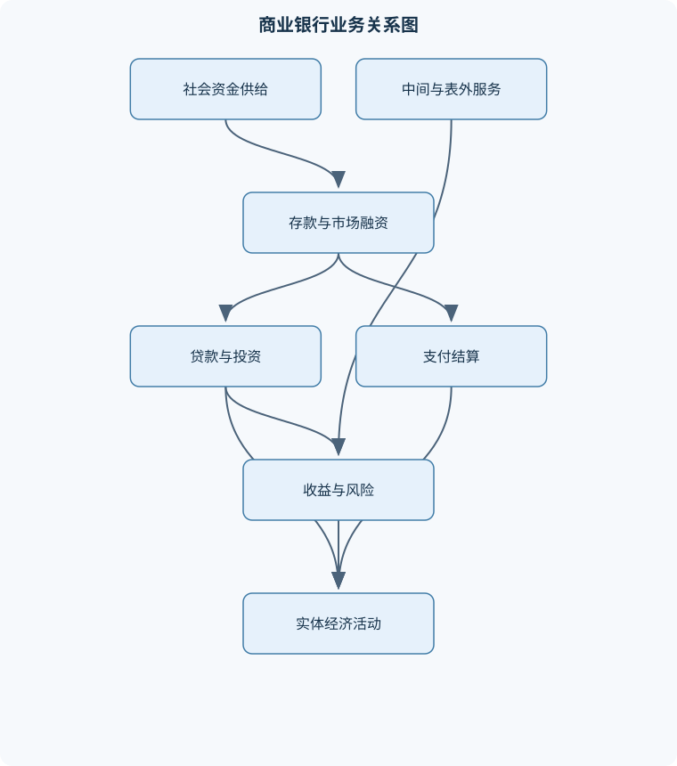
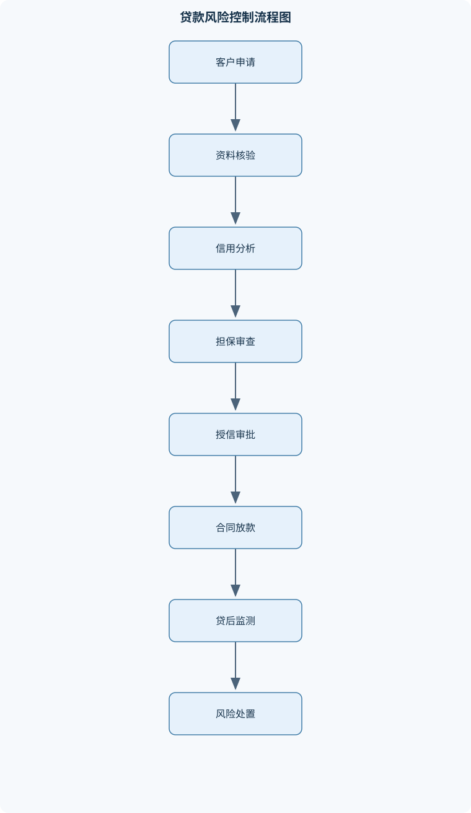

# 商业银行导论

## 一、课程整体知识框架

### 课程边界与先修知识

本课程系统介绍商业银行作为综合性金融企业的功能、组织、业务、经营管理与风险控制，重点覆盖负债业务、资产业务、中间业务、国际业务、资产负债管理、资本与风险管理以及数字化和业务转型。课程边界包括银行吸收资金、配置资金、提供支付结算和金融服务的基本机制，也包括银行在利率、信用、流动性、市场、操作和国家风险下的经营决策。不以具体时期的监管指标或单一国家制度为唯一结论，涉及法规、监管资本、会计确认和业务资质时，应结合适用法域、监管文件版本和银行业务类型判断。先修知识包括宏观经济学、货币银行学、微观经济学、财务会计、公司金融、统计学和基础概率；数学要求能够进行现值终值、利率换算、财务比率、概率分布、敏感性分析和基础优化计算。





### 1. 课程对象与基本问题

商业银行是以经营货币和信用为核心、以获取合理利润为目标、同时承担支付清算和金融服务职能的综合性金融企业。传统商业银行主要吸收可用于转账和支付的活期存款，并将资金投向工商企业的短期贷款；现代商业银行的业务范围已经扩展到公司金融、个人金融、金融市场、资产管理、支付结算、托管、咨询、贸易融资、衍生品和数字化服务等领域。

商业银行的基本经营问题可以概括为四个相互联系的环节：第一，如何吸收稳定且成本可控的资金；第二，如何把资金配置到具有合理收益和可控制风险的资产；第三，如何通过支付、结算、代理、托管、咨询和表外承诺等服务获取非利息收入；第四，如何在流动性、安全性、盈利性和合规性之间进行协调。银行并不是简单的“存款加贷款”机构，而是通过资产负债表和表外业务同时经营资金、信用、期限、流动性与信息。

银行会计恒等式为

$$A=L+E$$

其中，$A$为总资产，通常以元、万元或亿元计，包括现金、准备金、贷款、证券投资和其他资产；$L$为总负债，包括存款、同业负债和发行债务工具等；$E$为所有者权益或银行资本。该恒等式说明，银行资产的增加必须由负债增加或权益增加提供资金。若银行主要依靠负债扩张资产，杠杆率会上升，资产收益变化对股东权益收益的影响也会被放大。

商业银行具有企业属性，表现为独立核算、自主经营、以收入覆盖成本并追求资本回报；又具有特殊企业属性，因为其主要负债是公众存款，经营失败可能造成支付链条中断和金融挤兑；同时，银行通过信用投放影响货币供应和社会融资，具有明显的公共性与外部性。因此，银行经营不能只依据单笔业务利润，还必须考虑资本约束、流动性约束、风险传染、消费者保护和金融稳定。

### 2. 商业银行的四项基本职能

#### 2.1 信用中介

信用中介是指银行吸收资金供给者的暂时闲置资金，再以贷款、债券投资等形式提供给资金需求者。银行通过集中小额、分散的存款，利用专业调查、风险评级、贷后监测和组合管理降低信息不对称。

信用中介并不意味着银行可以无条件扩大贷款。银行必须同时评估借款人的现金流、抵押担保、行业周期、还款来源和资本占用。贷款收益通常高于存款成本，但差额必须覆盖运营成本、预期信用损失、资本成本和目标利润。若只比较贷款利率与存款利率，可能错误地把高风险贷款判断为高盈利贷款。

#### 2.2 支付中介

支付中介是银行利用账户体系、清算网络和支付工具，为企业和个人完成资金转移。转账结算使商品、服务、工资、税费和金融资产交易可以在不直接搬运现金的情况下完成。支付业务提高了交易效率，也使银行获得账户管理费、结算手续费和客户关系价值。

支付中介要求账户身份识别、授权控制、交易记录、清算时效和异常监测相互配合。支付系统发生技术故障、欺诈或操作错误时，风险不仅是单笔资金损失，还可能影响客户信任和金融市场流动性。

#### 2.3 信用创造

在理想化条件下，银行吸收的基础资金可以通过贷款和存款回流形成多轮存款扩张。若现金漏损为零、银行不持有超额准备、贷款全部重新回到银行体系，且法定准备率为$r_d$，则简单存款乘数为

$$m=\frac{1}{r_d}$$

例如，初始新增准备金为$100$万元，$r_d=10\%$，理论上最大存款总量为

$$100\times\frac{1}{10\%}=1000\text{万元}$$

推导过程是：第一轮银行最多创造$90$万元贷款；第二轮新增存款后最多再创造$81$万元贷款；继续进行可得

$$100+90+81+\cdots=1000\text{万元}$$

该结论只适用于理想模型。现实中存在现金漏损、超额准备、资本充足约束、借款人信贷需求不足、银行风险偏好变化以及监管限制，因此实际货币创造不会机械地等于$1/r_d$。银行资本也不是准备金的同义词：资本是吸收损失的权益资源，准备金是银行持有的特定流动性资产，存款则是银行对客户承担的负债。

#### 2.4 金融服务

现代银行还提供银行卡、代理收付款、托管、财务顾问、现金管理、理财、贸易融资、投资银行和信息服务。部分服务不立即形成资产负债表内资产，但可能形成手续费收入、承诺义务或未来的信用风险。银行必须按照业务性质识别表内风险、表外风险、客户适当性风险和操作风险。

### 3. 银行经营的核心约束

#### 3.1 安全性、流动性与盈利性

安全性要求银行保持资产质量、资本缓冲和内部控制，避免重大损失；流动性要求银行能够按期满足提款、支付、债务到期和融资需求；盈利性要求银行以可持续方式获得净利息收入、手续费收入和其他经营收益。三者不能简单排序。

过度追求安全可能导致资产过于保守、收益不足；过度追求盈利可能扩大高风险贷款、期限错配和杠杆；过度追求流动性可能持有大量低收益资产，压缩净息差。因此，银行经营是风险调整后的收益优化，而不是单纯追求资产规模或账面利润。

货币时间价值是贷款定价、债券估值和资产负债管理的共同基础。单笔资金在每期复利、周期利率为$r$、计息期数为$n$时，

$$FV=PV(1+r)^n$$

反推现值为

$$PV=\frac{FV}{(1+r)^n}$$

其中，$PV$为现值，$FV$为终值，$r$必须明确是每期利率，$n$必须与利率周期一致。若年利率为$6\%$而按月复利，不能直接令$n=12$并使用$0.06$，而应明确月利率口径。若给定的是名义年利率且每年复利$m$次，通常每期利率为$r_{\text{年}}/m$，期数为$mn$；若给定有效年利率，则应进行相应换算。公式不包含税费、违约损失、流动性溢价和交易成本。

若每期末收到相同现金流$C$，共$n$期，周期利率为$r$，则年金现值为

$$PV=C\frac{1-(1+r)^{-n}}{r},\qquad r\ne0$$

当$r=0$时，现值为$Cn$。该公式只适用于现金流金额、间隔和支付时点明确且相同的情形；期初支付的年金需要在期末年金现值基础上乘以$(1+r)$。

#### 3.2 规模、杠杆与资本约束

银行通过负债融资扩大资产规模，但杠杆使股东收益和损失同时放大。在忽略税费、非利息收入和信用损失的简化模型中，若资产收益率高于负债成本率，提高负债融资比例可能提高$ROE$；然而当资产质量恶化、融资成本上升或资产价格下降时，权益损失也会被放大。因此不存在脱离风险约束的无限加杠杆结论。

资本具有三项基本功能：一是吸收资产损失，保护存款人和其他债权人；二是支持资产扩张并维持市场信任；三是约束股东和管理层过度承担风险。资本监管的一般逻辑是根据资产风险、表外暴露和市场变化，对银行提出最低资本缓冲要求。具体资本分类、风险权重、资本工具资格和监管比例必须结合适用法域、银行类型及监管文件版本判断，不能把某一时期的指标当作永久规则。

### 4. 风险管理的统一逻辑

银行风险管理包括风险识别、计量、监测、报告、控制和处置。主要风险包括信用风险、市场风险、利率风险、流动性风险、操作风险、法律风险、合规风险、声誉风险和国家风险。

信用风险是交易对手不能按约偿付本息或履行合同义务的风险。预期损失在参数口径一致时可表示为

$$EL=PD\times LGD\times EAD$$

其中，$PD$为违约概率，$LGD$为违约损失率，$EAD$为违约风险暴露，$EL$为预期损失。三者必须对应同一时点、同一组合、同一违约定义和相容的回收假设。预期损失通常通过贷款定价、手续费和损失准备吸收；非预期损失主要由资本覆盖；极端损失则需要压力测试、风险限额和应急融资安排应对。

市场风险源于利率、汇率、证券价格、商品价格或信用利差变动。风险价值$VaR$是在给定持有期和置信水平下，正常市场条件中损失分布的某一分位点。它不是极端情形的最大损失，也不能说明超过该分位点后的损失规模。模型结果依赖历史样本、分布假设、持有期、置信水平和流动性假设，必须与压力测试结合使用。

利率风险既影响银行净利息收入，也影响资产负债市场价值。某一重定价期限内，利率敏感性缺口为

$$GAP=RSA-RSL$$

其中，$RSA$为利率敏感性资产，$RSL$为利率敏感性负债。正缺口时，若资产和负债重定价幅度、速度及基准利率相近，市场利率上升通常有利于短期净利息收入；但若存款利率具有黏性、贷款利率调整滞后或资产负债基准不同，该方向可能偏离。

对固定现金流资产，持续期衡量现金流现值加权平均回收时间。若收益率发生小幅变化，金融资产价值变化可近似表示为

$$\frac{\Delta V}{V}\approx-\frac{D\Delta r}{1+r}$$

其中，$V$为资产市场价值，$D$为麦考利持续期，单位为年，$\Delta r$为周期收益率变化。该近似假设现金流不因利率变化而改变、收益率曲线大致平行移动且利率变化较小。利率大幅变动、收益率曲线扭曲、贷款提前还款或存款行为改变时，一阶持续期近似会产生明显误差，必须考虑凸性和行为模型。

## 二、章节和模块划分

### 核心知识覆盖清单

本清单用于检查正文是否覆盖本课程的主要知识模块：

- **商业银行的性质、职能与发展**：传统与现代商业银行定义、商业银行的企业属性、商业银行的特殊性、信用中介与支付中介、信用创造机制、金融服务职能、商业银行与其他金融机构的区别、银行业发展与业务综合化。
- **商业银行组织结构与经营模式**：单一制与分支行制、总分行组织结构、法人治理与内部控制、批发银行与零售银行、综合经营与专业化经营、公司银行业务与个人银行业务、社区银行与区域银行、银行经营目标的协调。
- **商业银行资本与公司治理**：银行资本的构成、核心资本与附属资本、资本的经济功能、资本充足与风险吸收、资本成本与资本回报、资本杠杆与资产扩张、股东治理与董事会职责、资本监管的一般逻辑。
- **商业银行负债业务管理**：活期存款与定期存款、储蓄存款与通知存款、存款定价机制、存款稳定性与成本、同业负债、中央银行借款、金融市场融资、债券与大额存单融资、负债流动性管理。
- **商业银行资产业务与贷款经营**：现金资产与准备金、贷款的种类与期限、信用贷款、保证贷款、抵押贷款与质押贷款、票据贴现、消费信贷、贷款定价方法、贷款集中度与行业限额、贷款全流程管理。
- **信用分析与贷款风险控制**：五C信用分析法、五P信用分析法、资产负债表分析、利润表分析、现金流量表分析、偿债能力与盈利能力比率、担保物审查与估值、贷前调查与授信审批、贷后检查与风险预警、不良贷款处置。
- **中间业务、表外业务与理财服务**：结算与支付服务、代理与代销业务、银行卡业务、托管与咨询业务、理财产品分类、表外业务的含义、贷款承诺与备用信用额度、担保与信用证、金融衍生工具业务、表外风险的资本与信息管理。
- **商业银行国际业务**：国际贸易结算、信用证业务、进口押汇与出口押汇、打包放款、买方信贷与卖方信贷、福费廷业务、保理业务、国际银团贷款、离岸金融市场、汇率风险与国家风险管理。
- **商业银行资产负债管理**：资产管理理论、负债管理理论、资产负债综合管理理论、资金总库法、资金分配法、线性规划法、利率敏感性缺口、持续期缺口、利率互换与期货套期保值、流动性与盈利性的协调。
- **商业银行风险管理与监管框架**：风险的定义与分类、信用风险、市场风险与利率风险、流动性风险、操作风险、法律风险与声誉风险、预期损失与非预期损失、风险价值VaR、压力测试与情景分析、风险预防、分散、转移与补偿。
- **商业银行经营绩效与转型创新**：净利息收入与非利息收入、净息差与资产收益率、净资产收益率、成本收入比、经济资本回报、网点与客户经营效率、数字银行与金融科技、普惠金融与小微金融、绿色金融与可持续经营、区域银行转型与业务创新。


### 第一章 商业银行的性质、职能与发展

本章建立全课程的分析对象。内容包括传统与现代商业银行定义、银行的企业属性和特殊性、信用中介、支付中介、信用创造及金融服务职能，并比较商业银行与保险公司、证券公司、信托机构、基金管理机构和金融科技平台的业务边界。

银行与一般工商企业的共同点是需要收入覆盖成本、配置资源并承担经营风险；不同点是银行资产负债表中负债比例通常较高，负债中相当部分具有短期可支取特征，资产则可能是期限较长、流动性较低的贷款。银行因此承担期限转换、规模转换、风险转换和信息生产功能。银行业发展通常表现为从存贷款和支付结算向综合金融服务、金融市场业务、财富管理和数字化经营扩展，但综合化并不等于无边界经营，业务资格、风险隔离、客户适当性和监管要求始终构成约束。

### 第二章 商业银行组织结构与经营模式

本章讨论单一制、分支行制、总分行制以及法人治理结构。总行通常负责战略、资本、风险政策、产品制度和集中管理，分支机构负责客户拓展、业务执行和区域经营；但具体授权边界取决于银行治理安排和内部控制制度。

按客户与资金来源可区分批发银行和零售银行。批发银行主要服务大型企业、金融机构和政府部门，单笔金额大、产品结构复杂、客户数量相对少；零售银行面向个人和小微客户，交易数量多、金额分散，更依赖标准化流程、数据分析和渠道效率。公司银行业务重视授信、现金管理、供应链金融和贸易融资；个人银行业务重视存款、消费信贷、银行卡、财富管理和支付服务。

银行可以选择综合经营，也可以在特定区域、客户群或产品领域专业化经营。区域银行需要关注地方产业集中、区域经济周期和客户关联风险；社区银行需要重视本地信息优势，但也可能受到客户分散不足和风险集中限制。经营目标必须协调安全性、流动性、盈利性、合规性和客户服务质量，不能把资产规模增长当作唯一绩效标准。

### 第三章 商业银行资本与公司治理

本章解释资本的构成、经济功能、资本成本、资本回报和监管逻辑。银行资本包括实收资本、资本公积、留存收益等权益性资源，也可能包括满足监管资格要求的特定资本工具。不同法域对核心资本、附属资本、扣除项目和合格资本工具的定义可能不同，教材中的分类用于理解经济功能，不替代具体监管口径。

资本充足的基本含义是银行拥有与风险暴露相匹配的损失吸收能力。资本不足时，银行可能被迫压缩贷款、出售资产或高成本融资；资本过多则可能降低杠杆收益和股东回报。资本成本应纳入贷款定价和产品决策，因为占用资本意味着股东要求相应回报。董事会负责战略、风险偏好、内部控制和高级管理层监督；管理层负责将风险偏好转化为授信政策、限额、流程和报告体系；内部审计则应评价控制设计与执行有效性。

### 第四章 商业银行负债业务管理

负债业务包括活期存款、定期存款、储蓄存款、通知存款、同业负债、中央银行借款、金融市场融资、债券和大额存单等。活期存款流动性强、客户提款不确定性高，通常资金成本较低但稳定性可能弱；定期存款期限明确，稳定性较高，但提前支取安排可能改变实际成本；同业负债和市场融资便于主动调节资金，却更容易受到市场利率和流动性状况影响。

存款定价不能只看挂牌利率，还应考虑客户余额稳定性、结算贡献、交叉销售、资金使用期限、服务成本和流失概率。负债的真实成本可以分解为利息支出、账户运营成本、流动性储备成本、保险或信用增级成本以及潜在的市场融资替代成本。负债流动性管理要求建立资金缺口预测、融资来源分散、抵押品管理、应急融资计划和压力情景。

### 第五章 商业银行资产业务与贷款经营

资产端包括现金资产、准备金、同业资产、证券投资和贷款。现金资产流动性最高但收益通常较低；贷款收益较高但存在信用风险、期限风险和流动性风险。贷款可按期限分为短期、中期和长期，按对象分为公司贷款、个人贷款、小微贷款和同业贷款，按担保方式分为信用贷款、保证贷款、抵押贷款和质押贷款。

抵押贷款以不动产、设备等特定财产提供担保；质押贷款以动产或权利凭证占有、控制或登记质押为基础；保证贷款依赖保证人的代偿能力和法律责任。担保物是第二还款来源，不能替代借款人的经营现金流。票据贴现是银行按低于票面金额的价格取得未到期票据，到期向付款人收款。贴现额等于票面金额减去贴现利息；若题设规定月贴现率、期限按天数并采用三十天折算，则可近似写为

$$\text{贴现利息}=\text{票面金额}\times\text{月贴现率}\times\frac{\text{天数}}{30}$$

实际业务必须依据合同约定的起息日、到期日、计息基础和票据规则计算。

贷款定价的成本加成法可写为

$$\text{贷款利率}=\text{资金成本率}+\text{运营成本率}+\text{风险补偿率}+\text{资本回报要求}$$

若存在客户存款贡献、服务费、承诺费或补偿性余额收益，可在统一口径下扣减相应贡献。只使用“资金成本加固定利差”会忽略客户风险、期限、担保、资本占用和服务成本。贷款全流程包括申请受理、身份和资料核验、用途审查、行业分析、财务分析、现金流预测、风险评级、授信审批、合同签订、放款条件核验、贷后检查和到期收回。

### 第六章 信用分析与贷款风险控制

本章以“五C”分析法为主线，即品格、能力、资本、担保和环境；“五P”分析法则从借款人、用途、偿还、保障和前景等角度组织调查。两种方法都不是机械打分表，核心是判断第一还款来源是否可靠、第二还款来源是否有效，以及风险是否在授信条件和资本约束内。

财务分析包括资产负债表、利润表和现金流量表。流动比率可表示为流动资产除以流动负债，但高流动比率可能来自难以变现的存货；资产负债率反映杠杆水平，但行业资本结构差异会影响比较；利息保障倍数可以用息税前利润除以利息支出，但利润不等于现金；经营现金流覆盖债务指标则更接近实际偿债能力。审查时必须结合应收账款回收、存货周转、资本性支出、关联交易和行业周期。

担保物审查包括权属、可处分性、已有担保、查封冻结、评估价值、变现折扣、处置费用、登记和保险。压力情景下的可回收金额可按

$$\text{可回收金额}=\text{评估价值}\times(1-\text{变现折扣})-\text{处置费用}$$

估算，再与贷款本金比较。若可回收金额低于风险暴露，不能仅凭账面抵押率认定安全。

### 第七章 中间业务、表外业务与理财服务

中间业务包括支付结算、代理收付款、代销、银行卡、托管、咨询和现金管理等。银行主要通过收取手续费、管理费或服务费获得收入。表外业务是指尚未直接形成资产负债表内资产或负债，但可能形成未来权利、义务或风险暴露的业务，包括贷款承诺、备用信用额度、担保、信用证和衍生工具。

表外业务并非没有风险。贷款承诺可能在客户真正需要资金时集中转化为贷款；担保和信用证可能因客户违约而形成银行代偿；衍生工具可能因市场价格、交易对手或保证金变化产生损失。银行需要进行额度管理、交易对手管理、抵押品管理、估值、资本计量和信息披露。

理财产品应按资金投向、风险收益特征、流动性、是否保本、投资者适当性和管理责任进行分析，不能以“理财”名称直接推断风险等级或收益保证。

### 第八章 商业银行国际业务

国际业务包括国际贸易结算、信用证、托收、进口押汇、出口押汇、打包放款、买方信贷、卖方信贷、福费廷、保理、国际银团贷款和离岸金融市场业务。

信用证业务中，银行主要依据符合约定的单据承担付款或承兑责任，单据审核不能完全替代对基础交易、货物质量和交易对手的风险调查。进口押汇是银行在进口单据项下向进口商提供的短期融资；出口押汇是银行在出口商提交符合条件的单据后提供融资；打包放款通常以出口商未来提交符合要求的单据和收汇为基础，发放生产或备货融资。

福费廷通常针对较大金额、较长期限并有承兑或担保的应收款，银行或相关机构可能无追索权买入应收款；保理通常包含应收账款管理、催收、融资和买方信用风险服务，二者不能混同。国际银团贷款通过多家银行分担单一借款人的大额融资风险。国际业务还要识别汇率风险、国家风险、转移风险、制裁与合规风险、单据风险和法律适用风险。离岸金融市场是否合规，取决于业务所在地、参与者身份、资金流向和适用法律，不能将其简单等同于违法活动。

### 第九章 商业银行资产负债管理

资产管理理论强调通过配置现金、贷款和证券等资产来满足流动性与收益要求；负债管理理论强调通过主动融资获得所需资金；资产负债综合管理理论则同时考虑资产收益、负债成本、期限结构、利率敏感性和资本约束。

资金总库法将各类负债资金汇集后统一配置到准备金、贷款、证券和其他资产；资金分配法按照负债稳定性、流动性要求和资金来源期限分配资产；线性规划法在目标函数和约束条件明确时，求解资产配置组合。例如目标可以是最大化风险调整后收益，约束包括流动性下限、资本限额、行业集中度和单项资产比例。线性规划得到的结果依赖参数稳定和约束可量化，不能替代管理判断。

利率敏感性缺口分析按重定价期限将资产负债分桶，计算各期限$RSA$、$RSL$、$GAP$及累计缺口。持续期缺口分析则关注利率变化对资产和负债市场价值的影响。银行还可以使用利率互换、利率期货等工具套期保值，但衍生品会引入基差风险、交易对手风险、保证金风险和模型风险。资产负债管理的最终目标不是消除全部风险，而是在风险限额内协调流动性、盈利性和资本回报。

### 第十章 商业银行风险管理与监管框架

本章建立风险分类、风险偏好、风险限额、风险计量和风险处置框架。信用风险依赖客户调查、评级、授信、担保、组合分散和贷后管理；市场风险依赖头寸限额、估值、敏感性分析、$VaR$和压力测试；流动性风险依赖现金流预测、融资分散、流动性缓冲和应急计划；操作风险依赖岗位分离、授权控制、系统安全、业务连续性和事件报告。

风险管理方法包括风险预防、风险分散、风险转移和风险补偿。分散可以降低单一客户、行业或地区风险，但不能消除系统性风险；保险、担保和衍生品可以转移部分风险，但会引入交易对手和法律风险；提高定价和计提准备能够补偿预期损失，却不能替代资本和内部控制。

### 第十一章 商业银行经营绩效与转型创新

绩效分析包括净利息收入、非利息收入、净息差$NIM$、资产收益率$ROA$、净资产收益率$ROE$、成本收入比和经济资本回报。$NIM$通常为净利息收入除以平均生息资产，但分母口径必须明确；$ROA$通常为净利润除以平均总资产；$ROE$通常为净利润除以平均所有者权益。若使用期初余额而非平均余额，必须说明简化假设。

利润增长不一定代表经营质量改善。资产规模扩大可能提高收入，但若依靠高杠杆或高风险贷款，未来损失和资本占用也会增加；手续费收入提高可能来自低质量高风险业务；成本收入比下降也可能是短期压缩投入而非效率真正改善。

数字银行和金融科技通过移动渠道、自动化审批、数据分析、云平台和智能风控改变客户触达与运营模式，但同时带来数据安全、模型偏差、系统集中、网络攻击和第三方依赖风险。普惠金融和小微金融需要在降低单户服务成本的同时控制信息不对称和风险集中。绿色金融需要识别项目环境效益、转型风险和“漂绿”风险。区域银行转型应结合当地产业、客户基础、资本能力和风险承受能力，不能简单复制大型银行的产品体系。

### 代表性经营流程一：贷款全流程分析

**输入**包括借款申请、身份资料、财务报表、交易合同、征信信息、担保资料和资金用途证明。流程依次为：

1. 核验客户身份、资料真实性、关联关系和实际控制人；
2. 判断贷款用途、交易背景和还款来源；
3. 分析行业、经营模式、供应链、财务报表和现金流；
4. 计算流动性、杠杆、盈利能力和偿债能力指标；
5. 评估担保物权属、价值、变现折扣和处置路径；
6. 形成风险评级、授信额度、期限、利率和担保条件；
7. 经有权审批人审批后签订合同；
8. 核验放款条件，支付至符合用途要求的账户；
9. 贷后监测经营、现金流、担保物和预警信号；
10. 到期收回本息，或在风险恶化时启动重组、催收和处置。

不变量是每项授信结论都必须能够追溯到真实资料和可解释的风险依据。发现资料虚假、用途不明、还款来源不成立或担保无法有效设立时，应终止流程并拒绝放款。

### 代表性经营流程二：利率敏感性缺口分析

**输入**包括资产负债项目、金额、重定价日期、计息方式和利率情景。先按统一规则将项目归入隔夜、短期、中期和长期重定价期限桶，再分别计算每个期限桶中的$RSA$和$RSL$，随后计算

$$GAP_i=RSA_i-RSL_i$$

最后在利率上升或下降情景下估计净利息收入方向。若采用小幅变动和其他条件不变的简化假设，某期限桶净利息收入变化可近似表示为

$$\Delta NII_i\approx GAP_i\times\Delta r_i$$

其中，$\Delta r_i$为该期限桶资产负债重定价利率变化，单位通常为小数形式，例如$1\%$应写为$0.01$。该公式忽略基差、存款利率黏性、提前还款、非线性期权和客户行为变化，只适合方向判断和初步敏感性分析。

### 代表性经营流程三：信用风险预期损失分析

**输入**为$PD$、$LGD$和$EAD$。首先统一违约定义、观察期间、组合范围和计量时点；其次确认$PD$是期间违约概率还是累计违约概率，$LGD$是否已经反映回收时间价值和处置成本，$EAD$是否包含已用额度和预期提款；最后计算

$$EL=PD\times LGD\times EAD$$

例如，若$PD=2\%$、$LGD=40\%$、$EAD=500$万元，则

$$EL=2\%\times40\%\times500=4\text{万元}$$

若经济进入衰退情景，三个参数可能同时上升，不能只提高$PD$而忽略抵押物价值下降和授信额度使用率上升。该流程的输出应包括基准、温和衰退和严重衰退情景下的预期损失、准备需求和管理措施。

### 代表性经营流程四：贸易融资审查

**输入**包括贸易合同、信用证或托收单据、运输单据、企业资信、货物信息、融资申请和历史回款记录。审查顺序为：确认交易真实性；核验单据一致性和付款条件；调查进口商、开证行和相关国家风险；判断货权和单据控制是否有效；测算融资比例、期限、汇率敞口和回款来源；落实放款条件并跟踪收款。

若出现单据不符、货权失控、出口商挪用回款、进口商抵销债务或开证行信用下降，应暂停新增融资并启动风险处置。贸易背景真实并不等于银行必然安全，付款主体、货物变现能力和法律执行条件仍须单独审查。

### 代表性计算例题

#### 例题一：现值与终值

**题干：**某企业存入银行$10$万元，年有效利率为$6\%$，期限为$2$年，按年复利。求到期终值。

**分析：**已知$PV=10$万元，$r=0.06$，$n=2$，利率和期数均按年计。

**解答：**

$$FV=10(1+0.06)^2=11.236\text{万元}$$

**结果验证：**第一年本息为$10.6$万元，第二年利息为$10.6\times6\%=0.636$万元，合计$11.236$万元。

**变式：**若按月复利且名义年利率为$6\%$，则月利率为$0.06/12$，期数为$24$，不能直接使用年利率和$24$期混算。

#### 例题二：成本加成贷款定价

**题干：**资金成本率为$3\%$，运营成本率为$1\%$，风险补偿率为$1.5\%$，资本回报要求为$0.8\%$，求基础贷款利率。

**解答：**

$$\text{贷款利率}=3\%+1\%+1.5\%+0.8\%=6.3\%$$

若客户每年贡献的存款和服务费折算收益为$0.4\%$，在口径一致且可稳定实现的前提下，客户报价可近似为$5.9\%$。

**结果验证：**报价必须覆盖四项基础成本，否则即使名义利率高于资金成本，也可能因风险损失或资本占用而实际亏损。

**变式：**若客户风险评级下降，风险补偿率提高至$2.5\%$，其他条件不变，报价应提高$1$个百分点，而不是继续沿用原固定利差。

#### 例题三：抵押贷款安全边际

**题干：**抵押物评估价值为$1000$万元，压力情景下变现折扣为$30\%$，处置费用为$50$万元，贷款本金为$650$万元。判断压力情景下是否存在回收缺口。

**解答：**

$$\text{可回收金额}=1000(1-30\%)-50=650\text{万元}$$

可回收金额等于贷款本金，未考虑利息、税费和其他优先权时，主债权本金不存在缺口。

**结果验证：**若处置费用增加至$80$万元，则可回收金额为$620$万元，缺口为$30$万元。

**变式：**若抵押物存在优先担保债权，应先从处置价值中扣除优先受偿金额，不能直接将评估价值与贷款本金比较。

#### 例题四：预期信用损失

**题干：**某贷款组合$EAD=2000$万元，$PD=3\%$，$LGD=50\%$，求预期损失。

**解答：**

$$EL=3\%\times50\%\times2000=30\text{万元}$$

**结果验证：**若$PD$和$LGD$均为比例，$EAD$以万元计，则$EL$也以万元计。

**变式：**衰退情景下$PD$升至$5\%$、$LGD$升至$60\%$，则

$$EL=5\%\times60\%\times2000=60\text{万元}$$

损失并非只增加$2$个百分点对应的金额，而是受到两个参数同时变化的影响。

#### 例题五：利率敏感性缺口

**题干：**某期限桶内利率敏感性资产为$8000$万元，利率敏感性负债为$6000$万元，市场利率上升$0.5\%$。在重定价幅度相同且其他条件不变时，估计净利息收入变化。

**解答：**

$$GAP=8000-6000=2000\text{万元}$$

$$\Delta NII\approx2000\times0.5\%=10\text{万元}$$

**结果验证：**正缺口意味着资产重定价金额大于负债，利率上升时利息收入增加额在简化模型中高于利息支出增加额。

**变式：**若负债重定价速度明显快于资产，实际净利息收入可能下降，说明静态缺口分析不能替代行为和基差分析。

### 实验与项目安排

#### 实验一：贷款客户财务与授信分析

**输入数据：**提供连续多个期间的资产负债表、利润表、现金流量表、借款余额、利息支出、应收账款、存货和抵押物信息。

**步骤：**

1. 统一金额单位和会计期间，检查资产负债表是否满足$A=L+E$；
2. 计算流动比率、资产负债率、利息保障倍数和经营现金流覆盖指标；
3. 对利润与经营现金流差异进行解释；
4. 分析债务到期结构、应收账款回收和存货变现；
5. 对抵押物进行折扣和处置费用压力测试；
6. 形成授信额度、期限、利率、担保和贷后监测建议。

**评价标准：**数据口径一致、公式单位正确、结论能追溯到报表和业务资料、能区分第一还款来源与第二还款来源，并能说明至少一种压力情景下的风险变化。

**排错方法：**若流动比率异常高，检查存货是否被误当作现金；若利息保障倍数为正但现金流不足，检查应收账款增加和非现金收益；若资产负债表不平，检查借款、留存收益和单位换算是否遗漏。

#### 实验二：资产负债利率风险分析

**输入数据：**各项资产和负债余额、重定价日期、利率类型、期限桶、市场利率变化情景。

**步骤：**

1. 按统一规则将项目归入重定价期限桶；
2. 计算各期限桶的$RSA$、$RSL$、$GAP$和累计缺口；
3. 设定利率上升、下降和收益率曲线非平行变动情景；
4. 估计净利息收入和资产负债市场价值变化；
5. 比较缺口分析与持续期分析的结果；
6. 提出调整资产期限、负债结构或套期保值的建议。

**评价标准：**每项资产负债只能按一套规则归桶；利率单位统一；能够解释正负缺口的方向性含义；明确指出存款黏性、提前还款、基差和模型假设造成的误差。

**排错方法：**若累计缺口与各期限缺口之和不一致，检查重复归类；若利率上升时所有情景都显示利润增加，检查负债重定价速度和基差假设；若持续期结果与缺口结果方向完全相反，检查分析对象，一个主要关注净利息收入，另一个关注市场价值，不能混为同一指标。

## 三、核心概念的详细解释

### 3.1 商业银行的性质、职能与经营边界

商业银行是以经营货币、信用和金融服务为核心的综合性金融企业。传统商业银行主要吸收活期存款、发放短期工商贷款并提供转账结算；现代商业银行的业务范围已扩展至公司金融、个人金融、金融市场、支付结算、托管、咨询、贸易融资、银行卡、理财和数字化服务等领域。传统定义有助于理解商业银行的历史起点，现代定义则强调其业务综合化和服务平台化特征。

商业银行首先是企业。它需要独立核算，通过利息收入、手续费及佣金收入、投资收益等收入覆盖资金成本、人员和科技成本、风险损失及税费，并获得与风险相匹配的资本回报。商业银行又是特殊企业，原因在于其负债中包含大量公众存款，资产期限通常长于负债期限，且银行账户参与社会支付系统。银行出现严重流动性困难时，即使账面资产价值高于负债，也可能因无法及时支付而发生挤兑。因此，银行经营目标不能简化为利润最大化，而应在安全性、流动性、盈利性、合规性和客户服务之间协调。

商业银行具有四项基本职能：

1. **信用中介职能。**银行将存款人暂时闲置的资金集中起来，经过信用调查、风险定价和组合管理，再投向企业、个人、政府或金融市场。银行的价值不仅在于“转移资金”，还在于减少借贷双方的信息不对称、分散风险并进行期限转换。
2. **支付中介职能。**银行依托账户、支付工具和清算网络完成工资、采购、税费、贸易及金融交易的资金转移。支付服务具有网络效应：使用者越多，账户和清算体系的便利性越高，但系统故障、欺诈和操作错误的外部影响也越大。
3. **信用创造职能。**银行发放贷款后，借款人通常将资金支付给其他主体，收款人又将其存入银行，形成存款与贷款的派生扩张。信用创造受到准备金、资本、流动性、信贷需求、风险偏好和监管要求共同约束，并非银行可以无限创造货币。
4. **金融服务职能。**银行通过代理收付款、银行卡、托管、咨询、理财、结算、担保、信用证和衍生品等业务获取非利息收入。这些业务有些不立即形成资产负债表内资产，但可能带来未来的信用、市场、操作、法律和声誉风险。

商业银行与证券公司、保险公司、信托机构、支付机构和其他金融机构的区别，主要体现在资金来源、风险承担方式、产品功能和支付体系地位。商业银行通常以存款等负债为重要资金来源，具有较强的支付结算功能和期限转换功能；证券公司主要提供证券承销、经纪、交易和投资银行服务；保险公司以风险保障和资金长期运用为核心；支付机构重点提供支付技术和资金转移服务，但其资金运用及信用创造权限受业务资质和监管边界约束。不同机构之间可以通过集团、合作和金融市场联系起来，但不能因“都提供金融服务”而相互等同。

### 3.2 商业银行的组织结构与经营模式

商业银行的组织结构通常包括股东会、董事会、监事或审计监督机制、高级管理层以及业务、风险、合规、财务、运营和科技部门。董事会负责确定战略、风险偏好和重大政策；高级管理层负责组织执行；风险管理和合规部门应保持相对独立，对业务部门形成制衡；内部审计则对治理、控制和风险管理体系进行独立评价。

按地域和法人安排，银行可以采用单一制、分支行制或集团化结构。单一制银行通常以一个法人和较少营业机构开展业务，决策链条短，便于服务特定区域，但资金调度和风险分散能力可能较弱。分支行制由总行统一制定战略、风险政策和资金管理规则，分支机构负责客户拓展与业务执行，能够实现跨区域资金配置，但也会带来授权过度、信息传递迟滞和分支机构道德风险。总分行制下，法人责任、授权边界、数据口径和内部控制必须清晰。

按客户和业务对象，银行可分为批发银行、零售银行、公司银行、小微金融、社区银行和区域银行。批发银行主要服务大型企业、政府和金融机构，单笔业务金额大、客户数量相对少，对资本市场、现金管理和综合授信能力要求高。零售银行面向个人和小微客户，业务数量多、金额较小，依赖标准化流程、数据分析、渠道运营和风险评分。公司银行注重现金流、行业地位、集团关联关系与综合金融方案；个人银行则更重视收入稳定性、信用记录、负债结构和消费行为。

综合经营可以提高客户黏性和交叉销售能力，但会增加业务复杂性、利益冲突和风险传染。专业化经营有利于形成清晰的风险边界和专业能力，却可能限制收入来源和客户覆盖。经营模式的选择应与资本实力、风险管理能力、技术基础、客户结构和适用法域的业务资质相匹配。

### 3.3 银行资本、杠杆与公司治理

银行资本通常表现为所有者权益及符合监管或风险吸收要求的资本工具。会计上的所有者权益包括实收资本、资本公积、留存收益等项目；监管资本则依据适用监管规则对资本质量、损失吸收能力和扣除项目进行界定。核心资本通常具有持续经营状态下吸收损失的能力，其他合格资本工具可能主要用于银行进入风险处置或清算阶段时吸收损失。具体资本分类和资本充足要求取决于法域、银行类型及适用监管文件，不能将某一时期的指标直接视为普遍规则。

资本具有四项功能：一是吸收经营损失，保护存款人和其他债权人；二是支持资产扩张，使银行能够承担风险资产；三是增强市场信心，降低融资困难和挤兑概率；四是约束股东和管理层过度冒险。资本不足时，银行可能被迫减少贷款、出售资产或高成本融资；资本过多则可能降低杠杆收益，但增强抗风险能力。

银行资产负债表满足

$$A=L+E$$

其中，$A$为总资产，$L$为总负债，$E$为所有者权益或银行资本，三者金额单位必须一致。若银行新增贷款$100$万元，同时新增存款$100$万元，则资产和负债同时增加，权益不变；若贷款发生实际损失$10$万元且未被其他收益抵消，则资产减少或损失准备增加，最终使权益减少$10$万元。

杠杆是银行经营的重要特征。以总资产与权益之比衡量简化杠杆倍数：

$$\text{杠杆倍数}=\frac{A}{E}$$

在资产收益率既定时，较高杠杆可能提高股东回报；但资产价值小幅下降也会对权益造成更大比例冲击。公司治理的核心不是单纯追求高杠杆和高利润，而是确保业务扩张受到资本、流动性、风险限额和内部控制约束。

### 3.4 负债业务及其管理

负债业务是银行形成资金来源的业务，主要包括活期存款、定期存款、储蓄存款、通知存款、同业负债、中央银行借款、发行债券和大额存单等。

活期存款流动性高、支付功能强，但利率通常较低，余额可能受客户交易行为影响。定期存款期限较明确，稳定性相对较高，但资金成本通常高于活期存款，提前支取还可能改变实际成本。储蓄存款主要面向个人客户，客户分散程度高，具有一定稳定性；通知存款则兼具期限约束和流动性安排特征。银行不能只根据名义利率判断负债优劣，还应考虑客户行为、期限结构、利率敏感性、维护成本、保险或担保安排以及挤兑风险。

同业负债和市场融资可以迅速补充资金，但对市场利率、信用状况和流动性环境较敏感。金融市场融资在市场稳定时具有灵活性，在市场紧张时可能迅速收缩。因此，银行应避免过度依赖单一短期融资来源，并建立到期缺口分析、现金流预测、抵押品管理和应急融资计划。

负债定价需要比较资金实际成本，而不是只看存款挂牌利率。实际成本可能包括利息、账户维护、渠道费用、营销奖励、流动性占用和行为波动成本。负债管理的目标是以合理成本获得稳定资金，同时控制集中度、期限错配和再融资风险。

### 3.5 资产业务、贷款经营与信用分析

资产业务是银行运用资金并获取收益的业务，主要包括现金资产、准备金、贷款、证券投资、票据贴现和其他金融资产。现金和准备金流动性强、收益通常较低；贷款收益较高但承担信用风险、期限风险和操作风险；证券投资具有流动性和市场交易功能，但会受到利率、信用利差和价格波动影响。

贷款可按期限分为短期、中期和长期，按担保方式分为信用贷款、保证贷款、抵押贷款和质押贷款。信用贷款主要依靠借款人的信用状况和现金流；保证贷款由保证人承担约定的责任，但保证人的代偿能力和保证合同效力必须审查；抵押贷款以不动产、设备等资产设定担保；质押贷款通常以动产或权利凭证占有、控制或登记为基础。抵押物不是第一还款来源，借款人的经营现金流仍是判断贷款安全性的核心。

票据贴现是银行受让尚未到期票据并提前向持票人支付资金，票面到期后由付款人或其他责任主体付款。审查重点包括真实贸易背景、票据要式、背书连续性、付款人信用、到期日和票据权利状态。票据贴现不能简单等同于普通信用贷款。

信用分析常用“五C”框架：品格、能力、资本、担保和环境。品格关注信用记录、诚信和履约意愿；能力关注经营能力和偿债现金流；资本关注自有资金和财务缓冲；担保关注权属、价值和处置能力；环境关注行业周期、宏观经济、政策和市场竞争。还可用“五P”从借款人、用途、还款能力、担保和前景等角度进行补充分析。

财务分析必须把资产负债表、利润表和现金流量表结合起来。流动比率反映流动资产对流动负债的覆盖关系，但存货和应收账款不一定能及时变现；盈利能力较强不代表现金充足，因为赊销、存货积压和资本化支出可能使利润与经营现金流背离；资产负债率较高表明杠杆压力较大，但还应结合行业稳定性、债务期限和资产质量判断。贷款全流程包括客户准入、资料核验、贷前调查、授信审批、合同签订、放款条件审核、贷后检查、风险预警、到期收回和不良处置。

### 3.6 中间业务、表外业务与理财服务

中间业务通常是银行以代理人、服务提供者或安排者身份开展业务，并收取手续费、佣金或其他服务收入。支付结算、银行卡、代理收付款、托管、咨询、代销和现金管理都属于常见形式。中间业务不一定立即形成银行资产负债表内的债权债务，但并不意味着没有风险。

表外业务是指在特定时点不直接列入资产负债表、但可能形成未来资产负债或损益影响的业务，例如贷款承诺、备用信用额度、担保、信用证和部分衍生品交易。贷款承诺在客户提款后可能转化为贷款；担保和信用证在被保证人或申请人违约时可能使银行承担付款责任；衍生品则可能因市场价格变化形成重置成本和保证金压力。因此，表外风险需要进行授信审批、额度管理、敞口计量、抵押品管理和信息披露。

理财业务应区分产品法律关系、资金来源、投资范围、风险承担者和收益实现方式。不能把客户购买理财产品等同于银行存款，也不能把预期收益理解为无条件保证收益。银行提供理财服务时，应履行适当性管理、风险揭示、销售记录和利益冲突管理要求，具体规则取决于适用法域和产品类型。

### 3.7 国际业务与贸易融资

国际业务包括国际结算、贸易融资、外汇交易、国际贷款和跨境资金服务。信用证以开证行的相对独立付款承诺为核心，银行主要审查单据是否符合信用证要求，而不当然保证货物实际质量。进口押汇是银行为进口商提供付款或融资安排；出口押汇通常以出口单据和未来收款为基础提供融资；打包放款则通常发生在出口商发货前，以信用证或贸易合同等为依据支持备货生产。

保理通常包含应收账款管理、催收、融资和买方信用风险服务；福费廷通常针对较大金额、期限较长且具有承兑或担保的应收款，银行或金融机构无追索权买断未来债权。二者都涉及应收账款融资，但交易规模、期限、单据形式、追索安排和风险承担方式不同。

国际业务还面临汇率风险、国家风险、法律风险、制裁与合规风险以及单据和货权控制风险。贸易融资审查必须核验交易真实性、贸易背景、运输和保险资料、付款主体、开证行或进口商资信、资金用途和回款路径。离岸金融业务是跨境金融服务的一种组织形式，其合法性、监管方式和税务后果取决于所在地法律、业务结构和参与者身份，不能简单等同于违法活动。

### 3.8 资产负债管理与风险管理

资产负债管理的核心是统筹资产、负债和表外项目的期限、利率、流动性、币种和风险收益。资产管理理论强调通过优化资产结构提高安全性和收益；负债管理理论强调主动运用市场融资扩大资金来源；资产负债综合管理则要求同时管理资金来源和资金运用，避免只调整一侧而造成新的错配。

利率敏感性缺口用于分析特定重定价期限内的利率风险：

$$GAP=RSA-RSL$$

其中，$RSA$为利率敏感性资产，$RSL$为利率敏感性负债。正缺口表示该期限内资产重定价金额大于负债。若资产和负债利率同幅度重定价、基差稳定且其他条件不变，利率上升通常提高短期净利息收入；但如果负债利率上升更快，或资产利率受固定利率和客户行为约束，正缺口并不保证利润增加。

持续期分析关注资产和负债市场价值对利率变化的敏感性。它适用于固定收益现金流较稳定、利率变化较小且收益率曲线近似平行移动的场景。利率大幅变动、提前还款、存款行为改变或收益率曲线非平行移动时，应结合凸性、情景分析和现金流模型。

银行风险可分为信用风险、市场风险、利率风险、流动性风险、操作风险、法律风险、合规风险、声誉风险和国家风险。信用风险是交易对手不能按约定履约；市场风险来自利率、汇率、证券价格和信用利差变化；流动性风险是银行无法及时获得资金或变现资产而履约；操作风险来自人员、系统、流程和外部事件失效。

预期损失是正常经营条件下可以通过定价、费用和损失准备吸收的平均损失；非预期损失是实际损失偏离平均水平的波动，通常需要资本吸收；极端损失则需要通过压力测试、应急计划和恢复处置安排进行管理。风险管理方法包括预防、分散、转移、对冲、限额控制、风险补偿和持续监测。

### 3.9 经营绩效、数字化与业务转型

银行经营绩效不能只看利润总额。净利息收入反映生息资产收益与付息负债成本之间的差额；非利息收入反映支付、代理、托管、咨询和金融市场等业务贡献；净息差通常以净利息收入除以平均生息资产计算，但分母口径必须明确。$ROA$衡量单位资产创造净利润的能力，$ROE$衡量股东权益回报，成本收入比反映经营效率，经济资本回报则进一步考虑风险资本占用。

数字银行通过移动渠道、数据分析、自动化审批、智能客服和开放接口降低交易成本、扩大客户覆盖范围，但同时增加网络安全、数据治理、模型偏差、隐私保护和第三方服务风险。数字化不能替代授信逻辑：自动化模型仍需保证数据真实、变量可解释、结果可验证和异常可人工复核。

普惠金融和小微金融需要在降低单户服务成本与控制信用风险之间取得平衡。绿色金融则需要识别项目环境效益、转型风险和“漂绿”风险。区域银行转型应结合地方产业结构、客户基础、资金来源和风险承受能力，不能盲目复制大型综合银行模式。

## 四、重要定义、公式、定理和推导

### 专业审校补充：关键定义与适用边界

商业银行的流动性风险是指银行无法以合理成本及时履行到期支付义务的风险，其核心不是“资产总额是否大于负债总额”，而是现金流时间和可变现资产是否匹配。银行可能具有正的会计资本，却因贷款和债券难以及时变现、存款集中支取或同业融资中断而发生流动性危机；也可能短期现金充足，却因贷款大规模减值而资不抵债。流动性缺口可在给定期间近似表示为：$LG_t=O_t-I_t-LA_t$，其中$O_t$为期间现金流出，$I_t$为确定性现金流入，$LA_t$为扣除折价、处置费用和可用性限制后的合格流动性资产。若$LG_t>0$，表示仍存在资金缺口，需通过资产变现、融资或减少新增承诺弥补。该计算必须区分合同现金流与行为现金流：活期存款、未使用授信额度和提前还款都可能偏离合同期限。流动性资产不能按账面价值无条件计入，受市场冲击时还会发生折价扩大和融资抵押品价值下降。流动性管理因此需要现金流分层、融资来源分散、压力情景和应急融资安排，不能仅凭单一流动性比率判断安全性。


### 4.1 货币时间价值与银行现金流计算

货币时间价值是指同一金额在不同时间点的经济价值不同。原因包括资金可以产生收益、未来存在不确定性、通货膨胀会降低购买力以及资金具有流动性价值。

单笔资金按每期复利时，终值为

$$FV=PV(1+r)^n$$

反推现值为

$$PV=\frac{FV}{(1+r)^n}$$

其中，$PV$为现值，$FV$为终值，$r$为每期利率，$n$为计息期数。若$r$是年利率而计息按月进行，必须先将利率转换为月利率，或者明确使用有效年利率。不能把年利率直接与月数相乘代替复利计算，除非题目明确采用简单利息近似。

若年名义利率为$j$，每年复利$m$次，则有效年利率为

$$r_{\text{eff}}=\left(1+\frac{j}{m}\right)^m-1$$

该公式假设每期利率相同且按期复利，不考虑税费、手续费、违约和流动性溢价。

若每期末收到相同现金流$C$，共$n$期，周期利率为$r$，则普通年金现值为

$$PV=C\frac{1-(1+r)^{-n}}{r},\qquad r\neq0$$

当$r=0$时，不能直接代入分母为零的表达式，应取极限：

$$PV=Cn$$

年金公式只适用于现金流金额相同、发生时间规律且贴现率口径一致的情况。贷款分期偿还、债券票息和部分定期存款可以使用该模型；若现金流不等额、存在提前还款或利率随时间变化，则应逐期折现：

$$PV=\sum_{t=1}^{n}\frac{CF_t}{(1+r_t)^t}$$

其中，$CF_t$为第$t$期现金流，$r_t$为对应期限的贴现率。各现金流必须统一正负号和时间点。

### 4.2 存款货币创造的理想推导及现实边界

设银行体系新增基础资金为$B$，法定准备率为$r_d$，假设现金漏损为零、银行不持有超额准备、所有贷款均重新回到银行体系并形成存款，则第一轮可派生存款为$B$，其中准备金为$Br_d$，贷款为$B(1-r_d)$。贷款再次形成存款后，第二轮新增贷款为$B(1-r_d)^2$，继续扩张可得存款总额：

$$D=B+B(1-r_d)+B(1-r_d)^2+\cdots$$

这是首项为$B$、公比为$1-r_d$的等比级数。当$0<r_d\leq1$时，

$$D=\frac{B}{1-(1-r_d)}=\frac{B}{r_d}$$

因此，理想存款乘数为

$$m=\frac{D}{B}=\frac{1}{r_d}$$

该推导的关键不在于银行凭空创造资源，而在于贷款支出形成他人存款，银行体系通过多轮记账扩张存款。现实中，现金漏损率、超额准备率、资本约束、流动性约束和借款人信贷需求都会降低扩张倍数。若公众保留现金，或银行选择持有超额准备，实际乘数会低于理想值；若银行资本不足，即使准备金充足，也可能无法继续扩大风险资产。

### 4.3 贷款定价与预期损失

成本加成法将贷款利率拆分为资金成本、运营成本、风险补偿和目标利润：

$$r_L=r_F+r_O+r_R+r_P$$

其中，$r_L$为贷款利率，$r_F$为资金成本率，$r_O$为运营成本率，$r_R$为风险补偿率，$r_P$为目标利润率。若银行还需补偿资本占用，则可写为

$$r_L=r_F+r_O+r_{EL}+r_K+r_P-r_C-r_S$$

其中，$r_{EL}$为预期损失率，$r_K$为资本占用成本率，$r_C$为客户存款或综合关系贡献，$r_S$为可确认的服务费及其他收益折算率。

信用风险预期损失可表示为

$$EL=PD\times LGD\times EAD$$

其中，$PD$为违约概率，$LGD$为违约损失率，$EAD$为违约风险暴露。三者必须属于同一组合、同一观察时点和相容的回收口径。例如，若$PD=2\%$、$LGD=40\%$、$EAD=500$万元，则

$$EL=2\%\times40\%\times500=4\text{万元}$$

该结果是平均意义上的损失估计，不等于每一笔贷款必然损失$4$万元。若存在抵押物，$LGD$应考虑抵押物压力价值、处置折扣、处置费用、时间成本和法律执行难度。预期损失通常通过贷款利率、费用和损失准备吸收，非预期损失则主要由资本覆盖。

### 4.4 票据贴现与实际资金成本

票据贴现时，银行按照合同约定的贴现率和期限从票面金额中扣除贴现利息。简单表达为

$$I_d=F\times d\times T$$

$$P=F-I_d$$

其中，$F$为票面金额，$d$为贴现率，$T$为按合同确定的贴现期限，$I_d$为贴现利息，$P$为持票人实际取得的贴现金额。

若题设规定月贴现率为$d_m$，期限按天数$N$并以每月30天近似，则

$$I_d=F\times d_m\times\frac{N}{30}$$

例如，票面金额为$100$万元，月贴现率为$0.4\%$，期限为$60$天，则

$$I_d=100\times0.4\%\times\frac{60}{30}=0.8\text{万元}$$

$$P=100-0.8=99.2\text{万元}$$

这一计算只是题设近似。实际业务还需明确起息日、到期日、日计息基础、节假日顺延、手续费及票据付款责任。由于贴现利息在取得资金时预先扣除，按实际收到金额计算的资金成本可能高于名义贴现率。

### 4.5 银行财务比率及其解释边界

流动比率为

$$\text{流动比率}=\frac{\text{流动资产}}{\text{流动负债}}$$

它反映短期资产对短期负债的账面覆盖程度，但不说明资产能否立即变现。银行分析时还必须关注高流动性资产、现金流缺口和融资渠道，不能机械套用一般工商企业的比率标准。

资产负债率为

$$\text{资产负债率}=\frac{L}{A}$$

它反映资产中由负债融资的比例。银行本身具有高负债经营特征，因此必须结合资本质量、资产风险和流动性结构判断，不能单独据此评价经营好坏。

利息保障倍数可写为

$$\text{利息保障倍数}=\frac{\text{息税前利润}}{\text{利息支出}}$$

若企业利润中包含大量应收未收收入，该指标可能高估实际偿债能力，因此还应分析经营现金流。经营现金流覆盖债务的简化指标可表示为

$$\text{现金流覆盖率}=\frac{\text{经营活动现金流}}{\text{当期应偿债务及利息}}$$

各指标必须明确期间、金额单位和分子分母口径。利润为正而经营现金流为负，可能意味着应收账款增长、存货积压或一次性非现金收益增加；这类企业仍可能面临实际偿债困难。

### 4.6 利率敏感性缺口与持续期缺口

在一个重定价期限内，利率敏感性缺口为

$$GAP=RSA-RSL$$

若利率变动为$\Delta r$，且资产和负债在该期限内近似同步、基差不变，则净利息收入变化可近似表示为

$$\Delta NII\approx GAP\times\Delta r$$

例如，某期限内$RSA=8000$万元，$RSL=6000$万元，市场利率上升$0.5\%$，则

$$GAP=2000\text{万元}$$

$$\Delta NII\approx2000\times0.5\%=10\text{万元}$$

该结果只表示方向和近似金额。若负债利率调整更快、存款利率存在黏性、资产提前还款，或者资产和负债参考不同利率指数，实际结果会偏离。

麦考利持续期定义为现金流现值加权平均回收时间：

$$D=\frac{\sum_{t=1}^{n}t\cdot\frac{CF_t}{(1+r)^t}}{\sum_{t=1}^{n}\frac{CF_t}{(1+r)^t}}$$

其中，$CF_t$为第$t$期现金流，$r$为每期收益率，$t$以相同计息周期计量。对固定收益资产，收益率小幅变化时，价格变动可近似为

$$\frac{\Delta V}{V}\approx-\frac{D\Delta r}{1+r}$$

负号表示利率与价格通常反向变动。若资产市场价值为$V_A$、负债市场价值为$V_L$，则银行权益市场价值近似为

$$V_E=V_A-V_L$$

因此，

$$\Delta V_E\approx\Delta V_A-\Delta V_L$$

持续期分析与利率敏感性缺口分析关注的对象不同：缺口主要分析一定期间内净利息收入变化，持续期主要分析资产、负债和权益市场价值变化。两者不能简单互相替代。

### 4.7 风险价值与压力测试

设损失变量为$X$，置信水平为$\alpha$，风险价值是损失分布在该置信水平上的分位点：

$$VaR_\alpha=\inf\{x:P(X\leq x)\geq\alpha\}$$

若$VaR_{99\%}=100$万元，含义是在指定持有期和模型条件下，约有$99\%$的情形损失不超过$100$万元；剩余约$1\%$情形的损失可能超过该数值。VaR不是极端损失上限，也不说明超过阈值后的平均损失规模。

参数法通常需要收益分布、波动率、相关系数、持有期和置信水平等输入；历史模拟法则把历史价格冲击重新施加于当前组合，再按损失分位点计算VaR。模型结果必须通过回溯测试检验，并结合异常值、样本代表性和流动性折价判断。

压力测试不依赖于“正常市场条件”假设，而是设定利率快速上升、信用利差扩大、汇率大幅变动、存款集中流失或多个风险因素同时恶化的情景，观察资本、流动性和盈利的变化。压力测试不能替代日常风险计量，VaR也不能替代压力测试；二者分别用于常态风险分位点和极端情景承受能力分析。

### 4.8 经营绩效的分解关系

资产收益率为

$$ROA=\frac{\text{净利润}}{\text{平均总资产}}$$

净资产收益率为

$$ROE=\frac{\text{净利润}}{\text{平均所有者权益}}$$

由于

$$\frac{\text{净利润}}{\text{平均所有者权益}}
=
\frac{\text{净利润}}{\text{平均总资产}}
\times
\frac{\text{平均总资产}}{\text{平均所有者权益}}
$$

因此可得简化关系：

$$ROE=ROA\times\frac{A}{E}$$

其中，$A/E$为平均资产权益比，即简化杠杆倍数。该关系说明，在其他条件不变时，杠杆提高会放大$ROE$；但它没有包含信用损失、流动性风险、资本监管、税费和非利息收入变化，因此不能推出“杠杆越高越好”。

净息差通常表示为

$$NIM=\frac{\text{净利息收入}}{\text{平均生息资产}}$$

成本收入比可表示为

$$\text{成本收入比}=\frac{\text{营业成本}}{\text{营业收入}}$$

这些指标只有在分子、分母期间一致且会计口径相同的情况下才具有可比性。评价银行绩效还应结合风险调整后收益、资本占用、资产质量、流动性储备、客户留存和合规情况，避免以短期利润掩盖长期风险。

## 五、算法、流程和实现思路

### 方法与流程覆盖索引

下列方法或流程应在正文中说明输入、步骤、适用条件、结果检查和边界：

- 贷款全流程分析：输入为借款申请、财务资料、交易背景、担保资料和征信信息；过程包括客户身份与资料真实性核验、贷款用途审查、行业与经营分析、现金流预测、偿债能力测算、担保物估值、风险评级、授信额度确定、审批与合同签订、放款条件核验、贷后监测和到期收回；输出为授信结论、额度、期限、利率、担保条件和监测要求；终止条件为风险可接受且放款条件全部满足，或发现重大虚假、违法和不可接受风险而拒贷。
- 信用分析流程：输入为借款人及关联方资料；先分析品格与信用记录，再分析资本实力、经营能力、担保条件和外部经济环境；随后编制或核验资产负债表、利润表和现金流量表，计算流动性、杠杆、盈利和偿债指标，最后进行压力情景测试并形成风险等级；不变量是任何授信结论都必须能够追溯到真实资料和可解释的风险依据。
- 抵押贷款担保审查：输入为抵押物权属证明、评估资料和借款合同；依次核验权属及可处分性、查验已有担保和查封情况、评估市场价值与变现价值、确定抵押率、办理登记、明确占管责任和保险要求、持续监测价值变化；终止条件为担保有效登记且处置路径清晰，或权属瑕疵、价值不足和处置受限导致担保不可接受。
- 贷款定价流程：输入为资金成本、运营成本、风险参数、资本占用、客户关系和市场价格；计算基础资金成本，加入运营成本和风险补偿，再加入资本回报要求，扣除可确认的存款贡献、服务费和补偿性余额收益；输出贷款报价和敏感性区间；若风险参数、期限或抵押条件变化，应重新定价。
- 利率敏感性缺口分析：输入为资产负债项目、重定价日期和利率情景；按重定价期限归类项目，分别求出每期$RSA$和$RSL$，计算$GAP$及缺口比率，在利率上升和下降情景下估计净利息收入变化；不变量是同一项目只能按统一、可解释的重定价规则归入一个期限桶；输出为期限缺口表和对冲建议。
- 持续期缺口分析：输入为各项资产和负债的现金流、市场价格和收益率；先计算各期现金流现值，再以现值权重计算单项持续期和组合持续期，计算资产负债持续期缺口，最后模拟利率变动对资产、负债和权益价值的影响；终止条件为达到预设利率情景或风险限额；适用于小幅利率变动的近似分析。
- VaR参数法流程：输入为组合当前市值、历史波动率、相关系数、持有期和置信水平；假定收益服从指定分布，估计组合收益的均值和波动率，按分位数换算持有期风险，再通过回溯测试比较预测损失与实际损失；输出VaR及模型误差说明；若收益非正态、存在肥尾或流动性枯竭，应增加历史模拟和压力测试。
- 历史模拟法流程：输入为资产组合当前头寸和历史市场价格变动序列；将每个历史冲击重新施加到当前组合，计算每个情景下的组合损益，按损失从小到大排序并提取目标置信水平分位点；输出历史模拟VaR；适用前提是历史样本具有代表性，局限是无法充分覆盖未发生过的结构性变化。
- 国际贸易融资审查流程：输入为贸易合同、信用证或托收单据、企业资信、货物和运输资料；核验交易真实性、单据一致性、付款条件、进口商和开证行信用、国家风险与汇率风险，确定融资比例和期限，办理单据控制与放款，跟踪收款和核销；若出现单据不符、货权失控、资金挪用或付款主体风险上升，应暂停新增融资并启动处置。





### 5.1 贷款全流程分析与授信决策

贷款业务的核心不是“寻找抵押物”，而是判断借款人是否具有持续、可验证的第一还款来源，并在第一还款来源不足时以担保、抵押、质押和其他风险缓释措施降低损失。担保物通常是第二还款来源，不能替代借款人的经营现金流。

#### 5.1.1 输入、输出与基本步骤

**输入**包括借款申请、身份与注册资料、财务报表、银行流水、纳税和交易记录、征信信息、关联方资料、贷款用途证明、担保资料及行业信息。

**输出**包括是否授信、授信额度、期限、利率、还款方式、担保条件、提款条件、资金用途限制、贷后检查频率和风险预警指标。

流程可按以下顺序执行：

1. **客户与资料核验。**核对客户身份、实际控制人、关联企业、授权文件和财务资料来源；检查报表期间、金额单位和勾稽关系。资产负债表至少应满足
   $$
   A=L+E
   $$
   若不平，应先查明漏记、重复记账、单位混用或合并范围差异，不能直接进入信用分析。
2. **贷款用途审查。**判断贷款是否用于真实经营、项目建设、贸易结算或个人消费；核实合同、发票、订单、物流和付款对象，防止贷款转作投机、偿还其他高风险债务或进入受限制领域。
3. **借款人信用分析。**可采用五C框架：品格、能力、资本、担保和环境。品格关注信用记录及诚信程度；能力关注经营和偿债能力；资本关注自有资金和资本结构；担保关注第二还款来源；环境关注行业周期、政策、竞争和宏观经济。
4. **报表与现金流分析。**计算流动性、杠杆、盈利和偿债指标，并区分会计利润与可用于偿债的现金。经营现金流为负而净利润为正，可能是应收账款或存货大幅增加造成的；此时不能仅凭利润判断还款能力。
5. **还款来源测算。**将经营现金流、资产处置收入、再融资能力和担保处置收入分层。第一还款来源应具有持续性和可验证性；一次性资产出售或追加借款只能作为补充来源。
6. **担保审查。**核验权属、处分资格、已有担保、查封情况、评估价值、变现折扣、处置费用和登记有效性。压力情景下的可回收金额可近似写为
   $$
   R=V(1-d)-C
   $$
   其中，$V$为抵押物评估价值，单位为元、万元或亿元；$d$为变现折扣率；$C$为处置费用及相关税费；$R$为压力情景下的可回收金额。若$R$明显低于贷款本金和预期利息，必须降低额度、增加担保或拒绝授信。
7. **额度与期限确定。**额度应同时受偿债能力、担保覆盖、行业限额、客户集中度、资本占用和流动性约束。期限应与资金用途和现金流回收周期匹配，不能用短期融资长期占用而只依赖滚动续贷。
8. **审批与放款。**审批意见必须说明风险依据、关键假设和限制条件。放款前核验合同生效、担保登记、首付款、自有资金投入、用途凭证和提款条件。
9. **贷后监测与处置。**跟踪账户流水、销售回款、库存、应收账款、逾期情况、抵押物价值和关联交易。若发现重大虚假、资金挪用、交叉违约、现金流持续恶化或担保失效，应暂停新增提款并启动风险处置。

流程的不变量是：每一个授信结论都必须能追溯到真实资料、明确的还款来源和可解释的风险判断。终止条件是风险可接受且放款条件全部满足，或出现不可接受风险而拒贷。若客户数量为$n$、每户平均分析项目数为$k$，资料核验和指标计算的基础复杂度通常为$O(nk)$；但复杂的关联方穿透、现金流预测和情景分析可能需要额外模型，不能简单视为固定时间处理。

### 5.2 贷款定价流程

贷款利率不能只等于“存款利率加固定利差”。成本加成法可表示为

$$
r_L=r_F+r_O+r_R+r_K+r_P-r_C-r_Fee
$$

其中，$r_L$为贷款年化利率；$r_F$为资金成本率；$r_O$为运营成本率；$r_R$为风险补偿率；$r_K$为资本占用成本率；$r_P$为目标利润率；$r_C$为客户存款、结算和综合贡献形成的收益抵减；$r_{Fee}$为可确认的手续费、承诺费等收入折算项。所有变量必须统一为同一期间、同一金额基准的年化比例。

风险补偿率不能简单等同于违约概率。若预期损失参数口径一致，可用

$$
EL=PD\times LGD\times EAD
$$

其中，$PD$为违约概率，$LGD$为违约损失率，$EAD$为违约时风险暴露，三者必须具有相同组合、时点和期限口径。预期损失通常通过价格、费用和损失准备吸收，非预期损失主要由资本覆盖。

定价步骤为：先确定资金来源和期限，再计算客户实际占用的授信额度与资本，估计运营成本和预期损失，加入目标资本回报，最后根据客户贡献、担保条件、期限、行业风险和市场竞争调整。若客户风险等级、抵押物价值、提款期限或资金用途发生变化，应重新定价，不能永久沿用初始报价。

### 5.3 利率敏感性缺口分析

利率敏感性缺口分析关注某一重定价期限内利率变化对净利息收入的影响。对第$i$个期限桶，有

$$
GAP_i=RSA_i-RSL_i
$$

其中，$RSA_i$为该期限内重新定价或到期的利率敏感性资产，$RSL_i$为利率敏感性负债。累计缺口为截至该期限的各期限缺口之和。

在简化假设下，利率变化为$\Delta r$时，净利息收入变化可近似为

$$
\Delta NII_i\approx GAP_i\Delta r
$$

若$GAP_i>0$，资产重定价金额大于负债，利率上升通常增加该期限内净利息收入；若$GAP_i<0$，利率上升通常不利。该结论要求资产和负债重定价幅度相近，且不考虑基差、存款利率黏性、客户提前还款和资产负债规模变化。

分析步骤包括：统一利率口径和日期口径；将每项资产负债按可解释的重定价规则归入唯一期限桶；计算各桶$RSA$、$RSL$和$GAP$；设定利率上升、下降及非平行变动情景；比较净利息收入、市场价值和流动性影响。缺口分析主要观察短期收益变化，不能替代持续期分析，因为持续期分析关注资产负债市场价值以及银行权益价值变化。

### 5.4 持续期缺口分析

固定收益资产价格对小幅收益率变化的一阶近似为

$$
\frac{\Delta V}{V}\approx-\frac{D\Delta r}{1+r}
$$

其中，$V$为金融资产市场价值；$D$为麦考利持续期，单位为年；$r$为与现金流频率相匹配的周期收益率；$\Delta r$为周期收益率变化。利率上升时债券价格通常下降，持续期越长，价格对利率越敏感。

银行权益市场价值近似为

$$
\Delta E\approx \Delta A-\Delta L
$$

若资产和负债均受利率冲击影响，不能只看资产持续期，而应比较规模与持续期的联合影响。持续期缺口分析步骤是：列出每期现金流；按收益率折现；以现金流现值占总价值的比例作为权重；计算资产和负债持续期；模拟利率变化对资产、负债和权益的影响。

该方法适用于小幅利率变动和现金流结构基本稳定的情况。利率变化较大、收益率曲线非平行移动、贷款提前偿还、存款行为改变或产品含有期权时，一阶近似误差会明显增加，应加入凸性、行为模型和压力情景。

### 5.5 信用风险损失、VaR与压力测试

信用风险分析应区分预期损失、非预期损失和极端损失。预期损失是统计意义上的平均损失，可通过贷款定价和损失准备吸收；非预期损失反映损失波动，通常需要资本吸收；极端损失则需要压力测试、流动性储备和应急处置机制。

VaR是给定持有期和置信水平下损失分布的分位点。若损失变量为$X$，置信水平为$\alpha$，则$VaR_\alpha$描述损失超过该阈值的概率约为$1-\alpha$。它不等于最大损失，也不说明超过分位点后的损失规模。

```python
from math import sqrt

def historical_var(current_positions, historical_returns, confidence=0.99):
    """
    current_positions: 各资产当前市值列表，单位可为元、万元或亿元
    historical_returns: 每个历史情景下各资产的收益率列表
    confidence: 置信水平，取值应在0和1之间
    返回: 历史模拟VaR，正数表示损失金额
    """
    if not current_positions:
        raise ValueError("头寸不能为空")
    if not historical_returns:
        raise ValueError("历史收益情景不能为空")
    if not 0 < confidence < 1:
        raise ValueError("置信水平必须在0和1之间")

    asset_count = len(current_positions)
    losses = []

    for scenario in historical_returns:
        if len(scenario) != asset_count:
            raise ValueError("情景中的收益率数量必须与资产数量一致")
        profit = sum(position * rate
                     for position, rate in zip(current_positions, scenario))
        losses.append(-profit)

    losses.sort()
    index = int(confidence * len(losses))
    index = min(index, len(losses) - 1)
    return losses[index]
```

该历史模拟法的输入是当前头寸和历史收益率冲击，输出是指定置信水平的损失分位点。其不变量是每个历史情景必须对所有资产使用同一时间点的冲击，且头寸单位一致。排序复杂度为$O(m\log m)$，其中$m$为历史情景数；内存复杂度为$O(m)$。历史样本缺乏代表性、市场结构发生变化或资产流动性急剧下降时，必须结合参数法、极端情景和压力测试。

压力测试应至少覆盖利率快速上升、信用利差扩大、汇率大幅变动、存款集中流失、抵押物价值下降及多个风险因素同时恶化。评价标准不是单一VaR数值，而是观察资本、流动性、净利息收入、违约率和风险限额是否超出可承受范围，并明确管理层可以采取的措施。

## 六、概念之间的关系与对比

### 6.1 经营目标、业务和风险的联动

安全性、流动性和盈利性并不是相互独立的三个指标。提高流动性储备通常会降低高收益资产占比，从而压缩短期收益；提高贷款收益率可能伴随更高的信用风险和资本占用；增加长期资产可能提高利息收入，却扩大流动性和利率风险。银行经营决策应以风险调整后的收益为核心，而不能以名义利率或账面利润单独判断优劣。

负债业务提供资金来源，资产业务产生利息收益，中间业务和表外业务产生手续费或承担未来承诺风险，资产负债管理则对上述业务进行期限、利率、流动性和资本统筹。任何单项业务的扩张，都可能改变整体资产负债表和风险暴露。

### 6.2 关键概念的对比

| 对比项目 | 概念一 | 概念二 | 核心区别 |
|---|---|---|---|
| 资本与存款 | 资本是权益和风险吸收资源 | 存款是银行负债 | 存款需要偿还，资本首先承担损失 |
| 准备金与资本 | 准备金是流动性资产 | 资本是资金来源和损失吸收层 | 准备金增加不等于资本充足 |
| 贷款与担保 | 贷款是资产和主要收益来源 | 担保是风险缓释工具 | 担保不能替代第一还款来源 |
| 利润与现金流 | 利润按会计确认形成 | 现金流反映实际收付 | 有利润不必然有偿债现金 |
| 预期损失与非预期损失 | 预期损失可估计的平均损失 | 非预期损失是损失波动 | 前者主要通过定价和准备吸收，后者主要由资本覆盖 |
| GAP与持续期 | GAP关注重定价期限内净利息收入 | 持续期关注市场价值变化 | 一个偏收益流量，一个偏资产负债价值 |
| VaR与压力测试 | VaR描述正常条件下的分位损失 | 压力测试描述极端情景承受力 | VaR不能说明尾部损失规模 |
| 保理与福费廷 | 保理通常包含应收账款管理、催收和买方信用服务 | 福费廷通常针对期限较长且有承兑或担保的应收款 | 业务对象、期限、单据和追索安排不同 |
| 表内与表外业务 | 表内业务立即形成资产或负债 | 表外业务可能形成未来承诺或或有风险 | 表外不等于无风险 |
| 批发与零售银行 | 批发银行客户少、单笔金额大 | 零售银行客户多、单笔金额相对小 | 风险分散、服务成本和数据要求不同 |
| 单一制与分支行制 | 单一制层级短、区域集中 | 分支行制资金调度和区域覆盖较强 | 后者治理、授权和内部控制更复杂 |
| 综合经营与专业化经营 | 综合经营提供多种金融产品 | 专业化经营集中于特定业务 | 前者有协同效应，也可能增加复杂性和利益冲突 |

### 6.3 典型易错点

1. 把商业银行理解为单纯的存贷款机构，忽略支付、结算、代理、托管、咨询和表外服务。
2. 把银行资本、存款和准备金视为同一概念，忽略其会计属性和风险功能不同。
3. 把$1/r_d$当成现实中必然实现的货币乘数，忽略现金漏损、超额准备、资本约束和信贷需求。
4. 把贷款利率理解为资金成本加固定利差，遗漏运营成本、预期损失、资本成本和客户贡献。
5. 把抵押物评估价值等同于还款来源，忽略折价、处置费用、权属瑕疵和变现时间。
6. 把会计利润等同于可偿债现金，忽略应收账款、存货、折旧和非现金收益的影响。
7. 把正$GAP$解释为任何情况下利率上升都增加利润，忽略存款黏性、基差和重定价速度。
8. 把持续期公式当作精确价格公式，忽略凸性、收益率曲线变化和嵌入期权。
9. 把VaR当作极端损失上限，忽略置信区间之外的尾部损失。
10. 把预期损失、非预期损失和极端损失混为一谈，错误配置定价、准备和资本。
11. 把表外业务视为没有风险，忽略贷款承诺、担保、信用证和衍生品可能转化为表内风险。
12. 把票据贴现与普通贷款完全等同，忽略真实贸易背景、背书连续性和付款人信用。
13. 把保理和福费廷混同，忽略期限、单据、追索权和应收账款管理功能的差异。
14. 把离岸金融业务简单等同于违法活动，忽略其合法性取决于法域、业务结构、参与者身份和监管要求。
15. 用不同期间、不同币种或不同会计口径的指标直接比较，导致$ROA$、$ROE$和$NIM$失真。
16. 只看单笔业务收益而不看客户集中度、行业集中度、资本占用和组合相关性。

### 6.4 典型笔试问题及解答思路

#### 问题一：为什么商业银行既是企业又是特殊企业？

**解答思路：**先说明银行具有独立核算、收入覆盖成本和资本回报等企业属性；再说明其负债以公众存款为重要组成，承担支付清算和信用创造职能，经营失败会产生传染和外部性，因此需要更强的流动性、资本、风险和治理约束。

#### 问题二：推导理想条件下的存款乘数。

**解答思路：**从初始准备金$R$出发，第一轮新增贷款为$R(1-r_d)$，随后形成等比数列；存款总量为
$$
R+R(1-r_d)+R(1-r_d)^2+\cdots
$$
在简化设定下可得到$R/r_d$。最后说明现实中该结果受现金漏损、超额准备、资本和信贷需求约束。

#### 问题三：如何确定一笔贷款的合理利率？

**解答思路：**依次考虑资金成本、运营成本、预期损失、资本占用、目标利润，再扣除存款贡献和手续费等可确认收益；说明期限、担保、行业、客户关系和市场竞争会改变报价。

#### 问题四：为什么抵押物不能替代现金流分析？

**解答思路：**经营现金流是第一还款来源，抵押物只有在违约后处置才产生回收；处置存在折价、时间、法律和市场流动性风险。因此应先判断现金流，再将抵押物作为风险缓释和损失降低工具。

#### 问题五：正利率敏感性缺口意味着什么？

**解答思路：**定义$GAP=RSA-RSL$；在重定价幅度相近且其他条件不变时，正缺口表示资产重定价金额更大，利率上升通常增加短期净利息收入。随后指出基差、存款行为和收益率曲线非平行变化会使结论偏离。

#### 问题六：$ROE$为什么可能高于$ROA$？

**解答思路：**利用
$$
ROE=ROA\times\frac{A}{E}
$$
说明资产权益比即杠杆倍数会放大权益收益。进一步指出杠杆也会放大损失、资本压力和流动性风险，因此高$ROE$不一定代表经营质量高。

#### 问题七：VaR为什么不能替代压力测试？

**解答思路：**VaR是特定持有期、置信水平和模型条件下的损失分位点，主要描述正常市场波动；压力测试主动设定极端且可能未在历史样本中出现的冲击，并观察资本和流动性承受能力。二者观察范围不同，应结合使用。

#### 问题八：如何区分预期损失和非预期损失？

**解答思路：**预期损失是长期平均意义上的损失，通常通过贷款定价、手续费和损失准备吸收；非预期损失是实际损失围绕平均值的波动，主要由资本吸收。严重压力情景还需要流动性储备和应急处置，而不能仅靠日常准备覆盖。

### 6.5 典型面试问题、参考答案与追问要点

#### 问题一：如果客户利润很高但经营现金流连续为负，是否应当授信？

**参考答案：**不能仅凭利润授信。应检查应收账款增长、存货积压、关联交易、收入确认和资本性支出，判断利润能否转化为现金；必要时降低额度、缩短期限并加强回款控制。

**追问要点：**说明利润表、现金流量表和资产负债表之间的勾稽关系，以及“现金流覆盖债务”比单一利润指标更接近偿债能力。

#### 问题二：如何处理大型客户要求低利率贷款的情况？

**参考答案：**先测算完整风险调整后收益，包括资金成本、运营成本、预期损失、资本占用和客户综合贡献。若低利率不能覆盖风险和资本成本，应通过期限、担保、额度、服务费或交叉销售调整，而不是盲目降价。

**追问要点：**区分客户贡献与无条件让利，说明客户存款和结算收入必须可验证、可持续。

#### 问题三：发现企业将流动资金贷款投入高风险投资，应采取什么措施？

**参考答案：**立即核实交易和资金流向，暂停新增提款，评估是否构成用途违规和交叉违约，要求限期纠正；根据风险程度追加担保、压缩额度、提前收回或启动处置程序，并完整留痕。

**追问要点：**强调贷后监测、资金支付控制、关联交易识别和合规报告。

#### 问题四：为什么银行需要保持高质量流动性资产？

**参考答案：**银行负债通常期限短、提款具有不确定性，而贷款和投资资产变现速度不同。高质量流动性资产可以应对存款流失、市场融资中断和支付需求，降低被迫低价出售资产的风险。

**追问要点：**进一步讨论流动性与盈利性的权衡，以及集中到期和融资渠道单一造成的脆弱性。

#### 问题五：如果VaR模型表现良好，是否可以取消压力测试？

**参考答案：**不可以。VaR依赖历史样本和模型假设，难以覆盖结构性变化、肥尾和流动性枯竭。压力测试用于检验极端条件下资本、流动性和业务连续性，应与模型回溯测试同时使用。

**追问要点：**说明模型风险、参数不稳定和历史数据不能代表未来的原因。

#### 问题六：面对抵押物价格快速下降，贷后人员应关注什么？

**参考答案：**重新评估变现价值、抵押率和处置时间，检查是否存在追加担保或提前还款条件；同时回到第一还款来源，判断客户经营现金流是否恶化，不能只依赖补充抵押物。

**追问要点：**说明评估价值、市场价值和压力情景可回收价值不是同一概念。

#### 问题七：数字化风控模型出现误拒客户，如何处理？

**参考答案：**先检查样本偏差、变量质量、标签定义、数据时点和模型漂移，再进行分群评估和人工复核。模型应服务于可解释、合规和可审计的授信流程，不能把模型分数当成不可质疑的结论。

**追问要点：**说明数据治理、权限控制、模型验证、人工干预和客户权益保护。

#### 问题八：如何理解银行的综合经营？

**参考答案：**综合经营是通过存贷款、支付、结算、托管、理财、贸易融资和金融市场服务满足客户综合需求，提升客户黏性和非利息收入。但业务越复杂，利益冲突、操作风险、合规风险和集团内部传染风险越高，必须以清晰资质边界、风险隔离和内部控制为前提。

**追问要点：**区分业务协同与风险混同，不能把跨业务销售等同于无条件交叉销售。

### 6.6 岗位任务、知识使用与验收标准

#### 公司客户经理与小微金融客户经理

实际任务包括客户拓展、需求识别、资料收集、授信方案设计、贷款用途跟踪和客户关系维护。主要使用信用分析、财务报表、现金流预测、贷款定价、担保审查和行业分析知识。产出包括客户调查报告、授信建议书、资金用途说明和贷后检查记录。验收标准是资料真实完整、还款来源清晰、额度和期限与现金流匹配、风险缓释措施有效，且业务记录可追溯。

#### 授信审查员与信贷审批人员

实际任务是独立复核客户资料、识别关联方和重大风险、判断授信政策适配性并形成审批意见。主要使用五C分析、财务比率、$PD$、$LGD$、$EAD$、集中度管理和压力测试知识。产出为审查报告、审批意见和附加条件清单。验收标准是风险结论有证据支持，关键假设明确，不能以担保物替代现金流分析，重大风险必须提出可执行的控制措施。

#### 贷后管理专员与风险管理分析师

实际任务包括监测逾期、账户流水、抵押物价值、行业变化和预警指标，识别不良贷款并推动处置。主要使用现金流分析、风险分类、预期损失、压力测试和组合风险知识。产出为风险预警报告、客户重检报告、分类调整建议和处置方案。验收标准是预警及时、风险事实准确、处置责任和时限明确，并能区分单户风险与组合集中风险。

#### 资产负债管理岗与资金交易员

实际任务是分析资金来源、期限结构、利率重定价、流动性缺口和市场风险，提出资产负债调整或套期保值方案。主要使用$GAP$、持续期、净利息收入、资金转移定价和利率风险知识。产出包括期限缺口表、利率情景报告、流动性预测和对冲建议。验收标准是期限桶规则一致、利率单位统一、情景假设透明，并同时说明对盈利、市场价值和流动性的影响。

#### 国际结算与贸易融资专员

实际任务包括信用证、托收、进口押汇、出口押汇、保理、福费廷和国际银团贷款的单据审核与风险控制。主要使用贸易真实性审查、单据一致性、汇率风险、国家风险、开证行信用和货权控制知识。产出为单据审核意见、融资审批材料、付款跟踪记录和风险提示。验收标准是交易背景真实、单据和合同一致、付款主体清晰、融资期限与贸易周期匹配，并能在单据不符或国家风险恶化时及时暂停融资。

#### 合规、反洗钱、内部审计与运营管理人员

实际任务包括客户身份识别、异常交易监测、支付授权、制度执行检查和内部控制评价。主要使用法人治理、操作风险、法律风险、支付结算和表外业务知识。产出包括可疑事项报告、控制测试底稿、流程缺陷清单和整改跟踪报告。验收标准是权限分离有效、关键操作留痕、异常事项有调查结论、整改措施可验证，不能仅以系统“无报错”代替业务和合规审查。

## 七、典型例题和应用场景

### 专业审校补充：综合例题

题干：某商业银行进行未来30天流动性压力测算。预计客户存款支出、同业负债到期和其他现金流出合计为1800万元；预计贷款利息、债券到期和稳定存款流入合计为1200万元。银行持有可立即出售的债券500万元，压力情景下预计只能按账面价值的90%变现；另有一项尚未使用的抵押融资额度，名义金额300万元，但受抵押品折价影响，实际可取得资金按80%计算。问：银行是否存在资金缺口？若要求保留100万元安全缓冲，是否需要采取措施？分析与解答：第一步计算净现金流出。净现金流出为$1800-1200=600$万元，说明仅依靠当期确定性流入不能覆盖支出。第二步计算压力情景下债券可变现金额：$500\times90\%=450$万元。第三步计算抵押融资的可用金额：$300\times80\%=240$万元。第四步计算可动用资金总额：$450+240=690$万元。第五步计算资金余缺：$690-600=90$万元，因此在不考虑其他限制时，银行能够覆盖30天现金缺口，但只剩90万元余额。第六步与安全缓冲比较。目标缓冲为100万元，实际余额少于目标10万元，故不能简单判断为“没有风险”，至少应增加高流动性资产、延长部分融资期限、减少非必要现金流出或补充稳定融资。结果验证：若忽略债券折价和融资额度可用性，可能误算为资金余额$500+300-600=200$万元，显著高估安全程度；若把全部预期流入视为必然发生，也会低估违约、延迟收款和市场中断风险。变式：若压力进一步恶化，债券只能按75%变现，抵押融资只能取得名义额度的70%，则可用资金为$500\times75\%+300\times70\%=585$万元，资金缺口为$600-585=15$万元，且尚未达到100万元缓冲要求。此时应启动应急融资和资产负债调整，而不能仅依靠账面资本解决问题。该题说明流动性风险分析关注现金流时点和可变现价值，不能用资产负债表的静态恒等式替代。


### 典型题型与应用覆盖索引

建议通过下列题型或应用检查概念是否能够迁移：

- 现值与终值：某企业将一笔资金存入银行，给定年利率和期限，分别计算单利、年复利和按月复利的终值，再反推达到目标金额所需的最低本金；解答应明确利率周期、期数、现金流时点和复利假设。
- 贷款定价：已知银行资金成本率、运营成本率、预期损失率、资本占用成本和目标利润率，计算成本加成贷款利率；再加入客户存款贡献和服务费，比较宏观差额定价与客户差异化定价结果。
- 票据贴现：给定商业汇票票面金额、贴现期限和月贴现率，计算贴现利息、实际贴现金额和年化资金成本；解答应说明按30天换算只是题设近似，不能替代合同约定的日计息规则。
- 贷款偿债能力：根据借款企业资产负债表、利润表和现金流量表，计算流动比率、资产负债率、利息保障倍数和经营现金流覆盖债务比率，结合行业周期判断是否具备偿债能力，并提出授信条件。
- 抵押贷款安全边际：给定抵押物评估价值、变现折扣、抵押率、贷款本金和处置费用，计算压力情景下的可回收金额和损失缺口，判断是否需要追加担保或降低贷款额度。
- 信用风险损失：给定违约概率、违约损失率和风险暴露，计算预期损失；再在不同经济情景下调整三个参数，比较基准、温和衰退和严重衰退情景下的拨备与资本需求。
- 利率敏感性缺口：给定多个期限桶中的利率敏感性资产和负债，计算各期限缺口、累计缺口和缺口比率；假定市场利率上升若干百分点，估计短期净利息收入方向，并讨论基差风险和客户提前还款造成的偏差。
- 持续期计算：对一只付息债券和一只零息债券，给定面值、票息、到期日和市场收益率，逐期计算现金流现值、现值权重和持续期；比较两者对利率变化的价格敏感性，并说明凸性对大幅利率变动的修正作用。
- VaR与压力测试：根据一组历史收益数据计算历史模拟VaR，再设计利率快速上升、信用利差扩大和汇率贬值的联合压力情景，比较统计模型结果与极端情景损失，说明VaR不能替代压力测试。
- 贸易融资案例：根据出口商信用证、运输单据、融资申请和历史欠款资料，判断打包放款是否可以发放；分析货权和单据控制失效、出口商挪用回款以及进口商抵销债务带来的风险，并设计放款前后控制措施。


### 1. 货币时间价值与存款定价

#### 例题一：比较不同计息方式下的存款终值

**题干：**客户将 $100$ 万元存入银行，期限为 $2$ 年，年利率为 $3\%$。分别计算按年复利和按月复利时的到期本息，并说明两种结果能否直接比较。

**分析：**设本金为 $PV=100$ 万元，年利率为 $r=3\%$，期限为 $n=2$ 年。按年复利时，每年计息一次；按月复利时，周期利率为 $r/12$，总期数为 $24$ 期。必须统一本金单位，结果仍以万元计。

按年复利：

$$
FV=PV(1+r)^n
=100(1+0.03)^2
=106.09\text{万元}
$$

按月复利：

$$
FV=PV\left(1+\frac{r}{12}\right)^{12n}
=100\left(1+\frac{0.03}{12}\right)^{24}
\approx106.18\text{万元}
$$

因此，按月复利的终值略高于按年复利，原因是利息更早计入本金并参与后续计息。

**结果验证：**两种结果都应高于本金 $100$ 万元；计息频率提高而名义年利率不变时，复利终值通常增加，但差额不应被误解为利率提高。若题目给出的是有效年利率，则不能再次除以 $12$ 后复利，必须先区分名义年利率和有效年利率。

**变式：**若客户要求两年后取得 $110$ 万元，按年复利、年利率为 $3\%$ 时所需本金为：

$$
PV=\frac{110}{(1.03)^2}\approx103.68\text{万元}
$$

该结果未考虑税费、手续费、提前支取损失和存款保险等因素，实际报价应以合同和适用制度为准。

### 2. 贷款成本加成定价

#### 例题二：计算企业贷款的基础报价

**题干：**某企业申请一年期贷款。银行资金成本率为 $2.4\%$，运营成本率为 $0.5\%$，预期损失率为 $0.7\%$，资本占用成本率为 $0.3\%$，目标利润率为 $0.6\%$。客户同时使用银行现金管理服务，可为银行带来相当于贷款余额 $0.2\%$ 的可确认收益。求贷款报价的基础利率。

**分析：**成本加成法要求把资金成本、运营成本、风险补偿、资本成本和目标利润纳入定价，同时扣除能够可靠计量的客户综合贡献。设贷款利率为 $r_L$，则：

$$
r_L=r_F+r_O+r_R+r_K+r_P-r_C
$$

其中，$r_F$为资金成本率，$r_O$为运营成本率，$r_R$为风险补偿率，$r_K$为资本占用成本率，$r_P$为目标利润率，$r_C$为客户贡献率。

代入数据：

$$
r_L=2.4\%+0.5\%+0.7\%+0.3\%+0.6\%-0.2\%
=4.3\%
$$

**结果验证：**若不考虑客户综合贡献，报价为 $4.5\%$；引入可验证的现金管理收益后，报价下降 $0.2$ 个百分点。该调整只有在客户贡献能够持续、可计量且不会被其他成本抵消时才合理。

**适用边界：**上述公式是简化的年化定价模型。若存在承诺费、补偿性余额、手续费、提前还款、浮动利率重定价、税费或不同还款方式，必须把相应现金流纳入实际内部收益率或客户综合收益测算。不能仅以贷款利率高于存款利率判断业务盈利，因为还需扣除运营成本、预期损失和资本占用。

**变式：**若经济环境恶化使预期损失率从 $0.7\%$ 上升至 $1.4\%$，其他条件不变，则报价应提高到 $5.0\%$。若市场竞争不允许提高报价，银行需要重新评估额度、期限、担保条件或是否继续授信，而不是简单接受较低风险补偿。

### 3. 贷款偿债能力和信用风险

#### 例题三：根据财务指标判断授信安全边界

**题干：**某企业流动资产为 $800$ 万元，其中现金及等价物 $180$ 万元、应收账款 $300$ 万元、存货 $320$ 万元；流动负债为 $500$ 万元。全年息税前利润为 $120$ 万元，利息支出为 $30$ 万元，经营活动现金流量净额为 $90$ 万元，拟新增一年期贷款 $100$ 万元，预计年利息 $8$ 万元。计算流动比率、速动比率、利息保障倍数和新增贷款后的经营现金流利息覆盖倍数。

**解答：**

流动比率为：

$$
\text{流动比率}=\frac{800}{500}=1.6
$$

速动资产不包括存货，因此速动资产为：

$$
180+300=480\text{万元}
$$

速动比率为：

$$
\text{速动比率}=\frac{480}{500}=0.96
$$

利息保障倍数为：

$$
\text{利息保障倍数}
=\frac{\text{息税前利润}}{\text{利息支出}}
=\frac{120}{30}=4
$$

新增贷款后，若经营现金流不变，利息支出为 $30+8=38$ 万元，经营现金流利息覆盖倍数为：

$$
\frac{90}{38}\approx2.37
$$

**分析：**企业账面流动比率为 $1.6$，但速动比率低于 $1$，说明流动资产中存货占比较高，短期偿债能力依赖存货销售和应收账款回收。利润指标显示利息保障倍数较高，但经营现金流覆盖倍数明显低于利润口径，提示企业可能存在应收账款增加、存货积压或利润中含有非现金项目。

**结论：**不能仅凭 $4$ 倍利息保障倍数直接批准贷款。应进一步核验应收账款账龄、主要客户集中度、存货可变现价值、贷款用途和到期现金流。可考虑分期提款、限制资金用途、要求主要回款进入监管账户，并设置应收账款逾期和库存周转预警指标。

**结果验证与变式：**若其中 $120$ 万元应收账款账龄超过一年且回收可能性较低，速动资产应进行减值调整，实际速动比率将低于 $0.96$。若经营现金流降至 $50$ 万元，则新增贷款后的现金流利息覆盖倍数为：

$$
\frac{50}{38}\approx1.32
$$

授信安全边际显著下降，应降低额度、增加还款来源或暂缓放款。

### 4. 预期信用损失与抵押物安全边际

#### 例题四：测算不同经济情景下的预期损失

**题干：**某贷款组合风险暴露 $EAD=2000$ 万元。基准情景下，违约概率 $PD=2\%$，违约损失率 $LGD=40\%$；温和衰退情景下，$PD=4\%$、$LGD=50\%$；严重衰退情景下，$PD=8\%$、$LGD=65\%$。分别计算三种情景下的预期损失。

**解答：**在三个参数具有相同时间范围、组合范围和计量口径时：

$$
EL=PD\times LGD\times EAD
$$

基准情景：

$$
EL=2\%\times40\%\times2000=16\text{万元}
$$

温和衰退情景：

$$
EL=4\%\times50\%\times2000=40\text{万元}
$$

严重衰退情景：

$$
EL=8\%\times65\%\times2000=104\text{万元}
$$

**分析：**预期损失从 $16$ 万元上升至 $104$ 万元，不仅因为违约概率上升，也因为违约后回收率下降，即 $LGD$ 增加。风险管理不能只观察客户违约数量，还应关注抵押物价格、处置周期、法律执行成本和宏观经济变化。

**结果验证：**$EL$的单位与$EAD$相同，均为万元；$PD$和$LGD$必须使用小数或百分比的一致表达方式。预期损失是组合平均意义下的损失估计，不等于某一笔贷款的必然损失，也不等于极端情形下的最大损失。

**变式：**若抵押物变现折扣由 $20\%$ 上升至 $40\%$，实际回收率下降，$LGD$可能进一步提高。若贷款组合内部客户高度集中，单纯使用组合平均$PD$可能掩盖集中风险，应按行业、地区、关联客户和期限进行分层。

### 5. 利率敏感性缺口

#### 例题五：计算重定价期限缺口

**题干：**某银行在一年以内重定价的资产为 $6000$ 万元，负债为 $5200$ 万元；一年至三年重定价的资产为 $3000$ 万元，负债为 $3600$ 万元。假设相关利率均上升 $0.5$ 个百分点，估计各期限桶利息收入与利息支出的净变化方向。

**解答：**利率敏感性缺口为：

$$
GAP=RSA-RSL
$$

一年以内：

$$
GAP_1=6000-5200=800\text{万元}
$$

一年至三年：

$$
GAP_2=3000-3600=-600\text{万元}
$$

若采用静态、平行且完全重定价的简化假设，一年以内净利息收入变化近似为：

$$
\Delta NII_1=800\times0.5\%=4\text{万元}
$$

一年至三年为：

$$
\Delta NII_2=-600\times0.5\%=-3\text{万元}
$$

**分析：**短期正缺口意味着重定价资产多于重定价负债，利率上升通常有利于该期限内净利息收入；中期负缺口则相反。若合并两个期限桶，静态总缺口为 $200$ 万元，简化净利息收入增加约 $1$ 万元。

**边界与反例：**该结论要求资产和负债的重定价幅度一致，忽略存款利率黏性、贷款提前还款、基差变化、收益率曲线非平行变动和客户行为。如果短期负债利率上升速度快于贷款利率，正缺口也可能不能带来实际收益增加。缺口分析主要评价一定期间的净利息收入敏感性，不等同于持续期分析所关注的资产负债市场价值变化。

### 6. 国际贸易融资业务场景

#### 例题六：判断出口信用证项下融资条件

**题干：**出口企业持有不可撤销跟单信用证，申请装船前打包放款。企业过去存在逾期借款，信用证金额为 $500$ 万元，开证行所在国家近期出现外汇管制，货物买方与出口企业存在关联关系。银行应重点审查哪些事项，能否直接按信用证金额发放贷款？

**分析：**信用证融资并不等于无风险融资。银行应依次核验：

1. 开证行资信、信用证有效性、金额、期限、付款条件和是否存在软条款；
2. 贸易合同、订单、货物品类、价格、运输路线和交易真实性；
3. 买方与出口企业的关联关系，防止虚假贸易或利益输送；
4. 企业生产能力、原材料采购、历史交付记录和回款情况；
5. 信用证项下单据要求，尤其是提单、保险单、原产地证明和检验证书；
6. 开证行所在国家的国家风险、外汇管制和跨境付款能力；
7. 企业既有逾期借款、交叉违约和实际控制人风险。

**结论：**不能直接按照信用证金额发放贷款。信用证金额是未来可能收取的贸易款项，不等于银行已经取得无条件、可立即变现的现金。可采用较低融资比例、分阶段提款、控制原材料采购和货权、要求回款进入指定账户，并在单据不符、国家风险继续恶化或企业挪用资金时暂停提款。

**变式：**若信用证由资信较强且付款记录稳定的银行开立，贸易背景真实，货物控制清晰，企业无重大逾期，融资风险可下降；但仍需根据融资期限、币种、汇率波动和单据合规情况确定额度。

## 八、实验、实践和项目相关知识

### 专业审校补充：实践任务

开展“存款流失与应急流动性方案”案例项目。输入材料包括：某银行按日或按周列示的未来30天现金流表，存款按活期、定期和机构客户分类，贷款及债券到期结构，可出售资产账面价值及压力折价率，已承诺但未使用的授信额度，同业融资到期日，最低现金保有要求，以及三个情景参数：普通情景、部分存款集中支取情景和融资市场同时收紧情景。步骤如下：第一，统一金额单位和时间口径，检查每笔流入、流出只能进入一个期限区间；第二，分别编制合同现金流表和行为现金流表，对活期存款、续作融资和提前支取作出明确假设；第三，按压力折价率计算可动用资产，不得把受质押、受法律限制或尚未审批的融资额度当作确定现金来源；第四，逐期计算净现金流和累计资金缺口，识别缺口首次出现的日期；第五，设计至少三项处置措施，如增加高流动性资产、分散融资来源、调整资产期限、暂停非必要承诺或启动应急融资，并说明每项措施的成本和副作用；第六，进行反向压力测试，求出使银行刚好耗尽可用流动性资源的存款流失比例。输出包括现金流压力表、关键假设清单、缺口曲线、应急措施排序和一页管理层结论。评价标准：数据口径统一占20%；合同与行为现金流区分占20%；折价、融资可得性和集中度处理占20%；措施与风险原因匹配占20%；结论可复核、计算留痕和局限说明占20%。排错方法：若累计缺口异常为负，检查流入流出正负号和期初现金余额；若流动性突然大幅改善，检查是否重复计入债券出售收入与债券到期收入；若压力情景结果与普通情景相同，检查存款流失、资产折价和融资冻结参数是否真正进入计算；若把资本增加直接列为现金流入，应改正，因为资本补充只有在实际募集并到账时才形成流动性来源。


### 1. 实验一：贷款客户财务分析与授信方案设计

#### 1.1 实验目标

本实验模拟公司客户经理、授信审查员和风险分析师的协作任务，要求从企业财务报表、银行流水、交易合同和担保资料中识别第一还款来源，测算偿债能力，评估担保安全边际，并形成可执行的授信条件。

#### 1.2 输入数据

实验数据至少包括：

- 连续两个或三个期间的资产负债表、利润表和现金流量表；
- 现有借款余额、利率、到期结构和历史还款记录；
- 应收账款账龄、主要客户集中度和存货明细；
- 贷款用途、交易合同、采购订单和销售回款资料；
- 抵押物权属、评估价值、已有担保和处置限制；
- 行业平均指标或给定的行业压力参数。

所有金额必须统一为元、万元或亿元，不能混用。首先检查每期是否满足：

$$
A=L+E
$$

#### 1.3 实验步骤

第一步，进行资料完整性和真实性检查。核对企业名称、报表期间、合并范围、银行流水与销售收入是否相互匹配，检查大额往来是否存在关联交易。

第二步，计算核心指标，包括流动比率、速动比率、资产负债率、利息保障倍数、经营现金流与债务比率、应收账款周转率和存货周转率。指标不能脱离行业和趋势解释，单期数值只能作为起点。

第三步，解释利润与现金流的差异。若净利润增长而经营现金流下降，应检查应收账款、存货和预付款项是否增加；若经营现金流较好但利润较低，应分析预收款、折旧和一次性项目是否造成差异。

第四步，确定还款来源层级。将经营回款列为第一还款来源，将资产出售、担保处置和再融资列为补充来源。若授信主要依赖抵押物变现，应重新审视贷款用途和期限匹配。

第五步，进行抵押物压力测试。设评估价值为$V$，变现折扣率为$d$，处置费用为$C$，则压力回收金额为：

$$
R=V(1-d)-C
$$

比较$R$与贷款本金、应付利息及可能发生的处置成本，判断担保是否足以覆盖风险暴露。

第六步，提出授信方案，包括额度、期限、利率、还款方式、提款条件、资金用途限制、回款监管、担保安排和贷后检查频率。方案必须说明关键风险及对应控制措施。

#### 1.4 评价标准

资料核验占重要比重，不能把报表数字直接视为真实经营结果。合格成果应做到：数据单位一致；计算过程可复核；能够区分利润、现金流和担保价值；授信额度与现金流回收周期匹配；风险结论有证据支持；贷后措施具体到监测对象、阈值和处置动作。

#### 1.5 排错方法

若资产负债表不平，检查单位换算、未分配利润、短期借款和合并范围。若流动比率异常高，检查是否将长期资产误列为流动资产，或把难以变现的存货等同于现金。若利息保障倍数较高但现金流不足，重点检查应收账款增长、非现金收益和关联交易。若抵押物覆盖率很高但企业仍缺少经营回款，应避免把担保误当作第一还款来源。

### 2. 实验二：利率风险与资产负债管理

#### 2.1 实验目标与输入

本实验使用银行资产负债表项目、余额、利率类型、下一次重定价日期和到期日期，分析利率敏感性缺口与持续期缺口。输入数据应至少包括存款、同业负债、固定利率贷款、浮动利率贷款、债券投资、现金资产和资本项目。

#### 2.2 实验步骤

第一步，建立统一的重定价规则。例如，浮动利率贷款按下一次利率调整日归类，固定利率资产按到期或重新投资日归类，活期存款根据行为模型而不是任意期限归类。每项资产或负债只能进入一个期限桶。

第二步，计算各期限桶的$RSA$、$RSL$和$GAP$：

$$
GAP_i=RSA_i-RSL_i
$$

同时计算累计缺口，观察短期和中长期风险是否相互抵消。

第三步，设置至少三类情景：市场利率整体上升、整体下降、短端上升而长端不变。若使用净利息收入近似，可按：

$$
\Delta NII_i\approx GAP_i\times\Delta r_i
$$

其中，$\Delta r_i$为第$i$个期限桶的利率变动，必须与$GAP_i$的金额和期限口径相匹配。

第四步，计算持续期。对每项固定收益现金流先折现，再以现值为权重求持续期。小幅利率变化下：

$$
\frac{\Delta V}{V}\approx-\frac{D\Delta r}{1+r}
$$

其中，$D$为持续期，$V$为市场价值，$r$为相应收益率。利率变动较大或收益率曲线非平行移动时，应加入凸性或采用完整现金流重估。

第五步，比较缺口分析和持续期分析。缺口分析主要关注一定重定价期间内的净利息收入；持续期分析主要关注资产、负债市场价值及银行权益价值。二者方向不一致并不一定意味着计算错误，可能是分析对象和时间维度不同。

第六步，提出管理方案，包括调整浮动与固定利率资产比例、改变负债期限结构、增加高流动性资产、使用利率互换或期货进行套期保值。所有方案都要说明对盈利、流动性、基差风险和操作成本的影响。

#### 2.3 评价标准与排错

评价重点包括：期限桶划分规则统一；利率单位为小数或百分比时表达一致；能解释正负缺口的条件性含义；能区分重定价风险、基差风险、收益率曲线风险和客户行为风险；对冲建议不能只说明“降低风险”，还要说明对冲方向、成本和剩余风险。

若累计缺口错误，检查项目是否重复归类或遗漏。若利率上升时所有期限桶都显示净利息收入增加，检查负债重定价速度和存款利率假设。若持续期计算出现负值，检查现金流符号、折现因子和现值权重。若将活期存款全部视为当日重定价负债，可能夸大短期利率风险；若全部视为长期稳定负债，也可能低估流动性和利率风险。

### 3. 实验三：信用风险情景分析与历史模拟VaR

#### 3.1 信用风险情景分析

实验输入为不同客户或行业的$PD$、$LGD$和$EAD$，以及基准、衰退和严重压力情景。对每个客户计算：

$$
EL_j=PD_j\times LGD_j\times EAD_j
$$

再将各客户损失相加，比较组合预期损失变化。评价时应检查三个参数是否属于同一观察期、同一客户分层和同一货币单位。若存在客户之间高度相关，不能只依据逐笔预期损失判断组合风险，还应增加行业集中度和共同冲击分析。

#### 3.2 历史模拟VaR代码示例

下面代码只进行本地数值计算，不联网、不读写文件。输入为当前组合价值、历史收益率和置信水平，输出历史模拟损失分位点。收益率使用小数表示，例如 $1\%$ 写作 `0.01`。

```python
from typing import List, Tuple

def historical_var(
    portfolio_value: float,
    historical_returns: List[float],
    confidence: float = 0.99
) -> Tuple[float, float]:
    """
    返回历史模拟VaR和对应的损失分位点。
    portfolio_value: 当前组合市值，单位为元、万元或亿元
    historical_returns: 历史收益率，小数形式
    confidence: 置信水平，取值应在0和1之间
    """
    if portfolio_value < 0:
        raise ValueError("组合市值不能为负")
    if not historical_returns:
        raise ValueError("历史收益率序列不能为空")
    if not 0 < confidence < 1:
        raise ValueError("置信水平必须介于0和1之间")

    losses = [-portfolio_value * r for r in historical_returns]
    losses.sort()

    # 采用向上取整的秩，避免把分位点误当作样本平均值
    rank = int((len(losses) - 1) * confidence)
    var_value = losses[rank]

    return var_value, losses[rank]


def stress_loss(
    portfolio_value: float,
    scenario_return: float
) -> float:
    """根据给定压力情景收益率计算组合损失。"""
    if portfolio_value < 0:
        raise ValueError("组合市值不能为负")
    return -portfolio_value * scenario_return


if __name__ == "__main__":
    value = 10_000_000.0
    returns = [-0.012, 0.005, -0.021, 0.008, -0.004,
               0.011, -0.017, 0.003, -0.006, 0.002]

    var_95, _ = historical_var(value, returns, confidence=0.95)
    crisis_loss = stress_loss(value, scenario_return=-0.08)

    print(f"历史模拟VaR：{var_95:.2f} 元")
    print(f"压力情景损失：{crisis_loss:.2f} 元")
```

**输入：**当前组合市值、历史收益率序列和置信水平。  
**输出：**历史模拟VaR及压力情景损失。  
**过程：**将每个历史收益率作用于当前组合，把收益率转化为损失，排序后提取指定分位点。  
**不变量：**所有收益率必须使用同一期间、同一价格口径和同一组合定义；损失为正表示价值下降。  
**终止条件：**所有历史情景处理完毕并完成排序。若样本数为$n$，排序复杂度通常为$O(n\log n)$，内存复杂度为$O(n)$。  
**适用边界：**历史样本需要具有代表性；样本不能充分反映从未发生过的结构变化、市场流动性枯竭或制度突变。因此必须结合压力测试，不得把VaR视为极端损失上限。

#### 3.3 实验评价与排错

若VaR为负数，先检查损失定义和排序方向；若历史收益率以百分数输入而代码按小数处理，结果会放大一百倍；若置信水平为 $0.99$ 但样本只有十个，分位点估计极不稳定。压力测试应至少设置利率上升、信用利差扩大、汇率变动和流动性折价中的两项联合冲击，并比较统计VaR与压力损失的差异。若压力损失低于正常情景VaR，应检查情景收益率符号、组合头寸方向和损失计算公式。

## 九、常见错误和易混淆内容

### 重点易错项核对清单

复习和回答问题时应逐项检查以下边界：

- 把商业银行等同于单纯的存贷款机构，忽略支付结算、信用创造、代理、托管、咨询和表外服务。
- 把银行资本、银行存款和银行准备金混为一谈；资本是风险吸收资源，存款是银行负债，准备金是特定形态的流动性资产。
- 把存款乘数的理想模型当作现实中货币供给的机械倍数，忽略现金漏损、超额准备、资本约束和信贷需求。
- 把贷款利率简单理解为资金成本加固定利差，忽略运营成本、预期损失、资本占用、期限、担保和客户贡献。
- 把抵押物价值等同于还款来源；担保通常是第二还款来源，借款人的经营现金流和偿债能力仍是授信核心。
- 把票据贴现与普通贷款完全等同，忽略票据真实贸易背景、背书连续性、付款人信用和贴现期限。
- 把会计利润、现金流和偿债能力混同；企业有利润不代表有足够现金偿债，折旧、应收账款和存货会造成差异。
- 把正利率敏感性缺口简单解释为任何情况下利率上升都增加利润，忽略负债重定价速度、基差风险、收益率曲线和存款利率黏性。
- 把持续期当作精确价格变化公式；持续期是一阶近似，利率大幅变化、现金流改变和收益率曲线非平行移动时误差明显。
- 把VaR理解为极端损失上限；VaR只给出特定置信水平的分位点，不能说明超过该分位点后的损失规模。
- 把预期损失、非预期损失和极端损失混为一类；三者分别对应定价与拨备、资本覆盖以及压力测试和应急管理。
- 把表外业务视为没有风险；贷款承诺、担保、信用证和衍生品可能在未来转化为资产负债表内风险。
- 把福费廷和保理混同；福费廷通常针对较大型、较长期并有承兑或担保的应收款，保理通常还包含应收账款管理、催收和买方信用服务。
- 把离岸金融市场等同于违法避税活动；离岸业务的合法性、监管方式和税务后果取决于所在地法律、业务结构和参与者身份。
- 引用历史时期的银行数量、比例或监管指标作为当前普遍规则；此类数据和规则具有时间、法域、机构类型和监管版本边界。


### 1. 把商业银行等同于“吸收存款、发放贷款”的机构

商业银行不仅经营存贷款，还承担信用中介、支付中介、信用创造和金融服务等职能。银行卡、账户结算、代理收付款、托管、咨询、担保、信用证、理财和衍生品等业务，可能形成手续费收入，也可能带来操作风险、法律风险、声誉风险和未来信用风险。

“银行是否形成贷款资产”与“银行是否承担风险”不是同一个问题。例如，贷款承诺在签订时可能主要体现为表外项目，但客户一旦提款，银行就会形成资产负债表内的贷款；担保和信用证在客户违约时也可能转化为银行的实际付款义务。因此，分析银行业务时必须同时看表内项目、表外项目和合同约定的或有义务。

### 2. 混淆银行资本、存款和准备金

银行资本是所有者权益或风险吸收资源，通常以$E$表示；存款是银行对客户的负债，属于$L$；准备金通常是银行持有的现金或在中央银行的存款，属于$A$中的流动性资产。三者的经济功能不同：

- 存款是银行资金来源，也是客户对银行的债权；
- 准备金用于清算、支付和满足流动性需要；
- 资本用于吸收资产损失，保护债权人和维持持续经营。

会计恒等式为

$$A=L+E$$

如果银行收到客户存款，通常表现为资产增加、负债增加；如果银行发生资产减值，则资产减少，损失最终会减少权益。不能把“准备金率提高”理解为“银行资本增加”，也不能把增加存款理解为增加资本。

### 3. 把存款乘数当作现实货币创造的机械结果

在现金漏损为零、银行不持有超额准备、贷款全部回流银行体系、法定准备率为$r_d$的理想条件下，存款乘数为

$$m=\frac{1}{r_d}$$

例如，初始准备金为$100$万元、$r_d=10\%$时，理论存款总额为$1000$万元。但现实中还受到现金漏损、超额准备、资本约束、信贷需求、借款人偿债能力、银行风险偏好和监管政策影响。

因此，解题时应先写明“理想模型”条件，再说明现实偏离。若题目问现实银行为何不能无限扩张贷款，应从资本约束、流动性约束、风险约束和有效信贷需求四方面作答，而不是只回答“因为准备金率有限”。

### 4. 混淆单一制、分支行制和总分行管理

单一制强调银行以单个法人或较少机构开展业务，决策链条较短，但资金调度和地域风险分散能力可能有限。分支行制则依靠总行与分支机构网络，能够跨区域吸收资金和配置资产，但需要处理授权、信息传递、内部控制和分支机构道德风险。

“分支机构多”不等于“治理完善”。总行应统一风险偏好、授信政策、资本管理、流动性管理和数据口径；分支机构可以拓展客户和执行营销，但不能突破授权边界。考试中若问组织结构优缺点，应同时写效率、风险分散、信息成本和控制成本，不能只写“规模越大越好”。

### 5. 将银行经营目标理解为单一利润最大化

商业银行必须在安全性、流动性、盈利性和合规性之间协调。高收益贷款通常伴随较高信用风险、资本占用或流动性风险；大量持有高流动性资产可能降低收益，但有助于应对提款和市场波动。

在简化条件下，若资产收益率高于负债成本率，提高杠杆可能提高$ROE$。但

$$ROE=ROA\times\frac{A}{E}$$

只是静态关系。杠杆上升会放大资产损失对权益的冲击，并可能增加融资成本、流动性压力和资本约束。因此，不能由公式推出“银行应无限加杠杆”。

### 6. 把贷款利率简单理解为资金成本加固定利差

成本加成定价至少应考虑资金成本、运营成本、预期损失、资本占用和目标利润。简化表达为

$$r_L=r_F+r_O+r_R+r_K+r_P-r_C-r_{Fee}$$

其中，$r_L$为贷款年化利率，$r_F$为资金成本率，$r_O$为运营成本率，$r_R$为风险补偿率，$r_K$为资本占用成本率，$r_P$为目标利润率，$r_C$为可确认的客户综合贡献率，$r_{Fee}$为可折算的手续费贡献率。

贷款期限、担保质量、客户行业、还款方式、提前还款可能性和客户综合关系都会影响报价。若只比较贷款利率与存款利率，可能忽略贷后管理成本和预期损失，错误地把高风险客户当作高盈利客户。

### 7. 把抵押物当作第一还款来源

借款人的经营现金流是第一还款来源，抵押物通常是第二还款来源。抵押物价值不等于可回收金额，因为处置可能存在折价、费用、时间延迟、权属瑕疵和市场价格波动。

压力情景下的可回收金额可近似表示为

$$R=V(1-d)-C$$

其中，$V$为评估价值，单位为元、万元或亿元；$d$为变现折扣率；$C$为处置费用及相关成本；$R$为压力情景下可回收金额。若企业无稳定现金流，即使抵押物覆盖贷款本金，也不能直接认定为低风险授信。

### 8. 混淆信用贷款、保证贷款、抵押贷款和质押贷款

信用贷款主要依靠借款人信用和偿债能力，不以特定担保物为主要保障；保证贷款由保证人承担约定的保证责任，风险取决于保证人的资格、偿债能力和保证合同效力；抵押贷款通常以不转移占有的财产提供担保；质押贷款通常需要交付或控制特定动产、权利凭证或财产权利。

判断担保有效性不能只看“有无合同”，还要审查权属、处分资格、优先顺位、登记或控制要求、价值稳定性和处置路径。担保物估值越高，不代表银行实际损失越低，必须结合变现能力和法律执行成本分析。

### 9. 混淆利润、现金流与偿债能力

净利润依据会计确认原则计算，经营现金流反映实际经营活动产生的现金。企业可能因赊销增加而利润上升，但应收账款尚未收回；也可能因大量采购导致存货增加，造成现金流紧张。折旧是非现金费用，可能降低利润却不直接造成当期现金流出。

分析偿债能力时，应同时查看经营现金流、债务到期结构、利息支出、应收账款回收和存货周转。流动比率为

$$\text{流动比率}=\frac{\text{流动资产}}{\text{流动负债}}$$

但流动资产中如果包含大量难以及时变现的存货，流动比率较高也不能说明短期支付能力充分。指标必须结合行业特征和现金流解释。

### 10. 误判利率敏感性缺口的方向

利率敏感性缺口为

$$GAP=RSA-RSL$$

其中，$RSA$为某一重定价期限内的利率敏感性资产，$RSL$为利率敏感性负债。正缺口意味着该期限内资产重定价金额大于负债。在其他条件不变、重定价幅度相近时，利率上升通常有利于短期净利息收入，利率下降则可能不利。

但该结论依赖多个条件。若负债利率上升更快，或资产与负债参考利率不同，正缺口未必带来利润增加；客户提前还款、存款利率黏性和收益率曲线非平行变化也会改变结果。缺口分析主要关注净利息收入的短期变化，不能直接替代持续期分析对银行权益市场价值的判断。

### 11. 把持续期当作精确价格变化公式

固定收益工具价格对小幅收益率变化的一阶近似为

$$\frac{\Delta V}{V}\approx-\frac{D\Delta r}{1+r}$$

其中，$V$为金融资产市场价值，$D$为持续期，单位为年，$\Delta r$为收益率变化，$r$为与现金流周期一致的收益率。该公式说明利率与债券价格通常反向变动。

持续期是局部近似，不适合直接用于大幅利率变化、现金流会随利率改变的产品，或收益率曲线非平行移动的情形。大幅变化时还应考虑凸性；分析银行整体时，还要分别计算资产与负债的市场价值、持续期和规模权重。

### 12. 混淆预期损失、非预期损失和极端损失

在参数口径相容时，信用风险预期损失为

$$EL=PD\times LGD\times EAD$$

其中，$PD$为违约概率，$LGD$为违约损失率，$EAD$为违约风险暴露。预期损失通常通过贷款定价、费用和损失准备吸收；非预期损失具有波动性，主要由资本吸收；极端损失则需要压力测试、资本规划和应急处置安排。

三者不能相互替代。提高贷款利率可能补偿部分预期损失，但不能消除非预期损失；增加抵押物可能降低$LGD$，却不能使$PD$自动变为零。

### 13. 把VaR理解为最大损失上限

VaR是给定持有期、置信水平和正常市场条件下损失分布的分位点。若某组合一年期、$99\%$置信水平下的$VaR$为$100$万元，含义是约有$99\%$的模型情景损失不超过$100$万元，并不表示剩余$1\%$情景的损失也不会超过该数值。

VaR不说明超过分位点后的损失规模，不能替代压力测试。参数法依赖分布假设，历史模拟法依赖历史样本代表性；肥尾、流动性枯竭、结构性变化和联合极端事件都可能使VaR低估风险。

### 14. 混淆国际结算和国际贸易融资产品

信用证是银行依据开证申请人的要求，对符合信用证条款的单据承担付款或承兑责任的安排，银行处理的核心是单据相符，而不是直接保证货物质量。进口押汇是银行对进口商提供的短期融资；出口押汇通常是银行凭出口单据向出口商提供融资；打包放款则常与出口商备货和生产阶段的资金需求有关。

福费廷和保理也不能混同。福费廷通常针对较大金额、较长期限且有承兑或担保的应收款，常具有无追索特点；保理通常还包括应收账款管理、催收和买方信用服务，期限和客户结构更为多样。实际业务还要审查贸易真实性、单据控制、进口商和开证行信用、国家风险及汇率风险。

### 15. 把离岸金融市场等同于违法活动

离岸业务是相对于参与者注册地、经营地或货币发行地而言的金融安排，其合法性取决于所在地法律、银行资质、客户身份、资金来源、税务安排和反洗钱要求。离岸不等于规避监管，也不等于违法避税。

分析离岸业务时，应分别判断交易主体、货币、账户所在地、风险承担主体、信息披露义务和适用监管规则，不能用“离岸”二字直接作出合法或违法的结论。

### 16. 误读监管资本和会计口径

资本监管指标、会计资本、经济资本和内部风险限额具有不同用途。会计资本反映会计意义上的所有者权益；监管资本用于满足监管框架下的风险吸收要求；经济资本是银行根据内部风险计量为非预期损失配置的资本。不同银行类型、业务范围、法域和监管规则可能适用不同定义，不能把某一时期、某一类型机构的指标当作普遍结论。

### 17. 忽略数字化、普惠金融和绿色金融的双重影响

数字化能够降低获客、支付和运营成本，扩大服务半径，并利用交易数据改善小微客户识别；但也会增加数据泄露、模型偏差、网络攻击、系统集中和第三方依赖风险。普惠金融不是无条件放松授信标准，而是通过小额、分散、数据化和适配产品提高可得性，同时保持风险可控。

绿色金融也不能仅凭客户名称或项目宣传认定为绿色。银行应核验资金用途、环境效益、项目现金流和信息披露，并关注转型风险、行业政策变化和声誉风险。

### 18. 常见计算与答题失误

货币时间价值题中，必须统一利率周期和期数：

$$FV=PV(1+r)^n,\qquad PV=\frac{FV}{(1+r)^n}$$

若年利率按月复利，周期利率和期数应分别转换；若给出有效年利率，不能再次机械除以$12$。票据贴现题应明确贴现率报价周期、计息天数、起息日和到期日；按“月贴现率乘天数除以30”只是题设近似，不能替代合同约定。

比率题要检查分子、分母的期间和口径；缺口题要检查同一项目是否重复归桶；VaR题要检查收益率是小数还是百分数、损失方向是否一致。每道计算题最后都应进行数量级和经济含义验证。

## 十、笔试重点、题型和解题方法

### 专业审校补充：笔试题型

1. 计算与分析题：给定银行未来若干期限桶中的存款支出、贷款回款、同业融资到期、可出售债券及折价率，要求编制流动性缺口表并判断何时需要融资。解题关键是统一现金流方向和期限，将可变现资产按压力价值计入，区分确定性流入、预期流入和或有融资；不能把资产账面余额直接当作现金。常见失分点包括忽略期初现金、重复计算债券现金流、把尚未批准的授信额度视为已获得资金，以及只给出总缺口而没有指出缺口发生的时间。2. 综合论述题：说明“资本充足不等于流动性充足”，并分析银行出现流动性危机的传导过程。解题关键是分别解释资本的损失吸收功能和流动性的支付功能，再结合期限错配、存款集中支取、资产折价、融资市场关闭和挤兑预期说明因果链条；应指出流动性危机可能反过来迫使银行低价出售资产，进一步侵蚀资本。常见失分点是把流动性风险等同于亏损，把资本直接当作现金，或只写“加强监管”而没有说明现金流和资产变现机制。3. 业务决策题：某银行为扩大贷款业务，拟通过提高短期同业融资比例和降低存款利率来压缩资金成本，要求评价该方案并提出替代方案。解题关键是同时考察资金成本、期限匹配、融资集中度、利率重定价风险、续作风险和客户稳定性，说明静态成本下降可能换来更高的流动性风险；替代方案可包括稳定存款经营、分散融资期限、配置高流动性资产、调整贷款期限和将流动性成本纳入贷款定价。常见失分点是只比较名义利率，不分析融资到期集中；把短期融资便宜视为永久优势；或者提出增加贷款而未说明资金来源、压力情景和风险限额。


### 1. 概念辨析题：商业银行的性质与职能

**典型问题：**为什么说商业银行既是企业，又是特殊的金融企业？其四项基本职能是什么？

**解题思路：**先回答企业属性，即独立经营、成本核算、收入覆盖成本并追求资本回报；再回答特殊性，即负债中有公众存款、承担期限转换和支付清算职能、经营失败具有外部性；最后分别解释信用中介、支付中介、信用创造和金融服务，而不能只列出四个名词。

**得分关键：**写出“银行不是单纯资金搬运者”，并说明银行通过信息筛选、风险定价、组合管理和支付网络创造价值。若只写“吸收存款、发放贷款”，答案不完整。

### 2. 比较题：商业银行与其他金融机构

**典型问题：**比较商业银行、证券公司、保险公司和支付机构的主要区别。

**解题思路：**从资金来源、主要资产或业务、风险承担方式、支付功能和监管边界五方面比较。商业银行以存款等负债为重要资金来源，兼具信用创造和支付结算功能；证券公司重点提供证券经纪、承销、交易和投资银行服务；保险公司围绕风险保障和长期资金运用；支付机构重点提供资金转移和支付技术服务。

**边界说明：**不同机构可能通过集团、合作或金融市场相互联系，但业务交叉不等于法律资质和风险承担方式相同。

### 3. 推导题：存款货币创造

**典型问题：**在法定准备率为$r_d$、初始准备金为$R_0$的理想条件下，推导存款乘数。

**逐步解答：**

第一轮新增存款为$R_0$，银行保留$r_dR_0$，可贷出$(1-r_d)R_0$；第二轮新增存款为$(1-r_d)R_0$，继续形成$(1-r_d)^2R_0$；全部存款为

$$D=R_0+(1-r_d)R_0+(1-r_d)^2R_0+\cdots$$

这是首项为$R_0$、公比为$1-r_d$的无穷等比数列，因此

$$D=\frac{R_0}{1-(1-r_d)}=\frac{R_0}{r_d}$$

存款乘数为

$$m=\frac{D}{R_0}=\frac{1}{r_d}$$

**边界：**现金漏损、超额准备、资本约束和信贷需求不足都会使现实结果低于理想值。

### 4. 计算题：现值、终值与年金

**典型问题：**给定本金、利率、期限和复利频率，计算终值；或给定目标终值反推现值。

**解题步骤：**

1. 明确$PV$、$FV$、周期利率$r$和期数$n$；
2. 将金额统一为元、万元或亿元；
3. 将利率和期数转换为同一周期；
4. 使用
   $$
   FV=PV(1+r)^n,\qquad PV=\frac{FV}{(1+r)^n}
   $$
5. 检查结果是否符合利率方向和期限方向。

若每期期末收到相同现金流$C$，共$n$期，周期利率为$r$，则

$$PV=C\frac{1-(1+r)^{-n}}{r}$$

当$r=0$时，不能直接代入分母为零的形式，现值应为$Cn$。若现金流发生在期初，应区别于期末年金。

### 5. 计算题：贷款成本加成定价

**典型问题：**已知资金成本率、运营成本率、预期损失率、资本成本率和目标利润率，计算贷款利率，并讨论客户贡献对报价的影响。

**解题步骤：**

先统一所有比例的年化口径，再写出

$$r_L=r_F+r_O+r_R+r_K+r_P-r_C-r_{Fee}$$

逐项代入并说明各项经济含义。若客户贡献、存款余额或服务费可可靠计量，可以从贷款所需收益中扣除；若只是预计客户未来可能购买产品，不能直接作为确定收益扣除。

**结果验证：**贷款利率应覆盖主要成本并达到目标回报；若风险参数上升，其他条件不变时，报价应上升，或者银行应降低额度、增加担保或拒绝授信。若市场价格不允许涨价，应分析风险调整后收益，而不是只看名义利率。

### 6. 综合题：财务报表与信用分析

**典型问题：**根据资产负债表、利润表和现金流量表，判断企业是否具备偿债能力。

**解题框架：**

- **流动性：**计算流动比率，进一步查看现金、应收账款和存货构成；
- **杠杆：**计算资产负债率，分析债务规模和到期结构；
- **盈利能力：**观察销售利润率、资产收益率及利润稳定性；
- **偿债能力：**计算利息保障倍数，并结合经营现金流；
- **现金流质量：**判断利润是否主要由赊销、资产处置或非现金收益形成；
- **外部环境：**分析行业周期、客户集中度、原材料价格和政策变化；
- **缓释措施：**提出额度、期限、还款方式、担保和贷后检查要求。

答案必须区分第一还款来源与第二还款来源。企业即使有较高抵押覆盖率，如果经营现金流持续为负，仍可能出现流动性风险。

### 7. 计算与论述题：预期损失

**典型问题：**某组合的$PD$、$LGD$和$EAD$分别给定，计算预期损失；若经济衰退，说明损失如何变化。

**解题步骤：**

先确认三个参数属于同一时点、同一组合和同一货币口径，再计算

$$EL=PD\times LGD\times EAD$$

例如，$PD=2\%$、$LGD=40\%$、$EAD=5000$万元，则

$$EL=2\%\times40\%\times5000=40\text{万元}$$

压力情景下，应分别解释参数变化：收入下降和违约增加可能提高$PD$；抵押物价格下降和回收时间延长可能提高$LGD$；未使用授信被集中提款可能提高$EAD$。不能只提高一个参数而不说明经济依据。

### 8. 计算题：利率敏感性缺口

**典型问题：**给定不同期限桶的$RSA$和$RSL$，计算各期缺口、累计缺口，并判断利率变化对净利息收入的影响。

**解题步骤：**

1. 按重定价日期将资产负债归入统一期限桶；
2. 对每个期限桶计算
   $$
   GAP_i=RSA_i-RSL_i
   $$
3. 计算累计缺口；
4. 在小幅、同步利率变动假设下估计净利息收入方向；
5. 讨论存款黏性、基差、提前还款和收益率曲线变化。

若某期限桶$GAP=2000$万元，利率上升$0.5\%$，简化利息收入变化约为

$$\Delta II=2000\times0.5\%=10\text{万元}$$

但该结果只是静态近似，不能忽略负债重定价速度和客户行为。

### 9. 论述题：持续期缺口与利率风险

**典型问题：**说明持续期如何衡量银行权益价值的利率风险。

**解题思路：**先说明单项资产的持续期是现金流现值加权的平均回收时间；再使用

$$\frac{\Delta V}{V}\approx-\frac{D\Delta r}{1+r}$$

说明利率上升通常使固定收益资产价格下降；最后将资产价值变化与负债价值变化相减，分析银行权益价值变化。

持续期分析主要关注市场价值，不等同于利率敏感性缺口对短期净利息收入的分析。若收益率曲线非平行移动、利率变化较大或资产负债现金流发生变化，应结合分段持续期、凸性和情景测试。

### 10. 风险管理论述题：VaR与压力测试

**典型问题：**为什么VaR不能替代压力测试？

**参考答案结构：**

第一，VaR是特定持有期和置信水平下的损失分位点，依赖历史样本或分布假设；第二，它不能说明超过分位点后的损失规模；第三，正常市场数据可能无法包含流动性枯竭、制度变化和联合极端事件；第四，压力测试通过设定利率快速上升、信用利差扩大、汇率贬值和存款流失等情景，考察资本、流动性和盈利承受能力。

答题时还应说明参数法、历史模拟法的适用边界，并指出模型结果需要回溯测试和专业判断。

### 11. 业务题：表外业务风险

**典型问题：**为什么表外业务不能被视为“无风险业务”？请举例说明。

**解题思路：**表外业务在初始时可能没有形成传统意义上的贷款资产，但贷款承诺、备用信用额度、担保、信用证和衍生品会形成未来付款或提款义务。客户信用恶化时，银行可能同时面临提款增加、保证付款、抵押品价值下降和流动性压力。

完整答案应包括：识别或有风险、评估信用转换和市场暴露、设置额度和保证金、进行资本和流动性管理、加强信息披露与操作控制。

### 12. 国际业务案例题：贸易融资审查

**典型问题：**银行是否可以仅凭出口商提交的信用证申请发放打包放款？

**解题思路：**不能仅凭单一文件决定。应依次审查贸易真实性、出口商资信、信用证条款、开证行信用、货物和运输安排、融资用途、还款来源、国家风险及汇率风险。还要检查是否存在软条款、单据难以取得、货权失控或进口商抵销债务等问题。

放款后应跟踪备货、装运、单据提交、出口收汇和融资归还。若单据不符、货物无法交付、资金被挪用或付款主体风险显著上升，应暂停新增融资并启动处置。

### 13. 面试问题：如何判断一笔贷款是否真正盈利？

**参考回答：**不能只看贷款利率与资金成本之差。应计算客户层面的风险调整后收益，纳入资金成本、运营成本、预期损失、资本占用、流动性成本、担保成本、手续费和客户综合贡献。还要考虑期限、提前还款、行业集中度和压力情景下的损失。

**深入追问要点：**若客户拒绝提高利率，可重新评估额度、期限、担保、还款方式和交叉销售贡献；若调整后仍不能覆盖风险和资本成本，应拒绝或退出，而不是用规模扩张掩盖低回报。

### 14. 面试问题：企业利润增长但现金流恶化，如何分析？

**参考回答：**先核对利润表和现金流量表，重点检查应收账款、存货、预付款、关联交易和非现金收益。利润增长可能来自赊销，现金被客户占用；存货积压也会占用经营资金。再分析短期债务到期和利息支付，判断是否存在流动性缺口。

**深入追问要点：**不能直接认为企业造假，也不能仅凭利润增长批准贷款。应要求补充银行流水、销售回款、主要客户账龄和订单资料，并根据现金流重新确定额度和还款计划。

### 15. 面试问题：如何识别抵押物风险？

**参考回答：**审查权属和处分资格、已有担保和优先顺位、查封冻结情况、评估机构和估值方法、市场流动性、变现折扣、处置费用及登记有效性。应进行压力估值，而不是只采用报告中的市场价值。

**深入追问要点：**抵押物只能作为第二还款来源；若借款人经营现金流不足，应降低贷款额度、增加可执行担保或改变还款结构。若权属不清或处置路径不明，即使账面价值很高也不应接受。

### 16. 面试问题：正利率敏感性缺口是否一定有利？

**参考回答：**不一定。正缺口只表示某重定价期限内$RSA$大于$RSL$。在资产和负债利率同步、重定价幅度相近且其他条件不变时，利率上升通常有利于短期净利息收入；但基差变化、负债利率先上升、存款行为变化和提前还款都会改变结果。

**深入追问要点：**应同时进行净利息收入敏感性分析、持续期分析和收益率曲线情景分析，不能用一个缺口数字代表全部利率风险。

### 17. 面试问题：如何看待VaR模型失效？

**参考回答：**先区分数据、模型和市场结构问题。数据方面检查价格、头寸、单位和损益映射；模型方面检查分布、波动率、相关系数和持有期假设；市场方面检查流动性枯竭、跳跃和结构变化。然后通过回溯测试、历史模拟、压力测试和专家判断进行补充。

**深入追问要点：**VaR超过次数增加不一定意味着模型完全无效，可能是市场环境改变或样本不再代表当前组合；但必须重新校准参数、提高限额控制和完善压力情景。

### 18. 面试问题：数字银行如何在提高效率的同时控制风险？

**参考回答：**通过自动化开户、电子支付、数据分析和远程服务降低运营成本，但要建立客户身份识别、权限分离、数据安全、模型验证、异常交易监测、业务连续性和第三方管理机制。

**深入追问要点：**模型不能因为使用大量数据就自动准确，应检查样本偏差、变量稳定性、误拒绝和误通过；系统上线前应进行压力测试、权限测试和故障切换测试。

### 19. 面试问题：小微金融为什么不能简单复制大型企业授信模式？

**参考回答：**小微企业财务报表可能不完整，经营与个人资金交织，客户数量多、单笔金额小、信息成本高。因此需要结合账户流水、税务信息、交易记录、供应链关系和实际经营场景进行分析，并通过小额分散、动态授信和贷后监测降低风险。

**深入追问要点：**数字化数据只能作为信用分析依据之一，仍需核验交易真实性、资金用途和实际控制关系；不能把自动评分结果作为无条件放款依据。

### 20. 面试问题：如何处理客户关系与合规要求的冲突？

**参考回答：**合规、客户身份识别、反洗钱、授信权限和资金用途审查是业务开展的前提，不能因客户重要或业绩压力而绕过。应向客户解释所需资料和流程，报告异常事项，并在风险可接受范围内设计替代方案。

**深入追问要点：**如果客户无法证明交易真实性、实际控制人或资金来源，应暂停业务；若存在可修复的资料问题，可以补充核验，但不能事后补造审批依据。

### 21. 岗位关联：公司客户经理、零售与小微客户经理

公司客户经理的实际任务包括客户准入、授信调查、产品方案设计、贷款定价和客户关系维护；需要使用财务报表分析、五C信用分析、现金流预测、贷款定价和行业研究知识；产出包括授信调查报告、客户综合金融方案和贷后检查记录；验收标准是资料真实完整、额度和期限有现金流依据、风险条件可执行。

零售客户经理重点处理个人存款、消费信贷、银行卡和财富管理服务，需要掌握客户身份识别、产品适配、信用风险和消费者保护；产出包括客户风险评估、产品说明和业务记录；验收标准是授权真实、风险揭示充分、产品与客户需求匹配。

小微客户经理还要关注交易流水、实际控制人、关联方、应收账款和供应链关系，不能只依赖形式报表。其授信建议应明确额度、用途、还款来源、担保和贷后监测指标。

### 22. 岗位关联：授信审查、审批与贷后管理人员

授信审查员和审批人员的任务是复核资料真实性、识别关联交易、评价偿债能力、审查担保和确定风险条件；需要使用信用分析、财务比率、预期损失、行业限额和压力测试知识；产出包括审查意见、审批结论和授信条件；验收标准是判断可追溯、风险假设明确、审批权限合规、附加条件可以执行。

贷后管理人员重点监测账户流水、销售回款、库存、应收账款、抵押物价值、逾期和交叉违约；其产出包括贷后检查报告、风险预警和处置建议；验收标准是及时发现风险、证据充分、预警触发规则清楚，并能区分一般波动与实质性恶化。

### 23. 岗位关联：资产负债管理、资金交易和流动性风险岗位

资产负债管理岗位需要根据资产负债期限、重定价日期和现金流计算$GAP$、持续期缺口、流动性缺口及情景损失；产出包括缺口表、利率情景报告、流动性预测和套期保值建议；验收标准是数据口径一致、项目归类不重复、假设透明、结果能够支持限额和资金决策。

资金交易人员还需理解债券价格、收益率、利率互换和期货套期保值的方向关系。流动性风险岗位则要关注存款集中度、批发融资到期、可变现资产、抵押融资能力和应急资金来源，不能只看账面盈利。

### 24. 岗位关联：国际结算、贸易融资、合规与反洗钱人员

国际结算和贸易融资人员要审查信用证、托收、汇款、运输单据、贸易合同和融资安排，使用单据审核、汇率风险、国家风险和贸易融资知识；产出包括单据审核意见、融资方案和收汇跟踪记录；验收标准是交易真实、单据控制有效、融资期限与贸易周期匹配、风险缓释措施完整。

合规与反洗钱人员的任务包括客户身份识别、受益所有人核验、异常交易监测和制度执行检查；产出包括调查记录、可疑事项报告和整改清单；验收标准是关键操作有留痕、异常事项有解释、权限分离有效、整改能够复核。

### 25. 岗位关联：风险模型、金融科技与内部审计人员

风险模型分析师需要估计$PD$、$LGD$、$EAD$、VaR和压力测试结果，检查数据质量、模型稳定性和回溯表现；产出包括模型报告、验证记录和限额建议；验收标准是输入口径清晰、假设可解释、模型误差有披露、结果能支持业务决策。

金融科技产品经理负责将账户、支付、信贷或风控流程转化为系统功能，需要兼顾客户体验、数据安全、权限控制和业务连续性；产出包括需求文档、流程规则、测试案例和上线评估；验收标准是功能正确、权限边界清晰、异常可追踪、故障有应急方案。

内部审计人员则评价治理、风险管理和内部控制是否有效，不能只检查文件是否齐全，还要抽查实际交易、授权记录、模型使用和问题整改。其最终产出应能指出控制缺陷、风险后果、责任环节和可验证的整改措施。

## 十一、面试重点、追问方向和回答要点

### 专业审校补充：面试追问

问题一：为什么一家账面盈利且资本充足的银行仍可能发生危机？参考回答：盈利和资本主要反映一段期间的经营结果或损失吸收能力，不能保证任一时点都有足够现金支付到期债务。银行通常以短期、可随时支取的负债支持期限较长、变现较慢的资产；当存款集中流失、同业融资无法续作或债券被迫折价出售时，即使资产总额超过负债，也可能出现支付困难。压力下低价出售资产还会把潜在损失转化为现实损失，进一步削弱资本。管理上必须同时监测资本、现金流、融资集中度、抵押品可用性和应急融资能力。深入追问：若银行拥有大量未使用授信额度，是否就不存在流动性风险？回答要点：不一定。额度可能附带抵押、财务约束、审批条件或市场中断风险，且危机期间融资方可能收紧条件；因此只能按可确认、可动用的金额计入压力流动性。问题二：银行为什么不能只用贷款利率减存款利率判断盈利能力？参考回答：贷款与存款的期限、重定价时间、违约风险、资本占用、运营成本和流动性成本不同，贷款利率减存款利率只是未经风险调整的名义利差。还应考虑预期损失、非利息收入、客户关系贡献、资金转移定价和资产负债期限结构，才能判断风险调整后的收益。深入追问：当市场竞争使贷款利率无法上调时，银行如何应对风险上升？回答要点：不能机械接受全部风险，可降低额度、缩短期限、增加有效担保、提高贷后监测、要求更强回款控制，或拒绝风险调整后收益不足的客户；若只依靠扩大规模弥补单位收益下降，可能放大集中风险和资本占用。


### 11.1 如何理解商业银行的本质和特殊性

#### 参考回答

商业银行首先是经营货币、信用和金融服务的企业，通过吸收存款、发行债务工具、同业融资等方式筹集资金，再通过贷款、债券投资、票据融资和其他资产配置获得收益。同时，商业银行还提供支付结算、代理、托管、咨询、银行卡、理财、担保和信用证等服务。

商业银行又不同于一般工商企业。其负债中包含大量公众存款，资产通常具有期限较长、变现速度较慢的特点，而负债具有较强的流动性要求；银行账户还参与工资发放、商品交易、税费缴纳和金融市场清算。因此，银行风险可能通过支付系统、客户挤兑和同业交易迅速扩散。银行经营目标不能只表述为利润最大化，而应在安全性、流动性、盈利性、合规性和客户服务之间协调。

从资产负债表看，银行必须满足

$$A=L+E$$

其中，$A$为总资产，$L$为总负债，$E$为所有者权益或资本。资产扩张如果主要依靠负债融资，会提高杠杆；杠杆可以放大股东收益，也会放大资产损失对资本的冲击。

#### 深入追问：商业银行和证券公司、保险公司有什么主要区别？

回答时应从资金来源、业务功能、风险承担和支付地位四个方面比较。商业银行以存款等负债为重要资金来源，承担支付结算和期限转换功能；证券公司主要提供证券经纪、承销、交易和投资银行服务；保险公司以风险保障和长期资金运用为核心；支付机构侧重技术化资金转移。不同机构可以合作或开展集团化经营，但业务资质、风险承担边界和监管要求并不相同。

#### 深入追问：银行是否可以通过放贷无限创造货币？

不能。存款货币创造的理想模型假定现金漏损为零、银行没有超额准备、贷款全部回流银行体系，并且准备率为$r_d$，此时简单乘数为$1/r_d$。现实中还受到资本约束、流动性约束、信贷需求、借款人偿债能力、银行风险偏好、现金漏损和监管要求影响。银行愿意放贷、客户愿意借款、银行拥有足够资本和流动性，往往是信用扩张同时成立的条件。

### 11.2 如何解释银行资本、存款和准备金的区别

#### 参考回答

存款是银行对客户承担的负债，属于$L$；准备金通常是银行持有的现金或中央银行存款，属于资产$A$中的流动性资产；资本是所有者权益或风险吸收资源，属于$E$。三者不能混同。

银行吸收一笔存款时，通常同时增加一项资产和一项负债；银行发放贷款时，资产端增加贷款，负债端可能增加客户存款；银行发生贷款减值时，资产价值下降，损失最终减少资本。资本的核心功能是吸收损失、保护债权人和维持持续经营，而不是直接用于日常支付结算。

#### 深入追问：资本充足是否等同于流动性充足？

不等同。资本主要解决“资产损失由谁承担”的问题，流动性主要解决“到期债务能否及时支付”的问题。银行可能账面资产大于负债、资本看似充足，但如果资产无法迅速变现，仍可能发生流动性危机；反过来，银行短期流动性较好，也可能因资产质量恶化而资本不足。风险管理必须分别制定资本管理、流动性管理和资产负债管理政策。

### 11.3 如何进行一笔企业贷款的信用分析

#### 参考回答

贷款分析应围绕第一还款来源展开，担保通常是第二还款来源。基本流程包括：

1. 核验客户身份、实际控制人、关联方和资料真实性；
2. 审查贷款用途及交易背景，确认资金不是用于挪用、套利或掩盖既有风险；
3. 运用五C分析品格、能力、资本、担保和经营环境；
4. 核验资产负债表、利润表和现金流量表；
5. 计算流动性、杠杆、盈利能力和偿债能力指标；
6. 预测经营现金流和债务到期现金需求；
7. 审查抵押物权属、可处分性、变现价值和处置成本；
8. 综合确定额度、期限、利率、担保方式和贷后监测条件。

常见指标包括：

$$\text{流动比率}=\frac{\text{流动资产}}{\text{流动负债}}$$

$$\text{资产负债率}=\frac{\text{总负债}}{\text{总资产}}$$

$$\text{利息保障倍数}=\frac{\text{息税前利润}}{\text{利息支出}}$$

指标不能脱离行业和现金流单独解释。企业可能利润较高，但由于应收账款、存货大量增加而经营现金流不足，仍然存在还款风险。

#### 深入追问：为什么抵押物不能替代现金流？

抵押物价值存在评估误差、价格波动、处置折扣、登记瑕疵和处置时间不确定性。借款人持续经营产生的现金流通常是第一还款来源，抵押物主要用于在借款人无法正常偿还时降低损失。若授信完全依赖抵押物，可能掩盖借款人经营能力不足、贷款用途不真实或抵押物难以变现的问题。

### 11.4 如何进行贷款定价

#### 参考回答

贷款报价应覆盖资金成本、运营成本、预期损失、资本占用和目标利润，并根据客户综合贡献、期限、担保条件和市场竞争情况进行调整。成本加成法可表示为

$$r_L=r_F+r_O+r_R+r_K+r_P-r_C-r_{Fee}$$

其中，$r_L$为贷款年化利率，$r_F$为资金成本率，$r_O$为运营成本率，$r_R$为风险补偿率，$r_K$为资本占用成本率，$r_P$为目标利润率，$r_C$为可确认的存款和综合服务贡献率，$r_{Fee}$为手续费等收入折算率。

风险补偿可以与预期损失联系起来。若$PD$、$LGD$和$EAD$口径一致，预期损失为

$$EL=PD\times LGD\times EAD$$

预期损失通常应通过价格、费用或损失准备吸收；非预期损失则主要依靠资本覆盖。实际定价还应考虑利率重定价、提前还款、承诺额度、补偿性余额、税费和现金流时点，不能只比较贷款利率与存款利率。

#### 深入追问：客户要求降价时如何处理？

不能直接以“维护客户关系”为理由无条件降价。应先计算客户的综合贡献，包括存款、结算、代发工资、贸易融资、托管、银行卡和其他服务收入，再重新估计风险参数、资本占用和运营成本。如果降价后风险调整后收益仍达到目标，可以通过期限、额度、担保、提款条件或服务收费进行结构化调整；如果降价导致风险与收益不匹配，应拒绝或重新设计方案。

### 11.5 如何理解表外业务及其风险

#### 参考回答

表外业务是指在特定时点不直接体现为资产负债表内资产或负债，但银行可能承担合同义务、信用风险、市场风险或操作风险的业务，包括贷款承诺、备用信用额度、担保、信用证和某些衍生工具交易。

表外不等于无风险。例如，银行出具担保时，客户正常履约期间可能没有实际付款；一旦客户违约，银行就可能形成现实付款义务。信用证业务还涉及开证行、通知行、保兑行、进口商、出口商和运输单据，单据不符、货权失控或开证行所在国家风险上升，都可能造成损失。

管理表外业务应关注授信审批、客户资信、额度占用、合同条件、或有负债转化概率、保证金、抵押和信息披露。衍生工具还需要进行逐日估值、保证金管理、交易对手限额和市场风险计量。

#### 深入追问：信用证和普通贷款有什么区别？

普通贷款通常直接形成银行对借款人的资产，银行关注借款人的还款来源和贷款用途；信用证是银行依据申请人的请求和约定，在受益人提交相符单据时承担付款责任，具有单据交易和条件付款特征。信用证并不保证基础贸易不存在商业风险，银行需要审查客户资信、贸易真实性、单据控制、开证行或保兑行风险以及国家风险。

### 11.6 如何处理国际业务中的汇率风险和国家风险

#### 参考回答

国际业务的风险不只来自客户本身，还来自汇率、利率、贸易政策、资本流动限制、战争冲突、主权信用和跨境法律执行。贸易融资审查应依次核验贸易合同、信用证或托收单据、运输资料、货物控制、进口商和开证行资信，并判断付款路径是否稳定。

汇率风险可以通过币种匹配、期限匹配、远期、期货、掉期或期权等工具进行管理，但套期保值本身也会产生基差风险、交易对手风险和保证金风险。国家风险管理不能只看企业财务报表，还要关注所在国的外汇可兑换性、政治稳定性、法律执行和对外支付能力。

#### 深入追问：福费廷和保理如何区分？

福费廷通常针对较大型、较长期的出口应收款，常见特征是应收款具有承兑或银行担保，出口商可以通过无追索或约定方式提前获得资金；保理通常围绕应收账款管理展开，可能包括融资、账款催收、销售分户账管理和买方信用风险服务。二者都能改善出口商现金流，但交易期限、单据形式、服务组合和追索安排并不相同。

### 11.7 如何解释利率敏感性缺口和持续期缺口

#### 参考回答

利率敏感性缺口主要分析特定重定价期限内利率敏感性资产与负债的差额：

$$GAP=RSA-RSL$$

其中，$RSA$为利率敏感性资产，$RSL$为利率敏感性负债。若短期内为正缺口，在资产和负债重定价幅度、基准利率和期限相近的简化条件下，利率上升通常有利于短期净利息收入；利率下降则可能不利。

持续期缺口关注资产和负债市场价值对利率变动的敏感性。固定收益工具价格变化可近似表示为

$$\frac{\Delta V}{V}\approx-\frac{D\Delta r}{1+r}$$

其中，$D$为持续期，$\Delta r$为收益率变化。该近似适用于利率小幅变化、现金流结构基本不变和收益率曲线近似平行移动的情况。利率大幅变化、提前还款、存款行为改变和收益率曲线非平行移动时，应进一步考虑凸性、基差风险和行为模型。

#### 深入追问：为什么缺口分析和持续期分析可能得出不同结论？

二者观察的对象不同。缺口分析主要关注重定价期间的净利息收入，持续期分析主要关注资产、负债市场价值及经济价值变化。一个组合可能短期净利息收入受益于利率上升，但由于长期资产市场价值下降，银行经济价值反而承压。面试回答应明确分析期限、现金流、重定价规则和目标指标，不能把两种结果简单视为矛盾。

### 11.8 如何理解VaR、预期损失和压力测试

#### 参考回答

预期损失是正常经营条件下、基于违约概率和损失程度估计的平均损失，常用公式为

$$EL=PD\times LGD\times EAD$$

预期损失通常通过贷款定价、手续费和损失准备吸收。非预期损失是实际损失超过平均水平的波动部分，主要通过资本覆盖。压力损失则是在极端但具有经济含义的情景下估计的损失，涉及资本、流动性和应急管理。

VaR是在给定持有期、置信水平和模型假设下的损失分位点。若某组合一年期$99\%$ VaR为$100$万元，只能说明在模型和样本条件下，约$99\%$的情形损失不超过$100$万元，不能说明剩余$1\%$情形最多损失$100$万元。VaR必须结合回溯测试、历史模拟、情景分析和压力测试使用。

#### 深入追问：为什么VaR不能替代压力测试？

VaR依赖历史样本或分布假设，主要描述正常市场条件下的分位点；极端事件往往超出历史样本，且资产相关性可能在危机中突然上升。压力测试可以主动设置利率快速上升、信用利差扩大、汇率贬值、存款集中流失和流动性折价等情景，考察银行是否仍能维持资本和支付能力，但压力情景本身也依赖合理设计。因此二者应互相补充。

### 11.9 数字银行、普惠金融和绿色金融如何平衡创新与风险

#### 参考回答

数字银行通过移动渠道、数据分析、自动化审批、智能客服和开放接口提高服务效率，降低部分获客和运营成本。但数字化也带来数据质量、隐私保护、网络安全、模型偏差、系统连续性和第三方服务依赖等风险。

普惠金融和小微金融的难点在于客户数量多、单笔金额小、财务资料不完整、抗风险能力较弱。银行可通过交易流水、供应链关系、纳税和结算数据辅助判断，但数据不能替代真实性核验和合理授信。绿色金融需要识别项目的环境效益、资金用途和环境风险，防止“名义绿色、实际挪用”。

#### 深入追问：数字化审批是否可以完全替代人工判断？

不能。自动化模型适合处理标准化、可量化和数据完整的业务，但对于关联交易、行业突变、重大舆情、复杂担保、跨境交易和数据异常，仍需人工调查和专业判断。模型应当有适用范围、人工复核机制、异常升级规则和定期验证，不能把模型输出直接视为最终信用结论。

## 十二、与岗位技能和实际工作的关联

### 12.1 公司客户经理与小微金融客户经理

公司客户经理负责开发企业客户、识别融资需求、设计综合金融方案并维护客户关系。需要运用商业银行职能、公司银行业务、贷款全流程、信用分析、贷款定价、现金管理、贸易融资和表外业务知识。

实际工作通常包括：

1. 了解企业业务模式、上下游关系、主要产品和回款周期；
2. 收集并核验营业资料、财务报表、银行流水、纳税和交易合同；
3. 判断贷款用途、第一还款来源和资金闭环；
4. 协调授信、结算、代发工资、票据、保函和贸易融资产品；
5. 跟踪销售回款、账户流水、应收账款、存货和重大经营变化；
6. 对逾期、资金挪用、交叉违约和担保变化及时报告。

核心产出包括客户调查报告、授信申请、现金流预测、综合金融方案和贷后检查记录。验收标准不是材料数量多，而是资料真实、交易逻辑闭合、还款来源可验证、授信条件明确、风险事项有披露。小微客户财务资料不完整时，不能简单套用大型企业模板，应加强实地调查、交叉验证和交易流水分析。

### 12.2 授信审查员与信贷审批人员

授信审查员重点评价客户风险和业务合规性，信贷审批人员则在授权范围内作出批准、调整或拒绝决策。两类岗位都需要掌握

### 12.3 风险管理、合规与数据分析岗位

风险管理岗位需要把客户、产品、流程和市场变化转化为可度量的风险暴露。常见任务包括建立客户评级与授信限额、计算预期损失、监测集中度、分析利率和流动性缺口、设计压力情景以及跟踪风险处置。分析时必须写清数据口径、观察期、模型假设和阈值，不能只给出一个比率而不说明它支持什么决策。

合规与内控岗位关注客户身份识别、反洗钱、关联交易、授权审批、岗位分离、信息披露和操作留痕。检查流程应包括规则定义、样本抽取、异常复核、责任确认、整改期限和复测。日志或报表只能提供线索，最终结论还需要业务材料、交易背景和审批链相互印证。

数据分析岗位可以使用 SQL、电子表格或脚本汇总客户、账户、交易和资产负债数据，但必须先处理重复记录、缺失值、时间口径和权限边界。结果应包含可复算的查询条件、指标定义、异常样本和业务解释。对于模型输出，应保留数据版本、参数、运行时间和人工复核结果，避免把相关关系直接当成因果关系。

### 12.4 岗位能力矩阵与交付标准

| 岗位任务 | 需要的课程知识 | 主要产出 | 验收要点 |
|---|---|---|---|
| 客户调查与授信 | 职能、信用分析、贷款流程、风险控制 | 调查报告、现金流预测、授信建议 | 资料可核验、还款来源闭环、风险事项有披露 |
| 贷款定价与组合管理 | 资金成本、风险溢价、资本约束、缺口分析 | 定价测算、组合分析、情景报告 | 变量口径明确、敏感性方向正确、边界条件写清 |
| 贸易融资与表外业务 | 结算、票据、信用证、担保与或有负债 | 单据审查表、额度占用表、风险清单 | 单据链完整、付款条件清楚、或有风险已计量 |
| 风险与合规 | 预期损失、压力测试、内控和审计 | 监测报表、预警记录、整改复测报告 | 规则可追溯、异常有证据、整改可验证 |
| 数字化业务分析 | 数据治理、指标体系、业务流程 | 指标看板、数据字典、分析结论 | 数据权限正确、指标可复算、结论不越过模型边界 |

面对面试追问，应按“业务目标—数据与假设—分析方法—风险边界—验证与复盘”的顺序回答。例如被问到贷款客户风险上升时，先确认是现金流、杠杆、担保、行业还是行为数据变化，再说明需要收集的证据和临时控制措施，最后给出复核频率、升级条件和退出标准。这样可以把公式和概念转化为可执行的岗位判断。

### 12.5 综合实践项目：授信分析与压力测试

给定一组脱敏企业财务报表、账户流水、授信合同和行业假设，完成客户画像、现金流预测、偿债能力分析、贷款定价、预期损失和压力测试。步骤包括：统一期间与币种；核对收入、利润、经营现金流和债务变化；识别第一还款来源和备用来源；设置收入下降、毛利收窄、回款延迟和利率上升等情景；比较基准与压力结果；提出额度、期限、担保、贷后检查和预警措施。

项目产出应包括数据字典、测算表、假设说明、风险清单、授信建议和复盘记录。验收要求是每个结论都能回到数据或明确假设，计算过程可复算，压力情景与业务逻辑相符，不能把抵押物简单当作第一还款来源，也不能把模型评分替代人工调查和审批责任。
