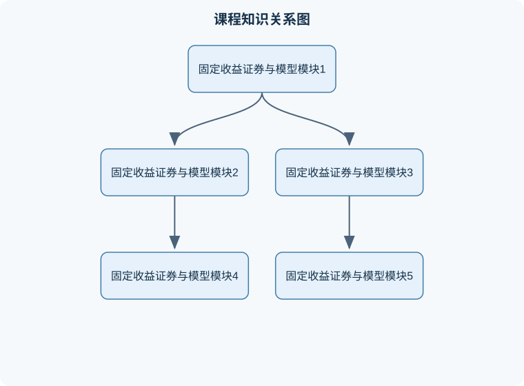

# 固定收益证券与模型

## 一、课程整体知识框架

### 课程边界与先修知识

本课程研究以利息、本金或相关现金流为核心的固定收益证券及其定价、风险度量、衍生品和利率模型。内容覆盖国债、政府机构债、公司债、零息债券、附息债券、浮动利率债券、通货膨胀保值债券、回购、抵押支持证券、资产支持证券、远期、期货、远期利率协议、利率互换及利率期权基础。核心分析框架是现金流复制、无套利定价、贴现因子、即期利率、远期利率、收益率曲线、久期、凸性和利率风险因子。课程不等同于信用风险、结构化产品法律文件、宏观货币政策或高级随机利率模型专课，但会说明这些内容与固定收益定价的接口。先修知识包括单变量微积分、概率统计、矩阵基础、金融市场基础、现值与终值、复利与连续复利、债券现金流计算，以及基本的Excel或编程计算能力。所有定价公式默认现金流日期、日计数规则、结算规则、复利频率和无违约假设已明确；现实市场还需考虑信用风险、流动性、税费、交易成本、模型风险、抵押品和提前偿还行为。





### 1. 课程对象与基本边界

固定收益证券是指其现金流的金额、支付时间或二者之一能够在交易规则、合同条款或可识别的经济变量下确定或近似确定的金融工具。传统债券通常按约定日期支付利息并偿还本金，但“固定收益”并不意味着每期现金流绝对不变。例如，通货膨胀保值债券的本金或票息可能随物价指数调整，浮动利率债券的票息随参考利率变化，抵押支持证券的现金流还会受到提前偿还的影响。因此，本课程研究的核心不是“所有现金流都固定”，而是如何描述、定价、复制和管理具有利率或信用相关特征的现金流。

固定收益证券的基本分析单位是现金流。设某证券在未来时点 $t_i$ 支付现金流 $C_i$，则其价值是各期现金流现值之和。现值计算需要一个折现因子。记从估值时点 $0$ 到支付时点 $t$ 的无风险折现因子为 $P(0,t)$，它表示时点 $t$ 收到 1 个货币单位在时点 $0$ 的价值，通常无量纲；若现金流金额以元计，则现值也以元计：

$$
V_0=\sum_{i=1}^{n} C_iP(0,t_i).
$$

该式要求现金流支付时点已知、折现因子与现金流风险相匹配，并且不存在无法处理的税收、交易成本或流动性折价。若现金流具有违约风险，直接使用无风险折现因子会低估风险，必须加入信用利差、违约概率、回收率或风险中性定价调整。

### 2. 无套利、货币时间价值与利率表示

无套利原则要求：两个未来现金流完全相同的组合，在同一估值时点应具有相同价值；若价格不同，投资者可以买入便宜组合、卖出昂贵组合，并在未来现金流相互抵消的情况下获得无风险收益。这个原则是债券定价、远期利率、互换和利率期货分析的共同基础。

若年化有效利率为 $r$，一年后支付 1 个货币单位的现值为

$$
P(0,1)=\frac{1}{1+r}.
$$

若连续复利零息利率为 $z(0,T)$，其单位通常为每年一个小数或百分比，则

$$
P(0,T)=e^{-z(0,T)T},
\qquad
z(0,T)=-\frac{\ln P(0,T)}{T}.
$$

这里 $T$ 是以年表示的时间，$e$ 是自然对数的底。若采用每年复利 $m$ 次、名义年利率为 $y^{(m)}$，则

$$
P(0,T)=\left(1+\frac{y^{(m)}}{m}\right)^{-mT}.
$$

不同复利约定不能直接比较数值大小，必须先转换为相同的计息频率或直接比较折现因子。连续复利并非现实市场唯一的计息方式，而是便于推导和建模的表示方法。实际交易还涉及日计数规则、节假日调整、付息频率和结算日，这些因素会改变 $T$ 的计算。

### 3. 证券类型与现金流特征

常见固定收益证券包括国债、政府机构债券、公司债券、市政债券、资产支持证券、抵押支持证券、商业票据、回购交易和利率衍生品。

#### 3.1 零息债券与附息债券

零息债券不在到期前支付票息，到期支付面值。若面值为 $F$，到期时间为 $T$，则

$$
V_0=FP(0,T).
$$

附息债券在若干时点支付票息并在到期日偿还本金。若票面利率为 $c$，面值为 $F$，每年支付 $m$ 次，则每期票息为 $cF/m$；若支付时点为 $t_1,\ldots,t_n$，则

$$
V_0=\sum_{i=1}^{n}\frac{cF}{m}P(0,t_i)+FP(0,T).
$$

票面利率 $c$ 是合同条款，不能与到期收益率混同。债券价格低于面值时，通常到期收益率高于票面利率；价格高于面值时，通常到期收益率低于票面利率，但这一判断依赖现金流结构、复利和应计利息的统一处理。

STRIPS 是把附息国债的各期利息和本金现金流拆分成独立零息工具的安排。拆分后，每一部分均可作为特定到期日的零息现金流分析，但其价格仍会受到流动性、结算和市场供求影响，不能简单认为完全等同于理论零息债券。

#### 3.2 货币市场工具与回购

货币市场主要处理期限较短的借贷和融资工具。回购交易中，一方以证券作为担保出售，并约定在未来以约定价格购回。若初始现金金额为 $B_0$，回购年化利率为 $r_{\mathrm{repo}}$，实际占用天数为 $d$，一年计息天数为 $D$，简单计息下未来偿还金额为

$$
B_T=B_0\left(1+r_{\mathrm{repo}}\frac{d}{D}\right).
$$

回购利率不是债券票面收益率；回购交易的经济实质通常是以证券抵押的短期融资。若抵押品价值下降，可能产生追加保证金；若交易对手违约，抵押品变现价值和法律处置过程会影响实际损失。

#### 3.3 浮动利率、通胀挂钩与证券化产品

浮动利率债券的票息常写作“参考利率加利差”，但重置日、观察期、支付期和下限条款决定了实际现金流。通胀挂钩债券的本金或票息随价格指数调整，现金流取决于指数定义、滞后期和调整规则。抵押支持证券与资产支持证券的现金流依赖基础资产的还款行为，提前偿还会缩短或延长证券的有效期限，不能只用合同到期日衡量风险。

### 4. 收益率曲线、远期利率与期限结构

收益率曲线描述不同期限的利率或折现因子。零息利率适合直接折现单笔未来现金流；附息债券的到期收益率是使债券理论价格等于市场价格的单一内部收益率，不一定等于任一实际期限的零息利率。

给定连续复利零息利率 $z(0,T_1)$ 和 $z(0,T_2)$，其中 $T_2>T_1$，区间 $(T_1,T_2)$ 的连续复利远期利率 $f(T_1,T_2)$ 由无套利关系确定：

$$
P(0,T_2)=P(0,T_1)e^{-f(T_1,T_2)(T_2-T_1)}.
$$

因此

$$
f(T_1,T_2)
=
\frac{\ln P(0,T_1)-\ln P(0,T_2)}
{T_2-T_1}.
$$

其推导是比较两种投资方式：第一种在 $0$ 时点投资一笔资金并持有至 $T_2$；第二种先投资至 $T_1$，再按远期利率投资至 $T_2$。若二者最终现金流相同，则成本必须相同。该关系只适用于同一货币、同一信用风险、同一计息和结算约定。远期利率不是市场对未来即期利率的必然预测，它还包含风险溢价、期限溢价和流动性因素。

### 5. 久期、凸性与利率风险

对收益率变化敏感的债券，其价格与收益率通常呈反向关系。设债券价格为 $P(y)$，其中 $y$ 是与现金流及复利约定一致的收益率。修正久期定义为

$$
D_{\mathrm{mod}}
=
-\frac{1}{P}\frac{\partial P}{\partial y}.
$$

当收益率发生小幅变化 $\Delta y$ 时，

$$
\frac{\Delta P}{P}
\approx
-D_{\mathrm{mod}}\Delta y.
$$

若 $y$ 是每年复利 $m$ 次的名义收益率，麦考利久期 $D_{\mathrm{Mac}}$ 与修正久期的关系为

$$
D_{\mathrm{mod}}=\frac{D_{\mathrm{Mac}}}{1+y/m}.
$$

久期的单位是年，收益率变化必须使用小数形式，例如 10 个基点应写成 $0.001$。美元久期为

$$
\mathrm{DD}
=
D_{\mathrm{mod}}P,
$$

它表示收益率上升 1.00，即 100 个百分点时的近似价格变动金额；若希望估计收益率上升一个基点的金额，通常再乘以 $0.0001$。久期近似是局部线性近似，收益率变动较大或现金流随利率变化时误差会扩大。

凸性用于修正曲率影响。若价格函数二阶可导，则

$$
\Delta P
\approx
-PD_{\mathrm{mod}}\Delta y
+\frac12 P C(\Delta y)^2,
$$

其中

$$
C=\frac{1}{P}\frac{\partial^2P}{\partial y^2}
$$

为凸性，通常以年平方表示。对普通固定票息债券，在其他条件相同的情况下，凸性通常为正；含有提前偿还、赎回或期权条款的证券可能出现有效凸性下降甚至负凸性。

### 6. 远期、互换与期货

债券远期合约约定在未来日期 $T_1$ 交付某一债券。若标的债券在交割前产生已知现金流，其理论远期价格可通过“持有现货并融资”复制：买入债券、用借款支付现货价格、在中间日期收到票息并用于偿还融资。若忽略交易成本和信用风险，远期价格应与复制组合一致；若价格偏离，可能出现现金套利或反向现金套利。但实际套利受到融资利率、保证金、交割选择权和卖空约束限制。

利率互换通常是一方支付固定利率、另一方支付浮动利率。设名义本金为 $N$，支付期为 $t_i$，年计数因子为 $\alpha_i$，固定互换利率为 $K$，则固定端现值为

$$
V_{\mathrm{fixed}}
=
NK\sum_{i=1}^{n}\alpha_iP(0,t_i).
$$

若浮动端在重置规则和无套利条件下可视为一组浮动现金流，其现值可由相应折现因子计算。使互换初始价值为零的 $K$ 称为平价互换利率。互换曲线可以通过一组期限和报价逐步求解折现因子，但必须明确所使用的浮动基准、支付频率、日计数和抵押条件。

利率期货与远期的共同点是锁定未来利率或债券价格，区别在于期货标准化交易、每日盯市和保证金结算，盈亏在每日累积；远期通常按合同约定在到期结算。每日结算会改变现金流发生时间，因此期货价格与远期价格不必完全相同。利率波动越大、期限越长，这种差异越不能忽略。

### 7. 利率树与风险中性定价

二叉利率树把未来利率状态离散为上升和下降路径。树模型必须明确：状态变量是短期利率、债券价格还是其他量；利率采用简单、离散或连续复利；节点概率是历史概率还是风险中性概率；模型参数如何由当前市场价格校准。

在风险中性定价下，资产价格等于风险中性概率下未来现金流的折现期望。若某节点短期利率为 $r$，时间步长为 $\Delta t$，下一期上、下状态价值分别为 $V_u,V_d$，风险中性概率为 $q$，则节点价值可写为

$$
V=
e^{-r\Delta t}\left(qV_u+(1-q)V_d\right).
$$

该表达式的适用条件是市场完备性或至少存在可复制组合，并且所用短期利率和概率与校准后的无套利模型一致。利率树不是对未来利率路径的确定预测，而是与当前债券价格相容的定价工具。期权、可赎回债券和抵押支持证券的定价还需处理行权、提前偿还和模型风险。

### 8. 风险管理、模型限制与岗位能力结构

固定收益分析需要同时处理市场风险、信用风险、流动性风险、基差风险、模型风险和操作风险。市场风险可用久期、凸性、关键期限久期、情景分析和压力测试衡量；信用风险需要分析发行人偿债能力、违约概率、回收率和信用利差；流动性风险要求区分理论价格与可交易价格。

理想模型通常假设无套利、连续交易、可任意借贷、无交易成本、收益率曲线可直接观察且风险中性概率可校准。现实市场中可能存在买卖价差、融资限制、保证金变化、税收、监管约束、报价稀疏和模型参数不稳定。因此，模型输出必须附带输入数据、估值时点、计息约定、风险假设和验证结果，不能把单一估值数字当作无条件事实。

## 二、章节和模块划分

### 核心知识覆盖清单

本清单根据本课程的章节划分整理，用于检查正文是否覆盖各个核心模块：

- **模块一：固定收益证券与模型基本概念**。
- **模块二：收益率曲线与折现因子**。
- **模块三：债券定价、收益率与应计利息**。
- **模块四：久期、凸性与免疫**。
- **模块五：远期债券、回购与套利边界**。
- **模块六：利率互换与利率风险管理**。
- **模块七：利率期货与套期保值**。
- **模块八：二叉利率树、期权与模型验证**。
- **易错点与边界检查**。
- **典型笔试问题及解答思路**。
- **典型面试问题、参考答案与追问要点**。
- **岗位关联与产出验收**。


### 模块一：固定收益证券与模型基本概念

#### 核心内容

本模块建立现金流、面值、票面利率、到期日、结算日、现值、折现因子和收益率的统一语言。分析债券时应先列出每个现金流的支付时点，再选择相应折现因子，而不是先套用某个收益率公式。债券价格、票息和收益率之间的反向关系来自现值公式，不是独立记忆规则。

#### 例题一：零息债券定价

**题干：**一年期零息债券到期支付 100 元，连续复利年利率为 4%。求理论价格。

**分析：**只有一个到期现金流，使用 $P(0,1)=e^{-0.04}$。

**解答：**

$$
V_0=100e^{-0.04}\approx96.08\text{元}.
$$

**结果验证：**将 96.08 元按连续复利 4% 投资一年，终值约为 $96.08e^{0.04}=100$ 元，满足无套利关系。

**变式：**若市场价格为 95 元，则连续复利收益率为

$$
z=-\ln(95/100)\approx5.13\%.
$$

若价格低于 96.08 元，说明该债券对应的市场收益率高于 4%，但是否存在套利还需确认信用风险、交易成本和融资条件相同。

### 模块二：收益率曲线与折现因子

#### 核心内容

本模块讨论零息利率、即期利率、远期利率、收益率曲线和曲线构建。附息工具的市场报价不能直接作为单一期限折现率，必须通过现金流方程逐步剥离。所谓引导法是从最短期限开始，在每一步利用已知短期限折现因子求解新的折现因子。

#### 代表性算法一：折现因子引导法

**输入：**按期限排序的债券价格、面值、票息、支付日期、日计数因子和复利约定。  
**输出：**各支付日期的折现因子和对应零息利率。  
**过程：**

1. 按支付日期从近到远排列工具。
2. 对最短期零息工具，直接计算折现因子。
3. 对第 $k$ 个附息工具，先用已知折现因子计算前 $k-1$ 期现金流现值。
4. 用债券价格减去前期现值，再除以第 $k$ 期现金流，得到新折现因子。
5. 将折现因子转换为所需复利形式的零息利率。
6. 检查所有输入债券用所得折现因子重定价后的误差。

不变量是：已处理工具的理论价格与输入价格保持一致，允许误差仅来自四舍五入。终止条件是全部期限处理完毕。适用条件是现金流时点、报价和计息规则明确，且工具之间的信用和抵押条件具有可比性。若存在重复期限、期权条款或严重流动性差异，简单引导法可能不稳定。

```python
# python
from math import log

def bootstrap_discount_factors(instruments):
    """
    instruments: 按到期时间升序排列的字典列表。
    每项包含：
      "price": 市场净价或统一口径价格
      "cashflows": [(time_in_years, amount), ...]
    假设每个工具最后一个现金流对应一个尚未求出的期限。
    """
    discounts = {}
    results = []

    for inst in instruments:
        price = float(inst["price"])
        final_time, final_cashflow = inst["cashflows"][-1]

        known_value = 0.0
        for time, amount in inst["cashflows"][:-1]:
            if time not in discounts:
                raise ValueError("现金流期限未按升序或缺少折现因子")
            known_value += amount * discounts[time]

        if final_cashflow == 0:
            raise ValueError("最后一期现金流不能为零")

        df = (price - known_value) / final_cashflow
        if not (0 < df <= 1.0):
            raise ValueError("所得折现因子不在合理范围内")

        discounts[final_time] = df
        zero_rate = -log(df) / final_time
        results.append({
            "time": final_time,
            "discount_factor": df,
            "continuous_zero_rate": zero_rate
        })

    return results
```

该程序的主要循环复杂度为 $O(n^2)$，其中 $n$ 是工具数量；若现金流结构稀疏，实际计算量取决于现金流总数。代码不处理日期调整、净价与全价转换、缺失期限插值和带期权证券，因此不能直接作为生产估值系统。

#### 例题二：远期利率

**题干：**已知 $P(0,1)=0.96$，$P(0,2)=0.90$，求一年到两年的连续复利远期利率。

**分析：**使用

$$
P(0,2)=P(0,1)e^{-f(1,2)}.
$$

**解答：**

$$
f(1,2)=\ln\frac{0.96}{0.90}
\approx6.45\%.
$$

**结果验证：**先用 0.96 元投资至一年，再按 6.45% 连续复利投资一年，终值为

$$
0.96e^{0.0645}\approx1.024,
$$

而直接用 0.90 元投资两年得到的相同终值约为 $0.90/P(0,2)=1$；这里应注意比较对象必须统一为“在时点 2 取得 1 元”的投资。严格验证应写成：

$$
P(0,1)e^{-f(1,2)}=0.96e^{-0.0645}\approx0.90.
$$

**变式：**若使用半年复利，不能直接把 6.45% 当作半年复利名义利率，必须先转换复利约定。

### 模块三：债券定价、收益率与应计利息

#### 核心内容

本模块区分全价、净价、应计利息和到期收益率。全价是买方实际支付的价格，净价通常是报价价格；二者关系一般为

$$
\text{全价}=\text{净价}+\text{应计利息}.
$$

应计利息取决于票息、上次付息日、结算日和日计数规则。若忽略结算日，可能把两笔现金流相同的交易错误地视为价格相同。

#### 例题三：附息债券定价

**题干：**面值 100 元、年票面利率 6%、每年付息一次、两年到期的债券，连续复利零息利率分别为 4%和 4.5%。求理论价格。

**分析：**每年票息为 6 元，第二年还本 100 元。

**解答：**

$$
V_0=6e^{-0.04}+106e^{-0.045\times2}
\approx5.76+96.87=102.63\text{元}.
$$

**结果验证：**以 102.63 元买入并按给定折现率折现两笔现金流，现值应回到 102.63 元。价格高于面值的原因是该债券票息与相应期限利率相比具有吸引力，不能仅根据票息 6% 大于某一个利率就下结论。

**变式：**若结算日位于两个付息日之间，必须先计算应计利息，并按照剩余期限重新折现；不能直接沿用整数年公式。

### 模块四：久期、凸性与免疫

#### 核心内容

久期衡量价格对收益率的小幅变动敏感度，凸性衡量价格—收益率曲线的弯曲程度。久期免疫并不意味着风险消失：它通常只针对平行、较小的收益率变动，并且要求资产和负债现金流、久期、凸性以及再投资条件相匹配。若收益率曲线发生非平行移动，应使用关键期限久期或情景分析。

#### 例题四：久期近似

**题干：**某债券市值为 1,000,000 元，修正久期为 5.2 年，收益率上升 20 个基点。估计价格损失。

**解答：**

$$
\Delta y=20\times0.0001=0.002.
$$

因此

$$
\Delta P\approx
-1{,}000{,}000\times5.2\times0.002
=-10{,}400\text{元}.
$$

**结果验证：**收益率上升应导致价格下降，符号为负；若把 20 个基点误写为 0.20，结果会放大 100 倍。

**变式：**若同时给出凸性 $C=40$，则二阶修正为

$$
\Delta P\approx
-1{,}000{,}000(5.2)(0.002)
+\frac12(1{,}000{,}000)(40)(0.002)^2
=-10{,}320\text{元}.
$$

凸性项在收益率变动较小时较小，但变动增大时不能忽略。

### 模块五：远期债券、回购与套利边界

#### 核心内容

远期价格的复制组合包括现货债券、融资和中间现金流处理。若债券在交割日前支付票息，持有者会获得现金流，因此远期多头不应重复享有该票息。回购利率决定融资成本，抵押品折扣率、保证金和交易对手风险决定实际套利可行性。

#### 例题五：回购融资收益

**题干：**以 1,000,000 元现金买入债券，并以年化 3.6% 的回购利率融资 30 天，按 360 天计息。忽略费用和保证金，求融资成本。

**解答：**

$$
\text{利息}
=
1{,}000{,}000\times0.036\times\frac{30}{360}
=3{,}000\text{元}.
$$

到期偿还金额为 1,003,000 元。

**结果验证：**融资期限缩短为 15 天时成本应减半；若使用 365 天日计数，结果变为

$$
1{,}000{,}000\times0.036\times\frac{30}{365}
\approx2{,}959\text{元}.
$$

**变式：**若债券在回购期间收到 4,000 元票息，是否能获得 1,000 元无风险利润，仍需考虑回购合同中票息归属、融资费用、交易成本、抵押品折扣和债券价格变化，不能只比较票息与回购利息。

### 模块六：利率互换与利率风险管理

#### 核心内容

互换把固定利率现金流与浮动利率现金流进行交换。平价固定利率由“固定端现值等于浮动端现值”确定。互换的市场价值会随折现曲线和远期利率变化，不能只看合同固定利率与当前短期利率的差额。风险管理中应区分方向风险、基差风险、期限错配、信用支持和抵押品风险。

#### 代表性流程二：互换估值与对冲分析

1. 确定估值日、支付日期、日计数规则、名义本金和浮动利率重置规则。
2. 从市场工具构建折现因子曲线，并单独构建远期利率曲线（若市场采用多曲线框架）。
3. 计算固定端每期现金流 $NK\alpha_i$ 并折现。
4. 根据远期利率计算浮动端预期现金流，再用折现因子折现。
5. 用收取端现值减去支付端现值，得到互换价值。
6. 计算美元久期、关键期限敏感度，并用国债、期货或另一笔互换进行对冲。
7. 通过重新定价、独立价格核对和压力情景验证结果。

评价标准包括：重定价误差低于预先设定容差、现金流日期完整、曲线输入可追溯、利率冲击后的方向与经济直觉一致。若固定端和浮动端方向写反、使用了错误曲线或遗漏即将发生的重置，估值可能出现符号错误。

### 模块七：利率期货与套期保值

#### 核心内容

期货具有标准化合约、保证金和每日盯市特点。套期保值的关键不是简单寻找名义本金相等的期货，而是使被套保项目与期货价格变化的敏感度尽量匹配。需要考虑基差风险、交割月份、合约乘数、转换因子、尾部调整和现金流发生时间。

#### 代表性流程三：期货套期保值

1. 明确被套保资产或负债、风险方向和风险期限。
2. 估计现货头寸对收益率或期货价格的美元敏感度。
3. 估计单份期货合约的美元敏感度。
4. 计算初始合约数量，并根据最小价格变动和合约乘数换算。
5. 选择多头或空头：利率上升导致资产价值下降时，通常需要卖出利率期货进行保护。
6. 按每日结算记录现金流，重新估计基差和剩余风险。
7. 到期或风险暴露消失时平仓，并评价实际对冲误差。

期货价格在到期时通常向可交割资产价值收敛，但交割选择权、最便宜可交割债券、融资利率和转换因子会影响具体收敛关系。远期和期货的价格接近并不表示二者现金流时点和信用结构完全相同。

### 模块八：二叉利率树、期权与模型验证

#### 核心内容

二叉利率树适用于含权债券、利率期权等路径依赖问题。建模流程是：选择状态变量，设定时间网格，校准初始收益率曲线，校准波动率或其他参数，逐节点计算现金流，再从后向前折现。可赎回债券在发行人有利时行权，可回售债券在投资者有利时行权，因此必须在每个节点比较继续持有价值与行权价值。

#### 实验一：收益率曲线构建与重定价检验

**输入数据：**若干零息和附息工具的价格、面值、票息、支付日期、日计数规则。  
**步骤：**

1. 统一报价为全价，统一时间单位为年。
2. 按最短到期期限排序。
3. 用引导法求折现因子和零息利率。
4. 用所得曲线重新计算每个输入工具价格。
5. 计算价格误差、收益率误差和折现因子是否单调。
6. 对曲线施加平行上移和扭曲情景，观察重定价方向。

**评价标准：**重定价误差应处于预先规定的市场报价精度内；折现因子在无负利率设定下不应大于 1，期限增加时通常不应无解释地上升；利率上移时普通固定票息债券价格应下降。  
**排错方法：**若短期限工具误差较大，检查净价、全价和应计利息；若长端误差突然增大，检查现金流日期排序和重复期限；若零息利率剧烈跳变，检查输入价格、日计数和插值方法。

#### 实验二：久期对冲与压力测试

**输入数据：**资产组合市值、各债券现金流、收益率曲线、修正久期、凸性和可用对冲工具敏感度。  
**步骤：**

1. 计算组合总市值、美元久期和关键期限敏感度。
2. 设定平行上移、平行下移、短端上移、长端下移等情景。
3. 用久期近似估计损益，再用完整现金流重新定价。
4. 配置国债、期货或互换对冲，使目标期限敏感度接近零。
5. 比较对冲前后损益、基差风险和交易成本。
6. 改变利率冲击幅度，评估线性近似误差。

**评价标准：**对冲后目标风险指标显著降低，且不同情景下不能出现未解释的风险放大；近似估值与完整重定价的差异应随冲击扩大而符合凸性解释。  
**排错方法：**若对冲方向相反，检查资产是多头还是空头；若总久期对冲有效但曲线扭曲情景损失仍大，说明存在关键期限错配；若结果依赖很小的输入变化，检查债券价格单位、基点换算和期限权重。

### 易错点与边界检查

1. 把票面利率当成到期收益率；票面利率由合同确定，收益率由价格反推。  
2. 把零息利率、远期利率和到期收益率混为一谈；三者对应的现金流含义不同。  
3. 忽略连续复利、年复利和半年复利之间的转换。  
4. 将 1 个基点写成 $0.01$ 而不是 $0.0001$。  
5. 把净价直接当作实际结算金额，忽略应计利息。  
6. 只用到期日衡量抵押贷款证券的期限，忽略提前偿还。  
7. 认为久期对任意大幅利率变动都准确；久期只是局部一阶近似。  
8. 忽略凸性，导致大幅利率冲击下损益估计偏差。  
9. 认为远期与期货在到期前完全等价，忽略每日盯市。  
10. 用无风险折现曲线给高信用风险债券定价而不做信用调整。  
11. 在互换估值中把固定端和浮动端的支付方向写反。  
12. 把远期利率当成对未来即期利率的无偏预测。  
13. 引导法中未先统一债券价格口径，导致折现因子异常。  
14. 进行久期对冲时只匹配总久期，不检查关键期限和基差风险。  
15. 将风险中性概率解释为现实世界中实际发生的概率。  
16. 看到模型价格与市场价格不同就认定存在套利，忽略融资、保证金、流动性和交易成本。

### 典型笔试问题及解答思路

1. **为什么债券价格与收益率通常反向变动？**  
   固定现金流的现值随折现率上升而下降；从现值公式逐项求导即可得到负的一阶导数。

2. **如何由折现因子求连续复利零息利率？**  
   从 $P(0,T)=e^{-zT}$ 出发取自然对数，得到 $z=-\ln P(0,T)/T$，并说明 $T$ 必须用年表示。

3. **远期利率如何由两个折现因子确定？**  
   构造“直接投资至 $T_2$”与“投资至 $T_1$ 后按远期再投资”的复制关系，令终值相同。

4. **为什么到期收益率不是每期实际利率？**  
   它是使全部债券现金流现值等于市场价格的单一内部收益率，隐含再投资和复利假设，不等于逐期限零息利率。

5. **久期免疫的条件是什么？**  
   至少要匹配资产与负债的现值和一阶利率敏感度；若要求更稳健，还需考虑凸性、现金流时点和非平行曲线变动。

6. **远期和期货的主要区别是什么？**  
   远期通常到期结算且条款可定制，期货标准化并每日盯市；每日现金流再投资会造成期货与远期价格差异。

7. **互换平价固定利率如何确定？**  
   使固定端现值等于浮动端现值，初始互换价值为零；需要统一折现曲线、远期曲线和日计数规则。

8. **二叉树中的风险中性概率是否等于现实概率？**  
   不等于。它是为满足无套利定价而构造的概率，除非在额外条件下，不能直接用于预测实际利率路径。

### 典型面试问题、参考答案与追问要点

1. **如何解释固定收益证券的“固定”？**  
   固定的是合同现金流规则或风险暴露结构，不一定是每笔现金流数额。浮动利率、通胀挂钩和证券化产品都可能变化。追问时应说明参考指数、重置规则和提前偿还风险。

2. **如果债券价格与模型价格不一致，是否立即套利？**  
   不能立即判断。应检查价格口径、信用风险、融资成本、买卖价差、流动性、保证金和模型假设，再判断是否存在可执行套利。追问可进一步讨论“理论套利”与“可交易套利”的区别。

3. **如何向非量化同事解释久期？**  
   久期是债券价格对收益率小幅变化的近似敏感度，久期越长，利率变化对价格影响通常越大。追问时应补充凸性和现金流随利率变化时，简单久期会失效。

4. **如何验证一条收益率曲线？**  
   用曲线重新定价输入工具，检查误差、折现因子形状、利率跳变和情景方向；还应进行独立价格核对。追问可说明引导法在稀疏报价或带期权工具上存在局限。

5. **资产管理组合预计利率上升，应如何降低风险？**  
   可以卖出利率期货、支付固定利率互换或配置较短久期资产，但要先计算组合美元久期和关键期限风险。追问时必须说明基差、流动性和对冲比例风险。

6. **为什么期货每日盯市很重要？**  
   盈亏每日结算，现金流发生时间不同于到期一次性结算的远期，因此融资和再投资会影响价格关系。追问可讨论波动率和期限对期货—远期差异的影响。

7. **模型校准与模型验证有什么区别？**  
   校准是选择参数使模型匹配当前市场价格；验证是检验模型在未参与校准的工具、历史情景和压力情景下是否合理。追问时应提到过度拟合和参数不稳定。

8. **可赎回债券为什么可能出现负凸性？**  
   利率下降时发行人更可能赎回债券，债券价格上涨空间被限制；利率上升时赎回可能性下降，价格下跌空间相对扩大。追问应说明这要求使用有效久期和含权估值，而非普通固定债券公式。

### 岗位关联与产出验收

#### 固定收益交易与销售岗位

实际任务包括解释债券报价、计算全价和净价、分析收益率曲线变化、执行回购或互换交易。使用的知识包括现金流折现、久期、凸性、远期和基差分析。产出包括报价表、交易损益解释和风险摘要；验收标准是价格口径正确、现金流日期无遗漏、损益方向与市场变化一致。

#### 固定收益研究与信用分析岗位

实际任务包括分析发行人偿债能力、信用利差、债券相对价值和组合风险。使用的知识包括无风险曲线、信用利差、违约与回收、久期和情景分析。产出包括估值报告、信用观点和压力测试表；验收标准是假设清楚、数据可复核、风险因素与结论相互一致。

#### 量化研发与模型验证岗位

实际任务包括构建折现曲线、开发债券和互换定价程序、校准利率树、验证敏感度和模型稳定性。使用的知识包括引导法、远期利率、风险中性定价、数值算法和误差分析。产出包括代码、测试报告、模型文档和独立验证结果；验收标准是输入输出定义完整、边界条件可处理、重定价误差可解释、代码结果能够通过独立方法复核。

#### 风险管理与资产负债管理岗位

实际任务包括计算组合久期、关键期限风险、利率情景损益、流动性缺口和对冲效果。使用的知识包括美元久期、凸性、期货套保、利率互换和压力测试。产出包括每日风险报表、限额监控和对冲建议；验收标准是风险指标及时、方向正确、对冲后残余风险可解释，并明确模型风险和极端情景限制。

## 三、核心概念的详细解释

### 1. 固定收益证券的现金流本质

固定收益证券的分析对象不是“固定不变的收益率”，而是未来现金流及其不确定性。设估值时点为 $0$，证券在未来时点 $t_i$ 支付金额为 $C_i$，则其价值可表示为：

$$
V_0=\sum_{i=1}^{n}C_iP(0,t_i),
$$

其中，$V_0$ 为时点 $0$ 的理论价值，单位通常为元；$C_i$ 为第 $i$ 期现金流，单位为元；$P(0,t_i)$ 为从时点 $0$ 到 $t_i$ 的折现因子，表示未来时点 $t_i$ 收到 1 元在当前的价值。折现因子无量纲，且在正常正利率环境下通常满足 $0<P(0,t_i)\leq 1$，并随期限增加而下降，但负利率或市场流动性异常时不能机械套用这一经验判断。

零息债券只有一笔到期现金流。若面值为 $F$，到期时间为 $T$，则：

$$
V_0=FP(0,T).
$$

附息债券除偿还本金外，还定期支付票息。若票面利率为 $c$，面值为 $F$，每年付息 $m$ 次，每期票息为 $cF/m$，则：

$$
V_0=\sum_{i=1}^{n}\frac{cF}{m}P(0,t_i)+FP(0,T).
$$

票面利率 $c$ 是合同中规定的现金流比例；到期收益率是使未来现金流折现后等于市场价格的单一利率；即期利率或零息利率对应特定到期日的折现关系。三者不能混同。票面利率高，不代表债券当前收益率一定高；债券价格上涨会使其到期收益率下降，反之亦然。

### 2. 固定收益证券的主要类型及风险来源

#### 2.1 政府债券、机构债券与公司债券

政府债券通常具有较低的违约风险，常被用于构造基准收益率曲线，但“低违约风险”不等于“没有价格风险”。市场利率上升时，即使政府债券没有违约，其市场价格仍可能下降。政府机构发行的债券可能具有不同程度的政府支持，不能仅依据发行机构名称假定其风险与主权债券完全相同。

公司债券的现金流通常包括定期票息和到期本金，但发行人的偿债能力会随经营状况、行业环境和宏观经济变化而改变。因此，公司债券价格同时受无风险利率、信用利差、流动性和回收率预期影响。若公司债券与同期限政府债券的到期收益率分别为 $y_c$ 和 $y_g$，简单信用利差可写为：

$$
s=y_c-y_g.
$$

该差值受收益率口径、期限、流动性、税收和嵌入期权影响，不能直接解释为违约概率。

#### 2.2 货币市场工具与回购

货币市场通常指期限较短的借贷和融资市场。短期国库券、商业票据、同业拆借和回购交易都属于其重要组成部分。回购交易中，一方先卖出证券并约定未来以约定价格买回，经济实质通常是以证券作抵押的短期融资。

回购利率的计算必须明确本金、回购金额、实际天数和日计数规则。若初始融资金额为 $B_0$，到期偿还金额为 $B_T$，持有天数为 $d$，一年计息基准为 $D$，简单年化回购利率为：

$$
r_{\mathrm{repo}}=\frac{B_T-B_0}{B_0}\frac{D}{d}.
$$

若证券市场价值为 $V$，抵押率折扣为 $h$，则通常融资金额不超过 $V(1-h)$。折扣率越高，融资方能够获得的资金越少，抵押品价格下跌时追加保证金的压力越大。

#### 2.3 通货膨胀保值债券与浮动利率债券

通货膨胀保值债券的本金或票息可能随物价指数变化。若调整后的本金为 $F_t$，合同票面利率为 $c$，每年支付 $m$ 次，则某期票息为：

$$
C_t=\frac{cF_t}{m}.
$$

这类证券不能使用“固定面值、固定票息”的普通债券公式而忽略指数调整。浮动利率债券的票息通常为参考利率加上合同利差，例如：

$$
L_t+\alpha,
$$

其中 $L_t$ 为重置期适用的参考利率，$\alpha$ 为合同利差。浮动利率不意味着价格没有风险，参考利率变化、信用利差变化、重置日与支付日错配都会造成价格波动。

#### 2.4 资产支持证券与抵押支持证券

资产支持证券以信用卡应收账款、汽车贷款或其他资产池产生的现金流作为偿付来源。抵押支持证券以住房抵押贷款等贷款池为基础。其核心难点是现金流时间并非完全确定，因为借款人可能提前偿还贷款。

利率下降时，借款人可能通过再融资提前偿还，投资者无法继续获得原本较高的票息，形成提前偿还风险；利率上升时，借款人可能减少提前偿还，使证券期限延长，形成延长风险。因此，普通债券的固定到期日模型在此类证券上需要结合提前偿还模型和情景分析。

### 3. 收益率、折现因子与收益率曲线

#### 3.1 不同复利方式

若年有效利率为 $r$，一年后 1 元现金流的折现因子为：

$$
P(0,1)=\frac{1}{1+r}.
$$

若连续复利零息利率为 $z(0,T)$，则：

$$
P(0,T)=e^{-z(0,T)T},
\qquad
z(0,T)=-\frac{\ln P(0,T)}{T}.
$$

若名义年利率为 $y^{(m)}$，每年复利 $m$ 次，则：

$$
P(0,T)=\left(1+\frac{y^{(m)}}{m}\right)^{-mT}.
$$

这里 $T$ 必须按年表示，$m$ 为每年的复利次数，$y^{(m)}$ 为小数形式的年化名义利率。不能把百分数形式的 $5\%$ 直接当作数值 5 代入公式；必须使用 $0.05$。

不同复利口径的转换必须保持同一经济价值。连续复利利率与每年复利 $m$ 次的名义利率满足：

$$
e^{zT}=\left(1+\frac{y^{(m)}}{m}\right)^{mT},
$$

因而：

$$
z=m\ln\left(1+\frac{y^{(m)}}{m}\right).
$$

该转换要求利率表达方式对应同一期间和同一现金流，不适用于忽略日计数、支付频率或负利率边界的机械比较。

#### 3.2 收益率曲线与期限结构

收益率曲线描述不同期限的利率或折现因子。即期利率曲线直接对应单一支付日期的折现关系；远期利率曲线描述未来某一期间的隐含利率；到期收益率曲线则是将每只债券的全部现金流用一个统一收益率折现得到的结果。到期收益率不是某一特定期限的真实即期利率，因此不同现金流结构的债券不能仅凭到期收益率判断相对价值。

收益率曲线可能向上、向下或呈现局部倒挂。曲线变化可以分为平行移动、陡峭化、变平和扭曲。不同期限现金流对曲线各节点的敏感度不同，因此单一久期不能完整描述复杂债券组合的利率风险。

### 4. 无套利与复制思想

无套利原则要求两个未来现金流完全相同的组合，在交易成本、税收和融资限制均被适当处理的条件下具有相同价格。若组合甲价格低于组合乙，投资者可以买入甲、卖出乙，未来现金流相互抵消并获得初始正收益，这种价格差异无法长期存在。

STRIPS 将附息债券的各期利息和本金拆分为单独的零息现金流。其理论意义是把复杂现金流拆解为若干基本支付单位，从而帮助构造零息曲线。若一只债券的现金流为 $(C_1,\ldots,C_n)$，市场上存在相应到期日的零息工具，则债券价值应近似等于各现金流分别购买所需成本之和。若存在显著偏差，可能产生套利机会，但现实中必须考虑交易成本、拆分限制、融资利率和流动性。

### 5. 久期、凸性与利率风险

#### 5.1 麦考利久期与修正久期

设债券在时点 $t_i$ 支付现金流 $C_i$，使用统一到期收益率 $y$、每年复利 $m$，则债券价格为：

$$
P=\sum_{i=1}^{n}\frac{C_i}{(1+y/m)^{mt_i}}.
$$

麦考利久期为现金流现值加权的平均支付时间：

$$
D_M=
\frac{\sum_{i=1}^{n}t_i\frac{C_i}{(1+y/m)^{mt_i}}}{P}.
$$

修正久期为：

$$
D_{\mathrm{mod}}=\frac{D_M}{1+y/m}.
$$

在收益率变动较小、现金流不因利率变化而改变、价格使用全价的条件下：

$$
\frac{\Delta P}{P}\approx-D_{\mathrm{mod}}\Delta y.
$$

如果价格以元计，美元久期或货币久期为：

$$
\mathrm{DD}=P D_{\mathrm{mod}}.
$$

此时 $\Delta y$ 必须使用小数，例如利率上升 10 个基点应写为 $0.001$，不能写成 $10$。

#### 5.2 凸性与近似误差

久期是价格—收益率曲线在某一点的一阶近似。由于债券价格与收益率之间通常是非线性关系，需要加入凸性项：

$$
\frac{\Delta P}{P}
\approx
-D_{\mathrm{mod}}\Delta y
+\frac{1}{2}\mathrm{Convexity}(\Delta y)^2.
$$

凸性通常为正的普通固定票息债券，表示在相同绝对幅度的利率上升和下降下，价格上涨幅度通常大于价格下跌幅度。该性质并非所有证券都具备。可赎回债券在利率下降时更可能被赎回，价格上涨受到限制，可能出现负凸性；抵押支持证券的提前偿还也会造成有效凸性变化。

### 6. 远期、期货、互换与利率树

#### 6.1 远期利率与远期折现因子

若已知时点 $0$ 到 $T_1$、以及时点 $0$ 到 $T_2$ 的折现因子，且 $T_2>T_1$，则从 $T_1$ 到 $T_2$ 的远期折现因子为：

$$
P(T_1,T_2)=\frac{P(0,T_2)}{P(0,T_1)}.
$$

若采用简单计息，远期利率 $F(T_1,T_2)$ 满足：

$$
P(T_1,T_2)=\frac{1}{1+F(T_1,T_2)(T_2-T_1)},
$$

因此：

$$
F(T_1,T_2)
=
\frac{P(0,T_1)/P(0,T_2)-1}{T_2-T_1}.
$$

该公式依赖无套利和相同货币、相同日计数、相同信用与抵押条件。若两段利率对应不同信用主体或不同抵押条件，不能直接将其视为无风险远期利率。

#### 6.2 国债远期与持有成本

设某债券在交割日 $T_1$ 交付，当前现货价格为 $S_0$，到交割日前收到的中间现金流现值为 $I$，融资连续复利利率为 $r$，则理想化的远期价格可写为：

$$
K_0=(S_0-I)e^{rT_1}.
$$

若忽略中间收入，则为：

$$
K_0=S_0e^{rT_1}.
$$

现实交易还要考虑交割标准、应计利息、融资成本、证券借贷、税费和流动性。远期合约与期货合约的到期标的和报价方式可能不同，不能把两者价格无条件视为相等。

#### 6.3 利率互换

固定对浮动利率互换中，一方支付固定利率，另一方支付参考浮动利率。若支付日期为 $T_1,\ldots,T_n$，年分数为 $\alpha_i$，折现因子为 $P(0,T_i)$，则固定端年金因子为：

$$
A=\sum_{i=1}^{n}\alpha_iP(0,T_i).
$$

若名义本金为 $N$，互换固定利率为 $K$，则固定端价值可表示为 $NKA$。在简化的无套利模型中，互换平价固定利率为：

$$
K_{\mathrm{swap}}
=
\frac{P(0,T_0)-P(0,T_n)}
{\sum_{i=1}^{n}\alpha_iP(0,T_i)}.
$$

该表达式依赖同一套折现曲线、固定端和浮动端支付规则一致、没有额外信用调整等条件。现实市场可能采用多曲线框架，折现曲线与预测浮动利率曲线不一定相同。

利率互换的美元久期可通过固定端和浮动端敏感度相减得到。若组合价值为 $V$，利率平行变化为 $\Delta y$，则一阶损益近似为：

$$
\Delta V\approx-\mathrm{DD}\Delta y.
$$

### 7. 二叉树、风险中性定价与含权债券

利率二叉树用离散节点描述未来利率的可能路径。每个节点通常包含时间、短期利率和证券价值。若节点状态为 $u$ 和 $d$，风险中性概率为 $q$，无风险贴现因子为 $D$，下一期节点价值分别为 $V_u,V_d$，则当前价值为：

$$
V=D[qV_u+(1-q)V_d].
$$

风险中性概率不是现实世界中事件发生的统计概率，而是用于无套利定价的概率权重。二叉树必须满足节点利率、贴现方式和概率定义一致，否则会产生不一致的价格。

可赎回债券的价值可以理解为普通债券价值减去发行人的赎回权价值。可回售债券则包含投资者的回售权。计算含权债券时，应在每个节点比较继续持有价值和行权价值，并依据合同条款选择合理的最优行为。该方法适用于行权规则清楚、利率树已校准且现金流模型可靠的情形；若提前偿还行为受行为因素影响，纯粹的无套利树可能不足以解释市场价格。

## 四、重要定义、公式、定理和推导

### 专业审校补充：关键定义与适用边界

可赎回债券不能把合同现金流视为固定不变的普通附息债券。其价格应区分“直债价值”和“嵌入式赎回权价值”：在发行人拥有赎回权时，债券价值等于相同信用条件下不可赎回债券价值减去赎回权价值。若采用无套利短率树，节点价值必须先比较发行人继续履约的价值与赎回价格，并取发行人最有利的较低值；随后再向前折现。树模型中的短率路径、风险中性概率、赎回日期、通知期和赎回价格均须明确。普通久期和凸性只适用于现金流基本固定、收益率变化较小的情形；可赎回债券在利率下降时可能提前偿还，价格上涨受限，甚至表现出负凸性。OAS 是在基准曲线各节点上加入的恒定利差，使模型价格等于市场价格，但它依赖曲线、波动率、赎回行为和模型结构，不能直接解释为纯信用利差。


### 1. 折现因子的引导法

#### 定义

引导法是根据一组已知市场价格的零息债券或附息债券，逐步求出不同期限折现因子的过程。基本原则是：每只债券的市场价格等于其各期现金流分别乘以对应折现因子的总和。

#### 推导步骤

假设一年期零息债券面值为 $100$，价格为 $97$，则一年期折现因子为：

$$
P(0,1)=\frac{97}{100}=0.97.
$$

假设两年期、年票息为 $6$ 元、面值为 $100$ 的债券价格为 $98$。其定价方程为：

$$
98=6P(0,1)+106P(0,2).
$$

代入 $P(0,1)=0.97$：

$$
98=6\times0.97+106P(0,2),
$$

$$
P(0,2)=\frac{98-5.82}{106}\approx0.8696.
$$

若采用连续复利，两年期零息利率为：

$$
z(0,2)=-\frac{\ln(0.8696)}{2}\approx0.0698,
$$

即约为 $6.98\%$。验证方法是将求得的折现因子代回原债券定价式，所得价格应接近 $98$。若偏差较大，通常说明现金流、付息日期、日计数或利率口径不一致。

#### 适用边界

引导法要求债券现金流和价格可靠，并且不同工具具有可比的信用、流动性和抵押条件。若市场价格含有显著流动性溢价，直接引导出的曲线可能并非纯粹无风险曲线。

### 2. 代表性计算题

#### 例题一：零息债券价格与收益率

**题干：** 面值为 $100$ 元的零息债券，期限为 2 年，连续复利年利率为 $4\%$。求债券价格。

**分析：** 只有一笔到期现金流，使用 $V_0=Fe^{-zT}$。

**解答：**

$$
V_0=100e^{-0.04\times2}
=100e^{-0.08}
\approx92.31\text{ 元}.
$$

**结果验证：** 将 $92.31/100$ 作为两年期折现因子，再计算：

$$
-\frac{\ln(0.9231)}{2}\approx0.04,
$$

恢复原连续复利利率，说明计算一致。

**变式：** 若价格为 $95$ 元，期限仍为 2 年，则：

$$
z=-\frac{\ln(0.95)}{2}\approx2.565\%.
$$

不能将 $5\%$ 的价格折价率直接除以 2 当作连续复利收益率。

#### 例题二：附息债券定价

**题干：** 面值 $100$ 元、票面利率 $6\%$、每年付息一次、期限 3 年。三年期连续复利零息利率为 $4\%$，各期限均使用相同利率。求理论价格。

**分析：** 每年票息为 $6$ 元，三年末现金流为 $106$ 元。

**解答：**

$$
P=6e^{-0.04}+6e^{-0.08}+106e^{-0.12}.
$$

逐项计算：

$$
6e^{-0.04}\approx5.765,
$$

$$
6e^{-0.08}\approx5.539,
$$

$$
106e^{-0.12}\approx94.026.
$$

因此：

$$
P\approx5.765+5.539+94.026=105.33\text{ 元}.
$$

**结果验证：** 票面利率为 $6\%$，折现利率约为 $4\%$，价格高于面值是合理的。若计算结果低于 $100$，应检查票息是否误写为 $0.06$ 元、折现指数是否遗漏期限或是否错误使用了年复利公式。

**变式：** 若市场利率上升到 $8\%$，在其他条件不变时，所有现金流现值下降，价格必低于原价格；价格变化不能只用票息现金流重新计算而遗漏本金。

#### 例题三：久期近似

**题干：** 某债券价格为 $102$ 元，修正久期为 4.2 年。市场收益率上升 15 个基点，估计价格变化。

**分析：** 15 个基点为 $0.0015$，采用一阶久期近似。

**解答：**

$$
\frac{\Delta P}{P}
\approx-4.2\times0.0015=-0.0063.
$$

因此：

$$
\Delta P\approx102\times(-0.0063)=-0.6426\text{ 元}.
$$

估计新价格为：

$$
102-0.6426=101.3574\text{ 元}.
$$

**结果验证：** 收益率上升，普通固定债券价格应下降，方向正确。若把 15 个基点写成 $15$，会得到数量级完全错误的价格变化。

**变式：** 若收益率下降 15 个基点，则一阶估计价格上升约 $0.6426$ 元，但实际涨幅可能因凸性略大于同幅度下跌时的跌幅。

#### 例题四：远期利率

**题干：** 已知一年期折现因子为 $0.96$，两年期折现因子为 $0.90$，采用简单计息。求一年后至两年后的远期年利率。

**分析：** 先求远期期间折现因子，再反推出远期利率。

**解答：**

$$
P(1,2)=\frac{P(0,2)}{P(0,1)}
=\frac{0.90}{0.96}=0.9375.
$$

一年期间的简单远期利率为：

$$
F(1,2)=\frac{1/0.9375-1}{1}
\approx0.0667.
$$

因此远期利率约为 $6.67\%$。

**结果验证：**

$$
\frac{0.96}{1+0.0667}\approx0.90,
$$

与两年期折现因子一致。

**变式：** 若期限区间为 $1.5$ 年而不是 1 年，分母必须替换为实际年分数，不能继续使用 1。

#### 例题五：互换平价利率

**题干：** 互换每年支付一次，期限两年，折现因子分别为 $P(0,1)=0.96$、$P(0,2)=0.90$。求平价固定利率。

**分析：** 年金因子为两期折现因子之和，浮动端价值在简化条件下为 $1-P(0,2)$。

**解答：**

$$
A=0.96+0.90=1.86.
$$

$$
K_{\mathrm{swap}}
=\frac{1-0.90}{1.86}
=\frac{0.10}{1.86}
\approx5.376\%.
$$

**结果验证：** 固定端现值为 $K_{\mathrm{swap}}\times1.86\approx0.10$，与浮动端简化现值一致，互换初始价值约为 0。

**变式：** 若支付频率改为半年一次，必须使用半年支付日期的折现因子和年分数重新计算，不能只把结果除以 2。

### 3. 代表性算法与分析流程

#### 3.1 债券现金流定价流程

**输入：** 面值、票面利率、付息频率、现金流日期、折现因子或零息利率、日计数规则。  
**输出：** 全价、净价、应计利息及敏感度指标。

**过程：**

1. 根据合同条款生成每个支付日的票息和本金现金流。
2. 将支付日期转换为估值日到支付日的年分数 $t_i$。
3. 根据复利约定计算各期折现因子。
4. 将现金流乘以对应折现因子并求和。
5. 若交易在付息期中间，计算应计利息并区分全价与净价。
6. 用现金流逐项复核价格，检查本金是否只在到期日偿还。
7. 通过收益率变化重新定价，计算久期和凸性。

**不变量：** 每个现金流必须只对应一个支付日期；在未改变利率和条款时，现金流总额不应被重复计入。  
**终止条件：** 所有支付日期均已处理且价格通过独立逐项加总复核。  
**适用条件：** 现金流日期可确定，或提前偿还等不确定性已经由明确模型处理。

#### 3.2 引导法算法

**输入：** 按期限排序的债券价格、面值、票息、支付日期和复利规则。  
**输出：** 各关键期限折现因子。

**过程：**

```python
def bootstrap(cashflow_bonds):
    """
    cashflow_bonds:
        按到期时间升序排列的列表。
        每个元素为 (price, cashflows)，
        cashflows 为 [(time, amount), ...]。
    返回每个支付时间对应的折现因子。
    """
    discount = {}

    for price, cashflows in cashflow_bonds:
        unknown = []
        known_value = 0.0

        for time, amount in cashflows:
            if time in discount:
                known_value += amount * discount[time]
            else:
                unknown.append((time, amount))

        if len(unknown) != 1:
            raise ValueError("当前债券不能唯一确定一个新的折现因子")

        time, amount = unknown[0]
        if amount == 0:
            raise ValueError("待求现金流金额不能为零")

        discount[time] = (price - known_value) / amount

    return discount
```

**不变量：** 处理第 $k$ 只债券时，所有较早期限的折现因子已经确定。  
**终止条件：** 所有目标期限均得到折现因子，且每只债券代回后的理论价格与输入价格误差在允许范围内。  
**复杂度：** 若有 $n$ 只债券、每只平均包含 $k$ 个现金流，直接实现的时间复杂度约为 $O(nk)$，空间复杂度约为 $O(nk)$。  
**排错方法：** 若出现折现因子小于零或明显大于 1，应检查债券排序、票息频率、价格是净价还是全价、时间单位和现金流是否重复。

#### 3.3 利率风险对冲流程

**输入：** 资产组合价格、修正久期、目标对冲工具价格和修正久期、利率情景。  
**输出：** 对冲数量、对冲后净久期及情景损益。

**过程：**

1. 将每个头寸转换为美元久期。
2. 统一利率变动单位和方向。
3. 设目标组合美元久期为 $\mathrm{DD}_P$，单个对冲工具美元久期为 $\mathrm{DD}_H$。
4. 计算近似对冲数量：

$$
N_H=-\frac{\mathrm{DD}_P}{\mathrm{DD}_H}.
$$

5. 在利率上升、下降和曲线非平行变化下重新估值。
6. 比较对冲前后损益，并识别剩余基差风险。

**适用边界：** 该方法主要控制一阶平行利率风险；若组合具有明显曲线暴露、期权特征或现金流会随利率改变，仅用单一久期对冲是不充分的。

### 4. 实验与项目流程

#### 实验一：收益率曲线引导与一致性检验

**输入数据：** 三至五只不同期限的零息债券或附息债券价格、票息、面值、付息日期和统一日计数规则。  
**步骤：**

1. 按最短期限到最长期限排序。
2. 先计算最短期限折现因子。
3. 逐只使用债券定价方程求出新增期限折现因子。
4. 将折现因子转换为连续复利或指定复利口径的零息利率。
5. 将所有折现因子代回原始债券价格。
6. 改变一个输入价格，观察曲线节点和其他债券估值变化。

**评价标准：** 代回价格误差应处于预先设定的数值容忍度内；折现因子与期限关系应能解释；任何异常节点必须能追溯到输入或市场流动性。  
**排错方法：** 首先检查全价、净价混用，其次检查付息日年分数，再检查是否错误地把到期收益率当成各期即期利率。

#### 实验二：久期对冲与压力测试

**输入数据：** 一个固定收益组合、至少一个利率期货或互换对冲工具、各自价格和修正久期；设置利率平行上升、平行下降、短端上升和长端上升四类情景。  
**步骤：**

1. 计算组合和对冲工具的美元久期。
2. 按美元久期确定初始对冲数量。
3. 在四种利率情景下分别重新定价。
4. 比较线性久期估计和完整重定价结果。
5. 加入凸性后再次比较误差。
6. 分析对冲后仍然存在的关键期限风险和基差风险。

**评价标准：** 平行情景下对冲后损益应明显小于对冲前；非平行情景下要能解释残余损益来源；线性近似误差随利率变化幅度扩大而增加的现象应被识别。  
**排错方法：** 检查对冲方向、基点单位、合约乘数、名义本金和现金流期限；若对冲后损益反而放大，优先检查正负号和工具久期定义。

### 5. 具体易错点

1. 将票面利率当作到期收益率。票面利率决定合同票息，到期收益率由价格反推。
2. 将净价当作全价进行交易结算。全价通常等于净价加应计利息。
3. 忽略付息频率。半年付息债券每期票息不是全年票息。
4. 把 $5\%$ 写成 5 而不是 $0.05$。
5. 将 10 个基点写成 $10\%$，正确的小数形式为 $0.001$。
6. 混用简单复利、年复利和连续复利。
7. 将到期收益率用于折现每一笔现金流，却声称得到的是即期曲线定价。
8. 在计算远期利率时颠倒折现因子比值。
9. 只看债券信用风险而忽略利率风险。
10. 认为浮动利率债券完全没有价格风险。
11. 认为政府债券没有市场价格波动。
12. 认为久期公式对任意利率变化都精确成立。
13. 对可赎回债券仍使用普通债券的正凸性结论。
14. 把风险中性概率解释为现实世界频率概率。
15. 把远期价格和期货价格无条件视为相同。
16. 计算回购利率时忽略抵押品折扣、应计利息和实际天数。
17. 将信用利差直接等同于违约概率。
18. 用单一平行移位久期解释收益率曲线扭曲风险。

### 6. 典型笔试问题及解答思路

#### 问题一：为什么价格与收益率通常反向变化？

先写出债券价格对收益率的折现表达式。收益率上升会提高分母，使每期现金流现值下降，因而价格下降。若现金流固定且收益率为正，价格函数通常单调递减。

#### 问题二：票面利率、当前收益率和到期收益率有什么区别？

票面利率等于年票息除以面值；当前收益率等于年票息除以市场价格；到期收益率是使所有现金流现值等于市场价格的统一内部收益率。三者分母和含义不同。

#### 问题三：为什么需要引导零息曲线？

附息债券的不同现金流发生在不同日期，使用单一到期收益率会掩盖期限差异。引导法可以从市场价格提取各支付日期的折现因子，为互换、远期和风险管理提供基础。

#### 问题四：久期近似何时会失效？

利率变动较大、债券具有期权、现金流随利率变化或收益率曲线非平行移动时，一阶久期近似可能误差较大，应加入凸性、关键期限久期或使用完整重定价。

#### 问题五：为什么可赎回债券可能负凸性？

利率下降时，发行人更可能以合同价格赎回债券，投资者不能充分享受价格上涨；利率上升时，赎回概率下降，债券价格下跌空间相对更大，形成负凸性特征。

#### 问题六：远期利率如何由两个折现因子得到？

先取长期折现因子除以短期折现因子，得到短期到长期区间的远期折现因子；再根据该区间的计息规则反推出远期利率。必须统一时间单位和日计数。

#### 问题七：互换平价固定利率为什么使初始价值为零？

平价固定利率使固定端现金流现值等于浮动端现金流现值。由于交易双方初始交换的两端价值相等，忽略交易成本、信用调整和抵押差异时，互换初始价值为零。

#### 问题八：期货与远期有什么主要区别？

期货通常标准化、集中清算并每日盯市；远期通常按双方需求定制，到期集中结算且面临对手方信用风险。每日现金流结算会使利率波动影响期货与远期的相对价格。

### 7. 典型面试问题及参考回答

#### 问题一：如何给一只债券定价？

先确认现金流、支付日期、日计数和全价净价口径，再选择与风险和抵押条件匹配的折现曲线，逐项折现求和，最后用收益率、久期和凸性进行结果复核。

**追问要点：** 若现金流含提前偿还，应说明需要行为模型或情景现金流，而不是直接套用固定到期日公式。

#### 问题二：如何解释一次债券亏损？

分解为无风险利率变化、信用利差变化、应计利息、曲线形状变化、汇率和流动性因素。不能只说“利率上升导致价格下降”，还要核对实际持仓久期和信用暴露。

**追问要点：** 对含权债券，应区分基准利率损益与期权价值变化。

#### 问题三：如何验证债券定价程序？

用零息债券、单期债券和已知解析解进行单元测试；再将结果与独立电子表格或另一种算法比较；最后进行边界测试，包括零票息、极短期限、零利率和大幅利率变动。

**追问要点：** 验收标准应包含价格误差、现金流日期一致性和异常输入处理。

#### 问题四：为什么不能仅用到期收益率构造曲线？

不同债券的现金流期限不同，到期收益率是将全部现金流压缩成一个利率的结果。若直接把不同债券到期收益率连接起来，可能产生不连续或错误的远期利率。

**追问要点：** 应使用零息曲线、引导法或适当的平滑方法，并说明平滑会引入模型假设。

#### 问题五：怎样判断一个对冲是否有效？

比较对冲前后在多个利率情景下的损益、残余久期、关键期限暴露和基差风险。单一历史期间的损益为零不能证明对冲稳定有效。

**追问要点：** 还要检查对冲工具流动性、保证金、展期风险和模型误差。

#### 问题六：如何处理负利率或极低利率？

首先确认采用的复利公式允许的定义域。传统名义利率公式要求 $1+y/m>0$；连续复利形式通常更易处理，但仍需保证折现因子和市场报价口径一致。

**追问要点：** 不能把正常正利率下的单调性和经济解释不加条件地延伸到所有极端环境。

#### 问题七：模型校准和模型验证有何区别？

校准是用当前市场价格反推参数，使模型重现已观察价格；验证是用未参与校准的数据、历史情景、压力情景和独立方法检查模型稳定性与合理性。

**追问要点：** 若模型参数对少量报价极度敏感，可能存在过度拟合、市场数据噪声或模型设定错误。

#### 问题八：如何解释期货与远期价格差异？

两者都涉及未来交易，但期货每日结算，收益会在每个交易日实现并重新投资；远期通常到期结算。利率和标的价格的相关性会使每日结算价值产生差异。

**追问要点：** 还需考虑标准化、清算保证金、流动性、信用风险和交割规则。

### 8. 岗位关联与产出验收

#### 固定收益交易与销售

实际任务包括债券报价、全价净价转换、回购融资、收益率曲线解释和交易损益归因。使用现金流定价、久期、凸性、远期和基差知识。产出为报价表、交易确认和风险摘要；验收标准是日期、价格口径、应计利息、交易方向和损益方向均可复核。

#### 固定收益研究与信用分析

实际任务包括分析发行人偿债能力、信用利差、债券相对价值和违约压力情景。使用折现曲线、信用风险、回收率、久期和压力测试。产出为估值报告、信用观点和情景表；验收标准是假设透明、数据口径统一、结论能由现金流和风险因素支持。

#### 量化研发与模型验证

实际任务包括构建折现曲线、开发债券和互换定价程序、校准利率树并验证敏感度。使用引导法、远期利率、风险中性定价、数值算法和误差分析。产出为代码、测试报告、模型文档和独立验证结果；验收标准是输入输出完整、边界条件明确、定价误差可解释、结果能由独立方法复核。

#### 风险管理与资产负债管理

实际任务包括计算组合久期、关键期限风险、利率情景损益、流动性缺口和对冲效果。使用美元久期、凸性、期货、互换和压力测试。产出为风险报表、限额监控和对冲建议；验收标准是风险方向正确、指标及时、对冲后的残余风险可解释，并明确模型风险、流动性风险和极端情景限制。

## 五、算法、流程和实现思路

### 方法与流程覆盖索引

下列方法或流程应在正文中说明输入、步骤、适用条件、结果检查和边界：

- 1. 固定收益证券定价的通用流程
- 2. 引导法构建零息折现曲线
- 3. 债券收益率、价格和敏感度的计算流程
- 4. 远期债券和回购定价流程
- 5. 利率互换、期货与风险管理流程
- 6. 可复核的实现伪代码
- 7. 典型例题与逐步解答
- 8. 实验与项目流程


### 1. 固定收益证券定价的通用流程

固定收益证券定价的核心是把合同现金流与期限结构中的折现因子逐项对应。输入包括估值日、支付日期、现金流金额、日计数规则、折现因子或利率曲线；输出为理论净价、全价、收益率及敏感度指标。

#### 1.1 输入与日期处理

设估值日为 $0$，第 $i$ 个现金流支付日为 $t_i$，现金流金额为 $C_i$，折现因子为 $P(0,t_i)$。首先应根据实际日历和合同规则计算年化时间 $t_i$。例如，实际天数除以 $365$、实际天数除以 $360$ 或按三十/三百六十日规则计算，都会产生不同的期限。若债券在两个付息日之间交易，还必须区分结算日、上次付息日和下次付息日。

现金流表至少应包含以下字段：

| 字段 | 含义 |
|---|---|
| 支付日期 | 现金实际支付的日期 |
| 年化时间 $t_i$ | 估值日到支付日的计息年数 |
| 票息 | 该期合同利息 |
| 本金 | 到期或摊还时支付的本金 |
| 其他调整 | 指数调整、提前偿还或特殊条款 |
| 折现因子 | 对应支付日期的现值权重 |

现金流确定后，理论全价为

$$
V_0=\sum_{i=1}^{n}C_iP(0,t_i).
$$

若市场报价采用净价，需另行计算应计利息。全价是买方实际支付的价格，净价通常为全价扣除应计利息。若直接把净价当作现金流现值，会造成价格和收益率不一致。

#### 1.2 折现因子与利率之间的转换

若采用连续复利零息利率 $z(0,T)$，则

$$
P(0,T)=e^{-z(0,T)T},
\qquad
z(0,T)=-\frac{\ln P(0,T)}{T}.
$$

若采用每年复利 $m$ 次的名义利率 $y^{(m)}$，则

$$
P(0,T)=\left(1+\frac{y^{(m)}}{m}\right)^{-mT}.
$$

若给定简单年化利率 $r_{\mathrm{s}}$，常见的单期折现形式为

$$
P(0,T)=\frac{1}{1+r_{\mathrm{s}}T}.
$$

这些公式并非可以任意混用。连续复利利率、年复利利率和简单利率的数值单位都可以写成“每年一个小数”，但其计息含义不同。比较两种报价时，应先转换为折现因子，或转换为同一复利约定下的利率。简单利率公式还要求 $1+r_{\mathrm{s}}T>0$；当期限较长或利率为负时，必须检查该条件。

### 2. 引导法构建零息折现曲线

引导法用于从一组具有不同到期日的零息债券、附息债券或互换报价中逐点求取折现因子。其不变量是：每处理一个新到期日，已经得到的较短期限折现因子保持不变，并且当前证券的模型价格等于市场价格。

#### 2.1 输入、输出与过程

输入为按到期日排序的证券报价、现金流日期、票息、面值、付息频率和报价口径。输出为各节点 $P(0,t_j)$ 以及由此得到的零息利率和远期利率。

若某债券市场全价为 $B$，在日期 $t_1,\ldots,t_n$ 支付票息 $C_1,\ldots,C_n$，到期还本金额为 $F$，且前 $n-1$ 个折现因子已知，则最后一个折现因子由

$$
B=\sum_{i=1}^{n-1}C_iP(0,t_i)+(C_n+F)P(0,t_n)
$$

得到：

$$
P(0,t_n)=
\frac{B-\sum_{i=1}^{n-1}C_iP(0,t_i)}
{C_n+F}.
$$

逐个节点重复这一过程即可。若市场报价是收益率而不是价格，必须先按照该收益率的复利和日计数约定计算价格，再进行引导。

#### 2.2 远期折现因子和远期利率

若 $T_1<T_2$，则从 $T_1$ 到 $T_2$ 的远期折现因子为

$$
P(T_1,T_2)=\frac{P(0,T_2)}{P(0,T_1)}.
$$

在连续复利表示下，远期利率为

$$
f(0;T_1,T_2)
=
-\frac{\ln P(0,T_2)-\ln P(0,T_1)}
{T_2-T_1}.
$$

若使用简单复利，则

$$
P(T_1,T_2)=\frac{1}{1+f_{\mathrm{s}}(0;T_1,T_2)(T_2-T_1)},
$$

从而

$$
f_{\mathrm{s}}(0;T_1,T_2)
=
\frac{P(0,T_1)/P(0,T_2)-1}{T_2-T_1}.
$$

远期利率是由当前期限结构隐含的未来区间利率，不是对未来即期利率的必然预测。无套利关系要求不同期限的折现因子具有一致性，但现实中的信用、流动性和交易成本会使市场报价存在偏离。

#### 2.3 带误差数据的处理

理论引导法假定市场价格精确且数量足够。现实中报价可能存在买卖价差、流动性差异和非同步更新，因此直接逐点引导可能产生剧烈跳动甚至负折现因子。此时可以使用平滑曲线、分段参数模型或最小二乘方法，但目标函数应明确区分价格误差、收益率误差和折现因子误差。不能在没有说明权重和约束的情况下，把平滑结果称为唯一真实曲线。

### 3. 债券收益率、价格和敏感度的计算流程

#### 3.1 到期收益率求解

到期收益率 $y$ 是使债券市场价格等于未来现金流按同一利率折现之和的利率。若每年付息 $m$ 次，价格为 $B$，则

$$
B=\sum_{i=1}^{n}\frac{C_i}{(1+y/m)^{mi}}+
\frac{F}{(1+y/m)^{mT}}.
$$

当现金流不规则时，应以实际支付日期和相应年化时间代替 $i/m$。通常没有简单闭式解，需要使用二分法或牛顿法。

二分法输入价格、现金流、期限和收益率区间。若函数

$$
g(y)=V(y)-B
$$

在区间 $[y_L,y_H]$ 两端异号，则不断取中点 $y_M=(y_L+y_H)/2$，根据 $g(y_M)$ 的符号保留仍然异号的半区间，直到价格误差或区间长度小于容忍度。对于普通正现金流债券，价格通常随收益率单调下降，二分法较稳健；对于含复杂现金流或非标准现金流，必须重新检查单调性。

#### 3.2 久期和凸性

在连续复利表示下，价格为

$$
B(y)=\sum_{i=1}^{n}C_i e^{-yt_i}.
$$

一阶导数为

$$
\frac{\partial B}{\partial y}
=
-\sum_{i=1}^{n}t_iC_i e^{-yt_i}.
$$

定义修正久期

$$
D_{\mathrm{mod}}
=
-\frac{1}{B}\frac{\partial B}{\partial y}
=
\frac{\sum_{i=1}^{n}t_iC_i e^{-yt_i}}{B}.
$$

小幅收益率变化 $\Delta y$ 下，

$$
\Delta B\approx -D_{\mathrm{mod}}B\Delta y.
$$

二阶近似加入凸性：

$$
\Delta B
\approx
-D_{\mathrm{mod}}B\Delta y
+\frac12\Gamma B(\Delta y)^2,
$$

其中

$$
\Gamma
=
\frac{1}{B}
\frac{\partial^2B}{\partial y^2}
=
\frac{\sum_{i=1}^{n}t_i^2C_i e^{-yt_i}}{B}.
$$

久期近似适合小幅、平行的收益率变化；非平行移位、较大冲击和含权债券应使用关键期限久期、有效久期或全重估。

### 4. 远期债券和回购定价流程

设现货债券在时点 $0$ 的全价为 $B_0$，到远期交割日 $T_1$ 之间收到的确定现金流为 $C_i$，对应支付时间为 $t_i<T_1$，则理论远期交割价可由持有成本推导：

$$
K_0=
\frac{B_0-\sum_i C_iP(0,t_i)}{P(0,T_1)}.
$$

若债券在交割前不支付现金流，该式简化为 $K_0=B_0/P(0,T_1)$。若存在回购融资、交易费用、税收、保证金或交割选择权，则应把这些因素纳入持有成本，不能只使用无风险折现。

回购交易中，初始融资额为 $B_0$，到期偿还额为 $B_T$，持有天数为 $d$，年计息基准为 $D$，简单年化回购利率为

$$
r_{\mathrm{repo}}
=
\frac{B_T-B_0}{B_0}\frac{D}{d}.
$$

若抵押品市值为 $V$，折扣率为 $h$，通常初始融资额不超过 $V(1-h)$。抵押品价格下跌会降低可融资金额，并可能触发追加保证金。

### 5. 利率互换、期货与风险管理流程

普通固定换浮动利率互换可以分解为“多头浮动利率债券”和“空头固定利率债券”。若支付固定利率 $K$ 的互换现金流现值为 $V_{\mathrm{fixed}}(K)$，收到浮动现金流的现值为 $V_{\mathrm{float}}$，则互换价值为

$$
V_{\mathrm{swap}}=V_{\mathrm{float}}-V_{\mathrm{fixed}}(K).
$$

使新签互换初始价值为零的 $K$ 称为互换固定利率。若支付日为 $T_1,\ldots,T_n$，年分数为 $\delta_i$，折现因子为 $P(0,T_i)$，则在简化条件下

$$
K_{\mathrm{swap}}
=
\frac{P(0,T_0)-P(0,T_n)}
{\sum_{i=1}^{n}\delta_iP(0,T_i)}.
$$

该式要求浮动端重置规则、支付频率和折现曲线定义一致。存在担保、信用调整或多曲线框架时，不能机械使用单曲线公式。

利率期货每日盯市，损益按每日结算价格实现；远期通常在约定日一次结算。期货标准化程度高、流动性通常较好且中央清算降低直接对手方风险，但合约规模、交割月份和可交割券不一定与实际风险完全匹配。套期保值流程包括：识别被保值现金流、估计利率敏感度、选择合约、确定头寸方向、计算对冲比例、每日重估并解释基差变化。

### 6. 可复核的实现伪代码

下面的代码使用已给定的现金流和连续复利零息利率计算债券价格。代码不处理节假日、应计利息和含权条款，因此只能用于标准化现金流的基础定价。

```python
import math

def bond_price(cashflows, zero_rates):
    """
    cashflows: [(t, c), ...]
        t 为年化时间，单位为年；c 为现金流金额，单位为元
    zero_rates: {t: z}
        z 为对应期限的连续复利零息利率，单位为每年小数
    return: 债券理论价格，单位为元
    """
    if not cashflows:
        raise ValueError("现金流不能为空")

    price = 0.0
    for t, c in cashflows:
        if t < 0:
            raise ValueError("支付时间不能早于估值日")
        if t not in zero_rates:
            raise ValueError("缺少对应期限的零息利率")
        z = zero_rates[t]
        discount_factor = math.exp(-z * t)
        price += c * discount_factor

    return price
```

输入不变量是每个现金流都有非负期限和对应折现率；终止条件是所有现金流均已折现并累加；结果验证可采用零息债券特例，即只有一个现金流 $F$ 时，输出应等于 $Fe^{-zT}$。程序复杂度为 $O(n)$，其中 $n$ 为现金流笔数；若折现率需要插值，复杂度还取决于曲线搜索或插值过程。

### 7. 典型例题与逐步解答

#### 例题一：零息债券定价

**题干：** 面值为 $100$ 元的零息债券，期限 $2$ 年，连续复利零息利率为 $3\%$，求理论价格。

**分析：** 只有一笔到期现金流，使用 $V_0=FP(0,T)$。

**解答：**

$$
P(0,2)=e^{-0.03\times2}=e^{-0.06},
$$

因此

$$
V_0=100e^{-0.06}\approx94.18\text{元}.
$$

**验证：** 利率为正，折现因子小于 $1$，所以价格低于面值，结果方向正确。

**变式：** 若改用每年复利一次的 $3\%$，则价格为 $100/(1.03)^2$，不能直接把 $3\%$ 与连续复利结果混用。

#### 例题二：附息债券价格

**题干：** 面值 $100$ 元、年票面利率 $4\%$、每年付息一次、期限两年。第一年和第二年的连续复利零息利率分别为 $2\%$ 和 $3\%$。求价格。

**解答：** 每年票息为 $4$ 元，因此

$$
V_0=4e^{-0.02}+104e^{-0.03\times2}.
$$

数值约为

$$
V_0\approx3.92+98.16=102.08\text{元}.
$$

**验证：** 票面利率高于短期和长期市场利率的总体水平，价格高于面值是合理的。

**变式：** 若第二年还需支付额外摊还本金，应将该本金加入第二年现金流，不能只保留 $104$ 元。

#### 例题三：引导第二个折现因子

**题干：** 一年期零息债券价格为 $97$ 元，面值 $100$ 元；两年期附息债券价格为 $101$ 元，第一年和第二年各支付 $4$ 元，第二年另还本金 $100$ 元。求 $P(0,1)$ 和 $P(0,2)$。

**解答：**

一年期折现因子为

$$
P(0,1)=\frac{97}{100}=0.97.
$$

两年期债券满足

$$
101=4P(0,1)+104P(0,2).
$$

所以

$$
P(0,2)=\frac{101-4\times0.97}{104}
=\frac{97.12}{104}
\approx0.9338.
$$

**验证：** 两年期折现因子小于一年期折现因子，符合正利率环境下的通常形态。

**变式：** 如果报价是净价，必须先加上应计利息得到全价，再代入方程。

#### 例题四：久期近似

**题干：** 某债券价格为 $100$ 元，修正久期为 $5$ 年，收益率上升 $20$ 个基点，估计价格变化。

**解答：** $20$ 个基点等于 $0.002$，因此

$$
\Delta B\approx-5\times100\times0.002=-1\text{元}.
$$

估计新价格约为 $99$ 元。

**验证：** 收益率上升，价格下降，方向符合债券价格与收益率反向关系。

**变式：** 若利率变化达到数个百分点，应加入凸性或直接重新折现；若曲线只在某个关键期限变化，单一久期不够准确。

#### 例题五：回购利率

**题干：** 初始融资额为 $9{,}900{,}000$ 元，七天后偿还 $9{,}912{,}000$ 元，年计息基准为 $360$ 天，求简单年化回购利率。

**解答：**

$$
r_{\mathrm{repo}}
=
\frac{9{,}912{,}000-9{,}900{,}000}{9{,}900{,}000}
\times\frac{360}{7}.
$$

价差为 $12{,}000$ 元，故

$$
r_{\mathrm{repo}}\approx0.06234=6.234\%.
$$

**验证：** 偿还额高于初始融资额，利率应为正；若把 $365$ 天误作 $360$ 天，结果会改变，说明日计数规则必须明确。

**变式：** 若存在抵押折扣，应先说明融资额是按抵押品市值还是按折扣后金额计算。

### 8. 实验与项目流程

#### 实验一：构建零息曲线并检验重定价

**输入数据：** 一组按到期日排序的零息债券和附息债券价格、面值、票息、付息日期、日计数规则。

**步骤：**

1. 统一报价为全价并生成现金流表。
2. 从最短期限开始计算折现因子。
3. 使用引导法逐点求取后续期限折现因子。
4. 将所得折现因子重新代入所有债券现金流，计算模型价格。
5. 比较模型价格与市场价格，并绘制价格误差或收益率误差表。
6. 对异常节点检查报价口径、现金流日期和插值方式。

**评价标准：** 每个节点有明确公式；折现因子满足合理边界；重定价误差小于预先设定的容忍度；误差集中于流动性较差的节点时，报告必须对此作出解释。

**排错方法：** 若折现因子突然上升，检查期限排序和日期单位；若模型价格整体偏低，检查是否漏加本金；若只在含应计利息的债券上出错，检查净价和全价转换。

#### 实验二：久期对冲与情景重估

**输入数据：** 债券组合市值、修正久期、凸性、目标期限风险、可用期货或互换的美元久期。

**步骤：**

1. 计算每个债券的美元久期 $D_{\$}=D_{\mathrm{mod}}B$。
2. 汇总组合美元久期。
3. 根据对冲工具的美元久期确定多空方向和名义规模。
4. 设定平行上移、平行下移和非平行曲线情景。
5. 分别使用久期近似、久期加凸性和全重估方法计算损益。
6. 比较对冲前后的残余风险，分析基差和关键期限暴露。

**评价标准：** 利率上升时多头债券组合的损益方向应为负；对冲后平行移动风险应显著下降；非平行情景下若仍有较大损益，应能由关键期限暴露解释。

**排错方法：** 对冲方向相反通常源于把“支付固定、收取浮动”与债券多头混淆；损益数量级异常时检查基点与小数的转换；含权债券结果异常时不能继续使用普通修正久期，应改用有效久期或全重估。

## 六、概念之间的关系与对比

### 1. 票面利率、当前收益率、到期收益率和零息利率

| 概念 | 定义 | 是否由合同固定 | 主要用途 | 局限 |
|---|---|---:|---|---|
| 票面利率 | 票息与面值之比 | 是 | 确定合同票息 | 不反映当前价格 |
| 当前收益率 | 年票息除以市场价格 | 否 | 粗略衡量票息现金回报 | 忽略本金损益和再投资 |
| 到期收益率 | 使现金流现值等于市场价格的单一收益率 | 否 | 统一概括债券报价 | 假定单一收益率和按期持有 |
| 零息利率 | 某一特定期限的折现利率 | 否 | 构建期限结构和逐笔折现 | 依赖复利和日期约定 |
| 远期利率 | 当前折现曲线隐含的未来区间利率 | 否 | 远期、互换和利率预期分析 | 不等于必然实现的未来利率 |

票面利率决定现金流，市场利率决定现金流的现值。债券价格高于面值时，通常到期收益率低于票面利率；价格低于面值时通常相反。但该判断要求现金流普通、收益率口径一致且不含复杂期权。对于可赎回债券，发行人可能在利率下降时提前赎回，普通到期收益率不能完整反映投资者实际现金流。

### 2. 价格、收益率、久期和凸性的关系

普通固定现金流债券的价格与收益率通常反向变化。久期描述局部一阶敏感度，凸性描述价格—收益率曲线的弯曲程度。久期是线性近似，凸性是二阶修正；二者都依赖现金流结构和收益率口径。

零息债券的麦考利久期等于到期时间，因为所有现金流均在到期日发生。附息债券由于提前收到票息，久期通常小于到期时间。票息越高，在其他条件相同的情况下，现金流越早收回，久期通常越短。期限越长，利率风险通常越大，但不能只以到期时间排序，因为票息、现金流分布和收益率水平也会影响久期。

含权债券不能简单套用普通债券的凸性。可赎回债券在利率下降时可能被赎回，价格上行空间受限，可能表现为负凸性；可回售债券在利率上升时可能被投资者回售，价格下行空间可能受到保护。此时应使用有效久期、有效凸性和含权现金流模型。

### 3. 现货、远期、期货和回购的对比

现货交易强调当前交割和当前现金流所有权；远期约定未来某日以定制化价格交易；期货是标准化、通常每日盯市并由清算机制支持的合约；回购是以证券为抵押的短期融资安排。远期和期货都可能用于未来风险管理，但不能因为最终交割日期相同，就认为两者价格和损益完全相同。

远期的主要风险是对手方履约风险和流动性不足；期货的主要限制是标准化导致的基差风险、保证金需求和合约交割规则；回购除利率风险外，还具有抵押品价值波动、追加保证金和融资展期风险。对冲工具选择取决于现金流日期、期限、交易规模、流动性和可接受的基差。

### 4. 单曲线、分曲线和模型曲线

在简化单曲线框架中，同一条曲线同时用于预测浮动利率和折现现金流。该方法便于教学和早期定价，但现实市场中的担保、融资和信用风险可能导致不同参考利率对应不同预测曲线，同时使用另一条曲线进行折现。分曲线框架能够更细致地反映不同期限和不同参考利率的市场关系，但需要更多报价、插值和校准约束。

无论采用哪种曲线，必须说明：现金流预测依据、折现依据、支付日、日计数和担保条件。不能把“用某曲线计算远期利率”和“用某曲线折现”混为同一操作。

### 5. 无套利模型与风险中性模型

无套利是价格约束原则，要求不存在初始成本非正、未来收益非负且至少一个情景严格为正的交易组合。风险中性定价是实现无套利定价的一种数学表示：在适当的风险中性概率下，用无风险增长率折现未来期望现金流。

二叉树可以表示未来短期利率的上升和下降状态。若树中概率用于风险中性定价，节点概率不一定是现实世界中利率上升的统计概率。若利率被设为外生输入，树只能用于在给定利率路径下计算价格；若要求树匹配当前债券和期权价格，则需要校准节点结构。两者的输入和解释不能混淆。

### 6. 模型校准、定价和验证

校准是选择参数，使模型价格匹配市场工具；定价是给定参数和现金流后计算目标工具价值；验证是检验模型能否稳定处理未校准工具、历史情景和压力情景。一个模型可以很好地拟合校准样本，却在样本外表现很差，这属于过度拟合或模型风险。

验证至少应包括独立重算、边界测试、敏感度测试、极端情景测试和结果方向检查。对于债券，应检查利率上升是否使普通债券价格下降、折现因子是否与期限和利率逻辑一致、现金流变动是否引起方向正确的价格变动。

### 7. 具体易错点与纠正方法

1. 把票面利率当作到期收益率；应分别说明合同现金流和市场定价利率。
2. 把净价直接代入现值公式；应先恢复全价。
3. 忽略应计利息；结算日不在付息日时必须处理。
4. 把年复利利率当作连续复利利率；应先统一复利口径。
5. 将 $20$ 个基点写成 $0.20$ 而非 $0.002$；基点必须转换为小数。
6. 漏掉到期本金；附息债券最后一期通常同时有票息和本金。
7. 把远期利率解释为必然实现的未来利率；它是无套利关系下的隐含利率。
8. 直接用无风险曲线给高信用风险债券定价；应加入信用、流动性或回收率因素。
9. 认为久期适用于任何幅度的利率冲击；大幅变化应加入凸性或全重估。
10. 认为所有债券凸性都为正；含赎回权债券可能出现负凸性。
11. 混淆回购中的抵押品价值与融资金额；应扣除折扣率。
12. 认为期货和远期价格必然相同；每日盯市会引起现金流时点差异。
13. 把期货多头和债券多头的利率风险方向机械等同；应结合合约报价方式和标的定义。
14. 忽略日计数规则；同一名义利率在不同 $T$ 定义下会产生不同价格。
15. 将模型校准误差当作模型正确性的证明；还需进行样本外和压力测试。
16. 对可赎回债券使用普通到期收益率；应先分析实际可能的赎回现金流。

### 8. 典型笔试问题及解答思路

#### 问题一：为什么债券价格与收益率反向变化？

将债券价格写成

$$
B(y)=\sum_i C_i(1+y/m)^{-mt_i}.
$$

当现金流为正且 $1+y/m>0$ 时，每个折现项随 $y$ 上升而下降，因此总价格下降。若现金流符号复杂或存在期权，需重新检查单调性。

#### 问题二：为什么债券价格可以高于面值？

价格由现金流按市场折现率定价，而不是由面值直接决定。当票面现金流相对于市场要求收益率较高时，未来现金流现值总和可超过面值。

#### 问题三：如何由折现因子求远期利率？

先用

$$
P(T_1,T_2)=P(0,T_2)/P(0,T_1)
$$

得到区间折现因子，再根据连续复利或简单复利约定转换成远期利率。不能跨复利口径直接比较。

#### 问题四：久期的经济含义是什么？

久期是价格对收益率变化的相对一阶敏感度，单位为年。它也可解释为现金流现值加权的平均支付时间，但含义依赖收益率和现金流口径。

#### 问题五：为什么零息债券久期等于到期时间？

所有现金流都在唯一的到期时点发生，现值权重全部集中于 $T$，所以加权平均支付时间就是 $T$。

#### 问题六：回购为什么需要抵押折扣？

抵押品价格可能下跌，折扣率为融资方提供价值缓冲。折扣越大，初始可融资金额越低，但抵押品价格波动导致的损失保护越强。

#### 问题七：期货和远期的主要区别是什么？

期货标准化、每日结算并通常由清算机制支持；远期可定制，通常在到期结算。每日现金流实现会影响资金再投资和价格关系。

#### 问题八：为什么需要关键期限久期？

真实收益率曲线很少完全平行移动。组合可能对两年、五年和十年节点具有不同暴露，单一久期无法说明非平行移位下的损益，因此要按关键期限分解敏感度。

### 9. 典型面试问题与参考回答

#### 问题一：如果债券价格上涨，票面利率会变化吗？

不会。票面利率是发行合同条款，价格变化影响的是当前收益率、到期收益率和市场价值，不会改变已发行固定票息债券的票面利率。

**深入追问要点：** 浮动利率债券的票息可能重置，但重置依据是参考利率和合同利差，不等同于二级市场价格变化。

#### 问题二：如何判断定价程序是否可靠？

先用零息债券和单现金流债券做单元测试，再用独立现金流折现方法复核；检查价格方向、期限边界、利率冲击、现金流日期和全价净价转换；最后进行含异常数据和压力情景的测试。

**深入追问要点：** 还应记录输入版本、曲线来源、误差容忍度和模型适用边界。

#### 问题三：利率上升时所有固定收益资产都会亏损吗？

不一定。普通固定债券通常价格下降，但浮动利率债券、带回售权证券或信用利差收窄的公司债可能出现不同结果。总损益还取决于票息收入、信用变化和期权条款。

**深入追问要点：** 应区分无风险利率冲击、信用利差冲击和流动性冲击。

#### 问题四：如何选择期货还是互换进行对冲？

期货适合标准化、流动性较强且需要快速交易的风险；互换适合期限、参考利率和现金流日期需要定制的场景。选择时比较基差风险、保证金、信用和法律文件要求。

**深入追问要点：** 对冲比例不能只看名义本金，应比较美元久期或关键期限风险。

#### 问题五：为什么模型需要校准？

因为市场报价隐含了当前利率、波动率和信用条件，直接使用任意参数会导致模型价格与市场不一致。校准使模型具有市场一致性，但不保证模型在未来或样本外正确。

**深入追问要点：** 需要说明校准工具的流动性和参数稳定性，避免用噪声报价过度拟合。

#### 问题六：可赎回债券的风险如何分析？

发行人可能在有利时点提前赎回，投资者未来现金流不再确定。应在利率树、短利率模型或蒙特卡洛框架下评估赎回策略，并使用有效久期而不是普通修正久期。

**深入追问要点：** 需要分析利率路径、赎回规则、再投资风险和负凸性。

#### 问题七：发现折现曲线出现异常跳点怎么办？

先检查日期排序、缺失节点、复利口径、日计数、净价全价和输入报价；再与相邻期限、替代工具和独立插值方法比较。若数据本身存在流动性或报价异常，应标记并说明处理规则，而不是直接平滑掩盖。

**深入追问要点：** 任何平滑都应保留原始数据、约束条件和重定价误差。

#### 问题八：怎样解释对冲后仍有损益？

对冲通常只消除某一方向或某一组风险。剩余损益可能来自关键期限不匹配、基差、凸性、信用利差、流动性、保证金资金成本和模型误差。

**深入追问要点：** 应把实际损益分解为曲线、信用、carry、滚动收益、交易成本和残余风险，而不是简单归因于“市场预测错误”。

### 10. 岗位任务、知识使用和验收标准

#### 固定收益交易与销售岗位

实际任务包括根据曲线和现金流为债券报价、解释全价与净价、安排回购融资、计算交易损益并回答客户关于利率和信用风险的询问。使用现金流折现、久期、凸性、远期和基差知识。交付物包括报价表、交易确认和损益解释；验收标准是价格口径统一、日期无误、损益方向正确、关键假设可追溯。

#### 固定收益研究与信用分析岗位

实际任务包括比较同期限债券的信用利差、分析发行人偿债能力、估计压力情景下的价格变化。使用无风险曲线、信用利差、违约与回收、久期和情景分析。交付物包括估值报告、信用观点和压力测试表；验收标准是现金流、信用假设和结论相互一致，且能解释流动性和模型风险。

#### 量化研发与模型验证岗位

实际任务包括开发曲线构建、债券定价、互换定价和利率树程序，维护单元测试和独立验证工具。使用引导法、远期利率、风险中性定价、数值求解和误差分析。交付物包括代码、模型文档、测试报告和变更记录；验收标准是输入输出定义完整、边界情况可处理、重定价误差可解释、结果能够由另一种方法复核。

#### 风险管理与资产负债管理岗位

实际任务包括计算组合久期、关键期限风险、利率情景损益、融资缺口和对冲效果。使用美元久期、凸性、期货、互换、回购和压力测试。交付物包括风险报表、限额监控和对冲建议；验收标准是风险指标及时、方向正确、对冲后残余风险可解释，并明确模型风险、流动性风险和极端情景限制。

## 七、典型例题和应用场景

### 专业审校补充：综合例题

题干：某两期可赎回债券面值为100元，第一年末支付票息4元；第二年末若未赎回，支付104元。发行人可在第一年末、支付第一年票息后，以100元赎回。估值日短率树如下：从0到1年的确定性年利率为5%；从第一年末到第二年末，上节点年利率为6%，下节点年利率为4%。为便于演示，设风险中性概率均为0.5，忽略违约、税费、交易成本和赎回通知期。求可赎回债券价格，并估计嵌入式赎回权价值。

分析：先计算不可赎回债券在第一年末两个节点的继续持有价值，再与赎回价格比较。由于赎回发生在第一年票息支付之后，第一年票息4元单独在估值日折现；节点时只比较第二年现金流的价值与100元赎回价格。

逐步解答：在上节点，继续持有价值为
\(V_1^{u}=104/(1+0.06)=98.1132\)元；在下节点，继续持有价值为
\(V_1^{d}=104/(1+0.04)=100\)元。不可赎回债券在两个节点的价值分别为98.1132元和100元。发行人选择使自身支付较少的方案，因此可赎回债券节点价值为
\(\min(98.1132,100)=98.1132\)元和\(\min(100,100)=100\)元。于是估值日价格为
\(V_0=[4+0.5(98.1132)+0.5(100)]/(1+0.05)\approx99.1015\)元。

不可赎回债券价格为
\(B_0=4/1.05+0.5[98.1132+100]/1.05\approx99.1015\)元？这里必须注意节点继续持有价值已经是从第一年末到第二年末折现后的价值，故正确表达为 \(B_0=[4+0.5(98.1132)+0.5(100)]/1.05\)，结果同为99.1015元；本题下节点恰好继续持有价值等于赎回价格，赎回权价值为0。若第二年票息提高到8元，则上、下节点继续持有价值分别为101.887和103.846元，两个节点都会被以100元赎回；可赎回债券价格为 \([4+100]/1.05=99.0476\)元，而不可赎回价格为 \([4+0.5(101.887)+0.5(103.846)]/1.05\approx100.825\)元，嵌入式赎回权价值约为1.777元。结果验证：发行人拥有选择权，故可赎回债券价格不应高于对应不可赎回债券。变式：若赎回价格为102元，应将节点价值改为继续持有价值与102元中的较小者；若利率波动率提高，应重新生成树并校准，不能只在原价格上机械加减波动率。


### 典型题型与应用覆盖索引

建议通过下列题型或应用检查概念是否能够迁移：

- 1. 现值、到期收益率与票面利率
- 2. 折现曲线、远期利率与无套利
- 3. 回购、远期和债券融资应用
- 4. 久期、凸性与利率风险
- 5. 典型综合应用场景


### 1. 现值、到期收益率与票面利率

#### 例题一：零息债券定价与利率转换

**题干：**某零息债券面值为 $100$ 元，剩余期限为 $2$ 年，市场采用连续复利零息利率 $z(0,2)=3\%$。求债券理论价格。若市场价格为 $94$ 元，求对应的连续复利到期收益率。

**分析：**零息债券只有到期本金现金流，价格等于面值乘以到期折现因子。连续复利下，期限为 $T$ 的折现因子为

$$
P(0,T)=e^{-z(0,T)T}.
$$

**逐步解答：**

第一步，计算折现因子：

$$
P(0,2)=e^{-0.03\times 2}=e^{-0.06}\approx 0.941765.
$$

第二步，计算理论价格：

$$
V_0=100\times 0.941765\approx 94.1765\text{ 元}.
$$

第三步，若实际市场价格为 $94$ 元，则令 $94=100e^{-zT}$，得到

$$
z=-\frac{\ln(94/100)}{2}
\approx 0.03093=3.093\%.
$$

**结果验证：**由于 $94<94.1765$，市场价格低于按 $3\%$ 折现得到的理论价格，所以隐含收益率应略高于 $3\%$，计算结果符合价格与收益率反向变动关系。

**变式：**若改用每年复利两次的名义年利率 $y^{(2)}$，应求解

$$
94=100\left(1+\frac{y^{(2)}}{2}\right)^{-4},
$$

而不能直接把连续复利收益率 $3.093\%$ 当作名义年利率。不同复利约定必须通过折现因子或等价利率转换后比较。

#### 例题二：附息债券的曲线定价

**题干：**某债券面值为 $100$ 元，年票面利率为 $6\%$，每年付息一次，剩余期限为 $3$ 年。三个支付日的连续复利零息利率分别为 $2\%、2.5\%、3\%$。求债券理论全价。

**分析：**每年票息为 $6$ 元，第三年除票息外还偿还 $100$ 元本金。由于各期零息利率不同，不能使用单一到期收益率直接折现全部现金流。

**逐步解答：**

$$
P(0,1)=e^{-0.02}\approx0.980199,
$$

$$
P(0,2)=e^{-0.025\times2}=e^{-0.05}\approx0.951229,
$$

$$
P(0,3)=e^{-0.03\times3}=e^{-0.09}\approx0.913931.
$$

因此债券价格为

$$
V_0=6P(0,1)+6P(0,2)+106P(0,3).
$$

代入数值：

$$
V_0=6(0.980199)+6(0.951229)+106(0.913931)
\approx108.465\text{ 元}.
$$

更精确地，

$$
V_0\approx 5.881+5.707+96.877=108.465\text{ 元}.
$$

**结果验证：**债券票面利率为 $6\%$，而曲线利率约为 $2\%$ 至 $3\%$，票息高于市场要求的利率，因此价格高于面值，结果为 $108.465$ 元是合理的。

**变式：**若债券在两个付息日之间交易，市场报价通常需要区分净价和全价。全价包含应计利息，净价通常不包含应计利息。若误把净价作为上述现金流的现值，会导致隐含收益率错误。

### 2. 折现曲线、远期利率与无套利

#### 例题三：用引导法求折现因子

**题干：**一年期零息债券面值 $100$ 元，市场价格为 $97$ 元；两年期附息债券面值 $100$ 元，年票息率为 $4\%$，市场全价为 $98$ 元，每年付息一次。求 $P(0,1)$ 和 $P(0,2)$。

**逐步解答：**

一年期零息债券只有一年后 $100$ 元现金流，因此

$$
97=100P(0,1),
\qquad
P(0,1)=0.97.
$$

两年期债券的现金流为第一年 $4$ 元、第二年 $104$ 元。由定价关系：

$$
98=4P(0,1)+104P(0,2).
$$

代入 $P(0,1)=0.97$：

$$
98=4(0.97)+104P(0,2),
$$

$$
P(0,2)=\frac{98-3.88}{104}
=\frac{94.12}{104}
\approx0.905.
$$

若采用连续复利零息利率，则

$$
z(0,1)=-\ln(0.97)\approx3.046\%,
$$

$$
z(0,2)=-\frac{\ln(0.905)}{2}\approx4.987\%.
$$

**结果验证：**折现因子应为正，且在正常正利率环境下期限更长的折现因子通常更小。本题 $0.905<0.97$，符合基本期限结构关系。

**变式：**若两年期债券报价是净价，则必须先加上应计利息得到全价，再进行引导。若使用净价直接代入，会把未支付的应计票息错误地从债券价值中扣除。

#### 例题四：远期利率的计算

**题干：**已知连续复利折现因子 $P(0,1)=0.97$，$P(0,2)=0.905$。求从第 $1$ 年到第 $2$ 年的连续复利远期利率。

**分析：**从 $1$ 年到 $2$ 年的远期折现因子为

$$
P(1,2)=\frac{P(0,2)}{P(0,1)}.
$$

若远期区间长度为 $\Delta=1$ 年，远期连续复利利率 $f(0;1,2)$ 满足

$$
P(1,2)=e^{-f(0;1,2)\Delta}.
$$

**逐步解答：**

$$
P(1,2)=\frac{0.905}{0.97}\approx0.93299.
$$

因此

$$
f(0;1,2)
=-\ln(0.93299)
\approx6.94\%.
$$

也可以直接写成

$$
f(0;1,2)
=\frac{\ln P(0,1)-\ln P(0,2)}{2-1}.
$$

**结果验证：**两年期平均连续复利利率约为 $4.99\%$，一年期利率约为 $3.05\%$，后一年远期利率为 $6.94\%$，说明曲线在第二年明显上升。远期利率是由当前折现因子推导出的无套利隐含利率，不等同于市场参与者必然实现的未来即期利率。

### 3. 回购、远期和债券融资应用

#### 例题五：回购利率与抵押融资

**题干：**某交易者以 $9,900,000$ 元的初始融资金额进行 $30$ 天回购，到期偿还金额为 $9,930,000$ 元，采用 $360$ 天年计息基准。求简单年化回购利率。

**逐步解答：**

融资利息为

$$
9,930,000-9,900,000=30,000\text{ 元}.
$$

简单年化回购利率为

$$
r_{\mathrm{repo}}
=\frac{30,000}{9,900,000}\times\frac{360}{30}
\approx0.03636=3.636\%.
$$

**结果验证：**融资期限为一个月，实际支付利息约为本金的 $0.303\%$；年化后约为 $3.636\%$，数量级合理。

若抵押债券市值为 $10,500,000$ 元，折扣率为 $5\%$，则理论最大融资金额为

$$
10,500,000(1-5\%)=9,975,000\text{ 元}.
$$

本题初始融资金额 $9,900,000$ 元低于该上限，满足抵押率约束。

**变式：**若抵押品市值下降到 $10,300,000$ 元，而融资金额不变，则可支持的融资额为

$$
10,300,000(1-5\%)=9,785,000\text{ 元},
$$

低于原融资金额，融资方可能需要补充抵押品或偿还部分借款。

### 4. 久期、凸性与利率风险

#### 例题六：久期近似价格变化

**题干：**某债券全价为 $102$ 元，修正久期为 $4.2$ 年，凸性为 $25$ 年平方。若收益率上升 $50$ 个基点，估计债券价格变化。

**分析：**收益率变化用小数表示：

$$
\Delta y=50\text{ bp}=0.005.
$$

一阶久期近似为

$$
\frac{\Delta P}{P}\approx-D_{\mathrm{mod}}\Delta y.
$$

加入凸性后，

$$
\frac{\Delta P}{P}
\approx-D_{\mathrm{mod}}\Delta y
+\frac12 C(\Delta y)^2.
$$

**逐步解答：**

久期项：

$$
-4.2\times0.005=-0.021.
$$

凸性项：

$$
\frac12\times25\times(0.005)^2
=0.0003125.
$$

总收益率变化近似为

$$
\frac{\Delta P}{P}
\approx-0.021+0.0003125
=-0.0206875.
$$

价格变化约为

$$
\Delta P\approx102\times(-0.0206875)
\approx-2.110\text{ 元}.
$$

估计新价格为

$$
102-2.110\approx99.890\text{ 元}.
$$

**结果验证：**收益率上升，价格下降；凸性项为正，表示相对于单纯久期线性近似，实际价格跌幅略小。

**变式：**若收益率下降 $50$ 个基点，则久期项变为正，凸性项仍为正。普通不含权债券通常表现为价格上涨幅度略大于同幅度利率上升造成的价格跌幅。对于可赎回债券，利率下降可能诱发提前赎回，普通凸性近似可能失效，应使用有效久期和有效凸性。

### 5. 典型综合应用场景

#### 5.1 资产负债管理

银行或保险机构需要比较资产端和负债端的利率敏感性。若资产的美元久期大于负债，利率上升通常导致资产价值下降幅度相对更大，经济价值可能承压。分析流程包括：

1. 将每项资产和负债按现金流日期展开；
2. 使用同一折现曲线计算现值；
3. 计算每项工具的久期、凸性和关键期限敏感度；
4. 设计国债期货或利率互换对冲；
5. 在平行移动、陡峭化、扁平化和短端冲击情景下重新估值。

验收标准不是只看总久期是否接近零，还要检查关键期限风险、基差风险、现金流错配和流动性压力。

#### 5.2 公司债券相对价值分析

研究人员可以将公司债券价格分解为无风险部分和信用部分。简单信用利差可写成

$$
s=y_c-y_g,
$$

其中 $y_c$ 和 $y_g$ 必须具有一致的期限、复利、日计数和价格口径。实际分析还需考察违约概率、回收率、流动性、税收和嵌入期权。因此，较高的信用利差不必然意味着债券被低估，也可能是流动性差、条款复杂或违约风险高的补偿。

#### 5.3 抵押支持证券

抵押支持证券的本金偿还时间可能受提前偿还影响。利率下降时，借款人可能再融资，投资者提前收到本金并面临较低利率下的再投资风险；利率上升时，提前偿还速度可能下降，证券期限延长。这种“利率下降时期限缩短、利率上升时期限延长”的特征会造成负凸性，不能直接套用普通附息债券的固定现金流公式。

## 八、实验、实践和项目相关知识

### 专业审校补充：实践任务

项目任务：构建一个两期可赎回债券的无套利树定价与敏感度分析表。输入材料包括面值、票息、期限、赎回日期、赎回价格、初始短率、各节点短率、风险中性概率，以及一组不同波动率下的节点利率。假设利率按年复利，所有现金流在期末支付，暂不考虑违约和交易费用。

执行步骤：第一，画出从估值日到到期日的二叉树，并标明每个节点的短率和时间。第二，从到期节点开始计算不可赎回债券价值。第三，在每个可赎回节点比较继续持有价值与赎回价格，取较小者作为发行人赎回权下的节点价值；同时保留不可赎回节点价值。第四，按风险中性概率逐层向前折现，得到两种债券价格。第五，以两者差额计算赎回权价值，并对初始短率、利率波动率和赎回价格分别做情景分析。第六，用独立的逐节点表格重新计算基准情景，核对价格和节点决策。

输出应包括利率树、节点现金流、不可赎回债券价格、可赎回债券价格、赎回权价值、情景损益表和假设说明。评价标准是现金流日期与赎回时点一致；每个节点均明确比较对象；可赎回价格不高于不可赎回价格；利率下降或波动率上升时，赎回权通常更有价值，但结论必须结合树结构解释；所有价格能由节点值逐层复核。排错时先检查票息是否在赎回前支付，再检查折现方向、风险中性概率是否加总为1、赎回价格是否错误地在到期节点重复支付，以及是否把发行人的最小化选择误写成最大化选择。若树无法重新定价基准零息工具，应先修正短率树或概率，而不是调整债券结果。


### 1. 实验一：从债券报价构建零息折现曲线

#### 实验目标

使用零息债券和附息债券报价，通过引导法计算各期限折现因子、零息利率和远期利率，并检验曲线能否重新定价原始债券。

#### 输入数据

可使用如下教学数据：

| 工具 | 现金流 | 市场全价 |
|---|---|---:|
| 1年期零息债券 | 1年支付100 | 97.00 |
| 2年期附息债券 | 1年支付4，2年支付104 | 98.00 |
| 3年期附息债券 | 1年支付5，2年支付5，3年支付105 | 99.00 |

假设估值日与支付日之间按整数年计算，价格为全价，暂不考虑税费和交易成本。

#### 实验步骤

1. 按到期日从短到长排列工具。
2. 用一年期零息债券求 $P(0,1)$。
3. 将已求得的 $P(0,1)$ 代入两年期债券定价方程，求 $P(0,2)$。
4. 将 $P(0,1)$ 和 $P(0,2)$ 代入三年期债券定价方程，求 $P(0,3)$。
5. 将每个折现因子转换为连续复利零息利率：
   $$
   z(0,T)=-\frac{\ln P(0,T)}{T}.
   $$
6. 计算相邻节点间的远期利率。
7. 使用求出的折现因子重新计算三只债券价格。

#### 评价标准

- 所有折现因子为正；
- 期限和现金流日期排列正确；
- 用曲线重新定价时，理论价格与输入价格的误差接近数值舍入误差；
- 零息利率和远期利率的复利口径明确；
- 能解释曲线形状，而不是只报告数字。

#### 排错方法

若重定价误差较大，依次检查：是否将票息率 $5\%$ 错写成 $5$；是否遗漏到期本金；是否把净价当作全价；是否把年票息重复乘以付息频率；是否在连续复利和年复利之间混用公式。若出现折现因子为负，通常意味着报价、现金流或输入顺序存在错误，也可能表明市场价格与简单无套利模型不相容。

### 2. 实验二：久期对冲和情景损益分析

#### 实验目标

比较无对冲组合与利率期货或互换对冲组合在不同利率情景下的损益，观察久期近似、凸性和基差风险的作用。

#### 输入数据

设债券组合市值为 $10,000,000$ 元，修正久期为 $5.0$ 年，凸性为 $30$ 年平方。对冲工具的美元久期为每份 $45,000$ 元·年。假设平行收益率冲击分别为 $+25$、$-25$、$+100$ 和 $-100$ 个基点。

#### 实验步骤

1. 计算债券组合美元久期：
   $$
   DD_{\mathrm{bond}}=10,000,000\times5.0=50,000,000\text{ 元·年}.
   $$
2. 计算理论对冲份数：
   $$
   N=\frac{DD_{\mathrm{bond}}}{45,000}\approx1111.11.
   $$
   实际交易需考虑最小合约单位，选择整数份数。
3. 根据风险方向确定多头或空头。若持有债券并担心利率上升，通常需要建立利率上升时获利的头寸。
4. 对每个利率情景计算债券组合近似损益：
   $$
   \Delta V\approx-DD_{\mathrm{bond}}\Delta y
   +\frac12 C_{\mathrm{port}}(\Delta y)^2,
   $$
   其中组合凸性为市值乘以每单位市值的凸性。
5. 计算对冲工具损益并与债券损益相加。
6. 记录对冲后的残余损益，分解为久期不匹配、凸性差异、基差和交易成本。

#### 评价标准

- 利率上升时，债券持仓的损益方向为负；
- 对冲后绝对损益应在目标情景下明显减小，但不要求完全为零；
- 正负对称冲击下，凸性会使损益不完全对称；
- 对冲比例、合约数量和价格变动单位能够复核；
- 报告中明确期货或互换并不一定复制现券的现金流。

#### 排错方法

若对冲后损益反而扩大，先检查交易方向是否反了；再检查美元久期单位是否把元·年误写成元；检查基点是否用成百分数，例如 $25$ 个基点应写为 $0.0025$；最后检查期货价格变化和利率变化的符号。若小幅冲击效果良好、大幅冲击偏差明显，通常是凸性、关键期限或非线性因素造成。

### 3. 曲线构建与定价的算法流程

#### 3.1 引导法算法

**输入：**按到期日排序的证券集合，每只证券的现金流日期、现金流金额和市场全价。

**输出：**各现金流日期的折现因子、零息利率和远期利率。

**过程：**

1. 将所有现金流日期合并并排序；
2. 对第一个可直接定价的工具求第一个折现因子；
3. 对后续工具，扣除已知日期现金流的现值；
4. 用剩余价格除以当前未知日期的现金流，得到新折现因子；
5. 将新节点加入已知集合；
6. 直到所有节点处理完毕；
7. 计算零息和远期利率；
8. 逐只债券重定价并输出误差。

**不变量：**处理到第 $j$ 个节点后，前 $j$ 个节点的折现因子不再改变，所有已经处理的工具都能被曲线重新定价。

**终止条件：**所有输入工具和现金流节点均已处理。

**适用条件：**现金流日期和市场价格可识别，工具之间具有足够的期限覆盖，价格口径和复利口径一致。

**复杂度：**若有 $n$ 个工具，每次需要遍历平均 $n$ 个已知现金流，朴素实现的时间复杂度约为 $O(n^2)$；若现金流结构稀疏，可低于该上界。

#### 3.2 二叉利率树定价流程

二叉树用于描述未来短期利率可能向上或向下变化。节点利率可以由市场数据校准，或由外生假设给定。含权债券的关键是：每个节点的现金流可能取决于发行人的最优决策。

**输入：**树的时间节点、短期利率、现金流、赎回或回售规则、风险中性概率。

**输出：**证券当前价值及节点价值。

**过程：**

1. 建立从估值日到到期日的时间网格；
2. 为每个节点设定短期利率；
3. 在到期节点赋予本金和最后票息；
4. 从后向前计算节点价值；
5. 对可赎回债券，在每个允许赎回节点比较继续持有价值和赎回价格；
6. 发行人选择较小者作为投资者价值；
7. 对可回售债券选择相应的较大者；
8. 得到初始节点价值；
9. 用市场价格、无套利关系和敏感度进行验证。

在风险中性定价下，节点价值通常是未来节点价值的贴现期望加上当期现金流。具体概率和贴现方式必须与利率树的构造方法一致，不能把任意历史概率直接当作风险中性概率。

**适用边界：**二叉树适合教学、含权债券和离散决策分析，但树的步长、利率波动率、校准工具和边界处理会影响结果。短期利率为外生时，模型未必能精确匹配全部市场价格；若强行校准，也可能造成参数不稳定。

### 4. 债券定价的参考实现

下面代码展示固定现金流在连续复利折现因子下的定价。代码只进行本地数值计算，不涉及联网或文件操作。

```python
import math

def price_bond(cashflows, zero_rates):
    """
    cashflows: [(time_in_years, amount), ...]
    zero_rates: {time_in_years: continuously_compounded_rate}
    return: present value
    """
    present_value = 0.0

    for time, amount in cashflows:
        if time <= 0:
            raise ValueError("支付时间必须大于0")
        if time not in zero_rates:
            raise KeyError(f"缺少时间 {time} 对应的零息利率")

        rate = zero_rates[time]
        discount_factor = math.exp(-rate * time)
        present_value += amount * discount_factor

    return present_value


cashflows = [
    (1.0, 6.0),
    (2.0, 6.0),
    (3.0, 106.0),
]

zero_rates = {
    1.0: 0.02,
    2.0: 0.025,
    3.0: 0.03,
}

price = price_bond(cashflows, zero_rates)
print(f"债券理论全价: {price:.6f}")
```

该实现的输入假设是支付时间已按年表示、零息利率为连续复利、现金流金额与价格使用同一货币单位。实际系统还必须增加日历、日计数、节假日调整、净价全价转换、异常数据检查和单元测试。若现金流中包含违约损失、提前偿还或指数调整，不能只用固定现金流函数处理。

### 5. 具体易错点与纠正方法

1. **把票面利率当作到期收益率。**票面利率决定合同票息，到期收益率是由价格反推的折现率，二者只有在特定价格条件下才相等。  
2. **把固定收益理解成现金流绝对固定。**浮动利率债券、通胀保值债券和抵押支持证券的现金流可能变化。  
3. **混用连续复利和年复利。**必须先转换为折现因子或统一复利口径。  
4. **忘记到期本金。**附息债券最后一期现金流包括票息和本金。  
5. **把净价用于现值定价。**现金流现值对应全价，净价需要另行加回应计利息。  
6. **把 $1$ 个基点写成 $1\%$。**一个基点等于 $0.01\%$，即小数 $0.0001$。  
7. **忽略日计数规则。**实际/实际、实际/360 和 30/360 会产生不同的期限。  
8. **认为折现因子一定随期限下降。**在负利率、特殊报价或数据错误情形下不能机械套用。  
9. **把远期利率当作未来即期利率的确定预测。**远期利率首先是无套利关系下的隐含价格。  
10. **把信用利差直接解释为违约概率。**利差还包含回收率、流动性、税收和风险溢价。  
11. **用普通久期分析可赎回债券。**嵌入期权会改变现金流，宜使用有效久期。  
12. **忽略凸性。**大幅利率变动下，一阶久期近似误差会明显增加。  
13. **期货和远期价格完全等同。**期货每日结算，远期通常到期结算，资金再投资会造成差异。  
14. **对冲方向判断错误。**持有债券并担心利率上升时，通常要建立利率上升获利的反向头寸。  
15. **引导法中使用错误的现金流顺序。**必须按支付日期排序，并保证每个折现因子对应正确日期。  
16. **模型校准误差很小就认为模型正确。**校准只说明能拟合输入报价，不能证明样本外稳定或经济解释合理。

### 6. 常见笔试问题及解答思路

#### 问题一：为什么债券价格与到期收益率通常反向变动？

固定现金流下，价格是未来现金流按收益率折现的现值。收益率上升会降低每期折现因子，因此价格下降；收益率下降则价格上升。该结论要求现金流、期限和报价口径保持不变，含权债券和现金流会随利率改变的证券不能直接套用。

#### 问题二：票面利率、零息利率和到期收益率有什么区别？

票面利率是合同约定的票息比例；零息利率对应单一到期日的折现关系；到期收益率是使所有现金流按同一收益率折现后等于市场价格的内部收益率。到期收益率是对整条现金流的汇总指标，不能替代每个期限的零息利率。

#### 问题三：为什么附息债券不能总是用单一利率定价？

不同支付日期面临不同期限的资金时间价值。若收益率曲线不平坦，用同一利率折现所有现金流会丢失期限结构信息。应使用对应支付日期的折现因子；单一到期收益率只能作为价格的等价汇总表示。

#### 问题四：引导法的基本思想是什么？

从最短期限工具开始求折现因子，再利用已经求出的短端折现因子处理更长期工具。每一步都令模型价格等于市场价格。其核心不变量是已求得的短端节点保持不变，并且已处理工具能够被曲线重新定价。

#### 问题五：久期和凸性分别反映什么？

久期是一阶价格对收益率变化的敏感度；修正久期用于近似收益率变化下的相对价格变化。凸性是二阶敏感度，用于修正大幅变动或非线性误差。二者都依赖现金流结构和收益率定义。

#### 问题六：为什么信用债不能只用无风险曲线折现？

信用债存在违约、回收和流动性风险，实际现金流的金额或时间可能变化。直接使用无风险折现因子通常高估其价值。可以通过信用利差、违约强度、回收率或风险中性现金流调整，但方法必须与产品结构和风险假设一致。

#### 问题七：期货与远期的核心差别是什么？

期货标准化并由清算机制支持，通常每日结算；远期可按交易双方需求定制，通常在到期时结算。每日结算导致资金提前实现和再投资，因而在利率随机时，期货价格不必与远期价格相同。

#### 问题八：可赎回债券为什么可能具有负凸性？

利率下降时，发行人更可能以约定价格赎回债券，投资者享受的价格上涨被限制；利率上升时，赎回可能性下降，债券期限可能延长。因此价格—收益率曲线可能在部分区间呈现负凸性，需使用含权模型和有效敏感度。

### 7. 面试问题、参考答案与深入追问

#### 问题一：如何给一只债券定价？

**参考答案：**先确认估值日、支付日期、现金流、日计数和报价口径；再将零息曲线转换为对应折现因子，逐笔折现现金流并求和；最后区分全价、净价和应计利息，并用市场价格或独立方法复核。

**深入追问：**若价格无法重现，应检查现金流、日历、复利、曲线节点和信用或期权条款，而不是直接调整价格使结果“看起来正确”。

#### 问题二：如何判断一条折现曲线是否异常？

**参考答案：**检查折现因子的正值性、节点排序、相邻期限变化、远期利率跳点和输入工具的重定价误差，再与替代报价和不同插值方法比较。

**深入追问：**平滑曲线必须保留原始报价、平滑约束和误差，不能通过平滑掩盖流动性或数据问题。

#### 问题三：债券组合如何进行利率对冲？

**参考答案：**先计算组合美元久期和关键期限风险，再选择期限和风险因子相匹配的期货或互换，确定对冲数量，最后用平行、陡峭化和局部曲线冲击测试效果。

**深入追问：**总久期接近零不代表完全对冲，还可能有凸性、基差、信用利差和流动性风险。

#### 问题四：模型校准和模型验证有什么区别？

**参考答案：**校准是调整参数以匹配当前市场价格；验证是使用未参与校准的数据、历史情景、压力情景和独立实现检验模型稳定性。

**深入追问：**若参数对单个报价特别敏感，可能存在过度拟合、市场报价噪声或模型设定错误。

#### 问题五：如何分析公司债券的高收益率？

**参考答案：**先统一无风险曲线和公司债券的期限、复利、日计数及价格口径，再拆分信用、流动性、税收和期权因素；结合发行人财务状况、偿债来源、担保和回收率判断风险补偿是否合理。

**深入追问：**信用利差不能直接换算成违约概率，必须说明回收率和风险溢价假设。

#### 问题六：如何处理可赎回债券？

**参考答案：**建立利率路径或短期利率树，在每个允许赎回节点比较继续持有价值与赎回价格，按发行人的最优决策确定节点价值，再向前折现。

**深入追问：**应分析利率波动率、赎回规则、再投资风险和负凸性，不能只使用普通修正久期。

#### 问题七：为什么对冲后仍然有损益？

**参考答案：**对冲工具与被对冲资产的期限、现金流和风险因子通常不完全一致，残余损益可能来自关键期限错配、基差、凸性、信用利差、流动性、融资成本和交易费用。

**深入追问：**应把损益分解为曲线变动、carry、滚动收益、信用变化、对冲工具损益和交易成本。

#### 问题八：如何设计固定收益定价程序的测试？

**参考答案：**建立零息债券、平坦曲线、零票息、极短期限、极高或极低票息、到期日边界和已知解析结果测试；再做曲线重定价、敏感度方向和独立实现交叉验证。

**深入追问：**还应测试缺失曲线节点、非标准付息日期、净价全价转换、负利率和异常现金流输入。

### 8. 与岗位任务的关联

#### 固定收益交易与销售

实际工作包括债券报价、净价全价转换、回购融资、收益率曲线解释、客户交易确认和损益归因。需要使用现金流折现、久期、凸性、远期利率和期货—远期差异知识。产出通常为报价表、交易确认单和风险摘要。验收标准是价格口径统一、现金流日期准确、交易方向无误、应计利息可复核、损益解释与市场变化方向一致。

#### 固定收益研究与信用分析

实际工作包括公司债券估值、发行人偿债能力分析、信用利差比较、违约压力测试和相对价值判断。需要使用无风险曲线、信用利差、违约与回收、久期、凸性和情景分析。产出包括估值报告、信用观点和压力测试表。验收标准是假设清晰、数据口径一致、信用结论能够由现金流和风险因素支持，并明确流动性与模型风险。

#### 量化研发与模型验证

实际工作包括曲线构建、债券和互换定价、利率树校准、敏感度计算、模型性能测试和版本变更管理。需要使用引导法、远期利率、风险中性定价、数值算法和误差分析。产出包括代码、接口说明、单元测试、模型文档和验证报告。验收标准是输入输出定义完整、边界条件有处理、重定价误差可解释、结果能被独立方法复核。

#### 风险管理与资产负债管理

实际工作包括组合久期、关键期限风险、利率情景损益、流动性缺口、融资成本和对冲效果监控。需要使用美元久期、凸性、期货、互换、回购和压力测试。产出包括每日风险报表、限额监控、对冲建议和异常说明。验收标准是指标及时、方向正确、对冲后的残余风险可解释，并明确平行曲线假设、基差风险、信用风险和极端情景限制。

## 九、常见错误和易混淆内容

### 重点易错项核对清单

复习和回答问题时应逐项检查以下边界：

- 1. 将“固定收益”误解为每期现金流绝对不变
- 2. 混淆面值、票面利率、债券价格和到期收益率
- 3. 把到期收益率当成每期都正确的折现率
- 4. 混用连续复利、简单复利和名义复利
- 5. 忽略日计数、付息频率和结算日
- 6. 混淆净价、全价和应计利息
- 7. 认为债券价格与收益率总是线性反向变化
- 8. 混淆麦考利久期、修正久期和美元久期
- 9. 认为久期相同就意味着风险完全相同
- 10. 将信用利差直接等同于违约概率
- 11. 忽略回购中的抵押品折扣和保证金机制
- 12. 将远期、期货和掉期视为同一种工具
- 13. 忽略远期价格中的持有成本和便利收益
- 14. 误以为期货价格总是等于远期价格
- 15. 把风险中性概率当成现实世界概率
- 16. 混淆校准、估计、验证和压力测试


### 1. 将“固定收益”误解为每期现金流绝对不变

固定收益证券的“固定”通常表示现金流具有较强的合同约束性，或者其金额、支付日期可以根据明确规则确定，并不表示所有证券都支付完全不变的现金流。普通固定票息债券的票息通常固定，但浮动利率债券的票息会随参考利率重置，通货膨胀保值债券的本金或票息可能随物价指数调整，抵押支持证券的本金偿还还会受到借款人提前还款行为影响。

因此，分析证券时应先建立现金流表，再决定使用哪种定价方法。若未来现金流为 $C_i$，支付时点为 $t_i$，理论价格为

$$
V_0=\sum_{i=1}^{n}C_iP(0,t_i).
$$

其中，$P(0,t_i)$ 是从估值时点到支付时点的折现因子。若 $C_i$ 本身依赖利率、通胀率、提前偿还率或发行人行为，就不能直接套用普通固定票息债券公式。

### 2. 混淆面值、票面利率、债券价格和到期收益率

面值 $F$ 是合同约定的本金金额；票面利率 $c$ 决定合同票息；债券价格是市场在当前时点为未来现金流支付的金额；到期收益率则是使债券价格等于未来现金流现值的单一内部收益率。四者含义不同。

若债券每年付息一次、剩余期限为 $n$ 年，价格为 $B$，则到期收益率 $y$ 满足

$$
B=\sum_{t=1}^{n}\frac{cF}{(1+y)^t}+\frac{F}{(1+y)^n}.
$$

票面利率不随市场价格变化，而到期收益率会随价格变化。债券价格低于面值时，通常到期收益率高于票面利率；价格高于面值时，通常到期收益率低于票面利率。但若存在非标准现金流、浮动票息、含权条款或不同报价口径，不能仅凭价格与面值进行机械判断。

### 3. 把到期收益率当成每期都正确的折现率

对附息债券使用到期收益率，是用一个单一利率折现所有现金流。实际期限结构通常并不平坦，不同期限有不同的零息利率，因此更严格的曲线定价应为

$$
V_0=\sum_{i=1}^{n}C_iP(0,t_i).
$$

到期收益率是对整个现金流组合的汇总指标，不等于每个支付时点的即期利率。两只债券即使到期收益率相同，只要票息结构不同，其对利率曲线变化的敏感度也可能不同。

**边界反例：**一只短期限高票息债券和一只长期低票息债券可能具有相同到期收益率，但它们的久期、凸性和价格波动完全不同。因此，用到期收益率比较证券时，应同时检查现金流日期和现金流权重。

### 4. 混用连续复利、简单复利和名义复利

若连续复利零息利率为 $z(0,T)$，折现因子为

$$
P(0,T)=e^{-z(0,T)T}.
$$

若采用每年复利 $m$ 次的名义年利率 $y^{(m)}$，则

$$
P(0,T)=\left(1+\frac{y^{(m)}}{m}\right)^{-mT}.
$$

若采用简单年化利率 $r_{\mathrm{s}}$，常见折现形式为

$$
P(0,T)=\frac{1}{1+r_{\mathrm{s}}T}.
$$

这些利率不能直接比较数值大小。正确做法是先将利率转换为折现因子，或者统一转换到相同的复利频率和日计数规则。连续复利利率为 $3\%$，并不意味着半年度名义复利利率也为 $3\%$。

对于名义复利公式，还必须满足

$$
1+\frac{y^{(m)}}{m}>0.
$$

简单利率公式要求 $1+r_{\mathrm{s}}T>0$。这些定义域条件在负利率或较长期限下尤其重要。

### 5. 忽略日计数、付息频率和结算日

债券的期限 $T$ 不是简单地用“剩余年数”代替。实际计算需要依据合同约定的日计数规则确定年化时间。实际/实际、实际/360、实际/365 和三十/三百六十日计数会产生不同的应计利息和折现期限。

交易日还应区分：

- 估值日或交易日；
- 结算日；
- 上次付息日；
- 下次付息日；
- 实际现金支付日。

若债券在付息日之间交易，买方通常支付包含应计利息的全价，而市场可能同时报价不含应计利息的净价。把净价直接代入现金流定价公式，或把全价再次加上应计利息，会造成重复计算。

### 6. 混淆净价、全价和应计利息

设净价为 $B_{\mathrm{clean}}$，应计利息为 $AI$，全价为 $B_{\mathrm{dirty}}$，通常有

$$
B_{\mathrm{dirty}}=B_{\mathrm{clean}}+AI.
$$

应计利息与已过去的计息天数、票息金额和日计数规则有关。若每期票息为 $C$，从上次付息日到结算日的计息比例为 $\delta$，则在简单近似下

$$
AI=C\delta.
$$

但实际合同可能使用特殊除息规则、短票息期或长票息期，不能无条件使用线性比例。计算收益率时，必须明确价格输入是净价还是全价，否则同一债券会得到不同且错误的收益率。

### 7. 认为债券价格与收益率总是线性反向变化

债券价格与收益率的关系是非线性的。对于小幅收益率变动，修正久期近似为

$$
\frac{\Delta B}{B}\approx-D_{\mathrm{mod}}\Delta y,
$$

其中，$D_{\mathrm{mod}}$ 为修正久期，单位通常为年，$\Delta y$ 为与久期定义相同复利口径下的收益率变化。

若变化较大，应加入凸性项：

$$
\frac{\Delta B}{B}
\approx
-D_{\mathrm{mod}}\Delta y
+\frac{1}{2}\mathcal{C}(\Delta y)^2,
$$

其中 $\mathcal{C}$ 为凸性，单位为年平方。该式是局部近似，不是精确重定价公式。大幅利率变化、现金流发生变化或证券含有期权时，必须重新生成现金流并直接估值。

### 8. 混淆麦考利久期、修正久期和美元久期

麦考利久期是按现值权重计算的现金流时间平均值：

$$
D_{\mathrm{Mac}}
=
\frac{\sum_{i=1}^{n}t_iC_iP(0,t_i)}
{\sum_{i=1}^{n}C_iP(0,t_i)}.
$$

在年复利 $m$ 次的条件下，修正久期为

$$
D_{\mathrm{mod}}=\frac{D_{\mathrm{Mac}}}{1+y/m}.
$$

美元久期则是价格对收益率变化的一阶金额敏感度，近似为

$$
DD\approx B D_{\mathrm{mod}}.
$$

若组合中有不同面值、不同价格或不同币种债券，不能直接把各证券久期相加，通常应先换算为金额久期，再进行加总。若收益率变化以基点表示，还需注意 $1$ 个基点等于 $0.0001$，不能把 $10$ 个基点直接当作 $0.10$ 代入。

### 9. 认为久期相同就意味着风险完全相同

久期相同只能说明在特定收益率变化、特定现金流和局部线性近似下，一阶价格敏感度相近，并不表示证券风险完全相同。凸性、关键期限暴露、信用利差、流动性和期权条款都可能不同。

平行收益率曲线移动假设也可能不现实。实际市场经常出现短端上升、长端下降，或曲线扭曲、蝶式变动。因此，风险管理中应结合关键期限久期、情景分析和非平行曲线冲击，而不能只看一个总久期。

### 10. 将信用利差直接等同于违约概率

信用利差可简单表示为公司债券收益率与基准债券收益率之差：

$$
s=y_{\mathrm{corp}}-y_{\mathrm{base}}.
$$

但信用利差通常包含预期违约损失、流动性补偿、风险厌恶、税收差异、回收率不确定性和嵌入期权价值。因此，不能直接用 $s$ 除以某个比例就得到违约概率。

若采用极度简化的无风险利率和违约强度模型，还必须明确风险中性概率、回收率、时间区间和现金流时点。不同模型得到的是不同测度下的风险参数，不能与实际统计违约频率直接混用。

### 11. 忽略回购中的抵押品折扣和保证金机制

回购交易不只是“卖出后再买回”。若抵押品市场价值为 $V$，折扣率为 $h$，通常初始融资金额不超过

$$
B_0=V(1-h).
$$

抵押品价格下跌会降低融资保障，可能触发追加保证金。回购利率的年化计算还需明确实际天数 $d$ 和日计数基准 $D$：

$$
r_{\mathrm{repo}}
=
\frac{B_T-B_0}{B_0}\frac{D}{d}.
$$

将回购金额、债券面值、抵押品市值和偿还金额混为一谈，会导致融资成本计算错误。

### 12. 将远期、期货和掉期视为同一种工具

远期通常是定制化的场外合约，到期集中结算，面临交易对手信用风险和流动性风险。期货通常标准化交易并每日结算，需要缴纳保证金，具有较强流动性，但存在合约规格、交割品种和到期日不完全匹配的问题。

利率掉期通常交换固定利息与浮动利息现金流。支付固定利率的一方可近似看作持有固定利率现金流并支付浮动资金成本；支付浮动利率的一方则具有相反结构。掉期并不必然消除全部利率风险，因为参考利率、重置日期、支付日期和本金期限可能与被对冲资产不一致。

### 13. 忽略远期价格中的持有成本和便利收益

远期国债价格不能简单等于当前债券价格增长后的结果。若现货债券在交割日前支付票息，持有者会获得中间现金流；融资买入债券又会产生资金成本。因此，远期价格分析需要同时考虑：

- 现货价格；
- 交割前收到的票息；
- 融资利息；
- 交割日和结算规则；
- 可交割债券或转换因子；
- 便利收益和稀缺性。

若忽略中间票息，通常会高估或低估理论远期价格，具体方向取决于融资和现金流处理方式。

### 14. 误以为期货价格总是等于远期价格

期货每日结算，收益或损失每天实现并可能重新投资；远期一般在到期时结算。若利率与标的价格存在相关性，现金流实现时间差异会影响期货与远期价格。

在短期限、利率波动较小、融资条件稳定时，期货价格可能较接近远期价格，但这只是近似关系，不能作为无条件等式。对冲时还要考虑保证金资金成本、流动性、交割制度和基差风险。

### 15. 把风险中性概率当成现实世界概率

风险中性定价通过改变概率测度，使资产的贴现期望值符合无套利定价。风险中性概率主要用于定价，不等同于投资者对未来利率、违约或价格走势的主观预测，也不必等于历史频率。

在二叉利率树中，若短期利率是节点状态变量，节点概率还必须与当前折现曲线相容。若树不能重现已知零息债券价格，就不能直接用于含权债券估值。

### 16. 混淆校准、估计、验证和压力测试

校准是利用当前市场价格反推模型参数；估计通常依赖历史数据、统计模型或经济变量；验证是检查模型在独立数据、替代工具和边界情景下的表现；压力测试是人为设定极端但具有解释性的情景，观察损失和风险暴露。

模型能够完美重现校准样本，不代表它对未来有效。若模型参数对少量报价极度敏感，或者只使用高度相关的工具校准，可能存在过度拟合、数据噪声放大和参数不稳定问题。

### 17. 典型结果检查方法

固定收益计算至少应进行以下检查：

1. **单位检查：**价格以货币计，利率为年化比例，期限以年计，久期以年计，凸性以年平方计。
2. **方向检查：**正常固定现金流债券中，收益率上升通常导致价格下降。
3. **边界检查：**零票息债券价格应接近面值乘以相应折现因子；期限趋近于零时，价格应接近到期支付金额。
4. **现金流检查：**票息、本金、支付日期和提前偿还条款不能遗漏。
5. **口径检查：**连续复利、名义复利、简单利率、净价和全价必须统一。
6. **独立复核：**可用直接现金流折现、收益率反解和有限差分敏感度三种方法交叉验证。

## 十、笔试重点、题型和解题方法

### 专业审校补充：笔试题型

题型一：可赎回债券的二叉树定价。题目给出面值、票息、短率树、风险中性概率和赎回条款，要求计算不可赎回债券价值、可赎回债券价值及嵌入式赎回权价值。解题关键是从到期节点反向递推，在每个赎回节点比较继续持有价值与赎回价格，并按发行人最优决策取较小值。常见失分点是忘记区分赎回前已支付的票息和赎回金额，把投资者的最大化决策写成发行人的最大化决策，或把节点短率误当成从估值日到该节点的累计利率。

题型二：净价、全价与应计利息。题目给出债券面值、票面利率、付息频率、上次付息日、结算日和下一付息日，要求由净价求全价，或由全价反推收益率。解题关键是先依照题设日计数规则计算应计利息，再使用全价作为未来现金流现值；基本关系为全价等于净价加应计利息，但具体应计比例必须由实际经过天数与计息期间天数确定。常见失分点是把报价日当作结算日、遗漏结算日后的现金流、把百分比票面利率直接当作货币金额，以及在半年付息债券中错误使用全年票息。

题型三：关键期限久期与非平行移位。题目给出多个期限折现因子或零息利率，要求分别把某一关键期限节点上移若干基点并重新定价，计算关键期限DV01及组合损益。解题关键是只改变指定节点或按题设插值规则改变相关折现因子，再用完整现金流重新估值；不能用总久期乘一个统一收益率变化替代。常见失分点是把关键期限久期当成普通到期久期、忽略现金流在相邻节点间的分配规则、未统一基点与小数利率单位，以及把收益率曲线局部变化误当成平行移动。


### 1. 计算题一：由折现因子和零息利率互相转换

**题型：**给出期限 $T$ 和连续复利零息利率 $z(0,T)$，求折现因子；或给出折现因子，反求零息利率。

**解题步骤：**

第一步，确认利率是连续复利，期限是否以年计。

第二步，使用

$$
P(0,T)=e^{-z(0,T)T}
$$

或

$$
z(0,T)=-\frac{\ln P(0,T)}{T}.
$$

第三步，检查折现因子是否为正，并检查利率与价格方向是否一致。若折现因子低于 $1$，在通常正利率环境下对应正利率；若存在负利率，应依据公式计算，不能凭经验判断。

**常见变式：**改为半年复利或简单利率。此时必须更换公式，不能继续使用指数形式。

### 2. 计算题二：附息债券曲线定价

**题型：**给出多期现金流及各期限零息利率，计算债券理论价格。

**解题步骤：**

1. 根据面值和票面利率计算每期票息；
2. 列出每一个支付日期的现金流；
3. 将各零息利率转换成对应折现因子；
4. 逐项折现并求和；
5. 检查票面利率与市场利率的相对关系。

公式为

$$
V_0=\sum_{i=1}^{n}C_iP(0,t_i).
$$

若最后一期同时支付票息和本金，则最后一期现金流应写为 $C_n+F$，不能只折现票息而遗漏本金。

### 3. 计算题三：引导法求折现因子

**题型：**给出一年期零息工具和两年期附息债券价格，逐步求取零息折现因子。

**解题方法：**

先由一年期零息债券求 $P(0,1)$。再利用两年期债券定价关系：

$$
B=C_1P(0,1)+(C_2+F)P(0,2),
$$

整理得到

$$
P(0,2)=
\frac{B-C_1P(0,1)}{C_2+F}.
$$

之后可以将求出的 $P(0,2)$ 转换为零息利率。若市场报价为收益率，必须先按照其复利方式计算债券价格，不能直接把收益率当作折现因子。

**结果验证：**折现因子应通常为正；将求出的所有折现因子代回原债券价格公式，应得到市场价格。若出现负折现因子，首先检查价格、票息、复利口径和现金流日期，而不是直接接受结果。

### 4. 计算题四：远期折现因子和远期利率

**题型：**给出两个期限的零息折现因子，求区间远期利率。

若 $T_1<T_2$，从 $T_1$ 到 $T_2$ 的远期折现因子为

$$
P(T_1,T_2)=\frac{P(0,T_2)}{P(0,T_1)}.
$$

若采用连续复利远期利率 $f(T_1,T_2)$，则

$$
f(T_1,T_2)
=
-\frac{\ln P(T_1,T_2)}{T_2-T_1}
=
\frac{\ln P(0,T_1)-\ln P(0,T_2)}
{T_2-T_1}.
$$

**易错点：**分子顺序不能颠倒，期限差必须使用 $T_2-T_1$；不能用两个即期利率简单相减代替远期利率。

### 5. 计算题五：久期、价格变化和凸性

**题型：**给出债券价格、修正久期和收益率变化，估算价格变化。

一阶近似为

$$
\Delta B\approx -B D_{\mathrm{mod}}\Delta y.
$$

若要求提高精度，则使用

$$
\Delta B
\approx
-BD_{\mathrm{mod}}\Delta y
+\frac{1}{2}B\mathcal{C}(\Delta y)^2.
$$

解题时应统一 $\Delta y$ 的单位。例如收益率上升 $25$ 个基点，应写为

$$
\Delta y=25\times0.0001=0.0025.
$$

**结果验证：**利率上升时，一阶价格变化应为负；加入正凸性后，实际价格下降幅度通常小于单纯线性估计的下降幅度。若计算方向相反，应检查收益率变化的正负号。

### 6. 计算题六：债券组合的美元久期和套保比例

**题型：**给出债券组合的价格、久期和期货合约的价格敏感度，求需要卖出或买入的合约数量。

组合美元久期可近似写为

$$
DD_{\mathrm{portfolio}}
=
\sum_{j}B_jD_{\mathrm{mod},j}.
$$

若一份对冲工具的美元久期为 $DD_{\mathrm{hedge}}$，目标是使平行利率变化下的一阶风险接近零，则对冲数量近似为

$$
N\approx
-\frac{DD_{\mathrm{portfolio}}}{DD_{\mathrm{hedge}}}.
$$

负号表示对冲方向与被对冲资产相反。若组合久期为正，通常需要配置利率上升时价值增加的工具，或卖出价格随利率下降的期货头寸；具体方向仍应根据工具定义确认。

**边界：**该方法只对目标风险因子的一阶变化有效，不能消除凸性、关键期限、基差、信用利差和流动性风险。

### 7. 概念题：为什么债券价格与收益率反向变化？

**答题要点：**未来现金流固定时，收益率上升意味着未来每一元现金流的折现率提高，各期现值下降，因此债券总价格下降；收益率下降则相反。对零息债券，

$$
B=Fe^{-yT},
$$

对收益率求导得到

$$
\frac{\partial B}{\partial y}=-TFe^{-yT}=-TB<0,
$$

所以在连续复利下，价格对收益率的一阶导数为负。

**边界：**含浮动票息、提前偿还或赎回条款的证券，其现金流也会随利率变化，价格—收益率关系可能不再是普通固定债券的简单关系。

### 8. 概念题：为什么高票息债券的久期通常较低？

久期是未来现金流时间的现值加权平均。高票息债券将更多现金流提前支付，早期现金流权重增加，因此平均收款时间通常缩短，久期降低。零息债券只有到期一笔现金流，其麦考利久期等于到期时间。

但不能据此认为所有高票息债券的久期都低于所有低票息债券。期限、收益率、支付频率、摊还结构和含权条款也会影响久期。

### 9. 概念题：为什么可赎回债券可能出现负凸性？

利率下降时，发行人更可能以较低成本再融资并赎回原债券。投资者因此无法充分享受债券价格上涨；利率上升时，赎回概率下降，债券价格可能继续下跌。结果是价格—收益率曲线在某些区间出现负凸性。

此时不能直接使用普通无期权债券的久期和凸性，应使用有效久期、有效凸性以及含权现金流模型。模型还必须考虑赎回规则、利率路径和发行人的最优行为。

### 10. 概念题：如何区分校准和验证？

校准是选择参数，使模型能够重现当前市场工具的价格。验证是利用未参与校准的工具、历史数据、独立实现和压力情景检查模型表现。

一个模型可能校准误差很小，但对输入报价微小变化极其敏感，或在样本外表现不稳定。因此，完整答案应包含重定价误差、参数稳定性、边界条件、敏感度和独立方法复核。

### 11. 面试问题一：如何给一只债券定价？

**参考答案：**先确认估值日、结算日、现金流日期、票息、本金、日计数规则、是否存在提前偿还或赎回条款；再根据市场曲线取得各支付时点的折现因子，逐项折现现金流并求和。随后明确结果是全价还是净价，并计算收益率、久期和凸性进行复核。

**深入追问要点：**若债券存在信用风险，应说明无风险曲线、信用利差、违约概率、回收率和流动性调整不能简单混为一个利率；若债券含权，应采用路径或树模型重新生成现金流。

### 12. 面试问题二：曲线构建中出现负折现因子怎么办？

**参考答案：**先暂停使用结果，检查输入价格是否为净价、全价或收益率，检查票息、面值、支付日期、日计数、复利约定和节点排序，再用独立定价方法复核。若报价本身异常，应记录数据质量问题并采用明确的数据处理规则。

**深入追问要点：**不能为了得到平滑曲线而直接删除异常点。任何插值或平滑都应说明约束、重定价误差和对原始报价的影响。

### 13. 面试问题三：期货和远期有什么区别？

**参考答案：**远期通常是场外定制合约，到期集中结算，面临交易对手风险；期货标准化交易并每日盯市结算，流动性和信用保障通常更强，但合约规格可能与实际风险不完全匹配。由于结算时间不同，两者价格不一定相等。

**深入追问要点：**应进一步讨论保证金融资成本、利率与标的资产价格相关性、交割机制和基差风险。

### 14. 面试问题四：为什么用久期对冲后仍会产生损益？

**参考答案：**久期对冲只在局部、近似、特定风险因子下消除一阶利率风险。实际损益还可能来自曲线非平行移动、凸性差异、信用利差、基差、流动性、融资成本、交易费用和现金流时间错配。

**深入追问要点：**应采用关键期限风险分解和情景分析，而不能只比较组合总久期。

### 15. 面试问题五：如何判断模型是否过度拟合？

**参考答案：**检查模型是否只在校准工具上表现良好，参数是否对少量报价极度敏感，样本外工具和压力情景下误差是否显著增大，以及不同初始值或不同数据子集是否得到稳定参数。

**深入追问要点：**可使用独立验证集、替代校准工具、参数扰动、回测和边界测试，但不能把历史拟合优度直接当作未来预测能力。

### 16. 面试问题六：如何解释信用利差扩大对债券价格的影响？

**参考答案：**在无风险曲线不变、现金流结构不变且信用利差作为额外折现补偿时，信用利差扩大提高折现率，债券价格下降。下降幅度取决于现金流期限、信用久期、回收率、流动性和是否存在嵌入期权。

**深入追问要点：**信用利差扩大不一定只代表违约概率上升，也可能反映流动性恶化、风险厌恶上升或市场供求变化。

### 17. 面试问题七：如何验证债券定价代码？

**参考答案：**先用零息债券和单期现金流建立解析结果测试，再测试平坦曲线、不同复利频率、极短期限、到期日边界、零票息、高票息、净价全价转换和非标准付息日期。随后将曲线重新代入债券价格，检查重定价误差，并用独立实现或有限差分计算敏感度。

**深入追问要点：**还应测试负利率、缺失曲线节点、异常日期、提前偿还、赎回和输入数据为空或重复等情况。

### 18. 面试问题八：如果客户问“利率上升多少债券会跌多少”，如何回答？

**参考答案：**先说明这是近似问题。若债券修正久期为 $D_{\mathrm{mod}}$，价格为 $B$，小幅收益率变化为 $\Delta y$，则

$$
\frac{\Delta B}{B}\approx-D_{\mathrm{mod}}\Delta y.
$$

若变化较大，还需加入凸性项，并说明客户所说的利率可能是基准无风险利率、信用利差或某个关键期限利率；不同风险因子对价格的影响不同。

**深入追问要点：**应进一步询问债券是否含权、是否浮动票息、价格是净价还是全价，以及收益率曲线是否平行移动。

### 19. 岗位关联：交易、研究、量化和风险岗位的考查重点

#### 固定收益交易与销售岗位

常见实际任务包括债券报价、净价与全价转换、回购融资、远期交易、收益率曲线解释和交易损益归因。需要使用现金流折现、久期、凸性、远期价格和期货—远期差异知识。主要产出是报价表、交易确认和风险摘要，验收标准是日期、票息、价格口径、应计利息和交易方向均可复核，损益方向与市场变化一致。

#### 固定收益研究与信用分析岗位

常见任务包括比较不同发行人的信用利差、分析偿债能力、进行违约和回收率压力测试、判断债券相对价值。需要使用零息曲线、信用利差、违约风险、回收率、久期、凸性和情景分析。产出包括估值报告、信用观点和压力测试表，验收标准是假设透明、数据口径统一、结论能够由现金流和风险因素支持。

#### 量化研发与模型验证岗位

常见任务包括曲线引导、债券和掉期定价、利率树校准、敏感度计算、模型性能测试和版本变更管理。需要使用折现因子、远期利率、风险中性定价、数值算法和误差分析。产出包括代码、接口说明、单元测试、模型文档和验证报告，验收标准是输入输出定义完整、边界条件可处理、重定价误差可解释、结果能够由独立方法复核。

#### 风险管理与资产负债管理岗位

常见任务包括组合久期、关键期限风险、利率情景损益、融资缺口、回购抵押品风险和衍生品对冲效果监控。需要使用美元久期、凸性、期货、掉期、回购和压力测试。产出包括风险报表、限额监控和对冲建议，验收标准是指标及时、风险方向正确、对冲后的残余风险可解释，并明确平行曲线假设、基差风险、信用风险、流动性风险和极端情景限制。

## 十一、面试重点、追问方向和回答要点

### 专业审校补充：面试追问

问题一：为什么可赎回债券的价格可能表现出负凸性？参考回答：普通固定现金流债券在利率下降时价格通常上升且上升速度加快；但可赎回债券的发行人会在利率下降、再融资有利时提前赎回，使投资者无法持续获得原有高票息，价格上行受到赎回价格约束。因此，债券价格对利率的曲线形状可能在某些区间出现负凸性。严格判断还要结合赎回条款、利率波动率、模型短率路径和投资者持有的嵌入式期权。深入追问：波动率提高通常如何影响价格？回答要点是赎回权价值通常上升，故从发行人视角可赎回债券价格通常下降，但结果依赖赎回规则和模型校准。

问题二：为什么同一债券在单曲线和多曲线框架下可能得到不同价格？参考回答：单曲线框架通常用一条曲线同时生成远期现金流和折现因子；多曲线框架则可用一条担保或隔夜指数曲线折现，用另一条与参考利率对应的远期曲线预测浮动现金流。浮动利率债券、利率互换和抵押品安排会使预测曲线与折现曲线的职能分离。深入追问：在什么条件下两种框架结果可能接近？回答要点是参考利率、融资或抵押条件与折现基准高度一致，且信用、流动性和基差影响很小；但不能仅因结果接近就认为两条曲线在理论上等价。


### 1. 面试回答的统一分析框架

固定收益问题不应只回答“利率上升、价格下降”这类结论，而应说明现金流、折现因子、风险因子和适用条件。较完整的回答通常遵循以下顺序：

1. 明确证券的现金流：支付日期、票息、本金、浮动规则、提前偿还或赎回条款。
2. 明确估值口径：净价还是全价，结算日还是交易日，采用何种日计数和复利方式。
3. 选择定价方法：零息折现、收益率折现、引导法、树模型、情景分析或蒙特卡洛模拟。
4. 识别主要风险：利率风险、信用风险、流动性风险、提前偿还风险、基差风险和模型风险。
5. 进行结果验证：检查价格方向、现金流总额、边界情形、重定价误差和独立方法结果。
6. 说明边界：模型假设不成立时，结论可能失效。

例如，回答“利率上升对债券价格有什么影响”时，应先说明在其他条件不变、现金流固定、折现曲线整体平行上移的理想条件下，债券价格下降；若债券含有赎回权、现金流会随利率变化，或者信用利差同时变化，则不能只用普通固定票息债券的结论。

### 2. 常见笔试问题及解答思路

#### 2.1 为什么债券价格与到期收益率反向变动？

设债券现金流为 $C_i$，支付时间为 $t_i$，采用同一复利约定的到期收益率 $y$ 折现，则价格为

$$
B(y)=\sum_{i=1}^{n}C_i(1+y/m)^{-mt_i}.
$$

在所有现金流 $C_i>0$ 且 $1+y/m>0$ 时，对 $y$ 求导：

$$
\frac{\partial B}{\partial y}
=
-\sum_{i=1}^{n}t_iC_i(1+y/m)^{-mt_i-1}<0.
$$

因此价格随收益率上升而下降。该结论要求现金流不随收益率内生变化；对可赎回债券、浮动利率债券或抵押支持证券，只能作为局部近似。

#### 2.2 如何区分票面利率、即期利率和到期收益率？

票面利率 $c$ 是合同约定的利息比例，决定票息金额；即期利率对应某一到期日的折现关系；到期收益率 $y$ 是使所有未来现金流按一个统一利率折现后等于市场价格的内部收益率。

若债券每年付息一次，面值为 $F$，则到期收益率满足

$$
B=\sum_{t=1}^{n}\frac{cF}{(1+y)^t}+\frac{F}{(1+y)^n}.
$$

即期利率通常并不能由一只附息债券直接观察得到，而要通过零息债券或引导法求取。到期收益率是组合层面的汇总指标，不等于每期真正使用的即期利率。

#### 2.3 如何从折现因子得到即期利率和远期利率？

若连续复利零息利率为 $z(0,T)$，则

$$
P(0,T)=e^{-z(0,T)T},
\qquad
z(0,T)=-\frac{\ln P(0,T)}{T}.
$$

若 $T_1<T_2$，从 $T_1$ 到 $T_2$ 的远期折现因子为

$$
P(T_1,T_2)=\frac{P(0,T_2)}{P(0,T_1)}.
$$

对应的连续复利远期利率为

$$
f(T_1,T_2)
=
-\frac{\ln P(T_1,T_2)}{T_2-T_1}
=
\frac{\ln P(0,T_1)-\ln P(0,T_2)}
{T_2-T_1}.
$$

回答时必须说明：远期利率是由当前期限结构隐含的无套利利率，不一定是未来实际短期利率的无偏预测。

#### 2.4 久期和凸性分别解决什么问题？

修正久期衡量收益率发生小幅变化时价格的一阶敏感度。若价格为 $B$、修正久期为 $D_{\mathrm{mod}}$，则

$$
\frac{\Delta B}{B}
\approx
-D_{\mathrm{mod}}\Delta y.
$$

凸性衡量价格—收益率曲线的二阶弯曲程度，可改进近似：

$$
\frac{\Delta B}{B}
\approx
-D_{\mathrm{mod}}\Delta y
+\frac{1}{2}\mathcal{C}(\Delta y)^2,
$$

其中 $\mathcal{C}$ 为凸性，$\Delta y$ 为以小数表示的收益率变化。该式适合固定现金流、收益率冲击较小且收益率曲线可近似平行移动的场景。非平行曲线变化应使用关键期限久期；含权债券应使用有效久期和有效凸性。

#### 2.5 为什么信用利差不能直接等同于违约概率？

信用利差不仅补偿预期违约损失，还可能包含流动性溢价、风险厌恶、税收差异、融资约束、回购条件和模型误差。若只考虑极其简化的单期结构，违约概率、回收率和信用利差之间可以建立近似关系；但在实际市场中，必须明确风险中性概率还是真实世界概率，并考虑违约时点、回收方式和利差期限结构。

因此，看到公司债收益率高于政府债收益率，不能直接说“差额就是违约概率”。合理做法是先统一期限、现金流、税收和流动性口径，再进行信用利差分解。

#### 2.6 如何解释回购交易的经济实质？

回购通常是以证券作抵押的短期融资。融资方先卖出证券，在未来按约定价格买回；资金提供方获得抵押品和回购利息。若初始融资金额为 $B_0$、到期偿还金额为 $B_T$、持有天数为 $d$、年计息基准为 $D$，简单年化回购利率为

$$
r_{\mathrm{repo}}
=
\frac{B_T-B_0}{B_0}\frac{D}{d}.
$$

还应分析折扣率、追加保证金、抵押品价格波动、融资期限和交易对手风险。回购利率低并不意味着交易没有风险；抵押品流动性下降时，融资方仍可能面临平仓和追加保证金压力。

#### 2.7 为什么期货和远期价格可能不同？

远期通常在到期时一次结算，期货则每日盯市并结算盈亏。每日结算收益能否以有利利率再投资，取决于标的价格与利率的相关性，因此期货价格不必等于远期价格。两者的差异还受到标准化合约、交割品种、保证金、清算机制和流动性的影响。

在短期限、利率波动较小、标的和利率相关性较弱时，远期价格常可作为期货价格的近似；但不能把这一近似作为所有期限和市场状态下的恒等式。

#### 2.8 如何评价一个固定收益模型？

应区分校准、验证和持续监控。校准是选择参数，使模型能够匹配当前市场工具价格；验证是检查未用于校准的工具、历史数据、极端情景和独立实现结果。评价内容包括：

- 市场一致性：能否重现输入证券价格；
- 经济合理性：参数是否具有稳定解释；
- 数值稳定性：小幅输入变化是否导致异常输出；
- 样本外表现：未参与校准的工具是否仍有合理误差；
- 边界行为：期限趋近于零、波动率趋近于零或利差极端时是否合理；
- 可解释性：定价差异能否归因于数据、假设或算法。

过度拟合会使模型在校准样本上表现很好，却在样本外和压力情景下失效。

### 3. 代表性面试问题、参考答案与深入追问

#### 问题一：请说明附息债券的基本定价方法。

**参考答案：**先列出每个支付日的票息和本金，再用相应期限的折现因子逐项折现：

$$
V_0=\sum_{i=1}^{n}C_iP(0,t_i).
$$

若只有单一到期收益率，则可按约定复利折现，但这是一种汇总报价，不等于真实的零息曲线。实际定价还需处理结算日、日计数、净价和全价。

**深入追问要点：** 若债券含赎回权，应把未来现金流视为路径相关，不能直接使用普通固定债券公式。

#### 问题二：平行移位假设有什么局限？

**参考答案：**平行移位假设认为所有期限的利率同时变化相同幅度，便于使用久期估算价格变化。但实际收益率曲线可能陡峭化、变平、扭曲或发生局部节点变化。此时应使用关键期限久期、主成分情景或完整重估。

**深入追问要点：** 对冲组合若只匹配总久期，可能仍暴露于短端和长端的非平行变化。

#### 问题三：为什么可赎回债券可能具有负凸性？

**参考答案：**利率下降时，发行人更可能以较低成本融资并赎回旧债，投资者无法充分获得债券价格上涨；利率上升时，赎回概率下降，债券价格仍可能下跌。因此价格曲线的上升部分受到限制，可能表现为负凸性。

**深入追问要点：** 应采用有效久期、利率树或蒙特卡洛方法，并考虑赎回规则、再投资风险和路径依赖。

#### 问题四：发现折现曲线出现异常跳点，如何排查？

**参考答案：**先检查日期排序、支付日、节假日调整、日计数、复利转换、净价全价和输入报价；然后与相邻节点、替代工具和独立插值方法比较。若确认是市场流动性或报价异常，应保留原始数据并记录处理规则，不能无说明地平滑。

**深入追问要点：** 需要报告重定价误差、曲线单调性约束和异常点对组合估值的影响。

#### 问题五：为什么需要对债券进行情景分析？

**参考答案：**久期和凸性通常是小幅、近似平行利率变化下的一阶和二阶近似。面对大幅变化、曲线扭曲、信用利差扩张或流动性恶化，应通过多情景重新计算现金流现值，观察价格、损益和风险指标变化。

**深入追问要点：** 情景应至少区分无风险利率、信用利差、回购融资成本和提前偿还率等风险因子，避免把所有损益归因于利率。

#### 问题六：如何选择利率期货和利率互换进行对冲？

**参考答案：**期货标准化程度高、交易和清算便利，适合流动性较好的标准期限风险；互换可定制名义本金、期限、支付频率和参考利率，适合长期或结构特殊的风险。选择时比较基差风险、保证金、交易对手风险、融资成本和现金流匹配程度。

**深入追问要点：** 对冲比例应基于美元久期或关键期限风险，而非简单比较名义本金。

#### 问题七：为什么模型校准成功不代表模型正确？

**参考答案：**校准只说明模型参数能够解释一组当前市场价格，不能证明模型结构、参数稳定性或样本外表现正确。市场报价可能含有噪声，模型也可能通过不稳定参数过度拟合。

**深入追问要点：** 应使用样本外工具、历史回测、压力测试和独立实现检验，并持续监控参数漂移和重定价误差。

#### 问题八：如何设计固定收益定价程序的测试？

**参考答案：**先建立可手工核验的零息债券、单期现金流和平坦曲线案例，再测试不同付息频率、非标准日期、负利率、极短期限、到期边界、净价全价转换和异常输入。然后验证价格对利率、期限、票息和本金的方向性，并与独立实现或解析结果交叉检查。

**深入追问要点：** 测试不仅要验证数值，还要验证现金流生成、日期规则、错误提示、缺失数据处理和版本变更影响。

### 4. 五类综合题的解答要点

#### 综合题一：零息债券价格与收益率

面值为 $100$ 元、期限为 $2$ 年、连续复利利率为 $3\%$ 时，

$$
V_0=100e^{-0.03\times2}\approx94.18\text{ 元}.
$$

若市场价格为 $94$ 元，则隐含连续复利收益率为

$$
z=-\frac{\ln(94/100)}{2}\approx3.093\%.
$$

验证方法是比较价格：市场价格低于按 $3\%$ 折现的价格，因此隐含收益率应高于 $3\%$。变式是改用半年复利，此时必须重新解名义年利率，不能直接使用连续复利数值。

#### 综合题二：附息债券曲线定价

某债券每年支付 $6$ 元票息，第三年支付 $106$ 元本息。若三年折现因子分别为 $P(0,1)$、$P(0,2)$、$P(0,3)$，则

$$
V_0=6P(0,1)+6P(0,2)+106P(0,3).
$$

分析重点是逐期使用对应折现因子，而不是把所有现金流用最后一期收益率折现。验证时检查票息高于市场利率时价格是否通常高于面值，并检查现金流日期是否完整。

#### 综合题三：引导法

一年期零息债券价格为 $97$ 元，面值为 $100$ 元，因此

$$
P(0,1)=0.97.
$$

两年期债券年票息为 $4$ 元、全价为 $98$ 元，则

$$
98=4P(0,1)+104P(0,2),
$$

所以

$$
P(0,2)=\frac{98-4\times0.97}{104}
\approx0.904999.
$$

求得的折现因子应为正，并与期限增加后的折现关系相容。若出现负值或大幅跳跃，应优先检查价格口径和现金流输入，而不是立即归因于市场异常。

#### 综合题四：久期对冲

若资产组合美元久期为 $50$ 万元，某期货合约对应的美元久期为 $2.5$ 万元，近似对冲手数为

$$
N=\frac{50}{2.5}=20.
$$

若期货多头在利率上升时亏损，而资产组合也在利率上升时亏损，则通常需要卖出期货进行方向对冲。验证时必须检查期货报价方向、合约乘数、交割规则和基差；仅计算名义本金会忽略不同工具的利率敏感度。

#### 综合题五：回购融资

若初始融资金额为 $1{,}000{,}000$ 元，期末偿还 $1{,}002{,}000$ 元，融资期限为 $30$ 天，按 $360$ 天年化，则

$$
r_{\mathrm{repo}}
=
\frac{2{,}000}{1{,}000{,}000}\frac{360}{30}
=2.4\%.
$$

若抵押品市场价值为 $1{,}100{,}000$ 元、折扣率为 $10\%$，可支持的融资上限为

$$
1{,}100{,}000(1-10\%)=990{,}000\text{ 元}.
$$

因此融资金额为 $1{,}000{,}000$ 元时抵押品不足。结果验证必须同时检查利率计算和抵押品折扣约束。

## 十二、与岗位技能和实际工作的关联

### 1. 固定收益交易与销售岗位

#### 1.1 典型任务

固定收益交易岗位的工作通常包括债券报价、客户询价、库存管理、回购融资、收益率曲线判断、利率衍生品交易和每日损益解释。销售岗位还需要将专业指标转换为客户可以理解的语言，例如解释债券价格变化来自无风险利率、信用利差还是流动性变化。

报价前应先确定证券类型、面值、票息、支付日期、结算日、净价或全价口径，以及是否存在含权条款。对普通债券，需要生成现金流表并使用曲线折现；对回购，需要计算融资金额、回购利率、抵押品折扣和追加保证金；对衍生品，则需要说明名义本金、现金流方向、保证金和基差风险。

#### 1.2 主要知识与工具

需要使用现金流折现、收益率与折现因子转换、应计利息、久期、凸性、远期利率、期货和互换定价。实际工作中还要具备数据核对能力，能够识别报价单位错误、百分比与小数混用、结算日错位、付息频率遗漏和净价全价混淆。

例如，客户询问“利率下降多少才能使债券价格上涨约 $1\%$”，可以先使用久期近似：

$$
\Delta y\approx-\frac{\Delta B/B}{D_{\mathrm{mod}}}.
$$

若价格变动较大，还需加入凸性或进行完整重估。回答必须说明这是估算，不是保证值。

#### 1.3 典型产出与验收标准

产出包括报价表、交易确认、资金和抵押品明细、客户损益解释及盘后风险摘要。验收标准包括：

- 现金流日期和金额与合同一致；
- 净价、全价和应计利息口径清楚；
- 价格、收益率和利率变动方向一致；
- 交易方向与损益方向一致；
- 回购金额不超过抵押品折扣后的融资上限；
- 报价假设、数据时间和异常处理有记录。

### 2. 固定收益研究与信用分析岗位

#### 2.1 典型任务

研究和信用分析岗位需要评估发行人的偿债能力、债券相对价值、信用利差、违约风险、回收率和压力情景。研究对象可能包括政府债券、公司债券、资产支持证券和抵押支持证券。不同证券的现金流确定性不同，必须先判断能否使用普通债券模型。

对于公司债券，应将总收益率拆分为无风险利率、信用利差、流动性溢价、税收和期权因素。若两只债券期限、票息、评级、担保和流动性差异较大，不能简单比较到期收益率。更合理的做法是使用相同曲线重估现金流，再比较剩余利差。

#### 2.2 分析流程

输入包括发行人财务数据、债券合同、市场价格、无风险曲线、评级信息、回收率假设和可比券数据。流程包括：

1. 核对本金、票息、到期日、担保和偿付顺序；
2. 生成合同现金流；
3. 以无风险曲线计算基准价值；
4. 加入信用利差或违约—回收模型；
5. 进行利率上移、信用利差扩大、回收率下降和流动性恶化情景；
6. 与市场价格及同类证券比较；
7. 说明结论对关键假设的敏感性。

#### 2.3 产出与验收标准

产出包括信用分析报告、估值表、利差比较表、违约压力测试和投资建议。验收标准是：

- 现金流和偿付顺序无遗漏；
- 信用利差未被直接错误解释为违约概率；
- 真实世界概率与风险中性概率口径区分清楚；
- 利率风险和信用风险分开报告；
- 回收率、违约时点和流动性假设有明确说明；
- 压力情景的价格方向符合经济逻辑。

### 3. 量化研发与模型验证岗位

#### 3.1 典型任务

量化研发岗位负责构建折现曲线、债券和互换定价程序、利率树、波动率模型、风险指标和批量估值系统。模型验证岗位则负责独立复核模型理论、数据、代码实现、校准稳定性和边界行为。

曲线构建通常采用引导法。若已知较短期限折现因子，某附息债券市场价格为 $B$，最后一期现金流为 $C_n+F$，则

$$
P(0,t_n)
=
\frac{
B-\sum_{i=1}^{n-1}C_iP(0,t_i)
}{
C_n+F
}.
$$

每得到一个新节点，都应检查折现因子的正值性、期限关系、重定价误差和插值连续性。

#### 3.2 代表性实现流程与伪代码

输入包括证券现金流表、折现因子、估值日和日计数规则；输出为理论价格。伪代码如下：

```python
def price_from_discount_factors(cashflows, discount_factors):
    """
    cashflows: [(payment_time, amount), ...]
        payment_time 使用年表示，amount 使用货币单位表示
    discount_factors: {payment_time: discount_factor}
    return: price
    """
    price = 0.0

    for payment_time, amount in cashflows:
        if amount < 0:
            raise ValueError("现金流金额不能为负，除非已明确表示为支付方向")
        if payment_time < 0:
            raise ValueError("支付时间不能早于估值时点")
        if payment_time not in discount_factors:
            raise ValueError("缺少对应支付时间的折现因子")

        discount_factor = discount_factors[payment_time]
        if discount_factor <= 0:
            raise ValueError("折现因子必须为正")

        price += amount * discount_factor

    return price
```

该程序的不变量是每一笔现金流都恰好与同一支付时点的折现因子相乘一次；终止条件是现金流表遍历完毕。复杂度为 $O(n)$，其中 $n$ 是现金流笔数。程序只适用于现金流和折现因子已经确定的证券，不适用于需要模拟利率路径或提前偿还行为的路径依赖证券。

#### 3.3 测试与排错

测试应包括：

- 单笔零息现金流；
- 多笔固定票息现金流；
- 面值为零或票息为零；
- 期限为零；
- 缺失折现因子；
- 折现因子为零或负数；
- 非标准支付日期；
- 价格与手工计算结果交叉验证。

若结果异常，应按“日期—现金流—折现因子—价格口径—单位”顺序排查。不能只比较最终价格，还要逐笔比较现金流现值贡献。

#### 3.4 产出与验收标准

产出包括代码、接口说明、单元测试、模型文档、参数文件、校准报告和独立验证报告。验收标准包括：

- 输入输出和单位明确；
- 日期、复利和日计数规则可追溯；
- 代码能够处理边界情况；
- 模型价格能重现输入工具；
- 与独立实现的差异有解释；
- 参数变化不会引起无经济意义的跳变；
- 版本变更、数据变更和异常处理均有记录。

### 4. 风险管理与资产负债管理岗位

#### 4.1 典型任务

风险管理和资产负债管理岗位关注组合对利率、信用利差、流动性、融资成本和现金流期限的暴露。典型任务包括计算组合久期、关键期限风险、情景损益、资金缺口、回购抵押品风险和衍生品对冲效果。

对于多个债券，组合美元久期可近似表示为各资产美元久期之和：

$$
DD_{\mathrm{portfolio}}
=
\sum_{j=1}^{N}B_jD_j,
$$

其中 $B_j$ 为第 $j$ 项资产价值，$D_j$ 为相应久期。若对冲工具的美元久期为 $DD_h$，近似对冲名义比例应依据风险敏感度计算，而不是直接依据面值或名义本金。

#### 4.2 风险分析流程

1. 核对组合持仓、估值时间和市场数据；
2. 生成每项资产的现金流和折现因子；
3. 计算价格、收益率、久期、凸性和关键期限敏感度；
4. 设定平行移位、陡峭化、变平、局部节点变化和信用利差冲击；
5. 对含权证券进行有效现金流或路径重估；
6. 计算对冲前后损益；
7. 分解残余风险并检查限额。

对冲效果不能只看总损益，还应考察不同期限、不同曲线节点、信用利差和流动性情景下的表现。若对冲后平行利率情景改善，但曲线陡峭化情景恶化，说明组合仍存在关键期限错配。

#### 4.3 项目一：债券定价与曲线构建验证

**输入数据：**若干零息和附息债券的支付日期、票息、面值、市场价格、日计数规则和复利口径。

**实施步骤：**

1. 统一估值日、支付日和年化时间；
2. 将市场收益率转换为价格，或直接使用市场全价；
3. 按到期日排序并引导折现因子；
4. 用所得曲线重新定价所有输入债券；
5. 比较模型价格与市场价格；
6. 改变插值方法，观察非输入期限的估值差异；
7. 对极短期限、零票息和异常报价进行边界测试。

**评价标准：**

- 输入债券重定价误差在预先设定的容忍范围内；
- 折现因子为正，期限结构没有无法解释的异常跳点；
- 价格、收益率和利率变化方向正确；
- 不同插值方法的差异能够解释；
- 结果可由独立表格或另一段程序复核。

**排错方法：**若误差集中在某一节点，检查该节点报价和现金流；若所有节点均有系统偏差，检查净价全价、复利和日计数；若只有非标准日期误差较大，检查日期调整和插值输入。

#### 4.4 项目二：久期对冲与压力测试

**输入数据：**债券组合市值、现金流、各期限折现曲线、期货或互换的美元久期、交易成本和保证金假设。

**实施步骤：**

1. 计算组合总久期和关键期限久期；
2. 计算对冲工具的对应风险敏感度；
3. 使用美元久期确定初始对冲数量；
4. 分别施加平行上移、平行下移、陡峭化、变平和信用利差扩大情景；
5. 比较对冲前后损益；
6. 加入凸性、基差、保证金和交易成本；
7. 解释剩余损益来源。

**评价标准：**

- 平行利率小幅变化下，对冲后敏感度显著下降；
- 非平行情景下，残余风险能够由关键期限错配解释；
- 对冲方向、合约乘数和现金流方向没有错误；
- 交易成本和保证金影响未被遗漏；
- 压力情景结果与经济逻辑一致。

**排错方法：**若利率上升时资产和对冲工具损益方向相同，先检查多空方向；若名义本金匹配但风险未下降，检查美元久期和关键期限；若小幅冲击结果合理、大幅冲击异常，检查凸性、含权条款和完整重估逻辑。

### 5. 业务、技术和沟通能力的综合要求

固定收益岗位并非只要求会计算公式。业务人员需要准确理解报价和合同条款，研究人员需要把模型结果转化为风险判断，量化人员需要保证代码和模型可复核，风险人员需要将复杂风险压缩为限额、报表和管理结论。

高质量交付应同时具备四个特征：

1. **口径明确：**说明估值日、结算日、价格类型、复利、日计数和数据时间。
2. **过程可复核：**现金流表、折现因子、敏感度和情景结果能够逐步追溯。
3. **结论有边界：**区分理想模型、市场近似和实际交易限制。
4. **异常可解释：**对价格跳变、重定价误差、对冲亏损和参数漂移给出具体原因。

最终，固定收益知识在实际工作中的价值，是把合同现金流、市场曲线、风险因子、数值模型和交易约束连接起来。无论任务是债券报价、信用分析、模型开发还是风险监控，都应从现金流出发，以无套利和风险分解为主线，并通过独立验证、边界检查和压力测试确认结论的可靠程度。
