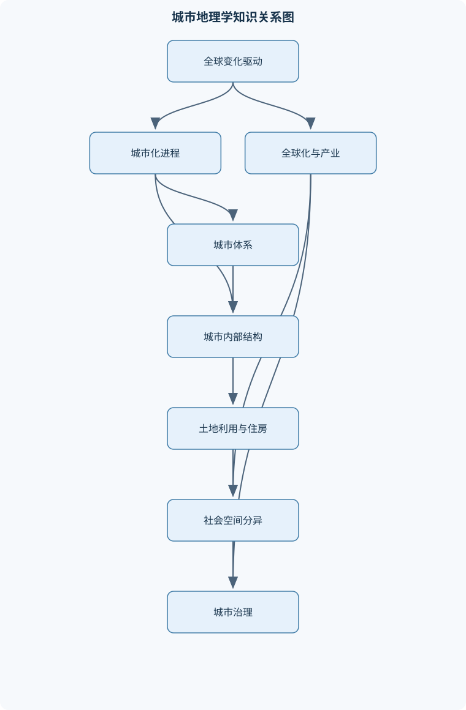
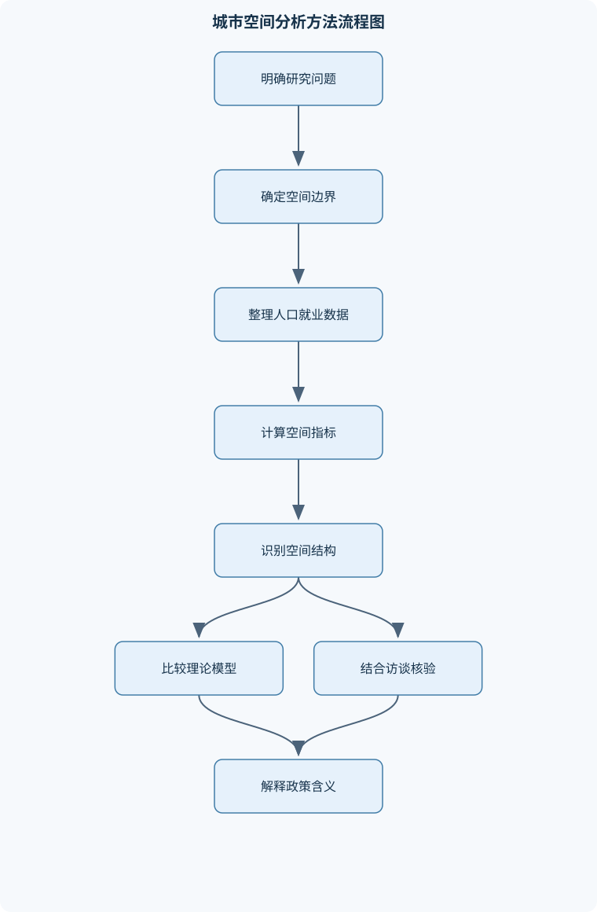

# 城市地理学

## 一、课程整体知识框架

### 课程边界与先修知识

城市地理学研究城镇与城市的空间分布、等级体系、内部结构、社会空间差异、城市化过程及其与经济、人口、技术、政治、文化和环境变化之间的关系。课程边界包括城市定义与测度、城市起源和发展、城市体系、城市土地利用、居住空间、全球化与城市经济、迁移与住房、城市治理及规划分析。课程不以建筑设计、工程施工或单一的人口统计学为核心，但需要理解相关数据和空间分析方法。先修知识包括人文地理学基本概念、人口与经济地理学基础、基础统计学、地图阅读、比例与指数计算；进一步学习可使用地理信息系统和回归分析，但不将特定软件作为课程前提。





### 1. 研究对象、核心问题与学科边界

城市地理学研究城镇与城市在空间上的分布、等级、联系、内部结构及其社会空间差异，重点解释“城市为什么出现在这里”“不同城市为什么规模和职能不同”“城市内部为什么形成不同功能区和社会群体聚集区”“城市变化受到哪些经济、人口、技术、政治、文化和环境因素影响”等问题。它既研究单个城市，也研究城市之间组成的城市体系；既关注城市人口和土地利用，也关注交通、资本、信息、迁移、公共服务和权力关系形成的空间联系。

城市地理学不等同于建筑设计、工程施工或单一的人口统计学。建筑形态是城市空间的表现，工程设施是城市运行的物质基础，人口数据是识别城市规模和社会结构的重要资料，但城市地理学还要解释这些现象的空间机制。例如，研究住宅区不能只统计住宅数量，还要分析地价、交通、收入、规划、产权和迁移如何共同塑造居住分异。

城市地理研究通常同时使用三种分析关系。第一是**位置关系**，即城市或城市功能区位于何处，以及这种位置与资源、交通、市场和环境条件的联系。第二是**规模—等级关系**，即城市人口、经济规模和服务职能如何形成首位城市、中等城市和小城市的等级体系。第三是**过程关系**，即城市化、郊区化、去工业化、迁移、更新和绅士化如何在时间上改变城市。

### 2. 城市概念、统计口径与空间尺度

“城市”不是只有一种定义。行政城市以政府划定的行政边界为依据，便于管理和统计，但行政面积可能包括大量农村土地，因而人口密度和建设强度会被低估。实体建成区以连续建筑和基础设施覆盖范围为依据，更接近城市的物质形态，但边缘地区的连续性标准需要明确。功能城市则依据就业、通勤、商业服务和社会联系确定，能够反映城市实际影响范围，但需要交通流、就业地和居住地等数据。

因此，比较城市人口时，必须说明人口对应的空间范围。设城市总人口为 $P$，统计区域面积为 $A$，人口密度为：

$$
D=\frac{P}{A}
$$

其中，$D$ 的单位通常为人/平方千米，$A$ 可以是行政面积、建成区面积或功能城市面积。若同一城市分别使用行政面积和建成区面积计算，所得密度可能差异很大。面积口径不一致时，不能直接比较密度。

城市、城镇、都市区、都市圈和城市群也不能混为一谈。城市或城镇通常指单个聚落及其管理单元；都市区强调核心城市及与其存在紧密通勤联系的周边地区；都市圈通常指以一个或多个大城市为核心、具有较强经济和交通联系的区域；都市连绵区或城市群则包含多个相互联系的都市区。空间范围越大，分析重点越从内部土地利用转向区域分工、交通网络和跨城市联系。

城市化率是城市人口占总人口的比例。设城市人口为 $U$，总人口为 $P$，则：

$$
u=\frac{U}{P}
$$

若第一期城市人口和总人口分别为 $U_0、P_0$，第二期分别为 $U_1、P_1$，城市化率变化量为：

$$
\Delta u=\frac{U_1}{P_1}-\frac{U_0}{P_0}
$$

城市人口增加并不必然意味着城市化率上升。例如，城市人口从240万人增加到300万人，总人口从800万人增加到900万人，前期城市化率为 $240/800=30\%$，后期为 $300/900=33.33\%$，城市化率上升3.33个百分点；但如果城市人口增长较慢而农村人口增长更快，城市人口仍可能增加，城市化率却下降。城市化率比较还必须统一城市统计标准、年份和人口范围。

### 3. 研究尺度、认知空间与研究范式

城市地理学具有多尺度特征。地方尺度关注街区、社区、道路和公共空间；都市尺度关注城市内部功能区、居住分异、就业分布和通勤；区域尺度关注城市体系、都市圈和产业网络；全球尺度关注世界城市、跨国资本、国际分工和全球联系。不同尺度可能得出不同结论。例如，一个街区在地方尺度上可能表现为更新和环境改善，在都市尺度上却可能表现为低收入居民被挤出核心区。

城市也是居民感知和使用的空间。认知地图通常包括路径、边界、区域、节点和标志。路径是人们日常移动所依赖的道路、轨道或街道；边界是区分不同空间的河流、铁路、行政线或心理界线；区域是具有相似功能、景观或社会认同的空间；节点是交通换乘点、市场、广场等活动集聚处；标志是具有识别意义的建筑、塔楼、山体或公共设施。认知地图不等同于精确地图，因为不同群体的活动范围、社会经验和安全感不同。

城市地理学的研究范式经历了多种转变。环境决定论强调自然环境对城市形成的影响，但若把地形或气候视为决定城市命运的唯一因素，就会忽略制度、技术和社会选择。实证主义强调可观察数据、空间规律和模型检验，适合分析城市规模、距离、密度和通勤关系，但可能忽视意义、权力和非正式制度。行为主义关注个人有限理性、感知、信息和选择过程，可以解释住房搜索和迁移决策，但不应把个人选择脱离结构条件。

人本主义强调地方意义、生活体验和身份认同，适合研究公共空间、地方感和社区归属。结构主义关注资本积累、阶级关系、土地制度和国家政策如何塑造城市空间，能够解释贫困、隔离和不平等，但也需要结合具体地理环境和居民行动。后现代主义则强调城市多样性、碎片化、符号消费和多重身份，适合分析文化产业、消费空间和差异化城市景观。不同范式不是简单的相互替代，实际研究可将统计分析、空间观察、访谈和制度分析结合起来。

### 4. 城市起源与早期城市发展

早期城市形成通常需要若干条件共同作用，而不是由单一因素决定。农业剩余使部分人口能够脱离直接农业生产，社会分工使行政、宗教、手工业、贸易和军事等专业活动集中，组织能力则使人口、粮食和劳动力能够被征集、储存和再分配。

水利灌溉理论强调河流流域的灌溉、治水和防洪需要促成大型组织，进而形成行政中心和城市。但灌溉并非所有城市起源的必要条件，也不能解释贸易型、军事型和宗教型城市。贸易交换理论强调交通节点、市场和远距离贸易对人口集聚的作用；防御理论强调城墙、军事驻地和战略位置；宗教与政治理论则强调宫殿、神庙、祭祀中心和统治权力对城市集中的推动。

两河流域、尼罗河流域、印度河流域和黄河流域都出现了早期城市，但城市形态和组织方式并不相同。中美洲也形成了具有自身农业、宗教和政治体系的城市中心。早期城市不能被简单理解为现代工业城市的雏形，因为其经济基础、社会组织、交通条件和城市—农村关系不同。

城市起源还受历史偶然性影响。某一地点可能因河流改道、贸易路线变化、战争、王朝迁都或资源发现而获得优势，也可能因灾害、政治冲突和交通转移而衰落。因此，城市起源理论应被视为解释机制，而不是适用于所有城市的单一规律。

### 5. 城市化进程与城市发展阶段

城市化包括城市人口增长、城市人口比重上升、非城市地区转变为城市地区，以及生产、生活方式和社会组织的城市化。工业化通过工厂就业、市场扩大和交通改善吸引人口进入城市，但城市化并不总是与工业化同步。在部分发展中地区，城市人口增长可能快于制造业和正规就业增长，形成“城市化快于工业化”的现象。

城市发展可表现为不同阶段。郊区化是人口、住宅、商业或就业从核心区向外围转移；逆城市化通常指较大都市区整体人口或经济活动向更远地区分散，不能与普通郊区化等同；再城市化是核心区人口恢复、功能复兴或人口衰减减缓。去集中化强调城市活动从单一核心向多个节点分散，城市蔓延则强调低密度、跳跃式、依赖机动车的外围扩张。多中心化可能改善就业分布，也可能增加交通距离和基础设施成本。

城市体系的阶段可以按首位城市、中等城市和小城市的相对发展理解。早期国家或区域可能由首位城市集中行政、贸易和资源；随着工业化、区域开发和交通网络完善，中等城市承担制造、教育、物流和区域服务职能；小城市则可能承担地方市场、资源加工和基本公共服务职能。阶段并非线性规律，政策、战争、资源变化和全球产业转移可能使城市体系出现跳跃或逆转。

工业城市通常具有工厂、铁路、港口、工人居住区和较强的生产功能。后工业城市并不意味着工业完全消失，而是制造业就业和产出在经济结构中的比重下降，金融、信息、教育、文化、医疗和生产性服务的作用增强。福特主义以大规模标准化生产、相对稳定的劳动关系和集中化生产为特征；后福特主义则表现为弹性生产、专业化分工、外包、产业网络和更灵活的劳动力安排。这些经济变化会重塑城市土地利用和职业结构。

### 6. 人口迁移、社会空间过程与城市不平等

迁移是城市规模、劳动力结构和社会空间变化的重要机制。城乡迁移的推力包括农村就业不足、收入较低、教育和医疗资源有限、自然灾害和社会冲突；拉力包括城市就业机会、较高工资、教育资源、公共服务和社会网络。迁移既可能是自愿的，也可能是强制的；既可能是长期定居，也可能是季节性、循环性或阶段性迁移。

刘易斯两部门模型把经济分为传统农业部门和现代工业部门，认为农业剩余劳动力在工资差异推动下流向城市工业部门。其局限在于可能低估城市失业、非正规就业和农业内部差异。舒尔茨的人力资本解释强调教育、技能和健康投资提高劳动生产率，迁移可以被视为个人对未来收益的投资。托达罗模型进一步强调预期收入，而不是简单比较城乡名义工资。若城市工资为 $w_u$，获得就业的概率为 $p$，则简化预期城市收入为：

$$
E(Y_u)=p w_u
$$

若农村预期收入为 $Y_r$，迁移成本为 $C$，则经济激励增强的条件可写为：

$$
p w_u-Y_r>C
$$

例如，城市工资为10万元、就业概率为0.5，农村预期收入为4万元，迁移及居住成本为0.8万元，则城市预期收入为5万元，扣除成本后为4.2万元，高于农村预期收入，迁移的经济激励为正。但住房拥挤、社会网络、身份制度、家庭分工和风险偏好可能改变实际决策。

城市贫困不是人口规模的简单结果。土地和住房价格、低技能就业不足、公共服务分布、交通费用、教育机会和社会保障共同影响贫困。社会空间隔离是不同收入、阶层、族群或迁移背景群体在居住、教育、就业和公共空间上的分离。空间分异与社会不平等相互强化，但二者不能混同：空间上分开不必然意味着社会关系完全隔绝，收入差异也不必然产生严格的地理隔离。

### 7. 城市体系、等级结构与中心地理论

城市体系是不同规模、职能和联系强度的城市组成的整体。设城市人口按降序排列为：

$$
P_1\geq P_2\geq\cdots\geq P_n
$$

首位度为：

$$
R=\frac{P_1}{P_2}
$$

它只比较最大城市和第二大城市。四城市指数为：

$$
S_4=\frac{P_1}{P_2+P_3+P_4}
$$

十一城市指数为：

$$
S_{11}=\frac{2P_1}{P_2+\cdots+P_{11}}
$$

例如，四个城市人口分别为800万、400万、300万和200万人，则 $R=800/400=2$，$S_4=800/(400+300+200)=0.889$。首位度反映最大城市相对于第二城市的突出程度，四城市指数反映最大城市相对于前三个城市总量的集中程度。指数只能描述给定城市集合中的集中情况，不能单独代表完整城市体系。

位序—规模法则为：

$$
P_i=\frac{P_1}{i^q}
$$

其中，$P_i$ 为第 $i$ 位城市人口，$i$ 为城市位次，$q$ 为位序—规模指数。取对数后：

$$
\log P_i=\log P_1-q\log i
$$

以 $\log i$ 为自变量、$\log P_i$ 为因变量进行回归，回归斜率为 $-q$。当 $q=1$ 时，人口规模近似与位次成反比；当 $q>1$ 时，大城市相对突出，体系更集中；当 $0<q<1$ 时，城市规模相对均衡。回归结果受样本范围、人口口径、城市边界和极端大城市影响，不能将拟合关系外推到没有观测支持的位次。

克里斯塔勒中心地理论把城市视为向周围地区提供商品和服务的中心。中心性表示一个地点向周边提供服务和组织经济活动的能力；腹地是接受该中心服务的区域；服务范围是消费者愿意前往或接受服务的最大距离；门槛人口是维持某项服务所需的最低需求规模。高等级中心提供门槛高、范围大的专门服务，低等级中心提供日常用品和基本服务。

在均匀平面、人口均匀分布、交通成本各方向相同、消费者选择最近中心等条件下，单个中心的市场范围可近似为圆形。多个圆形服务区会出现重叠或空白，在覆盖最大化的理想推导中可调整为六边形镶嵌。但现实中河流、山地、道路、价格、收入、行政边界和服务质量会改变市场边界，因此六边形是模型推导结果，不是实际城市腹地的必然形状。

### 8. 城市职能、经济基础与城市分类

城市经济基础理论将城市活动分为基本活动和非基本活动。基本活动面向城市外部市场，通过出口商品、外来游客、外部投资或跨区域服务获得收入；非基本活动主要满足本地居民需求，如普通零售、社区服务和日常生活服务。设基本活动就业为 $B$，非基本活动就业为 $N$，总就业为 $E$，则：

$$
E=B+N
$$

基本—非基本比为：

$$
\frac{B}{N}
$$

该比值依赖部门划分、参照区域和统计年份，不能直接等同于城市效率。基本活动增加可能通过收入和消费带动非基本活动，若非基本就业对基本就业的响应系数为 $k$，简化乘数关系为：

$$
\Delta E=\Delta B(1+k)
$$

这一关系要求消费结构、劳动力供给和本地供应能力相对稳定，现实中会受到进口、自动化、房价和劳动力跨区通勤影响。

识别城市基本活动可使用普查法、残差法和区位商法。区位商定义为：

$$
LQ_{ic}=\frac{e_{ic}/e_i}{e_c/e}
$$

其中，$e_{ic}$ 是城市 $i$ 部门 $c$ 的就业人数，$e_i$ 是城市总就业人数，$e_c$ 是参照区域该部门就业人数，$e$ 是参照区域总就业人数。当 $LQ_{ic}>1$ 时，表示该部门在城市就业结构中的比重高于参照区域。估计基本就业可写为：

$$
B_c=e_{ic}-e_i\left(\frac{e_c}{e}\right)
$$

若某城市制造业就业2万人、总就业10万人，参照区域制造业就业100万人、总就业1000万人，则城市制造业比重为20%，参照比重为10%，区位商为2。按参照结构估算的制造业就业为1万人，估计基本就业为1万人。该结果隐含城市消费结构、劳动生产率和部门分类具有可比性，若城市制造业主要服务本地市场或生产率明显不同，估计会偏差。

城市分类可以按主导职能、规模、发展阶段或统计特征进行。直觉分类依赖历史和实地观察，能保留城市的综合特征，但主观性较强；统计分类可依据就业比重、区位商和标准差，具有可重复性，但可能把相对比例高的小城市误判为绝对规模大的专业城市。以高于所有城市某部门平均就业比重一个标准差作为初步主导标准时，还应结合该部门绝对人数、城市规模和历史背景复核。

### 9. 城市土地利用与内部空间结构

竞租理论认为，不同土地使用者围绕可达性和地租展开竞争。中心位置通常交通便利、市场接近、信息交流成本低，因此企业或家庭愿意支付较高地租。若交通成本随距离中心增加，土地使用者的支付能力通常随可达性下降而降低，形成从中心向外围递减的竞租曲线。中心区高地租可能迫使低收益、占地较大或对中心可达性要求较低的活动向外围迁移。

中央商务区通常具有高就业密度、高地价、商业和管理功能集中、交通可达性强等特征，但不同城市的中央商务区可能兼有历史、文化、行政和旅游功能。伯吉斯同心圆模型把城市解释为围绕中心向外形成同心带；霍伊特扇形模型强调交通轴和地租梯度使土地利用沿特定方向呈扇形延伸；哈里斯—乌尔曼多核心模型强调多个就业、交通、工业或商业中心共同形成城市结构。

后工业城市可能出现核心停滞区、外围商业中心、产业园区、机场节点和交通走廊。城市蔓延与多中心化可以由家庭偏好、土地价格、道路建设、规划管制和产业布局共同推动。上述模型是理想化分析工具，不应把真实城市强行归入单一模型。判读城市内部结构时，应同时观察中心位置、主要交通轴、地价、人口、就业、工业和公共服务，并使用时间序列验证空间变化。

### 10. 住房、社区变化与建成环境生产

建成环境不是自然形成的，而是土地所有者、投机者、开发商、家庭、房地产中介、金融机构和政府共同生产的结果。土地所有者控制土地供给，投机者等待价格上涨，开发商组织建设和销售，金融机构提供信贷，家庭通过购买或租赁实现居住需求，政府通过规划、基础设施、税收和更新政策改变投资风险和收益。

住房阶层理论强调不同收入群体由于支付能力、住房偏好和社会地位不同，进入不同的住宅市场。居住区压力模型则关注家庭内部压力、外部环境压力和住房约束如何共同影响居住决策。行动空间是个人实际能够到达和使用的空间；活动空间是日常活动节点及其联系范围；认知空间是个人熟悉、理解和评价的城市范围；搜索空间是个人在住房选择过程中实际查找和比较的房源范围。四者并不相同：通勤距离、照护责任、交通费用和安全感可能使搜索空间小于认知空间。

社区变化可以表现为稳定、衰退、严重衰退、复兴或绅士化等阶段。社区衰退可能由就业流失、基础设施老化、人口外迁、公共服务下降和投资不足造成；复兴可能来自公共投资、居民组织、产业更新、交通改善和文化活动，也可能伴随房租上涨和原居民迁出。

绅士化需要同时考察资本、住房和人口变化。设潜在地租为 $R_p$，实际地租为 $R_a$，租差为：

$$
G=R_p-R_a
$$

当租差足以覆盖改造、融资、搬迁和风险成本时，资本投入可能增加。生产侧解释强调开发商、金融机构和政府利用租差推动改造；消费侧解释强调中产阶层对中心位置、历史建筑、文化消费和特色社区的偏好。租差不是绅士化的充分条件，还必须考察产权结构、投资方式、居民负担变化和是否存在强制搬迁。房价上涨、旧区改善或新居民进入，单独都不能证明绅士化。

### 11. 全球化、产业转型与世界城市

全球化改变了城市的空间尺度和经济联系。世界经济可以表现为核心、半外围和外围结构，资本、技术、信息和高端服务往往在核心城市高度集中。资本主义经济阶段变化会影响城市发展方式：竞争性资本主义强调市场竞争和商业扩张；组织化资本主义强调大企业、国家调控和规模化生产；高级资本主义则表现为金融化、跨国生产、信息网络和服务业扩张。

去工业化通常指制造业就业和产出在经济结构中的比重下降，而不是工业完全消失。其原因包括技术进步、国际竞争、生产外包、成本变化和消费结构变化。第三产业化也不等于所有服务业岗位都高收入，金融、信息和专业服务可能高薪，零售、餐饮、配送和照护服务中则可能存在低薪和不稳定就业。

新工业空间依靠产业网络、专业化分工、供应链和技术创新，不一定集中在传统工业城市。出口加工区可能吸引外资、扩大就业和改善基础设施，也可能形成对外部资本依赖、劳动保障不足和环境压力。世界城市的关键不只是人口规模，更包括跨国公司管理、金融服务、国际交通、信息控制、法律咨询和文化传播等控制功能。

全球城市中可能出现职业两极分化：高收入管理和专业岗位增长，同时低收入服务岗位也增长，中等技能岗位受到自动化和外包挤压。国际资本、国家政策和地方政府共同影响城市发展，全球联系并不意味着地方政府失去作用。地方规划、土地政策、劳动力制度和公共投资仍会决定全球化收益如何分配。

### 12. 发展中地区城市化、城市问题与治理

发展中地区城市化常表现为人口增长快、基础设施不足、非正规就业比例较高、公共服务供给不均和城市空间扩张迅速。城市化快于工业化时，城市人口增加并未同步产生足够的正规就业，部分迁移者进入非正规商业、临时服务、家庭作坊和无证经营。非正规经济不能简单视为城市失序，它既提供就业和低价服务，也可能面临收入不稳定、缺乏社会保障和空间排斥。

现代化理论把发展理解为从传统社会、起飞准备、起飞、走向成熟到大众消费的阶段过程。其优点是强调投资、技术、制度和产业升级，局限是容易把西方发展路径当作普遍模式，忽略政治、文化和国际关系差异。依附理论强调发达国家、跨国公司和外围地区之间的不平等交换，认为发达与不发达是同一世界经济过程的不同结果，但它可能过度强调外部资本，低估外围地区内部政治和文化力量。世界体系理论区分核心、半外围和外围，并允许国家相对位置发生变化，适合分析全球分工，但仍需结合具体国家和城市的历史制度。

外围地区城市化可表现为若干连续过程：传统农业和手工业受到商业农业及廉价进口产品冲击，农村人口进入城市；农村和周边地区的剩余被集中到首都、港口和主要交通节点；制造业和基础设施继续向大城市集中；国家通过主要城市的基础设施支持工业扩张；随着大都市发展，私人资本逐步向外围分散。外向型城市化则指原农业地区在外资导向、出口工业和经济带推动下转变为城市地区。

城市治理需要同时处理住房、交通、就业、环境、公共服务和社会公平。治理响应不能只依靠扩大道路或驱赶非正规经营者，还应评估土地制度、公共交通、住房可负担性、就业机会和居民参与。环境压力包括空气污染、水资源紧张、热岛效应、洪涝风险和生态空间减少，其影响往往对低收入群体更严重，因此城市治理应把空间效率与社会公平结合起来。

## 二、章节和模块划分

### 核心知识覆盖清单

本清单用于检查正文是否覆盖本课程的主要知识模块：

- **城市地理学的对象、尺度与研究范式**：城市地理学的定义与研究问题、城市、城镇与都市区的区分、行政城市与实体建成区、功能城市与通勤范围、城市性与城市生活方式、认知地图的路径边界区域节点标志、地方尺度都市尺度全球尺度、环境决定论实证主义行为主义人本主义结构主义与后现代主义。
- **城市起源与早期城市发展**：水利灌溉与城市起源理论、贸易交换与经济城市起源、防御需求与军事城市起源、两河流域尼罗河流域印度河流域与黄河流域、中美洲城市起源区域、农业剩余与社会分工、行政组织宗教权力与城市集中、历史偶然性对城市起源的影响。
- **城市化进程与城市发展阶段**：城市化的定义与测量、全球城市化的时空差异、工业化与城市人口增长、郊区化逆城市化再城市化、去集中化与城市蔓延、首位城市阶段中等城市阶段与小城市阶段、工业城市与后工业城市、福特主义后福特主义与城市形态转型。
- **城市人口迁移与社会空间过程**：城乡迁移的推力与拉力、刘易斯两部门模型、舒尔茨的人力资本投资解释、托达罗预期收入模型、强制迁移自愿迁移调整性迁移与诱发性迁移、城市贫困与社会空间隔离、族群阶层与住房分异、迁移对城市规模结构和公共服务的影响。
- **城市体系、等级与中心地理论**：城市体系的等级结构、首位城市与城市首位度、位序—规模法则、四城市指数与十一城市指数、克里斯塔勒中心地理论、中心地中心性腹地与服务范围、高等级中心与低等级中心、都市圈大都市带与都市连绵区、中心地理论的假设与现实边界。
- **城市职能、经济基础与城市分类**：基本活动与非基本活动、城市经济基础与乘数效应、基本—非基本比率、普查法残差法与区位商法、正常城市法与最小需要量法、城市主导职能识别、直觉分类与统计分类、标准差城市分类方法、出口产业与城市增长。
- **城市土地利用与内部空间结构**：可达性与竞租曲线、土地租金与交通成本关系、中央商务区的功能与空间特征、伯吉斯同心圆模型、霍伊特扇形模型、哈里斯—乌尔曼多核心模型、后工业城市的核心停滞区与外围中心、城市蔓延与多中心化、理想模型与现实城市差异。
- **住房、社区变化与建成环境生产**：建成环境生产者及其角色、土地所有者投机者开发商与家庭、房地产中介金融机构与政府、住房阶层理论、住宅区压力模型、行动空间活动空间认知空间与搜索空间、唐斯社区变化五阶段、社区衰退与复兴因素、绅士化的租差生产侧与消费侧解释。
- **全球化、产业转型与世界城市**：世界经济的核心—边缘结构、资本主义经济的阶段性变化、全球化与城市尺度重组、去工业化与第三产业化、新工业空间与产业网络、出口加工区及其区域影响、世界城市的控制功能与跨国联系、全球城市中的职业两极分化、国际资本国家政策与城市发展。
- **发展中地区城市化、城市问题与治理**：发展中地区城市化的基本特征、城市化快于工业化、现代化理论与经济增长阶段、依附理论与中心—外围关系、世界体系理论、外围地区城市化阶段、外向型城市化与外资导向经济带、非正规经济与城市公共服务、城市不平等环境压力与治理响应。


### 第一章 城市地理学的对象、尺度与研究范式

本章先建立城市、城镇、行政城市、实体建成区、功能城市和城市性等基本概念，再说明人口、土地利用、通勤、服务和社会关系的测度口径。城市性不仅是居住在城市，也包括高密度交往、专业分工、复杂组织、快速信息流和多样生活方式。章节后半部分比较地方、都市、区域和全球尺度，以及环境决定论、实证主义、行为主义、人本主义、结构主义和后现代主义的解释重点。

### 第二章 城市起源与早期城市发展

本章围绕农业剩余、社会分工、灌溉、水利、贸易、防御、行政、宗教和政治权力解释早期城市形成。学习重点不是寻找唯一城市起源原因，而是判断不同城市中哪些条件发挥主要作用，并用两河流域、尼罗河流域、印度河流域、黄河流域和中美洲城市进行比较。历史偶然性说明同样的自然条件不一定产生同样的城市结果。

### 第三章 城市化进程与城市发展阶段

本章区分城市人口增长、城市化率提高、城市空间扩张和生活方式城市化。重点分析工业化与城市化关系、全球城市化时空差异，以及郊区化、逆城市化、再城市化、去集中化、城市蔓延和多中心化的区别。应使用人口、建成区、就业和通勤数据共同判断阶段，不能把城市人口增加直接等同于城市化率上升。

### 第四章 城市人口迁移与社会空间过程

本章解释推力—拉力机制、刘易斯两部门模型、舒尔茨人力资本投资解释和托达罗预期收入模型。迁移分析必须纳入就业概率、住房成本、迁移成本、社会网络和家庭策略。随后分析城市贫困、族群分异、阶层分化、住房隔离及迁移对城市规模结构、劳动力市场和公共服务的影响。

### 第五章 城市体系、等级与中心地理论

本章从城市人口排序和城市联系入手，讲解首位度、四城市指数、十一城市指数和位序—规模法则。计算时必须统一城市边界和人口年份，并说明指数只能反映特定城市集合。中心地理论进一步解释中心性、腹地、服务范围、门槛人口、高等级中心和低等级中心，最后讨论都市圈、大都市带和都市连绵区，以及均匀平面、等交通成本等理想假设的现实边界。

### 第六章 城市职能、经济基础与城市分类

本章先区分基本活动和非基本活动，再讲解经济基础乘数、基本—非基本比、普查法、残差法和区位商法。区位商大于1只能说明相对集中，不能证明该部门就业全部面向外部市场。城市分类应综合就业结构、绝对规模、服务范围、历史背景和空间联系，避免把小城市的高相对比例误认为大规模专业职能。

### 第七章 城市土地利用与内部空间结构

本章从可达性、交通成本、土地租金和竞租曲线推导城市土地利用。商业活动通常更重视中心可达性，制造业和大面积设施可能向外围迁移，家庭则在租金、通勤和环境之间权衡。伯吉斯同心圆、霍伊特扇形和哈里斯—乌尔曼多核心模型分别解释环带、交通轴和多节点结构，并通过现实案例说明城市蔓延、交通走廊和外围中心如何修正理想模型。

### 第八章 住房、社区变化与建成环境生产

本章分析土地所有者、投机者、开发商、家庭、中介、金融机构和政府如何共同生产建成环境。住房阶层理论解释居住分化，住宅区压力模型解释家庭在住房、通勤和邻里之间的选择。行动空间、活动空间、认知空间和搜索空间用于分析居住决策的不同范围。社区变化部分重点讨论衰退、复兴和绅士化，并用租差、资本投入、居民迁出和政策支持建立证据链。

### 第九章 全球化、产业转型与世界城市

本章讲解核心—外围结构、资本主义阶段、全球化与城市尺度重组。重点分析去工业化、第三产业化、新工业空间、产业网络、出口加工区和外资导向经济带。世界城市的判定不能只看人口规模，还要分析跨国公司控制功能、金融和信息服务、国际交通、专业服务及全球网络联系，并讨论全球城市职业两极分化和城市不平等。

### 第十章 发展中地区城市化、城市问题与治理

本章比较现代化理论、依附理论和世界体系理论的解释尺度与局限，分析发展中地区城市化快于工业化、外围地区城市化阶段、外向型城市化和非正规经济。城市问题部分涵盖住房不足、就业不稳定、公共服务不均、环境压力和空间不平等。治理分析要求同时考察国家政策、地方政府、市场主体、社区组织和居民参与，避免把城市问题简单归结为人口过多。

### 代表性分析流程一：城市化率与建成区扩张测算

**输入**包括多个时期的城市人口、农村人口、总人口、行政边界面积和建成区面积；**输出**包括城市化率、城市人口增长率、建成区扩张率以及统计口径差异说明。

步骤如下：

1. 统一各期年份、人口定义和空间边界。
2. 核对每期城市人口与农村人口之和是否等于总人口。
3. 分别计算 $u=U/P$。
4. 计算城市人口增长率和建成区面积变化率。
5. 将行政口径与建成区口径分开比较。
6. 检查城市人口增加但城市化率下降的可能性。
7. 输出结果时注明人口单位、面积单位和统计边界。

不变量是人口分项必须能够与总人口核对，且同一指标在各期使用相同口径。适用条件是年份和统计标准可比；若行政边界发生调整，应单独标记边界变化，不能把边界扩张误判为人口增长。若有 $n$ 个时期，基础计算复杂度为 $O(n)$。

### 代表性分析流程二：区位商识别城市基本活动

输入城市各部门就业人数、城市总就业人数、参照区域各部门就业人数和参照区域总就业人数。对每个部门计算：

$$
LQ_{ic}=\frac{e_{ic}/e_i}{e_c/e}
$$

若 $LQ_{ic}>1$，再计算：

$$
B_c=e_{ic}-e_i\left(\frac{e_c}{e}\right)
$$

将正的 $B_c$ 汇总为估计基本就业。不能把 $LQ>1$ 的全部就业直接当作基本就业，因为其中仍包含服务城市本地需求的部分。应同时记录参照区域、统计年份、部门分类和就业口径。若有 $m$ 个部门，计算复杂度为 $O(m)$。

### 代表性分析流程三：位序—规模回归

输入城市人口数据。先按人口从大到小排序，确定位次 $i$，再计算 $x_i=\log i$ 和 $y_i=\log P_i$，估计：

$$
y_i=a-qx_i
$$

输出 $q$、截距、拟合优度和残差。分析时检查最大城市是否具有异常影响，样本是否只包含大城市，城市人口口径是否一致，以及残差是否在不同位次上系统偏离。排序复杂度为 $O(n\log n)$，回归计算复杂度为 $O(n)$。若样本边界或统计单位不一致，回归结果不能用于判断真实的城市体系集中程度。

```python
# 城市位序—规模关系的基础计算示例
# 输入：同一统计口径下的城市名称及人口，人口单位可为万人或人，但必须统一
cities = [
    ("甲城", 1000),
    ("乙城", 500),
    ("丙城", 333),
    ("丁城", 250),
]

cities = sorted(cities, key=lambda item: item[1], reverse=True)
p1 = cities[0][1]

print("城市\t位次\t人口\t相对首位城市规模")
for rank, (name, population) in enumerate(cities, start=1):
    relative_size = population / p1
    print(f"{name}\t{rank}\t{population}\t{relative_size:.3f}")

print("位序—规模关系的直接检查：")
for rank, (_, population) in enumerate(cities, start=1):
    expected = p1 / rank
    ratio = population / expected
    print(f"位次{rank}: 实际/理论={ratio:.3f}")
```

该代码只进行排序、比例计算和结果输出，不执行文件读写或联网操作。其“实际/理论”比值接近1，表示该城市人口接近 $q=1$ 的简单位序—规模关系；它不是完整回归，不能替代对数线性回归和残差诊断。

### 代表性分析流程四：城市土地利用与社区变化判读

输入土地利用图、道路网络、地价或租金、建筑密度、人口、就业和时间序列资料。先识别中央商务区、主要交通轴、产业区、居住区和外围节点，再比较土地利用与地价、交通和就业的关系。若商业就业集中于中心和高速公路交汇处，工业沿铁路或河流呈带状，高收入住宅沿景观和交通轴延伸，则单中心模型不足，宜判为多核心与交通走廊复合结构。

社区变化诊断应输入房价、租金、收入、人口结构、空置率、改造投资、产权和迁出率。先建立基准期，再识别资本投入和租金变化，比较原居民迁出与新居民进入，核查政府补贴、开发商项目和居民组织，最后区分一般复兴、资本驱动绅士化和强制搬迁。不能只用房价上涨判断绅士化。

### 例题一：城市化率变化

**题干**：某地区第一期城市人口为240万人、总人口为800万人；第二期城市人口为300万人、总人口为900万人。求两期城市化率及其变化，并判断城市人口增长是否等于城市化率增长。

**分析**：城市化率是城市人口占总人口比例，不能只比较城市人口绝对量。

**解答**：

第一期：

$$
u_0=\frac{240}{800}=0.30=30\%
$$

第二期：

$$
u_1=\frac{300}{900}=0.3333=33.33\%
$$

城市化率变化：

$$
\Delta u=33.33\%-30\%=3.33\text{个百分点}
$$

城市人口增长率为：

$$
\frac{300-240}{240}=25\%
$$

总人口增长率为：

$$
\frac{900-800}{800}=12.5\%
$$

**结果验证**：城市人口增长率高于总人口增长率，所以城市化率上升。若总人口增长率高于城市人口增长率，城市化率可能下降。城市人口增长率和城市化率变化不是同一指标。

**变式**：若第二期城市人口仍为300万人，但总人口为1000万人，则城市化率为30%，虽然城市人口增加，城市化率却没有提高。

### 例题二：位序—规模关系与首位集中

**题干**：四个城市人口依次为1000万、500万、333万和250万人。检验其是否接近 $P_i=P_1/i$，并说明城市体系特征。

**分析**：当 $q=1$ 时，理论人口分别为1000万、500万、333.33万和250万。

**解答**：

实际人口与理论人口几乎一致，因此：

$$
P_i\approx\frac{1000}{i}
$$

首位度为：

$$
R=\frac{1000}{500}=2
$$

四城市指数为：

$$
S_4=\frac{1000}{500+333+250}
\approx0.923
$$

**结果验证**：各城市实际人口与理论值接近，说明这一组城市在观测范围内接近 $q=1$ 的位序—规模关系。首位城市人口是第二城市的2倍，但不能仅凭四个城市判断整个国家城市体系。

**变式**：若第二城市人口降为300万，首位度变为 $1000/300=3.33$，首位城市相对集中程度增强；但仍需观察第三、第四及更小城市。

### 例题三：区位商与基本就业

**题干**：某城市制造业就业20000人、总就业100000人；参照区域制造业就业100万人、总就业1000万人。计算区位商并估计制造业基本就业。

**分析**：先比较城市和参照区域的制造业就业比重，再计算超出参照结构的就业量。

**解答**：

城市制造业比重：

$$
\frac{20000}{100000}=0.20
$$

参照区域制造业比重：

$$
\frac{1000000}{10000000}=0.10
$$

区位商：

$$
LQ=\frac{0.20}{0.10}=2
$$

按参照结构估算的本地制造业就业：

$$
100000\times0.10=10000
$$

估计基本就业：

$$
B_c=20000-10000=10000
$$

**结果验证**：$LQ=2>1$，说明制造业在该城市相对集中；估计基本就业为1万人。该结果并不表示全部制造业就业都服务外部市场，还依赖生产率、消费结构和部门分类可比的假设。

**变式**：若城市制造业就业只有8000人，则城市比重为8%，$LQ=0.8$，不能按该方法识别正的基本就业。

### 例题四：首位度与四城市指数

**题干**：四个城市人口分别为800万、400万、300万和200万人，计算首位度和四城市指数，并解释差异。

**解答**：

首位度：

$$
R=\frac{800}{400}=2
$$

四城市指数：

$$
S_4=\frac{800}{400+300+200}
=\frac{800}{900}
\approx0.889
$$

**结果验证**：首位度只比较第一和第二城市，因此只能说明第一城市是第二城市的2倍；四城市指数把第二至第四城市全部纳入，说明第一城市相对于前三个城市总人口具有较强集中性。二者不能互相替代。

**变式**：如果第一城市人口不变而第二、第三、第四城市同时扩大，首位度可能变化不大，但四城市指数会下降，说明多城市整体扩张削弱了第一城市相对总量优势。

### 例题五：托达罗预期收入模型

**题干**：农村预期收入为每年4万元，城市工资为每年10万元，获得该工作的概率为0.5，迁移及居住成本为0.8万元。判断迁移的简化经济激励。

**解答**：

城市预期收入：

$$
E(Y_u)=p w_u=0.5\times10=5\text{万元}
$$

扣除迁移及居住成本后的净预期收益：

$$
5-0.8=4.2\text{万元}
$$

与农村预期收入比较：

$$
4.2-4=0.2\text{万元}>0
$$

因此，在该简化模型中，迁移具有正的经济激励。

**结果验证**：不能直接比较10万元城市工资和4万元农村收入，必须考虑就业概率和成本。若就业概率降至0.45，则城市预期收入为4.5万元，扣除成本后为3.7万元，迁移经济激励转为负。

**变式**：即使经济激励为正，家庭照护责任、住房拥挤、身份限制、社会网络和环境风险仍可能使迁移者不迁移。

### 例题六：竞租与土地利用

**题干**：中心区通勤成本低但地租高，外围地租低但通勤成本高。商业、制造业和低收入家庭在中心与外围如何选择？

**分析**：比较各主体对可达性的需求、土地支付能力和占地规模。

**解答**：商业活动依赖顾客、信息和就业可达性，通常能够承受较高中心地租，因此更容易集中于中心或交通节点。制造业若占地较大、对中心顾客接近要求较低，则更可能向外围迁移，但会沿铁路、港口、高速公路或物流节点布局。低收入家庭难以承受中心高租金，可能选择外围低租金住房，但交通成本和通勤时间会增加；若中心存在低价旧住房或公共交通补贴，也可能继续留在中心。

**结果验证**：若公共交通改善，外围的有效可达性提高，竞租梯度可能变平；若规划限制外围开发，中心和既有节点的地租压力可能进一步上升。

**变式**：若城市存在多个就业中心，单中心竞租模型不足，应结合多核心模型分析。

### 实验项目一：城市土地利用空间结构判读

**目标**：判断一个城市主要呈现单中心、同心圆、扇形、多核心或交通走廊复合结构。

**输入数据**：土地利用图、道路和轨道网络、地价或租金、人口密度、就业密度、工业与商业设施位置，至少两个时期的空间数据。

**步骤**：

1. 统一地图比例、坐标和时间口径。
2. 标出中央商务区、主要交通轴、产业区、居住区和外围节点。
3. 比较各类用地与道路、地价、就业和人口的空间关系。
4. 判断是否存在环带、扇形、多个中心或走廊化扩张。
5. 用两个时期数据检查结构是否稳定。
6. 写出模型解释与现实修正，不强行归入单一模型。

**评价标准**：空间识别是否有数据依据；是否区分人口密度和就业密度；是否解释交通与地价机制；是否说明模型假设和局限；是否能用时间变化验证结论。

**排错方法**：若把行政中心误认作中央商务区，应检查就业、商业和交通数据；若把高速公路旁连续开发直接判为扇形，应核对是否存在地价梯度和功能连续性；若只看土地利用图而忽略时间，应补充不同时期资料。

### 实验项目二：社区变化与绅士化诊断

**目标**：区分一般社区复兴、资本驱动绅士化和强制搬迁。

**输入数据**：五年以上的租金、房价、居民收入、人口结构、空置率、改造投资、产权变化、迁出率、公共政策资料和居民访谈记录。

**步骤**：

1. 选取改造前时期作为基准期。
2. 计算租金、房价和投资变化，记录人口结构变化。
3. 比较原居民迁出、新居民进入和住房负担变化。
4. 调查开发商、金融机构、政府补贴和规划调整的作用。
5. 访谈原居民，区分自愿搬迁、改善性搬迁和被迫搬迁。
6. 综合租差、资本投入、消费变化和社会空间重组作出判断。

**评价标准**：是否同时包含生产侧和消费侧证据；是否测量居民负担与迁出，而非只看房价；是否区分社区改善和绅士化；是否说明证据的不确定性；是否提出对弱势居民的影响。

**排错方法**：只有房价上涨而没有人口迁出证据时，不能直接判定绅士化；旧厂房改造为创意办公空间不必然导致绅士化，应继续检查租金、产权和居民变化；政府改善基础设施也不必然等于资本驱动更新，需比较投资主体和受益群体。

## 三、核心概念的详细解释

### 1. 城市地理学的研究对象、空间尺度与分析范式

城市地理学研究城镇与城市的空间分布、规模等级、职能联系、内部结构以及社会空间差异。它不仅描述城市“在哪里”，还解释城市为什么在特定位置形成、为什么有的城市成为区域中心、为什么城市内部会形成商业中心、工业区、居住区和社会隔离，以及经济、技术、人口、政治、文化与环境变化如何共同改变城市。

城市地理分析至少包含三类关系。第一类是位置关系，考察城市与水源、资源、交通、市场、地形和政治中心的关系。第二类是规模—等级关系，考察城市人口和职能是否呈首位集中、位序—规模分布或多层级网络。第三类是过程关系，考察城市化、迁移、工业化、郊区化、去工业化、城市更新和绅士化的时间演变。

研究尺度会改变问题的含义。地方尺度关注街道、社区、公共空间和认知地图；都市尺度关注土地利用、通勤、住房和社会分异；区域尺度关注城市体系、都市圈、产业网络和中心—外围关系；全球尺度关注跨国资本、世界城市、国际分工和全球信息联系。同一现象在不同尺度上可能呈现不同解释。例如，某街区的房价上涨在地方尺度上可能表现为住房压力，在都市尺度上可能表现为中心区再开发，在全球尺度上则可能与国际资本进入有关。

城市地理学还经历了不同研究范式。环境决定论强调自然环境对城市形成的约束，但若把地形或气候视为决定城市发展的唯一原因，就会忽略制度、技术和历史选择。实证主义强调可测量变量、空间规律和统计检验，适合分析密度、距离和规模关系，但可能忽视居民经验与权力结构。行为主义关注居民的有限理性、认知地图和实际选择，能够解释同样的房源为何被不同群体评价不同。人本主义强调地方意义、生活体验和身份认同。结构主义关注资本积累、阶层关系、土地制度和国家政策如何生产城市空间。后现代主义则强调城市经验的多样性、碎片化和符号意义。不同范式并非简单互相替代，适用范围取决于研究问题。

### 2. 城市、城镇、都市区与城市性

“城市”至少有四种常见口径。行政城市以行政边界划定，便于治理和统计，但边界可能包含大量非建成地区。实体建成区依据连续建筑、道路和基础设施识别，更接近城市的物质范围，但边缘连续性标准需要明确。功能城市依据就业、通勤、商业服务和社会联系确定，能够反映城市实际影响范围，却需要居住地—就业地、交通流和服务流数据。都市圈通常由一个或多个核心城市及其紧密联系的周边地区构成，重点不是边界是否连续，而是功能联系是否显著。

因此，行政城市人口不一定等于建成区人口，建成区人口也不一定等于通勤都市区人口。若用行政面积计算人口密度，外围农村土地会降低密度；若用建成区面积计算，密度通常更接近实际建设强度；若用功能城市面积计算，则反映更大范围内的人口与就业分布。比较城市时必须同时注明人口口径、面积口径、统计年份和边界。

城市性不只是人口集中或建筑密集，还包括非农业就业比重、社会分工、生活节奏、公共服务、交往方式、消费文化和制度组织等。城市生活方式可能扩散到郊区和农村，因此“城市性”与行政上的城市身份并不完全重合。数字通信、远程办公和平台经济又使部分城市功能突破连续建成区，但不能据此认为空间距离已经失去作用，因为就业机会、住房成本、交通时间和面对面联系仍然影响城市结构。

认知地图是居民对城市空间的主观组织方式。路径是人们经常使用的道路、轨道或步行通道；边界是被感知为分隔不同区域的河流、铁路、快速路或社会界线；区域是具有相似形象或功能的片区；节点是交通换乘点、市场、广场等活动集中处；标志是具有识别性的建筑或景观。认知地图不是精确地图，可能受到熟悉程度、年龄、收入、性别、出行方式和安全感影响，因此可用于分析城市形象与空间排斥，但不能直接替代测绘数据。

### 3. 城市起源与早期发展

早期城市通常建立在农业剩余、社会分工、组织能力和空间集聚的共同基础上。水利灌溉理论认为，河流治理、灌溉工程和防洪需要集中劳动力与行政组织，从而推动城市形成；贸易交换理论强调城市位于交通节点、资源交换地或市场中心，依靠商贸和手工业发展；军事防御理论强调城墙、关隘、港口和战略位置对城市选址的作用；宗教和政治理论则指出神庙、王宫、行政机构和仪式活动能够集中人口与财富。

这些理论不是互相排斥的单一答案。两河流域、尼罗河流域、印度河流域、黄河流域和中美洲均存在早期城市，但具体形成条件不同。农业剩余提供了非农业人口生存所需的粮食，社会分工产生工匠、商人、祭司、军人和行政人员，权力组织则通过税收、劳役、法律和宗教建立稳定的资源集中机制。历史偶然性同样重要：河道变迁、战争、王朝迁都、贸易路线转移和技术扩散可能使某些聚落迅速崛起，也可能使原有城市衰落。

城市起源不能被简化为“有河流就一定有城市”。如果缺乏剩余生产、人口组织、交通联系或政治稳定，水源本身并不足以形成城市。反过来，某些城市也可能在水利条件一般的地点依靠港口、矿产、军事或政治功能发展。早期城市研究应同时考察自然条件、生产方式、权力结构、交通网络和历史事件。

### 4. 城市化、城市发展阶段与城市扩张

城市化有两个相关但不同的含义：一是城市人口和城市建成区的增长，二是城市人口占总人口比例提高以及生活方式、经济结构和社会组织的城市化。城市人口增加并不必然意味着城市化率提高，因为城市化率取决于城市人口相对于总人口的变化。工业化通常通过工厂就业、交通改善和市场扩大推动城市人口增长，但城市化也可能在工业化不足时因行政集中、资源开发、外资加工和农村人口被迫迁移而快速发生。

城市化过程常包含集中与扩散的交替。郊区化是人口、住宅、就业或商业从核心区向外围转移；逆城市化通常指整个大都市区人口或经济活动出现向较远地区转移，不能简单等同于一般郊区化；再城市化指核心区人口恢复、衰减减缓或功能重新集中；去集中化则是城市活动由单一核心向多个外围节点分散。城市蔓延表现为低密度、分散式、依赖机动车的扩张，可能带来土地消耗、基础设施成本和生态压力；多中心化则强调就业、商业和公共服务在多个节点形成相对稳定的集聚。

城市体系可出现首位城市阶段、中等城市成长阶段和小城市扩展阶段，但这些阶段不是所有国家都必然经历的线性顺序。工业城市以制造业、铁路、港口和工人居住区为重要特征；后工业城市则更多依赖金融、信息、专业服务、文化产业和高技术活动，但制造业并未必然消失。福特主义以大规模标准化生产、稳定就业和集中化工厂为特征；后福特主义强调灵活生产、产业网络、外包、专业化和空间分散，城市形态因而可能从单一工业核心转向多中心和网络化结构。

### 5. 城市人口迁移与社会空间过程

城乡迁移受到推力、拉力和中介条件共同影响。农村就业不足、收入低、教育医疗资源有限可能形成推力；城市工资、就业机会、教育、医疗和社会网络形成拉力；住房成本、迁移费用、户籍或身份制度、信息不充分和家庭责任则构成中介条件。迁移不是单纯由名义工资差异决定，而取决于就业概率、生活成本、风险和预期收益。

刘易斯两部门模型把经济分为传统农业部门和现代城市工业部门，认为农业部门存在部分剩余劳动力，工业部门通过较高工资吸引劳动力；模型的局限在于，现实中农业劳动力并不总是“无限供给”，城市就业也不一定同步增长。舒尔茨的人力资本解释强调教育、技能、健康和迁移信息是一种投资，迁移者会比较未来收益与当前成本。托达罗模型进一步指出，迁移者比较的是城市预期收入，而非确定工资。若城市工资为 $w_u$、获得就业概率为 $p$，则简化预期收入为 $p w_u$，还应扣除住房、交通和迁移成本。

迁移类型可区分为自愿迁移、强制迁移、调整性迁移和诱发性迁移。水库建设、拆迁、战争或灾害造成的迁移可能具有强制性；产业转移和大型基础设施建设诱发的迁移则可能同时包含机会与被动调整。迁移会改变城市规模、年龄结构、劳动力供给、住房需求、公共服务压力和社会组成。城市贫困与社会隔离不是人口增加的自然结果，而是住房价格、就业结构、土地制度、交通可达性、歧视、公共服务配置和规划政策共同作用的结果。

### 6. 城市体系、等级与中心地理论

城市体系是不同规模、职能和联系强度的城市组成的网络。首位城市具有最大人口、最强行政和经济功能，但首位城市过度集中可能造成区域发展不均和基础设施压力。中等城市承担区域服务、制造业和专业职能，小城市和城镇则常提供基层商业、教育、医疗和交通服务。都市圈、大都市带和都市连绵区体现的是城市之间日益增强的通勤、物流、投资、信息和产业联系。

中心地理论把城市视为向周围地区提供商品和服务的中心。中心性表示某中心为外部地区提供服务的能力，腹地是接受其服务的空间范围，服务范围是消费者可接受的最大距离，门槛人口是维持某项服务所需的最低需求规模。低等级服务购买频繁、距离容忍度低，因而需要较小门槛和较小服务范围；高等级服务购买不频繁、专业性强，通常需要较大门槛和较大服务范围。

中心地理论假设平原地形、人口均匀分布、交通成本各向同性、消费者选择最近中心且服务机构追求市场覆盖。这些假设便于推导六边形市场区，但现实中的河流、山地、道路、收入差异、行政边界、历史中心、网络平台和公共服务制度都会使服务区偏离规则六边形。数字服务扩大了某些服务的空间范围，但医疗、教育、日常零售和面对面专业服务仍受距离和交通影响。

### 7. 城市职能、经济基础与城市分类

城市经济基础理论把活动分为基本活动和非基本活动。基本活动通过向城市外部销售商品、服务或吸引外部收入，为城市带来新增收入；非基本活动主要满足本地居民需求。基本活动增加可能带动零售、住房、餐饮、教育和其他本地服务，但乘数效应取决于本地供应能力、消费结构、劳动力供给和收入外流程度。

城市职能可按产业就业、产值、机构类型、服务范围和外部联系进行分类。普查法需要完整且可比的部门统计；残差法依据城市某部门实际就业与按参照区域结构推算值的差额识别基本活动；区位商法识别城市某部门就业比重是否高于参照区域。统计分类比直觉分类更可复核，但相对比重高不等于绝对规模大。例如，小城市某专业部门占比很高，绝对就业人数可能仍少。标准差分类可将高于城市总体均值一定标准差的部门视为初步主导职能，但必须结合规模、历史和外部联系复核。

### 8. 城市土地利用与内部空间结构

竞租理论认为，不同土地使用者依据可达性、交通成本和收益能力竞争区位。中心区通常交通便利、客流集中，因此商业和高收益活动能够支付较高地租；占地较大、单位面积收益较低的工业、仓储和低收入住宅更可能向外围迁移。但公共交通、土地管制、历史建筑、环境风险、停车条件和多中心结构会改变单一中心的地租梯度。

中央商务区通常具有高就业密度、商业和金融功能集中、地价高、昼夜人口差异大、公共交通可达性强等特征。伯吉斯同心圆模型把城市简化为由中心向外依次排列的同心地带；霍伊特扇形模型强调交通轴和地租梯度使特定用地沿走廊延伸；哈里斯—乌尔曼多核心模型认为不同活动因专业化需求、相互排斥或规模经济在多个核心集聚。真实城市可能同时具有三种模型的特征，不能把理想模型当成严格分类。

### 9. 住房、社区变化与建成环境生产

建成环境由土地所有者、投机者、开发商、家庭、金融机构、中介和政府共同生产。土地所有者控制土地供给，开发商组织建设，金融机构提供信用，家庭通过购买或租赁表达需求，政府通过规划、基础设施、税收和公共住房政策改变收益条件，中介则连接信息与交易。房地产价格不只反映建筑质量，也反映区位、预期、融资条件和制度约束。

住房阶层理论指出，不同收入和家庭生命周期群体具有不同住房预算、空间偏好和邻里要求。居住区压力模型强调家庭会在住房成本、通勤距离、邻里环境、学校、治安和社会关系之间权衡。行动空间是居民日常活动所覆盖的实际范围；活动空间是由就业、购物、教育和交往节点及其联系构成的空间；认知空间是居民理解和评价城市的主观空间；搜索空间是其实际寻找住房的可选范围。这些空间可能并不重合。

社区变化可能经历稳定、衰退、严重衰退、复兴或绅士化等过程。绅士化通常包含资本进入、房屋改造、较高收入群体进入、租金和地价上涨以及原居民面临住房负担增加或迁出的社会空间重组。租差可表示为潜在地租与实际地租之差，但租差只是资本获利空间，不是绅士化充分条件。产权结构、金融供给、规划补贴、社区组织和居民支付能力都会影响结果。房价上涨或旧厂房改造本身不能单独证明绅士化。

### 10. 全球化、产业转型与发展中地区城市化

全球化使城市尺度重新组织。资本、信息、商品和劳动力跨境流动，部分城市承担金融、管理、创新、物流和文化控制功能，形成世界城市网络。世界经济常被分析为核心、半外围和外围结构，但城市在全球网络中的地位不仅由人口规模决定，还取决于跨国公司总部、金融机构、国际交通、专业服务和信息联系。

去工业化通常指制造业就业或产出比重下降，并不等于制造业完全消失。第三产业化也不等于所有服务业都是高收入岗位，专业金融服务与低薪零售、照护和平台劳动可能同时扩张。出口加工区和外资导向经济带能够带来就业、基础设施和产业联系，也可能形成工资分化、环境压力和对外部资本依赖。

现代化理论把城市化视为经济增长和社会转型的一部分，常将发展描述为从传统农业向工业和大众消费转变，但容易忽略不同国家的政治、文化和国际关系。依附理论强调中心国家、跨国公司和外围地区之间的不平等交换，认为发达与不发达是同一资本主义过程的不同结果，但可能低估外围地区内部制度与社会行动。世界体系理论区分核心、半外围和外围，并允许国家地位发生变化。外围地区城市化常经历农村传统生产被破坏、剩余被主要城市抽取、港口和首都快速增长、工业集中于最大城市、国家优先投资核心城市以及大都市向外围扩散等阶段。外向型城市化则指原农业地区在外资和出口工业带动下转变为工业、物流和居住空间。

## 四、重要定义、公式、定理和推导

### 专业审校补充：关键定义与适用边界

城市社会空间隔离是不同社会群体在城市居住空间中的非均匀分布及其由此形成的接触机会差异。可用邓肯隔离指数衡量两个群体在若干空间单元中的分离程度：D=1/2∑|a_i/A-b_i/B|。其中，a_i、b_i分别为单元i中的两群体人数，A、B为全市两群体总人数，D取值通常为0至1；0表示各单元群体构成与全市构成一致，1表示两群体完全分居。该指标反映空间分布差异，不等同于歧视、冲突或居民主观感受，也不能单独证明隔离成因。计算结果受空间单元划分影响：行政社区、街区和栅格可能得到不同数值，这属于可变空间单元问题。若总体比例、单元尺度或边界口径不一致，比较必须谨慎。分析还应结合收入、住房价格、交通可达性、产权制度、迁移选择和公共政策，区分自愿聚居、市场排斥与制度性隔离。


### 1. 人口密度与城市化率

设城市人口为 $P$，面积为 $A$，人口密度为：

$$
D=\frac{P}{A}
$$

其中，$D$ 的单位通常为人/平方千米。$A$ 必须明确是行政面积、实体建成区面积还是功能城市面积。若行政面积为 $500$ 平方千米、人口为 $100$ 万人，则行政人口密度为 $2000$ 人/平方千米；若建成区仅为 $200$ 平方千米，则建成区密度为 $5000$ 人/平方千米。两者都可能正确，但回答的是不同问题。

设城市人口为 $U$，总人口为 $P$，城市化率为：

$$
u=\frac{U}{P}
$$

两个时期的变化量为：

$$
\Delta u=\frac{U_1}{P_1}-\frac{U_0}{P_0}
$$

某地区第一期 $U_0=240$ 万人、$P_0=800$ 万人，第二期 $U_1=300$ 万人、$P_1=900$ 万人，则：

$$
u_0=\frac{240}{800}=0.30
$$

$$
u_1=\frac{300}{900}=0.3333
$$

因此城市化率上升约 $3.33$ 个百分点。城市人口增长率为 $25\%$，总人口增长率为 $12.5\%$，说明城市化率、城市人口增长率和总人口增长率不是同一指标。若总人口增长快于城市人口增长，城市化率可能下降。

### 2. 城市规模等级与集中度指标

设城市人口按降序排列：

$$
P_1\geq P_2\geq\cdots\geq P_n
$$

首位度为：

$$
R=\frac{P_1}{P_2}
$$

四城市指数为：

$$
S_4=\frac{P_1}{P_2+P_3+P_4}
$$

十一城市指数为：

$$
S_{11}=\frac{2P_1}{P_2+\cdots+P_{11}}
$$

例如四个城市人口为 $800$ 万、$400$ 万、$300$ 万和 $200$ 万人，则：

$$
R=\frac{800}{400}=2
$$

$$
S_4=\frac{800}{400+300+200}=0.889
$$

$R$ 只比较第一和第二位城市，$S_4$ 则比较首位城市与后三个城市总量，二者不能互相替代。所有指标都依赖城市集合、人口年份和边界口径，不能单独代表完整城市体系。

位序—规模法则为：

$$
P_i=\frac{P_1}{i^q}
$$

其中，$i$ 为城市位次，$q$ 为位序—规模指数。取对数得：

$$
\log P_i=\log P_1-q\log i
$$

以 $\log i$ 为自变量、$\log P_i$ 为因变量进行回归，斜率为 $-q$。若 $q=1$，城市人口近似与位次成反比；若 $q>1$，大城市相对突出，体系更集中；若 $0<q<1$，城市规模相对均衡。

由该式可得：

$$
\frac{P_i}{P_j}=\left(\frac{j}{i}\right)^q
$$

例如 $P_1=1000$ 万人、$q=1$ 时，理论上第二、第三、第四位分别约为 $500$ 万、$333.3$ 万和 $250$ 万人。回归结果受样本截断、异常城市、行政边界和人口口径影响，不能把拟合关系外推到没有观测支持的位次。

### 3. 区位商与基本活动

设城市部门就业为 $e_{ic}$，城市总就业为 $e_i$，参照区域部门就业为 $e_c$，参照区域总就业为 $e$，区位商为：

$$
LQ_{ic}=\frac{e_{ic}/e_i}{e_c/e}
$$

当 $LQ_{ic}>1$ 时，该部门在城市就业中的比重高于参照区域，说明其相对集中。若某城市制造业就业 $20000$ 人、总就业 $100000$ 人，参照区域制造业就业 $1000000$ 人、总就业 $10000000$ 人，则：

$$
LQ=\frac{20000/100000}{1000000/10000000}
=\frac{0.20}{0.10}=2
$$

按参照结构估计的本地制造业就业为：

$$
e_i\frac{e_c}{e}=100000\times0.10=10000
$$

估计基本就业为：

$$
B_c=e_{ic}-e_i\frac{e_c}{e}=20000-10000=10000
$$

该推导假设城市居民消费结构、劳动生产率和部门统计口径与参照区域相近。若城市制造业生产率明显更高、产品主要出口，或本地消费结构特殊，残差可能混合基本活动、生产率差异和统计误差。$LQ>1$ 也不能说明该部门全部就业都是基本就业。

基本—非基本比为：

$$
\frac{B}{N}
$$

城市总就业为：

$$
E=B+N
$$

若新增基本就业为 $\Delta B$，非基本就业对基本就业的响应系数为 $k$，简化乘数关系为：

$$
\Delta E=\Delta B(1+k)
$$

该式只在消费结构、劳动力供给和本地供应能力相对稳定时成立，不能把 $k$ 当作所有城市都相同的固定常数。

### 4. 迁移的预期收入模型

设迁入地工资为 $w_u$，获得就业概率为 $p$，则简化预期收入为：

$$
E(Y_u)=p w_u
$$

若迁移成本为 $C$，留在原地的预期收入为 $Y_r$，迁移经济激励可写为：

$$
p w_u-Y_r>C
$$

等价地，也可写成：

$$
E(Y_u)-Y_r>C
$$

某农村预期收入为每年 $4$ 万元，城市工资为 $10$ 万元，就业概率为 $0.5$，迁移及居住成本为 $0.8$ 万元，则：

$$
E(Y_u)=0.5\times10=5\text{ 万元}
$$

$$
5-0.8=4.2\text{ 万元}
$$

由于 $4.2>4$，简化模型下迁移经济激励为正。若住房成本上升、就业概率降低或家庭照护成本增加，结论可能改变。该模型不包含社会网络、安全感、身份制度和文化偏好等非货币因素，因此只能作为解释框架。

### 5. 租差与城市更新

设潜在地租为 $R_p$，实际地租为 $R_a$，租差为：

$$
G=R_p-R_a
$$

当 $G$ 足以覆盖改造、融资、搬迁、交易和风险成本时，开发商或投资者可能进入。但即使租差较大，产权分散、融资困难、规划限制、居民组织或环境污染也可能阻止更新。因此，租差是资本进入的条件之一，不是绅士化的充分条件。

绅士化诊断至少应依次检查：租金和地价是否持续上升；改造和资本投资是否增加；高收入或高教育群体是否进入；原居民住房负担是否增加；原居民是否迁出或被迫搬迁；公共政策是否改变了开发收益。只有将这些证据结合起来，才能把一般社区改善与资本驱动的社会空间重组区分开。

### 6. 中心地理论的门槛、范围与六边形推导

门槛人口是维持某项服务所需的最低需求规模，服务范围是消费者愿意接受的最大距离。若某服务门槛为 $5$ 万人，且人口均匀分布，则服务中心至少需要覆盖 $5$ 万人的消费市场。若人口密度为 $d$ 人/平方千米，近似圆形服务区半径为 $r$，则覆盖人口为：

$$
M=d\pi r^2
$$

当 $M=50000$ 时：

$$
r=\sqrt{\frac{50000}{d\pi}}
$$

该计算假设人口均匀、消费者按直线距离选择中心且不存在竞争。多个圆形服务区相邻时会产生重叠或空白；在各方向交通成本相同、中心追求连续覆盖的理想条件下，可将市场边界调整为六边形镶嵌。六边形是几何上的覆盖结果，不是现实服务区必然呈现的形状。道路网络、山地、河流、价格差异和行政边界都会使实际腹地变形。

### 7. 城市土地利用模型的比较推导

在单中心竞租模型中，设某类使用者在距离中心 $x$ 处的可支付地租为 $R(x)$，总收益为 $V$，交通成本为 $t(x)$，其他成本为 $C$，则可支付地租可简化表示为：

$$
R(x)=V-t(x)-C
$$

若交通成本随距离增加，即 $t'(x)>0$，则通常有：

$$
R'(x)<0
$$

这说明中心可达性越高，使用者愿意支付的地租越高。高收益商业活动能够承受中心高地租；占地较大或收益较低的活动倾向外移；低收入家庭则可能在低租金、较长通勤和公共交通可达性之间权衡。多中心结构会使地租不再围绕单一中心平滑下降，而是在外围节点出现新的局部高值。

### 8. 城市分析流程、代码示例与实践项目

#### 8.1 位序—规模回归流程

**输入**：一组城市人口，且人口年份、统计边界和口径一致。  
**输出**：位序—规模指数 $q$、截距、拟合优度和残差。  
**过程**：按人口降序排序，设置位次 $i$，计算 $x_i=\log i$ 和 $y_i=\log P_i$，拟合 $y_i=a-qx_i$，再检查异常值、样本范围和异方差。  
**不变量**：排序后的位次必须与人口大小一致，且所有城市人口使用同一口径。  
**终止条件**：所有城市均完成对数转换、回归和残差检查。  
**适用条件**：人口为正、样本边界清晰且城市具有可比性。排序复杂度为 $O(n\log n)$，回归计算复杂度为 $O(n)$。

```python
# 仅进行本地数据计算，不读取文件、不联网
import math

population = [1000, 500, 333, 250]  # 单位：万人，已按降序排列

x = [math.log(i) for i in range(1, len(population) + 1)]
y = [math.log(p) for p in population]

x_mean = sum(x) / len(x)
y_mean = sum(y) / len(y)

numerator = sum((xi - x_mean) * (yi - y_mean) for xi, yi in zip(x, y))
denominator = sum((xi - x_mean) ** 2 for xi in x)

slope = numerator / denominator
q = -slope
intercept = y_mean - slope * x_mean

print("位序—规模指数 q =", q)
print("对数回归截距 =", intercept)
```

#### 8.2 区位商识别基本活动流程

**输入**：城市各部门就业、城市总就业、参照区域各部门就业和参照区域总就业。  
**输出**：各部门区位商和估计基本就业。  
**过程**：先计算城市部门比重与参照区域部门比重，再计算 $LQ$；对 $LQ>1$ 的部门计算正差额并汇总。  
**评价标准**：参照区域、年份、部门分类和就业口径必须明确；结果应同时报告 $LQ$ 与基本就业估计。  
**排错方法**：若所有部门区位商异常偏高，检查城市总就业与部门合计是否一致；若部门比重超过 $100\%$，检查重复统计或分母错误；若跨期变化突兀，检查部门分类是否调整。

#### 8.3 城市土地利用判读项目

**输入数据**：土地利用图、道路网络、地价或租金、人口与就业数据，至少两个时期。  
**步骤**：确定中央商务区和主要交通轴；识别工业、居住、商业及公共服务集聚区；比较各类用地与道路、地价、收入的关系；使用时间序列判断扩张、迁移和新中心形成。  
**评价标准**：能说明空间证据、时间证据和机制证据；不能只凭地图颜色判定模型；应区分单中心、扇形、多核心和交通走廊的混合结构。  
**排错方法**：检查地图比例尺、图层年份和坐标边界；确认“就业集中”不是人口集中；确认高地价数据与土地用途年份一致。

#### 8.4 社区变化与绅士化诊断项目

**输入数据**：房价租金、居民收入、人口结构、产权、空置率、改造项目、迁出率和居民访谈资料。  
**步骤**：建立基准期；测量租金、投资和人口结构变化；识别新进入群体与原居民迁出；调查规划补贴、金融投入和开发主体；区分一般复兴、资本驱动绅士化和强制搬迁。  
**评价标准**：至少同时具备经济、人口、空间和政策四类证据；必须核查原居民住房负担和迁出原因。  
**排错方法**：不能用单一房价上涨替代绅士化判断；不能把公共设施改善自动归因于资本驱动；访谈样本应覆盖原居民、新居民、房东和社区组织。

### 9. 代表性例题与解答思路

#### 例题一：城市化率与城市人口增长

**题干**：某地区第一期城市人口为 $240$ 万人、总人口为 $800$ 万人；第二期城市人口为 $300$ 万人、总人口为 $900$ 万人。求两期城市化率并解释变化。

**分析与解答**：

$$
u_0=240/800=30\%
$$

$$
u_1=300/900=33.33\%
$$

城市化率增加约 $3.33$ 个百分点。城市人口增长率为：

$$
(300-240)/240=25\%
$$

总人口增长率为：

$$
(900-800)/800=12.5\%
$$

**结果验证**：由于城市人口增长快于总人口增长，城市化率上升。若总人口增加到 $1000$ 万人，则城市化率为 $30\%$，即使城市人口仍增加，城市化率也可能不变或下降。

#### 例题二：位序—规模关系

**题干**：四个城市人口依次为 $1000$ 万、$500$ 万、$333$ 万和 $250$ 万人，判断是否接近 $q=1$ 的位序—规模关系。

**解答**：按 $P_i=P_1/i$ 计算，理论值为 $1000$ 万、$500$ 万、约 $333.3$ 万和 $250$ 万人，与观测值接近，因此该组城市在给定样本内近似满足 $q=1$。若第二城市人口下降到 $300$ 万人，则首位城市相对第二位城市更突出，首位度由 $2$ 增至约 $3.33$。**边界**：不能仅凭四个城市判断整个国家城市体系，也不能忽略城市边界变化。

#### 例题三：区位商

**题干**：某城市制造业就业 $20000$ 人、总就业 $100000$ 人；参照区域制造业就业 $100$ 万人、总就业 $1000$ 万人。求区位商和估计基本就业。

**解答**：

$$
LQ=\frac{20000/100000}{1000000/10000000}=2
$$

参照结构下的本地制造业就业为：

$$
100000\times(1000000/10000000)=10000
$$

估计基本就业为：

$$
20000-10000=10000
$$

**结果验证**：城市制造业占比为 $20\%$，参照区域为 $10\%$，因此相对集中。该结果不表示制造业全部面向外部市场，仍需核查生产率、产品流向和本地需求。

#### 例题四：托达罗迁移模型

**题干**：农村预期收入为每年 $4$ 万元，城市工资为每年 $10$ 万元，获得工作概率为 $0.5$，迁移及居住成本为 $0.8$ 万元。判断迁移经济激励。

**解答**：

$$
E(Y_u)=0.5\times10=5\text{ 万元}
$$

扣除成本后：

$$
5-0.8=4.2\text{ 万元}
$$

$4.2$ 万元高于农村预期收入 $4$ 万元，因此简化模型下迁移激励为正。若就业概率下降至 $0.4$，净预期收入为 $4-0.8=3.2$ 万元，经济激励转为负。

#### 例题五：城市土地利用模型比较

**题干**：某城市商业就业集中于中心和两个高速公路交汇处，工业沿铁路和河流呈带状分布，高收入住宅沿景观优良的交通轴延伸。判断适用的内部结构解释。

**解答**：商业中心与外围节点并存，说明单一同心圆模型不足；工业沿交通轴呈带状，符合扇形和交通走廊解释；多个就业节点并存，符合多核心模型；高收入住宅沿景观和交通轴延伸，说明环境偏好和可达性共同改变竞租梯度。最合理的判断是多核心与交通走廊的复合结构，而不是强行选择一种模型。

### 10. 常见易错点、笔试与面试问题

#### 10.1 具体易错点

1. 把行政城市、建成区、都市区和城市群当作同一空间范围。  
2. 把城市人口增加直接等同于城市化率上升。  
3. 混淆郊区化、逆城市化、再城市化和去集中化。  
4. 把首位度当成整个城市体系的集中度。  
5. 忽略位序—规模回归的样本边界和人口口径。  
6. 把区位商大于 $1$ 解释为该部门全部是基本活动。  
7. 把中心地理论的六边形当作现实服务区的必然形状。  
8. 把竞租模型中的地租下降梯度视为没有交通和政策差异的普遍规律。  
9. 把伯吉斯、霍伊特和多核心模型当成互相排斥的现实分类。  
10. 把活动空间、行动空间、认知空间和搜索空间混为一谈。  
11. 把房价上涨或旧区改造单独当成绅士化证据。  
12. 把去工业化理解为制造业完全消失。  
13. 把第三产业化理解为所有服务业岗位都高收入。  
14. 只比较城乡名义工资，不考虑就业概率、住房成本和迁移风险。  
15. 把现代化、依附和世界体系理论当成无条件成立的事实结论。  
16. 用不同年份、边界或统计标准的数据直接进行城市排名。

#### 10.2 典型笔试问题与解答思路

**问题一：为什么城市人口增长不一定导致城市化率提高？**  
应写出 $u=U/P$，比较城市人口与总人口的增长速度，并说明农村人口变化的作用。

**问题二：比较首位度与位序—规模法则。**  
应指出首位度只比较 $P_1$ 与 $P_2$，位序—规模法则考察多个城市的整体分布，二者应结合使用。

**问题三：解释中心地理论的门槛和服务范围。**  
应分别说明最低需求规模与最大可接受距离，并指出交通、收入、价格和制度会改变二者。

**问题四：区位商如何识别城市基本活动？**  
应写出区位商公式，解释 $LQ>1$ 的含义，并说明参照区域和生产率假设。

**问题五：比较伯吉斯、霍伊特和多核心模型。**  
应分别说明同心圆、交通轴扇形和多个核心，并指出现实城市常为混合结构。

**问题六：托达罗模型为何能够解释城市失业与迁移并存？**  
应说明迁移者比较的是预期收入 $p w_u$ 而非确定工资，只要净预期收益仍高于原地收入，迁移可能继续。

**问题七：绅士化与一般社区复兴有何区别？**  
应比较资本进入、租金上涨、社会阶层替换、原居民负担和迁出压力，不能只看环境改善。

**问题八：依附理论与现代化理论对发展中地区城市化的解释有何不同？**  
应说明现代化理论强调内部增长阶段，依附理论强调国际资本和中心—外围关系，并分别指出其解释边界。

#### 10.3 典型面试问题与回答要点

**问题一：如何判断一个城市的真实人口规模？**  
回答应说明先统一行政、建成区和功能城市口径，再核查年份、边界、常住人口与户籍人口，最后报告口径差异，而不是直接采用最大数字。

**问题二：如何识别一个城市的主导职能？**  
应使用部门就业比重、区位商、绝对就业规模和外部联系，避免把小城市的高比例误判为大规模主导职能。

**问题三：如何分析城市蔓延？**  
应检查建成区扩张速度、人口密度变化、道路依赖、土地消耗和外围就业增长，并与多中心化区分。

**问题四：如何评估公共服务腹地？**  
应测量门槛人口、网络通达时间、实际就医或就学流向，并根据收入、价格和行政制度修正中心地理论的理想服务区。

**问题五：如何判断社区是否发生绅士化？**  
应建立时间序列，综合租金、投资、居民结构、迁出率、产权变化和政策补贴，调查原居民是否面临被迫搬迁。

**问题六：发展中地区城市化过快会产生什么问题？**  
应从就业吸纳不足、非正规经济、住房短缺、基础设施滞后、环境压力和社会隔离分析，不能简单归因于人口“过多”。

**问题七：世界城市地位是否只由人口规模决定？**  
应回答不是，还要看金融、总部、专业服务、国际交通、信息网络和跨国控制功能。

**问题八：城市规划分析中如何处理理论模型与现实差异？**  
应先把模型作为机制假设，再用土地利用、交通、地价、就业和历史资料检验；若多个机制同时存在，应采用复合解释而非强行套用单一模型。

### 11. 与岗位任务的关联

城市规划与国土空间规划分析人员需要判断城市边界、土地利用和空间联系，产出通常包括人口密度图、功能区判读、扩张分析和规划评估，验收标准是口径清楚、空间证据可复核、结论与数据边界一致。住房政策和房地产分析人员需要使用竞租、住房压力、租差和迁移模型，产出包括住房负担、更新风险和居民影响评估，验收时必须区分价格上涨、一般更新和绅士化。

区域经济与产业研究人员需要使用城市体系、区位商、基本活动和产业网络分析城市职能，产出包括主导产业识别、产业联系和区域分工报告，验收标准是部门分类统一、参照区域明确、相对集中与绝对规模不混淆。地理信息与空间数据分析人员需要处理边界、距离、网络和多时期土地利用数据，产出包括密度、可达性、服务范围和空间变化结果，验收时应检查坐标、年份、空间分辨率和统计口径。

城市治理与社区评估人员需要调查迁移、公共服务、社会隔离、非正规经济和社区变化，产出包括利益相关者分析、居民影响评估和政策响应方案，验收标准是同时纳入定量数据与居民经验，并说明政策受益者、受影响者和潜在搬迁风险。商业选址人员则需要综合人口、消费、交通、竞争中心和服务范围，产出候选区位比较，验收时应说明需求门槛、实际通达时间、竞争关系和数据不确定性。

## 五、算法、流程和实现思路

### 方法与流程覆盖索引

下列方法或流程应在正文中说明输入、步骤、适用条件、结果检查和边界：

- 城市化率与城市扩张测算流程：输入分期城市人口、农村人口、总人口、行政边界和建成区边界；输出城市化率、人口增长率、建成区扩张率及口径差异说明。过程为统一人口年份和空间边界，分别计算 $u=U/P$、人口增长率和面积变化率，再比较行政口径与实体建成区口径；不变量是各期人口分项必须能与总人口核对；终止条件是所有年份和边界均完成一致性检查；适用条件是数据时间和统计定义可比；若有 $n$ 个时期，基础计算复杂度为 $O(n)$。
- 区位商识别城市基本活动流程：输入城市各部门就业、城市总就业、参照区域各部门就业和参照区域总就业；输出各部门区位商和估计基本就业。先计算城市部门就业比重和参照区域部门就业比重，再计算 $LQ$；对 $LQ>1$ 的部门计算正差额 $e_{ic}-e_i(e_c/e)$，最后汇总。每个部门计算相互独立，结果需标明参照区域和年份；复杂度为 $O(m)$，其中 $m$ 为部门数。
- 位序—规模回归流程：输入至少若干个城市的人口和位次；输出 $q$、截距、拟合优度和残差诊断。按人口从大到小排序，计算 $x_i=\log i$ 与 $y_i=\log P_i$，用线性回归估计 $y_i=a-qx_i$，检查异常值、样本截断和异方差，再解释 $q$。排序复杂度为 $O(n\log n)$，回归计算为 $O(n)$；适用条件是人口口径一致且城市样本边界明确。
- 城市功能分类流程：输入各城市多个部门就业比重；输出主导职能和职能强度。先统一部门分类，计算每个部门在全部就业中的比重，再计算所有城市的部门均值和标准差；以高于均值一个标准差作为初步主导标准，结合城市规模、部门绝对人数和历史背景复核。算法不应把相对比重高误判为绝对规模大；若有 $n$ 个城市和 $m$ 个部门，复杂度为 $O(nm)$。
- 中心地市场范围分析流程：输入服务门槛人口、消费者空间分布、交通网络、服务价格和可接受距离；输出服务中心等级、腹地范围和潜在重叠区。先估算每项服务的需求门槛，再按网络距离或时间划分可达范围，叠加不同中心的服务范围，最后用实际消费流和设施等级校正。适用于服务区近似分析，不适用于强行政管制或高度数字化服务的简单推断；采用网络分析时复杂度取决于节点数和边数，最短路径计算通常高于简单欧氏距离计算。
- 社区变化与绅士化诊断流程：输入房价租金、居民收入、人口结构、产权、空置率、改造项目和迁出率的时间序列；输出社区处于稳定、衰退、严重衰退、复兴或绅士化阶段的证据链。先建立基准期，再识别租金和投资变化，比较原居民迁出与新居民进入，核查公共政策和开发主体，最后区分一般复兴、资本驱动绅士化和强制搬迁。必须同时使用定量指标与居民访谈，不能以单一房价指标判定；若有 $t$ 个时期和 $m$ 个指标，基础指标计算为 $O(tm)$。
- 居住区位压力模型流程：输入家庭收入、住房需求、通勤距离、邻里环境、家庭生命周期和可获得房源；输出留下、改善现居住房或搬迁的决策解释。先识别内部压力与外部压力，再设定场所特征和情景特征的最低要求，构建行动空间、活动空间、认知空间和搜索空间，筛选满足预算约束的房源，最后比较住房成本、通勤成本和邻里效用。适用于解释选择过程，不等同于完全理性的最优选址；若房源数为 $n$，逐一筛选的复杂度为 $O(n)$。
- 城市土地利用空间判读流程：输入土地利用图、道路网络、地价或租金、建筑密度、人口和就业数据；输出城市单中心、扇形、多核心或走廊化结构的判定。先确定中央商务区及主要交通轴，再识别工业、居住、商业和公共服务集聚区，比较各类用地与道路、地价和收入的关系，最后用时间序列验证空间变化。适用于模型比较，不应强行将真实城市归入单一模型；栅格数据判读复杂度约为 $O(N)$，其中 $N$ 为栅格单元数。





### 1. 城市化与城市扩张的口径统一流程

#### 1.1 输入、输出与适用条件

该流程用于比较不同年份或不同地区的城市化水平、城市人口增长和建成区扩张。输入包括各期城市人口 $U$、总人口 $P$、行政边界面积、建成区面积、功能城市范围及其对应年份。输出包括城市化率、城市人口增长率、建成区扩张率，以及行政城市、实体建成区和功能城市之间的口径差异说明。

城市化率定义为：

$$
u=\frac{U}{P}
$$

其中，$U$ 为城市人口，单位通常为人；$P$ 为总人口，单位与 $U$ 一致；$u$ 为无量纲比例，常以百分数表示。城市人口增长率可写为：

$$
g_U=\frac{U_1-U_0}{U_0}
$$

建成区扩张率可写为：

$$
g_A=\frac{A_1-A_0}{A_0}
$$

其中，$A_0$ 和 $A_1$ 必须表示同一种面积口径，例如都为实体建成区面积，不能把一期行政面积与二期建成区面积直接比较。

#### 1.2 操作步骤与边界检查

第一步，统一年份，避免将人口普查年份与遥感土地利用年份直接错配。第二步，明确人口是常住人口、户籍人口还是工作日人口。第三步，分别计算城市化率、城市人口增长率和面积扩张率。第四步，比较行政边界和实体建成区边界下的密度：

$$
D=\frac{P}{A}
$$

第五步，检查各期城市人口、农村人口与总人口是否能够相加核对。若城市人口增加而城市化率下降，应检查总人口是否增长更快，而不能直接判定城市化停滞。

该流程的不变量是：人口分项必须能够与总人口对应，面积必须具有相同定义，年份和空间边界必须保持可比。若有 $n$ 个时期，基础计算复杂度为 $O(n)$。其限制在于，城市化率只反映人口比例，不能直接说明城市土地利用质量、公共服务水平或城市生活方式扩散程度。

#### 1.3 完整计算例题

某地区第一期城市人口为240万人、总人口为800万人；第二期城市人口为300万人、总人口为900万人。

第一期城市化率为：

$$
u_0=\frac{240}{800}=0.30=30\%
$$

第二期城市化率为：

$$
u_1=\frac{300}{900}=0.3333\approx33.33\%
$$

城市化率变化量为：

$$
\Delta u=33.33\%-30\%=3.33\text{个百分点}
$$

城市人口增长率为：

$$
g_U=\frac{300-240}{240}=25\%
$$

总人口增长率为：

$$
g_P=\frac{900-800}{800}=12.5\%
$$

因此，城市人口增长速度高于总人口增长速度，城市化率上升。若变式为城市人口由240万人增加到260万人，而总人口由800万人增加到1000万人，则后期城市化率为26%，虽然城市人口仍增加，但城市化率下降。这个变式说明“城市人口增长”和“城市化率上升”不是同一命题。

### 2. 城市等级与位序—规模关系分析

#### 2.1 计算流程

输入为一组空间范围明确、人口口径一致的城市人口数据。先按人口从大到小排序，得到：

$$
P_1\geq P_2\geq\cdots\geq P_n
$$

其中，$P_i$ 是第 $i$ 位城市人口，$i$ 是城市位次。输出包括首位度、四城市指数、十一城市指数、位序—规模指数 $q$ 和残差诊断。

首位度为：

$$
R=\frac{P_1}{P_2}
$$

四城市指数为：

$$
S_4=\frac{P_1}{P_2+P_3+P_4}
$$

十一城市指数为：

$$
S_{11}=\frac{2P_1}{P_2+\cdots+P_{11}}
$$

这些指标只能描述给定城市集合中的集中程度，不能独立代表完整城市体系。若城市边界不同，例如一个城市使用行政人口，另一个使用都市区人口，计算结果没有可比性。

位序—规模法则为：

$$
P_i=\frac{P_1}{i^q}
$$

取对数后为：

$$
\log P_i=\log P_1-q\log i
$$

以 $\log i$ 为解释变量、以 $\log P_i$ 为被解释变量进行线性回归，回归斜率为 $-q$。当 $q=1$ 时，人口规模近似与位次成反比；当 $q>1$ 时，大城市相对更突出；当 $0<q<1$ 时，城市规模相对均衡。该解释只适用于实际拟合的城市位次范围，不能将回归关系外推到未观测的小城市或超大城市。

#### 2.2 伪代码与复杂度

```python
# Python：城市等级指标计算
def urban_system_indices(populations):
    # 输入：人口列表，单位统一，例如万人
    # 输出：排序人口、首位度、四城市指数（若数据足够）
    if len(populations) < 2:
        raise ValueError("至少需要两个城市")
    if any(p <= 0 for p in populations):
        raise ValueError("人口必须为正数")

    ranked = sorted(populations, reverse=True)
    primacy = ranked[0] / ranked[1]

    s4 = None
    if len(ranked) >= 4:
        s4 = ranked[0] / sum(ranked[1:4])

    return {
        "ranked_population": ranked,
        "primacy": primacy,
        "S4": s4
    }
```

输入检查保证人口为正且至少有两个城市；排序是主要计算步骤，复杂度为 $O(n\log n)$，指标计算为 $O(n)$。终止条件是排序和所有需要的指标均计算完成。该程序不能自动解决城市边界不一致、年份不一致和人口统计标准变化等实质性问题，因此结果必须附带口径说明。

#### 2.3 例题与结果验证

四个城市人口依次为800万、400万、300万和200万人。首位度为：

$$
R=\frac{800}{400}=2
$$

四城市指数为：

$$
S_4=\frac{800}{400+300+200}
=\frac{800}{900}\approx0.889
$$

首位度说明第一城市人口是第二城市的两倍；四城市指数说明第一城市人口相对于其余三个城市人口总和的比例。若第二城市人口改为300万人，则首位度变为 $800/300\approx2.67$，表明第一城市相对于第二城市更加突出，但仅凭这一变化不能断定整个城市体系都更加集中，因为第三、第四城市及更大范围城市的规模可能同时变化。

四个城市人口为1000万、500万、约333万和250万人时：

$$
P_i\approx\frac{1000}{i}
$$

因此可认为这一组城市接近 $q=1$ 的位序—规模关系。验证时应比较实际人口与理论值的残差，而不能只观察前两个城市。

### 3. 区位商与城市基本活动识别

#### 3.1 计算逻辑

输入包括城市各部门就业人数 $e_{ic}$、城市总就业人数 $e_i$、参照区域该部门就业人数 $e_c$ 和参照区域总就业人数 $e$。区位商为：

$$
LQ_{ic}=\frac{e_{ic}/e_i}{e_c/e}
$$

当 $LQ_{ic}>1$ 时，该部门在城市就业中的比重高于参照区域，说明该部门相对集中。基本就业估计为：

$$
B_c=e_{ic}-e_i\left(\frac{e_c}{e}\right)
$$

只有正差额才可作为估计的基本就业。将不同部门的正差额相加，可得到城市估计基本就业 $B$。非基本就业为 $N$，基本—非基本比为：

$$
\frac{B}{N}
$$

基本活动通常向外部市场销售商品或服务，为城市带来外部收入；非基本活动主要服务本地居民。该模型假设城市消费结构、劳动生产率和参照区域具有一定相似性。若一个城市拥有特殊出口产业、显著高于平均水平的生产率或特殊消费结构，区位商会产生偏差。

#### 3.2 例题、验证与变式

某城市制造业就业20000人，总就业100000人；参照区域制造业就业100万人，总就业1000万人。

城市制造业就业比重为：

$$
\frac{20000}{100000}=0.2
$$

参照区域制造业就业比重为：

$$
\frac{1000000}{10000000}=0.1
$$

区位商为：

$$
LQ=\frac{0.2}{0.1}=2
$$

若城市按照参照区域结构满足本地需求，则本地制造业需要的就业人数为：

$$
100000\times0.1=10000
$$

估计基本制造业就业为：

$$
B_c=20000-10000=10000
$$

因此，该城市制造业就业中约有10000人被估计为服务外部市场。若参照区域制造业就业比例上升到15%，则估计基本就业下降为5000人。由此可见，基本就业估计依赖参照区域，不能把 $LQ>1$ 解释为该部门全部都是出口活动。

### 4. 中心地、服务范围和空间结构判读

#### 4.1 服务区分析流程

输入包括服务设施位置、门槛人口、居民分布、交通网络、服务价格、可接受距离和行政约束。中心地是向周围地区提供商品、服务和组织功能的地点；腹地是接受其服务的空间；门槛人口是维持某项服务所需的最低需求规模；服务范围是消费者愿意接受的最大距离。

流程包括：第一，估计服务所需的门槛人口；第二，使用网络距离或出行时间，而不是简单欧氏距离，划定潜在服务范围；第三，叠加多个中心的服务范围，识别重叠区和空白区；第四，结合实际消费流、设施等级和行政制度校正结果。采用网络分析时，复杂度取决于道路网络节点数和边数，通常高于简单的直线距离计算。

#### 4.2 六边形推导与边界

在均匀平面、人口分布均匀、交通成本向各方向相同且消费者选择最近中心的条件下，单个中心的理论服务区可近似为圆形。但相邻圆形之间会发生重叠或留下空白。为了使平面连续覆盖，可以将重叠市场重新划分为六边形镶嵌。六边形不是现实城市服务边界的必然形状，而是理想条件下的几何推导。

某服务门槛人口为5万人，平原地区人口均匀分布。正确分析应先说明一个中心至少需要覆盖5万人，再依据人口密度估计需要的服务面积，最后讨论中心之间如何划分。若存在河流、山地、高速公路、收入差异、行政边界或免费线上服务，实际腹地会偏离规则六边形。

#### 4.3 土地利用判读流程

输入为土地利用图、道路网络、地价或租金、建筑密度、人口和就业数据。先确定中央商务区及主要交通轴，再识别工业、居住、商业和公共服务集聚区；随后比较土地利用与交通、地价、收入的关系；最后使用多时期数据验证结构变化。

判读结果可能是单中心、扇形、多核心或走廊化结构。若商业就业集中于中心和两个高速公路交汇处，工业沿铁路和河流呈带状，高收入住宅沿景观优良的交通轴延伸，则单一同心圆模型不足，扇形模型可解释交通轴延伸，多核心模型可解释多个节点并存，最终可判定为多核心与交通走廊的复合结构。

### 5. 社区变化、居住压力与绅士化诊断

#### 5.1 诊断步骤

输入包括房价和租金、居民收入、人口结构、产权状况、空置率、改造项目、迁出率、公共投资及居民访谈资料。先建立基准期，识别租金、投资和人口结构变化；再比较原居民迁出、新居民进入和住房负担变化；随后核查开发商、金融机构、政府及社区组织的作用；最后区分一般复兴、资本驱动绅士化和强制搬迁。

租差定义为：

$$
G=R_p-R_a
$$

其中，$R_p$ 为潜在地租，$R_a$ 为实际地租，二者单位应一致，例如每平方米每月货币金额。租差足以覆盖改造、融资、搬迁和风险成本时，资本投入可能增加，但租差不是绅士化的充分条件。产权分散、融资困难、规划限制、社区抵抗和需求不足都可能阻止更新。

#### 5.2 完整案例与变式

某老工业社区五年内租金上涨60%，新建高档住宅增加，原居民迁出率上升，旧厂房改造为创意办公空间，地方政府提供改造补贴。分析时应分别识别：租金上涨反映潜在收益变化；高档住宅和创意办公表明消费侧与资本侧进入；政府补贴降低了开发成本；原居民迁出率上升提示住房负担和社会空间重组。

因此，该社区具有绅士化特征，但仍需调查迁出是否为被迫搬迁、原居民是否能够继续承担租金、公共投资是否改善了原有居民的服务条件。若租金上涨但人口结构稳定、产权由原居民掌握且改造主要由社区合作组织完成，则更可能是社区复兴，而不能仅因房价上涨判定绅士化。

### 6. 城乡迁移和托达罗预期收入分析

#### 6.1 决策模型

简化迁移条件为：

$$
Y_u-Y_r>C
$$

其中，$Y_u$ 为迁入地预期收入，$Y_r$ 为原居地预期收入，$C$ 为迁移成本，三者单位应统一为同一时期的货币金额。若迁入地工资为 $w_u$，获得就业概率为 $p$，则简化预期收入为：

$$
E(Y_u)=pw_u
$$

实际分析还应加入住房成本、交通成本、社会网络、公共服务、身份制度和非货币偏好。

某农村预期收入为4万元，城市工资为10万元，获得工作的概率为0.5，迁移及居住成本为0.8万元。城市预期收入为：

$$
E(Y_u)=0.5\times10=5\text{万元}
$$

扣除成本后的净预期收益为：

$$
5-0.8=4.2\text{万元}
$$

因为 $4.2>4$，经济激励为正。若就业概率下降到0.45，净预期收益为 $4.5-0.8=3.7$ 万元，低于农村预期收入，迁移的经济激励减弱。该模型不能解释所有迁移，因为家庭团聚、教育、灾害、政治冲突和社会身份也可能产生迁移。

### 7. 实验与项目一：城市边界和城市化测算

#### 7.1 输入数据与步骤

项目输入为两个或多个时期的行政边界、建成区范围、人口数据、道路和土地利用数据。第一步统一坐标和年份；第二步分别提取行政人口与建成区人口；第三步计算城市化率、人口密度和建成区扩张率；第四步制作口径对照表；第五步解释差异来源。

评价标准包括：人口与面积口径是否明确；各期数据是否可比；人口分项是否能与总人口核对；行政区扩张是否被误判为实体城市扩张；结论是否区分人口增长、土地扩张和城市化率变化。

#### 7.2 排错方法

若密度异常升高，先检查面积单位是否将平方米误作平方千米；若人口突然跳增，检查行政边界是否调整；若建成区面积下降，检查遥感分类标准和云层、季节差异；若城市化率与人口增长方向不一致，重新计算总人口增长率。项目终点不是得到一个数字，而是形成“指标—口径—空间边界—解释”的完整证据链。

### 8. 实验与项目二：社区绅士化和住房压力评估

#### 8.1 输入数据与步骤

输入为社区五年以上的租金、房价、居民收入、住房空置率、人口结构、迁出率、产权、开发项目和访谈资料。第一步建立基准期；第二步计算住房负担变化；第三步识别资本投入和公共政策；第四步比较原居民迁出与新居民进入；第五步组织居民访谈，核对统计指标是否反映实际居住压力；第六步区分一般改善、复兴、绅士化和强制搬迁。

评价标准包括：是否同时使用价格、人口、产权和政策证据；是否区分租金上涨与绅士化；是否记录原居民受益和受损情况；是否说明数据覆盖范围和时间滞后；是否提出可验证的政策影响，而非仅作价值判断。

#### 8.2 排错方法

若只有房价数据，没有迁出和人口结构数据，不得直接下绅士化结论；若访谈样本只来自新居民，应补充长期居民、租户和搬迁家庭；若租金上涨与新建项目时间不一致，应检查政策公布、融资和施工的滞后效应；若社区总体平均值稳定，应进一步分析不同街区和不同收入群体，因为平均值可能掩盖局部强烈变化。

## 六、概念之间的关系与对比

### 1. 城市、建成区、功能城市、都市圈与城市群

行政城市以法律边界为基础，便于治理，但可能包含农村土地；建成区以连续建筑和基础设施为基础，反映物质城市范围；功能城市以通勤、就业和服务联系为基础，反映实际活动范围；都市圈强调一个或多个核心城市与周边地区的高强度联系；城市群或都市连绵区则强调多个都市区之间的网络化联系。

这些概念不是规模由小到大的简单同义词。一个行政城市可以包含多个彼此分散的建成区；一个建成区可以跨越多个行政单位；功能城市可能覆盖尚未连续建成的通勤外围；城市群中的城市可以在行政上分离，但在产业、交通和信息上高度联系。若研究人口密度，应优先明确面积口径；若研究通勤，应使用功能范围；若研究跨城市产业分工，应使用都市圈或城市群尺度。

### 2. 城市化、郊区化、逆城市化、再城市化与城市蔓延

城市化是城市人口占总人口比例上升，或城市性在社会空间中的扩展。它不等于城市人口绝对增加。郊区化是人口、住宅、就业或商业从核心区向外围转移，通常表现为都市区内部的去集中化；逆城市化是人口或部分经济活动从大都市区整体转向较小城镇或农村，空间尺度大于一般郊区化；再城市化是核心区人口恢复、人口下降减缓或部分功能重新集聚；城市蔓延则强调低密度、分散、依赖机动车的建设扩张。

四者可以同时出现。例如，一个大都市可能总体继续城市化，核心区却出现郊区化；部分家庭迁往外围，中心区通过公共交通和旧区更新出现再城市化；若外围建设缺乏紧凑布局，则会形成城市蔓延。因此，必须分别考察人口流向、功能流向、空间尺度和建设形态。

### 3. 工业化、去工业化、第三产业化与后工业城市

工业化通常伴随制造业就业、产出和基础设施扩张，工业城市的土地利用和社会结构受工厂、铁路、港口及工人住宅影响。去工业化通常指制造业就业或产出占比下降，不等于工业完全消失；高技术制造、自动化生产和生产性服务可能同时发展。第三产业化指服务业比重上升，但服务业内部差异很大，既有金融、研发和专业服务，也有低薪、临时和不稳定就业。后工业城市因此不等同于“没有工业的城市”，而是经济组织、就业结构和空间关系发生转型。

福特主义强调大规模标准化生产、稳定就业和集中生产空间；后福特主义强调灵活生产、专业化分工、外包、产业网络和空间分散。现实城市可能同时存在大型制造基地、灵活小企业、平台服务和非正规经济，不能用单一阶段完全概括。

### 4. 城市起源理论的互补与边界

水利灌溉理论强调治水、灌溉和粮食组织；贸易交换理论强调交通节点、市场和外部交换；防御理论强调城墙、军事位置和政治安全；宗教—行政解释强调祭祀、统治和资源分配。农业剩余是许多早期城市形成的物质基础，但剩余只有通过行政、宗教、军事或贸易组织才能转化为持续集聚。

这些理论不是相互排斥的单一答案。同一城市可能既处在河流灌溉区，又是贸易节点和政治中心。历史偶然性也很重要：河道变化、战争、统治者迁都、技术改进和区域贸易路线改变，都可能使具有相似自然条件的地区产生不同城市结果。因果分析应区分必要条件、促进条件和历史触发事件，不能把自然环境直接视为决定因素。

### 5. 首位度、位序—规模法则与城市体系集中

首位度：

$$
R=\frac{P_1}{P_2}
$$

只比较第一城市与第二城市。四城市指数和十一城市指数纳入更多城市，更能反映首位城市相对于若干主要城市的集中程度。位序—规模法则则考察一系列城市的整体规模梯度：

$$
P_i=\frac{P_1}{i^q}
$$

首位度高并不必然意味着所有城市都高度集中，可能只是第二城市特别小；位序—规模回归接近 $q=1$ 也不意味着不存在区域性首位城市，因为局部城市群可能偏离总体关系。正确做法是结合多个指标、城市功能、交通联系和行政边界共同判断。

### 6. 中心地理论与现实城市网络

中心地理论强调服务等级、门槛人口、服务范围和腹地。高等级服务门槛人口较高、服务范围较大，通常由较高等级中心提供；低等级服务门槛低、分布更密集。该理论适合解释均匀平面上的服务层级，但其假设包括人口均匀、交通成本对称、消费者理性选择和行政边界影响较小。

现实中，铁路、高速公路、河流、山地、收入差异、历史市场、行政管制和数字服务都会改变服务范围。医院、大学和大型商业设施可能跨越多个传统腹地；线上服务降低了部分距离成本，但物流、面对面交流和支付能力仍使空间差异存在。因此，中心地理论是分析框架，不是现实边界的直接地图。

### 7. 竞租理论与伯吉斯、霍伊特、多核心模型

竞租理论认为，交通成本随距离增加时，企业和家庭对中心位置的支付意愿通常下降。中心区地租高，商业等高收益、重视可达性的活动具有较高支付能力；占地较大或收益较低的活动可能向外围迁移。该推理会受到公共交通、土地管制、历史建筑、环境风险和多中心结构影响。

伯吉斯同心圆模型强调围绕单一中心呈环状扩展；霍伊特扇形模型强调交通轴和地租差异使功能区沿扇形延伸；哈里斯—乌尔曼多核心模型强调多个就业、商业和居住节点。三者不是现实城市的互斥分类，而是针对不同空间机制的理想模型。若城市存在中心商业区、机场副中心、高速公路节点和产业走廊，多核心与扇形结构可能同时成立。

### 8. 基本活动、非基本活动与城市乘数

基本活动通过出口、外部投资、旅游、总部服务或区域性专业服务获得外部收入；非基本活动主要服务城市内部居民。基本活动增加可能带动零售、住房、教育、餐饮和本地服务，从而产生乘数效应。若基本就业新增为 $\Delta B$，非基本就业对基本就业的响应系数为 $k$，简化总就业变化为：

$$
\Delta E=\Delta B(1+k)
$$

该式假设消费结构、劳动力供给、本地供应能力和就业关系相对稳定。现实中新增基本活动可能被外地劳动力占据、利润外流或由自动化完成，非基本活动也可能因网络购物而不在本地增长。因此，乘数不是固定常数，区位商也不能直接等同于经济效率。

### 9. 迁移理论之间的关系

推力—拉力框架强调原居地失业、低收入、公共服务不足等推力，以及城市就业、教育和医疗等拉力。刘易斯两部门模型强调农村剩余劳动力向城市现代部门转移，适合解释工业化早期的结构转型，但可能低估城市非正规就业和长期失业。舒尔茨的人力资本解释把迁移视为教育、技能和未来收入的投资决策。托达罗模型强调就业概率和预期收入，能够解释城市失业较高时仍有迁移。

这些理论可以互补：推力—拉力描述因素类别，刘易斯解释部门结构，舒尔茨解释个体投资，托达罗解释风险和预期。强制迁移、灾害迁移和战争迁移则不能完全用收入比较解释。迁移者还受到家庭策略、社会网络、身份制度和住房可得性的影响。

### 10. 住房阶层、行动空间、活动空间、认知空间与搜索空间

住房阶层反映收入、财富、职业、家庭生命周期和住房产权之间的关联。住宅区压力模型强调家庭同时面临内部压力，例如家庭规模变化、住房拥挤和生命周期转换，以及外部压力，例如租金上涨、邻里衰退、交通变化和规划改造。

活动空间是个体日常活动节点及其联系范围；行动空间是个人熟悉、能够到达或有能力利用的城市范围；认知空间是个人对城市的主观理解；搜索空间是寻找住房、工作或服务时实际考虑的候选范围。四者不能混同：一个人可能知道整个城市，但由于收入和交通限制，实际活动空间很小；家庭可能搜索多个社区，但最终只能在狭窄的行动空间内选择。

### 11. 社区变化与绅士化

社区变化可能经历稳定、衰退、严重衰退、复兴和绅士化等不同阶段。绅士化通常包含中高收入群体进入、资本投资增加、住房和商业结构变化，以及原有低收入居民面临负担上升或迁出的风险。消费侧解释强调新居民对历史街区、文化消费和特色空间的偏好；生产侧解释强调土地价值低估、租差、开发商、金融机构和政策如何创造投资机会。

旧区改善不必然是绅士化。应同时检查谁投资、谁受益、谁承担成本、原居民是否能够留下，以及社区社会关系是否被重组。租金上涨、旧厂房改造和中产阶层进入分别只是证据，不能单独作为充分判据。

### 12. 全球化、世界城市与中心—外围关系

全球化使城市通过资本、信息、企业总部、专业服务和跨国生产网络发生联系。世界城市的关键不只是人口规模，还包括金融、管理、法律、咨询、信息和跨国企业控制功能。全球城市可能出现职业两极分化：高收入专业岗位与低收入服务岗位同时增长。国际资本、国家政策和地方土地制度共同决定城市是否能够获得全球功能，以及收益是否在城市内部公平分配。

现代化理论通常把发展理解为从传统社会向工业化、大众消费和现代城市逐步转型，但容易忽略不同国家的历史、文化和国际依赖。依附理论强调中心国家、跨国公司与外围地区之间的不平等交换，指出发达与不发达可能是同一资本主义过程的不同结果，但对外围地区内部政治和文化力量关注不足。世界体系理论区分核心、半外围和外围，并认为国家地位可以变化。三者应作为不同解释框架，而不是未经条件限定的事实定律。

### 13. 发展中地区城市化与外向型城市化

发展中地区可能出现城市化快于工业化、首都和港口城市过度集中、非正规经济规模较大、公共服务供给不足和环境压力上升等现象。外围地区城市化可表现为：传统农业和手工业受到商业农业及廉价进口冲击，迁移增加；农村剩余被集中到主要城市；制造业在最大城市集聚；国家优先为主要中心提供基础设施；随后私人资本向主城外围扩散。

外向型城市化是原农业地区在外资导向、出口工业和经济带发展下发生城市化。出口加工区可能创造就业、改善交通并带动住房和服务需求，也可能形成工资差异、土地征收、环境污染和公共服务滞后。判断其效果不能只看投资额和工业产值，还应考察本地就业质量、产业联系、财政收益、居民搬迁和环境成本。

### 14. 城市变化的多因素联动

经济变化改变产业和就业；技术变化改变交通、通信、生产组织和城市化速度；人口变化改变城市规模、住房需求和社会构成；政治变化通过规划、财政、土地和基础设施塑造城市增长；社会变化影响移民、族群和公共议题；文化变化改变城市景观、消费和历史街区再生；环境变化则通过灾害、气候风险、资源约束和生态政策影响城市布局。

这些因素不是彼此独立的外生变量。例如，通信技术进步可能促进全球服务业，全球服务业又吸引专业人口并推高中心区地价；住房压力可能推动郊区化，郊区化又增加交通和环境负担；环境风险可能促使政府调整规划，但政策成本和居民不平等会影响执行。城市研究应建立“因素—机制—空间结果—社会影响”的因果链，避免把复杂变化归结为单一技术或人口增长。

### 15. 常见易错点与纠正

#### 15.1 统计和尺度错误

1. 把行政城市、建成区、功能城市、都市圈和城市群混为一谈。纠正方法是每个指标都注明空间范围。  
2. 把城市化等同于城市人口绝对增加。应同时计算 $u=U/P$。  
3. 用行政面积与建成区面积比较人口密度。应统一 $A$ 的定义。  
4. 用不同年份、不同人口口径进行城市排名。应先统一年份、常住或户籍口径。  
5. 把首位度当作整个城市体系的集中度。首位度只比较 $P_1$ 与 $P_2$。  
6. 将四城市指数、十一城市指数和位序—规模指数视为同一指标。它们的样本范围和含义不同。  

#### 15.2 理论和解释错误

7. 把中心地理论的六边形当作现实服务区。现实边界受地形、道路、收入和行政制度影响。  
8. 把伯吉斯、霍伊特和多核心模型当作相互排斥的真实分类。它们是不同机制的理想化模型。  
9. 把区位商大于1解释为该部门就业全部来自外部市场。区位商只能说明相对集中。  
10. 把去工业化理解为工业完全消失。它通常指制造业比重下降。  
11. 把第三产业化理解为所有服务业都高收入。服务业内部存在显著分化。  
12. 用名义工资解释迁移，忽视就业概率、住房成本、迁移成本和社会网络。  
13. 把房价上涨、旧区改造或中产进入单独等同于绅士化。必须调查居民迁出和社会空间重组。  
14. 把城市贫困和非正规经济归因于人口过多，忽略土地制度、就业结构和治理安排。  
15. 把现代化、依附和世界体系理论当作同一结论，忽略它们的解释尺度和理论前提。  
16. 把技术进步理解为距离完全失去作用。面对面联系、通勤、物流和住房成本仍具有空间约束。  

### 16. 典型笔试问题与解答思路

#### 问题一：为什么城市人口增加时城市化率可能下降？

应写出 $u=U/P$，比较城市人口与总人口的相对增长速度。若 $U$ 增加但 $P$ 增长更快，则 $U/P$ 可能下降。最后说明需统一城市统计标准。

#### 问题二：比较首位度与位序—规模法则。

首位度 $R=P_1/P_2$ 只比较前两位城市；位序—规模法则使用多个城市估计 $q$，反映整体规模梯度。前者对第二城市特别敏感，后者受样本范围、边界和回归异常值影响。

#### 问题三：中心地理论为什么推导出六边形？

圆形服务区在平面覆盖中会重叠或留空；在均匀人口、等交通成本和最近中心选择条件下，为实现连续覆盖，可将市场调整为六边形。现实中六边形不是必然边界。

#### 问题四：区位商大于1能否证明城市拥有出口产业？

不能。$LQ>1$ 只表明部门就业比重高于参照区域。还需考虑生产率、外部市场、企业所有权、消费结构和参照区域选择。

#### 问题五：比较郊区化与逆城市化。

郊区化主要是都市区内部从核心向外围转移；逆城市化是人口或功能从大都市区整体转向较小城市、城镇或农村，空间尺度更大。二者都可能导致去集中化，但不能混用。

#### 问题六：为什么托达罗模型能解释城市失业与迁移并存？

因为迁移者比较的是预期收入而非静态工资。若城市工资乘以就业概率，扣除迁移和住房成本后仍高于农村预期收入，迁移仍具有经济激励。

#### 问题七：说明绅士化的生产侧和消费侧解释。

生产侧关注租差、资本、开发商、金融和政策如何创造投资机会；消费侧关注中高收入群体对历史街区、文化设施和特色消费的偏好。完整答案还应讨论原居民负担和迁出风险。

#### 问题八：现代化理论与依附理论如何比较？

现代化理论强调内部阶段转换、工业化和经济增长；依附理论强调全球资本主义中的中心—外围关系，认为不发达与发达可能由同一过程共同产生。前者易忽略国际不平等，后者可能低估外围地区内部政治和文化作用。

### 17. 典型面试问题与参考回答要点

#### 问题一：如何判断一个城市是否存在过度首位集中？

先统一城市边界和人口口径，再计算首位度、四城市指数和位序—规模回归；随后结合交通联系、职能等级和区域政策，避免只凭单一指数下结论。追问时应说明首位集中可能来自政治首都功能、产业集聚或统计边界差异。

#### 问题二：如何评估一个新产业园对城市的影响？

应考察就业数量和质量、产业本地联系、外来人口、住房价格、交通负荷、财政收益和环境成本。产出可以是影响评估报告和空间分区图。追问时应说明不能只用投资额衡量成功，还要检验本地居民是否获得就业及公共服务是否跟上。

#### 问题三：如何识别城市蔓延？

比较多年建成区扩张、人口密度、道路依赖、用地破碎度和外围就业增长。若土地扩张明显快于人口增长、建设低密度且功能分散，可提出蔓延判断。追问时应区分合理的外围增长与无序蔓延。

#### 问题四：如何处理行政边界变化造成的统计断点？

建立统一空间边界，必要时将历史数据重新聚合到可比边界；同时保留原始行政口径并在报告中说明。追问时应指出不能把边界调整造成的人口跳增解释为真实迁入。

#### 问题五：如何判断老城更新是否会导致绅士化？

收集租金、房价、收入、居民结构、迁出率、产权和开发主体的时间序列，并结合长期居民访谈。若资本进入和住房负担上升伴随原居民被迫迁出，绅士化判断更有依据。追问时应区分社区改善、市场更新和强制搬迁。

#### 问题六：如何选择单中心模型还是多核心模型？

先识别就业和商业节点，再比较节点与交通、地价和住宅分布的关系。只有一个明显中心且梯度连续时，单中心模型较合适；存在多个独立就业中心时，应使用多核心或复合模型。追问时应说明模型用于解释机制，不是给城市贴固定标签。

#### 问题七：为什么一个城市经济增长很快，却仍可能存在严重贫困？

经济增长可能集中在高技能部门和资本收益，低技能人口面对住房价格上涨、非正规就业和公共服务不足。应同时分析职业结构、收入分配、住房负担和空间隔离，而不能把总产出增长等同于普遍福利改善。

#### 问题八：如何分析外资导向的出口工业带？

应分析外资来源、产业链本地化程度、就业质量、土地和环境影响、公共基础设施以及收益分配。若只是加工组装、利润外流且本地产业联系弱，城市化可能具有脆弱性。追问时应讨论政策如何从单纯招商转向技能培养、供应链嵌入和环境治理。

### 18. 岗位关联、产出与验收标准

城市规划与国土空间规划分析人员需要使用城市边界、土地利用模型、可达性和城市化测算，产出空间结构分析、增长边界建议和情景比较报告；验收标准是边界清晰、指标可复核、规划建议与交通、住房和环境约束一致。

城市更新与社区发展人员需要使用社区变化、住房压力、绅士化、行动空间和居民调查方法，产出社区影响评估、居民安置方案和更新分区；验收标准是识别原居民受益与受损情况，不能只以房价或投资额评价项目。

房地产和住房政策分析人员需要使用竞租、住房阶层、迁移成本、租差和住房负担指标，产出住房市场分区、租赁压力分析和政策模拟；验收标准是区分名义价格、实际负担和居民支付能力，并说明数据时间和空间范围。

区域经济与产业发展人员需要使用基本—非基本模型、区位商、城市等级和全球生产网络，产出产业定位、出口产业识别和城市增长风险评估；验收标准是参照区域明确、部门分类一致，不能把相对集中直接解释为高效率。

地理信息与空间数据分析人员需要处理人口密度、建成区变化、道路网络、服务范围和空间叠加，产出地图、统计表和变化检测结果；验收标准是坐标系统、空间分辨率、边界和时间一致，且能够说明欧氏距离与网络距离的差异。

人口迁移与公共服务评估人员需要使用推力—拉力、托达罗预期收入、中心地服务范围和社会空间隔离分析，产出迁移趋势、设施可达性和服务缺口报告；验收标准是同时考虑就业概率、住房成本、社会网络和非货币因素。

城市治理与政策研究人员需要分析政府、开发商、金融机构、居民、企业和社区组织之间的利益关系，产出政策影响评估和利益相关者矩阵；验收标准是明确政策对象、实施机制、潜在冲突及可观测结果。

商业选址与市场研究人员需要使用门槛人口、服务范围、中心性、竞争关系和交通可达性，产出候选区位排序和市场覆盖分析；验收标准是将人口规模、实际消费流、竞争设施和出行时间结合起来，而不是只按行政人口排名。

城市生态与环境规划人员需要结合城市蔓延、土地利用变化、环境风险和基础设施分布，产出生态压力评价和空间管控建议；验收标准是区分自然环境约束与制度选择，说明不同群体承担环境风险的差异。

国际发展与城市项目管理人员需要使用发展中地区城市化、依附关系、世界体系、非正规经济和外向型城市化分析，产出项目可行性、社会影响和区域联系评估；验收标准是同时考察经济增长、就业质量、公共服务、土地权利、环境成本和地方参与，不能以外资规模作为唯一成功标准。

## 七、典型例题和应用场景

### 专业审校补充：综合例题

题干：某城市由四个规模相同的居住单元组成。群体甲在四个单元中的人数分别为400、300、200、100人，群体乙分别为100、200、300、400人。计算两群体的邓肯隔离指数，并解释其含义；若通过公共住房配置使每个单元都达到全市平均构成，指数会怎样变化？分析：先确认两群体总人数均为1000人，因此全市甲、乙各占50%。对每个单元分别计算甲占甲总人数的比例和乙占乙总人数的比例。第一单元为0.40和0.10，差值为0.30；第二单元为0.30和0.20，差值为0.10；第三单元为0.20和0.30，差值为0.10；第四单元为0.10和0.40，差值为0.30。逐步计算：D=1/2×(0.30+0.10+0.10+0.30)=0.40。结果表明，若要使两群体在各单元中达到全市平均构成，理论上需要重新分布相当于一个群体总人数40%的居住人口；这不是说必然有40%居民实际搬迁，也不是迁移成本或政策目标。验证方法一是检查每组比例之和均为1；二是确认D介于0和1之间；三是若两群体在每个单元均各占50%，则每个差值为0，D应为0。变式：若四个单元中两群体人数分别为甲500、300、150、50人，乙500、300、150、50人，则每个单元的群体构成完全相同，D=0，但这并不表示城市不存在贫困集中、族群认同差异或公共服务不平等；它只说明这两群体之间没有被该指标识别出的居住分离。若把四个单元合并成两个更大的单元，指数还可能改变，说明空间尺度必须在报告中明确。


### 典型题型与应用覆盖索引

建议通过下列题型或应用检查概念是否能够迁移：

- 城市化率变化例题：某地区第一期城市人口为240万人、总人口为800万人；第二期城市人口为300万人、总人口为900万人。完整解答应计算两期城市化率分别为30%和33.33%，城市人口增加25%，总人口增加12.5%，因此城市化率上升3.33个百分点；还要说明城市化率变化与城市人口增长率不是同一指标。
- 位序—规模例题：四个城市人口依次为1000万、500万、333万和250万人。完整解答应检验 $P_i\approx1000/i$，得到 $q\approx1$，说明该组城市接近反比关系；再讨论若第二城市人口只有300万，首位城市相对集中程度会提高，但不能仅凭四城市判断整个国家城市体系。
- 区位商例题：某城市制造业就业20000人、总就业100000人；参照区域制造业就业100万人、总就业1000万人。完整解答应计算城市制造业比重20%、参照区域比重10%、区位商为2，说明制造业在该城市相对集中；若按参照结构估算本地需求，制造业非基本就业为10000人，估计基本就业为10000人，并说明该结果受生产率和外部市场假设限制。
- 首位度与综合指数例题：四个城市人口分别为800万、400万、300万和200万人。完整解答应计算首位度为2，四城市指数为800/(400+300+200)=0.889，并解释两个指标分别反映最大城市相对第二城市和相对前三个城市总量的集中程度。
- 中心地六边形例题：某项服务的门槛人口为5万人，平原人口均匀分布，消费者只选择最近中心。完整解答应先说明单个服务中心至少需要覆盖5万人，再说明在均匀平面和等距离假设下，圆形服务区需要调整为相邻六边形以减少重叠；最后指出现实中河流、山地、道路、收入差异和行政边界会改变服务区。
- 托达罗迁移例题：农村预期收入为每年4万元，城市工资为每年10万元，获得该工作的概率为0.5，迁移及居住成本折算为0.8万元。完整解答应计算城市预期收入为5万元，扣除成本后的净预期收益为4.2万元，高于农村4万元，因此经济激励为正；还要说明就业概率、住房成本和非货币因素变化可能改变结论。
- 竞租与土地利用例题：中心区通勤成本低但地租高，外围地租低但通勤成本高；商业、制造业和低收入家庭的支付能力及交通需求不同。完整解答应分别比较三类主体的可支付地租和交通成本，推导商业活动靠近中心、占地较大的制造业倾向外移、低收入家庭可能在交通便利与租金低廉之间权衡；最后用公共交通和多核心结构修正单中心结论。
- 绅士化诊断例题：某老工业社区五年内租金上涨60%，新建高档住宅增加，原居民迁出率上升，旧厂房被改造成创意办公空间，地方政府同时提供改造补贴。完整解答应识别潜在租差、消费偏好、资本投入和政策推动四类证据，判断其具有绅士化特征；但还需调查原居民是否被迫搬迁，不能把所有社区改善都直接等同于绅士化。
- 城市土地利用模型比较例题：某城市的商业就业集中于中心和两个高速公路交汇处，工业沿铁路和河流呈带状分布，高收入住宅沿景观优良的交通轴延伸。完整解答应说明单一同心圆模型无法解释多个中心，扇形模型可解释沿交通轴延伸，多核心模型可解释中心与外围节点并存；最终应以多核心和交通走廊复合结构进行判读。


### 1. 城市化率、城市人口增长与建成区扩张

#### 1.1 题干

某地区第一期城市人口为240万人、总人口为800万人，实体建成区面积为300平方千米；第二期城市人口为300万人、总人口为900万人，实体建成区面积为420平方千米。两期城市人口均按常住人口统计，建成区边界识别标准一致。

#### 1.2 分析与解答

城市化率定义为：

$$
u=\frac{U}{P}
$$

其中，$U$ 为城市人口，$P$ 为总人口，$u$ 为城市化率。

第一期城市化率为：

$$
u_0=\frac{240}{800}=0.30=30\%
$$

第二期城市化率为：

$$
u_1=\frac{300}{900}=0.3333\approx33.33\%
$$

因此，城市化率变化量为：

$$
\Delta u=33.33\%-30\%=3.33\text{个百分点}
$$

城市人口增长率为：

$$
g_U=\frac{300-240}{240}=25\%
$$

实体建成区扩张率为：

$$
g_A=\frac{420-300}{300}=40\%
$$

这说明建成区扩张速度快于城市人口增长速度，可能存在低密度开发、城市蔓延或外围新区提前建设等现象。

两期建成区人口密度分别为：

$$
D_0=\frac{2400000}{300}=8000\text{人/平方千米}
$$

$$
D_1=\frac{3000000}{420}\approx7143\text{人/平方千米}
$$

虽然城市人口增加，但建成区密度下降，说明“城市人口增加”并不等同于“城市空间更加紧凑”。

#### 1.3 结果验证与变式

人口分项应满足总人口核对关系。第一期农村人口为 $800-240=560$ 万人，第二期农村人口为 $900-300=600$ 万人。城市人口增加60万人，农村人口也增加40万人，因此总人口增加100万人。若城市人口增加而农村人口增长更快，城市化率可能下降。

本题只能说明人口比例和建成区规模的变化，不能据此直接判断公共服务改善、城市生活方式扩散或城市治理效率提高。若行政面积被误用为建成区面积，人口密度和扩张率都会失真。

#### 1.4 应用场景

该方法可用于评价城市化进程、判断城市蔓延、比较新区开发强度和分析公共服务供给压力。规划分析中应同时比较城市人口增长率、建成区扩张率、就业岗位增长率和基础设施覆盖率，不能只依据城市化率制定政策。

### 2. 首位度、城市体系集中程度与位序—规模关系

#### 2.1 题干

四个城市人口依次为800万、400万、300万和200万人。计算首位度和四城市指数，并判断该城市体系是否存在明显的首位城市集中。

#### 2.2 分析与解答

首位度为：

$$
R=\frac{P_1}{P_2}
$$

代入数据：

$$
R=\frac{800}{400}=2
$$

四城市指数为：

$$
S_4=\frac{P_1}{P_2+P_3+P_4}
$$

因此：

$$
S_4=\frac{800}{400+300+200}=\frac{800}{900}\approx0.889
$$

首位度为2，表示第一位城市人口是第二位城市的两倍。四城市指数约为0.889，表示第一位城市人口接近第二至第四位城市人口总和。

若用位序—规模法则进行比较：

$$
P_i=\frac{P_1}{i^q}
$$

当 $q=1$ 时，理论人口依次为800万、400万、约266.7万和200万人。实际第三位城市为300万人，略高于理论值，因此该组城市总体上接近 $q=1$ 的反比关系，但不能仅凭四个城市确定稳定规律。

#### 2.3 结果验证与边界

取对数后，位序—规模关系为：

$$
\log P_i=\log P_1-q\log i
$$

回归斜率为 $-q$。若 $q>1$，说明大城市相对更加突出；若 $0<q<1$，说明城市规模分布相对均衡。估计时必须统一人口年份、城市边界和统计口径，并说明样本是否只包括地级以上城市、建成区还是都市区。

首位度只比较第一和第二位城市，不能代表整个城市体系。四城市指数纳入更多城市，但仍受样本数量限制。例如，第一位城市在四城市集合中占比较高，并不一定说明全国所有城市都被其控制。

#### 2.4 应用场景

城市体系规划可使用首位度和位序—规模回归判断人口是否过度集中于一个核心城市，进而分析交通拥堵、住房压力、公共服务集中和区域发展不均衡。判断“过度集中”时，还应结合就业联系、财政关系、产业功能和城市间交通流，不能只依据一个指数。

### 3. 区位商与城市基本活动识别

#### 3.1 题干

某城市制造业就业人数为20000人，总就业人数为100000人；参照区域制造业就业人数为100万人，总就业人数为1000万人。计算制造业区位商，并估计其中的基本就业。

#### 3.2 分析与解答

区位商定义为：

$$
LQ_{ic}=\frac{e_{ic}/e_i}{e_c/e}
$$

其中，$e_{ic}$ 为城市 $i$ 中部门 $c$ 的就业人数，$e_i$ 为城市总就业人数，$e_c$ 为参照区域部门 $c$ 的就业人数，$e$ 为参照区域总就业人数。

城市制造业就业比重为：

$$
\frac{20000}{100000}=0.20
$$

参照区域制造业就业比重为：

$$
\frac{1000000}{10000000}=0.10
$$

因此：

$$
LQ=\frac{0.20}{0.10}=2
$$

区位商大于1，说明制造业在该城市的就业比重是参照区域平均水平的2倍，具有相对集中性。

按参照区域结构估计的本地制造业就业人数为：

$$
100000\times0.10=10000\text{人}
$$

估计基本就业为：

$$
B_c=20000-10000=10000\text{人}
$$

这意味着在“本地消费结构、生产率和部门需求与参照区域相近”的假设下，可将约10000个制造业就业视为服务外部市场的基本活动。

#### 3.3 结果验证与限制

基本就业不能简单等同于出口就业。某城市制造业生产率更高、外贸比重更大，或者本地居民消费结构明显不同，都会使区位商残差产生偏差。区位商大于1也不能说明该部门的绝对规模一定大；小城市可能因本地其他部门很少而拥有较高区位商，但就业总量并不大。

#### 3.4 应用场景

该方法可用于识别城市主导职能、判断产业专业化、分析出口产业和评估产业转型。产业政策不能只扶持区位商最高的部门，还应判断其就业质量、供应链联系、环境成本、技术升级能力和对本地其他行业的带动作用。

### 4. 托达罗预期收入模型与城乡迁移

#### 4.1 题干

某农村居民留在原地的年预期收入为4万元。城市某类工作的年工资为10万元，但获得该工作的概率为0.5，迁移和住房成本折算为0.8万元。判断迁移的经济激励是否为正。

#### 4.2 分析与解答

城市预期收入不是城市工资本身，而是工资与就业概率的乘积：

$$
E(Y_u)=p w_u
$$

其中，$p$ 为获得工作的概率，$w_u$ 为城市工资。

本题中：

$$
E(Y_u)=0.5\times10=5\text{万元}
$$

扣除迁移和住房成本后的净预期收益为：

$$
5-0.8=4.2\text{万元}
$$

由于：

$$
4.2>4
$$

所以在简化经济模型中，迁移的净经济激励为正。

#### 4.3 结果验证与变式

若就业概率下降为0.45，则：

$$
E(Y_u)=0.45\times10=4.5\text{万元}
$$

扣除成本后为3.7万元，低于农村预期收入，纯经济激励转为负。若城市住房成本下降，或者迁移者能够依靠亲友网络降低生活成本，迁移仍可能发生。

该模型未充分纳入社会网络、教育机会、医疗服务、家庭分离、身份制度、歧视和风险偏好。因此，它适合解释迁移的经济激励，不是对个体决策的完全预测。

#### 4.4 应用场景

该模型可用于分析劳动力流入、城市失业、季节性迁移和公共服务需求。城市规划者应同时估计迁入人口的住房需求、就业吸纳能力、教育医疗压力和非正规就业规模，不能只依据城市平均工资预测迁移规模。

### 5. 中心地理论与服务范围分析

#### 5.1 题干

某项服务的门槛人口为5万人，假设人口均匀分布，消费者选择距离最近的服务中心。说明服务中心的市场范围如何形成，并解释为什么理论上会出现六边形服务区。

#### 5.2 分析与解答

门槛人口是维持某项服务所需要的最低需求规模。若人口密度为 $\rho$，服务范围面积为 $A_s$，则在简化情况下，服务中心获得的潜在服务人口为：

$$
M=\rho A_s
$$

当：

$$
M\geq5\text{万人}
$$

服务设施才可能达到最低需求规模。

如果单个中心的服务范围被视为圆形，相邻圆形之间会出现重叠或空白。若消费者只选择最近的中心，并且各方向交通成本相同，中心之间的分界线会形成相邻区域。为使市场覆盖连续、减少空白和过度重叠，理论模型将圆形市场调整为六边形镶嵌。

六边形是均匀平面、人口均匀、交通成本对称和服务中心竞争等假设下的理想结果。现实中，河流、山地、快速路、行政边界、收入差异、服务质量和公共交通线路都会使服务范围呈现不规则形态。

#### 5.3 应用场景

中心地分析可用于学校、医院、商业中心、社区服务站和公共文化设施布局。实际分析应使用网络距离或出行时间，而不是简单的欧氏距离。例如，一条河流可能使直线距离很近的两个社区实际通行时间很长；行政服务还可能受到管辖边界限制，不能完全按照最近原则分配。

### 6. 竞租曲线与城市土地利用结构

#### 6.1 题干

某城市中心区通勤成本低但地租高，外围地区地租低但通勤成本高。商业、制造业和低收入家庭对中心位置的支付能力不同。说明三类主体可能形成怎样的区位分布。

#### 6.2 分析与解答

在竞租模型中，区位价值取决于可达性、交通成本和土地支付能力。中心位置虽然地租高，但可以减少客户、劳动力或供应链的交通成本。商业活动通常单位面积收益高、依赖人流和可见性，因此能够支付较高地租，倾向于靠近中心或主要交通节点。

制造业通常需要较大土地面积，运输需求强，对中心高地租的承受能力较弱，可能沿铁路、河流、快速路或外围工业园区布局。低收入家庭的土地支付能力有限，但部分家庭又高度依赖公共交通，因此可能在交通便利与租金低廉之间权衡，形成中心附近的高密度低租住房，或在外围寻找低租住房并承担较高通勤成本。

#### 6.3 边界反例

单中心竞租模型不能解释所有城市。若存在多个就业中心、轨道交通站点、历史保护区、产业园区或严格土地管制，地租梯度可能出现多个峰值。公共交通会降低外围通勤成本，远程办公会减少部分通勤需求，但不会消除所有空间联系。现实城市应结合单中心、扇形、多核心和交通走廊进行复合判读。

### 7. 绅士化、社区更新与租差诊断

#### 7.1 题干

某老工业社区五年内租金上涨60%，旧厂房被改造为创意办公空间，高档住宅增加，原居民迁出率上升，地方政府提供改造补贴。判断该社区是否具有绅士化特征。

#### 7.2 分析与解答

潜在租差定义为：

$$
G=R_p-R_a
$$

其中，$R_p$ 为在现有规划、改造和市场条件下可以实现的潜在地租，$R_a$ 为当前实际地租。租差较大时，资本可能看到更新和增值机会。

本题存在四类证据：

第一，租金上涨和高档住宅增加，说明住房市场发生明显变化；第二，旧厂房转为创意办公空间，说明土地用途和消费形象发生转型；第三，政府补贴降低了改造成本，可能增强资本进入动力；第四，原居民迁出率上升，表明社会空间结构可能重组。

因此，该社区具有绅士化特征。但还需区分自愿搬迁与被迫搬迁，检查租约变化、租金负担率、产权转换、原居民收入和新居民结构。单独的房价上涨、建筑修缮或公共设施改善，都不足以证明绅士化。

#### 7.3 应用场景

城市更新项目应建立居民影响评估，至少追踪房租、房价、收入、空置率、产权、迁出率、人口结构、改造投资主体和公共政策。若改造导致低收入居民无法继续居住，应设计租金保护、回迁安排、公共住房和社区参与机制，以避免“环境改善”转化为排斥性更新。

### 8. 发展中地区城市化与外向型城市化

#### 8.1 题干

某原农业地区因外资导向的出口制造业经济带建设，出现工厂集中、农村人口迁入、道路扩张和住房快速增长，但公共服务和本地供应链发展滞后。如何解释这一城市化过程？

#### 8.2 分析与解答

这属于外向型城市化或外资导向的经济带城市化。其基本过程可以分为几个环节：

第一，外资企业进入，形成出口加工、装配或物流岗位，吸引农村劳动力迁入。第二，交通、仓储和厂房建设加速，原有农业土地转化为工业和居住用地。第三，人口增长带动非正规住房、餐饮、零售、运输和劳务中介等非基本活动。第四，若本地供应链和技术能力不足，经济增长可能仍依赖外部资本、订单和国际市场。第五，当外部市场波动、土地成本上升或产业转移时，地区可能面临就业和财政风险。

现代化理论强调工业化、投资和基础设施推动发展；依附理论则提醒人们注意原材料、廉价劳动力和利润外流等结构关系；世界体系理论认为地区在核心、半外围和外围之间的地位并非完全固定，产业升级和制度能力可能改变相对位置。

#### 8.3 应用场景

分析此类地区时，不能只统计工厂数量和出口额，还应考察劳动合同、工资稳定性、住房负担、公共服务覆盖、环境污染、土地权利、地方财政和产业升级能力。城市治理的重点是将外部资本带来的增长转化为本地就业、技能积累和公共服务，而不是单纯扩大建设规模。

## 八、实验、实践和项目相关知识

### 专业审校补充：实践任务

开展“住房分异与公共服务可达性”案例项目。输入材料包括至少三个时期的街区或社区边界、两类居民人数、住房租金或房价、家庭收入、公共交通站点、学校或医疗设施位置、道路网络及人口总量；所有材料需注明年份、空间尺度和统计口径。步骤如下：第一，建立数据字典，统一空间单元和居民分类，检查各单元人口之和是否等于总人口。第二，计算各单元两类居民的构成比例、邓肯隔离指数，并绘制分布图。第三，按网络通行时间计算居民到公共服务设施的最短可达时间，比较不同群体的平均值和中位数。第四，将租金、收入、隔离程度和可达性叠加分析，区分收入分层、住房市场排斥、交通障碍与设施布局的可能作用。第五，进行尺度敏感性检验：分别使用街区、社区或规则网格重复计算，说明结论是否稳定。输出包括数据字典、指标表、两张以上专题图、尺度比较表、证据链和不确定性说明。评价标准是边界和年份一致，公式计算可复核，地图不夸大空间差异，结论区分相关关系与因果关系，并同时讨论受益群体和受影响群体。排错时，若指数超出0至1，应检查总量分母、重复统计和群体编码；若地图与统计结果矛盾，应检查空间连接和坐标系统；若可达时间异常，应区分直线距离与道路网络距离，并核查道路方向、断裂路段和设施开放条件。


### 1. 城市化与城市扩张测算实验

#### 1.1 实验目标

本实验用于区分城市人口增长、城市化率变化和实体建成区扩张，识别行政城市、建成区和功能城市口径对结论的影响。

#### 1.2 输入数据

需要准备至少两个时期的数据：

- 城市常住人口和总人口；
- 农村人口或能够与总人口核对的人口分项；
- 行政边界面积；
- 实体建成区面积；
- 功能城市范围或通勤联系数据；
- 各期统计年份和边界说明。

人口单位可以使用人或万人，但同一计算中必须统一。面积单位通常使用平方千米。

#### 1.3 实验步骤

第一步，建立数据字典，说明人口类型、年份、边界、面积口径和数据来源属性。第二步，检查城市人口与农村人口之和是否等于总人口。第三步，分别计算各期城市化率：

$$
u_t=\frac{U_t}{P_t}
$$

第四步，计算城市人口增长率、总人口增长率和建成区扩张率。第五步，分别按行政面积和建成区面积计算人口密度：

$$
D_t=\frac{P_t}{A_t}
$$

第六步，比较不同口径下的趋势，并解释差异来自边界变化、人口迁移、土地开发还是统计标准变化。

#### 1.4 可复现伪代码

```python
# 输入：各时期的城市人口 U、总人口 P、行政面积 A_admin、建成区面积 A_built
# 输出：城市化率、人口密度、人口增长率、建成区扩张率

data = [
    {"year": 0, "U": 240, "P": 800, "A_admin": 1200, "A_built": 300},
    {"year": 1, "U": 300, "P": 900, "A_admin": 1200, "A_built": 420}
]

for row in data:
    row["urbanization_rate"] = row["U"] / row["P"]
    row["density_admin"] = row["P"] * 10000 / row["A_admin"]
    row["density_built"] = row["P"] * 10000 / row["A_built"]

U0, U1 = data[0]["U"], data[1]["U"]
P0, P1 = data[0]["P"], data[1]["P"]
A0, A1 = data[0]["A_built"], data[1]["A_built"]

urban_population_growth = (U1 - U0) / U0
total_population_growth = (P1 - P0) / P0
built_area_growth = (A1 - A0) / A0
urbanization_change = data[1]["urbanization_rate"] - data[0]["urbanization_rate"]

print(data)
print(urban_population_growth, total_population_growth)
print(built_area_growth, urbanization_change)
```

代码中人口以“万人”为单位，因此乘以10000后才转换为人。若人口原本以“人”为单位，不能重复乘以10000。该流程的基本计算复杂度为 $O(n)$，其中 $n$ 为时期数。

#### 1.5 评价标准与排错方法

合格结果应满足以下标准：人口分项可与总人口核对；各期面积口径一致；城市化率为0至1之间的比例；增长率的分子分母对应正确时期；密度单位明确；行政密度和建成区密度没有混写。

若结果出现城市化率大于100%，应检查人口单位或分子分母是否写反。若建成区扩张率异常高，应检查是否将行政面积、规划面积和实际建成区面积混用。若城市人口增加但城市化率下降，应先检查总人口增长是否更快，而不是立即判定计算错误。

### 2. 城市等级体系与城市功能分类项目

#### 2.1 项目目标

本项目分析一组城市的规模等级、首位集中程度和主导职能，形成“城市规模—城市功能—区域联系”的综合判断。

#### 2.2 输入数据

需要准备：

- 各城市人口及统一的统计边界；
- 各城市分部门就业人数；
- 参照区域各部门就业人数；
- 城市总就业和参照区域总就业；
- 城市之间的交通时间、客运流或货运联系；
- 统计年份和部门分类说明。

部门分类必须保持一致。例如，不能将一个城市的“先进制造业”与参照区域的“大制造业”直接比较。

#### 2.3 项目步骤

第一步，按人口从大到小排序，计算首位度 $R$、四城市指数 $S_4$；城市数量不足11个时，不应计算十一城市指数。第二步，计算位序—规模关系，估计：

$$
\log P_i=a-q\log i
$$

并检查异常城市、样本截断和人口口径。第三步，按部门计算区位商：

$$
LQ_{ic}=\frac{e_{ic}/e_i}{e_c/e}
$$

第四步，计算各城市部门就业比重的均值和标准差，以高于均值一个标准差作为初步主导职能标准。第五步，结合部门绝对就业人数、城市规模、历史背景和交通联系复核分类。第六步，将城市功能分类与城市间联系对照，判断城市体系是首位型、多层级型还是多中心网络型。

#### 2.4 评价标准

项目报告至少应包括：

1. 人口口径、边界和年份说明；
2. 首位度、四城市指数及其含义；
3. 位序—规模回归的 $q$ 值、拟合范围和残差解释；
4. 各城市主要部门的区位商；
5. 主导职能的相对集中程度和绝对规模；
6. 城市之间的交通或经济联系；
7. 对城市体系结构的综合判断；
8. 数据限制和可能偏差。

不能把区位商最高的部门直接认定为城市唯一职能，也不能把人口最多的城市自动认定为所有高等级服务的中心。高等级职能应结合门槛人口、服务范围、专业机构和实际服务流判断。

#### 2.5 排错方法

若所有城市的区位商都接近1，首先检查部门分类是否过粗，或参照区域是否与城市集合重复。若小城市某部门区位商极高，应检查其部门绝对就业人数，避免把较小分母造成的高比值误判为主导产业。若位序—规模回归拟合度较低，应检查是否将不同类型城市、不同边界或不同年份混合估计。

若首位度很高但城市间交通联系呈多中心网络，不能简单下结论说城市体系完全由首位城市支配。人口集中与功能控制并非同一概念，必须比较企业总部、金融机构、专业服务、政府管理和交通节点等不同控制功能。

### 3. 城市土地利用与空间结构判读实践

#### 3.1 实践目标

通过土地利用图、道路网络、地价、人口和就业数据，判断城市是单中心、扇形、多核心、走廊化还是复合结构，并检验理想模型与现实城市之间的差异。

#### 3.2 输入数据

实践需要：

- 土地利用或建筑用途数据；
- 中央商务区、主要商业区和公共服务设施位置；
- 道路、轨道和河流等交通网络；
- 地价或租金数据；
- 居住人口和就业人口；
- 至少两个时期的土地利用变化数据。

#### 3.3 操作步骤

第一步，确定中央商务区及主要就业中心。第二步，识别工业、居住、商业和公共服务设施的空间集聚区。第三步，沿主要交通轴观察高收入住宅、商业和工业用地是否呈带状延伸。第四步，比较地价与距离、交通可达性之间的关系。第五步，识别外围中心、产业园区、大学城和大型商业节点。第六步，结合时间序列判断这些空间结构是长期稳定形成，还是由近期规划和基础设施建设造成。

#### 3.4 评价标准与边界

若商业就业主要集中在一个中心，且地价和可达性从中心向外围呈明显梯度，可以用单中心和竞租模型解释。若工业沿铁路、河流或高速公路延伸，可使用扇形或交通走廊解释。若商业就业集中于中心和多个外围节点，多核心模型更合适。

现实城市可能同时具有多种结构，不能强行归入单一模型。历史城区、行政边界、轨道交通、山地河流、土地管制和大型开发项目都可能使空间形态偏离理想模型。报告验收时，应明确指出哪些结论来自数据，哪些只是模型解释。

### 4. 社区变化与绅士化诊断项目

#### 4.1 项目目标

本项目判断某社区是一般改善、复兴、绅士化、严重衰退还是强制搬迁风险上升，并建立由市场、政策和居民变化构成的证据链。

#### 4.2 输入数据

需要收集至少三个时期的：

- 房租、房价和住房负担率；
- 居民收入、职业和教育结构；
- 原居民迁出率、新居民进入率；
- 空置率、产权结构和房屋维护状况；
- 改造项目、投资主体和政府补贴；
- 商业类型、公共空间和公共服务变化；
- 居民访谈、社区组织记录和搬迁经历。

#### 4.3 分析步骤

第一步，建立基准期，记录社区原有的住房、产业和居民结构。第二步，计算租金、房价、人口和收入的变化。第三步，识别潜在租差：

$$
G=R_p-R_a
$$

其中，$R_p$ 为潜在地租，$R_a$ 为实际地租。第四步，调查资本进入、开发商改造、金融支持和规划政策。第五步，比较原居民迁出与新居民进入，特别关注低收入租户、老年人和非正规居住者。第六步，通过访谈判断搬迁是主动选择、经济压力导致，还是租约终止、拆迁和强制清退导致。第七步，区分社区环境改善、资本驱动绅士化和一般市场上涨。

#### 4.4 评价标准

合格项目不能只用房价上涨作结论，必须至少同时提供市场变化、投资主体、住房负担和居民迁移四类证据。项目应区分：

- 社区改善：环境和服务提升，但原居民仍能稳定居住；
- 复兴：衰退社区出现就业、公共服务和空间质量恢复；
- 绅士化：资本和中高收入群体进入，住房与消费结构改变，原居民面临排斥压力；
- 强制搬迁：居民因拆迁、租约终止、租金上涨或公共项目而失去原有居所。

若只有改造补贴和建筑修缮资料，没有居民收入、产权和迁出证据，不应直接判定绅士化。若居民迁出率上升，但当地人口总量没有变化，还应检查是否发生了高收入居民替代低收入居民的社会空间重组。

## 九、常见错误和易混淆内容

### 重点易错项核对清单

复习和回答问题时应逐项检查以下边界：

- 把行政城市、建成区、都市区和城市群混为一谈，导致人口密度、城市化率和规模比较失真。
- 把城市化理解为城市人口绝对增加，而忽略城市化率是城市人口占总人口的比例。
- 将郊区化、逆城市化和再城市化当作同义词；三者分别对应外围增长、整体集聚区人口减少和核心区人口恢复或衰减减缓。
- 把首位度理解为整个城市体系的完整集中度；首位度只涉及一个最大城市与第二位城市。
- 将中心地理论的六边形、均匀人口和等交通成本假设当作现实城市的直接描述。
- 把区位商大于1直接解释为该部门全部属于基本活动；区位商只能识别相对集中，仍需考虑生产率、外部市场和城市规模。
- 把伯吉斯、霍伊特和多核心模型当作相互排斥的真实分类，而忽略它们是不同条件下的理想化解释框架。
- 混淆活动空间与行动空间；活动空间是日常活动节点及其联系范围，行动空间是个人熟悉或能够认知的更广城市范围。
- 把房价上涨、旧区改造或中产阶级进入单独视为绅士化；绅士化还涉及社会空间重组、住房负担变化和原居民 displacement。
- 把去工业化等同于工业完全消失；去工业化通常指制造业就业和产出比重下降，也可能伴随高技术制造或生产性服务发展。
- 把第三产业化理解为所有服务业就业都高收入；服务业内部可能同时存在高薪专业岗位和低薪不稳定岗位。
- 用名义工资解释城乡迁移，忽略就业概率、住房成本、迁移成本、社会网络和预期收入。
- 把现代化理论、依附理论和世界体系理论当作互相验证的事实结论，而忽略它们各自的解释尺度、假设和局限。
- 把城市贫困、社会隔离和非正规经济归因于人口过多，忽略土地制度、就业结构、公共服务和治理安排。
- 用不同年份、不同人口口径或不同边界的统计数据直接进行城市排名和趋势判断。


### 1. 城市边界、统计口径与尺度的混淆

#### 1.1 行政城市、建成区、功能城市不能互换

行政城市依据行政边界确定，便于治理和统计，但边界内可能包含大量农村土地；实体建成区依据连续建筑、道路和基础设施确定，更接近城市物质形态；功能城市依据就业、通勤、商业服务和社会联系确定，范围可能超出连续建成区。都市圈则强调一个或多个核心城市与周边地区之间的密切功能联系。

如果用行政面积计算密度，外围非建设用地会降低密度；如果用建成区面积计算，结果更接近建设强度；如果用功能城市面积计算，则反映更大范围内人口与就业的空间分布。因此，人口密度

$$
D=\frac{P}{A}
$$

只有在 $P$ 与 $A$ 的空间范围一致时才有明确意义。$P$ 为人口数，单位通常为人；$A$ 为行政面积、建成区面积或功能城市面积，单位通常为平方千米；$D$ 的单位为人/平方千米。不能将行政城市人口除以建成区面积，也不能把不同城市用不同面积口径计算的密度直接排名。

#### 1.2 城市化率不等于城市人口增长率

城市化率为：

$$
u=\frac{U}{P}
$$

其中，$U$ 为城市人口，$P$ 为总人口。城市人口增加，只能说明城市人口绝对数量增长，不能直接说明城市化率上升。城市化率变化为：

$$
\Delta u=\frac{U_1}{P_1}-\frac{U_0}{P_0}
$$

若城市人口从240万人增加到260万人，而总人口从800万人增加到1000万人，城市化率由30%降至26%，说明城市人口增加与城市化率变化方向可能不同。城市化率比较还必须统一城市认定标准、常住人口或户籍人口口径、统计年份和区域范围。

### 2. 城市化阶段与城市空间过程的混淆

#### 2.1 郊区化、逆城市化、再城市化和去集中化

郊区化是人口、住宅、就业或商业活动从核心区向外围郊区扩散，核心城市和都市区总体上可能继续增长。逆城市化通常指人口或部分功能从大都市区向更小城市、乡村或远郊转移，强调较大尺度的离心过程，不能简单等同于郊区化。再城市化是核心区人口恢复、减少速度放缓或功能重新集聚，通常与公共交通改善、旧区更新、就业回流和消费文化变化有关。

去集中化是一个更宽泛的空间过程，既可表现为郊区化，也可表现为多中心化和外围节点成长。若一个核心城市人口下降、整个都市区人口也下降，才更接近逆城市化；若只是核心区人口下降而外围增长，则可能是郊区化或都市区内部重组。

#### 2.2 去工业化不等于工业完全消失

去工业化通常指制造业就业或产出在经济结构中的比重下降，不等于制造业绝对产出全部消失。城市可能同时出现传统工厂关闭、高技术制造发展、生产性服务业扩张和工业空间外迁。第三产业化也不等于所有服务业岗位都高收入。金融、信息、专业服务与低薪零售、餐饮、照护和平台劳动可能并存，由此形成职业两极分化。

福特主义通常与大规模标准化生产、稳定劳动关系和集中式工业城市联系；后福特主义则表现为弹性生产、专业化分工、产业网络和空间分散。但现实城市可能同时存在大规模生产、灵活就业和全球供应链，不能把城市简单归入单一阶段。

### 3. 城市体系指标的误读

#### 3.1 首位度、四城市指数和十一城市指数

首位度为：

$$
R=\frac{P_1}{P_2}
$$

它只比较最大城市与第二位城市。四城市指数为：

$$
S_4=\frac{P_1}{P_2+P_3+P_4}
$$

十一城市指数为：

$$
S_{11}=\frac{2P_1}{P_2+\cdots+P_{11}}
$$

这些指标描述的是给定城市集合中的首位集中程度，不能单独代表完整城市体系的均衡性。首位度较高，可能意味着首位城市过度集中，也可能反映首都兼具政治、经济、文化和交通功能。若只计算首位度而不考察中等城市数量、城市职能和区域联系，结论容易过度简化。

#### 3.2 位序—规模法则不是自然定律

位序—规模法则为：

$$
P_i=\frac{P_1}{i^q}
$$

取对数后为：

$$
\log P_i=\log P_1-q\log i
$$

回归斜率为 $-q$。当 $q=1$ 时，城市规模近似与位次成反比；当 $q>1$ 时，人口更集中于首位城市；当 $0<q<1$ 时，城市规模相对均衡。但 $q$ 的估计会受到城市边界、人口口径、样本数量、是否纳入小城市以及首都特殊职能的影响。不能用少数几个城市拟合出的 $q$ 推断整个国家或所有位次。

### 4. 中心地理论与城市内部模型的误用

#### 4.1 中心地理论的理想假设

中心地理论假定平坦且均质的平面、人口均匀分布、消费者具有相近购买能力、交通成本随距离增加而增加，并假定中心地追求服务范围和市场覆盖。在这些条件下，圆形服务区可能出现重叠或空白，经过调整可形成六边形镶嵌。

门槛人口是维持某项服务所需的最低需求规模，服务范围是消费者愿意接受的最大距离。门槛人口和服务范围会受到收入、交通、价格、服务质量、数字服务和制度管制影响。山区、河流、快速路、行政边界和收入差异会使实际服务区偏离规则六边形。数字化服务虽然可以扩大服务范围，但医院、学校、线下零售和公共服务仍受空间距离约束。

#### 4.2 同心圆、扇形和多核心模型不是互斥分类

伯吉斯同心圆模型强调从中心向外的环状扩展；霍伊特扇形模型强调交通轴、地价梯度和特定功能沿走廊延伸；哈里斯—乌尔曼多核心模型强调多个就业、商业、工业或公共服务中心共同组织城市。现实城市可能同时具有中心环带、交通走廊和外围节点。

判断模型时应先识别中央商务区、主要交通轴、产业集聚区、住宅收入梯度和外围中心，再选择解释框架。若商业就业集中于中心和高速公路交汇处，工业沿铁路或河流呈带状，高收入住宅沿景观和交通轴分布，则更适合采用“多核心—交通走廊—扇形扩展”的复合解释，而不是强行使用单一模型。

### 5. 经济基础、区位商与城市职能的混淆

#### 5.1 区位商大于1不等于全部为基本活动

区位商为：

$$
LQ_{ic}=\frac{e_{ic}/e_i}{e_c/e}
$$

其中，$e_{ic}$ 为城市 $i$ 中部门 $c$ 的就业人数，$e_i$ 为城市总就业人数，$e_c$ 为参照区域该部门就业人数，$e$ 为参照区域总就业人数。$LQ_{ic}>1$ 说明该部门在城市中的就业比重高于参照区域，表示相对集中，但不意味着该部门就业全部服务外部市场。

估计基本就业为：

$$
B_c=e_{ic}-e_i\left(\frac{e_c}{e}\right)
$$

只有正差额通常才被计入估计基本就业。该方法假定城市消费结构、劳动生产率和参照区域结构相近；如果城市拥有明显出口产业、生产率优势或特殊消费结构，结果会产生偏差。基本—非基本比 $B/N$ 也不能直接等同于城市经济效率，因为它取决于部门划分、参照区域和统计年份。

### 6. 迁移、住房与社会空间过程的混淆

#### 6.1 不能只比较名义工资解释迁移

托达罗式简化模型强调预期收入。若城市工资为 $w_u$，获得就业概率为 $p$，则：

$$
E(Y_u)=p w_u
$$

若迁移成本为 $C$、农村预期收入为 $Y_r$，经济激励可表示为：

$$
p w_u-Y_r-C>0
$$

更简化地，当 $Y_u-Y_r>C$ 时，迁移激励增强。城市工资高但就业概率低、住房成本高、通勤时间长时，迁移的净收益未必为正。社会网络、家庭分工、教育机会、歧视、身份制度和强制迁移也会改变迁移结果，不能只用个人理性收入差解释所有迁移。

#### 6.2 社会隔离不等于贫困本身

城市贫困是收入、就业、住房和公共服务不足等问题；社会空间隔离则是不同阶层、族群或群体在城市空间中的分离分布。两者相互影响但概念不同。富裕群体封闭社区、少数族群聚居、低收入者被迫集中在交通不便地区，都可能形成隔离，但其机制并不完全相同。解释社会隔离时应同时考虑房价、租金、土地制度、交通可达性、历史迁移、歧视和规划政策。

### 7. 绅士化、社区复兴与一般改善的混淆

绅士化不能仅凭房价上涨、旧区改造或中产阶层进入判定。租差为：

$$
G=R_p-R_a
$$

其中，$R_p$ 为潜在地租，$R_a$ 为实际地租。当租差足以覆盖改造、融资、搬迁和风险成本时，资本进入的可能性增强。但租差不是绅士化的充分条件，还需要检查产权结构、开发者、金融机构、规划政策、消费偏好和居民迁出。

社区复兴可能改善建筑、公共服务和就业，同时保留原居民；绅士化则通常伴随住房负担上升、消费结构改变和原居民被排斥或迁出。不能把所有旧区改善都称为绅士化，也不能只依据新建高档住宅而忽略原居民的居住权和实际搬迁情况。

### 8. 全球化、发展理论与城市治理的混淆

#### 8.1 现代化理论、依附理论和世界体系理论

现代化理论通常把发展理解为由传统农业社会走向工业化、城市化和大众消费社会的阶段过程，但容易忽视不同国家的历史、制度、文化和国际关系。依附理论强调核心地区、跨国资本和不平等交换对外围发展的约束，能够解释港口城市和首都对区域资源的集中，却可能低估外围国家内部政治和社会力量。世界体系理论把国家或地区区分为核心、半外围和外围，并允许相对地位变化，适合分析全球分工，但不能把国家位置视为永久固定。

发展中地区可能出现城市化快于工业化、非正规就业扩张、公共服务不足和外向型经济带增长。外资导向的出口工业能够创造就业、建设交通和带动原农业地区城市化，也可能造成土地征收、环境压力、低工资依赖和区域不平等。因此，不能用外资规模或城市人口增长单独判断发展成功。

#### 8.2 经济、技术、人口、政治、社会、文化和环境变化的联动

全球城市变化并非由单一因素触发。通信技术可能降低信息传递成本，却不会消除住房、通勤和面对面联系的重要性；人口迁移会改变城市规模和社会构成，但迁移方向又受产业、政策和住房影响；文化产业可推动历史街区复兴，也可能提高租金并加剧排斥；政治政策决定土地、基础设施和公共服务配置；环境风险与能源、交通和土地利用相互作用。

分析城市变化时，应避免“技术决定论”“人口过多论”或“资本万能论”，而应建立因素链条：外部变化通过产业、就业、迁移、土地市场、住房和治理机制，最终表现为城市空间结构与社会差异变化。

### 9. 数据与空间分析的常见错误

1. 使用不同年份、不同边界和不同人口定义的数据进行城市排名。
2. 把行政区面积当作建成区面积，导致密度和扩张率失真。
3. 用线性距离代替真实道路或公共交通时间，却不说明假设。
4. 把相关关系当作因果关系，例如看到地铁附近房价上涨就断定地铁必然造成绅士化。
5. 只看就业数量，不看产业比重、生产率、工资和劳动稳定性。
6. 将相对集中误判为绝对规模大。小城市某部门区位商高，不代表该部门就业总量大。
7. 把地图上的空间相邻理解为社会联系紧密，忽略边界、障碍和实际流动。
8. 只使用平均值描述城市，掩盖社区之间的收入、住房和服务差异。
9. 将个别居民访谈外推为全体居民结论。
10. 只用单一指标判断城市蔓延、隔离、复兴或绅士化。
11. 把模型残差当作“错误数据”，忽略残差可能反映特殊政策、历史事件或边界效应。
12. 把城市模型的理想条件当成现实条件，忽视山地、水系、历史遗产、规划管制和多中心结构。
13. 将非正规经济简单等同于违法或落后，忽略其就业、供给和社会保障功能。
14. 把城市贫困归因于人口规模，忽略土地制度、就业质量、住房价格和公共服务分配。
15. 用城市总量指标推断所有居民的生活体验，忽略性别、年龄、阶层、族群和出行方式差异。
16. 只观察人口进入，不观察人口迁出、替代和家庭结构变化。

## 十、笔试重点、题型和解题方法

### 专业审校补充：笔试题型

1. 指标计算与解释题：给出若干社区中两个群体的人数，要求计算邓肯隔离指数并解释数值含义。解题关键是先求两群体总量，再分别计算各单元占本群体总量的比例，逐项求绝对差值后乘以1/2，最后说明指标范围、空间分离含义和“理论重新分布人口”的解释边界。常见失分点是直接用单元内群体比例相减、忘记除以各自总量、把D=0解释为不存在任何社会不平等，或把D=0.4说成必须搬迁40%居民。2. 理论辨析题：比较单中心竞租模型、同心圆模型与现实中的多中心和交通走廊结构，说明为什么同一城市可能同时出现中心高地价、外围就业节点和沿轨道线发展的住宅区。解题关键是分别指出模型假设、空间机制和现实修正因素，再结合可达性、土地管制、历史工业用地和公共交通说明复合结构。常见失分点是把模型当作经验事实、只描述形态而不解释机制，或把多核心等同于城市蔓延。3. 案例论述题：某外围新区人口增长、住宅用地快速扩张，但公共交通和就业岗位不足；分析其属于郊区化、城市蔓延还是多中心化，并提出证据需求。解题关键是同时检查核心与外围的人口变化、建成区扩张速度、人口密度、就业分布、通勤方向、道路依赖和新中心的独立功能。常见失分点是仅凭“向外围扩张”就判定多中心化，忽略多中心化要求外围节点具备相对集中的就业或服务功能，也忽略行政边界和时间序列。


### 1. 概念辨析题

#### 1.1 常见题目：区分行政城市、建成区和功能城市

**解题思路：**先分别写定义，再比较边界依据、优点、局限和适用问题。行政城市适合治理统计；建成区适合分析物质扩展和建设密度；功能城市适合分析通勤、就业和服务联系。最后说明三者人口和面积不能直接混用。

**易失分点：**只写“范围不同”，不解释为什么不同；或把都市圈、城市群写成单个城市的同义词。

#### 1.2 常见题目：为什么城市人口增长不一定导致城市化率上升？

**解题步骤：**先写 $u=U/P$，再比较分子和分母的增长速度。若 $U$ 增长率高于 $P$，城市化率上升；若 $P$ 增长更快，即使 $U$ 增加，$u$ 也可能下降。答案应区分“绝对增长”和“比例变化”。

### 2. 公式计算题

#### 2.1 城市化率与建成区密度

**题目：**第一期城市人口240万人、总人口800万人、建成区300平方千米；第二期城市人口300万人、总人口900万人、建成区420平方千米。求两期城市化率、城市人口增长率、建成区扩张率和密度变化。

**逐步解答：**

第一期城市化率：

$$
u_0=\frac{240}{800}=30\%
$$

第二期城市化率：

$$
u_1=\frac{300}{900}=33.33\%
$$

城市化率增加3.33个百分点。城市人口增长率为：

$$
g_U=\frac{300-240}{240}=25\%
$$

建成区扩张率为：

$$
g_A=\frac{420-300}{300}=40\%
$$

第一期密度为：

$$
D_0=\frac{2400000}{300}=8000\text{人/平方千米}
$$

第二期密度为：

$$
D_1=\frac{3000000}{420}\approx7143\text{人/平方千米}
$$

结果表明城市人口和城市化率上升，但建成区扩张快于人口增长，密度下降，可能存在城市蔓延。验证时应确认两个时期均使用实体建成区面积和常住人口。

**变式：**若总人口第二期为1000万人，则城市化率为30%，城市人口仍增加，但城市化率不变。

#### 2.2 首位度与四城市指数

**题目：**四个城市人口分别为800万、400万、300万和200万人。

首位度：

$$
R=\frac{800}{400}=2
$$

四城市指数：

$$
S_4=\frac{800}{400+300+200}=\frac{800}{900}\approx0.889
$$

解释时应说明 $R$ 只反映第一、第二位城市之间的差距，$S_4$ 反映第一位城市与后三个城市总量的相对关系。不能据此断言整个城市体系一定失衡，还需结合更多城市、位序—规模拟合和城市职能。

**变式：**如果第二城市人口增加到500万，首位度降为1.6，但其他城市不变，说明首位城市相对第二城市的优势减弱，不等于整个体系已经均衡。

#### 2.3 位序—规模回归

**题目：**说明如何判断四个城市是否接近位序—规模法则。

**解题步骤：**

1. 按人口从大到小排序，确认 $P_1\geq P_2\geq\cdots$。
2. 对每个城市计算 $x_i=\log i$ 和 $y_i=\log P_i$。
3. 进行线性回归：

   $$
   y_i=a-qx_i
   $$

4. 读取斜率并取相反数得到 $q$。
5. 检查拟合优度、残差、异常城市和样本截断。
6. 说明人口口径和城市边界对结果的影响。

**结果解释：**$q$ 接近1表示近似反比关系，$q>1$ 表示大城市更突出，$0<q<1$ 表示规模较均衡。不能把回归结果外推到没有观测支持的位次，也不能将拟合关系理解为城市发展的必然规律。

### 3. 区位商与城市经济基础题

#### 3.1 常见题目：计算制造业区位商和基本就业

**题目：**某城市制造业就业20000人，总就业100000人；参照区域制造业就业100万人，总就业1000万人。求区位商并估计制造业基本就业。

城市制造业比重为：

$$
\frac{20000}{100000}=0.20
$$

参照区域制造业比重为：

$$
\frac{1000000}{10000000}=0.10
$$

区位商为：

$$
LQ=\frac{0.20}{0.10}=2
$$

按参照区域结构，城市本地需求对应制造业就业为：

$$
100000\times0.10=10000
$$

估计基本就业为：

$$
B_c=20000-10000=10000
$$

结果说明制造业在该城市相对集中，约有10000个就业岗位可视为超出参照结构的部分。验证时应说明参照区域、年份和部门分类。若该城市制造业生产率显著高于参照区域，或产品主要出口，估计值可能偏离真实外向型就业。

#### 3.2 常见论述题：为什么区位商不能直接识别城市主导职能？

区位商只反映相对集中程度。一个小城市的高技术部门就业人数很少，但因参照区域比重更低，区位商可能很高；一个大城市的金融业绝对规模很大，但因全国金融业集中度也高，区位商未必极高。因此，应结合就业绝对人数、就业比重、工资、产出、产业联系、历史背景和城市规模进行综合分类。

### 4. 中心地理论与空间结构题

#### 4.1 常见题目：解释门槛人口、服务范围和六边形市场区

门槛人口是维持设施运行的最低需求规模，服务范围是消费者愿意接受的最大距离。服务等级越高，通常门槛人口越大、服务范围越广。理想平面上，单个中心的服务区可近似为圆形，但多个圆形之间会重叠或产生空白；在人口均匀、交通成本各向同性、消费者选择最近中心的条件下，可调整为六边形镶嵌。

**边界说明：**真实市场受道路网络、山地河流、收入差异、品牌偏好、行政许可、线上服务和公共设施制度影响，因此六边形是推导结果，不是现实地图的必然形状。

#### 4.2 常见题目：比较伯吉斯、霍伊特和多核心模型

可按“空间形式—主要机制—适用条件—现实修正”作答：

| 模型 | 空间形式 | 主要机制 | 现实修正 |
|---|---|---|---|
| 同心圆模型 | 围绕中心环状扩展 | 中心可达性和距离梯度 | 地形、管制和历史遗产会打断环带 |
| 扇形模型 | 沿交通轴或地租轴延伸 | 交通、地价和环境偏好 | 不同交通方式会形成多条走廊 |
| 多核心模型 | 多个功能节点并存 | 专业化集聚、交通交汇和规模经济 | 外围节点可能形成新的就业和商业中心 |

若题目给出中心与两个高速交汇点并存、工业沿铁路分布、高收入住宅沿景观轴延伸，应采用复合解释。

### 5. 迁移与住房题

#### 5.1 常见题目：用预期收入解释城乡迁移

**题目：**农村预期收入为4万元，城市工资为10万元，获得该工作的概率为0.5，迁移和居住成本为0.8万元。

城市预期收入为：

$$
E(Y_u)=0.5\times10=5\text{万元}
$$

扣除迁移和居住成本后的净预期收入为：

$$
5-0.8=4.2\text{万元}
$$

由于 $4.2>4$，简化模型下迁移经济激励为正。若就业概率下降为0.4，则净预期收入为 $4-0.8=3.2$ 万元，经济激励转为负。

**深入分析：**实际迁移还受家庭成员随迁、教育机会、社会网络、身份制度、住房质量、风险偏好和强制因素影响。城市失业率高并不必然阻止迁移，因为迁移者比较的是预期而非确定收入。

#### 5.2 常见题目：解释住房阶层和居住区位压力

住房选择不是完全自由的理性最优选择。家庭受到收入、房价、通勤距离、家庭生命周期、邻里环境、子女教育和可获得房源约束。可区分：

- 行动空间：个人能够熟悉、使用或到达的城市范围；
- 活动空间：日常工作、教育、消费和社交节点及其联系范围；
- 认知空间：个人对城市的主观认识和评价；
- 搜索空间：实际寻找住房时考虑并能够负担的候选范围。

若家庭收入下降、房租上升、通勤时间增加，内部住房压力和外部环境压力可能共同推动搬迁。答题时应说明，认知空间可能大于行动空间，搜索空间又受到预算和信息限制。

### 6. 绅士化与社区变化题

#### 6.1 常见题目：判断某社区是否出现绅士化

**题干：**某老工业社区五年内租金上涨60%，新建高档住宅增加，原居民迁出率上升，旧厂房改造成创意办公空间，地方政府提供改造补贴。

**分析步骤：**

1. 租金上涨和旧厂房改造说明存在潜在租差。
2. 高档住宅和创意办公空间表明资本与新消费群体进入。
3. 政府补贴说明政策为资本投入降低了成本。
4. 原居民迁出率上升，说明可能存在住房负担和社会空间排斥。
5. 仍需核查迁出是否由租约终止、拆迁、就业变化或主动改善住房引起。

**结论：**该社区具有绅士化特征，但不能只凭房租上涨作出确定判断。完整判断必须结合产权变化、居民收入、迁出原因、房屋空置率、开发主体和公共服务变化。若原居民没有被迫搬迁，且住房负担未明显增加，也可能只是社区复兴或一般更新。

### 7. 全球化与发展中地区城市化题

#### 7.1 常见论述题：为什么一些地区会出现城市化快于工业化？

农村人口因农业商业化、土地压力、传统手工业竞争或公共服务差异而迁入城市；但城市工业和正规就业增长不足，导致非正规经济、低收入服务业和居住拥挤扩大。首都、港口和外向型城市可能因资本、基础设施和行政资源集中而快速增长，却不能吸收全部新增劳动力。

回答时应同时写出人口机制、产业机制、空间机制和治理后果：人口迁移增加城市规模，产业集中提高核心城市吸引力，住房和公共服务供给不足造成非正规居住和环境压力，政府则面临交通、就业、土地和社会保障的综合治理问题。

#### 7.2 常见论述题：比较现代化理论、依附理论和世界体系理论

现代化理论强调阶段性内部转型，优点是能解释工业化、城市化和消费结构变化，局限是容易忽略殖民历史、国际分工和文化差异。依附理论强调核心对外围的资源提取和不平等交换，能解释港口城市与腹地之间的等级关系，局限是可能低估地方政治和内部制度。世界体系理论分析核心、半外围和外围的动态位置，能够解释全球产业转移和国家地位变化，但不应把国家位置视为固定命运。

### 8. 面试问题、参考答案与追问要点

#### 8.1 如何解释城市蔓延？

**参考答案：**城市蔓延是建成区向外围低密度扩展，通常与汽车交通、土地价格、住房偏好、基础设施投资和规划管制有关。判断时应比较人口增长率、建成区扩张率、密度、通勤距离和土地利用变化，不能只看城市面积增加。

**追问要点：**应说明蔓延可能扩大住房选择，却也可能增加交通成本、基础设施维护压力、耕地占用和环境风险；还要考虑公共交通和多中心发展能否缓解蔓延。

#### 8.2 如何选择城市比较的空间边界？

**参考答案：**根据问题选择。研究治理与财政使用行政边界；研究建设密度使用建成区；研究通勤、就业和服务联系使用功能城市或都市圈。必须让人口、面积和就业数据使用同一边界。

**追问要点：**说明边界改变会影响密度、排名和结论，必要时进行多口径敏感性比较。

#### 8.3 如何识别一个城市的主导职能？

**参考答案：**结合部门就业比重、区位商、绝对就业人数、产出、工资、产业联系和历史背景。区位商用于识别相对集中，不能单独决定主导职能。

**追问要点：**若小城市某部门区位商高但绝对规模小，应区分“相对专门化”和“实际规模优势”。

#### 8.4 地铁建设是否一定导致沿线绅士化？

**参考答案：**不一定。地铁提高可达性，可能提高沿线土地的潜在地租并吸引开发，但是否出现绅士化还取决于产权、租赁制度、住房保障、开发政策、投资主体和原居民议价能力。

**追问要点：**需要比较地铁开通前后租金、收入、人口结构、迁出率、空置率和开发项目，并区分房价上涨与居民被排斥。

#### 8.5 如何评价城市公共服务是否公平？

**参考答案：**不能只看全市平均服务数量，应按社区、收入群体和可达时间比较设施分布、容量、质量和使用成本。学校、医疗、交通和绿地应分别考察服务半径、网络时间、人口需求和实际使用。

**追问要点：**说明平均值可能掩盖空间不平等，还要调查居民实际体验、无障碍条件和弱势群体负担。

#### 8.6 非正规经济对城市是负面还是正面？

**参考答案：**非正规经济既能吸收劳动力、提供低成本商品和服务，也可能伴随收入不稳定、劳动保障不足、空间冲突和税收缺失。评价应区分不同部门和劳动者，分析其与正规经济、土地制度和公共治理的联系。

**追问要点：**政策不应简单清除，而应考虑登记、基础设施、劳动保障、空间安排和渐进式规范化。

#### 8.7 如何解释一个城市的首位集中？

**参考答案：**可能由行政首都功能、历史贸易地位、港口交通、产业集聚、教育和文化资源、国家投资以及区域交通网络共同造成。应结合 $R$、$S_4$、$S_{11}$、位序—规模法则和城市功能判断。

**追问要点：**首位集中不必然等于负面结果，应继续分析规模经济、区域不平等、公共服务压力和中小城市发展机会。

#### 8.8 如何评估城市更新项目？

**参考答案：**从空间、经济、社会和环境四方面评估。空间上看土地利用、密度和可达性；经济上看就业、产业和投资；社会上看住房负担、居民迁出、公共服务和参与；环境上看能源、污染、绿地和风险。

**追问要点：**验收不能只看新建筑数量和投资额，还应考察原居民是否能够继续居住、公共服务是否改善、项目收益如何分配以及长期维护成本。

### 9. 岗位关联与成果验收

#### 9.1 城市规划、国土空间与更新分析

实际任务包括统一行政、建成区和功能城市边界，分析人口、就业、土地利用、交通和公共服务，识别蔓延、多中心化、更新和社会隔离。常用知识包括城市尺度、竞租理论、内部结构模型、城市化测度、中心地理论和社区变化。成果可以是空间分析报告、功能分区图、服务范围评价和更新影响评估。

验收标准包括：边界和年份一致；人口、土地和就业数据能够相互核对；模型解释与空间证据一致；对原居民、住房负担和环境风险有明确说明；不把理想模型直接当成现实结论。

#### 9.2 房地产、住房政策与社区发展

实际任务包括住房需求分析、租金和房价变化评估、居住区位压力分析、搬迁风险识别和绅士化诊断。需要使用租差、竞租、行动空间、搜索空间、社区阶段和迁移模型。成果包括住房负担报告、居民影响评估、搬迁安置方案和社区调查报告。

验收标准是同时提供市场数据和居民调查，区分自愿搬迁与被迫搬迁，说明产权、租赁、开发和政策主体，不能以单一房价指标判断社区变化。

#### 9.3 区域经济、产业发展与商业选址

实际任务包括计算区位商、识别基本活动和主导职能、比较产业网络、评估中心地服务范围和预测市场覆盖。成果可以是产业定位报告、城市职能分类、候选选址比较和服务区分析。

验收标准包括参照区域明确、部门口径统一、相对集中与绝对规模分开说明，并将人口、收入、交通、竞争设施和实际消费流结合起来。只有区位商高而没有就业规模、需求和产业联系证据时，不应直接提出产业优势结论。

#### 9.4 地理信息与空间数据分析

实际任务包括人口密度计算、土地利用变化检测、道路网络可达性分析、服务区划分和城市空间结构判读。成果包括数据字典、处理流程、地图、统计表、误差说明和解释报告。

验收标准包括坐标和空间分辨率一致，人口和土地数据时间可比，网络距离与欧氏距离区分清楚，边界效应和数据不确定性有说明。地图只能展示空间分布，不能替代因果分析。

#### 9.5 城市治理、公共服务与国际发展项目

实际任务包括评估迁移人口服务、非正规经济、环境压力、社会隔离、外向型城市化和基础设施项目影响。需要结合城市化阶段、核心—外围关系、依附关系、世界体系、住房与公共服务分析。成果包括利益相关者分析、社会影响评估、项目逻辑框架和政策建议。

验收标准是同时考虑经济增长、就业质量、土地权利、公共服务、环境成本和地方参与；明确不同群体的受益与受损情况；政策建议具有空间对象、实施主体、时间范围和可评价指标，不能以城市人口增长或外资进入单独证明治理成功。

## 十一、面试重点、追问方向和回答要点

### 专业审校补充：面试追问

1. 问题：为什么仅凭一张人口分布图不能判断城市社会隔离？参考回答：人口分布图只能显示数量或密度，不能直接显示群体之间的相对构成、迁移过程和制度机制。判断隔离至少要统一空间单元和时间，计算群体构成或隔离指数，并结合住房价格、收入、产权、交通和公共服务资料；还需要访谈或社区调查理解居民选择与被迫搬迁。深入追问：如果隔离指数下降，是否说明融合成功？回答要点：不一定。指数下降可能来自空间单元变粗、整体人口结构改变、低收入居民被迁出，或各群体同时贫困化；必须结合居住稳定性、接触机会、服务公平和迁移方向判断。2. 问题：如何区分郊区化、逆城市化和多中心化？参考回答：郊区化强调人口、住宅或就业从核心向外围扩散；逆城市化强调较大都市区整体人口或经济活动减少并向更小城镇或乡村转移；多中心化强调一个都市区内部形成多个具有就业、商业或公共服务功能的次级中心。判断不能只看建筑扩张，应比较核心与外围的人口、就业、通勤流和设施等级。深入追问：外围大型商业综合体出现是否足以证明多中心化？回答要点：不足。还要确认其是否持续吸引就业和服务流，是否具有相对独立的中心功能，而非仅是依附核心城市的单一消费节点；同时要考察交通网络、规划政策和开发项目的作用。


### 1. 如何界定城市、建成区、都市区和都市圈

#### 参考答案

城市地理分析首先要明确研究对象的空间边界。行政城市依据行政边界划定，便于统计和治理，但边界内可能包含大量农村土地；实体建成区依据连续建筑、道路和基础设施确定，更接近城市的物质形态；功能城市依据就业、通勤、商业服务和社会联系确定，通常包括核心城市及其通勤范围；都市圈则强调一个或多个核心城市与周边地区之间的经济、交通和社会联系。

不同口径不能直接互换。若城市人口为 $P$，面积为 $A$，人口密度为：

$$
D=\frac{P}{A}
$$

这里的 $A$ 必须明确是行政面积、建成区面积还是功能城市面积，并且人口 $P$ 的空间范围必须与面积一致。用行政人口除以建成区面积，或者用建成区人口除以行政面积，都会造成解释偏差。

#### 深入追问与回答要点

若追问“为什么同一城市在不同资料中人口不同”，应说明可能来自常住人口与户籍人口差异、行政边界与建成区边界差异、都市区范围差异，以及统计年份不同。若追问“功能城市如何划定”，应回答需要使用居住地—就业地通勤流、公共交通流、商业服务流或手机信令等资料，并设置明确的联系强度标准。若只有行政统计数据，不能声称已经准确测量了功能城市。

### 2. 如何解释城市化率与城市人口增长的区别

#### 参考答案

城市人口增加不必然意味着城市化率上升。城市化率定义为：

$$
u=\frac{U}{P}
$$

其中，$U$ 为城市人口，$P$ 为总人口，$u$ 为城市化率。两期城市化率变化为：

$$
\Delta u=\frac{U_1}{P_1}-\frac{U_0}{P_0}
$$

例如，城市人口从240万人增至300万人，总人口从800万人增至900万人，则城市化率由30%升至33.33%，提高3.33个百分点。城市人口增长率为25%，总人口增长率为12.5%，因此城市人口占比上升。

但如果城市人口从240万人增至260万人，而总人口从800万人增至1000万人，城市化率将从30%降至26%。因此，分析城市化必须同时考察城市人口、农村人口和总人口的变化，还要统一城市统计标准和人口口径。

#### 深入追问与回答要点

若追问“城市化率上升是否代表城市发展良好”，应回答不能简单等同。城市化率只描述人口比例变化，不能直接说明就业质量、住房条件、公共服务、环境质量或城市治理能力。还应检查建成区扩张是否快于人口增长、非正规居住是否增加、公共设施是否匹配人口增长。

### 3. 如何解释城市起源及其多因素机制

#### 参考答案

城市起源通常需要多种条件共同作用，而不能归结为单一因素。农业剩余使部分人口能够脱离直接农业生产，社会分工使手工业者、商人、行政人员和宗教人员集中，交通与贸易扩大了交换范围，防御需求推动城墙、军事据点和政治中心形成，行政组织和宗教权力则促进资源、人口和信息集中。

水利灌溉理论能够解释部分河流文明中灌溉管理、剩余分配和行政权力的联系；贸易理论强调交通节点、市场交换和商人集聚；防御理论强调安全需求和军事控制。但这些理论的适用条件不同。若某城市位于交通节点却缺少农业支持，长期人口供给可能不足；若有灌溉系统但缺乏稳定组织和市场联系，也不一定形成大型城市。历史偶然性、政治选择、技术变化和区域网络同样重要。

#### 深入追问与回答要点

若追问“自然环境是否决定城市起源”，应回答自然环境提供约束和机会，但不是唯一决定因素。同一河流环境可能形成不同规模和职能的城市，原因包括制度、技术、战争、贸易网络和历史路径依赖。回答时应区分环境条件、社会组织和历史过程。

### 4. 如何比较郊区化、逆城市化、再城市化和多中心化

#### 参考答案

郊区化是人口、住宅、商业或就业从核心区向外围郊区扩散，但整个都市区可能继续增长；逆城市化通常指人口或功能从大都市区向更小城市、乡村或远郊转移，强调较大尺度的离心过程；再城市化是核心区人口恢复、减少速度放缓或就业和消费功能重新集聚；多中心化则是就业、商业和公共服务在核心区之外形成多个具有一定独立性的节点。

判断这些过程不能只看核心城区人口。需要同时比较核心区、外围区和整个都市区的人口、就业、住房、交通流与土地利用变化。例如，核心区人口减少而外围增长，可能是郊区化；核心区和整个都市区都减少，才更接近逆城市化；核心区人口增长但就业仍向外围集中，可能是人口再城市化而非完整的功能再集聚。

#### 深入追问与回答要点

若追问“城市蔓延与多中心化是否相同”，应回答不相同。城市蔓延通常强调低密度、连续或跳跃式扩张以及交通依赖；多中心化强调多个就业、商业或服务节点形成。多中心化可能提高区域效率，也可能因节点分散和道路扩张加剧土地消耗，需结合密度、功能独立性和交通联系判断。

### 5. 如何解释托达罗模型中的城乡迁移

#### 参考答案

城乡迁移不能只比较城市名义工资与农村收入。设迁入地工资为 $w_u$，获得就业概率为 $p$，则简化的城市预期收入为：

$$
E(Y_u)=p w_u
$$

若农村预期收入为 $Y_r$，迁移成本为 $C$，当：

$$
p w_u-Y_r>C
$$

时，经济迁移动机增强。假设农村预期收入为4万元，城市工资为10万元，就业概率为0.5，迁移成本为0.8万元，则城市预期收入为5万元，扣除成本后为4.2万元，高于农村收入4万元，因此经济激励为正。

该模型说明，即使城市存在失业，只要预期收入仍有优势，迁移仍可能发生。实际决策还受到住房成本、社会网络、迁移制度、公共服务、家庭分工和风险偏好影响。

#### 深入追问与回答要点

若追问“为什么城市失业率高仍吸引迁移者”，应指出高工资与就业概率相乘后的预期收入可能仍高于农村收入，同时迁移者可能把城市教育、医疗、社会流动和家庭成员机会纳入长期预期。若追问“模型局限”，应说明它简化了信息、风险和家庭决策，不能解释所有强制迁移、文化迁移或环境迁移。

### 6. 如何解释城市等级、首位度与位序—规模法则

#### 参考答案

城市等级分析应结合首位城市集中程度、整体规模分布和功能联系。首位度为：

$$
R=\frac{P_1}{P_2}
$$

它只比较最大城市和第二大城市。四城市指数为：

$$
S_4=\frac{P_1}{P_2+P_3+P_4}
$$

十一城市指数为：

$$
S_{11}=\frac{2P_1}{P_2+\cdots+P_{11}}
$$

位序—规模法则为：

$$
P_i=\frac{P_1}{i^q}
$$

取对数后为：

$$
\log P_i=\log P_1-q\log i
$$

回归斜率为 $-q$。当 $q=1$ 时，城市规模近似与位次成反比；当 $q>1$ 时，大城市相对更突出；当 $0<q<1$ 时，规模分布相对均衡。

#### 深入追问与回答要点

若追问“首位度高是否一定代表城市体系不健康”，应回答不能单独下结论。首位城市可能因首都功能、港口、国际服务和历史集聚形成较高集中，但还要考察中小城市功能、区域交通、公共服务和经济联系。回归结果还会受到城市边界、人口口径、样本截断和异常城市影响。

### 7. 如何解释中心地理论及其现实边界

#### 参考答案

中心地理论试图解释不同等级服务中心的分布。门槛人口是维持某项服务所需的最低需求规模，服务范围是消费者愿意接受的最大距离。高等级服务通常门槛人口较高、服务范围较大，低等级服务则更接近日常生活。

在均匀平面、人口均匀分布、交通成本各向相同、消费者选择最近中心等假设下，单个中心的市场范围可先抽象为圆形；多个圆形范围会产生重叠或空白，在覆盖最大化条件下可调整为六边形镶嵌。六边形是理论推导结果，不是所有现实服务区的真实边界。

现实中，河流、山地、道路网络、收入差异、价格、服务质量、行政边界和数字化服务都会改变服务范围。医院、学校和商业设施还可能受制度许可和专业分工限制，不能只按直线距离判断中心地等级。

#### 深入追问与回答要点

若追问“如何在实际项目中划定服务区”，应回答先估算需求门槛，再使用网络距离或出行时间划分可达范围，叠加竞争设施和行政限制，最后用实际消费流、就诊流或问卷资料校正。若只使用欧氏距离，结果应明确属于初步近似。

### 8. 如何识别城市基本活动和主导职能

#### 参考答案

基本活动是从城市外部获得收入的活动，如出口制造、跨区域金融、旅游和高等级专业服务；非基本活动主要服务本地居民。区位商为：

$$
LQ_{ic}=\frac{e_{ic}/e_i}{e_c/e}
$$

其中，$e_{ic}$ 为城市 $i$ 的部门 $c$ 就业人数，$e_i$ 为城市总就业，$e_c$ 为参照区域该部门就业，$e$ 为参照区域总就业。当 $LQ_{ic}>1$ 时，表示该部门在该城市的就业比重高于参照区域。

估计基本就业差额为：

$$
B_c=e_{ic}-e_i\left(\frac{e_c}{e}\right)
$$

只有正差额才可作为相对基本就业的估计。若某城市制造业就业2万人，总就业10万人；参照区域制造业就业100万人，总就业1000万人，则城市制造业比重为20%，参照比重为10%，区位商为2，估计基本就业差额为1万人。

#### 深入追问与回答要点

若追问“区位商大于1是否表示该部门全部是基本活动”，应回答不是。区位商只表明相对集中，不能区分生产率、外部市场、城市规模和本地消费结构。还应结合部门绝对就业人数、企业联系、货物流和产出数据。区位商结果必须注明参照区域和年份。

### 9. 如何判读城市内部土地利用结构

#### 参考答案

竞租理论认为，在交通成本随距离增加而上升时，具有高可达性的位置通常能够支撑较高地租。商业活动往往愿意支付较高地租以接近市场和交通节点；占地大、单位面积收益较低的制造业或仓储活动可能向外围迁移；家庭则在住房租金、通勤成本、邻里环境和公共服务之间权衡。

伯吉斯同心圆模型强调以中心商务区为核心的环状扩展；霍伊特扇形模型强调交通轴、地租和特定功能沿方向延伸；哈里斯—乌尔曼多核心模型强调多个就业、商业、工业或交通节点共同塑造城市。现实城市可能同时表现为中心集聚、交通走廊、外围节点和旧工业区残留，不能强行归入单一模型。

#### 深入追问与回答要点

若追问“如何用数据判定多核心结构”，应识别中央商务区和外围就业中心，比较就业密度、商业强度、交通可达性和土地价格，再用时间序列检验节点是否持续增长。一个大型购物中心不一定是完整城市副中心，还要看其就业、公共服务、交通换乘和功能独立性。

### 10. 如何判断社区变化与绅士化

#### 参考答案

绅士化是资本、开发活动和中高收入群体进入原有较低收入社区，导致住房、消费、人口结构和空间形象变化，并可能使原居民面临住房负担上升或被迫迁出。租差可表示为：

$$
G=R_p-R_a
$$

其中，$R_p$ 为潜在地租，$R_a$ 为实际地租。租差扩大意味着潜在增值空间增加，但租差不是绅士化发生的充分条件。

诊断时应同时调查租金和房价、投资主体、产权结构、改造项目、居民收入、新旧人口构成、空置率和迁出率。还需区分一般社区改善、公共投资带来的复兴、资本驱动绅士化和强制搬迁。房价上涨或旧厂房改造本身不能证明绅士化。

#### 深入追问与回答要点

若追问“政府改善基础设施是否必然导致绅士化”，应回答不必然。政府改善可能提高公共服务和居住质量，也可能提高地租并吸引资本。关键要看住房保障、租赁保护、产权安排、原居民是否能够继续居住以及收益和成本如何分配。

### 11. 如何解释全球化、去工业化和世界城市

#### 参考答案

全球化通过资本、信息、技术、企业网络和跨国生产组织改变城市尺度。世界城市不仅人口规模大，更重要的是具有跨国企业管理、金融、法律、信息、会展和高等级生产性服务等控制功能。全球城市可能同时出现高技能专业岗位与低薪服务岗位，由此产生职业和收入两极分化。

去工业化通常表现为制造业就业或产出比重下降，但不等于工业全部消失。部分制造业可能转向高技术、自动化和专业化，生产性服务业则可能扩张。出口加工区和外向型经济带能够创造就业和基础设施，但也可能形成土地占用、环境压力、劳动不稳定和区域收益外流。

#### 深入追问与回答要点

若追问“为什么全球城市会出现两极分化”，应回答全球化提高了金融、信息、管理和专业服务的需求，同时也扩大了低薪餐饮、保洁、配送、照护和个人服务需求；中等技能岗位可能受到自动化和产业转移挤压。应从职业结构、住房市场和劳动力分割共同解释。

### 12. 如何比较现代化理论、依附理论和世界体系理论

#### 参考答案

现代化理论把发展理解为从传统社会向工业化、城市化、消费社会逐步转型，强调投资、技术、产业升级和制度变迁。其优点是提供阶段性发展框架，局限是容易忽视不同国家的历史差异、文化因素和国际权力关系。

依附理论认为发达与不发达是同一资本主义体系中相互联系的结果，外围地区通过港口和大城市向中心地区提供原材料、劳动力和市场，同时进口制成品。它能解释资源外流和中心—外围结构，但有时过度强调外部资本，低估内部政治和地方行动者。

世界体系理论将国家和地区划分为核心、半外围和外围，并强调相对地位可能变化。它有助于分析全球分工和国家间联系，但不能单独解释每个城市的地方制度、文化和社会组织。

#### 深入追问与回答要点

若追问“哪一种理论绝对正确”，应回答不存在脱离问题尺度的唯一理论。研究基础设施和产业升级时可使用现代化视角，研究资本外流和不平等时可使用依附视角，研究全球等级和国家位置变化时可使用世界体系视角，并结合地方制度和历史过程修正。

### 13. 如何评价城市规划或更新项目

#### 参考答案

应先明确项目目标、空间范围、受影响群体和时间基准，再建立指标体系。人口与住房指标包括人口变化、租金、住房负担和迁出率；经济指标包括就业、企业类型、产业联系和土地价值；公共服务指标包括学校、医疗、交通和基础设施覆盖；社会指标包括收入分异、弱势群体影响和居民参与；环境指标包括土地利用变化、污染、热环境和风险暴露。

分析过程应将定量数据与访谈、参与式调查、空间判读结合。评价不能只看投资额或建筑面积，还要检查是否改善可负担性、公共服务和原居民稳定居住条件。结论必须说明因果证据强弱，区分相关关系、政策影响和同期其他变化。

#### 深入追问与回答要点

若追问“项目数据不完整怎么办”，应明确缺失变量、使用替代指标并说明不确定性。例如没有直接迁出数据时，可结合租约终止、人口结构变化、户籍迁移和居民访谈，但不能把估计值表述为精确搬迁人数。数据不足时应缩小结论范围，而不是扩大推断。

## 十二、与岗位技能和实际工作的关联

### 1. 城市规划与国土空间规划分析

#### 实际任务

工作通常包括城市发展边界分析、人口与就业预测、土地利用结构判读、公共设施布局评估、都市圈联系分析和规划方案比选。需要明确行政城市、建成区、功能城市和都市圈的边界，判断城市化、郊区化、多中心化和城市蔓延的空间表现。

#### 使用的知识与方法

应使用人口密度、城市化率、可达性、竞租关系、中心地理论、同心圆、扇形和多核心模型。进行土地利用分析时，应把土地利用图、道路网络、建筑密度、人口、就业和地价结合起来，先识别中央商务区和主要交通轴，再判断外围节点、工业走廊和居住分异。

#### 典型产出与验收标准

产出包括空间分析图、城市结构报告、设施服务范围、规划情景比较和实施建议。验收时应检查：

- 人口、土地和就业数据年份是否一致；
- 行政边界与建成区边界是否区分；
- 交通分析是否使用实际网络距离或出行时间；
- 规划结论是否说明受益者、受影响者和实施条件；
- 是否把理想模型当作现实城市的直接分类。

规划方案不能只追求建设规模，还要评估低密度扩张、通勤成本、公共服务供给和环境压力。

### 2. 城市更新与社区发展

#### 实际任务

包括老旧社区调查、更新项目社会影响评估、居民需求分析、公共空间改善和社区复兴方案制定。重点不是单纯统计建筑老化程度，还要分析产权、租赁关系、居民收入、人口流动、住房负担和社区组织。

#### 使用的知识与方法

可使用社区变化阶段、住房阶层理论、居住区位压力模型和绅士化分析。居住区位压力包括住房成本、通勤距离、家庭生命周期、邻里环境和可获得房源。调查时应区分行动空间、活动空间、认知空间和搜索空间：居民可能拥有较大的认知范围，但由于收入、交通和安全感限制，实际搜索房源的范围很小。

绅士化诊断应使用租金、房价、投资额、改造项目、新旧居民构成、迁出率和访谈资料。租差：

$$
G=R_p-R_a
$$

只能说明潜在增值空间，不能单独证明绅士化。

#### 典型产出与验收标准

产出包括居民需求报告、社区变化诊断、更新影响评估和分阶段行动方案。合格成果应：

- 区分一般改善、复兴、绅士化和强制搬迁；
- 说明谁投资、谁受益、谁承担住房成本；
- 说明原居民是否能继续居住；
- 提供租赁保护、公共住房、回迁安排或分期更新等可执行措施；
- 同时使用统计数据、空间数据和居民经验。

### 3. 房地产市场与住房政策分析

#### 实际任务

包括住宅市场分区、房价和租金变化分析、保障性住房需求评估、住房可负担性研究和开发项目影响评价。房地产市场分析不能只依据均价，还应考虑住房类型、面积、产权、地段、交通、公共服务和居民收入。

#### 使用的知识与方法

需要使用竞租理论、住房阶层理论、社区变化和人口迁移模型。家庭的居住选择可表达为住房成本、通勤成本和邻里效用之间的权衡。迁移分析应考虑预期收入：

$$
E(Y_u)=p w_u
$$

其中，$p$ 为获得就业概率，$w_u$ 为城市工资。若忽视就业概率和住房成本，只比较名义工资，会高估迁移吸引力。

#### 典型产出与验收标准

产出包括住房市场分区、租金负担分析、人口迁移影响评估和政策情景报告。验收时应明确：

- 房价和租金是否按同类住房比较；
- 收入数据与住房价格是否为同一时期；
- 是否区分常住人口与户籍人口；
- 是否识别租金上涨导致的潜在排斥；
- 政策建议是否覆盖供给、租赁保护、交通和公共服务。

房价上涨不能直接解释为城市发展改善，也不能把所有旧区更新都定义为绅士化。

### 4. 区域经济与产业发展研究

#### 实际任务

包括产业定位、城市职能识别、产业集群分析、园区评价、出口产业研究和区域分工判断。核心问题是：哪些活动为城市带来外部收入，哪些活动主要服务本地居民，以及产业联系是否能够形成稳定的城市增长基础。

#### 使用的知识与方法

区位商是基础工具：

$$
LQ_{ic}=\frac{e_{ic}/e_i}{e_c/e}
$$

当 $LQ_{ic}>1$ 时，说明部门 $c$ 在城市 $i$ 的就业比重高于参照区域。还可计算基本就业估计：

$$
B_c=e_{ic}-e_i\left(\frac{e_c}{e}\right)
$$

但该方法假设城市消费结构和劳动生产率与参照区域接近。如果城市拥有明显的外贸、旅游、资源或高生产率部门，区位商可能低估或高估基本活动。

#### 典型产出与验收标准

产出包括城市主导职能分类、产业发展报告、园区功能评价和产业链联系图。验收时应：

- 明确参照区域和统计年份；
- 区分就业比重高与绝对就业规模大；
- 结合企业数量、产值、货运、投资和外部市场；
- 说明出口产业对本地就业、收入和环境的影响；
- 避免把单一高区位商部门直接称为城市核心竞争力。

### 5. 交通规划与商业选址

#### 实际任务

交通岗位关注通勤联系、交通走廊、换乘节点、服务可达性和多中心结构；商业选址岗位关注人口、消费能力、竞争设施、服务范围和交通便利度。两类工作都不能只使用直线距离和行政人口。

#### 使用的知识与方法

中心地理论提供门槛人口和服务范围概念。门槛人口是维持服务所需的最低需求规模，服务范围是消费者可接受的最大距离。实际分析应使用网络距离、出行时间、道路拥堵、公共交通频率和竞争中心分布。

分析步骤通常为：确定目标服务和需求人口；估算门槛人口；测量道路或轨道网络可达性；识别竞争设施和已有中心；调查实际消费流；最后形成候选区位排序。对于大型医院、学校和专业服务，还要考虑行政许可、服务质量和专业分工。

#### 典型产出与验收标准

产出包括交通走廊分析、设施服务区、商业选址模型和市场覆盖报告。验收标准包括：

- 使用网络距离或出行时间，而非无条件使用欧氏距离；
- 需求人口、收入和消费数据边界一致；
- 说明服务区重叠和潜在空白；
- 考虑竞争设施和替代服务；
- 对中心地理论的均匀人口、等交通成本等假设进行修正。

### 6. 地理信息系统与空间数据分析

#### 实际任务

包括人口密度制图、建成区扩张检测、土地利用分类、交通可达性分析、服务区划分和社会空间分异识别。岗位重点不是掌握某一特定软件，而是建立可靠的数据处理逻辑。

#### 使用的知识与方法

首先要统一坐标系统、空间分辨率、时间范围和边界口径。然后根据研究问题选择行政单元、栅格、道路网络或地块数据。人口密度计算必须满足人口和面积空间范围一致；土地利用变化应比较同一分类体系；可达性分析应区分欧氏距离、网络距离和实际出行时间。

空间结果不能自动等同于因果关系。例如，某社区低收入人口集中，可能与房租、历史迁移、公共住房、交通和歧视有关，地图只能显示分布，不能单独解释机制。

#### 典型产出与验收标准

产出包括数据字典、空间处理流程、专题地图、统计表和误差说明。验收时检查：

- 坐标和边界是否一致；
- 人口、就业和土地数据是否同年或经过合理配准；
- 空间单元变化是否造成统计偏差；
- 地图符号和分类是否误导读者；
- 是否报告边界效应、缺失值和估计不确定性。

### 7. 人口迁移与公共服务评估

#### 实际任务

包括迁移人口分布、教育医疗需求、住房保障、就业服务和公共设施压力评估。需要分析迁入人口的来源、年龄、家庭结构、就业类型、居住稳定性和服务使用状况。

#### 使用的知识与方法

应结合推力—拉力框架、刘易斯两部门模型、舒尔茨人力资本解释和托达罗预期收入模型。不同迁移类型需要区别处理：自愿迁移、强制迁移、调整性迁移和诱发性迁移在政策责任和服务需求上不同。

不能把城市贫困简单归因于人口过多。住房价格、劳动市场分割、社会网络、户籍或资格制度、公共服务配置和歧视都可能造成社会空间隔离。公共服务评估应同时考察设施数量、服务可达性、使用资格、实际使用率和群体差异。

#### 典型产出与验收标准

产出包括迁移人口画像、公共服务缺口分析、设施布局建议和政策影响评估。验收标准是：

- 区分常住人口、流动人口和户籍人口；
- 解释人口预测中的迁移假设；
- 分析住房、教育、医疗和交通的联动压力；
- 识别弱势群体的空间排斥；
- 提供可监测指标，而非只给原则性建议。

### 8. 城市生态与环境规划

#### 实际任务

包括城市蔓延评估、环境风险暴露、绿地与公共空间布局、工业污染影响和生态基础设施规划。城市环境问题必须放入土地利用、产业结构、交通、住房和治理框架中分析。

#### 使用的知识与方法

应判断工业区、仓储区、交通走廊、低收入社区和环境风险之间的空间关系，分析去工业化、产业外迁、出口加工区和城市扩张造成的影响。需要注意，环境决定论只能说明自然条件的约束，不能把城市问题归结为地形或气候。

#### 典型产出与验收标准

产出包括环境压力地图、风险分区、土地利用优化建议和生态治理方案。验收标准包括：

- 同时识别风险来源、暴露人口和治理责任；
- 说明不同收入和社会群体的风险差异；
- 区分自然约束与规划、产业和基础设施选择；
- 评价方案对住房、交通和就业的连锁影响；
- 避免只增加绿地面积，却忽视低收入居民被排斥或搬迁的风险。

### 9. 城市治理与政策研究

#### 实际任务

包括规划政策评估、城市更新治理、非正规经济治理、跨区域协同和公共参与设计。城市治理不是单一政府部门的内部管理，还涉及开发商、土地所有者、金融机构、居民组织、企业、非政府机构和跨区域政府之间的关系。

#### 使用的知识与方法

需要分析权力、资本、土地制度、公共政策和社会组织如何共同生产城市空间。对发展中地区城市化，应同时考察城市化快于工业化、非正规经济、外向型经济带、公共服务不足和环境压力。现代化、依附和世界体系理论可提供不同尺度解释，但不能替代地方制度和实际调查。

#### 典型产出与验收标准

产出包括利益相关者地图、政策分析、参与式治理方案、社会影响评估和实施监测框架。验收时应明确：

- 各主体的资源、权力和利益；
- 政策可能产生的受益者与受损者；
- 正式制度与非正规实践的联系；
- 跨行政边界问题的协同机制；
- 目标、责任主体、时间节点和评价指标。

城市治理建议必须具有空间对象和实施条件，不能只写“加强管理”“促进协调”或“推动发展”。
