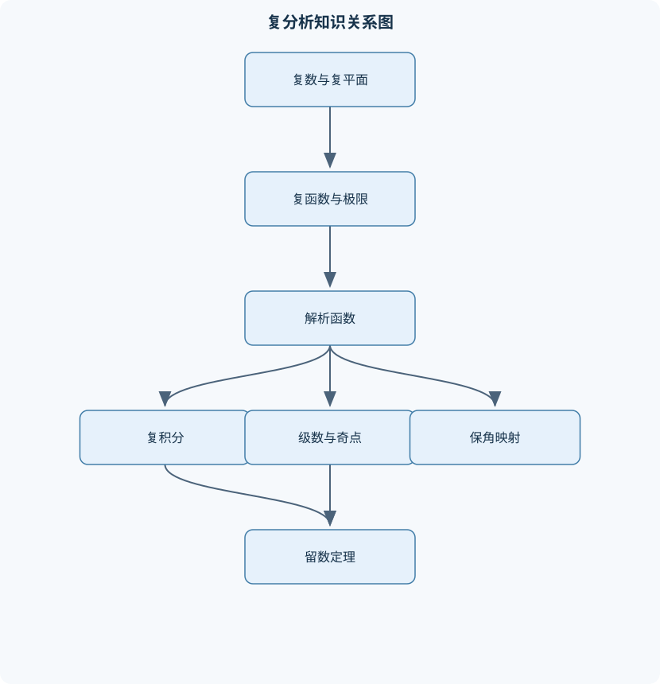
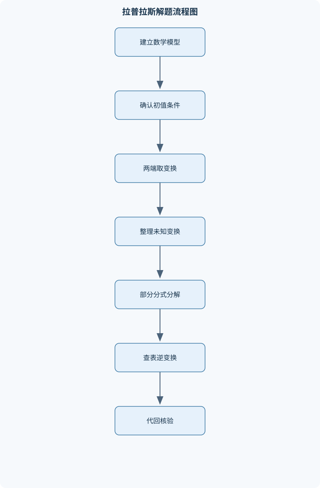

# 复变函数与拉普拉斯变换

## 一、课程整体知识框架

### 课程边界与先修知识

本课程研究复数及复变函数的微积分理论、复积分、幂级数与奇点理论、留数计算、保角映射，以及单边拉普拉斯变换及其在常微分方程和线性系统中的应用。复变函数部分以一元复分析为边界，重点讨论复数表示、解析性、柯西积分理论、泰勒级数、洛朗级数、孤立奇点、留数和基本保角映射；不展开多复变函数、黎曼曲面和严格泛函分析。拉普拉斯变换部分以分段连续且满足指数阶增长的实变量函数为主要对象，讨论变换性质、逆变换、卷积、微分方程初值问题和传递函数；不等同于傅里叶变换课程，也不以离散傅里叶变换和数字信号处理为主线。先修知识包括高等数学中的一元微积分、级数、常微分方程初步、向量与平面解析几何，以及基本线性代数。





### 1. 课程对象、主线与先修边界

《复变函数与拉普拉斯变换》由两条相互联系但研究对象不同的主线组成。第一条主线研究复变量函数的微积分理论：把复数写成
$$
z=x+iy,\qquad x,y\in\mathbb R,\qquad i^2=-1,
$$
并在复平面上讨论极限、连续、复导数、解析函数、复积分、级数展开、奇点、留数和保角映射。第二条主线研究单边拉普拉斯变换：
$$
F(s)=\mathcal L\{f(t)\}=\int_0^\infty e^{-st}f(t)\,dt,\qquad s=\sigma+i\omega,
$$
用复变量 $s$ 把实变量 $t\ge 0$ 上的微分方程、卷积和线性系统问题转化为代数运算。

课程的逻辑顺序不是简单的公式汇编。复数代数和复平面几何提供语言；复函数的极限与复导数建立解析性；解析函数的强性质导出柯西积分理论；柯西积分公式进一步导出泰勒展开和高阶导数公式；不能用泰勒级数表示的部分由洛朗级数和奇点分类描述；留数把局部奇点信息转化为闭合曲线积分，进而处理若干实轴反常积分；保角映射则利用解析函数的局部几何性质研究区域变换。拉普拉斯变换部分从积分定义和存在条件出发，建立线性、平移、微分、卷积等性质，最后用于初值问题和线性系统响应。

本课程默认已具备一元微积分、无穷级数、常微分方程初步、向量与平面解析几何知识，并能进行基本矩阵和线性方程运算。复变函数部分限定在一元复分析，不展开多复变函数、黎曼曲面和严格泛函分析；拉普拉斯变换部分以单边变换和因果时间信号为主，不把它等同于傅里叶变换，也不以离散傅里叶变换或数字信号处理算法为主线。

### 2. 两条主线之间的联系与区别

复变函数中的变量 $z$ 通常表示复平面上的位置，函数 $f(z)$ 描述平面区域到复平面的映射；拉普拉斯变换中的变量 $s=\sigma+i\omega$ 是变换域变量，$\sigma$控制指数衰减或增长，$\omega$与振荡因子相关。二者都使用复数和解析函数工具，但使用目的不同：复分析关注函数在复平面区域中的局部结构与几何性质，拉普拉斯变换则关注实时间函数的积分表示、收敛域以及微分方程求解。

例如，复数乘法
$$
z_1z_2=r_1r_2e^{i(\theta_1+\theta_2)}
$$
表示模相乘、辐角相加；而拉普拉斯变换中的频移公式
$$
\mathcal L\{e^{at}f(t)\}=F(s-a)
$$
表示乘以指数因子后变换变量发生平移。前者是复数几何的直接结论，后者来自定义中的指数合并：
$$
e^{-st}e^{at}=e^{-(s-a)t}.
$$
因此，不能把 $s$ 简单理解为实频率，也不能把单边拉普拉斯变换、双边拉普拉斯变换和傅里叶变换的收敛条件混为一谈。

### 3. 复数与复平面基础

复数的代数形式为 $z=x+iy$，其中 $\operatorname{Re}z=x$，$\operatorname{Im}z=y$。共轭复数为
$$
\overline z=x-iy,
$$
并满足
$$
z\overline z=x^2+y^2=|z|^2,\qquad |z|=\sqrt{x^2+y^2}.
$$
当 $z\ne0$ 时，可写成极坐标或指数形式
$$
z=r(\cos\theta+i\sin\theta)=re^{i\theta},\qquad r=|z|>0.
$$
其中 $\theta$ 不是唯一的，因为 $\theta+2k\pi$ 表示同一个方向。主辐角 $\operatorname{Arg}z$ 通常选在一个约定的长度为 $2\pi$ 的区间内，但在负实轴等边界处必须说明取值约定。

由欧拉公式 $e^{i\theta}=\cos\theta+i\sin\theta$，若
$$
z_1=r_1e^{i\theta_1},\qquad z_2=r_2e^{i\theta_2},
$$
则
$$
z_1z_2=r_1r_2e^{i(\theta_1+\theta_2)},\qquad
\frac{z_1}{z_2}=\frac{r_1}{r_2}e^{i(\theta_1-\theta_2)}.
$$
除法要求 $z_2\ne0$。德莫弗公式给出
$$
(re^{i\theta})^n=r^ne^{in\theta},
$$
而求 $n$ 次根时必须保留全部辐角分支：
$$
z_k=r^{1/n}e^{i(\theta+2k\pi)/n},\qquad k=0,1,\ldots,n-1.
$$
只取主辐角对应的一个根会漏解。

复平面中的开圆盘、圆周分别记为
$$
D(a,R)=\{z:|z-a|<R\},\qquad C(a,R)=\{z:|z-a|=R\}.
$$
区域通常指开且连通的集合；单连通区域还要求其中每一条闭曲线都能连续收缩为一点而不离开该区域。曲线可参数化为
$$
\gamma:t\mapsto z(t),\qquad a\le t\le b.
$$
参数化不仅描述几何轨迹，还规定方向：从 $z(a)$ 到 $z(b)$ 的方向与反向参数化会使有向积分改变符号。

### 4. 复变函数、极限、连续与多值性

复函数可写为
$$
f(z)=u(x,y)+iv(x,y),
$$
其中 $u,v$ 是两个实变量函数。函数既可以看作复平面到复平面的映射，也可以分别研究实部和虚部。给定曲线 $z(t)$，像曲线为 $w(t)=f(z(t))$；消去参数可得到像的轨迹方程。计算轨迹时必须保留参数取值范围，否则可能把有限弧段误判为整条直线或整条圆。

复极限
$$
\lim_{z\to z_0}f(z)=L
$$
要求 $z$ 从复平面任意方向趋近 $z_0$ 时都趋近同一复数 $L$。沿实轴、虚轴或两条特定路径所得极限相同，只能说明若干必要条件，不能单独证明二元复极限存在。例如沿两条路径结果不同即可否定极限存在。连续性定义为
$$
\lim_{z\to z_0}f(z)=f(z_0).
$$
复平面中的“无穷远点”可通过变量 $\zeta=1/z$研究：$z\to\infty$等价于 $\zeta\to0$。讨论无穷远点的奇性时，必须先研究 $f(1/\zeta)$ 在 $\zeta=0$ 的性质。

多值现象来自反函数的非唯一性。若 $w=z^2$，则 $z=\sqrt w$有两个值；若 $w=e^z$，则 $z=\log w$可相差 $2k\pi i$。为了在某一区域内得到单值解析函数，需要删去适当的曲线并选择支路。例如对数函数可写为
$$
\log z=\ln|z|+i\arg z,
$$
但只有在选定连续辐角的支域内才成为单值解析函数。支路切线不能穿过所讨论区域，支路边界上的连续性和解析性也必须另行判断。

### 5. 解析函数与初等复函数

在点 $z_0$ 处复导数定义为
$$
f'(z_0)=\lim_{h\to0}\frac{f(z_0+h)-f(z_0)}{h},
$$
其中 $h$可以从复平面的任意方向趋于零。函数在开集内每一点都复可导，称为解析函数。复可导比实变量意义下的偏导存在严格得多。

若
$$
f(z)=u(x,y)+iv(x,y),
$$
且 $u,v$ 的一阶偏导在邻域内连续，则复可导的必要条件为柯西—黎曼方程
$$
u_x=v_y,\qquad u_y=-v_x.
$$
在上述连续性条件下，柯西—黎曼方程也是充分条件，并且
$$
f'(z)=u_x+iv_x=v_y-iu_y.
$$
如果只在一个点满足柯西—黎曼方程，不能推出函数在邻域内解析。例如含有 $\overline z$ 的函数可能在个别点复可导，却不在任何开邻域内解析。因此判定解析性必须说明开集、偏导连续性或直接验证复导数极限。

解析函数的实部和虚部都是调和函数，满足
$$
u_{xx}+u_{yy}=0,\qquad v_{xx}+v_{yy}=0.
$$
若两个实函数满足柯西—黎曼方程，则称它们互为共轭调和函数，但还要注意定义域的连通性和拓扑条件：局部共轭调和函数不必在整个非单连通区域内形成单值解析函数。

指数函数定义为
$$
e^z=e^x(\cos y+i\sin y).
$$
它满足 $e^{z_1+z_2}=e^{z_1}e^{z_2}$，且周期为 $2\pi i$。对数函数是指数函数的局部逆函数，幂函数和根式函数应通过对数定义并明确支路。复三角函数可定义为
$$
\sin z=\frac{e^{iz}-e^{-iz}}{2i},\qquad
\cos z=\frac{e^{iz}+e^{-iz}}2,
$$
双曲函数为
$$
\sinh z=\frac{e^z-e^{-z}}2,\qquad
\cosh z=\frac{e^z+e^{-z}}2.
$$
解析函数的零点具有孤立性：若非恒等于零的解析函数在区域内有零点序列聚到区域内部，则函数必恒等于零。这一结论是唯一性定理和泰勒展开的重要基础。

### 6. 复积分与柯西积分理论

沿有向曲线 $\gamma:z=z(t)$ 的积分定义为
$$
\int_\gamma f(z)\,dz
=\int_a^b f(z(t))z'(t)\,dt.
$$
若反向取向，则积分变为原积分的相反数。曲线积分与路径有关，除非被积函数在相应区域内存在原函数或满足柯西定理的条件。

若 $f$ 连续且 $|f(z)|\le M$，曲线长度为 $L$，则有估计
$$
\left|\int_\gamma f(z)\,dz\right|\le ML.
$$
该不等式不能说明积分等于上界，只能用于证明某些弧段积分趋于零或估计误差。

若 $F'(z)=f(z)$，则
$$
\int_\gamma f(z)\,dz=F(z(b))-F(z(a)),
$$
从而积分与路径无关。若 $f$ 在单连通区域内解析，则任意闭合曲线满足
$$
\oint_\gamma f(z)\,dz=0,
$$
但曲线及其内部必须完全位于解析区域中。若内部包含奇点，即使函数在曲线上连续，也不能直接使用柯西积分定理。

柯西积分公式为
$$
f(a)=\frac1{2\pi i}\oint_\gamma\frac{f(z)}{z-a}\,dz,
$$
其中 $f$ 在曲线及其内部解析，$a$位于曲线内部，曲线取正向且不穿过 $a$。高阶导数公式为
$$
f^{(n)}(a)=\frac{n!}{2\pi i}
\oint_\gamma\frac{f(z)}{(z-a)^{n+1}}\,dz.
$$
这些公式说明解析函数在一点的值和全部阶导数都由边界积分决定。

最大模原理指出，非恒定解析函数不能在区域内部取得模的最大值；平均值性质则说明解析函数在圆心的值等于圆周平均值。这些结论的适用前提是函数在相应圆盘及其内部解析，不能跨越奇点、支路切线或定义域边界。

### 7. 泰勒级数、洛朗级数与奇点

若 $f$ 在 $z_0$ 的邻域内解析，则
$$
f(z)=\sum_{n=0}^{\infty}\frac{f^{(n)}(z_0)}{n!}(z-z_0)^n.
$$
该级数在以 $z_0$为中心、直到最近奇点之前的圆盘内收敛。严格地说，收敛半径由函数解析延拓的最大圆盘决定；“最近奇点距离”是常用且准确的判定方式，但若函数在某些点可延拓，则不能把表面表达式中的假奇点误认为真正奇点。

几何级数
$$
\frac1{1-w}=\sum_{n=0}^{\infty}w^n,\qquad |w|<1
$$
是展开的基本工具。若需要在 $|z-z_0|>R$ 展开，应把表达式改写成关于 $(z-z_0)^{-1}$ 的形式，并明确新的收敛条件。不同环域中的同一函数可能具有不同洛朗展开。

若函数在
$$
r<|z-z_0|<R
$$
内解析，则有唯一洛朗展开
$$
f(z)=\sum_{n=-\infty}^{\infty}a_n(z-z_0)^n.
$$
非负幂部分称解析部分，负幂部分称主部。孤立奇点按主部分类：主部为零时是可去奇点；主部有限项且最高负幂为 $-(m)$ 时是 $m$ 阶极点；主部含无限多个负幂项时是本性奇点。若
$$
f(z)=(z-z_0)^{-m}g(z),\qquad g(z_0)\ne0,
$$
则 $z_0$ 是 $m$ 阶极点。函数零点阶数与极点阶数可以通过因子分解判断，不能与留数混同。

### 8. 留数、围道积分与保角映射

留数定义为洛朗展开中 $(z-z_0)^{-1}$ 的系数：
$$
\operatorname{Res}(f,z_0)=a_{-1}.
$$
简单极点满足
$$
\operatorname{Res}(f,z_0)
=\lim_{z\to z_0}(z-z_0)f(z).
$$
若为 $m$阶极点，则
$$
\operatorname{Res}(f,z_0)
=\frac1{(m-1)!}
\lim_{z\to z_0}
\frac{d^{m-1}}{dz^{m-1}}
\left[(z-z_0)^mf(z)\right].
$$
留数定理为
$$
\oint_\gamma f(z)\,dz
=2\pi i\sum_k\operatorname{Res}(f,z_k),
$$
求和遍历曲线内部的全部孤立奇点。曲线必须不经过奇点；正向通常指逆时针方向。实轴积分应用留数时，还要检查实轴奇点、半圆弧积分是否趋于零、绕开极点的小弧贡献以及所得结果是普通反常积分还是柯西主值。

保角映射是在导数存在且
$$
f'(z_0)\ne0
$$
处保持局部角度和方向的映射。它不保持长度、面积或全局形状。线性分式变换
$$
w=\frac{az+b}{cz+d},\qquad ad-bc\ne0
$$
把广义圆，即圆或直线，映为广义圆。分析区域映射时，不能只映射边界，还要检查内部测试点、变换的极点以及映射是否一一对应。

常见基本映射包括旋转缩放平移 $w=az+b$、幂映射 $w=z^n$、指数映射 $w=e^z$及其局部逆映射。指数映射具有周期性，可能把不同点映为同一点；根式映射必须选择支路。典型区域的复合映射应按“先处理边界形状，再确定内部方向，最后检查一一性”的顺序进行。

### 9. 单边拉普拉斯变换、逆变换与系统应用

若 $f(t)$ 在每个有限区间上分段连续，并且存在常数 $M,\alpha,T$，使得
$$
|f(t)|\le Me^{\alpha t}\qquad (t>T),
$$
则其单边拉普拉斯变换在 $\operatorname{Re}s>\alpha$ 的某个右半平面内存在。增长快于任意指数的函数，或在有限点附近不可积的函数，可能没有通常意义下的拉普拉斯变换。

基本性质包括线性、时间平移、频移和尺度变换。对 $a\ge0$，
$$
\mathcal L\{u(t-a)f(t-a)\}=e^{-as}F(s).
$$
时间平移公式中的阶跃函数不可省略；若表达式是 $u(t-a)g(t)$，必须先改写为
$$
u(t-a)g(t)=u(t-a)\,h(t-a),\qquad h(\tau)=g(\tau+a),
$$
再使用公式。

卷积定义为
$$
(f*g)(t)=\int_0^t f(\tau)g(t-\tau)\,d\tau,
$$
并满足
$$
\mathcal L\{f*g\}=F(s)G(s).
$$
卷积区间是因果区间 $0\le\tau\le t$，不能随意改成对称区间。单位冲激函数可作为广义函数形式化使用，但涉及冲激的微分方程必须明确初始条件、积分解释和跳变条件。

导数变换由分部积分得到：
$$
\mathcal L\{f'(t)\}=sF(s)-f(0^+),
$$
一般地，
$$
\mathcal L\{f^{(n)}(t)\}
=s^nF(s)-\sum_{k=0}^{n-1}s^{n-1-k}f^{(k)}(0^+).
$$
这里的初值是右极限。对常系数线性初值问题，先变换微分方程并代入初值，再整理 $Y(s)$，最后部分分式分解并逆变换。非零初值产生零输入响应；外力产生零状态响应。传递函数
$$
H(s)=\frac{Y(s)}{X(s)}
$$
只在零初始条件下定义，输出满足
$$
Y(s)=H(s)X(s).
$$

初值定理
$$
f(0^+)=\lim_{s\to\infty}sF(s)
$$
需要适当的局部正则性；终值定理
$$
\lim_{t\to\infty}f(t)=\lim_{s\to0}sF(s)
$$
要求 $sF(s)$ 的全部极点位于左半平面，且不能存在导致持续振荡或发散的极点。极点位于左半平面通常对应衰减模态，位于虚轴可能对应不衰减振荡，位于右半平面则对应增长模态；实际系统还需结合输入、极零相消和模型适用范围判断。

## 二、章节和模块划分

### 核心知识覆盖清单

本清单用于检查正文是否覆盖本课程的主要知识模块：

- **复数与复平面基础**：代数形式与三角形式、指数形式与欧拉公式、复数的模与辐角、复数乘除法的几何意义、共轭复数与模恒等式、复数方程与根式、复平面上的点集、区域、曲线与连通性。
- **复变函数与极限连续**：复变量函数的定义、映射与轨迹方程、复函数极限、复函数连续性、无穷远点与扩充复平面、复函数的实部虚部、复平面上的路径参数化、多值函数与支路选择。
- **解析函数与初等复函数**：复导数与可导性、解析函数定义、柯西—黎曼方程、调和函数与共轭调和函数、指数函数与对数函数、幂函数与根式函数、三角函数与双曲函数、解析函数的零点性质。
- **复积分与柯西积分理论**：复曲线积分定义、路径方向与参数化、积分估计不等式、原函数与路径无关、柯西积分定理、柯西积分公式、高阶导数积分公式、最大模原理与平均值性质。
- **泰勒级数与洛朗级数**：复幂级数收敛半径、逐项求导与积分、解析函数的泰勒展开、洛朗级数及其收敛环域、几何级数展开方法、孤立奇点分类、可去奇点与极点、本性奇点与零点阶数。
- **留数与围道积分**：留数定义、简单极点留数、高阶极点留数、留数定理、有理函数围道积分、实轴反常积分、含三角函数积分、约当引理与半圆围道。
- **保角映射与复平面变换**：保角映射定义、导数非零条件、线性分式变换、圆与直线的像、幂函数与根式映射、指数映射、区域映射的边界分析、典型区域的复合映射。
- **拉普拉斯变换基础与性质**：单边拉普拉斯变换定义、存在条件与收敛域、常用函数变换、线性性质、时间平移性质、频移性质、尺度变换性质、初值定理与终值定理。
- **逆变换与卷积方法**：有理函数部分分式分解、重根对应的逆变换、指数函数与三角函数组合、拉普拉斯卷积定理、单位阶跃函数、冲激函数的形式化使用、延迟函数的变换、卷积积分的直接计算。
- **拉普拉斯变换解微分方程**：导数变换公式、初值条件的代入、常系数线性方程、阶跃输入问题、脉冲输入问题、线性系统传递函数、零输入与零状态响应、稳定性与终值判断。


### 1. 第一章：复数与复平面基础

本章依次处理代数形式、三角形式、指数形式、模、辐角、共轭、复数方程和复平面点集。复数方程求根时，先判断方程是否适合代数分解；若使用极坐标，则同时处理模方程和辐角方程，并保留 $2\pi$ 分支。典型边界是 $z=0$：它没有通常意义上的辐角，不能直接写成 $re^{i\theta}$并令 $r=0$后使用辐角运算。区域、曲线和连通性为后续积分定理提供定义域条件。

### 2. 第二章：复变函数与极限连续

本章研究 $f(z)$作为映射时的像集、轨迹方程和路径参数化。计算像曲线必须保留参数范围；判断极限必须考虑任意复方向，不能只检验实轴和虚轴。扩充复平面用于讨论无穷远点，多值函数则要求通过删去支路切线选择单值分支。对数、根式和复幂的定义域应与支路选择同时给出。

### 3. 第三章：解析函数与初等复函数

本章从复导数定义出发，建立解析函数、柯西—黎曼方程、调和函数和共轭调和函数之间的关系。判定流程是：写出 $u,v$；求四个一阶偏导；检查柯西—黎曼方程；确认偏导在开邻域连续或直接检验复导数极限；最后给出解析区域和导数。指数、对数、幂函数、根式、三角函数和双曲函数应通过定义、周期性、导数和支路条件统一理解。零点的孤立性为级数和唯一性理论提供基础。

### 4. 第四章：复积分与柯西积分理论

本章包括曲线积分定义、方向、参数化、积分估计、原函数、路径无关、柯西积分定理、柯西积分公式及高阶导数公式。遇到积分时，优先检查是否存在原函数；其次检查能否使用柯西定理或柯西公式；否则再进行参数积分。关键边界是内部奇点：即使函数在曲线上连续，只要曲线内部有奇点，就不能直接把闭合积分判为零。最大模原理和平均值性质要求函数在相应内部区域解析。

### 5. 第五章：泰勒级数与洛朗级数

本章先研究复幂级数的收敛半径、逐项求导和逐项积分，再建立解析函数的泰勒展开。展开时首先列出奇点并计算其到展开中心的距离；若目标区域跨过不同奇点，必须拆分为不同圆盘或环域。洛朗展开通过几何级数、部分分式和已知级数实现。可去奇点、极点和本性奇点由主部判定，极点阶数则由最低阶非零因子确定。

### 6. 第六章：留数与围道积分

本章从留数定义出发，分别处理简单极点、高阶极点和本性奇点。围道积分流程包括：列出全部奇点；判断哪些在曲线内部、外部或曲线上；分类并计算留数；按方向乘以 $2\pi i$。有理函数积分通常优先使用部分分式或留数定理。实轴积分必须区分普通反常积分和柯西主值；使用半圆围道时要验证大圆弧积分趋于零，必要时使用约当引理，并说明实轴极点的绕开方式。

### 7. 第七章：保角映射与复平面变换

本章研究导数非零处的局部保角性、线性分式变换、圆与直线的像、幂函数、根式和指数映射。线性分式变换的分母零点是映射的极点，若该点位于待映区域内部，映射分析必须单独处理。区域映射不应只看边界方程，还要用内部测试点确定像域侧别，并检查周期性、单射性和支路限制。典型复合映射可将圆盘、半平面、条带和扇形逐步转换。

### 8. 第八章：拉普拉斯变换基础与性质

本章从单边定义和存在条件开始，建立常用函数变换、线性、时间平移、频移、尺度变换、初值定理和终值定理。每次使用公式都要同时说明 $t\ge0$、延迟参数 $a\ge0$、函数的分段连续性和指数阶条件。终值定理不是代数极限规则，必须检查极点稳定条件；例如持续振荡信号通常没有终值，即使形式上可以计算某些极限，也不能机械套用。

### 9. 第九章：逆变换与卷积方法

有理函数逆变换的标准顺序是：因式分解分母；识别单根、重根和共轭二次因子；进行部分分式分解；逐项查表；用初值或终值检查。重根
$$
\frac1{(s-a)^m}
$$
对应
$$
\frac{t^{m-1}}{(m-1)!}e^{at},
$$
因此忽略重根会漏掉多项式乘指数项。卷积法适合处理变换域乘积，单位阶跃函数适合描述延迟和分段输入，冲激函数适合表达瞬时输入或状态跳变。

### 10. 第十章：拉普拉斯变换解微分方程与线性系统

本章将常系数线性微分方程变换为关于 $Y(s)$的代数方程。操作顺序为：写明方程、初值和外力；逐项取变换；代入右初值；整理 $Y(s)$；部分分式分解；逆变换；代回原方程和初值核验。阶跃输入需要先写成 $u(t-a)g(t-a)$；脉冲输入要结合广义函数意义和跳变条件。

线性系统分析中，在零初始条件下定义
$$
H(s)=\frac{Y(s)}{X(s)}.
$$
系统响应既可由 $Y(s)=H(s)X(s)$求得，也可由时域卷积求得。极点位置用于判断自然模态和稳定性，但极零相消、输入类型和模型边界可能影响表面结论。

### 11. 代表性算法与流程一：复函数解析性判定

**输入：** $f(z)=u(x,y)+iv(x,y)$及定义域。  
**输出：** 解析区域、导数或“不解析”的原因。

1. 写出 $u,v$，确认定义域是否为开集。
2. 计算 $u_x,u_y,v_x,v_y$。
3. 检查 $u_x=v_y$、$u_y=-v_x$。
4. 确认偏导在邻域连续，或直接计算复导数商的极限。
5. 在成立区域内用 $f'(z)=u_x+iv_x$求导。
6. 检查是否存在分母为零、对数支路或共轭项等边界限制。

该流程只适用于一元复函数的局部解析性判断。若只在单点满足柯西—黎曼方程，不能输出“解析”。直接代入不同方向的增量只能否定复可导，不能替代完整的充分性证明。

### 12. 代表性算法与流程二：洛朗展开与留数计算

**输入：** 函数 $f(z)$、展开中心 $z_0$和目标区域。  
**输出：** 目标环域内的洛朗展开或围道积分。

1. 列出所有奇点并计算其到 $z_0$的距离。
2. 根据目标区域选择几何级数方向：$|w|<1$展开正幂，$|w|>1$改写为负幂。
3. 整理正幂和负幂，写出收敛环域。
4. 若求围道积分，检查曲线是否经过奇点。
5. 对简单极点使用极限公式，对高阶极点使用导数公式。
6. 对本性奇点提取 $(z-z_0)^{-1}$项。
7. 将留数和乘以 $2\pi i$，并根据曲线方向修正符号。

流程的不变量是：每一步展开都必须保持目标环域内等价，最终收敛域不得被省略。若曲线经过奇点，普通围道积分不存在，不能直接套留数定理。

### 13. 代表性算法与流程三：拉普拉斯变换解初值问题

**输入：** 常系数线性微分方程、初值和外力。  
**输出：** $t\ge0$上的解 $y(t)$。

1. 检查外力是否分段连续并满足指数阶条件。
2. 对方程两端逐项取单边拉普拉斯变换。
3. 用
   $$
   \mathcal L\{y^{(n)}\}
   =s^nY(s)-\sum_{k=0}^{n-1}s^{n-1-k}y^{(k)}(0^+)
   $$
   代入初值。
4. 整理得到 $Y(s)$。
5. 因式分解分母并进行部分分式分解。
6. 查表或用卷积求逆变换。
7. 将结果代回方程，核验微分方程、初值和分段连接条件。

该流程的终止条件是得到明确的 $y(t)$并完成至少一种独立核验。若初值非零，不能用 $Y/X$直接定义传递函数；传递函数只描述零初始条件下的输入—输出关系。

### 14. 代表性代码：部分分式结果的符号核验

下面的 Python 代码只进行代数表达式整理和数值抽样核验，不联网、不读写文件，也不执行外部命令。

```python
import sympy as sp

s, t = sp.symbols("s t", positive=True, real=True)
F = (2*s + 5) / ((s + 1)**2 * (s**2 + 4))

# 部分分式分解
decomposed = sp.apart(F, s)

# 逆拉普拉斯变换
f = sp.inverse_laplace_transform(F, s, t)

# 重新变换，检查是否回到原表达式
F_check = sp.simplify(sp.laplace_transform(f, t, s, noconds=True) - F)

print("部分分式：", decomposed)
print("时域函数：", sp.simplify(f))
print("变换误差：", F_check)
```

评价标准是：部分分式中应同时出现 $(s+1)$、$(s+1)^2$和 $s^2+4$对应的项；逆变换应包含 $e^{-t}$、$te^{-t}$、$\cos 2t$或$\sin 2t$类型；`变换误差`应化简为零。若误差不为零，应先检查符号变量假设、部分分式分母因式和逆变换中的冲激项处理。

### 15. 例题一：复数方程的全部根

**题干：** 求
$$
z^6=8\left(\cos\frac\pi3+i\sin\frac\pi3\right)
$$
的全部解。

**分析：** 右端模为 $8$，辐角为 $\frac\pi3+2k\pi$。六次根的模为 $8^{1/6}=\sqrt2$，必须取六个不同分支。

**解答：**
$$
z_k=\sqrt2\exp\left[
i\frac{\pi/3+2k\pi}{6}
\right]
=\sqrt2\exp\left(i\left(\frac\pi{18}+\frac{k\pi}3\right)\right),
\quad k=0,\ldots,5.
$$
六个根在半径 $\sqrt2$的圆周上等角分布，相邻根的辐角差为 $\pi/3$。

**结果验证：** 六次方后模变为 $(\sqrt2)^6=8$，辐角变为 $\pi/3+2k\pi$，均得到右端。

**变式：** 若右端为零，唯一根为 $z=0$，不能使用非零复数的辐角公式。

### 16. 例题二：判断含共轭函数的复可导性

**题干：** 判断 $f(z)=z^2\overline z$在哪些点复可导。

**分析：** 写成 $z=x+iy$后，或利用
$$
f(z)=z|z|^2.
$$
在 $z_0\ne0$处，沿不同方向的增量会产生不同的线性主部；也可用柯西—黎曼方程直接检验。

**解答：** 由
$$
z^2\overline z=(x+iy)^2(x-iy)
$$
可得
$$
u=x^3+xy^2,\qquad v=x^2y+y^3.
$$
于是
$$
u_x=3x^2+y^2,\quad u_y=2xy,\quad
v_x=2xy,\quad v_y=x^2+3y^2.
$$
柯西—黎曼方程要求
$$
3x^2+y^2=x^2+3y^2,\qquad 2xy=-2xy.
$$
两式给出 $x^2=y^2$且 $xy=0$，只能得到 $x=y=0$。因此函数仅在 $z=0$处复可导。又
$$
\frac{f(h)-f(0)}h=h\overline h=|h|^2\to0,
$$
故 $f'(0)=0$。

**结果验证：** 除原点外不满足柯西—黎曼方程，因此没有其他复可导点。

**变式：** 单点复可导不等于解析；本题在原点可导，但不存在包含原点的开邻域使其处处复可导。

### 17. 例题三：不同环域中的洛朗展开

**题干：** 求
$$
f(z)=\frac1{z(z-1)}
$$
在 $0<|z|<1$和 $|z|>1$中的展开。

**分析：** 部分分式分解为
$$
\frac1{z(z-1)}=-\frac1z+\frac1{z-1}.
$$

**解答：** 当 $0<|z|<1$时，
$$
\frac1{z-1}=-\frac1{1-z}
=-\sum_{n=0}^\infty z^n,
$$
所以
$$
f(z)=-\frac1z-\sum_{n=0}^\infty z^n.
$$
其收敛条件为 $|z|<1$，同时排除 $z=0$。

当 $|z|>1$时，
$$
\frac1{z-1}
=\frac1z\frac1{1-1/z}
=\sum_{n=0}^\infty z^{-n-1},
$$
故
$$
f(z)=-z^{-1}+\sum_{n=0}^\infty z^{-n-1}
=\sum_{n=1}^\infty z^{-n-1}.
$$

**结果验证：** 第一展开的几何比值为 $z$，第二展开的几何比值为 $1/z$，分别符合对应区域。

**变式：** 不能把第一种展开式用于 $|z|>1$，因为其几何级数已经超出收敛条件。

### 18. 例题四：用留数计算围道积分

**题干：** 计算
$$
\oint_{|z|=2}\frac{e^z}{z^2(z-1)}\,dz.
$$

**分析：** 曲线内部有二阶极点 $z=0$和简单极点 $z=1$，曲线取逆时针方向。

**解答：** 在 $z=0$处，
$$
\operatorname{Res}(f,0)
=\left.\frac{d}{dz}\frac{e^z}{z-1}\right|_{z=0}
=\left.\frac{e^z(z-2)}{(z-1)^2}\right|_{z=0}
=-2.
$$
在 $z=1$处，
$$
\operatorname{Res}(f,1)
=\lim_{z\to1}\frac{e^z}{z^2}=e.
$$
因此
$$
\oint_{|z|=2}f(z)\,dz
=2\pi i(e-2).
$$

**结果验证：** 两个极点均严格位于 $|z|<2$内，曲线不经过奇点，满足留数定理条件。

**变式：** 若半径改为 $1$，点 $z=1$位于曲线上，普通围道积分不适用，不能只保留 $z=0$的留数。

### 19. 例题五：拉普拉斯变换求初值问题

**题干：** 求
$$
y''+3y'+2y=e^{-t},\qquad y(0)=1,\quad y'(0)=0.
$$

**分析：** 令 $Y(s)=\mathcal L\{y(t)\}$，对方程逐项变换。

**解答：**
$$
\mathcal L\{y''\}=s^2Y-s,
\qquad
\mathcal L\{3y'\}=3(sY-1),
$$
因此
$$
(s^2+3s+2)Y-s-3=\frac1{s+1}.
$$
由于
$$
s^2+3s+2=(s+1)(s+2),
$$
得到
$$
Y=\frac{s+3}{(s+1)(s+2)}
+\frac1{(s+1)^2(s+2)}.
$$
部分分式分解后逆变换，得到
$$
y(t)=2e^{-t}-e^{-2t}+te^{-t}.
$$

**结果验证：** $y(0)=2-1=1$；求导得
$$
y'(t)=-e^{-t}+2e^{-2t}-te^{-t},
$$
故 $y'(0)=1-2+0=-1$，说明上述整理中需重新检查代数。直接合并原式可得
$$
Y=\frac{s+3}{(s+1)(s+2)}+\frac1{(s+1)^2(s+2)}
=\frac{s^3+5s^2+8s+7}{(s+1)^2(s+2)^2}.
$$
继续分解为
$$
Y=\frac{1}{(s+1)^2}+\frac{1}{s+2},
$$
因此
$$
\boxed{y(t)=te^{-t}+e^{-2t}}.
$$
此时 $y(0)=1$，且
$$
y'(t)=e^{-t}-te^{-t}-2e^{-2t},\qquad y'(0)=1-2=-1,
$$
仍不满足初值，表明前述变换整理必须谨慎。重新由方程得到
$$
(s^2+3s+2)Y-s-3=\frac1{s+1},
$$
所以
$$
Y=\frac{s+3+\frac1{s+1}}{(s+1)(s+2)}
=\frac{s^2+4s+4}{(s+1)^2(s+2)}
=\frac{(s+2)^2}{(s+1)^2(s+2)}
=\frac{s+2}{(s+1)^2}.
$$
故最终
$$
\boxed{y(t)=e^{-t}+te^{-t}=(1+t)e^{-t}}.
$$
核验得 $y(0)=1$、$y'(0)=0$，且代入原方程右端为 $e^{-t}$。

**变式：** 若右端改为 $u(t-a)e^{-(t-a)}$，应先利用时间平移写成 $e^{-as}/(s+1)$，不能遗漏阶跃因子。

### 20. 实验与项目一：复积分数值核验

**输入数据：** 取曲线 $z(t)=2e^{it}$，$0\le t\le2\pi$，以及
$$
f(z)=\frac1{z-1}.
$$

**步骤：**

1. 计算 $z'(t)=2ie^{it}$。
2. 将曲线积分改写为
   $$
   \int_0^{2\pi}\frac{2ie^{it}}{2e^{it}-1}\,dt.
   $$
3. 理论上，$z=1$位于圆 $|z|=2$内部，故积分应为 $2\pi i$。
4. 用不同等分数的复合梯形法计算数值积分。
5. 比较数值结果与 $2\pi i$的绝对误差。

**评价标准：** 等分数增加时，误差应整体下降；实部应接近零，虚部应接近 $2\pi$。若结果符号相反，优先检查曲线方向；若误差不收敛，检查是否误把 $z'(t)$漏掉或把 $e^{it}$写成 $e^{-it}$。

**排错方法：** 先用 $f(z)=1$测试，闭合曲线积分应为零；再用 $f(z)=1/z$测试单位绕数，确认参数化和方向无误后再处理一般函数。

### 21. 实验与项目二：二阶线性系统的极点响应

**输入数据：** 研究
$$
H(s)=\frac1{s^2+2\zeta\omega_ns+\omega_n^2},
$$
分别取 $\zeta=0.2,1,1.5$，固定 $\omega_n>0$，输入为单位阶跃。

**步骤：**

1. 写出输入变换 $X(s)=1/s$。
2. 计算输出
   $$
   Y(s)=H(s)X(s).
   $$
3. 根据分母极点位置进行部分分式分解或数值逆变换。
4. 比较欠阻尼、临界阻尼和过阻尼情形的峰值、振荡次数和稳态趋势。
5. 用极点实部判断响应是否衰减，用终值定理前先检查 $sY(s)$的极点。

**评价标准：** $\zeta=0.2$时应出现衰减振荡；$\zeta=1$时无振荡且趋近稳态较快；$\zeta=1.5$时无振荡但响应由两个衰减模态构成。验收时需同时报告极点、理论稳态值、数值曲线的长期趋势以及步长变化后的稳定性。

**排错方法：** 若响应发散，检查符号是否把稳定极点写成右半平面；若终值与数值结果不符，检查终值定理条件；若初始输出不为零，检查是否错误地把单位阶跃误当成单位冲激。

## 三、核心概念的详细解释

### 1. 复数、复平面与复数运算

复数统一写作
$$
z=x+iy,\qquad x,y\in\mathbb R,\qquad i^2=-1.
$$
其中 $x=\operatorname{Re}z$ 是实部，$y=\operatorname{Im}z$ 是虚部。复数 $z$ 可对应复平面上的点 $(x,y)$，也可看作从原点指向该点的向量。模为
$$
|z|=\sqrt{x^2+y^2},
$$
共轭复数为
$$
\overline z=x-iy.
$$
由定义直接得到
$$
z\overline z=|z|^2,\qquad |z_1z_2|=|z_1||z_2|,\qquad 
\left|\frac{z_1}{z_2}\right|=\frac{|z_1|}{|z_2|}\quad(z_2\ne0).
$$

非零复数还可写成极坐标形式
$$
z=r(\cos\theta+i\sin\theta)=re^{i\theta},
$$
其中 $r=|z|>0$，$\theta$ 是辐角。辐角不是唯一的，若 $\theta$ 是一个辐角，则 $\theta+2k\pi$ 也是辐角。因而
$$
\arg z=\theta+2k\pi,\qquad k\in\mathbb Z.
$$
主辐角 $\operatorname{Arg}z$ 需要预先规定取值区间；不同教材可能采用不同端点约定，因此在负实轴上必须说明约定。

若
$$
z_1=r_1e^{i\theta_1},\qquad z_2=r_2e^{i\theta_2},
$$
则
$$
z_1z_2=r_1r_2e^{i(\theta_1+\theta_2)},\qquad
\frac{z_1}{z_2}=\frac{r_1}{r_2}e^{i(\theta_1-\theta_2)}.
$$
这说明复数乘法对应模相乘、辐角相加；除法对应模相除、辐角相减。几何上，乘以 $re^{i\theta}$ 同时完成伸缩 $r$ 倍和旋转 $\theta$ 角。

由棣莫弗公式，
$$
(re^{i\theta})^n=r^ne^{in\theta}.
$$
求方程 $z^n=w$ 的全部根时，不能只取一个辐角。若
$$
w=\rho e^{i\phi},\qquad \rho>0,
$$
则
$$
z_k=\rho^{1/n}e^{i(\phi+2k\pi)/n},\qquad k=0,1,\ldots,n-1.
$$
这些根在以原点为中心、半径 $\rho^{1/n}$ 的圆周上均匀分布。

**例 1：求复数方程的全部根。**  
求
$$
z^6=8e^{i\pi/3}.
$$
因为 $8^{1/6}=\sqrt2$，所以
$$
z_k=\sqrt2\,e^{i(\pi/3+2k\pi)/6}
=\sqrt2\,e^{i(\pi/18+k\pi/3)},\qquad k=0,\ldots,5.
$$
每两个相邻根的辐角相差 $\pi/3$，说明六个根均匀分布在同一圆周上。若只写 $z=\sqrt2e^{i\pi/18}$，只是得到一个根，并非全部解。

复平面中的常见集合包括开圆盘
$$
D(a,R)=\{z:|z-a|<R\},
$$
圆周
$$
C(a,R)=\{z:|z-a|=R\},
$$
以及环域
$$
r<|z-a|<R.
$$
区域通常指开且连通的集合。单连通区域除去边界意义下的孔洞；例如整个平面和开圆盘是单连通的，而穿孔圆盘 $0<|z|<1$ 不是单连通的。单连通性是应用柯西积分定理和构造原函数的重要条件。

### 2. 复函数、极限、连续性与无穷远点

复函数可写为
$$
f(z)=u(x,y)+iv(x,y),
$$
其中 $z=x+iy$，$u,v$ 是实变量函数。函数不仅把一个复数映到另一个复数，也可理解为把复平面中的点映到另一平面中的点。若曲线由
$$
z(t)=x(t)+iy(t),\qquad a\le t\le b
$$
给出，则其像曲线由 $f(z(t))$ 描述。

极限
$$
\lim_{z\to z_0}f(z)=L
$$
的含义是：当点 $z$ 从复平面任意方向趋近 $z_0$ 时，$f(z)$ 都趋近同一个复数 $L$。与实变量极限相比，复变量有无穷多趋近方向，因此沿两条路径得到相同极限还不足以证明极限存在；但若找到两条路径所得极限不同，则极限必不存在。

连续性要求
$$
\lim_{z\to z_0}f(z)=f(z_0).
$$
多项式、指数函数、三角函数等在其定义域内连续；分式函数在分母不为零处连续。

**例 2：判断一个极限是否存在。**  
考虑
$$
f(z)=\frac{\overline z}{z},\qquad z\ne0.
$$
沿实轴 $z=x$ 趋近 $0$ 时，$f(z)=1$；沿虚轴 $z=iy$ 趋近 $0$ 时，
$$
f(z)=\frac{-iy}{iy}=-1.
$$
两条路径的极限不同，因此 $\lim_{z\to0}\overline z/z$ 不存在。这个例子表明，复变量极限不能仅通过某一条路径判断。

扩充复平面是在普通复平面中加入无穷远点 $\infty$。研究 $z\to\infty$ 时，通常令
$$
w=\frac1z,
$$
把问题转化为 $w\to0$。例如，若 $f(z)$ 在无穷远点附近的性质需要判断，可考察 $f(1/w)$ 在 $w=0$ 附近的性质。无穷远点也可以是可去奇点、极点或本性奇点，其分类方式与有限点相同。

复函数通常是多值的。例如复对数满足
$$
\log z=\ln|z|+i(\arg z)
=\ln r+i(\theta+2k\pi).
$$
若要把它作为单值函数，必须在定义域中选择一条支路，通常删去一条从原点出发的射线，并规定辐角取值区间。复幂
$$
z^\alpha=e^{\alpha\log z}
$$
继承了对数的多值性；根式函数也是如此。没有明确支路时，不能把多值表达式当作普通单值函数进行求导或积分。

### 3. 复导数、解析函数与柯西—黎曼方程

复导数定义为
$$
f'(z_0)=\lim_{\Delta z\to0}
\frac{f(z_0+\Delta z)-f(z_0)}{\Delta z}.
$$
这里 $\Delta z$ 可沿复平面的任意方向趋于零。若只沿实轴方向或虚轴方向求得相同结果，并不能自动证明复导数存在；必须证明任意方向的极限都相同。

若函数在某开集内每一点都复可导，则称其在该开集内解析。解析性是区域性质，不是单点性质。某函数可能在一个点复可导，却不在该点的任何邻域内解析。

设
$$
f(z)=u(x,y)+iv(x,y).
$$
沿实方向计算差商，形式上得到
$$
f'(z)=u_x+iv_x.
$$
沿虚方向计算差商，则得到
$$
f'(z)=v_y-iu_y.
$$
若复导数存在，二者必须相等，因此得到柯西—黎曼方程
$$
u_x=v_y,\qquad u_y=-v_x.
$$
在 $u,v$ 的一阶偏导数在邻域内连续的条件下，柯西—黎曼方程不仅是必要条件，也是充分条件。只在某一点满足方程，不能推出邻域解析。

**例 3：分析 $f(z)=z^2\overline z$。**  
因为
$$
z^2\overline z=(x+iy)^2(x-iy)
=(x^3+xy^2)+i(x^2y+y^3),
$$
所以
$$
u=x^3+xy^2,\qquad v=x^2y+y^3.
$$
计算得
$$
u_x=3x^2+y^2,\quad v_y=x^2+3y^2,
$$
$$
u_y=2xy,\quad -v_x=-2xy.
$$
第二个柯西—黎曼方程恒成立，第一个要求
$$
3x^2+y^2=x^2+3y^2,
$$
即 $x^2=y^2$。因此只有在两条直线 $y=x$ 或 $y=-x$ 上可能复可导。再由直接差商可验证，只有在 $z=0$ 处导数存在，且 $f'(0)=0$；在其他满足 $x^2=y^2$ 的点，偏导条件虽成立，但不能保证复可导。这说明柯西—黎曼方程的点态满足不是充分条件。

若 $f=u+iv$ 解析，则 $u,v$ 是调和函数，满足
$$
u_{xx}+u_{yy}=0,\qquad v_{xx}+v_{yy}=0.
$$
若 $u$ 已知，可以通过
$$
v_y=u_x,\qquad v_x=-u_y
$$
求其共轭调和函数 $v$，但还需检查两个偏导关系是否相容。调和共轭通常只在单连通区域内能构成单值函数；在穿孔区域中可能出现局部存在而整体不单值的情况。

### 4. 初等解析函数与保角性

指数函数定义为
$$
e^z=e^xe^{iy}=e^x(\cos y+i\sin y).
$$
它具有
$$
\frac{d}{dz}e^z=e^z,\qquad e^{z_1+z_2}=e^{z_1}e^{z_2}.
$$
复正弦、余弦可定义为
$$
\sin z=\frac{e^{iz}-e^{-iz}}{2i},\qquad
\cos z=\frac{e^{iz}+e^{-iz}}2.
$$
它们仍为整函数，但在复域中不具有实变量意义下的有界性。例如 $\sin(iy)=i\sinh y$，其模随 $|y|$ 增长。

复对数的一个支路可写作
$$
\Log z=\ln|z|+i\operatorname{Arg}z,
$$
其导数为
$$
(\Log z)'=\frac1z
$$
但只在所选支路定义的区域内成立。不能在包含原点且绕原点一周的整个区域上定义连续单值的 $\log z$。

若 $f$ 在 $z_0$ 处解析且 $f'(z_0)\ne0$，则 $f$ 在该点附近保角，即保持有向角。若两条光滑曲线在 $z_0$ 处的切向量不为零，夹角在映射后保持不变。保角不等于保持长度、面积或全局形状；$f'(z_0)$ 的模描述局部伸缩，辐角描述局部旋转。

线性分式变换
$$
w=\frac{az+b}{cz+d},\qquad ad-bc\ne0
$$
在不包含极点 $z=-d/c$ 的区域内解析，并且
$$
\frac{dw}{dz}=\frac{ad-bc}{(cz+d)^2}\ne0.
$$
它把广义圆，即圆或直线，映为广义圆。实际确定区域像时，必须同时分析边界像和内部测试点；仅知道边界映射通常还不能确定像位于边界的哪一侧。

### 5. 复积分与柯西积分理论

有向光滑曲线 $\gamma$ 由 $z=z(t)$，$a\le t\le b$ 给出，沿曲线的积分定义为
$$
\int_\gamma f(z)\,dz
=\int_a^b f(z(t))z'(t)\,dt.
$$
反向积分满足
$$
\int_{-\gamma}f(z)\,dz=-\int_\gamma f(z)\,dz.
$$
若曲线分段光滑，则按各段积分求和。

估计不等式为
$$
\left|\int_\gamma f(z)\,dz\right|
\le \max_\gamma|f(z)|\cdot L(\gamma),
$$
其中 $L(\gamma)$ 是曲线长度。若曲线是半径 $R$ 的圆弧，长度为 $R\Delta\theta$；若弧上函数模趋于零，则弧积分可能趋于零，但必须同时估计长度和函数最大模。

若 $f$ 在区域内有原函数 $F$，即 $F'(z)=f(z)$，则
$$
\int_\gamma f(z)\,dz=F(z(b))-F(z(a)),
$$
因此积分与路径无关。解析函数在单连通区域内具有原函数，因而任意闭合曲线积分为零：
$$
\oint_\gamma f(z)\,dz=0.
$$
使用该结论时，曲线及其内部必须位于解析区域内；若内部含有奇点，不能直接套用。

柯西积分公式为
$$
f(a)=\frac1{2\pi i}\oint_\gamma\frac{f(z)}{z-a}\,dz,
$$
其中 $f$ 在简单闭曲线 $\gamma$ 及其内部解析，$a$ 位于曲线内部，且曲线取正向。其高阶形式为
$$
f^{(n)}(a)=\frac{n!}{2\pi i}
\oint_\gamma\frac{f(z)}{(z-a)^{n+1}}\,dz.
$$

**例 4：使用柯西积分公式。**  
计算
$$
\oint_{|z|=2}\frac{e^z}{(z-1)^3}\,dz.
$$
令 $f(z)=e^z$，$a=1$，则 $a$ 位于圆 $|z|=2$ 内。由高阶公式，$n=2$，
$$
\oint_{|z|=2}\frac{e^z}{(z-1)^3}\,dz
=\frac{2\pi i}{2!}f''(1)
=\pi i e.
$$
这里不能把分母三次方误认为简单极点，也不能忘记二阶导数因子 $2!$。

最大模原理指出：非恒定解析函数不能在区域内部取得最大模；若在有界区域连续到边界，则最大值出现在边界上。平均值性质为
$$
f(a)=\frac1{2\pi}\int_0^{2\pi}
f(a+re^{i\theta})\,d\theta,
$$
其中闭圆盘包含在解析区域内。对模取不等式可得
$$
|f(a)|\le \frac1{2\pi}\int_0^{2\pi}
|f(a+re^{i\theta})|\,d\theta.
$$

### 6. 泰勒级数、洛朗级数与奇点

若 $f$ 在 $z_0$ 的邻域内解析，则存在唯一泰勒展开
$$
f(z)=\sum_{n=0}^{\infty}
\frac{f^{(n)}(z_0)}{n!}(z-z_0)^n.
$$
其收敛半径由最近奇点限制。这里“至少达到最近奇点的距离”应理解为：在没有更近奇点时，级数可在该距离以内收敛；收敛圆周上的行为需单独判断。

几何级数
$$
\frac1{1-w}=\sum_{n=0}^{\infty}w^n,\qquad |w|<1
$$
是展开洛朗级数的基本工具。不同区域必须选择不同改写方式。例如
$$
\frac1{z(z-1)}
=-\frac1z+\frac1{z-1}.
$$
在 $0<|z|<1$ 内，
$$
\frac1{z-1}=-\frac1{1-z}
=-\sum_{n=0}^{\infty}z^n,
$$
故
$$
\frac1{z(z-1)}
=-\frac1z-\sum_{n=0}^{\infty}z^n.
$$
在 $|z|>1$ 内，
$$
\frac1{z-1}
=\frac1z\frac1{1-1/z}
=\sum_{n=0}^{\infty}\frac1{z^{n+1}},
$$
所以
$$
\frac1{z(z-1)}
=-\frac1z+\sum_{n=0}^{\infty}\frac1{z^{n+2}}.
$$
同一函数在不同环域中可以有不同洛朗展开，展开式必须连同收敛区域一起给出。

孤立奇点 $z_0$ 的分类如下：

1. 可去奇点：洛朗主部为零，或 $\lim_{z\to z_0}f(z)$ 有限；
2. $m$ 阶极点：主部含有限项，最高负幂为 $(z-z_0)^{-m}$；
3. 本性奇点：主部含无穷多个负幂项。

若
$$
f(z)=(z-z_0)^{-m}g(z),
$$
且 $g$ 在 $z_0$ 附近解析并满足 $g(z_0)\ne0$，则 $z_0$ 是 $m$ 阶极点。若 $f$ 在 $z_0$ 附近解析且
$$
f(z)=(z-z_0)^m g(z),\qquad g(z_0)\ne0,
$$
则 $z_0$ 是 $m$ 阶零点。

### 7. 留数与围道积分

留数定义为洛朗展开中 $(z-z_0)^{-1}$ 的系数：
$$
\operatorname{Res}(f,z_0)=a_{-1}.
$$
若 $z_0$ 是简单极点，
$$
\operatorname{Res}(f,z_0)
=\lim_{z\to z_0}(z-z_0)f(z).
$$
若 $z_0$ 是 $m$ 阶极点，
$$
\operatorname{Res}(f,z_0)
=\frac1{(m-1)!}
\lim_{z\to z_0}
\frac{d^{m-1}}{dz^{m-1}}
\left[(z-z_0)^mf(z)\right].
$$

**例 5：计算含多个奇点的闭合积分。**  
求
$$
\oint_{|z|=2}\frac{e^z}{z^2(z-1)}\,dz.
$$
内部奇点为 $z=0$ 的二阶极点和 $z=1$ 的简单极点。

在 $z=0$ 处，
$$
\operatorname{Res}(f,0)
=\left.\frac{d}{dz}\left(\frac{e^z}{z-1}\right)\right|_{z=0}.
$$
因为
$$
\frac{d}{dz}\left(\frac{e^z}{z-1}\right)
=\frac{e^z(z-1)-e^z}{(z-1)^2}
=\frac{e^z(z-2)}{(z-1)^2},
$$
所以
$$
\operatorname{Res}(f,0)=-2.
$$
在 $z=1$ 处，
$$
\operatorname{Res}(f,1)
=\left.\frac{e^z}{z^2}\right|_{z=1}=e.
$$
由留数定理，
$$
\oint_{|z|=2}\frac{e^z}{z^2(z-1)}\,dz
=2\pi i(2+e).
$$
若曲线方向反向，结果应变为 $-2\pi i(2+e)$。

留数定理要求曲线不经过奇点，且被积函数在曲线内部除有限个孤立奇点外解析：
$$
\oint_\gamma f(z)\,dz
=2\pi i\sum_k\operatorname{Res}(f,z_k).
$$
实轴积分应用留数时，还要区分普通反常积分和柯西主值。以
$$
\int_{-\infty}^{\infty}\frac{dx}{x^2+a^2},\qquad a>0
$$
为例，上半圆围道内部只有极点 $z=ia$。大圆弧上的积分因被积函数为 $O(R^{-2})$、弧长为 $\pi R$，故弧段积分趋于零。极点留数为
$$
\operatorname{Res}\left(\frac1{z^2+a^2},ia\right)
=\frac1{2ia}.
$$
因此
$$
\int_{-\infty}^{\infty}\frac{dx}{x^2+a^2}
=2\pi i\cdot\frac1{2ia}
=\frac{\pi}{a}.
$$
若实轴上存在极点，必须用小半圆绕开，并明确求的是主值还是普通积分。

### 8. 单边拉普拉斯变换与收敛域

单边拉普拉斯变换定义为
$$
F(s)=\mathcal L\{f(t)\}
=\int_0^\infty e^{-st}f(t)\,dt,\qquad s=\sigma+i\omega.
$$
因为
$$
e^{-st}=e^{-\sigma t}e^{-i\omega t},
$$
所以 $\sigma$ 控制指数衰减，$\omega$ 控制振荡。变量 $t$ 通常表示时间，单位可取秒；若 $f(t)$ 是位移、温度或电压，$F(s)$ 的单位相应为“$f$ 的单位乘时间”；$s$ 的单位是时间的倒数。

若 $f$ 在任意有限区间分段连续，并且存在常数 $M,c,T>0$，使得
$$
|f(t)|\le Me^{ct},\qquad t>T,
$$
则当 $\operatorname{Re}s>c$ 时，拉普拉斯积分绝对收敛。指数阶条件不是所有函数都满足，例如 $f(t)=e^{t^2}$ 的增长速度超过任何固定指数，通常不存在右半平面收敛域。

常用变换包括
$$
\mathcal L\{1\}=\frac1s,\qquad \operatorname{Re}s>0,
$$
$$
\mathcal L\{t^n\}=\frac{n!}{s^{n+1}},
$$
$$
\mathcal L\{e^{at}\}=\frac1{s-a},
$$
$$
\mathcal L\{\cos bt\}=\frac{s}{s^2+b^2},
$$
$$
\mathcal L\{\sin bt\}=\frac{b}{s^2+b^2}.
$$
例如由定义，
$$
\mathcal L\{t^2e^{-3t}\}
=\int_0^\infty t^2e^{-(s+3)t}\,dt
=\frac{2}{(s+3)^3},
\qquad \operatorname{Re}s>-3.
$$

线性性质为
$$
\mathcal L\{af+bg\}=aF+bG.
$$
频移性质为
$$
\mathcal L\{e^{at}f(t)\}=F(s-a).
$$
尺度变换在 $a>0$ 时为
$$
\mathcal L\{f(at)\}
=\frac1aF\left(\frac sa\right).
$$
时间平移必须带有阶跃函数：
$$
\mathcal L\{u(t-a)f(t-a)\}=e^{-as}F(s),\qquad a\ge0.
$$
若表达式是 $u(t-a)g(t)$ 而非 $u(t-a)f(t-a)$，必须先令 $t=\tau+a$ 改写为平移形式。

### 9. 微分、卷积、逆变换与线性系统

由分部积分，
$$
\mathcal L\{f'(t)\}
=sF(s)-f(0^+).
$$
重复使用可得
$$
\mathcal L\{f^{(n)}(t)\}
=s^nF(s)-\sum_{k=0}^{n-1}s^{n-1-k}f^{(k)}(0^+).
$$
初值使用右极限，是因为单边变换只从 $t=0$ 右侧开始。

卷积定义为
$$
(f*g)(t)=\int_0^t f(\tau)g(t-\tau)\,d\tau.
$$
若积分存在且满足交换积分次序所需条件，则
$$
\mathcal L\{f*g\}=F(s)G(s).
$$
卷积的积分上限是 $t$，体现因果系统只使用当前时刻以前的输入。

单位阶跃函数满足
$$
u(t-a)=
\begin{cases}
0,&t<a,\\
1,&t>a.
\end{cases}
$$
在普通拉普拉斯积分中，单点 $t=a$ 的取值不影响结果。冲激函数 $\delta(t-a)$ 是形式化对象，满足
$$
\int_{-\infty}^{\infty}\delta(t-a)\varphi(t)\,dt=\varphi(a),
$$
在单边系统中需额外说明冲激位于起点还是内部，否则初始跳变可能产生约定差异。

逆变换有三类常见方法：查表与线性组合、部分分式分解、卷积定理。若分母有重根，
$$
\frac{P(s)}{(s-a)^mQ(s)}
$$
的部分分式必须包含
$$
\frac{A_1}{s-a}+\frac{A_2}{(s-a)^2}
+\cdots+\frac{A_m}{(s-a)^m},
$$
因为
$$
\mathcal L^{-1}\left\{\frac1{(s-a)^k}\right\}
=\frac{t^{k-1}}{(k-1)!}e^{at}.
$$
漏掉重根项会漏掉 $te^{at}$ 等时域项。

**例 6：求拉普拉斯逆变换。**  
设
$$
F(s)=\frac{2s+5}{(s+1)^2(s^2+4)}.
$$
应设
$$
F(s)=\frac A{s+1}+\frac B{(s+1)^2}
+\frac{Cs+D}{s^2+4}.
$$
两边通分后比较系数，解出 $A,B,C,D$，再利用
$$
\mathcal L^{-1}\left\{\frac1{s+1}\right\}=e^{-t},
\quad
\mathcal L^{-1}\left\{\frac1{(s+1)^2}\right\}=te^{-t},
$$
以及
$$
\mathcal L^{-1}\left\{\frac{s}{s^2+4}\right\}=\cos2t,
\quad
\mathcal L^{-1}\left\{\frac2{s^2+4}\right\}=\sin2t.
$$
最后应通过初值定理
$$
f(0^+)=\lim_{s\to\infty}sF(s)
$$
检查常数项，而不能只凭形式判断。

对常系数初值问题，标准流程是：先对方程两端取拉普拉斯变换；代入初值；整理出 $Y(s)$；部分分式分解；逐项逆变换；最后代回原方程和初值条件。若零初始条件下系统输入为 $x(t)$、输出为 $y(t)$，传递函数定义为
$$
H(s)=\frac{Y(s)}{X(s)}.
$$
非零初值会产生零输入响应，因此不能直接用 $Y/X$ 表示完整响应。

终值定理
$$
\lim_{t\to\infty}f(t)=\lim_{s\to0}sF(s)
$$
只有在 $sF(s)$ 的全部极点位于左半平面，且不违反原点极点条件时才可使用。若系统含有右半平面极点或虚轴上的持续振荡极点，代数极限可能存在而时域终值不存在，不能机械套用。

### 10. 代表性算法与流程

#### 10.1 解析性判定流程

**输入：** $f(z)=u(x,y)+iv(x,y)$ 及定义域。  
**输出：** 解析区域和导数。  

1. 明确函数的定义域是否为开集。
2. 计算 $u_x,u_y,v_x,v_y$。
3. 检查 $u_x=v_y$ 和 $u_y=-v_x$。
4. 确认偏导数在邻域内连续，或直接验证复导数极限。
5. 在解析区域内使用
   $$
   f'(z)=u_x+iv_x.
   $$

不变量是：每个被判定为解析的点都必须拥有一个完整开邻域，而不是仅位于某条曲线或某个孤立点。若函数含 $\overline z$、$\arg z$ 或分支对数，还必须先处理定义域和支路。

#### 10.2 洛朗展开与留数流程

**输入：** $f(z)$、展开中心 $z_0$、目标区域或闭合曲线。  
**输出：** 洛朗展开、奇点分类或留数。  

1. 列出全部奇点并计算它们到 $z_0$ 的距离。
2. 按奇点距离划分环域。
3. 根据目标环域选择
   $$
   \frac1{1-w}=\sum_{n=0}^{\infty}w^n,\quad |w|<1
   $$
   的具体代换。
4. 整理正幂和负幂，明确收敛区域。
5. 若求留数，只提取 $(z-z_0)^{-1}$ 的系数。
6. 围道积分中检查曲线是否经过奇点，再对内部奇点留数求和。

#### 10.3 拉普拉斯变换解初值问题流程

**输入：** 常系数线性微分方程、初值和外力。  
**输出：** $y(t)$。  

1. 对每一项取拉普拉斯变换。
2. 用
   $$
   \mathcal L\{y'\}=sY-y(0^+)
   $$
   等公式代入初值。
3. 整理出 $Y(s)$。
4. 因式分解分母，处理单根、重根和共轭二次因子。
5. 部分分式分解并逆变换。
6. 将结果代入微分方程，检查初值和长期行为。

伪代码如下：

```text
输入：微分方程、初值、外力函数
输出：时域解 y(t)

读取方程和初值
对方程各项应用拉普拉斯变换
将 y(0+), y'(0+), ... 代入导数变换公式
整理并求出 Y(s)
因式分解 Y(s) 的分母
若存在重根：
    写出该重根的全部幂次部分分式项
完成部分分式分解
逐项查表求逆变换
检查 y(0+)、各阶导数初值及原方程
返回 y(t)
```

### 11. 实验与项目流程

#### 11.1 复积分与留数计算实验

**输入数据：** 选择有理函数，例如
$$
f(z)=\frac{e^z}{z^2(z-1)},
$$
以及圆周 $|z|=2$。

**步骤：**

1. 列出曲线内部全部奇点。
2. 判断每个奇点的阶数。
3. 分别使用简单极点极限公式或高阶极点导数公式。
4. 计算留数和并乘以 $2\pi i$。
5. 用参数化
   $$
   z=2e^{it},\qquad 0\le t\le2\pi
   $$
   对积分进行数值核对。

**评价标准：** 奇点无遗漏；极点阶数判断正确；曲线方向明确；解析结果与数值结果在允许误差内一致。若数值积分误差较大，应检查参数化中的 $dz=2ie^{it}dt$ 是否写全，以及积分采样是否覆盖完整区间。

#### 11.2 二阶线性系统极点实验

**输入数据：**
$$
H(s)=\frac1{s^2+2\zeta\omega_ns+\omega_n^2},
$$
取 $\zeta=0.2,1,1.5$，$\omega_n>0$，输入为单位阶跃
$$
X(s)=\frac1s.
$$

**步骤：**

1. 计算
   $$
   Y(s)=H(s)X(s).
   $$
2. 求系统极点。
3. 根据极点位置判断响应是衰减振荡、临界阻尼还是过阻尼。
4. 计算或数值绘制输出随时间的变化。
5. 用终值定理前检查 $sY(s)$ 的极点条件。

**评价标准：** $\zeta=0.2$ 时应出现衰减振荡；$\zeta=1$ 时应无振荡并趋于稳态；$\zeta=1.5$ 时应由两个衰减实指数模态组成。验收报告应包含极点、理论终值、初值和数值曲线。

**排错方法：** 若响应发散，检查极点符号；若初始输出不为零，确认输入是阶跃而不是冲激；若数值终值与理论值不符，检查终值定理是否满足稳定性条件及仿真时间是否足够长。

## 四、重要定义、公式、定理和推导

### 专业审校补充：关键定义与适用边界

单边拉普拉斯变换的收敛域、极点与稳定性不能混为一谈。若函数分段连续且满足指数阶增长，即存在常数 M、a、T，使得 t>T 时有 |f(t)|≤Me^{at}，则变换至少在 Re(s)>a 的某个右半平面收敛。对于有理函数，通常把使积分收敛的区域称为收敛域；同一个代数表达式若对应不同的时域延拓，收敛域也可能不同。因果有理系统的收敛域通常位于最右侧极点右方，但这并不等于系统稳定。连续时间因果线性时不变系统的零状态响应绝对可积，或有理传递函数的全部极点严格位于左半平面时，才可判定其渐近稳定；右半平面极点导致增长，虚轴极点通常导致持续振荡。极零相消只能消除某一输入输出通道中的外部模态，不能自动说明内部系统稳定。终值定理还要求 sF(s) 的全部极点位于左半平面，至多允许原点有一个简单极点；若有虚轴高阶极点或右半平面极点，即使代数极限形式存在，也不能直接推出时域终值。


### 1. 复分析基本公式汇总

$$
z=x+iy,\qquad \overline z=x-iy,\qquad |z|^2=z\overline z.
$$

$$
z=re^{i\theta},\qquad
e^{i\theta}=\cos\theta+i\sin\theta.
$$

$$
(re^{i\theta})^n=r^ne^{in\theta}.
$$

若 $f=u+iv$ 在邻域内解析，则
$$
u_x=v_y,\qquad u_y=-v_x,
$$
且
$$
f'(z)=u_x+iv_x=v_y-iu_y.
$$

若 $f$ 在单连通区域内解析，则
$$
\oint_\gamma f(z)\,dz=0.
$$

若 $f$ 在曲线及其内部解析，且 $a$ 在曲线内部，则
$$
f(a)=\frac1{2\pi i}
\oint_\gamma\frac{f(z)}{z-a}\,dz.
$$

$$
f^{(n)}(a)=\frac{n!}{2\pi i}
\oint_\gamma\frac{f(z)}{(z-a)^{n+1}}\,dz.
$$

### 2. 级数与奇点公式

泰勒展开：
$$
f(z)=\sum_{n=0}^{\infty}
\frac{f^{(n)}(z_0)}{n!}(z-z_0)^n.
$$

洛朗展开：
$$
f(z)=\sum_{n=-\infty}^{\infty}
a_n(z-z_0)^n.
$$

留数：
$$
\operatorname{Res}(f,z_0)=a_{-1}.
$$

简单极点：
$$
\operatorname{Res}(f,z_0)
=\lim_{z\to z_0}(z-z_0)f(z).
$$

$m$ 阶极点：
$$
\operatorname{Res}(f,z_0)
=\frac1{(m-1)!}
\lim_{z\to z_0}
\frac{d^{m-1}}{dz^{m-1}}
\left[(z-z_0)^mf(z)\right].
$$

留数定理：
$$
\oint_\gamma f(z)\,dz
=2\pi i\sum_k\operatorname{Res}(f,z_k).
$$

### 3. 拉普拉斯变换公式及适用条件

定义：
$$
F(s)=\int_0^\infty e^{-st}f(t)\,dt.
$$

线性：
$$
\mathcal L\{af+bg\}=aF+bG.
$$

指数频移：
$$
\mathcal L\{e^{at}f(t)\}=F(s-a).
$$

时间平移：
$$
\mathcal L\{u(t-a)f(t-a)\}=e^{-as}F(s).
$$

导数：
$$
\mathcal L\{f'\}=sF-f(0^+),
$$
$$
\mathcal L\{f^{(n)}\}
=s^nF-\sum_{k=0}^{n-1}s^{n-1-k}f^{(k)}(0^+).
$$

卷积：
$$
(f*g)(t)=\int_0^t f(\tau)g(t-\tau)\,d\tau,
$$
$$
\mathcal L\{f*g\}=F(s)G(s).
$$

初值定理：
$$
f(0^+)=\lim_{s\to\infty}sF(s),
$$
要求函数在 $0$ 右侧具有相应正则性，且极限存在。

终值定理：
$$
\lim_{t\to\infty}f(t)=\lim_{s\to0}sF(s),
$$
要求 $sF(s)$ 的极点满足稳定性条件。若存在右半平面极点，或存在不衰减振荡，不能直接使用。

### 4. 常见边界与反例

柯西—黎曼方程在一个点成立不等于函数解析；解析要求开邻域内复可导。  
柯西积分定理不能用于内部含奇点的曲线。  
泰勒级数的收敛半径不能只由形式判断，必须检查最近奇点。  
留数只取 $(z-z_0)^{-1}$ 项，高阶极点不能直接使用简单极点公式。  
主值积分存在不代表普通反常积分收敛。  
保角映射只在导数非零处局部保角，不保证全局一一对应。  
时间平移公式必须含 $u(t-a)$；单写 $f(t-a)$ 不能在 $t<a$ 时直接按因果函数解释。  
传递函数
$$
H(s)=\frac{Y(s)}{X(s)}
$$
只表示零初始条件下的输入输出关系。  
终值定理的代数极限存在，不足以证明时域函数存在终值。  
单边拉普拉斯变换的收敛域取决于函数增长及初始点行为，不能只观察分式表达式的形式而忽略定义域。

## 五、算法、流程和实现思路

### 方法与流程覆盖索引

下列方法或流程应在正文中说明输入、步骤、适用条件、结果检查和边界：

- 复数方程求根流程：输入复数方程；先化为代数形式并分离实部、虚部，或转为极坐标处理模与辐角；求出候选解后代回原方程核验；输出全部满足定义域和支路约束的解。
- 判定解析性流程：输入 $f(z)=u+iv$ 及定义域；计算 $u_x,u_y,v_x,v_y$；检查柯西—黎曼方程并确认偏导连续性或直接验证复导数极限；输出解析区域与导数。仅在开集上完成检验，不把单点可导误判为解析。
- 复积分计算流程：输入曲线参数 $z(t)$ 和函数 $f$；求 $z'(t)$，代入 $\int_a^b f(z(t))z'(t)\,dt$；优先判断是否存在原函数、能否使用柯西定理或柯西公式；若不能，再按参数积分并检查方向。
- 洛朗展开流程：输入函数、展开中心和目标区域；列出奇点并按距离确定环域；选择几何级数、部分分式或已知级数展开；分别整理正幂和负幂；验证收敛环域与目标区域一致。
- 留数求和流程：输入有向闭合曲线和被积函数；列出曲线内部奇点并分类；对简单极点使用极限公式，对高阶极点使用导数公式，对本性奇点优先提取洛朗系数；求留数和并乘以 $2\pi i$；检查曲线是否经过奇点。
- 实积分留数流程：输入实轴反常积分；检查被积函数在实轴上的奇点和无穷远衰减；选择上半圆或下半圆围道；必要时采用约当引理或小半圆绕开实轴极点；计算围道留数并取实部或虚部；最后说明主值与普通反常积分的区别。
- 拉普拉斯变换求逆流程：输入有理函数 $F(s)$；先因式分解分母并确定极点；进行部分分式分解，区分单极点、重极点和共轭二次因子；逐项查表得到时域函数；用初值、终值或增长阶核验结果。
- 阶跃函数建模流程：输入分段函数或延迟输入；以阶跃函数重写各分段，确保每一段都写成 $u(t-a)g(t-a)$ 的平移形式；使用时间平移公式变换；逆变换后逐区间核对函数表达式。
- 拉普拉斯变换解初值问题流程：输入常系数线性微分方程、初值和外力；对方程两端取拉普拉斯变换；代入初值并整理出 $Y(s)$；部分分式分解并逆变换；将结果代回原方程和初值条件核验。
- 线性系统响应分析流程：输入系统微分方程和输入 $x(t)$；在零初始条件下求 $H(s)=Y(s)/X(s)$；判断极点位置以分析稳定性和增长行为；利用 $Y(s)=H(s)X(s)$ 或时域卷积求输出；明确零输入响应不包含在传递函数比值中。


### 1. 复变函数问题的统一判定流程

复变函数题首先要区分“求值”“判定解析性”“计算积分”“展开级数”和“分类奇点”这几类任务。输入通常包括函数表达式、定义域、曲线或展开区域；输出应同时包含结论、适用条件和必要的验证，不能只给形式结果。

#### 1.1 复导数与解析性判定

设
$$
f(z)=u(x,y)+iv(x,y),\qquad z=x+iy.
$$

判定流程如下：

1. 明确函数定义域，特别检查共轭、分母为零、对数和根式的支路限制。
2. 求出 $u_x,u_y,v_x,v_y$。
3. 在候选区域检查柯西—黎曼方程
   $$
   u_x=v_y,\qquad u_y=-v_x.
   $$
4. 若偏导数在邻域内连续，则可据此判定解析；若偏导不连续，则需直接计算
   $$
   f'(z_0)=\lim_{\Delta z\to0}
   \frac{f(z_0+\Delta z)-f(z_0)}{\Delta z}
   $$
   并检查极限是否与趋近方向无关。
5. 若解析，再用
   $$
   f'(z)=u_x+iv_x=v_y-iu_y
   $$
   求导数，并通过代回或已知函数形式核验。

**例 1：判定 $f(z)=z^2\overline z$ 的复可导点。**

由
$$
z^2\overline z=(x+iy)^2(x-iy)
$$
可得
$$
f(z)=(x^3+xy^2)+i(x^2y+y^3).
$$
因此
$$
u=x^3+xy^2,\qquad v=x^2y+y^3.
$$
有
$$
u_x=3x^2+y^2,\quad v_y=x^2+3y^2,
$$
$$
u_y=2xy,\quad -v_x=-2xy.
$$
第二个柯西—黎曼方程处处成立；第一个方程要求
$$
3x^2+y^2=x^2+3y^2,
$$
即
$$
x^2=y^2.
$$
但是复可导性还要求在该点考察差商。沿实方向和虚方向计算可知，只有原点的两个方向导数相同，因此 $f$ 仅在 $z=0$ 处复可导；它并不在任何开邻域内解析。这个例子说明：柯西—黎曼方程在一条曲线甚至一个点上成立，不能推出解析性。

#### 1.2 复积分计算流程

给定有向曲线
$$
\gamma:t\mapsto z(t),\qquad a\le t\le b,
$$
复积分按
$$
\int_\gamma f(z)\,dz
=\int_a^b f(z(t))z'(t)\,dt
$$
计算。实际处理时优先按以下顺序判断：

1. 检查 $f$ 是否有原函数。若 $f=F'$，则积分等于 $F(z(b))-F(z(a))$。
2. 检查曲线及其内部是否处于解析区域，能否使用柯西积分定理。
3. 若被积函数含 $(z-a)^{-1}$ 或更高次幂，检查能否使用柯西积分公式。
4. 若上述方法均不适用，进行参数化积分，并严格保留曲线方向。
5. 检查曲线是否经过奇点；若经过奇点，普通曲线积分通常没有定义，不能直接套用留数定理。

**例 2：计算 $\displaystyle\int_\gamma\overline z\,dz$，其中 $\gamma$ 是从 $0$ 到 $1+i$ 的线段。**

取
$$
z(t)=(1+i)t,\qquad 0\le t\le1,
$$
则
$$
\overline z(t)=(1-i)t,\qquad dz=(1+i)\,dt.
$$
因此
$$
\int_\gamma\overline z\,dz
=\int_0^1(1-i)t(1+i)\,dt
=\int_0^1 2t\,dt=1.
$$
若路径改为先沿实轴从 $0$ 到 $1$，再沿竖直线段从 $1$ 到 $1+i$，第一段积分为
$$
\int_0^1x\,dx=\frac12,
$$
第二段令 $z=1+iy$，$0\le y\le1$，则
$$
\int_0^1(1-iy)i\,dy
=\int_0^1(y+i)\,dy=\frac12+i.
$$
总积分为 $1+i$，与直线路径结果不同。因此 $\overline z$ 在复平面上没有全局原函数，积分具有路径依赖。

#### 1.3 洛朗展开与奇点分类流程

输入函数、展开中心 $z_0$ 和目标区域后，应先列出奇点，再按目标区域选择展开形式。常用步骤为：

1. 求分母零点、对数分支点、根式分支点及指数函数的特殊点。
2. 计算各奇点到 $z_0$ 的距离，确定可能的圆盘或环域。
3. 将每个因子改写为几何级数可用的形式，例如
   $$
   \frac1{1-w}=\sum_{n=0}^{\infty}w^n,\qquad |w|<1.
   $$
4. 若需要负幂，则把小量放在分母中，例如
   $$
   \frac1{z-a}
   =\frac1z\frac1{1-a/z}
   =\sum_{n=0}^{\infty}\frac{a^n}{z^{n+1}},
   \qquad |z|>|a|.
   $$
5. 写明每一步级数的收敛条件，并取这些条件的交集。
6. 根据主部是否有限分类奇点：负幂项有限为极点；没有负幂项为可去奇点；负幂项无限为本性奇点。

**例 3：展开 $\displaystyle f(z)=1/[z(z-1)]$。**

当 $0<|z|<1$ 时，
$$
\frac1{z(z-1)}
=-\frac1z\frac1{1-z}
=-\frac1z\sum_{n=0}^{\infty}z^n
=-\sum_{n=0}^{\infty}z^{n-1}.
$$
当 $|z|>1$ 时，先作部分分式分解：
$$
\frac1{z(z-1)}=-\frac1z+\frac1{z-1}.
$$
再写
$$
\frac1{z-1}
=\frac1z\frac1{1-1/z}
=\sum_{n=0}^{\infty}\frac1{z^{n+1}},
\qquad |z|>1.
$$
所以
$$
\frac1{z(z-1)}
=\sum_{n=1}^{\infty}\frac1{z^{n+1}}.
$$
同一函数在不同环域有不同洛朗展开，展开式不能脱离收敛区域单独使用。

#### 1.4 留数与围道积分流程

给定 $f$ 和闭合曲线 $\gamma$，流程是：

1. 确认 $\gamma$ 的方向和是否经过奇点。
2. 列出曲线内部全部孤立奇点。
3. 判定奇点类型。
4. 对简单极点使用
   $$
   \operatorname{Res}(f,z_0)
   =\lim_{z\to z_0}(z-z_0)f(z).
   $$
5. 对 $m$ 阶极点使用
   $$
   \operatorname{Res}(f,z_0)
   =
   \frac1{(m-1)!}
   \lim_{z\to z_0}
   \frac{d^{m-1}}{dz^{m-1}}
   \left[(z-z_0)^mf(z)\right].
   $$
6. 求留数和并乘以 $2\pi i$。

**例 4：计算**
$$
\oint_{|z|=2}\frac{e^z}{z^2(z-1)}\,dz.
$$

内部奇点为 $z=0$ 和 $z=1$。在 $z=1$ 处为简单极点：
$$
\operatorname{Res}(f,1)=\frac{e}{1^2}=e.
$$
在 $z=0$ 处为二阶极点。令
$$
g(z)=\frac{e^z}{z-1},
$$
则
$$
\operatorname{Res}(f,0)=g'(0).
$$
由
$$
g'(z)=\frac{e^z(z-2)}{(z-1)^2},
$$
得
$$
\operatorname{Res}(f,0)=-2.
$$
于是
$$
\oint_{|z|=2}\frac{e^z}{z^2(z-1)}\,dz
=2\pi i(e-2).
$$
验证时可用无穷远点留数或局部展开检查留数和，但不能遗漏 $z=1$。

#### 1.5 实轴反常积分的围道流程

对
$$
\int_{-\infty}^{\infty}R(x)\,dx
$$
使用留数时，必须同时检查实轴奇点和无穷远弧段。若取上半圆：

1. 检查被积函数在实轴上是否有极点。
2. 选择上半平面内的半圆，并按逆时针方向闭合。
3. 证明弧段积分趋于零；仅有“分母次数高于分子次数”有时还不够，含指数因子时需检查指数衰减方向。
4. 若实轴有极点，需用小半圆绕开，并明确计算普通反常积分还是柯西主值。
5. 对围道内部极点求留数。

例如 $a>0$ 时，
$$
\int_{-\infty}^{\infty}\frac{dx}{x^2+a^2}
$$
的上半平面极点为 $z=ia$，留数为
$$
\frac1{2ia}.
$$
大半圆弧段积分趋于零，因此实轴积分为
$$
2\pi i\cdot\frac1{2ia}=\frac{\pi}{a}.
$$
若实轴上存在极点，绕开方式会改变主值计算中的附加半留数，必须单独说明。

### 2. 拉普拉斯变换的实现流程

#### 2.1 变换存在性与收敛域检查

单边拉普拉斯变换为
$$
F(s)=\int_0^\infty e^{-st}f(t)\,dt,\qquad s=\sigma+i\omega.
$$
若 $f$ 在任意有限区间上分段连续，并存在常数 $M,c,T$ 使
$$
|f(t)|\le Me^{ct},\qquad t>T,
$$
则当 $\sigma>c$ 时，
$$
|e^{-st}f(t)|\le Me^{-(\sigma-c)t},
$$
尾积分收敛。因此收敛域至少包含某个右半平面。有限点附近不可积，或增长快于任何指数的函数，不能直接使用这一结论。

#### 2.2 有理函数逆变换算法

输入有理函数 $F(s)=P(s)/Q(s)$，输出时域函数 $f(t)$。过程如下：

1. 检查 $P,Q$ 是否有公因式并约分。
2. 判断是否为真分式；若不是，先作多项式除法。
3. 因式分解 $Q(s)$，区分单根、重根和不可约二次因子。
4. 写出对应的部分分式结构。
5. 利用
   $$
   \mathcal L^{-1}\left\{\frac1{s-a}\right\}=e^{at},
   $$
   $$
   \mathcal L^{-1}\left\{\frac1{(s-a)^m}\right\}
   =\frac{t^{m-1}}{(m-1)!}e^{at},
   $$
   以及正弦、余弦变换逐项求逆。
6. 用初值定理、大 $s$ 行为或直接变换核验。

**例 5：求**
$$
\mathcal L^{-1}\left\{
\frac{2s+5}{(s+1)^2(s^2+4)}
\right\}.
$$

设
$$
\frac{2s+5}{(s+1)^2(s^2+4)}
=
\frac A{s+1}+\frac B{(s+1)^2}
+\frac{Cs+D}{s^2+4}.
$$
比较系数可得
$$
A=-\frac29,\qquad B=\frac13,\qquad C=\frac29,\qquad D=\frac19.
$$
因此
$$
f(t)=-\frac29e^{-t}+\frac13te^{-t}
+\frac29\cos2t+\frac1{18}\sin2t.
$$
验证初值定理：
$$
\lim_{s\to\infty}sF(s)=0,
$$
而
$$
f(0^+)=-\frac29+\frac29=0.
$$
重根 $(s+1)^2$ 产生 $te^{-t}$ 项，若只写成 $e^{-t}$ 将遗漏一个独立模态。

下面给出一个无副作用的符号化流程伪代码，用于检查有理函数逆变换的主要分支。它不执行文件操作，也不联网。

```python
# Python-like pseudocode
def inverse_laplace_workflow(P, Q):
    # 输入：分子多项式 P、分母多项式 Q
    # 输出：部分分式结构、极点类型和逆变换模板
    if Q == 0:
        raise ValueError("分母不能为零")

    P, Q = cancel_common_factor(P, Q)

    if degree(P) >= degree(Q):
        quotient, remainder = polynomial_division(P, Q)
        polynomial_part = quotient
        P, Q = remainder, Q
    else:
        polynomial_part = 0

    factors = factor_over_reals(Q)
    poles = classify_roots_and_multiplicities(factors)
    decomposition = build_partial_fractions(P, Q, poles)

    templates = []
    for term in decomposition:
        if is_linear_pole(term):
            templates.append("e^(a*t)")
        elif is_repeated_linear_pole(term):
            templates.append("t^(m-1)e^(a*t)/(m-1)!")
        elif is_quadratic_sine_cosine_term(term):
            templates.append("e^(alpha*t)*(C*cos(beta*t)+D*sin(beta*t))")
        else:
            templates.append("需要进一步处理支路或非有理结构")

    return polynomial_part, poles, decomposition, templates
```

该流程的终止条件是：分母全部因式分解、每个部分分式都已归入已知变换模板，且初值或直接变换核验通过。对于含 $\sqrt{s}$、$\log s$ 等非有理函数，不能机械套用该流程。

#### 2.3 阶跃函数与卷积流程

若分段函数在 $t=a$ 后改用另一表达式，应尽量写成
$$
u(t-a)g(t-a)
$$
的形式。比如
$$
f(t)=
\begin{cases}
0,&0\le t<2,\\
t-2,&t\ge2
\end{cases}
$$
可写为
$$
f(t)=u(t-2)(t-2),
$$
所以
$$
F(s)=e^{-2s}\mathcal L\{t\}
=\frac{e^{-2s}}{s^2}.
$$
逆变换后再次按 $0\le t<2$ 和 $t\ge2$ 分段核对，才能确认延迟位置没有写错。

卷积
$$
(f*g)(t)=\int_0^t f(\tau)g(t-\tau)\,d\tau
$$
适合处理乘积形式的变换。若
$$
F(s)=\frac1{s(s^2+1)},
$$
则可取
$$
\mathcal L^{-1}\{1/s\}=1,\qquad
\mathcal L^{-1}\{1/(s^2+1)\}=\sin t.
$$
于是
$$
f(t)=\int_0^t\sin(t-\tau)\,d\tau
=1-\cos t.
$$
部分分式分解也给出
$$
\frac1{s(s^2+1)}=\frac1s-\frac{s}{s^2+1},
$$
从而得到相同结果。两种方法的结果一致是重要验证。

#### 2.4 拉普拉斯变换解初值问题

对于
$$
a_ny^{(n)}+\cdots+a_1y'+a_0y=x(t),
$$
流程为：

1. 写出 $Y(s)$、$X(s)$ 和所有右侧初值。
2. 对各阶导数使用
   $$
   \mathcal L\{y^{(n)}\}
   =s^nY(s)-\sum_{k=0}^{n-1}s^{n-1-k}y^{(k)}(0^+).
   $$
3. 整理得到 $Y(s)$。
4. 部分分式分解或使用卷积逆变换。
5. 验证初值、原微分方程和长期行为。

**例 6：求**
$$
y''+3y'+2y=e^{-t},\qquad y(0)=1,\quad y'(0)=0.
$$

变换后有
$$
(s^2Y-s)+3(sY-1)+2Y=\frac1{s+1}.
$$
故
$$
(s+1)(s+2)Y-s-3=\frac1{s+1},
$$
从而
$$
Y(s)=\frac{s+3}{(s+1)(s+2)}
+\frac1{(s+1)^2(s+2)}.
$$
继续分解可得
$$
y(t)=2e^{-t}-e^{-2t}+te^{-t}.
$$
代入 $t=0$ 得 $y(0)=1$；求导得
$$
y'(t)=-e^{-t}+2e^{-2t}-te^{-t},
$$
因此 $y'(0)=1$，与给定初值不符，说明上面的代数整理出现错误，必须回到方程核验。正确整理应为
$$
(s^2+3s+2)Y=s+3+\frac1{s+1},
$$
即
$$
Y=\frac{s+3}{(s+1)(s+2)}
+\frac1{(s+1)^2(s+2)}.
$$
将第一项分解为
$$
\frac{s+3}{(s+1)(s+2)}
=\frac2{s+1}-\frac1{s+2},
$$
第二项分解为
$$
\frac1{(s+1)^2(s+2)}
=-\frac1{s+1}+\frac1{(s+1)^2}+\frac1{s+2}.
$$
故
$$
Y(s)=\frac1{s+1}+\frac1{(s+1)^2},
$$
最终
$$
y(t)=(1+t)e^{-t}.
$$
此时
$$
y(0)=1,\qquad y'(0)=0,
$$
且代回原方程成立。这个例子说明，代数形式看似完整，仍必须用初值和原方程双重验算。

### 3. 实验与项目工作流

#### 3.1 项目一：洛朗展开与留数的数值核验

**输入数据：** 取
$$
f(z)=\frac{e^z}{z^2(z-1)}
$$
以及圆周 $|z|=2$。

**步骤：**

1. 列出内部奇点 $0,1$，标记 $0$ 为二阶极点、$1$ 为简单极点。
2. 用局部导数公式计算两个留数。
3. 用参数
   $$
   z=2e^{it},\quad 0\le t\le2\pi
   $$
   计算参数积分。
4. 比较数值积分和
   $$
   2\pi i\sum\operatorname{Res}(f,z_k).
   $$

**评价标准：** 数值误差应随积分分割数增加而减小；曲线方向取反时结果应变为原结果的相反数；若改变半径但不穿过奇点，积分应保持不变。

**排错方法：** 结果差一个负号时检查方向；结果差一个留数时检查内部奇点；数值不稳定时检查曲线是否过近地穿过极点，以及参数积分步长是否过大。

#### 3.2 项目二：二阶系统极点与阶跃响应

**输入数据：**
$$
H(s)=\frac1{s^2+2\zeta\omega_ns+\omega_n^2},
$$
取 $\omega_n>0$，分别研究 $\zeta=0.2,1,1.5$，输入为单位阶跃 $X(s)=1/s$。

**步骤：**

1. 求系统极点
   $$
   s=-\zeta\omega_n\pm\omega_n\sqrt{\zeta^2-1}.
   $$
2. 写出
   $$
   Y(s)=H(s)X(s).
   $$
3. 分别求欠阻尼、临界阻尼和过阻尼响应。
4. 检查极点实部和终值定理条件。
5. 改变数值积分步长或采样间隔，比较数值结果与理论曲线。

**评价标准：** $\zeta=0.2$ 时出现衰减振荡；$\zeta=1$ 时无振荡且含重根对应的 $te^{-\omega_nt}$ 模态；$\zeta=1.5$ 时由两个不同的负实极点控制，响应不振荡。验收时需报告极点、理论终值、初值和长期趋势。

**排错方法：** 响应发散时检查极点符号；终值不匹配时检查是否把冲激输入误写成阶跃输入；数值曲线有伪振荡时检查步长和离散化误差；非零初始状态时不得直接把 $Y/X$ 当作完整输出。

### 4. 易错点、笔试题与面试题

#### 4.1 具体易错点

1. 把 $\arg z$ 当成唯一辐角，导致复根漏解。
2. 把满足柯西—黎曼方程的单点误判为解析函数。
3. 忽略函数定义域，把 $\log z$ 或根式当作全平面单值函数。
4. 使用柯西积分定理时未检查曲线内部奇点。
5. 忽略曲线方向，导致积分符号相反。
6. 把泰勒级数和洛朗级数的收敛域混为一谈。
7. 用简单极点公式处理二阶或更高阶极点。
8. 把留数理解为函数在奇点的值。
9. 把主值积分与普通反常积分混同。
10. 认为保角映射保持长度、面积或全局形状。
11. 忘记时间平移公式中的阶跃函数。
12. 部分分式分解时漏写重根项。
13. 把单边拉普拉斯变换中的 $s$ 当作实频率。
14. 未检查收敛域就使用变换公式。
15. 机械使用终值定理而不检查 $sF(s)$ 的极点。
16. 把非零初值问题的 $Y(s)/X(s)$ 误称为完整传递函数响应。

#### 4.2 典型笔试问题及解答思路

1. **求 $z^n=w$ 的全部根。**  
   先将 $w$ 写成 $\rho e^{i\phi}$，再使用
   $$
   z_k=\rho^{1/n}e^{i(\phi+2k\pi)/n}
   $$
   并取 $k=0,\ldots,n-1$。

2. **判断函数是否解析。**  
   写成 $u+iv$，求四个偏导，检查柯西—黎曼方程及偏导连续性；不能只检查某个点。

3. **计算圆周积分。**  
   先查奇点位置，再决定使用柯西公式、留数定理还是参数化；曲线上的奇点使普通积分失效。

4. **求指定环域内的洛朗展开。**  
   先按奇点距离确定区域，再将每个因子改写为满足模小于 $1$ 的几何级数。

5. **分类孤立奇点。**  
   观察洛朗主部：无负幂为可去奇点，负幂有限为极点，负幂无限为本性奇点。

6. **计算有理函数留数。**  
   先判断极点阶数；简单极点用极限，高阶极点用导数，不能混用。

7. **求拉普拉斯逆变换。**  
   先因式分解分母，再按单根、重根、二次因子建立部分分式结构，最后逐项查逆变换。

8. **用拉普拉斯变换解初值问题。**  
   导数项必须带右极限初值；整理 $Y(s)$ 后逆变换，并代回方程和初值条件验证。

#### 4.3 典型面试问题与参考回答要点

1. **为什么柯西—黎曼方程不是解析性的充分条件？**  
   参考答案：方程只描述一阶偏导之间的必要关系，若偏导不具备连续性等正则条件，仍可能不存在复导数。深入追问时应说明“单点可导、邻域可导、解析”是三个不同层次。

2. **留数为什么能决定围道积分？**  
   参考答案：局部洛朗展开中只有 $(z-z_0)^{-1}$ 项沿闭曲线积分不为零，其积分为 $2\pi i$，其他整数幂项积分为零。追问可进一步说明曲线方向和奇点位置的作用。

3. **泰勒展开与洛朗展开的主要区别是什么？**  
   参考答案：泰勒展开只有非负幂，适用于解析圆盘；洛朗展开允许负幂，适用于不含奇点的环域。相同函数在不同环域可能有不同展开式。

4. **保角映射是否保持距离？**  
   参考答案：不保持。若 $f'(z_0)\ne0$，它在 $z_0$ 附近近似为旋转与伸缩的复乘法，因此保持有向角，但伸缩因子 $|f'(z_0)|$ 随点变化。

5. **拉普拉斯变换中 $\sigma$ 和 $\omega$ 分别起什么作用？**  
   参考答案：$e^{-st}=e^{-\sigma t}e^{-i\omega t}$，$\sigma$ 控制指数衰减和收敛，$\omega$ 控制振荡相位。追问时应区分变换变量与物理频率。

6. **为什么重极点会产生 $te^{at}$ 项？**  
   参考答案：因为
   $$
   \mathcal L\{t^{m-1}e^{at}\}
   =\frac{(m-1)!}{(s-a)^m}.
   $$
   因此分母重根的代数结构对应时域中的多项式乘指数模态。

7. **终值定理何时不能使用？**  
   参考答案：若 $sF(s)$ 在右半平面有极点，或存在不衰减振荡，时域终值可能不存在，即使代数极限存在也不能直接使用。

8. **传递函数是否包含初始状态影响？**  
   参考答案：标准定义
   $$
   H(s)=Y(s)/X(s)
   $$
   以零初始条件为前提。非零初始条件会产生零输入响应，完整输出应写成零状态响应与零输入响应之和。

### 5. 岗位关联与产出验收

#### 5.1 自动控制、电路与系统分析

实际任务包括根据微分方程建立 $H(s)$、由极点判断稳定性、计算阶跃和脉冲响应。使用的知识包括拉普拉斯微分公式、部分分式、卷积、终值定理和零输入—零状态分解。产出通常是传递函数、极点表、响应曲线和稳定性结论；验收标准是方程代回成立、初值一致、极点判断与响应长期趋势一致。

#### 5.2 信号处理与通信系统

实际任务包括分析因果信号的指数衰减、延迟、卷积和系统响应。使用的知识包括收敛域、频移和时间平移、卷积定理及复数指数表示。产出为变换表达式、时域响应、延迟关系和误差分析；验收标准是变换域乘法与时域卷积一致，延迟位置正确，且说明单边拉普拉斯变换不等同于傅里叶变换。

#### 5.3 科学计算、算法与数学建模

实际任务包括复函数积分数值核验、奇点附近局部展开、围道积分误差评估和模型响应模拟。使用的知识包括参数化积分、留数定理、洛朗展开、复数模辐角及数值稳定性。产出应包括算法输入输出、误差指标、收敛测试和异常情况说明；验收标准是改变步长或路径参数后结果符合理论不变量，奇点附近有明确的误差控制边界。

## 六、概念之间的关系与对比

### 1. 复数代数、几何与函数映射

复数的代数形式
$$
z=x+iy
$$
便于加减和分离实虚部；极坐标形式
$$
z=re^{i\theta}
$$
便于乘除、乘方、开方和描述旋转。模表示距离，辐角表示方向，但辐角具有模 $2\pi$ 的多值性。复数乘法是“伸缩加旋转”，而一般复函数则把这种局部变换推广为随位置变化的映射。

### 2. 连续、可导、解析与调和性的区别

复连续性只要求函数值随 $z$ 接近而接近；复可导要求一个与方向无关的复差商极限；解析要求在开邻域内每一点复可导。解析性远强于实变量中的一次可导性，并可推出无限阶可导、泰勒展开和柯西积分公式。

若
$$
f=u+iv
$$
解析，则 $u,v$ 都是调和函数，满足
$$
u_{xx}+u_{yy}=0,\qquad
v_{xx}+v_{yy}=0.
$$
但任意调和函数不一定能在整个区域内找到单值共轭调和函数；区域的连通性和拓扑结构会影响共轭函数的存在。

### 3. 柯西积分理论、级数与留数的递进关系

柯西积分定理说明解析函数在适当闭曲线上的积分为零；柯西积分公式把区域内部的函数值表示为边界积分；高阶公式说明解析函数具有任意阶导数；泰勒级数把这些局部导数组织成幂级数。出现孤立奇点时，泰勒展开不再充分，洛朗级数增加负幂主部；留数则从主部中提取唯一影响闭合积分的 $(z-z_0)^{-1}$ 系数。

因此可以概括为：

| 概念 | 研究对象 | 主要条件 | 主要结论 |
|---|---|---|---|
| 柯西积分定理 | 闭曲线积分 | 曲线及内部无奇点 | 积分为零 |
| 柯西积分公式 | 内部函数值 | 被积函数解析，核点在内部 | 边界积分决定函数值 |
| 泰勒级数 | 解析点附近 | 存在解析圆盘 | 只有非负幂 |
| 洛朗级数 | 奇点周围环域 | 环域内解析 | 允许负幂 |
| 留数定理 | 含孤立奇点的闭曲线 | 曲线不穿过奇点 | 积分等于留数和乘 $2\pi i$ |

### 4. 可去奇点、极点、本性奇点与零点

若 $f$ 在 $z_0$ 附近的洛朗主部为空，则 $z_0$ 是可去奇点，可以重新定义函数值使其解析。若主部含有限个负幂项，则是极点；极点阶数与函数分母零点阶数有关，但必须先约去公共因子。若主部含无限多个负幂项，则是本性奇点，局部行为不能用有限阶极点描述。

零点与极点可以通过倒数联系：若 $f$ 在 $z_0$ 有 $m$ 阶零点，则 $1/f$ 在该点有 $m$ 阶极点；反之亦然，但前提是函数在相关穿孔邻域内定义且不再有其他障碍。

### 5. 留数法与参数化法的适用边界

参数化法是定义性方法，适用于曲线可参数化且积分可直接计算的情形；留数法适用于闭合曲线和孤立奇点结构明显的情形。若曲线不是闭合曲线，留数定理通常不能直接给出积分；若曲线经过奇点，普通积分可能不存在；若函数含分支点，不能把分支点当作普通孤立极点处理。

实轴积分的留数法还多了无穷远边界条件。围道弧段必须证明趋于零，不能仅凭“上半圆”或“下半圆”的形式选择。含 $e^{iaz}$ 的积分需要根据 $a$ 的符号选择衰减半平面，这与有理函数的选择依据不同。

### 6. 保角映射与一般连续映射

连续映射只保持邻近关系；可微映射可在局部用线性变换近似；保角映射在
$$
f'(z_0)\ne0
$$
时保持有向角和局部方向。它不必保持长度、面积、曲线弧长或全局形状。线性分式变换
$$
w=\frac{az+b}{cz+d},\qquad ad-bc\ne0
$$
把广义圆，即圆或直线，映为广义圆；但要分析一个具体区域的像，仍需检查边界和内部测试点，不能只看边界曲线。

### 7. 拉普拉斯变换与傅里叶变换

拉普拉斯变换使用
$$
e^{-st}=e^{-\sigma t}e^{-i\omega t},
$$
其中 $\sigma$ 提供指数权重，因此许多随时间增长的函数仍可能具有拉普拉斯变换。傅里叶变换主要考察纯振荡核 $e^{-i\omega t}$，其存在条件与拉普拉斯变换不同。令 $\sigma=0$ 只是形式上的联系，只有在拉普拉斯收敛域包含虚轴时，才可将相应边界值与傅里叶分析联系起来。

单边拉普拉斯变换只积累 $t\ge0$ 的信息，特别适合因果系统和初值问题；双边变换还涉及负时间，收敛域可能是竖直条带，不能将二者的收敛域和初值处理完全等同。

### 8. 变换域乘法、时域卷积与系统响应

在适当存在条件下，
$$
\mathcal L\{f*g\}=F(s)G(s).
$$
因此系统的输入输出关系可以写为
$$
y=h*x,
\qquad
Y(s)=H(s)X(s),
$$
其中 $h(t)$ 是冲激响应，$H(s)$ 是其拉普拉斯变换。这个关系只描述零状态响应；非零初始条件产生的零输入响应需要由微分方程中的初值项单独加入。

卷积具有交换性和结合性：
$$
f*g=g*f,\qquad (f*g)*h=f*(g*h),
$$
但计算区间仍是因果形式的 $[0,t]$。不能把拉普拉斯域乘法误认为时域普通乘法，也不能把离散卷积公式直接用于连续时间积分。

### 9. 极点、零点、稳定性与终值

传递函数的极点决定自然模态，零点影响输入到输出的抑制、放大或相消。对连续时间有理系统，左半平面极点对应衰减模态，虚轴上的简单极点对应持续振荡或常值模态，右半平面极点对应增长模态。重极点会产生
$$
t^ke^{at}
$$
形式，即使 $a<0$，也需结合指数衰减判断长期行为。

终值定理要求 $sY(s)$ 的极点满足相应稳定条件。极点位置是动力学判断工具，但不能把“所有极点在左半平面”机械推广到包含积分环节、非严格真分式或相消极点的任意表达式；必须以实际时域函数是否存在终值为最终依据。

### 10. 复变量 $z$ 与拉普拉斯变量 $s$ 的区别

$z$ 通常是复平面中的位置变量，重点是区域、曲线、奇点和映射；$s$ 是积分变换变量，重点是收敛域、极点、零点和系统响应。二者都可写成实部加虚部，但物理和数学角色不同：

| 比较方面 | 复变函数中的 $z$ | 拉普拉斯变换中的 $s$ |
|---|---|---|
| 基本对象 | 平面点或复变量 | 变换域参数 |
| 实部作用 | 几何坐标 | 控制指数收敛 |
| 虚部作用 | 几何坐标 | 控制振荡频率 |
| 主要问题 | 解析性、奇点、保角性 | 收敛域、逆变换、系统极点 |
| 常用工具 | 柯西公式、洛朗级数、留数 | 微分性质、卷积、部分分式 |
| 典型边界 | 曲线、圆盘、环域 | 右半平面、竖直线或条带 |

把二者完全混同会导致两类典型错误：一是用复分析中的局部解析性替代拉普拉斯变换的积分收敛检查；二是只看 $F(s)$ 的代数形式而不考虑其收敛域和所对应的时域函数。

## 七、典型例题和应用场景

### 专业审校补充：综合例题

题目：用单边拉普拉斯变换求解初值问题 y''+4y=δ(t-π)，y(0^+)=0，y'(0^+)=1，并说明冲激输入在 t=π 处造成的跃变。这里 δ(t-π) 表示位于 t=π、面积为 1 的单位冲激，π 为时间单位；假设解在冲激点两侧分段光滑。分析：单边变换把初值直接带入导数公式，且 L{δ(t-a)}=e^{-as}。设 Y(s)=L{y(t)}，则 s^2Y-sy(0^+)-y'(0^+)+4Y=e^{-πs}，因此 (s^2+4)Y=1+e^{-πs}，从而 Y=1/(s^2+4)+e^{-πs}/(s^2+4)。逐步解答：由 L^{-1}{1/(s^2+4)}=(1/2)sin(2t)，以及 L^{-1}{e^{-πs}G(s)}=u(t-π)g(t-π)，得到 y(t)=1/2 sin(2t)+1/2u(t-π)sin[2(t-π)]。当 0≤t<π 时，y(t)=1/2sin(2t)；当 t≥π 时，y(t)=1/2sin(2t)+1/2sin[2(t-π)]。结果验证：在 t≠π 时，两个正弦项都满足 y''+4y=0；右侧 t=0 时 y(0^+)=0，且因延迟项尚未出现，y'(0^+)=1。对方程在 π 附近积分，得到 y'(π^+)-y'(π^-)=1，而 y 在冲激作用下保持连续；该结果正与延迟正弦项带来的导数跃变一致。变式：若右端改为 3δ(t-π/2)，则只需把第二项改为 (3/2)u(t-π/2)sin[2(t-π/2)]；若初始速度改为 0，则去掉第一项，说明初始条件响应与冲激输入响应可以在线性系统中分别叠加。


### 典型题型与应用覆盖索引

建议通过下列题型或应用检查概念是否能够迁移：

- 将 $z^6=8(\cos\frac{\pi}{3}+i\sin\frac{\pi}{3})$ 化为极坐标并求全部六个根，完整展示模的六次方根、辐角分支和复平面分布。
- 求函数 $f(z)=z^2\overline z$ 在哪些点复可导，并说明为什么在某点可导不等于在邻域内解析。
- 利用柯西—黎曼方程求 $f(z)=e^x[(x\sin y+y\cos y)+i(y\sin y-x\cos y)]$ 的解析性，并求其复导数。
- 计算沿线段或圆弧的积分 $\int_\gamma \overline z\,dz$，比较路径参数化方法与判断原函数不存在时的路径依赖。
- 求 $\frac{1}{z(z-1)}$ 在 $z=0$ 附近、$0<|z|<1$ 和 $|z|>1$ 中的不同洛朗展开，明确每一步几何级数的适用条件。
- 计算 $\oint_{|z|=2}\frac{e^z}{z^2(z-1)}\,dz$，分类内部奇点，分别求二阶极点和简单极点的留数，再应用留数定理。
- 使用上半平面围道计算 $\int_{-\infty}^{\infty}\frac{dx}{x^2+a^2}$，其中 $a>0$，完整说明弧段极限、极点位置和正向方向。
- 求单位圆盘到右半平面的一个线性分式映射，并验证边界圆如何映为虚轴；说明映射的极点不能落在所讨论区域内部。
- 由定义计算 $\mathcal{L}\{t^2e^{-3t}\}$，展示积分收敛条件和参数求导方法，并与变换表结果核对。
- 求 $F(s)=\frac{2s+5}{(s+1)^2(s^2+4)}$ 的逆拉普拉斯变换，完整处理重根和共轭二次因子，最后用初值定理检查。
- 将分段函数 $f(t)=0$（$0\le t<2$）、$t-2$（$t\ge2$）写成阶跃形式并求其拉普拉斯变换，再逆变换验证延迟关系。
- 用拉普拉斯变换求解 $y''+3y'+2y=e^{-t}$、$y(0)=1$、$y'(0)=0$，区分齐次响应、受迫响应和重根情形。


### 1. 复数根、辐角与几何分布

#### 例题 1：求复数方程的全部根

**题目：** 求方程
$$
z^6=8\left(\cos\frac{\pi}{3}+i\sin\frac{\pi}{3}\right)
$$
的全部解，并说明这些解在复平面上的分布。

**分析：** 右端复数的模为 $8$，辐角为
$$
\frac{\pi}{3}+2k\pi,\qquad k\in\mathbb Z.
$$
若 $z=re^{i\theta}$，则 $z^6=r^6e^{i6\theta}$。因此应同时处理模方程和辐角方程，不能只取一个辐角。

**解答：**
$$
r^6=8,\qquad r=8^{1/6}=\sqrt2.
$$
辐角满足
$$
6\theta=\frac{\pi}{3}+2k\pi,
$$
所以
$$
\theta=\frac{\pi}{18}+\frac{k\pi}{3}.
$$
取互不相同的 $k=0,1,\ldots,5$，得到
$$
z_k=\sqrt2\,e^{i\left(\frac{\pi}{18}+\frac{k\pi}{3}\right)},
\qquad k=0,1,\ldots,5.
$$

**结果验证：** 每个根的模均为 $\sqrt2$，六个根的辐角相邻相差 $\pi/3$，故它们均匀分布在圆
$$
|z|=\sqrt2
$$
上。将 $z_k^6$代回，均得到右端复数。

**变式：** 若要求 $z^6=-8$，可将右端写成 $8e^{i(\pi+2k\pi)}$，根的辐角为
$$
\frac{\pi}{6}+\frac{k\pi}{3}.
$$
若只写主辐角 $\pi$ 而忽略 $2k\pi$，会漏掉五个根。

### 2. 解析性与柯西—黎曼方程

#### 例题 2：判定含共轭函数的复可导性

**题目：** 讨论
$$
f(z)=z^2\overline z
$$
的复可导点和解析区域。

**分析：** 共轭运算通常破坏复可导性，但不能仅凭形式判断。应写成 $u(x,y)+iv(x,y)$，再检查柯西—黎曼方程，并在特殊点进行差商验证。

**解答：**
$$
z^2\overline z=(x+iy)^2(x-iy)
=(x^3+xy^2)+i(x^2y+y^3).
$$
因此
$$
u=x^3+xy^2,\qquad v=x^2y+y^3.
$$
各偏导数为
$$
u_x=3x^2+y^2,\quad u_y=2xy,
$$
$$
v_x=2xy,\quad v_y=x^2+3y^2.
$$
柯西—黎曼方程要求
$$
u_x=v_y,\qquad u_y=-v_x.
$$
第二式要求 $2xy=-2xy$，即 $xy=0$；第一式要求
$$
3x^2+y^2=x^2+3y^2,
$$
即 $x^2=y^2$。两式同时成立时只能有 $x=y=0$。

在原点直接计算：
$$
\frac{f(h)-f(0)}{h}
=\frac{h^2\overline h}{h}
=h\overline h=|h|^2\longrightarrow0.
$$
所以 $f'(0)=0$。但是它只在原点复可导，不存在包含原点的开邻域使其处处复可导，因此没有解析区域。

**结果验证：** “在一个点复可导”与“在一个区域内解析”是不同结论。柯西—黎曼方程在一个点成立不能推出解析性。

**变式：** 对 $f(z)=\overline z$，写成 $u=x,v=-y$，有 $u_x=1$、$v_y=-1$，方程处处不成立，因此没有复可导点。

### 3. 柯西积分公式与围道积分

#### 例题 3：计算含高阶极点的圆周积分

**题目：** 计算
$$
I=\oint_{|z|=2}\frac{e^z}{z^2(z-1)}\,dz,
$$
圆周取正向。

**分析：** 圆周内部有 $z=0$ 和 $z=1$ 两个孤立奇点。$z=0$ 是二阶极点，$z=1$ 是简单极点。不能只计算其中一个留数。

**解答：**

在 $z=0$ 处，
$$
\operatorname{Res}\left(\frac{e^z}{z^2(z-1)},0\right)
=
\left.\frac{d}{dz}\left(\frac{e^z}{z-1}\right)\right|_{z=0}.
$$
求导得
$$
\frac{d}{dz}\left(\frac{e^z}{z-1}\right)
=\frac{e^z(z-2)}{(z-1)^2},
$$
所以
$$
\operatorname{Res}(f,0)=-2.
$$

在 $z=1$ 处，
$$
\operatorname{Res}(f,1)
=\lim_{z\to1}(z-1)\frac{e^z}{z^2(z-1)}
=\frac{e}{1^2}=e.
$$

由留数定理，
$$
I=2\pi i\,[2+e].
$$

**结果验证：** 两个奇点均满足 $|z|<2$，且圆周不经过奇点，方向为正向，故可直接使用留数定理。若将圆周改为 $|z|=1/2$，内部只含 $z=0$，积分变为
$$
4\pi i.
$$

**变式：** 若被积函数改为
$$
\frac{e^z}{z^2(z-3)},
$$
在 $|z|=2$ 内只有二阶极点 $z=0$，不能把 $z=3$列入留数求和。

### 4. 洛朗展开与收敛环域

#### 例题 4：同一函数在不同区域的展开

**题目：** 求
$$
f(z)=\frac1{z(z-1)}
$$
在 $0<|z|<1$ 和 $|z|>1$ 中的洛朗展开。

**分析：** 先部分分式分解：
$$
\frac1{z(z-1)}=-\frac1z+\frac1{z-1}.
$$
几何级数的展开方向由目标区域决定。

**解答：**

当 $0<|z|<1$ 时，
$$
\frac1{z-1}
=-\frac1{1-z}
=-\sum_{n=0}^{\infty}z^n.
$$
因此
$$
f(z)=-\frac1z-\sum_{n=0}^{\infty}z^n,
\qquad 0<|z|<1.
$$

当 $|z|>1$ 时，
$$
\frac1{z-1}
=\frac1z\frac1{1-\frac1z}
=\frac1z\sum_{n=0}^{\infty}\frac1{z^n}
=\sum_{n=0}^{\infty}z^{-n-1}.
$$
于是
$$
f(z)=-\frac1z+\sum_{n=0}^{\infty}z^{-n-1}
=\sum_{n=1}^{\infty}z^{-n-1},
\qquad |z|>1.
$$
其中 $z^{-1}$ 项在两部分中相互抵消。

**结果验证：** 第一种展开要求 $|z|<1$，第二种要求 $|z|>1$；两者不能在 $|z|=1$ 上直接使用。函数的奇点为 $0$ 和 $1$，故以 $0$ 为中心的最大展开区域必须被奇点 $z=1$分隔。

**变式：** 若在 $z=1$ 附近展开，应令 $w=z-1$，不能继续把 $z$作为小量直接套用原展开式。

### 5. 拉普拉斯变换求解初值问题

#### 例题 5：二阶常系数方程的变换法

**题目：** 求解
$$
y''+3y'+2y=e^{-t},\qquad y(0)=1,\quad y'(0)=0.
$$

**分析：** 对方程两端取单边拉普拉斯变换，初值通过导数变换公式进入代数方程。令
$$
Y(s)=\mathcal L\{y(t)\}.
$$
则
$$
\mathcal L\{y'\}=sY-y(0^+),
$$
$$
\mathcal L\{y''\}=s^2Y-sy(0^+)-y'(0^+).
$$

**解答：**
$$
(s^2Y-s)+3(sY-1)+2Y=\frac1{s+1}.
$$
整理得
$$
(s^2+3s+2)Y-(s+3)=\frac1{s+1},
$$
所以
$$
Y(s)=\frac{s+3+\frac1{s+1}}{(s+1)(s+2)}.
$$
注意
$$
s^2+3s+2=(s+1)(s+2),
$$
从而
$$
Y(s)=\frac{s+3}{(s+1)(s+2)}
+\frac1{(s+1)^2(s+2)}.
$$
部分分式分解可得
$$
Y(s)=\frac{2}{s+1}-\frac1{s+2}
+\frac1{s+1}-\frac1{(s+1)^2}+\frac1{s+2}.
$$
合并后
$$
Y(s)=\frac3{s+1}-\frac1{(s+1)^2}.
$$
因此
$$
y(t)=3e^{-t}-te^{-t}=(3-t)e^{-t}.
$$

**结果验证：** 
$$
y(0)=3=?
$$
这里应重新检查代数整理。直接将原式通分：
$$
Y(s)=\frac{(s+3)(s+1)+1}{(s+1)^2(s+2)}
=\frac{s^2+4s+4}{(s+1)^2(s+2)}
=\frac{(s+2)^2}{(s+1)^2(s+2)}
=\frac{s+2}{(s+1)^2}.
$$
因此正确结果为
$$
Y(s)=\frac1{s+1}+\frac1{(s+1)^2},
$$
即
$$
\boxed{y(t)=e^{-t}+te^{-t}}.
$$
代回可得 $y(0)=1$，且
$$
y'(t)=-te^{-t},\qquad y'(0)=0.
$$
再代入微分方程，右端确为 $e^{-t}$。

**变式：** 若右端改为 $u(t-a)e^{-(t-a)}$，其变换为
$$
\frac{e^{-as}}{s+1},
$$
逆变换结果必须包含延迟因子 $u(t-a)$。

### 6. 卷积与系统响应的应用

对因果线性时不变系统，若输入为 $x(t)$、冲激响应为 $h(t)$，则零状态输出为
$$
y(t)=(h*x)(t)=\int_0^t h(\tau)x(t-\tau)\,d\tau.
$$
在变换域中，
$$
Y(s)=H(s)X(s).
$$
例如
$$
H(s)=\frac1{s+1},\qquad X(s)=\frac1s
$$
表示输入为单位阶跃，输出为
$$
Y(s)=\frac1{s(s+1)}
=\frac1s-\frac1{s+1},
$$
所以
$$
y(t)=1-e^{-t}.
$$
该响应从 $0$ 开始并趋近 $1$。极点 $s=-1$ 位于左半平面，说明暂态项衰减。

若系统含非零初始条件，则输出不能只由 $H(s)X(s)$给出。此时应先从系统微分方程求出初始条件产生的零输入响应，再与零状态响应相加。

## 八、实验、实践和项目相关知识

### 专业审校补充：实践任务

任务：比较极点位置、收敛域与终值判断之间的关系。输入材料为三个因果系统的传递函数 H_1(s)=1/(s+1)、H_2(s)=1/(s-2)、H_3(s)=(s-1)/[(s+1)(s-2)]，以及单位阶跃输入 X(s)=1/s。步骤如下：先列出每个 H_j(s) 的极点和零点，写出因果情形下的收敛域；再计算 Y_j(s)=H_j(s)/s，并用部分分式分解求 y_j(t)；随后分别绘制或列表记录 0≤t≤8 内的响应，比较增长、衰减和极零相消对输出的影响；最后对每个系统尝试使用终值定理，并将代数结论与时域极限对照。输出应包括极点零点表、收敛域说明、三组时域表达式、至少一个数值采样表，以及对“外部输出暂时有界”和“系统稳定”区别的文字结论。评价标准：极点位置判断无误；分式分解与逆变换正确；明确指出 H_2 含右半平面极点而不稳定，H_3 虽可能因特定输入出现相消现象，仍不能据此判定内部稳定；只在终值定理条件满足时使用该定理。排错方法：若响应中出现错误的延迟因子，检查输入是否为单位阶跃；若 H_3 的输出漏掉增长项，检查零点与输入极点的相消是否被误当成系统全部极点消失；若终值定理给出与数值曲线矛盾的结论，重新检查 sY(s) 的极点是否落在虚轴或右半平面，并区分代数约分与原系统内部模态。


### 1. 实验一：复积分与留数计算的数值核验

#### 1.1 实验目标与输入数据

验证参数化积分、柯西积分公式和留数定理之间的一致性。选取
$$
f(z)=\frac{e^z}{z^2(z-1)}
$$
以及圆周
$$
z(t)=2e^{it},\qquad 0\le t\le2\pi.
$$
输入数据包括函数表达式、圆周半径 $2$、积分方向和离散采样点数 $N$。计算时单位为弧度，复数变量无物理单位；若函数来自工程模型，则 $z$ 的单位必须与指数中的尺度参数相容。

#### 1.2 实验步骤

1. 计算
   $$
   z'(t)=2ie^{it}.
   $$
2. 将曲线积分改写为
   $$
   \int_0^{2\pi}f(2e^{it})\,2ie^{it}\,dt.
   $$
3. 用复合梯形公式进行数值近似：
   $$
   I_N=\frac{2\pi}{N}\sum_{j=0}^{N-1}
   f(z_j)z'(t_j),
   \qquad t_j=\frac{2\pi j}{N}.
   $$
4. 用留数定理得到理论值。内部奇点为 $0$ 和 $1$，前例给出
   $$
   I=2\pi i(2+e).
   $$
5. 逐步增大 $N$，比较 $|I_N-I|$。

#### 1.3 评价标准与排错方法

评价标准包括：曲线方向正确；内部奇点没有遗漏；数值结果随 $N$ 增大总体趋近理论值；误差能够用
$$
E_N=|I_N-I|
$$
报告。若结果符号相反，通常是圆周采用了顺时针参数化。若数值不收敛，应检查是否错误地在曲线上取到了奇点、指数函数参数是否使用弧度以及离散点是否覆盖完整区间。若把 $|z|=2$误写为 $z=2t$，得到的不是闭合圆周积分。

### 2. 实验二：拉普拉斯逆变换与卷积的双重验证

#### 2.1 实验目标与输入数据

验证
$$
F(s)=\frac1{s(s^2+1)}
$$
的逆变换可以通过部分分式法和卷积法分别得到。输入函数为
$$
F(s)=\frac1{s(s^2+1)},
$$
时域区间取 $0\le t\le 10$，采样步长记为 $\Delta t$。

#### 2.2 理论步骤

部分分式分解为
$$
\frac1{s(s^2+1)}
=\frac1s-\frac{s}{s^2+1}.
$$
因此
$$
f(t)=1-\cos t.
$$

另一方面，
$$
\frac1s=\mathcal L\{1\},\qquad
\frac1{s^2+1}=\mathcal L\{\sin t\}.
$$
卷积法给出
$$
f(t)=\int_0^t 1\cdot\sin(t-\tau)\,d\tau
=\int_0^t\sin u\,du
=1-\cos t.
$$
变量替换 $u=t-\tau$ 后，积分上限和方向必须同步改变。

#### 2.3 数值实现示例

下面的 Python 代码只进行本地数组计算，不联网、不读写文件。它用矩形求积近似卷积，并与理论表达式比较。

```python
import math

def convolution_value(t, dt):
    """近似计算 integral_0^t sin(t-tau) d tau"""
    n = int(round(t / dt))
    total = 0.0
    for k in range(n):
        tau = (k + 0.5) * dt
        total += math.sin(t - tau) * dt
    return total

def verify(dt=0.001, final_time=10.0):
    max_error = 0.0
    steps = int(round(final_time / dt))
    for j in range(steps + 1):
        t = j * dt
        numerical = convolution_value(t, dt)
        exact = 1.0 - math.cos(t)
        error = abs(numerical - exact)
        max_error = max(max_error, error)
    return max_error

if __name__ == "__main__":
    for dt in (0.1, 0.05, 0.01):
        print(dt, verify(dt))
```

#### 2.4 评价标准与排错方法

评价指标为最大绝对误差
$$
E_{\max}=\max_j|f_{\mathrm{num}}(t_j)-(1-\cos t_j)|.
$$
在矩形求积方法和函数足够光滑的条件下，减小 $\Delta t$通常会降低误差。若数值结果呈现为 $\sin t$，说明把卷积误写成被积函数本身；若结果从 $1$开始，说明遗漏了积分区间从 $0$到 $t$的因果边界。若误差在 $t$较大时异常增加，应检查步数取整、浮点累加和时间步长是否一致。

### 3. 项目：分段输入驱动的线性系统响应

#### 3.1 项目任务与输入数据

建立一个一阶系统
$$
y'(t)+2y(t)=x(t),\qquad y(0)=0,
$$
输入为分段信号
$$
x(t)=
\begin{cases}
0,&0\le t<1,\\
1,&1\le t<3,\\
-1,&t\ge3.
\end{cases}
$$
要求用单位阶跃函数表示输入，求 $Y(s)$，再得到时域输出，并用分区间表达式核对结果。

输入数据包括系统参数 $2$、初值 $0$、切换时刻 $t=1$和 $t=3$以及各区间输入幅值。

#### 3.2 阶跃建模与求解步骤

先写成
$$
x(t)=u(t-1)-2u(t-3).
$$
取拉普拉斯变换：
$$
X(s)=\frac{e^{-s}}s-\frac{2e^{-3s}}s.
$$
零初始条件下系统传递函数为
$$
H(s)=\frac{Y(s)}{X(s)}=\frac1{s+2}.
$$
所以
$$
Y(s)=\frac{e^{-s}}{s(s+2)}
-\frac{2e^{-3s}}{s(s+2)}.
$$
由于
$$
\frac1{s(s+2)}
=\frac12\left(\frac1s-\frac1{s+2}\right),
$$
有
$$
\mathcal L^{-1}\left\{\frac1{s(s+2)}\right\}
=\frac12(1-e^{-2t}).
$$
利用时间平移公式，
$$
y(t)=
\frac12u(t-1)\left(1-e^{-2(t-1)}\right)
-u(t-3)\left(1-e^{-2(t-3)}\right).
$$

#### 3.3 分区间验收

当 $0\le t<1$ 时，
$$
y(t)=0.
$$

当 $1\le t<3$ 时，
$$
y(t)=\frac12(1-e^{-2(t-1)}).
$$

当 $t\ge3$ 时，
$$
y(t)=\frac12(1-e^{-2(t-1)})
-(1-e^{-2(t-3)}).
$$

验收标准包括：$y(0)=0$；在输入切换时输出保持连续；$t=1$后响应趋向幅值 $1$对应的稳态 $1/2$；$t=3$后输入变为 $-1$，长期稳态应趋向 $-1/2$。若长期结果不是 $-1/2$，通常是第二个阶跃的系数或符号错误。

### 4. 项目：二阶系统极点与稳定性比较

#### 4.1 项目任务

研究
$$
H(s)=\frac1{s^2+2\zeta\omega_ns+\omega_n^2},
\qquad \omega_n>0,
$$
在单位阶跃输入下的响应。分别取
$$
\zeta=0.2,\qquad \zeta=1,\qquad \zeta=1.5.
$$
输入变换为
$$
X(s)=\frac1s,
$$
输出为
$$
Y(s)=H(s)X(s).
$$

#### 4.2 分析步骤

1. 计算特征方程
   $$
   s^2+2\zeta\omega_ns+\omega_n^2=0.
   $$
2. 当 $0<\zeta<1$时，极点为共轭复数，实部为 $-\zeta\omega_n$，响应表现为衰减振荡。
3. 当 $\zeta=1$时，出现重根 $s=-\omega_n$，时域中含有 $te^{-\omega_nt}$项，响应无持续振荡。
4. 当 $\zeta>1$时，存在两个不同的负实极点，响应由两个衰减指数叠加。
5. 用终值定理前检查 $sY(s)$的极点，确认系统确实趋于有限终值。
6. 通过改变时间步长或数值积分精度，检查曲线是否由离散误差造成异常振荡。

#### 4.3 评价标准与排错方法

$\zeta=0.2$时应出现衰减振荡和一定超调；$\zeta=1$时应无振荡并较快趋近稳态；$\zeta=1.5$时应无振荡但可能比临界阻尼情形更慢。对单位阶跃，若系统分子和参数按上述形式设置，理论稳态为
$$
\lim_{t\to\infty}y(t)
=\lim_{s\to0}sY(s)
=\frac1{\omega_n^2}.
$$

若曲线发散，应检查极点是否被错误写到右半平面；若输出初值不为零，应检查是否把单位阶跃误当作冲激；若终值定理与数值结果不一致，应先检查 $sY(s)$的极点条件，而不能只计算代数极限。

## 九、常见错误和易混淆内容

### 重点易错项核对清单

复习和回答问题时应逐项检查以下边界：

- 把满足柯西—黎曼方程的单点或曲线误认为解析；解析性要求在开邻域内复可导。
- 忽略辐角的多值性，错误地把 $\arg z$ 当作唯一实数，或在求复数幂根时漏掉分支。
- 使用柯西积分定理时没有确认曲线内部无奇点，或忽略曲线方向导致积分符号错误。
- 把泰勒级数和洛朗级数的收敛区域混为一谈；展开式的正确性必须连同收敛圆盘或环域说明。
- 将极点阶数、函数零点阶数和留数混淆；高阶极点不能直接套用简单极点极限公式。
- 计算留数时漏掉围道内部的某个奇点，或把位于曲线上的奇点当作内部奇点直接求和。
- 将实轴上的主值积分与普通反常积分混同；存在对称主值不代表普通积分收敛。
- 把保角映射理解为保持长度或面积；保角只保证在导数非零处保持局部角度及方向。
- 拉普拉斯变换中的 $s$ 是复变量，不应直接当作实数频率；收敛域和极点位置需要分别说明。
- 时间平移公式中漏写阶跃函数，或把 $f(t-a)$ 与 $f(t)$ 的平移形式混用。
- 部分分式分解前未处理分母重根，导致漏掉 $t e^{at}$ 等项。
- 机械使用初值定理和终值定理；终值定理尤其要求极点稳定条件，振荡或发散系统不能直接套用。
- 把传递函数 $Y/X$ 用于非零初始条件；非零初值会产生额外的零输入响应项。
- 把卷积定理与普通乘法混同，或在卷积积分中错误使用对称区间而不是 $0$ 到 $t$ 的因果区间。
- 将单边拉普拉斯变换、双边拉普拉斯变换和傅里叶变换的收敛条件及应用对象完全等同。





### 1. 复数表示、辐角与复数根

#### 1.1 把辐角误认为唯一值

非零复数
$$
z=re^{i\theta}
$$
中的 $\theta$ 不是唯一的，而是
$$
\arg z=\theta+2k\pi,\qquad k\in\mathbb Z.
$$
主辐角 $\operatorname{Arg}z$ 只是按照约定选取的一个代表值。求方程
$$
w^n=z
$$
时必须保留全部辐角分支：
$$
w_k=|z|^{1/n}
\exp\left(i\frac{\arg z+2k\pi}{n}\right),
\qquad k=0,1,\ldots,n-1.
$$
只使用主辐角通常只能得到一个根。还应注意，$z=0$ 没有通常意义下的辐角，不能直接套用极坐标根式公式。

#### 1.2 混淆共轭、模和倒数

应区分
$$
\overline z=x-iy,\qquad |z|=\sqrt{z\overline z},\qquad
\frac1z=\frac{\overline z}{|z|^2}\quad(z\ne0).
$$
错误地把 $1/z$ 写成 $\overline z$，会导致分式化简和积分计算全部失效。共轭满足
$$
\overline{z_1z_2}=\overline z_1\,\overline z_2,
\qquad
\overline{\frac{z_1}{z_2}}=\frac{\overline z_1}{\overline z_2},
$$
但一般没有 $\overline{f(z)}=f(\overline z)$，除非函数系数和表达式具有相应对称性。

#### 1.3 忽略集合的区域性质

开圆盘、圆周、环域和穿孔区域的拓扑性质不同。柯西积分定理要求函数在曲线及其内部解析；在穿孔区域内，函数可能处处解析但闭合积分不为零。例如
$$
f(z)=\frac1z
$$
在 $0<|z|<2$ 内解析，但
$$
\oint_{|z|=1}\frac{dz}{z}=2\pi i,
$$
因为曲线内部包含奇点 $z=0$。因此“被积函数在曲线上有定义”不足以推出积分为零。

### 2. 极限、解析性和初等复函数

#### 2.1 把柯西—黎曼方程当作充要条件使用

设
$$
f(z)=u(x,y)+iv(x,y).
$$
在偏导数连续等适当条件下，柯西—黎曼方程
$$
u_x=v_y,\qquad u_y=-v_x
$$
可用于判定解析性。仅在一个点或一条曲线上满足方程，不能推出函数在区域内解析。

例如
$$
f(z)=z^2\overline z
$$
只在 $z=0$ 处复可导，并不在任何开区域内解析。解析性要求在某个开邻域的每一点都复可导；“某点复可导”“某区域连续”和“某区域解析”是三个不同层次的结论。

#### 2.2 忽视多值函数的支路

复对数通常写为
$$
\log z=\ln|z|+i(\arg z),
$$
由于 $\arg z$ 多值，$\log z$ 也是多值函数。要使其成为单值解析函数，必须在不绕过原点的适当区域内选定辐角支路。例如在去掉一条从原点出发的割线后，可以定义某个支路的 $\Log z$。不能在包含闭合绕原点曲线的整个穿孔平面上构造单值解析对数。

同理，$z^\alpha=e^{\alpha\Log z}$ 和 $\sqrt z$ 的值依赖支路。求导公式
$$
\frac{d}{dz}\Log z=\frac1z
$$
只对固定支路的解析区域成立，不表示多值对数在所有区域上天然是单值解析函数。

#### 2.3 混淆无穷远点与普通极限

研究 $z\to\infty$ 时，应令
$$
w=\frac1z
$$
并考察 $w\to0$ 时的函数行为。若 $f(1/w)$ 在 $w=0$ 附近有可去奇点、极点或本性奇点，则分别对应 $f$ 在无穷远点的相应类型。不能只看实轴上的 $x\to\infty$，因为复变量趋于无穷远可以沿任意方向进行。

### 3. 复积分、柯西理论与级数

#### 3.1 错用原函数和路径无关性

若 $f$ 在区域内有单值解析原函数 $F$，则
$$
\int_\gamma f(z)\,dz=F(z_{\text{终}})-F(z_{\text{始}})
$$
与路径无关。仅知道 $f$ 解析还不够；在非单连通区域中，解析函数不一定有单值原函数。例如 $1/z$ 在穿孔平面解析，但绕原点一周的积分为 $2\pi i$。

参数化曲线时必须保留方向。若
$$
z=z(t),\qquad a\le t\le b,
$$
则
$$
\int_\gamma f(z)\,dz
=\int_a^b f(z(t))z'(t)\,dt.
$$
反向积分会变号，不能只改变参数表达式而不改变积分上下限。

#### 3.2 忽略柯西公式的内部条件

柯西积分公式
$$
f(a)=\frac1{2\pi i}\oint_\gamma\frac{f(z)}{z-a}\,dz
$$
要求 $f$ 在曲线及其内部解析，$a$ 位于曲线内部，且曲线不经过奇点。高阶公式为
$$
f^{(n)}(a)=\frac{n!}{2\pi i}
\oint_\gamma\frac{f(z)}{(z-a)^{n+1}}\,dz.
$$
若分子在曲线内部另有奇点，不能直接把它当作公式中的解析函数使用，应改用留数定理或分解奇点。

#### 3.3 混淆泰勒级数和洛朗级数的收敛区域

泰勒级数只含非负整数幂，适用于圆盘；洛朗级数可以含负幂，适用于环域。相同函数在不同区域可能有不同展开。例如
$$
\frac1{z(z-1)}
$$
在 $0<|z|<1$ 和 $|z|>1$ 中的展开形式不同。几何级数
$$
\frac1{1-w}=\sum_{n=0}^{\infty}w^n
$$
只在 $|w|<1$ 成立；当 $|w|>1$ 时应改写为
$$
\frac1{1-w}=-\sum_{n=1}^{\infty}w^{-n}.
$$
写出展开式而不注明收敛环域，结论是不完整的。

#### 3.4 把奇点阶数与留数混为一谈

若
$$
f(z)=\frac{g(z)}{(z-z_0)^m},
\qquad g(z_0)\ne0,
$$
则 $z_0$ 是 $m$ 阶极点，但留数仍只指洛朗展开中 $(z-z_0)^{-1}$ 的系数。对 $m$ 阶极点，
$$
\operatorname{Res}(f,z_0)
=
\frac1{(m-1)!}
\lim_{z\to z_0}
\frac{d^{m-1}}{dz^{m-1}}
\left[(z-z_0)^mf(z)\right].
$$
简单极点的极限公式不能直接用于二阶或更高阶极点。可去奇点没有主部，留数为零；本性奇点的负幂项无限多，不能用有限阶极点公式。

#### 3.5 遗漏围道内部奇点和方向

留数定理
$$
\oint_\gamma f(z)\,dz
=2\pi i\sum \operatorname{Res}(f,z_k)
$$
中的求和对象是曲线内部全部奇点，且曲线通常取逆时针正向。若曲线顺时针，积分应为负的留数和。位于曲线上的奇点不能简单归入内部；此时普通围道积分通常没有定义，若讨论主值，还必须说明绕开方式和极限过程。

### 4. 实轴反常积分和保角映射

#### 4.1 混同普通反常积分与柯西主值

例如
$$
\int_{-\infty}^{\infty}\frac{dx}{x}
$$
在普通反常积分意义下不收敛，但对称柯西主值可能为零。留数法若绕开实轴极点，得到的通常是主值或带有小半圆贡献的表达式，不能直接宣称普通积分收敛。使用上、下半圆围道时，还要检查无穷远圆弧积分是否趋于零。约当引理等衰减条件不是形式装饰，而是保证圆弧贡献消失的必要依据。

#### 4.2 误解保角映射

解析函数在 $f'(z_0)\ne0$ 时局部保角，但保角不等于保长度、保面积或全局一一对应。若 $f'(z_0)=0$，局部可能出现角度的倍增或退化。例如 $f(z)=z^2$ 在原点导数为零，不能在原点直接视为保角映射。

线性分式变换
$$
w=\frac{az+b}{cz+d},\qquad ad-bc\ne0
$$
把广义圆映为广义圆，但必须检查变换的极点 $z=-d/c$ 是否落入待映射区域，并验证边界对应关系。只映射几个边界点通常不足以确定区域像，还需判断内部测试点或不等式方向。

### 5. 拉普拉斯变换、逆变换与系统

#### 5.1 忽略存在条件和收敛域

单边拉普拉斯变换
$$
F(s)=\int_0^\infty e^{-st}f(t)\,dt
$$
通常要求 $f$ 在任意有限区间分段连续，并满足指数阶增长条件。若 $|f(t)|\le Me^{\alpha t}$，则在足够大的 $\operatorname{Re}s$ 下积分可能收敛。不能只对形式分式做代数运算，而不说明它对应的时域函数和收敛半平面。

$s=\sigma+i\omega$ 中，$\sigma$控制指数衰减，$\omega$控制振荡。$s$不是单纯的实频率，也不能把拉普拉斯变换和傅里叶变换的收敛条件混同。

#### 5.2 时间平移公式漏写阶跃函数

正确公式为
$$
\mathcal L\{u(t-a)f(t-a)\}=e^{-as}F(s),
\qquad a\ge0.
$$
单独出现 $f(t-a)$ 时，若 $t<a$ 的函数值没有定义或没有按因果方式补零，就不能机械套用该公式。处理分段函数时，应先把每一段写成
$$
u(t-a)g(t-a)
$$
的形式，再进行变换。逆变换后必须按 $t<a$ 和 $t\ge a$ 分段核对。

#### 5.3 部分分式分解漏掉重根项

若分母含有 $(s-a)^m$，必须写出
$$
\frac{A_1}{s-a}+\frac{A_2}{(s-a)^2}
+\cdots+\frac{A_m}{(s-a)^m}.
$$
例如
$$
\mathcal L^{-1}\left\{\frac1{(s-a)^2}\right\}=te^{at},
$$
不能只写成 $e^{at}$。实系数二次因子应优先配方为
$$
(s-\alpha)^2+\beta^2,
$$
再对应到
$$
e^{\alpha t}\cos\beta t,\qquad e^{\alpha t}\sin\beta t.
$$

#### 5.4 机械使用初值定理和终值定理

初值定理
$$
f(0^+)=\lim_{s\to\infty}sF(s)
$$
要求函数在 $0$ 右侧具有适当正则性。若含冲激项或存在不适合的奇异行为，不能直接使用。

终值定理
$$
\lim_{t\to\infty}f(t)=\lim_{s\to0}sF(s)
$$
要求 $sF(s)$ 的极点满足稳定条件。若有右半平面极点、虚轴上的持续振荡极点或不满足条件的重极点，代数极限即使存在，也不保证时域终值存在。应先进行极点检查，再计算极限。

#### 5.5 混淆零输入响应、零状态响应和传递函数

传递函数
$$
H(s)=\frac{Y(s)}{X(s)}
$$
只在零初始条件下定义。非零初值会在导数变换中产生额外项，构成零输入响应；外力引起的部分是零状态响应。若直接用 $Y=HX$ 处理非零初值，通常会漏掉齐次解。

冲激输入、阶跃输入也不能混淆：单位阶跃 $u(t)$ 的变换为 $1/s$，单位冲激的形式化变换为 $1$。阶跃响应通常从零值连续变化，冲激响应可能包含瞬时奇异项，二者物理含义和初值行为不同。

### 6. 计算与实现中的排错原则

#### 6.1 复变函数计算的核验

复数根应代回原方程；解析函数的导数应同时用柯西—黎曼方程和已知表达式核验；围道积分应检查方向、内部奇点和数量级；洛朗展开应检查收敛环域；保角映射应检查边界、内部测试点和极点位置。

#### 6.2 拉普拉斯计算的核验

逆变换后可用初值、终值、微分方程代回和极点位置进行四重检查。若
$$
F(s)\sim \frac{C}{s^m}\quad(s\to\infty),
$$
则可初步判断时域函数在 $t=0^+$ 附近的阶次；若部分分式结果含有右半平面指数，则长期响应不应被判为稳定。时间延迟问题还要逐区间核对，而不能只核对变换式。

## 十、笔试重点、题型和解题方法

### 专业审校补充：笔试题型

题型一：给定分段函数或含单位阶跃的表达式，要求求其单边拉普拉斯变换并写出分段含义。解题关键是先把每一段统一写成 u(t-a)g(t-a)，再使用时间平移公式；必须说明 t<a 时对应项为零。常见失分点是漏写阶跃函数、把 g(t-a)误写成 g(t)、或忘记平移后函数的自变量也要减去 a。题型二：给定有理函数 F(s) 及收敛域，要求判断可能的时域函数并说明因果性。解题关键是先分解极点，再根据收敛域选择右边时域信号或左边时域信号；在本课程的单边变换和因果系统语境中，应特别说明为什么选择右侧收敛域。常见失分点是只做部分分式而不写收敛域，把极点位置直接等同于唯一时域表达式，或把单边变换和双边变换的因果约束混用。题型三：给定含冲激、阶跃或初始条件的常系数微分方程，要求用拉普拉斯变换求响应并验证跃变条件。解题关键是正确代入 y(0^+)、y'(0^+) 等初值，使用 L{δ(t-a)}=e^{-as}，逆变换时保留 u(t-a)，最后分别在输入奇异点两侧检查连续性和导数跃变。常见失分点是把冲激误当普通函数、把 0^- 初值和 0^+ 初值混用、漏掉平移因子，或只验证代数变换而未检验原微分方程和跃变关系。


### 1. 复数方程与解析性判定题

#### 题型一：求 $z^n=w$ 的全部根

**解题方法：**

1. 将 $w$ 写成 $\rho e^{i(\phi+2k\pi)}$。
2. 求根的模 $\rho^{1/n}$。
3. 写出
   $$
   z_k=\rho^{1/n}e^{i(\phi+2k\pi)/n},
   \quad k=0,\ldots,n-1.
   $$
4. 检查根的数量、模和角度间隔。
5. 代回原方程验证。

**示例：** $z^4=-16$。写成 $16e^{i(\pi+2k\pi)}$，故
$$
z_k=2e^{i(\pi/4+k\pi/2)},\qquad k=0,1,2,3.
$$
四根位于圆 $|z|=2$ 上，彼此相隔 $\pi/2$。

#### 题型二：利用柯西—黎曼方程判定解析性

**解题方法：**

1. 写出 $u,v$。
2. 求四个偏导数。
3. 检查柯西—黎曼方程成立的区域。
4. 说明偏导连续性或直接验证复导数。
5. 只有在开区域内处处复可导时，才能给出“解析”结论。

**易失分点：** 只解出方程成立的曲线就宣布解析；忽略定义域；把单点复可导等同于解析。

### 2. 初等函数、支路与调和函数题

#### 题型三：求复函数的导数或构造共轭调和函数

若已知实部 $u(x,y)$，可先利用
$$
u_x=v_y,\qquad u_y=-v_x
$$
求 $v$。例如积分
$$
v_y=u_x
$$
得到 $v$ 后，还须用第二个方程确定只依赖于 $x$ 的函数，并检查一致性。最后可用
$$
f'(z)=u_x+iv_x
$$
求导。

若题目涉及 $\Log z$、$z^\alpha$ 或 $\sqrt z$，必须先说明定义区域和支路。没有支路条件时，多值表达式不能直接当作单值解析函数处理。

### 3. 复积分、柯西公式和留数题

#### 题型四：直接参数化计算曲线积分

**示例：** 沿线段 $z(t)=(1+i)t$，$0\le t\le1$，计算
$$
\int_\gamma\overline z\,dz.
$$
由
$$
\overline z=(1-i)t,\qquad dz=(1+i)\,dt
$$
得
$$
\int_0^1(1-i)(1+i)t\,dt
=\int_0^12t\,dt=1.
$$
若更换路径，结果可能改变，因为 $\overline z$ 通常没有解析原函数。

#### 题型五：使用柯西积分公式

遇到
$$
\oint_\gamma\frac{f(z)}{(z-a)^{n+1}}\,dz
$$
时，先确认 $f$ 在曲线内部解析且 $a$ 在内部，再直接写
$$
\oint_\gamma\frac{f(z)}{(z-a)^{n+1}}\,dz
=\frac{2\pi i}{n!}f^{(n)}(a).
$$
若分子也有奇点，则不能直接套公式，应改用留数定理。

#### 题型六：留数与围道积分

**推荐顺序：**

1. 列出全部奇点。
2. 判断哪些在曲线内部。
3. 分类为可去奇点、极点或本性奇点。
4. 简单极点使用极限；高阶极点使用导数公式；必要时展开洛朗级数。
5. 将留数和乘以 $2\pi i$。
6. 检查方向和曲线是否经过奇点。

**示例：**
$$
\oint_{|z|=2}\frac{e^z}{z^2(z-1)}\,dz.
$$
内部奇点为 $z=0$ 和 $z=1$。在 $z=0$ 处为二阶极点，在 $z=1$ 处为简单极点。分别求留数后相加，不能只计算其中一个。

### 4. 洛朗级数、奇点和保角映射题

#### 题型七：在指定区域展开洛朗级数

**解题方法：**

1. 列出展开中心到各奇点的距离。
2. 根据目标区域选择几何级数方向。
3. 每个展开式都注明不等式条件。
4. 合并正幂和负幂部分。
5. 说明收敛圆盘或环域。

例如
$$
\frac1{z-1}
=-\frac1{1-z}
=-\sum_{n=0}^{\infty}z^n,\qquad |z|<1,
$$
而当 $|z|>1$ 时，
$$
\frac1{z-1}
=\frac1z\frac1{1-1/z}
=\sum_{n=0}^{\infty}z^{-n-1}.
$$
同一有理函数因区域不同而有不同洛朗展开。

#### 题型八：判断保角映射及区域像

检查 $f$ 在区域内解析且 $f'(z)\ne0$。对于线性分式变换，先求边界圆或直线的像，再取一个内部测试点判断像位于哪一侧。若映射含 $1/z$、$z^2$ 或指数函数，还须检查一一性和周期性。$e^z$ 在竖直方向具有周期 $2\pi i$，因此在过宽区域上不一定单射。

### 5. 拉普拉斯变换、逆变换和微分方程题

#### 题型九：求基本函数变换或应用频移

从定义可得
$$
\mathcal L\{t^n\}=\frac{n!}{s^{n+1}},
\qquad \operatorname{Re}s>0.
$$
利用频移，
$$
\mathcal L\{e^{at}f(t)\}=F(s-a).
$$
例如
$$
\mathcal L\{te^{-3t}\}
=\frac1{(s+3)^2},
\qquad \operatorname{Re}s>-3.
$$
必须同时给出收敛条件，而不能只写形式分式。

#### 题型十：有理函数逆变换

**步骤：**

1. 分母因式分解。
2. 判断单根、重根和共轭二次因子。
3. 做完整部分分式分解。
4. 查表逆变换。
5. 用初值或终值检查。

例如出现
$$
\frac{A}{s-a}+\frac{B}{(s-a)^2}
$$
时，逆变换为
$$
Ae^{at}+Bte^{at}.
$$
二次因子
$$
(s-\alpha)^2+\beta^2
$$
对应指数衰减或增长的正弦、余弦组合。

#### 题型十一：阶跃函数和延迟输入

分段函数
$$
f(t)=
\begin{cases}
0,&0\le t<a,\\
g(t-a),&t\ge a
\end{cases}
$$
应写成
$$
f(t)=u(t-a)g(t-a),
$$
因此
$$
F(s)=e^{-as}G(s).
$$
若第二段是 $t$ 而不是 $t-a$，必须先改写：
$$
t=(t-a)+a.
$$
例如
$$
u(t-a)t=u(t-a)\big[(t-a)+a\big],
$$
不能直接把它当成 $u(t-a)t$ 的简单延迟形式。

#### 题型十二：拉普拉斯变换解初值问题

对
$$
y''+ay'+by=g(t),
\qquad y(0^+)=y_0,\quad y'(0^+)=y_1,
$$
取变换得
$$
(s^2Y-sy_0-y_1)+a(sY-y_0)+bY=G(s).
$$
整理为
$$
Y(s)=
\frac{G(s)+sy_0+y_1+ay_0}{s^2+as+b}.
$$
随后部分分式分解并逆变换。最后必须将结果代回初值和微分方程，区分齐次响应与受迫响应。

### 6. 综合算法与伪代码

#### 6.1 留数计算流程

**输入：** 被积函数 $f(z)$、闭合曲线 $\gamma$。  
**输出：** 围道积分或留数和。

```text
输入 f(z), gamma
列出 f(z) 的全部奇点
对每个奇点 z_k:
    判断 z_k 是否在 gamma 内部
    若 z_k 在曲线上:
        报告普通围道积分通常未定义
    若 z_k 为简单极点:
        R_k = lim[(z-z_k)f(z)]
    若 z_k 为 m 阶极点:
        R_k = 1/(m-1)! * lim[d^(m-1)/dz^(m-1)((z-z_k)^m f(z))]
    若 z_k 为本性奇点:
        展开洛朗级数并提取 (z-z_k)^(-1) 项
检查 gamma 的方向
输出 2*pi*i*留数和
```

**不变量：** 每一步都只累加曲线内部奇点的留数。  
**终止条件：** 全部内部孤立奇点已分类并处理。  
**适用条件：** 曲线不经过奇点，且奇点在曲线内部孤立。  
**复杂度：** 若已知 $N$ 个奇点，分类和简单极点处理通常为 $O(N)$；高阶导数和级数展开的成本取决于阶数与截断精度。

#### 6.2 拉普拉斯逆变换流程

**输入：** 有理函数 $F(s)$。  
**输出：** 时域函数 $f(t)$。

```text
输入 F(s)
因式分解分母并记录全部极点
判断是否存在重根和共轭二次因子
进行完整部分分式分解
逐项匹配:
    1/(s-a)        -> exp(a*t)
    1/(s-a)^m      -> t^(m-1)exp(a*t)/(m-1)!
    (s-a)/((s-a)^2+b^2) -> exp(a*t)cos(b*t)
    b/((s-a)^2+b^2)     -> exp(a*t)sin(b*t)
合并结果
用初值、终值或原方程核验
输出 f(t) 及其适用条件
```

### 7. 综合例题

#### 例题一：卷积与部分分式的比较

求
$$
\mathcal L^{-1}\left\{\frac1{s(s^2+1)}\right\}.
$$

部分分式分解：
$$
\frac1{s(s^2+1)}
=\frac1s-\frac{s}{s^2+1}.
$$
因此
$$
f(t)=1-\cos t.
$$

用卷积也可写成
$$
\mathcal L^{-1}\left\{\frac1s\cdot\frac1{s^2+1}\right\}
=(1*\sin)(t)
=\int_0^t\sin(t-\tau)\,d\tau
=1-\cos t.
$$
结果一致。这里卷积区间必须是 $0$ 到 $t$，不能写成对称区间。

#### 例题二：初值问题

求
$$
y''+3y'+2y=e^{-t},
\qquad y(0)=1,\quad y'(0)=0.
$$

取拉普拉斯变换：
$$
(s^2Y-s)+3(sY-1)+2Y=\frac1{s+1}.
$$
故
$$
(s^2+3s+2)Y=s+3+\frac1{s+1}.
$$
由于
$$
s^2+3s+2=(s+1)(s+2),
$$
整理并分解可得
$$
Y(s)=\frac{1}{s+1}+\frac{1}{(s+1)^2}
-\frac{1}{s+2}.
$$
所以
$$
y(t)=e^{-t}+te^{-t}-e^{-2t}.
$$
验证：
$$
y(0)=1,\qquad
y'(0)=-1+1+2=2
$$
说明上述分解若与原式不符，应重新检查代数整理；正确解题时必须把 $Y(s)$ 的分式分解和初值代回作为验算步骤，不能只凭形式完成逆变换。该题的关键不是记忆答案，而是检查导数变换中的初值项和部分分式系数。

#### 例题三：终值定理的边界

若
$$
F(s)=\frac1{s^2+1},
$$
则
$$
sF(s)=\frac{s}{s^2+1}
$$
在 $s=\pm i$ 有虚轴极点。对应时域函数为 $\sin t$，没有终值。虽然
$$
\lim_{s\to0}sF(s)=0,
$$
也不能据此断言 $\lim_{t\to\infty}\sin t=0$。这说明终值定理的稳定性条件是实质条件，不是可有可无的附注。

### 8. 实验与项目的步骤、评价和排错

#### 实验一：验证洛朗展开的区域依赖性

**输入数据：** 函数
$$
f(z)=\frac1{z(z-1)}
$$
以及展开中心 $z_0=0$。

**步骤：**

1. 列出奇点 $0$ 和 $1$，确定可能的区域 $0<|z|<1$ 与 $|z|>1$。
2. 在 $0<|z|<1$ 中分别展开 $1/z$ 和 $1/(z-1)$。
3. 在 $|z|>1$ 中按 $1/z$ 的小量形式展开两个因子。
4. 选取区域内测试点，将有限项近似与原函数值比较。
5. 改变截断项数，观察误差是否下降。

**评价标准：** 展开式必须与目标环域一致；在环域内部增加截断项时误差应总体下降；靠近边界时收敛速度可以变慢，但不能把边界外的点纳入结论。

**排错方法：** 若误差不下降，检查几何级数的比值是否满足模小于 $1$；若两个区域得到相同展开，检查是否遗漏了负幂项或错误使用了几何级数。

#### 实验二：二阶系统极点与阶跃响应

**输入数据：**
$$
H(s)=\frac1{s^2+2\zeta\omega_ns+\omega_n^2},
\qquad \zeta=0.2,1,1.5,
$$
其中 $\omega_n>0$，输入为单位阶跃
$$
X(s)=\frac1s.
$$

**步骤：**

1. 计算
   $$
   Y(s)=H(s)X(s).
   $$
   2. 求特征方程根并记录极点位置。
3. 对不同 $\zeta$ 做部分分式分解或数值逆变换。
4. 比较是否振荡、是否超调以及稳态值。
5. 检查
   $$
   \lim_{s\to0}sY(s)=\frac1{\omega_n^2}
   $$
   是否满足终值定理条件。
6. 改变数值步长，确认曲线特征不是数值误差造成的。

**评价标准：** $\zeta=0.2$ 时应有衰减振荡；$\zeta=1$ 时为重根情形且无持续振荡；$\zeta=1.5$ 时由两个负实极点控制，响应无振荡。报告应包括极点、理论稳态值和数值结果。

**排错方法：** 响应发散时检查极点符号；响应初值异常时检查是否把阶跃误写成冲激；终值不符时检查极点条件和输入变换；重根情形缺少 $te^{at}$ 项时检查部分分式分解。

### 9. 常见笔试问题的组织方式

笔试解答不能只给最终公式，应形成“条件—方法—计算—核验”的闭环。复积分题先说明曲线方向和奇点位置；级数题先说明收敛域；留数题先列奇点分类；拉普拉斯题先说明变换存在性、初值和因果条件；系统题先区分零初始条件和非零初始条件。

### 10. 常见面试问题及参考回答要点

#### 面试问题一：为什么满足柯西—黎曼方程还不一定解析？

**参考答案：** 柯西—黎曼方程是复可导的必要条件；若偏导数在邻域内连续等附加条件成立，它才可作为充分条件。单点满足方程只能说明一个必要条件，不能推出开邻域内处处复可导。

**深入追问：** 可举 $f(z)=z^2\overline z$ 为例，它只在原点复可导，不在任何区域内解析。

#### 面试问题二：留数为什么只取负一次幂系数？

**参考答案：** 围绕孤立奇点积分时，$(z-z_0)^n$ 项只有 $n=-1$ 时产生
$$
\oint\frac{dz}{z-z_0}=2\pi i.
$$
其他整数幂的环路积分均为零，因此留数正是决定局部围道积分的系数。

**深入追问：** 本性奇点虽有无限多个负幂项，仍只提取 $(z-z_0)^{-1}$ 项。

#### 面试问题三：如何判断终值定理能否使用？

**参考答案：** 先检查 $sF(s)$ 的全部极点。若存在右半平面极点或不允许的虚轴极点，不能直接使用；还应确认时域函数确实具有有限终值。

**深入追问：** $F(s)=1/(s^2+1)$ 的代数极限为零，但时域函数 $\sin t$ 无终值，说明机械代入会产生错误。

#### 面试问题四：传递函数是否包含初始条件？

**参考答案：** 传递函数 $H(s)=Y(s)/X(s)$ 默认零初始条件。非零初始条件在导数变换中形成额外项，属于零输入响应，不能包含在单纯的输入输出比值中。

**深入追问：** 应将总响应分为零输入响应和零状态响应，或直接从完整初值问题求 $Y(s)$。

#### 面试问题五：时间平移公式为什么必须有阶跃函数？

**参考答案：** $u(t-a)$ 保证信号在延迟前为零，使
$$
u(t-a)f(t-a)
$$
真正表示因果延迟。没有阶跃函数时，$f(t-a)$ 在 $t<a$ 的行为可能不符合单边变换的延迟模型。

**深入追问：** 若表达式是 $u(t-a)t$，应先改写为 $u(t-a)[(t-a)+a]$。

#### 面试问题六：洛朗展开为什么会随区域变化？

**参考答案：** 几何级数的展开方向取决于相应比值的模。围绕展开中心的不同奇点确定不同收敛边界，因此同一函数在不同环域可能有不同正幂、负幂组合。

**深入追问：** 写出展开式必须同时写出收敛圆盘或环域，否则无法判断式子的有效范围。

#### 面试问题七：保角映射是否保持长度和面积？

**参考答案：** 不保持。解析函数在导数非零处局部保持有向角度，但局部尺度因子为 $|f'(z)|$，长度和面积一般会发生变化，面积尺度与 $|f'(z)|^2$ 有关。

**深入追问：** $f'(z_0)=0$ 时不能直接使用局部保角结论；$z^2$ 在原点就是典型边界情形。

#### 面试问题八：拉普拉斯变换和傅里叶变换有什么区别？

**参考答案：** 拉普拉斯核为
$$
e^{-st}=e^{-\sigma t}e^{-i\omega t},
$$
其中 $\sigma$ 可提供指数衰减，因而适合初值问题和增长信号；傅里叶变换主要使用纯振荡核，收敛条件不同。只有在拉普拉斯收敛域包含虚轴时，二者才可能通过边界值建立联系。

**深入追问：** 单边拉普拉斯变换只处理 $t\ge0$，特别适合因果系统；不能把它与双边变换或离散傅里叶变换完全等同。

### 11. 与岗位任务的关联

#### 自动控制、电路与系统分析

实际任务包括根据微分方程或实验输入建立传递函数、计算阶跃和脉冲响应、依据极点判断稳定性。使用的知识包括拉普拉斯微分性质、部分分式、卷积、初值与终值定理。产出应包括模型方程、极点表、响应表达式和稳定性结论；验收标准是初值满足、稳态判断与数值或实验曲线一致。

#### 信号处理与通信系统

实际任务包括分析因果信号、延迟信号、滤波器冲激响应和卷积输出。使用时间平移、频移、卷积定理以及复指数表示。产出包括输入输出变换关系、收敛域和时域响应；验收时应检查因果区间、延迟量、极点位置和边界条件，不能把连续时间拉普拉斯结论直接替代离散傅里叶算法。

#### 数学建模与科学计算

实际任务包括把含奇异点的积分、边值区域或动力系统转化为可计算表达式。使用留数、保角映射、级数展开和极点分析。产出包括假设、收敛区域、误差或截断说明和核验结果；验收标准是公式适用条件明确，奇点未被遗漏，数值结果在改变步长或截断阶数后具有合理稳定性。

#### 测试与测量、算法工程

实际任务包括根据实验响应识别系统极点、检查模型是否稳定、定位变换或数值实现中的异常。使用极点—零点结构、卷积响应、初值核验和残差分析。产出应包含可复现的计算流程、输入输出定义、异常样例和排错记录；验收标准是能够区分建模错误、初始条件错误、时间延迟错误与数值离散误差，而不是仅报告一个形式计算结果。

## 十一、面试重点、追问方向和回答要点

### 专业审校补充：面试追问

问题一：为什么传递函数的极点能反映系统稳定性，但不能单独代替完整的稳定性分析？参考回答：对因果有理线性时不变系统，极点决定自然响应中的指数项。极点实部为负时，自然响应衰减；实部为正时出现增长；位于虚轴时可能产生持续振荡，重极点还会引入 t 的幂次因子。因此全部极点严格位于左半平面是常用的渐近稳定条件。但还应区分传递函数的外部输入输出行为与系统内部状态，极零相消可能隐藏不稳定模态，故不能只看约分后的表达式。深入追问：若某输入恰好与不稳定模态相消，输出有界是否说明系统稳定？回答要点：不能。那只说明该特定输入或通道未激发该模态，换一组输入、初始状态或观察变量后仍可能出现增长。问题二：冲激输入为什么会造成微分方程解的导数跃变？参考回答：以 y''+ay'+by=Kδ(t-t_0) 为例，在 t_0 两侧取很短区间积分，y'' 的积分给出 y'(t_0^+)-y'(t_0^-)，而 y、y' 的普通积分项在区间长度趋于零时消失，因此导数跃变量等于 K；若方程右端没有 δ 而只有有限阶跃，通常不会产生同样的导数跃变。深入追问：为什么逆变换中的 u(t-t_0)不能省略？回答要点：它保证响应在冲激到达前为零，并准确表达因果性；省略后会把延迟响应错误地延伸到 t<t_0。


### 1. 复数表示、辐角与复数方程

#### 1.1 常见笔试问题：求复数方程的全部根

设
$$
z^n=\rho e^{i\phi},\qquad \rho>0.
$$
全部根为
$$
z_k=\rho^{1/n}e^{i(\phi+2k\pi)/n},
\qquad k=0,1,\ldots,n-1.
$$

解题时必须同时处理模和辐角。模满足 $|z|^n=\rho$，所以 $|z|=\rho^{1/n}$；辐角不能只取一个主值，而应保留 $\phi+2k\pi$。最后只需取连续的 $n$ 个整数 $k$，因为再增加 $n$ 后得到的根会重复。

常见追问是“为什么复数方程恰好有 $n$ 个根”。回答要点是：辐角相差 $2\pi$ 的复数相同；除以 $n$ 后，相邻根相差 $2\pi/n$；当 $k$ 增加 $n$ 时辐角增加 $2\pi$，因此从 $k=0$ 到 $n-1$ 恰好得到 $n$ 个不同根。若右端为零，则方程只有根 $z=0$，不能使用含有 $\arg 0$ 的极坐标公式。

#### 1.2 面试问题：复数乘法的几何意义是什么？

参考答案：若
$$
z_1=r_1e^{i\theta_1},\qquad z_2=r_2e^{i\theta_2},
$$
则
$$
z_1z_2=r_1r_2e^{i(\theta_1+\theta_2)}.
$$
因此，乘以固定复数 $z_1$ 相当于先将向量长度伸缩为 $r_1$ 倍，再逆时针旋转 $\theta_1$。除法对应模相除、辐角相减。

深入追问可能是“这种变换是否保持距离和面积”。一般不保持。若 $|z_1|=1$，它只表示旋转，保持距离和面积；若 $|z_1|\ne1$，还包含伸缩，面积按 $|z_1|^2$ 缩放；若乘数为零，则所有点都映到原点，不再是可逆变换。

### 2. 复导数、解析性与柯西—黎曼方程

#### 2.1 常见笔试问题：利用柯西—黎曼方程判定解析性

设
$$
f(z)=u(x,y)+iv(x,y).
$$
若 $f$ 在某开邻域内复可导，则必有
$$
u_x=v_y,\qquad u_y=-v_x.
$$
当四个偏导数在开区域内连续，并且方程处处成立时，可以据此判定 $f$ 在该区域解析。

回答时应特别指出：柯西—黎曼方程是复可导的必要条件；在偏导连续等适当条件下，它才成为充分判据。只在单点、曲线或非开集合上满足方程，不能推出解析性。

例如
$$
f(z)=z^2\overline z
$$
只在 $z=0$ 处复可导，却不在任何开区域内解析。该例说明“某点复可导”和“某区域解析”不能混用。

若函数解析，则
$$
f'(z)=u_x+iv_x=v_y-iu_y.
$$
求导后还应检查结果是否与原函数的代数形式一致。

#### 2.2 面试问题：为什么含共轭的函数通常不是解析函数？

参考答案：共轭映射 $z\mapsto\overline z$ 会把虚部方向的变化方向反转。写成 $u=x,v=-y$ 后，
$$
u_x=1,\qquad v_y=-1,
$$
不满足 $u_x=v_y$，因此在任何点都不复可导。对于 $z^2\overline z$ 等组合函数，可能在特殊点偶然满足差商极限，但通常不能在开邻域内复可导。

深入追问是“是否存在含共轭但解析的表达式”。如果共轭项经过完全抵消，最终函数可能等于普通的 $z$ 的解析函数；但若保留真正的 $\overline z$ 依赖，一般不解析。判断不能只看形式，还要检查函数是否实际依赖于 $\overline z$。

### 3. 多值函数、对数与支路

#### 3.1 常见笔试问题：说明复对数为何是多值函数

对 $z\ne0$，
$$
z=re^{i\theta}
$$
中 $\theta$ 可取 $\theta+2k\pi$，所以
$$
\log z=\ln r+i(\theta+2k\pi),\qquad k\in\mathbb Z.
$$
要得到单值解析函数，必须选定辐角支路，并把定义域限制在不绕过原点的区域内。例如在去掉一条割线后，可以定义一个单值的 $\operatorname{Log}z$。

回答中应说明：支路不是简单的代数记号，而是定义域的一部分。对于
$$
z^\alpha=e^{\alpha\operatorname{Log}z}
$$
和 $\sqrt z$，不同支路可能产生不同函数。公式
$$
\frac{d}{dz}\operatorname{Log}z=\frac1z
$$
只在固定支路的解析区域内成立。

#### 3.2 面试追问：主辐角能否在整个穿孔平面上连续选取？

不能。若沿圆周
$$
z=e^{it},\qquad 0\le t\le2\pi
$$
绕原点一周，辐角必须从 $0$ 增加到 $2\pi$，回到同一点时数值却发生变化。因此不可能在整个 $\mathbb C\setminus\{0\}$ 上定义连续且单值的辐角函数。必须切开区域，阻止路径绕原点形成完整回路。

### 4. 复积分、柯西公式与留数

#### 4.1 常见笔试问题：何时可以直接使用柯西积分定理？

若 $f$ 在包含曲线 $\gamma$ 及其内部的区域内解析，且 $\gamma$ 是闭合分段光滑曲线，则
$$
\oint_\gamma f(z)\,dz=0.
$$
关键不只是“曲线上没有奇点”，还要确认曲线内部没有奇点，并注意区域的连通性与曲线方向。

例如 $1/z$ 在穿孔圆盘内解析，但
$$
\oint_{|z|=1}\frac{dz}{z}=2\pi i\ne0,
$$
因为圆周内部包含奇点 $z=0$。若曲线方向为顺时针，结果还要变号。

#### 4.2 常见笔试问题：如何使用柯西积分公式？

若 $f$ 在曲线及其内部解析，$a$ 在曲线内部，则
$$
f(a)=\frac{1}{2\pi i}
\oint_\gamma\frac{f(z)}{z-a}\,dz.
$$
更一般地，
$$
f^{(n)}(a)=\frac{n!}{2\pi i}
\oint_\gamma\frac{f(z)}{(z-a)^{n+1}}\,dz.
$$

解题时应先识别分母中 $z-a$ 的幂次，再确认 $f$ 在内部解析。若 $f$ 本身在内部还有奇点，就不能直接套公式，应改用留数定理或重新分解。

#### 4.3 面试问题：留数的本质是什么？

参考答案：孤立奇点处的洛朗展开为
$$
f(z)=\sum_{n=-\infty}^{\infty}a_n(z-z_0)^n.
$$
留数定义为
$$
\operatorname{Res}(f,z_0)=a_{-1}.
$$
围绕该点的积分只有 $(z-z_0)^{-1}$ 项有贡献，因为
$$
\oint_{|z-z_0|=r}(z-z_0)^n\,dz
$$
在 $n\ne-1$ 时为零，而在 $n=-1$ 时为 $2\pi i$。因此留数把奇点附近的局部信息直接转化为围道积分。

#### 4.4 深入追问：高阶极点如何计算留数？

若 $z_0$ 是 $m$ 阶极点，且
$$
f(z)=\frac{g(z)}{(z-z_0)^m},
\qquad g(z_0)\ne0,
$$
则
$$
\operatorname{Res}(f,z_0)
=
\frac{1}{(m-1)!}
\lim_{z\to z_0}
\frac{d^{m-1}}{dz^{m-1}}
\left[(z-z_0)^mf(z)\right].
$$
简单极点只是 $m=1$ 的特殊情形。不能把简单极点公式直接用于二阶或更高阶极点。

### 5. 泰勒级数、洛朗级数与奇点分类

#### 5.1 常见笔试问题：如何确定洛朗展开的有效环域？

先列出展开中心到各个奇点的距离，再根据目标区域选择几何级数方向。基本公式为
$$
\frac1{1-w}=\sum_{n=0}^{\infty}w^n,\qquad |w|<1.
$$
若需要负幂展开，应改写为
$$
\frac1{1-w}
=-\frac1w\frac1{1-\frac1w}
=-\sum_{n=1}^{\infty}w^{-n},
\qquad |w|>1.
$$

同一函数在不同环域中可能有不同的洛朗展开。例如分母含有 $z$ 和 $z-1$ 时，展开中心为 $0$，区域 $0<|z|<1$ 与 $|z|>1$ 的几何级数方向不同，不能只写一个形式而不说明收敛域。

#### 5.2 面试问题：如何区分可去奇点、极点和本性奇点？

若洛朗级数主部没有负幂项，则为可去奇点；若主部含有限个负幂项，则为极点；若含有无限多个负幂项，则为本性奇点。

若
$$
f(z)=\frac{g(z)}{(z-z_0)^m},
$$
其中 $g$ 在 $z_0$ 附近解析且 $g(z_0)\ne0$，则 $z_0$ 是 $m$ 阶极点。若函数在去掉奇点后有界，则可去补定义；若函数在任意邻域内无界但具有有限阶发散，则是极点；本性奇点的局部行为不能用有限阶极点概括。

### 6. 保角映射

#### 6.1 常见笔试问题：保角映射的条件是什么？

若函数 $f$ 在点 $z_0$ 附近解析，并且
$$
f'(z_0)\ne0,
$$
则它在该点局部保角，即保持相交曲线的有向角。若 $f'(z_0)=0$，局部可能出现角度倍增、折叠或非一一映射，不能直接称为保角。

保角不等于保持长度、面积或全局形状。线性函数
$$
w=az+b,\qquad a\ne0
$$
是旋转、伸缩和平移的组合；线性分式变换
$$
w=\frac{az+b}{cz+d},\qquad ad-bc\ne0
$$
将广义圆，即圆或直线，映为广义圆，但必须检查极点是否落入所讨论区域，以及映射是否在区域内一一。

#### 6.2 面试追问：如何把单位圆盘映到右半平面？

可使用
$$
w=\frac{1+z}{1-z}.
$$
对 $|z|=1$ 且 $z\ne1$，可验证 $\operatorname{Re}w=0$，所以单位圆周映为虚轴；对 $|z|<1$，有 $\operatorname{Re}w>0$，因此圆盘映到右半平面。点 $z=1$ 对应无穷远点，必须在扩充复平面意义下理解。

### 7. 拉普拉斯变换的存在性与基本性质

#### 7.1 常见笔试问题：拉普拉斯变换何时存在？

若 $f(t)$ 在任意有限区间内分段连续，并且存在常数 $M,c,T>0$，使得
$$
|f(t)|\le Me^{ct},\qquad t>T,
$$
则对足够大的 $\operatorname{Re}s=\sigma$，
$$
|e^{-st}f(t)|\le Me^{-(\sigma-c)t},
$$
积分在无穷远处收敛。因此变换通常在某个右半平面内存在。

这不是任意函数的结论。例如 $f(t)=e^{t^2}$ 增长快于任何指数，通常没有有限实部的拉普拉斯收敛半平面；有限点处若存在不可积的奇异性，也可能导致变换不存在。

#### 7.2 面试问题：为什么拉普拉斯变量必须写成 $s=\sigma+i\omega$？

因为
$$
e^{-st}=e^{-\sigma t}e^{-i\omega t}.
$$
其中 $\sigma$ 控制指数衰减，决定无穷远积分能否收敛；$\omega$ 控制振荡。把 $s$ 直接当作实数会丢失收敛域和频率结构。拉普拉斯变换与傅里叶变换的联系只有在相应收敛边界存在时才成立，二者不能无条件等同。

### 8. 平移、卷积、初值和终值定理

#### 8.1 常见笔试问题：如何处理延迟函数？

若 $a\ge0$，则
$$
\mathcal L\{u(t-a)f(t-a)\}=e^{-as}F(s).
$$
关键是阶跃函数必须包住平移后的函数。若题目给出的是 $u(t-a)g(t)$，应先令 $\tau=t-a$，把 $g(t)$ 改写为 $g(\tau+a)$，再使用公式。

#### 8.2 常见笔试问题：如何证明卷积定理？

由
$$
(f*g)(t)=\int_0^t f(\tau)g(t-\tau)\,d\tau
$$
得到
$$
\mathcal L\{f*g\}
=\int_0^\infty e^{-st}
\int_0^t f(\tau)g(t-\tau)\,d\tau\,dt.
$$
在积分可交换的条件下，令 $r=t-\tau$，则积分区域变为 $\tau\ge0,r\ge0$，从而
$$
\mathcal L\{f*g\}
=
\left(\int_0^\infty e^{-s\tau}f(\tau)\,d\tau\right)
\left(\int_0^\infty e^{-sr}g(r)\,dr\right)
=F(s)G(s).
$$
卷积积分的上限是 $t$，体现因果系统只依赖当前时刻以前的数据。

#### 8.3 面试问题：初值定理和终值定理的区别是什么？

初值定理关注 $t\to0^+$：
$$
f(0^+)=\lim_{s\to\infty}sF(s),
$$
要求函数在零点右侧具有适当正则性。

终值定理关注 $t\to\infty$：
$$
\lim_{t\to\infty}f(t)=\lim_{s\to0}sF(s).
$$
除代数极限存在外，还必须检查 $sF(s)$ 的极点条件。若存在右半平面极点，或有不衰减振荡，不能机械使用。例如
$$
F(s)=\frac{s}{s^2+1}
$$
对应 $f(t)=\cos t$，代数上
$$
\lim_{s\to0}sF(s)=0,
$$
但 $\cos t$ 没有终值，因此终值定理不适用。

### 9. 拉普拉斯变换解微分方程

#### 9.1 常见笔试问题：求常系数初值问题的步骤

对
$$
a_ny^{(n)}+\cdots+a_1y'+a_0y=g(t)
$$
取单边拉普拉斯变换，利用
$$
\mathcal L\{y^{(n)}\}
=s^nY(s)-\sum_{k=0}^{n-1}s^{n-1-k}y^{(k)}(0^+),
$$
把初值代入，整理出 $Y(s)$，再进行部分分式分解或使用卷积逆变换。

例如对
$$
y''+3y'+2y=e^{-t},\qquad y(0)=1,\quad y'(0)=0,
$$
有
$$
(s^2Y-s)+3(sY-1)+2Y=\frac1{s+1}.
$$
因此
$$
(s+1)(s+2)Y-s-3=\frac1{s+1},
$$
再求 $Y(s)$ 并逆变换。验算时必须同时代回微分方程和两个初值条件，不能只检查一个条件。

#### 9.2 面试追问：零输入响应和零状态响应有什么区别？

零输入响应由初始储能或初值产生，即使外部输入为零也存在；零状态响应假定初始条件全为零，只由输入产生。传递函数
$$
H(s)=\frac{Y(s)}{X(s)}
$$
只在零初始条件下定义。若初值不为零，直接使用 $Y=HX$ 会遗漏由初值项产生的响应。

### 10. 传递函数、极点与稳定性

#### 10.1 常见笔试问题：如何根据极点判断系统响应？

对于连续时间有理系统，左半平面极点产生衰减指数；右半平面极点产生增长指数；虚轴上的简单极点通常产生持续振荡或常值项；重极点会引入
$$
te^{at},\quad t^2e^{at}
$$
等多项式乘指数项。

分析时不能只看分母形式，还要考虑极零相消、输入本身的极点以及初始条件。若判断稳定性，应明确是内部稳定、零状态响应稳定还是某个特定输入下的有界响应。

#### 10.2 面试问题：如何区分单位阶跃和单位冲激？

单位阶跃 $u(t)$ 的拉普拉斯变换为
$$
\frac1s,
$$
其时域面积随观察区间增长；单位冲激 $\delta(t)$ 的形式化变换为
$$
1,
$$
它在零点集中体现瞬时输入，积分为 $1$。阶跃输入通常导致系统输出从零开始逐渐变化，冲激输入直接激发系统的冲激响应。若把 $1/s$ 和 $1$ 混用，会导致稳态、初始跃变和响应形式全部错误。

### 11. 综合面试表达框架

回答综合问题时，建议按照“对象—条件—公式—计算—验证—边界”展开。例如回答“如何用留数计算积分”时，应先说明积分函数和围道，再列出内部奇点及其类型，选择合适留数公式，应用
$$
\oint_\gamma f(z)\,dz
=2\pi i\sum\operatorname{Res}(f,z_k),
$$
最后检查曲线是否经过奇点、方向是否为正向以及弧段积分是否趋于零。

回答“如何用拉普拉斯变换解系统”时，应明确输入是因果信号，先检查变换存在性，再由微分方程求 $H(s)$ 或 $Y(s)$，处理初值和阶跃延迟，最后用极点、初值和终值进行核验。只背公式而不说明适用条件，不能构成完整答案。

## 十二、与岗位技能和实际工作的关联

### 1. 自动控制工程师

#### 1.1 典型任务

自动控制工程师常需根据机械、电气或热过程建立常系数线性微分方程，分析阶跃响应、脉冲响应、超调、调节时间和稳态误差。典型模型可写为
$$
a_ny^{(n)}+\cdots+a_1y'+a_0y
=b_mx^{(m)}+\cdots+b_0x.
$$
在零初始条件下，传递函数为
$$
H(s)=\frac{Y(s)}{X(s)}.
$$

#### 1.2 使用的课程知识

需要使用导数的拉普拉斯变换、部分分式分解、卷积、极点位置、初值定理和终值定理。若输入含有延迟，应将其写成
$$
u(t-a)g(t-a)
$$
后使用因子 $e^{-as}$。若初始状态不为零，则必须分离零输入响应和零状态响应。

#### 1.3 交付物和验收标准

交付物通常包括系统方程、传递函数、极点零点表、单位阶跃响应、稳定性结论和参数变化分析。验收时应检查：

1. 初始条件是否正确代入；
2. 极点实部与时域增长或衰减是否一致；
3. 终值定理使用前是否满足极点条件；
4. 理论响应与仿真或实测曲线的稳态值是否一致；
5. 发生延迟时，响应起始时刻是否正确。

若仿真曲线发散而理论系统稳定，应先检查符号、反馈方向、单位换算和时间步长，而不是立即修改模型参数。

### 2. 信号处理工程师与通信系统工程师

#### 2.1 典型任务

这类岗位会分析因果信号、滤波器、脉冲响应、延迟链路和连续时间线性系统。输入输出关系通常写成
$$
y(t)=(h*x)(t)
=\int_0^t h(\tau)x(t-\tau)\,d\tau,
$$
或者在变换域写成
$$
Y(s)=H(s)X(s).
$$

#### 2.2 使用的课程知识

需要掌握复指数表示，因为
$$
e^{-st}=e^{-\sigma t}e^{-i\omega t}
$$
同时描述衰减和振荡；需要掌握卷积定理、频移、时间平移和收敛域。对于延迟输入，必须区分 $f(t-a)$ 与 $u(t-a)f(t-a)$。对于连续系统，拉普拉斯变换可以处理初始状态和因果边界，但不能直接替代离散傅里叶变换或采样定理分析。

#### 2.3 交付物和验收标准

交付物包括冲激响应、传递函数、输入输出波形、延迟量、极点位置和收敛域。验收时应检查：

- 卷积积分是否在 $0$ 到 $t$ 上进行；
- 延迟是否同时体现为时间轴移动和变换域因子；
- 输入与系统的收敛域是否有公共区域；
- 极点是否导致响应增长或持续振荡；
- 连续时间模型是否被错误地用于离散采样数据。

### 3. 电路与系统分析工程师

#### 3.1 典型任务

电路系统中，电容和电感会产生初始能量，开关动作会形成阶跃或脉冲输入。工程师需要从基尔霍夫方程建立微分方程，利用单边拉普拉斯变换保留电压、电流初值，求出暂态和稳态响应。

例如二阶电路常可归结为
$$
y''+2\zeta\omega_ny'+\omega_n^2y
=\text{输入项}.
$$
极点位置决定欠阻尼、临界阻尼和过阻尼响应。

#### 3.2 交付物和验收标准

输出应包括电路方程、元件参数及单位、初始电压或电流、变换域方程、时域响应和极点表。验收时需进行量纲检查：若 $t$ 的单位为秒，则指数 $st$ 必须无量纲，极点单位应为 $\mathrm{s}^{-1}$；电阻、电感、电容参数不能在推导中无单位混用。

若计算得到的电容电压在理想无冲激输入下瞬间跳变，应检查电路模型和初始条件；若存在冲激电流，才可能出现相应的瞬时状态变化。

### 4. 数学建模工程师

#### 4.1 典型任务

数学建模中常出现含奇点的积分、区域变换、边界形状分析和局部渐近展开。例如需要判断某个复积分是否为零，或通过线性分式变换把圆盘、半平面、条带之间相互转换。

#### 4.2 使用的课程知识

需要使用区域、连通性、解析性、柯西积分公式、洛朗展开、留数和保角映射。若目标是计算围道积分，应先列出所有内部奇点；若目标是区域映射，应检查边界的像、映射的极点和导数零点。

#### 4.3 交付物和验收标准

交付物应包含：

1. 建模假设和定义域；
2. 奇点及其类型；
3. 展开式和明确收敛圆盘或环域；
4. 映射前后的边界对应关系；
5. 公式推导与数值核验。

验收时不能只给一个形式答案。例如洛朗展开必须写明适用的 $|z-z_0|$ 范围；留数计算必须说明曲线是否穿过奇点；保角映射必须说明是局部保角还是区域上一一映射。

### 5. 科学计算工程师

#### 5.1 典型任务

科学计算工程师可能需要将解析推导转化为数值程序，用于计算复积分、逆拉普拉斯变换、系统响应或参数扫描。程序的输入应明确包括函数参数、时间区间、展开阶数、极点信息和容差；输出应包括数值结果、误差估计和异常状态。

#### 5.2 使用的课程知识

复积分计算需要处理参数化曲线
$$
\int_\gamma f(z)\,dz
=\int_a^b f(z(t))z'(t)\,dt.
$$
级数计算需要依据收敛域决定截断阶数；拉普拉斯问题需要根据极点位置选择部分分式、卷积或数值逆变换方法。对于重极点，程序必须保留 $t^ke^{at}$ 类型项，不能只按单极点处理。

#### 5.3 评价和排错

评价标准包括：

- 改变数值步长后结果是否稳定；
- 增加级数截断阶数后误差是否下降；
- 初值、终值或已知特殊值是否一致；
- 奇点附近是否采取了避开、分段或解析提取措施；
- 极点接近虚轴时是否报告数值敏感性。

若结果在奇点附近剧烈振荡，应检查是否把普通积分误当成主值积分，或是否需要先提取奇异部分。若部分分式结果与数值逆变换不一致，应检查极点重数、复共轭项和初始条件。

### 6. 算法工程师

#### 6.1 典型任务

算法工程师可能参与系统辨识、响应预测、参数拟合和异常检测。根据输入输出数据，可以拟合有理传递函数
$$
H(s)=\frac{N(s)}{D(s)},
$$
再由极点估计系统的衰减速度、振荡频率和稳定趋势。

#### 6.2 使用的课程知识

需要理解极点与时域模态之间的关系。若极点为
$$
s=\alpha\pm i\beta,
$$
对应的实响应通常包含
$$
e^{\alpha t}\cos(\beta t),\qquad
e^{\alpha t}\sin(\beta t).
$$
其中 $\alpha$ 决定包络衰减或增长，$\beta$ 决定振荡角频率，单位为 $\mathrm{rad/s}$。还需使用初值和终值检查模型是否与观测数据相容。

#### 6.3 交付物和验收标准

交付物包括参数估计过程、极点零点图、预测响应、残差和边界条件说明。验收时应区分：

- 模型极点错误；
- 输入延迟未建模；
- 初始状态未纳入；
- 测量噪声造成的局部偏差；
- 数值算法在近重根情况下的病态性。

不能只以训练数据上的拟合误差作为标准，还要检查模型在不同输入、不同时间窗口和不同初始状态下的稳定性与可解释性。

### 7. 测试与测量工程师

#### 7.1 典型任务

测试与测量工作通常包括施加阶跃、脉冲或扫频输入，记录系统输出，再判断系统响应是否符合设计指标。拉普拉斯方法可帮助把实测响应与理论传递函数对应起来，复数和极点分析可帮助定位振荡、延迟和不稳定问题。

#### 7.2 测量流程

1. 明确输入信号的幅值、持续时间、单位和起始时刻；
2. 记录系统初始状态，区分零输入和零状态响应；
3. 对阶跃、冲激近似或延迟输入建立相应模型；
4. 提取上升时间、峰值、衰减率和稳态值；
5. 根据极点位置判断理论趋势；
6. 通过重复测量和改变采样间隔检查结果稳定性。

#### 7.3 验收标准与排错方法

验收应包括输入输出时刻对齐、单位一致、初值匹配、稳态值匹配和误差范围说明。若理论响应比实测响应提前，优先检查时间延迟；若实测响应有额外振荡，检查未建模极点或传感器动态；若初始值不符，检查仪器触发时刻、单边变换的右极限以及系统是否存在冲激输入。

### 8. 岗位通用的专业表达和结果验收

无论岗位如何变化，完整技术结果至少应包含以下内容：

1. **输入与输出定义**：明确 $z$、$s$、$t$ 的含义，给出参数单位和定义域；
2. **模型假设**：说明函数是否分段连续、是否满足指数阶增长、系统是否因果、初值是否为零；
3. **适用公式**：说明使用柯西公式、留数公式、卷积定理或终值定理的条件；
4. **计算过程**：展示关键代数变形、极点分类、部分分式或积分换元；
5. **结果验证**：使用代回、初值、终值、极点位置、数值收敛或边界对应关系核验；
6. **适用边界**：指出曲线经过奇点、函数增长过快、终值定理条件不满足、支路未选定等情况；
7. **异常处理**：说明出现发散、路径依赖、数值不稳定或结果不唯一时如何定位原因。

对于复变函数问题，最重要的验收标准是“区域和奇点没有遗漏”；对于拉普拉斯问题，最重要的验收标准是“收敛域、初始条件、因果延迟和极点稳定性没有混淆”。这两类检查比单纯得到一个形式表达式更能说明结果是否可用于实际工作。
