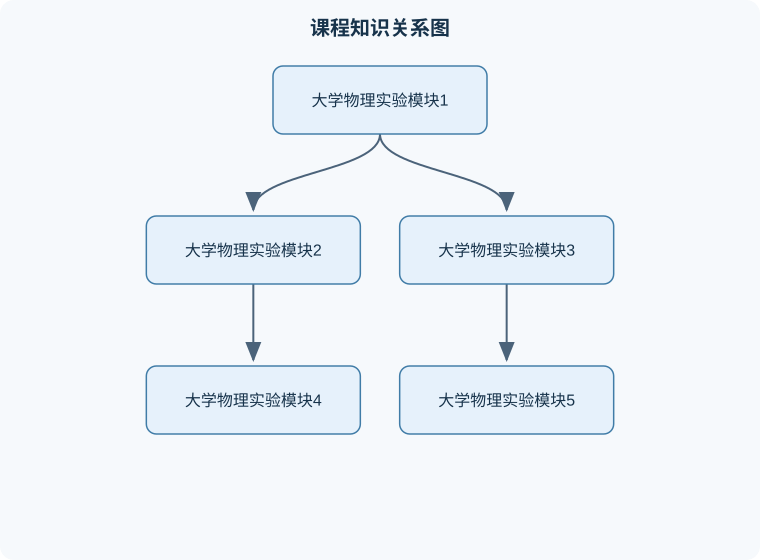

# 大学物理实验

## 一、课程整体知识框架

### 课程边界与先修知识

《大学物理实验》研究经典力学、热学、电磁学、光学和近代物理中的基本物理量测量、实验建模、仪器使用、数据处理、不确定度评定、线性与非线性拟合及实验结果表达。课程边界包括实验设计、操作规范、原始数据记录、直接与间接测量、误差分析、图表绘制、模型检验和实验报告，不等同于完整的大学物理理论课程或高阶仪器分析课程。先修知识包括高中或大学基础物理中的运动学与动力学、振动与波、热学、电路和几何光学，基础微积分、偏导数、平方和、对数运算、直线方程和基本统计知识；应能进行单位换算、数量级估算和基本有效数字运算。





### 1. 课程目标与实验知识结构

大学物理实验不是把理论公式直接代入数据，而是通过“物理模型—测量方案—仪器操作—数据处理—结果评价—误差解释”的完整链条，检验物理规律在真实条件下的适用性。实验对象既包括长度、时间、质量、电流、电压、温度等可定量测量的物理量，也包括机械运动、热平衡、磁场、交流电、干涉和衍射等需要借助模型描述的物理现象。

一个完整实验通常包含四个基本要素：

1. **测量对象**：明确要测的物理量及其定义，例如摆长 $L$、周期 $T$、电阻 $R$ 或折射率 $n$。
2. **测量方法**：规定如何利用仪器和物理规律获得数据，例如直接读数、比较测量、替代测量、间接测量或拟合测量。
3. **测量单位**：采用统一单位制。国际单位制的七个基本量分别是长度米（m）、质量千克（kg）、时间秒（s）、电流安培（A）、热力学温度开尔文（K）、物质的量摩尔（mol）和发光强度坎德拉（cd）。
4. **测量不确定度**：说明测量结果可能偏离被测量真值的范围及其可信程度。没有不确定度或误差分析的数值，不能完整反映实验质量。

实验知识可分为三层。第一层是**概念和仪器层**，包括物理量、单位、量纲、有效数字、仪器量程、分度值、准确度等级和读数方法。第二层是**规律和模型层**，包括牛顿运动定律、振动与波、电磁感应、欧姆定律、热学状态关系、光的干涉衍射等。第三层是**数据与评价层**，包括重复测量、平均值、标准差、合成不确定度、线性拟合、残差分析、结果表达和实验报告。

### 2. 理想模型与现实测量

物理定律通常建立在理想条件上。例如单摆公式

$$
T=2\pi\sqrt{\frac{L}{g}}
$$

其中 $T$ 是周期，单位为 s；$L$ 是摆长，单位为 m；$g$ 是重力加速度，单位为 $\mathrm{m/s^2}$。该公式要求摆球可视为质点、摆线不可伸长且质量可忽略、支点无摩擦、摆角较小、运动主要在同一竖直平面内。由平方关系可得

$$
g=\frac{4\pi^2L}{T^2}.
$$

推导步骤是：先将周期公式两边平方，得 $T^2=4\pi^2L/g$；再将 $g$ 移到左侧、$T^2$ 移到右侧，得到上式。因此 $g$ 是由直接测得的 $L$ 和 $T$ 计算得到的间接测量量。

现实实验中，摆角过大时，周期不再严格满足小角度公式；摆长若从支点量到球心，结果会产生系统偏差；用一次摆动时间代替多次周期计时，反应时间造成的相对误差会较大。由此可见，公式成立的条件和测量步骤同样重要。

### 3. 八个模块的内容主线

#### 模块1：物理量、单位与测量基础

物理概念可分为定性概念和定量概念。机械运动、热平衡、磁场和交流电等主要描述对象的性质或状态；长度、速度、热量、电流强度和电压等则可以用数值和单位表示。

直接测量是将待测量与标准量直接比较，例如用米尺测长度、温度计测温度、电压表测电压。间接测量是先测量相关物理量，再依据规律计算目标量，例如通过 $L$ 和 $T$ 求 $g$，或通过电压 $U$ 与电流 $I$ 求电阻 $R$：

$$
R=\frac{U}{I},
$$

其中 $U$ 的单位为 V，$I$ 的单位为 A，$R$ 的单位为 $\Omega$。该关系适用于温度基本不变、导体满足欧姆特性的条件；灯丝等元件升温明显时，$R$ 会随温度变化，不能简单视为常量。

#### 模块2：误差、精密度与准确度

若测量值为 $x$，约定参考值为 $x_0$，绝对误差可写为

$$
\Delta x=x-x_0.
$$

相对误差为

$$
E=\frac{|\Delta x|}{|x_0|}\times100\%.
$$

绝对误差与被测量同量纲；相对误差无量纲，通常用百分数表示。若 $x_0$ 接近零，相对误差会失去稳定意义，此时应优先报告绝对误差或不确定度。

**系统误差**具有稳定方向或规律，例如仪器零点偏移、刻度标定不准、导线电阻未考虑。**随机误差**由环境波动、读数反应差异等引起，可通过多次重复测量和统计处理减小。**粗大误差**通常来自操作失误、漏记单位、错读量程或记录错误，不能用简单取平均值来“修正”，应查明原因后剔除或重测。

精密度表示重复测量结果彼此接近的程度，准确度表示结果接近参考值的程度。数据可能“精密但不准确”，例如仪器存在零点偏移时，多次读数十分集中，却整体偏离真值；只有数据集中且中心接近参考值，才能同时具有较高精密度和准确度。

#### 模块3：仪器特性与读数方法

模拟仪器的分度值决定读数的基本分辨能力，估读位不能超过仪器和观察条件允许的范围。数字仪器的末位不等于绝对可靠，其稳定性、刷新方式和量程也会影响结果。

对于标有准确度等级的指针式仪表，若量程为 $X_{\max}$、等级为 $a$，仪器允许误差常按满量程计算：

$$
\Delta X_{\mathrm{仪}}=X_{\max}\times\frac{a}{100}.
$$

例如量程 $100\ \mathrm{mV}$、等级 $0.5$ 的电压表，其允许误差为

$$
100\ \mathrm{mV}\times0.5\%=0.5\ \mathrm{mV}.
$$

测量 $1.5\ \mathrm{V}$ 电压时，若选量程 $5\ \mathrm{V}$、等级 $0.5$ 的表，仪器误差为 $25\ \mathrm{mV}$，相对误差约为 $1.67\%$；若选量程 $2\ \mathrm{V}$、等级 $1.0$ 的表，误差为 $20\ \mathrm{mV}$，相对误差约为 $1.33\%$；若选量程 $1.5\ \mathrm{V}$、等级 $2.5$ 的表，允许误差为 $37.5\ \mathrm{mV}$，相对误差约为 $2.5\%$。因此量程不能只看“越小越好”，还要同时比较准确度等级和是否存在超量程风险。

#### 模块4：不确定度与数据处理

测量结果应写成

$$
x=\bar{x}\pm u_x,
$$

其中 $\bar{x}$ 是测量结果或平均值，$u_x$ 是标准不确定度或合成不确定度，二者单位相同。若直接测量量 $x$、$y$ 相互独立，且

$$
z=f(x,y),
$$

则一阶近似下的合成标准不确定度为

$$
u_z=\sqrt{\left(\frac{\partial f}{\partial x}u_x\right)^2+
\left(\frac{\partial f}{\partial y}u_y\right)^2}.
$$

例如 $z=xy$，则

$$
u_z=\sqrt{(yu_x)^2+(xu_y)^2}.
$$

若改写为相对形式，在 $x,y$ 均为正且不确定度较小时，

$$
\left(\frac{u_z}{z}\right)^2
=
\left(\frac{u_x}{x}\right)^2+
\left(\frac{u_y}{y}\right)^2.
$$

该近似要求误差足够小、函数在测量范围内可微且各输入量的相关性已忽略。若输入量高度相关，必须加入协方差项；若函数接近奇点或误差很大，线性传播可能不可靠。

#### 模块5：力学实验与运动规律

力学实验重点研究位移、速度、加速度、力、质量、动量和能量之间的关系。牛顿第二定律可写为

$$
\sum\mathbf{F}=m\mathbf{a},
$$

其中 $\sum\mathbf{F}$ 是物体所受外力的矢量合力，单位为 N；$m$ 是质量，单位为 kg；$\mathbf a$ 是加速度，单位为 $\mathrm{m/s^2}$。实验分析时必须先画受力图，再沿选定坐标轴分解各力，不能把“运动方向”直接当作“合力方向”。匀速运动时速度不变，合力为零；圆周运动即使速率不变，速度方向改变，仍具有加速度。

#### 模块6：振动、波动与光学实验

振动实验常通过周期、频率、振幅和相位描述运动。频率 $f$ 与周期 $T$ 的关系是

$$
f=\frac{1}{T},
$$

其中 $f$ 的单位为 Hz，$T$ 的单位为 s。波动实验还需区分波速 $v$、波长 $\lambda$ 和频率 $f$：

$$
v=f\lambda.
$$

在同一介质中，频率通常由波源决定，波速由介质性质决定，改变频率时波长随之改变。光的干涉和衍射则要求相干性、几何条件和光强条件得到满足；用几何光学直线传播规律解释所有光学现象，会忽略波动效应的边界。

#### 模块7：热学实验

热学实验涉及温度、热量、内能、热平衡和状态变化。温度是状态量，热量是能量传递过程中的量，不能把二者混为一谈。热量交换可写成

$$
Q=cm\Delta T,
$$

其中 $Q$ 的单位为 J，$c$ 为比热容，单位为 $\mathrm{J/(kg\cdot K)}$，$m$ 为质量，单位为 kg，$\Delta T$ 为温差，单位可用 K 或摄氏度差值表示。该式适用于物质状态不发生改变且比热容可近似视为常量的范围。相变或明显温度依赖时，应加入潜热项或采用分段模型。

#### 模块8：电磁学与综合应用

电磁实验包括电流、电压、电阻、磁场、电磁感应、交流信号和电路响应。电压表应并联接入，理想电压表内阻无限大；电流表应串联接入，理想电流表内阻为零。现实仪表均有有限内阻，接入电路后会改变原电路状态，这种影响称为仪表负载效应。

电磁感应遵循

$$
\mathcal{E}=-\frac{\mathrm d\Phi}{\mathrm dt},
$$

其中 $\mathcal E$ 是感应电动势，单位为 V；$\Phi$ 是磁通量，单位为 Wb；负号表示感应效应阻碍磁通量的变化。实际测量中，线圈匝数、磁场分布、运动速度和接触电阻都会影响结果，不能只根据瞬时读数判断规律。

### 4. 实验报告与结果表达

实验报告应包括目的、原理、仪器、步骤、原始数据、数据处理、结果、误差或不确定度分析以及讨论。原始数据必须保留单位、有效数字和异常现象记录；处理后的结果应说明公式中各符号的含义、代入数值的单位和舍入依据。

结果讨论至少回答三个问题：实验现象是否符合模型；主要误差来自哪里；误差方向是否能够解释结果偏大或偏小。不能为了使结果接近理论值而删改数据、凑数据或倒推实验结果。若数据与理论严重不符，应检查量程、接线、单位、零点、模型条件和数据记录顺序。

## 二、章节和模块划分

### 核心知识覆盖清单

本清单根据本课程的章节划分整理，用于检查正文是否覆盖各个核心模块：

- **1. 数据处理的通用流程**。
- **2. 数据处理示例代码**。
- **3. 典型例题**。
- **4. 实验与项目流程**。
- **5. 易错点与概念边界**。
- **6. 常见笔试问题及解答思路**。
- **7. 面试问题、参考答案与追问要点**。
- **8. 与技术岗位的关联**。


### 1. 数据处理的通用流程

#### 流程一：测量方案设计

**输入**：待测物理量、理论关系、仪器参数和精度要求。  
**输出**：仪器选择、测量步骤、数据表和误差控制方案。

步骤如下：

1. 写出目标量与直接测量量的关系式。
2. 判断每个量是直接测量还是间接测量。
3. 根据量程、分度值、准确度等级和被测量大小选择仪器。
4. 判断是否需要重复测量、改变自变量或进行线性拟合。
5. 列出可能的系统误差和随机误差，并设计控制办法。

适用边界是：模型必须能够近似描述实验对象；若被测量超出仪器量程或仪器分辨率远低于目标精度，单纯增加测量次数不能解决根本问题。

#### 流程二：重复测量与异常值处理

对同一量进行 $n$ 次测量 $x_1,x_2,\ldots,x_n$，平均值为

$$
\bar{x}=\frac{1}{n}\sum_{i=1}^{n}x_i.
$$

样本标准差为

$$
s=\sqrt{\frac{1}{n-1}\sum_{i=1}^{n}(x_i-\bar{x})^2}.
$$

步骤是：先检查单位和记录，再观察数据是否存在明显操作错误；只有能够指出明确原因时，才将某次数据判为粗大错误并重测。不能仅因为某个数据“不好看”就删除。若数据来自独立随机测量，平均值的标准不确定度常近似为 $s/\sqrt n$，但系统误差不会因重复测量自动消失。

#### 流程三：线性化与拟合

若理论关系为

$$
y=ax+b,
$$

可将实验数据点作图或采用最小二乘法拟合，得到斜率 $a$ 和截距 $b$。斜率的物理意义必须由原理论式确定。例如单摆实验中作 $T^2-L$ 图：

$$
T^2=\frac{4\pi^2}{g}L,
$$

若拟合斜率为 $k$，则

$$
g=\frac{4\pi^2}{k}.
$$

这里 $k$ 的单位是 $\mathrm{s^2/m}$，所以 $g$ 的单位为 $\mathrm{m/s^2}$。若截距显著不为零，可能存在摆长零点偏差、计时延迟或模型条件不满足，不能简单强制拟合通过原点。

#### 流程四：结果验证与终止条件

验证包括量纲检查、数量级检查、极限情况检查和残差检查。若计算出的电阻单位不是 $\Omega$、重力加速度数量级远离通常范围或拟合残差呈明显弯曲趋势，应回到公式、单位、仪器和模型逐项排查。流程在以下条件下终止：数据完整，单位统一，计算可复核，结果具有合理有效数字，主要误差来源已经说明，且结论边界明确。

### 2. 数据处理示例代码

下面的 Python 代码只处理用户输入的本地测量数据，不联网、不读写文件。它计算平均值、样本标准差和平均值的标准不确定度。

```python
import math

def statistics(values):
    """输入一组同单位测量值，输出平均值、样本标准差和平均值标准不确定度。"""
    if len(values) < 2:
        raise ValueError("至少需要两次测量")
    mean = sum(values) / len(values)
    variance = sum((x - mean) ** 2 for x in values) / (len(values) - 1)
    std = math.sqrt(variance)
    standard_uncertainty = std / math.sqrt(len(values))
    return mean, std, standard_uncertainty

data = [10.02, 10.01, 10.03, 10.00, 10.04]  # 示例：单位 mm
mean, std, u_mean = statistics(data)

print(f"平均值 = {mean:.4f} mm")
print(f"样本标准差 = {std:.4f} mm")
print(f"平均值标准不确定度 = {u_mean:.4f} mm")
```

不变量是：输入数据均代表同一物理量、单位一致且未混入明显粗大错误；程序始终使用 $n-1$ 作为样本方差分母。终止条件是完成有限次求和与开方，时间复杂度为 $O(n)$，空间复杂度为 $O(1)$（不计输入列表存储）。该程序不能自动识别系统误差，也不能替代实验者判断异常值。

### 3. 典型例题

#### 例题一：绝对误差与相对误差

**题干**：用最小分度值为 $1\ \mathrm{mm}$ 的米尺测量 $50\ \mathrm{cm}$ 和 $5\ \mathrm{cm}$ 的物体，估计读数误差为 $0.2\ \mathrm{mm}$。分别求相对误差。

**分析**：两次测量的绝对误差近似相同，但被测长度不同，因此短物体的相对误差更大。

**解答**：

对 $50\ \mathrm{cm}=500\ \mathrm{mm}$：

$$
E_1=\frac{0.2}{500}\times100\%=0.04\%.
$$

对 $5\ \mathrm{cm}=50\ \mathrm{mm}$：

$$
E_2=\frac{0.2}{50}\times100\%=0.4\%.
$$

**结果验证**：第二个物体长度是第一个的十分之一，而绝对误差相同，所以相对误差应增大十倍，计算符合这一关系。

**变式**：若改用分度值为 $0.1\ \mathrm{mm}$ 的仪器，不能直接断言误差一定缩小十倍，还要考虑估读能力、零点误差和仪器准确度。

#### 例题二：仪器量程选择

**题干**：测量 $1.5\ \mathrm V$ 电压，要求仪器误差不超过 $1.5\%$。有三种电压表：量程 $5\ \mathrm V$、等级 $0.5$；量程 $2\ \mathrm V$、等级 $1.0$；量程 $1.5\ \mathrm V$、等级 $2.5$。选择合适仪器。

**解答**：

第一种：

$$
\Delta U=5\times0.5\%=0.025\ \mathrm V,
\quad E=1.67\%.
$$

第二种：

$$
\Delta U=2\times1.0\%=0.020\ \mathrm V,
\quad E=1.33\%.
$$

第三种：

$$
\Delta U=1.5\times2.5\%=0.0375\ \mathrm V,
\quad E=2.5\%.
$$

因此第二种满足 $1.5\%$ 的要求。第三种虽然量程最小，但等级较差且没有余量，不应选择。

**结果验证**：所有量程必须不小于被测电压；第二种的量程为 $2\ \mathrm V$，满足安全和精度要求。

**变式**：若被测电压可能达到 $2.1\ \mathrm V$，第二种不能使用，应改选量程更大的仪器。

#### 例题三：单摆测重力加速度

**题干**：摆长 $L=0.800\ \mathrm m$，测得 $20$ 次振动总时间为 $35.8\ \mathrm s$，求 $g$。

**解答**：先求周期：

$$
T=\frac{35.8}{20}\ \mathrm s=1.79\ \mathrm s.
$$

再代入：

$$
g=\frac{4\pi^2L}{T^2}
=\frac{4\pi^2\times0.800}{1.79^2}
\approx9.85\ \mathrm{m/s^2}.
$$

**结果验证**：$g$ 的量纲为 $\mathrm{m/s^2}$；测量值数量级合理。计时 $20$ 次而不是 $1$ 次，可降低反应时间在总时间中的相对影响。

**变式**：若摆角明显增大，必须减小摆角或说明小角度近似不再严格成立。

#### 例题四：电阻测量

**题干**：某电阻两端电压为 $6.00\ \mathrm V$，电流为 $0.300\ \mathrm A$，求电阻。

**解答**：

$$
R=\frac{U}{I}=\frac{6.00}{0.300}\ \Omega=20.0\ \Omega.
$$

若 $u_U=0.02\ \mathrm V$、$u_I=0.002\ \mathrm A$，则相对合成不确定度为

$$
\left(\frac{u_R}{R}\right)^2
=
\left(\frac{0.02}{6.00}\right)^2+
\left(\frac{0.002}{0.300}\right)^2.
$$

因此

$$
u_R\approx20.0\sqrt{(0.00333)^2+(0.00667)^2}
\approx0.15\ \Omega.
$$

结果可写为 $R=(20.0\pm0.15)\ \Omega$。

**结果验证**：电压和电流均增大时，若比例不变，电阻应保持近似不变；若多组数据的 $U-I$ 图明显弯曲，则元件可能发热而不满足欧姆定律。

**变式**：测量白炽灯丝时，应采用多组电压电流数据，分析其动态电阻，而不能只用一个工作点断言灯丝是定值电阻。

#### 例题五：热量计算

**题干**：质量为 $0.200\ \mathrm{kg}$ 的物体比热容为 $900\ \mathrm{J/(kg\cdot K)}$，温度从 $20^\circ\mathrm C$ 升至 $70^\circ\mathrm C$，求吸收热量。

**解答**：

$$
\Delta T=70-20=50\ \mathrm K,
$$

$$
Q=cm\Delta T
=900\times0.200\times50\ \mathrm J
=9000\ \mathrm J.
$$

**结果验证**：温差为零时 $Q=0$；质量和比热容越大，在相同温差下所需热量越多。该计算未考虑散热、容器吸热和相变，因此是理想近似。

**变式**：若实验中存在明显散热，应建立“物体吸热+容器吸热+散失热量”的能量平衡，而不能直接把输入电能全部当作物体吸热。

### 4. 实验与项目流程

#### 实验一：单摆法测重力加速度

**输入数据**：多个摆长 $L$，每个摆长对应多次振动总时间 $t$、振动次数 $N$，以及摆球和摆线的基本信息。  
**步骤**：

1. 测量支点到摆球质心的距离，明确摆长定义。
2. 将摆角控制在小角度范围内，释放时避免附加推力。
3. 对每个摆长测量 $N$ 次振动总时间，计算 $T=t/N$。
4. 计算 $T^2$，作 $T^2-L$ 图并拟合斜率 $k$。
5. 根据 $g=4\pi^2/k$ 求重力加速度。
6. 检查截距、残差、单位和有效数字。

**评价标准**：摆长定义一致；计时次数足够；数据点具有合理线性；斜率单位为 $\mathrm{s^2/m}$；结果与合理数量级一致；报告中说明摆长测量、反应时间、空气阻力和支点摩擦等误差来源。

**排错方法**：若所有结果偏大，检查摆长是否量到摆球底部；若截距明显不为零，检查计时起止规则和摆长零点；若图线弯曲，检查摆角是否过大或摆动平面是否稳定。

#### 实验二：伏安法测电阻并检验欧姆定律

**输入数据**：多组电压表读数 $U$、电流表读数 $I$、电表量程和准确度等级。  
**步骤**：

1. 根据电路结构判断电流表串联、电压表并联。
2. 接线前将电源置于较小输出，滑动变阻器置于安全位置。
3. 逐步改变电压，记录多组稳定的 $U$ 和 $I$。
4. 作 $U-I$ 图，观察是否近似直线。
5. 若线性成立，斜率给出电阻；若不通过原点，分析接触电阻或仪器零点。
6. 检查元件温升，避免长时间大电流造成参数变化。

**评价标准**：接线正确且无超量程；数据点覆盖足够范围；拟合残差无明显系统趋势；电阻值具有单位和不确定度；对灯丝等非线性元件不强行套用定值电阻模型。

**排错方法**：电流表无示数时检查串联回路和接线柱；电压表满偏时检查量程和并联位置；数据随时间漂移时检查发热；斜率随电压变化时，判断元件是否为非欧姆元件。

### 5. 易错点与概念边界

1. 把物理概念和物理量混为一谈；“磁场”不是一个带单位的数值，而磁感应强度才是可测物理量。
2. 把直接测量和简单读数等同；由公式计算得到的量属于间接测量。
3. 将绝对误差写成百分数；绝对误差与被测量同单位，相对误差才通常用百分数。
4. 只报告随机误差，不讨论零点、标定和仪器负载造成的系统误差。
5. 认为增加重复次数可以消除系统误差；重复测量主要减小随机误差。
6. 误把精密度当准确度；数据集中不代表接近真值。
7. 使用仪器等级时以当前读数乘等级，而不是按满量程乘等级。
8. 量程越小不一定越准确，还要考虑准确度等级和超量程风险。
9. 忽略单位换算，直接把 cm、mm、m 混入同一公式。
10. 单摆长度从支点量到球底，而不是量到球心。
11. 将周期 $T$ 与总计时 $t$ 混淆，忘记用 $T=t/N$。
12. 将温度和热量视为同一物理量。
13. 把电压表串联、电流表并联，造成读数错误甚至仪表损坏。
14. 把拟合直线的斜率直接当作目标量，未根据理论式进行倒数、平方或比例换算。
15. 只看拟合优度，不检查残差；高相关系数不能证明模型一定正确。
16. 用理论值替换实验值，导致结果失去实验意义。
17. 有效数字写得过多，超过仪器分辨率和不确定度所支持的位数。
18. 发现异常数据后直接删除，而没有记录异常现象和排错依据。

### 6. 常见笔试问题及解答思路

1. **为什么短物体用同一把米尺测量时相对误差更大？**  
   绝对读数误差近似由仪器和估读决定，长度变小时，误差占被测量的比例增大。

2. **系统误差能否通过多次测量取平均消除？**  
   不能。若每次测量都存在相同方向的零点偏差，平均值仍然偏移；应校准、比较测量或建立修正模型。

3. **为什么单摆实验要测多次振动的总时间？**  
   人的反应时间在一次周期中占比明显，多次计时后再除以次数，可降低其相对影响。

4. **为什么测量电压时电压表必须并联？**  
   电压是两点间电势差，电压表要跨接被测两点；其内阻应尽量大，以减小对原电路的影响。

5. **牛顿第二定律中合力为零是否意味着物体静止？**  
   不一定。合力为零表示加速度为零，物体可以静止，也可以做匀速直线运动。

6. **为什么拟合直线的截距不为零值得讨论？**  
   它可能表示零点偏差、模型遗漏、仪器负载或背景量；不能仅把截距当作数学误差。

7. **如何判断某次数据是粗大误差？**  
   先检查单位、量程、读数和记录；只有能找到明确操作原因时才判定为粗大误差，否则应保留并分析。

8. **热量公式 $Q=cm\Delta T$ 的适用条件是什么？**  
   物质没有发生相变，质量和比热容明确，温度范围内比热容可近似为常量；存在容器吸热和散热时需扩展能量平衡。

### 7. 面试问题、参考答案与追问要点

1. **如何设计一个可靠的间接测量实验？**  
   参考答案：先建立目标量与直接测量量的理论关系，再选择量程和精度匹配的仪器，安排重复测量或多组变量，最后进行误差传播和结果验证。  
   追问要点：说明如何识别系统误差，以及何时采用拟合而不是单次代入。

2. **如果实验结果与理论值偏差较大，你如何处理？**  
   参考答案：先查单位、公式、接线和量程，再检查模型条件和仪器校准，最后通过残差和重复实验判断偏差是随机还是系统性的。  
   追问要点：不能直接修改数据或选择性删除异常点。

3. **为什么不能只用相关系数评价拟合质量？**  
   参考答案：相关系数只能反映线性相关程度，不能显示残差是否具有弯曲、分段或随自变量变化的系统趋势。  
   追问要点：应结合残差图、参数不确定度和物理边界判断。

4. **如何选择电压表量程？**  
   参考答案：先确保量程大于可能出现的最大电压，再在满足安全的仪器中比较满量程误差和等级。  
   追问要点：解释为什么最小量程不必然带来最小相对误差。

5. **怎样减少人为计时误差？**  
   参考答案：增加计时周期数、采用明确的起止标志、由同一规则判断事件，并在条件允许时使用光电门等自动计时装置。  
   追问要点：自动仪器仍可能存在触发阈值和标定误差。

6. **如何判断实验模型是否适用？**  
   参考答案：检查推导前提、控制变量、量纲、数量级和残差；若改变工作范围后规律明显变化，说明原模型只在局部范围成立。  
   追问要点：理想模型是近似，不是无条件真理。

7. **实验报告中最重要的讨论内容是什么？**  
   参考答案：说明结果与理论的符合程度、主要误差来源及其方向、模型的适用条件和改进方法。  
   追问要点：讨论必须与实际数据对应，不能只写套话。

8. **若同一元件的电阻随电压升高而增大，如何解释？**  
   参考答案：可能是元件发热导致材料电阻率变化，此时元件不再是定值电阻，应使用工作点电阻或动态电阻描述。  
   追问要点：区分静态电阻 $U/I$ 与动态电阻 $\mathrm dU/\mathrm dI$。

### 8. 与技术岗位的关联

实验数据分析岗位需要完成测量方案设计、异常值判定、拟合建模、不确定度评估和报告输出；其验收标准是数据可追溯、单位完整、结果可复算、误差解释与数据相符。

测试工程岗位常负责传感器、电表、电源或机械部件的标定与性能验证。所用知识包括量程选择、系统误差修正、重复性评价、线性拟合和仪器负载效应；产出通常是测试记录、校准曲线、误差预算和合格判定，验收重点是测试条件明确、结论边界清楚、结果具有重复性。

研发岗位需要把物理模型转化为实验方案，比较理论预测与实测数据，并根据残差改进装置或模型。其产出包括实验设计、参数估计、失效分析和改进报告；验收标准不是单纯“结果接近理论值”，而是模型假设、测量不确定度和可重复性均得到说明。

质量与业务分析岗位也会使用大学物理实验中的基本方法，例如定义测量对象、建立指标、区分随机波动和系统偏差、形成可审计的数据链。其核心产出是可复核的指标报表、异常原因分析和改进建议，不能以修改原始数据来满足预设结论。

## 三、核心概念的详细解释

### 3.1 物理量、测量与实验模型

大学物理实验研究的是物理量之间的定量关系及其在真实条件下的表现。物理概念可以只描述性质，如机械运动、热平衡、磁场和交流电；也可以用数值和单位定量表示，称为物理量，如长度、速度、功、热量、电流强度、电压和电阻。一个完整的测量必须同时说明测量对象、测量方法、测量单位和测量不确定度。只写出一个数值而不说明单位、仪器条件和不确定度，不能构成完整的实验结果。

国际单位制的基本量包括长度、质量、时间、电流、热力学温度、物质的量和发光强度，基本单位分别为米（m）、千克（kg）、秒（s）、安培（A）、开尔文（K）、摩尔（mol）和坎德拉（cd）。实验中应优先将数据换算为统一单位后再计算。例如长度若以厘米记录，代入含有重力加速度的公式前应换算为米；角度若用于三角函数，通常采用弧度，不能把角度数值直接当作无量纲弧度使用。

直接测量是将待测量与标准量直接比较，例如用米尺测长度、温度计测温度、电压表测电压。间接测量则先测量相关物理量，再依据物理规律求出目标量。例如单摆实验中，摆长 $L$ 和周期 $T$ 是直接测得量，重力加速度 $g$ 由

$$
g=\frac{4\pi^2L}{T^2}
$$

间接得到。间接测量的可靠性不仅取决于 $L$ 和 $T$ 的读数，还取决于公式的适用条件、变量之间的相关性以及数据处理方法。

实验模型是对实际对象的理想化描述。例如单摆模型把摆球视为质点，把摆线视为不可伸长且质量可忽略的细线，并忽略空气阻力和支点摩擦。小角度条件下，单摆周期满足

$$
T=2\pi\sqrt{\frac{L}{g}}.
$$

若摆角较大，周期会比小角度公式给出的结果略大；若把摆长错误地量成支点到摆球顶部的距离，$L$ 会偏小，计算得到的 $g$ 将偏小。因此，实验中的“误差”不总是来自读数粗糙，也可能来自模型条件没有满足。

### 3.2 误差、精密度、准确度与不确定度

若测量值为 $x$，约定参考值为 $x_0$，差值

$$
\Delta x=x-x_0
$$

称为绝对误差。它与被测量具有相同单位，正负号可表示测量值相对参考值的偏高或偏低。相对误差通常取绝对值：

$$
E=\frac{|\Delta x|}{|x_0|}\times100\%.
$$

绝对误差相同的情况下，被测量越小，相对误差越大。例如米尺估读误差约为 $0.2\,\mathrm{mm}$ 时，测量 $50\,\mathrm{cm}$ 的相对误差约为 $0.04\%$，测量 $5\,\mathrm{cm}$ 的相对误差约为 $0.4\%$。这说明增加被测长度、采用比较测量或多次测量，往往能降低相对误差，但不能消除仪器本身的系统偏差。

系统误差是在相同条件下具有稳定方向或规律的误差，例如仪器零点偏移、刻度不准、仪器安装不水平、测量方法造成的负载效应。系统误差通常不能通过简单增加测量次数消除，应通过校准、零点修正、替代测量、改变测量方向或建立修正模型减小。

随机误差由环境微扰、读数波动、触发时刻不确定和操作者反应差异等引起，大小和方向具有随机性。多次重复测量并取平均值可减小随机误差，但平均值不能自动修正系统误差。粗大误差通常由接线错误、读错量程、单位换算错误、漏记数据或操作失误造成，应查明原因后剔除或重测，不能为了使结果接近理论值而任意删除数据。

精密度表示多次测量结果彼此接近的程度，准确度表示测量结果接近参考值或真值的程度，精确度在教学语境中常用来概括结果既接近真实值又具有较小离散性。数据集中但整体偏离参考值，说明精密度高而准确度低；数据平均位置接近参考值但离散较大，说明准确度较高而精密度较低。

不确定度不是“错误大小”的简单同义词，而是对测量结果可信范围的定量描述。重复测量得到 $n$ 个结果 $x_1,x_2,\ldots,x_n$ 时，平均值为

$$
\bar{x}=\frac{1}{n}\sum_{i=1}^{n}x_i.
$$

样本标准差为

$$
s=\sqrt{\frac{1}{n-1}\sum_{i=1}^{n}(x_i-\bar{x})^2},
$$

其中 $n-1$ 用于估计总体波动。若仪器分辨力、校准信息和重复性分别给出不同的不确定度分量，可按相互独立的假设近似合成：

$$
u_c=\sqrt{u_1^2+u_2^2+\cdots+u_k^2}.
$$

只有在各分量相互独立、误差模型合理时，才可直接使用平方和开根号；若两个量由同一零点误差引起，它们可能相关，不能机械套用独立假设。

### 3.3 仪器量程、分度值与读数

模拟仪器的分度值是相邻刻度之间的数值间隔，数字仪器的分辨力通常由末位显示确定。仪器等级误差常按

$$
\Delta_{\mathrm{仪}}=\text{量程}\times\frac{\text{等级}}{100}
$$

估算。这里的量程是所选档位的满量程，不是被测量的读数。例如量程为 $100\,\mathrm{mV}$、等级为 $0.5$ 的电压表，其仪器误差约为

$$
100\,\mathrm{mV}\times0.5\%=0.5\,\mathrm{mV}.
$$

因此选择仪器时应在不超量程的前提下尽量使用较小量程。测量约 $1.5\,\mathrm{V}$ 的电压时，量程 $2\,\mathrm{V}$、等级 $1.0$ 的仪表，其满量程误差约为 $0.02\,\mathrm{V}$，相对该读数约为 $1.33\%$；量程 $5\,\mathrm{V}$、等级 $0.5$ 的仪表误差约为 $0.025\,\mathrm{V}$，相对误差约为 $1.67\%$；量程 $1.5\,\mathrm{V}$、等级 $2.5$ 的仪表虽量程较合适，但误差约为 $0.0375\,\mathrm{V}$，相对误差约为 $2.5\%$，不满足相对误差不大于 $1.5\%$ 的要求。

读数应避免视差，视线应尽量垂直于刻度面；指针式仪表应在稳定后读数，数字仪表应观察末位是否跳动。电压表内阻有限，接入电路会产生负载效应；电流表内阻不为零，串入电路会改变电流。因此“仪器读数就是被测对象原值”只是在仪器影响可忽略时成立。

### 3.4 数据关系、拟合与结果评价

当理论关系为线性形式

$$
y=ax+b
$$

时，$a$ 的单位为 $y$ 的单位除以 $x$ 的单位，$b$ 的单位与 $y$ 相同。若理论关系为 $T=2\pi\sqrt{L/g}$，直接作 $T-L$ 图并不线性，更适合平方后作 $T^2-L$ 图：

$$
T^2=\frac{4\pi^2}{g}L.
$$

此时斜率 $k=4\pi^2/g$，因而

$$
g=\frac{4\pi^2}{k}.
$$

截距理论上应为零。若截距明显偏离零，可能表示摆长零点定义错误、计时存在固定延迟、摆动条件不满足或实验装置存在系统偏差。不能只依据斜率接近理论值就忽略截距和残差。

残差定义为实测值与模型预测值之差。若残差无明显趋势且正负较均匀，线性模型通常具有较好的局部适用性；若残差随自变量呈弯曲、扇形扩散或单方向偏移，说明模型形式、误差假设或实验条件可能存在问题。拟合并不能替代物理分析，相关系数很高也不等于因果模型一定正确。

### 3.5 代表性实验流程与算法

#### 流程一：物理问题分析与测量方案设计

输入是实验目标、待测量、可用仪器和理论关系；输出是可执行的测量方案、原始记录表和结果表达式。

1. 明确目标量及单位，区分直接测量量和间接测量量。
2. 写出理论模型，列出模型成立的条件。
3. 根据目标误差选择仪器量程、分度值和测量次数。
4. 设计变量范围和控制变量，避免所有数据集中在过窄区间。
5. 先进行少量预实验，检查量程、接线、稳定时间和信号变化。
6. 按统一规则记录原始数据，不在原始记录中覆盖修改。
7. 进行单位换算、异常检查、平均或拟合。
8. 给出结果、不确定度、适用条件和主要误差来源。

终止条件是数据数量、重复性和拟合残差达到预先规定的评价要求；若不满足，应回到仪器检查或模型检查，而不是直接输出结论。

#### 流程二：间接测量的不确定度传播

若目标量为 $y=f(x_1,x_2,\ldots,x_n)$，且各输入量相互独立、误差较小时，可用一阶近似：

$$
u^2(y)=\sum_{i=1}^{n}\left(\frac{\partial f}{\partial x_i}\right)^2u^2(x_i).
$$

例如

$$
g=\frac{4\pi^2L}{T^2}
$$

对 $L$ 和 $T$ 求偏导：

$$
\frac{\partial g}{\partial L}=\frac{4\pi^2}{T^2}=\frac{g}{L},
\qquad
\frac{\partial g}{\partial T}=-\frac{8\pi^2L}{T^3}=-\frac{2g}{T}.
$$

所以

$$
u^2(g)=\left(\frac{g}{L}u(L)\right)^2+
\left(\frac{2g}{T}u(T)\right)^2.
$$

若只关心相对不确定度，则

$$
\frac{u(g)}{g}\approx
\sqrt{\left(\frac{u(L)}{L}\right)^2+
\left(\frac{2u(T)}{T}\right)^2}.
$$

该结果说明周期的相对不确定度被放大约两倍，故单摆实验通常应通过测量多个周期来降低计时影响。

#### 流程三：线性拟合的数据处理伪代码

```python
# Python：对实验数据进行线性最小二乘拟合
# 输入：x、y 为等长数值序列，单位需在拟合前统一
# 输出：斜率 a、截距 b、预测值和残差

def linear_fit(x, y):
    n = len(x)
    if n < 2 or n != len(y):
        raise ValueError("数据数量不足或长度不一致")

    x_mean = sum(x) / n
    y_mean = sum(y) / n
    denominator = sum((xi - x_mean) ** 2 for xi in x)

    if denominator == 0:
        raise ValueError("自变量没有变化，无法确定斜率")

    a = sum((xi - x_mean) * (yi - y_mean)
            for xi, yi in zip(x, y)) / denominator
    b = y_mean - a * x_mean

    prediction = [a * xi + b for xi in x]
    residual = [yi - yp for yi, yp in zip(y, prediction)]
    return a, b, prediction, residual
```

该方法的输入要求数据为同一物理模型下的成对观测值，输出斜率、截距、预测值和残差。其核心不变量是每个 $x_i$ 与对应的 $y_i$ 不被错配；终止条件是遍历完全部数据。计算量为 $O(n)$，存储量为 $O(n)$；但它不负责自动判断异常值，也不负责确认线性模型是否具有物理依据。

### 3.6 实验项目的实施与评价

#### 项目一：单摆测量重力加速度

输入数据包括多组摆长 $L$、测量 $N$ 个周期所需时间 $t_N$、摆角和环境记录。先计算

$$
T=\frac{t_N}{N},
$$

再计算 $T^2$，作 $T^2-L$ 图并拟合斜率。若斜率为 $k$，则 $g=4\pi^2/k$。

操作步骤是：检查摆线、支点和摆球；测量支点到球心的距离；保持摆角较小且各组条件一致；让摆球在同一竖直面内运动；测量多个周期而不是单个周期；对每个摆长重复测量；检查残差和截距。评价标准包括单位正确、摆长定义一致、数据点分布合理、拟合残差无明显趋势、结果给出不确定度和模型边界。

排错时，若所有 $g$ 均偏小，应检查摆长是否量到球顶或周期是否计长；若周期随摆幅变化明显，应减小摆角；若单次重复结果差异大，应检查起始计时和周期计数；若拟合截距显著不为零，应检查固定计时延迟和摆长零点。

#### 项目二：伏安法研究元件伏安特性

输入数据为多组电压 $U$ 和电流 $I$，输出为伏安特性曲线及工作点电阻。对近似欧姆元件，可用

$$
R=\frac{U}{I}
$$

估算电阻；对非线性元件，不能把所有点拟合成一条过原点直线，应区分静态电阻

$$
R_{\mathrm{静}}=\frac{U}{I}
$$

和动态电阻

$$
R_{\mathrm{动}}=\frac{\mathrm dU}{\mathrm dI}.
$$

步骤包括：确认电源极性和仪表量程；按电路图接线并在通电前复核；从较小电压开始逐步调节；每个工作点等待读数稳定；记录电压、电流及元件温度变化；绘制 $U-I$ 图并分析线性。

评价标准是接线正确、未超量程、数据具有单调性、曲线趋势与元件性质相符、报告中说明电表内阻和发热影响。若电流突然为零，先检查断路和保险保护；若读数超量程，应立即断电并更换档位；若电阻随电流增大而增大，应考虑发热，而不能简单判定为“测量错误”。

## 四、重要定义、公式、定理和推导

### 专业审校补充：关键定义与适用边界

间接测量的不确定度不能把各输入量的绝对不确定度直接相加。若被测量为 $y=f(x_1,x_2,\ldots,x_n)$，且各输入量相互独立、误差较小，则合成标准不确定度可近似写为 $u_c^2(y)=\sum_{i=1}^{n}\left(\frac{\partial f}{\partial x_i}\right)^2u^2(x_i)$。其中 $u(x_i)$ 是输入量的标准不确定度，偏导数是灵敏度系数，表示该输入量变化对结果的影响。若输入量存在相关性，还必须加入协方差项：$2\sum_{i<j}\frac{\partial f}{\partial x_i}\frac{\partial f}{\partial x_j}\operatorname{cov}(x_i,x_j)$，不能继续使用独立假设。重复测量得到的平均值可估计随机分量，但仪器零点、标尺偏差和模型近似产生的系统分量需单独评估。该线性传播公式适用于输入不确定度相对于测量值较小且函数在测量范围内近似线性的情况；当函数强非线性、分布明显偏斜或存在边界截断时，应缩小工作区间、采用更完整的概率传播方法，或通过蒙特卡洛抽样验证近似是否可靠。


### 4.1 力学实验中的基本定律与推导

牛顿第二定律给出合外力、质量和加速度之间的关系：

$$
\sum \boldsymbol F=m\boldsymbol a.
$$

其中 $\boldsymbol F$ 为力，单位为 N；$m$ 为质量，单位为 kg；$\boldsymbol a$ 为加速度，单位为 $\mathrm{m/s^2}$。该式要求在惯性参考系中描述运动，且质量可视为恒定。实验中应先画出研究对象的受力图，再沿坐标轴分解各力，不能把作用力与反作用力同时作为同一物体的受力相加。若摩擦、滑轮转动惯量或绳子质量不可忽略，理想公式需要修正。

动量定义为

$$
\boldsymbol p=m\boldsymbol v.
$$

合外力等于动量对时间的变化率：

$$
\sum\boldsymbol F=\frac{\mathrm d\boldsymbol p}{\mathrm dt}.
$$

当质量不变时，才可化为 $\sum\boldsymbol F=m\boldsymbol a$。在碰撞实验中，若系统所受外冲量相对于内力冲量可忽略，则系统总动量近似守恒；若碰撞过程中存在明显摩擦，必须将外冲量作为误差来源分析。

### 4.2 振动与波的实验关系

简谐振动可写为

$$
x=A\cos(\omega t+\varphi),
$$

其中 $A$ 为振幅，单位为 m；$\omega$ 为角频率，单位为 $\mathrm{rad/s}$；$\varphi$ 为初相位，单位为 rad；$t$ 为时间，单位为 s。角频率与周期、频率的关系为

$$
\omega=\frac{2\pi}{T}=2\pi f,
$$

其中 $T$ 为周期，$f$ 为频率，单位为 Hz。由位移对时间求导可得速度和加速度：

$$
v=\frac{\mathrm dx}{\mathrm dt}
=-A\omega\sin(\omega t+\varphi),
$$

$$
a=\frac{\mathrm d^2x}{\mathrm dt^2}
=-A\omega^2\cos(\omega t+\varphi)
=-\omega^2x.
$$

最后一个关系说明加速度始终指向平衡位置，且与位移成正比。该关系适用于理想简谐振动；阻尼明显时，振幅会随时间衰减，驱动力存在时还需考虑强迫振动和共振。

单摆公式的推导从切向运动方程开始。摆球偏离平衡位置的角度为 $\theta$，摆长为 $L$，沿切线方向的回复力为 $-mg\sin\theta$。因弧长 $s=L\theta$，切向加速度为

$$
a_t=L\frac{\mathrm d^2\theta}{\mathrm dt^2}.
$$

由牛顿第二定律：

$$
mL\frac{\mathrm d^2\theta}{\mathrm dt^2}=-mg\sin\theta.
$$

小角度且以弧度表示时，$\sin\theta\approx\theta$，于是

$$
\frac{\mathrm d^2\theta}{\mathrm dt^2}+\frac{g}{L}\theta=0.
$$

这就是简谐振动方程，因此

$$
\omega=\sqrt{\frac{g}{L}},
\qquad
T=\frac{2\pi}{\omega}=2\pi\sqrt{\frac{L}{g}}.
$$

当摆角较大、摆线有质量、支点摩擦明显或运动不在同一平面内时，上述推导条件不满足。

### 4.3 电学实验中的定义与边界

电流强度定义为单位时间内通过导体横截面的电荷量：

$$
I=\frac{\mathrm dQ}{\mathrm dt},
$$

$I$ 的单位为 A，$Q$ 的单位为 C，$t$ 的单位为 s。电压表示单位电荷在两点间移动时电势能变化的大小，单位为 V。电阻在某一工作状态下可定义为

$$
R=\frac{U}{I},
$$

其中 $U$ 的单位为 V，$I$ 的单位为 A，$R$ 的单位为 $\Omega$。

欧姆定律的适用前提是导体温度和材料状态基本不变，且元件在考察范围内呈线性伏安特性：

$$
U=IR.
$$

金属丝温度升高时电阻率通常发生变化，白炽灯丝、半导体元件和二极管的伏安关系可能明显非线性，此时不能把 $R$ 视为与电流无关的常量。电阻串联时电流相同、总电压为各电阻电压之和；并联时各支路电压相同、总电流为各支路电流之和。这些结论依赖理想导线和集中参数电路模型，实际电源内阻、导线电阻和仪表内阻会引入修正。

### 4.4 热学实验中的平衡与能量守恒

热平衡是不同物体接触后宏观温度不再发生可观变化的状态。温度相同并不表示两个物体含有相同热量，热量是能量传递过程中的量，不是物体静态“拥有”的状态量。

在忽略与环境交换、容器吸热和相变的理想条件下，热量守恒可写为放热量等于吸热量：

$$
\sum Q_{\mathrm{放}}=\sum Q_{\mathrm{吸}}.
$$

物体温度变化对应的热量为

$$
Q=mc\Delta T,
$$

其中 $m$ 为质量，单位为 kg；$c$ 为比热容，单位为 $\mathrm{J/(kg\cdot K)}$；$\Delta T$ 为温差，单位 K 或数值相同的摄氏温差。若存在量热器吸热和环境散热，应将量热器热容、散热修正或冷却曲线纳入模型。实验中先混合后读温度可能低于理想平衡温度，不能简单将偏差全部归因于读数误差。

### 4.5 光学实验中的干涉、衍射与折射

光的干涉要求相干波叠加。两列波的光程差为 $\Delta$ 时，理想情况下相长干涉条件为

$$
\Delta=m\lambda,
$$

相消干涉条件为

$$
\Delta=\left(m+\frac12\right)\lambda,
$$

其中 $m$ 为整数，$\lambda$ 为波长，单位为 m。若反射过程中发生半波损失，明暗条件会发生相应改变，不能只看几何路程差。

单缝衍射暗纹条件为

$$
a\sin\theta=m\lambda,
\qquad m=\pm1,\pm2,\ldots
$$

其中 $a$ 为缝宽，$\theta$ 为衍射角。小角度时 $\sin\theta\approx\tan\theta\approx y/L$，$y$ 为中央明纹边缘到中央的距离，$L$ 为缝到屏的距离，因此可以由屏上条纹间距反推波长或缝宽。若角度较大，不能继续使用小角度近似。

折射定律为

$$
n_1\sin\theta_1=n_2\sin\theta_2,
$$

其中 $n_1,n_2$ 分别为两介质折射率，$\theta_1,\theta_2$ 为相对法线测量的入射角和折射角。若角度误以界面为基准，所得结果会系统错误。全反射只可能发生在光从较大折射率介质射向较小折射率介质时，且入射角超过临界角；从低折射率介质射向高折射率介质时不存在全反射。

### 4.6 典型例题及解答

#### 例题一：量程与仪器误差

**题干：**某电压表量程为 $100\,\mathrm{mV}$，等级为 $0.5$，求按等级估计的最大允许误差。

**分析：**等级误差以满量程为基准，而不是以当前读数为基准。

**解答：**

$$
\Delta_{\mathrm{仪}}
=100\,\mathrm{mV}\times\frac{0.5}{100}
=0.5\,\mathrm{mV}.
$$

**结果验证：**误差单位应为 mV，且误差不随当前指针读数线性改变。  
**变式：**若改用 $1\,\mathrm{V}$ 量程、同等级仪表，误差为 $5\,\mathrm{mV}$，说明低量程档通常更有利于提高相对分辨能力。

#### 例题二：摆长和周期求重力加速度

**题干：**测得摆长 $L=0.800\,\mathrm{m}$，测量 $20$ 个周期总时间为 $35.8\,\mathrm{s}$，求 $g$。

**分析：**先用总时间除以周期数，再代入单摆公式。

**解答：**

$$
T=\frac{35.8}{20}\,\mathrm{s}=1.79\,\mathrm{s},
$$

$$
g=\frac{4\pi^2\times0.800}{1.79^2}
\approx9.85\,\mathrm{m/s^2}.
$$

**结果验证：**单位为 $\mathrm{m/s^2}$，数量级与地面附近重力加速度相符。  
**变式：**若只测一个周期，反应时间在总时间中所占比例增大；若测 $20$ 个周期，固定反应延迟对平均周期的相对影响约降低到原来的二十分之一。

#### 例题三：误差传播

**题干：**若摆长相对不确定度为 $0.5\%$，周期相对不确定度为 $0.3\%$，估计 $g$ 的相对不确定度。

**分析：**由 $g\propto L T^{-2}$，周期不确定度的系数为 $2$。

**解答：**

$$
\frac{u(g)}{g}
\approx\sqrt{(0.005)^2+(2\times0.003)^2}
=\sqrt{0.000025+0.000036}
\approx0.0078.
$$

因此相对不确定度约为 $0.78\%$。

**结果验证：**结果大于单独的 $0.5\%$ 和 $0.6\%$，符合多个独立不确定度合成的性质。  
**变式：**若周期不确定度降至 $0.1\%$，总相对不确定度约为 $\sqrt{0.005^2+0.002^2}=0.54\%$，此时主要限制因素转为摆长测量。

#### 例题四：伏安法判断元件性质

**题干：**某元件测得两组数据：$(U,I)=(2.0\,\mathrm{V},0.20\,\mathrm{A})$ 和 $(4.0\,\mathrm{V},0.30\,\mathrm{A})$。判断能否用定值电阻描述。

**分析：**分别计算静态电阻。

**解答：**

$$
R_1=\frac{2.0}{0.20}=10\,\Omega,
\qquad
R_2=\frac{4.0}{0.30}\approx13.3\,\Omega.
$$

两者明显不同，不能在这两个工作点之间把元件视为定值电阻。若第二个点附近的斜率可由相邻数据求得，则应使用动态电阻描述局部响应。

**结果验证：**电压增加后电阻增大，可能与元件升温有关。  
**变式：**若两点分别为 $(2.0\,\mathrm{V},0.20\,\mathrm{A})$ 和 $(4.0\,\mathrm{V},0.40\,\mathrm{A})$，静态电阻均为 $10\,\Omega$，但仍应检查多组数据和温度，不能仅凭两点断定完全满足欧姆定律。

#### 例题五：线性化处理

**题干：**理论关系为 $T=2\pi\sqrt{L/g}$，应如何作图求 $g$？

**分析：**$T$ 与 $L$ 不是线性关系，应平方变换。

**解答：**

$$
T^2=\frac{4\pi^2}{g}L.
$$

令纵坐标为 $Y=T^2$，横坐标为 $X=L$，则

$$
Y=kX+b,
\qquad
k=\frac{4\pi^2}{g}.
$$

拟合得到斜率 $k$ 后计算

$$
g=\frac{4\pi^2}{k}.
$$

理论截距 $b$ 应接近零。  
**结果验证：**$k$ 的单位为 $\mathrm{s^2/m}$，因此 $4\pi^2/k$ 的单位为 $\mathrm{m/s^2}$。  
**变式：**若直接作 $L-T^2$ 图，斜率为 $g/(4\pi^2)$，同样可以求 $g$，但必须明确坐标轴和斜率定义。

### 4.7 易错点、笔试问题与面试问题

#### 具体易错点

1. 把仪器等级误差按当前读数计算，而不是按满量程计算。
2. 把分度值、分辨力、准确度等级和不确定度当成同一个概念。
3. 将厘米、毫米直接代入以米为单位的公式。
4. 将摆长量到摆球顶部，而不是支点到球心。
5. 用一次摆动时间代替多个周期计时。
6. 把摆角的角度数直接用于 $\sin\theta\approx\theta$，忽略弧度要求。
7. 认为增加重复次数可以消除系统误差。
8. 为了接近理论值而删除不符合预期的数据。
9. 将静态电阻 $U/I$ 与动态电阻 $\mathrm dU/\mathrm dI$ 混淆。
10. 电流表并联、电压表串联，导致电路结构错误。
11. 认为拟合直线相关性高就证明理论模型无条件成立。
12. 只报告平均值，不报告离散性、仪器条件和单位。
13. 将精密度高误认为准确度高。
14. 把截距偏离零简单称为随机误差，不分析其稳定方向。
15. 在光学实验中以界面而非法线测量入射角。
16. 将热量当成物体固有属性，忽略热量是能量传递过程。

#### 典型笔试问题及解答思路

1. **为什么测量多个周期能减小单次计时误差？**  
   设总时间为 $t_N=NT+\delta t$，则平均周期为 $T_{\mathrm{测}}=T+\delta t/N$，固定延迟项随 $N$ 增大而减小。随机反应误差不一定严格按 $1/N$ 降低，但通常会得到改善。

2. **系统误差能否通过取平均消除？**  
   不能。若每次读数均含同方向偏移 $b$，平均值仍为 $\bar{x}+b$。应校准、换方法或建立修正量。

3. **为什么单摆实验作 $T^2-L$ 图？**  
   原式含平方根，平方后变为线性关系，斜率直接包含 $g$，便于检验模型和使用拟合。

4. **如何判断一组数据中是否存在粗大误差？**  
   先核对原始记录、单位、量程和操作；再比较重复性、残差和数量级。只有找到明确操作原因或证据，才可重测或剔除。

5. **准确度和精密度有什么区别？**  
   准确度看平均结果离参考值多远，精密度看重复结果彼此多近。二者可以一个高、一个低，不能互相替代。

6. **为什么电压表会影响被测电路？**  
   电压表内阻虽大但有限，接入后会分流；若被测电路电阻与表内阻同量级，读数会明显偏离未接表时的电压。

7. **线性拟合的截距不为零说明什么？**  
   可能是零点偏移、固定延迟、模型遗漏项或数据范围不适合线性近似。应结合截距不确定度和残差判断，不能仅凭截距非零判定实验失败。

8. **何时可以使用不确定度平方和合成？**  
   当各输入量不确定度可近似独立、函数在测量值附近可一阶展开且不确定度较小时可以使用；存在明显相关性或强非线性时需要加入协方差或采用更合适的方法。

#### 典型面试问题、参考答案与追问要点

1. **你如何设计一次间接测量？**  
   参考答案：先定义目标量，写出模型和适用条件，再选择直接测量量、仪器和数据范围，最后建立误差传播和结果验证方法。  
   追问要点：若模型前提不满足，应先改变装置或改用其他模型，而不是继续套公式。

2. **遇到一个异常数据点怎么办？**  
   参考答案：保留原始数据，核查接线、单位、量程、读数和环境记录；若有明确操作错误则重测，若无法证明错误则保留并讨论其影响。  
   追问要点：不能用“使拟合更好”作为删除依据。

3. **如何选择测量仪器？**  
   参考答案：先保证量程覆盖被测值，再比较分辨力、等级误差、输入阻抗、响应速度和校准状态，优先选择能满足误差要求且对系统扰动较小的仪器。  
   追问要点：最小量程不一定总是最佳，还要防止过载和瞬态冲击。

4. **如何判断理论模型是否适用？**  
   参考答案：检查推导条件，观察数据图像、残差、数量级和重复性，并改变一个控制范围看规律是否保持。  
   追问要点：相关系数高只能说明线性关联强，不能独立证明物理因果。

5. **实验结果与参考值偏差较大，你如何定位原因？**  
   参考答案：先查单位和公式，再查零点、量程、安装和操作；随后按误差方向判断可能的系统偏差，最后用重复实验或替代方法验证。  
   追问要点：需要区分随机波动和稳定偏差，不能笼统写“人为误差”。

6. **为什么实验报告必须保留原始数据？**  
   参考答案：原始数据是结果可追溯和可复算的依据，后续平均、拟合和不确定度分析都应能从原始记录重建。  
   追问要点：修正数据时应保留原值、修正原因和修正规则。

7. **如何评价一个拟合结果？**  
   参考答案：同时检查斜率、截距、残差、参数单位、不确定度和模型前提，不能只看拟合优度。  
   追问要点：残差呈系统曲线时，即使拟合指标较好，也应考虑非线性模型。

8. **自动采集系统是否一定优于人工测量？**  
   参考答案：自动系统可降低反应时间和记录错误，但仍有传感器标定、触发阈值、采样频率和软件处理误差；应通过校准和对照实验评价。  
   追问要点：自动化减少的是某些人为误差，不会自动消除系统误差。

### 4.8 与相关岗位的实际关联

测试工程岗位的实际任务包括仪器选型、传感器标定、测量重复性评价、校准曲线建立和异常排查。使用的知识包括量程与等级误差、线性拟合、残差分析、不确定度传播和负载效应。主要产出是原始测试记录、校准曲线、误差预算、合格判定和问题闭环报告。验收标准是测试条件可复现、单位完整、数据可追溯、结论边界明确，且他人能够依据记录复算结果。

实验数据分析岗位需要整理多源测量数据，识别单位和量纲错误，区分随机波动、系统偏差与粗大错误，并建立可解释的拟合模型。产出包括清洗后的数据表、模型参数、残差图、不确定度和分析报告。验收重点是处理规则透明、原始数据不被覆盖、模型假设与数据范围相符。

研发岗位需要把物理规律转化为实验方案，比较理论预测与实际数据，并根据偏差改进装置。所用知识包括理想模型与现实限制、控制变量、能量和动量关系、振动波动、电磁和光学测量方法。产出可以是实验设计、参数估计、失效分析和改进方案；验收不只是“结果接近参考值”，还包括重复性、可解释性、适用边界和成本可行性。

质量分析岗位则将实验中的测量思想用于过程指标和产品检验，重点关注测量系统是否稳定、指标是否可复核、异常是否有证据支持。其产出包括检测规范、异常分析和改进报告，验收标准是数据链完整、判定规则预先明确、结论不依赖人为修改数据。

## 五、算法、流程和实现思路

### 方法与流程覆盖索引

下列方法或流程应在正文中说明输入、步骤、适用条件、结果检查和边界：

- 5.1 物理实验问题的通用分析流程
- 5.2 重复测量与不确定度处理流程
- 5.3 线性化与最小二乘拟合流程
- 5.4 典型例题一：米尺测量中的相对误差
- 5.5 典型例题二：电压表量程与等级
- 5.6 典型例题三：单摆法测量重力加速度
- 5.7 典型例题四：欧姆定律的适用边界
- 5.8 典型例题五：线性拟合参数的物理意义
- 5.9 实验项目一：单摆测量重力加速度
- 5.10 实验项目二：伏安法测量元件特性


### 5.1 物理实验问题的通用分析流程

大学物理实验中的“算法”不只指计算机程序，也包括将物理问题转化为可执行测量方案的规则化步骤。一个可复现的实验分析流程如下。

#### 5.1.1 输入、输出与基本假设

**输入**包括实验目的、待测物理量、理论模型、仪器参数、原始读数、环境条件和测量约束。仪器参数至少包括量程、分度值、准确度等级、零点状态和连接方式。

**输出**包括测量结果、单位、合成不确定度或误差估计、拟合参数、图表、模型适用范围以及误差来源解释。

基本假设必须在测量前明确。例如利用欧姆定律测量电阻时，假设被测元件温度变化不明显；利用单摆测量重力加速度时，假设摆角较小、摆长定义准确、摆动主要在一个竖直平面内。若假设不成立，应改变实验方案，而不能只在计算结果上进行修正。

#### 5.1.2 六步实验分析法

1. **定义目标量。** 明确最终要测量的是直接量还是间接量。例如电压表读出的 $U$ 是直接测量量，而由 $R=U/I$ 得到的电阻 $R$ 是间接测量量。
2. **建立模型。** 写出变量关系，并定义所有符号、单位和条件。例如单摆实验采用
   $$
   T=2\pi\sqrt{\frac{L}{g}},
   $$
   其中 $T$ 为周期，单位为 s；$L$ 为支点到摆球质心的距离，单位为 m；$g$ 为重力加速度，单位为 $\mathrm{m/s^2}$。
3. **选择测量方案。** 判断采用直接测量、间接测量、比较测量、替代测量还是拟合测量。若目标量由多个直接量共同决定，应优先选择对误差不敏感的变量组合。
4. **检查仪器与量程。** 先估计被测量数量级，再选择量程。指针式仪表的等级误差通常按满量程计算：
   $$
   \Delta_{\mathrm{仪}}=量程\times\frac{等级}{100}.
   $$
   量程单位必须与读数单位一致。量程过大可能导致相对误差增大，量程过小则可能超量程损坏仪器。
5. **采集与记录原始数据。** 原始读数应包括单位、测量次数、实验条件和异常现象。不能只记录处理后的平均值，也不能用理论值替换异常读数。
6. **处理、验证与报告。** 完成平均、拟合、误差或不确定度计算后，检查量纲、数量级、残差、重复性和模型边界，最后给出带单位和可信范围的结果。

### 5.2 重复测量与不确定度处理流程

#### 5.2.1 输入与输出

设对同一物理量进行 $n$ 次测量，读数为 $x_1,x_2,\ldots,x_n$。输出包括平均值 $\bar{x}$、离散程度、仪器引入的不确定度以及最终结果。

平均值为

$$
\bar{x}=\frac{1}{n}\sum_{i=1}^{n}x_i.
$$

若用样本标准差描述随机波动，则

$$
s=\sqrt{\frac{1}{n-1}\sum_{i=1}^{n}(x_i-\bar{x})^2}.
$$

当重复测量彼此独立且随机误差近似服从稳定分布时，平均值的标准不确定度可用

$$
u_A(\bar{x})=\frac{s}{\sqrt n}
$$

估计。这里 $s$ 与 $x_i$ 同单位，$n$ 为无量纲的测量次数。仪器分度值、准确度等级、零点修正等产生的影响可归入另一类不确定度 $u_B$。若各来源彼此独立，合成标准不确定度为

$$
u_c=\sqrt{u_A^2+u_B^2}.
$$

上述平方和合成要求误差来源之间近似不相关。若两个输入量存在明显相关性，简单平方和会低估或高估不确定度，必须考虑协方差或改变测量方案。

#### 5.2.2 间接测量的不确定度传播

若目标量 $y=f(x_1,x_2,\ldots,x_m)$，且各输入量相互独立，则一阶近似下

$$
u^2(y)=\sum_{j=1}^{m}
\left(\frac{\partial f}{\partial x_j}\right)^2u^2(x_j).
$$

例如电阻

$$
R=\frac{U}{I},
$$

其中 $U$ 的单位为 V，$I$ 的单位为 A，$R$ 的单位为 $\Omega$。对 $U$ 和 $I$ 独立测量时，

$$
\left(\frac{u(R)}{R}\right)^2
=
\left(\frac{u(U)}{U}\right)^2+
\left(\frac{u(I)}{I}\right)^2.
$$

该表达式适用于 $U\ne0$、$I\ne0$ 且不确定度相对较小的情况。若电流接近零，$u(I)/I$ 可能很大，一阶近似也可能失效，此时应改变量程或采用更合适的测量方法。

#### 5.2.3 伪代码

```python
# Python 3：对重复测量数据计算平均值、样本标准差和平均值标准不确定度
from math import sqrt

def evaluate_repeated_measurements(values):
    """
    输入：
        values：同一物理量的重复测量值，单位必须相同
    输出：
        mean：平均值
        sample_std：样本标准差
        standard_uncertainty：平均值的标准不确定度
    """
    if len(values) < 2:
        raise ValueError("至少需要两次测量才能估计样本标准差")

    n = len(values)
    mean = sum(values) / n
    variance = sum((x - mean) ** 2 for x in values) / (n - 1)
    sample_std = sqrt(variance)
    standard_uncertainty = sample_std / sqrt(n)

    return mean, sample_std, standard_uncertainty

data = [10.12, 10.08, 10.11, 10.10, 10.09]
mean, s, u = evaluate_repeated_measurements(data)

print(f"平均值 = {mean:.3f}")
print(f"样本标准差 = {s:.3f}")
print(f"平均值标准不确定度 = {u:.3f}")
```

程序的输入是不少于两次、单位一致的重复测量值；输出不带单位，单位应由实验记录统一补上。程序的不变量是每次计算都使用同一组未修改的原始数据，且方差分母采用 $n-1$。终止条件是遍历完所有输入数据。计算平均值和标准差的时间复杂度为 $O(n)$，额外存储复杂度为 $O(1)$，不包括输入数据本身。该程序适用于独立重复测量，不适用于把不同实验条件下的数据混在一起计算。

### 5.3 线性化与最小二乘拟合流程

#### 5.3.1 线性化思想

许多实验规律不是直接的线性关系，但经过变量变换后可以写为

$$
y=a+bx.
$$

例如单摆关系平方后为

$$
T^2=\frac{4\pi^2}{g}L.
$$

令纵坐标 $y=T^2$，横坐标 $x=L$，则斜率

$$
b=\frac{4\pi^2}{g},
$$

从而

$$
g=\frac{4\pi^2}{b}.
$$

线性化的前提是原模型确实在实验范围内成立。若摆角过大、摆长定义错误或支点摩擦明显，$T^2-L$ 图像可能出现系统弯曲，此时强行使用直线拟合会产生有偏结果。

#### 5.3.2 最小二乘直线拟合

给定 $N$ 组数据 $(x_i,y_i)$，普通最小二乘法选择 $a,b$，使残差平方和

$$
S(a,b)=\sum_{i=1}^{N}[y_i-(a+bx_i)]^2
$$

最小。令

$$
\bar{x}=\frac{1}{N}\sum_{i=1}^{N}x_i,\qquad
\bar{y}=\frac{1}{N}\sum_{i=1}^{N}y_i,
$$

则

$$
b=
\frac{\sum_{i=1}^{N}(x_i-\bar{x})(y_i-\bar{y})}
{\sum_{i=1}^{N}(x_i-\bar{x})^2},
\qquad
a=\bar{y}-b\bar{x}.
$$

分母不能为零，即所有 $x_i$ 不能完全相同。拟合完成后应检查残差

$$
r_i=y_i-(a+bx_i).
$$

若残差呈随机分布且无明显趋势，线性模型较合理；若残差随 $x$ 单调变化或呈弯曲形态，说明模型、仪器、变量变换或实验条件可能存在问题。

#### 5.3.3 实现中的评价标准

拟合不能只看相关系数或决定系数。至少应同时检查：

- 斜率和截距是否具有合理单位；
- 斜率换算出的物理常数是否数量级正确；
- 残差是否随机分布；
- 数据范围是否覆盖足够的变化区间；
- 是否存在单个点对拟合结果产生异常支配；
- 拟合参数的不确定度是否与最终结论一致。

### 5.4 典型例题一：米尺测量中的相对误差

#### 题干

用最小分度值为 $1\,\mathrm{mm}$ 的米尺测量 $50\,\mathrm{cm}$ 和 $5\,\mathrm{cm}$ 的物体长度。若估读造成的绝对误差取 $0.2\,\mathrm{mm}$，分别求两次测量的相对误差。

#### 分析

两次测量使用同一把米尺，因此绝对误差近似相同。相对误差由绝对误差除以被测长度得到。计算时统一使用毫米。

#### 逐步解答

对 $50\,\mathrm{cm}=500\,\mathrm{mm}$ 的物体：

$$
E_1=\frac{0.2}{500}\times100\%=0.04\%.
$$

对 $5\,\mathrm{cm}=50\,\mathrm{mm}$ 的物体：

$$
E_2=\frac{0.2}{50}\times100\%=0.4\%.
$$

#### 结果验证

两次绝对误差相同，但第二个物体长度只有第一个的十分之一，因此相对误差应大十倍，计算结果符合这一比例关系。

#### 变式

若改用比较测量法测量两个物体的长度差，使差值约为 $1\,\mathrm{cm}$，则原有的 $0.2\,\mathrm{mm}$ 读数误差对应的相对误差将变为约 $2\%$。这说明差值测量只有在差值本身足够大或采用更精密仪器时才有优势。

### 5.5 典型例题二：电压表量程与等级

#### 题干

有三种电压表可测量约 $1.5\,\mathrm{V}$ 的电压：甲为 $0.5$ 级、$5\,\mathrm{V}$ 量程；乙为 $1.0$ 级、$2\,\mathrm{V}$ 量程；丙为 $2.5$ 级、$1.5\,\mathrm{V}$ 量程。判断哪种仪表满足相对误差不大于 $1.5\%$。

#### 分析

准确度等级误差按满量程计算：

$$
\Delta U=U_{\max}\frac{k}{100},
$$

其中 $U_{\max}$ 是量程，$k$ 是等级数。再用 $\Delta U/1.5\,\mathrm{V}$ 计算相对误差。

#### 逐步解答

甲表：

$$
\Delta U_{\text{甲}}=5\times0.5\%=0.025\,\mathrm{V},
$$

$$
E_{\text{甲}}=\frac{0.025}{1.5}\times100\%\approx1.67\%.
$$

乙表：

$$
\Delta U_{\text{乙}}=2\times1.0\%=0.020\,\mathrm{V},
$$

$$
E_{\text{乙}}=\frac{0.020}{1.5}\times100\%\approx1.33\%.
$$

丙表：

$$
\Delta U_{\text{丙}}=1.5\times2.5\%=0.0375\,\mathrm{V},
$$

$$
E_{\text{丙}}=2.5\%.
$$

因此只有乙表满足不大于 $1.5\%$ 的要求。

#### 结果验证

量程越接近被测值并不意味着一定更准确，还要结合准确度等级。丙表虽然量程最小，但等级较低，反而不满足要求。

#### 变式

若被测电压改为 $0.20\,\mathrm{V}$，乙表的相对误差将变为 $0.020/0.20=10\%$。此时应选择更小量程且等级合适的仪表。

### 5.6 典型例题三：单摆法测量重力加速度

#### 题干

测得摆长 $L=0.800\,\mathrm{m}$，测量 $20$ 个周期总时间为 $36.0\,\mathrm{s}$。求周期 $T$ 和重力加速度 $g$。

#### 分析

多周期计时可以减小反应时间在总时间中的相对影响。周期为总时间除以周期数，再代入

$$
g=\frac{4\pi^2L}{T^2}.
$$

#### 逐步解答

$$
T=\frac{36.0}{20}\,\mathrm{s}=1.80\,\mathrm{s}.
$$

因此

$$
g=\frac{4\pi^2\times0.800}{(1.80)^2}
\approx9.75\,\mathrm{m/s^2}.
$$

#### 结果验证

$g$ 的单位为

$$
\frac{\mathrm{m}}{\mathrm{s^2}}=\mathrm{m/s^2},
$$

数量级约为 $10\,\mathrm{m/s^2}$，符合地面附近重力加速度的数量级。

#### 变式

若把摆长误量为支点到摆球顶部的距离，测得长度比真实质心距离小，则由 $g\propto L$ 可知计算出的 $g$ 将系统性偏小。增加重复次数不能消除这种几何定义错误。

### 5.7 典型例题四：欧姆定律的适用边界

#### 题干

某电阻元件在 $U=2.0\,\mathrm{V}$ 时测得 $I=0.20\,\mathrm{A}$，在 $U=4.0\,\mathrm{V}$ 时测得 $I=0.35\,\mathrm{A}$。分别计算静态电阻，并判断该元件是否可视为定值电阻。

#### 分析

工作点的静态电阻定义为 $R=U/I$。若不同电压下的 $R$ 明显不同，说明元件的伏安特性不是线性的，不能用一个常量电阻描述全部工作范围。

#### 逐步解答

第一工作点：

$$
R_1=\frac{2.0}{0.20}=10\,\Omega.
$$

第二工作点：

$$
R_2=\frac{4.0}{0.35}\approx11.4\,\Omega.
$$

两者相差约 $1.4\,\Omega$，相对差异约为 $14\%$，不能忽略。

#### 结果验证

若为理想定值电阻，电压增加一倍时电流也应增加一倍；实际电流由 $0.20\,\mathrm{A}$ 增至 $0.35\,\mathrm{A}$，没有增加一倍，因此伏安关系非线性。

#### 变式

若在每个工作点附近测量微小电压变化，动态电阻应定义为

$$
r=\frac{\mathrm dU}{\mathrm dI},
$$

它与静态电阻 $U/I$ 不一定相同。

### 5.8 典型例题五：线性拟合参数的物理意义

#### 题干

实验得到 $T^2$ 与 $L$ 的拟合关系

$$
T^2=(4.02\,\mathrm{s^2/m})L+0.015\,\mathrm{s^2}.
$$

求由斜率得到的 $g$，并讨论截距。

#### 分析

理论关系为

$$
T^2=\frac{4\pi^2}{g}L.
$$

所以斜率 $b=4.02\,\mathrm{s^2/m}$，有

$$
g=\frac{4\pi^2}{b}.
$$

#### 逐步解答

$$
g=\frac{4\pi^2}{4.02}
\approx9.82\,\mathrm{m/s^2}.
$$

截距理论上应为零，但实际得到 $0.015\,\mathrm{s^2}$，可能来自摆长零点偏移、计时偏差、支点结构影响或模型近似误差。

#### 结果验证

斜率单位为 $\mathrm{s^2/m}$，因此 $4\pi^2/b$ 的单位为 $\mathrm{m/s^2}$，量纲正确。不能因为截距不为零就直接删除它；应结合截距的不确定度和残差判断是否显著。

#### 变式

若改用 $T$ 对 $\sqrt L$ 作图，理论上也可得到直线，但误差分布和参数解释不同。选择线性化方式时，应优先选择误差结构清楚、物理参数易于提取的形式。

### 5.9 实验项目一：单摆测量重力加速度

#### 输入数据与器材

输入包括不同摆长 $L$、每个摆长下的多次总计时、摆动周期数 $N$、摆角记录和摆球直径。器材包括细线、摆球、支架、米尺和秒表或光电计时器。

#### 实施步骤

1. 测量支点到摆球质心的距离，明确长度定义。
2. 将摆角控制在小角度范围，释放时避免附加推力。
3. 对至少三个不同摆长分别测量多个周期的总时间。
4. 每个摆长重复测量，计算
   $$
   T=\frac{t}{N}.
   $$
5. 作 $T^2-L$ 图，进行线性拟合。
6. 由斜率计算 $g$，由重复数据估计不确定度。
7. 检查截距和残差，讨论阻力、摆长测量和计时反应造成的影响。

#### 评价标准

- 摆长的起止位置定义明确；
- 周期由多个完整振动计算；
- $T^2-L$ 图像近似线性；
- 斜率单位正确；
- 结果与合理数量级一致；
- 原始数据、拟合参数和异常处理规则可追溯；
- 误差讨论能够指出偏差方向，而非只写“存在误差”。

#### 排错方法

若 $T^2-L$ 图像明显弯曲，先检查摆角是否过大，再检查摆长是否从支点量到质心；若所有结果偏大或偏小且重复性很好，应优先排查系统误差；若单次数据离群，检查计时是否漏记一个周期或多记一个周期，不能直接删除。

### 5.10 实验项目二：伏安法测量元件特性

#### 输入数据与器材

输入为多个工作点的电压 $U$ 和电流 $I$，并记录元件类型、环境温度、加电时间和接线方式。器材包括直流电源、电流表、电压表、滑动变阻器、开关和被测元件。

#### 实施步骤

1. 断电检查电路，确认电流表串联、电压表并联，极性和量程正确。
2. 从较小电压开始逐点调节，记录稳定后的 $U$、$I$。
3. 控制每个工作点的通电时间，避免温升差异过大。
4. 绘制 $U-I$ 图或 $I-U$ 图，观察是否为直线。
5. 对线性区域计算电阻；对非线性元件分别计算静态电阻和动态电阻。
6. 检查电源内阻、仪表内阻和导线接触对结果的影响。

#### 评价标准

- 接线和量程安全；
- 数据点覆盖实际工作区间；
- 电压、电流单位统一；
- 图线和残差能够支持“线性或非线性”的判断；
- 对发热和仪表负载效应有具体解释；
- 结果可由原始数据复算。

#### 排错方法

若电流读数为零，检查电路是否断路或电流表是否误接并联；若电压表读数异常，检查极性和量程；若电阻随电压增加而变化，先排除接触不良，再考虑元件温升；若仅凭两组数据判断欧姆性，应增加工作点，避免把偶然误差误判为规律。

## 六、概念之间的关系与对比

### 6.1 直接测量、间接测量与拟合测量

| 类型 | 基本含义 | 典型例子 | 主要限制 |
|---|---|---|---|
| 直接测量 | 仪器读数直接对应目标量 | 米尺测长度、温度计测温度、电压表测电压 | 仪器零点、量程、分度值和负载效应 |
| 间接测量 | 由多个直接测量量代入模型求目标量 | 由 $L,T$ 求 $g$，由 $U,I$ 求 $R$ | 模型适用性和不确定度传播 |
| 拟合测量 | 由多组数据拟合关系并提取参数 | 由 $T^2-L$ 斜率求 $g$ | 线性化是否合理、残差结构和数据权重 |

直接测量并不一定比间接测量准确。用一次摆长和一次周期计算 $g$ 属于间接测量，若采用多组数据拟合，通常能减小随机波动；但如果摆长定义错误，拟合只能得到稳定的错误结果。

### 6.2 系统误差、随机误差与粗大误差

| 误差类型 | 典型特征 | 处理方法 | 不能采用的方法 |
|---|---|---|---|
| 系统误差 | 方向稳定或具有规律 | 校准、零点修正、替代测量、改进装置 | 单纯增加测量次数 |
| 随机误差 | 大小和方向波动 | 重复测量、取平均、统计估计 | 认为平均值一定等于真值 |
| 粗大误差 | 明显由操作或记录错误造成 | 查明原因、重测并保留说明 | 为接近理论值而任意删除 |

系统误差和随机误差可以同时存在。例如电压表零点偏移造成系统误差，操作者读指针时的视差造成随机波动。重复测量主要降低随机误差，对零点偏移不起作用。

### 6.3 准确度、精密度、精确度与不确定度

准确度描述结果平均位置接近真值或参考值的程度；精密度描述重复结果彼此接近的程度。不确定度则是对测量结果可能分散范围的定量表达。高精密度不保证高准确度：仪器零点偏移时，数据可以非常集中但整体偏离真实值。高准确度也不等于高精密度：多次数据平均接近参考值，但单次数据可能离散很大。

“精确度”在基础实验语境中常被用来概括准确度和精密度都较高的情况，但在正式报告中最好分别说明准确度、精密度和不确定度，避免一个词掩盖不同问题。

### 6.4 误差与不确定度的区别

误差通常需要一个参考值或真值才能定义，例如

$$
\Delta x=x-x_0.
$$

不确定度不要求知道真值，而是根据重复性、仪器性能和模型传播估计结果可信范围。若没有可靠参考值，只能报告测量结果及其不确定度，不能武断地说“误差为某个数”。

相对误差适合评价结果与参考值之间的偏离：

$$
E=\frac{|x-x_0|}{|x_0|}\times100\%.
$$

相对不确定度适合评价测量结果自身的可信程度：

$$
u_r(x)=\frac{u(x)}{|x|}.
$$

二者分母来源不同，不能混用。被测量接近零时，相对误差和相对不确定度可能失去稳定意义，应优先报告绝对量。

### 6.5 理想模型、实验规律与现实装置

| 层次 | 内容 | 作用 | 失效表现 |
|---|---|---|---|
| 理想模型 | 忽略阻力、摩擦、温升或仪器负载 | 给出可推导的理论关系 | 现实数据出现系统偏离 |
| 实验规律 | 在限定范围内由数据支持的近似关系 | 描述工作区间内的行为 | 超出范围后不再成立 |
| 现实装置 | 包含摩擦、温度、有限尺寸和仪器影响 | 产生真实读数 | 需要校准和误差分析 |

例如理想欧姆元件满足 $U=RI$，其中 $R$ 为常量；白炽灯丝升温后电阻变化，$R$ 不再是常量。理想单摆公式要求小角度和轻质细线；大摆角、空气阻力和支点摩擦会使实测周期偏离理论值。因此，“理论值与实验值不完全相等”并不自动意味着实验失败，关键是偏差是否能够由条件、模型和测量过程解释。

### 6.6 平均法、作图法与拟合法

平均法适用于重复测量同一物理量，主要降低随机波动；作图法适用于展示变量关系、识别趋势和发现异常；拟合法适用于从多组数据中估计斜率、截距或物理参数。

三者可以结合使用，但不能互相替代。只有平均值而没有原始数据，无法检查离群点；只有图线而没有拟合参数，无法定量求出物理量；只有拟合结果而没有残差和实验条件，无法判断模型是否合理。

### 6.7 静态电阻与动态电阻

静态电阻定义为工作点处的比值：

$$
R_{\mathrm{s}}=\frac{U}{I}.
$$

动态电阻表示工作点附近伏安曲线的局部斜率：

$$
r_{\mathrm{d}}=\frac{\mathrm dU}{\mathrm dI}.
$$

对于定值电阻，二者相等；对于非线性元件，二者通常不同。静态电阻适合描述从原点到当前工作点的平均特性，动态电阻适合分析小信号变化。若把非线性元件的 $U/I$ 误当作整个工作区间的常量，就会错误外推。

### 6.8 量程、分度值与准确度等级

分度值反映仪器刻度的可读间隔，准确度等级反映规定条件下允许的最大相对满量程误差，量程表示仪器可安全测量的范围。三者含义不同：

- 分度值小，不代表系统误差一定小；
- 量程小，不代表等级一定高；
- 等级误差按满量程计算，不是按当前读数计算；
- 超量程读数即使看起来稳定，也不具有有效测量意义。

选择仪器时，应先保证安全范围，再在满足安全的量程中选择相对误差较小、分度值合适且负载影响可接受的仪器。

### 6.9 相关性、因果性与控制变量

实验中观察到两个量随同一趋势变化，不等于已经证明其中一个量导致另一个量变化。要建立物理因果关系，通常需要控制其他变量。例如研究摆长对周期的影响时，应保持摆球质量、摆角、摆线性质和计时方法基本不变；研究电压对电流的影响时，应记录温度或控制通电时间。

控制变量不充分会使拟合关系混入其他因素。例如改变电压的同时改变元件温度，得到的 $U-I$ 曲线既反映电压效应，也反映温度效应，不能直接归因于欧姆定律失效。

### 6.10 实验结果与岗位任务的对应关系

测试工程中的仪器选型、校准曲线、重复性评价和合格判定，分别对应量程与等级误差、线性拟合、随机误差分析和结果边界判断。其验收标准是条件可复现、数据可追溯、单位完整、结论可复算。

实验数据分析岗位中的数据清洗、异常识别、模型拟合和报告生成，分别对应粗大误差判定、残差分析、最小二乘法和不确定度表达。其验收标准是原始数据不被覆盖、处理规则透明、异常处理有证据、模型不超出适用范围。

研发岗位中的方案设计、参数估计和装置改进，要求同时使用物理模型、控制变量、误差传播和边界分析。研发结果不能只以“测得值接近参考值”为验收标准，还要说明重复性、适用条件、主要误差来源和改进后是否真正降低了不确定度。

## 七、典型例题和应用场景

### 专业审校补充：综合例题

题干：用透射光栅测量单色光波长。光栅刻线密度为 $600$ 条每毫米，观察到一级明纹相对于中央明纹的衍射角为 $21.0^\circ$，角度标准不确定度为 $0.2^\circ$。求该光的波长及由角度读数引起的标准不确定度，并判断结果是否处于可见光范围。分析：光栅方程为 $d\sin\theta=m\lambda$，其中 $d$ 是相邻刻线间距，单位为 m；$m$ 是衍射级次；$\theta$ 是衍射角；$\lambda$ 是波长。这里 $m=1$，且 $d=1/(600\,\mathrm{mm}^{-1})=1.667\times10^{-6}\,\mathrm{m}$。逐步解答：先把角度代入，$\lambda=d\sin21.0^\circ=1.667\times10^{-6}\times0.3584\,\mathrm{m}=5.97\times10^{-7}\,\mathrm{m}=597\,\mathrm{nm}$。角度不确定度必须用弧度，$u(\theta)=0.2\times\pi/180=3.49\times10^{-3}\,\mathrm{rad}$。由 $\lambda=d\sin\theta$，灵敏度系数为 $\partial\lambda/\partial\theta=d\cos\theta$，因此 $u(\lambda)=d\cos\theta\,u(\theta)=1.667\times10^{-6}\times0.9336\times3.49\times10^{-3}\,\mathrm{m}=5.4\,\mathrm{nm}$。结果可写为 $\lambda=(597\pm5)\,\mathrm{nm}$，不确定度保留一位有效数字。验证：该波长位于约 $400$ 至 $700\,\mathrm{nm}$ 的可见光范围内，且一级衍射角小于 $90^\circ$，满足存在该级次的基本条件。变式：若观察二级明纹，应满足 $\sin\theta_2=2\lambda/d\approx0.716$，故 $\theta_2\approx45.8^\circ$；若实测角度明显偏离，应检查级次判断、光栅刻线密度单位和角度零点，而不能直接修改波长结果。


### 典型题型与应用覆盖索引

建议通过下列题型或应用检查概念是否能够迁移：

- 7.1 例题一：直接测量中的绝对误差与相对误差
- 7.2 例题二：仪器量程和准确度等级的选择
- 7.3 例题三：单摆法测量重力加速度
- 7.4 例题四：伏安法测量电阻及其适用边界
- 7.5 例题五：间接测量的不确定度传播
- 7.6 典型易错点与纠正方法
- 7.7 常见笔试问题及解答思路


### 7.1 例题一：直接测量中的绝对误差与相对误差

#### 题干

用最小分度值为 $1\,\mathrm{mm}$ 的米尺测量长度为 $50\,\mathrm{cm}$ 和 $5\,\mathrm{cm}$ 的两个物体。若估读误差取最小分度值的 $0.2$ 倍，分别求两次测量的绝对误差和相对误差，并说明为什么测量较短物体时相对误差更大。

#### 分析

米尺的最小分度值为 $1\,\mathrm{mm}$，估读误差取

$$
\Delta L=0.2\times 1\,\mathrm{mm}=0.2\,\mathrm{mm}.
$$

绝对误差由仪器和估读方法决定，在两次测量中近似相同。相对误差则还与被测长度有关：

$$
E=\frac{|\Delta L|}{L}\times100\%.
$$

计算相对误差时，长度单位必须统一。

#### 逐步解答

对于长度 $L_1=50\,\mathrm{cm}=500\,\mathrm{mm}$ 的物体，

$$
E_1=\frac{0.2\,\mathrm{mm}}{500\,\mathrm{mm}}\times100\%
=0.04\%.
$$

对于长度 $L_2=5\,\mathrm{cm}=50\,\mathrm{mm}$ 的物体，

$$
E_2=\frac{0.2\,\mathrm{mm}}{50\,\mathrm{mm}}\times100\%
=0.4\%.
$$

因此，两次测量的绝对误差均约为 $0.2\,\mathrm{mm}$，但相对误差分别为 $0.04\%$ 和 $0.4\%$。

#### 结果验证与变式

相同的绝对误差作用于较小的被测量时，会占据更大的比例，因此短物体的相对误差较大。若将两个相同物体首尾相接测量总长度，再除以物体个数，可以在一定程度上降低相对误差，但必须保证物体排列紧密、端面平整，否则接缝会引入新的系统误差。

若使用游标卡尺测量短物体，分度值通常小于米尺，随机读数误差可能减小；但若卡爪没有与物体轴线垂直，仍会产生方法误差，不能仅因仪器分度值更小就认为结果一定更准确。

---

### 7.2 例题二：仪器量程和准确度等级的选择

#### 题干

测量约为 $1.5\,\mathrm{V}$ 的直流电压，要求由仪器准确度等级引起的相对误差不超过 $1.5\%$。现有三种电压表：

1. $0.5$ 级、$5\,\mathrm{V}$ 量程；
2. $1.0$ 级、$2\,\mathrm{V}$ 量程；
3. $2.5$ 级、$1.5\,\mathrm{V}$ 量程。

应选择哪种仪器？

#### 分析

指针式仪表由准确度等级引起的最大绝对误差按满量程计算：

$$
\Delta U_{\mathrm{仪}}=U_{\mathrm{满}}\frac{k}{100},
$$

其中 $U_{\mathrm{满}}$ 是满量程，$k$ 是准确度等级。相对误差应以实际被测电压 $U=1.5\,\mathrm{V}$ 为分母，而不是以满量程为分母。

#### 逐步解答

第一种仪器的绝对误差为

$$
\Delta U_1=5\,\mathrm{V}\times0.5\%=0.025\,\mathrm{V}.
$$

相对误差为

$$
E_1=\frac{0.025}{1.5}\times100\%
\approx1.67\%.
$$

超过 $1.5\%$，不满足要求。

第二种仪器的绝对误差为

$$
\Delta U_2=2\,\mathrm{V}\times1.0\%=0.020\,\mathrm{V}.
$$

相对误差为

$$
E_2=\frac{0.020}{1.5}\times100\%
\approx1.33\%.
$$

满足要求。

第三种仪器的量程等于被测值，准确度误差为

$$
\Delta U_3=1.5\,\mathrm{V}\times2.5\%=0.0375\,\mathrm{V},
$$

相对误差为

$$
E_3=\frac{0.0375}{1.5}\times100\%=2.5\%.
$$

不满足要求。因此应选择第二种仪器。

#### 结果验证与变式

量程越小通常越有利于减小满量程误差带来的相对影响，但必须保证被测值不超过量程。若被测电压可能瞬时超过 $2\,\mathrm{V}$，第二种仪器存在超量程风险，应先用较大量程估测，再换用合适量程精测。不能为了提高相对精度而直接使用可能损坏的低量程。

---

### 7.3 例题三：单摆法测量重力加速度

#### 题干

某次实验测得单摆长度 $L=0.800\,\mathrm{m}$，测量 $20$ 个完整周期所用时间为 $T_{20}=35.80\,\mathrm{s}$。求重力加速度 $g$。若误将 $35.80\,\mathrm{s}$ 当作一个周期，结果将有何变化？

#### 分析

小角度单摆的周期公式为

$$
T=2\pi\sqrt{\frac{L}{g}}.
$$

由此可得

$$
g=\frac{4\pi^2L}{T^2}.
$$

题目给出的时间是 $20$ 个周期的总时间，因此单个周期应为

$$
T=\frac{T_{20}}{20}.
$$

测量多个周期再除以周期数，可以减小人工启动和停止计时造成的相对影响。

#### 逐步解答

单个周期为

$$
T=\frac{35.80\,\mathrm{s}}{20}=1.790\,\mathrm{s}.
$$

代入公式：

$$
g=\frac{4\pi^2\times0.800\,\mathrm{m}}{(1.790\,\mathrm{s})^2}.
$$

计算得

$$
g\approx9.85\,\mathrm{m/s^2}.
$$

结果与地球表面附近重力加速度的典型数量级相符。

若把 $35.80\,\mathrm{s}$ 错当成一个周期，则

$$
g'=\frac{4\pi^2\times0.800}{(35.80)^2}
\approx0.0246\,\mathrm{m/s^2}.
$$

这比合理结果小约 $400$ 倍，说明周期数的识别是关键步骤。

#### 结果验证与变式

量纲检查为

$$
[g]=\frac{\mathrm{m}}{\mathrm{s^2}}=\mathrm{m/s^2},
$$

符合加速度单位。若摆角较大，周期会略大于小角度公式预测值；若仍使用小角度公式，计算出的 $g$ 往往偏小。若摆长未量到摆球质心，而是量到球面顶部，实际摆长被低估，也会使计算出的 $g$ 偏小。

变式：若保持摆长不变而将摆球质量加倍，理想模型预测周期不变，因为公式中没有摆球质量；若实验结果明显改变，应检查摆线长度、摆幅、支点摩擦或计时方法是否同时改变。

---

### 7.4 例题四：伏安法测量电阻及其适用边界

#### 题干

某电阻元件在电压 $U=2.00\,\mathrm{V}$ 时，电流为 $I=0.100\,\mathrm{A}$；在电压 $U=4.00\,\mathrm{V}$ 时，电流为 $I=0.180\,\mathrm{A}$。分别求两个工作点的静态电阻，并判断该元件是否满足定值电阻的欧姆特性。

#### 分析

工作点的静态电阻定义为

$$
R_{\mathrm{s}}=\frac{U}{I}.
$$

若元件为定值电阻且温度基本不变，则不同工作点的 $U/I$ 应近似相同，伏安特性应接近过原点的直线。非线性元件还可用动态电阻

$$
r_{\mathrm d}=\frac{\mathrm dU}{\mathrm dI}
$$

描述局部变化，但本题只要求静态电阻。

#### 逐步解答

第一个工作点的静态电阻为

$$
R_1=\frac{2.00\,\mathrm{V}}{0.100\,\mathrm{A}}
=20.0\,\Omega.
$$

第二个工作点的静态电阻为

$$
R_2=\frac{4.00\,\mathrm{V}}{0.180\,\mathrm{A}}
\approx22.2\,\Omega.
$$

两个工作点的电阻相差约 $11\%$，不能简单认为是同一个定值电阻。

#### 结果验证与变式

电压增加时，电流没有按比例增加，说明元件可能因发热而使电阻增大，也可能本身就是非线性元件。若实验对象为金属灯丝，升温导致电阻率变化是合理解释；若实验对象标称为定值电阻，应检查电压表、电流表接法、读数稳定性和电源内阻。

变式：若求伏安曲线某段的动态电阻，应使用相邻两点斜率近似：

$$
r_{\mathrm d}\approx\frac{U_2-U_1}{I_2-I_1}.
$$

静态电阻与动态电阻只有在线性且过原点的元件中才相等。

---

### 7.5 例题五：间接测量的不确定度传播

#### 题干

测得长度 $L=(0.800\pm0.002)\,\mathrm{m}$，周期 $T=(1.790\pm0.005)\,\mathrm{s}$，用

$$
g=\frac{4\pi^2L}{T^2}
$$

计算 $g$ 的近似相对不确定度。

#### 分析

对于乘方关系

$$
g=C L^1T^{-2},
$$

其中 $C=4\pi^2$ 为常数。若 $L$ 与 $T$ 的不确定度相互独立，采用一阶近似进行合成，有

$$
\left(\frac{u_g}{g}\right)^2
\approx
\left(\frac{u_L}{L}\right)^2+
\left(2\frac{u_T}{T}\right)^2.
$$

其中 $u_L$ 和 $u_T$ 分别是长度和周期的不确定度。

#### 逐步解答

先求各输入量的相对不确定度：

$$
\frac{u_L}{L}=\frac{0.002}{0.800}=0.0025,
$$

$$
\frac{u_T}{T}=\frac{0.005}{1.790}\approx0.00279.
$$

因此

$$
\frac{u_g}{g}
\approx
\sqrt{(0.0025)^2+(2\times0.00279)^2}
\approx0.0060.
$$

即 $g$ 的相对不确定度约为 $0.60\%$。由前题计算，$g\approx9.85\,\mathrm{m/s^2}$，所以

$$
u_g\approx9.85\times0.0060
\approx0.06\,\mathrm{m/s^2}.
$$

结果可写为

$$
g=(9.85\pm0.06)\,\mathrm{m/s^2},
$$

具体有效数字还应与不确定度的保留位数协调。

#### 结果验证与变式

由于周期以平方形式出现在分母中，周期的相对不确定度被放大为两倍。若想提高结果质量，增加摆长测量精度和提高计时精度都有效，但优先改进对总不确定度贡献较大的环节。若 $L$ 和 $T$ 存在明显相关性，不能直接使用简单平方和公式。

---

### 7.6 典型易错点与纠正方法

#### 7.6.1 概念和单位错误

1. 把绝对误差和相对误差混淆。绝对误差有单位，相对误差无量纲，通常用百分数表示。
2. 将仪器准确度等级理解为当前读数的百分比。指针式仪表的等级误差通常按满量程计算。
3. 将分度值、量程和准确度等级视为同一概念。分度值涉及读数间隔，量程涉及测量范围，等级涉及允许误差。
4. 计算前不统一单位，例如把厘米直接代入要求米的公式。
5. 角度用于三角函数时混淆角度和弧度。
6. 忽略物理量的量纲检查。结果若出现 $g$ 的单位为 $\mathrm{m/s}$，说明推导或代入存在错误。

#### 7.6.2 模型和操作错误

7. 单摆长度从支点量到摆球表面，而不是量到摆球质心。
8. 将多次周期的总时间直接当作单个周期。
9. 摆角过大仍使用小角度单摆公式。
10. 认为增加重复次数可以消除零点偏移、刻度错误等系统误差。
11. 为使结果接近理论值而擅自删除异常数据。
12. 只记录平均值，不保留原始读数和实验条件。
13. 把非线性元件的静态电阻当作全工作区间的定值电阻。
14. 电流表并联、电压表串联，或接线后未检查极性和量程。
15. 改变自变量时同时改变多个控制变量，无法判断因果关系。
16. 只看拟合直线的斜率，不检查残差、截距和数据范围。
17. 过度保留计算位数，使结果的精度看起来超过仪器能力。
18. 只写“误差较小”而不指出误差方向、来源和改进方法。

---

### 7.7 常见笔试问题及解答思路

#### 问题一：为什么多次测量取平均值可以减小随机误差？

随机误差的方向和大小具有波动性，若各次测量相互独立且平均误差接近零，取平均值后正负波动会部分抵消。平均值的标准不确定度通常随测量次数的平方根倒数下降，但系统误差不会因简单平均而消失。

#### 问题二：精密度高是否意味着准确度高？

不意味着。多次结果彼此接近，说明精密度高；若仪器存在零点偏移，所有结果可能集中在错误位置，因此准确度仍然低。准确度和精密度应分别评价。

#### 问题三：为什么测量多个周期再除以周期数？

人工启动和停止计时存在近似固定的反应时间误差。总时间越长，该误差占总时间的比例越小，因此周期的相对误差降低。该方法不能消除周期计数错误、摆长定义错误和仪器系统偏差。

#### 问题四：欧姆定律是否适用于所有导体？

不适用于所有导体。欧姆定律要求在一定条件下电阻近似不变。金属导体温度明显变化、半导体器件和灯丝通常表现出非线性伏安特性，应通过伏安曲线或动态电阻描述。

#### 问题五：为什么拟合直线的截距不为零需要讨论？

理论关系可能要求直线过原点，但仪器零点偏移、接触电阻、背景信号或模型遗漏会造成非零截距。截距相对不确定度较大时，也可能只是数据波动。应结合截距的不确定度和残差判断，而不能机械地强制过原点。

#### 问题六：如何判断某个异常数据是否应删除？

先检查记录、接线、操作和仪器状态；若能证明该数据对应粗大操作错误，可以说明理由后剔除并重测。若只是与理论值偏差较大，不能直接删除，因为它可能揭示模型不适用或系统误差。

#### 问题七：为什么量纲分析不能证明公式一定正确？

量纲分析只能排除量纲不一致的表达式，不能确定无量纲系数，也不能判断模型条件。例如 $T\propto\sqrt{L/g}$ 与 $T\propto2\sqrt{L/g}$ 量纲都正确，必须依靠理论推导或实验验证确定系数。

#### 问题八：如何比较两种实验方案的优劣？

应比较测量链条中的总不确定度、系统误差敏感性、操作复杂度、安全性和可重复性。例如单摆法测量重力加速度操作简单，但受摆长、摆角和计时影响；光电计时可降低人工反应误差，但仍需校准传感器位置和计数逻辑。

---

## 八、实验、实践和项目相关知识

### 专业审校补充：实践任务

任务：用示波器研究电容器放电规律，并由实验数据测定时间常数。输入材料包括直流低压电源、已知电阻 $R$、电容 $C$、示波器、开关、导线和放电电路；应记录 $R$、$C$ 的标称值及其不确定度、示波器探头衰减倍率和采样时间间隔。步骤如下：先检查电容耐压和接线极性，电阻与电容串联，示波器并联在电容两端；充电至稳定电压后切换到放电状态，从 $t=0$ 开始记录电压 $U(t)$。选择至少八个时间点，避免只记录最初和最后两个点。依据模型 $U(t)=U_0e^{-t/\tau}$，将数据转换为 $\ln U=\ln U_0-t/\tau$，以 $t$ 为横坐标、$\ln U$ 为纵坐标作图并线性拟合，输出拟合斜率、截距、时间常数 $\tau=-1/k$、拟合不确定度，以及由标称值计算的理论值 $RC$。验证条件是残差无明显弯曲趋势，拟合时间常数与 $RC$ 在合成不确定度范围内相容。评价标准包括接线安全、原始数据完整、单位正确、拟合区间说明、残差分析和误差边界明确。排错时，若曲线不呈指数衰减，检查开关是否真正切换到放电状态；若拟合截距与初始电压不符，检查触发延迟、探头倍率和电容未充足的问题；若测得 $\tau$ 系统性偏小，检查示波器输入电阻、探头电阻是否与外接电阻形成并联负载；若后段噪声导致对数值异常，应剔除低于仪器分辨力的区间，但必须保留原始点并说明剔除依据。


### 8.1 实验项目一：用单摆法测量重力加速度

#### 8.1.1 实验目标和输入数据

实验目标是通过测量摆长 $L$ 和周期 $T$，检验单摆周期关系并估计重力加速度 $g$。输入数据包括：

- 摆长 $L$，单位为 m；
- 每次计时的周期数 $N$；
- $N$ 个周期的总时间 $t_N$，单位为 s；
- 摆角、摆球质量、摆线状态和支点情况；
- 米尺、秒表或光电计时器的分度值和误差参数。

对于每组数据，先计算

$$
T=\frac{t_N}{N},
$$

再利用

$$
g=\frac{4\pi^2L}{T^2}
$$

求出 $g$。更推荐改变多个摆长，绘制 $T^2-L$ 图线。由

$$
T^2=\frac{4\pi^2}{g}L
$$

可知，图线斜率 $k$ 满足

$$
k=\frac{4\pi^2}{g},
\qquad
g=\frac{4\pi^2}{k}.
$$

#### 8.1.2 实验步骤

1. 检查支架是否稳固，确认摆线与支点连接可靠。
2. 测量支点到摆球质心的距离作为摆长，记录测量方法和估读位数。
3. 将摆球从较小角度释放，避免附加推力，使运动尽量保持在同一竖直平面。
4. 选定明显的计时标志，例如摆球通过平衡位置的同一方向。
5. 记录 $20$ 至 $50$ 个周期的总时间，重复测量若干次。
6. 改变摆长，保持摆球、摆角和计时规则基本不变。
7. 计算每组 $T$ 和 $T^2$，作 $T^2-L$ 图线并进行线性拟合。
8. 根据斜率求 $g$，报告拟合参数、不确定度、残差和适用条件。

#### 8.1.3 评价标准

结果评价不能只看 $g$ 是否接近参考值，还应检查：

- $T^2-L$ 是否近似线性；
- 拟合截距是否在不确定度范围内与零相容；
- 各组数据的残差是否随机分布；
- 改变摆长后是否仍保持同一规律；
- 摆长是否量到质心；
- 计时是否使用完整周期；
- 结果是否包含单位和不确定度；
- 实验结论是否说明小角度、轻质摆线和低摩擦等条件。

#### 8.1.4 排错方法

若计算出的 $g$ 远小于合理数量级，首先检查是否忘记将总时间除以周期数；若结果偏大或偏小但数量级正常，检查摆长定义、单位换算和摆球质心位置。若 $T^2-L$ 图线明显弯曲，可能是摆角变化、摆长测量不一致、计时误差较大或不同组数据中控制变量不一致。若截距明显偏离零，应检查支点到质心的固定长度偏差、计时触发延迟和模型遗漏。

---

### 8.2 实验项目二：伏安法测量线性与非线性元件

#### 8.2.1 实验目标和输入数据

实验目标是测量元件的伏安特性，判断其是否满足欧姆特性，并区分静态电阻和动态电阻。输入数据包括不同工作点的电压 $U$、电流 $I$、通电时间、元件温度或温升现象，以及电表量程和接线方式。

对每个工作点计算

$$
R_{\mathrm{s}}=\frac{U}{I}.
$$

若数据点满足

$$
U=RI
$$

且 $R$ 在不确定度范围内近似不变，则可认为元件在该实验范围内近似为定值电阻。若曲线弯曲，则应计算局部斜率：

$$
r_{\mathrm d}\approx\frac{\Delta U}{\Delta I}.
$$

#### 8.2.2 实验步骤

1. 根据预估电压和电流选择电表量程，先用较大量程进行安全检查。
2. 按电路图连接电流表串联、电压表并联，检查电源极性和接线端子。
3. 接通电源前将滑动变阻器置于限流位置。
4. 逐步改变工作点，记录稳定后的 $U$ 和 $I$，避免长时间通电导致温升过大。
5. 对每个工作点计算 $U/I$，绘制 $U-I$ 曲线。
6. 对线性元件进行直线拟合，比较斜率与静态电阻。
7. 对非线性元件分段计算动态电阻，并观察电阻随工作点的变化。
8. 断电后检查元件是否明显发热，结合温度变化解释曲线偏离。

#### 8.2.3 评价标准

评价内容包括：

- 电流表和电压表是否正确接入；
- 是否先限流后通电；
- 数据点是否覆盖足够的工作范围；
- 伏安曲线是否与线性或非线性模型相符；
- 直线拟合是否给出斜率、截距和残差；
- 是否区分 $R_{\mathrm s}$ 与 $r_{\mathrm d}$；
- 是否讨论电表内阻、电源内阻和元件温升；
- 是否在安全电流和安全功率范围内操作。

#### 8.2.4 排错方法

若电流表指针无示数，检查电路是否断路、量程端子是否插错以及电源是否接通；若电流表满偏，立即断电并检查是否误将电流表并联；若电压表读数异常，检查并联位置、极性和量程。若数据随时间漂移，可能是元件发热或接触电阻变化，应缩短通电时间、降低功率并等待温度稳定。若伏安曲线不通过原点，应检查零点偏移和背景电压，不能直接认定元件必然非线性。

---

### 8.3 数据处理算法：线性拟合和残差检查

#### 8.3.1 输入、输出和适用条件

输入为 $n$ 组数据 $(x_i,y_i)$。输出为拟合直线

$$
y=ax+b
$$

中的斜率 $a$、截距 $b$、残差以及模型适用性判断。该方法适用于自变量和因变量之间在测量范围内近似线性、数据点相互独立且异常点已经过操作核查的情况。

最小二乘法通过使残差平方和

$$
S=\sum_{i=1}^{n}\left[y_i-(ax_i+b)\right]^2
$$

最小来确定 $a$ 和 $b$。令

$$
\bar{x}=\frac{1}{n}\sum_{i=1}^{n}x_i,
\qquad
\bar{y}=\frac{1}{n}\sum_{i=1}^{n}y_i,
$$

则

$$
a=\frac{\sum_{i=1}^{n}(x_i-\bar{x})(y_i-\bar{y})}
{\sum_{i=1}^{n}(x_i-\bar{x})^2},
\qquad
b=\bar{y}-a\bar{x}.
$$

#### 8.3.2 过程、不变量和终止条件

1. 检查所有 $x_i$、$y_i$ 的单位和数量级。
2. 计算 $\bar{x}$ 和 $\bar{y}$。
3. 计算协同变化项和平方离差项。
4. 得到 $a$ 和 $b$。
5. 对每个数据点计算残差
   $$
   e_i=y_i-(ax_i+b).
   $$
   $$
   \sum e_i
   $$
   在含截距的普通最小二乘拟合中应接近零，这是计算检查条件，不是模型正确性的证明。
6. 检查残差是否随机分布。若残差呈弯曲、漏斗形或随时间单调变化，说明线性模型、误差假设或控制变量可能存在问题。
7. 当所有数据均已处理、单位核对完成且残差分析结束时终止。

#### 8.3.3 伪代码

```python
# 输入：两个等长列表 x、y
# 输出：斜率 a、截距 b、残差 residuals

def linear_fit(x, y):
    n = len(x)
    if n < 2 or n != len(y):
        raise ValueError("数据数量不足或长度不一致")

    x_mean = sum(x) / n
    y_mean = sum(y) / n

    denominator = sum((xi - x_mean) ** 2 for xi in x)
    if denominator == 0:
        raise ValueError("自变量没有变化，无法拟合斜率")

    numerator = sum(
        (xi - x_mean) * (yi - y_mean)
        for xi, yi in zip(x, y)
    )

    a = numerator / denominator
    b = y_mean - a * x_mean

    residuals = [
        yi - (a * xi + b)
        for xi, yi in zip(x, y)
    ]

    return a, b, residuals
```

该程序只进行数值拟合，不自动判断异常点，也不自动证明物理模型成立。实际实验中必须在拟合前检查数据来源，在拟合后检查残差、单位和适用范围。若数据点具有不同的不确定度，应采用加权拟合，而不能默认所有数据点同等可靠。

---

### 8.4 数据处理和报告的规范流程

#### 8.4.1 原始数据记录

原始数据应记录测量对象、仪器名称或类型、量程、分度值、环境条件、每次读数、单位、异常现象和操作顺序。不得只保留经过修改的表格，也不得以理论值替代缺失读数。

#### 8.4.2 数据核查

首先检查单位和量纲，再检查数值范围、有效数字和重复性。对明显异常点，先回查接线、计时、读数和仪器状态；只有在确认发生粗大操作错误时，才可注明理由后剔除或重测。

#### 8.4.3 结果表达

测量结果应包含数值、单位和不确定度，例如

$$
x=(12.34\pm0.05)\,\mathrm{cm}.
$$

不确定度的有效位数不宜过多，测量值末位应与不确定度末位对齐。结论中还应说明模型条件、主要误差来源以及结果可以外推到什么范围，不能把局部实验规律无条件推广到所有情况。

#### 8.4.4 报告评价标准

一份合格的实验报告应满足：

- 目的与测量对象明确；
- 原理公式中的符号、单位和条件完整；
- 仪器和操作步骤足以让他人复现实验；
- 原始数据、计算过程和拟合结果可追溯；
- 误差或不确定度分析与实际数据相符；
- 图线有坐标名称、单位和合理刻度；
- 结论不超出实验数据支持的范围；
- 异常现象有记录，未为迎合理论结果而修改数据。

---

### 8.5 面向实际岗位的实验能力应用

#### 8.5.1 测试工程岗位

实际任务包括传感器或仪表标定、量程选择、重复性测试、校准曲线建立和合格判定。使用的知识包括直接测量与间接测量、准确度等级、线性拟合、残差分析和不确定度传播。

主要产出是测试记录、标定曲线、误差预算和合格判定表。验收标准包括测试条件可复现、原始数据完整、单位一致、计算可复算、仪器状态明确，以及结论未超出量程和校准范围。

#### 8.5.2 实验数据分析岗位

实际任务包括整理多次测量数据、识别单位错误、判断异常值、估计模型参数和生成分析报告。使用的知识包括平均值、标准差、线性拟合、相关性、残差和误差传播。

主要产出是保留原始数据的数据表、处理规则、拟合参数、残差分析和最终报告。验收标准是原始数据不可被无记录覆盖，异常处理有证据，模型假设有说明，结果包含单位和不确定度。

#### 8.5.3 研发岗位

实际任务包括将理论模型转化为实验方案，比较理论预测和实测结果，并根据偏差修改装置或模型。使用的知识包括控制变量、理想模型、边界条件、机械和电磁规律、光学测量方法以及系统误差分析。

主要产出是实验设计、参数估计、失效分析和改进方案。验收重点不是单纯“结果接近理论值”，而是方案是否具有可重复性，偏差是否有物理解释，改进是否降低了主要不确定度，以及模型适用范围是否被清楚界定。

#### 8.5.4 质量与过程分析岗位

实际任务包括建立测量指标、比较批次数据、识别过程漂移和追踪异常原因。大学物理实验中的控制变量、重复性、系统误差与随机误差区分，可用于判断异常究竟来自产品变化、仪器漂移还是操作差异。

主要产出是检测规范、过程趋势图、异常分析报告和改进建议。验收标准是判定规则预先明确、数据链条完整、结论可以由原始记录复核，不能通过修改数据来满足预设结论。

## 九、常见错误和易混淆内容

### 重点易错项核对清单

复习和回答问题时应逐项检查以下边界：

- 9.1 把物理概念、物理量和测量结果混为一谈
- 9.2 基本单位、导出单位和单位换算错误
- 9.3 直接测量与间接测量的混淆
- 9.4 绝对误差、相对误差和不确定度混淆
- 9.5 系统误差、随机误差与粗大误差混淆
- 9.6 精密度、准确度和精确度混淆
- 9.7 量程、分度值和准确度等级混淆
- 9.8 读数位数和有效数字错误
- 9.9 平均值不能替代原始数据
- 9.10 拟合直线的斜率、截距和坐标轴混淆
- 9.11 相关关系、因果关系和控制变量混淆
- 9.12 理想模型与现实装置混淆
- 9.13 电路接线和仪表内阻造成的错误
- 9.14 结果验证不足
- 9.15 实验报告中的不当做法


### 9.1 把物理概念、物理量和测量结果混为一谈

机械运动、热平衡、磁场、交流电等是描述客观规律或物理状态的概念；长度、质量、时间、电流、电压、温度和电阻等是可以用数值和单位表示的物理量。测量结果则是对某一物理量在特定条件下的数值描述，不能只写一个数字。

例如“电压”是物理量，“$1.50\,\mathrm{V}$”是一次测量结果；若进一步写成 $U=(1.50\pm0.02)\,\mathrm{V}$，才同时表达了数值和测量不确定度。把“电压表读数为 $1.5$”作为完整结果是不合格的，因为缺少单位、仪器条件和可信范围。

### 9.2 基本单位、导出单位和单位换算错误

国际单位制的七个基本物理量分别是长度、质量、时间、电流、热力学温度、物质的量和发光强度，对应单位为米（m）、千克（kg）、秒（s）、安培（A）、开尔文（K）、摩尔（mol）和坎德拉（cd）。牛顿（N）、焦耳（J）、伏特（V）、欧姆（$\Omega$）等是由基本单位导出的单位。

常见错误包括把厘米直接代入以米为单位的公式，把毫秒当作秒，把摄氏温度直接代入热力学公式，以及将角度数值直接代入三角函数。长度换算时，$1\,\mathrm{cm}=10^{-2}\,\mathrm{m}$；时间换算时，$1\,\mathrm{ms}=10^{-3}\,\mathrm{s}$。温差可以用摄氏度表示，但热力学温度 $T$ 应使用开尔文；绝对温度关系为 $T=t+273.15\,\mathrm{K}$，其中 $t$ 是摄氏温度数值。

### 9.3 直接测量与间接测量的混淆

直接测量是将被测量与标准量直接比较，例如用米尺测长度、温度计测温度、电压表测电压。间接测量是先测得其他物理量，再根据物理规律计算目标量。例如单摆实验中直接测量摆长 $L$ 和周期 $T$，再由

$$
g=\frac{4\pi^2L}{T^2}
$$

求重力加速度 $g$。这里 $L$ 的单位是 m，$T$ 的单位是 s，计算出的 $g$ 的单位应为 $\mathrm{m/s^2}$。

间接测量不是简单代数运算。若单摆摆角过大、摆长量到摆球顶部而不是质心，或周期计时包含了明显反应延迟，公式本身或输入数据的条件就不满足，计算出的结果即使小数位很多，也不代表测量精确。

### 9.4 绝对误差、相对误差和不确定度混淆

若测量值为 $x$，约定参考值为 $x_0$，绝对误差可写为

$$
\Delta x=x-x_0.
$$

它与 $x$ 具有相同单位，并可带正负号。相对误差通常取绝对值：

$$
E=\frac{|\Delta x|}{|x_0|}\times100\%.
$$

相对误差是比例，不带单位。若把绝对误差直接写成百分数，或计算相对误差时分母使用测量值而不是规定的参考值，就会造成概念错误。

误差是测量值与参考值的差异，不确定度是对测量结果可能分散范围的定量表征。没有约定参考值时，不能随意声称“误差为零”；即使实验值与理论值恰好相同，也不代表不确定度为零。

### 9.5 系统误差、随机误差与粗大误差混淆

系统误差在相同条件下通常具有稳定方向或规律，例如零点偏移、刻度不准、安装不水平和仪器负载效应。增加测量次数只能使随机波动的平均值更稳定，不能自动消除系统误差。减少系统误差需要校准、零点修正、替代测量、改变测量方向或建立修正模型。

随机误差由反应时刻、环境微扰、读数波动等因素造成，方向和大小具有随机性。重复测量并取平均值可以降低平均值的随机波动，但不能保证结果接近真值。

粗大误差通常由接错线路、读错量程、漏记小数点、单位换算错误或记录时抄错数据造成。粗大误差不能仅因“偏离理论值较大”就判定，应结合原始记录、操作过程和重复测量查明原因。未经说明而删除数据，会破坏实验的可追溯性。

### 9.6 精密度、准确度和精确度混淆

精密度表示多次测量结果彼此接近的程度；准确度表示测量结果接近真值或约定参考值的程度。多次读数十分集中但整体偏离参考值，说明精密度高而准确度低，常见原因是系统误差。读数分散但平均值接近参考值，可能准确度尚可而精密度较低。通常所说的精确度是对准确和精密程度的综合描述，在严格分析中应分别说明两者。

因此，不能因为数据点排列整齐就断言实验准确，也不能因为某一次结果接近理论值就断言实验精密。应同时查看平均值、离散程度、仪器误差、残差和实验条件。

### 9.7 量程、分度值和准确度等级混淆

量程是仪器能够安全测量的范围；分度值是相邻刻度之间的数值间隔；准确度等级表示规定条件下仪器最大允许误差的等级指标。三者不能互相替代。

对按满量程给出等级的指针式仪表，仪器误差可估计为

$$
\Delta_{\mathrm{仪}}=U_{\mathrm{满}}\frac{k}{100},
$$

其中 $U_{\mathrm{满}}$ 是满量程，$k$ 是准确度等级。最大允许误差由满量程决定，而不是由当前读数决定。量程选得过大，虽然更安全，但当前读数占满量程的比例较小，相对误差可能增大；量程选得过小则可能超量程，造成仪器损坏或读数失效。

### 9.8 读数位数和有效数字错误

仪器分度值只能支持有限位数的读数，不能通过计算机输出大量小数来增加实验精度。若米尺最小分度值为 $1\,\mathrm{mm}$，估读到 $0.1\,\mathrm{mm}$ 或在特定读数规则下估读到更细位数，应以实际仪器和实验规范为依据，不能任意写到 $10^{-6}\,\mathrm{m}$。

中间计算可保留较多位数，最终结果再按不确定度或误差的有效位数修约。若结果写成 $g=9.813746\,\mathrm{m/s^2}$，但摆长只读到毫米、周期只测到百分之一秒，这样的位数属于虚假精确。

### 9.9 平均值不能替代原始数据

平均值

$$
\bar{x}=\frac{1}{n}\sum_{i=1}^{n}x_i
$$

只能概括一组数据的中心位置，不能说明数据的离散程度、异常情况和测量条件。实验报告应保留每次原始读数、测量顺序、单位及异常说明。若只提交平均值，无法判断读数是否集中，也无法复核标准差和不确定度。

对于存在明显漂移的数据，简单平均可能掩盖变化规律。例如电阻随通电时间增加而升高时，取所有电压—电流数据的平均值并不能得到一个有代表性的定值电阻。

### 9.10 拟合直线的斜率、截距和坐标轴混淆

将理论关系整理为线性形式时，必须明确横轴、纵轴和物理参数。例如单摆关系

$$
T^2=\frac{4\pi^2}{g}L
$$

若以 $L$ 为横轴、$T^2$ 为纵轴，拟合斜率 $k$ 满足

$$
k=\frac{4\pi^2}{g},\qquad g=\frac{4\pi^2}{k}.
$$

若交换坐标轴，斜率关系就变为 $g/(4\pi^2)$，不能继续使用原来的参数公式。拟合截距不一定必须为零；非零截距可能来自零点偏移、固定长度未计入、传感器延迟或模型遗漏。强行让直线通过原点，可能掩盖系统误差。

### 9.11 相关关系、因果关系和控制变量混淆

两变量同时变化只说明存在相关趋势，不能单凭图线证明因果关系。研究摆长对周期的影响时，应尽量保持摆球质量、摆角、摆线性质和计时方法不变；研究电压与电流关系时，应注意元件温度是否变化。

如果提高电压的同时延长通电时间，电流变化可能同时受到电场和温升影响。此时不能把所有偏离直线的现象都解释为欧姆定律错误，而应先分析控制变量是否充分。

### 9.12 理想模型与现实装置混淆

理论公式是在特定假设下建立的近似模型。牛顿第二定律

$$
\sum\boldsymbol F=m\boldsymbol a
$$

要求明确研究对象、参考系和所有外力；漏画摩擦力、支持力或张力，会使动力学结论错误。单摆公式要求小摆角、摆线质量可忽略、摆球可近似为质点、支点摩擦和空气阻力影响较小。欧姆定律的线性形式要求元件工作状态和温度基本稳定，不能直接套用于所有非线性元件。

实验偏差应先从假设是否满足、变量是否定义正确和仪器是否引入扰动等方面解释，而不是笼统写成“存在人为误差”。

### 9.13 电路接线和仪表内阻造成的错误

电流表应串联在被测支路中，电压表应并联在被测元件两端。电流表内阻较小，误接并联可能造成近似短路；电压表内阻较大，误接串联会使电路电流显著改变。

即使接线方式正确，电压表和电流表也会改变原电路。电压表内阻有限，会分流；电流表内阻不为零，会产生额外压降。测量高阻元件时，电压表分流不可忽略；测量小电阻时，电流表内阻造成的压降可能不可忽略。因此，接线图正确不等于测量模型完全理想。

### 9.14 结果验证不足

实验结果至少应进行四类检查：

1. **单位检查：** 公式两边量纲必须一致；
2. **数量级检查：** 结果是否处于合理物理范围；
3. **趋势检查：** 自变量增加时，因变量变化方向是否符合模型；
4. **残差检查：** 偏差是否随机分布，是否存在明显弯曲、漂移或分段结构。

例如计算重力加速度得到 $0.098\,\mathrm{m/s^2}$，即使代数步骤没有错误，也应检查是否把厘米当成米或把周期平方多算了一次。结果验证不是为了把答案改成预期值，而是为了发现单位、公式、读数和模型问题。

### 9.15 实验报告中的不当做法

实验报告不能互相抄袭、编造数据、修改原始记录或只保留“好看”的结果。真实数据可能存在波动，但应通过误差分析说明波动来源。讨论部分应包括实验现象、结果与理论的符合程度、主要误差来源、误差方向、模型适用条件和改进方法。

“实验误差来自人为因素”“结果基本正确”“以后认真操作”等表述缺乏可验证内容。更合格的写法是指出具体环节，例如“单摆摆长从支点量到摆球上表面，使 $L$ 偏小；由 $g=4\pi^2L/T^2$ 可知，在周期不变的近似下，计算所得 $g$ 将偏小”。

## 十、笔试重点、题型和解题方法

### 专业审校补充：笔试题型

1. 不确定度传播题：给出圆柱体直径 $d$ 和高度 $h$ 的测量结果，要求求体积 $V=\pi d^2h/4$ 的合成标准不确定度。解题关键是分别求灵敏度系数 $\partial V/\partial d=\pi dh/2$ 和 $\partial V/\partial h=\pi d^2/4$，再按独立输入量平方和开方；常见失分点是把直径误当半径、漏掉平方关系、把标准不确定度直接相加或忘记统一单位。2. 光学建模题：给出光栅刻线密度、衍射级次和角度，要求计算波长并说明如何通过改变级次检验模型。解题关键是写出 $d\sin\theta=m\lambda$，将条每毫米换成米，确认角度是相对中央明纹的夹角；常见失分点是把刻线密度直接当作间距、角度使用弧度与角度混淆、忽略级次符号或未检查 $m\lambda\le d$ 的存在条件。3. 数据判读题：给出指数衰减实验的 $U-t$ 图和 $\ln U-t$ 图，要求判断拟合区间及异常原因。解题关键是说明线性化只在模型和信号范围适用时有效，并结合残差、仪器分辨力、触发延迟和负载效应作判断；常见失分点是只看相关系数、不检查截距和残差，把所有偏离都归为随机误差，或未经说明删除异常数据。


### 10.1 物理实验笔试的通用解题流程

面对概念题、计算题或综合题，可按以下顺序处理：

1. 明确求什么量，区分直接测量量与间接测量量；
2. 写出理论关系，并标明每个符号、单位和适用条件；
3. 统一单位，检查量纲；
4. 判断误差类型和仪器条件；
5. 代入计算，保留合理有效数字；
6. 用数量级、趋势和边界条件验证结果；
7. 若是实验设计题，补充控制变量、原始数据记录和结果评价。

不能只写最终数字。实验题的得分点通常同时包含物理原理、测量方案、公式条件、数据处理和误差分析。

### 10.2 典型笔试问题一：判断直接测量和间接测量

**题目：** 用米尺测得摆长 $L$，用秒表测得 $n$ 次摆动的总时间 $t$，再求重力加速度 $g$。哪些是直接测量量，哪个是间接测量量？

**解题思路：** 米尺直接给出 $L$，秒表直接给出总时间 $t$。周期由

$$
T=\frac{t}{n}
$$

计算得到，属于由直接读数导出的量。再由

$$
g=\frac{4\pi^2L}{T^2}
=\frac{4\pi^2Ln^2}{t^2}
$$

得到 $g$，因此 $g$ 是间接测量量。解答中还应说明该关系要求摆角较小、摆长定义为支点到摆球质心的距离，并且 $n$ 为完整摆动次数。

### 10.3 典型笔试问题二：计算米尺测量的相对误差

**题目：** 米尺最小分度值为 $1\,\mathrm{mm}$，估读误差取 $0.2\,\mathrm{mm}$。测量 $50\,\mathrm{cm}$ 和 $5\,\mathrm{cm}$ 的物体时，相对误差分别是多少？

**解题思路：** 两次绝对误差均取 $0.2\,\mathrm{mm}$。先把长度换成毫米：

$$
50\,\mathrm{cm}=500\,\mathrm{mm},\qquad 5\,\mathrm{cm}=50\,\mathrm{mm}.
$$

于是

$$
E_1=\frac{0.2}{500}\times100\%=0.04\%,
$$

$$
E_2=\frac{0.2}{50}\times100\%=0.4\%.
$$

结论是绝对误差近似相同，但短物体的相对误差更大。若题目给出参考值而非仪器估读误差，应根据题目定义计算绝对误差，不能机械套用 $0.2\,\mathrm{mm}$。

### 10.4 典型笔试问题三：仪器量程与等级选择

**题目：** 测量约 $1.5\,\mathrm{V}$ 的电压，要求由仪器等级造成的相对误差不超过 $1.5\%$。比较 $0.5$ 级、$5\,\mathrm{V}$ 量程；$1.0$ 级、$2\,\mathrm{V}$ 量程；$2.5$ 级、$1.5\,\mathrm{V}$ 量程。

**解题思路：** 对前两种安全可用的量程，

$$
\Delta U_1=5\times0.5\%=0.025\,\mathrm{V},
$$

$$
E_1=\frac{0.025}{1.5}\times100\%\approx1.67\%.
$$

第二种为

$$
\Delta U_2=2\times1.0\%=0.020\,\mathrm{V},
$$

$$
E_2=\frac{0.020}{1.5}\times100\%\approx1.33\%.
$$

第二种满足要求。第三种量程等于估计值，实际测量可能超量程，不能仅因量程最小就直接选用。若题目明确保证被测值不超过 $1.5\,\mathrm{V}$，还需结合仪器安全边界和读数稳定性判断。

### 10.5 典型笔试问题四：由拟合斜率求物理量

**题目：** 单摆实验以 $L$ 为横轴、$T^2$ 为纵轴作图并得到直线斜率 $k$。如何由 $k$ 求 $g$？

**解题思路：** 从

$$
T=2\pi\sqrt{\frac{L}{g}}
$$

两边平方得

$$
T^2=\frac{4\pi^2}{g}L.
$$

与直线方程 $y=kx+b$ 对比，得到

$$
k=\frac{4\pi^2}{g},
\qquad
g=\frac{4\pi^2}{k}.
$$

若 $L$ 用 m、$T$ 用 s，则 $k$ 的单位为 $\mathrm{s^2/m}$，计算出的 $g$ 单位为 $\mathrm{m/s^2}$。若横纵轴交换，斜率表达式也必须重新推导，不能直接沿用。

### 10.6 典型笔试问题五：判断系统误差能否由多次测量消除

**题目：** 秒表存在固定的启动延迟，多测几次并取平均是否能消除该误差？

**解题思路：** 若启动延迟在每次测量中方向和大小基本稳定，它属于系统误差。取平均只能减小随机反应差异，不能消除固定延迟。改进方法包括延长计时总时间、测量多个周期、使用光电门或采用同一触发事件同时启动和停止计时。

若测量一次摆动的时间为 $t+\delta$，其中 $\delta$ 是固定延迟；测量 $n$ 次总时间时，若启动和停止各引入固定偏差，误差对总时间的相对影响会随总时间增加而减小，但这属于降低相对影响，不等于严格消除系统误差。

### 10.7 典型笔试问题六：判断实验模型是否适用

**题目：** 为什么单摆摆角不能过大？摆长应量到哪里？

**解题思路：** 小角度单摆公式使用了 $\sin\theta\approx\theta$ 的近似，$\theta$ 以弧度表示。当摆角增大时，该近似变差，实际周期会偏离小角度公式，通常表现为周期增大。摆长应从支点量到摆球质心；若量到球顶或球底，$L$ 会产生固定偏差，进而使由 $g=4\pi^2L/T^2$ 计算的结果产生系统偏差。

### 10.8 典型笔试问题七：分析伏安法中的电表影响

**题目：** 理想电压表和理想电流表的内阻分别应具有什么特点？现实仪表为什么会影响被测电路？

**解题思路：** 理想电压表内阻应为无穷大，接入后不分流；理想电流表内阻应为零，接入后不产生额外压降。现实电压表内阻有限，会从被测支路分流；现实电流表内阻不为零，会产生附加压降。因此，高阻元件测量时应特别注意电压表分流，小电阻测量时应注意电流表内阻影响。实验方案应根据被测电阻范围选择合适接法，或通过修正模型减小影响。

### 10.9 典型笔试问题八：解释非线性元件的电阻

**题目：** 某元件的电流随电压增加而增加，但伏安曲线不是直线。能否用一个定值电阻描述整个工作区间？

**解题思路：** 不能。工作点处的静态电阻为

$$
R_{\mathrm{s}}=\frac{U}{I},
$$

局部变化可用动态电阻

$$
r_{\mathrm d}=\frac{\mathrm dU}{\mathrm dI}
$$

描述。非线性元件中二者通常不相等。若元件温度随电流变化，材料电阻率也会变化，伏安曲线弯曲可能是热效应造成的。只有在很小的工作区间内，才能用切线近似为局部线性关系。

### 10.10 典型笔试问题九：判断异常数据是否应剔除

**题目：** 一组测量数据中有一个点明显偏离其他点，是否可以直接删除？

**解题思路：** 不能仅凭偏离程度删除。应检查该点对应的原始记录、接线状态、读数单位、仪器量程、操作时间和环境条件。若能确认是漏记、抄错、超量程或操作中断造成的粗大错误，应保留原记录并说明原因后重测或剔除；若找不到证据，不能随意删除，应采用全部数据分析，并讨论该点对拟合和结论的影响。

### 10.11 面试问题一：如何设计一次完整的物理实验？

**参考答案：** 先定义目标量和评价指标，再建立理论模型，列出模型假设；随后选择仪器和量程，设计控制变量、测量次数及原始数据表；完成测量后进行单位检查、拟合或不确定度分析，最后比较实验结果与理论预测并给出误差解释。

**深入追问要点：** 不能只强调“多测几次”。还应说明哪些误差是随机的、哪些是系统的，如何验证模型条件，以及如果结果偏离理论值，优先检查单位、仪器、控制变量还是模型假设。

### 10.12 面试问题二：平均值为什么不能解决所有误差？

**参考答案：** 平均值可以降低独立随机误差对结果的影响，使结果的离散程度减小，但不能消除固定零点偏移、刻度偏差、装置安装误差等系统误差。若系统误差未修正，平均值可能非常稳定却整体偏离真值。

**深入追问要点：** 需要举出校准、替代测量、反向测量、改变测量范围或建立修正曲线等系统误差处理方法，并说明这些方法不能保证所有系统误差都消失。

### 10.13 面试问题三：如何选择测量仪器和量程？

**参考答案：** 先估计被测量的数量级和安全范围，避免超量程；在满足安全的量程中优先选择使读数占满量程比例较大、准确度等级合适、分度值能够满足目标不确定度且负载效应可接受的仪器。

**深入追问要点：** 量程越小不一定越好，因为可能超量程；分度值越小也不代表系统误差越小。还应考虑输入阻抗、内阻、频率范围、响应时间和环境条件。

### 10.14 面试问题四：拟合结果很好是否说明物理模型正确？

**参考答案：** 不一定。拟合优度高可能来自数据范围过窄、数据点过少、随机波动较小或拟合形式本身具有较强适应性。还应检查参数量纲、残差分布、参数不确定度、控制变量和模型适用范围。

**深入追问要点：** 如果残差呈现弯曲或随自变量系统变化，说明线性模型可能不适用；如果截距明显偏离理论值，应分析零点偏差、背景量或未计入的物理效应。

### 10.15 面试问题五：实验结果偏离理论值时如何排查？

**参考答案：** 按“单位与公式—仪器与接线—操作与记录—控制变量—模型假设”的顺序排查。先检查单位、数量级和代数；再检查量程、零点、接线和仪器内阻；之后核对原始数据、测量次数和操作时序；最后分析摩擦、温升、空气阻力、摆角或边界条件等现实因素。

**深入追问要点：** 排查应结合偏差方向。例如摆长偏小会使由 $g=4\pi^2L/T^2$ 得到的 $g$ 偏小；电流表内阻造成额外压降会使被测元件两端真实电压与读数电压不一致。

### 10.16 面试问题六：如何判断一个异常点是粗大误差还是有意义的新现象？

**参考答案：** 不能仅用统计偏离程度判断。应复核原始记录和实验条件，检查异常点能否重复出现；若只在某次接线松动或读数超量程时出现，倾向于操作错误；若在相同条件下稳定重现，且随变量变化具有规律，则可能反映模型遗漏或新的物理效应。

**深入追问要点：** 不能为了得到直线而删除所有异常点。应保留异常点处理依据，并分别比较包含和不包含该点时的拟合结果。

### 10.17 面试问题七：如何解释不确定度和误差的区别？

**参考答案：** 误差通常是测量值与真值或参考值的差异，真值一般不可直接知道；不确定度则根据仪器、重复测量和模型传播等信息，估计测量结果的可信范围。前者强调偏离，后者强调对测量结果可靠程度的定量描述。

**深入追问要点：** 不确定度不是简单把所有可能误差相加。独立来源通常按平方和合成，相关误差需要考虑相关性；不确定度的数值和单位必须与测量结果一致。

### 10.18 面试问题八：如何提高单摆测量重力加速度的可靠性？

**参考答案：** 将摆角控制在小角度范围内，准确测量支点到摆球质心的距离，测量多个周期的总时间，进行多组不同摆长的重复测量，并以 $T^2$ 对 $L$ 拟合求斜率。还要检查摆动平面、支点摩擦、空气流动和计时触发条件。

**深入追问要点：** 多测周期主要降低反应时间造成的相对影响，但不能修正摆长定义错误和大摆角模型误差。若拟合截距明显不为零，应分析固定长度偏差、计时延迟或支点结构。

### 10.19 面试问题九：如何保证实验数据可追溯？

**参考答案：** 保留原始读数、仪器编号或基本参数、量程、单位、实验时间、环境条件、操作修改和异常说明；数据处理使用副本，不覆盖原始记录；报告中给出公式、代入值、修约规则和拟合方法，使他人能够复算结果。

**深入追问要点：** 可追溯不仅是保存文件，还包括明确数据版本、异常点处理规则和结论适用边界。若人工修改读数，必须留下修改依据，不能以结果是否接近理论值作为修改标准。

### 10.20 与技术、分析和研发岗位的关联

在测试工程岗位中，常见任务包括传感器标定、电表校验、机械部件性能测试和重复性评价。需要使用量程选择、仪器等级误差、控制变量、拟合和不确定度传播等知识。主要产出是原始测试记录、校准曲线、误差预算、合格判定和问题闭环报告。验收标准是测试条件可复现、数据可追溯、单位完整、结论能够复算，且明确测量范围和判定边界。

在实验数据分析岗位中，常见任务包括整理多次测量数据、识别单位错误和异常点、建立变量关系、估计模型参数、分析残差并输出报告。需要区分随机误差、系统误差和粗大误差，不能把所有偏离都归因于随机波动。验收标准包括原始数据不被覆盖、清洗规则透明、异常处理有证据、拟合参数带有单位或不确定度、模型未被超范围使用。

在研发岗位中，大学物理实验知识用于设计验证方案、比较理论与实测结果、定位装置失效原因和优化测量链路。研发人员需要说明理想模型、现实限制、控制变量和改进措施，不能只报告一个接近理论值的数字。产出可以是实验方案、参数估计、误差预算、失效分析和改进报告；验收标准包括重复性、可解释性、适用边界和改进后不确定度是否确实降低。

在质量与业务分析岗位中，实验方法对应指标定义、测量系统评价、异常原因分析和改进验证。实际任务可能是判断某批次测试结果是否稳定、区分过程波动与仪器漂移、建立可审计的指标计算规则。产出包括数据表、判定报告和纠正措施，验收重点是规则预先明确、数据链完整、结论不依赖人为筛选或修改原始数据。

## 十一、面试重点、追问方向和回答要点

### 专业审校补充：面试追问

问题一：为什么多次测量不能自动消除系统误差？参考回答：重复测量主要降低随机波动对平均值的影响，平均值的标准不确定度在独立同分布条件下大致随 $1/\sqrt n$ 减小；但零点偏移、仪器校准偏差、装置倾斜和错误模型会在每次测量中以相近方向重复出现，因此不会因取平均而消失。应通过零点校正、标准量对照、改变测量方法或改变装置方向来识别。深入追问：若两种仪器结果一致，是否证明没有系统误差？回答要点：不能，两种仪器可能共享同一模型假设或相同校准偏差，还需使用独立原理或已知标准进行交叉验证。问题二：怎样判断线性化处理没有掩盖物理模型失效？参考回答：先写出线性化的前提，例如指数衰减须满足参数近似恒定、测量负载可忽略且信号高于噪声；然后检查线性拟合残差是否随机、不同时间区间所得斜率是否一致，并将拟合参数与独立理论值比较。深入追问：若前段和后段斜率不同，应如何处理？回答要点：先检查温升、仪器量程、触发延迟和低信噪比，再判断是否存在多时间常数或参数变化；不能为了获得直线而任意选择最合适的区间。


### 11.1 面试回答的基本结构

大学物理实验相关问题不宜只回答公式或结论，应按照“物理对象—理论模型—测量方案—数据处理—误差来源—结果边界”的顺序组织。以单摆测量重力加速度为例，完整回答应说明：测量对象是摆长 $L$ 和周期 $T$；采用小角度单摆模型；通过多次测量多个周期降低计时反应误差；依据

$$
T=2\pi\sqrt{\frac{L}{g}}
$$

或线性关系

$$
T^2=\frac{4\pi^2}{g}L
$$

求出 $g$；最后检查摆角、摆长定义、支点摩擦、空气阻力和计时方法是否满足模型条件。公式中，$T$ 的单位为 s，$L$ 的单位为 m，$g$ 的单位为 $\mathrm{m/s^2}$。如果只回答“用公式计算 $g$”，没有说明模型和测量误差，回答是不完整的。

### 11.2 常见笔试问题及解答思路

#### 11.2.1 为什么实验结果必须同时写数值、单位和不确定度？

物理量的数值只有和单位结合才具有明确含义；不确定度则表示结果的可信范围。例如

$$
L=(20.00\pm0.02)\,\mathrm{cm}
$$

比“$L=20$”信息完整得多。数值应与不确定度的位数相匹配，单位应统一，不能把厘米、毫米和米混用。若结果来自间接测量，还应说明计算公式和输入量的不确定度来源。

#### 11.2.2 绝对误差和相对误差有什么区别？

若测量值为 $x$，约定参考值为 $x_0$，绝对误差为

$$
\Delta x=x-x_0.
$$

绝对误差与被测量同单位，可以带正负号；相对误差为

$$
E=\frac{|\Delta x|}{|x_0|}\times100\%.
$$

相对误差无量纲，常用百分数表示。测量 $50\,\mathrm{cm}$ 和 $5\,\mathrm{cm}$ 的物体时，若米尺产生相同的 $0.2\,\mathrm{mm}$ 读数误差，则短物体的相对误差更大。这说明减小绝对误差和减小相对误差并不完全等价。

#### 11.2.3 多次测量取平均值能否消除误差？

不能笼统地说“消除误差”。随机误差方向和大小具有波动性，多次独立测量取平均值可以降低平均值的随机波动；若标准差为 $s$、测量次数为 $n$，平均值的标准不确定度可近似写为

$$
u_A(\bar{x})=\frac{s}{\sqrt n}.
$$

系统误差如零点偏移、量程误差、装置倾斜和错误的长度定义，不会因为重复测量而自动消失。粗大误差则需要依据记录和操作过程查明原因，不能简单用平均值“冲淡”。

#### 11.2.4 如何选择电压表或电流表量程？

首先保证被测量不会超过量程，避免仪器损坏和读数失效；在安全的量程中，优先选择能获得较小相对仪器误差的量程。对于准确度等级为 $k$、满量程为 $X_{\max}$ 的指针式仪表，等级引起的最大绝对误差通常按

$$
\Delta X_{\mathrm{仪}}=X_{\max}\frac{k}{100}
$$

估计。实际读数为 $X$ 时，相对误差约为 $\Delta X_{\mathrm{仪}}/X$，因此量程过大时，虽然测量安全，但相对误差可能增加。准确度等级、分度值和量程不是同一个概念，不能只看分度值判断仪器准确度。

#### 11.2.5 如何判断伏安法测电阻的结果是否可信？

应先检查电路连接、表头量程、接线极性和电源输出，再判断被测元件是否满足近似欧姆特性。定值电阻在温度基本不变时可用

$$
R=\frac{U}{I},
$$

其中 $U$ 的单位为 V，$I$ 的单位为 A，$R$ 的单位为 $\Omega$。若改变电压时 $U-I$ 图线不是过原点的直线，可能原因包括元件发热、接触电阻、仪表内阻影响或电源不稳定。对于非线性元件，应区分静态电阻

$$
R_{\mathrm{s}}=\frac{U}{I}
$$

和动态电阻

$$
r_{\mathrm{d}}=\frac{\mathrm dU}{\mathrm dI}.
$$

#### 11.2.6 为什么实验中要作图或进行线性拟合？

作图可以识别变量之间的趋势、线性范围和异常点；线性拟合可以利用多组数据估计斜率和截距，减少只取两个点造成的偶然影响。例如单摆实验将 $T^2$ 对 $L$ 作图，理论上有

$$
T^2=\frac{4\pi^2}{g}L,
$$

若拟合直线斜率为 $k$，则

$$
g=\frac{4\pi^2}{k}.
$$

这里 $k$ 的单位为 $\mathrm{s^2/m}$，所以计算出的 $g$ 单位为 $\mathrm{m/s^2}$。如果截距明显不为零，应检查摆长零点、计时起止规则和模型适用性，而不能强行把截距改成零。

#### 11.2.7 量纲分析能够检验什么，不能检验什么？

量纲分析可以检查公式左右两侧是否具有相同的基本量纲，也能发现米与厘米、秒与毫秒等单位错误。例如 $g=4\pi^2L/T^2$ 的量纲为

$$
[L][T]^{-2}=\mathrm{m/s^2}.
$$

但量纲正确不代表公式一定正确，因为无量纲系数、符号正负和模型条件无法仅由量纲确定。例如 $T=2\pi\sqrt{L/g}$ 与 $T=\sqrt{L/g}$ 具有相同量纲，但后者遗漏了理论系数 $2\pi$。

#### 11.2.8 怎样判断一个异常数据点是否应当剔除？

不能仅因数据偏离理论直线就删除。应依次检查原始记录、单位、仪器量程、接线、实验条件和重复测量结果。若能证明该点由读错量程、漏记小数点、装置碰撞等粗大错误造成，可以注明理由后剔除并重测；若异常点具有物理原因，例如元件温度升高或摆角改变，则应保留并讨论模型失效。异常处理必须可追溯，不能以“使拟合更好”为唯一依据。

### 11.3 常见易错点与追问方向

#### 11.3.1 概念和单位方面的错误

1. 把机械运动、热平衡、磁场、交流电等物理概念与长度、电压、电阻等物理量混为一谈。
2. 把物理量的数值当成完整测量结果，遗漏单位和不确定度。
3. 将厘米、毫米、毫秒直接代入以米、秒为单位的公式。
4. 把摄氏温度直接作为热力学温度使用；绝对温度应为 $T=t+273.15\,\mathrm K$。
5. 把角度数值直接代入三角函数而不说明角度单位。
6. 把分度值、量程和准确度等级视为同义概念。
7. 把相对误差写成带单位的量，或把百分数与小数混用。
8. 把测量误差、不确定度和测量结果的离散程度混为一谈。

#### 11.3.2 模型和数据方面的错误

9. 使用单摆公式时不检查小角度条件，或把摆长量到摆球顶部而不是质心。
10. 用一次摆动时间作为周期，忽略人为反应时间相对于短周期的影响。
11. 认为平均值可以消除零点偏移、刻度不准和仪器负载效应。
12. 将非线性元件的 $U/I$ 当作整个工作范围内的恒定电阻。
13. 只看拟合直线的斜率，不检查截距、残差和数据适用范围。
14. 用理论值替换实测值，或为了接近理论结果而任意删除数据。
15. 将相关关系直接解释为因果关系，未控制温度、摆角、质量或通电时间等变量。
16. 只比较实验值与理论值的百分比差异，不说明偏差方向、主要来源和改进方法。

面试追问通常会围绕这些错误展开。例如回答“多次测量取平均值可以减小误差”后，可能继续追问“系统误差怎么办”；回答“选择小量程仪表”后，可能继续追问“如果小量程存在超量程风险怎么办”；回答“拟合优度高说明模型正确”后，可能继续追问“如何判断拟合是否超出适用范围”。稳妥的回答应明确条件，而不是使用无条件结论。

### 11.4 典型面试问题、参考答案与深入追问

#### 11.4.1 面试问题一：请说明一次完整实验的基本流程。

**参考答案：**先明确测量对象和最终输出，再建立理论模型，定义变量、单位和适用条件；随后选择直接、间接、比较或拟合测量方案，检查仪器量程、零点和连接方式；采集带有实验条件的原始数据；最后进行单位换算、平均或拟合、不确定度分析、结果验证和报告撰写。

**深入追问要点：**应说明原始数据不能被处理结果覆盖；异常数据要有处理依据；结果验证包括量纲、数量级、重复性和模型边界。

#### 11.4.2 面试问题二：如果实验结果与理论值差异较大，你会怎么处理？

**参考答案：**先确认单位、公式、代数运算和仪器量程，再检查装置连接、零点、操作步骤和原始记录；之后判断差异是随机波动、系统偏差、粗大错误还是模型条件不满足。若是可定位的操作错误，应重测；若是系统误差或模型限制，应估计其方向和影响，并在报告中说明。

**深入追问要点：**不能直接修改数据或强行套用理论值；应区分“结果不理想”和“数据无效”；若模型在当前范围失效，应缩小工作范围或更换模型。

#### 11.4.3 面试问题三：如何设计一个减少计时误差的单摆实验？

**参考答案：**选择摆角较小且稳定的装置，准确测量支点到摆球质心的距离；让摆球从小角度释放，避免推力；测量多个完整周期的总时间，再除以周期数；重复测量并取平均；条件允许时使用光电门等自动计时装置。

**深入追问要点：**多周期计时只能降低相对反应误差，不能修正摆长系统误差；摆线伸长、支点摩擦、空气阻力和大摆角仍会影响结果。

#### 11.4.4 面试问题四：为什么不能只用两组数据求直线斜率？

**参考答案：**两点斜率完全受这两组数据的读数误差影响，无法判断其他数据是否一致，也不能发现异常点。多组数据拟合可以综合利用信息，估计斜率、截距和残差，更容易评价线性模型是否适用。

**深入追问要点：**拟合不是自动正确，应检查变量关系、单位、截距意义和残差分布；若误差主要集中在因变量或数据具有明显相关性，普通线性拟合的前提可能不成立。

#### 11.4.5 面试问题五：准确度和精密度有什么区别？

**参考答案：**准确度描述测量结果接近参考值或真值的程度；精密度描述多次测量结果彼此接近的程度。数据可以高度集中但整体偏离参考值，此时精密度高而准确度低；也可以平均位置接近参考值但离散较大，此时准确度相对较高而精密度不足。

**深入追问要点：**仪器校准主要改善系统偏差，重复测量主要评价和降低随机波动；二者不能相互替代。

#### 11.4.6 面试问题六：电压表和电流表接入电路会不会影响被测对象？

**参考答案：**会。电压表内阻有限，并联接入后会分流；电流表内阻不为零，串联接入后会产生压降。因此仪器并非完全理想，接线方式会引入负载效应。测量高阻对象时应关注电压表分流，测量小电阻或大电流时应关注电流表压降。

**深入追问要点：**应根据被测电阻大小、仪表内阻和所需精度选择接法；不能只背“电压表并联、电流表串联”，还要说明实际电路对结果的影响。

#### 11.4.7 面试问题七：如何评价一个实验结果是否“好”？

**参考答案：**不能只看结果是否接近理论值。还应看测量条件是否满足模型、数据是否可重复、单位和有效数字是否合理、不确定度是否与仪器能力相符、残差是否呈现系统趋势，以及结果能否由原始记录复算。

**深入追问要点：**一个偶然接近理论值但重复性差的结果不一定可靠；一个有可解释小偏差但数据链完整、边界明确的结果，可能更具有工程价值。

#### 11.4.8 面试问题八：请举例说明如何把实验能力迁移到实际岗位。

**参考答案：**在测试岗位中，可以把“定义测量对象—选择仪器—采集原始数据—建立拟合关系—分析不确定度—给出合格判定”的流程用于传感器标定或电源性能测试。产出包括测试记录、校准曲线、误差预算和结论报告；验收要求是条件可复现、数据可追溯、结果可复算、判定边界明确。

**深入追问要点：**应说明不能只输出一个合格或不合格结论，还要记录环境条件、仪器状态、样品编号、异常处理和复测结果。

## 十二、与岗位技能和实际工作的关联

### 12.1 测试工程与仪器标定岗位

#### 12.1.1 典型实际任务

测试工程人员常需要测量电压、电流、电阻、温度、位移、振动或时间响应，判断设备是否满足规格要求。具体任务包括设计测试方案、选择量程和传感器、确认接线与安装、采集多组数据、建立校准曲线、评估重复性和出具合格判定。

例如对位移传感器进行标定时，可使用已知位移作为输入、传感器输出电压作为响应，建立

$$
U=a x+b
$$

的近似线性模型。其中 $x$ 为位移，单位可为 mm；$U$ 为输出电压，单位为 V；$a$ 为灵敏度，单位为 $\mathrm{V/mm}$；$b$ 为零点偏置，单位为 V。若残差随位移增大而系统增大，说明线性模型可能不适用，或者装置存在机械间隙、温漂或量程非线性。

#### 12.1.2 使用的课程知识

此类岗位直接使用量程选择、准确度等级、零点修正、重复测量、线性拟合、残差分析和不确定度传播等知识。若输出量由多个输入量共同决定，应分析各输入量对结果的敏感程度；若传感器和仪器存在负载效应，应把测量系统视为被测对象的一部分，而不是假设仪器完全理想。

#### 12.1.3 主要产出和验收标准

主要产出包括原始测试记录、仪器状态记录、校准曲线、拟合参数、误差预算、异常说明和合格判定报告。验收标准包括：

- 测试条件、量程、接线和环境参数记录完整；
- 原始数据不可被处理结果覆盖，任何修正都有依据；
- 曲线参数有单位，拟合范围和模型条件明确；
- 结果具有重复性，异常点处理可追溯；
- 合格判定使用预先规定的边界，而不是根据结果临时改变标准；
- 他人可以依据记录复算最终结论。

### 12.2 实验数据分析与质量分析岗位

#### 12.2.1 典型实际任务

数据分析岗位可能面对来自不同仪器、不同批次和不同实验人员的测量数据。实际工作包括统一单位和时间格式、检查缺失值和重复记录、识别量程错误、区分随机波动与系统漂移、建立统计指标、分析异常原因并输出报告。

大学物理实验训练的“先保留原始数据、再建立处理数据”的原则在这里非常重要。若发现一组电压数据明显偏大，应先检查是否使用了不同量程、是否存在零点漂移、是否更换了探头或样品温度发生变化，而不能直接将这些数据删除。

#### 12.2.2 使用的课程知识

所需知识包括物理量和单位管理、量纲检查、平均值与标准差、系统误差和随机误差的区分、拟合与残差分析、异常值判定及结果不确定度表达。对于变化趋势，还要区分相关关系和因果关系。例如温度升高与电阻增大同时出现，不能仅凭相关性断言电压变化是唯一原因，还应检查通电时间和环境散热条件。

#### 12.2.3 主要产出和验收标准

产出包括清洗规则、数据字典、统计报表、趋势图、异常分析、复测建议和改进报告。验收标准是：

- 每个指标都有定义、单位和计算规则；
- 原始数据、清洗数据和汇总数据分层保存；
- 异常数据有证据链和处理理由；
- 统计结果与样本范围、测量条件相匹配；
- 报告中区分观测事实、模型推断和最终结论；
- 结论不超出数据支持范围。

### 12.3 研发与实验方案设计岗位

#### 12.3.1 典型实际任务

研发人员需要把理论规律转化为可执行的实验方案。例如验证机械振动规律时，要确定激励方式、测量位移或周期的方法、控制质量和阻尼条件，并判断线性模型的适用范围；研究交流电或电磁感应时，要考虑频率、线圈匝数、磁通变化、仪器带宽和相位测量方式；研究光学干涉或衍射时，要控制光源稳定性、光路准直、屏距和环境振动。

#### 12.3.2 使用的课程知识

研发实验需要综合使用理想模型、控制变量、量纲分析、能量和动量关系、振动与波、电磁测量、光学测量及误差传播。设计方案时应先问清楚：被测量是什么，理论预测是什么，哪些变量必须控制，仪器对被测对象有什么影响，结果如何判断模型是否成立。

例如研究阻尼振动，若振幅随时间衰减，应区分仪器噪声、空气阻力、支点摩擦和材料内耗的作用；如果只拟合一条衰减曲线而不改变初始条件或阻尼条件，就难以判断参数是否具有物理意义。

#### 12.3.3 主要产出和验收标准

研发岗位的产出包括实验设计书、装置图纸或连接方案、原始数据、参数估计、模型比较、失效分析和改进方案。验收标准不是单纯要求“实验值接近理论值”，还应满足：

- 理论模型和现实装置的差别已明确；
- 关键变量得到控制或被记录；
- 参数估计具有不确定度或误差范围；
- 结果可以重复，实验步骤能够被他人执行；
- 改进措施确实降低了主要误差或扩大了有效测量范围；
- 结论明确说明适用条件和不能外推的边界。

### 12.4 自动化测试与软件辅助分析岗位

#### 12.4.1 典型实际任务

自动化测试岗位通常需要控制仪器采集数据、按照预先设定的流程改变输入量、保存时间序列、计算均值和标准差、拟合模型并生成报告。即使使用程序，实验逻辑仍必须由物理模型决定。程序不能替代量程判断、接线检查、传感器安装和结果解释。

一个可靠的自动化流程应包括：输入测试条件和安全范围；确认仪器状态和零点；按设定步长采集原始读数；对每个工作点进行重复测量；计算统计量和拟合参数；检查超量程、缺失值、单位和异常趋势；最后生成含原始数据索引、处理规则和结论边界的报告。

#### 12.4.2 使用的课程知识与验收标准

所用知识包括采样频率、测量范围、信号稳定性、单位换算、平均与拟合、仪器负载效应及不确定度。若采样频率低于被测信号变化特征，可能发生混叠；若采样时间过短，可能把瞬态误认为稳态；若传感器量程不足，程序即使成功读取数据，结果仍然无效。

自动化测试的验收标准包括：输入输出定义明确，采集流程可重复，原始数据完整保存，异常状态能够报警或终止，计算结果可由独立方法复核，报告能够显示测试条件、单位、参数、残差和判定依据。软件输出“拟合成功”不等于物理模型成立，仍需由实验人员检查数据范围和现实条件。

### 12.5 质量管理与技术沟通岗位

#### 12.5.1 实际工作中的实验方法

质量管理人员需要把测量对象、方法、单位和不确定度转化为可执行的检测规范。例如规定某尺寸如何定位、从哪个基准面读数、仪器使用何种量程、重复测量几次、异常值如何复测以及合格区间如何判定。

技术沟通时，应区分事实、解释和结论。事实是“在某量程、某温度和某批次条件下测得某组数据”；解释是“数据可能受到零点漂移或温升影响”；结论是“在规定条件下是否满足判定要求”。三者混写会导致报告中的推断被误认为直接测量事实。

#### 12.5.2 产出和验收标准

主要产出包括检测作业指导书、测量记录、异常闭环单、质量趋势报告和改进验证报告。验收标准包括：

- 测量对象、方法、单位和仪器状态明确；
- 操作步骤足以让不同人员重复执行；
- 误差来源和复测条件写清楚；
- 数据修改、剔除和修正均有记录；
- 判定规则在测量前确定；
- 改进后结果通过同一评价方法进行比较。

### 12.6 综合岗位能力的判断标准

大学物理实验形成的岗位能力，不是记住若干公式，而是能够把模糊任务转化为可验证的测量问题。具体表现为：能定义目标量，能识别直接量和间接量，能选择合适仪器和量程，能建立满足条件的物理模型，能记录可追溯的原始数据，能区分随机误差、系统误差和粗大错误，能用拟合和不确定度评价结果，能说明结论的适用边界。

在实际工作中，一个合格的技术结果应同时满足四项要求：**可复现、可复算、可解释、不过度外推**。可复现意味着他人按照相同条件能够得到相近结果；可复算意味着原始数据、公式、单位和处理过程完整；可解释意味着偏差、异常和模型限制有物理依据；不过度外推意味着结论只适用于已经验证的范围。
