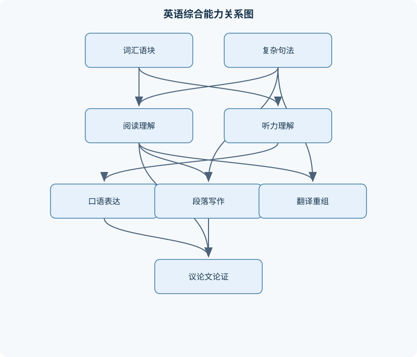
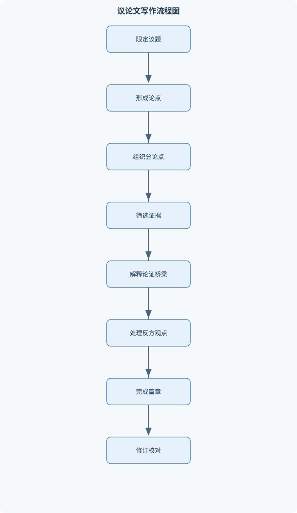

# 大学英语Ⅲ

## 一、课程整体知识框架

### 课程边界与先修知识

《大学英语Ⅲ》面向已完成基础英语学习、具备基本词汇、语法和日常交际能力的大学生，重点发展学术与通用英语中的听、说、读、写、译综合能力。课程边界包括中高级英语词汇与语块、复杂句法、篇章理解、讲座和讨论听力、正式口语表达、段落与议论文写作、信息整合与英汉互译，以及基于证据进行观点表达的学术沟通。不以专业英语、文学史、语言学理论或高阶翻译理论为主要内容。先修知识包括基本时态、语态、从句、常用构词法、段落基本结构和日常英语交流能力。课程中的测验、听力音频和背诵材料可作为练习形态线索，但不能据此推断固定教材章节、考核比例或具体考试安排。





### 1. 课程定位与能力边界

《大学英语Ⅲ》面向已经完成基础英语学习、能够进行日常交流并掌握基本语法的大学生。课程重点不是继续孤立地增加词汇数量，而是把已有语言知识转化为较稳定的理解、表达、互动、翻译和信息整合能力。学习者需要处理比日常对话更长、更密集、更正式的英语材料，例如说明性文章、议论文、课堂讲座、讨论发言、工作沟通文本和含有多种逻辑关系的长句。

课程中的“通用英语”关注跨专业、跨场景的公共表达，例如教育、科技、社会生活、公共服务、职业沟通等；“学术英语”则强调定义概念、概括信息、区分事实与观点、引用或转述证据、说明因果和限制条件。两者并非完全分离：通用英语提供常见词汇、句法和交际基础，学术英语在此基础上提高正式程度、信息密度和论证要求。本课程不以某一专业领域的术语体系为核心，也不系统讲授文学史、语言学理论或高阶翻译理论；当文本涉及专业词语时，重点是根据上下文准确理解并得体表达。

课程能力可分为输入、输出和互动三类。输入包括阅读和听力：学习者要从文字或声音中识别主旨、结构、细节、态度和证据。输出包括口语和写作：学习者要提出清晰观点，组织理由与例证，并控制语法、词汇、衔接和语域。互动则要求根据对方发言进行确认、澄清、回应、让步和修正。单项能力不能完全替代另一项能力：能够读懂文章不等于能够口头概括，能够背诵句子也不等于能够在讨论中即时组织观点。

### 2. 语言资源、结构分析与篇章能力的关系

语言表达可以从词汇、句子和篇章三个层面分析。词汇层面关注词形、词义、词性、搭配、语域和词族；句子层面关注主干、修饰范围、时态体、语态、从句和逻辑关系；篇章层面关注主题、主旨、分论点、证据、衔接与作者态度。三个层面是逐级制约的：词义判断离不开句法位置，句子理解离不开上下文，篇章主旨也不能脱离具体证据。

句子成分采用以下符号表示：$S$ 表示主语，$V$ 表示谓语动词，$O$ 表示宾语，$C$ 表示补语，$A$ 表示状语。基本句型可写为 $SVO$、$SVC$ 或 $SVOA$。例如，*The policy improved public access.* 可分析为 $S+V+O$；*The result was significant.* 可分析为 $S+V+C$；*The team completed the task efficiently.* 可分析为 $S+V+O+A$。这些符号用于识别句子主干，不表示英语句子只能采用这三种形式。复杂句还可能包含多个从句、非谓语短语和插入成分。

短语可用 $NP$、$VP$、$AdjP$、$AdvP$ 分别表示名词短语、动词短语、形容词短语和副词短语，$Clause$ 表示从句。分析长句时，首先寻找限定谓语及其主语，再判断从句和非谓语结构的边界，最后确定修饰范围与逻辑关系。不能把每个动词都当作主句谓语，也不能把紧邻名词的词语一律理解为定语。复杂句的可靠理解路径是“主干—结构—关系—语境”，而不是逐词替换。

时态和体用 $T$ 表示。$T$ 不是某一个孤立的词尾，而是时间参照、动作完成性和进行性共同形成的解释系统。例如，一般现在时可以表示习惯、事实或稳定状态；现在进行时通常表示当前或现阶段正在进行的活动；现在完成时把过去事件与现在的结果、经历或持续状态联系起来。判断时不能只看形式，还要结合时间副词、上下文和说话者视角。若语境明确表示过去某一已结束时间，通常不能仅因动作与现在有关就随意使用现在完成时。

篇章中的连接关系用 $C$ 表示，常见类型包括并列、递进、转折、因果、条件、让步和举例。连接词是识别关系的线索，但不是关系本身。*however* 常提示转折，*therefore* 常提示结果，*for example* 常提示例证；如果前后命题实际上不存在转折、因果或举例关系，机械添加连接词反而会造成逻辑错误。篇章连贯既依赖显性的连接词，也依赖信息顺序、词汇复现、代词指代和论证关系。

### 3. 从理解到表达的综合路径

综合语言任务通常遵循“获取信息—筛选信息—组织信息—表达信息—检查质量”的路径。阅读或听力先获得主题和结构，再确认关键细节；口语或写作不能把所有输入材料原样搬运，而要根据任务目标选择相关内容；翻译和改写则需要在保留核心信息的同时重建目标语的句法、语序和语域。

论证表达可用 $P+E+W$ 表示：$P$ 是中心命题或中心论点，$E$ 是证据，$W$ 是论证桥梁，即说明证据为何能够支持命题的解释。若加入反方观点和回应，可表示为 $P+E+W+R+Q$，其中 $R$ 是反方观点，$Q$ 是对反方观点的回应。证据并不会自动构成论证；事实、数字或个人经历只有在与命题相关、具有一定可靠性，并且通过 $W$ 解释其支持机制时，才具有真正的论证作用。

口语和听力中的线索词用 $L$ 表示，笔记中的核心信息用 $N$ 表示，可用 $L\rightarrow N$ 表示“由线索词压缩出核心信息”。听讲座时，*first*, *in contrast*, *as a result*, *for instance* 等词可以帮助判断结构，但笔记不应逐句抄写。应记录主题、分论点、因果、例证、数字和说话者态度。文章或口头表达中的分论点可用 $A_1$、$A_2$、$A_3$ 表示；每个分论点都必须与中心论点 $P$ 存在明确关系，否则会造成材料堆积。

翻译质量可从准确性、通顺性和语域得体性三个维度考察，分别用 $Acc$、$Flu$、$Reg$ 表示。$Acc$ 要求不遗漏、不误加、不改变原文的事实关系、范围、否定、情态和逻辑；$Flu$ 要求译文符合汉语的句法和信息组织习惯；$Reg$ 要求正式文本、课堂发言、日常沟通等不同场景使用适当表达。三者不能机械排序：在正式信息文本中，准确性是基础；若逐词对应导致汉语无法理解，则需要调整语序和句式，以更好地实现原文功能。

## 二、章节和模块划分

### 核心知识覆盖清单

本清单用于检查正文是否覆盖本课程的主要知识模块：

- **英语学习目标与语言资源**：通用英语与学术英语边界、输入、输出与互动能力、词汇的词形词义词性、词族与构词法、固定搭配与语块、语域与正式程度、语境中的词义判断、英美变体与可理解性。
- **复杂句法与句子准确性**：基本句型与成分分析、并列结构与平行结构、定语从句与关系词、名词性从句、状语从句与逻辑关系、非谓语动词、被动语态与使役结构、虚拟语气与条件句、倒装与强调结构。
- **词汇发展与语境推断**：词缀识别与词义推断、一词多义与搭配限制、同义词的语域差异、近义动词的论元结构、名词化与学术表达、多词短语与动词短语、上下文线索分类、词汇复现与篇章连贯。
- **阅读理解与批判性阅读**：标题与预测、段落主题句、主旨与细节区分、指代关系识别、篇章结构与信号词、因果比较与让步关系、作者态度与语气、推断与证据边界、事实观点与论证评价。
- **听力理解与讲座信息处理**：连读弱读与重音、意群与语调、听前预测、关键词与信号词、主旨和分论点记录、例证与定义识别、数字时间和专名处理、说话者态度判断、听力笔记的层级结构。
- **口语互动与正式表达**：信息确认与澄清、观点陈述与理由展开、同意保留与礼貌反驳、讨论中的轮次管理、举例比较与因果说明、口头汇报结构、发音可理解性、语法错误的自我修正、正式与非正式表达转换。
- **段落写作与篇章衔接**：段落统一性、主题句与控制范围、支持句与具体展开、例证数据与解释、句间逻辑桥接、代词和词汇衔接、过渡语与路标句、段落边界判断、改写与编辑流程。
- **议论文写作与证据使用**：议题界定与立场形成、可论证的中心论点、论据与论证理由、证据的相关性和可靠性、论据与结论之间的论证桥梁、反方观点与回应、五段式结构的适用边界、长篇议论文的多段组织、结论的综合而非简单重复。
- **英汉翻译与信息重组**：语义单位与句法重组、名词化结构的转译、被动结构的汉语表达、长句拆分与合并、逻辑关系显化、指代与衔接转换、术语和普通词的语境选择、直译与意译的边界、译文准确性通顺性和得体性。
- **综合任务与语言质量控制**：多模态信息整合、阅读听力口语联动、资料摘要与改写、引用和转述的区别、避免无依据断言、草稿反馈与修订、语法词汇篇章三级校对、口头汇报与书面文本转换、任务完成度与语言准确度平衡。


### 第一模块　英语学习目标与语言资源

本模块建立课程所需的词汇、语块、语域和交际观念。词汇学习不能只记“单词—中文释义”的对应关系，还要同时关注词形、词性、基本义、引申义、常见搭配和句法行为。例如 *access* 可以作名词表示“使用机会、通道”，也可以作动词表示“访问、获得使用权”；*access to information* 中它通常作名词，后接介词 *to*，而不能依据中文意思任意替换为其他结构。

词族和构词法有助于在陌生词出现时形成候选解释。常见前缀可能改变否定、重复、程度或方向，后缀则常提示词性，如名词、形容词或副词。但词缀只能提供线索，不能保证机械推导出词义。一个形式上可拆分的词，其实际意义可能已经词汇化；因此，构词推断必须返回句子和篇章中检验。

固定搭配和语块是提高准确性与流利度的重要资源。英语中许多词并非可以自由组合，例如表达“采取措施”通常使用 *take measures*，表达“提出建议”可使用 *make a suggestion* 或 *offer advice*。近义词也受搭配限制、语域和句法限制。正式写作中常见的抽象名词和动词组合，不一定适合日常口语；非正式短语动词也不一定适合所有学术文本。

语域表示语言与场合、关系和目的相适应的程度。同一信息可以有正式、一般和非正式表达。正式表达通常更少依赖口语缩略形式，名词化结构和逻辑连接更明显；非正式表达可以更直接、更具互动性。语域并不等于“越复杂越好”，表达是否得体取决于受众、任务和交际目的。英式、美国式及其他英语变体在发音、拼写、词汇和部分表达上存在差异，学习目标是保持可理解性和交际有效性，而不是把某一种变体绝对化。

### 第二模块　复杂句法与句子准确性

本模块从基本句型出发，处理并列、从句、非谓语、语态、条件和强调结构。并列结构要求形式和功能尽量平行。例如，*The course develops reading, writing, and speaking skills* 中三个并列成分都是动名词；若改为 *reading, to write, and speaking*，结构不平行，读者需要额外解释其关系。平行结构不仅是形式要求，也有助于读者快速识别信息层级。

定语从句修饰名词或名词短语，关系词的选择取决于先行词在从句中的语法功能，而不是只看先行词是人还是物。若关系词在从句中作主语、宾语或表示所属，结构会不同。名词性从句在句中可以充当主语、宾语、表语或同位语，其整体功能相当于名词短语。状语从句则表达时间、原因、条件、让步、目的、结果或比较等关系，理解时要判断从句与主句之间的逻辑，而不能只背连接词的中文翻译。

非谓语动词没有独立的限定时态，必须结合逻辑主语、动作先后和语态判断意义。现在分词常表示主动或伴随，过去分词常表示被动或完成状态，不定式可表示目的、计划、结果或补充说明，但这些只是常见倾向，不是绝对规则。分词短语的逻辑主语通常应与被修饰成分相联系，否则会产生悬垂修饰。例如，*After reading the report, the problem became clearer* 暗示“问题读了报告”，逻辑主语不当；可改为 *After reading the report, we understood the problem more clearly*。

被动语态的核心是把受事置于句法主语位置，形式通常由相应形式的 *be* 加过去分词构成。被动结构适合突出行为、结果或受事，而不突出施事。英译汉时不能机械保留“被”，应根据信息焦点改为主动句、无主句、主语省略句或“受到”结构。使役结构则表达“使某人做某事”或“使某事发生”，需要区分使役者、被使役者和动作之间的关系。

虚拟语气和条件句用于表达与事实相反、可能性较低、假设、愿望、建议或正式要求。判断条件句不能只依据动词形式，还要确定时间参照和现实状态。倒装和强调结构改变正常语序，以突出地点、否定范围、条件或特定信息。分析这类句子时，应先恢复基本语序，再判断强调的成分及其语用功能。

### 第三模块　词汇发展与语境推断

本模块把词汇学习从“记忆释义”扩展为“根据证据判断意义”。遇到生词时，先判断其词性和在句中的句法位置，再寻找定义、同义改写、具体例子、对比关系、因果关系、语篇重复和构词线索。一个候选词义必须能够同时解释句法、搭配和上下文逻辑；如果只能解释其中一项，就不能直接确定。

多义词的不同义项往往受到搭配限制。例如一个动词在“接受建议”“承认错误”“承担责任”等结构中可能分别使用不同的搭配，不能因为中文都可译为“接受”或“承认”就相互替换。近义动词还可能具有不同的论元结构，即对主语、宾语、补语或介词成分的要求不同。词汇选择因此不仅是意义选择，也是句法和语篇选择。

名词化结构常把动作、性质或过程转化为名词，使表达更适合正式说明和学术写作，但过度名词化会增加句子密度，隐藏行为主体和逻辑关系。写作时应在正式性与清晰性之间平衡。多词短语和动词短语也不能逐词理解，应结合整体意义、宾语类型和上下文判断。

词汇复现能够形成篇章连贯，但复现不等于重复同一个词。作者可能通过同义词、上位词、下位词、代词或概括表达维持同一主题。阅读时追踪这些词汇链，有助于识别段落中心；写作时适度复现关键词可以保持主题清晰，但盲目替换同义词可能导致语义偏移或语域不一致。

### 第四模块　阅读理解与批判性阅读

阅读理解首先处理文本“说了什么”，再处理“如何组织”和“是否有充分依据”。标题可以提供主题预测，但标题通常不是完整主旨。首段、段落首句、转折句和结尾往往包含重要信息，但不能把固定位置当作绝对规则。说明文常围绕概念、原因、过程和影响展开；议论文通常包含立场、理由、证据、反方观点和回应；同一文本也可能混合多种结构。

段落主题是段落讨论的对象，中心主旨则是作者对对象作出的完整概括。细节包括例子、解释、数据、时间、地点和具体事实，它们用于支撑主旨，不能单独替代主旨。指代关系要根据语法一致、语义合理和篇章距离共同判断，最近的名词不一定就是代词所指对象。

批判性阅读要求区分事实、观点、推断和评价。事实判断关注文本是否直接陈述并有明确依据；观点判断关注作者或他人的立场；推断必须能由文本证据合理推出，不能以个人常识取代文本信息。作者态度可通过评价词、情态动词、让步结构、引语安排和语气判断。*may*, *likely*, *clearly* 等词显示不同程度的确定性，不能把谨慎判断改写成绝对结论。

### 第五模块　听力理解与讲座信息处理

听力理解受连读、弱读、重音、语调、语速和背景噪音影响。弱读元音常用 $/ə/$ 表示，但这是解释常见弱读现象的符号，不意味着所有英语变体在所有场合都完全相同。实词通常承载较多信息，功能词在连续语流中可能弱读或连读。听力时不能只依赖逐词辨认，应结合重音、意群和上下文预测意义。

讲座信息通常具有层级结构：主题—分论点—解释或例证—结论。听前根据标题、问题和关键词预测内容；首次听辨优先获取主旨、说话者目的和结构信号词；随后补充定义、数字、专名、因果和态度。听不清一个局部词语时，应利用前后句和后续重复信息验证，不应立即用最熟悉的词填补。

笔记应压缩为关键词和关系，而不是完整记录句子。可以记录“原因→结果”“问题—解决方案”“观点—例证”等结构。数字、时间和专名需要保留必要精度，但不应让一个细节破坏对整体主旨的判断。听力理解通常先建立整体结构，再补充局部信息；若局部信息与整体逻辑冲突，应回听或保留不确定性。

### 第六模块　口语互动与正式表达

口语表达包括单向陈述和双向互动。有效的观点回答通常包含直接立场、理由、具体例子或解释，以及必要的限定条件。可用“观点—理由—例证—回扣”的顺序组织短回答，但该顺序不是所有谈话的固定格式。复杂问题需要先界定讨论范围，例如对象、时间、场景和评价标准，避免把过大的议题压缩成绝对判断。

互动中需要确认信息、请求澄清、复述理解、表达同意、保留意见和礼貌反驳。礼貌并不等于回避观点，关键是准确复述对方立场，再指出适用条件、证据限制或不同评价标准。轮次管理包括适时进入话轮、回应前一位发言者和把话题交还给他人。口语中的停顿和自我修正是正常现象，但修正应服务于可理解性，不能因追求复杂句而破坏信息连续性。

发音可理解性比模仿某一种口音更重要。重音、意群和语调能够帮助听者判断重点、结束、疑问和对比关系。若暂时想不起精确词语，可以用定义、改述、上位词或例子保持交际，例如先说明“a device used for...”而不是长时间停顿。正式口语与非正式口语的转换要考虑称呼、缩略形式、礼貌程度、词汇选择和句子完整性。

### 第七模块　段落写作与篇章衔接

段落是围绕一个相对统一中心组织的若干句子集合。主题句通常包含主题和控制范围：主题说明讨论对象，控制范围限定要说明的方面。只有主题而没有范围，段落容易扩散；范围过窄又可能无法充分展开。支持句应通过例证、解释、比较、因果、数据或引用回答“具体是什么”和“为什么”。

段落统一性要求每个句子服务于同一中心，充分展开要求中心不能只停留在抽象判断。例如“团队项目很有价值”只是判断，后续还需要说明价值体现在哪里、通过什么机制产生、在什么条件下成立。段落边界应依据主要观点和功能判断，而不是依据句子数量。新的主要观点通常需要另起一段。

衔接包括语法衔接和词汇衔接。代词、指示词、重复关键词、同义表达和上位词能够连接句子；过渡语可以标示递进、转折、因果和举例，但不能替代缺失的逻辑。改写与编辑应分层进行：先检查中心和顺序，再检查句间关系，最后处理语法、词汇、拼写和标点。若一开始只改单词，可能掩盖段落结构问题。

### 第八模块　议论文写作与证据使用

议论文与单纯陈述信息的说明文不同。议论文必须针对可讨论的问题提出立场，并通过理由、证据和论证桥梁支持该立场。主题如“移动设备使用”只是讨论对象；中心论点应进一步作出范围明确、可以被支持或反驳的判断，例如限定为某一类课堂、某一年龄群体或某一使用条件。

论据需要满足相关性、一定可靠性和足够性。个人经历可以作为说明性例子，但不能自动证明普遍因果；单个数字能够说明一个观察结果，也不能自动推出所有群体都具有同样结果。$W$ 的作用是解释证据与结论之间的关系，包括作用机制、适用条件和推理范围。缺少 $W$ 时，文章可能只有事实罗列，没有真正论证。

反方观点用 $R$ 表示，回应用 $Q$ 表示。合理回应不是歪曲对方再反驳，而是准确承认其可能成立的部分，再说明其适用条件、证据不足或与当前情境不一致之处。五段式结构适合篇幅有限且论点单一的任务，但不是所有议论文的唯一格式。复杂议题应根据背景、分论点、证据和反方回应的数量扩展篇幅。结论应综合主要发现、重申限定后的判断并指出意义，不能只机械重复开头句。

### 第九模块　英汉翻译与信息重组

翻译以语义单位和功能对应为基础，而不是逐词替换。先划分意群，确定主干、修饰范围、时态、语态、否定、情态和逻辑关系，再进行初译。英语长定语常需在汉语中前置、后置或拆分；英语被动句可译为主动句、无主句、主语省略句或“受到”结构；英语名词化结构则可能需要还原为动词，使汉语更清楚。

英汉两种语言在主语显隐、语序、连接方式和信息焦点上存在差异。英语常使用形式主语、被动结构和名词化表达组织信息，汉语则较多依靠语境、动词链和意合关系。逻辑关系在原文明确时，译文应保持清晰；若原文仅有隐含关系，译者可以根据上下文适度显化，但不能擅自增加原文没有的因果、评价或时间信息。

术语和普通词的选择取决于语境。普通词在不同文本中可能具有不同的专业程度，不能脱离上下文固定翻译。译文审校应从 $Acc$、$Flu$、$Reg$ 三方面复读：核对事实和范围，检查汉语语序与句法，再判断正式程度、礼貌程度和文本功能是否相符。

### 第十模块　综合任务与语言质量控制

综合任务把阅读、听力、口语、写作和翻译连接起来。例如先阅读一篇说明材料，再听取不同观点的访谈，随后整理双方论据并进行口头汇报或书面写作。此类任务要求区分原文信息、他人观点和自己的判断，不能把转述内容误写成个人事实，也不能把未确认的信息写成确定结论。

资料摘要应保留中心信息、主要关系和必要限定，删除重复例子和无关细节；改写则需要改变句式或表达方式，同时保持原意和证据边界。引用是明确保留他人表达或信息来源的行为，转述则用自己的语言概括他人观点；两者都必须避免把他人观点伪装成自己的判断。

质量控制可分为结构、语言和任务三个层面。结构检查中心论点、分论点、证据和衔接；语言检查语法、词汇、拼写、标点和语域；任务检查是否回答了题目、覆盖了要求、控制了篇幅并保持证据边界。口头汇报转为书面文本时，需要补充明确主语、逻辑连接和必要限定；书面文本转为口头表达时，则要减少过密名词化结构，增加听者容易识别的路标语和解释。综合任务的完成度与语言准确度应同时评价，复杂表达若损害可理解性，应优先保证清晰、准确和得体。

## 三、核心概念的详细解释

### 3.1 语言资源：从词汇形式到交际功能

《大学英语Ⅲ》中的词汇学习不等于记忆孤立的中文释义。一个词的实际使用至少包括词形、词义、词性、句法行为、搭配、语域和语境功能。以 *significant* 为例，它可以表示“重要的”，也可以表示“显著的”；在研究或说明语境中，*a significant increase* 更接近“显著增加”，而不是泛泛的“重要增加”。因此，词义判断必须同时回答三个问题：该词在句中充当什么成分；它与哪些词构成稳定搭配；上下文要求哪一种意义。

词族能够帮助学习者识别词形之间的关系。例如，*decide*、*decision*、*decisive*、*indecision* 具有共同词根，但它们的词性和搭配不同：*make a decision* 中需要名词，*decide to do something* 中需要动词，*a decisive factor* 中需要形容词。词缀可以提供方向性线索，但不能保证完整释义。前缀 *un-* 常表示否定，后缀 *-tion* 常将动词转化为名词；然而，词义仍须通过句法和上下文验证。将一个生词拆成词根和词缀，只能形成候选义项，不能直接代替词典释义。

固定搭配和语块是比单词更大的语言单位。*reach an agreement*、*pose a question*、*be responsible for* 的意义和自然程度不能简单由单词逐个相加决定。近义词也不能任意互换：*raise a question*、*arise from a problem* 和 *solve a problem* 的动词搭配、论元结构和语义角色不同。正式程度还会影响选择，例如口语中的 *find out* 在正式说明中可能改为 *determine*，但这并不意味着后者在所有语境中都更好。英语不同变体在拼写、发音和词汇上可能存在差异，学习目标应是稳定的可理解性，而不是机械模仿某一种口音。

### 3.2 复杂句法：主干、修饰范围与逻辑关系

句子分析应先识别主干，再处理附加结构。$S$ 是主语，$V$ 是谓语动词，$O$ 是宾语，$C$ 是补语，$A$ 是状语；常见骨架包括 $SVO$、$SVC$ 和 $SVOA$。在 *The committee approved the revised proposal after a long discussion.* 中，主干为 $S+V+O$，*after a long discussion* 是时间状语。若先逐词翻译，容易把 *revised* 误读为独立谓语；实际上它是过去分词作定语，修饰 *proposal*。

定语从句修饰名词，名词性从句在句中充当名词性成分，状语从句则表达时间、原因、条件、让步、目的或结果等关系。例如，*The policy that the committee proposed was adopted after several revisions.* 的主句主干是 *The policy was adopted*；*that the committee proposed* 修饰 *policy*，其中 *that* 在从句中充当 *proposed* 的宾语，而不是表示时间。理解关系词的句法功能，比只记忆关系词的中文译法更可靠。

非谓语动词没有独立的限定时态，不能单独承担完整句子的时态判断。*Having completed the survey, the students analyzed the results.* 中，*having completed* 表示完成先于 *analyzed*，其逻辑主语通常与主句主语 *the students* 相同。若写成 *Having completed the survey, the results were analyzed by the students*，就可能产生悬垂修饰，因为“完成调查”的逻辑主体不应是 *the results*。判断非谓语结构时要检查逻辑主语、动作先后和主动或被动关系。

被动语态的核心是把受事置于句法主语位置，而不是简单地增加 *be*。*The proposal was rejected* 突出“提案被拒绝”的结果；汉译时可以译为“该提案被否决”“有关方面否决了该提案”或“该提案未获通过”，具体形式取决于信息焦点和汉语表达习惯。使役结构 *The teacher had the students revise the paragraph* 表示“教师让学生修改段落”，其中 *the students* 是动作执行者，不能把 *revise* 误作被动意义。

### 3.3 时态、体、虚拟和强调结构

$T$ 表示时态和体的组合，其解释依赖时间参照、动作是否完成以及是否处于进行状态。一般现在时可以表示习惯、稳定事实或现阶段状态；现在进行时突出当前或临时过程；现在完成时把过去事件与现在的结果、经历或持续状态联系起来。*The team has completed the report* 强调报告已经完成并与现在有关；*The team completed the report yesterday* 指向明确的过去时间，通常使用一般过去时。不能仅凭“动作已经发生”就选择现在完成时。

条件句的意义由条件与结果的时间关系和现实可能性共同决定。真实条件可以使用一般现在时表达将来条件，如 *If the data are reliable, the conclusion will be useful.*；与现在事实相反的假设通常采用过去式形式，如 *If the data were more complete, the conclusion would be stronger.*；与过去事实相反的假设通常使用过去完成形式，如 *If the team had checked the figures, it would have avoided the error.* 这些形式表达的是说话者对现实性的判断，不应机械理解为单纯的过去时间。

倒装和强调结构改变信息焦点，但不能改变基本命题。*Only after the review did the team identify the error.* 中，*only after* 位于句首引起部分倒装，助动词 *did* 置于主语前。*It was the final paragraph that clarified the author’s position.* 使用强调结构突出 *the final paragraph*。分析时应先还原普通语序，再判断被突出成分承担的语义功能。

### 3.4 词义推断与篇章衔接

词义推断不是“看到熟悉词根就猜意思”，而是一个受证据约束的过程。定义线索常由 *means*、*refers to* 等表达引出；同义改写会在附近提供解释；例证线索通过具体事物说明抽象词；对比线索常由 *however*、*unlike*、*rather than* 引出；因果线索则通过原因和结果限制词义。若一个词有多个候选意义，应把候选意义代回原句，检查其是否符合词性、搭配和上下文逻辑。

阅读理解需要区分主题、主旨、分论点和细节。主题是文章讨论的对象，如“课堂中的移动设备”；主旨是作者关于该对象的完整判断，如“在需要持续互动的课堂中，限制非学习性设备使用有助于提高参与度，但应保留必要的学习用途”。段落首句常提供方向，但不能把首句直接等同于全文主旨。标题用于预测，不足以单独证明答案。推断必须能由文本证据推出，不能只凭个人常识补充文本没有表达的结论。

篇章连贯依靠逻辑关系和语言衔接共同形成。$C$ 可表示并列、递进、转折、因果、条件、让步或举例等连接关系。*however* 只是转折线索，不能把本来没有转折的两个命题强行连接；*therefore* 也不能替代因果依据。代词、指示词、关键词复现、同义替换和上位词构成词汇衔接，但如果句子之间缺少共同中心，增加连接词仍然无法形成连贯篇章。

### 3.5 听力、口语与正式互动

英语听力中的连读、弱读、重音和语调会改变语音信号的显著性。功能词在自然语流中常弱读为含有 $/\ə/$ 的形式，但不同英语变体并不完全一致。听力理解不应要求逐词听清；重音通常更容易承载新信息、对比信息或态度信息。讲座中 *first*、*in contrast*、*for example*、*as a result* 等信号词有助于建立“主题—分论点—例证—结果”的层级结构。

正式口语表达通常先给出立场，再说明理由、例子和限定条件。例如，*I support the proposal, mainly because it improves access and reduces unnecessary delay. However, it should be applied only when users receive clear guidance.* 该回答同时包含观点、理由和条件，避免了没有解释的结论。互动中，*Could you clarify what you mean by…?* 用于澄清，*I agree with this point, but I am not sure that it applies in every case.* 用于保留式同意。若一时想不起精确词语，可以通过定义、改述或上位词保持交际连续性。

轮次管理包括进入话轮、回应前一发言、请求发言和结束话题。正式汇报应有开场、主体、总结和过渡；书面文本中的复杂名词化结构转为口语时，通常需要还原为清楚的动词句并增加路标语。发音评价的重点首先是可理解性，包括重音位置、关键音段和语调是否影响意义，而不是是否完全消除个人口音。

### 3.6 段落、议论文与证据

段落应围绕一个中心展开。主题句不仅说明对象，还应限定讨论范围；支持句通过解释、例证、比较、因果、数据或转述回答“具体是什么”和“为什么”。一个段落同时塞入多个主要观点，会削弱统一性。新的主要观点通常需要另起一段，但固定的“主题句—支持句—结尾句”顺序并非所有文体的绝对规则。

议论文的中心论点用 $P$ 表示，证据用 $E$ 表示，论证桥梁用 $W$ 表示。$P$ 不是主题的重复，而是对可争议问题作出的、范围明确且可支持的判断。证据必须与论点相关，具有一定可靠性，并且数量足以支撑结论。个人经历可以说明可能性，却不能自动证明普遍因果；单项调查结果可以描述样本，不能未经限制地推广到所有人。

完整论证可表示为 $P+E+W$，并结合反方观点 $R$ 和回应 $Q$。例如，“许多学生使用某应用，因此该应用一定提高学习效率”中，使用人数是 $E$，提高学习效率是 $P$，但缺少解释“使用”如何导致“提高效率”的 $W$，还混淆了相关与因果。合理改写应限定对象和条件，例如：“在经过指导并持续完成学习任务的学生中，该应用可能提高练习频率；但仅有下载或使用记录不足以证明学习效果提升。”反方观点应准确复述其合理部分，再说明其适用条件或证据边界。

### 3.7 英汉翻译与综合质量控制

翻译的基本单位是语义单位，而不是孤立单词。英语长句翻译前应划分意群，确定主句主干、从句层级、修饰范围、否定、情态、语态和逻辑关系。英语长定语可在汉语中前置、后置或拆句；英语被动句可译为被动、主动、无主句或结果表达；英语名词化结构常需还原为动词。例如，*The implementation of the policy led to a reduction in delays* 可译为“实施这项政策后，延误减少了”，不必保留两个抽象名词。

译文评价可从 $Acc$、$Flu$、$Reg$ 三方面进行。$Acc$ 表示信息、范围、时态、否定和逻辑关系准确；$Flu$ 表示目标语句法自然、衔接顺畅；$Reg$ 表示正式程度、礼貌程度和文本功能相符。三者不是互相替代的分数：一篇汉语流畅但漏译否定的译文，$Flu$ 较好而 $Acc$ 不合格；一篇逐词对应但汉语不自然的译文，可能部分准确却不够通顺。

综合任务还要求区分引用、转述和个人判断。摘要应保留主旨、关键关系和必要限定，删除无关细节；改写应改变句式或表达方式，但不能改变原意；若材料只说“可能相关”，就不能在转述中写成“已经证明因果”。最终修订应依次检查任务完成度、篇章结构、语法词汇、拼写标点和语域，避免只改单词而不修复论证关系。

## 四、重要定义、公式、定理和推导

### 专业审校补充：关键定义与适用边界

学术与正式英语中的“限定表达”和“观点归属”必须与事实陈述区分。限定表达包括 *may*、*can*、*tend to*、*is likely to*、*suggest* 等，用来标示可能性、倾向性或证据强度；观点归属包括 *the author argues that*、*the study reports that*、*critics claim that* 等，用来说明判断来自谁。二者不能互相替代：*The report suggests that the policy may reduce noise* 同时限定了证据强度和结论可能性；若改成 *The policy reduces noise*，就把谨慎推断强化成无条件事实。需要注意，*can* 既可表示能力，也可表示一般可能性；*must* 既可表示义务，也可表示基于证据的强推断，必须由语境判断。限定表达不是含糊其辞，而是使结论强度与证据相匹配。反例是：原文仅说“部分参与者表示满意”，却改写为“该措施普遍提高满意度”；这同时扩大了范围、改变了证据类型，并删除了观点归属。适用边界是正式写作、摘要、转述和口头汇报中的证据控制；在明确指令、事实定义或已给定条件的句子中，不应无故添加 *may*，否则会削弱原意。


### 4.1 核心关系式及其适用边界

本课程中的“公式”主要是语言分析和论证组织的结构式，不是自然科学意义上的定量定律。

句法分析可写为：

$$
\text{复杂句理解}=\text{主干识别}+\text{结构分层}+\text{逻辑关系}+\text{语境验证}
$$

其中“主干识别”指确定主要 $S$ 和 $V$；“结构分层”指区分 $Clause$、$NP$、$VP$、非谓语短语及修饰范围；“逻辑关系”指确定时间、因果、条件、转折等 $C$；“语境验证”指用上下文检验初步分析。该式适用于长句阅读和翻译，不保证每个句子只有一个唯一的语义解释；若原文有歧义，应保留合理范围，不能擅自补充信息。

论证结构可写为：

$$
P+E+W
$$

其中 $P$ 是中心命题，$E$ 是证据，$W$ 是解释证据为何支持命题的桥梁。更完整的论证为：

$$
P+E+W+R+Q
$$

$R$ 表示反方观点，$Q$ 表示对反方观点的回应。该结构并不要求每个短段都出现完整的 $R$ 和 $Q$；在篇幅有限、争议较小的任务中，可以只呈现 $P+E+W$。但如果题目要求比较立场或处理反对意见，缺少 $R$ 和 $Q$ 会使论证不完整。

翻译质量可表示为：

$$
\text{译文质量}=f(Acc,Flu,Reg,\text{任务完成度})
$$

其中 $Acc$ 是准确性，$Flu$ 是通顺性，$Reg$ 是语域得体性。这里的 $f$ 不是规定的数值计算公式，而是审校框架。不同任务的优先级不同：安全提示或事实说明首先要求 $Acc$；口头宣传可能更重视 $Flu$；正式公函则必须同时满足 $Acc$ 和 $Reg$。任何一项都不能以牺牲基本信息准确为代价。

### 4.2 词义语境推断流程

**输入**：含生词的句子、前后文和任务要求。  
**输出**：一个或多个候选义项、词性判断、证据和不确定性说明。

第一步，判断词性和句法位置。例如，空格位于冠词后、作名词短语中心时，不能用动词义解释。第二步，检查构词线索，识别词根、前缀和后缀。第三步，寻找定义、同义改写、例证、对比、因果和搭配线索。第四步，至少列出两个候选义项，而不是看到第一个熟悉意思就停止。第五步，把候选义项代回原句，检查逻辑、搭配和语域。第六步，若多个义项仍然成立，应保留不确定性。

```text
function inferMeaning(sentence, context):
    pos <- identifyPartOfSpeech(sentence)
    candidates <- generateCandidatesByAffixAndKnownWords(sentence, pos)
    clues <- findDefinitionExampleContrastCauseAndCollocation(context)
    candidates <- filterByClues(candidates, clues)
    for each meaning in candidates:
        testSentence <- replaceUnknownWord(sentence, meaning)
        evaluate(grammaticalFit, logicalFit, registerFit)
    return candidatesWithEvidenceAndConfidence
```

该流程的终止条件不是“猜出一个中文词”，而是候选义项能够解释句法和篇章，或已明确说明无法唯一确定。它适用于阅读中的局部生词推断，不适用于法律、医学或技术术语的精确翻译；后者需要额外核对术语定义。

### 4.3 阅读信息提取与结构验证

**输入**：英语文章和阅读问题。  
**输出**：主旨、段落功能、关键证据、作者态度及不确定信息。

先读标题、首段和结尾，预测讨论对象与可能立场；再扫描各段首句、转折词、因果词和举例标记，建立 $A1$、$A2$、$A3$ 等分论点；随后回到相关段落核对细节，区分原文明确陈述与读者推断；最后用一句话概括全文，并为每个答案标记证据位置。若问题问“作者主要观点”，不能只复制一个细节；若问题问“根据文章可以推断”，答案必须能由多处信息共同推出。

验证标准包括：主旨覆盖文章主要范围；分论点与 $P$ 有明确关系；细节没有扩大原文范围；作者态度能由评价词、情态词、让步结构或结论语气支持。终止条件是每个问题都能对应文本证据，或被明确标注为“文本不足以确定”。

**例题一：主旨判断。** 某文四段分别介绍在线讨论的便利、缺乏即时反馈的问题、教师设计任务的作用以及适用条件。  
**分析**：第一段和第二段构成背景与限制，第三段给出改进方式，第四段限定适用条件。  
**解答**：主旨应是“在线讨论具有便利性，但其效果取决于任务设计和互动反馈”，不能只写“在线讨论很方便”。  
**验证**：该答案覆盖便利、限制、改进和条件四类信息。  
**变式**：若全文只介绍三种平台功能而未评价优缺点，主旨应改为说明性概括，不应强行写成支持或反对某平台。

### 4.4 听力笔记与口头复述流程

**输入**：讲座或讨论音频、题目和有限记录空间。  
**输出**：层级笔记、主旨、分论点、关键例证和态度判断。

听前根据标题和题目预测主题；第一次听辨 $L$，即结构线索词和重读信息；按“主题—分点—例证—结果”记录 $N$，形成 $L\rightarrow N$ 的压缩笔记；第二次重点核对数字、时间、因果、否定和说话者态度；听后依据笔记完成复述。笔记不应逐句抄写，否则会因记录上一句而错过下一层信息。一次听不清的词，应利用后续解释和整体关系验证，不能立即补成最熟悉的词。

**例题二：讲座信息复述。** 音频先提出“城市交通拥堵”，再说明原因是通勤集中和道路资源有限，随后举例介绍弹性工作时间，最后指出该措施不能单独解决所有问题。  
**解答步骤**：记录主题“拥堵”；分点“原因：通勤集中、资源有限”；例证“弹性工作”；限制“不能单独解决”。一分钟复述应包含问题、两个原因、措施和限定，而不是只说“弹性工作有帮助”。  
**结果验证**：复述是否保留了因果方向和限制条件。  
**变式**：如果说话者使用 *may*、*could*，复述必须保留“可能”，不能改成“必然”。

### 4.5 段落修订流程与实例

**输入**：英语段落草稿。  
**输出**：中心明确、展开充分、衔接自然且语言准确的段落。

第一步用一句话概括段落中心；第二步删除不服务于中心的句子；第三步检查主题句是否限定对象和范围；第四步为抽象判断补充例证、解释或因果；第五步检查代词指代、重复词和过渡关系；第六步进行语法、词汇、拼写和标点校对。修订顺序必须由篇章到句子再到词语，否则局部修改可能掩盖结构缺陷。

**例题三：段落诊断。** 草稿先说小组项目能提高合作能力，接着介绍校园餐厅价格，又说有些学生喜欢独立学习。  
**分析**：第一句与第三句可形成“支持与限制”，餐厅价格与中心无关，应删除或另段处理。  
**解答**：主题句可改为“适当设计的小组项目能够培养合作能力，但其效果取决于分工和评价方式。”随后分别解释分工如何促进参与、评价如何减少“搭便车”。  
**验证**：每句都能回答“为什么项目能培养合作能力”。  
**变式**：若题目要求只论证小组项目的优点，则限制条件可压缩为一句，不必扩展成独立反方段落。

### 4.6 议论文构思与论证诊断

**输入**：开放性议题。  
**输出**：范围明确的 $P$、分论点 $A1$—$A3$、证据表、$W$、$R$ 和 $Q$。

先限定对象、时间范围和评价标准；再写出多个可争议命题；选择一个能够被证据支持的 $P$；为每个分论点配置 $E$ 和 $W$；随后检验反方观点 $R$，设计条件化回应 $Q$；删除与 $P$ 无直接关系的材料。证据表至少应说明“证据是什么、支持哪一分论点、为什么支持、适用范围多大”。

**例题四：移动设备议题。**  
题干：大学是否应限制课堂中的移动设备使用？  
**分析**：题目范围过大，需要限定为“教师讲授和讨论期间的非学习性使用”。  
**解答**：$P$ 可写为“在需要持续参与的课堂中，应限制非学习性设备使用，同时保留查资料、无障碍支持和紧急联系等例外。”  
$A1$：减少注意力分散；$E$ 可为课堂观察或学习任务完成情况，$W$ 是频繁切换会打断持续处理。  
$A2$：明确例外可兼顾学习和公平；$E$ 是设备在查资料和无障碍支持中的功能，$W$ 是限制应针对行为而非设备本身。  
$R$：设备也能帮助记录和检索。$Q$：承认该点，但说明可通过教师规定使用时段和任务要求降低非学习性使用。  
**结果验证**：论点有范围、证据和桥梁，且没有把“限制”扩大成“全面禁止”。  
**变式**：若题目只要求表达个人意见，可缩短 $R$ 和 $Q$；若要求正式议论文，则应补充证据可靠性和适用条件。

### 4.7 翻译分析、初译与审校

**输入**：英语原句和初稿译文。  
**输出**：信息准确、汉语自然、语域合适的译文。

先划分意群，标出 $S$、$V$ 和修饰结构；再识别 $T$、语态、否定、情态和 $C$；初译时保持信息完整；随后调整汉语语序、主语显隐和信息焦点；最后从 $Acc$、$Flu$、$Reg$ 三项复读。若原文存在结构歧义，应选择有依据的译法，不能通过添加原文没有的因果关系来“修顺”。

**例题五：长句翻译。**  
*The policy proposed by the committee was adopted after several revisions, but its implementation remains limited by a lack of trained staff.*  
**结构分析**：主句主干为 *The policy was adopted*；*proposed by the committee* 是过去分词短语作定语；*after several revisions* 表示时间；*but* 连接转折分句；*limited by a lack of trained staff* 表示实施受到限制。  
**直译**：“委员会提出的政策在几次修改后被采纳，但它的实施仍然受到缺乏受过培训的工作人员的限制。”  
**自然译**：“委员会提出的政策经过数次修改后获准实施，但由于缺少受过培训的人员，落实工作仍受到限制。”  
**验证**：保留了政策来源、修改先后、采纳结果、转折和限制原因；汉语中将 *implementation* 译为“落实工作”，避免重复“实施”。  
**变式**：若上下文强调执行机构而非政策，可将后半句译为“执行该政策仍受到人员不足的制约”，调整信息焦点但不改变原意。

### 4.8 实验与项目：多模态信息整合

**项目一：阅读—听力—议论写作。**

**输入数据**：一篇介绍公共交通优点的短文、一段提出限制意见的访谈、一个要求表达立场的写作题。  
**步骤**：第一阶段从阅读材料中提取 $P$、$A1$、$A2$ 和 $E$；第二阶段用听力笔记记录访谈中的 $R$ 和其证据；第三阶段建立“主张—证据—桥梁”表格；第四阶段写出包含让步结构的短文；第五阶段分别进行结构、语言和证据边界修订。  
**评价标准**：是否区分两种材料的观点；是否准确转述；每个主要判断是否有证据；是否处理反方观点；语法、词汇和衔接是否影响理解。  
**排错方法**：若文章只有事实没有立场，补写明确的 $P$；若有数据无解释，补充 $W$；若把访谈观点写成自己的事实，加入“the speaker argues that”等转述标记；若因果过强，将 *proves* 改为 *suggests* 或增加限定条件。

**项目二：口头汇报与书面文本转换。**

**输入数据**：三分钟课堂汇报提纲、相关短文和听众对象说明。  
**步骤**：先确定汇报目的和听众已有知识；按“背景—$A1$—$A2$—例证—结论”安排层级；为每一层写出一句口头路标语；录制或模拟汇报后，依据提纲核对是否遗漏分论点；再把口语稿改写成书面段落，补充明确主语、逻辑连接和限定语。  
**评价标准**：听众能否复述主旨和分论点；语速、重音和停顿是否支持理解；书面稿是否避免口语填充词；两种文本的信息和立场是否一致。  
**排错方法**：听众无法复述主旨时，缩短开场并提前给出 $P$；分论点混乱时，增加 *first、in contrast、as a result* 等路标语，但同时检查真实逻辑；书面稿过于口语化时，将 *a lot of* 等表达改为符合语域的形式；汇报过密难懂时，将长名词化结构还原为动词句。

### 4.9 典型错误与边界反例

1. 把主题当作中心论点；“移动设备使用”只是对象，不是可证明的判断。  
2. 把所有近义词视为可替换；搭配、论元结构和语域会限制选择。  
3. 把关系词只按中文释义理解；*that* 可能是关系代词、连接词或指示词。  
4. 把每个动词都当作限定谓语；非谓语和从句谓语必须分层判断。  
5. 忽略分词短语的逻辑主语，造成悬垂修饰。  
6. 看到过去动作就使用现在完成时；明确的过去时间通常要求一般过去时。  
7. 只堆砌数据和引语，不解释 $E$ 如何支持 $P$。  
8. 用 *however* 或 *therefore* 强行制造不存在的转折或因果。  
9. 把一个段落写成多个无关主题，破坏统一性。  
10. 认为五段式是所有议论文的唯一格式；复杂议题需要按论点规模扩展。  
11. 把反方观点夸张成极端说法再反驳，导致论证失真。  
12. 听力时逐词记录，因记录细节而错过主旨和结构。  
13. 把听不清的音直接补成最熟悉的词，未用后文验证。  
14. 口语只给结论，不提供理由、例子或限定条件。  
15. 逐词翻译英语长句，导致汉语修饰范围和信息焦点不自然。  
16. 将英语被动句一律译成“被”，忽略汉语更自然的主动或无主表达。  
17. 把原文中的“可能相关”改写成“已经证明因果”，超出证据边界。  
18. 只检查语法，不检查任务是否真正回答题目，造成语言正确但任务失败。

## 五、算法、流程和实现思路

### 方法与流程覆盖索引

下列方法或流程应在正文中说明输入、步骤、适用条件、结果检查和边界：

- 阅读信息提取流程：输入为一篇英语文本和阅读任务，输出为主旨、结构、关键证据及不确定信息。先读标题和首段预测主题，再扫描段落首句和转折信号词，随后标记主张、例证、因果和对比关系；回到相关段落核对细节；最后用一句话概括主旨并注明证据位置。终止条件是每个问题都能对应文本证据或明确标注为推断。适用于说明文、议论文和讲座文字稿；不适用于只凭背景常识作答。
- 词义语境推断流程：输入为含生词的句子及上下文，输出为候选词义和置信度。先判断词性，再观察定义、同义改写、例子、对比、因果和构词线索；列出至少两个候选义项；用上下文逻辑和搭配限制排除不合适义项；将推断词义代回原句检验。若多个义项均成立，应保留不确定性，不能把猜测当作词典释义。
- 听力笔记流程：输入为一段讲座或讨论音频，输出为层级化笔记。听前根据题目预测主题；首次听辨主旨、说话者目的和结构信号词；按主题—分点—例证记录关键词，而非逐句抄写；第二次核对数字、因果和态度；听后根据笔记复述并标出缺失环节。终止条件是能够复述主旨、主要分点及至少一项支持信息。
- 议论文构思流程：输入为开放性议题，输出为中心论点、分论点、证据表和反方回应。先限定对象、时间范围和评价标准；列出可争议命题；选择一个范围适当且可被证据支持的P；为每个分论点配置E和W；检验反方观点R并设计Q；删除与P无直接关系的材料。适用于课堂短文和较长研究性写作，但不替代事实核查。
- 段落修订流程：输入为一段英语草稿，输出为结构和语言均改进的段落。先用一句话概括段落中心；检查每句是否服务于该中心；确认主题句范围适当；为抽象判断补充解释或例证；检查代词指代、重复词、连接关系和句间顺序；最后分别进行语法、词汇、拼写和标点校对。终止条件是读者能够识别中心、依据和逻辑关系。
- 口语观点表达流程：输入为一个讨论问题和有限准备时间，输出为结构完整的短口头回答。先给出直接立场，再提供两项理由；每项理由配一个具体例子或解释；使用让步或限定语避免绝对化；结尾回扣立场。表达中若出现词语暂时缺失，可用定义、改述或上位词保持交际连续性。适用于课堂讨论和简短汇报，不适用于需要正式数据展示的完整演讲。
- 英汉翻译审校流程：输入为英语原文和初稿译文，输出为经过审校的目标语文本。先划分意群并确定主干；识别时态、语态、否定、情态和逻辑关系；完成初译后调整汉语语序和信息焦点；核对指代、术语、数字和范围；从准确、通顺、语域得体三个维度复读。若原文存在歧义，应保留合理解释并避免擅自增加信息。





### 5.1 阅读信息提取与复杂句分析流程

阅读理解的目标不是把每个词逐一翻译成汉语，而是在有限时间内建立“主题—结构—证据—结论”的信息网络。该流程的输入是一篇英语文章和具体阅读任务，输出包括文章主旨、段落分论点、关键细节、作者态度、证据位置以及仍然不确定的信息。

#### 5.1.1 操作步骤

1. **预测主题与任务重点**  
   先看标题、首段和题目，判断文章大致讨论对象。例如标题涉及 *public transportation*，题目又询问原因和影响，则阅读时应重点寻找原因、结果、例证和转折。

2. **识别段落功能**  
   扫描各段首句、重复词、同义替换和信号词。*however* 常提示转折，*therefore* 常提示结果，*for example* 常提示例证，*in contrast* 常提示比较或对立。信号词只是线索，必须检查前后命题是否真正形成相应关系。

3. **提取句子主干**  
   对长句先寻找限定谓语及其主语，再区分宾语、补语和状语。句子可用 $S$、$V$、$O$、$C$、$A$ 表示。例如：

   *The policy that the committee proposed was adopted after several revisions.*

   主句主干为 $S+V$：$S$ 是 *The policy that the committee proposed*，$V$ 是 *was adopted*。其中 *that the committee proposed* 是修饰 *policy* 的定语从句，*that* 在从句中作 *proposed* 的宾语；*after several revisions* 表示时间或过程背景。不能把 *that* 误解为时间连接词。

4. **区分主旨、分论点和细节**  
   主题是文章讨论的对象，主旨是作者对该对象的整体说明或判断，分论点是支持主旨的局部内容，细节则包括例子、数字、人物、时间和具体事实。标题通常提示主题，但不一定等于完整主旨。

5. **建立证据边界**  
   若文章说 *may contribute to*，只能概括为“可能促成”或“可能与……有关”，不能改写为“必然导致”。若判断来自多处信息的综合，应标注为推断，而不是直接事实。

6. **回到文本核对**  
   每个答案都应能对应原文句子、段落关系或有明确依据的推断。若无法找到证据，应保留不确定性，而不是用背景常识补足。

#### 5.1.2 终止条件和适用范围

当主旨、主要分论点、题目所问细节均已找到依据，且无法确认的内容已明确标记为推断时，流程终止。该方法适用于说明文、议论文、课堂讲座文字稿和一般工作材料，不适用于完全依赖专业背景知识的文本，也不适用于只凭标题猜答案的任务。

### 5.2 词义语境推断流程

词义推断的输入是含有生词或多义词的句子及其上下文，输出是一个或多个候选义项、选择理由和置信度。推断结果不是永久词典释义，而是在当前语境中的暂定解释。

#### 5.2.1 推断步骤

1. **判断词性和句法位置**  
   例如句中空缺后接名词，可能需要形容词；若空缺受情态动词支配，通常需要动词原形。词性判断可以排除大量错误义项。

2. **寻找上下文线索**  
   主要线索包括定义、同义改写、例子、对比、因果、上下义关系和构词线索。  
   - 定义线索：*that is, namely, refers to*；  
   - 对比线索：*unlike, whereas, however*；  
   - 因果线索：*because, therefore, as a result*；  
   - 例证线索：*for example, such as*。

3. **列出至少两个候选义项**  
   不应看到熟悉的中文义项就立即确定。多义词必须结合搭配和语篇功能判断。

4. **检验搭配与逻辑**  
   将候选词义代回原句，检查是否符合主语、宾语、因果关系和语域。若一个义项在词典中成立，但与上下文逻辑冲突，应排除。

5. **确定置信度**  
   有定义、重复解释和明确对比时，置信度较高；只有单一模糊线索时，应保留两个候选义项，并说明需要更多上下文。

### 5.3 听力笔记与口语输出流程

听力处理的输入是一段讲座、访谈或讨论音频，输出是能够支持理解和复述的层级化笔记。核心原则是先抓主旨和结构，再补充细节，不能试图记录每一个词。

#### 5.3.1 听力笔记结构

笔记可按以下层级组织：

- 主题：讲座讨论什么；
- $A1$：第一个分论点；
- $A2$：第二个分论点；
- 原因、影响、比较或条件；
- 例证、数字、时间和专名；
- 说话者态度，如赞同、保留、质疑或让步。

其中 $L$ 表示听到的线索词，$N$ 表示压缩后的核心信息。例如：

- $L$：*the main reason* → $N$：主要原因；
- $L$：*for instance* → $N$：下面是例证；
- $L$：*on the other hand* → $N$：另一方观点或限制；
- $L$：*as a result* → $N$：结果。

首次听力应记录主题、说话者目的和结构；第二次再核对数字、时间、因果关系和态度。听不清一个词时，应利用后续内容和整体结构验证，不能立即补成最熟悉的词。

#### 5.3.2 口语短回答的生成流程

输入是讨论问题和有限准备时间，输出是结构完整、语法可控的短回答。步骤如下：

1. 先直接表明立场；
2. 给出两个理由；
3. 每个理由配一个例子或解释；
4. 使用 *although*、*to some extent*、*in certain situations* 等让步或限定表达，避免绝对化；
5. 最后回扣立场。

表达中暂时想不起某个词时，可以采用定义、改述或上位词。例如忘记 *reusable container*，可以说 *a container that can be used many times*。这比长时间停顿更能维持交际连续性。

### 5.4 议论文构思与段落修订流程

议论文构思的输入是开放性议题，输出是中心论点 $P$、分论点 $A1$、$A2$、证据 $E$、论证桥梁 $W$、反方观点 $R$ 和回应 $Q$。基本论证结构可表示为：

$$
P+E+W
$$

若加入反方处理，则形成：

$$
P+E+W+R+Q
$$

其中 $W$ 说明“证据为什么支持论点”。没有 $W$ 时，文章往往只是材料堆积。

#### 5.4.1 构思步骤

1. 限定对象、时间范围和评价标准；
2. 把宽泛主题改写成可争议的判断；
3. 为每个分论点寻找相关证据；
4. 解释证据与论点之间的联系；
5. 准确复述反方观点；
6. 说明反方观点的适用条件、证据不足或与当前范围不一致之处；
7. 删除与 $P$ 无直接关系的材料。

五段式适合论点单一、篇幅有限的任务；复杂议题需要根据背景、分论点、证据和反方回应扩展段落，不能机械限制为五段。

#### 5.4.2 段落修订步骤

先用一句话概括段落中心，检查每句是否服务于该中心。然后检查主题句的范围：若主题句说“课堂项目能够提高所有学生的成绩”，而支持句只谈“部分学生的合作经验”，则主题句过度概括。接着补充解释、例证或因果说明，检查代词指代、重复词、连接关系和句间顺序，最后分别进行语法、词汇、拼写和标点校对。

### 5.5 英汉翻译审校流程

翻译流程的输入是英语原文和初稿译文，输出是准确、通顺、语域得体的目标语文本。审校可从 $Acc$、$Flu$、$Reg$ 三个维度进行。

1. **划分意群并识别主干**：确定 $S$、$V$、$O$、$C$、$A$ 及从句范围；
2. **核对语法意义**：检查 $T$、语态、否定、情态、条件和让步关系；
3. **重组汉语语序**：长定语可前置、后置或拆句，名词化结构可还原为动词；
4. **调整被动表达**：根据汉语信息焦点选择主动句、无主句、省略主语句或“受到”结构；
5. **核对指代和范围**：确认 *this, it, they, such* 的所指，避免扩大或缩小原文范围；
6. **检查术语和语域**：普通词不能因形式正式就译成过度专业的术语；
7. **复读评价**：先问是否忠实，再问是否自然，最后问是否符合文本的正式程度和交际目的。

```python
def check_argument(claim, evidence, warrant, counterargument=None, response=None):
    """
    输入：
        claim：中心论点 P
        evidence：证据 E
        warrant：论证桥梁 W
        counterargument：反方观点 R，可为空
        response：回应 Q，可为空
    输出：
        一份结构检查结果，不联网、不写入文件。
    """
    result = {
        "has_claim": bool(claim.strip()),
        "has_evidence": bool(evidence.strip()),
        "has_warrant": bool(warrant.strip()),
        "has_counterargument": bool(counterargument and counterargument.strip()),
        "has_response": bool(response and response.strip())
    }

    if result["has_claim"] and result["has_evidence"] and result["has_warrant"]:
        result["basic_argument"] = "P+E+W结构完整"
    else:
        result["basic_argument"] = "缺少中心论点、证据或论证桥梁"

    if result["has_counterargument"] and result["has_response"]:
        result["counterargument_handling"] = "R+Q结构完整"
    elif result["has_counterargument"] and not result["has_response"]:
        result["counterargument_handling"] = "提出反方观点但没有回应"
    else:
        result["counterargument_handling"] = "未设置反方处理"

    return result

print(check_argument(
    "课堂中的移动设备应在讨论阶段受到适度限制",
    "讨论时频繁查看设备会打断发言者和听者的注意过程",
    "如果设备使用造成持续注意转换，讨论信息的整合就可能受到影响",
    "设备也可以用于查词和记录信息",
    "因此不宜全面禁止，而应在需要互动的阶段限制非任务性使用"
))
```

该程序只是论证结构检查器，不能判断证据真实性、因果关系是否成立，也不能替代人工审校。其过程是读取各项文本、检查是否为空、生成结构状态并输出结果；终止条件是所有字段完成检查。若输入包含论点但没有证据，程序只能指出结构缺失，不能自动补造证据。

### 5.6 代表性例题与逐步解答

#### 例题一：复杂句主干分析

**题干**：分析句子 *The policy that the committee proposed was adopted after several revisions.* 的主干、定语从句和时间关系，并翻译。

**分析**：句中有 *proposed* 和 *was adopted* 两个动词形式，但只有后者是主句限定谓语。*that the committee proposed* 修饰 *policy*；*after several revisions* 表示政策经过多次修改之后被采用。

**解答步骤**：

1. 主语为 *The policy that the committee proposed*；
2. 主句谓语为 *was adopted*；
3. 定语从句为 *that the committee proposed*；
4. *that* 在从句中作 *proposed* 的宾语；
5. *after several revisions* 是时间状语；
6. 汉译为：“委员会提出的政策经过数次修改后被采纳。”

**结果验证**：去掉定语从句后仍有 *The policy was adopted*，说明主句结构完整。若把 *that* 译成“当……时”，句子将失去名词修饰关系。

**变式**：若改为 *The policy, which the committee proposed, was adopted...*，非限制性定语从句提供补充信息，不能把它理解成限定“哪一项政策”的必要成分。

#### 例题二：词义语境推断

**题干**：在句子 *Unlike a temporary decline, the reduction is significant because it has continued for three years.* 中判断 *significant* 的合适含义。

**分析**：*Unlike* 引出对比，*because* 引出原因，后文说明下降持续三年。此处 *significant* 不是“有意义的”或“重要人物的”，而是“显著的、值得注意的”。

**解答步骤**：

1. *significant* 是形容词，修饰 *reduction*；
2. *temporary decline* 与持续三年的下降形成对比；
3. 持续时间是判断“显著”的上下文依据；
4. 代回后译为“这一下降是显著的，因为它已经持续了三年”。

**结果验证**：若译为“这个下降是重要的”，语法虽成立，但没有充分体现与 *temporary* 的对比。若译为“统计显著”，则需要原文提供统计检验或研究语境，当前信息不足。

**变式**：在 *a significant decision* 中，*significant* 更可能表示“重要的”；同一词不能脱离搭配固定翻译。

#### 例题三：段落主旨判断

**题干**：某段先说明大学生使用公共交通可以降低出行成本，随后说明它能减少停车压力，最后指出其效果取决于线路覆盖和班次安排。概括该段主旨。

**分析**：前两句是支持信息，最后一句加入条件限制。主旨不能写成“公共交通很便宜”，因为这只覆盖一个细节。

**解答步骤**：

1. 找出共同对象：大学生使用公共交通；
2. 合并两个结果：降低个人成本、缓解停车压力；
3. 保留限制条件：线路和班次影响实际效果；
4. 概括为：“公共交通能够为大学生带来经济和校园管理方面的益处，但其效果受服务条件限制。”

**结果验证**：该主旨同时覆盖收益和条件，没有把局部细节冒充全文结论。

**变式**：若题目问“作者态度”，应回答“总体支持但持有条件性态度”，不能只回答“公共交通便宜”。

#### 例题四：论证桥梁诊断

**题干**：分析论证“很多学生使用某学习应用，所以该应用一定提高学习效率”。

**分析**：主张 $P$ 是“该应用一定提高学习效率”；证据 $E$ 是“很多学生使用”；缺少 $W$。使用人数只能说明流行程度，不能直接证明效率提高。

**解答步骤**：

1. 区分相关和因果：使用与效率可能相关，但未证明前者导致后者；
2. 检查样本：没有说明学生是否具有代表性；
3. 检查测量：没有说明“学习效率”如何定义；
4. 检查替代原因：使用者可能本来就更自律；
5. 改写为：“在所观察的学生群体中，使用该应用与较高学习效率同时出现，但还需要控制学习基础、投入时间等因素，才能判断其因果作用。”

**结果验证**：改写后取消“一定”，加入观察范围和限制条件，论断强度与证据相匹配。

**变式**：若有前后测和对照组，证据更充分，但仍需检查样本数量、执行差异和测量方式。

#### 例题五：被动句翻译

**题干**：翻译 *The results were carefully reviewed before the report was published.*

**分析**：两个被动结构分别强调“结果”和“报告”。汉语可以保留被动，也可以使用无主句。

**解答步骤**：

1. *The results were carefully reviewed*：结果经过仔细审查；
2. *before* 表示先后关系；
3. *the report was published*：报告发布；
4. 自然译文：“报告发布前，研究结果经过了仔细审查。”

**结果验证**：时间顺序清楚，两个被动结构没有机械译成连续的“被……被……”。  
**变式**：正式报告可译为“在报告发布之前，对研究结果进行了仔细审查”，语域更正式，但不能添加“独立机构”等原文没有的信息。

### 5.7 实验与项目

#### 实验一：听力笔记与复述实验

**输入数据**：一段三至五分钟、包含“现象—原因—影响—例证”的英语讲座音频；一张记录表，分为主题、$A1$、$A2$、例证、影响和态度六栏。

**步骤**：

1. 听前只看题目，写出两个可能主题；
2. 第一次播放时只记录主题、结构信号词和分论点；
3. 第二次播放时补充数字、专名、因果和例证；
4. 根据笔记完成一分钟英文复述；
5. 对照音频检查是否混淆事实、例子和说话者评价。

**评价标准**：

- 是否准确说出主题；
- 是否包含主要分论点；
- 是否保留至少一项支持信息；
- 因果、转折和让步关系是否正确；
- 是否能在局部听不清时保持整体连贯；
- 口语表达是否具有可理解的发音和基本语法准确性。

**排错方法**：若复述只有零散名词，说明记录过度关注单词，需改用“主题—分点—例证”层级；若把说话者举例当成普遍结论，应在笔记中区分 *example* 与 *main point*；若数字反复混淆，应在第二遍专门记录数字前后的单位、比较对象和时间范围。

#### 项目二：双材料议论与翻译整合项目

**输入数据**：一篇介绍公共交通优点的英语短文、一段提出限制条件的访谈文字稿、一个要求形成让步观点的写作任务。

**步骤**：

1. 分别提取两份材料的 $P$、$A1$、$A2$ 和 $E$；
2. 标记哪些内容属于第一材料、第二材料，哪些是自己的判断；
3. 形成包含 $P+E+W+R+Q$ 的提纲；
4. 写出三至五段英语短文；
5. 选取其中一个含被动语态、名词化或长定语的句子进行英汉翻译；
6. 进行两轮修订：第一轮检查结构和证据边界，第二轮检查语法、词汇、衔接和语域。

**评价标准**：

- 是否准确呈现双方观点；
- 中心论点是否范围适当；
- 每个分论点是否有证据和 $W$；
- 是否把访谈观点误写成作者事实；
- 让步和反方回应是否真实；
- 英文是否通顺、准确、得体；
- 翻译是否达到 $Acc$、$Flu$、$Reg$ 的平衡。

**排错方法**：若文章只有两边材料的摘要而没有立场，应补写可争议的 $P$；若有数据却没有解释，应增加 $W$；若译文逐词对应导致汉语不自然，应重新划分意群，调整语序并检查信息焦点。

## 六、概念之间的关系与对比

### 6.1 通用英语与学术英语

通用英语和学术英语都要求词汇、句法、篇章和交际能力，但使用重点不同。通用英语更关注日常信息交换、礼貌回应和生活场景；学术英语更关注定义、分类、证据、限制条件和观点论证。二者不是“简单英语”和“困难英语”的绝对二分。通用英语中的因果、比较、请求和澄清能力，是学术讨论和工作沟通的基础；学术英语中的正式表达也可以迁移到报告、会议和正式邮件。

### 6.2 词汇、句法与篇章

词汇决定局部意义，句法决定成分关系，篇章决定整体功能。一个词的词义判断不能脱离词性和搭配；一个句子的理解不能脱离其在段落中的功能；一个段落的主旨也不能只由某个醒目词决定。三者的关系可以概括为：

- 词汇提供材料；
- 句法组织关系；
- 篇章赋予信息结构和交际目的。

例如 *increase* 可以作动词，也可以作名词。*Prices increased rapidly* 是 $S+V+A$；*a rapid increase in prices* 是名词短语。若把二者都按同一结构处理，就可能误判句子主干和翻译方向。

### 6.3 主题、主旨、分论点与细节

| 概念 | 核心问题 | 常见形式 | 主要错误 |
|---|---|---|---|
| 主题 | 文章谈什么 | 一个对象或领域 | 把主题直接当完整结论 |
| 主旨 | 作者对主题整体说明什么 | 概括性判断或说明 | 只复述标题 |
| 分论点 | 哪些局部观点支持主旨 | $A1$、$A2$、$A3$ | 各段之间没有共同关系 |
| 细节 | 哪些事实、例子或数字支撑观点 | $E$ 或具体说明 | 用细节替代主旨 |

主旨应具有覆盖性和概括性，但不能超出文本证据。文章只讨论大学生时，不能扩大成“所有人”；只说明“可能影响”时，不能概括为确定因果。

### 6.4 说明文与议论文

说明文主要回答“是什么、如何运作、有哪些特点”；议论文还要回答“应当如何判断或采取什么立场”。说明文可以没有明确反方观点，议论文通常需要处理潜在反对意见。说明文重视信息准确和结构清楚，议论文除准确外，还要求 $P$、$E$、$W$ 之间关系成立。

二者可以在同一文本中交叉出现：议论文常先用说明性段落介绍背景，再用论证段落提出立场。判断文体不能只看是否出现数据，而要看作者是否针对可争议问题作出判断并进行支持。

### 6.5 事实、观点、证据与论证

事实是可以通过文本、观察或资料核对的陈述；观点是对对象的判断、评价或建议；证据是用来支持观点的信息；论证则包括证据与结论之间的推理关系。一个数字可能是事实，但只有与论点相关并经过解释，才构成有效论据。

“很多人使用某平台”是关于使用现象的证据，不等于“平台提高学习效率”。后一个结论还需要说明测量标准、比较对象、时间范围和可能的替代解释。证据的可靠性、相关性和足够性必须分别判断，不能因为信息具体就认为论证充分。

### 6.6 输入、输出与互动能力

阅读和听力属于输入，但输入结果不自动转化为输出能力。读者可以看懂 *The proposal may reduce costs under certain conditions*，却可能在口头表达中遗漏 *may* 和 *under certain conditions*，把它说成绝对结论。输出要求主动组织语言，互动则要求根据对方实时调整。

口语表达中的“正确”也有层次：词汇和语法准确是基础，结构清晰和发音可理解同样重要。若复杂句导致听者无法识别主旨，使用较短、较清晰的句子往往比追求过度正式的表达更有效。

### 6.7 听力理解与阅读理解

阅读可以回看文字、分析句法和检查拼写；听力具有时间压力，声音会受到连读、弱读、重音、语调和不同英语变体的影响。两者都需要识别主旨、结构、态度和证据，但处理顺序不同：

- 阅读可先分析长句，再整合段落；
- 听力通常先抓重音、信号词和结构，再补充细节；
- 阅读中可直接确认专名和数字；
- 听力中应利用上下文推断未听清的局部。

听力中的弱读元音可用 `/ə/` 表示常见弱读现象，但不同英语变体的实际发音并不完全相同。发音训练的目标是提高可理解性，而不是要求所有说话者完全一致。

### 6.8 固定搭配、近义词与自由组合

固定搭配的可替换范围较小，如 *make a decision* 不能随意改为 *do a decision*。近义词的区别可能来自语域、搭配、论元结构和语义强度。*raise a problem* 强调提出问题，*solve a problem* 强调解决问题；*discuss a problem* 则强调对问题进行讨论。它们不能仅因都与“问题”有关而任意替换。

自由组合允许较大的词语替换，但仍受语法和语义约束。词汇选择应同时考虑“意思是否接近”和“在该句中是否自然”。

### 6.9 非谓语动词与限定谓语

限定谓语承担句子的时态、语气和主语一致关系；非谓语动词不能独立表达完整限定时态。*To reduce costs, the company changed its plan.* 中，*to reduce* 表示目的，主句谓语是 *changed*。*Reduced by half, the fee became affordable.* 中，*reduced* 是过去分词，逻辑上与 *fee* 相关。

非谓语结构的意义取决于形式、逻辑主语、动作先后和语态。若逻辑主语不清或与主句主语不一致，就可能产生悬垂修饰。理解非谓语不能只把 *-ing* 固定译成“正在”，也不能把过去分词固定译成过去时。

### 6.10 主动语态与被动语态

主动语态突出施事者，被动语态把受事置于句法主语位置。英语中被动语态常用于施事未知、施事不重要或文本关注结果的情况。英译汉时应根据信息焦点选择表达：

- 突出结果：译为“结果经过……处理”；
- 施事明确且自然：改为主动句；
- 施事不重要：使用无主句或“进行了……”；
- 强调受影响对象：使用“受到……”结构。

“被动”是语法形式，“被”只是汉语可能采用的表达，二者不能等同。

### 6.11 连接词与真实逻辑

连接词是表层衔接手段，逻辑关系是命题之间的实际联系。增加 *however* 不会自动产生转折，增加 *therefore* 也不会自动证明因果。若前句说“设备可以帮助查词”，后句说“设备也可能造成注意分散”，两句形成让步或对比；若后句只是继续说明查词方式，则不应使用 *however*。

篇章连贯来自两个方面：一是逻辑关系清楚，二是语言形式有衔接。代词、重复关键词、同义替换和过渡语有助于读者追踪信息，但不能掩盖观点跳跃或证据不足。

### 6.12 直译、意译与功能等值

直译尽量保留原文结构和成分对应，适合结构简单、语序相近且没有文化或语域障碍的句子；意译根据目标语习惯重组信息，适合长定语、名词化、被动结构和隐含逻辑较多的句子。两者不是绝对对立，可靠翻译通常先准确理解，再在必要处重组。

翻译的等值不是逐词相同，而是尽量保持信息、语气、逻辑和功能。若英语原文只表达可能性，汉语不能译成确定性；若原文语气正式，译文不能随意改成口语；若原文逻辑关系明确，译文不能因追求简洁而删除关键关系。

### 6.13 引用、转述、摘要与改写

引用保留他人的原有表达或具体措辞，转述使用自己的语言概括他人观点，摘要压缩材料的中心信息和主要关系，改写则在保持原意的基础上改变句式或表达。四者都必须区分材料内容与自己的判断。

摘要不能只截取若干醒目句子，也不能加入原文没有的评价；改写不能只替换几个同义词，否则可能仍然保留原句结构且造成语义偏差。综合任务中应明确标记“材料指出”“访谈者认为”以及“本文主张”，避免观点来源混乱。

### 6.14 常见易错点、笔试问题与面试问题

#### 6.14.1 具体易错点

1. 把主题当作中心论点，只有对象没有可争议判断。  
2. 把说明文当作议论文，堆积信息却没有立场和 $W$。  
3. 把一个例子当成普遍证据，忽略样本范围。  
4. 把相关关系写成确定因果关系。  
5. 只增加 *however*、*therefore*，却没有真实逻辑。  
6. 每段塞入多个无关观点，破坏段落统一性。  
7. 主题句范围过大，支持句只能覆盖局部内容。  
8. 把非谓语动词当作独立限定谓语。  
9. 把关系词一律按固定中文义项翻译。  
10. 把现在完成时等同于一般过去时，忽略与现在的联系。  
11. 把被动句一律译成“被”，造成汉语不自然。  
12. 把近义词看成完全可替换，忽视搭配和论元结构。  
13. 听力时记录每个词，导致错过主旨和信号词。  
14. 把听不清的词直接补成最熟悉的词，不用上下文验证。  
15. 口语只说结论，不提供理由、例子和限定条件。  
16. 反驳前先歪曲反方观点，导致 $R$ 不准确。  
17. 把转述内容写成自己的事实。  
18. 只做语法校对，不检查任务完成度、证据边界和语域。

#### 6.14.2 典型笔试问题及解答思路

**问题一：为什么复杂句不能逐词翻译？**  
解答思路：逐词翻译无法确定主干、修饰范围和逻辑关系；应先找 $S$ 和 $V$，再识别从句、非谓语和连接关系，最后按目标语习惯重组。

**问题二：如何区分主题和主旨？**  
解答思路：主题回答“谈什么”，主旨回答“作者整体说明或判断什么”。标题通常给出主题，完整主旨还需结合段落分论点和限制条件。

**问题三：证据为什么需要论证桥梁 $W$？**  
解答思路：$E$ 只是事实或材料，$W$ 解释材料如何支持 $P$。没有 $W$，读者无法判断证据与结论之间是否存在因果、代表性或适用关系。

**问题四：五段式是不是议论文的固定格式？**  
解答思路：不是。五段式适合短篇、单一论点任务；复杂议题应根据背景、分论点、证据和反方回应增加段落。

**问题五：如何判断一个连接词是否使用正确？**  
解答思路：先判断前后命题的真实关系，再选择表示转折、因果、让步、递进或举例的词。不能先放连接词，再强行解释关系。

**问题六：现在完成时和一般过去时如何区分？**  
解答思路：一般过去时通常定位于已结束的过去时间；现在完成时强调过去事件与现在的结果、经历或持续联系。具体选择还要看时间副词和语篇视角。

**问题七：英语被动句应如何翻译？**  
解答思路：先确认受事和信息焦点，再根据汉语习惯选择被动、主动、无主句或“进行了……”结构，不能机械保留“被”。

**问题八：如何评价译文质量？**  
解答思路：从 $Acc$ 检查信息、范围、时态和逻辑，从 $Flu$ 检查汉语句法和语序，从 $Reg$ 检查正式程度、礼貌程度和文本功能，三者结合判断。

#### 6.14.3 典型面试问题、参考答案与追问要点

**问题一：请说明你如何概括一篇英语文章。**  
参考答案：我会先确定主题和写作目的，再查看段落首句、转折和因果信号，区分主旨、分论点和例证，最后用自己的话概括，并核对是否超出原文证据。  
深入追问要点：若标题与正文不完全一致，应以正文的重复信息、段落关系和作者结论为准，不能只依赖标题。

**问题二：遇到听不清的词，你会怎么办？**  
参考答案：先保持对主旨和结构的理解，记录可能的音形或功能，再利用后续解释、同义改写、数字和因果关系验证，不会立即补成最熟悉的词。  
深入追问要点：若该词是关键术语，应在第二遍重点核对；若只是例子中的局部词，不应影响整体复述。

**问题三：如何表达不同意而不显得失礼？**  
参考答案：先准确承认对方观点中合理的部分，再使用 *I agree to some extent, but...* 或 *That may be true in some cases; however...* 提出条件和证据，最后说明自己的判断。  
深入追问要点：不能把对方观点夸张成极端形式，也不能只说“我不同意”而不给理由。

**问题四：你怎样判断一个英语句子是否正式得体？**  
参考答案：我会结合交际对象、文本目的和场景，检查词汇、句式、礼貌程度和缩略形式。正式报告通常减少口语化短语，但不会为了正式而使用不熟悉或过度复杂的词。  
深入追问要点：正式不等于长句；若复杂结构降低可理解性，应优先保证清晰。

**问题五：如何处理证据不足的观点？**  
参考答案：降低结论强度，使用“可能”“在一定条件下”“与……相关”等限定表达，同时说明还缺少哪些信息，例如样本、比较对象或时间范围。  
深入追问要点：不能把限定语当作掩盖错误因果的装饰，仍需说明 $W$ 是否成立。

**问题六：如何把书面表达转成口头汇报？**  
参考答案：保留中心论点和主要证据，减少过密名词化结构，增加 *first, more importantly, for example, in conclusion* 等路标语，并把长句拆成听者容易处理的短句。  
深入追问要点：不能删掉限制条件，否则口头化会造成观点过度绝对。

**问题七：翻译时遇到长定语怎么办？**  
参考答案：先确定中心名词和各层修饰关系，再判断汉语中适合前置、后置还是拆句。若逐层前置会造成过长名词短语，就保留主干并拆分说明。  
深入追问要点：拆句不能丢失时态、逻辑关系和指代范围。

**问题八：你如何修改一篇英语作文？**  
参考答案：先检查是否回答题目和有明确 $P$，再检查段落中心、$E$、$W$、衔接和反方回应，最后做语法、词汇、拼写和标点校对。  
深入追问要点：若文章语言很准确但论点偏题，应优先修正任务和结构，而不是继续润色单词。

### 6.15 岗位关联与产出标准

#### 6.15.1 涉外行政、国际事务与项目助理

实际任务包括阅读英文通知和会议材料、整理议程、提取行动事项、撰写双语摘要和跟进邮件。需要使用主旨提取、信息分层、正式语域、日期数字核对、英汉翻译和口头汇报知识。产出应包括结构清楚的会议摘要、责任人和时间范围明确的行动清单。验收标准是信息无遗漏、事实与意见分开、时间和数字准确、语气得体、中文表达通顺。

#### 6.15.2 跨境电商、外贸业务与客户沟通

实际任务包括理解客户询问、确认产品或服务要求、解释交付条件、处理异议并撰写正式回复。需要使用澄清、确认、礼貌反驳、条件句、被动表达、术语语境选择和信息重组。产出应明确回答客户问题、说明限制条件并提出下一步行动。验收标准是对象、数量、时间、责任和条件不含歧义，不能把“可能”“预计”误写成确定承诺。

#### 6.15.3 英语编辑、内容校对与企业文案

实际任务包括检查英文段落统一性、改进标题和摘要、修正语法与搭配、调整正式程度。需要使用词性和搭配判断、句法主干分析、篇章衔接、论证桥梁和三级校对。产出应保留原意并提高准确性、通顺性和得体性。验收标准是修改有依据，不擅自增加事实，不用连接词掩盖逻辑缺陷，且能说明关键改动的原因。

#### 6.15.4 国际会议、会展、旅游与酒店服务

实际任务包括接待、路线说明、信息确认、突发情况解释和现场口头协调。需要使用可理解发音、澄清策略、礼貌表达、时间地点数字处理和正式与非正式表达转换。产出是让对方能够准确执行的口头或书面信息。验收标准是关键信息重复确认、表达简洁、语气礼貌，遇到生词时能够改述而不是中断交流。

#### 6.15.5 需要阅读英文资料的研究与技术岗位

实际任务包括阅读说明材料、比较不同观点、整理证据、撰写摘要或汇报。需要使用阅读信息提取、事实与观点区分、证据边界、摘要改写、引用与转述以及口头汇报结构。产出应包含中心结论、证据位置、限制条件和必要的后续问题。验收标准是结论与材料一致、推断与事实区分、专业词语不脱离语境、摘要没有把例证夸大为普遍规律。

## 七、典型例题和应用场景

### 专业审校补充：综合例题

题干：阅读下面两句，完成四项任务。句子一：*The survey does not show that online discussion is ineffective; rather, it suggests that its value depends on how the questions are designed.* 句子二：*According to several participants, the new format made them more willing to ask questions, although the evidence is too limited to support a general conclusion.* 要求：分析否定、转折、观点归属和限定表达；将两句译成自然汉语；再把它们整合为一段约两句的正式英文摘要。

分析：句子一的 *does not show that* 是否定“调查证明无效”，并不等于证明“有效”；*rather* 引出修正后的判断。*suggests* 表示调查提供了倾向性证据，*depends on* 指出价值受提问方式条件限制。句子二中 *According to several participants* 标明信息来自部分参与者，*made them more willing* 是参与者感受到的变化；*although* 引出让步，*too limited to support a general conclusion* 明确限制证据外推范围。

逐步解答：第一步，确定句子一的核心命题不是“在线讨论无效”，而是“效果取决于问题设计”。第二步，保留 *suggests* 的谨慎程度，不能译为“证明”。第三步，给句子二保留“若干参与者”的范围和“证据有限”的限制。参考译文为：“这项调查并未表明在线讨论无效；相反，它提示在线讨论的价值取决于问题的设计方式。根据几位参与者的说法，新形式使他们更愿意提问，不过现有证据过于有限，尚不足以支持普遍性结论。”整合摘要可写为：*The survey suggests that well-designed online questions may encourage participation, but reports from several participants are insufficient to establish a general effect.* 其中 *may* 和 *suggests* 控制结论强度，*reports from several participants* 保留信息来源。

结果验证：若把摘要改成 *The survey proves that online discussion improves participation*，就删除了条件、来源和不确定性，结论强于原文，验证不通过。变式：将 *The new format made them more willing to ask questions* 改写为不带观点归属的句子，并保持谨慎。参考答案：*The new format may have increased some participants’ willingness to ask questions.* 该句仍保留“部分参与者”和可能性，但不再明确说明这一判断来自参与者自述；若任务要求严格转述来源，仍应使用 *Participants reported that...*。


### 典型题型与应用覆盖索引

建议通过下列题型或应用检查概念是否能够迁移：

- 复杂句分析：围绕“The policy that the committee proposed was adopted after several revisions.”，要求划分主句、定语从句、主干成分和逻辑关系，并说明为何that不能直接理解为时间关系；最后给出自然汉译。
- 词义推断：提供含有多义词和转折信号的短文，要求依据定义、对比和搭配线索列出候选义项，排除错误解释，并说明上下文证据。
- 阅读主旨判断：给出一篇四至六段的说明性文章，要求区分主题、主旨、段落分论点和细节，说明每个判断对应的文本依据，避免把标题直接当作完整主旨。
- 听力笔记复述：围绕一段介绍现象、原因和影响的讲座，要求建立“主题—原因—例证—影响”笔记，并据此完成主旨题、细节题和一分钟口头复述。
- 段落写作：以“大学课堂是否应增加小组项目”为题，先写主题句，再分别用例证和因果解释展开，最后通过词汇衔接和过渡语形成一个统一段落。
- 议论文写作：以“大学是否应限制课堂中的移动设备使用”为题，要求提出范围明确的论点，安排两个分论点，分别提供事实或经验性证据，加入反方观点并用条件化回应处理。
- 论证诊断：给出“很多人使用某应用，所以该应用一定提高学习效率”的短论证，要求区分主张、证据和论证桥梁，指出样本、因果和概括方面的问题，并改写为较谨慎的论点。
- 翻译与改写：选取包含被动语态、名词化和长定语的英语句子，先进行结构分析，再给出直译稿和自然译稿，比较两者在准确性、通顺性和语域上的差异。
- 综合任务：先阅读一篇关于公共交通的短文，再听一段相反观点的访谈，要求整理双方论据，写出包含让步结构的短文，并进行两轮语法、衔接和证据边界修订。


### 7.1 复杂句分析与长句翻译

#### 例题一：识别主干、定语从句和时间关系

**题干：**

分析句子 *The policy that the committee proposed was adopted after several revisions.*，说明主句主干、定语从句、关系词功能，并给出自然汉译。

**分析：**

首先寻找限定谓语。句中有 *proposed* 和 *was adopted* 两个动词形式，但 *proposed* 位于关系从句中，不能作为主句谓语。主句的主语是名词短语 *The policy that the committee proposed*，谓语是被动结构 *was adopted*。其中，*that the committee proposed* 修饰 *policy*。

主句可表示为：

$$
S+V
$$

$S$ 为 *The policy that the committee proposed*，$V$ 为 *was adopted*。定语从句内部为：

$$
S+V+O
$$

$S$ 是 *the committee*，$V$ 是 *proposed*，$O$ 是关系词 *that* 所代替的 *the policy*。因此，*that* 在从句中作宾语，而不是时间连接词。*after several revisions* 是时间或过程背景状语，说明政策在经过多次修改后被采纳。

**逐步解答：**

1. 划出主句谓语：*was adopted*。
2. 向左寻找主语：*The policy that the committee proposed*。
3. 识别夹在名词后的从句：*that the committee proposed* 修饰 *policy*。
4. 分析从句内部：委员会提出了该政策，即 *the committee proposed the policy*。
5. 判断 *after several revisions* 的功能：表示“经过多次修改之后”。
6. 被动结构的受事是 *the policy*，执行者没有出现，说明重点在政策被采纳这一结果，而不是谁采纳。

**结果：**

“委员会提出的那项政策在经过多次修改后被采纳了。”

也可译为：“委员会提出的政策经过多次修改后获得通过。”后一个译法将 *was adopted* 处理为汉语中更自然的“获得通过”，没有机械保留“被”。

**结果验证：**

将关系从句暂时删除，得到 *The policy was adopted after several revisions.*，句子仍然完整；将关系从句还原为普通句，得到 *The committee proposed the policy.*，语义关系成立。因此结构分析正确。

**变式：**

*The policy proposed by the committee was adopted after several revisions.*

这里 *proposed by the committee* 是过去分词短语，功能仍是修饰 *policy*，但比完整定语从句更紧凑。它可还原为 *The policy that was proposed by the committee...*。若改为 *Having proposed the policy, the committee revised it several times.*，则 *having proposed* 的逻辑主语应是 *the committee*，不能错误地理解为修饰 *policy*。

### 7.2 词义语境推断

#### 例题二：根据对比和搭配判断多义词

**题干：**

阅读句子：

*Unlike a temporary rise caused by seasonal demand, the recent increase in housing costs appears to be structural and may continue for years.*

判断 *structural* 在此处的词义，并说明依据。

**分析：**

*structural* 可能有“结构的”“建筑结构方面的”等含义。句中它与 *temporary* 构成对比，且主语是 *the recent increase in housing costs*。上下文讨论的是价格上涨的性质和持续原因，而不是建筑物的结构。因此，应选择“结构性的、由系统性因素造成的”这一义项。

**逐步解答：**

1. 判断词性：*structural* 是形容词。
2. 找到被修饰词：*structural* 修饰省略的表语，说明住房成本上涨的性质。
3. 观察对比线索：*Unlike a temporary rise* 表明后文与“暂时性上涨”相对。
4. 观察结果线索：*may continue for years* 暗示这种上涨具有持续性。
5. 结合搭配：*structural change/problem/原因* 常指制度、市场或系统层面的因素。
6. 排除“建筑结构的”义项，因为该义项无法解释“可能持续数年”的价格变化。

**结果：**

*structural* 在此处意为“结构性的、由长期系统因素造成的”。全句可译为：“不同于由季节性需求造成的暂时上涨，最近的住房成本增加似乎具有结构性，可能会持续数年。”

**结果验证：**

将其替换为 *long-term and system-related*，句子基本保持原意；若替换为 *related to buildings’ physical structures*，则无法与 *housing costs* 和 *continue for years* 形成合理关系。

**变式：**

若句子为 *The engineer examined the structural damage to the bridge.*，此时 *structural* 与 *damage to the bridge* 搭配，意为“结构方面的”。同一词不能脱离搭配固定翻译。

### 7.3 阅读主旨、分论点与证据边界

#### 例题三：区分主题、主旨和细节

**题干：**

阅读以下短文：

*Many universities are introducing shared study spaces. These spaces allow students to work individually while also providing areas for discussion. They are especially useful for group projects, because members can meet without reserving a private room. However, a shared space is not automatically effective: clear rules about noise, booking, and cleaning are necessary. Thus, the value of such spaces depends not only on their availability but also on how they are managed.*

回答：

1. 文章主题是什么？
2. 文章主旨是什么？
3. 文中的两个支持信息是什么？
4. *Thus* 引出的结论是否可以概括为“所有共享学习空间都能提高学习效率”？

**逐步解答：**

1. **主题**是“大学共享学习空间”。
2. **主旨**是“共享学习空间能够支持个人学习和小组合作，但其实际价值取决于明确、有效的管理”。
3. 支持信息包括：  
   - 学生可以在其中独立学习，也可以进行讨论；  
   - 小组成员能够在不预订私人房间的情况下会面。
4. 不能这样概括。原文只说共享空间具有潜在价值，并明确指出管理规则是必要条件。原文没有提供“所有空间都能提高学习效率”的证据，也没有把“提供空间”直接等同于“提高效率”。

**结果验证：**

主旨应同时覆盖“作用”和“条件”。如果只写“大学正在建设共享学习空间”，只是复述主题；如果写“共享学习空间一定提高效率”，则超过文本证据边界。

**变式：**

若题目要求判断作者态度，答案应是“有限肯定”或“有条件支持”，而不是完全赞成。*However* 和 *depends not only...but also...* 表明作者在肯定优点的同时加入了限制条件。

### 7.4 听力笔记与口头复述

#### 例题四：建立“主题—原因—例证—影响”结构

**题干：**

假设讲座内容如下：

*Today I will discuss why students sometimes avoid asking questions in class. One reason is fear of making mistakes in front of their peers. Another is that they may not know how to formulate a question in English. For example, a student may understand only part of a lecture but remain silent because the student cannot identify the exact point of confusion. Teachers can reduce this problem by allowing written questions before or after class.*

要求：写出层级笔记，并完成一分钟复述。

**分析：**

听力记录不应逐句抄写，而应保留主旨、分论点、例证和解决办法。信号词 *One reason*、*Another*、*For example*、*by* 可分别提示结构层级。

**笔记示例：**

- 主题 N：students avoid asking questions  
  - A1：fear of mistakes / peers  
  - A2：difficulty formulating Q in English  
    - 例证：understand only part of lecture but silent  
  - solution：written Q before/after class

其中，*Q* 表示 question；记录可以采用个人缩写，但必须保证复述时能够恢复原意。

**口头复述示例：**

“The lecture explains why some students do not ask questions in class. First, they may be afraid of making mistakes in front of their classmates. Second, they may understand only part of the lecture but lack the English needed to describe their confusion. One possible solution is to let students submit questions in writing before or after class.”

**结果验证：**

复述包含主旨、两个原因、一个例证所对应的问题以及解决办法，没有把“教师允许书面提问”错误说成“教师必须课后单独辅导每位学生”。若无法听清 *formulate*，仍可根据后文改述为“express their questions clearly”。

**变式：**

如果听力只听到 *fear* 和 *written questions*，不能直接断定唯一原因。应先记录已确认信息，再利用后续内容补全，不应把熟悉词语拼接成未经验证的完整结论。

### 7.5 议论文论点、证据与论证桥梁

#### 例题五：诊断论证中的跳跃

**题干：**

判断以下论证是否充分：

*Many students use a mobile learning application every day. Therefore, the application definitely improves their academic performance.*

**分析：**

该论证包含一个观察事实和一个强结论，但二者之间缺少必要的 $W$。可以表示为：

- $P$：该应用一定提高学习成绩；
- $E$：许多学生每天使用该应用；
- $W$：使用该应用是成绩提高的主要原因，并且其他条件不会造成同样结果。

问题在于，$E$ 只说明使用行为普遍存在，没有说明成绩是否提高，也没有排除学习基础、学习时间、教师指导等因素。即使使用者成绩较高，也不能自动证明应用造成了成绩提高。

**逐步修订：**

1. 降低过强的绝对化表达，将 *definitely improves* 改为 *may support* 或 *is associated with*。
2. 明确评价对象和条件，例如限定为“在配合教师反馈和规律练习的情况下”。
3. 补充证据类型，如前后测结果、不同学习者的比较或使用记录。
4. 写出论证桥梁，说明为什么这些证据支持判断。
5. 承认替代解释，避免把相关性直接写成因果性。

**较稳妥的版本：**

*Regular use of a mobile learning application may support vocabulary learning when it is combined with meaningful practice and feedback. Evidence from learners’ progress records would be needed to determine whether the application itself contributes to better performance.*

**结果验证：**

修订后的句子保留了可论证的立场，但用 *may* 和条件语句限定范围；同时指出需要进一步证据，没有把使用频率直接等同于因果效果。

**变式：**

若有数据显示使用者在一个学期内平均成绩提高，也只能先说明“成绩提高与使用该应用同时出现”。要得出因果结论，还需考虑是否存在对照、是否控制了学习基础差异、测量方式是否一致，以及结果是否适用于其他群体。

### 7.6 英汉翻译与信息重组

#### 例题六：被动、名词化和逻辑关系的处理

**题干：**

翻译：

*The implementation of the new policy was delayed because several practical difficulties had not been fully considered.*

**分析：**

句子主干为：

$$
S+V+A
$$

$S$ 是 *The implementation of the new policy*，$V$ 是被动结构 *was delayed*，*because...* 是原因状语从句。主语是名词化结构 *the implementation of the new policy*，汉语可还原为“实施新政策”。从句 *several practical difficulties had not been fully considered* 使用过去完成时，表示这些困难在“延迟”之前已经存在但未被充分考虑。

**直译稿：**

“新政策的实施被延迟了，因为若干实际困难没有被充分考虑。”

直译基本准确，但连续使用名词化和“被”结构，汉语略显生硬。

**自然译稿：**

“由于此前没有充分考虑到若干实际困难，新政策的实施被推迟了。”

也可译为：“由于若干实际困难事先未得到充分考虑，新政策未能按计划实施。”

**结果验证：**

1. 保留了因果关系：未充分考虑困难 $\rightarrow$ 实施推迟。
2. 保留了时间先后：*had not been considered* 早于 *was delayed*。
3. 没有添加“政策失败”或“执行部门失误”等原文没有的信息。
4. 语域保持正式，适合报告或说明文本。

**变式：**

若上下文强调执行者，可以译为“由于负责部门此前没有充分考虑实际困难……”；但只有原文或上下文明确指向负责部门时，才可以增加这一主语。

### 7.7 综合任务：阅读、听力与议论写作联动

#### 例题七：整合相反观点

**题干：**

阅读材料主张：公共交通能够减少个人出行成本并缓解道路拥堵。访谈材料指出：在班次不足、换乘不便的地区，公共交通未必能满足通勤需求。要求写一段包含让步结构的英文短文。

**构思步骤：**

1. 界定议题：不是泛泛讨论“公共交通好不好”，而是讨论“在什么条件下公共交通能够改善城市出行”。
2. 提出 $P$：公共交通具有降低出行成本和拥堵的潜力，但效果依赖于班次、覆盖范围和换乘设计。
3. 安排 $E$：阅读材料支持成本和拥堵方面的作用；访谈支持服务不足时的限制。
4. 写出 $W$：只有当服务足够便利时，个人才会愿意从私人交通方式转向公共交通。
5. 处理 $R$：有人认为公共交通建设本身就能解决出行问题。
6. 写出 $Q$：该观点忽略了服务质量和地区差异。

**示例段落：**

*Public transportation can reduce travel costs and traffic congestion, but its effectiveness depends on service quality. Although building a public transportation network may provide more travel choices, insufficient frequency and inconvenient transfers can discourage people from using it. Therefore, transportation planning should consider not only the size of the network but also whether the service is convenient for daily commuters.*

**结果验证：**

该段具有中心论点、让步、限制条件和结论；*Although* 引出部分让步，*Therefore* 引出基于前文的建议。段落没有把访谈中的局部观点扩大为所有地区的普遍事实。

### 7.8 代表性流程的伪代码实现：阅读证据提取

下面的伪代码用于训练阅读时区分“文本明确陈述”和“基于多处信息作出的推断”。输入为段落集合和问题，输出为答案、证据位置和证据类型。

```python
def extract_answer(paragraphs, question):
    """
    输入：
        paragraphs: 按顺序排列的英文段落列表
        question: 阅读问题
    输出：
        answer: 暂定答案
        evidence: 支持答案的段落编号和关键词
        status: "explicit"（明确陈述）或 "inferred"（合理推断）
    """

    candidates = []
    for index, paragraph in enumerate(paragraphs):
        signals = find_relevant_signals(paragraph, question)
        if signals:
            candidates.append({
                "index": index,
                "text": paragraph,
                "signals": signals
            })

    if not candidates:
        return {
            "answer": "No sufficient textual evidence",
            "evidence": [],
            "status": "uncertain"
        }

    direct = find_direct_statement(candidates, question)
    if direct is not None:
        return {
            "answer": summarize_without_strengthening(direct["text"]),
            "evidence": [direct["index"]],
            "status": "explicit"
        }

    linked = connect_multiple_clues(candidates, question)
    if linked is not None and has_logical_support(linked):
        return {
            "answer": cautious_inference(linked),
            "evidence": [item["index"] for item in linked],
            "status": "inferred"
        }

    return {
        "answer": "The evidence is insufficient for a firm conclusion",
        "evidence": [item["index"] for item in candidates],
        "status": "uncertain"
    }
```

该流程的不变量是：输出中的结论不能比证据更强；若证据不足，必须保留不确定性。它适用于说明文、议论文和讲座文字稿的阅读分析，不适用于需要外部专业知识才能判断真伪的问题。复杂度不以程序运行速度作为课程重点，训练重点是“定位证据—判断关系—控制结论强度”。

## 八、实验、实践和项目相关知识

### 专业审校补充：实践任务

任务：完成一次“阅读—听力—转述—修订”综合练习，主题为“课堂讨论中是否应允许匿名提问”。

输入材料：材料A为约180词的英语短文，说明匿名提问可能降低提问顾虑，但也可能增加重复或缺乏背景的问题；材料B为约两分钟的英语访谈文字稿，其中一位学生支持匿名功能，另一位教师认为应设置课程范围、身份确认或问题审核。材料中须保留 *may*、*according to*、*however*、*in some cases* 等限定和归属表达。

步骤：先阅读材料A，标出中心命题、两个理由、一个限制条件及其证据位置；再听或朗读材料B，使用“观点—理由—限制—来源”四栏笔记，不逐句抄写。随后写一段120至160词的英文综合摘要，必须区分材料A的作者观点、学生观点和教师观点，不得把个人意见写成材料事实。接着进行一分钟口头汇报，先概括共同问题，再分别说明支持和保留意见，最后给出有条件的个人判断。修订时依次检查信息准确性、观点归属、限定强度、段落衔接和语法。

输出：四栏笔记、英文综合摘要、中文要点译文和一分钟口头录音或口头稿。评价标准：材料主要观点覆盖充分；不同说话者归属准确；没有把“可能”改成“必然”、把“部分参与者”扩大为“所有学生”；至少使用两种恰当的限定表达和一种让步结构；段落有清楚的主题句和逻辑顺序；译文不增添原材料没有的因果关系；口头表达能在限定时间内完整复述。

排错方法：若摘要只是逐段拼接，先删去重复背景，再用共同议题统摄材料；若观点来源混乱，在每条笔记前加A、S或T标记；若使用 *proves*、*always* 等过强词，回到原文核对证据范围；若连接词与真实关系不符，先不用连接词写出两句，再判断究竟是转折、让步还是因果；若口头稿过长，将名词化结构改为动词句并删除不影响主旨的细节。


### 8.1 实验一：讲座听力笔记与一分钟复述

#### 目标

训练学习者从连续语音中提取主旨、分论点、例证、数字或因果关系，并将层级化笔记转化为正式而清晰的口头表达。该实践不要求逐词记录，而要求保留能够支撑复述的核心信息。

#### 输入材料

准备一段三至五分钟的英语讲座，主题可为学习方式、公共交通、校园服务或数字工具。材料应至少包含：

- 一个中心主题；
- 两至三个分论点；
- 至少一个例子；
- 一个因果、比较或让步关系；
- 一项数字、时间或条件信息。

#### 操作步骤

1. **听前预测**：根据标题和问题写出可能出现的对象、原因、影响和解决方案。
2. **第一次听**：只记录主题和结构信号词，如 *first*, *another reason*, *for example*, *however*, *as a result*。
3. **建立层级笔记**：按照“主题—分点—例证—结果”的顺序记录。每项尽量使用关键词，而非完整句。
4. **第二次听**：核对数字、时间、因果关系和说话者态度；不确定的信息加问号，不强行补词。
5. **口头复述**：先说主题，再依次说明分论点和支持信息，最后给出结论或解决办法。
6. **录音复盘**：检查是否出现逐句翻译、信息顺序混乱、绝对化改述或无依据补充。

#### 评价标准

| 评价维度 | 合格表现 |
|---|---|
| 主旨 | 能准确说明讲话讨论对象和核心判断 |
| 结构 | 至少保留两个分论点，并能说明其层级关系 |
| 证据 | 能复述至少一个例证或具体支持信息 |
| 准确性 | 不把可能、建议、相关改成必然、事实或因果 |
| 口语表达 | 句子完整，停顿不影响理解，能使用路标语 |
| 发音 | 重音、意群和关键词清晰，不要求消除个人口音 |

#### 排错方法

- **笔记过长**：删除功能词和重复句，只保留名词、主要动词、数字及关系符号。
- **只听见单词，没听懂结构**：优先寻找重音词和信号词，判断“原因—结果”“观点—例子”的关系。
- **复述顺序混乱**：将笔记改写为编号结构，如 A1、A2、example、result。
- **不确定词语影响整体理解**：先用上位词或改述维持表达，例如不知道 *formulate*，可说 *express a question clearly*。
- **把访谈者观点当成自己的观点**：复述时使用 *The speaker argues that...*、*The lecture suggests...* 等归属表达。

### 8.2 实验二：议论文证据与论证桥梁分析

#### 目标

训练学习者判断一段议论文是否真正完成了“论点—证据—解释”的论证，而不是只堆砌事实、个人经历或引语。

#### 输入材料

选择一个有明确争议的问题，例如“课堂中是否应限制移动设备使用”。准备三类材料：

1. 一段支持限制的观点；
2. 一段反对全面限制的观点；
3. 两至三项事实、调查结果或具体案例。

材料不必提供唯一答案，但应允许学习者区分事实、观点和推断。

#### 操作步骤

1. **界定问题范围**：明确讨论对象是所有课堂、某类课程，还是特定教学活动；明确时间和评价标准。
2. **提取中心论点 $P$**：把主题改写为可争议判断，例如“在需要集中讨论的课堂中，应限制与学习无关的移动设备使用”。
3. **建立证据表**：

| 分论点 | 证据 $E$ | 论证桥梁 $W$ | 限制 |
|---|---|---|---|
| 减少无关干扰 | 课堂观察显示部分学生频繁查看非课程内容 | 频繁切换注意对象可能削弱持续参与 | 观察时间和样本有限 |
| 保留学习用途 | 设备可用于查词和提交课堂任务 | 有明确任务时，设备可能成为学习工具 | 需要教师设计任务 |

4. **处理反方观点 $R$**：准确说明反方认为设备具有查词、记录和协作功能。
5. **设计回应 $Q$**：不主张“所有设备都应禁止”，而提出“限制无关使用，同时保留明确的学习用途”。
6. **完成初稿**：每个主要段落围绕一个分论点展开，至少包含一个证据和一条解释。
7. **进行证据边界检查**：把 *proves*、*always*、*everyone* 等过强表达改为与证据相称的形式。
8. **进行二次修订**：分别检查结构、逻辑、词汇语域、句法和标点。

#### 评价标准

- 中心论点范围明确，能够被支持或反驳；
- 每个分论点与 $P$ 有直接关系；
- $E$ 与分论点相关，而不是只因为“有趣”才加入；
- $W$ 明确说明证据为何支持结论；
- 反方观点表述准确，不被夸大或歪曲；
- 结论综合主要理由并保留必要限定；
- 语言达到基本准确、通顺和正式的要求。

#### 排错方法

- **主题变成论点**：把“移动设备使用”改写成含判断和条件的句子。
- **只有证据没有桥梁**：在证据后补写“这说明……，因为……”并解释作用机制。
- **个人经历被当作普遍证明**：将 *This proves that all students...* 改为 *This example suggests that...*。
- **反方观点过于极端**：检查是否把“设备有一定学习用途”歪曲成“反方认为课堂完全不需要管理”。
- **连接词掩盖逻辑问题**：删除 *therefore* 后重新检查前后句是否仍然构成结果关系。
- **段落塞入多个中心**：将新的主要判断另起一段，保留一个段落一个中心。
- **结论引入新证据**：结论应综合已有论证，不在最后突然加入未经解释的事实。

### 8.3 项目三：多模态资料整合与双语汇报

#### 项目任务

围绕“城市公共交通是否能够改善日常出行”完成一个小型英语综合项目。项目由阅读、听力、口头汇报、短文写作和英汉翻译组成，重点考察信息整合而非资料数量。

#### 输入数据与材料

- 一篇三至五段的英文说明文，介绍公共交通的成本、覆盖范围或拥堵影响；
- 一段三至五分钟的访谈，讨论班次不足、换乘和个体差异；
- 一组简短数据或路线说明，包含时间、数量或比例；
- 一项具体任务：向同学汇报公共交通的优势、限制和改进条件。

#### 操作步骤

1. 为每条信息标注来源：阅读材料、访谈材料、数据材料或个人判断。
2. 分别记录各材料的 $P$、$A1$、$A2$、证据和限制条件。
3. 找出材料之间的一致点和冲突点。例如，阅读材料强调总体收益，访谈材料强调特定地区的服务不足。
4. 写出综合论点：公共交通可能降低出行成本并缓解拥堵，但效果取决于服务频率、覆盖范围和换乘便利性。
5. 先完成一分钟英文口头汇报，再将其改写为两至三段正式短文。
6. 选择一至两句包含被动、名词化或长定语的原文进行翻译，比较直译稿和自然译稿。
7. 进行三轮校对：  
   - 结构校对：是否回答任务，是否覆盖双方信息；  
   - 语言校对：句法、词汇、拼写和标点；  
   - 证据校对：是否区分材料观点和自己的判断，是否扩大了数据范围。
8. 根据同伴反馈修订，保留一份修改说明，解释为何改变中心论点、连接方式或词语选择。

#### 评价标准

| 维度 | 具体要求 |
|---|---|
| 信息覆盖 | 至少呈现优势、限制和实现条件 |
| 信息归属 | 明确区分阅读、听力、数据和个人判断 |
| 综合能力 | 不只是并列摘要，能够解释材料之间的关系 |
| 论证质量 | 有 $P$、$E$ 和 $W$，并处理至少一个限制条件 |
| 口语汇报 | 结构清楚，使用开头、转折和结论路标语 |
| 书面表达 | 段落统一，衔接自然，语域适合正式任务 |
| 翻译质量 | 从 $Acc$、$Flu$、$Reg$ 三方面基本达标 |
| 证据边界 | 不把相关改写为因果，不把个案扩展为普遍事实 |

#### 常见排错

- **把不同材料拼接成一个无来源的观点**：每条笔记保留来源标签。
- **只罗列优势和缺点**：补写 $W$，说明服务条件如何影响使用者选择。
- **口头表达过密**：将多个名词化结构还原为动词，分成较短意群。
- **书面文本仍像口语记录**：补充明确主语、逻辑连接和必要限定。
- **翻译过度直译**：重新划分意群，将英语长定语拆分或改为汉语自然语序。
- **改写造成意义变化**：逐项核对时间、数量、否定、情态和比较关系。
- **修订只换高级词汇**：先确认中心和证据关系，再处理词汇正式程度。

### 8.4 面向职业场景的实践任务

#### 涉外行政、国际项目与会议服务

任务可以是撰写会议安排确认邮件、口头说明议程变化，或根据参会者问题进行澄清。需要使用正式语域、时间和地点表达、被动结构、条件句及信息确认策略。产出应包括清楚的事项、责任人、截止时间和下一步行动。验收时检查是否存在时间歧义、主语缺失、礼貌程度不当或把暂定安排写成最终决定。

#### 跨境电商、外贸与客户沟通

任务包括回复产品询问、解释交付限制、处理延期和提出替代方案。需要区分 *may*, *will*, *expected to* 等不同确定程度，准确处理数量、日期、条件和责任关系。产出应直接回答客户问题，并在必要处使用澄清问句。验收标准是事实准确、承诺边界清楚、语气礼貌且不回避核心问题。

#### 英语编辑、企业文案与内容校对

任务包括压缩摘要、修订段落、统一术语和检查论证。需要先判断段落中心，再检查句间衔接、搭配、语域和证据强度。产出不仅是“改得更像英语”，还应保留原意、避免增加事实，并说明关键修改是否改变了语气或论证范围。验收可从 $Acc$、$Flu$、$Reg$ 三方面进行。

#### 研究、技术与资料分析岗位

任务包括阅读英文说明、比较两种观点、整理会议材料和完成双语汇报。需要使用信息提取、摘要改写、引用与转述区分、长句分析和论证桥梁。产出应让读者知道结论来自何处、哪些内容是推断、哪些条件限制结论。验收重点是结构清晰、术语符合语境、证据与判断分离且不存在无依据断言。

## 九、常见错误和易混淆内容

### 重点易错项核对清单

复习和回答问题时应逐项检查以下边界：

- 把 argumentative essay 与只陈述信息的 expository essay 混为一谈；前者需要立场、证据、论证解释和对不同观点的处理。
- 把主题当作中心论点；主题通常是讨论对象，中心论点还必须表达可争议、可支持的判断。
- 每段塞入多个无关观点；一个段落应保持统一中心，新的主要观点通常需要另起一段。
- 只堆砌事实、引语或统计数字，却没有解释证据为何支持论点。
- 把连接词当作逻辑本身；however或therefore使用正确，也不能修复因果、对比或证据关系错误。
- 认为所有段落都必须严格采用主题句—支持句—结尾句的固定顺序；这是常用组织方式，不是适用于所有文体的绝对规则。
- 把五段式结构当作所有议论文的唯一格式；复杂议题需要根据论点数量和证据规模扩展篇幅。
- 逐词翻译英语长句，导致汉语修饰范围、逻辑关系和信息焦点不自然。
- 将近义词视为完全可替换；词义还受搭配、语域、句法行为和语境限制。
- 听力时试图记录每一个词，忽略重音、信号词、主旨和结构。
- 把听不清的局部词语直接补成最熟悉的词，未利用上下文和后续信息进行验证。
- 口语中只表达结论而缺少理由、例子或限定条件，导致观点无法展开。
- 把语法准确等同于交际成功；复杂表达若降低可理解性，应优先保证清晰的结构和恰当的词汇。
- 把反方观点歪曲为极端说法再反驳，造成论证失真，也削弱文章可信度。
- 把引用、改写和自己的判断混在一起，造成证据来源和作者立场不清。
- 混淆一般现在时的习惯意义、正在进行的动作和具有持续影响的完成意义，忽略上下文时间参照。


### 9.1 词汇形式、词性与词义的混淆

#### 9.1.1 词形相近不等于词义相同

大学英语中常见的错误不是完全不认识单词，而是把词形相近、词根相同或中文释义相近的词当作可以互换。例如，*economic* 表示“经济的”，通常修饰与经济活动、制度或现象有关的名词；*economical* 表示“节约的、经济实惠的”，强调使用资源时不浪费。*effective* 表示“有效的”，强调能够产生预期结果；*efficient* 表示“效率高的”，强调以较少时间、精力或资源完成任务。判断时应同时考虑词性、搭配和语境，不能只根据中文释义替换。

词族中的词性也会影响句法位置。*decide* 是动词，常见结构是 *decide to do something*；*decision* 是名词，常见结构是 *make a decision*；*decisive* 是形容词，可以修饰 *factor*、*evidence* 等名词。若空格前有冠词、形容词或介词，通常要判断其后是否需要名词；若空格前有情态动词或不定式符号 *to*，则多需要动词原形。词缀只能提供候选线索，不能单独决定完整词义。

#### 9.1.2 近义词并非完全可替换

*problem*、*issue*、*question* 都可能被译为“问题”，但使用条件不同。*problem* 通常强调需要解决的困难；*issue* 可以指需要讨论或处理的议题，不一定已经构成困难；*question* 既可以指疑问，也可以指需要回答的事项。*rise*、*raise*、*arise* 也不能混用：*rise* 通常是不及物动词，表示“上升”；*raise* 通常是及物动词，表示“提高、提出或抚养”；*arise* 表示“出现、产生”，常用于较正式语境。

解决这类问题应检查三个方面：第一，动词是否需要宾语；第二，名词或动词与哪些词构成自然搭配；第三，语域是否与文本一致。中文中一个词可以覆盖多个英语词的意义，但英语词的句法行为和搭配限制往往不同。

#### 9.1.3 搭配错误与逐词翻译

英语表达通常以语块为单位组织。应说 *reach an agreement*，而不是按照汉语习惯组合成 *arrive an agreement*；应说 *conduct a survey* 或 *carry out a survey*，而不是机械地把“做调查”翻译为 *do a survey*。*responsible for*、*be involved in*、*have access to* 等结构中的介词不能随意省略或替换。

判断搭配是否合理，不能只看每个单词的词典义，而要看整个短语在句中的功能。写作时，若不确定某个动词与名词是否搭配，宁可使用自己能够确认的清晰表达，也不要为了追求“高级词汇”而制造不自然的组合。

### 9.2 复杂句法中的结构误判

#### 9.2.1 把非谓语动词误当作主句谓语

英语句子中可以同时出现多个动词形式，但只有限定动词承担相应的时态和主句谓语功能。例如：

*Having completed the survey, the students analyzed the results.*

主句谓语是 *analyzed*，*having completed* 是完成式非谓语，表示调查完成先于分析。若把 *completed* 和 *analyzed* 都理解为并列谓语，就会误判时间关系。

非谓语结构没有独立的限定时态，必须结合逻辑主语、动作先后和语态判断。分词短语的逻辑主语通常应与主句主语一致。例如，*Walking through the library, the students noticed a new exhibition.* 中，*walking* 的逻辑主语是 *the students*。若写成 *Walking through the library, a new exhibition attracted the students.*，形式上会造成“展览在图书馆里行走”的悬垂修饰错误。

#### 9.2.2 定语从句、名词性从句和状语从句混淆

定语从句修饰名词；名词性从句在句中充当主语、宾语或表语；状语从句说明时间、原因、条件、让步等关系。比较：

- *The claim that the plan failed was widely discussed.*  
  *that the plan failed* 是同位语从句，说明 *claim* 的具体内容。
- *The plan that the committee proposed failed.*  
  *that the committee proposed* 是定语从句，修饰 *plan*，关系词在从句中充当 *proposed* 的宾语。
- *Although the plan was expensive, it was implemented.*  
  *Although...* 是让步状语从句，说明主句成立时的限制条件。

分析从句时，不能只看连接词的中文翻译，而应判断从句在整体句子中承担什么成分，以及关系词在从句内部的句法功能。

#### 9.2.3 忽略修饰范围和否定范围

*Not all students support the policy* 表示“并非所有学生都支持该政策”，不等于“所有学生都不支持”。*The report does not suggest that the policy is ineffective* 表示“报告并未表明该政策无效”，不一定表示报告明确认为政策有效。英语中的否定词可能作用于整个命题，也可能只作用于某个成分。

阅读和翻译时，应先确定否定词、数量词和情态词的作用范围，再处理汉语表达。*may not* 可能表示“不一定”或“可能不”，具体含义取决于否定作用于情态还是命题。遇到 *not necessarily*、*hardly*、*rarely*、*no longer* 等表达，不能按单个词逐一对应。

### 9.3 时态、语态和条件句的误用

#### 9.3.1 混淆一般现在时、现在进行时和现在完成时

一般现在时可以表示习惯、事实、规律或稳定状态；现在进行时强调当前或现阶段正在发生的活动；现在完成时把过去事件与现在的结果、经历或持续状态联系起来。三者的区别不只是形式变化，还涉及说话者的时间视角。

- *The library opens at eight every day.* 表示规律或安排。
- *The library is opening a new reading room this month.* 强调当前阶段正在进行的安排。
- *The library has opened a new reading room.* 强调已经完成并与现在有关。

如果句中有明确的过去结束时间，如 *last year*、*yesterday*、*in 2020*，通常使用一般过去时，而不能仅因为事件对现在有影响就使用现在完成时。选择时应先确定时间参照，再判断动作是否完成、是否持续以及是否与现在相连。

#### 9.3.2 被动语态的形式与意义

被动语态的核心是把受事置于句法主语位置，结构通常为“适当形式的 *be* 加过去分词”。不同时间和情态仍需体现在 *be* 或情态结构中，例如 *was adopted* 表示过去被采纳，*is being reviewed* 表示正在被审查，*must be completed* 表示必须完成。

英译汉时不能机械地把每个被动句译成“被”。若施事不重要，可译为无主句或主动表达；若汉语重视结果，可译为“得到”“受到”“已经……”。例如，*The proposal was approved after several revisions* 可译为“该提案经过多次修改后获准通过”，不必译为“被批准”。

#### 9.3.3 条件句和虚拟语气的时间关系

条件句的形式取决于说话者对条件的真实性和时间参照。真实或可能条件可以用一般现在时与一般将来时配合；与现在事实相反的假设通常使用过去式形式；与过去事实相反的假设通常使用过去完成时形式。形式上的“过去”不一定表示真实过去时间，而可能表示距离现实较远的假设。

错误常见于两个方面：一是把条件从句中的 *will* 当作一般将来时随意使用；二是没有区分“过去没有发生”与“现在不真实”。分析时应先问：条件是否可能实现？假设针对现在、将来还是过去？主句结果与条件之间是什么时间关系？

### 9.4 阅读理解中的主旨、细节与推断错误

#### 9.4.1 把标题或主题当作中心论点

标题通常只说明讨论对象，不能自动等同于作者的完整判断。主题是“大学课堂中的移动设备”，中心论点可能是“在需要集中注意力的课堂中，限制非教学性移动设备使用有助于减少干扰，但应保留必要的学习功能”。后者包含对象、判断、条件和可争议性。

判断主旨时，应综合标题、首段、各段分论点和结尾，而不能只抄标题。若选项只复述一个例子或一个段落内容，通常属于局部细节；若选项加入原文没有的绝对评价，则可能超出证据范围。

#### 9.4.2 把事实、观点和推断混在一起

事实可以由文本直接验证，观点体现作者或他人的判断，推断则需要结合多处信息得出。*The survey included 300 participants* 是可核对的事实；*the policy is unfair* 可能是观点；根据多个段落判断“作者更关注政策的长期影响”，属于带证据的推断。

推断必须有文本依据，不能仅凭常识。文章说某措施“可能改善学习参与度”，不能推断为“所有学生都会受益”。文章没有说明因果时，也不能擅自补出必然因果。

#### 9.4.3 指代、转折和因果判断错误

*This*、*these*、*they* 等指代词的先行词可能是名词、名词短语或前面整件事情。确定指代关系时，要同时检查语法数、语义合理性和篇章位置。不能只选择距离最近的名词。

*however*、*although*、*therefore*、*for example* 等信号词有助于识别篇章关系，但连接词不是逻辑关系本身。若前后句没有真正的转折，不能仅因出现 *however* 就判断为转折；若只有时间上的先后，也不能直接推出因果。

### 9.5 听力、口语与发音方面的错误

#### 9.5.1 试图听清每一个词

讲座和讨论中的信息通常按“主题—分论点—例证—结论”展开。若听者把全部注意力用于逐词辨认，就容易错过重音、信号词和结构。听力首轮应优先捕捉主旨、说话目的和逻辑关系；细节如数字、专名和时间可以在后续核对。

英语中的弱读、连读和意群会使熟悉词语在连续语流中变得不明显。*to*、*of*、*and* 等功能词常出现弱读，但不同英语变体的发音并不完全相同。训练重点应是利用上下文和重音恢复意义，而不是只依赖孤立音节。

#### 9.5.2 把听不清的词补成最熟悉的词

听到不完整音形时，不能马上选择最熟悉的词。应结合词性、搭配、前后逻辑和后续重复信息形成候选解释。若一个词代入后无法解释因果或转折关系，应保留不确定性，等待后文验证。

笔记不应记录完整句子，而应记录关键词和关系。例如，听到 *The main reason is...*，可记为“原因：”；听到 *in contrast*，可记为“对比”；听到 *for instance*，可记为“例”。这种 $L\rightarrow N$ 的压缩方式能保留结构，减少书写负担。

#### 9.5.3 口语只给结论，不展开理由

正式口语表达至少应包含直接立场、理由、例子或解释，并根据需要加入限定条件。可以使用以下结构：

1. 先说明立场；
2. 给出第一项理由；
3. 用例子或因果解释展开；
4. 补充第二项理由或让步；
5. 回扣结论。

如果一时想不起某个词，可以使用定义、上位词或改述。例如不知道 *reimbursement*，可以说 *the money returned to a customer for an expense*。保持交际连续性比停顿等待一个“高级词”更重要。

### 9.6 段落、议论文与证据使用错误

#### 9.6.1 一个段落包含多个无关中心

段落统一性要求所有句子围绕同一个中心。主题句应控制范围，不能写得过大。例如，“移动设备影响大学生活的方方面面”范围过宽，难以在一个段落中充分展开；“移动设备可能通过减少课堂注意力影响课堂参与”更适合作为单段中心。

若新句子引入新的主要原因、对立观点或独立结论，通常应另起一段。段落之间可以通过过渡语连接，但过渡语不能弥补中心混乱。

#### 9.6.2 只堆砌证据，没有论证桥梁

论证可表示为 $P+E+W$：$P$ 是中心论点，$E$ 是证据，$W$ 是说明证据为何支持论点的桥梁。例如，调查显示部分学生上课时频繁查看手机，这是 $E$；若要支持“非教学性使用可能削弱课堂注意力”，还需要说明频繁查看如何打断持续参与，这就是 $W$。

个人经历、单个数字和引语都可能是证据，但并不自动具有充分的证明力。应说明证据的相关性、适用范围和限制，避免从一个个案推出普遍结论。

#### 9.6.3 把反方观点歪曲后再反驳

有效回应应先准确呈现 $R$，再提出 $Q$。例如，反方认为移动设备能够帮助学生查资料、参与互动；合理回应不是说“反方认为手机毫无用处”，而是承认其学习功能，同时指出在缺少明确任务和课堂规则时，非教学性使用可能增加干扰。因此，限制应针对使用方式和情境，而不是简单禁止所有设备。

五段式可以帮助组织篇幅有限的单一议题，但不是所有议论文都必须固定为五段。复杂议题可能需要背景段、多个分论点段、证据段和反方回应段。结构应服从论点数量和证据规模。

### 9.7 翻译、摘要和综合任务中的错误

#### 9.7.1 逐词翻译长定语和名词化结构

英语常把大量信息压缩到名词前后，汉语则更常使用动词链和分句。*the rapid development of technology in education* 可以根据语境译为“教育技术的快速发展”，但若继续出现多个嵌套修饰，应拆分为更清楚的分句。名词化结构如 *the implementation of the policy* 有时可还原为“实施这项政策”，使汉语更自然。

翻译应先划分意群，确定修饰范围、逻辑关系和信息焦点，再调整语序。直译稿可以帮助检查是否漏译，但自然译稿必须考虑汉语句法和语域。

#### 9.7.2 擅自显化逻辑关系或扩大语气

英语中的并列、时间先后和可能性，不能未经依据译成因果、必然结果或强烈评价。*The two events occurred in the same period* 只能说明时间相近，不等于“一个导致另一个”。*may improve* 应保留可能性，不能译成“必然改善”。

译文审校可从 $Acc$、$Flu$、$Reg$ 三方面进行：$Acc$ 检查意义、范围、否定、数字和时态；$Flu$ 检查汉语语序和表达自然度；$Reg$ 检查正式程度、礼貌程度和文本功能。

#### 9.7.3 混淆引用、转述和个人判断

综合任务中应明确区分材料信息与自己的观点。引用保留他人原有表达或关键信息，转述用自己的语言概括，个人判断则应使用明确的立场表达。不能把“材料指出”写成“事实已经证明”，也不能把自己的推断伪装成材料原话。

## 十、笔试重点、题型和解题方法

### 专业审校补充：笔试题型

题型一：语篇改写与限定表达。给出一段含 *may*、*suggest*、*according to*、*although* 的短文，要求将其改写成80至100词的正式摘要，并标出每个主要判断的来源和证据强度。解题关键是先区分作者陈述、受访者观点和个人推断，再保持可能性、范围和让步关系。常见失分点是把 *suggest* 改成 *prove*，把“some participants”改成“all participants”，或只罗列句子而没有中心概括。

题型二：多文本信息整合与观点辨析。提供一段阅读材料和一段讲座文字，要求填写“共同议题—材料A观点—材料B观点—证据—限制条件”表格，并回答一个推断题。解题关键是回到文本定位证据，区分明确陈述与合理推断；推断必须由多个线索支持，不能依靠常识补充。常见失分点是把两个材料的观点合并成一个无来源判断，忽视转折后的修正信息，或因看到相同关键词就认定双方立场一致。

题型三：正式口语回应与语言纠错。给出一个校园或公共议题，要求先用30秒直接表明立场，再用两项理由、一个例子和一个限定条件展开；随后修改一段含有悬垂修饰、主谓不一致、代词指代不明和连接词误用的文字。解题关键是先保证信息结构，再处理语法；口头回答要有清楚的路标语，书面修改要说明错误为何影响意义。常见失分点是背诵与问题无关的观点、只增加 *however* 和 *therefore* 而不修复真实逻辑、把个人经历写成普遍事实，以及过度追求复杂词汇导致搭配错误。


### 10.1 词汇与语法选择题

#### 常见题型

词汇题通常考查词义、词性、固定搭配、近义词辨析、动词论元结构和语域。语法题通常涉及时态与体、语态、非谓语动词、从句、虚拟语气、倒装、强调、平行结构和主谓一致。

#### 解题方法

第一步看空格在句中的语法位置，判断需要名词、动词、形容词还是副词；第二步看空格前后的搭配；第三步看上下文的时间、逻辑和语域；第四步将选项代回原句，检查意义和结构是否同时成立。

例如：

*The committee recommended that the proposal ______ before implementation.*

若选项包括 *be revised*、*is revised*、*revising* 和 *revised*，应先判断 *recommend that...* 后面的结构。正式英语中，表示建议、要求等意义的动词后可使用虚拟结构，故 *be revised* 能表达“建议在实施前修改该提案”。若上下文明确采用其他语法体系，还需结合句子整体判断，但不能仅凭中文“建议”直接选择过去式。

### 10.2 长难句分析题

#### 典型要求

题目可能要求划分主干、判断从句类型、说明关系词功能、解释非谓语结构或翻译句子。解题时不能按词序逐字翻译，应执行“找限定谓语—确定主干—划分从句—识别修饰范围—恢复逻辑关系”的顺序。

例句：

*Although the evidence collected from several studies appears encouraging, it does not necessarily prove that the method will work in every context.*

分析步骤如下：

1. *Although* 引导让步状语从句；
2. 从句主干为 *the evidence appears encouraging*；
3. *collected from several studies* 是过去分词短语，修饰 *evidence*；
4. 主句主干为 *it does not prove...*，*it* 指代前面的证据；
5. *that the method will work in every context* 是宾语从句；
6. *not necessarily* 表示“不一定”，不能理解为“完全不”。

参考译文为：“尽管从若干研究中获得的证据看起来令人鼓舞，但这些证据并不一定能证明该方法在每一种情境下都有效。”

### 10.3 完形填空和语篇填空

#### 解题重点

完形填空不能只依据单句语法。选词需要同时考虑局部搭配、句间逻辑和全文主题。先通读全文，标出转折、因果、递进、举例和总结信号，再处理具体空格。若某空有多个语法上可行的选项，要回到篇章主题和语义关系中排除。

语篇填空还应注意词形变化。已确定词根后，要根据句法位置判断单复数、时态、分词形式或派生词性。不能只填词典中的基本形式。

### 10.4 阅读主旨、细节、指代和推断题

#### 10.4.1 主旨题

主旨题要求概括文章整体，不是寻找某个最醒目的细节。可先阅读标题、首段和结尾，再用各段首句确认结构。正确选项通常覆盖文章主要内容，范围适中，既不狭窄，也不加入原文没有的绝对判断。

若文章先介绍问题，再分析原因，最后提出限制条件，主旨应包含“问题及其解释或解决方向”，而不是只写“问题很严重”。

#### 10.4.2 细节题

细节题要定位原文证据，注意同义改写、数字、时间、比较级、否定词和范围词。选项即使与原文主题一致，只要改变了数量、程度或条件，也不能选择。解题时可将选项关键词转换为原文可能出现的同义表达，再回到相关段落核对。

#### 10.4.3 指代题

先确定代词的语法数和词性，再比较候选先行词的语义合理性。若 *this* 指代前面整件事情，而不是某个单一名词，需结合下一句的逻辑判断。将候选词代回原句，如果句法成立但篇章关系不成立，仍不能选。

#### 10.4.4 推断题

推断必须建立在原文信息上。常见错误是把“可能”推成“必然”、把“部分人”推成“所有人”、把时间先后推成因果。答题时应寻找至少两处相互支持的信息，或根据一个明确的逻辑链条进行谨慎概括。

### 10.5 听力选择、听写与信息填空

#### 解题步骤

1. 听前阅读题目，预测主题、人物关系、时间、数字和可能的观点对立；
2. 首次听辨主旨、目的、结构和说话者态度；
3. 根据 *first*、*however*、*for example*、*as a result* 等线索记录层级；
4. 第二次核对数字、日期、专名、否定和因果；
5. 检查所填内容的词性、单复数、时态和语义。

听力笔记应采用“主题—分点—例证”的层级，而不是逐字记录。例如：

- 主题：线上学习；
- A1：灵活性；
- 例证：时间安排；
- A2：互动限制；
- 结果：需要额外反馈。

即使有一个词没有听清，只要主旨和结构仍可恢复，就不应因此放弃整道题。对数字和专名要特别注意同音或相近音，但也不能脱离上下文盲猜。

### 10.6 段落写作题

#### 题型和组织方式

段落写作通常要求围绕一个限定主题说明原因、影响、比较、问题或解决方案。一个合格段落应有明确中心、相关支持和清晰衔接。常用结构是：

1. 主题句：提出本段中心并限定范围；
2. 支持句：说明原因、表现或具体内容；
3. 例证或解释：回答“具体是什么”或“为什么”；
4. 结果或限定：说明影响、条件或边界；
5. 结尾句：总结或自然过渡。

题目为“大学课堂是否应增加小组项目”时，主题句不宜写成“Group projects are important”，因为范围过宽、判断不足。可以写成：“适度增加结构清晰的小组项目有助于培养学生的协作和解释能力，但项目必须配备明确分工和个人评价。”该句既提出立场，也限定了适用条件。

#### 修改方法

先用一句话概括段落中心，删除不服务于中心的句子；再检查每个抽象判断是否有解释或例证；然后检查代词指代、关键词复现、同义替换和过渡语；最后检查语法、拼写、标点和语域。不要一开始只替换高级词汇，否则可能掩盖段落逻辑问题。

### 10.7 议论文写作题

#### 构思步骤

议论文构思应从开放主题转化为可论证命题。先限定对象、时间范围、使用条件和评价标准，再形成 $P$。例如，“大学是否应限制课堂中的移动设备使用”过于宽泛，可以限定为“在不需要设备完成学习任务的课堂中，限制非教学性使用是否有助于提高注意力”。

随后为每个分论点配置 $E$ 和 $W$：

- $P$：特定课堂中限制非教学性设备使用可能改善持续注意力；
- $A1$：减少频繁切换注意对象；
- $E$：课堂观察或调查显示部分学生频繁查看非教学内容；
- $W$：频繁切换会削弱对连续讲解的跟踪；
- $A2$：提高课堂互动的可预测性；
- $E$：教师能够设置统一的参与规则；
- $W$：规则减少无关活动后，学生更容易保持共同任务焦点；
- $R$：设备也能用于查资料和参与课堂活动；
- $Q$：因此限制应针对非教学性使用，而不是禁止所有设备。

#### 五段式的适用边界

篇幅有限且只有两个主要分论点时，可以采用引言、两个主体段、反方回应和结论的五段式。但五段式不是固定模板。若议题需要背景界定、多个证据段或复杂反方回应，应增加段落。结论应综合限定后的判断和主要理由，不能只机械重复引言。

### 10.8 英汉翻译题

#### 解题流程

1. 划分意群，标出主干、从句和非谓语；
2. 判断时态、语态、否定、情态和逻辑关系；
3. 处理长定语、名词化和被动结构；
4. 按汉语信息焦点调整语序；
5. 从 $Acc$、$Flu$、$Reg$ 三方面复读。

例如，*The rapid adoption of digital tools has raised concerns about the unequal access experienced by students from different backgrounds.* 可先识别主干：*adoption has raised concerns*；*experienced by students from different backgrounds* 修饰 *unequal access*。自然译法可为：“数字工具的快速普及引发了人们对教育机会不平等的担忧，因为不同背景的学生在获取这些工具方面存在差异。”若原文上下文没有明确因果，也可译为：“数字工具的快速普及引发了人们对不同背景学生所经历的获取机会不均等问题的担忧。”后一译法较少补出因果，需要根据上下文选择。

### 10.9 综合阅读、听力与写作题

综合任务通常要求先阅读材料，再听取补充或相反观点，最后完成摘要、短文或口头汇报。解题重点不是分别完成三项任务，而是建立信息对应关系。

可使用四栏记录法：

| 来源 | 核心观点 | 证据或例子 | 限制条件 |
|---|---|---|---|
| 阅读材料 | 观点一 | 事实、解释或案例 | 适用对象 |
| 听力材料 | 观点二 | 访谈意见或反例 | 时间、情境或范围 |
| 自己判断 | 综合结论 | $E$ 与 $W$ | 不确定性 |

写作时应明确“材料指出”“另一方认为”“综合来看”等信息归属。若两份材料观点相反，应先准确呈现双方，再说明差异来自对象、条件、证据类型还是评价标准。不能把简单并列误写成矛盾，也不能只选择支持自己立场的材料而删除限制信息。

### 10.10 面试和口头表达中的常见问题

#### 问题一：请说明你如何理解“主题”和“中心论点”的区别。

**参考答案：**主题是讨论对象，例如“课堂中的移动设备”；中心论点是在该主题上提出的、可以由证据支持或反驳的判断，例如“在非教学性使用较多的课堂中，适度限制移动设备有助于保持注意力，但应保留必要的学习功能”。

**深入追问要点：**应说明中心论点需要限定范围、表达立场，并能够进一步分解为分论点、证据和论证桥梁。

#### 问题二：如果阅读长句时有几个单词不认识，你会如何处理？

**参考答案：**我会先识别主句主干和从句边界，再根据词性、搭配、定义、对比、因果和例子形成候选义项。若多个义项都成立，我会保留不确定性，先理解段落主旨，不会让一个词阻断整体理解。

**深入追问要点：**应说明词义推断不是随意猜测，必须把候选义项代回原句，并检查是否符合篇章逻辑和语域。

#### 问题三：如何判断一条证据是否真正支持论点？

**参考答案：**我会检查证据与论点是否相关、来源或观察是否具有一定可靠性、数量和范围是否足够，并补充 $W$，说明证据为何能够支持结论。如果证据只能说明相关关系，我不会把它写成因果证明。

**深入追问要点：**应能区分个案、调查、统计、专家观点和个人经历的证明范围，并说明样本、时间和对象限制。

#### 问题四：如何在讨论中礼貌地反驳他人？

**参考答案：**我会先准确复述对方观点中合理的部分，再使用 *I agree to some extent, but...* 或“这一点在某些条件下成立，不过……”引出限制，随后提供理由或例子。这样既不歪曲对方，也能清楚表达自己的不同判断。

**深入追问要点：**应说明轮次管理、澄清和确认的重要性；如果没有听清，应先请求重复或改述，而不是直接反驳。

#### 问题五：如果口头表达时忘记一个单词怎么办？

**参考答案：**我会用定义、描述功能、上位词或例子进行改述。例如忘记某个表示“费用退还”的词，可以解释为“the money returned to a customer for an expense”。这样能保持交际连续性。

**深入追问要点：**应强调可理解性优先于复杂词汇，并说明必要时可以自我修正，但不应频繁停顿破坏信息结构。

#### 问题六：如何把正式书面表达转换成口头汇报？

**参考答案：**我会减少过密的名词化结构，把部分名词还原为动词；将长句拆成较短意群；增加“首先、相比之下、由此可见”等路标语；在数字、定义和结论处适当重复。

**深入追问要点：**应说明口头表达需要考虑听者的即时处理能力，不能简单朗读书面稿。

#### 问题七：如何处理英语被动句的翻译？

**参考答案：**我会先判断原文为什么使用被动，是为了突出受事、隐去施事还是强调结果。汉译时根据汉语信息焦点选择主动句、无主句、“受到”结构或保留被动，不会逐句机械翻译成“被”。

**深入追问要点：**应能举例说明不同译法的语域差异，并检查是否改变原文的责任归属和信息重点。

#### 问题八：五段式能否用于所有议论文？

**参考答案：**不能。五段式适合篇幅有限、中心论点单一且分论点较少的任务。复杂议题需要根据背景、证据数量、反方观点和回应程度增加段落，结构应服务于论证而不是服从固定数字。

**深入追问要点：**应说明段落扩展的依据：新的主要观点、独立证据链或反方回应通常需要独立段落，但同一分论点的例证不必机械拆段。

#### 问题九：如何区分引用、转述和自己的观点？

**参考答案：**引用明确保留他人的原有表达或具体信息；转述用自己的语言概括他人意思；自己的观点则是基于材料作出的判断。写作中应使用清晰的归属表达，不能把转述写成自己的事实，也不能把个人推断伪装成原文结论。

**深入追问要点：**应检查是否改变了原文的确定程度、范围、时间和因果关系。

#### 问题十：你如何检查一篇英语短文？

**参考答案：**我会分三层检查。第一层检查任务和结构：是否回答题目、中心是否明确、段落是否围绕 $P$ 展开；第二层检查论证和衔接：证据是否相关，是否有 $W$，连接关系是否真实；第三层检查语言：语法、词汇搭配、拼写、标点和语域。

**深入追问要点：**应说明修改顺序不能反过来。如果中心和结构尚未确定，先改单词可能只是局部修补，不能解决整体问题。

### 10.11 与岗位任务相关的笔试和面试应用

#### 涉外行政与国际项目助理

常见任务包括阅读英文会议通知、整理日程、确认参会信息和撰写变更说明。需要使用时间表达、正式语域、被动结构、澄清问句和信息核对。产出可以是会议确认邮件或双语日程表。验收标准是人员、时间、地点、责任和变更事项准确无歧义，所有暂定信息均使用适当的可能性表达。

#### 跨境电商和外贸沟通

常见任务包括回复客户咨询、说明交货条件、解释延期原因和提出替代方案。需要使用礼貌表达、条件句、数量和时间处理、近义动词搭配以及正式与非正式表达转换。产出应直接回应客户问题，并清楚区分已经确认、预计发生和需要进一步确认的内容。验收标准是承诺范围准确、语气得体、信息完整，不把“可能”误写成“必然”。

#### 英语编辑与企业文案

常见任务包括修订标题、压缩摘要、统一术语、检查段落衔接和判断证据强度。需要使用词性判断、搭配限制、句法主干分析、篇章连贯和论证桥梁。产出应包括修订后的文本以及必要的修改说明。验收标准是 $Acc$、$Flu$、$Reg$ 均达到任务要求，不增加原文没有的事实，不用连接词掩盖逻辑错误。

#### 国际会议、会展、旅游与酒店服务

常见任务包括接待、路线说明、确认预订、解释安排变化和处理现场问题。需要使用可理解发音、数字时间处理、信息确认、澄清与礼貌拒绝。产出是能够让对方准确执行的口头或书面说明。验收标准是关键信息有复述确认，表达简洁，遇到词汇缺口时能改述，且不会因复杂句法造成误解。

#### 研究、技术与英文资料分析岗位

常见任务包括阅读英文说明、提取中心结论、比较材料观点、撰写摘要和制作口头汇报。需要使用主旨与细节区分、事实与观点识别、证据边界、引用与转述、复杂句分析和英汉信息重组。产出应标明结论、证据、限制条件和不确定信息。验收标准是材料信息与个人判断分开，相关性不被夸大为因果，术语和译文符合语境，汇报结构能够被听者即时理解。

## 十一、面试重点、追问方向和回答要点

### 专业审校补充：面试追问

问题一：在英文汇报中，为什么必须区分“材料中的观点”和“自己的观点”？参考回答：因为转述任务首先要求信息来源准确。使用 *the author argues that*、*the speaker reports that* 等表达，可以让听众知道判断来自何处；表达个人判断时，应明确使用 *I would argue* 或 *in my view*，并用 *may*、*under certain conditions* 等限定语控制结论强度。这样既避免剽窃式转述，也避免把有限证据说成普遍事实。深入追问：如果材料观点与自己的判断不同怎么办？回答要点是先准确复述对方合理部分，再说明差异涉及的条件、证据或评价标准，不能歪曲对方观点后再反驳。

问题二：听力中没有听清一个关键词时，怎样继续完成准确表达？参考回答：先利用重音、语篇信号词和前后句判断主旨及关系，不应因一个词停顿过久；随后可用上位词、定义或改述保持交际连续性，并在不确定处使用限定语。复述时应优先保留对象、动作、因果或转折关系，不能凭猜测补充具体数字和结论。深入追问：什么时候必须承认信息不确定？回答要点是当数字、否定、时间、比较范围或观点归属没有听清，且不同解释会改变结论时，应明确说 *I am not certain about the exact figure*，或只报告能够由语境支持的较低强度信息。


### 11.1 面试评价的核心：能否把语言知识转化为任务能力

《大学英语Ⅲ》的面试不应只考查词汇量或语法术语记忆，而应观察学习者能否在有限时间内理解信息、组织观点、回应追问并根据场景调整表达。评价重点通常包括四个方面：第一，信息理解是否准确；第二，表达是否具有清晰的结构；第三，语言是否基本准确、可理解；第四，是否能够根据对方的问题进行互动，而不是背诵一段与问题无关的材料。

回答正式问题时，可以采用“直接回答—理由展开—例子或解释—限定条件—回扣结论”的结构。直接回答用于避免绕圈；理由展开用于说明为什么；例子可以使抽象判断具体化；限定条件能够避免把个人经验说成普遍事实；回扣结论则帮助听者确认回答重点。该结构并非所有问题的固定格式：简单事实问题应简洁回答，复杂观点问题才需要充分展开。

### 11.2 语言能力与语言资源的常见追问

#### 面试问题一：通用英语和学术英语有什么区别？你如何在两种语境之间转换？

**参考回答：**  
通用英语主要服务于跨场景的信息交流和日常或职业沟通，强调表达清楚、回应及时和语气合适。学术英语则更重视概念定义、信息概括、证据使用、逻辑关系和结论边界。二者并不是两套完全分离的语言：学术表达仍然依赖通用词汇、基本句法和互动能力，只是信息密度、正式程度和论证要求更高。转换时，我会先判断听众、目的和文本功能，再调整词汇、句式和信息组织。例如，口语中可以说 *find out*，正式报告中可能使用 *determine*；但如果后者会使表达变得生硬，我会优先保证准确和可理解。

**深入追问方向：**

- 如果正式词汇不熟悉，是否应强行使用？  
  应回答“不应强行使用”。语域得体不等于词汇越复杂越好，搭配错误或语义过强会损害准确性。
- 如何判断句子是否正式？  
  可从词汇选择、缩略形式、礼貌程度、名词化结构、句法复杂度和文本对象综合判断，不能只看是否使用长词。
- 学术英语是否不允许口语表达？  
  不能绝对化。课堂讨论和学术汇报需要口头互动，关键是表达清楚、逻辑完整并符合场景。

#### 面试问题二：遇到不认识的词，你如何根据上下文判断词义？

**参考回答：**  
我先判断该词在句中的词性和句法位置，再寻找定义、同义改写、例子、对比、因果和构词线索。之后列出至少两个候选义项，用上下文的逻辑关系和搭配限制排除不合适的解释，再把候选义项代回原句检查。如果多个义项都能成立，我会保留不确定性，不把推测当成确定词典释义。例如，转折词后的词义往往需要与前文形成对比，名词前的空格则要重点检查形容词或限定词功能。

**深入追问方向：**

- 词缀能否直接决定词义？  
  不能。词缀只能提供方向性线索，完整意义还要由词性、搭配和上下文验证。
- 如果一个词有多个中文义项，如何选择？  
  看其论元结构、搭配、语域和上下文逻辑，而不是选择最熟悉的中文解释。
- 听力中没听清一个词怎么办？  
  先利用重音、信号词和后续信息判断整体关系，必要时用上位词或改述保持理解，不应让一个局部词语破坏对主旨的判断。

### 11.3 复杂句法和翻译能力的常见追问

#### 面试问题三：你如何分析一个英语长句？

**参考回答：**  
我通常按照“主干—从句—非谓语—修饰范围—逻辑关系”的顺序分析。先找限定谓语和主语，确定句子的 $S$ 和 $V$；再判断宾语、补语和状语，必要时标记 $O$、$C$、$A$。随后区分定语从句、名词性从句和状语从句，判断关系词在从句中承担的成分。对于非谓语结构，还要确认逻辑主语、动作先后和语态。最后结合上下文判断连接关系，不能逐词翻译后再强行拼接。

**深入追问方向：**

- 如何避免把非谓语动词当作主句谓语？  
  检查是否有独立主语、时态变化和完整句法位置；分词或不定式通常不能单独承担主句限定谓语功能。
- 分词短语的逻辑主语不清怎么办？  
  先看通常规则，即与主句主语相关；若语义不成立，则说明原句可能存在悬垂修饰或需要重新分组。
- 时态应只根据动词形式判断吗？  
  不应。$T$ 需要结合时间参照、完成性、进行性、时间副词和上下文解释。

#### 面试问题四：英汉翻译中为什么不能逐词对应？

**参考回答：**  
英语和汉语在语序、主语显隐、被动表达、名词化和逻辑连接方面存在差异。逐词对应可能保留表面形式，却破坏目标语的修饰范围和信息焦点。翻译时我会先划分意群，确定主干、否定、情态、时态、语态和逻辑关系，再根据汉语习惯重组。例如，英语被动句不一定都译成“被”，可以改成主动句、无主句或“受到”结构；长定语也可以拆分为两个分句。最后从 $Acc$、$Flu$、$Reg$ 三方面审校：准确、通顺和语域得体缺一不可。

**深入追问方向：**

- 意译是否可以任意增加信息？  
  不可以。重组是为了恢复原文功能，不是增加原文没有的因果、评价、时间或确定性。
- 名词化结构如何处理？  
  根据汉语表达需要还原为动词或动词短语，但要保留原文的逻辑关系和责任主体。
- 原文有歧义怎么办？  
  保留合理歧义，不擅自选择一个超出文本证据的解释；若工作场景允许，应通过澄清确认解决。

### 11.4 阅读、听力与信息处理的常见追问

#### 面试问题五：你如何判断一篇文章的主旨，而不是只找细节？

**参考回答：**  
我先根据标题和首段预测主题，再观察各段的主题句、重复词、同义表达和信号词，区分中心命题 $P$、分论点 $A1$、$A2$、$A3$ 与细节。主旨应覆盖文章整体，而不是只概括某一段或某个例子。判断后，我会回到文本核对依据：如果结论来自多处信息的综合，就说明它是推断；如果原文明确陈述，就不能把它夸大或缩小。

**深入追问方向：**

- 标题能否直接作为主旨？  
  通常只能提示主题，未必表达作者的完整判断。
- 如何区分作者态度和事实？  
  观察评价词、情态词、让步结构、程度副词以及作者是否支持或质疑某一观点。
- 推断的边界是什么？  
  推断必须由文本线索支持，不能只依赖个人背景常识。

#### 面试问题六：你如何做讲座或讨论的听力笔记？

**参考回答：**  
我不会逐句记录，而是先听主题、说话者目的和结构信号词，再按“主题—分点—例证—结果或限制”建立层级笔记。用 $L$ 表示线索词，用 $N$ 表示核心信息，例如 $L\rightarrow N$：*however* 之后记录转折观点，*for example* 之后记录例证，*therefore* 之后记录结果。首次听辨整体结构，随后核对数字、时间、专名和态度。听后根据笔记复述主旨、主要分点和至少一项支持信息。

**深入追问方向：**

- 听不清数字怎么办？  
  先记录单位、数量级和大致位置，结合前后因果判断，再在第二遍重点核对；不能凭熟悉数字随意补全。
- 笔记应记录完整句子吗？  
  一般不需要。记录关键词和关系即可，但否定词、比较方向、时间和数字不能漏掉。
- 如何判断说话者态度？  
  结合重音、语调、评价词、情态词、让步结构和前后观点，不能只根据一个形容词判断。

### 11.5 口语互动、正式表达和自我修正

#### 面试问题七：如果你不同意对方观点，如何礼貌回应？

**参考回答：**  
我会先准确复述或承认对方观点中合理的部分，再说明我的保留意见。例如：“我同意这一做法在时间紧迫时有帮助，但如果任务要求深度讨论，仅依靠个人完成可能会减少观点比较。”这种表达既避免把对方观点极端化，也能明确我的立场。接着可以提供理由、例子或适用条件，最后回到问题本身。

**深入追问方向：**

- 礼貌是否意味着不表达不同意见？  
  不是。礼貌表达应降低对人身的否定，但不应回避对证据、条件和结论的分析。
- 如何避免回答过于绝对？  
  使用 *may*、*in some cases*、*under certain conditions* 等限定表达，同时说明限定条件。
- 语言卡顿或词语暂时想不起来怎么办？  
  用定义、上位词、同义改述或例子继续表达；自我修正应简洁，不要反复道歉而中断交际。

#### 面试问题八：怎样保证正式口头汇报既准确又容易理解？

**参考回答：**  
我会先确定听众和汇报目的，再安排开头、背景、分点、证据、限制和结论。口头表达中使用明确的路标语，例如“首先”“另一方面”“这说明”“需要注意的是”，帮助听者跟踪结构。对于书面文本中的长名词化结构，我会适当还原为动词，缩短意群并补充明确主语。复杂表达如果降低可理解性，我会优先保证清楚、准确和得体，而不是追求句式复杂。

**深入追问方向：**

- 口头汇报是否可以完全照读书面稿？  
  不宜。书面稿信息密度较高，口头汇报需要更明显的结构提示、较短意群和适当重复。
- 发音不完全像某一种英语变体怎么办？  
  首要目标是可理解性，包括重音、停顿、语调和关键音素清楚，而不是机械模仿口音。
- 如何判断自己是否表达清楚？  
  看听者能否复述主旨、分点和行动要求；必要时通过确认问题检查对方理解。

### 11.6 段落、议论文与证据使用的常见追问

#### 面试问题九：怎样写出统一而充分的英语段落？

**参考回答：**  
一个段落应围绕一个中心展开。先写范围适当的主题句，再用支持句提供解释、例证、比较、因果或必要数据，并通过代词、重复关键词、同义表达和过渡语建立衔接。每写完一句，都要检查它是否服务于段落中心；如果出现新的主要观点，通常应另起一段。段落结尾不一定必须重复主题句，但读者应能清楚看到中心、依据和逻辑关系。

**深入追问方向：**

- 主题句是否越宽泛越好？  
  不是。范围过宽会导致无法充分展开，范围过窄则难以形成有效论述。
- 连接词多是否代表衔接好？  
  不是。衔接同时依赖逻辑关系和语言形式，*however*、*therefore* 不能修复错误的因果或对比。
- 五段式是否适用于所有文章？  
  只适合篇幅有限、论点较单一的任务；复杂议题需要根据背景、证据和反方回应扩展段落。

#### 面试问题十：什么是有效的论证桥梁 $W$？

**参考回答：**  
$W$ 是解释证据 $E$ 为什么能够支持中心论点 $P$ 的部分。比如，若论点是“课堂项目应包含小组合作”，证据是“合作任务使学生需要分工和协商”，桥梁就应说明这些活动如何服务于课程目标，而不能只把事实和结论并列。没有 $W$，文章可能堆积数据、引语和例子，却没有真正完成推理。

**深入追问方向：**

- 一个个人经历能否证明普遍结论？  
  通常只能作为例子或说明，不能单独证明普遍因果。
- 反方观点如何处理？  
  用 $R$ 表示反方观点，用 $Q$ 回应；先准确承认其合理部分，再说明适用条件、证据不足或与当前场景不一致之处。
- 结论是否只需重复开头？  
  不应只重复。结论应综合主要依据，重申限定后的判断，并说明实际意义或条件。

## 十二、与岗位技能和实际工作的关联

### 12.1 涉外行政与国际事务助理

#### 实际任务

常见任务包括阅读英文会议通知、整理议程、撰写确认邮件、跟进时间变化、汇总不同参与方的意见，并在会议中进行口头说明。工作文本往往同时包含时间、地点、责任人、截止日期、条件和例外情况，任何一个限定词误读都可能导致执行错误。

#### 所需课程知识

需要使用正式与非正式语域转换、复杂句主干分析、被动语态、条件句、时间表达、信息确认和礼貌澄清。阅读时要区分会议安排这一事实、参与方的建议以及自己的行动判断；写作时要明确主语和责任主体，不能把 *may*、*expected to*、*will* 混为同一确定程度。

#### 产出与验收标准

产出可以是英文邮件、会议摘要、议程说明或口头汇报。验收标准包括：时间和地点无歧义；事项、责任人和截止时间完整；暂定信息使用适当限定；语气正式而不失礼貌；摘要区分原始信息与个人判断；口头说明能够让听者复述下一步行动。

### 12.2 跨境电商运营与客户沟通专员

#### 实际任务

工作内容包括理解客户询问、确认产品规格、解释库存或运输条件、处理投诉、回应退换货问题并提出替代方案。客户沟通不仅要求“会翻译”，还要求识别对方真正需要确认的对象、数量、时间和责任范围。

#### 所需课程知识

需要使用词义语境判断、固定搭配、礼貌表达、信息确认、澄清问句、条件句和因果说明。对于模糊表达，应通过重述确认，例如确认型号、数量和交付日期；对于无法保证的事项，应明确使用“预计”“可能”或“取决于”等表达。不能为了显得积极而把不确定信息写成确定承诺。

#### 产出与验收标准

产出包括客户邮件、在线聊天回复、问题升级说明和产品信息摘要。验收标准是直接回答客户问题，关键条件完整，承诺边界清楚，语气礼貌，术语和普通词的选择符合业务语境。若客户需求不明确，合格回复应提出具体澄清问题，而不是自行猜测。

### 12.3 外贸业务与商务协调人员

#### 实际任务

常见工作包括阅读询价、整理订单条件、比较交付方案、解释合同或流程中的一般信息、撰写跟进邮件和准备商务会议发言。此类文本经常包含被动结构、名词化结构、长定语和条件限制。

#### 所需课程知识

需要先分析英语句子主干，识别否定、情态、被动和时间关系，再进行英汉信息重组。翻译时重点检查数字、单位、日期、范围和责任主体；写作时要区分事实、建议、承诺和可能性。商务表达中，准确性优先于复杂词汇，不能用不熟悉的高级词替代清楚的常用表达。

#### 产出与验收标准

产出包括双语业务摘要、客户回复、条件比较表和会议纪要。验收标准可按 $Acc$、$Flu$、$Reg$ 检查：事实和范围准确，目标语通顺，语气与商务场景相符；原文未明确的因果和责任不能擅自补出；比较材料时应明确评价标准，而不是只列举优缺点。

### 12.4 国际会议与会展服务人员

#### 实际任务

工作包括接待、签到说明、路线引导、议程提醒、设备或场地问题解释，以及根据参会者需求进行现场协调。现场交流时间短、噪声多、信息变化快，因此可理解性和确认能力比复杂句式更重要。

#### 所需课程知识

需要掌握数字、日期、时间、专名的听辨策略，使用简短意群和清晰重音，能够进行信息确认和礼貌澄清。遇到不熟悉的词，不应立即停止，可以用定义、类别或功能改述。表达正式程度应根据对象调整：正式通知需要完整礼貌句，现场引导则要简洁直接。

#### 产出与验收标准

产出是口头指引、双语提示、议程变更通知或问题处理说明。验收标准是地点、方向、时间和行动要求明确；关键信息得到复述确认；说话者能识别对方是否理解；发生变化时说明原安排、现安排和生效时间，避免只说“有调整”而不解释具体内容。

### 12.5 英语编辑与内容校对助理

#### 实际任务

常见任务包括校对语法、检查拼写和标点、统一术语、压缩摘要、修改标题、判断段落是否围绕同一中心，以及检查文本中的论据是否支持结论。编辑不能只把句子改得更复杂，还要判断修改是否改变原意、语气和证据强度。

#### 所需课程知识

需要使用词形、词性和搭配判断，复杂句主干分析，段落统一性，词汇衔接，信号词功能，事实与观点区分以及 $P$、$E$、$W$ 论证分析。修订流程应先检查结构，再检查句间逻辑，最后处理语法、词汇、拼写和标点。对 *may contribute to*、*is associated with* 等表达不能随意改成确定因果。

#### 产出与验收标准

产出包括修订稿、修改说明、摘要和术语表。验收标准是修改有依据，中心清楚，段落不混入无关观点，搭配自然，语域统一，证据边界未被扩大。若原文逻辑本身有问题，编辑应指出论证缺口，而不是仅增加 *however* 或 *therefore* 掩盖问题。

### 12.6 教育培训与语言辅导人员

#### 实际任务

工作包括解释词汇和句法、设计阅读或听力任务、反馈学习者口语和写作、示范段落组织，并根据学习者错误调整讲解。有效辅导不能只告诉学习者“记住答案”，而应解释错误产生的原因和可迁移的判断方法。

#### 所需课程知识

需要能够说明词性、词族、搭配、语域、从句边界、非谓语逻辑主语、时态体、篇章结构和证据使用。反馈时应区分语法错误、词汇选择错误、衔接问题和任务完成问题。对于口语，应优先关注可理解性、轮次管理和自我修正；对于写作，应先看中心和展开，再看句子层面的准确性。

#### 产出与验收标准

产出包括讲解材料、批改反馈、口语活动和写作修订记录。验收标准是解释能够回答“为什么错”和“如何判断”，示例不超出适用条件，反馈具有可操作性，学习者能够将规则迁移到新句子或新段落，而不是只改对当前题目。

### 12.7 涉外旅游与酒店服务人员

#### 实际任务

工作包括确认预订、介绍设施、说明路线、处理入住或服务问题、解释时间安排和回应投诉。语言必须同时满足准确、礼貌和效率要求，尤其要避免因介词、时间、房型、数量或否定表达错误造成实际误解。

#### 所需课程知识

需要使用确认和澄清策略、数字和时间听辨、正式程度转换、礼貌反驳、条件表达及信息重述。面对投诉时，应先确认事实和需求，再说明可提供的方案和限制；不应直接否定客户，也不应在没有权限或证据时作出绝对承诺。

#### 产出与验收标准

产出包括服务说明、确认邮件、投诉回复和现场口头沟通。验收标准是服务对象、时间、费用或条件清楚；礼貌程度合适；重要信息得到确认；无法满足要求时提供明确替代方案。口语表达应控制意群长度，避免复杂长句使客户遗漏关键步骤。

### 12.8 企业英文文案与沟通专员

#### 实际任务

常见工作包括撰写企业简介、活动通知、产品说明、内部沟通和对外宣传文本。不同文本的目的不同：宣传文本需要简洁有吸引力，内部通知需要准确可执行，企业简介需要正式、稳定且避免夸大。

#### 所需课程知识

需要使用语域判断、名词化与动词化转换、段落中心控制、标题与主旨区分、事实与评价区分以及证据边界。文案中的形容词不能替代证据，*leading*、*innovative*、*highly effective* 等评价若无支持，可能造成过度断言。写作时应先限定对象、时间和评价标准，再选择适当的表达强度。

#### 产出与验收标准

产出包括英文网页文案、活动邮件、产品摘要和双语宣传材料。验收标准是目标读者明确，核心信息突出，段落结构统一，语言自然，承诺与证据相符，正式程度一致。汉译英时不能把汉语宣传语逐字转换成不自然的英语；英译汉时也不能为了“更有感染力”而增加原文没有的评价。

### 12.9 国际项目助理

#### 实际任务

工作包括阅读项目材料、整理任务清单、跟踪进度、汇总参与者意见、准备阶段性报告和协调会议。项目材料往往涉及多个分论点、条件、风险和时间节点，需要把分散信息重组为可执行的结构。

#### 所需课程知识

需要使用阅读信息提取、听力层级笔记、摘要与改写、事实和观点区分、条件句、因果关系、反方观点处理以及正式汇报结构。整理材料时，应区分项目目标 $P$、支持信息 $E$、解释桥梁 $W$ 和限制条件；不能只把不同人的意见并列起来，而应说明它们之间的支持、冲突或条件关系。

#### 产出与验收标准

产出包括会议纪要、项目摘要、风险说明、双语汇报和行动清单。验收标准是每项任务有明确责任人、截止时间和状态；意见来源清楚；推断和事实分开；风险表达具有适当确定程度；汇报能够在口头和书面两种形式之间准确转换。

### 12.10 需要阅读英文资料的研究与技术岗位

#### 实际任务

工作包括阅读英文说明或研究材料、提取关键结论、比较不同方案、撰写摘要、翻译技术信息和向非专业同事作简短说明。课程不要求把学习者培养成某一专业领域的专家，但要求其能够在专业词语出现时利用句法和上下文进行可靠理解。

#### 所需课程知识

需要综合使用词义推断、复杂句分析、篇章结构判断、作者态度识别、证据边界、引用与转述区分及翻译审校。阅读时要先获得整体结构，再核对术语、数字和限定条件；翻译时不能把普通词固定套用某个专业译法，也不能把一个局部观察改写为普遍规律。

#### 产出与验收标准

产出包括英文资料摘要、双语说明、比较报告和口头汇报。验收标准是中心结论与原文一致，关键证据和限制条件保留，引用与个人判断分开，术语选择符合语境，译文在 $Acc$、$Flu$、$Reg$ 三方面达到任务要求。对于无法确认的词语或关系，应明确保留不确定性，而不是用熟悉表达强行填补。

### 12.11 综合岗位能力的最终验收框架

无论岗位名称如何变化，英语工作任务通常都可以分解为四个连续环节：理解输入、筛选信息、组织表达和检查产出。理解输入时，要识别主旨、结构、细节和态度；筛选信息时，要区分事实、观点、证据和推断；组织表达时，要安排 $P$、分论点、$E$ 和 $W$，并根据对象调整语域；检查产出时，要分别核对结构、语言和任务完成度。

一份合格的英文工作产出至少应满足以下条件：信息对象和行动要求明确；关键数字、时间、否定和条件准确；段落或口头表达具有清晰结构；词汇和句式符合场景；事实、他人观点和个人判断边界清楚；翻译或改写没有擅自扩大原文含义；出现不确定信息时能够标注、确认或保留限定。语言复杂度只有在不损害可理解性的前提下才具有价值。
