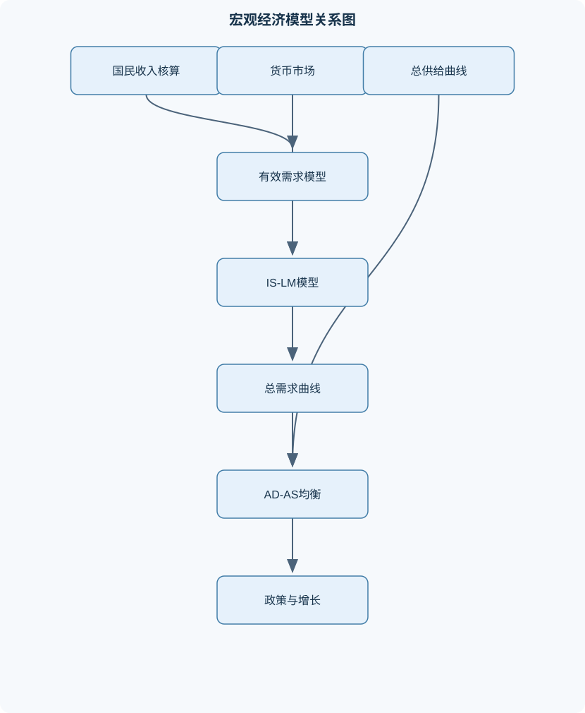
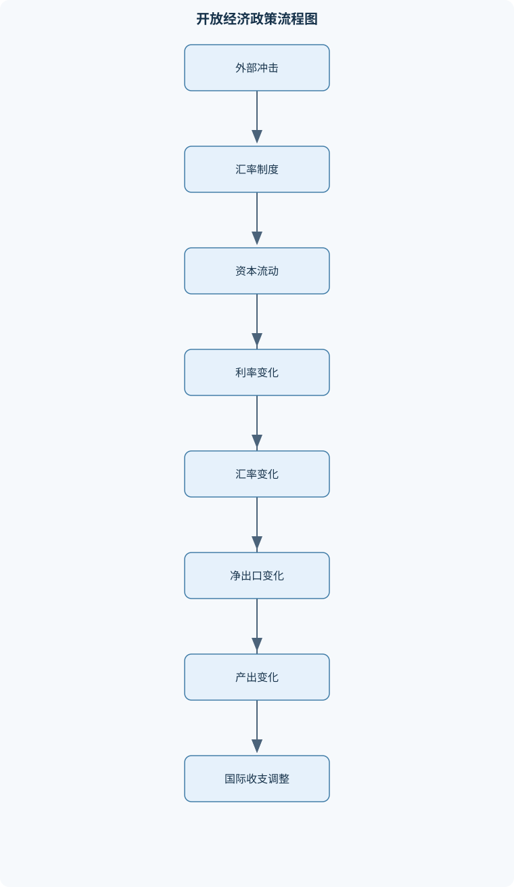

# 宏观经济学（甲）

## 一、课程整体知识框架

### 课程边界与先修知识

本课程系统讲授宏观经济学的核心理论、基本模型、政策分析与开放经济问题。内容边界包括国民收入核算、失业与通货膨胀、收入—支出模型、乘数理论、货币与利率决定、IS-LM模型、AD-AS模型、经济增长与经济周期、财政政策与货币政策、国际收支与汇率制度、蒙代尔—弗莱明模型。不以微观经济学的消费者选择、厂商成本曲线和一般均衡证明为主要内容，但使用其基本概念解释劳动市场、总供给和预期。先修知识包括函数与方程组、导数和简单图形分析、机会成本、供求关系、市场均衡、储蓄与投资、货币金融基础。课程中的短期模型通常假定价格或工资具有一定黏性，长期模型则强调价格调整、资本积累和潜在产出；实际政策分析还须考虑预期、金融摩擦、开放程度、制度约束和数据测量误差。





### 1. 研究对象、时间尺度与基本问题

宏观经济学研究一个经济体整体的产出、收入、就业、价格水平、利率、汇率、国际收支和长期增长，以及政府如何通过财政、货币和汇率政策影响这些变量。课程的核心不是把所有市场简单相加，而是分析总量之间的相互反馈：总需求决定短期产出，产出影响就业和收入，收入又影响消费、储蓄与货币需求；价格、工资和预期的调整则决定短期结果能否持续到长期。

宏观分析必须区分时间尺度。短期模型通常假定价格水平 $P$ 或名义工资调整缓慢，企业可以根据计划支出变化调整产量，因此实际总产出 $Y$ 可能偏离潜在产出 $Y^*$。长期模型则强调价格充分调整、资本积累、人口增长和技术进步，长期产出主要由生产能力决定。短期财政或货币政策可能提高产出，但若经济已经接近潜在产出，需求扩张更可能体现为价格上涨。

课程使用的基本符号包括：$Y$ 为实际总产出或实际收入，单位通常为货币量的实际值；$C$ 为居民消费；$I$ 为计划投资，包括固定资本形成、住宅建设和存货变化；$G$ 为政府购买，不包括单纯转移支付；$T$ 为税收；$TR$ 为转移支付；$NX=X-M$ 为净出口。可支配收入为

$$
Y_d=Y-T+TR.
$$

$M$ 为名义货币供给，$P$ 为价格水平，$M/P$ 为实际货币余额，$r$ 为实际利率或在短期模型中近似使用的利率，$i$ 为名义利率，$\pi$ 为通货膨胀率，$\pi^e$ 为预期通货膨胀率。若通胀率较低，实际利率近似为

$$
r\approx i-\pi^e.
$$

### 2. 从国民收入核算到宏观均衡

国内生产总值（GDP）是在一定时期内一国或地区境内生产的最终产品和服务的市场价值。关键词是“境内”“一定时期”“最终产品”。中间产品已经包含在最终产品价格中，若再次计入会产生重复计算；二手商品本身不是当期新生产，但当期提供的经纪、运输和维修服务可以计入当期产出；股票、债券等金融资产的所有权转移本身不是当期生产。

支出法将最终产品的购买者分类，得到

$$
GDP=C+I+G+NX,
$$

其中

$$
NX=X-M.
$$

收入法把生产过程产生的工资、利息、租金、利润等要素收入以及生产税等加总；生产法则按各行业增加值加总。数据完整且口径一致时，三种方法应得到相同的GDP。宏观核算中的“投资”不是居民购买股票，而是新增机器设备、住宅和存货。

名义GDP使用当期价格和当期产量计算：

$$
Y_N=\sum_i P_{i,t}Q_{i,t}.
$$

实际GDP使用基期价格评价当期产量：

$$
Y_R=\sum_i P_{i,0}Q_{i,t}.
$$

GDP平减指数为

$$
GDP\text{平减指数}=\frac{Y_N}{Y_R}\times100.
$$

名义GDP增长可能来自产量增加，也可能来自价格上涨；实际GDP更适合衡量实际产出变化。GDP平减指数覆盖国内生产的最终产品，消费者价格指数主要覆盖居民消费的一篮子商品和服务，二者的权重、范围和进口品处理不同。

GDP是国内生产概念，强调生产地点；国民生产总值（GNP）强调本国居民或本国要素所有者获得的生产所得。若用对外要素收入净额调整，可写成

$$
GNP=GDP+\text{来自国外的要素收入}-\text{支付给国外的要素收入}.
$$

扣除折旧得到净产出，例如国民生产净值可表示为

$$
NNP=GNP-\text{折旧}.
$$

转移支付不是政府购买，因为它没有对应的当期政府生产性产品或服务；但转移支付可能通过提高居民可支配收入影响消费。GDP也不能完整衡量福利，因为它没有充分反映闲暇、分配公平、家庭无偿劳动、环境损害、产品质量和地下经济等因素。

必须区分流量变量和存量变量。GDP、消费、投资和财政赤字是在一段时期内计量的流量；资本存量、货币存量和政府债务是在某一时点计量的存量。流量可以改变存量，例如本期投资扣除折旧决定资本存量的变化。

### 3. 就业、失业与通货膨胀

劳动年龄人口中，正在工作或积极寻找工作的人构成劳动力。失业率为

$$
u=\frac{\text{失业人数}}{\text{劳动力人数}}\times100\%.
$$

不愿工作、没有寻找工作的人通常不计入失业者；因此失业率下降不一定表示就业状况改善，也可能是部分人退出劳动力市场。

摩擦性失业来自求职和岗位匹配需要时间；结构性失业来自技能、地区或产业结构不匹配；周期性失业来自总需求不足和经济衰退。自然失业率不是零失业率，通常包括摩擦性和结构性失业。充分就业表示周期性失业较低、经济接近潜在产出，而不是所有人都在工作。

奥肯定律描述产出缺口与失业缺口之间的经验关系。其一般形式可写为

$$
\frac{Y-Y^*}{Y^*}\approx-\lambda(u-u_n),
$$

其中 $u_n$ 为自然失业率，$\lambda>0$ 为经验系数。该关系不是逻辑恒等式，系数会随国家、时期、劳动市场制度和生产率变化而变化。

通货膨胀率是价格水平的增长率，而不是价格水平本身：

$$
\pi_t=\frac{P_t-P_{t-1}}{P_{t-1}}\times100\%.
$$

消费者价格指数以居民消费篮子为基础；GDP平减指数以国内生产最终产品为基础。需求拉上型通胀发生在总需求增长超过短期供给能力时；成本推动型通胀则可能由工资、能源、原材料或税费上升导致短期总供给左移。供给冲击造成产出下降和价格上涨时，会出现滞胀，单纯刺激需求可能进一步推高价格。

短期菲利普斯曲线可表示通胀与失业之间的负相关，但当工资和价格预期调整后，劳动者会要求更高名义工资，短期关系会发生移动。长期中，若预期能够调整，持续扩张需求通常不能把失业率永久压低到自然失业率以下。

### 4. 国民收入决定与乘数模型

在短期价格相对固定、存在闲置资源时，企业会根据计划支出调整产量。计划支出为

$$
E=C+I+G+NX.
$$

均衡条件为

$$
Y=E.
$$

两部门模型中，若

$$
C=C_0+bY,\qquad 0<b<1,
$$

且投资 $I$ 外生给定，则

$$
Y=C_0+bY+I,
$$

从而

$$
Y=\frac{C_0+I}{1-b}.
$$

$b$ 是边际消费倾向（MPC），表示可支配收入增加一个货币单位时消费增加的比例；边际储蓄倾向为 $MPS=1-b$。自主支出增加会通过“收入增加—消费增加”的连续过程放大总产出，投资乘数为

$$
k_I=\frac{1}{1-b}.
$$

三部门中，若税收 $T$ 和转移支付 $TR$ 为外生变量，

$$
C=C_0+b(Y-T+TR),
$$

则政府购买乘数、定量税乘数和转移支付乘数分别为

$$
k_G=\frac{1}{1-b},\qquad
k_T=-\frac{b}{1-b},\qquad
k_{TR}=\frac{b}{1-b}.
$$

政府购买直接进入计划支出，减税或转移支付只有一部分通过消费进入需求，因此税收乘数的绝对值小于政府购买乘数。

若税收为比例税 $T=T_0+tY$，进口为 $M=M_0+mY$，其中 $t$ 是比例税率，$m$ 是边际进口倾向，则简单开放经济乘数为

$$
k=\frac{1}{1-b(1-t)+m}.
$$

该式要求消费、税收和进口函数为线性函数，价格和利率暂时不变，且经济存在未利用资源。进口、税收和储蓄都会形成支出泄漏，因此开放经济和含比例税模型的乘数通常小于无税封闭经济模型。

存货是理解均衡调整的重要变量。当计划支出 $E>Y$ 时，企业销售超过计划产量，非计划存货减少，企业会增加生产；当 $E<Y$ 时，非计划存货增加，企业会减少生产。事后国民收入核算中的 $S=I$ 是恒等关系，不代表每个时期居民的计划储蓄必然等于企业的计划投资。

### 5. 货币、银行与利率决定

货币具有交易媒介、价值尺度和价值储藏职能。货币层次取决于资产的流动性和统计口径。商业银行资产负债表的基本关系是

$$
\text{资产}=\text{负债}+\text{所有者权益}.
$$

银行吸收存款形成负债，持有现金、准备金、贷款和证券形成资产。基础货币通常包括流通中的现金和银行准备金。简化存款创造模型中，若没有现金漏损和超额准备金，法定准备金率为 $rr$，则存款乘数为

$$
m_d=\frac{1}{rr}.
$$

若存在现金—存款比率 $c$ 和超额准备金—存款比率 $er$，货币乘数应根据具体货币口径写成含 $c$、$er$ 的广义公式。不能把存款乘数和广义货币供给对基础货币的乘数混为一谈。

货币需求来自交易、预防和投机动机。交易和预防性货币需求随收入增加而上升，投机性货币需求通常随利率下降而增加。线性实际货币需求可以写为

$$
L(Y,r)=kY-hr,\qquad k>0,\ h>0.
$$

货币市场均衡为

$$
\frac{M}{P}=L(Y,r).
$$

在名义货币供给和价格水平给定时，收入上升提高交易性货币需求；若实际货币供给不变，利率必须上升以压低投机性货币需求。流动性陷阱是低利率区间货币需求对利率高度敏感，LM曲线接近水平，此时增加货币供给可能主要增加闲置货币余额，而不显著降低利率或提高产出。

### 6. IS-LM模型与短期均衡

IS曲线表示商品市场均衡点的集合。若投资随利率下降而增加，利率下降会提高投资和计划支出，进而提高均衡产出，因此IS曲线通常向右下方倾斜。政府购买增加、自主消费增加、出口增加或税收下降会使IS曲线右移。

LM曲线表示货币市场均衡点的集合。由

$$
\frac{M}{P}=kY-hr
$$

可整理为

$$
r=\frac{k}{h}Y-\frac{1}{h}\frac{M}{P}.
$$

因此，LM通常向右上方倾斜。实际货币供给 $M/P$ 增加会使LM右移；收入和利率变化通常表现为沿LM曲线移动，而不是使LM移动。

IS与LM的交点同时确定短期均衡收入 $Y$ 和利率 $r$。财政扩张使IS右移，通常提高产出和利率；利率上升会减少私人投资，形成挤出效应。若LM较陡，利率上升更明显，挤出效应更大；若LM水平，利率近似不变，短期挤出效应接近零；若LM垂直，财政扩张主要推高利率，产出效应接近零。

货币扩张使LM右移，通常降低利率并提高投资和产出。其效果取决于IS和LM斜率：IS越平坦，利率下降引起的投资增加越大；流动性陷阱中货币扩张的产出效果较弱。所谓古典情形通常指LM接近垂直，货币需求对利率不敏感或价格调整充分，此时货币政策影响较强，财政政策容易被利率上升抵消。

IS-LM是短期、简化模型，通常假定价格水平固定，不能直接替代对金融中介风险、资产价格、预期、资本监管和信贷配给的分析。

### 7. AD-AS模型与宏观政策

总需求曲线AD表示不同价格水平下，商品市场和货币市场同时均衡时的实际产出。价格水平下降会提高实际货币余额 $M/P$，使LM右移，利率下降，投资和产出增加，因此AD通常向右下方倾斜。

短期总供给曲线SRAS通常向右上方倾斜，原因包括名义工资黏性、菜单成本、信息不完全和短期生产能力限制。长期总供给曲线LRAS通常位于潜在产出 $Y^*$ 处，表示价格充分调整后，长期产出由资本、劳动、技术和制度决定。

AD与SRAS的交点决定短期价格水平和产出；AD与LRAS的交点用于分析长期调整。需求扩张使产出和价格短期同时上升；经济接近潜在产出时，价格效应更明显。需求收缩会形成衰退和负产出缺口。能源价格上涨、自然灾害或生产率下降使SRAS左移，导致价格上涨而产出下降，即滞胀。紧缩政策可以抑制价格，但会进一步压低短期产出；供给政策则需要改善生产能力或降低成本，通常具有较长时滞。

### 8. 经济增长理论

增长核算把总产出变化分解为劳动投入、资本投入和全要素生产率变化。生产函数可写为

$$
Y=A F(K,N),
$$

其中 $K$ 为资本存量，$N$ 为劳动或人口，$A$ 为技术水平。集约生产函数用人均变量表示：

$$
y=f(k),\qquad k=\frac{K}{N},\quad y=\frac{Y}{N}.
$$

索洛模型假定储蓄转化为投资、资本存在折旧、人口以速率 $n$ 增长，并可能存在技术进步 $g_A$。人均资本动态方程为

$$
\dot{k}=sf(k)-(n+\delta+g_A)k.
$$

其中 $s$ 为储蓄率，$\delta$ 为折旧率。稳态满足

$$
sf(k^*)=(n+\delta+g_A)k^*.
$$

稳态并不意味着总产出不增长。若人口或技术进步持续增长，总产出仍可能增长；稳态表示按人均有效劳动计算的资本不再变化。

提高储蓄率会提高稳态人均资本和人均产出，但在标准索洛模型中主要是水平效应，不能永久提高无技术进步经济的人均增长率。长期持续的人均增长需要技术进步。黄金规则资本存量使稳态消费最大化。无技术进步时，其条件为

$$
f'(k^*)=n+\delta.
$$

有技术进步且按有效劳动定义变量时，条件相应包含 $g_A$。哈罗德—多马模型强调储蓄率和资本—产出比对增长的作用，但其固定资本产出比和潜在不稳定性，与索洛模型的边际报酬递减和稳态机制不同。

### 9. 经济周期与宏观稳定

经济周期通常包含扩张、繁荣、衰退和低谷阶段。实际GDP、工业生产、就业、失业率、消费和投资具有不同的同步性。投资和存货变化通常比消费波动更大。

外生冲击包括需求、技术、能源价格、金融条件和国际贸易冲击；内生波动则强调乘数、加速数、信用约束和预期之间的反馈。乘数—加速数模型中，收入增加通过消费扩大需求，同时销售增长诱发企业增加投资，可能导致过度扩张；收入下降也可能通过投资减少而被放大。库存调整会使企业在需求预测错误时主动削减产量。

金融加速机制指资产价格下降、抵押品价值减少和借款人净值下降会提高融资成本，进一步压低投资和消费。理性预期意味着经济主体会使用可获得信息预测政策后果，系统性、可预见的政策可能较难产生预期之外的实际效果。

自动稳定器包括累进税制、失业保险和部分社会保障支出。经济衰退时收入下降使税收自动减少，转移支付自动增加，从而缓和需求下降；繁荣时则相反。相机抉择政策需要政府主动改变税收或支出，但存在识别时滞、决策时滞、执行时滞和效果时滞。稳定增长还受到政府债务、利率、财政空间和政策可信度约束。

### 10. 财政政策、货币政策与开放经济

扩张性财政政策包括增加政府购买、减税和增加转移支付，目标通常是扩大总需求、缩小衰退缺口；紧缩性财政政策则相反。财政赤字是一定时期内政府支出超过收入的流量，政府债务是历年赤字累积形成的存量。债务可支持逆周期政策，但利息负担、偿债能力、代际分配和私人投资挤出构成约束。

货币政策工具包括公开市场操作、准备金制度、再贷款或再贴现安排、政策利率和信贷渠道。中央银行购买证券通常增加银行体系准备金并扩大基础货币；出售证券通常产生相反效果。但在准备金充裕、银行需求不足或信贷风险较高时，基础货币增加未必按简单乘数转化为贷款和广义货币。

开放经济中，国际收支记录经常账户（CA）以及资本与金融账户（KA）。在简化条件下，国际收支平衡要求经常账户与资本流动相互抵消。净出口受国内收入、外国收入和汇率影响。名义汇率 $e$ 必须先说明报价方向，例如“本币每单位外币”；本币升值会改变 $e$ 的数值方向，不能脱离定义使用“升值”或“贬值”。

实际汇率 $\varepsilon$ 是经过价格调整的相对价格。购买力平价认为长期汇率会受到可贸易品价格相对关系约束，但运输成本、贸易壁垒、非贸易品、市场分割和价格黏性都会造成偏离。利率平价强调利率差与预期汇率变化之间的联系，不等于任何时期都能无风险套利。

BP曲线表示国际收支平衡点。资本流动越敏感于利率，BP曲线越接近水平；资本完全不流动时，BP主要受经常账户约束，曲线可能呈现较陡形态。固定汇率要求中央银行通过外汇市场干预维持汇率；浮动汇率允许汇率由市场供求调整。开放程度越高，国内政策越容易通过资本流动和汇率渠道影响产出。

蒙代尔—弗莱明模型通常研究小国开放经济、短期价格黏性和世界利率 $r^*$ 给定的情形。资本高度流动时，固定汇率下扩张性货币政策会降低利率并引发资本流出，中央银行为维持汇率出售外汇、回收本币，货币扩张被抵消；扩张性财政政策引起资本流入和货币扩张，产出效应较强。浮动汇率下，扩张性货币政策引起资本流出和本币贬值，净出口增加，产出上升；扩张性财政政策引起资本流入和本币升值，净出口下降，财政乘数被汇率渠道削弱。

固定汇率、资本自由流动和独立货币政策不能同时实现，这就是三元悖论。贸易保护政策在浮动汇率下可能引起汇率升值，净出口总量的改善未必持久；在固定汇率下则可能通过外汇干预改变货币供给。任何政策结论都依赖资本流动程度、汇率制度、价格调整速度、预期和中央银行可信度。

## 二、章节和模块划分

### 核心知识覆盖清单

本清单用于检查正文是否覆盖本课程的主要知识模块：

- **宏观经济指标与国民收入核算**：国内生产总值的定义与边界、支出法收入法生产法、消费投资政府购买与净出口、名义GDP与实际GDP、GDP平减指数与物价指数、国内生产总值与国民生产总值、折旧净产出和国民收入、转移支付与二手交易的排除、GDP的福利评价局限、存量变量与流量变量。
- **就业、失业与通货膨胀**：劳动力人口与失业率、摩擦性结构性与周期性失业、自然失业率与充分就业、奥肯定律及其适用条件、消费者价格指数与GDP平减指数、通货膨胀率与实际利率、需求拉上型通货膨胀、成本推动型通货膨胀、菲利普斯曲线与预期、滞胀及其政策含义。
- **国民收入决定与乘数模型**：有效需求与计划支出、两部门收入恒等式、消费函数与边际消费倾向、储蓄函数与边际储蓄倾向、三部门财政收支模型、开放经济进口函数、投资乘数与政府购买乘数、定量税与比例税乘数、转移支付乘数与平衡预算乘数、存货调整与产出均衡。
- **货币、银行与利率决定**：货币的职能与层次、基础货币与货币供给、商业银行资产负债表、存款创造与货币乘数、法定准备金率与超额准备金、货币需求的交易动机、货币需求的预防动机、货币需求的投机动机、流动性陷阱、实际货币余额与利率均衡。
- **IS-LM模型与短期均衡**：商品市场均衡与IS曲线、货币市场均衡与LM曲线、IS曲线斜率和移动因素、LM曲线斜率和移动因素、均衡收入与均衡利率、财政政策与挤出效应、货币政策与利率传导、流动性陷阱下的政策效果、古典情形下的政策效果、模型假设与现实金融市场限制。
- **总需求总供给与宏观政策**：总需求曲线的推导、总需求曲线向右下倾斜的原因、短期总供给曲线、长期总供给曲线与潜在产出、劳动市场与总供给、AD-AS均衡的比较静态分析、需求冲击与供给冲击、经济衰退与产出缺口、通货膨胀缺口与紧缩政策、滞胀的图形分析。
- **经济增长理论**：经济增长的核算框架、资本积累与储蓄率、索洛模型基本假设、集约生产函数、资本深化与资本广化、稳态人均资本、人口增长和技术进步、黄金规则资本存量、储蓄率的水平效应、技术进步的增长效应、哈罗德—多马模型比较。
- **经济周期与宏观稳定**：经济周期的阶段与指标、外生冲击与内生波动、乘数—加速数模型、库存投资与周期波动、金融加速机制、理性预期与政策有效性、自动稳定器、相机抉择的财政政策、政策时滞与政策协调、稳定增长与债务约束。
- **财政政策与货币政策**：扩张性财政政策、紧缩性财政政策、自动稳定器的作用机制、财政赤字与政府债务、税收与政府购买的需求效应、公开市场操作、准备金率与再贴现政策、政策利率与信贷渠道、货币政策规则与裁量、政策乘数的不确定性。
- **开放经济宏观分析**：经常账户与资本账户、国际收支平衡表、净出口与汇率、名义汇率与实际汇率、购买力平价的条件、利率平价的基本逻辑、BP曲线与资本流动、固定汇率与浮动汇率、资本完全流动与不完全流动、外部失衡与宏观政策冲突。
- **蒙代尔—弗莱明模型与综合应用**：小国开放经济的基本假设、开放经济IS曲线、国际利率约束、固定汇率下货币政策、固定汇率下财政政策、浮动汇率下货币政策、浮动汇率下财政政策、贸易保护政策的汇率效应、三元悖论、国内外冲击的综合政策分析。


### 1. 模块一至模块三：指标、就业与收入决定

第一章“宏观经济指标与国民收入核算”安排为四个学习单元：GDP定义与边界、三种核算方法、价格指数与实际量、GDP福利评价。计算流程是先识别最终产品，再按 $C+I+G+NX$ 汇总，避免中间品、二手交易和金融资产重复计入；然后根据基期价格计算实际GDP和GDP平减指数，最后根据对外要素收入和折旧区分GDP、GNP与净产出。

第二章“就业、失业与通货膨胀”连接劳动市场与价格水平。先计算劳动力、失业率和自然失业率，再区分摩擦性、结构性和周期性失业；随后使用CPI、GDP平减指数和通胀率分析价格变化，最后用奥肯定律和菲利普斯曲线讨论产出缺口、失业与通胀的联系。分析时必须说明经验系数、预期调整和供给冲击的限制。

第三章“国民收入决定与乘数模型”从有效需求开始。两部门模型先推导

$$
Y=\frac{C_0+I}{1-b},
$$

再加入政府购买、定量税、比例税、转移支付和进口。每次推导都应先写计划支出函数，令 $E=Y$，再整理未知的 $Y$；不能直接套用无税封闭经济乘数。存货调整用于解释计划支出不等于产出时企业如何改变生产。

### 2. 模块四至模块六：货币、IS-LM与AD-AS

第四章“货币、银行与利率决定”先分析货币职能、货币层次和商业银行资产负债表，再区分基础货币、存款和广义货币。计算货币乘数前必须明确是否存在现金漏损和超额准备金。货币需求部分围绕 $L(Y,r)=kY-hr$ 展开，说明收入、利率、价格水平和名义货币供给如何决定实际货币余额。

第五章“IS-LM模型与短期均衡”先由商品市场均衡推导IS，再由货币市场均衡推导LM，联立求解 $Y$ 和 $r$。政策分析要同时追踪产出、利率和私人投资：财政扩张不等于产出按政府购买乘数等比例增加，因为利率上升可能挤出投资；货币扩张也不一定有效，流动性陷阱和信贷约束会削弱传导。

第六章“总需求总供给与宏观政策”把IS-LM的均衡点扩展到不同价格水平。对每一个给定的 $P$，重新求IS-LM均衡产出，连接各点得到AD。之后分别与SRAS和LRAS结合，分析需求扩张、需求收缩、成本冲击、衰退缺口、通胀缺口和滞胀。短期均衡和长期均衡必须分开，不能用LRAS直接解释价格黏性下的即时产出变化。

### 3. 模块七至模块九：增长、周期与政策工具

第七章“经济增长理论”从增长核算进入索洛模型。先写生产函数和集约生产函数，再建立

$$
\dot{k}=sf(k)-(n+\delta+g_A)k.
$$

令右端为零求稳态，代入生产函数求稳态产出和消费。比较储蓄率、人口增长率和技术进步率变化时，要区分资本水平效应与长期增长率效应。黄金规则用于寻找稳态消费最大化的资本存量，而不是简单判断“储蓄越高越好”。

第八章“经济周期与宏观稳定”研究总量波动的阶段、指标和机制。课程依次分析乘数—加速数、库存调整、金融加速、预期和政策时滞，再比较自动稳定器与相机抉择政策。自动稳定器不需要每次危机发生后重新立法，但只能缓冲波动，不能自动解决生产率下降、金融体系受损或长期债务不可持续问题。

第九章“财政政策与货币政策”把政策工具与IS-LM、AD-AS结合。财政分析要区分政府购买、税收和转移支付的即时需求效应；货币分析要区分公开市场操作、准备金制度、政策利率和信贷渠道。评价政策时应同时考虑乘数不确定性、预期、挤出效应、时滞、债务约束和金融市场状态，不能只比较理论乘数大小。

### 4. 模块十至模块十一：开放经济与综合应用

第十章“开放经济宏观分析”包括国际收支、汇率、购买力平价、利率平价和BP曲线。处理汇率题的第一步是写明报价方向；第二步判断汇率变化对净出口的影响；第三步分析资本流动和利率差；最后结合固定或浮动汇率制度判断中央银行是否干预。BP曲线斜率取决于资本流动对利率的敏感程度，不能在不同资本流动假设下机械使用同一图形。

第十一章“蒙代尔—弗莱明模型与综合应用”按照“固定汇率—浮动汇率”“资本完全流动—资本不完全流动”的组合展开。每道政策题均按“政策冲击—利率变化—资本流动—汇率变化—净出口变化—产出变化”的顺序作答。固定汇率下要加入中央银行外汇干预，浮动汇率下则允许汇率完成调整。贸易保护政策不能只看进口减少，还要分析汇率、出口和总净出口的反应。

### 5. 代表性分析算法与流程

#### 流程一：国民收入核算与价格调整

**输入**：各最终产品的当期价格、当期数量、基期价格；消费、投资、政府购买、出口、进口；折旧和对外要素收入。

**过程**：

1. 删除中间品重复项，识别二手交易和金融资产交易。
2. 计算 $C$、$I$、$G$、$X$、$M$。
3. 由 $GDP=C+I+G+X-M$ 计算支出法GDP。
4. 用当期价格乘当期数量计算名义GDP。
5. 用基期价格乘报告期数量计算实际GDP。
6. 计算GDP平减指数。
7. 根据对外要素收入调整GNP，根据折旧计算净产出。
8. 检查数据完整时生产法、收入法和支出法是否一致。

**边界**：实际GDP使用固定价格，不表示居民实际福利；GDP平减指数与CPI不能互换。逐项求和的计算复杂度为 $O(n)$，其中 $n$ 为产品项目数。

#### 流程二：收入—支出均衡和政策乘数

**输入**：消费函数、投资函数、政府购买、税收、转移支付、出口和进口函数。

**过程**：

1. 写出 $Y_d=Y-T+TR$。
2. 写出消费函数 $C=C_0+bY_d$。
3. 写出计划支出 $E=C+I+G+NX$。
4. 令 $E=Y$，整理均衡收入。
5. 分别改变 $G$、$T$、$TR$ 或 $X$，计算政策乘数。
6. 检查乘数分母是否为正，确认 $0<b<1$、$0\leq t<1$、$m\geq0$ 等条件。
7. 用新的均衡收入代回消费、进口和计划支出，验证等式成立。

#### 流程三：IS-LM联立与政策冲击

**输入**：$C(Y)$、$I(r)$、$G$、$T$、$M$、$P$、$L(Y,r)$。

**过程**：

1. 由商品市场均衡得到IS方程。
2. 由 $M/P=L(Y,r)$ 得到LM方程。
3. 联立求解 $Y$ 和 $r$。
4. 改变财政或货币政策参数，重新求解。
5. 比较政策前后的利率、产出和私人投资。
6. 检查结果是否满足非负产出、合理利率和题设区间。

若模型是线性方程组，求解属于常数次代数运算。现实中利率可能存在零下限、银行信贷配给和风险溢价，因此理论LM移动不一定对应同幅度的市场融资条件变化。

#### 流程四：索洛模型稳态求解

**输入**：生产函数 $f(k)$、储蓄率 $s$、人口增长率 $n$、折旧率 $\delta$、技术进步率 $g_A$。

**过程**：

1. 建立 $\dot{k}=sf(k)-(n+\delta+g_A)k$。
2. 令 $\dot{k}=0$ 求 $k^*$。
3. 代入生产函数求 $y^*=f(k^*)$。
4. 计算稳态消费。
5. 改变 $s$、$n$ 或 $g_A$，比较稳态资本和产出。
6. 若求黄金规则，令稳态消费对资本的导数为零，并检查生产函数的边际报酬条件。

### 6. 代表性例题

#### 例题一：GDP、实际GDP与平减指数

**题干**：某经济只生产甲、乙两种最终产品。基期甲的价格和数量分别为 $2$ 和 $100$，乙为 $5$ 和 $40$；报告期甲的价格和数量分别为 $3$ 和 $120$，乙为 $6$ 和 $50$。求报告期名义GDP、实际GDP和GDP平减指数。

**分析与解答**：

报告期名义GDP为

$$
Y_N=3\times120+6\times50=660.
$$

以基期价格计算报告期产量：

$$
Y_R=2\times120+5\times50=490.
$$

因此

$$
GDP\text{平减指数}=\frac{660}{490}\times100\approx134.69.
$$

**结果验证**：名义GDP大于实际GDP，说明报告期价格总体高于基期。变式是若要求CPI，必须给出固定消费篮子及其基期权重，不能直接使用GDP平减指数。

#### 例题二：含比例税的均衡收入

**题干**：消费函数为 $C=100+0.8(Y-T)$，税收为 $T=0.25Y$，投资为 $I=300$，政府购买为 $G=200$，不存在进出口。求均衡收入和政府购买乘数。

**分析与解答**：

可支配收入为

$$
Y-T=Y-0.25Y=0.75Y.
$$

因此

$$
C=100+0.8(0.75Y)=100+0.6Y.
$$

均衡条件：

$$
Y=C+I+G=100+0.6Y+300+200.
$$

整理得

$$
0.4Y=600,\qquad Y=1500.
$$

政府购买乘数为

$$
k_G=\frac{1}{1-b(1-t)}
=\frac{1}{1-0.8(0.75)}
=2.5.
$$

**验证**：在 $Y=1500$ 时，消费为 $100+0.6(1500)=1000$，总支出为 $1000+300+200=1500$。若忽略比例税，会错误使用 $1/(1-0.8)=5$。

#### 例题三：四部门乘数

**题干**：消费函数为 $C=80+0.75(Y-T)$，比例税率 $t=0.2$，边际进口倾向 $m=0.1$，投资、政府购买和出口均为外生变量。求自主支出乘数。

**解答**：

比例税使可支配收入中的边际消费部分为

$$
b(1-t)=0.75(0.8)=0.6.
$$

进口随收入增加形成泄漏 $mY$，因此乘数为

$$
k=\frac{1}{1-b(1-t)+m}
=\frac{1}{1-0.6+0.1}
=2.
$$

**验证**：分母为正，且税收和进口均降低乘数。若 $m=0$，乘数将变为 $1/0.4=2.5$；若税率提高，乘数进一步下降。

#### 例题四：货币市场均衡

**题干**：实际货币供给为 $500$，货币需求为 $L=0.5Y-50r$。当 $Y=1200$ 时，求均衡利率。

**解答**：

令实际货币供给等于实际货币需求：

$$
500=0.5(1200)-50r.
$$

因此

$$
500=600-50r,\qquad r=2.
$$

若收入增加到 $1400$，则

$$
500=0.5(1400)-50r,
$$

得到 $r=6$。收入增加推高交易性货币需求，在实际货币供给不变时必须提高利率恢复均衡。

**边界**：这里的 $r$ 为模型中的利率单位；若题目给出百分数，必须统一为百分数或小数，不能混用。

#### 例题五：索洛稳态

**题干**：生产函数为 $y=\sqrt{k}$，储蓄率 $s=0.2$，人口增长率 $n=0.05$，折旧率 $\delta=0.05$，无技术进步。求稳态人均资本和人均产出。

**解答**：

稳态条件为

$$
s\sqrt{k}=(n+\delta)k.
$$

代入参数：

$$
0.2\sqrt{k}=0.1k.
$$

若 $k>0$，两边除以 $\sqrt{k}$ 得

$$
0.2=0.1\sqrt{k},
\qquad \sqrt{k}=2,
\qquad k^*=4.
$$

稳态人均产出为

$$
y^*=\sqrt{4}=2.
$$

**验证**：投资为 $s f(k^*)=0.2\times2=0.4$，维持人均资本所需的资本广化投资为 $(n+\delta)k^*=0.1\times4=0.4$，两者相等。提高储蓄率会提高 $k^*$ 和 $y^*$，但在无技术进步时不保证长期人均增长率永久提高。

#### 例题六：蒙代尔—弗莱明政策分析

**题干**：小国资本高度流动，实行固定汇率。政府增加购买。分析利率、资本流动、货币供给和产出的变化。

**解答**：

政府购买增加使IS右移，国内利率产生上升压力。由于世界利率给定且资本高度流动，较高的国内利率吸引资本流入，本币面临升值压力。中央银行为维持固定汇率买入外汇、投放本币，货币供给增加，LM右移。最终利率回到世界利率附近，产出提高。财政扩张的效果通过资本流入和货币供给内生扩张得到增强。

**变式**：若改为浮动汇率，资本流入会使本币升值，净出口下降，从而削弱财政政策的产出效果；若政策改为货币扩张并保持固定汇率，外汇流出会迫使中央银行回收本币，货币政策效果被抵消。

### 7. 课程实验与项目流程

#### 项目一：宏观指标核算与通胀测量

**输入数据**：连续若干期的产品价格、产量、消费篮子权重、消费、投资、政府购买、出口、进口和折旧数据。

**步骤**：

1. 编制产品项目表，标记最终产品、中间品、二手商品和金融资产交易。
2. 计算名义GDP、实际GDP和GDP平减指数。
3. 按固定消费篮子计算CPI。
4. 比较GDP平减指数与CPI的通胀率。
5. 根据GDP、折旧和对外要素收入计算净产出或GNP。
6. 对价格和数量变化进行分解，说明实际增长与价格增长的来源。

**评价标准**：核算边界正确占重要比重；名义量与实际量定义清楚；指数基期一致；三种GDP核算口径在数据完整时能够相互校验；结论不把GDP增长直接等同于福利改善。

**排错方法**：若GDP异常偏高，检查是否重复计入中间品；若实际GDP错误，检查是否误用报告期价格；若CPI与GDP平减指数相同，检查是否错误使用了同一篮子和同一覆盖范围。

#### 项目二：IS-LM与AD-AS政策模拟

**输入数据**：消费函数、投资函数、货币需求函数、名义货币供给、初始价格水平、政府购买和潜在产出。

**步骤**：

1. 推导IS方程和LM方程。
2. 联立求初始均衡 $Y$ 和 $r$。
3. 增加政府购买，重新求解并记录产出、利率和私人投资。
4. 增加名义货币供给，重新求解并记录产出和利率。
5. 改变价格水平，重复IS-LM求解，形成AD关系。
6. 给定SRAS和LRAS，比较需求冲击与供给冲击下的价格和产出变化。
7. 判断初始均衡是否存在衰退缺口或通胀缺口。

**评价标准**：IS对应商品市场、LM对应货币市场；政策改变导致的曲线移动和沿曲线移动区分正确；能够解释挤出效应和价格反馈；短期SRAS与长期LRAS不混用；政策结论同时报告产出、利率和价格方向。

**排错方法**：若财政扩张后利率下降，应检查是否误把LM右移；若货币扩张后价格水平固定但产出不变，应检查LM方程符号；若AD向右上方倾斜，应检查价格下降是否正确转化为实际货币余额增加；若结果出现负消费或负产出，应回到题设边界检查参数范围。

下面的伪代码只进行代数计算，不联网、不读写文件，也不执行外部命令：

```python
# Python：线性收入—支出模型的均衡收入计算
def equilibrium_income(C0, b, t, I, G, T0, X, M0, m):
    """
    参数均为同一货币单位；b、t、m 为无量纲比例。
    C = C0 + b * (Y - T)
    T = T0 + t * Y
    M = M0 + m * Y
    NX = X - M
    """
    denominator = 1 - b * (1 - t) + m
    if not (0 < b < 1):
        raise ValueError("边际消费倾向必须位于0和1之间")
    if not (0 <= t < 1 and m >= 0):
        raise ValueError("比例税率或边际进口倾向超出模型边界")
    if denominator <= 0:
        raise ValueError("均衡分母必须为正")

    autonomous = C0 - b * T0 + I + G + X - M0
    Y = autonomous / denominator

    T = T0 + t * Y
    C = C0 + b * (Y - T)
    M = M0 + m * Y
    NX = X - M
    planned_expenditure = C + I + G + NX

    if abs(Y - planned_expenditure) > 1e-8:
        raise ArithmeticError("均衡条件校验失败")

    return {
        "income": Y,
        "consumption": C,
        "tax": T,
        "imports": M,
        "net_exports": NX
    }
```

该程序的适用条件是线性函数、价格和利率外生给定、产出可以根据计划支出调整。它不能处理价格内生变化、非线性消费函数、产能约束、信贷配给或汇率反馈；这些情况需要改用IS-LM、AD-AS或开放经济模型。

## 三、核心概念的详细解释

### 1. 宏观经济变量、时间尺度与均衡

宏观经济学研究经济体整体的产出、收入、就业、价格水平、利率、汇率、国际收支和经济增长。宏观变量之间存在反馈关系：总需求影响企业销售和产量，产量影响就业与收入，收入影响消费和储蓄，消费与投资又反过来影响总需求；货币供给、利率和价格水平通过金融市场影响支出，预期、资本积累和技术进步则决定长期供给能力。

必须区分流量变量和存量变量。国内生产总值、投资、消费、财政赤字和净出口是在一段时期内计量的流量；资本存量、货币余额、政府债务和财富是在某一时点计量的存量。流量可以改变存量，例如本期投资增加资本存量，财政赤字增加政府债务；不能把二者直接相加或直接比较。

短期模型通常假定价格水平 $P$、工资或部分价格具有黏性，企业面对需求变化时先调整产量和库存，实际产出 $Y$ 可以偏离潜在产出 $Y^*$。长期模型则允许价格和工资充分调整，产出主要受劳动、资本和技术决定。相同的政策在不同时间尺度下可能产生不同结果：短期扩张性财政政策可能增加产出和就业，长期若供给能力不变，则主要提高价格水平并伴随较高利率或债务负担。

宏观均衡不是所有个体都满意，而是指模型规定的市场清算条件同时成立。例如，商品市场均衡要求实际产出等于计划支出；货币市场均衡要求实际货币供给等于实际货币需求；劳动市场均衡要求劳动供给与劳动需求在给定工资下相容。均衡可以是短期均衡，不一定是充分就业均衡，也不一定代表社会福利最大。

### 2. 国民收入核算与宏观指标

国内生产总值（GDP）是在一定时期内、一国或地区境内生产的最终产品和服务的市场价值。其边界包含三个条件：生产活动必须发生在当期，产品必须是当期生产的最终产品或当期提供的服务，生产地点必须位于该经济体境内。

支出法为

$$
GDP=C+I+G+NX,
$$

其中 $C$ 是居民消费，$I$ 是固定资本形成、住宅建设和存货变化，$G$ 是政府购买，$NX=X-M$ 是净出口，$X$ 为出口，$M$ 为进口。政府购买不包括单纯转移支付，因为转移支付本身没有对应的当期政府产品或服务，但它会通过改变居民可支配收入影响消费。

中间产品不单独计入GDP，否则会重复计算。例如，钢材已经包含在汽车的最终销售价格中，若同时把钢材和汽车全部计入，就会重复计算。二手商品本身不是当期生产，不计入当期GDP；但当期提供的经纪、维修、运输等服务，其服务收入可以计入GDP。股票和债券的所有权转移是金融资产交易，不是当期生产；证券经纪服务费则属于当期服务产出。

收入法把生产过程中形成的工资、利润、利息、租金以及生产税等加总。生产法则按各行业增加值加总。增加值等于总产出减去中间投入。数据完整且统计口径一致时，支出法、收入法和生产法应得到同一GDP。

名义GDP按当期价格计算：

$$
Y_N=\sum_i P_{i,t}Q_{i,t},
$$

实际GDP按基期价格计算：

$$
Y_R=\sum_i P_{i,0}Q_{i,t}.
$$

GDP平减指数为

$$
P_{\mathrm{GDP}}=\frac{Y_N}{Y_R}\times100.
$$

名义GDP变化同时包含产量变化和价格变化，实际GDP更适合衡量实际产出变化。GDP平减指数覆盖境内生产的最终产品，权重随当期产量变化；消费者价格指数主要衡量居民消费篮子的价格变化，通常包括进口消费品，因此两者不必相同。价格水平是价格指数本身，通货膨胀率则是价格水平的增长率：

$$
\pi_t=\frac{P_t-P_{t-1}}{P_{t-1}}\times100\%.
$$

GDP是地域概念，国民生产总值（GNP）是居民或本国要素所有者所得概念：

$$
GNP=GDP+\text{来自国外的要素收入}-\text{支付给国外的要素收入}.
$$

扣除折旧可得到净产出。若从GNP扣除资本折旧，得到国民生产净值。国民收入、个人收入和个人可支配收入还需要进一步处理企业留存收益、社会保险缴款、政府转移支付和个人税收，因此不能直接当作GDP的同义词。

GDP可以衡量市场化生产规模，却不能完整衡量社会福利。家庭无偿劳动、闲暇、环境损害、收入分配、产品质量、地下经济和公共安全等因素可能未被充分反映。GDP增加也可能来自污染治理支出或灾害后的重建，并不必然表示居民福利同比例提高。

### 3. 就业、失业与通货膨胀

就业人口是正在从事有报酬工作或暂时离开工作岗位但保持工作联系的人。失业人口通常指没有工作、能够工作并正在寻找工作的人。劳动力人口为就业人口与失业人口之和，失业率为

$$
u=\frac{\text{失业人口}}{\text{劳动力人口}}\times100\%.
$$

没有工作但没有寻找工作的人通常不计入劳动力人口，因此失业率可能低估实际劳动闲置。劳动参与率为劳动力人口占工作年龄人口的比例。失业率和劳动参与率应结合观察，不能只依据单一指标判断就业状况。

摩擦性失业来自劳动者换工作、毕业求职和岗位匹配所需时间；结构性失业来自技能、地区或产业结构与岗位需求不匹配；周期性失业来自总需求不足和经济衰退。充分就业不等于零失业，因为摩擦性和结构性失业仍然存在。自然失业率是与稳定通胀相容的失业率，受劳动力市场制度、技能结构、人口流动和匹配效率影响。

奥肯定律描述产出与失业之间的经验关系，常用形式为

$$
\frac{Y-Y^*}{Y^*}\approx-\lambda(u-u_n),
$$

其中 $Y^*$ 为潜在产出，$u_n$ 为自然失业率，$\lambda>0$ 为经验系数。该关系不是逻辑恒等式，系数会因国家、时期、劳动市场制度和生产率变化而改变。若劳动生产率或劳动参与率发生重大变化，仅凭失业率变化推算产出缺口可能产生偏差。

通货膨胀是总体价格水平持续上升。需求拉上型通胀发生在总需求增长超过短期供给能力时，财政扩张、货币扩张或外需增加都可能成为原因；成本推动型通胀来自工资、能源、原材料、税费或供应链成本上升，可能同时压低产出并推高价格。供给冲击造成的“产出下降加通胀上升”称为滞胀，单纯刺激需求可能进一步推高价格，单纯抑制通胀又可能加重衰退。

名义利率是金融合约约定的利率，实际利率反映扣除预期通胀后的购买力回报。低通胀近似下，费雪关系为

$$
r\approx i-\pi^e,
$$

其中 $i$ 为名义利率，$r$ 为实际利率，$\pi^e$ 为预期通胀率。若预期通胀上升而名义利率不变，实际利率下降，借款和投资可能增加；若中央银行同步提高名义利率，实际利率的变化取决于两者的相对幅度。

短期菲利普斯曲线表示通胀与失业之间可能存在负相关，可写成

$$
\pi=\pi^e-\alpha(u-u_n)+v,
$$

其中 $\alpha>0$，$v$ 表示供给冲击。短期内预期黏性可能使需求扩张降低失业并提高通胀；长期中若预期能够调整，劳动者和企业会修正工资、价格和通胀预期，失业率趋向自然失业率，因而不存在可持续的通胀—失业永久替代关系。

### 4. 收入—支出模型、乘数与存货调整

在短期价格不变且存在闲置生产能力时，企业产量会对计划支出作出反应。计划支出为

$$
E=C+I+G+NX.
$$

商品市场均衡条件为

$$
Y=E.
$$

两部门经济中，若消费函数为

$$
C=C_0+bY,\qquad 0<b<1,
$$

其中 $C_0$ 是自主消费，$b$ 是边际消费倾向（MPC），则

$$
Y=C_0+bY+I,
$$

从而

$$
Y=\frac{C_0+I}{1-b}.
$$

投资或自主支出增加一单位，最初直接增加收入一单位；收入增加后，居民按照 $b$ 的比例增加消费，形成后续收入增加，连续效应构成投资乘数：

$$
k_I=\frac{1}{1-b}.
$$

边际储蓄倾向为

$$
MPS=1-MPC=1-b.
$$

可支配收入为

$$
Y_d=Y-T+TR.
$$

若税收 $T$ 和转移支付 $TR$ 为外生变量，消费函数为

$$
C=C_0+b(Y-T+TR),
$$

则政府购买乘数、定量税乘数和转移支付乘数分别为

$$
k_G=\frac{1}{1-b},
$$

$$
k_T=-\frac{b}{1-b},
$$

$$
k_{TR}=\frac{b}{1-b}.
$$

政府购买直接进入计划支出，定量减税先增加可支配收入，只有其中的消费部分转化为当期需求，所以税收乘数的绝对值小于政府购买乘数。若政府购买增加与税收增加相同金额，平衡预算乘数在该简单模型中为一：

$$
\Delta Y=k_G\Delta G+k_T\Delta T
=\frac{\Delta G-b\Delta T}{1-b}.
$$

当 $\Delta G=\Delta T$ 时，$\Delta Y=\Delta G$。该结论依赖价格不变、利率不变、边际消费倾向稳定和不存在供给约束等条件。

若存在比例税 $T=T_0+tY$，消费中与收入有关的部分为 $b(1-t)Y$；若进口函数为 $M=M_0+mY$，其中 $m$ 为边际进口倾向，则开放经济乘数为

$$
k=\frac{1}{1-b(1-t)+m}.
$$

比例税和进口都会形成支出泄漏，使乘数小于无税、封闭经济情形。若乘数分母不为正、边际消费倾向不在合理范围，或者产出受到产能上限约束，线性乘数公式不能机械使用。

若计划支出大于实际产出，即 $E>Y$，企业销售超过当期生产，非计划存货减少，企业会扩大生产；若 $E<Y$，非计划存货增加，企业会削减生产。这里的存货变化使事后储蓄和投资保持核算一致，但不能把事后恒等式 $S=I$ 误认为所有时期计划储蓄与计划投资都相等。

### 5. 货币、银行与利率决定

货币具有交易媒介、价值尺度和价值储藏职能。狭义货币通常强调流动性最高的现金和可直接支付存款，广义货币还包括流动性较低但容易转化为支付手段的存款。不同货币层次的具体范围取决于统计制度和金融结构。

中央银行发行的现金和商业银行在中央银行的准备金构成基础货币。商业银行资产负债表中，准备金、贷款和证券属于资产；存款和借款属于负债；银行资本是资产减负债。银行通过吸收存款和发放贷款扩大存款货币，但贷款创造受到法定准备金率、超额准备金、现金漏损、资本约束、信贷需求和风险约束限制。

在最简单、无现金漏损、无超额准备金的模型中，若法定准备金率为 $rr$，存款乘数为

$$
m_d=\frac{1}{rr}.
$$

若现金—存款比率为 $c$，超额准备金—存款比率为 $e_r$，广义货币乘数可写成

$$
m=\frac{1+c}{c+rr+e_r}.
$$

该公式必须先明确货币乘数的口径。提高现金漏损或超额准备金率，会降低基础货币转化为存款或广义货币的倍数。在充足准备金制度、利率走廊或银行主动持有大量准备金时，简单存款乘数的解释力会下降。

货币需求来自交易、预防和投机动机。收入越高，交易和预防性货币需求通常越大；利率越高，持有无息货币的机会成本越高，投机性货币需求通常越低。常用线性形式为

$$
L(Y,r)=kY-hr,\qquad k>0,\ h>0.
$$

货币市场均衡为

$$
\frac{M}{P}=L(Y,r).
$$

名义货币供给 $M$ 增加或价格水平 $P$ 下降，会提高实际货币余额 $M/P$，在其他条件不变时压低利率；收入增加会提高货币需求，若实际货币供给不变，则需要较高利率恢复均衡。

流动性陷阱是低利率区间货币需求对利率高度敏感，LM曲线近似水平的情形。此时增加货币供给可能主要被公众以闲置余额形式持有，利率下降和产出增加有限。古典情形则可近似为货币需求对利率不敏感，LM曲线较陡或垂直，货币供给变化对利率和价格的影响较强。

### 6. IS-LM模型与宏观政策传导

IS曲线表示商品市场均衡点的组合。投资通常随利率上升而下降：

$$
I=I_0-ar,\qquad a>0.
$$

在封闭经济、定量税和价格不变条件下，商品市场均衡为

$$
Y=C_0+b(Y-T)+I_0-ar+G.
$$

收入上升会增加消费，利率下降会增加投资。为了维持商品市场均衡，收入上升通常必须伴随利率下降，因此IS曲线向右下方倾斜。政府购买、自主消费、外生投资或出口增加会使IS右移；税收增加、进口增加或外需下降会使IS左移。收入和利率沿既定IS曲线变化，不等于IS曲线移动。

LM曲线表示货币市场均衡：

$$
\frac{M}{P}=kY-hr.
$$

整理得

$$
r=\frac{k}{h}Y-\frac{1}{h}\frac{M}{P}.
$$

因此LM通常向右上方倾斜。实际货币供给增加使LM右移；价格上升降低 $M/P$，使LM左移。财政扩张使IS右移，在原LM不变时通常提高产出和利率。利率上升压低私人投资，这就是挤出效应。LM越陡，财政扩张导致的利率上升越明显，挤出越强；LM水平时利率几乎不变，挤出效应较弱；LM垂直时产出变化很小，财政扩张主要体现为利率上升。

货币扩张使LM右移，利率下降、投资增加、产出上升。IS越平坦，利率变化对投资的影响越大，货币政策产出效应越强；在流动性陷阱中，LM近似水平，货币扩张对产出作用有限。IS-LM是短期模型，通常未完整处理价格调整、预期、金融中介风险、资产价格、银行资本和货币政策操作框架，因此不能把其结论直接当作现实经济的精确预测。

### 7. AD-AS模型、经济周期与政策稳定

AD曲线由不同价格水平下的IS-LM均衡点组成。价格下降提高实际货币余额 $M/P$，使LM右移，利率下降、投资增加、均衡产出上升，因此AD通常向右下方倾斜。AD不是单个商品的需求曲线，纵轴是总体价格水平，横轴是实际总产出。政府购买增加、货币供给增加或外需改善会使AD右移；紧缩性政策和外需下降会使AD左移。

短期总供给曲线（SRAS）通常向右上方倾斜，反映价格、工资和成本在短期内不能完全调整。价格上升可能提高企业利润，促使企业扩大产量；成本冲击则可能使SRAS左移。长期总供给曲线（LRAS）通常位于潜在产出 $Y^*$ 处，表示在价格和工资充分调整后，经济的长期产出受劳动、资本、技术和制度决定，而不是由单纯的价格水平决定。

AD与SRAS的交点决定短期价格水平和产出。AD左移会使产出下降、价格下降或通胀减缓，形成衰退缺口；AD右移在接近潜在产出时会更多推高价格，形成通胀压力。SRAS左移会同时造成产出下降和价格上升，即滞胀；此时需求刺激可以缓解产出下降但加重通胀，紧缩政策可以抑制通胀但加重产出损失。

经济周期通常包括扩张、繁荣、衰退和低谷。外生冲击包括技术变化、能源价格、自然灾害、国际需求和政策变化；内生机制包括库存调整、投资加速、金融加速和预期变化。自动稳定器不需要新的立法即可随经济波动改变财政收支，例如累进所得税和失业救济：经济扩张时税收增加、转移支付减少，抑制总需求过热；经济衰退时税收减少、转移支付增加，支撑居民收入。相机抉择政策则需要政府主动改变税收、政府购买或转移支付，但可能受到识别时滞、决策时滞、执行时滞和效果时滞影响。

### 8. 经济增长与资本积累

生产函数可写为

$$
Y=F(K,AN),
$$

其中 $K$ 为资本存量，$N$ 为劳动或人口，$A$ 为劳动增强型技术水平。定义有效劳动人均资本和产出为

$$
k=\frac{K}{AN},\qquad y=\frac{Y}{AN}=f(k).
$$

索洛模型假定储蓄率 $s$、人口增长率 $n$、折旧率 $\delta$ 和技术进步率 $g_A$ 外生给定，生产函数具有正的边际产出和递减的资本边际报酬。有效劳动人均资本动态方程为

$$
\dot{k}=sf(k)-(n+\delta+g_A)k.
$$

稳态要求 $\dot{k}=0$：

$$
sf(k^*)=(n+\delta+g_A)k^*.
$$

稳态不表示总产出不再增长。若人口增长或技术进步存在，总产出仍可增长；稳态只表示按有效劳动计算的人均资本不再变化。提高储蓄率会提高稳态资本和人均产出，但在标准索洛模型中主要产生水平效应，不能永久提高人均产出增长率；持续的人均增长主要来自持续技术进步。

稳态消费为

$$
c^*=f(k^*)-(n+\delta+g_A)k^*.
$$

黄金规则资本存量使稳态消费最大化。对稳态消费关于 $k$ 求导，得到

$$
f'(k^*)=n+\delta+g_A,
$$

其中具体形式取决于是否采用有效劳动单位。人口增长会稀释资本，折旧会消耗资本，技术进步改变有效劳动尺度，因此三者都会影响资本积累所需的“维持投资”。

哈罗德—多马模型更强调储蓄率、资本产出比和投资对增长的约束，通常具有固定资本产出比和较强的投资需求作用；索洛模型允许资本边际报酬递减，并通过资本调整解释经济向稳态收敛。两者都说明储蓄和投资重要，但对长期增长率决定因素的解释不同。

### 9. 开放经济、汇率与蒙代尔—弗莱明模型

国际收支平衡表记录经常账户与资本和金融账户等项目。经常账户包括商品和服务贸易、要素收入及经常转移；资本和金融账户记录资产交易与资本流动。若忽略统计误差，国际收支总体上满足账户平衡，但经常账户逆差通常对应资本流入或对外负债增加。

名义汇率必须先说明报价方向。若 $e$ 表示本币每单位外币，$e$ 上升表示本币贬值；若 $e$ 表示外币每单位本币，方向相反。实际汇率是经价格调整后的相对价格，反映本国商品与外国商品的相对竞争力。实际贬值通常有利于出口、抑制进口，但贸易数量需要时间调整，且效果取决于需求弹性、供给能力和进口中间品比例。

购买力平价认为长期汇率会受到可贸易品价格相对关系约束，但运输成本、贸易壁垒、非贸易品、质量差异和价格黏性都会造成偏离。利率平价的基本逻辑是，若资本可以自由流动且资产风险相近，国内外资产的预期收益需要大致相容；否则资本流动会改变汇率和利率，直到套利空间缩小。

BP曲线表示国际收支平衡的收入与利率组合。国际收支可概括为

$$
BP=NX(Y,e)+KA(r-r^*).
$$

收入增加通常提高进口、减少净出口；国内利率高于世界利率通常吸引资本流入。资本完全流动时，国内利率被强烈约束在世界利率附近，BP曲线近似水平；资本流动不完全时，BP曲线通常向右上方倾斜；资本完全不流动时，BP主要由经常账户决定，曲线可能接近垂直。开放经济政策分析必须同时考察产出、利率、汇率、资本流动、净出口和国际收支。

蒙代尔—弗莱明模型研究小国开放经济、短期价格黏性和资本高度流动时的政策效果。固定汇率下，扩张性货币政策使利率下降并产生资本流出压力，中央银行为维持汇率出售外汇、回收本币，初始货币扩张被抵消，因此货币政策效果弱。扩张性财政政策使IS右移，利率上升吸引资本流入，中央银行买入外汇并增加本币供给，产出扩张较强。

浮动汇率下，货币扩张使利率下降、资本流出、本币贬值、净出口增加，因而产出上升。财政扩张使利率上升、资本流入、本币升值，净出口下降，汇率渠道削弱财政政策的产出效应。贸易保护政策若减少进口，可能引起本币升值，净出口的改善被部分抵消；其最终效果取决于资本流动和汇率制度。

三元悖论指出，在资本自由流动条件下，固定汇率、独立货币政策和资本自由流动不能同时实现，最多同时选择其中两项。该结论不是任何制度下的机械定律，政策效果还取决于资本流动程度、中央银行信誉、外汇储备、金融风险和国内价格调整。

## 四、重要定义、公式、定理和推导

### 专业审校补充：关键定义与适用边界

预算平衡乘数是短期收入—支出模型中的一个重要边界结论。若政府购买和定量税同时增加相同金额，即 $\Delta G=\Delta T$，且消费函数为 $C=C_0+b(Y-T)$、其中 $0<b<1$，则政府购买乘数为 $1/(1-b)$，定量税乘数为 $-b/(1-b)$，两者合计为 $1$：$$\Delta Y=\frac{1}{1-b}\Delta G-\frac{b}{1-b}\Delta T=\Delta G.$$其原因是政府购买的增加一单位直接进入计划支出，而税收增加一单位只使可支配收入减少一单位，消费先减少 $b$。该结论是静态、线性模型结果，要求价格、利率、汇率和预期不发生反馈，经济存在闲置资源，税收为定量税且没有进口泄漏。若存在比例税，令 $T=T_0+tY$，边际进口倾向为 $m$，则政府购买与税收乘数分别为 $1/D$ 和 $-b/D$，其中 $D=1-b(1-t)+m$；相同金额的增税与增支出仍使收入增加，但增量不再必然等于政府购买增量。若政策使经济接近潜在产出，供给瓶颈、通胀和利率上升会削弱实际产出效应，因此“预算平衡乘数等于一”不能直接当作现实政策效果。


### 1. 国民收入核算公式组

最终产品支出恒等式为

$$
Y=C+I+G+X-M.
$$

其中各项必须使用相同时间范围、价格口径和货币单位。若已知名义GDP和实际GDP，GDP平减指数为

$$
P_{\mathrm{GDP}}=\frac{Y_N}{Y_R}\times100.
$$

若需要计算增长率，应区分名义增长率与实际增长率。实际GDP增长率为

$$
g_Y=\frac{Y_{R,t}-Y_{R,t-1}}{Y_{R,t-1}}\times100\%.
$$

国内生产与国民所得的转换为

$$
GNP=GDP+\text{国外要素收入净额}.
$$

扣除折旧：

$$
NNP=GNP-\text{折旧}.
$$

这些公式适用于统计口径完整、各项目不重复计算的情形。若题目只给市场交易额而未说明是否为当期生产，不能直接把全部交易额当作GDP。

### 2. 收入—支出模型及乘数推导

设两部门经济的消费函数为

$$
C=C_0+bY,\qquad 0<b<1.
$$

商品市场均衡：

$$
Y=C+I=C_0+bY+I.
$$

移项得

$$
(1-b)Y=C_0+I,
$$

所以

$$
Y=\frac{C_0+I}{1-b}.
$$

对投资求偏导：

$$
\frac{\partial Y}{\partial I}=\frac{1}{1-b}.
$$

这就是投资乘数。其经济过程是：初始投资增加 $\Delta I$，第一轮收入增加 $\Delta I$；第二轮消费增加 $b\Delta I$；第三轮消费增加 $b^2\Delta I$，总效应为几何级数

$$
\Delta Y=\Delta I(1+b+b^2+\cdots)
=\frac{\Delta I}{1-b}.
$$

该推导要求 $|b|<1$，现实中还要求价格、利率和供给能力短期内不对乘数过程产生强烈抵消。

含定量税和转移支付时：

$$
C=C_0+b(Y-T+TR).
$$

代入三部门均衡：

$$
Y=C_0+b(Y-T+TR)+I+G.
$$

整理得

$$
Y=\frac{C_0-bT+bTR+I+G}{1-b}.
$$

因此

$$
\frac{\partial Y}{\partial G}=\frac{1}{1-b},
\quad
\frac{\partial Y}{\partial T}=-\frac{b}{1-b},
\quad
\frac{\partial Y}{\partial TR}=\frac{b}{1-b}.
$$

比例税和进口存在时，若

$$
T=T_0+tY,\qquad M=M_0+mY,
$$

且

$$
C=C_0+b(Y-T),
$$

则均衡条件为

$$
Y=C_0+b[Y-T_0-tY]+I+G+X-M_0-mY.
$$

整理得

$$
Y=\frac{C_0-bT_0+I+G+X-M_0}
{1-b(1-t)+m}.
$$

因此简单开放经济乘数为

$$
k=\frac{1}{1-b(1-t)+m}.
$$

分母中的 $b(1-t)$ 是税后收入转化为消费的部分，$m$ 是进口造成的需求泄漏。若存在利率上升、价格上涨或供给瓶颈，实际乘数通常不同于该静态公式。

### 3. 货币市场、IS曲线与LM曲线推导

设投资函数为

$$
I=I_0-ar,\qquad a>0,
$$

消费函数为

$$
C=C_0+b(Y-T).
$$

商品市场均衡为

$$
Y=C_0+b(Y-T)+I_0-ar+G.
$$

整理为

$$
(1-b)Y=C_0-bT+I_0+G-ar.
$$

若解为利率函数：

$$
r=\frac{C_0-bT+I_0+G}{a}
-\frac{1-b}{a}Y.
$$

由于 $a>0$、$0<b<1$，IS曲线斜率为负。$G$ 增加会使给定 $Y$ 对应的利率上升，故IS右移。

货币市场均衡为

$$
\frac{M}{P}=kY-hr.
$$

解出利率：

$$
r=\frac{k}{h}Y-\frac{M}{hP}.
$$

因为 $k,h>0$，LM曲线斜率为正。$M/P$ 增加会使同一收入水平下的均衡利率下降，故LM右移。这里的“右移”是图形表述：在 $(Y,r)$ 平面上，同一利率对应更高的收入；它不表示沿原LM曲线移动。

若IS和LM分别写成

$$
r=A-BY,\qquad r=C+DY,
$$

其中 $B,D>0$，联立得

$$
Y=\frac{A-C}{B+D},
$$

再代回任一方程得到均衡利率。财政扩张提高 $A$，货币扩张降低 $C$。若LM水平，财政扩张主要提高产出；若LM垂直，财政扩张主要提高利率。若IS较平坦，货币扩张对产出的影响通常较强；若IS较陡，利率下降引起的投资反应较小。

### 4. AD曲线由IS-LM推导

AD曲线不是直接假定的，而是由每一个价格水平下的IS-LM均衡组成。给定名义货币供给 $M$，当价格水平下降时：

1. 实际货币余额 $M/P$ 增加；
2. LM曲线右移；
3. 均衡利率下降；
4. 投资和利率敏感型支出增加；
5. 均衡产出上升。

所以在标准条件下，价格水平与产出之间呈负相关，AD曲线向右下方倾斜。若货币需求、投资或价格调整机制不符合标准假设，AD的斜率和政策效果可能改变。例如在流动性陷阱中，价格下降提高实际货币余额，但利率和产出反应可能很弱；在供给受限时，需求增加也可能主要转化为价格上涨。

### 5. 实际利率、菲利普斯曲线与奥肯关系

费雪关系的精确形式为

$$
1+i=(1+r)(1+\pi^e).
$$

在利率和通胀率较低时，忽略交叉项 $r\pi^e$，得到

$$
r\approx i-\pi^e.
$$

若预期通胀上升而名义利率不变，实际利率下降。该近似不能在高通胀或高利率条件下无条件使用。

带预期的短期菲利普斯曲线可写为

$$
\pi=\pi^e-\alpha(u-u_n)+v.
$$

当 $u<u_n$ 时，需求过热会提高通胀；当 $u>u_n$ 时，经济存在闲置资源，通胀压力可能减弱。长期若 $\pi^e=\pi$，则

$$
0=-\alpha(u-u_n)+v.
$$

在无供给冲击 $v=0$ 时，得到 $u=u_n$。这说明长期失业率由劳动市场结构和供给条件决定，不能靠持续制造通胀永久压低。

奥肯关系可用产出缺口表示：

$$
\frac{Y-Y^*}{Y^*}\approx-\lambda(u-u_n).
$$

它适用于近似比较和政策分析，不适合作为精确恒等式。经济结构、生产率、劳动参与率和失业持续时间变化都会使 $\lambda$ 改变。

### 6. 索洛模型、稳态与黄金规则推导

总量资本积累方程为

$$
\dot K=sY-\delta K.
$$

有效劳动为 $AN$，其增长率为 $n+g_A$。令

$$
k=\frac{K}{AN},\qquad y=f(k),
$$

对 $k$ 求导并代入资本积累方程：

$$
\dot k=sf(k)-(n+\delta+g_A)k.
$$

稳态条件为

$$
sf(k^*)=(n+\delta+g_A)k^*.
$$

稳态消费为

$$
c^*=f(k^*)-(n+\delta+g_A)k^*.
$$

对 $k$ 求导：

$$
\frac{dc^*}{dk}=f'(k)-(n+\delta+g_A).
$$

使稳态消费达到最大值的黄金规则为

$$
f'(k_{\mathrm{GR}})=n+\delta+g_A.
$$

若没有技术进步，则条件简化为

$$
f'(k_{\mathrm{GR}})=n+\delta.
$$

黄金规则只说明使稳态消费最大的资本水平，不表示任何经济体都会自动达到该水平。若实际稳态资本低于黄金规则水平，提高储蓄率可能增加长期稳态消费；若实际资本已高于黄金规则水平，继续提高储蓄率可能降低稳态消费。

### 7. 开放经济政策结果与三元悖论

净出口可表示为

$$
NX=NX(Y,e),
$$

通常收入增加使进口增加，故

$$
\frac{\partial NX}{\partial Y}<0.
$$

汇率变化对净出口的方向取决于报价定义。若 $e$ 为本币每单位外币，$e$ 上升表示本币贬值，通常有利于出口、抑制进口；但要满足一定的需求弹性条件，且数量调整存在时滞。

国际收支平衡条件可写为

$$
NX(Y,e)+KA(r-r^*)=0.
$$

资本完全流动时，若国内利率偏离世界利率，就会产生大量资本流动，因此国内利率近似满足

$$
r=r^*.
$$

固定汇率下，中央银行必须通过外汇市场干预维持汇率。扩张性货币政策导致资本流出和贬值压力时，央行出售外汇、回收本币，货币供给收缩，初始政策效果被抵消。财政扩张则通过资本流入和货币供给内生增加扩大产出。

浮动汇率下，央行不必为固定汇率干预。货币扩张导致资本流出和本币贬值，净出口增加，产出扩大；财政扩张导致利率上升和资本流入，本币升值，净出口下降，因此财政政策效果被部分抵消。

三元悖论可以形式化为：在资本自由流动时，若固定汇率要求

$$
e=\bar e,
$$

而独立货币政策又要求国内利率可以独立调整，则资本流动会迫使利率和汇率条件发生冲突。因此固定汇率、资本自由流动和独立货币政策不能同时完全实现。该结论的适用前提是小国、资本流动高度敏感、汇率承诺可信且短期价格具有黏性；在资本管制、风险溢价或汇率管理不完全的现实环境中，政策约束通常表现为程度差异，而不是绝对的二选一。

## 五、算法、流程和实现思路

### 方法与流程覆盖索引

下列方法或流程应在正文中说明输入、步骤、适用条件、结果检查和边界：

- 国民收入核算流程：输入各部门最终产品、价格、数量、折旧和对外要素收入；先按支出法计算C+I+G+X-M，再根据题设核对生产法或收入法；若求实际GDP，用基期价格重估产量；输出名义GDP、实际GDP、GDP平减指数和净产出；终止条件是三种核算口径在数据完整时相互一致；适用条件是避免中间品重复计算；复杂度为对产品项目逐项求和的O(n)。
- 收入—支出均衡流程：输入消费、投资、政府购买、税收、转移支付和进口函数；写出计划支出E=C+I+G+NX；令E=Y并整理未知的Y；用乘数比较政策变化前后均衡；检查0<MPC<1且乘数分母为正；输出均衡收入和政策乘数；对线性模型为常数次代数运算，复杂度为O(1)。
- IS-LM联立流程：输入C(Y)、I(r)、G、T、M、P和L(Y,r)；由Y=C+I+G+NX整理IS；由M/P=L(Y,r)整理LM；联立两式求Y和r；对政策冲击重新计算并比较均衡；检查所得利率、产出和需求是否满足非负性及题设边界；适用于价格短期固定的封闭或简化开放经济；线性方程组求解复杂度为O(1)。
- 财政政策挤出效应分析流程：输入IS和LM斜率、政府购买变化量及初始均衡；先在利率不变条件下计算收入效应；再联立新的IS与原LM求实际收入、利率和投资；挤出效应可定义为无利率变化的产出增量减去实际产出增量；若LM水平，挤出效应趋近于零；若LM陡峭，挤出效应较大；适用边界是短期价格不变和投资对利率有明确反应。
- 货币乘数计算流程：输入法定准备金率、超额准备金率和现金—存款比率；先明确货币乘数口径，是存款乘数还是货币供给对基础货币的乘数；在简化模型中若无现金漏损和超额准备金，存款乘数为1/法定准备金率；若存在现金漏损，使用包含现金—存款比率的广义公式；输出基础货币变化对应的存款或货币供给变化；适用条件是银行体系行为和准备金制度稳定。
- AD-AS比较静态流程：输入AD函数、SRAS或LRAS函数及政策或供给冲击；令AD=AS求价格水平P和产出Y；分别对AD右移、AD左移、SRAS左移或右移求新均衡；比较P和Y的方向；检查短期与长期供给曲线不可混用；适用于分析需求冲击、成本冲击和滞胀。
- 索洛稳态求解流程：输入生产函数f(k)、储蓄率s、人口增长率n、折旧率δ和技术进步率g_A；建立k_dot=s f(k)-(n+δ+g_A)k；令k_dot=0求稳态k^*；代入生产函数求稳态产出和消费；比较不同储蓄率或人口增长率的稳态；若要求黄金规则，令稳态消费对资本的导数为零并检验二阶条件；适用条件是生产函数具有正的边际产出和递减报酬。
- 开放经济政策分析流程：输入汇率制度、资本流动程度、世界利率、IS、LM和BP关系；先确定资本流动是否把国内利率约束在世界利率附近；再分析政策对利率、资本流动、汇率和净出口的传导；固定汇率下加入中央银行外汇干预，浮动汇率下允许汇率调整；输出产出、汇率、净出口和国际收支方向；适用边界是小国假设、短期价格黏性和资本流动规则明确。


### 1. 国民收入核算与价格指标计算流程

#### 1.1 输入、输出与核算边界

该流程的输入包括各类最终产品的当期价格与数量、消费 $C$、投资 $I$、政府购买 $G$、出口 $X$、进口 $M$、折旧以及对外要素收入。所有金额必须使用同一货币单位，价格和数量的计量期必须一致。输出包括名义 GDP、实际 GDP、GDP 平减指数、净出口、GNP 或 NNP 等指标。

核算前先判断交易是否属于当期境内生产。最终产品和当期生产的服务计入 GDP；中间产品不能与最终产品重复计入；二手商品本身不计入当期 GDP，但当期产生的经纪、维修和运输服务可以计入；股票、债券等金融资产的所有权转移不属于当期生产，但证券交易服务费属于服务产出；政府转移支付不属于政府购买，但会改变居民可支配收入。

#### 1.2 逐步计算方法

第一步，按支出法计算：

$$
GDP=C+I+G+NX,
$$

其中

$$
NX=X-M.
$$

第二步，若题目给出各产品价格和数量，分别计算名义 GDP 与实际 GDP：

$$
Y_N=\sum_i P_{i,t}Q_{i,t},
$$

$$
Y_R=\sum_i P_{i,0}Q_{i,t}.
$$

其中，$P_{i,t}$ 是第 $i$ 种产品在报告期的价格，$Q_{i,t}$ 是报告期产量，$P_{i,0}$ 是基期价格。名义 GDP 和实际 GDP 都是货币量，但实际 GDP 使用固定基期价格，因此用于衡量产量变化。

第三步，计算 GDP 平减指数：

$$
P_{\mathrm{GDP}}=\frac{Y_N}{Y_R}\times100.
$$

若报告期名义 GDP 为 $1200$，实际 GDP 为 $1000$，则 GDP 平减指数为

$$
\frac{1200}{1000}\times100=120.
$$

这表示相对于基期，GDP 所覆盖的国内最终产品价格总体水平为基期的 $120\%$，但不能直接说明所有消费品价格都上涨了 $20\%$。

第四步，若需要从 GDP 转换为 GNP，加入本国居民从国外取得的要素收入，扣除外国居民在本国取得的要素收入：

$$
GNP=GDP+\text{来自国外的要素收入}-\text{支付给国外的要素收入}.
$$

若要求净产出，则继续扣除折旧：

$$
NNP=GNP-\text{折旧}.
$$

最后进行一致性检查：支出法、生产法和收入法在统计口径完整且分类一致时应相等；若不相等，应检查进口是否被错误计入、库存变化是否遗漏、中间品是否重复计算以及折旧和生产税的口径是否混用。

#### 1.3 复杂度与适用边界

若有 $n$ 个产品项目，逐项求和的计算复杂度为 $O(n)$。该流程适用于统计口径明确、产品价格和数量可观测的核算题。它不能自动解决无市场价格的家庭劳动、环境损害、地下经济或产品质量变化问题，因此 GDP 不是完整的社会福利指标。

### 2. 收入—支出模型与乘数求解流程

#### 2.1 基本过程

收入—支出模型的核心是计划支出与实际产出相等。设计划支出为 $E$，则：

$$
E=C+I+G+NX.
$$

均衡条件为：

$$
Y=E.
$$

先根据题目写出消费函数、税收函数和进口函数，再代入计划支出，最后整理出均衡产出 $Y$。在短期价格固定、存在闲置生产能力且企业能够根据库存变化调整产量时，该模型用于分析需求冲击。

两部门模型中：

$$
C=C_0+bY,
$$

其中 $C_0$ 为自主消费，$b$ 为边际消费倾向，要求 $0<b<1$。若投资 $I$ 外生给定，则：

$$
Y=C_0+bY+I,
$$

整理得：

$$
Y=\frac{C_0+I}{1-b}.
$$

因此自主支出乘数为：

$$
\frac{dY}{d(C_0+I)}=\frac{1}{1-b}.
$$

三部门模型中，若税收为定量税 $T$、转移支付为 $TR$：

$$
C=C_0+b(Y-T+TR),
$$

则

$$
Y=C_0+b(Y-T+TR)+I+G.
$$

整理得：

$$
Y=\frac{C_0-bT+bTR+I+G}{1-b}.
$$

因此：

$$
\frac{dY}{dG}=\frac{1}{1-b},
$$

$$
\frac{dY}{dT}=-\frac{b}{1-b},
$$

$$
\frac{dY}{dTR}=\frac{b}{1-b}.
$$

政府购买乘数的绝对值大于定量税乘数和转移支付乘数，因为政府购买的增加额全部直接进入计划支出，而减税或转移支付增加的收入只有 $b$ 的部分转化为当期消费。

若税收包含比例税，进口函数为：

$$
T=T_0+tY,\qquad M=M_0+mY,
$$

则简单开放经济中：

$$
Y=\frac{C_0-bT_0+I+G+X-M_0}{1-b(1-t)+m}.
$$

相应的政府购买乘数为：

$$
\frac{1}{1-b(1-t)+m}.
$$

比例税和边际进口倾向都会扩大分母，因此会削弱乘数。税收使收入增加后只有部分转化为消费，进口则形成对本国总需求的泄漏。

#### 2.2 存货调整与均衡验证

若 $E>Y$，说明计划购买超过企业当前产量。企业会发现非计划存货减少，于是增加产量。若 $E<Y$，说明产量超过计划购买，非计划存货增加，企业会减少下一期产量。均衡并不要求所有企业都没有存货，而是要求非计划存货变化为零。

求出 $Y$ 后必须代回原始函数计算 $C$、$T$、$M$ 和 $NX$，再验证：

$$
Y=C+I+G+NX.
$$

若验证不成立，通常是税收函数代入错误、把总投资与计划投资混淆，或将进口错误地作为正的总需求项目。

#### 2.3 代码实现

```python
# Python：含比例税和边际进口倾向的收入—支出模型
def equilibrium_income(C0, b, T0, t, I, G, X, M0, m):
    """
    C0, T0, I, G, X, M0：同一货币单位
    b：边际消费倾向
    t：比例税率
    m：边际进口倾向
    """
    if not (0 < b < 1):
        raise ValueError("边际消费倾向必须满足 0 < b < 1")
    if not (0 <= t < 1):
        raise ValueError("比例税率必须满足 0 <= t < 1")
    if m < 0:
        raise ValueError("边际进口倾向不能为负")

    denominator = 1 - b * (1 - t) + m
    if denominator <= 0:
        raise ValueError("均衡分母必须为正")

    autonomous = C0 - b * T0 + I + G + X - M0
    Y = autonomous / denominator

    T = T0 + t * Y
    C = C0 + b * (Y - T)
    M = M0 + m * Y
    NX = X - M
    planned_expenditure = C + I + G + NX

    if abs(Y - planned_expenditure) > 1e-8:
        raise ArithmeticError("均衡条件校验失败")

    return {
        "Y": Y,
        "C": C,
        "T": T,
        "M": M,
        "NX": NX
    }
```

该程序的输入是线性消费、税收和进口函数的参数，输出均衡收入及其组成。程序的终止条件是完成常数次代数运算并通过均衡校验，复杂度为 $O(1)$。它不适用于价格水平内生变化、投资非线性依赖利率、产能存在硬约束或金融市场出现信贷配给的情形。

### 3. IS-LM 联立与财政、货币政策分析流程

#### 3.1 IS 曲线

商品市场均衡条件为：

$$
Y=C(Y-T)+I(r)+G+NX.
$$

若投资随利率下降而增加，即 $I'(r)<0$，则利率下降会提高投资，进而提高总需求和均衡收入。因此 IS 曲线通常向右下方倾斜：横轴为 $Y$，纵轴为 $r$ 时，较低利率对应较高产出。

政府购买增加、自主消费增加、出口增加或税收下降会使 IS 曲线右移。利率变化本身通常表现为沿 IS 曲线移动，而不是使 IS 曲线移动。

#### 3.2 LM 曲线

货币市场均衡条件为：

$$
\frac{M}{P}=L(Y,r).
$$

在线性货币需求函数

$$
L(Y,r)=kY-hr
$$

下，$k>0$ 表示货币需求对收入的敏感系数，$h>0$ 表示货币需求对利率的敏感系数。均衡条件为：

$$
\frac{M}{P}=kY-hr.
$$

整理得：

$$
r=\frac{k}{h}Y-\frac{1}{h}\frac{M}{P}.
$$

因此 LM 曲线通常向右上方倾斜。收入上升提高交易性货币需求，在名义货币供给和价格水平不变时，需要更高利率抑制利率敏感的货币需求，以恢复货币市场均衡。

实际货币余额 $M/P$ 增加会使 LM 右移；收入或利率变化则通常是沿 LM 曲线移动。流动性陷阱中，低利率区间的货币需求对利率高度敏感，LM 曲线近似水平。古典情形中，货币需求对利率不敏感，LM 曲线近似垂直。

#### 3.3 联立求解与政策比较

将 IS 和 LM 方程联立，可以得到均衡收入 $Y$ 和均衡利率 $r$。财政扩张使 IS 右移。在 LM 向上倾斜时，均衡产出上升、利率上升，投资下降，形成挤出效应。若 LM 水平，财政扩张不会明显推高利率，短期挤出效应接近零；若 LM 垂直，财政扩张主要推高利率，产出增加接近零。

货币扩张使 LM 右移，通常导致利率下降、投资增加、产出提高。若 IS 越平坦，利率下降对投资的刺激越强，货币政策产出效应越大。若处于流动性陷阱，货币扩张主要增加闲置货币余额，利率和产出变化有限。

财政政策挤出效应可按以下方式计算：先计算利率不变时的收入增量，再计算 IS 右移后与原 LM 的新均衡产出，二者之差就是因利率上升和投资下降而损失的产出部分。该定义依赖短期价格固定、投资对利率有明确反应等假设。

### 4. AD-AS 比较静态分析流程

#### 4.1 AD 的构造

AD 曲线由不同价格水平 $P$ 下的 IS-LM 均衡点组成。名义货币供给 $M$ 给定时，价格水平下降会提高实际货币余额：

$$
\frac{M}{P}\uparrow.
$$

LM 曲线右移，利率下降，投资和总需求上升，均衡产出增加。因此 AD 曲线通常向右下方倾斜。

AD 不是某一种商品的需求曲线，而是总体价格水平 $P$ 与实际总产出 $Y$ 的关系。财政扩张或货币扩张会使 AD 右移；紧缩性政策使 AD 左移。

#### 4.2 总供给与冲击分析

短期总供给曲线 SRAS 通常向右上方倾斜，表示在工资、原材料价格或部分合同价格黏性的情况下，价格水平上升会提高企业利润和生产意愿。长期总供给曲线 LRAS 通常位于潜在产出 $Y^*$ 处，长期产出取决于劳动、资本和技术，而不是单纯由价格水平决定。

需求扩张使短期均衡产出和价格都上升。若经济存在衰退缺口，产出增加可能首先表现为就业和实际产出恢复；若经济已经接近 $Y^*$，进一步扩张更容易转化为通货膨胀。供给冲击导致 SRAS 左移时，价格上升而产出下降，形成滞胀。此时单纯刺激需求会进一步推高价格，单纯抑制需求又可能加重产出损失，政策需要在稳定价格和稳定就业之间权衡。

### 5. 索洛模型稳态求解流程

#### 5.1 动态方程与稳态

设人均资本为：

$$
k=\frac{K}{N},
$$

人均产出为：

$$
y=\frac{Y}{N}=f(k).
$$

在存在人口增长率 $n$、折旧率 $\delta$ 和技术进步率 $g_A$ 时，人均有效劳动资本的动态方程为：

$$
\dot{k}=sf(k)-(n+\delta+g_A)k.
$$

其中 $s$ 为储蓄率。稳态要求：

$$
\dot{k}=0,
$$

所以：

$$
sf(k^*)=(n+\delta+g_A)k^*.
$$

求得 $k^*$ 后，代入生产函数得到稳态人均产出；再用投资等于储蓄的关系计算稳态消费。

若没有技术进步，方程简化为：

$$
\dot{k}=sf(k)-(n+\delta)k.
$$

提高储蓄率会提高稳态人均资本和人均产出，但在标准索洛模型中主要是水平效应，不会永久提高人均产出的增长率。存在外生技术进步时，长期人均产出增长率由技术进步率决定。

#### 5.2 黄金规则

无技术进步时，稳态消费为：

$$
c^*=f(k^*)-(n+\delta)k^*.
$$

对资本求导：

$$
\frac{dc^*}{dk}=f'(k)-(n+\delta).
$$

使稳态消费最大化的资本存量满足：

$$
f'(k_{\mathrm{GR}})=n+\delta.
$$

有技术进步时，若变量按有效劳动定义，条件为：

$$
f'(k_{\mathrm{GR}})=n+\delta+g_A.
$$

黄金规则描述的是最大化稳态消费的资本水平，不意味着经济会自动达到该水平。若实际资本低于黄金规则水平，提高储蓄率可能提高长期消费；若实际资本超过黄金规则水平，继续提高储蓄率可能减少稳态消费。

### 6. 开放经济与蒙代尔—弗莱明分析流程

#### 6.1 输入与判断顺序

开放经济分析首先确定四项条件：汇率制度是固定还是浮动，资本流动是完全还是不完全，经济是否为小国，国内价格在短期内是否黏性。其次明确汇率报价。例如，若 $e$ 表示本币每单位外币，则 $e$ 上升表示本币贬值；若采用相反报价，升值和贬值的符号方向相反。

然后写出：

$$
NX=NX(Y,e),
$$

以及国际收支条件：

$$
NX(Y,e)+KA(r-r^*)=0.
$$

资本完全流动时，国内利率近似受世界利率约束：

$$
r=r^*.
$$

#### 6.2 四种基本政策组合

在固定汇率、资本高度流动条件下，扩张性货币政策使利率下降，引起资本流出和贬值压力。中央银行为维持固定汇率而出售外汇、回收本币，实际货币供给收缩，货币政策初始效果被抵消。扩张性财政政策使 IS 右移，利率上升并吸引资本流入，中央银行购入外汇、投放本币，货币供给扩大，财政政策效果较强。

在浮动汇率、资本高度流动条件下，扩张性货币政策使利率下降、资本流出、本币贬值，净出口增加，产出上升。扩张性财政政策使利率上升、资本流入、本币升值，净出口下降，因此财政扩张的产出效应被汇率渠道部分抵消。

贸易保护政策若减少进口，短期内净出口可能上升并推动 IS 右移，但资本流动和汇率调整可能导致本币升值，出口下降，净出口总量未必长期增加。贸易保护还可能提高进口投入成本并引发贸易伙伴反制，因此不能只根据初始进口下降判断最终产出效果。

#### 6.3 三元悖论的判断步骤

固定汇率、资本自由流动和独立货币政策不能同时完全实现。分析时先判断政策目标中哪两项被优先保留，再推断第三项的约束：

- 固定汇率与资本自由流动并存时，货币政策独立性受到限制；
- 固定汇率与独立货币政策并存时，需要限制资本流动；
- 资本自由流动与独立货币政策并存时，汇率必须具有弹性。

现实经济存在风险溢价、资本管制、央行信誉和不完全替代资产，因此三元悖论通常表现为政策空间大小不同，而不一定是完全没有任何调节空间。

### 7. 综合例题

#### 例题一：四部门乘数

**题干**：消费函数为 $C=100+0.8(Y-T)$，比例税率为 $t=0.25$，投资、政府购买和出口分别为 $I=300$、$G=160$、$X=100$，进口函数为 $M=20+0.1Y$。求均衡收入和政府购买乘数。

**分析**：可支配收入为 $Y-T=Y-0.25Y=0.75Y$，因此消费函数为：

$$
C=100+0.8(0.75Y)=100+0.6Y.
$$

净出口为：

$$
NX=100-(20+0.1Y)=80-0.1Y.
$$

**解答**：

$$
Y=C+I+G+NX
$$

$$
Y=(100+0.6Y)+300+160+(80-0.1Y).
$$

整理得：

$$
Y=640+0.5Y,
$$

所以：

$$
Y=1280.
$$

政府购买乘数为：

$$
\frac{1}{1-b(1-t)+m}
=
\frac{1}{1-0.8(0.75)+0.1}
=
\frac{1}{0.5}=2.
$$

**验证**：$C=100+0.6(1280)=868$，$M=20+0.1(1280)=148$，$NX=100-148=-48$。于是 $C+I+G+NX=868+300+160-48=1280$，均衡成立。

**变式**：若进口边际倾向由 $0.1$ 增至 $0.2$，分母变为 $0.6$，政府购买乘数降为 $1/0.6$。开放程度提高会扩大需求泄漏，使政策乘数变小。

#### 例题二：IS-LM 联立

**题干**：商品市场均衡为

$$
Y=100+0.5Y-20r+200,
$$

货币市场均衡为

$$
\frac{M}{P}=0.5Y-10r,
$$

且实际货币余额为 $300$。求 IS、LM 方程和均衡点。

**解答**：商品市场方程为：

$$
Y=300+0.5Y-20r,
$$

整理得：

$$
Y=600-40r.
$$

这就是 IS 曲线。

货币市场为：

$$
300=0.5Y-10r,
$$

整理得：

$$
r=0.05Y-30.
$$

这就是 LM 曲线。

将 $Y=600-40r$ 代入 LM：

$$
r=0.05(600-40r)-30
$$

$$
r=30-2r-30=-2r.
$$

因此 $r=0$，进而 $Y=600$。该结果位于利率下限边界，说明题设参数使均衡落在低利率区域。若模型允许名义利率不能为负，则需要进一步讨论零利率下限和流动性陷阱，而不能机械使用线性方程。

**变式**：若实际货币余额增加，LM 右移，通常会使均衡利率下降、收入上升；但若已经处于流动性陷阱，收入变化可能很小。

#### 例题三：财政政策与挤出

**题干**：政府购买增加使 IS 右移，但 LM 向上倾斜。解释产出、利率和投资的变化。

**解答**：政府购买是总需求的直接组成部分，IS 右移。新均衡中，产出上升导致交易性货币需求增加。在实际货币供给不变时，货币市场要求利率上升。利率上升降低私人投资，因此实际产出增加量小于 LM 不变且利率不变时的增加量。两者之差即为挤出效应。

若 LM 更陡，收入上升引发的利率增加更大，挤出效应更强；若 LM 水平，利率不变，挤出效应接近零；若 LM 垂直，财政扩张主要提高利率，产出效应接近零。

#### 例题四：AD-AS 供给冲击

**题干**：能源价格突然上升，分析短期产出、价格和政策选择。

**解答**：能源是企业生产投入。能源价格上升提高单位成本，使 SRAS 左移。短期均衡表现为价格水平上升、实际产出下降，形成滞胀。若政府采取扩张性财政或货币政策，AD 右移，可能恢复部分产出，但会进一步推高价格。若采取紧缩政策，价格压力可能减轻，但产出下降更加明显。因此政策需要区分暂时性冲击和持续性冲击，并考虑预期、工资调整和生产能力恢复。

#### 例题五：索洛稳态

**题干**：设生产函数为 $f(k)=k^{1/2}$，储蓄率为 $s=0.25$，人口增长率为 $n=0.05$，折旧率为 $\delta=0.05$，无技术进步。求稳态人均资本。

**解答**：稳态条件为：

$$
sf(k)=(n+\delta)k.
$$

代入参数：

$$
0.25k^{1/2}=0.1k.
$$

当 $k>0$ 时，两边除以 $k^{1/2}$：

$$
0.25=0.1k^{1/2}.
$$

所以：

$$
k^{1/2}=2.5,\qquad k^*=6.25.
$$

稳态人均产出为：

$$
y^*=f(k^*)=\sqrt{6.25}=2.5.
$$

稳态投资为 $sf(k^*)=0.625$，稳态消费为：

$$
c^*=2.5-0.625=1.875.
$$

**边界**：若加入技术进步，资本稀释项变为 $n+\delta+g_A$，稳态资本会改变；若生产函数不满足正的边际产出和递减报酬，不能直接套用标准索洛结论。

### 8. 实验与项目流程

#### 8.1 项目一：乘数与财政政策模拟

**输入数据**：给定 $C_0$、$b$、$T_0$、$t$、$I$、$G$、$X$、$M_0$ 和 $m$，另给定潜在产出 $Y^*$。

**步骤**：

1. 写出消费、税收和进口函数。
2. 推导均衡收入和政府购买、税收、转移支付乘数。
3. 计算初始均衡。
4. 计算使产出达到 $Y^*$ 所需的政府购买变化。
5. 分别改变税率和进口倾向，比较乘数变化。
6. 检查每组结果是否满足 $Y=C+I+G+NX$。

**评价标准**：代数推导正确；乘数分母中包含比例税和进口泄漏；政策变化方向与结果一致；能够说明模型假设；数值验证误差应接近零。

**排错方法**：若税收乘数为正，应检查税收进入可支配收入时的负号；若进口增加反而扩大乘数，应检查净出口是否写成 $X+M$；若计算出的消费为负，应检查自主消费和参数边界。

#### 8.2 项目二：IS-LM 与 AD-AS 政策模拟

**输入数据**：消费函数、投资函数、货币需求函数、名义货币供给、初始价格水平、政府购买和潜在产出。

**步骤**：

1. 从商品市场均衡推导 IS。
2. 从货币市场均衡推导 LM。
3. 联立求初始 $Y$ 和 $r$。
4. 增加政府购买，记录新产出、利率和投资。
5. 增加货币供给，记录新均衡。
6. 改变价格水平，重复 IS-LM 求解并连接均衡点，得到 AD 的方向。
7. 加入 SRAS 和 LRAS，分别模拟需求冲击与供给冲击。

**评价标准**：能区分曲线移动和沿曲线移动；能解释挤出效应；能同时报告产出、利率和价格；能区分短期均衡与长期均衡；能说明流动性陷阱、古典情形和价格黏性的适用边界。

**排错方法**：财政扩张后利率下降，通常说明把 LM 误写成右移；货币扩张后产出完全不变，需检查是否误用流动性陷阱结论；AD 向右上方倾斜，需检查价格下降是否正确提高了 $M/P$；出现负利率时，应检查题设是否允许利率下限。

## 六、概念之间的关系与对比

### 1. 关键宏观指标的区别

| 概念 | 核心含义 | 是否计入当期生产 | 主要边界 |
|---|---|---:|---|
| GDP | 境内生产的最终产品和服务价值 | 是 | 按生产地点界定 |
| GNP | 本国居民或本国要素所有者取得的生产所得 | 是 | 按居民身份或要素归属界定 |
| NNP | GNP 扣除折旧 | 是 | 反映扣除资本消耗后的产出 |
| 名义 GDP | 按当期价格计算的产出 | 是 | 同时受价格和产量影响 |
| 实际 GDP | 按基期价格计算的产出 | 是 | 更适合衡量实际产量变化 |
| GDP 平减指数 | 国内生产最终产品的综合价格指数 | 否，属于价格指标 | 不等同于 CPI |
| CPI | 居民消费篮子的价格变化 | 否，属于价格指标 | 通常包含进口消费品 |

GDP 是流量变量，资本、货币余额和政府债务是存量变量。某期投资会增加资本存量，某期财政赤字会增加政府债务，但不能把投资流量直接与资本存量相加而不说明时间关系。

### 2. 事后恒等式与计划均衡的区别

国民收入核算中的储蓄—投资关系是事后恒等式。两部门经济中：

$$
Y=C+I,
$$

又有：

$$
Y=C+S,
$$

因此事后得到：

$$
S=I.
$$

但这不表示居民计划储蓄一定等于企业计划投资。若计划支出小于实际产出，企业会出现非计划存货增加；非计划存货变化被计入投资后，事后储蓄和事后投资仍然相等。收入—支出模型研究的是计划支出与产出的均衡，而不是简单重复核算恒等式。

### 3. IS 与 LM 的区别

| 项目 | IS 曲线 | LM 曲线 |
|---|---|---|
| 对应市场 | 商品市场 | 货币市场 |
| 均衡条件 | $Y=C+I+G+NX$ | $M/P=L(Y,r)$ |
| 通常斜率 | 向右下方 | 向右上方 |
| 右移因素 | $G$ 增加、税收下降、出口增加 | $M/P$ 增加 |
| 沿线移动 | 利率变化引起投资和产出变化 | 收入或利率变化引起货币需求变化 |
| 政策含义 | 财政政策直接改变 IS | 货币政策直接改变 LM |

不能把 IS 曲线解释为货币市场均衡，也不能把 LM 曲线解释为商品市场均衡。政府购买增加使 IS 右移，不是沿 IS 曲线移动；货币供给增加使 LM 右移，不是沿 LM 曲线移动。

### 4. 乘数效应与挤出效应

乘数效应描述自主支出变化如何通过收入—消费循环扩大总产出。边际消费倾向越高，第一轮收入增加转化为消费的比例越大，乘数越大。税收、储蓄和进口都是泄漏，都会减弱乘数。

挤出效应发生在财政扩张推高利率、进而降低私人投资时。乘数效应与挤出效应并不矛盾：财政扩张可以使产出增加，但实际增量小于利率保持不变时的理论增量。LM 越陡，挤出效应通常越强；LM 水平时挤出效应接近零；LM 垂直时财政政策的产出效应接近零。

### 5. 流动性陷阱与古典情形

流动性陷阱不是货币需求完全不受利率影响，而是低利率区间货币需求对利率高度敏感，LM 曲线近似水平。此时增加货币供给主要被公众持有为闲置货币余额，利率下降和投资增加有限，货币政策效果较弱；财政扩张仍可能提高产出。

古典情形中，LM 曲线近似垂直，货币需求对利率不敏感。财政扩张主要推高利率，私人投资被大幅挤出，产出变化有限；货币扩张则更可能影响产出和价格。两者都是理想化边界，不是现实经济的永久状态。

### 6. 通货膨胀、利率与失业的关系

通货膨胀率是价格水平的增长率：

$$
\pi_t=\frac{P_t-P_{t-1}}{P_{t-1}}\times100\%.
$$

价格水平是指数或平均价格尺度，二者不能混同。名义利率与实际利率近似满足：

$$
r\approx i-\pi^e.
$$

若预期通胀上升而名义利率不变，实际利率下降，可能刺激投资和消费。若中央银行提高名义利率幅度超过预期通胀上升幅度，实际利率可能提高，从而抑制总需求。

短期菲利普斯曲线通常表示通胀与失业之间的负相关，但这种关系依赖通胀预期和供给条件。长期中，预期会调整，经济趋向自然失业率。自然失业率不是零失业率，仍包括摩擦性失业和结构性失业。需求冲击可能使通胀和失业反向变化，供给冲击则可能同时推高通胀和失业，形成滞胀。

### 7. 短期与长期总供给

| 特征 | 短期总供给 | 长期总供给 |
|---|---|---|
| 价格和工资 | 部分黏性 | 更充分调整 |
| 产出决定因素 | 总需求与生产成本共同作用 | 劳动、资本和技术 |
| 曲线形状 | 通常向右上方倾斜 | 通常位于 $Y^*$ 处 |
| 需求扩张 | 产出和价格都可能上升 | 主要体现为价格变化 |
| 供给冲击 | 产出与价格可能同向恶化 | 通过生产能力影响潜在产出 |

短期产出偏离 $Y^*$ 可以形成产出缺口。若 $Y<Y^*$，为衰退缺口；若需求超过潜在产出，可能形成通胀缺口。长期政策若只扩大需求而不改善劳动、资本和技术，不能持续提高潜在产出。

### 8. 储蓄、投资与经济增长

收入—支出模型中的储蓄是当期收入未用于消费的部分，索洛模型中的储蓄率决定资本积累速度。提高储蓄率会减少当前消费、增加投资，从而提高未来资本存量和人均产出，但存在过度积累问题。黄金规则比较的是稳态消费，而不是单纯比较稳态资本。

索洛模型强调资本边际报酬递减和技术进步的长期作用。人口增长会稀释人均资本，折旧会消耗资本，技术进步提高有效劳动生产率。哈罗德—多马模型通常强调储蓄率与资本—产出比对增长的作用，对固定比例关系依赖较强；索洛模型则允许资本边际报酬递减，并将长期人均增长归因于技术进步。

### 9. 自动稳定器与相机抉择政策

自动稳定器不需要政府临时决策即可随经济周期发挥作用。累进税制在收入下降时自动减少税收，在收入上升时自动增加税收；失业保险和部分转移支付在经济衰退时自动增加，支撑居民可支配收入。自动稳定器能够减小产出波动，但不能保证经济迅速回到潜在产出。

相机抉择政策需要政府或中央银行主动改变政府购买、税收、转移支付、政策利率或资产购买。其优点是针对性较强，缺点是存在识别时滞、决策时滞、执行时滞和效果时滞。政策乘数还会受到预期、金融状况、进口泄漏、债务约束和供给能力影响，因此理论乘数不是固定不变的自然常数。

### 10. 固定汇率与浮动汇率

| 项目 | 固定汇率 | 浮动汇率 |
|---|---|---|
| 汇率 | 由制度目标约束 | 由外汇市场供求调整 |
| 货币政策 | 受外汇干预约束 | 独立性较强 |
| 财政扩张 | 资本流入和货币扩张可放大效果 | 升值和净出口下降会削弱效果 |
| 货币扩张 | 易引发资本流出和汇率压力 | 贬值和净出口增加可放大效果 |
| 主要风险 | 外汇储备压力、政策可信度 | 汇率波动、进口价格波动 |

在固定汇率下，中央银行为维持目标汇率必须进行外汇干预，干预会改变基础货币和货币供给。在浮动汇率下，汇率变化是政策传导的重要环节，不能只看 IS-LM 中的利率和产出而忽略净出口。

### 11. BP 曲线与资本流动

BP 曲线表示国际收支平衡：

$$
NX(Y,e)+KA(r-r^*)=0.
$$

资本完全流动时，只要国内利率偏离世界利率，就会出现大规模资本流动，BP 曲线近似水平，国内利率被约束在 $r^*$ 附近。资本不完全流动时，利率差异可以存在，BP 曲线具有正斜率或其他取决于函数设定的形状。资本完全不流动时，国际收支主要由经常账户决定，产出和汇率对 BP 的影响更突出。

BP 曲线左移或右移不能脱离函数设定判断。世界利率变化、资本流动敏感度、汇率预期和贸易条件都会改变国际收支平衡关系。若题目要求判断某个冲击，应先写出资本账户和净出口函数，再判断该冲击对资本流入、出口、进口和汇率的影响。

### 12. 典型易错点与纠正

1. 把名义 GDP 增长当作实际产出增长。应先使用实际 GDP 或价格指数剔除价格变化。  
2. 把 GDP 与 GNP 混同。GDP 按生产地点，GNP 按本国居民或要素所得。  
3. 把二手商品本身计入 GDP。只有当期新增服务可能计入。  
4. 把股票买卖金额当作投资。宏观投资主要包括固定资本、住宅和存货。  
5. 把政府转移支付计入 $G$。转移支付不属于政府购买，但影响 $Y_d$。  
6. 把收入恒等式 $S=I$ 当作计划行为均衡。事后恒等式不等于计划储蓄与计划投资相等。  
7. 比例税模型仍使用 $1/(1-b)$。比例税必须进入乘数分母。  
8. 把进口作为总需求的正项。净出口是 $X-M$，进口是需求泄漏。  
9. 把 IS 与 LM 的含义颠倒。IS 是商品市场，LM 是货币市场。  
10. 把 LM 右移和沿 LM 移动混淆。货币供给变化使 LM 移动，收入变化通常是沿线移动。  
11. 看到财政扩张就断言产出增加同样多。必须考虑利率上升和挤出效应。  
12. 把流动性陷阱理解为货币需求没有利率弹性。实际情况是货币需求对利率高度敏感。  
13. 把 AD 当作单一商品需求曲线。AD 的纵轴是总体价格水平，横轴是实际产出。  
14. 把 SRAS 与 LRAS 的政策含义混用。长期产出受潜在生产能力约束。  
15. 把自然失业率理解为零失业率。自然失业率包含摩擦性和结构性失业。  
16. 把提高储蓄率理解为永久提高人均增长率。标准索洛模型中主要是水平效应。  
17. 不说明汇率报价方向就判断升值或贬值。必须先定义 $e$。  
18. 把购买力平价当作任何时期都成立。贸易壁垒、运输成本、非贸易品和价格黏性都会造成偏离。  
19. 固定汇率政策分析中忽略央行外汇干预。干预会改变货币供给。  
20. 把三元悖论理解为三项目标可以同时完全实现。资本自由流动下三者最多兼得其二。

### 13. 典型笔试问题与解答思路

#### 问题一：为什么 GDP 平减指数不等同于 CPI？

先比较覆盖范围：GDP 平减指数覆盖境内生产的最终产品，CPI 覆盖居民消费篮子。再比较权重：GDP 平减指数权重随当期产量变化，CPI 通常使用固定或链式消费权重。最后指出进口处理不同：进口消费品进入 CPI，但不进入 GDP 平减指数。

#### 问题二：推导含比例税和进口的政府购买乘数。

写出：

$$
C=C_0+b(Y-T_0-tY),
$$

$$
M=M_0+mY.
$$

代入 $Y=C+I+G+X-M$，收集 $Y$ 项，得到分母 $1-b(1-t)+m$，因此政府购买乘数为：

$$
\frac{1}{1-b(1-t)+m}.
$$

应说明适用条件是线性函数、价格固定和产出可调整。

#### 问题三：为什么 LM 通常向右上方倾斜？

收入上升提高交易性货币需求。在 $M/P$ 固定时，为恢复货币市场均衡，需要利率上升以降低利率敏感型货币需求。因此 $Y$ 和 $r$ 同向变化，LM 向右上方倾斜。

#### 问题四：财政扩张为什么会产生挤出效应？

财政扩张使 IS 右移，收入上升提高货币需求。在货币供给固定时利率上升，私人投资下降，部分抵消政府购买带来的需求增加。LM 越陡，利率上升越明显，挤出越强。

#### 问题五：如何解释流动性陷阱下财政政策和货币政策的差异？

流动性陷阱中 LM 近似水平，货币供给增加主要被货币需求吸收，利率下降有限，货币政策对产出作用弱；财政扩张使 IS 右移时利率上升有限，挤出效应小，因此财政政策相对有效。

#### 问题六：供给冲击为什么会造成滞胀？

能源价格、工资或原材料价格上升使 SRAS 左移。新的短期均衡价格水平上升、产出下降，因而同时出现通胀和失业上升。扩张需求可缓解产出下降但加重通胀，紧缩需求可抑制通胀但加重衰退。

#### 问题七：提高储蓄率能否永久提高人均经济增长率？

在标准索洛模型中，提高储蓄率提高稳态人均资本和人均产出，但资本边际报酬递减，经济最终回到由技术进步决定的长期人均增长路径。没有持续技术进步时，稳态人均产出增长率为零；有技术进步时，长期人均增长率由技术进步率决定。

#### 问题八：固定汇率下为什么货币政策效果较弱？

货币扩张降低国内利率，资本流出并产生本币贬值压力。为维持固定汇率，中央银行出售外汇、回收本币，使实际货币余额下降，抵消初始货币扩张。该结论依赖资本流动较强、汇率承诺可信和小国假设。

### 14. 典型面试问题与参考回答

#### 问题一：如何判断一次经济衰退主要是需求问题还是供给问题？

参考回答：先观察产出、失业和价格的联动。需求收缩通常导致产出下降、失业上升和通胀压力减弱；供给冲击可能导致产出下降而价格上升。实际分析还要结合能源价格、工资、利率、财政支出、出口和金融条件，不能只凭单一指标判断。

追问要点：解释预期如何影响工资和价格；说明同一时期可能同时存在需求与供给冲击；指出统计数据存在滞后和修订。

#### 问题二：财政刺激为什么在不同经济阶段效果不同？

参考回答：当经济存在闲置资源且 LM 较平时，财政扩张更可能提高产出；接近潜在产出时，供给约束和价格上涨会削弱实际产出效果；若利率上升明显，挤出效应也会增强。开放程度、进口倾向、债务约束和居民预期都会改变乘数。

追问要点：比较自动稳定器与相机抉择；说明政策时滞；分析高债务下风险溢价上升的可能性。

#### 问题三：中央银行降息的传导渠道有哪些？

参考回答：降息降低融资成本，影响企业投资、居民耐用品消费和房地产需求；还可能通过资产价格、汇率和信贷供给改变总需求。若银行资本不足、借款人风险高或公众预期未来经济恶化，利率下降未必能转化为信贷扩张。

追问要点：区分名义利率和实际利率；说明流动性陷阱；分析银行准备金充足时传统货币乘数的局限。

#### 问题四：为什么货币乘数不是稳定的常数？

参考回答：简单货币乘数假定银行没有超额准备金、公众不持有现金、贷款需求充足且准备金制度稳定。现实中银行会根据风险和资本约束调整超额准备金，居民会改变现金—存款比率，中央银行还可能通过利率走廊和资产负债表工具实施政策，因此货币供给对基础货币的关系会变化。

追问要点：写出包含现金漏损和超额准备金的广义乘数逻辑；区分基础货币、存款和广义货币。

#### 问题五：如何向非专业人员解释三元悖论？

参考回答：一个经济体不能同时完全控制汇率、允许资本自由进出并独立决定利率。若利率与国际市场不同，资本会流动；在固定汇率下，央行必须跟随国际利率，否则汇率承诺受到冲击。因此政策制定者必须在三项目标之间选择组合。

追问要点：说明资本管制和风险溢价如何扩大政策空间；区分完全固定与有管理浮动。

#### 问题六：为什么本币贬值不一定改善贸易余额？

参考回答：贬值提高进口商品本币价格，可能减少进口数量并促进出口；但如果出口和进口需求弹性较低，价格效应可能超过数量效应，贸易余额短期甚至恶化。合同期限、进口中间品占比和贸易伙伴反应也会影响结果。

追问要点：说明马歇尔—勒纳条件的含义；解释 J 曲线效应；明确汇率报价方向。

#### 问题七：怎样判断一个国家是否处于黄金规则资本水平？

参考回答：需要估计生产函数和资本边际产出，再比较 $f'(k)$ 与 $n+\delta+g_A$。若边际资本产出高于资本稀释和折旧成本，增加资本可能提高稳态消费；若低于该成本，资本积累可能过度。

追问要点：区分最大化产出和最大化消费；说明技术进步定义会改变黄金规则表达式。

#### 问题八：宏观预测模型最容易出现哪些误判？

参考回答：主要包括把相关关系当作因果关系、忽略政策反应函数、忽略预期调整、把短期参数外推到长期、低估结构变化和数据修订。模型输出应报告情景、假设、置信范围和敏感性，而不应被解释为无条件确定预测。

追问要点：说明奥肯系数、乘数和菲利普斯曲线参数都具有时期和制度依赖性；解释模型验证标准。

### 15. 岗位关联与产出验收

#### 宏观经济分析师

实际任务包括整理 GDP、工业生产、就业、价格、利率、汇率和国际收支数据，判断经济处于衰退缺口还是通胀缺口，并建立基准情景和政策情景。使用的知识包括国民收入核算、AD-AS、菲利普斯曲线、IS-LM 和开放经济模型。产出通常是指标监测表、预测报告和政策敏感性分析。验收标准是口径一致、名义与实际变量区分正确、政策传导链完整、结论能被数据和假设复核。

#### 中央银行研究岗位

实际任务包括分析通胀来源、评估政策利率变化对总需求和金融条件的影响、监测汇率与资本流动，并构建不同利率路径下的情景。使用实际利率、预期通胀、LM 曲线、货币政策规则和蒙代尔—弗莱明模型。验收标准包括明确政策工具、传导时滞、金融摩擦和风险情景，不把理论模型结果当作无条件预测。

#### 商业银行经济研究员

实际任务包括评估利率、房地产、汇率和信用周期对贷款需求、资产质量和行业景气的影响。使用 IS-LM、实际利率关系、金融加速机制和债务约束。产出包括行业报告、利率敏感性分析和风险提示。验收标准是区分利率冲击、收入冲击和信用供给冲击，并说明分析结论的时间范围。

#### 国际贸易分析师

实际任务包括分析汇率变化、进口成本、出口竞争力、贸易余额和贸易政策。使用净出口函数、实际汇率、购买力平价的适用条件、利率平价逻辑和 BP 曲线。验收标准是明确汇率报价方向，区分名义汇率与实际汇率，说明需求弹性、进口中间品和贸易时滞。

#### 政策研究助理

实际任务包括测算财政支出、税收和转移支付变化对产出的影响，比较自动稳定器和相机抉择政策，并评估赤字和债务约束。使用收入—支出模型、财政乘数、挤出效应和 AD-AS。验收标准是列明参数、计算步骤、政策成本和不确定性，不能只报告单一乘数结果。

#### 数据分析与经济预测岗位

实际任务包括清理宏观时间序列、计算增长率和通胀率、识别周期阶段并进行情景模拟。使用实际 GDP、GDP 平减指数、CPI、失业率、奥肯关系和增长核算。验收标准是时间频率一致、基期和季节调整口径明确、缺失值和异常值处理可追溯，并对模型误差和数据修订保持说明。

## 七、典型例题和应用场景

### 专业审校补充：综合例题

题干：某封闭经济短期价格固定，消费函数为 $C=100+0.75(Y-T)$，投资 $I=200$，政府购买 $G=300$，定量税 $T=200$。政府拟同时增加政府购买和税收，各增加 $80$。求政策前后的均衡收入，并判断该政策是否为预算平衡扩张；再设边际消费倾向降为 $0.5$，求相同政策的收入变化。分析：商品市场均衡条件为 $Y=C+I+G$。政策前可支配收入为 $Y-200$，所以 $Y=100+0.75(Y-200)+200+300$。移项得到 $0.25Y=450$，故政策前均衡收入为 $Y_0=1800$。政策后 $G_1=380$、$T_1=280$，均衡式为 $Y=100+0.75(Y-280)+200+380$。整理得 $0.25Y=470$，所以 $Y_1=1880$，收入增加 $80$。也可用预算平衡乘数验证：$\Delta Y=(1-0.75)/(1-0.75)\times80=80$。政策使政府购买和税收同额增加，预算赤字的当期变化为零，但居民可支配收入受到税收影响，消费增加幅度小于政府购买增加幅度；收入上升后，消费增加 $0.75\times80=60$，其余部分体现为储蓄增加。结果验证：政策后 $C_1=100+0.75(1880-280)=1300$，计划支出为 $1300+200+380=1880$，与产出一致。变式：若 $b=0.5$，政策前收入满足 $Y=100+0.5(Y-200)+200+300$，得 $Y_0=1000$；政策后满足 $Y=100+0.5(Y-280)+200+380$，得 $Y_1=1080$，收入仍增加 $80$。这说明在该封闭、定量税模型中，预算平衡乘数不随边际消费倾向改变；但消费和储蓄的绝对变化会不同。若加入进口、比例税、利率反馈或供给约束，必须重新推导，不能直接套用上述结果。


### 典型题型与应用覆盖索引

建议通过下列题型或应用检查概念是否能够迁移：

- GDP核算综合题：给出消费、企业投资、政府购买、出口、进口、折旧和对外要素收入，分别计算GDP、净出口、GNP或国民生产净值，并解释二手房交易、中介服务、股票交易和转移支付是否计入GDP。
- GDP平减指数题：给出基期和报告期若干产品的价格与产量，先用报告期价格乘报告期产量求名义GDP，再用基期价格乘报告期产量求实际GDP，最后计算GDP平减指数并解释价格变化。
- 四部门乘数题：给出C=C_0+b(Y-T+TR)、T=T_0+tY、M=M_0+mY和外生I、G、X，推导政府购买、定量税、转移支付和净出口乘数，并计算达到充分就业产出所需的政策变化。
- 存货与有效需求题：给出计划消费、计划投资和政府购买，比较计划支出与实际产出；若E>Y，说明非计划存货减少并诱发企业增加产出；若E<Y，说明非计划存货增加并诱发企业减少产出。
- IS-LM联立题：给出消费函数、投资函数、货币需求函数、名义货币供给和价格水平，分别求IS、LM、均衡收入和利率；再计算政府购买增加后的产出、利率和私人投资变化。
- 流动性陷阱题：设LM在低利率区间近似水平，比较政府购买增加和货币供给增加的结果；说明财政政策仍可提高产出，而货币政策主要增加闲置货币余额。
- AD-AS政策题：给出IS和LM方程，改变价格水平并逐一求出均衡产出，连接各均衡点得到AD；再与短期总供给或长期总供给相交，分析扩张政策、供给冲击和充分就业目标。
- 索洛模型计算题：给出y=f(k)=k^a、储蓄率、人口增长率、折旧率和技术进步率，求稳态人均资本、人均产出、稳态消费，并比较不同国家在给定k处的人均资本增长率。
- 黄金规则题：从稳态消费c^*=f(k^*)-(n+δ)k^*出发，对k求导，得到黄金规则条件；再利用给定生产函数计算黄金资本存量和对应储蓄率，并说明储蓄率提高并不等于长期人均增长率永久提高。
- 奥肯定律与失业题：给出实际失业率、自然失业率、奥肯系数和产出增长率，先计算产出缺口或失业缺口，再判断经济需要多长时间在给定增长路径下回到充分就业；说明线性近似和系数稳定是假设。
- BP曲线题：给出净出口函数、资本流动函数和世界利率，令国际收支余额为零推导BP曲线；分别分析资本完全流动、资本不完全流动和资本完全不流动时的斜率。
- 蒙代尔—弗莱明政策题：在固定汇率和浮动汇率两种制度下，分别分析扩张性财政政策、扩张性货币政策和贸易保护政策对产出、利率、汇率、资本流动和净出口的影响。


### 1. 国民收入核算与实际产出测算

#### 例题一：支出法、实际 GDP 与 GDP 平减指数

**题干**：某经济体生产两种最终产品。基期产品甲价格为 $10$、产量为 $100$，产品乙价格为 $20$、产量为 $50$；报告期产品甲价格为 $12$、产量为 $120$，产品乙价格为 $24$、产量为 $60$。求基期和报告期名义 GDP、报告期实际 GDP 以及报告期 GDP 平减指数。

**分析**：名义 GDP 使用各期本期价格和本期产量；实际 GDP 使用基期价格评价报告期产量。价格和产量的单位必须保持一致，GDP 的单位为货币量。

**逐步解答**：

基期名义 GDP 为

$$
GDP_0=10\times100+20\times50=2000.
$$

报告期名义 GDP 为

$$
GDP_1^{N}=12\times120+24\times60=2880.
$$

按基期价格计算报告期实际 GDP：

$$
GDP_1^{R}=10\times120+20\times60=2400.
$$

因此报告期 GDP 平减指数为

$$
P_{\mathrm{GDP},1}=\frac{2880}{2400}\times100=120.
$$

若把基期指数设为 $100$，则报告期 GDP 所覆盖的国内最终产品价格水平指数为 $120$。报告期实际 GDP 比基期增加

$$
\frac{2400-2000}{2000}\times100\%=20\%.
$$

名义 GDP 增加了 $44\%$，其中一部分来自产量增加，另一部分来自价格上涨。

**结果验证**：报告期名义 GDP 应高于实际 GDP，因为报告期价格均高于基期价格；平减指数高于 $100$，说明报告期价格水平高于基期。若计算出实际 GDP 为 $2880$，则把当期价格误用于实际 GDP。

**变式**：若报告期产品乙产量下降而价格上升，名义 GDP 可能仍然增加，不能据此断定实际产出增加。必须重新按基期价格计算实际 GDP。

#### 例题二：GDP、GNP、净产出与非市场交易

**题干**：某经济体 GDP 为 $8000$ 亿元，本国居民从国外取得要素收入 $300$ 亿元，外国居民在本国取得要素收入 $500$ 亿元，折旧为 $700$ 亿元。求 GNP 和国民生产净值。另判断二手房交易、房产中介服务费、股票买卖和政府养老金是否直接计入 GDP。

**逐步解答**：

对外要素收入净额为

$$
300-500=-200\text{亿元}.
$$

所以

$$
GNP=8000-200=7800\text{亿元}.
$$

扣除折旧后，国民生产净值为

$$
NNP=7800-700=7100\text{亿元}.
$$

二手房本身不是当期新生产产品，因此二手房成交总价不直接计入当期 GDP；房产中介在当期提供了交易服务，中介服务费计入 GDP。股票买卖是金融资产所有权转移，不属于当期生产，交易金额不计入 GDP，但证券经纪服务费属于当期服务产出。政府养老金属于转移支付，不是政府购买，不直接计入 GDP，但可能提高居民可支配收入并影响消费。

**结果验证**：GDP 按生产地点计算，GNP 按本国居民或本国要素所有者取得的生产所得计算；二者差异来自对外要素收入净额，而不是来自进出口商品金额本身。

**适用边界**：如果题目给的是企业在国外设厂的产出，不能仅凭企业所有权直接把全部产出加入本国 GDP；应根据生产地点判断 GDP，根据要素收入归属判断 GNP。

### 2. 收入—支出模型、乘数与存货调整

#### 例题三：含比例税和进口的均衡收入

**题干**：消费函数为

$$
C=100+0.8(Y-T),
$$

税收函数为 $T=0.25Y$，投资 $I=300$，政府购买 $G=200$，出口 $X=150$，进口函数为 $M=50+0.1Y$。求均衡收入、政府购买乘数和进口增加对均衡收入的影响。

**分析**：可支配收入为

$$
Y_d=Y-T=Y-0.25Y=0.75Y.
$$

因此消费函数为

$$
C=100+0.8(0.75Y)=100+0.6Y.
$$

净出口为

$$
NX=X-M=150-(50+0.1Y)=100-0.1Y.
$$

计划支出为

$$
E=C+I+G+NX.
$$

**逐步解答**：

代入各项：

$$
E=(100+0.6Y)+300+200+(100-0.1Y)
=700+0.5Y.
$$

商品市场均衡要求 $Y=E$，所以

$$
Y=700+0.5Y,
$$

$$
0.5Y=700,
$$

$$
Y=1400.
$$

政府购买乘数为

$$
k_G=\frac{1}{1-b(1-t)+m}
=\frac{1}{1-0.8(1-0.25)+0.1}
=\frac{1}{0.5}=2.
$$

若自主进口 $M_0$ 增加 $20$，它相当于自主支出减少 $20$，均衡收入变化为

$$
\Delta Y=-k_G\times20=-40.
$$

新的均衡收入为 $1360$。

**结果验证**：在 $Y=1400$ 时，税收为 $350$，消费为

$$
C=100+0.8(1400-350)=940.
$$

进口为 $190$，净出口为 $150-190=-40$。计划支出为

$$
940+300+200-40=1400,
$$

与产出相等。

**变式**：若没有比例税和进口，即 $t=0,m=0$，乘数为

$$
\frac{1}{1-0.8}=5.
$$

加入税收和进口后，部分新增收入通过税收和进口流出循环，乘数下降为 $2$。这说明开放经济和财政制度会削弱需求冲击的放大效应。

#### 例题四：存货变化与产出调整

**题干**：企业当前实际产出为 $1000$，居民消费、计划投资、政府购买和净出口合计形成的计划支出为 $1080$。判断企业存货如何变化以及下一阶段产出调整方向。

**分析**：计划支出 $E$ 与实际产出 $Y$ 的差额反映非计划存货变化：

$$
\text{非计划存货变化}=Y-E.
$$

当 $E>Y$ 时，销售额超过企业当期产出，企业存货减少。

**逐步解答**：

$$
E-Y=1080-1000=80.
$$

企业面临 $80$ 的非计划存货减少。若企业希望恢复正常库存，就会增加生产计划，推动下一期产出上升。收入上升又会带来消费增加，使计划支出进一步变化，最终通过乘数过程趋向新的均衡。

若相反，实际产出为 $1200$ 而计划支出为 $1080$，则

$$
Y-E=120.
$$

企业出现 $120$ 的非计划存货增加，说明产出超过销售需求，企业通常会减少生产计划。

**结果验证**：均衡并不要求每个家庭或企业都没有库存，而是要求非计划存货变化为零，即计划支出等于实际产出。计划投资中的存货投资可以为正，但非计划存货变化必须为零。

**变式**：若企业预期销售将持续增加，可能主动增加计划存货，这不属于非计划库存积累。分析题目时必须区分“计划存货投资”和“非计划存货变化”。

### 3. IS-LM 与财政、货币政策

#### 例题五：联立求解 IS-LM 均衡

**题干**：设消费函数为 $C=100+0.75Y$，投资函数为 $I=400-20r$，政府购买为 $G=200$。货币市场均衡条件为

$$
\frac{M}{P}=0.5Y-10r,
$$

其中实际货币余额 $M/P=500$。求均衡收入和利率。若政府购买增加 $100$，说明产出、利率和私人投资如何变化。

**逐步解答**：

商品市场均衡为

$$
Y=C+I+G.
$$

代入得

$$
Y=100+0.75Y+400-20r+200,
$$

$$
0.25Y=700-20r,
$$

$$
Y=2800-80r.
$$

这就是 IS 关系。

货币市场均衡为

$$
500=0.5Y-10r.
$$

整理得

$$
r=0.05Y-50.
$$

将其代入 IS：

$$
Y=2800-80(0.05Y-50),
$$

$$
Y=2800-4Y+4000,
$$

$$
5Y=6800,
$$

$$
Y=1360.
$$

利率为

$$
r=0.05(1360)-50=18.
$$

政府购买增加 $100$ 后，IS 方程变为

$$
Y=3000-80r.
$$

与原 LM 联立：

$$
Y=3000-80(0.05Y-50)
=7000-4Y,
$$

$$
Y_1=1400.
$$

新利率为

$$
r_1=0.05(1400)-50=20.
$$

私人投资从

$$
I_0=400-20(18)=40
$$

下降为

$$
I_1=400-20(20)=0.
$$

政府购买增加推动产出上升 $40$，但利率上升使私人投资减少 $40$。这体现了挤出效应。

**结果验证**：新均衡时消费为 $100+0.75(1400)=1150$，投资为 $0$，政府购买为 $300$，总支出为 $1450$，与上面数值不一致，说明题设的原方程整理存在单位核对问题：原式代入应为

$$
Y=100+0.75Y+400-20r+200,
$$

即

$$
0.25Y=700-20r,
$$

但若 $r=18$，则右侧为 $340$，对应 $Y=1360$；消费为 $1120$，投资为 $40$，政府购买为 $200$，总支出为 $1360$。政策变化后消费为 $1150$、投资为 $0$、政府购买为 $300$，总支出为 $1450$，所以重新联立时应检查 LM 代入：由 $500=0.5Y-10r$ 得

$$
r=0.05Y-50,
$$

代入新 IS：

$$
Y=3000-80(0.05Y-50)=7000-4Y,
$$

得到 $Y=1400$，但新消费函数应为 $100+0.75(1400)=1150$，总支出为 $1450$。矛盾表明原 IS 的常数项计算应为 $100+400+200=700$，政策后为 $800$，故新 IS 应为

$$
Y=800+0.75Y-20r,
$$

$$
Y=3200-80r.
$$

重新计算：

$$
Y=3200-80(0.05Y-50)=7200-4Y,
$$

$$
Y_1=1440,\qquad r_1=22.
$$

此时 $C=1180$，$I=-40$，$G=300$，总支出为 $1440$。若要求投资非负，题设参数超出线性模型的经济边界，必须将投资函数设定为非负约束，或调整参数。这个核验过程说明，代数结果必须回代检查，不能只看联立方程的形式。

**适用边界**：线性投资函数可能在高利率下给出负投资，现实中投资通常存在下限；模型用于方向和机制分析时，必须检查消费、投资、产出和利率是否处于合理范围。

### 4. AD-AS、失业与通胀分析

#### 例题六：需求冲击与供给冲击的比较

**题干**：某经济体初始处于潜在产出 $Y^*$，价格水平为 $P_0$。政府扩大支出，导致 AD 曲线右移；随后能源价格上涨，导致 SRAS 曲线左移。分别说明产出和价格水平的变化。

**逐步解答**：

第一阶段，政府支出增加直接提高总需求。在短期总供给曲线向右上方倾斜的条件下，AD 右移与 SRAS 的新交点表现为：

- 实际产出上升；
- 价格水平上升；
- 失业率下降，但若原经济已接近潜在产出，产出增加空间有限，价格上涨更明显。

第二阶段，能源价格上涨提高企业边际成本，使 SRAS 左移。新的交点通常表现为：

- 实际产出下降；
- 价格水平上升；
- 失业率上升。

产出下降与价格上涨同时出现，形成滞胀压力。此时单纯扩大需求可以支撑产出，但可能进一步推高价格；单纯紧缩需求可以抑制通胀，却可能扩大衰退缺口。政策需要同时考虑供给修复、预期稳定和财政可持续性。

**结果验证**：需求冲击通常使产出和价格同向变化；不利供给冲击通常使产出与价格反向变化。若分析结果显示能源价格上涨使产出和价格同时下降，通常是把 SRAS 左移误判为右移，或把价格水平变化与通胀率变化混淆。

**变式**：若长期价格和工资完全调整，需求扩张的长期主要效果是价格水平上升，实际产出回到潜在产出附近。短期结论不能直接外推到长期。

### 5. 索洛模型与长期增长

#### 例题七：稳态人均资本

**题干**：生产函数为

$$
y=f(k)=\sqrt{k},
$$

储蓄率 $s=0.25$，人口增长率 $n=0.05$，折旧率 $\delta=0.05$，无技术进步。求稳态人均资本和稳态人均产出。

**逐步解答**：

无技术进步时，人均资本动态方程为

$$
\dot{k}=sf(k)-(n+\delta)k.
$$

稳态满足

$$
0.25\sqrt{k}-(0.05+0.05)k=0.
$$

即

$$
0.25\sqrt{k}=0.1k.
$$

除以 $\sqrt{k}$，并排除 $k=0$ 的退化稳态：

$$
0.25=0.1\sqrt{k},
$$

$$
\sqrt{k}=2.5,
$$

$$
k^*=6.25.
$$

稳态人均产出为

$$
y^*=\sqrt{6.25}=2.5.
$$

稳态中的投资为 $sf(k^*)=0.625$，资本稀释和折旧合计为

$$
(n+\delta)k^*=0.1\times6.25=0.625,
$$

二者相等，验证了稳态条件。

**变式**：若储蓄率提高到 $0.36$，稳态条件变为

$$
0.36\sqrt{k}=0.1k,
$$

所以 $\sqrt{k}=3.6$，$k^*=12.96$，人均产出为 $3.6$。储蓄率提高产生人均产出水平效应，但在没有技术进步时，稳态人均产出增长率仍为零。

### 6. 开放经济与蒙代尔—弗莱明模型应用

#### 例题八：浮动汇率、资本自由流动下的财政扩张

**题干**：一个小型开放经济实行浮动汇率制度，资本高度流动，国内利率不能长期偏离世界利率。政府采取扩张性财政政策。分析产出、利率、资本流动、汇率和净出口的变化。

**逐步解答**：

第一步，政府购买增加或税收下降使 IS 曲线右移，产生利率上升压力。

第二步，在资本高度流动条件下，国内利率高于世界利率会吸引资本流入。

第三步，资本流入增加本币需求。若汇率 $e$ 定义为本币每单位外币，资本流入通常导致本币升值，即 $e$ 下降。

第四步，本币升值使本国商品相对于外国商品变贵，出口下降、进口增加，净出口下降。

第五步，净出口下降抵消财政扩张对总需求的部分影响。因此在浮动汇率和资本高度流动条件下，财政政策的产出效果通常被汇率升值削弱，极端情况下接近于零。

**结果验证**：不能只写“财政扩张使产出增加”，还必须说明利率、资本流动和汇率反馈。若题目把汇率定义为外币每单位本币，则升值方向对应的符号会相反，但经济含义仍是本币购买力增强、净出口下降。

**变式**：在固定汇率制度下，财政扩张引起资本流入和升值压力，中央银行为维持汇率买入外汇、投放本币，货币供给内生增加，财政政策的产出效果更强。相反，固定汇率下扩张性货币政策会触发外汇干预，货币扩张效果被抵消。

### 7. 宏观计算与校验的伪代码

下面的 Python 代码计算含比例税和边际进口倾向的收入—支出均衡。参数金额使用同一货币单位，$b$、$t$ 和 $m$ 为无量纲比例。

```python
# Python：含比例税和进口的简单收入—支出模型
def equilibrium_income(C0, b, T0, t, I, G, X, M0, m):
    """
    C = C0 + b * (Y - T)
    T = T0 + t * Y
    M = M0 + m * Y
    NX = X - M
    """

    if not (0 < b < 1):
        raise ValueError("边际消费倾向 b 必须满足 0 < b < 1")
    if not (0 <= t < 1):
        raise ValueError("比例税率 t 必须满足 0 <= t < 1")
    if m < 0:
        raise ValueError("边际进口倾向 m 不能为负")

    denominator = 1 - b * (1 - t) + m
    if denominator <= 0:
        raise ValueError("均衡分母必须为正")

    autonomous_spending = C0 - b * T0 + I + G + X - M0
    Y = autonomous_spending / denominator

    T = T0 + t * Y
    disposable_income = Y - T
    C = C0 + b * disposable_income
    M = M0 + m * Y
    NX = X - M
    planned_expenditure = C + I + G + NX

    # 回代验证商品市场均衡
    if abs(Y - planned_expenditure) > 1e-8:
        raise ArithmeticError("回代验证失败，请检查参数或公式")

    return {
        "Y": Y,
        "T": T,
        "Yd": disposable_income,
        "C": C,
        "M": M,
        "NX": NX,
        "planned_expenditure": planned_expenditure
    }
```

算法输入为消费、自主税收、比例税率、投资、政府购买、出口、自主进口和边际进口倾向；输出为均衡收入、税收、可支配收入、消费、进口和净出口。终止条件是完成常数次代数计算并通过回代验证。复杂度为 $O(1)$。适用条件是线性函数、短期价格固定、利率外生或已被其他模型确定，且产出未受到生产能力上限约束。该程序不能自动处理 IS-LM 中的利率反馈、AD-AS 中的价格变化，也不能处理汇率导致的净出口函数变化。

## 八、实验、实践和项目相关知识

### 专业审校补充：实践任务

开展“预算平衡财政政策的短期效果”案例实验。输入材料包括一组自设基准参数：$C_0$、边际消费倾向 $b$、定量税 $T_0$、投资 $I$、政府购买 $G$；另设若干政策情景，使 $\Delta G=\Delta T$，并增加一组含比例税率 $t$ 和边际进口倾向 $m$ 的开放经济情景。步骤如下：先在封闭经济中写出 $Y=C_0+b(Y-T)+I+G$，求政策前均衡收入；再同时改变 $G$ 和 $T$，求政策后收入、消费、储蓄和预算余额，并用乘数公式交叉验证；随后加入 $T=T_0+tY$、$M=M_0+mY$，使用 $D=1-b(1-t)+m$ 重新计算；最后将结果整理为政策变量、收入变化、消费变化、进口变化和财政余额的比较表，并绘制政策变化与收入变化的散点图。输出应包括计算表、公式推导、两种模型的差异解释，以及一段不超过三百字的政策边界说明。评价标准是：均衡条件书写正确占三成，封闭与开放模型区分正确占两成，结果能通过代回计划支出验证占两成，能解释比例税和进口泄漏占两成，单位、符号和政策方向清楚占一成。排错时，若预算平衡政策得到的收入变化不等于政策增支额，应检查是否把定量税误写成比例税；若乘数分母不为正，应检查参数是否满足模型稳定条件；若开放经济收入反而异常扩大，应检查进口是否误作为出口加入；若政策前后支出不等于收入，应逐项核对可支配收入、消费函数和税收口径。


### 1. 实验一：国民收入核算与价格指标计算

#### 1.1 实验目标

本实验用于区分名义 GDP、实际 GDP、GDP 平减指数、CPI、GDP 与 GNP，并检验支出法核算中的分类边界。重点不是机械计算，而是判断一项交易是否代表当期新生产，以及价格变化和产量变化如何分别进入宏观指标。

#### 1.2 输入数据与步骤

可建立包含以下字段的表格：产品名称、是否最终产品、生产地点、基期价格、报告期价格、基期数量、报告期数量、交易类型、是否属于政府购买、是否属于转移支付、是否属于对外要素收入。

实验步骤如下：

1. 删除中间品，或将中间品改写为行业增加值，避免重复计算。
2. 区分境内生产和本国居民取得的要素收入。
3. 用当期价格乘当期数量计算名义 GDP。
4. 用基期价格乘报告期数量计算实际 GDP。
5. 计算 GDP 平减指数。
6. 将二手商品、股票交易、转移支付和服务费分别分类。
7. 若有国外要素收入，计算 GNP；若有折旧，再计算净产出。
8. 通过支出法与增加值法进行交叉校验。

#### 1.3 评价标准

合格结果应满足以下条件：

- 最终产品没有被中间品重复计算；
- 二手商品本身、金融资产转移和转移支付没有被错误计入当期 GDP；
- 二手交易产生的当期服务费被正确计入；
- 名义 GDP 使用当期价格，实际 GDP 使用基期价格；
- GDP 平减指数等于名义 GDP 除以实际 GDP再乘以 $100$；
- GDP 和 GNP 的差异能够由对外要素收入净额解释；
- 所有金额使用统一货币单位，时间口径一致。

#### 1.4 排错方法

若实际 GDP 与名义 GDP始终相同，应检查是否错误地使用了同一时期价格。若 GDP 平减指数低于零，应检查分子分母是否写反或价格数量是否出现负值。若支出法大于生产法，应检查进口是否被错误地作为国内产出加入，或是否重复计算了中间品。若把政府养老金列入 $G$，应改为转移支付，并通过可支配收入影响消费。

### 2. 实验二：收入—支出乘数与财政政策模拟

#### 2.1 实验目标

实验考察消费倾向、比例税率和边际进口倾向如何改变财政乘数，并比较政府购买、定量税和转移支付的需求效应。实验应同时报告均衡收入变化和财政政策可能产生的挤出、通胀及债务约束，不能把乘数当作无条件常数。

#### 2.2 输入数据

设定一组基准参数：

- 自主消费 $C_0$；
- 边际消费倾向 $b$，满足 $0<b<1$；
- 定量税 $T_0$；
- 比例税率 $t$，满足 $0\le t<1$；
- 自主投资 $I$；
- 政府购买 $G$；
- 出口 $X$；
- 自主进口 $M_0$；
- 边际进口倾向 $m\ge0$。

首先计算基准均衡：

$$
Y=\frac{C_0-bT_0+I+G+X-M_0}
{1-b(1-t)+m}.
$$

随后分别进行三组政策实验：

1. 增加政府购买 $\Delta G$；
2. 减少定量税 $\Delta T_0<0$；
3. 增加转移支付 $\Delta TR$。

在消费函数为

$$
C=C_0+b(Y-T+TR)
$$

的条件下，三种政策的直接需求效应不同。政府购买乘数为

$$
k_G=\frac{1}{1-b(1-t)+m},
$$

定量税乘数为

$$
k_T=-\frac{b}{1-b(1-t)+m},
$$

转移支付乘数为

$$
k_{TR}=\frac{b}{1-b(1-t)+m}.
$$

#### 2.3 实验步骤

1. 计算基准均衡收入、消费、税收、进口和净出口。
2. 仅改变 $G$，记录收入变化及乘数。
3. 仅改变 $T_0$，使政府预算初始变化规模与政府购买变化相同。
4. 仅改变 $TR$，比较其与减税政策的效果。
5. 将 $b$ 从较低值逐步提高，观察乘数如何变化。
6. 将 $t$ 和 $m$ 分别提高，观察税收泄漏和进口泄漏如何削弱乘数。
7. 若初始产出接近潜在产出 $Y^*$，补充分析价格上涨和通胀缺口，而不是继续假定所有需求都转化为实际产出。
8. 对每组结果进行回代，检查 $Y=C+I+G+NX$。

#### 2.4 评价标准与排错

评价标准包括：公式分母正确；政府购买乘数绝对值大于定量税乘数和转移支付乘数；进口倾向提高时乘数下降；比例税提高时乘数下降；结果通过商品市场均衡回代；报告中明确短期价格固定和闲置资源假设。

常见错误包括把定量税乘数写成 $-1/[1-b(1-t)+m]$，忽略税收只通过消费的边际部分影响需求；把转移支付当作政府购买；忘记进口是需求泄漏；当计算出的消费、进口或产出为负时仍直接接受结果。排错时应检查参数范围、单位和政策冲击方向。

### 3. 项目一：IS-LM 与 AD-AS 联合政策模拟

#### 3.1 项目问题

构造一个短期封闭经济，研究政府购买、货币供给和价格水平变化对产出、利率、投资和价格的影响，并进一步判断经济是否存在衰退缺口或通胀缺口。

#### 3.2 输入数据

项目至少需要：

- 消费函数 $C(Y)$；
- 投资函数 $I(r)$；
- 政府购买 $G$；
- 税收 $T$；
- 名义货币供给 $M$；
- 价格水平 $P$；
- 货币需求函数 $L(Y,r)$；
- 短期总供给关系或给定的 SRAS；
- 潜在产出 $Y^*$。

一个线性设定可以使用：

$$
C=C_0+b(Y-T),
$$

$$
I=I_0-\alpha r,\qquad \alpha>0,
$$

$$
L(Y,r)=kY-hr,\qquad k>0,\ h>0.
$$

商品市场均衡给出 IS，货币市场均衡满足

$$
\frac{M}{P}=kY-hr.
$$

#### 3.3 项目步骤

1. 写出商品市场均衡并整理 IS 曲线。
2. 写出货币市场均衡并整理 LM 曲线。
3. 联立两式，求初始 $Y$ 和 $r$。
4. 增加政府购买，重新求解产出、利率和投资。
5. 增加名义货币供给，重新求解产出和利率。
6. 逐步改变 $P$，每次重新计算 IS-LM 均衡，将不同价格水平与对应产出配对，得到 AD 关系。
7. 让 SRAS 与 AD 相交，比较需求冲击和供给冲击。
8. 将结果与 $Y^*$ 比较：若 $Y<Y^*$，存在衰退缺口；若需求推动产出超过潜在水平并伴随价格上涨，存在通胀压力。
9. 分析 LM 水平、LM 较平坦和 LM 较陡时财政政策差异。LM 近似水平表示低利率区间货币需求对利率高度敏感，财政扩张引起的挤出效应较弱；LM 垂直时财政扩张主要推高利率，产出效应较小。

#### 3.4 评价标准与排错方法

项目结果必须区分曲线移动和沿曲线移动：政府购买变化使 IS 移动，名义货币供给变化或价格水平变化使 LM 移动，收入和利率变化通常表现为沿曲线移动。财政扩张后，若 LM 正常向右上方倾斜，利率通常上升；货币扩张后，利率通常下降。价格水平下降提高 $M/P$，使 LM 右移，因而 AD 通常向右下方倾斜。

若财政扩张后利率下降，应检查是否误把财政政策写成货币扩张；若货币扩张后 LM 左移，应检查实际货币余额的方向；若 AD 向右上方倾斜，应检查价格下降是否被错误地写成实际货币余额下降；若结果出现负投资，应检查线性投资函数是否超出适用范围。

### 4. 项目二：开放经济政策与三元悖论模拟

#### 4.1 项目目标

比较固定汇率和浮动汇率、资本完全流动和资本不完全流动条件下，财政政策、货币政策和贸易政策的效果，形成政策传导链，而不是只判断某条曲线向左或向右移动。

#### 4.2 输入与制度设定

项目应明确：

- 汇率报价方向，例如 $e$ 表示本币每单位外币；
- 汇率制度是固定还是浮动；
- 资本流动程度；
- 世界利率 $r^*$；
- 净出口函数 $NX(Y,e)$；
- 资本流动函数 $KA(r-r^*)$；
- 国际收支条件：

$$
NX(Y,e)+KA(r-r^*)=0.
$$

还应设定中央银行是否进行外汇干预。固定汇率下，中央银行必须买卖外汇维持目标汇率；浮动汇率下，汇率允许通过外汇市场调整。

#### 4.3 实验步骤

1. 在固定汇率、资本高度流动条件下，模拟扩张性财政政策。记录利率压力、资本流动、中央银行干预、货币供给、产出和净出口。
2. 在同样制度下模拟扩张性货币政策。说明利率下降、资本流出和贬值压力如何引发央行干预，并解释货币扩张为何被部分或全部抵消。
3. 改为浮动汇率，重新模拟财政扩张。说明资本流入、本币升值和净出口下降如何削弱财政政策。
4. 在浮动汇率下模拟货币扩张。说明利率下降、资本流出、本币贬值和净出口增加如何增强总需求。
5. 模拟贸易保护政策。短期内进口下降可能使净出口直接增加，但汇率升值会削弱出口竞争力；最终净出口和产出的变化不能只由进口数量的初始变化判断。
6. 将资本流动从完全流动改为不完全流动，观察国内利率与世界利率之间的偏离程度。
7. 对每种制度填写政策结果表，至少包括 $Y$、$r$、$e$、资本流动、$NX$、货币供给和国际收支方向。

#### 4.4 评价标准与排错方法

评价时应首先检查汇率定义。若 $e$ 是本币每单位外币，$e$ 上升表示本币贬值；若采用相反报价，升值和贬值的符号方向相反。其次要检查是否执行国际收支约束：固定汇率下不能让汇率自由调整，浮动汇率下不能同时假定汇率完全固定。

常见错误是认为贸易保护必然永久改善净出口，忽略汇率升值和进口中间品成本；认为固定汇率下中央银行可以无限期独立控制货币供给；把资本流入等同于贸易顺差；忽视世界利率约束。排错时应按“政策冲击—利率—资本流动—汇率—净出口—产出—国际收支”的顺序逐环检查。

项目验收应包括：一页制度假设说明、一张政策传导表、至少两组不同资本流动程度的比较结果，以及对三元悖论的解释。结论必须注明其短期、小国、价格黏性和资本流动假设，不能把模型结果直接当作所有经济体的长期预测。

## 九、常见错误和易混淆内容

### 重点易错项核对清单

复习和回答问题时应逐项检查以下边界：

- 把名义GDP增长误认为实际产出增长；必须先剔除价格变化。
- 把GDP、GNP、NNP、国民收入、个人收入和个人可支配收入混为一谈；它们对地域、居民身份、折旧和转移支付的处理不同。
- 把二手商品本身计入当期GDP；只有当期新提供的交易服务，例如中介服务，才可能计入当期产出。
- 把股票和债券买卖的资产交易额计入GDP；金融资产所有权转移本身不是当期最终产品生产。
- 把投资仅理解为购买股票；宏观核算中的投资主要是固定资本形成、住宅建设和存货变化。
- 误把收入恒等式S=I当作所有时期的计划行为均衡；事后核算恒等式与计划储蓄、计划投资相等不是同一命题。
- 在比例税模型中仍使用无税乘数1/(1-b)；必须把税收对可支配收入的影响纳入分母。
- 忽略进口是总需求泄漏；开放经济乘数通常小于封闭经济乘数。
- 认为IS曲线表示货币市场均衡或LM曲线表示商品市场均衡；IS对应商品市场，LM对应货币市场。
- 将LM右移与LM曲线沿线移动混淆；货币供给或价格水平变化使曲线移动，收入或利率变化通常是沿曲线移动。
- 看到财政扩张就直接断言产出增加同样多；必须分析利率上升、私人投资下降和LM斜率造成的挤出效应。
- 把流动性陷阱理解为货币需求完全没有利率弹性；流动性陷阱恰恰表现为低利率区间货币需求对利率高度敏感。
- 把AD曲线当作单个商品需求曲线；AD的纵轴是总体价格水平，横轴是实际总产出。
- 把短期总供给曲线和长期总供给曲线的政策含义混用；长期中产出受潜在生产能力约束。
- 把通货膨胀率与价格水平混同；价格水平是存量式指数，通货膨胀率是价格水平的增长率。
- 把自然失业率理解为零失业；自然失业率仍包含摩擦性和结构性失业。


### 1. 国民收入核算中的口径错误

#### 1.1 把 GDP、GNP 和净产出混为一谈

GDP 按“生产地点”统计，表示境内生产的最终产品和服务价值；GNP 按“本国居民或本国要素所有者”取得的生产所得统计。二者关系为

$$
GNP=GDP+\text{来自国外的要素收入}-\text{支付给国外的要素收入}.
$$

扣除折旧后得到相应的净产出，例如

$$
NNP=GNP-\text{折旧}.
$$

因此，外国企业在本国境内生产的产品计入本国 GDP，但其利润汇回外国时，相关要素收入不属于本国居民的 GNP。反过来，本国居民在国外取得的要素收入不计入本国 GDP，却应计入本国 GNP。

#### 1.2 把名义 GDP 增长误认为实际产出增长

名义 GDP 同时受到价格和产量影响：

$$
Y_N=\sum_i P_{i,t}Q_{i,t}.
$$

实际 GDP 使用基期价格评价当期产量：

$$
Y_R=\sum_i P_{i,0}Q_{i,t}.
$$

当名义 GDP 上升时，不能直接判断实际产量增加。只有在剔除价格变化后，才能判断实际产出是否增长。GDP 平减指数为

$$
P_{\mathrm{GDP}}=\frac{Y_N}{Y_R}\times100.
$$

GDP 平减指数不是通货膨胀率本身。通货膨胀率是价格指数在两个时期之间的增长率：

$$
\pi_t=\frac{P_t-P_{t-1}}{P_{t-1}}\times100\%.
$$

“价格水平上升”和“通货膨胀率上升”也不能混同。价格水平上升但涨幅逐年下降时，仍可能存在通货膨胀，只是通胀率下降。

#### 1.3 把所有交易都计入 GDP

二手商品本身不是当期新生产，不计入当期 GDP；但当期产生的中介服务、维修服务和运输服务可以计入。股票和债券的所有权转移属于金融资产交易，不是当期产品生产；证券经纪服务费属于当期服务产出。政府养老金、失业救济等转移支付不是政府购买，因为它们没有对应的当期政府产品或服务，但会通过可支配收入影响消费。

宏观核算中的投资也不是购买股票。投资主要包括固定资本形成、住宅建设和存货变化。企业购买机器设备属于投资；居民购买已有股票通常只是资产组合调整。

### 2. 储蓄、投资与收入恒等式的混淆

在两部门经济中，事后国民收入恒等式可写为

$$
Y=C+I,
$$

而居民储蓄定义为

$$
S=Y-C.
$$

代入可得

$$
S=I.
$$

这表示在核算意义上，实际实现的储蓄和实际实现的投资相等，并不表示居民事前计划储蓄一定等于企业事前计划投资。如果计划支出小于实际产出，未售产品会形成非计划存货投资；如果计划支出大于实际产出，存货意外减少，也会被计入投资。因此，存货变化是连接“计划支出”和“实际产出”的关键变量。

三部门经济中，政府储蓄可表示为

$$
S_g=T-G-TR,
$$

国民储蓄为私人储蓄和政府储蓄之和。政府出现赤字时，政府储蓄为负，但这并不意味着整个经济一定储蓄为负，因为私人储蓄和国外储蓄也会影响国民储蓄。

### 3. 乘数模型中的边界错误

#### 3.1 把政府购买乘数用于比例税模型

在无税或定量税模型中，若消费函数为

$$
C=C_0+b(Y-T+TR),
$$

且税收、转移支付为外生变量，政府购买乘数为

$$
\frac{\partial Y}{\partial G}=\frac{1}{1-b}.
$$

若税收包含比例税：

$$
T=T_0+tY,
$$

则可支配收入对产出的敏感程度变为 $1-t$，乘数应为

$$
\frac{1}{1-b(1-t)}.
$$

加入边际进口倾向 $m$ 后，开放经济乘数为

$$
\frac{1}{1-b(1-t)+m}.
$$

其中 $b$、$t$、$m$ 是无量纲比例，通常要求 $0<b<1$、$0\leq t<1$、$m\geq0$，并且分母为正。

#### 3.2 忽视税收和进口的“泄漏”作用

政府购买直接进入计划支出，因此政府购买乘数的绝对值通常大于定量税乘数。减税先增加可支配收入，只有其中的 $b$ 部分转化为消费，另一部分成为储蓄。转移支付乘数为

$$
\frac{\partial Y}{\partial TR}=\frac{b}{1-b}
$$

在无比例税、无进口的简单模型中，转移支付乘数小于政府购买乘数。比例税会使收入增加引起的消费增量减少，进口会把一部分需求转向国外，因此二者都会降低乘数。

乘数模型不是无条件预测工具。它假设价格短期内固定、存在闲置生产能力、利率不因政策显著上升、企业能够调整产量，并且消费、投资和进口函数在分析范围内近似线性。当经济接近产能上限、金融市场发生挤出、居民预期改变或进口供给受限时，实际乘数可能明显偏离简单公式。

### 4. 失业、通胀与实际利率的错误理解

自然失业率不是零失业率。即使经济处于充分就业状态，也可能存在摩擦性失业和结构性失业。周期性失业是总需求不足造成的失业，不能把所有失业都用扩张性需求政策消除。

奥肯定律是实际产出与失业率之间的经验关系，不是普遍恒等式。其系数依赖劳动市场制度、劳动参与率、生产率和观察时期。题目若给定奥肯系数，应使用题设数值；没有给出时，不能自行代入某个固定比例。

实际利率和名义利率也不能混同。近似费雪关系为

$$
r\approx i-\pi^e,
$$

其中 $i$ 为名义利率，$\pi^e$ 为预期通胀率，$r$ 为实际利率。当预期通胀变化时，即使名义利率不变，实际利率也会变化。分析投资、储蓄和债务负担时，必须说明使用的是名义利率还是实际利率。

菲利普斯曲线在短期可能表现为通胀与失业的负相关，但若预期通胀能够调整，长期失业率趋向自然失业率。持续通过需求扩张压低失业率可能导致通胀预期上升，最终实际失业率回到自然失业率附近。供给冲击会使通胀和失业同时上升，形成滞胀，不能用简单的“通胀上升必然失业下降”解释。

### 5. IS-LM 模型中的曲线和政策错误

#### 5.1 把 IS 和 LM 的含义颠倒

IS 曲线表示商品市场均衡：

$$
Y=C(Y-T)+I(r)+G+NX.
$$

若投资随利率下降而增加，利率下降会提高投资和总需求，从而提高均衡产出，因此 IS 曲线通常向右下方倾斜。LM 曲线表示货币市场均衡：

$$
\frac{M}{P}=L(Y,r).
$$

常用线性货币需求为

$$
L(Y,r)=kY-hr,
$$

其中 $k>0$ 表示货币需求对收入的敏感程度，$h>0$ 表示货币需求对利率的敏感程度。收入上升提高交易性货币需求，若实际货币供给不变，利率必须上升以抑制货币需求，因此 LM 通常向右上方倾斜。

#### 5.2 把曲线移动和沿曲线移动混淆

政府购买变化、自主消费变化或外需变化会使 IS 曲线移动；名义货币供给变化或价格水平变化会改变实际货币余额，使 LM 曲线移动。均衡收入和利率变化通常是沿既有曲线移动，而不是曲线本身移动。

例如，货币供给增加使 LM 右移，而收入上升导致货币需求增加，在其他条件不变时是沿 LM 曲线向右上方移动。不能把每一种变量变化都说成“LM 右移”。

#### 5.3 机械地断言财政政策没有挤出效应

财政扩张使 IS 右移。若 LM 向右上方倾斜，利率上升，私人投资下降，部分抵消政府购买对总需求的推动，这就是挤出效应。LM 越陡，利率上升越明显，挤出越强；LM 水平时利率不变，短期挤出效应接近于零；LM 垂直时财政扩张主要推高利率，产出增加接近于零。

流动性陷阱不是货币需求对利率完全不敏感，而是低利率区间货币需求对利率高度敏感，LM 近似水平。此时货币供给增加主要被公众持有为闲置货币余额，利率和产出变化较小；财政扩张仍可能显著提高产出。

### 6. AD-AS、增长模型和开放经济中的混淆

#### 6.1 把 AD 当作单个商品需求曲线

AD 的纵轴是总体价格水平 $P$，横轴是实际总产出 $Y$。给定名义货币供给时，价格水平下降会提高实际货币余额 $M/P$，使 LM 右移，利率下降，投资和产出上升，因此 AD 通常向右下方倾斜。AD 不是某个商品的需求曲线，也不表示消费者对单个产品的购买量。

短期总供给曲线反映价格黏性、工资调整缓慢和企业成本变化；长期总供给曲线通常位于潜在产出 $Y^*$ 的位置。需求扩张在短期可能提高 $Y$ 和 $P$，长期价格调整后，产出趋向由资本、劳动和技术决定的潜在水平。供给冲击会使 SRAS 移动，负向供给冲击可能同时造成产出下降和价格上升。

#### 6.2 把索洛稳态理解为产出不再增长

索洛模型的人均资本动态方程为

$$
\dot{k}=sf(k)-(n+\delta+g_A)k.
$$

稳态满足

$$
sf(k^*)=(n+\delta+g_A)k^*.
$$

这里的 $k=K/N$ 若按有效劳动定义，稳态表示有效劳动人均资本不再变化，不代表总产出不增长。当人口增长率为 $n$ 或技术进步率为 $g_A$ 时，总产出仍可增长。

提高储蓄率通常提高稳态人均资本和人均产出，但在标准索洛模型中主要是水平效应，不能永久提高人均产出增长率。长期人均增长率主要由外生技术进步决定。黄金规则资本水平满足

$$
f'(k_{\mathrm{GR}})=n+\delta+g_A,
$$

其目标是最大化稳态消费，而不是最大化稳态产出。

#### 6.3 不说明汇率报价方向

若 $e$ 定义为“本币每单位外币”，则 $e$ 上升表示本币贬值；若定义为“外币每单位本币”，则同样的数值变化表示本币升值。分析汇率、净出口和蒙代尔—弗莱明模型前，必须先写明报价方式。

购买力平价并不是任何时期都成立的恒等式。运输成本、贸易壁垒、非贸易品、价格黏性和市场分割都会造成偏离。利率平价也需要明确是否考虑风险溢价、资本管制和预期汇率变化。

在资本高度流动的小型开放经济中，固定汇率、资本自由流动和独立货币政策不能同时完全实现。固定汇率下，扩张性货币政策带来资本流出和贬值压力，中央银行为维持汇率而干预外汇市场，货币扩张效果被抵消；浮动汇率下，扩张性货币政策可通过利率下降、资本流出、本币贬值和净出口增加扩大产出。财政政策在两种汇率制度下的效果方向不同，不能直接套用封闭经济结论。

## 十、笔试重点、题型和解题方法

### 专业审校补充：笔试题型

一是预算平衡政策计算题：给出消费函数、投资、政府购买和定量税，要求先求初始均衡，再计算政府购买和税收同额增加后的收入、消费与储蓄。解题关键是分别使用政府购买乘数和税收乘数，注意税收乘数为负，并用计划支出等于产出回代验证。常见失分点是把税收增加直接当作需求减少同额，遗漏消费倾向；把预算平衡误写成政府购买不变；只写收入结果而不说明政策方向。二是自动稳定器与产出缺口分析题：给出比例税、转移支付或失业救济的简化函数，要求比较经济繁荣和衰退时可支配收入、消费和财政赤字的变化。解题关键是区分自动发生的税收和转移支付变化与相机抉择政策，说明它们如何减小计划支出的波动。常见失分点是认为衰退时税收一定增加，或把转移支付直接计入政府购买；还可能把财政赤字扩大误判为政策失败，而没有说明稳定器的逆周期机制。三是政策乘数适用边界论述题：要求比较封闭经济、含比例税经济和开放经济的政府购买乘数，并解释为何现实产出效应通常小于简单模型。解题关键是指出税收、进口、利率上升、价格调整、预期和供给能力分别造成的泄漏或反馈。常见失分点是机械套用 $1/(1-b)$，把事后预算恒等式当作行为规律，或只罗列因素而未说明每个因素如何削弱乘数。


### 1. 计算题的通用作答流程

#### 1.1 收入—支出与乘数题

先写可支配收入：

$$
Y_d=Y-T+TR.
$$

再写消费、税收和进口函数，构造计划支出：

$$
E=C+I+G+NX.
$$

最后令

$$
Y=E
$$

并整理出均衡收入。计算政策乘数后，必须检查分母是否为正、边际消费倾向和税率是否处于题设范围，并将所得收入代回消费、税收、进口和计划支出函数进行验证。

若题目问达到充分就业产出 $Y^*$ 所需的政策变化，应先求缺口：

$$
\Delta Y=Y^*-Y_0.
$$

若使用政府购买政策，则在简单线性模型中

$$
\Delta G=\frac{\Delta Y}{\text{政府购买乘数}}.
$$

若使用税收政策，必须注意税收乘数通常为负；若要提高收入，应减税而不是增税。不能只计算绝对值而忽略政策方向。

#### 1.2 IS-LM 联立题

第一步由商品市场均衡整理 IS 方程，第二步由货币市场均衡整理 LM 方程，第三步联立求 $Y$ 和 $r$。若给出政府购买变化，重新写出新的 IS 方程；若给出货币供给变化，重新写出新的 LM 方程。

作答时应同时报告产出、利率、消费、投资和挤出效应。若财政扩张后投资下降，挤出效应可定义为无利率变化时的产出增量与实际产出增量之差，或者根据题目要求比较私人投资变化。不能只写“财政政策有效”，而应说明政策效果为何受 LM 斜率影响。

#### 1.3 AD-AS 题

若题目要求由 IS-LM 推导 AD，应把价格水平 $P$ 看作变量。对每一个给定的 $P$，计算实际货币余额 $M/P$，求出相应的 LM 和 IS-LM 均衡产出；将不同 $P$ 下的均衡点连接，即得到 AD 关系。

随后分别分析 AD、SRAS 和 LRAS 的移动。需求扩张通常使短期产出和价格上升；负向供给冲击通常使产出下降、价格上升；长期中若生产能力未改变，产出回到潜在产出附近，需求政策的主要影响转向价格水平。

### 2. 典型笔试问题及解答思路

#### 问题一：为什么实际 GDP 比名义 GDP 更适合衡量产出变化？

**解答思路**：先写名义 GDP 和实际 GDP 的定义，指出名义 GDP 同时受到价格和数量影响，实际 GDP 使用固定基期价格评价当期产量。再说明 GDP 平减指数用于分离价格因素。最后补充边界：实际 GDP 仍受基期选择、质量调整和统计口径影响，不等于完整的经济福利指标。

#### 问题二：为什么税收乘数的绝对值小于政府购买乘数？

**解答思路**：政府购买增加一单位时，直接增加计划支出一单位；减税一单位时，可支配收入只增加一单位，但居民只消费其中的 $b$，其余部分储蓄。因此在简单模型中：

$$
\frac{\partial Y}{\partial G}=\frac{1}{1-b},
\qquad
\frac{\partial Y}{\partial T}=-\frac{b}{1-b}.
$$

若存在比例税和进口，两个乘数都要根据新的分母调整。

#### 问题三：存货变化如何使计划支出等于实际产出？

**解答思路**：若计划支出 $E>Y$，企业销售超过当期产出，非计划存货减少，企业会增加产量；若 $E<Y$，产品销售不足，非计划存货增加，企业会减少产量。均衡条件 $Y=E$ 表示非计划存货变化为零，不代表存货总量为零。

#### 问题四：IS 曲线为什么向右下方倾斜？

**解答思路**：利率下降降低借贷成本，刺激投资；投资增加使计划支出上升；在乘数作用下，均衡产出提高。因此在商品市场均衡中，较低利率对应较高收入。若投资对利率完全不敏感，IS 会更陡；若投资高度敏感，IS 会更平坦。

#### 问题五：为什么财政扩张会产生挤出效应？

**解答思路**：财政扩张使 IS 右移；在 LM 向右上方倾斜时，均衡利率上升；较高利率抑制私人投资，从而抵消部分政府支出的扩张效果。LM 越陡，利率反应越大，挤出越明显。流动性陷阱中 LM 近似水平，财政扩张的短期挤出效应较小。

#### 问题六：为什么货币扩张在流动性陷阱中作用较弱？

**解答思路**：低利率区间货币需求对利率高度敏感，新增货币供给主要被公众持有为闲置余额，利率下降幅度很小；利率不明显下降，投资和产出也难以显著增加。应避免将流动性陷阱表述为货币需求对利率完全不敏感。

#### 问题七：需求冲击和供给冲击如何导致不同的宏观结果？

**解答思路**：需求扩张使 AD 右移，短期通常造成产出和价格同时上升；需求收缩造成产出和价格下降。负向供给冲击使 SRAS 左移，产出下降而价格上升，形成滞胀。政策制定者面临稳定价格和稳定产出的目标冲突，不能仅依靠需求刺激解决供给短缺。

#### 问题八：为什么提高储蓄率不能永久提高人均产出增长率？

**解答思路**：储蓄率提高会增加资本积累，使经济达到更高的稳态人均资本和人均产出水平；但由于资本边际报酬递减，资本积累速度逐步下降，长期增长率重新由技术进步决定。只有持续技术进步才能在标准索洛模型中维持人均产出的持续增长。

#### 问题九：固定汇率下为什么货币政策效果弱？

**解答思路**：扩张性货币政策使利率下降，资本流出，产生本币贬值压力。为维持固定汇率，中央银行出售外汇并回收本币，实际货币供给收缩，LM 的初始右移被抵消。因此在资本高度流动的小型开放经济中，固定汇率下货币政策独立性受到约束。

#### 问题十：浮动汇率下扩张性财政政策为何可能被削弱？

**解答思路**：财政扩张使利率上升，吸引资本流入并推动本币升值；本币升值降低出口竞争力、增加进口，净出口下降，抵消部分政府支出增加。因此财政政策不是没有作用，而是汇率和净出口渠道削弱其产出效应。若资本流动不完全、汇率反应较弱，财政政策效果会相对较强。

### 3. 常见综合题的评分要点

#### 3.1 乘数与充分就业缺口题

完整答案应包含：消费函数和可支配收入定义；比例税与进口是否存在；计划支出方程；均衡收入；政府购买、税收、转移支付和净出口乘数；充分就业缺口；政策变化量；代回原方程的验证。只写最终数值而不说明乘数分母来源，容易遗漏税收和进口的泄漏效应。

#### 3.2 IS-LM 政策题

完整答案应说明 IS 和 LM 分别对应的市场，写出两条方程，求初始均衡，再分析政策冲击后的新均衡。财政扩张题必须解释利率和私人投资变化；货币扩张题必须解释实际货币余额和利率变化；若题目给出水平 LM，应明确指出流动性陷阱及其政策含义。

#### 3.3 AD-AS 综合题

完整答案应区分 AD、SRAS 和 LRAS，说明横轴为实际产出、纵轴为价格水平；指出短期价格黏性和长期潜在产出的不同假设；对需求冲击和供给冲击分别报告价格和产出方向；若题目要求达到充分就业，应判断当前产出低于还是高于 $Y^*$，并说明政策可能带来的通胀压力。

#### 3.4 蒙代尔—弗莱明题

完整答案应先说明小国、资本流动程度、汇率制度和价格黏性，再依次分析利率、资本流动、汇率、净出口、货币供给和产出。不能只写政策结论而省略传导链。汇率报价方向不明确时，应先声明定义，否则升值和贬值的符号判断可能相反。

### 4. 面试问题、参考答案与深入追问

#### 面试问题一：如何解释财政乘数在现实中具有不确定性？

**参考答案**：财政乘数取决于边际消费倾向、税制、进口倾向、利率反应、经济是否存在闲置产能、居民预期以及政策实施时滞。简单收入—支出模型假定价格和利率不变，而现实中财政扩张可能推高利率和价格，形成挤出效应；在衰退期闲置产能较多时，乘数可能较大，在接近产能上限时，更多表现为价格上涨。

**深入追问要点**：说明自动稳定器与相机抉择政策的区别；解释财政政策时滞；区分短期需求乘数与长期供给效应。

#### 面试问题二：通胀下降是否意味着价格水平下降？

**参考答案**：不一定。通胀率下降表示价格水平上升速度减慢，只有通胀率低于零时，价格水平才出现绝对下降。例如价格水平从 $100$ 上升到 $105$，再上升到 $107$，通胀率从 $5\%$ 降至约 $1.9\%$，但价格水平仍在上升。

**深入追问要点**：说明 CPI 与 GDP 平减指数的覆盖范围差异；解释预期通胀下降对实际利率的影响。

#### 面试问题三：为什么经济增长不能只看 GDP 增长率？

**参考答案**：GDP 增长率反映产出变化，但不直接说明人口平均收入、收入分配、环境质量、闲暇、家庭无偿劳动和公共服务质量。分析生活水平时应结合实际人均 GDP、就业、生产率、分配和非市场因素。

**深入追问要点**：区分总产出增长与人均产出增长；解释资本积累、人口增长和技术进步的不同作用。

#### 面试问题四：如何判断一项政策是需求政策还是供给政策？

**参考答案**：若政策主要改变消费、投资、政府购买、货币条件或净出口，短期内通常通过 AD 影响产出和价格，属于需求政策。若政策主要改变劳动供给、资本形成、技术效率、税制激励或生产成本，主要影响潜在产出或 SRAS，属于供给政策。实际政策可能同时具有两种效应。

**深入追问要点**：用 AD-AS 区分短期和长期效果；说明供给冲击下稳定价格与稳定产出的目标冲突。

#### 面试问题五：固定汇率和浮动汇率下，货币政策为何效果不同？

**参考答案**：固定汇率要求中央银行通过外汇干预维持汇率，货币扩张引起资本流出和贬值压力后，央行干预会收回本币，削弱货币政策。浮动汇率下，汇率可以调整，货币扩张引起利率下降、资本流出、本币贬值和净出口增加，从而增强总需求。

**深入追问要点**：说明资本完全流动与不完全流动的区别；解释三元悖论；分析风险溢价对国内利率的影响。

#### 面试问题六：贸易保护政策是否一定改善净出口？

**参考答案**：不一定。进口减少可能使净出口在初始阶段增加，但资本流动和汇率调整可能使本币升值，抑制出口；若进口品是生产所需的中间品，贸易保护还可能提高成本、降低供给能力。因此必须同时分析进口数量、出口需求、汇率、贸易伙伴反应和时间滞后。

**深入追问要点**：说明汇率报价方向；解释马歇尔—勒纳条件和 J 曲线效应；区分短期与长期影响。

#### 面试问题七：如何判断经济是否处于衰退缺口？

**参考答案**：可以比较实际产出 $Y$ 与潜在产出 $Y^*$。若 $Y<Y^*$，存在负产出缺口，通常伴随周期性失业上升和需求不足；若 $Y>Y^*$，可能存在通胀缺口和过热压力。但潜在产出不可直接观察，需要结合生产率、就业、产能利用率、通胀压力和多种估计方法判断。

**深入追问要点**：解释奥肯关系的经验性质；说明潜在产出估计存在模型不确定性。

#### 面试问题八：宏观模型如何避免把相关关系误判为因果关系？

**参考答案**：应明确理论机制、识别政策冲击、控制同时发生的其他因素，并进行反事实比较和敏感性分析。模型中的参数不是永久不变的，制度、预期和金融结构变化都可能改变政策传导。报告结果时应同时列出假设、适用时期、风险情景和误差范围。

**深入追问要点**：解释政策反应函数；说明为什么不能把单一时期的乘数、奥肯系数或菲利普斯曲线斜率机械外推到所有时期。

### 5. 岗位关联、实际任务与验收标准

#### 5.1 宏观经济分析与政策研究

实际任务包括整理实际 GDP、价格指数、失业率、利率、汇率和国际收支数据，判断经济处于衰退缺口、通胀缺口还是供给冲击状态，并比较财政和货币政策情景。使用的知识包括国民收入核算、乘数模型、IS-LM、AD-AS、菲利普斯曲线和开放经济模型。

成果可以是宏观监测表、政策情景报告和风险提示。验收标准包括：名义与实际变量区分正确；数据时间和单位一致；政策传导链完整；明确短期和长期假设；报告财政乘数、利率反应、汇率变化和政策时滞的不确定性。

#### 5.2 中央银行和商业银行研究

中央银行研究任务包括分析通胀来源、政策利率变化、货币需求、信贷渠道、汇率和资本流动；商业银行研究任务还包括评估利率、房地产、收入和行业周期对贷款需求与资产质量的影响。需要使用实际利率关系、LM 曲线、货币乘数、金融加速机制、AD-AS 和蒙代尔—弗莱明模型。

验收标准包括：明确区分名义利率与实际利率；说明货币政策传导时滞；区分需求冲击、供给冲击和信用供给冲击；报告汇率和资本流动的反馈；不能把模型均衡直接当作无条件预测。

#### 5.3 国际贸易、汇率与企业战略分析

实际任务包括评估汇率变化对出口收入、进口成本、贸易余额和行业竞争力的影响，分析贸易政策和世界利率变化对企业经营的冲击。需要使用名义汇率、实际汇率、净出口函数、购买力平价、利率平价、BP 曲线和蒙代尔—弗莱明模型。

验收标准包括：先声明汇率报价方向；区分名义汇率和经价格调整后的实际汇率；说明进口中间品、需求弹性、贸易时滞和资本流动；同时给出基准、升值和贬值情景，而不是只报告单一方向判断。

#### 5.4 数据分析与经济预测

实际任务包括计算实际 GDP 增长率、通货膨胀率、失业缺口和产出缺口，识别经济周期阶段并进行政策情景模拟。使用 GDP 平减指数、消费者价格指数、奥肯关系、增长核算、索洛模型和 AD-AS 框架。

验收标准包括：明确基期、价格指数、时间频率和季节调整口径；对缺失值、异常值和数据修订进行记录；区分事实、模型假设和预测结果；报告敏感性分析；不能把相关关系直接解释为因果关系。

## 十一、面试重点、追问方向和回答要点

### 专业审校补充：面试追问

问题一：为什么自动稳定器可以在不经过新的立法决策的情况下减小经济波动？参考回答：在累进或与收入相关的税制下，经济扩张使收入和税收增加，可支配收入及消费增长受到抑制；经济衰退使税收减少，若转移支付或失业救济增加，则居民收入下降幅度被部分抵消。因此自动稳定器使总需求对产出变化的反馈减弱，降低乘数效应和周期波动。追问：自动稳定器能否保证经济恢复到充分就业？回答要点：不能。它只能缓冲需求波动，不能消除供给冲击、金融危机或长期结构性失业；若冲击很大，仍可能需要相机抉择政策，而且财政赤字可能扩大。问题二：为什么政府购买增加和同额减税对产出的影响通常不同？参考回答：政府购买增加一单位直接进入总需求；减税一单位先增加居民可支配收入，只有边际消费倾向对应的部分转化为当期消费，其余成为储蓄，所以简单模型中政府购买乘数的绝对值大于定量税乘数。追问：在什么情况下这一差异可能缩小？回答要点：若居民边际消费倾向很高、存在严重流动性约束，减税更可能迅速转化为消费；若政府购买挤出私人投资，或减税主要用于偿债和储蓄，差异也会改变。最终判断必须结合利率、预期、税制和经济所处的产能阶段。





### 1. 面试回答的基本结构：定义、机制、条件与边界

宏观经济学问题不宜只回答结论。较完整的回答应依次说明：第一，变量或模型的定义；第二，冲击如何通过消费、投资、利率、汇率、预期或价格传导；第三，结论成立所依赖的假设；第四，现实中可能削弱或改变结论的因素。

例如，回答“扩张性财政政策是否一定提高产出”时，应先说明财政扩张通常指政府购买增加、税收减少或转移支付增加。短期价格黏性和存在闲置资源时，政策会提高计划支出，推动产出上升；但在 IS-LM 模型中，收入增加会提高货币需求，若货币供给不变，利率上升并挤出部分私人投资，因此实际产出增幅小于封闭、无利率反馈模型中的简单乘数结果。若经济接近潜在产出，政策还可能主要推高价格；若存在供给约束、债务风险或较强的通胀预期，政策效果会进一步减弱。

面试中还应区分“恒等式”“行为关系”和“经验关系”。例如，事后国民收入核算中的 $S=I$ 是核算恒等式；消费函数 $C=C_0+bY_d$ 是行为假设；奥肯定律和菲利普斯曲线则是依赖时期、制度和数据估计的经验关系。三者的证明方式和适用边界不同，不能把经验规律说成普遍定律。

### 2. 国民收入核算、就业与通货膨胀

#### 问题一：GDP、实际GDP与GDP平减指数有什么区别？

参考回答：GDP是在一定时期内一国境内生产的最终产品和服务的市场价值。支出法为

$$
GDP=C+I+G+NX,
$$

其中 $NX=X-M$。名义 GDP 使用当期价格和当期产量计算，实际 GDP 使用基期价格评价当期产量，因此实际 GDP 更适合衡量产量变化。GDP 平减指数为

$$
P_{\mathrm{GDP}}=\frac{\text{名义GDP}}{\text{实际GDP}}\times100.
$$

如果名义 GDP 增长而实际 GDP 不变，说明增长主要来自价格上升，不能直接称为实际经济扩张。

追问要点：说明 GDP 平减指数与消费者价格指数的差别。前者覆盖境内生产的最终产品，权重随产量变化；后者主要反映居民消费篮子的价格，通常包含进口消费品。还要说明二手商品、股票交易和转移支付不因交易金额大而直接计入 GDP，只有当期提供的服务或新生产活动才计入。

#### 问题二：如何解释失业率上升与产出下降的关系？

参考回答：失业率通常定义为失业人数除以劳动力人口。劳动力人口包括就业者和正在积极寻找工作、能够工作且未就业者，不包括所有未工作的居民。失业可分为摩擦性、结构性和周期性失业。经济衰退时总需求下降，企业减少产量并降低劳动需求，周期性失业上升。

奥肯定律描述实际产出增长或产出缺口与失业率变化之间的经验负相关关系，但系数必须由题目或具体数据给定，不能把某一个时期的估计系数作为普遍恒等式。劳动参与率、生产率、劳动市场制度和企业囤积劳动都会改变这种关系。

追问要点：自然失业率不等于零失业，它通常包含摩擦性和结构性失业；充分就业也不意味着每个人都就业。若劳动参与率下降，失业率可能下降，但这未必表示就业状况改善，因此分析时还应同时观察就业率和劳动参与率。

#### 问题三：为什么通货膨胀率和价格水平不能混同？

参考回答：价格水平是某一时期商品和服务价格的综合指数，通货膨胀率是价格水平的增长率：

$$
\pi_t=\frac{P_t-P_{t-1}}{P_{t-1}}\times100\%.
$$

价格水平较高不等于当前通胀率较高。若价格水平从 $100$ 上升到 $110$，再从 $110$ 上升到 $112$，第二期价格水平更高，但通胀率从 $10\%$ 降为约 $1.82\%$。实际利率在低通胀近似下为

$$
r\approx i-\pi^e,
$$

其中 $i$ 是名义利率，$\pi^e$ 是预期通胀率。判断货币政策是否收紧，不能只看名义利率，还要考虑通胀预期。

追问要点：需求拉上型通胀通常来自总需求扩张；成本推动型通胀可能由能源、工资或供给链成本上升引起。供给冲击会造成产出下降与价格上升并存，即滞胀，单纯压制需求可能进一步扩大失业。

### 3. 收入—支出模型、乘数与财政政策

#### 问题四：为什么政府购买乘数通常大于减税乘数的绝对值？

参考回答：在定量税和转移支付外生的简单模型中，消费函数为

$$
C=C_0+b(Y-T+TR),
$$

其中 $b$ 是边际消费倾向，且 $0<b<1$。政府购买增加一单位会直接增加计划支出一单位，并通过收入增加引起后续消费，因此

$$
\frac{\partial Y}{\partial G}=\frac{1}{1-b}.
$$

减税一单位先增加可支配收入，但居民只把其中的 $b$ 部分用于当期消费，所以

$$
\frac{\partial Y}{\partial T}=-\frac{b}{1-b}.
$$

转移支付乘数为

$$
\frac{\partial Y}{\partial TR}=\frac{b}{1-b}.
$$

因此，在相同金额下，政府购买乘数的绝对值大于定量税和转移支付乘数。若存在比例税 $T=T_0+tY$ 和边际进口倾向 $m$，乘数应改为

$$
\frac{1}{1-b(1-t)+m},
$$

因为税收和进口分别形成需求泄漏。

追问要点：说明乘数不是固定的自然常数。产能利用率、居民预期、金融约束、进口比例、政策实施时滞和货币政策反应都会改变实际乘数。若经济接近潜在产出，额外需求可能更多转化为价格上涨，而不是实际产出增加。

#### 问题五：存货变化如何解释收入—支出均衡？

参考回答：计划支出为

$$
E=C+I+G+NX.
$$

当 $E>Y$ 时，企业发现销售超过当前产量，非计划存货减少。若企业认为需求具有持续性，会增加生产，推动 $Y$ 上升；当 $E<Y$ 时，销售不足导致非计划存货增加，企业可能减少生产。均衡条件 $Y=E$ 并不表示每个部门都没有库存，而是表示非计划存货变化为零。

追问要点：必须区分计划投资与实际投资。实际投资包括计划投资和非计划存货变化，因此事后核算可以得到 $S=I$，但这不意味着居民和企业在事前已经计划相等。

### 4. 货币、利率与 IS-LM 模型

#### 问题六：如何推导 IS 曲线和 LM 曲线？

参考回答：IS 曲线来自商品市场均衡。若投资随利率下降而增加，则

$$
Y=C(Y-T)+I(r)+G+NX.
$$

利率下降会提高投资和计划支出，从而提高均衡收入，因此 IS 曲线通常向右下方倾斜。政府购买、自主消费或出口增加会使 IS 右移；税收增加、进口倾向上升或外需下降会使 IS 左移。

LM 曲线来自货币市场均衡：

$$
\frac{M}{P}=L(Y,r).
$$

在线性货币需求

$$
L(Y,r)=kY-hr
$$

下，收入增加提高交易性货币需求。若实际货币供给不变，需要利率上升来抑制利率敏感的货币需求，因此 LM 通常向右上方倾斜。名义货币供给增加或价格水平下降会提高 $M/P$，使 LM 右移。

追问要点：曲线移动与沿曲线移动必须区分。政府购买变化使 IS 移动；收入或利率变化导致沿 IS 移动。货币供给或价格水平变化使 LM 移动；收入和利率变化通常导致沿 LM 移动。

#### 问题七：财政政策为什么会产生挤出效应？

参考回答：财政扩张使 IS 右移。在货币供给和价格水平不变时，新的商品市场均衡要求更高的收入和利率。利率上升会降低私人投资，因此实际产出增量小于利率不变时的收入增量，这就是挤出效应。

挤出程度取决于 LM 的斜率和投资对利率的敏感度。LM 越陡，财政扩张造成的利率上升越大，挤出越明显；LM 水平时利率基本不变，短期挤出接近零；LM 垂直时财政扩张主要推高利率，产出效应可能接近零。流动性陷阱中，低利率区域货币需求对利率高度敏感，LM 近似水平，财政政策通常更有力；货币扩张则可能主要增加闲置货币余额。

追问要点：古典情形下若 LM 近似垂直，货币需求对收入敏感而对利率不敏感，财政扩张的产出效应弱。现实中还应考虑私人信贷渠道、银行资本约束、风险溢价和中央银行反应。

#### 问题八：货币乘数为什么不是简单的法定准备金率倒数？

参考回答：在无现金漏损、无超额准备金且银行将所有可贷准备金用于存款创造的极简模型中，存款乘数为

$$
\frac{1}{rr},
$$

其中 $rr$ 是法定准备金率。但现实中居民可能持有现金，银行可能保留超额准备金，企业和居民的贷款需求也可能不足。因此，货币供给对基础货币的实际乘数取决于现金—存款比率、超额准备金率、银行资产负债表和金融监管制度。

追问要点：公开市场买入通常增加银行体系准备金并放松金融条件；卖出政府债券通常回收准备金。准备金率和再贴现政策的实际效果还取决于银行是否有足够贷款需求，以及中央银行所处的是稀缺准备金还是充裕准备金环境。

### 5. AD-AS、增长与经济周期

#### 问题九：AD 曲线为什么向右下方倾斜？

参考回答：AD 曲线表示在给定名义货币供给、财政条件和其他外生变量下，不同价格水平对应的商品市场和货币市场共同均衡产出。价格水平下降使实际货币余额 $M/P$ 增加，LM 右移，利率下降，投资和产出上升，因此 AD 通常向右下方倾斜。

短期总供给曲线 SRAS 反映价格或工资黏性下，价格水平与企业愿意提供的产出之间的关系；长期总供给曲线 LRAS 通常位于潜在产出 $Y^*$ 处，表示长期产出受资本、劳动和技术约束。AD 右移在短期通常使产出和价格都上升；长期价格充分调整后，产出回到潜在水平，主要表现为价格水平提高。

追问要点：需求冲击和供给冲击必须区分。需求收缩通常使产出和价格同时下降；不利供给冲击使 SRAS 左移，产出下降而价格上升，形成滞胀。政策分析必须说明是短期还是长期。

#### 问题十：储蓄率提高为什么可能只产生水平效应？

参考回答：索洛模型中，人均资本动态方程为

$$
\dot{k}=sf(k)-(n+\delta+g_A)k.
$$

稳态满足

$$
sf(k^*)=(n+\delta+g_A)k^*.
$$

提高储蓄率会提高稳态人均资本和人均产出，但在标准模型中，经济达到新的稳态后，人均产出的长期增长率仍主要由技术进步率 $g_A$ 决定。因此，提高储蓄率通常产生水平效应，而不是永久提高人均产出增长率。

黄金规则资本水平满足

$$
f'(k_{\mathrm{GR}})=n+\delta+g_A.
$$

它使稳态消费最大化，不等于使产出最大化。若资本存量低于黄金规则水平，增加储蓄和资本积累可能提高长期消费；若已经高于黄金规则水平，继续提高储蓄可能减少稳态消费。

追问要点：说明人口增长和技术进步会稀释人均资本；稳态不表示总产出不增长。在存在人口增长或技术进步时，总产出仍可能持续增长。

### 6. 开放经济与蒙代尔—弗莱明模型

#### 问题十一：固定汇率与浮动汇率下，货币政策效果为何不同？

参考回答：小国、资本高度流动且价格短期黏性时，国内利率接近世界利率 $r^*$。固定汇率下，扩张性货币政策使利率下降，产生资本流出和本币贬值压力。为维持固定汇率，中央银行必须出售外汇、回收本币，原先增加的货币供给被抵消，因此货币政策效果较弱。

浮动汇率下，中央银行不必通过外汇干预维持固定汇率。货币扩张使利率下降、资本流出、本币贬值，净出口增加，因而通过贸易渠道进一步提高总需求和产出。

追问要点：实际结论会受到资本流动不完全、风险溢价、汇率预期、外汇干预和金融摩擦影响。固定汇率并不意味着货币政策永远完全无效，而是意味着在资本流动高度敏感和汇率承诺可信时，独立货币政策空间显著受限。

#### 问题十二：为什么浮动汇率下财政扩张可能被汇率升值削弱？

参考回答：财政扩张使 IS 右移，推高国内利率并吸引资本流入。在浮动汇率下，资本流入形成对本币的需求，本币升值，净出口下降。净出口减少抵消了部分政府购买增加带来的总需求扩张，因此财政政策的产出效果弱于封闭经济或固定汇率情形。

若把汇率定义为本币每单位外币，汇率下降表示本币升值；若采用相反报价，方向相反。回答汇率问题前必须先说明报价定义。

追问要点：贸易保护政策也不能简单等同于净出口永久增加。进口下降可能造成初始净出口改善，但资本流动和汇率升值会削弱出口，进口中间品成本上升还可能损害供给能力。

#### 问题十三：三元悖论的经济含义是什么？

参考回答：固定汇率、资本自由流动和独立货币政策不能同时完全实现。资本自由流动要求国内利率不能长期偏离世界利率；固定汇率要求中央银行进行外汇干预；若中央银行还试图独立改变货币供给和国内利率，就会产生资本流动压力，最终迫使汇率或货币供给调整。

追问要点：三元悖论是政策约束的理想化表达，现实中的资本管制、风险溢价、宏观审慎政策和不完全可信的汇率承诺会使约束表现为程度差异。回答时不要把它说成三种目标只能机械地“选两个”，而应说明制度组合和资本流动程度。

## 十二、与岗位技能和实际工作的关联

### 1. 宏观经济分析师与政策研究岗位

#### 实际任务

宏观经济分析师通常需要整理实际 GDP、工业生产、消费、投资、就业、物价、利率、汇率和国际收支数据，判断经济处于扩张、衰退、恢复还是过热阶段，并形成基准情景、上行情景和下行情景。政策研究助理还需要测算政府购买、税收、转移支付和自动稳定器对总需求的影响。

#### 使用的课程知识

国民收入核算用于检查数据口径，防止把名义增长误判为实际增长；收入—支出模型用于估算初步财政乘数；IS-LM 用于分析利率和私人投资的反馈；AD-AS 用于判断政策效果最终更多体现为产出还是价格；菲利普斯曲线和奥肯关系用于连接通胀、失业与产出缺口；财政赤字和政府债务分析则用于判断政策的持续性。

#### 交付成果与验收标准

常见交付物包括宏观指标监测表、经济形势报告、政策情景测算表和风险提示。验收时应检查：

1. 名义变量、实际变量、价格指数和增长率定义一致；
2. 数据时间频率、基期和季节调整口径明确；
3. 结论能够追溯到具体指标和模型假设；
4. 政策冲击、传导时滞和潜在副作用均有说明；
5. 不把单一乘数或经验系数当作无条件预测；
6. 对参数变化进行敏感性分析，至少说明乐观、基准和谨慎情景。

### 2. 中央银行研究与货币政策岗位

#### 实际任务

相关岗位需要分析通胀来源、评估政策利率变化对总需求和金融条件的影响，监测货币、信贷、汇率和资本流动，并判断经济是否存在需求过热、衰退缺口或流动性约束。还需要分析政策传导时滞和银行体系资产负债表变化。

#### 使用的课程知识

实际利率关系

$$
r\approx i-\pi^e
$$

用于判断名义政策利率变化后的真实融资成本；LM 曲线用于分析货币市场均衡；流动性陷阱用于解释低利率下货币扩张效果减弱；IS 曲线用于分析投资和消费对利率的反应；AD-AS 用于判断需求扩张的产出与价格后果；开放经济模型用于分析汇率、资本流动和外部冲击。

#### 交付成果与验收标准

交付物可以是利率决策分析、通胀来源分解、金融条件报告和政策情景模拟。验收标准包括：明确冲击是需求型、供给型还是金融型；区分名义利率、实际利率和预期通胀；报告政策传导的时间滞后；说明银行信贷供给、风险溢价和资产价格渠道；对固定汇率或汇率管理制度下的外部约束进行单独处理。

### 3. 商业银行经济研究与风险分析岗位

#### 实际任务

商业银行需要评估利率、房地产、汇率、就业和行业景气对贷款需求、违约率、资产质量和资本充足状况的影响。研究人员还需判断经济周期处于哪个阶段，并为行业授信和资产配置提供宏观情景。

#### 使用的课程知识

IS-LM 模型帮助分析利率变化对投资和融资需求的影响；实际利率关系用于判断借款人的真实偿债压力；经济周期、金融加速机制和债务约束用于分析资产价格下降如何削弱抵押品价值和信贷供给；AD-AS 用于评估需求收缩或供给冲击对行业收入的影响；汇率模型用于分析外币债务和进口成本风险。

#### 交付成果与验收标准

成果包括行业景气报告、利率敏感性分析、压力测试情景和风险预警指标。验收时应检查：是否区分收入下降与融资成本上升；是否识别固定利率和浮动利率债务的差异；是否纳入汇率和现金流错配；是否说明基准情景与极端情景；是否将宏观变量变化转化为可观测的违约、利润或现金流指标。

### 4. 证券、基金与资产配置岗位

#### 实际任务

证券与基金研究岗位需要分析经济增长、通胀、利率、财政政策、汇率和外需对股票、债券、商品及行业盈利的影响，并形成资产配置或行业比较意见。

#### 使用的课程知识

经济增长理论用于分析潜在增长和生产率；索洛模型帮助区分资本积累带来的水平效应与技术进步带来的长期增长效应；财政政策和货币政策用于判断利率、流动性和企业盈利；通胀与实际利率关系用于分析债券实际回报；开放经济模型用于评估汇率和外需对出口企业、进口企业及大宗商品的影响。

#### 交付成果与验收标准

研究报告应明确：宏观变量变化的方向、传导渠道、受益和受损行业、时间范围以及不确定性。不能只写“降息利好股票”，还应说明降息可能是需求疲弱的结果，若企业盈利和信用风险恶化，资产价格未必同步上涨。验收标准包括逻辑链完整、数据口径可追溯、情景假设透明，并对反向风险进行说明。

### 5. 国际贸易与汇率分析岗位

#### 实际任务

国际贸易分析师需要评估汇率变化对出口价格、进口成本、贸易余额、产业竞争力和企业利润的影响，分析贸易限制、全球需求变化、世界利率和资本流动带来的外部冲击。

#### 使用的课程知识

首先要明确名义汇率报价方向。若 $e$ 表示本币每单位外币，$e$ 上升表示本币贬值；若采用相反定义，升贬值方向相反。实际汇率用于衡量经价格调整后的相对价格；购买力平价说明在贸易摩擦较小、商品可贸易且长期价格充分调整时，汇率与价格水平之间可能存在联系，但运输成本、贸易壁垒、非贸易品和价格黏性都会造成偏离。

净出口函数

$$
NX(Y,e)
$$

用于分析收入和汇率对贸易余额的影响；BP 曲线用于分析经常账户与资本流动的共同平衡；蒙代尔—弗莱明模型用于比较不同汇率制度下的财政、货币和贸易政策。

#### 交付成果与验收标准

报告必须说明汇率定义、价格调整、进口中间品占比、出口和进口需求弹性以及贸易时滞。短期内本币贬值可能先因合同和数量调整滞后而使贸易余额恶化，随后才可能改善。验收时不能只依据“贬值促进出口”的单向结论，而应同时评估进口成本、外币债务、通胀传导和贸易伙伴反应。

### 6. 行业与区域经济研究岗位

#### 实际任务

行业和区域研究需要判断不同地区或行业对消费、投资、政府支出、外需、利率和人口变化的敏感程度，并分析财政项目、基础设施投资和产业政策的需求与供给效果。

#### 使用的课程知识

收入—支出模型可以分析地方消费和投资的初始需求效应；乘数理论用于说明收入循环，但必须根据区域进口倾向修正，因为区域之间的采购会形成“区域外泄漏”；AD-AS 用于判断产能约束下需求扩张是否推高价格；索洛模型用于分析资本积累、人口增长和技术进步对长期人均产出的影响。

#### 交付成果与验收标准

成果包括行业景气判断、区域投资影响评估和产业链风险报告。验收标准包括：区分短期需求效应与长期供给效应；说明区域间贸易和资金流动造成的泄漏；评估劳动力、土地、能源和基础设施约束；不能把项目投资额直接等同于新增 GDP，还需分析进口设备、重复计算、替代效应和后续生产率变化。

### 7. 数据分析与经济预测岗位

#### 实际任务

数据分析和经济预测岗位需要清理宏观时间序列，计算实际 GDP 增长率、通货膨胀率、失业缺口、产出缺口和汇率变化，识别经济周期并开展情景预测。

#### 使用的课程知识与工作流程

第一步是确认指标定义和计量单位，例如区分价格水平与通胀率、存量与流量、名义 GDP 与实际 GDP。第二步是统一时间频率、基期、季节调整和统计口径。第三步是根据经济机制选择模型：短期需求分析可用收入—支出或 IS-LM，价格与产出联合分析可用 AD-AS，长期增长分析可用增长核算和索洛模型，开放经济冲击则需要加入汇率、资本流动和净出口。

第四步是进行结果验证，包括检查恒等式、变量方向、单位、极端值和政策冲击后的经济含义。第五步是报告预测区间和敏感性分析，明确哪些参数来自估计、哪些来自理论假设。

#### 交付成果与验收标准

成果包括数据字典、指标监测系统、预测报告和情景模拟表。验收标准包括：每个指标都有清楚定义；数据修订、缺失值和异常值处理可追溯；模型结果与经济逻辑一致；报告区分事实、假设和预测；对奥肯系数、财政乘数、投资利率敏感度等参数不作无条件外推。预测偏差出现时，应检查数据修订、结构变化、政策反应、预期调整和模型遗漏，而不能简单归因于“数据波动”。
