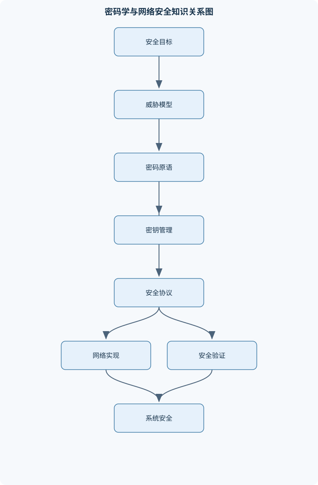
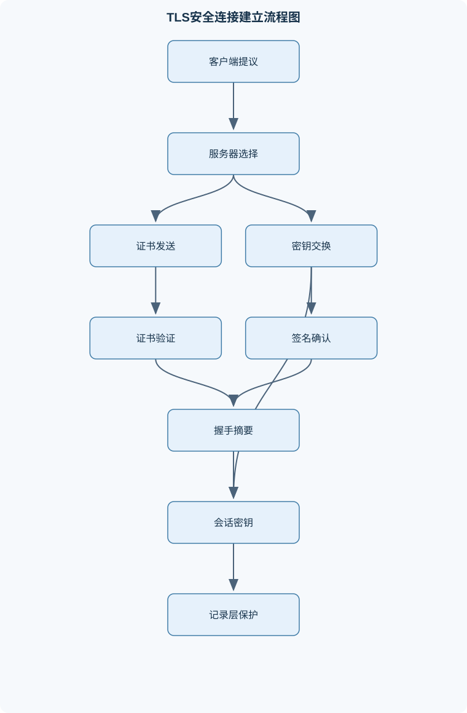

# 密码学与网络基础

## 一、课程整体知识框架

### 课程边界与先修知识

本课程研究密码学原理、密码协议、网络安全机制及其工程化应用，覆盖从单向散列、消息认证、对称加密、公钥密码、数字签名，到密钥管理、身份认证、传输层安全和分布式账本基础的完整知识链。课程重点是安全目标、威胁模型、数学依据、协议流程、实现边界和安全失效原因，不等同于网络编程或单纯的算法编码课程。先修知识包括离散数学、概率基础、模运算、数论初步、数据结构、计算机网络分层模型、操作系统基本概念和基础编程能力。学习者应理解二进制表示、字节序、网络报文、并发通信和基本复杂度分析。课程中的安全结论均依赖明确的攻击者能力、密钥长度、随机数质量、实现正确性和部署环境；理想算法安全不自动等于系统安全。





### 1. 课程研究对象与主线

《密码学与网络基础》研究如何在不完全可信的计算机网络中建立可验证的安全关系。网络中的通信者可能面对窃听者、篡改者、重放者、伪装者，甚至面对能够主动修改报文、诱导协议分支或控制部分基础设施的攻击者。课程不把密码算法看成孤立的数学程序，而是沿着“安全目标—攻击模型—数学工具—密码原语—协议组合—系统部署—故障分析”的链条展开。

密码学原语通常以明文 $m$、密文 $c$ 和密钥 $k$ 表示。加密函数为 $\operatorname{Enc}(k,m)$，解密函数为 $\operatorname{Dec}(k,c)$，基本正确性要求

$$
\operatorname{Dec}(k,\operatorname{Enc}(k,m))=m.
$$

该等式只说明合法参与者能够恢复明文，并不自动说明机密性、抗篡改性或抗重放性。安全结论必须说明攻击者能观察什么、能修改什么、能否查询加密或解密接口、密钥是否随机、随机数是否独立，以及实现是否泄露时间、错误信息或功耗等侧信道信息。

课程的另一条主线是密钥生命周期：生成、分发、启用、使用、轮换、备份、恢复、撤销和销毁。算法强度只能保护“密钥仍然秘密且实现正确”的情况；若密钥生成器可预测、证书未校验主机名、Nonce 重复或系统日志记录了秘密，理论安全性便可能失效。

### 2. 安全目标与威胁模型

#### 2.1 机密性、完整性、可用性与身份

机密性要求未授权者不能从观察到的通信中获得超出允许范围的信息。完整性要求接收者能够发现内容、顺序或关键字段被非法修改。可用性要求合法服务在资源和网络条件允许时能够持续提供功能。认证回答“通信对象是谁”以及“消息是否来自该对象”；不可否认性通常依赖数字签名及其密钥控制、证据保存和法律或组织制度，不能仅由加密实现。

被动攻击只观察流量，例如窃听、流量分析和统计推断；主动攻击还会注入、删除、延迟、重排或修改报文。典型攻击包括：

- **中间人攻击**：攻击者分别与双方建立会话，使双方误以为彼此直接通信。
- **重放攻击**：重新发送过去的合法报文，诱发重复付款、重复授权或状态回退。
- **降级攻击**：诱导双方使用较弱协议、较短密钥或旧算法。
- **伪装攻击**：攻击者冒充用户、服务器、证书持有者或网络节点。
- **选择密文或预言机攻击**：攻击者反复提交构造的密文，并依据解密结果或错误差异推断秘密。

威胁模型必须明确信任边界。例如，TLS 可以保护应用与远端服务器之间的传输，但不保证服务器内部数据库、客户端恶意插件或应用层授权逻辑安全。端到端加密的边界通常是发送端应用和接收端应用；若中间代理拥有明文密钥，它只能提供链路保护而非真正的端到端机密性。

#### 2.2 计算安全、信息论安全与安全游戏

信息论安全不依赖攻击者计算能力。例如一次一密在密钥真正均匀、长度不短于明文、只使用一次且安全分发的条件下可达到完美保密，但其密钥管理成本极高。现代公钥和对称密码通常讨论计算安全：攻击者在安全参数 $\lambda$ 下被限制为多项式时间算法，记为 PPT；只要攻击成功概率相对于理想对象的差异可忽略，就认为方案满足相应安全定义。

安全游戏把“安全”转成可检验的实验。以保密性游戏为例，攻击者提交两个等长消息 $m_0,m_1$，挑战者随机选择 $b\in\{0,1\}$，返回 $c=\operatorname{Enc}(k,m_b)$；攻击者输出猜测 $b'$。优势可写成

$$
\operatorname{Adv}=\left|\Pr[b'=b]-\frac12\right|.
$$

若优势随 $\lambda$ 增大而可忽略，才可称为该模型下的计算安全。这个结论不适用于密钥泄露、随机数重复、实现有侧信道或攻击者拥有未建模接口的情况。

### 3. 数学基础与随机性

#### 3.1 模运算、最大公因数与逆元

模运算 $a\bmod n$ 表示整数 $a$ 除以正整数 $n$ 后的余数；同余关系 $a\equiv b\pmod n$ 表示 $n$ 整除 $a-b$。乘法逆元 $a^{-1}\bmod n$ 满足

$$
aa^{-1}\equiv 1\pmod n.
$$

逆元存在的充要条件是 $\gcd(a,n)=1$。扩展欧几里得算法通过反复执行

$$
(r_0,r_1)\leftarrow(r_1,r_0\bmod r_1)
$$

并记录商，最终得到整数 $x,y$ 使

$$
ax+ny=\gcd(a,n).
$$

当最大公因数为 $1$ 时，$x\bmod n$ 就是 $a$ 的逆元。若 $\gcd(a,n)>1$，则不应强行求逆；例如 $6$ 在模 $15$ 下没有逆元，因为任何 $6x$ 都不能同余于 $1$。

费马小定理要求 $p$ 为素数且 $p\nmid a$：

$$
a^{p-1}\equiv1\pmod p.
$$

欧拉定理推广为当 $\gcd(a,n)=1$ 时，

$$
a^{\varphi(n)}\equiv1\pmod n.
$$

这些定理用于推导 RSA 等算法的正确性，但并不等同于素性证明；某些合数也可能通过部分素性测试。中国剩余定理说明，当模数两两互素时，一组模方程存在唯一的模乘积解，可用于加速 RSA 私钥运算，但实现时必须考虑故障注入和错误结果校验。

#### 3.2 概率、熵与生日界

若散列输出长度为 $n$ 比特，理想散列的输出空间大小为 $2^n$。攻击者寻找任意碰撞，即找到 $x\ne y$ 且 $H(x)=H(y)$，大约尝试 $2^{n/2}$ 次便达到显著成功概率，因为约有 $k(k-1)/2$ 对输入可能相撞：

$$
P(\text{碰撞})\approx1-\exp\left(-\frac{k(k-1)}{2\cdot2^n}\right).
$$

该公式适用于独立均匀输出的近似模型；若输入有偏、函数存在结构性弱点或攻击者利用特定算法，实际结果可能不同。原像攻击是给定摘要寻找输入，理想成本约为 $2^n$；第二原像攻击是给定一个输入寻找另一个同摘要输入，目标和已知条件均不同，不能把三者混为一谈。

熵 $H(X)$描述随机变量的不确定性。密码学随机数要求不可预测性，而不是仅仅“看起来随机”。系统随机源可能受到时间、进程状态、设备噪声或启动阶段熵不足影响。密钥、Nonce、临时私钥和盐值的生成用途不同：Nonce 主要要求按密钥唯一，盐值主要防止口令样本复用和预计算，密钥则要求不可预测且保密。

### 4. 对称密码、散列与消息认证

#### 4.1 分组密码与工作模式

流密码逐位或逐字节生成密钥流；分组密码将固定长度分组映射为同长度分组。替代提供混淆，置换提供扩散；多轮结构使一个明文比特的变化影响大量密文比特。AES 类结构包含密钥扩展、轮密钥异或、字节替换、行移位和列混合等步骤，最后一轮的具体变换与中间轮不同。安全性依赖密钥长度、轮数、实现正确性和模式使用方式，不能只看算法名称。

ECB 对每个分组独立加密，相同明文分组在同一密钥下得到相同密文分组，因此会泄露重复结构。CBC 中当前明文分组先与前一密文分组异或，再加密；首分组使用初始化向量 IV。IV 不应按固定值复用，且若协议要求不可预测，则仅保证唯一还不够。CBC 本身不提供完整性，密文篡改可能造成明文可控变化，错误响应还可能形成填充预言机。

CTR 将分组密码变成密钥流生成器：

$$
c_i=m_i\oplus E_k(\text{Nonce}\parallel \text{counter}_i).
$$

同一密钥下每个计数器块必须唯一。若两个密文使用相同密钥流，则

$$
c_1\oplus c_2=m_1\oplus m_2,
$$

明文关系直接暴露。GCM 等认证加密模式同时提供机密性和完整性，但对 Nonce 重复尤其敏感；验证标签失败时必须拒绝释放明文。

#### 4.2 散列、认证与口令存储

散列函数 $H$ 接收任意长度比特串并输出固定长度摘要。它不是可逆加密，也不能直接替代认证。消息认证码记为 $\operatorname{MAC}(k,m)$，验证函数为 $\operatorname{Verify}(k,m,t)$。HMAC 通过内外填充和两次散列构造标签，验证时应使用常量时间比较，避免因前缀匹配长度不同泄露信息。

加密与认证有四种常见组合：仅加密、仅 MAC、先加密后 MAC、认证加密。仅加密无法发现恶意修改；仅 MAC 不隐藏内容；组合方案必须明确验证顺序和错误处理。认证加密的输出通常为 $(c,t)$，验证失败应统一拒绝，不能先输出部分明文再检查标签。

口令不应直接使用快速散列保存。正确的口令存储需要每个账户独立随机盐，并使用具有可调计算或内存成本的专用口令派生机制，以增加离线字典攻击成本。盐值通常不要求保密，但必须与账户记录绑定；若攻击者已获得数据库，在线登录限制不再能替代离线防护。

### 5. 公钥密码、密钥交换与数字签名

#### 5.1 RSA、离散对数与椭圆曲线

RSA 生成两个大素数 $p,q$，计算 $N=pq$，选择与 $\varphi(N)$ 互素的公开指数 $e$，再求

$$
ed\equiv1\pmod{\varphi(N)}.
$$

公钥通常为 $(N,e)$，私钥包含 $d$ 及实现所需的附加参数。裸 RSA 的模幂运算是确定性的，不能直接用于实际加密；实际方案需要随机填充、长度检查和严格编码。RSA 加密与签名也不能简单互换：加密保护接收者机密性，签名由私钥生成并由公钥验证，消息编码、随机性和安全证明均不同。

Diffie–Hellman 在公开群中取生成元 $g$，双方选随机私有数 $a,b$，发送

$$
A=g^a,\qquad B=g^b.
$$

双方分别计算 $B^a$ 和 $A^b$，都得到 $g^{ab}$。其安全性依赖离散对数或相关计算问题困难、群参数安全、私有随机数不可预测以及公钥有效性检查。DH 本身不认证身份；没有证书、预共享密钥或签名时，攻击者可替换 $A,B$ 实施中间人攻击。

椭圆曲线使用点加法和标量乘法，记点为 $P,Q$，标量乘法为 $[k]P$，无穷远点为 $O$。安全性取决于曲线群阶、子群检查、私钥范围和实现抗侧信道能力。临时 DH 或椭圆曲线密钥交换配合长期身份认证可以提供前向保密：长期私钥日后泄露时，过去会话的临时共享秘密仍难以恢复。

#### 5.2 数字签名与 PKI

数字签名由 $(\operatorname{KeyGen},\operatorname{Sign},\operatorname{Verify})$ 构成。正确性要求合法签名能够通过验证；不可伪造性要求攻击者即使观察或请求合法签名，也难以为新消息构造有效签名。签名通常先对消息做规范化和哈希，再进行带明确编码的签名运算。消息上下文、协议名称、用途和版本应通过域分离绑定，防止同一签名被跨协议复用。

证书把主体名称、公钥、用途和有效期等字段绑定，并由签发者签名。验证证书不能只检查签名，还要构造到信任锚的证书链，检查有效期、主机名、基本约束、密钥用途、路径长度以及撤销状态。证书签名正确而主机名不匹配时，连接仍应失败，因为签名只证明“签发者签署了这些字段”，不证明“当前访问对象就是该主体”。

### 6. 网络认证、TLS 与协议工程

#### 6.1 网络分层中的安全位置

链路层保护适合局部网络链路；网络层保护可覆盖路由通信；传输层安全通常保护应用会话；应用层签名或端到端加密则把安全边界延伸到具体业务数据。层次越低，覆盖面可能越广，但越难理解应用语义；层次越高，身份和授权绑定更精确，却需要各应用正确实现。

TLS 握手的因果链是：双方协商版本、密码套件和扩展；随机数及临时密钥交换产生共享秘密；密钥派生函数生成握手密钥和应用数据密钥；证书与签名认证服务器身份；握手摘要绑定协商全过程；记录层使用派生密钥保护应用数据。证书验证成功并不等于应用授权成功，应用仍需检查账户、权限和业务状态。

TLS 1.3 的典型流程包括客户端发送能力和密钥交换参数，服务器返回选择结果、密钥交换值、证书、证书验证消息及完成消息，客户端验证后返回完成消息。具体消息可能因重试、预共享密钥或会话恢复而变化。记录层通常使用序列号、内容类型、长度及附加数据参与认证，序列号由通信双方状态维护，不能由攻击者随意重置。

#### 6.2 协议状态机与故障边界

安全协议应明确初始状态、收到每类消息后的状态转移、超时、重传、失败和关闭条件。Nonce 必须在规定密钥作用域内唯一；重放防护可使用递增序列号、挑战值、时间窗口或服务器端状态，但时间窗口本身需要处理时钟偏差和延迟。密钥确认用于证明双方确实拥有同一会话密钥；密钥分离则避免把同一密钥同时用于加密、签名、认证和密钥派生。

常见失效原因包括弱随机数、Nonce 重复、证书校验不完整、先解密后验证、错误信息过于细致、常规字符串比较、旧协议回退和密钥用途混用。常量时间实现只能减少由执行时间产生的泄露，不能修复明显的逻辑错误。日志应记录版本、算法标识、密钥编号、失败类型和关联标识，但不得记录私钥、会话密钥或完整敏感明文。

### 7. 网络攻击、区块链与验证方向

#### 7.1 典型攻击的因果关系

CBC 填充预言机利用“填充正确或错误”的差异逐字节恢复明文；修复不能只隐藏错误文字，还需采用认证加密并在认证成功前不释放明文。CTR 或 GCM 的 Nonce 重复会重用密钥流；GCM 还可能泄露认证计算相关信息，影响伪造安全。弱随机数可同时破坏 RSA 素数、DH 私钥、签名随机数和会话密钥。侧信道攻击通过时间、缓存、功耗或电磁信息推断秘密，故障注入则主动诱导错误计算并比较输出差异。

#### 7.2 分布式账本基础

交易通常由持有者使用私钥签名，节点验证签名和交易规则后广播。交易摘要进入 Merkle 树，根摘要写入区块头；区块头包含前一区块哈希 $h_{i-1}$，当前区块哈希记为 $h_i$，从而形成对历史顺序的链式承诺。修改早期交易会改变 Merkle 根、区块头哈希及其后区块的链接。

工作量证明要求寻找满足难度条件的区块头。节点通常选择累计工作量最大的有效链，而不是简单选择区块数量最多的链。若攻击者算力比例为 $q$，诚实算力比例为 $p=1-q$，在理想模型中通常要求 $p>q$；确认深度增加时，攻击者追赶概率通常下降，但不会变为零。网络延迟、算力波动、节点规则差异、秘密挖矿和实现漏洞都会改变结论。数字签名只能证明交易由某私钥控制者授权，不能单独解决双重支付；共识规则负责确定哪一组有效交易被接受。

#### 7.3 安全证明、测试与迁移

安全证明常采用归约：若攻击者能破坏协议，则可构造算法利用该攻击者解决某个被认为困难的问题。归约依赖理想密码、随机预言机、独立随机性和无侧信道等假设，不能直接证明代码实现无缺陷。

验证工作应包含测试向量、中间值校验、边界长度、错误输入、Nonce 重复、证书异常和密钥轮换测试。密码模块边界必须明确哪些组件负责随机数、编码、密钥保存、权限控制和审计。算法敏捷性要求系统能在不重写业务逻辑的情况下替换算法或参数。轻量级密码面向资源受限设备，阈值密码把密钥操作分散给多个参与者，隐私增强密码减少数据披露，后量子密码则尝试抵抗未来量子算法对部分传统公钥问题的影响。迁移规划必须包含算法标识、双轨兼容、密钥重生成、历史数据处理和淘汰时间点。

## 二、章节和模块划分

### 核心知识覆盖清单

本清单用于检查正文是否覆盖本课程的主要知识模块：

- **密码学目标与安全模型**：机密性、完整性与可用性、认证与不可否认性、被动攻击与主动攻击、窃听、篡改、重放与伪装、攻击者能力与信任边界、计算安全与信息论安全、安全游戏与优势函数、端到端安全设计。
- **数学基础与随机性**：模运算与同余关系、最大公因数与扩展欧几里得算法、乘法逆元的存在条件、费马小定理与欧拉定理、中国剩余定理、素性与大整数分解、概率分布与生日界、密码学安全随机数、熵、偏差与随机源。
- **对称密码与分组密码**：流密码与分组密码、替代与置换网络、混淆与扩散、分组密码安全模型、AES结构与轮函数、密钥长度与穷举搜索、电子密码本模式的缺陷、CBC、CTR与GCM模式、初始化向量与Nonce要求、填充与错误传播。
- **散列函数与消息认证**：单向性与抗原像性、第二原像抗性、抗碰撞性、生日攻击与输出长度、Merkle树与数据承诺、消息认证码安全性、基于散列的认证结构、基于分组密码的认证结构、加密与认证的组合方式、密码散列与口令存储。
- **公钥密码与密钥交换**：公钥密码的基本模型、RSA密钥生成与陷门单向性、RSA加密与签名的区别、随机填充与确定性编码风险、离散对数问题、Diffie-Hellman密钥交换、中间人攻击、椭圆曲线群与点运算、前向保密、密钥协商与密钥确认。
- **数字签名与公钥基础设施**：数字签名的正确性与不可伪造性、签名、加密与消息认证的区别、签名哈希与域分离、RSA类签名、椭圆曲线签名、证书与公钥绑定、证书链与信任锚、证书撤销与状态检查、密钥生命周期管理、硬件密钥保护。
- **网络认证与传输层安全**：网络分层中的安全位置、握手协议的设计目标、客户端与服务器身份认证、协商算法与降级防护、随机数与会话密钥派生、TLS 1.3握手消息流程、证书验证与主机名校验、记录层加密与完整性保护、会话恢复与密钥更新、握手失败的诊断方法。
- **密码协议与安全工程**：协议状态机、随机数与Nonce唯一性、重放防护与时间窗口、挑战—响应认证、密钥确认与密钥分离、安全组合与模块化设计、错误信息与侧信道、常量时间实现、日志、监控与密钥轮换、威胁建模与安全评审。
- **网络攻击与密码系统失效**：中间人攻击、重放攻击、降级攻击、填充预言机攻击、Nonce重复导致的密钥泄露、弱随机数攻击、侧信道与故障注入、口令猜测与离线字典攻击、证书验证错误、密钥泄露后的影响范围。
- **区块链与工作量证明基础**：交易签名与所有权控制、哈希链与时间戳、Merkle根与交易摘要、点对点广播、区块与链式确认、工作量证明、最长累计工作量链、双重支付与分叉、确认深度与攻击概率、算力假设与共识边界。
- **密码系统验证与前沿方向**：安全证明与归约思想、测试向量与中间值校验、密码模块边界、算法敏捷性、轻量级密码、阈值密码、隐私增强密码、后量子密码基本思路、密码库接口与配置审计、算法淘汰与迁移规划。


### 1. 第一章：课程基础、目标与安全模型

本章先建立术语和边界。学习者需要区分机密性、完整性、认证、不可否认性和可用性，能根据窃听、篡改、重放、伪装和降级行为判断攻击类型。章节核心产出是威胁模型：列出资产、信任边界、攻击者能力、允许的观察和修改行为，以及每个安全目标的验证条件。

安全目标不能由单个“协议成功”概括。例如协议正确性只说明诚实双方最后得到相同会话密钥；要证明抗重放，还必须定义攻击者重复旧报文时系统为何拒绝；要证明前向保密，还要把长期密钥泄露事件纳入攻击实验。

### 2. 第二章：模运算、数论与随机性

本章围绕密码算法所需的数学工具展开。重点包括同余、最大公因数、扩展欧几里得算法、逆元、费马小定理、欧拉定理、中国剩余定理、素性测试和大整数分解。数值计算时必须区分普通整数除法与模乘法，确认模数为正，并检查逆元存在条件。

随机性部分解释概率分布、熵、偏差和生日界。生日界的适用边界是理想均匀输出；它不能直接说明某个实际散列算法已经被攻击。密码学随机数发生器的输出应具有不可预测性，种子、熵池和重播恢复机制也属于安全边界。

### 3. 第三章：对称加密与分组密码模式

本章先比较流密码和分组密码，再说明替代、置换、混淆和扩散如何共同构成轮函数。AES 类算法的学习重点不是手算大规模轮变换，而是理解固定分组长度、密钥扩展、轮数和模式层之间的关系。

模式分析必须逐一讨论 ECB、CBC、CTR 和 GCM。ECB 的结构泄露源于分组独立处理；CBC 的安全使用依赖 IV、填充和完整性保护；CTR 的关键不变量是同一密钥下计数器不重复；GCM 同时保护密文和附加认证数据，但 Nonce 重复会显著扩大影响。需要特别区分“Nonce 唯一”和“Nonce 不可预测”：CTR 通常强调唯一性，某些 CBC 使用场景还要求不可预测性。

### 4. 第四章：散列、Merkle 树、MAC 与口令

本章比较原像、第二原像和碰撞抗性，推导输出长度为 $n$ 时的生日界。Merkle 树通过叶节点摘要、逐层合并和根摘要承诺大量数据；验证某条记录时，只需提供从叶到根的认证路径，而不必传输整个数据集。

MAC 使用共享密钥验证消息来源和完整性。普通 $H(m)$ 没有密钥，任何人都能重新计算，因此不能替代 MAC。HMAC 的验证还需要长度处理、密钥规范化和常量时间比较。口令存储则需要盐和可调成本的派生机制；盐不是密码，泄露盐不会直接暴露口令，但可避免多个账户共享同一预计算结果。

### 5. 第五章：公钥密码与密钥交换

本章解释公钥密码如何把加密、解密、签名和验证分离。RSA 部分涵盖 $N=pq$、公开指数 $e$、私有指数 $d$ 的关系，以及扩展欧几里得算法在求逆中的作用。必须明确裸 RSA 的确定性和代数结构不可直接用于生产系统，随机填充和严格编码是安全方案的一部分。

DH 部分推导 $g^a$、$g^b$ 和 $g^{ab}$ 的一致性，分析离散对数困难性和中间人攻击。椭圆曲线部分改用点群、标量乘法 $[k]P$ 和无穷远点 $O$ 描述，并强调群阶、子群检查和私钥范围。前向保密依赖临时密钥，而非简单地“使用了公钥密码”。

### 6. 第六章：数字签名、证书与密钥管理

数字签名部分分析签名正确性和不可伪造性，区分签名与 MAC：签名通常使用私钥生成、公钥验证，适合在不共享验证秘密的场景使用；MAC 需要双方共享密钥，验证者本身也能生成标签，因而不能单独提供同样意义上的不可否认性。

PKI 部分按“证书字段—签发者签名—证书链—信任锚—用途检查—主机名检查—撤销状态”展开。密钥管理部分覆盖生成、分发、启用、轮换、备份、恢复、吊销和销毁。长期身份密钥、短期会话密钥、签名密钥和数据加密密钥应分离；硬件密钥保护可以缩小私钥导出风险，但不能替代权限控制和审计。

### 7. 第七章：网络认证、TLS 与记录层保护

本章从网络分层出发，解释链路保护、传输层保护和应用端到端保护的差异。TLS 握手分析包括能力协商、临时密钥交换、证书验证、签名验证、握手摘要、密钥派生和完成消息。验证服务器证书时必须同时检查信任链、有效期、主机名、用途和撤销策略。

记录层把应用数据切分为记录，并使用会话密钥和序列状态提供机密性与完整性。会话恢复和密钥更新减少重复完整握手或限制单一会话密钥的使用范围，但恢复票据、状态绑定和密钥轮换本身也需要保护。握手失败诊断应沿“版本—扩展—密钥交换—证书链—签名—摘要—记录标签”的顺序定位，而不是只看“连接失败”。

### 8. 第八章：密码协议与安全工程

本章以协议状态机为核心，分析挑战—响应、Nonce、重放窗口、密钥确认、密钥分离和错误处理。一个完整协议应规定消息格式、字段编码、状态转移、超时、重试、失败响应和关闭行为。序列号若只在本地生成而未绑定会话密钥，可能被跨会话重放；时间戳若没有允许偏差和服务器状态，也不能独立提供可靠防重放。

安全工程部分包括威胁建模、密码库接口审计、配置审计、常量时间实现、日志监控和密钥轮换。审计重点不是“是否调用了某个强算法”，而是算法参数、编码方式、错误分支、密钥来源、权限边界和失败后的明文释放行为。

### 9. 第九章：攻击与失效案例

本章以因果链分析攻击。中间人攻击的根因是密钥交换没有绑定身份；重放攻击的根因是协议没有唯一挑战或状态窗口；降级攻击的根因是协商结果未被认证或允许不安全回退；填充预言机的根因是解密错误暴露了可区分信息；Nonce 复用的根因是计数器管理不具备全局或密钥范围内的唯一性。

还需分析弱随机数、侧信道、故障注入、离线口令猜测、证书验证错误和密钥泄露后的影响范围。密钥轮换只能缩短未来暴露窗口，不能自动撤销已经泄露的历史密文、日志或签名证据。

### 10. 第十章：区块链与工作量证明

本章把交易签名、哈希链、Merkle 根、点对点广播、区块确认和工作量证明连接起来。交易签名控制“谁有权发起”，Merkle 根证明“某交易是否包含在某区块摘要中”，前区块哈希维护链式顺序，共识规则决定多个有效分支中的接受路径。

确认深度 $z$ 增大时，攻击者追赶概率通常降低。理想分析可令 $p=1-q$，并以攻击者在诚实链前进期间挖出的区块数为随机变量进行估计，但该模型假设算力稳定、区块到达近似独立、网络传播条件理想。若 $q\ge p$，最长累计工作量链的安全保证显著削弱；即便 $q<p$，网络分区和软件漏洞也可能制造异常分叉。

### 11. 第十一章：验证、前沿方向与工程岗位

本章讨论安全归约、测试向量、中间值校验、密码模块边界、算法敏捷性、轻量级密码、阈值密码、隐私增强密码和后量子密码。测试不应只验证成功路径，还要覆盖错误长度、重复 Nonce、非法公钥、错误证书、标签截断、异常顺序和密钥轮换窗口。

课程知识对应的实际岗位包括密码工程师、网络安全工程师、应用安全工程师、PKI 运维工程师、密钥管理系统管理员、安全协议分析师、密码模块测试工程师、区块链协议工程师和安全运营人员。实际任务可能是设计密钥生命周期、审计证书验证、定位 TLS 握手失败、检查 Nonce 唯一性、验证测试向量或评估密钥泄露影响。验收标准应包括安全目标明确、假设可追踪、错误输入可拒绝、日志不泄露秘密、参数和版本可配置、测试结果可复现，并能说明理论安全与现实部署之间的差距。

### 12. 代表性算法与流程

#### 12.1 扩展欧几里得算法

**输入**：整数 $a,n$，其中 $n>0$。  
**输出**：$g=\gcd(a,n)$ 以及整数 $x,y$，满足 $ax+ny=g$。  
**过程**：不断执行带余除法，保存每一步商和余数；余数为零后回代求系数。  
**不变量**：每个当前余数都是原始 $a,n$ 的整数线性组合。  
**终止条件**：当前除数为零。  
**适用条件**：整数模运算和逆元计算。若 $g=1$，则 $x\bmod n$ 是逆元；否则逆元不存在。算术迭代次数为 $O(\log\min(|a|,n))$。

```python
def extended_gcd(a, n):
    """返回 gcd(a, n), x, y，使 a*x + n*y = gcd(a, n)。"""
    old_r, r = a, n
    old_x, x = 1, 0
    old_y, y = 0, 1

    while r != 0:
        q = old_r // r
        old_r, r = r, old_r - q * r
        old_x, x = x, old_x - q * x
        old_y, y = y, old_y - q * y

    return old_r, old_x, old_y


g, x, y = extended_gcd(17, 3120)
if g == 1:
    inverse = x % 3120
    print(inverse)
```

代码只演示数学过程，不用于生产密码实现。实际大整数密码库还需要处理负数规范化、异常输入和侧信道问题。

#### 12.2 CTR 加密与 Nonce 审计

**输入**：密钥 $k$、明文分组序列、唯一 Nonce。  
**输出**：密文序列。  
**过程**：将 Nonce 与递增计数器组合，计算 $E_k(\text{Nonce}\parallel\text{counter}_i)$，再与明文异或。  
**不变量**：同一密钥下每个输入块绝不重复。  
**终止条件**：所有明文分组处理完成。  
**适用条件**：Nonce 唯一，且另行提供认证；仅 CTR 不提供完整性。对长度为 $L$ 的消息，处理成本为 $O(L)$。

Nonce 审计可按密钥标识分组，使用集合记录已见 Nonce。发现重复后，还要判断是否已经产生密文、标签或密钥流泄露；不能只报告“重复存在”而不评估影响范围。

#### 12.3 HMAC 验证流程

**输入**：密钥 $k$、消息 $m$、接收标签 $t$。  
**输出**：接受或拒绝。  
**过程**：将密钥规范化到散列块长度，计算

$$
\operatorname{HMAC}(k,m)
=H((k'\oplus\operatorname{opad})\parallel H((k'\oplus\operatorname{ipad})\parallel m)).
$$

然后使用常量时间比较结果与 $t$。  
**不变量**：验证标签始终由同一密钥、同一消息编码和同一算法参数计算。  
**终止条件**：比较完成。  
**适用条件**：散列函数和标签长度满足协议安全要求；标签过短会降低伪造成本。

#### 12.4 证书链验证流程

**输入**：目标证书、中间证书、信任锚、当前时间、访问主机名、用途和撤销状态。  
**输出**：有效或无效。  
**过程**：构造证书链，逐级验证签名；检查有效期、主体名称、主机名、基本约束、密钥用途、路径长度和撤销状态。  
**不变量**：每个证书的签发者、公钥用途和验证上下文保持一致。  
**终止条件**：发现任一失败立即拒绝，或完成到信任锚的整条链验证。  
**适用条件**：信任锚由可信配置提供，验证策略明确。复杂度主要随链长度和公钥验证次数增长。

### 13. 代表性例题

#### 例题一：求模逆元

**题干**：求 $17^{-1}\bmod3120$。

**分析**：先判断 $\gcd(17,3120)=1$，再用扩展欧几里得算法回代。

**逐步解答**：

$$
3120=17\times183+9
$$

$$
17=9\times1+8
$$

$$
9=8\times1+1.
$$

回代：

$$
1=9-8=9-(17-9)=2\times9-17
$$

$$
=2(3120-17\times183)-17
=2\times3120-367\times17.
$$

所以 $-367$ 是逆元代表，规范化为

$$
-367\bmod3120=2753.
$$

**结果验证**：

$$
17\times2753=46801,\qquad 46801\bmod3120=1.
$$

**变式**：求 $6^{-1}\bmod15$。因为 $\gcd(6,15)=3\ne1$，逆元不存在，不能使用回代结果伪造逆元。

#### 例题二：生日碰撞概率

**题干**：散列输出为 $16$ 比特，随机输入数量为 $300$，估计至少出现一次碰撞的概率。

**分析**：理想输出空间为 $2^{16}=65536$，使用生日近似：

$$
P\approx1-\exp\left(-\frac{300\times299}{2\times65536}\right).
$$

**逐步解答**：

$$
\frac{300\times299}{2\times65536}\approx0.684.
$$

因此

$$
P\approx1-e^{-0.684}.
$$

该值约为 $0.50$，说明数百次随机采样已经产生显著碰撞概率。

**结果验证**：输出空间虽然有 $65536$ 个值，但比较的是约 $300\times299/2$ 对输入，而不是仅做 $300$ 次“命中固定摘要”的尝试。

**变式**：若输出长度改为 $256$ 比特，理想碰撞强度约为 $2^{128}$ 次，而不是 $2^{256}$ 次；原像强度与碰撞强度不能混淆。

#### 例题三：CTR Nonce 复用

**题干**：同一密钥下两个消息使用相同密钥流 $s$，已知

$$
c_1=m_1\oplus s,\qquad c_2=m_2\oplus s.
$$

说明风险。

**分析与解答**：

$$
c_1\oplus c_2
=(m_1\oplus s)\oplus(m_2\oplus s)
=m_1\oplus m_2.
$$

密钥流因异或两次而抵消。若攻击者知道 $m_1$ 的一部分，就能在对应位置恢复 $m_2$；即使不知道完整明文，也可能利用格式、语言统计和已知字段推断两者。

**结果验证**：根本问题不是密文长度，而是同一密钥下计数器输入重复。

**变式**：重新生成每条消息的独立密钥可以降低复用影响，但更合理的工程修复是为每个密钥建立可靠的 Nonce 唯一性管理，并同时使用认证加密防篡改。

#### 例题四：RSA 小参数计算

**题干**：取 $p=11,q=17$，令 $e=7$，求私钥指数并验证消息 $m=8$ 的加解密。

**逐步解答**：

$$
N=pq=187,\qquad \varphi(N)=(p-1)(q-1)=160.
$$

因为

$$
7\times23=161\equiv1\pmod{160},
$$

所以 $d=23$。密文为

$$
c=8^7\bmod187.
$$

逐次平方可得 $c=134$。再计算

$$
m'=134^{23}\bmod187,
$$

得到 $m'=8$。

**结果验证**：验证 $\operatorname{Dec}(d,\operatorname{Enc}(e,m))=m$，说明参数在演示范围内满足正确性。

**边界说明**：小素数、裸模幂和确定性编码不能用于真实系统。实际 RSA 需要足够大的参数、合适的随机编码、严格输入长度检查和经过审计的密码库。

#### 例题五：证书签名正确但主机名不匹配

**题干**：服务器证书由可信链签发，签名、有效期和撤销状态均正常，但证书名称为 `api.example.test`，客户端访问的是 `pay.example.test`。是否接受？

**分析**：证书签名只证明签发者签署了证书字段，不能证明当前连接的主机名与证书主体相符。

**逐步解答**：

1. 构造目标证书到信任锚的链。
2. 验证各级签名和有效期。
3. 检查当前主机名是否匹配证书名称约束。
4. 发现 `pay.example.test` 不在证书允许范围内。
5. 拒绝连接，不因其他检查通过而放行。

**结果验证**：若放行，攻击者可能持有另一个合法域名证书并冒充目标服务。

**变式**：即使主机名匹配，若证书用途不允许服务器认证、链路径约束失败或撤销状态不满足策略，也应拒绝。

#### 例题六：工作量证明追赶概率的条件分析

**题干**：攻击者算力比例 $q=0.1$，诚实算力比例 $p=0.9$，交易后有 $z=3$ 个确认。解释增加确认深度为何降低风险。

**分析**：理想模型下，攻击者在诚实链增长期间挖到的区块数可近似建模为泊松变量，其期望进度为

$$
\lambda=\frac{zq}{p}
=\frac{3\times0.1}{0.9}
\approx0.333.
$$

攻击者可能已经挖到 $0,1,2,\ldots$ 个区块；每种状态都有继续追赶的条件概率，再按泊松概率加权。

**逐步解答**：

1. 计算 $p=1-q=0.9$。
2. 计算 $\lambda\approx0.333$。
3. 枚举攻击者在诚实链前进三块期间的可能进度。
4. 对每个进度计算从落后状态追赶成功的概率。
5. 累加得到估计值。

**结果解释**：$z$ 增大使诚实链领先距离通常增大，因此追赶概率下降，但不等于绝对不可逆。

**变式**：若 $q\ge p$，攻击者不再处于理想的追赶劣势；若网络存在分区、延迟或节点规则差异，理想泊松模型也可能失真。

### 14. 实验与项目

#### 实验一：认证加密与错误处理实验

**输入数据**：准备若干固定测试消息，包括空消息、短消息、长消息、含二进制零字节的消息；为每条消息设置唯一 Nonce，并构造一份附加认证数据，如协议版本、消息类型和序列号。

**步骤**：

1. 使用测试密码库生成认证加密结果 $(c,t)$。
2. 正常解密并验证明文与原文一致。
3. 分别修改密文、标签、Nonce 和附加认证数据。
4. 记录验证结果、是否释放明文、错误响应是否一致。
5. 重复使用同一密钥和同一 Nonce，观察实现是否拒绝或产生审计告警。
6. 检查日志是否包含密钥、完整明文或可复用标签。

**评价标准**：正常输入必须恢复原文；任一密文、标签或附加数据被修改时必须拒绝；认证失败前不能释放明文；错误响应不应泄露可区分的内部状态；Nonce 重复应被阻止、记录或在设计上不可发生。

**排错方法**：若正常验证失败，先检查字节编码、标签截断、Nonce 长度和附加数据是否完全一致；若篡改仍能通过，检查是否误用了仅加密模式或验证结果未真正参与控制流；若不同错误码泄露状态，统一外部错误响应并在内部使用受控审计日志。

#### 项目二：TLS 证书链与握手诊断

**输入数据**：一组经过授权的本地测试服务、客户端能力配置、服务器证书链、握手日志和抓包记录；故障场景包括主机名不匹配、证书过期、签名验证失败、协议版本不兼容和密钥交换值异常。

**步骤**：

1. 记录客户端支持的版本、扩展和密码套件。
2. 确认服务器返回的证书链，并逐级检查签名、有效期、用途和主机名。
3. 对照握手消息确认临时密钥交换参数存在且未被异常复用。
4. 检查双方对握手摘要的理解是否一致。
5. 定位失败发生在协商、证书、签名、密钥派生还是记录层。
6. 修复一个故障后重新执行全部场景，避免只验证单一路径。

**评价标准**：能够为每种故障指出首次可确定失败的消息或验证步骤；主机名不匹配和证书过期必须拒绝；弱版本或不安全回退不能被无提示启用；日志能够支持定位但不泄露私钥和会话密钥；同一故障在重复测试中产生一致结论。

**排错方法**：若无法建立连接，先区分网络不可达与密码握手失败；若证书链签名通过但仍失败，检查主机名、用途和时间；若握手完成但应用数据失败，检查记录层密钥、序列状态、标签和双方派生上下文；若仅部分客户端失败，比较版本、扩展和信任锚配置，而不能直接降低安全级别。

## 三、核心概念的详细解释

### 1. 安全目标、攻击模型与安全边界

密码系统首先要明确保护对象和攻击者能力。机密性要求攻击者不能从密文、通信时序或其他可见信息中获得不应获得的明文信息；完整性要求接收者能够发现消息内容、顺序或关键字段被修改；可用性要求合法参与者在资源和网络条件允许时能够继续使用服务。认证既可以指实体认证，即确认通信对象身份，也可以指消息认证，即确认消息确实由掌握共享密钥的一方生成且未被修改。不可否认性通常依赖数字签名、私钥控制、证据保存和制度安排，不能由对称加密或普通消息认证码单独推出。

攻击者可能是被动的，也可能是主动的。被动攻击包括窃听、流量统计和通信模式分析；主动攻击包括报文注入、删除、修改、延迟、重排、重放和协议降级。攻击者能力越强，安全结论越严格。例如，只考虑窃听者的方案不一定能抵抗主动篡改者；只证明单条消息的完整性，也不代表能防止攻击者重复发送该条合法消息。

威胁模型必须说明信任边界。传输层安全通常保护客户端与服务器之间的网络传输，但不自动保护服务器内部数据库、客户端恶意程序、应用层授权逻辑或服务器之后的业务转发。如果中间代理能够解密并重新加密通信，则它可能提供链路保护，却不能提供发送端应用到接收端应用的端到端机密性。安全设计应把“谁持有密钥”“谁能修改报文”“谁能观察错误信息”写清楚。

### 2. 安全游戏、计算安全与信息论安全

密码学中的安全性不能只用“看起来难以破解”描述，而应通过安全游戏定义。设安全参数为 $\lambda$，攻击者为关于 $\lambda$ 运行时间为多项式的算法，记为 PPT。机密性游戏中，攻击者选择两个长度相同的消息 $m_0,m_1$，挑战者随机选择 $b\in\{0,1\}$，返回

$$
c=\operatorname{Enc}(k,m_b).
$$

攻击者根据自己的观察输出 $b'$。其优势定义为

$$
\operatorname{Adv}=\left|\Pr[b'=b]-\frac12\right|.
$$

若攻击者不能使该优势随 $\lambda$ 增大而保持非忽略水平，则可认为方案在该游戏中具有计算机密性。这个结论依赖密钥随机、加密算法正确、随机数不可预测、实现没有严重侧信道等条件。若密钥泄露或攻击者能够读取明文缓存，游戏假设已不成立。

信息论安全不限制攻击者计算能力。一次一密在密钥与明文等长、密钥真正均匀、只使用一次且安全分发时，可以达到完美保密；但其密钥分发和存储成本接近明文本身。现实系统通常采用计算安全，以较短密钥换取可部署性。计算安全不是永久不变的结论，算法、密钥长度、计算资源和数学攻击方法变化后，原有安全边界可能失效。

### 3. 模运算、逆元与数论基础

若整数 $a$、$b$ 相除后的余数相同，则称

$$
a\equiv b\pmod n.
$$

模运算中的加法、减法和乘法可以先对操作数取余再计算。除法不能直接进行，只有当除数存在乘法逆元时，才可以改写为乘以逆元。$a^{-1}\bmod n$ 表示满足

$$
aa^{-1}\equiv1\pmod n
$$

的数。其存在当且仅当 $\gcd(a,n)=1$。

扩展欧几里得算法求整数 $x,y$，使

$$
ax+ny=\gcd(a,n).
$$

当最大公因数为 $1$ 时，得到 $ax+ny=1$，于是

$$
ax\equiv1\pmod n,
$$

所以 $x\bmod n$ 就是 $a$ 的一个逆元。若 $\gcd(a,n)\ne1$，则不存在逆元，任何试图用模除法求解的步骤都必须停止，而不能把普通实数除法结果直接取模。

费马小定理要求 $p$ 为素数且 $p\nmid a$：

$$
a^{p-1}\equiv1\pmod p.
$$

欧拉定理推广为：若 $\gcd(a,n)=1$，则

$$
a^{\varphi(n)}\equiv1\pmod n.
$$

这些定理可用于模幂运算和 RSA 正确性证明，但不能单独证明大整数分解困难。中国剩余定理说明，当模数两两互素时，一组模方程具有唯一的模乘积解。RSA 私钥运算常利用该定理分别在 $p$ 和 $q$ 上计算，再合并结果，从而提高效率；实现时必须防止故障注入导致中间结果泄露。

### 4. 随机性、熵与生日界

密码学随机数的要求不只是“统计上看起来随机”。密钥、Nonce、初始化向量和临时私钥需要不可预测或满足特定唯一性条件。若伪随机生成器的种子可猜测，攻击者可以重建后续密钥；若同一密钥下 CTR 或 GCM 的 Nonce 重复，可能泄露明文关系并破坏认证安全。

随机变量 $X$ 的熵可表示为

$$
H(X)=-\sum_x\Pr[X=x]\log_2\Pr[X=x].
$$

均匀分布在给定取值数量下熵最大。若某些取值概率明显偏高，实际猜测难度低于名义比特数。密码学系统应使用操作系统或硬件提供的密码学安全随机源，并区分“随机性不足”“不可预测性不足”和“唯一性不足”三个问题：有些计数器不需要不可预测，但必须保证不重复；有些临时密钥则同时需要不可预测和足够大的取值空间。

若散列函数输出 $n$ 比特，理想情况下进行约 $2^{n/2}$ 次随机输入尝试后，碰撞概率达到明显水平。这是生日界的结果，而不是 $2^n$ 次。对 $k$ 个随机输入，碰撞概率近似为

$$
P_{\mathrm{coll}}\approx1-\exp\left(-\frac{k(k-1)}{2\cdot2^n}\right).
$$

该近似要求输入独立且散列函数可视为随机函数。当 $k\ll2^{n/2}$ 时，概率约为 $k(k-1)/2^{n+1}$；当 $k$ 接近 $2^{n/2}$ 时，不能把概率继续当作线性增长。

### 5. 对称加密、分组模式与认证加密

对称加密使用同一密钥进行加密和解密。流密码逐位或逐字节生成密钥流，分组密码则将固定长度分组映射为同长度分组。理想分组密码应表现为由密钥选择的随机置换。替代主要改变符号取值，置换主要改变位置；混淆降低密钥与密文之间的可见关系，扩散使一个明文位的影响扩展到多个密文位。

AES 类分组密码由密钥扩展和多轮变换组成。状态保持固定分组长度，每轮通常包含字节替换、行移位、列混合和轮密钥异或，最后一轮省略列混合。固定轮数和轮函数不能替代安全模式；若模式使用不当，强分组密码仍会形成不安全系统。

ECB 对每个分组独立加密，因此相同明文分组在同一密钥下产生相同密文分组，会泄露重复结构。CBC 中，第一个分组依赖初始化向量，后续分组依赖前一个密文分组。CBC 的机密性不能自动提供完整性；篡改密文可能改变对应明文，若接收端先检查填充再返回不同错误，就可能形成填充预言机。

CTR 将分组密码转化为密钥流生成器：

$$
c_i=m_i\oplus\operatorname{Enc}(k,\operatorname{Nonce}\Vert\operatorname{Counter}_i).
$$

同一密钥下，所有计数器输入必须唯一。若两条消息使用相同密钥流 $s$，则

$$
c_1\oplus c_2=(m_1\oplus s)\oplus(m_2\oplus s)=m_1\oplus m_2.
$$

因此已知其中一部分明文即可恢复另一条消息的相应部分。GCM 等认证加密方案同时提供机密性和完整性，但其安全性高度依赖 Nonce 不重复。解密流程必须先验证认证标签，验证失败时拒绝释放明文，并尽量统一外部错误响应。

### 6. 散列、消息认证码与口令存储

散列函数 $H$ 接受任意长度输入并输出固定长度摘要。原像抗性要求给定摘要 $y$，难以找到 $m$ 使 $H(m)=y$；第二原像抗性要求给定 $m$，难以找到不同的 $m'$ 使 $H(m')=H(m)$；抗碰撞性要求攻击者难以主动找到任意不同的 $m,m'$ 满足相同摘要。三者的已知条件和攻击目标不同，不能相互替代。

Merkle 树将大量数据的摘要组织成树结构。叶节点通常是交易或文件摘要，内部节点是子节点摘要的组合，根摘要承诺整个集合。改变任意叶数据会沿路径改变根，因此可以用较短的认证路径验证某条数据是否属于已承诺集合。但根摘要只提供数据承诺，若根本身没有被可信地保存或签名，攻击者仍可整体替换数据集和根。

消息认证码使用共享密钥生成标签：

$$
t=\operatorname{MAC}(k,m).
$$

验证函数 $\operatorname{Verify}(k,m,t)$ 接受或拒绝。普通 $H(m)$ 没有密钥，任何人都能重新计算，不能证明消息来自特定密钥持有者。HMAC 通过内外两层散列和不同填充构造标签，验证时应使用常量时间比较，避免因前缀匹配长度不同产生时间泄露。

口令不应直接使用快速散列保存。正确的口令存储通常使用每个账户独立随机盐和可调成本的专用口令派生机制，使攻击者即使取得数据库，也必须为每个候选口令承担较高计算或内存成本。盐不必保密，但必须唯一且与记录绑定；盐不能代替口令秘密，也不能把普通快速散列加盐后误称为专用口令保护。

### 7. 公钥密码、密钥交换与数字签名

公钥密码使用公开的 $pk$ 和秘密的 $sk$。加密通常由发送方使用接收方公钥，只有接收方私钥能够解密；数字签名则由签名者使用私钥生成，任何持有公钥者都可以验证。两者虽然都涉及公钥和私钥，却具有不同的安全目标、编码规则和攻击模型，不能把“用私钥做模幂”直接当作安全签名。

RSA 参数为 $N=pq$，公开指数为 $e$，私有指数为 $d$。在满足相应互素条件时，

$$
ed\equiv1\pmod{\varphi(N)}.
$$

裸 RSA 具有确定性和代数结构：相同消息在同一公钥下得到相同结果，并且直接对任意输入做模幂可能受到乘法结构攻击。因此，RSA 加密必须使用随机编码，签名必须使用规范的消息哈希和签名编码；不能把 RSA 加密填充和签名填充混用。

Diffie–Hellman 交换中，公开群生成元为 $g$，双方分别选择随机数 $a,b$，发送

$$
A=g^a,\qquad B=g^b.
$$

双方分别计算

$$
B^a=g^{ab},\qquad A^b=g^{ab}.
$$

该协议只建立共享秘密，不认证公钥值。攻击者可以替换 $A$ 和 $B$，分别与双方建立两个共享秘密，从而实施中间人攻击。必须通过证书、预共享密钥或数字签名把临时公钥绑定到身份。椭圆曲线中使用点 $P$ 和标量乘法 $[k]P$，无穷远点为 $O$；必须验证点属于规定曲线和安全子群，防止无效点或小子群攻击。

前向保密要求长期身份私钥泄露后，过去会话的临时会话密钥仍难以恢复。实现上通常使用临时 Diffie–Hellman，并用密钥派生函数从共享秘密、握手上下文和用途标签生成不同会话密钥。长期签名密钥不应直接作为数据加密密钥。

### 8. 证书、密钥生命周期与 TLS

证书把公钥、主体名称、用途和有效期绑定起来，并由上级签发者签名。验证证书不能只检查签名，还要检查信任锚、证书链、有效期、主机名、密钥用途、基本约束、路径长度和撤销状态。证书签名正确只说明签发者签署了证书内容，不说明当前访问的主机名一定匹配。

TLS 握手的因果链是：双方协商协议参数；交换随机数和临时密钥材料；服务器证明私钥持有权；客户端验证证书链和主机名；双方对握手摘要进行绑定；密钥派生函数生成记录层密钥；后续数据由认证加密保护。握手成功不等于应用层授权成功，应用仍需检查用户身份、权限和业务状态。

记录层通常维护序列号，并将内容类型、长度等状态或关联数据纳入保护范围。序列号不能被应用随意重置，否则可能造成重放或标签验证状态不一致。会话恢复可以减少完整握手成本，但恢复票据本身也需要保护、轮换和失效控制。

### 9. 协议状态机、重放防护与实现边界

协议不能只描述“发送一个请求、返回一个响应”，还要定义状态、允许的消息、异常转移和终止条件。挑战—响应认证中，验证方发送新鲜挑战 $r$，对方返回与身份、请求上下文和 $r$ 绑定的认证结果。挑战必须不可预测或至少不可重复；若固定挑战或接受旧挑战，攻击者可重放过去的合法响应。

Nonce、时间戳、序列号和状态窗口都可用于新鲜性控制，但适用条件不同。序列号需要双方状态同步，时间戳依赖时钟容忍范围，Nonce 需要可靠生成和记录。密码学标签验证成功只证明消息未被持有密钥之外的攻击者修改，不自动保证业务上未重复执行；业务层仍需保存请求标识和幂等状态。

常量时间实现主要针对秘密相关分支、内存访问和比较操作，不能简单理解为所有代码执行时间完全相同。错误信息也属于输出通道：区分“标签错误”“填充错误”“用户不存在”可能使攻击者获得预言机或账户枚举信息。日志应记录足以定位问题的上下文，但不得记录私钥、完整口令、会话密钥或可直接重放的认证材料。

### 10. 区块链、工作量证明与共识边界

交易通常由持有私钥的一方签名，节点验证签名后判断其是否满足账户或脚本控制条件。交易摘要、区块头哈希、前一区块哈希和 Merkle 根构成多层承诺。若当前区块头哈希记为 $h_i$，前一区块哈希为 $h_{i-1}$，则当前区块头包含对 $h_{i-1}$ 的承诺；修改历史区块会导致后续哈希链全部变化。

工作量证明要求寻找满足目标条件的区块头。攻击者算力比例为 $q$，诚实节点比例为 $p=1-q$。在独立挖矿、网络传播近似及时且节点遵循固定规则的理想模型中，当 $p>q$ 时，攻击者在确认数增加后追赶概率通常下降。但这不是绝对不可逆保证。网络分区、算力突变、自私挖矿、软件漏洞和共识规则变化都会改变结论。

“最长链”更准确地说是累计工作量最大的有效链，而不是区块数量简单最多的链。确认深度越大，交易被替换的成本通常越高，但系统仍需要根据交易价值、攻击者算力、网络状况和业务容忍度决定接受策略。区块链签名只能解决授权与不可伪造问题，不能单独解决双重支付；后者还需要全网排序和共识机制。

### 11. 安全证明、测试与算法迁移

安全证明通常采用归约：假设攻击者能破坏协议，则构造一个算法利用该攻击者解决底层困难问题，从而说明协议安全性依赖该困难假设。归约只在假设、参数、编码和攻击模型都覆盖现实实现时有效。理想密码、随机预言机、独立随机性和无侧信道等抽象条件不能自动适用于实际设备。

密码模块测试应同时检查已知输入输出、边界长度、错误输入、状态转换、随机数失败、Nonce 重复和并发访问。算法敏捷性要求系统能够在不大规模重写业务的情况下更换算法、密钥长度或证书链。后量子密码的基本思路是采用不依赖大整数分解或离散对数困难性的数学问题，但迁移还要评估密钥尺寸、签名尺寸、握手带宽、硬件性能和兼容周期。

## 四、重要定义、公式、定理和推导

### 专业审校补充：关键定义与适用边界

前向保密（Forward Secrecy）是会话密钥安全性的时间边界：若长期身份私钥在会话结束后泄露，攻击者仍不能仅凭已记录的握手流量恢复过去的会话明文。典型实现是在每次会话中使用新的临时 Diffie–Hellman 私钥，并用身份签名认证临时公钥；会话密钥由共享秘密和握手上下文经密钥派生函数生成，临时私钥使用后应销毁。仅使用长期 RSA 私钥加密固定会话密钥通常不具备前向保密，因为记录下来的密文可在私钥日后泄露时被解密。前向保密不等于持续安全：若攻击者实时控制通信端点、窃取会话密钥或终端已被入侵，仍可读取当前会话；若密钥派生、随机数、签名验证或临时密钥删除实现错误，理论上的前向保密也不能成立。工程上还应区分前向保密与密钥泄露后的恢复能力，后者要求重新建立未被攻击者控制的密钥和认证状态。


### 1. 基本定义与正确性条件

对称加密方案由密钥空间、明文空间、密文空间和算法组成。其正确性要求对所有合法密钥 $k$ 和明文 $m$：

$$
\operatorname{Dec}(k,\operatorname{Enc}(k,m))=m.
$$

正确性只讨论诚实执行，不等于安全性。一个恒等加密方案满足正确性，却完全没有机密性；一个能正确解密但允许任意篡改的方案，也不满足完整性。

认证加密输出通常为 $(c,t)$，其中 $c$ 为密文，$t$ 为认证标签，附加认证数据记为 $a$。其解密接口应输出明文或失败：

$$
\operatorname{Dec}(k,c,t,a)=
\begin{cases}
m,&\text{标签验证成功};\\
\perp,&\text{标签验证失败}.
\end{cases}
$$

验证失败时必须在明文释放前返回 $\perp$。若服务先输出部分明文、再报告标签错误，攻击者可能通过多次查询获得选择密文或侧信道信息。

数字签名方案为

$$
(\operatorname{KeyGen},\operatorname{Sign},\operatorname{Verify}).
$$

密钥生成输出 $(sk,pk)$，签名为

$$
\sigma=\operatorname{Sign}(sk,m),
$$

验证满足

$$
\operatorname{Verify}(pk,m,\sigma)=1.
$$

正确性要求合法签名总能通过验证；不可伪造性则要求攻击者即使获得若干合法签名，也难以对新的消息生成有效签名。实际签名还必须绑定协议上下文、算法标识、用途和消息边界，避免跨协议重放。

### 2. 扩展欧几里得算法与模逆元

**输入**：整数 $a,n$，其中 $n>0$。  
**输出**：$g=\gcd(a,n)$ 以及满足 $ax+ny=g$ 的整数 $x,y$。

算法反复执行

$$
(r_0,r_1)\leftarrow(r_1,r_0\bmod r_1)
$$

直到 $r_1=0$。每一步余数都是前两个余数的线性组合，因此最终非零余数仍是原始 $a,n$ 的最大公因数。回代可得到系数 $x,y$。若 $g=1$，则

$$
ax+ny=1
$$

两边对 $n$ 取模，得到 $ax\equiv1\pmod n$，所以 $x\bmod n$ 是逆元。该算法的算术迭代次数为 $O(\log\min(|a|,|n|))$；大整数位复杂度还取决于乘法和除法实现。

**例题一：求模逆元。** 求 $17^{-1}\bmod3120$。

欧几里得计算为：

$$
3120=17\times183+9,
$$

$$
17=9\times1+8,
$$

$$
9=8\times1+1.
$$

回代：

$$
1=9-8=9-(17-9)=2\times9-17,
$$

$$
1=2(3120-17\times183)-17
=2\times3120-367\times17.
$$

因此 $-367$ 是 $17$ 的逆元代表，化为非负余数：

$$
-367\bmod3120=2753.
$$

验证：

$$
17\times2753=46801,\qquad 46801\bmod3120=1.
$$

若把 $a$ 换成 $18$，则 $\gcd(18,3120)\ne1$，不存在模逆元，不能继续使用同样的除法步骤。

### 3. RSA 正确性与安全编码

RSA 取两个大素数 $p,q$，令

$$
N=pq,\qquad \varphi(N)=(p-1)(q-1).
$$

选择满足 $\gcd(e,\varphi(N))=1$ 的公开指数 $e$，通过扩展欧几里得算法求 $d$：

$$
ed\equiv1\pmod{\varphi(N)}.
$$

在满足消息范围和参数条件时，若 $m$ 与 $N$ 互素，根据欧拉定理：

$$
m^{\varphi(N)}\equiv1\pmod N.
$$

设 $ed=1+t\varphi(N)$，则

$$
m^{ed}=m^{1+t\varphi(N)}
=m(m^{\varphi(N)})^t
\equiv m\pmod N.
$$

对不与 $N$ 互素的消息，需要在模 $p$ 和模 $q$ 下分别证明，再利用中国剩余定理合并，才能覆盖完整消息空间。

**例题二：小参数演示。** 取 $p=11,q=17$，则

$$
N=187,\qquad \varphi(N)=160.
$$

取 $e=7$，因为 $\gcd(7,160)=1$，求得 $d=23$，且

$$
7\times23=161\equiv1\pmod{160}.
$$

对 $m=8$，加密为

$$
c=8^7\bmod187.
$$

逐步平方：

$$
8^2=64,\quad 8^4=4096\equiv169\pmod{187},
$$

$$
8^7=8^4\cdot8^2\cdot8
\equiv169\cdot64\cdot8\equiv134\pmod{187}.
$$

因此 $c=134$。再计算 $134^{23}\bmod187$，根据 RSA 正确性恢复 $8$。该例只说明模幂关系，参数极小且消息未使用安全编码，不能用于实际系统。实际 RSA 加密需要随机编码，签名需要专用签名编码和严格验证。

### 4. 散列碰撞与生日界推导

输出空间大小为 $M=2^n$。前 $k$ 次随机输入均无碰撞的概率为

$$
P_{\mathrm{none}}
=\prod_{i=0}^{k-1}\left(1-\frac{i}{M}\right).
$$

当 $k$ 相对 $M$ 较小时，使用 $\ln(1-x)\approx-x$：

$$
\ln P_{\mathrm{none}}
\approx-\sum_{i=0}^{k-1}\frac{i}{M}
=-\frac{k(k-1)}{2M}.
$$

所以

$$
P_{\mathrm{none}}\approx
\exp\left(-\frac{k(k-1)}{2M}\right),
$$

从而

$$
P_{\mathrm{coll}}\approx
1-\exp\left(-\frac{k(k-1)}{2\cdot2^n}\right).
$$

**例题三：16 比特摘要。** 若 $n=16$，随机输入数量 $k=300$，则

$$
\frac{k(k-1)}{2\cdot2^{16}}
=\frac{300\times299}{131072}
\approx0.684.
$$

因此

$$
P_{\mathrm{coll}}\approx1-e^{-0.684},
$$

约为 $0.5$ 左右。这个结果说明输出空间有 $65536$ 种时，几百次采样就可能产生明显碰撞。若要提供约 $s$ 比特的抗碰撞强度，摘要长度通常至少需要约 $2s$ 比特，且还要考虑结构性攻击和截断长度。

### 5. CTR Nonce 复用推导

CTR 模式第 $i$ 个分组的密钥流记为

$$
s_i=\operatorname{Enc}(k,\operatorname{Nonce}\Vert\operatorname{Counter}_i),
$$

密文为

$$
c_i=m_i\oplus s_i.
$$

若同一密钥和相同计数器序列被两条消息复用，则

$$
c_i^{(1)}\oplus c_i^{(2)}
=(m_i^{(1)}\oplus s_i)\oplus(m_i^{(2)}\oplus s_i)
=m_i^{(1)}\oplus m_i^{(2)}.
$$

**例题四：已知明文恢复。** 设第一条消息中某段内容为已知格式，例如攻击者知道 $m^{(1)}$ 的前八字节，则可由

$$
s=c^{(1)}\oplus m^{(1)}
$$

恢复对应密钥流，再计算

$$
m^{(2)}=c^{(2)}\oplus s.
$$

如果明文未知，也已泄露两条明文的异或关系，攻击者仍可进行语言统计和格式推断。根本修复是保证同一密钥下 Nonce 不重复；仅仅改变明文格式或再次编码不能修复密钥流复用。若无法可靠保证唯一性，应重新设计密钥生命周期和计数器持久化机制。

### 6. Diffie–Hellman 中间人分析

公开群参数为 $(G,g)$。甲选择 $a$，发送 $A=g^a$；乙选择 $b$，发送 $B=g^b$。正常情况下双方计算：

$$
K_A=B^a=g^{ba},\qquad K_B=A^b=g^{ab}.
$$

由于群运算满足交换性，二者相同。但该等式没有包含“$A$ 属于甲”“$B$ 属于乙”的身份信息。

**例题五：中间人路径。** 攻击者截获甲发送的 $A$，向乙发送自己的 $X=g^x$；又截获乙发送的 $B$，向甲发送自己的 $Y=g^y$。甲计算 $Y^a=g^{ya}$，乙计算 $X^b=g^{xb}$。攻击者分别计算 $A^y$ 和 $B^x$，得到两个不同共享秘密。甲以为秘密来自乙，乙以为秘密来自甲，攻击者则可解密、修改并重新加密通信。

修复方法是使用证书验证公钥归属，或让双方对临时公钥和握手上下文签名，再通过密钥确认确认双方得到同一会话密钥。仅增加群大小不能消除中间人攻击，因为该攻击不依赖求解离散对数。

### 7. 工作量证明追赶概率

设攻击者算力比例为 $q$，诚实节点比例为 $p=1-q$。当 $p>q$ 且网络模型近似稳定时，确认深度增加通常使攻击者追赶概率下降。若诚实链增长 $z$ 个区块，攻击者在此期间挖出区块数可近似服从均值

$$
\lambda=\frac{zq}{p}
$$

的泊松分布。攻击者挖出 $k$ 个区块的概率为

$$
P_k=e^{-\lambda}\frac{\lambda^k}{k!}.
$$

若 $k\ge z$，攻击者已经追平或领先；若 $k<z$，还需从差距 $z-k$ 继续追赶。因此总概率可表示为对各 $k$ 状态概率加权求和。该模型依赖独立挖矿、稳定算力、传播延迟可忽略和节点规则一致等假设。若 $q\ge p$，理想最长累计工作量链的安全保证显著减弱；即便 $q<p$，网络分区或实现漏洞也可能导致不同结果。

### 8. 代表性流程伪代码

下面给出认证加密验证流程的抽象伪代码。它强调验证先于明文释放，不绑定某个具体算法或软件接口。

```text
伪代码：认证加密解密

输入：
    k       密钥
    c       密文
    t       认证标签
    a       附加认证数据

输出：
    明文 m，或失败符号 ⊥

过程：
    1. 检查 c、t、a 的长度和格式是否符合协议约束。
    2. 使用 k、c、a 计算期望标签 t_expected。
    3. 使用常量时间比较比较 t_expected 与 t。
    4. 若比较失败：
           记录不含秘密的内部诊断信息；
           返回 ⊥；
           不执行明文释放。
    5. 若比较成功：
           计算 m = Decrypt(k, c, a)；
           检查明文结构和业务边界；
           返回 m。
```

其不变量是：任何未通过标签验证的密文都不会进入明文输出路径。终止条件是格式检查失败、标签比较失败或成功完成解密。适用条件是底层认证加密算法正确、Nonce 管理可靠、标签长度符合安全要求。对长度为 $L$ 的消息，处理成本通常为 $O(L)$，但实际内存访问、并行实现和硬件加速会影响常数项。

### 9. 实验与项目流程

#### 实验一：Nonce 复用影响验证

**输入数据**：构造两条长度相同的测试明文，使用同一测试密钥和同一 Nonce 分别进行 CTR 加密；再使用不同 Nonce 重复实验。实验只使用本地测试数据，不处理真实秘密。

**步骤**：

1. 记录密钥标识、Nonce、计数器起始值和密文。
2. 计算两条密文的异或值。
3. 将异或结果与两条明文的异或值比较。
4. 改用不同 Nonce，重复比较。
5. 模拟已知部分明文，检查能否恢复另一条消息对应部分。
6. 检查协议日志是否能发现同一密钥下的重复 Nonce。

**评价标准**：重复 Nonce 时，两组异或结果应一致；不同 Nonce 时不应出现同一密钥流复用关系；系统应在生成或接收阶段拒绝重复 Nonce，而不是依赖事后分析。

**排错方法**：若结果不一致，先检查是否使用了不同密钥、计数器端序不同、明文长度不同或异或范围不一致；若重复 Nonce 未被发现，检查密钥标识是否纳入日志和去重键；若日志保存了明文或密钥，应立即调整审计字段。

#### 项目二：证书链与 TLS 握手诊断

**输入数据**：本地测试服务的证书链、信任锚、客户端主机名、握手消息和错误日志。设置主机名不匹配、证书过期、签名验证失败、版本不兼容四种故障。

**步骤**：

1. 检查网络连通性，排除端口不可达等非密码故障。
2. 构造从服务器证书到信任锚的证书链。
3. 逐级验证签名、有效期、主体名称、密钥用途和基本约束。
4. 检查临时密钥交换参数、握手摘要和记录层状态。
5. 为每个故障确定首次能够判定失败的消息或检查步骤。
6. 修复后重新执行所有测试，确认没有通过降低安全级别“修复”问题。

**评价标准**：主机名不匹配、证书过期和签名错误必须拒绝；协议版本协商不得无提示降级；日志能够区分网络、证书、签名、密钥派生和记录层错误，但不得泄露私钥、会话密钥和完整认证材料。

**排错方法**：证书链签名通过但连接失败时，优先检查主机名、时间和用途；握手完成后应用数据失败时，检查序列号、密钥派生上下文、标签和记录边界；仅部分客户端失败时，比较它们的信任锚、扩展和版本配置，而不能直接启用旧协议。

### 10. 典型易错点与分析要点

1. Base64 和十六进制只是表示方式，不提供机密性。
2. 散列函数通常不可逆，不能当作加密函数使用。
3. 原像、第二原像和碰撞是不同安全性质。
4. ECB 会泄露重复分组结构。
5. CTR 或 GCM 的 Nonce 不能在同一密钥下重复。
6. 只加密不认证，无法可靠发现篡改。
7. RSA 加密和 RSA 签名必须使用不同的安全编码与验证流程。
8. Diffie–Hellman 本身不提供身份认证。
9. 证书签名有效不等于主机名和用途检查通过。
10. 口令存储不能使用未加盐的快速散列。
11. 普通字符串比较可能泄露标签匹配长度，应使用常量时间比较。
12. 先输出明文再验证标签会形成选择密文风险。
13. TLS 握手成功不等于业务授权成功。
14. 区块链比较的是累计工作量，不是简单区块数量。
15. 确认深度降低风险但不提供绝对不可逆保证。
16. 密钥轮换不能消除已经泄露的数据和日志。
17. 同一密钥跨签名、加密、认证等用途使用，可能造成跨协议攻击。
18. 安全证明的假设必须与实现和部署边界对应。
19. 错误码、响应时间、缓存和功耗都可能成为侧信道。
20. 弱随机数能够使强算法直接失去安全性。

### 11. 常见笔试与面试问题

#### 笔试问题一：为什么 $n$ 比特散列的抗碰撞强度约为 $n/2$ 比特？

**解题思路**：碰撞来自任意两次输入相同输出，候选输入对数量约为 $k^2/2$；令其与输出空间 $2^n$ 同量级，得到 $k\approx2^{n/2}$。不能把单次原像搜索的 $2^n$ 复杂度直接用于碰撞问题。

#### 笔试问题二：为什么 CTR 模式必须保证 Nonce 唯一？

**解题思路**：写出 $c_1=m_1\oplus s$、$c_2=m_2\oplus s$，相异或后密钥流消失，得到 $m_1\oplus m_2$。若其中一段明文已知，另一段即可恢复相应部分。

#### 笔试问题三：如何证明模逆元存在条件？

**解题思路**：若 $ax\equiv1\pmod n$，则存在整数 $y$ 使 $ax-ny=1$，所以 $a,n$ 的最大公因数必须为 $1$；反之由贝祖等式，$\gcd(a,n)=1$ 时存在 $x,y$ 满足 $ax+ny=1$，故 $x$ 为逆元。

#### 笔试问题四：Diffie–Hellman 为什么需要认证？

**解题思路**：公开值只证明某人选择了一个指数，不证明该值属于特定身份。攻击者替换双方公开值即可分别建立两个密钥，形成中间人攻击。

#### 笔试问题五：为什么普通 $H(m)$ 不能作为消息认证码？

**解题思路**：散列不含秘密，任何攻击者都能对篡改后的消息重新计算摘要。MAC 必须将共享秘密以安全方式绑定到标签生成和验证过程。

#### 笔试问题六：证书签名正确但主机名不匹配，是否应接受？

**解题思路**：不应接受。签名只证明签发者签署了证书内容，主机名校验才确认该公钥是否对应当前访问目标。

#### 笔试问题七：前向保密如何实现？

**解题思路**：每次会话使用临时密钥交换，长期密钥只用于认证临时值；会话密钥由临时共享秘密派生。长期私钥事后泄露时，攻击者仍难以恢复过去临时秘密。

#### 笔试问题八：为什么认证加密必须验证后再解密输出？

**解题思路**：未验证密文可能由攻击者构造。若先解密并依据填充或格式返回不同错误，攻击者可以把服务当作预言机，逐步推断秘密或伪造有效密文。

#### 笔试问题九：工作量证明中确认数能否保证交易绝对不可逆？

**解题思路**：不能。确认数只在特定算力比例、网络传播和节点规则假设下降低追赶概率；攻击者算力、网络分区或实现缺陷变化后，概率模型也随之变化。

#### 笔试问题十：算法安全为什么不等于系统安全？

**解题思路**：系统还受随机数、Nonce、证书校验、接口错误、侧信道、密钥生命周期、日志和权限控制影响。任一环节违反算法假设，整体安全性都可能失效。

#### 面试问题一：如何审计一个 Web 服务的密钥生命周期？

**参考答案**：检查生成随机源、密钥用途分离、访问控制、分发通道、启用和轮换策略、备份恢复、吊销、销毁及审计记录。  
**深入追问要点**：说明长期身份密钥与短期会话密钥的影响范围；解释轮换期间旧密钥兼容窗口；确认泄露响应是否能够定位受影响会话和数据。

#### 面试问题二：如何定位 TLS 握手失败？

**参考答案**：先排除网络不可达，再按协商、证书链、主机名、签名、密钥交换、握手摘要和记录层顺序定位。  
**深入追问要点**：不能只看“证书签名通过”；应检查时间、用途、信任锚和扩展；不能通过启用旧版本掩盖协商问题。

#### 面试问题三：如何设计重放防护？

**参考答案**：根据状态条件选择唯一 Nonce、单调序列号、时间窗口或请求标识，并将其纳入认证范围；服务端还要保存已处理状态或保证业务幂等。  
**深入追问要点**：讨论并发请求、节点重启、时钟漂移、分布式去重和重试机制。

#### 面试问题四：发现 GCM Nonce 重复后如何处置？

**参考答案**：立即停止受影响密钥继续加密，隔离并轮换密钥，评估明文和认证标签泄露范围，检查日志和历史记录，必要时撤销相关会话或凭据。  
**深入追问要点**：说明仅重新生成 Nonce 不能修复已经泄露的密钥流；要区分同一密钥下重复和不同密钥下相同 Nonce。

#### 面试问题五：如何区分数字签名、MAC 和加密？

**参考答案**：加密主要保护机密性；MAC 使用共享密钥提供完整性和对称认证；数字签名使用私钥生成、公开验证，并可支持公开可验证性。  
**深入追问要点**：讨论密钥数量、不可否认性边界、密钥泄露后的影响以及三者在协议中的组合方式。

#### 面试问题六：如何防止口令数据库泄露后的离线猜测？

**参考答案**：使用每账户独立随机盐和可调成本的专用口令派生机制，设置合理的计算或内存成本，并设计升级参数和登录限速。  
**深入追问要点**：盐不必保密但必须唯一；在线限速不能替代数据库泄露后的离线防护；普通快速散列不适合直接存储口令。

#### 面试问题七：如何评估一个密码库接口是否安全？

**参考答案**：检查默认算法、Nonce 管理、标签验证顺序、错误返回、随机数来源、内存清理、线程安全、密钥用途和版本迁移能力。  
**深入追问要点**：确认调用者是否可能忽略验证结果；确认失败时是否释放明文；确认接口是否把密钥、Nonce 和附加认证数据绑定在同一上下文中。

#### 面试问题八：如何解释安全证明与实际测试的关系？

**参考答案**：证明说明在给定数学假设和攻击模型下的安全性，测试验证具体实现是否符合这些假设；二者不能相互替代。  
**深入追问要点**：举出弱随机数、侧信道、证书校验错误和日志泄露等不一定被算法证明覆盖的例子；说明测试向量、中间值校验和故障注入测试的作用。

### 12. 岗位任务、知识使用与验收标准

密码工程师通常负责算法封装、密钥派生、随机数和模式选择，产出密码模块、接口说明和测试报告；验收重点是已知测试向量、错误处理、Nonce 管理、边界输入和性能指标。

网络安全工程师和应用安全工程师负责 TLS 配置、证书链、身份认证、协议降级防护和日志审计，产出配置基线、握手诊断报告和整改验证记录；验收标准包括主机名校验、证书用途、旧协议禁用、失败路径一致性和敏感信息不出日志。

PKI 运维人员负责证书申请、签发、轮换、撤销和信任锚管理，产出证书清单、链路验证结果、到期预警和事件处置记录；验收标准是链条可验证、用途匹配、失效证书不再被接受、轮换期间业务连续且旧密钥按策略退出。

安全协议分析师和安全架构师负责威胁建模、安全游戏、状态机审查和密钥生命周期设计，产出攻击路径、协议改进方案和安全评审报告；验收标准是明确攻击者能力、信任边界、每个安全目标及其验证步骤，并说明理想模型与现实部署的差距。

区块链协议工程师负责交易签名验证、Merkle 证明、区块链接、工作量证明参数和分叉处理，产出节点验证逻辑、共识测试和攻击模拟报告；验收标准包括双重支付处理、无效区块拒绝、累计工作量比较正确，以及对算力比例和网络条件的安全边界作出明确说明。

## 五、算法、流程和实现思路

### 方法与流程覆盖索引

下列方法或流程应在正文中说明输入、步骤、适用条件、结果检查和边界：

- 扩展欧几里得算法：输入整数a、n；输出gcd(a,n)以及满足ax+ny=gcd(a,n)的系数。过程为反复执行(a,n)←(n,a mod n)，记录商和系数，直到余数为0，再回代求系数。不变量是每一步的线性组合仍表示原始整数的最大公因数。终止条件是当前余数为0；若gcd(a,n)=1，则系数x mod n为乘法逆元。适用条件是整数模运算；时间复杂度为O(log min(|a|,|n|))的算术迭代次数。
- AES类分组密码使用流程：输入固定长度分组、密钥和密钥长度；输出同长度密文。过程包括密钥扩展、初始轮密钥异或、若干轮的字节替换、行移位、列混合和轮密钥异或，最后一轮省略列混合。每轮状态矩阵表示当前分组，不变量是状态始终保持固定分组长度。终止条件是完成规定轮数；适用条件是参数和轮函数符合标准实现，复杂度对分组数为线性。
- CTR加密流程：输入密钥、明文分组序列和唯一Nonce；输出密文。过程是为每个分组生成不同计数器值，将其加密得到密钥流，再与明文逐比特异或。关键不变量是同一密钥下每个计数器块不重复。终止条件是所有明文分组处理完；适用条件是Nonce绝不复用，并另行提供认证保护；时间复杂度为O(L)，L为明文长度。
- HMAC验证流程：输入密钥k、消息m和标签t；输出接受或拒绝。过程是规范化密钥长度，构造内外填充，计算内层散列，再计算外层散列，最后使用常量时间比较比较结果。安全条件是散列函数和密钥处理满足协议要求。终止条件是标签比较完成；适用条件是标签未被截断到低于安全需求；对消息长度L的计算复杂度通常为O(L)。
- RSA密钥生成流程：输入安全参数和随机源；输出公钥(n,e)与私钥d。过程是生成符合要求的大素数p、q，计算n=pq和φ(n)或等价参数，选择与φ(n)互素的e，再用扩展欧几里得算法求d使ed≡1。必须检查素数质量、模数长度、指数范围和随机源。终止条件是所有参数通过验证；适用条件是大整数运算和安全编码正确；复杂度主要由大整数素性检测和模幂运算决定。
- Diffie-Hellman密钥交换流程：输入公开群参数和双方临时随机数a、b；输出双方共享秘密。甲计算A=g^a并发送，乙计算B=g^b并发送，甲计算B^a，乙计算A^b，二者均得到g^{ab}，再通过密钥派生函数生成会话密钥。协议不变量是双方计算的群元素相等。终止条件是参数验证、密钥确认和派生完成；适用条件是安全群、随机私钥和身份认证均存在；模幂或椭圆曲线运算复杂度取决于群表示和参数规模。
- 证书链验证流程：输入目标证书、信任锚、当前时间、主机名和撤销状态信息；输出有效或无效。过程是构造从目标证书到信任锚的链，检查签名、有效期、主体名称、用途约束、基本约束、密钥用途、路径长度和撤销状态。每一步验证都必须绑定到当前验证上下文。终止条件是发现失败或完成整条链验证；适用条件是信任锚可信且验证策略明确；复杂度主要随证书链长度和公钥验证次数增长。
- TLS握手分析流程：输入客户端能力、服务器配置、证书链、密钥交换消息和抓包记录；输出协商结果、认证结论和会话密钥派生关系。过程是确认版本和密码套件，检查随机数与密钥交换，验证证书和签名，重算握手摘要，核对密钥派生标签，最后检查记录层加密和认证标签。关键不变量是握手双方对受保护 transcript 的理解一致。终止条件是握手完成或任一验证失败；适用条件是协议版本、扩展和实现行为明确；分析复杂度随握手消息数量和证书链长度增长。
- Nonce复用风险分析流程：输入同一密钥下的Nonce记录、密文和协议日志；输出是否存在复用及其影响。过程是按密钥分组统计Nonce，寻找重复值，判断模式是CTR、GCM等对复用敏感的模式，再评估密钥流泄露、认证方程泄露和可伪造范围。终止条件是所有密钥组检查完成；适用条件是日志能够可靠记录Nonce和密钥生命周期；复杂度为O(N)平均时间，N为记录数，使用哈希表存储已见Nonce。
- 工作量证明确认分析流程：输入攻击者算力比例q、确认深度z、区块到达模型和网络假设；输出攻击者追赶概率的估计。过程是先令p=1-q，计算攻击者在诚实链增长z个区块期间的期望进度λ=zq/p，再按泊松分布枚举攻击者已挖出的区块数，累加其从各状态追赶成功的概率。终止条件是完成有限项求和或达到规定数值精度；适用条件是独立挖矿、稳定算力、传播延迟可忽略等理想假设；直接实现的复杂度约为O(z^2)，可用递推概率降低重复计算。


### 1. 扩展欧几里得算法与模逆元

#### 1.1 输入、输出与核心不变量

扩展欧几里得算法的输入是整数 $a,n$，输出是 $g=\gcd(a,n)$ 以及整数 $x,y$，使得

$$
ax+ny=g.
$$

当 $g=1$ 时，等式化为 $ax+ny=1$。对模 $n$ 取余可得

$$
ax\equiv1\pmod n,
$$

因此 $x\bmod n$ 是 $a$ 在模 $n$ 下的乘法逆元。若 $\gcd(a,n)\ne1$，逆元不存在，算法只能报告失败。

算法反复使用欧几里得除法：

$$
r_{i-2}=q_i r_{i-1}+r_i,\qquad 0\le r_i<r_{i-1}.
$$

每个余数都可以表示为原始整数 $a,n$ 的线性组合，因此“当前余数是 $a,n$ 的线性组合”是不变量。余数严格下降，最终必然终止。按算术迭代次数计算，其复杂度为 $O(\log\min(|a|,|n|))$；若把大整数乘法成本计入，还需考虑操作数的比特长度。

```python
def extended_gcd(a, n):
    """返回 gcd(a, n), x, y，使 a*x + n*y = gcd(a, n)。"""
    old_r, r = a, n
    old_x, x = 1, 0
    old_y, y = 0, 1

    while r != 0:
        q = old_r // r
        old_r, r = r, old_r - q * r
        old_x, x = x, old_x - q * x
        old_y, y = y, old_y - q * y

    return old_r, old_x, old_y


g, x, y = extended_gcd(17, 3120)
if g == 1:
    inverse = x % 3120
    print(inverse)
else:
    print("不存在模逆元")
```

#### 1.2 例题：求模逆元并验证

**题干**：求 $17^{-1}\bmod3120$。

**分析**：因为 $17$ 与 $3120$ 互素，模逆元存在。先执行欧几里得算法：

$$
3120=17\times183+9,
$$

$$
17=9\times1+8,
$$

$$
9=8\times1+1.
$$

回代：

$$
1=9-8=9-(17-9)=2\times9-17,
$$

$$
1=2(3120-17\times183)-17
=2\times3120-367\times17.
$$

所以 $x=-367$，其模 $3120$ 的代表为

$$
-367\bmod3120=2753.
$$

**结果验证**：

$$
17\times2753=46801,
$$

而

$$
46801\bmod3120=1.
$$

因此

$$
17^{-1}\equiv2753\pmod{3120}.
$$

**变式**：求 $12^{-1}\bmod18$。由于 $\gcd(12,18)=6\ne1$，不存在逆元。不能因为某个整数乘以 $12$ 后接近 $1$ 就认为存在模逆元。

### 2. 对称加密模式的处理流程

#### 2.1 CTR 模式

CTR 模式把分组密码变成密钥流生成器。设明文被分为 $m_1,m_2,\ldots,m_\ell$，Nonce 为 $N$，计数器值为 $\operatorname{ctr}_i$，则第 $i$ 个密钥流块为

$$
s_i=\operatorname{Enc}(k,N\mathbin\Vert\operatorname{ctr}_i),
$$

密文为

$$
c_i=m_i\oplus s_i.
$$

解密使用同一个异或关系：

$$
m_i=c_i\oplus s_i.
$$

其关键不变量是同一密钥 $k$ 下，每个输入块 $N\mathbin\Vert\operatorname{ctr}_i$ 必须唯一。CTR 本身只提供机密性，不提供完整性；实际网络协议应使用认证加密，或为密文提供独立的认证标签。

若同一密钥下重复了相同的 Nonce 和计数器序列，则

$$
c_1=m_1\oplus s,\qquad c_2=m_2\oplus s,
$$

从而

$$
c_1\oplus c_2=m_1\oplus m_2.
$$

攻击者虽然未必立即得到两段明文，但会得到明文之间的关系；若一段明文部分已知，另一段明文可能被恢复。

#### 2.2 例题：判断 CTR 重复 Nonce 的影响

**题干**：同一密钥下，两条消息使用了相同的 Nonce。攻击者已知第一条消息前 8 字节，如何分析第二条消息？

**逐步解答**：

1. 相同 Nonce 导致相同位置使用相同密钥流。
2. 攻击者计算两条密文的异或，得到两条明文的异或。
3. 在已知 $m_1$ 的位置，计算
   $$
   s=c_1\oplus m_1.
   $$
4. 再计算
   $$
   m_2=c_2\oplus s.
   $$
5. 未知位置仍可能需要格式、语言结构或其他已知字段辅助推断。

**结果验证**：将恢复出的 $m_2$ 与 $c_2$ 异或，应重新得到同一位置的密钥流。若不能，说明位置对齐、计数器构造或数据截取存在错误。

**变式**：若两条消息使用不同密钥但 Nonce 相同，单凭 Nonce 相同通常不能推出密钥流相同；真正危险的条件是同一密钥下输入块重复。

### 3. HMAC 消息认证流程

#### 3.1 计算结构与验证条件

HMAC 使用散列函数 $H$ 和共享密钥 $k$ 生成认证标签。设散列函数分组长度为 $B$，输出长度为 $n$。首先将密钥规范化到规定长度：过长密钥先计算 $H(k)$，过短密钥用零填充。记规范化后的密钥为 $K$，则

$$
\operatorname{HMAC}(K,m)
=
H\bigl((K\oplus\operatorname{opad})\mathbin\Vert
H((K\oplus\operatorname{ipad})\mathbin\Vert m)\bigr).
$$

其中 $\operatorname{ipad}$ 和 $\operatorname{opad}$ 是固定填充常量，$\mathbin\Vert$ 表示拼接。

验证方输入 $(k,m,t)$，重新计算标签并比较。比较敏感标签时应使用常量时间比较，避免因前缀匹配长度不同而泄露信息。验证失败时应拒绝消息，不能先把明文或业务操作结果交给调用者。

HMAC 对消息内容提供完整性和共享密钥认证，但不防止合法消息被复制重放。若要防重放，应把序列号、时间戳、请求编号等字段纳入认证范围，并在协议状态中记录已使用值。

#### 3.2 例题：为什么不能只计算 $H(m)$

**题干**：服务器接收到消息 $m$ 和标签 $t$，为什么不能仅验证 $t=H(m)$？

**分析**：散列函数是公开的。攻击者修改消息得到 $m'$ 后，可以自行计算 $H(m')$ 并附上新标签。因此普通散列只能检测偶然传输错误，不能证明消息来自掌握秘密的一方。

**正确流程**：

1. 服务器保存共享密钥 $k$。
2. 按统一规则规范化 $k$。
3. 计算 HMAC 标签。
4. 使用常量时间比较与收到的 $t$ 比较。
5. 只有比较成功时才接受消息，并继续检查序列号、权限和业务状态。

**验证**：修改 $m$ 但不修改标签时，验证应失败；修改 $m$ 并重新计算普通散列时仍不能通过 HMAC 验证。

**变式**：即使 HMAC 验证成功，也不代表请求没有重放。若同一带标签消息可被执行两次，必须增加唯一请求编号或服务端状态检查。

### 4. RSA 密钥生成与安全使用

#### 4.1 密钥生成流程

RSA 密钥生成输入安全参数和密码学安全随机源，输出公钥 $(N,e)$ 与私钥 $d$。基本过程为：

1. 生成满足要求的大素数 $p,q$。
2. 计算
   $$
   N=pq.
   $$
3. 计算 $\varphi(N)=(p-1)(q-1)$，或使用实现规定的等价私钥参数。
4. 选择满足 $\gcd(e,\varphi(N))=1$ 的公开指数 $e$。
5. 使用扩展欧几里得算法求 $d$，使
   $$
   ed\equiv1\pmod{\varphi(N)}.
   $$
6. 检查素数质量、模数长度、随机源、参数范围和私钥保护状态。

裸 RSA 的模幂运算不能直接作为实际加密方案。直接计算 $c=m^e\bmod N$ 具有确定性，相同消息会产生相同密文，还可能受到代数结构和小消息攻击。实际加密需要随机化编码；签名则需要专用的消息摘要、编码和严格验证规则。RSA 加密与 RSA 签名虽然都涉及模幂，但用途、编码、私钥使用方向和安全证明不同，不能互换。

#### 4.2 例题：小参数演示及边界

**题干**：取 $p=11,q=17$，选择 $e=7$，求 RSA 私钥指数。

**解答**：

$$
N=11\times17=187,
$$

$$
\varphi(N)=10\times16=160.
$$

因为

$$
\gcd(7,160)=1,
$$

所以逆元存在。计算得

$$
7\times23=161\equiv1\pmod{160},
$$

因此 $d=23$。小参数下可用模幂验证加解密正确性。

**边界说明**：该示例仅用于演示逆元和模幂关系。$N=187$ 极易分解，不能承载任何实际秘密；即使扩大模数，裸 RSA 仍不安全，必须使用经过严格设计的随机编码和验证流程。

**变式**：若选择 $e=10$，由于 $\gcd(10,160)=10$，逆元不存在，不能构造满足关系的 $d$。

### 5. Diffie–Hellman 密钥交换与身份绑定

#### 5.1 协议过程

在公开群中，生成元为 $g$。甲选择随机私有数 $a$，发送

$$
A=g^a.
$$

乙选择随机私有数 $b$，发送

$$
B=g^b.
$$

甲计算

$$
S=B^a=g^{ab},
$$

乙计算

$$
S=A^b=g^{ab}.
$$

双方再把 $S$ 输入密钥派生函数，结合协议上下文、双方随机数、用途标签等生成会话密钥。直接把群元素作为应用密钥并不理想，因为派生函数还应完成长度调整、密钥分离和上下文绑定。

Diffie–Hellman 本身只保证双方在理想群中能够计算相同秘密，不提供身份认证。攻击者可拦截 $A$ 和 $B$，分别发送自己的公开值给甲、乙，从而建立两个不同共享秘密，形成中间人攻击。解决方法包括证书签名、预共享密钥、长期身份密钥签名以及握手后的密钥确认。

#### 5.2 例题：小参数计算与中间人分析

**题干**：取素数 $p=23$、生成元 $g=5$，甲选 $a=6$，乙选 $b=15$，说明双方是否得到相同共享秘密。

**解答步骤**：

1. 甲计算
   $$
   A=5^6\bmod23.
   $$
2. 乙计算
   $$
   B=5^{15}\bmod23.
   $$
3. 甲计算 $B^6\bmod23$。
4. 乙计算 $A^{15}\bmod23$。
5. 根据指数运算律，两者均等于
   $$
   5^{90}\bmod23.
   $$

**结果验证**：直接模幂计算应得到相同结果。若双方使用的群参数、公开值或私有指数不同，结果可能不一致。

**安全边界**：即使共享秘密相同，也不能说明甲确实在和乙通信。攻击者可分别替换 $A$、$B$，使甲与攻击者共享一个秘密、乙与攻击者共享另一个秘密。身份签名必须覆盖密钥交换参数和协议上下文，才能建立绑定关系。

### 6. 证书链验证与 TLS 握手诊断

#### 6.1 证书链验证流程

证书链验证的输入包括目标证书、可能的中间证书、信任锚、当前时间、访问主机名、用途和撤销状态信息。验证步骤为：

1. 构造从服务器证书到信任锚的候选链。
2. 验证每个上级证书对下级证书的签名。
3. 检查当前时间是否落在有效期内。
4. 检查服务器证书的主机名是否匹配访问目标。
5. 检查基本约束、密钥用途、扩展用途和路径长度。
6. 根据部署策略检查撤销状态。
7. 确认最终信任锚来自本地可信配置。

签名有效只说明证书内容由签发者签署，不说明主机名正确、不说明证书仍有效，也不说明证书被当前系统信任。任何一项关键检查失败，都应拒绝连接。

#### 6.2 TLS 握手分析流程

TLS 握手分析应沿着以下因果链进行：

1. 客户端和服务器协商协议版本、扩展和密码套件。
2. 双方交换随机值和临时密钥交换参数。
3. 服务器发送证书链，并对握手上下文进行签名。
4. 客户端验证证书链、主机名、用途和签名。
5. 双方根据共享秘密和握手上下文派生会话密钥。
6. 握手摘要绑定之前的协商内容，防止攻击者修改握手消息。
7. 记录层使用会话密钥、序列状态和认证标签保护应用数据。

握手成功不等同于业务授权成功。应用仍需检查用户身份、权限、租户边界和请求内容。

### 7. 工作量证明确认分析

#### 7.1 输入、输出与适用条件

工作量证明分析输入为攻击者算力比例 $q$、诚实节点比例 $p=1-q$、确认深度 $z$ 以及区块到达和网络传播假设。输出是攻击者从秘密分叉追赶主链的概率估计。

在理想模型中，先计算攻击者在诚实链增长 $z$ 个区块期间挖出的区块数期望：

$$
\lambda=z\frac{q}{p}.
$$

再按泊松分布估计攻击者挖出 $k$ 个区块的概率，并累加其从落后状态追赶成功的条件概率。该流程的结论依赖算力稳定、挖矿独立、传播延迟可忽略、节点遵循既定选择规则等假设。若 $q\ge p$，追赶安全性显著削弱；即便 $q<p$，网络分区、实现漏洞和自私挖矿也会改变结果。

#### 7.2 例题：确认深度的作用

**题干**：攻击者算力比例 $q=0.1$，确认深度 $z=3$，说明如何估计追赶概率。

**解答**：

1. 诚实算力比例为
   $$
   p=1-q=0.9.
   $$
2. 攻击者在诚实链增长期间的期望进度为
   $$
   \lambda=z\frac{q}{p}
   =3\times\frac{0.1}{0.9}
   =\frac13.
   $$
3. 按不同 $k$ 枚举攻击者已经挖出的区块数。
4. 对每个 $k$，计算攻击者从当前落后状态追赶成功的条件概率。
5. 将泊松概率与条件概率相乘并求和。

**结果解释**：增加 $z$ 通常会降低攻击者追赶概率，因为诚实链领先距离增大；但概率不会因此变为绝对零。若网络传播、节点规则或算力比例不符合模型，理想计算不能直接作为现实保证。

### 8. 实验与项目流程

#### 8.1 实验一：Nonce 唯一性和认证失败处理

**输入数据**：本地测试程序、固定测试密钥、若干明文、唯一 Nonce 列表，以及人为构造的重复 Nonce、篡改密文和篡改标签样本。

**步骤**：

1. 使用认证加密接口处理多条消息。
2. 记录每条消息的密钥标识、Nonce、密文和标签。
3. 使用哈希表按密钥统计 Nonce 是否重复。
4. 分别修改密文、标签、附加认证数据和消息顺序。
5. 检查认证失败时是否释放明文、是否返回可区分错误。
6. 检查重复 Nonce 是否被接口拒绝或被密钥生命周期管理层发现。

**评价标准**：同一密钥下 Nonce 不重复；任一受保护字段被修改都必须失败；失败时不释放明文；外部错误响应不暴露内部验证阶段；日志可定位问题但不记录密钥和完整敏感明文。

**排错方法**：若验证总是失败，先检查编码、字节序、附加数据和标签长度是否一致；若篡改仍通过，检查调用方是否忽略了验证返回值；若重复 Nonce 未被发现，检查记录是否按密钥而非全局统计。

#### 8.2 项目二：TLS 证书链和握手故障定位

**输入数据**：本地测试服务、客户端配置、证书链、握手日志和抓包记录，故障包括主机名不匹配、证书过期、签名失败和版本协商失败。

**步骤**：

1. 记录客户端支持的版本、扩展和密码套件。
2. 构造证书链并逐级验证签名、有效期、用途和主机名。
3. 检查临时密钥交换参数和握手摘要。
4. 确定失败首次出现的位置。
5. 修复一个故障后重新执行全部测试场景。
6. 验证日志不包含私钥、会话密钥或未授权明文。

**评价标准**：主机名不匹配和证书过期必须拒绝；弱版本不能被无提示回退；同一故障应产生稳定诊断；握手完成后记录层能够验证标签和序列状态。

**排错方法**：先区分网络不可达与握手失败；证书签名通过但连接失败时检查主机名、用途和信任锚；只有部分客户端失败时比较扩展、版本和信任配置，而不能直接降低安全级别。

## 六、概念之间的关系与对比

### 1. 机密性、完整性、认证与不可否认性

| 机制 | 主要保护目标 | 密钥形态 | 是否自动防重放 | 典型边界 |
|---|---|---|---|---|
| 对称加密 | 机密性 | 共享密钥 | 否 | 可隐藏内容，但不能证明内容未被修改 |
| MAC | 完整性、共享密钥认证 | 共享密钥 | 否 | 验证者也持有生成标签的密钥，不能提供公开可验证性 |
| 数字签名 | 完整性、公开验证、身份绑定 | 私钥签名、公钥验证 | 否 | 需要正确证书、上下文和签名验证规则 |
| 认证加密 | 机密性与完整性 | 共享密钥 | 通常否 | 仍需序列号、Nonce 或状态机制防重放 |
| 普通散列 | 摘要、承诺、索引 | 无秘密 | 否 | 不能替代 MAC，公开输入即可重新计算 |

认证加密通常优于“自行拼接加密和认证”，因为其安全性、验证顺序和失败行为经过统一设计。但它仍不能自动解决身份认证、授权和重放问题。带序列号的网络消息可把序列号作为附加认证数据：序列号不必保密，但必须被认证并按状态检查。

### 2. 散列函数的三种抗性

| 性质 | 攻击者目标 | 已知条件 | 典型安全强度 |
|---|---|---|---|
| 抗原像性 | 给定摘要 $y$，寻找 $m$ 使 $H(m)=y$ | 已知摘要 | 理想情况下约为 $2^n$ |
| 抗第二原像性 | 给定 $m$，寻找不同 $m'$ 使摘要相同 | 已知原消息和摘要 | 理想情况下约为 $2^n$ |
| 抗碰撞性 | 任意寻找不同 $m,m'$ 使摘要相同 | 可自由选择输入 | 受生日界约束，约为 $2^{n/2}$ |

当输出长度为 $n$ 比特，随机输入数量为 $k$ 时，碰撞概率近似为

$$
P\approx1-\exp\left(-\frac{k(k-1)}{2\cdot2^n}\right).
$$

因此，不能把 $n$ 比特摘要直接等同于 $n$ 比特碰撞安全强度。Merkle 树利用散列把大量数据压缩为根摘要，但其安全性依赖抗碰撞性、节点编码无歧义以及验证路径完整。

### 3. 流密码、分组密码与工作模式

流密码逐步生成密钥流并与明文异或，适合连续数据，但必须防止密钥流重复。分组密码只处理固定长度分组，需要工作模式处理长消息。ECB 模式相同明文块产生相同密文块，会泄露重复结构；CBC 依赖前一密文块，初始化向量和完整性保护要求严格；CTR 可并行处理且无需填充，但同一密钥下计数器绝不能重复；GCM 同时提供加密和认证，但对 Nonce 重复尤其敏感。

填充只解决长度对齐，不提供完整性。若系统根据填充是否正确返回不同错误，攻击者可能利用解密服务形成填充预言机。正确的认证加密流程应先验证标签，再允许明文进入业务逻辑。

### 4. 对称密码与公钥密码

| 维度 | 对称密码 | 公钥密码 |
|---|---|---|
| 密钥关系 | 双方共享同一秘密 | 公钥公开、私钥保密 |
| 计算效率 | 通常较高 | 通常较低 |
| 主要用途 | 大量数据加密、MAC、会话保护 | 密钥交换、身份认证、数字签名 |
| 主要难点 | 密钥分发和密钥隔离 | 私钥保护、证书和参数验证 |
| 常见组合 | 会话数据保护 | 协商或认证会话密钥 |

现代协议通常采用混合结构：用公钥机制完成身份认证或密钥协商，再用高效的对称认证加密保护数据。公钥机制不应直接承担大规模数据加密任务；对称机制也不能单独解决陌生双方之间的初始密钥分发。

### 5. RSA、Diffie–Hellman 与数字签名

RSA 可用于加密或签名，但必须使用不同的安全编码和严格验证；不能把“私钥模幂”简单理解成签名，也不能把“公钥模幂”简单理解成安全加密。Diffie–Hellman 的核心是建立共享秘密，不负责证明公开值属于哪个实体。数字签名可以把身份与密钥交换参数绑定起来，因此常用于认证密钥交换。

前向保密要求长期身份私钥泄露后，过去会话仍难以恢复。为此，会话应使用临时密钥交换和独立的密钥派生，而不能把长期身份私钥直接作为数据加密密钥。前向保密不能保护已经被终端记录的明文，也不能抵消实时端点被入侵的影响。

### 6. MAC、数字签名与不可否认性

MAC 的生成者和验证者都持有共享密钥。验证者可以证明“某个持有密钥的实体生成了标签”，但无法仅凭标签向第三方证明具体是哪一方生成，因为验证者自己也能够生成标签。数字签名由私钥生成、由公钥验证，具有公开验证特征，但不可否认性还依赖私钥控制、证书绑定、签名时序、证据保存和适用制度。

因此，数字签名不等于绝对不可否认；私钥被多人共享、签名设备缺少审计或证书用途不明确时，责任归属仍可能无法成立。

### 7. 证书、信任锚与主机名验证

证书解决的是“公钥属于谁”的绑定问题。证书签名链从目标证书逐步指向信任锚，但信任锚本身通常由本地配置直接信任，不是通过同一链条无限验证。证书链签名有效不等于连接安全，还必须检查：

- 当前时间是否在有效期内；
- 访问主机名是否与证书名称匹配；
- 证书用途是否允许服务器认证或客户端认证；
- 基本约束和路径长度是否满足；
- 撤销状态是否符合验证策略；
- 算法和密钥参数是否仍在允许范围。

### 8. TLS 握手与记录层

TLS 握手负责协商、身份认证、密钥交换和握手完整性；记录层负责使用会话密钥保护应用数据。握手完成并不意味着所有应用字段都经过业务授权，也不意味着服务器内部数据安全。

TLS 过程中的核心关系是：协商结果决定参数，随机值和临时密钥交换产生共享秘密，密钥派生函数生成不同用途的会话密钥，证书和签名完成身份认证，握手摘要绑定全过程，记录层序列号和认证标签保护后续数据。若握手摘要不一致，双方对协商上下文的理解不同，必须终止连接。

### 9. 理论安全与工程安全

理论安全通常假设理想随机数、正确参数、无侧信道、无故障注入、密钥不泄露和严格遵守协议。工程系统还要面对：

1. 弱随机数导致密钥或临时私钥可预测；
2. Nonce 重复导致密钥流复用；
3. 证书主机名未验证导致中间人攻击；
4. 错误信息不同导致预言机攻击；
5. 普通字符串比较泄露标签前缀匹配信息；
6. 口令使用快速散列导致离线字典攻击；
7. 日志、备份或崩溃转储泄露密钥；
8. 降级和回退逻辑启用过时算法；
9. 同一密钥跨协议、跨用途复用；
10. 密钥轮换只生成新密钥，却没有撤销和影响范围控制；
11. 只比较区块数量而不比较累计工作量；
12. 将确认深度误认为绝对不可逆保证。

这些问题说明安全强度由算法、实现、接口、配置、部署和运维中最弱的环节决定。安全评审应明确每个结论依赖的假设，并分别验证机密性、完整性、认证、抗重放、可用性和密钥泄露后的影响范围。

## 七、典型例题和应用场景

### 专业审校补充：综合例题

题干：某系统采用 RSA-CRT 进行演示性解密。取 p=5、q=11，N=55，φ(N)=40，公开指数 e=3，私钥指数 d=27，因为 3×27=81≡1（mod 40）。明文 m=7。求密文，并分别用普通模幂和 CRT 方法解密，最后说明该参数为何不能用于实际系统。
分析：RSA 加密为 c=m^e mod N，解密为 m'=c^d mod N。CRT 方法先分别在模 p 和模 q 下计算，再合并两个余数。这里 p、q 很小，只用于验证代数关系；实际 RSA 还必须使用足够长度的模数、合适的随机编码和严格的参数检查。
解答：第一步计算密文。7^2=49，7^3=343，因此 c=343 mod 55=13。第二步直接验证解密结果：13^27 mod 55 可通过 CRT 计算。模 5 下，13≡3，27 mod 4=3，所以 3^27≡3^3=27≡2（mod 5）。模 11 下，13≡2，27 mod 10=7，所以 2^27≡2^7=128≡7（mod 11）。因此待求明文满足 x≡2（mod 5）且 x≡7（mod 11）。令 x=7+11k，代入第一式得 7+k≡2（mod 5），即 k≡0（mod 5），取最小非负 k=0，得到 x=7。
CRT 实现也可先计算 d_p=d mod(p−1)=27 mod4=3，d_q=d mod(q−1)=27 mod10=7，分别求 m_p=13^3 mod5=2、m_q=13^7 mod11=7，再用 CRT 合并。结果验证为 7^3 mod55=13，13^27 mod55=7。变式：若把明文改为 12，先检查 m<N；若明文大于或等于 N，不能直接进行该次 RSA 运算，必须采用分块或标准编码方案，不能简单取 m mod N 后声称恢复原消息。


### 典型题型与应用覆盖索引

建议通过下列题型或应用检查概念是否能够迁移：

- 模逆元完整计算：求17在模3120下的逆元。先用欧几里得算法得到3120=17×183+9，17=9×1+8，9=8×1+1；回代得到1=9−8=9−(17−9)=2×9−17=2×(3120−17×183)−17=2×3120−367×17，因此逆元为−367 mod3120=2753，并验证17×2753 mod3120=1。
- 生日碰撞概率估计：设散列输出为16比特，随机输入数量为300。使用近似式P≈1−exp(−k(k−1)/(2×2^16))，代入k=300得到指数项约为−0.684，碰撞概率约为1−e^{−0.684}，说明即使输出空间有65536种，数百次采样也可能产生明显碰撞。
- CTR模式Nonce复用：设同一密钥和同一计数器产生密钥流s，两个明文分别为m1、m2，密文为c1=m1⊕s、c2=m2⊕s。计算c1⊕c2可得m1⊕m2。例题要求说明攻击者如何利用已知部分明文恢复另一段明文，并指出重新生成密钥或保证Nonce唯一才是根本修复方法。
- HMAC验证：给定消息m、密钥k和接收标签t，要求写出验证流程并解释为什么不能只比较普通散列H(m)。完整答案应构造内外填充，计算H((k⊕opad)||H((k⊕ipad)||m))，再用常量时间比较与t比较，并说明攻击者不知道k时不能直接构造有效标签。
- RSA小参数演示：取p=11、q=17，得到n=187、φ(n)=160，选择e=7，求得d=23，因为7×23=161≡1 mod160。对消息m=8计算c=8^7 mod187，再用m=c^{23} mod187验证恢复。例题必须同时说明这些参数仅用于演示，不能用于实际安全系统，并区分裸RSA与安全编码。
- Diffie-Hellman小参数演示：取素数p=23、生成元g=5，甲选a=6、乙选b=15，分别计算A=5^6 mod23、B=5^{15} mod23，再计算B^a mod23与A^b mod23验证相等。随后要求指出公开参数和公开值不能替代身份认证，并构造中间人分别替换A、B的攻击路径。
- 证书链判断：给定服务器证书、中间证书和根信任锚，要求依次检查签名链、有效期、主机名、基本约束、密钥用途和撤销状态。题目设置一个服务器证书签名正确但主机名不匹配的情形，完整答案应判定连接失败，并解释签名正确只证明证书内容由签发者签署，不证明访问目标匹配。
- TLS握手追踪：根据一组简化握手消息，标出客户端随机数、服务器随机数、临时密钥交换、公钥证书、签名、握手摘要和记录层密钥的关系。要求判断服务器证书过期、签名验证失败、密钥交换值重复和握手摘要不一致四种故障分别在哪一步被发现。
- 认证加密故障分析：给定一个先解密再返回不同错误码的服务，攻击者可提交多组经过修改的密文并观察错误差异。题目要求说明错误差异如何形成预言机，比较先验证标签再释放明文与先解密后验证的安全差别，并给出统一失败响应和常量时间处理的修复原则。
- 区块链追赶概率：给定攻击者算力比例q=0.1和确认深度z=3，要求计算p=0.9、λ=zq/p，并按泊松项估计攻击者追赶概率。答案应说明每一项代表攻击者已经挖出k个区块时的条件成功概率，并解释增加确认深度为何通常降低概率，但不能保证绝对安全。
- 密钥生命周期设计：为一个Web服务设计密钥生成、分发、启用、轮换、备份、吊销和销毁流程。完整答案应标明长期身份密钥与短期会话密钥的用途分离，说明泄露后的影响范围、审计记录、恢复机制和轮换期间的兼容策略。
- 安全方案选型：比较仅加密、仅MAC、加密后认证、认证加密四种方案在机密性、完整性、重放防护和Nonce要求上的差异。题目要求针对一个带附件和序列号的网络消息选择方案，并解释哪些字段应作为附加认证数据而不必加密。





### 1. 模逆元、RSA 参数与大整数运算

#### 例题一：扩展欧几里得算法求模逆元

**题干**：求 $17^{-1}\bmod3120$。

**分析**：模逆元存在的充要条件是 $\gcd(17,3120)=1$。执行欧几里得算法：

$$
3120=17\times183+9,
$$

$$
17=9\times1+8,
$$

$$
9=8\times1+1.
$$

回代可得：

$$
1=9-8=9-(17-9)=2\times9-17,
$$

$$
1=2(3120-17\times183)-17
=2\times3120-367\times17.
$$

因此 $17$ 的逆元是 $-367\bmod3120$，即

$$
17^{-1}\equiv2753\pmod{3120}.
$$

**结果验证**：

$$
17\times2753=46801,
$$

且 $46801\bmod3120=1$，所以结果正确。

**变式**：求 $12^{-1}\bmod18$。由于 $\gcd(12,18)=6$，逆元不存在。不能将普通除法结果直接取模，也不能把“乘积接近 $1$”当作逆元条件。

#### 例题二：小参数 RSA 的生成、加密与解密

**题干**：取 $p=11$、$q=17$，选择公开指数 $e=7$，生成 RSA 私钥，并对消息 $m=8$ 加密和解密。

**逐步解答**：

1. 计算模数：

$$
N=pq=11\times17=187.
$$

2. 计算欧拉函数：

$$
\varphi(N)=(p-1)(q-1)=10\times16=160.
$$

3. 检查 $\gcd(7,160)=1$，所以 $e=7$ 可用。
4. 求 $d$，使得

$$
ed\equiv1\pmod{160}.
$$

因为 $7\times23=161\equiv1\pmod{160}$，故 $d=23$。
5. 公钥为 $(N,e)=(187,7)$，私钥为 $d=23$。
6. 裸 RSA 加密为

$$
c=m^e\bmod N=8^7\bmod187.
$$

计算得 $8^2=64$，$8^4=4096\bmod187=168$，于是

$$
8^7=8^4\cdot8^2\cdot8
\equiv168\times64\times8\equiv134\pmod{187}.
$$

因此 $c=134$。
7. 解密为

$$
m'=c^d\bmod N=134^{23}\bmod187,
$$

计算结果为 $m'=8$。

**结果验证**：解密恢复原消息，满足

$$
\operatorname{Dec}(d,\operatorname{Enc}(e,m))=m.
$$

**边界说明**：该例仅用于展示模幂和参数关系。实际 RSA 不能使用如此短的参数，也不能直接使用裸模幂；加密需要随机编码，签名需要专用签名编码、消息哈希和严格的签名验证规则。RSA 加密与 RSA 签名虽然都涉及模幂，但安全目标、编码方式和密钥使用方向不同。

### 2. 散列、生日攻击与消息认证

#### 例题三：生日碰撞概率估计

**题干**：散列输出长度为 $n=16$ 比特，随机输入数量为 $k=300$，估计至少出现一次碰撞的概率。

**分析**：理想散列函数的输出空间大小为

$$
M=2^{16}=65536.
$$

当 $k$ 相对于 $M$ 不太大时，碰撞概率近似为

$$
P\approx1-\exp\left(-\frac{k(k-1)}{2M}\right).
$$

代入 $k=300$：

$$
\frac{k(k-1)}{2M}
=\frac{300\times299}{2\times65536}
\approx0.684.
$$

因此

$$
P\approx1-e^{-0.684}\approx0.496.
$$

**结论**：约三百次随机采样就有接近一半的概率出现碰撞。输出空间有 $65536$ 种并不意味着需要尝试六万多次才可能碰撞。一般而言，$n$ 比特散列的抗碰撞强度约为 $n/2$ 比特。

**变式**：若只给定一个目标摘要并要求找出对应输入，分析的是原像攻击，理想情况下尝试规模约为 $2^n$，不能直接套用生日界。若已知一个消息 $m$，要求构造不同消息 $m'$ 使 $H(m')=H(m)$，分析的是第二原像抗性。

#### 例题四：HMAC 验证流程

**题干**：已知共享密钥 $k$、消息 $m$ 和接收标签 $t$，说明为什么不能只验证 $H(m)$，并给出 HMAC 验证过程。

**逐步解答**：

1. 接收方根据散列函数的分组长度规范化密钥。若密钥过长，先散列；若不足，则补零到规定长度。
2. 计算内层值：

$$
u=H((k\oplus ipad)\Vert m).
$$

3. 计算候选标签：

$$
t'=H((k\oplus opad)\Vert u).
$$

其中 $\oplus$ 是逐比特异或，$\Vert$ 是拼接，$ipad$ 和 $opad$ 是固定的内外填充值。
4. 使用常量时间比较比较 $t'$ 与接收到的 $t$。
5. 相等则接受，不相等则拒绝，并且拒绝时不输出部分明文、不区分过细的错误原因。

**结果验证**：攻击者如果不知道 $k$，即使能够计算任意公开消息的 $H(m)$，也不能直接构造有效的 HMAC 标签。普通散列没有密钥，不能证明消息来自某个特定通信方。

**变式**：如果标签被截断，只能保留足够长度以满足所需伪造概率。标签越短，随机猜中的概率越高；在高频接口中还要结合限速和失败次数控制。

### 3. 对称模式、认证加密与协议故障

#### 例题五：CTR 模式 Nonce 重复

**题干**：同一密钥下，两个明文 $m_1,m_2$ 使用相同 Nonce 和相同计数器起始值进行 CTR 加密。说明风险。

**逐步解答**：

CTR 加密形式为

$$
c_1=m_1\oplus s,\qquad c_2=m_2\oplus s,
$$

其中 $s$ 是由密钥和计数器生成的密钥流。将两个密文异或：

$$
c_1\oplus c_2
=(m_1\oplus s)\oplus(m_2\oplus s)
=m_1\oplus m_2.
$$

密钥流被抵消，攻击者得到两个明文之间的关系。如果攻击者知道 $m_1$ 的一部分，就可以恢复 $m_2$ 对应位置的内容；即使不知道完整明文，格式、固定字段和重复模式也可能泄露大量信息。

**根本修复**：同一密钥下保证每个 Nonce 和计数器块绝不重复；发生重复后不能仅删除日志或重新发送报文，而应评估已经泄露的密钥流和认证状态，必要时更换密钥。CTR 本身只提供机密性，还必须配合 MAC 或认证加密防止篡改。

#### 例题六：认证加密错误路径

**题干**：某服务接收密文后先解密，再根据填充错误、标签错误和格式错误返回三种不同响应。分析攻击面并给出修复方法。

**分析**：攻击者可以反复修改密文，观察不同错误响应。若错误类型与解密中间值相关，服务就成为解密或填充预言机。攻击者不需要直接获得明文，只需利用响应差异逐步判断候选字节是否满足特定条件，可能恢复明文或伪造有效密文。

**修复流程**：

1. 验证认证标签；
2. 标签无效时立即拒绝；
3. 标签有效后才允许解密和解析；
4. 对外统一返回认证失败，不区分填充、格式或标签错误；
5. 使用常量时间比较和受控的内部日志；
6. 对重复失败实施限速和监控。

**边界**：即使外部错误码统一，处理时间、连接关闭方式、响应长度和日志行为仍可能泄露差异，因此需要同时检查时间侧信道和异常路径。

### 4. Diffie-Hellman、身份认证与证书

#### 例题七：Diffie-Hellman 小参数计算

**题干**：取素数 $p=23$、生成元 $g=5$。甲选择 $a=6$，乙选择 $b=15$，计算公开值和共享秘密。

**逐步解答**：

甲发送

$$
A=g^a\bmod p=5^6\bmod23=8.
$$

乙发送

$$
B=g^b\bmod p=5^{15}\bmod23=19.
$$

甲计算

$$
K_A=B^a\bmod p=19^6\bmod23.
$$

乙计算

$$
K_B=A^b\bmod p=8^{15}\bmod23.
$$

两者均得到

$$
K_A=K_B=2.
$$

理论依据是

$$
B^a=(g^b)^a=g^{ab}=(g^a)^b=A^b.
$$

**结果验证**：双方共享值相同，但 $2$ 只是在小群中的演示结果，实际系统不会直接把群元素当作最终会话密钥，而会将其输入密钥派生函数，并绑定双方身份、握手上下文和用途。

**中间人变式**：攻击者截获 $A$，向乙发送自己的 $X=g^x$；同时截获 $B$，向甲发送自己的 $Y=g^y$。甲与攻击者得到一个共享秘密，乙与攻击者得到另一个共享秘密。若没有证书、预共享密钥或签名认证，甲和乙无法确认公开值来自对方，因此 DH 本身不防中间人攻击。

#### 例题八：证书链判断

**题干**：服务器证书由可信中间证书签发，中间证书又由信任锚签发。服务器证书签名正确、有效期正常，但证书中的主机名为 `api.example.test`，客户端访问的是 `pay.example.test`。是否应接受连接？

**结论**：应拒绝。

**理由**：签名正确只能说明证书内容由签发者签署，不能证明该证书适用于当前访问目标。验证过程至少包括：

1. 构造目标证书到信任锚的链；
2. 验证每一级签名；
3. 检查当前时间是否在有效期内；
4. 检查主机名与证书名称约束是否匹配；
5. 检查基本约束、密钥用途和扩展用途；
6. 根据策略检查撤销状态；
7. 确认算法和密钥参数符合当前安全要求。

**变式**：若主机名匹配但中间证书被标记为不可签发下级证书，则链仍应拒绝。证书验证不是“验签成功即通过”，而是多个条件的合取。

### 5. TLS、区块链与安全应用

#### 例题九：TLS 握手故障定位

**题干**：某连接出现四种故障：服务器证书过期、服务器签名验证失败、临时密钥交换值异常、握手摘要不一致。分别在哪个阶段发现？

**解答**：

- **证书过期**：客户端在证书链验证阶段，根据本地时间检查有效期时发现。
- **签名验证失败**：客户端验证服务器对握手上下文的签名时发现，通常应立即终止握手。
- **临时密钥交换值异常**：在检查群参数、点是否属于合法子群、值是否重复或是否满足协议约束时发现；不能直接把未验证的群元素输入密钥派生。
- **握手摘要不一致**：双方计算受保护握手 transcript 时得到不同结果，通常在 Finished 消息验证阶段发现。

**结果验证**：每个失败都要定位到首次能够形成确定结论的检查点，而不是笼统地说“TLS 失败”。如果握手已完成但应用数据失败，还应检查记录层序列号、密钥方向、认证标签和密钥更新状态。

#### 例题十：工作量证明追赶概率

**题干**：攻击者占总算力比例 $q=0.1$，诚实节点算力比例 $p=0.9$，交易后等待 $z=3$ 个确认。说明如何估计攻击者追赶概率。

**分析流程**：

1. 计算

$$
p=1-q=0.9.
$$

2. 计算攻击者在诚实链增长期间的期望挖矿数量：

$$
\lambda=z\frac{q}{p}
=3\times\frac{0.1}{0.9}
\approx0.333.
$$

3. 按攻击者已经挖出 $k$ 个区块的概率进行加权。该概率可用泊松项近似：

$$
P_k=e^{-\lambda}\frac{\lambda^k}{k!}.
$$

4. 对每个 $k$，再计算攻击者从当前落后状态追赶成功的条件概率，最后求和。

**边界说明**：随着 $z$ 增大，通常追赶概率下降，但不等于绝对为零。结论依赖独立挖矿、算力稳定、网络传播正常、诚实节点遵循统一规则等假设。若 $q\ge p$，或者网络存在严重分区、攻击者能够长期秘密构造分叉，最长累计工作量链的保证会显著削弱。

### 6. 常见笔试问题与解答思路

#### 6.1 为什么 $n$ 比特散列的抗碰撞强度约为 $n/2$ 比特？

把随机输入映射到约 $2^n$ 个输出位置。任意两次采样发生相同输出的机会约为 $1/2^n$，但 $k$ 次采样包含约 $k(k-1)/2$ 对输入。令

$$
\frac{k^2}{2^n}\approx1,
$$

得到 $k\approx2^{n/2}$。这是生日界，不适用于原像攻击。

#### 6.2 为什么只加密不等于安全通信？

加密可以隐藏内容，但若没有完整性保护，攻击者可能修改密文、字段顺序或计数器。接收方若无法可靠发现修改，可能执行被篡改的命令。因此通常需要认证加密或先认证后解密的安全组合，并定义抗重放机制。

#### 6.3 CBC 为什么需要完整性保护？

CBC 解密中，当前明文块由当前密文块解密结果与前一密文块异或得到。攻击者修改前一密文块的某些比特，会导致后一明文块对应比特发生可预测变化。若系统还返回不同填充错误，就可能产生填充预言机。

#### 6.4 DH 为什么不能单独完成身份认证？

DH 只证明双方能够计算相同群元素，不证明公开值属于哪个实体。攻击者可以分别与两端建立密钥。必须用证书、预共享密钥或签名将临时公开值绑定到身份和握手上下文。

#### 6.5 口令存储为什么不能直接使用快速散列？

攻击者获得数据库后可以离线尝试大量候选口令。快速散列使每次猜测成本很低。专用口令派生机制应使用独立随机盐和可调计算、内存或并行成本，提高大规模猜测的代价。

#### 6.6 证书签名有效为什么仍可能无效？

还需检查信任链、有效期、主机名、密钥用途、基本约束、路径长度和撤销策略。签名只保证证书内容未被签发者签名后修改，不保证当前连接目标与证书主体匹配。

#### 6.7 为什么 TLS 需要握手摘要？

握手摘要把版本、扩展、密钥交换、证书和认证结果绑定为一个整体。若攻击者修改协商内容，双方对 transcript 的理解会不同，Finished 验证失败，从而阻止“双方分别接受不同参数”的攻击。

#### 6.8 为什么确认数不能被理解为绝对安全？

工作量证明只是在给定算力和网络模型下使重写历史的概率下降。攻击者算力比例、网络分区、节点规则、秘密挖矿和实现漏洞都可能改变结果。确认数是风险控制参数，不是数学上的不可逆保证。

### 7. 面试问题、参考答案与追问

#### 7.1 如何设计一个安全消息接口？

**参考答案**：明确机密性、完整性、认证和抗重放目标，优先使用认证加密；对每个密钥维护唯一 Nonce，使用密钥派生函数进行用途分离，并把序列号、协议版本和消息类型作为附加认证数据。

**追问要点**：说明密钥轮换时如何避免旧消息被错误接受；说明标签失败时不能释放明文和详细错误信息。

#### 7.2 Nonce 重复后如何处置？

**参考答案**：立即停止继续使用受影响密钥，查明重复范围，评估密钥流、认证标签和历史消息是否泄露，生成并安全分发新密钥，同时保留受控审计证据。

**追问要点**：不同模式的影响不同；CTR 主要暴露明文异或，GCM 还可能泄露认证密钥相关信息，不能用“重新发送一次”解决。

#### 7.3 如何判断一条证书链是否可信？

**参考答案**：构造链并验证每级签名，检查信任锚、有效期、主机名、用途、基本约束、路径长度和撤销状态，还要确认算法和密钥参数符合当前策略。

**追问要点**：区分链验证与应用授权；证书可信不代表用户已经有权访问某个业务资源。

#### 7.4 如何降低协议降级风险？

**参考答案**：限制协议版本和算法集合，禁止无保护回退，使用握手 transcript 绑定协商内容，并在服务端和客户端统一安全配置。

**追问要点**：兼容性策略不能以无提示降级为代价；记录降级尝试并触发监控。

#### 7.5 如何保护长期身份密钥？

**参考答案**：限制访问权限，优先使用硬件保护或受控密钥服务，区分签名、密钥交换和数据加密用途，建立生成、备份、轮换、撤销和销毁流程。

**追问要点**：说明长期密钥泄露后的影响范围；前向保密只能保护过去会话，不能自动撤销已签发证书或修复服务器端数据泄露。

#### 7.6 如何审计密码库接口？

**参考答案**：检查默认模式、随机数来源、Nonce 是否由接口安全管理、验证失败是否阻断控制流、比较是否常量时间、异常是否统一、密钥是否跨用途复用，以及版本升级是否支持算法敏捷性。

**追问要点**：重点审查“容易误用”的接口，而不是只查看底层算法是否正确。

#### 7.7 安全证明和渗透测试有什么区别？

**参考答案**：安全证明在明确假设和攻击模型下推导方案安全性；渗透测试检验具体实现、配置和部署是否暴露攻击面。证明不能覆盖弱随机数、错误证书校验和侧信道，测试也不能替代一般性安全证明。

**追问要点**：可进一步讨论测试向量、中间值校验、故障注入和差分功耗分析分别验证什么。

#### 7.8 区块链为什么使用 Merkle 根？

**参考答案**：Merkle 根用树形哈希承诺一组交易。验证某交易是否属于区块时，只需提供从叶节点到根的兄弟哈希，证明长度随交易数量的对数增长，而不需要传输整个区块。

**追问要点**：Merkle 证明只能证明交易被某个根承诺，不能单独证明交易已经获得足够确认，也不能替代交易签名验证。

### 8. 典型易错点

1. 把 Base64、十六进制或压缩误认为加密；它们只改变表示或冗余。
2. 把散列函数理解为可逆加密；散列没有供合法用户恢复原文的解密密钥。
3. 混淆碰撞、原像和第二原像；三者的已知条件和攻击目标不同。
4. 在 CTR 或 GCM 中复用 Nonce；同一密钥下应保证唯一性。
5. 使用 ECB 加密具有重复结构的数据；相同明文块会暴露相同密文模式。
6. 只加密不认证；攻击者可能修改内容而不被发现。
7. 把 RSA 公钥加密和数字签名当作同一操作；两者编码和安全定义不同。
8. 认为 DH 天然提供身份认证；没有身份绑定仍可中间人攻击。
9. 认为证书签名有效就一定可信；主机名、用途和信任链同样必须检查。
10. 使用可预测随机数生成密钥、Nonce 或临时私钥。
11. 使用普通字符串比较认证标签；应采用常量时间比较。
12. 在认证失败前释放部分明文。
13. 把 TLS 握手成功误认为应用层授权成功。
14. 将“最长链”理解为区块数量最多，而忽略累计工作量。
15. 把确认深度当作绝对不可逆。
16. 同一密钥跨协议、跨角色或跨用途复用。
17. 只轮换密钥，不撤销旧密钥、不清理备份和日志。
18. 只测试成功路径，不测试过期证书、错误标签、重复 Nonce 和异常状态迁移。

### 9. 岗位关联与工程产出

#### 9.1 密码工程师与安全开发工程师

实际任务包括封装认证加密接口、实现密钥派生、管理 Nonce、接入安全随机数源和编写测试向量。主要使用对称加密、散列、MAC、密钥生命周期和常量时间实现知识。产出包括密码模块、接口文档、边界测试、错误处理说明和性能报告。验收标准是已知测试向量通过，认证失败不会释放明文，Nonce 不重复，密钥不会出现在普通日志中。

#### 9.2 网络安全工程师与应用安全工程师

实际任务包括 TLS 配置、证书链排错、协议降级防护、主机名校验和安全监控。主要使用 TLS 握手、PKI、身份认证、记录层保护和威胁建模知识。产出包括配置基线、握手诊断报告、证书到期清单和整改验证记录。验收标准是证书链、主机名、用途和时间均正确检查，弱协议不会被无提示启用，失败日志足以定位问题但不泄露秘密。

#### 9.3 PKI 运维工程师与密钥管理系统管理员

实际任务包括证书申请、签发、分发、轮换、撤销、密钥备份和销毁。主要使用证书链、信任锚、密钥生命周期、硬件保护和访问控制知识。产出包括证书资产清单、轮换计划、撤销记录和恢复演练报告。验收标准是链路可验证、旧密钥按策略退出、恢复过程经过授权和审计，密钥用途与权限保持最小化。

#### 9.4 安全协议分析师与安全架构师

实际任务包括威胁建模、协议状态机审查、安全目标定义和安全证明假设整理。主要使用安全游戏、攻击模型、密钥分离、抗重放、认证协议和侧信道知识。产出包括攻击路径、状态转换约束、安全评审报告和改进方案。验收标准是明确攻击者能力、信任边界、每个目标的验证条件，并区分理想算法安全与现实部署安全。

#### 9.5 区块链协议工程师与安全审计工程师

实际任务包括交易签名验证、Merkle 证明、区块链接、工作量证明和分叉处理。主要使用数字签名、散列链、累计工作量、重放防护和概率分析知识。产出包括节点验证逻辑、共识测试、双重支付分析和攻击模拟报告。验收标准是无效签名和无效区块被拒绝，累计工作量比较正确，确认风险能够结合算力比例和网络假设说明，而不是简单声称“不可篡改”。

## 八、实验、实践和项目相关知识

### 专业审校补充：实践任务

任务：设计并验证一个“带序列号的认证消息协议”状态机，重点检查密钥分离、抗重放和失败状态。输入材料包括 20 条预先给出的测试报文，每条含协议版本、发送方标识、接收方标识、序列号、Nonce、正文、附加认证数据和标签；另提供正常报文、重复序列号、乱序报文、篡改正文、篡改附加数据、错误标签、跨角色重放和旧密钥报文等场景。不得连接外部服务，测试密钥仅使用临时测试值。
步骤：先明确发送端和接收端状态，规定会话密钥只能用于本协议和本方向；再确定认证范围，至少把版本、双方标识、序列号和正文的边界编码纳入认证；接收端维护已接受序列号或等价窗口，并在认证成功后再更新业务状态。逐条输入测试报文，记录解析、重放检查、标签验证、明文释放和状态转移结果。随后模拟服务重启、并发到达、重复请求和密钥轮换，检查状态是否出现回退或跨会话混用。输出应包括状态图、报文验证记录、被拒绝报文及原因分类、密钥和序列号生命周期说明，以及一份说明哪些属性由认证标签保护、哪些属性还需业务逻辑保证的报告。
评价标准：正常报文能够一次通过且正文完整；正文、附加数据、版本或身份被修改时拒绝；已处理序列号不能再次触发非幂等操作；乱序处理符合明确的窗口策略；认证失败不释放部分明文、不更新业务状态；不同角色或不同协议的标签不能互相接受；轮换期间旧密钥只在规定兼容窗口内有效；日志不记录密钥和完整敏感正文。排错时先核对字节编码、字段顺序、长度前缀、密钥方向和标签截断，再检查序列号持久化与并发锁；若篡改仍通过，确认调用方没有忽略验证返回值；若重放通过，检查去重状态是否在认证前更新、重启后丢失或被多个节点分别维护。


### 1. 实验一：认证加密、Nonce 唯一性与错误处理

#### 1.1 实验目标

本实验在本地、授权的测试环境中比较“仅加密”“加密后认证”和“认证加密”三种处理方式，观察密文篡改、标签验证和 Nonce 重复对安全性的影响。实验不以破解真实口令、窃取真实数据或攻击外部服务为目标。

#### 1.2 输入数据与实验步骤

**输入数据**：

- 两段具有重复字段的测试明文；
- 一组随机生成的测试密钥；
- 固定长度和可变长度的 Nonce；
- 附加认证数据，如消息类型、序列号和协议版本；
- 一组故意修改过的密文和标签。

**步骤**：

1. 使用认证加密接口加密明文，记录密文、标签、Nonce 和附加认证数据。
2. 使用正确参数解密，确认恢复原文。
3. 修改密文的一个比特，确认验证失败且不输出明文。
4. 修改标签的一个比特，确认验证失败。
5. 修改附加认证数据，确认验证失败。
6. 在独立测试中复用同一密钥和 Nonce，记录是否暴露明文异或或引发标签异常。
7. 比较统一错误响应和多种错误响应的长度、时间及状态码。
8. 检查密钥、明文和标签是否被写入普通日志。

#### 1.3 评价标准

- 正确密钥、密文、Nonce 和附加认证数据能够成功解密。
- 任意密文、标签或附加认证数据被修改时均拒绝。
- 拒绝时不释放部分明文。
- 外部错误响应不泄露具体验证阶段。
- 同一密钥下 Nonce 使用记录可审计且不重复。
- 日志不包含长期密钥、完整会话密钥和敏感明文。
- 测试报告说明 Nonce 重复对 CTR、GCM 等模式的不同影响。

#### 1.4 排错方法

若正确消息无法解密，先逐项比较密钥、Nonce、附加认证数据、编码和标签长度；若篡改仍能通过，检查调用方是否忽略了验证返回值，或是否错误地调用了仅加密接口；若不同错误响应仍可区分，检查响应码、长度、时间、连接状态和日志外泄；若出现重复 Nonce，先停止继续测试该密钥，再生成新密钥并分析已有记录。

### 2. 实验二：证书链验证与 TLS 握手诊断

#### 2.1 实验目标

通过本地测试服务和抓包记录，识别 TLS 握手中的协商、密钥交换、证书验证、签名验证、transcript 绑定和记录层保护，并定位典型故障。

#### 2.2 输入数据与实验步骤

**输入数据**：

- 客户端支持的协议版本、扩展和密码套件；
- 服务器证书、一个或多个中间证书及信任锚；
- 当前时间和访问主机名；
- 正常握手记录；
- 主机名不匹配、证书过期、签名失败和版本不兼容的测试场景。

**步骤**：

1. 记录客户端和服务器的协商能力。
2. 构造证书链，逐级验证签名。
3. 检查有效期、主机名、基本约束、密钥用途和撤销状态。
4. 对照握手记录确认临时密钥交换值、服务器认证签名和 Finished 验证。
5. 检查双方是否对同一握手 transcript 进行摘要和密钥派生。
6. 将测试场景逐一替换，记录首次失败位置。
7. 检查握手完成后的记录层序列号、密钥方向和认证标签。
8. 恢复正常配置，验证修复没有通过降低安全级别实现。

#### 2.3 评价标准

- 主机名不匹配和证书过期必须拒绝连接。
- 证书链签名正确但用途不匹配时必须拒绝。
- 临时密钥交换异常、签名验证失败和 Finished 不一致均能被区分定位。
- 不允许无提示回退到弱协议或弱算法。
- 日志能够说明失败阶段，但不记录私钥和完整会话秘密。
- 修复后正常客户端能够建立连接，异常场景仍保持拒绝。

#### 2.4 排错方法

连接完全失败时，先区分网络不可达、证书验证失败和协议协商失败；证书签名正确但连接失败时，检查主机名、时间、用途、路径约束和信任锚；握手成功而应用数据失败时，检查记录层序列号、密钥派生上下文、认证标签和密钥更新状态；仅部分客户端失败时，比较版本、扩展和本地信任库，不能直接关闭证书验证。

### 3. 项目一：口令存储方案审计

#### 3.1 项目输入与工作流程

**输入数据**：脱敏后的账户记录、口令存储字段格式、注册和登录代码、失败响应、参数配置及备份策略。

**步骤**：

1. 识别存储方案是明文、可逆加密、普通快速散列还是专用口令派生机制。
2. 检查每个账户是否使用独立随机盐。
3. 检查计算、内存和并行成本是否可配置。
4. 检查登录失败是否限速，错误信息是否区分“账户不存在”和“口令错误”。
5. 检查验证比较、日志、备份和导出流程是否泄露口令或中间值。
6. 设计参数升级和旧记录迁移策略。
7. 评估数据库泄露后的离线猜测成本，但不尝试破解真实用户口令。

#### 3.2 评价标准与排错方法

评价标准包括：无明文口令；每个账户有独立盐；使用适合口令的可调成本机制；失败响应不过度泄露账户状态；参数变更可平滑升级；日志和备份不包含可直接恢复的秘密。

若发现相同口令产生相同存储值，优先检查盐是否固定或全局复用；若登录耗时明显不同，检查账户不存在和口令错误是否走了不同路径；若升级后旧账户无法登录，检查编码、参数版本和迁移时机，但不能通过降低新方案成本来迁就旧数据。

### 4. 项目二：密钥生命周期与轮换设计

#### 4.1 项目场景

为一个提供 Web API 的服务设计长期身份密钥、短期会话密钥和数据加密密钥的生命周期。项目必须区分密钥用途，不能用同一密钥同时承担签名、密钥交换、数据加密和 MAC。

#### 4.2 设计步骤

1. 列出密钥用途、持有者、访问主体和信任边界。
2. 规定生成位置、随机源、初始分发和启用条件。
3. 使用密钥派生函数从共享秘密派生不同方向和不同用途的子密钥。
4. 规定轮换周期、事件触发轮换和兼容窗口。
5. 设计备份、恢复、撤销、吊销通知和销毁流程。
6. 评估长期身份密钥泄露、会话密钥泄露和数据库密钥泄露的不同影响。
7. 设计审计字段，但禁止记录原始密钥和完整会话秘密。
8. 进行一次模拟泄露演练，验证新旧密钥切换和历史数据处置。

#### 4.3 评价标准

- 每个密钥都有明确用途、责任主体和有效期。
- 长期身份密钥不直接作为数据加密密钥。
- 会话密钥具有前向保密设计，过去会话不因长期密钥泄露而自动可恢复。
- 轮换期间旧版本消息有明确验证策略。
- 撤销和销毁能够阻止继续使用。
- 审计记录支持追踪密钥状态变化，但不泄露密钥内容。
- 项目报告明确说明哪些结论依赖硬件保护、访问控制和日志完整性。

### 5. 项目三：工作量证明与区块链确认分析

#### 5.1 输入数据与分析流程

**输入数据**：区块头哈希、前一区块哈希、交易列表、Merkle 根、目标难度、攻击者算力比例 $q$、确认深度 $z$ 和网络传播假设。

**步骤**：

1. 重新计算每笔交易的摘要和 Merkle 根。
2. 验证区块头是否承诺前一区块哈希。
3. 检查工作量证明结果是否低于目标值。
4. 比较分叉链的累计工作量，而不是简单比较区块数量。
5. 根据 $p=1-q$ 和确认深度 $z$ 估计攻击者追赶概率。
6. 模拟网络延迟、孤块、秘密挖矿和节点规则差异对结果的影响。
7. 说明交易签名、Merkle 证明和共识确认分别解决什么问题。

#### 5.2 评价标准与排错方法

无效交易签名、错误 Merkle 根、错误前区块哈希和不满足工作量证明的区块必须被拒绝。若链长较短但累计工作量更高，应按累计工作量选择。若计算结果与预期不符，检查哈希输入的字节序、字段编码、Nonce、目标值和 Merkle 树拼接顺序；若概率模型与模拟不一致，检查算力是否稳定、区块到达是否独立以及网络延迟假设是否成立。项目结论必须说明“确认越多通常风险越低”依赖于算力比例和网络模型，不能表述为绝对不可篡改。

## 九、常见错误和易混淆内容

### 重点易错项核对清单

复习和回答问题时应逐项检查以下边界：

- 混淆加密与编码：Base64、十六进制和压缩只能改变表示或冗余，不能提供机密性。
- 认为散列函数可逆：散列的安全目标是难以从摘要恢复输入，而不是提供可解密的密文。
- 把碰撞、原像和第二原像当作同一性质：三者的攻击目标、已知条件和安全强度不同。
- 使用ECB模式处理重复结构数据：相同明文分组在相同密钥下产生相同密文分组，会泄露模式。
- 在CTR或GCM中复用Nonce：重复Nonce可能暴露明文关系，且在认证模式中进一步导致标签密钥相关信息泄露。
- 只加密不认证：攻击者可能篡改密文、字段或顺序，而接收方无法可靠发现。
- 把RSA公钥加密和数字签名互换：两者的输入编码、私钥使用方向、安全证明和验证流程不同。
- 认为Diffie-Hellman天然提供身份认证：没有证书、预共享密钥或签名绑定时，仍可遭受中间人攻击。
- 把证书签名有效等同于证书可接受：还必须检查信任链、有效期、主机名、用途、路径约束和撤销策略。
- 忽略随机数质量：可预测或重复的密钥、Nonce、临时私钥可能直接破坏理论安全性。
- 用普通字符串比较认证标签：比较时间差异可能泄露前缀匹配信息，敏感标签应使用常量时间比较。
- 先输出部分明文再验证认证标签：认证失败时释放明文或错误细节可能形成选择密文和侧信道。
- 把TLS握手成功理解为应用身份已确认：还需确认服务器名称、证书用途、信任锚和应用层授权。
- 把最长链理解为区块数量最多的链：工作量证明系统通常比较累计工作量，不能只比较区块数量。
- 把确认数当作绝对不可逆保证：确认安全依赖攻击者算力、网络条件、共识规则和实现行为。
- 忽略密钥用途分离：同一密钥同时用于签名、密钥交换、数据加密和认证，可能造成跨协议攻击。


### 1. 把正确性当成安全性

密码算法的正确性只表示合法参与者能够恢复或验证合法结果。例如

$$
\operatorname{Dec}(k,\operatorname{Enc}(k,m))=m
$$

说明解密过程能够还原明文，但不能说明攻击者无法得到 $m$，也不能说明密文不能被篡改。类似地，数字签名验证通过只能说明签名与某个公钥和消息在数学上匹配，还必须检查公钥是否绑定到正确主体、证书是否有效、消息上下文是否正确。

分析方案时，应分别列出机密性、完整性、实体认证、消息认证、抗重放和可用性目标。一个只满足机密性的方案，可能仍允许攻击者修改金额字段；一个只满足消息认证的方案，可能让窃听者看到业务内容；一个只完成密钥交换的方案，若没有身份认证，仍可能遭受中间人攻击。

### 2. 混淆编码、压缩、散列与加密

Base64、十六进制和压缩都不提供机密性。它们改变数据表示或减少冗余，任何知道规则的人都可以还原。散列函数 $H$ 将任意长度输入映射为固定长度摘要，通常不要求存在解密算法；其目标包括原像抗性、第二原像抗性和抗碰撞性。加密则要求持有密钥的合法方能够通过解密恢复明文。

密码散列也不等同于口令存储方案。口令通常熵较低，攻击者可进行离线字典猜测，因此不能仅计算快速的 $H(\text{password})$。应使用每账户独立随机盐和具有可调计算或内存成本的专用口令派生机制。盐可以公开，但不能省略；盐相同会使相同口令产生相同存储结果，并便于攻击者复用预计算结果。

### 3. 混淆三种散列安全性质

设攻击者面对摘要 $y=H(m)$：

- **原像攻击**：给定 $y$，寻找任意 $m$ 使 $H(m)=y$。
- **第二原像攻击**：给定 $m$，寻找不同的 $m'$ 使 $H(m')=H(m)$。
- **碰撞攻击**：任意寻找不同的 $m,m'$，使两者摘要相同。

三者的已知条件不同，不能相互替代。若输出长度为 $n$ 比特，理想散列函数的碰撞攻击通常受生日界影响，约需 $2^{n/2}$ 次尝试达到显著成功概率；原像攻击的理想复杂度约为 $2^n$。因此不能把 $n$ 比特摘要直接说成具有 $n$ 比特的抗碰撞强度。

生日近似式

$$
P\approx1-\exp\left(-\frac{k(k-1)}{2\cdot2^n}\right)
$$

适用于输出近似均匀、输入独立随机且 $k$ 相对 $2^n$ 不过大的情况。真实攻击若能利用结构、选择特殊输入或算法缺陷，不能机械套用该近似。

### 4. 把密钥长度等同于实际安全强度

若密钥长度为 $k$ 比特，理想穷举平均约需 $2^{k-1}$ 次尝试，但这一结论要求密钥均匀、每个候选密钥等可能、验证条件可靠，且不存在算法捷径。实际安全强度还受密钥生成质量、实现漏洞、侧信道、口令熵、密钥暴露范围和攻击者并行能力影响。

例如，长密钥若由可预测时间戳生成，实际候选空间可能远小于 $2^k$；短密钥即使算法没有缺陷，也可能被穷举。评估时要区分“标称密钥长度”“理想穷举复杂度”和“系统可达到的有效安全强度”。

### 5. 混淆 ECB、CBC、CTR 和 GCM 的要求

ECB 对每个明文分组独立加密。相同密钥下，相同明文分组会产生相同密文分组，因此会泄露重复结构和模式，不适合直接保护具有结构性的数据。

CBC 的每个明文分组与前一密文分组相关，首块需要初始化向量。CBC 本身只提供加密，不提供完整性；攻击者修改密文可能改变解密结果，若系统返回不同的填充错误，还可能形成填充预言机。实际使用必须配合可靠认证，并在认证通过前不释放明文。

CTR 将分组密码转为密钥流：

$$
c_i=m_i\oplus \operatorname{Enc}(k,N\mathbin\Vert \operatorname{ctr}_i).
$$

同一密钥下，$N\mathbin\Vert\operatorname{ctr}_i$ 必须唯一。若两条消息复用了同一密钥流 $s$，则

$$
c_1\oplus c_2=(m_1\oplus s)\oplus(m_2\oplus s)=m_1\oplus m_2.
$$

GCM 同时提供加密和认证，但对 Nonce 重复尤其敏感；Nonce 管理失败不仅暴露明文关系，还可能损害认证标签的安全性。

### 6. 把随机数、Nonce 和初始化向量视为同一概念

三者都可能是协议输入，但安全要求不完全相同。Nonce 的核心要求通常是同一密钥下唯一；它可以公开，不一定要求不可预测。某些 CBC 使用场景要求初始化向量不可预测，单纯“从不重复”未必足够。临时私钥则通常要求不可预测、独立且具有足够熵。

因此，不能用固定常量代替 Nonce，也不能仅依赖系统时间保证唯一性。并发进程、回滚、虚拟机快照和设备重启都可能造成重复。工程设计应将密钥标识、Nonce、计数器和持久化状态绑定，并在发生状态恢复时重新建立唯一性保证。

### 7. 先解密再验证，或验证失败仍输出部分明文

认证加密的输出通常为 $(c,t)$。接收方应先验证标签，只有验证成功才释放明文。若先解密再根据填充、格式或标签返回不同错误，攻击者可以反复提交构造密文，观察错误差异，形成选择密文或填充预言机。

安全处理包括：统一外部失败响应、避免在失败时输出部分明文、让验证结果真正控制后续流程、限制错误日志中的敏感细节，并在适用位置采用常量时间比较。常量时间比较只能减少比较过程中的时间泄露，不能替代正确的认证顺序。

### 8. 把 RSA 加密、RSA 签名和裸模幂混为一谈

RSA 参数通常包括 $N=pq$、公开指数 $e$ 和私有指数 $d$，满足相应的私钥关系。裸模幂具有确定性和代数结构，直接对消息计算 $m^e\bmod N$ 会泄露相同明文关系，也可能受到可塑性和低指数等问题影响。

RSA 加密需要随机编码，目的是使相同明文在不同加密中产生不同密文并抵抗选择密文攻击；RSA 签名需要消息哈希、专用签名编码和严格的格式验证。不能因为二者都使用模幂，就把“用公钥加密、用私钥解密”简单改写为“用私钥加密、用公钥解密”来定义数字签名。签名的安全目标是不可伪造性，不是保密性。

### 9. 认为 Diffie–Hellman 自带身份认证

Diffie–Hellman 中，双方交换

$$
A=g^a,\qquad B=g^b
$$

并分别计算 $B^a$ 和 $A^b$，得到相同的 $g^{ab}$。这一过程只说明双方能够计算共同群元素，不说明 $A$ 和 $B$ 来自预期通信者。

中间人可分别与两方选择临时私钥，向甲发送自己的公开值，向乙发送另一个公开值，从而建立两个不同会话。修复方法是使用证书和数字签名、预共享密钥或其他身份认证机制，并将身份、角色、协商参数和握手 transcript 绑定到密钥派生或签名验证中。

### 10. 把证书签名有效等同于连接安全

证书签名只说明证书内容由签发者的密钥签署，不代表证书适用于当前连接。验证还应检查：

1. 是否能从目标证书构造到可信信任锚的合法链；
2. 当前时间是否在有效期内；
3. 主机名是否匹配证书允许的名称；
4. 基本约束、路径长度和密钥用途是否允许；
5. 证书是否已撤销或被策略禁止；
6. 签名算法和公钥参数是否符合当前安全策略。

主机名不匹配时，即使证书链和签名完全正确，也必须拒绝连接。证书验证成功也不自动等于应用层授权成功，服务还需根据账户、权限和业务上下文进行授权。

### 11. 混淆 MAC、数字签名与不可否认性

MAC 使用共享密钥。验证者能确认标签由持有该共享密钥的一方生成，但共享密钥可能同时被多方持有，因此不能仅凭 MAC 证明某一个特定主体生成了消息。数字签名使用私钥生成、公开公钥验证，适合公开验证和某些不可否认性场景，但其效果仍依赖私钥控制、签名策略、证据保存和法律制度。

“不可否认性”不能简单从“别人没有私钥”推出。若私钥被多人共享、硬件保护失效或签名者无法证明密钥只由其控制，证据价值会下降。协议设计还要区分签名对象、上下文、角色和用途，防止同一签名被跨协议解释。

### 12. 把 TLS 握手成功理解为应用身份已确认

TLS 握手成功通常表示双方在协议层完成了参数协商、密钥派生和相应的身份验证，但应用仍需确认：

- 证书中的名称是否与访问目标匹配；
- 信任锚是否符合本地策略；
- 证书用途是否允许服务器认证；
- 客户端证书是否完成且绑定到正确账户；
- 应用层是否完成授权和会话绑定。

若应用忽略主机名校验、允许任意证书或在证书错误时继续连接，TLS 的理论保护会被调用方式破坏。握手故障排查也应区分网络不可达、版本协商失败、证书失败、签名失败、密钥派生失败和记录层标签失败。

### 13. 把重放防护误认为完整性保护

MAC 或数字签名可以证明消息未被修改，但不一定能证明消息是“第一次发送”。攻击者可以复制并重新发送过去验证成功的消息。因此协议还需要序列号、单调计数器、Nonce、挑战值、时间窗口或已处理消息缓存。

重放防护必须考虑并发和状态恢复。若服务重启后忘记已使用的序列号，旧消息可能再次被接受；若只检查时间戳而没有合理时钟同步和窗口设计，合法延迟消息可能被误拒绝。签名或 MAC 的认证对象应包括足以区分会话、方向、操作和序号的字段。

### 14. 把最长链理解为区块数量最多的链

工作量证明系统通常比较累计工作量，而不是简单比较区块数量。不同区块可能具有不同难度；数量更多的链不一定累计工作量更高。节点还需要验证交易签名、Merkle 根、前一区块哈希、区块格式和工作量证明。

确认深度增加通常会降低攻击者重写历史的概率，但不等于绝对不可逆。结论依赖攻击者算力比例 $q$、诚实算力 $p=1-q$、网络传播、节点规则和区块到达模型。若攻击者算力接近或超过诚实算力，理想模型中的安全下降会非常明显。

### 15. 忽略侧信道、故障和错误处理

算法输入输出正确，不表示实现没有泄露。时间、缓存访问、分支、功耗、电磁辐射、错误信息和异常恢复都可能携带密钥相关信息。私钥运算、标签比较、填充检查和密码派生等路径应特别审查。

常量时间实现的目标是减少执行时间与秘密数据的相关性，但它不保证没有缓存、功耗或编译器引入的其他泄露。故障注入可能让设备跳过验证、使用错误中间值或输出不完整结果，因此安全模块还要检查参数、验证冗余结果并限制异常路径。

### 16. 忽略密钥用途分离和泄露后的影响范围

同一密钥同时用于签名、密钥交换、MAC 和数据加密，会造成跨协议解释、密钥复用和撤销困难。应通过独立生成或可靠密钥派生得到不同用途的子密钥，并在派生输入中加入域分离标签，例如方向、协议、版本、会话标识和用途名称。

密钥轮换不能消除已经泄露的数据风险。长期身份密钥泄露可能影响身份认证和历史签名；短期会话密钥泄露通常影响单个会话；数据库主密钥泄露可能影响大量历史数据。审计报告必须明确每种泄露的影响范围、撤销方式、恢复流程和兼容窗口。

## 十、笔试重点、题型和解题方法

### 专业审校补充：笔试题型

一、题目方向：给定一段简化 TLS 1.3 握手消息和若干故障标记，要求说明每个消息进入握手 transcript 的顺序，并判断证书签名验证失败、Finished 校验失败、临时密钥交换值重复分别破坏什么安全目标。解题关键是区分证书用于身份绑定、临时密钥交换用于建立共享秘密、Finished 用于确认双方看到同一握手上下文；不能把证书签名当作会话密钥本身。常见失分点是遗漏主机名校验、把随机数直接当会话密钥、认为握手成功只代表网络连通，或没有说明临时私钥重复会削弱会话隔离。
二、题目方向：给出一棵四叶 Merkle 树的叶摘要、内部节点拼接顺序和某一叶的认证路径，要求计算根摘要并验证该叶是否属于承诺集合；再给出一个交换兄弟节点顺序的错误路径，判断验证结果。设内部节点统一计算 H(left‖right)，解题必须从目标叶开始逐层拼接，并明确当前节点位于左侧还是右侧。常见失分点是把叶数据直接与内部摘要混用、忽略方向位、把根哈希相等误解为数据绝对未被修改，或没有指出安全性依赖散列函数抗碰撞性和路径材料未被篡改。
三、题目方向：分析“同一长期密钥同时用于身份签名、会话密钥派生和日志 MAC”的设计，要求指出密钥分离风险并给出改造后的派生结构。解题关键是为不同用途、方向、协议版本和角色设置独立派生标签，例如使用主密钥和互不相同的上下文生成身份、发送方向、接收方向及日志保护密钥，并将用途写入密钥元数据。常见失分点是只更换密钥名称而没有实际派生隔离、把盐或上下文当作秘密、忽略跨协议和跨角色复用，以及没有说明主密钥泄露会影响哪些派生密钥。


### 1. 模逆元与扩展欧几里得算法

**典型题目**：求 $17^{-1}\bmod3120$，并说明逆元存在条件。

**解题方法**：

1. 先求 $\gcd(17,3120)$，判断是否为 $1$。
2. 写出连续带余除法。
3. 回代得到 $17x+3120y=1$。
4. 将 $x$ 化为 $0$ 到 $3119$ 范围内的代表。
5. 用乘法取模验证结果。

正确推导为：

$$
3120=17\cdot183+9,\quad
17=9+8,\quad
9=8+1.
$$

回代得到

$$
1=2\cdot3120-367\cdot17,
$$

所以逆元为

$$
-367\bmod3120=2753.
$$

若题目改为求 $12^{-1}\bmod18$，应立即指出 $\gcd(12,18)=6$，逆元不存在，而不是继续回代并强行给出答案。

### 2. 生日界与散列碰撞

**典型题目**：散列输出为 $16$ 比特，输入数量为 $300$，估计碰撞概率。

**解题方法**：

1. 确认输出空间大小为 $2^{16}=65536$。
2. 使用

$$
P\approx1-\exp\left(-\frac{k(k-1)}{2\cdot2^{16}}\right).
$$

3. 代入 $k=300$：

$$
\frac{300\cdot299}{2\cdot65536}\approx0.684.
$$

4. 得到

$$
P\approx1-e^{-0.684},
$$

约为 $0.50$。

答题时要说明这是理想均匀散列和随机输入下的近似，不是任意真实数据集的精确概率。还要区分碰撞攻击和原像攻击，不能因为输出为 $16$ 比特就说所有攻击都需要 $2^{16}$ 次尝试。

### 3. CTR 或 GCM 的 Nonce 复用分析

**典型题目**：同一密钥下，两条 CTR 密文使用了相同 Nonce，说明泄露内容并提出修复方法。

**解题方法**：

设相同密钥流为 $s$：

$$
c_1=m_1\oplus s,\qquad c_2=m_2\oplus s.
$$

异或两条密文：

$$
c_1\oplus c_2=m_1\oplus m_2.
$$

因此攻击者获得明文关系。若一条明文部分已知，可利用对应位置恢复另一条明文；若明文具有格式、重复字段或低熵结构，可能进一步恢复大量内容。

修复不能只是“重新发送同一密文”或“把 Nonce 写入日志”。应在同一密钥生命周期内保证 Nonce 唯一，必要时使用持久化计数器、随机前缀和并发协调，并对已经发生复用的密钥停止继续使用。GCM 还应评估认证密钥相关信息泄露和伪造风险。

### 4. MAC、普通散列与 HMAC

**典型题目**：解释为什么接收方不能只比较 $H(m)$，并写出 HMAC 验证流程。

**解题方法**：

普通散列不包含秘密。攻击者篡改消息为 $m'$ 后可以自行计算 $H(m')$，接收方无法判断摘要是否由可信发送者生成。HMAC 使用共享密钥，典型形式为

$$
\operatorname{HMAC}(k,m)
=
H\big((k'\oplus\operatorname{opad})\Vert
H((k'\oplus\operatorname{ipad})\Vert m)\big),
$$

其中 $k'$ 是按规范处理后的密钥，$\Vert$ 表示拼接，$\operatorname{ipad}$ 和 $\operatorname{opad}$ 是不同的固定填充。

验证时接收方使用本地密钥重新计算标签，并以常量时间方式比较计算值与收到的 $t$。标签比较失败必须拒绝消息，不能先处理业务内容。答题还应指出标签截断会降低安全强度，标签长度越短，攻击者随机猜中的概率越高。

### 5. RSA 参数、裸 RSA 与安全编码

**典型题目**：给定 $p=11,q=17,e=7$，求私钥并说明为什么参数不能用于实际系统。

**解题方法**：

先计算

$$
N=pq=187,\qquad\varphi(N)=(p-1)(q-1)=160.
$$

求 $d$ 满足

$$
7d\equiv1\pmod{160}.
$$

由于 $7\cdot23=161$，所以 $d=23$。然后可用模幂演示加解密关系。

但完整答案必须补充边界：小素数和小模数可被直接分解；裸 RSA 是确定性的，缺少随机编码；实际加密和签名使用不同的编码方案、参数约束和验证规则。若题目要求区分 RSA 加密与签名，应从安全目标、密钥方向、消息编码和攻击模型四方面回答，而不是只写“一个用公钥，一个用私钥”。

### 6. Diffie–Hellman 与中间人攻击

**典型题目**：说明 Diffie–Hellman 为什么不能单独完成身份认证。

**解题方法**：

正常流程为：

$$
A=g^a,\qquad B=g^b,
$$

双方分别计算

$$
B^a=g^{ab},\qquad A^b=g^{ab}.
$$

攻击者可截获 $A$ 和 $B$，向甲发送攻击者值 $X=g^x$，向乙发送另一个攻击者值 $Y=g^y$。甲得到 $X^a=g^{xa}$，乙得到 $Y^b=g^{yb}$，攻击者分别知道对应共享秘密，从而可以解密、修改并重新加密双方通信。

修复方案是使用签名认证临时公开值，或使用预共享密钥、认证证书等，并将身份、角色、会话上下文和协商参数纳入签名或密钥派生。若只回答“使用更长的群参数”，并没有解决中间人问题。

### 7. 证书链与主机名验证

**典型题目**：服务器证书签名链正确，但证书名称与访问主机不匹配，是否接受连接？

**解题方法**：拒绝。应依次说明：

1. 证书签名验证解决的是签发者对证书内容的认证；
2. 信任链验证解决的是公钥能否追溯到信任锚；
3. 主机名验证解决的是该证书是否属于当前访问目标；
4. 三者缺一不可。

完整流程还需检查有效期、密钥用途、基本约束、路径长度、撤销状态、算法策略和当前时间。不能因为浏览器或库“能够建立 TCP 连接”就判断证书有效，也不能通过关闭主机名校验来修复业务故障。

### 8. TLS 1.3 握手和故障定位

**典型题目**：根据握手记录判断证书过期、服务器签名失败、临时密钥重复和握手摘要不一致分别在哪个环节发现。

**解题方法**：

- **证书过期**：证书验证阶段，根据当前时间检查有效期时拒绝。
- **签名验证失败**：验证服务器对握手上下文的签名时拒绝。
- **临时密钥重复**：在审计随机性、会话记录或协议参数时发现；若实现未检测，可能影响前向保密或导致共享秘密重复。
- **握手摘要不一致**：双方验证握手完成消息或派生相关确认值时发现。

回答 TLS 流程时，应形成因果链：协商能力确定参数，密钥交换产生共享秘密，密钥派生生成会话密钥，证书和签名完成认证，握手摘要绑定全过程，记录层使用序列状态和认证加密保护应用数据。不要把证书验证和会话密钥生成写成互不相关的步骤。

### 9. 认证加密与填充预言机

**典型题目**：服务对解密失败返回“填充错误”和“标签错误”两种响应，分析攻击方式。

**解题方法**：

攻击者可以反复修改密文并提交，依据错误类型判断密文是否满足某种中间条件。不同响应、不同状态码、不同延迟甚至连接是否关闭，都可能成为预言机。通过选择密文和统计结果，攻击者可能逐步推断明文或内部状态。

修复原则是采用可靠的认证加密构造，先验证标签再释放明文，认证失败统一对外返回，不在外部错误中暴露填充和解析细节，并限制重试和记录敏感数据。若题目问“加密后认证”和“先认证后加密”，应说明安全性取决于具体构造和严格实现，不能只按字面判断。

### 10. 密钥生命周期与泄露影响

**典型题目**：设计 Web 服务的密钥生成、轮换、撤销和销毁流程。

**解题方法**：

按生命周期回答：

1. **生成**：使用合格随机源，在受控边界生成；
2. **分发**：通过受保护通道或硬件密钥系统传递；
3. **启用**：记录用途、版本、有效期和责任主体；
4. **使用**：限制权限、区分用途、保护访问审计；
5. **轮换**：设置定期和事件触发的轮换；
6. **备份恢复**：备份本身加密并限制恢复权限；
7. **撤销**：密钥泄露、人员变更或算法淘汰时阻止继续接受；
8. **销毁**：删除密钥材料及不必要的副本，并保留不泄露秘密的审计记录。

还要说明长期身份密钥和短期会话密钥的影响不同，轮换不能自动修复已经泄露的历史明文，也不能替代访问控制和日志审计。

### 11. 工作量证明与确认深度

**典型题目**：攻击者算力比例为 $q=0.1$，诚实算力比例为 $p=0.9$，确认深度为 $z=3$，说明如何估计追赶概率。

**解题方法**：

先计算攻击者在诚实链增长期间的期望区块数：

$$
\lambda=\frac{zq}{p}
=\frac{3\times0.1}{0.9}
=\frac13.
$$

可按泊松模型枚举攻击者已挖出 $k$ 个区块的概率，再乘以从该状态追赶成功的条件概率并求和。答题重点不只在算数值，还要说明模型假设：算力稳定、挖矿事件近似独立、传播延迟影响可忽略、节点遵循既定规则。确认深度增加通常降低追赶概率，但不提供绝对保证。

### 12. 安全证明、测试向量和工程边界

**典型题目**：为什么通过安全证明和测试向量，仍不能断言系统绝对安全？

**解题方法**：

安全证明通常建立在理想密码、独立随机性、正确参数、无侧信道和特定攻击者能力等假设上。测试向量只能验证选定输入下的功能和中间值，不能覆盖所有输入、并发、故障、权限和部署状态。

完整答案应举出至少两个证明边界外的问题，例如弱随机数、Nonce 重复、证书验证错误、错误信息泄露、缓存侧信道、密钥出现在日志中或旧协议被回退。结论应表述为“在明确假设和攻击模型下具有某种安全保证”，而不是“经过测试所以绝对安全”。

### 13. 面试问题：如何建立威胁模型？

**参考答案**：先确定资产、参与者、信任边界和攻击者能力，再列举窃听、篡改、重放、伪装、降级、拒绝服务和密钥泄露路径，最后把每项风险映射到安全目标和验证措施。

**深入追问要点**：说明服务器内部管理员是否属于攻击者、客户端是否可能被控制、攻击者能否查询解密接口、历史流量是否需要前向保密，以及应用层授权是否在密码协议边界之外。

### 14. 面试问题：为什么认证加密优于“只加密”？

**参考答案**：只加密通常只能隐藏内容，不能可靠发现密文被修改；认证加密同时保护机密性和完整性，并能认证附加数据。接收方只有在标签验证成功后才应释放明文。

**深入追问要点**：解释 Nonce 唯一性、附加认证数据、标签验证顺序和失败响应；指出认证加密不能自动防重放，仍需序列号、会话绑定或业务状态检查。

### 15. 面试问题：如何判断证书验证实现是否完整？

**参考答案**：检查链构造和签名、信任锚、有效期、主机名、基本约束、路径长度、密钥用途、撤销策略、算法限制和失败行为。

**深入追问要点**：说明主机名验证不能由证书链验证替代；分析中间证书缺失、多个信任锚、时钟错误、通配符名称和证书更新期间的兼容问题。

### 16. 面试问题：Nonce 应如何设计和管理？

**参考答案**：先明确模式要求；CTR、GCM 等模式至少要求同一密钥下计数器输入不重复。Nonce 可公开，但必须可靠生成、持久化或通过并发安全的计数器分配。

**深入追问要点**：讨论进程重启、数据库回滚、虚拟机快照、多节点部署和密钥轮换；说明随机 Nonce 也可能因空间不足而碰撞，不能只说“随机就一定安全”。

### 17. 面试问题：前向保密解决什么问题？

**参考答案**：前向保密要求长期身份私钥日后泄露时，攻击者仍不能仅凭过去保存的流量恢复过去会话内容。通常采用经过认证的临时密钥交换，并把会话密钥从临时共享秘密中派生。

**深入追问要点**：指出前向保密不能保护会话当时已经泄露的终端、不能修复会话密钥日志泄露，也不能替代身份认证；长期密钥仍用于认证而非直接加密全部业务数据。

### 18. 面试问题：如何处理密码算法淘汰和迁移？

**参考答案**：建立算法清单和依赖清单，标识每种算法的用途、密钥长度、协议版本、数据格式和替换路径；通过算法敏捷性支持新旧算法的受控并行迁移，设置停止接受旧算法的时间和回滚条件。

**深入追问要点**：说明历史数据是否需要重新加密、证书和硬件是否支持新算法、客户端兼容性如何处理、迁移期间如何防止降级，以及如何验证旧算法确实已退出。

### 19. 面试问题：如何分析口令数据库泄露风险？

**参考答案**：确认是否使用独立随机盐、专用口令派生机制和可调成本；估算攻击者离线猜测成本；检查是否存在弱口令策略、参数升级、登录限速和异常监控。

**深入追问要点**：说明盐不需要保密，但不能复用；在线限速不能抵御离线猜测；参数过低、使用快速散列或使用同一固定盐都会显著降低防护效果。

### 20. 面试问题：如何验证一个协议状态机没有明显逻辑漏洞？

**参考答案**：列出全部状态、合法输入、状态转移、终止条件和错误路径，检查每个敏感操作前是否完成身份认证、密钥确认、序列检查和权限验证。再测试重放、乱序、重复消息、超时、并发和连接恢复。

**深入追问要点**：关注“认证前可执行的操作”“错误后是否回到安全状态”“旧会话消息是否能进入新会话”“密钥确认是否双向完成”，以及异常路径是否泄露内部状态。

### 21. 岗位关联：密码工程师与密码模块测试工程师

密码工程师需要实现密钥派生、认证加密、签名验证、Nonce 管理和密钥生命周期接口，使用模运算、散列、对称模式、公钥密码和安全编码知识。主要产出包括模块接口、参数配置、错误处理说明、测试向量和性能报告。

密码模块测试工程师负责验证已知向量、中间值、边界长度、空输入、错误标签、重复 Nonce、并发访问和异常恢复。验收标准包括：正确输入输出与预期一致，错误输入被拒绝，失败时不释放明文，标签比较不因前缀长度产生明显差异，密钥和 Nonce 不出现在日志中，模块升级不会意外启用已淘汰算法。

### 22. 岗位关联：网络安全工程师与应用安全工程师

网络安全工程师负责 TLS 版本、密码套件、证书链、信任锚、会话恢复、密钥更新和降级防护；应用安全工程师负责将密码能力正确接入业务，包括主机名校验、账户绑定、重放防护、权限控制和敏感日志治理。

两类岗位的验收不能只看“端口能够连接”。应验证证书名称不匹配时拒绝、过期证书不接受、握手摘要或签名错误会终止连接、旧版本不会无提示回退、应用层能够区分认证与授权、失败响应不会暴露预言机信息，并且轮换和撤销操作不会造成不可控的信任扩大。

### 23. 岗位关联：PKI 运维工程师与密钥管理系统管理员

PKI 运维工程师负责证书申请、签发、链路部署、到期预警、撤销和信任锚维护；密钥管理系统管理员负责密钥生成、权限分配、硬件保护、备份恢复、轮换和销毁。二者需要共同维护证书与密钥的对应关系、用途约束和责任边界。

验收标准包括：证书链能够在目标客户端正确构造；主机名、用途、有效期和撤销状态符合策略；私钥访问有最小权限和审计；密钥备份无法被未授权恢复；轮换期间旧证书按明确窗口退出；泄露事件可以定位受影响的证书、会话和历史数据，而不必暴露密钥内容。

### 24. 岗位关联：安全协议分析师与安全架构师

安全协议分析师使用安全游戏、攻击模型、状态机和归约思想分析协议；安全架构师负责把分析结果落实到端到端边界、密钥生命周期、服务分层和灾难恢复设计中。产出通常包括威胁模型、攻击路径、协议状态图的文字定义、密钥流转说明、安全假设和整改优先级。

验收标准是每个安全目标都有对应的攻击实验或验证步骤；每个结论都写明攻击者能力、随机性、密钥状态和实现假设；能够解释中间人、重放、降级、选择密文、侧信道和密钥泄露后的影响；设计不把理想算法安全误写成整个系统安全。

### 25. 岗位关联：区块链协议工程师与安全审计工程师

区块链协议工程师负责交易签名、所有权控制、哈希链、Merkle 根、点对点广播、区块验证、工作量证明和分叉选择。安全审计工程师检查签名域分离、交易重放、双重支付、累计工作量比较、节点状态恢复和网络分区影响。

验收标准包括：伪造签名、错误 Merkle 根、错误前区块哈希和无效工作量证明均被拒绝；节点选择累计工作量更高的有效链，而非单纯比较区块数；交易序号或链标识能够防止跨网络重放；报告明确说明算力比例、网络传播和节点诚实假设，并将确认深度表述为概率性风险降低而非绝对不可逆。

## 十一、面试重点、追问方向和回答要点

### 专业审校补充：面试追问

一、问题：为什么临时 Diffie–Hellman 能提供前向保密，而仅使用长期 RSA 私钥加密会话密钥通常不能？参考回答：临时 Diffie–Hellman 为每次会话生成新的临时私钥，长期身份密钥只签名认证临时公钥；会话结束后删除临时私钥，日后泄露长期私钥时，攻击者仍缺少恢复历史共享秘密所需的临时私钥。若长期 RSA 私钥直接解密被记录的会话密钥，历史通信可在私钥泄露后被回溯解密。深入追问要点：前向保密不抵抗实时端点入侵；还必须检查临时密钥随机性、签名绑定、密钥确认和临时私钥删除，不能只看算法名称。
二、问题：为什么协议需要密钥分离和域分离？参考回答：同一密钥跨用途使用会使一个接口中的验证、格式或错误被另一接口利用，也可能造成跨协议、跨角色或跨方向的标签混淆。应从经过认证或安全存储的根密钥出发，结合不同用途标签、协议标识、角色和方向派生独立密钥，并明确每个密钥的输入输出范围。深入追问要点：上下文必须有无歧义的编码和边界；发送密钥与接收密钥应分开；轮换时要处理旧密钥、并发请求和回放，不能仅通过修改日志中的名称实现分离。


### 1. 回答密码学问题的统一框架

面对密码学或网络安全问题，不能只说“使用某算法即可”。完整回答应依次说明：

1. **保护对象**：是明文、口令、会话、证书、交易，还是密钥本身。
2. **安全目标**：机密性、完整性、消息认证、实体认证、抗重放、不可否认性或可用性。
3. **攻击者能力**：只能窃听，还是能够修改、注入、重放报文；是否可以查询加密或解密接口；是否可能获得部分密钥或日志。
4. **密码原语与组合方式**：选择散列、MAC、数字签名、密钥交换或认证加密，并说明组合顺序。
5. **关键条件**：随机数质量、Nonce 唯一性、密钥长度、证书验证、标签长度、密钥用途和协议状态。
6. **失效边界**：说明方案不能保护什么，以及密钥泄露、实现错误、配置错误或侧信道出现时影响如何扩散。
7. **验证方法**：包括测试向量、负面测试、抓包分析、故障注入、日志审计和密钥生命周期检查。

例如，回答“如何保护一个网络消息”时，应说明：消息正文使用认证加密保护；消息序号、协议版本和业务类型等不必保密但必须作为附加认证数据；Nonce 在同一密钥下必须唯一；接收方必须先验证认证标签，验证成功后才能释放明文；序号还需要参与抗重放检查。只说“使用 AES 加密”是不完整的，因为它没有说明完整性、Nonce、认证和重放问题。

### 2. 常见笔试问题与解答思路

#### 2.1 为什么安全性不能由解密正确性推出？

解密正确性只要求

$$
\operatorname{Dec}(k,\operatorname{Enc}(k,m))=m.
$$

它说明合法接收者能够恢复明文，不说明攻击者不能窃听，也不说明篡改密文会被发现。例如只使用 CTR 模式时，攻击者可以修改密文中的某些比特，解密后的对应明文比特也会发生可预测变化。若没有认证标签，接收者无法区分原始密文和篡改密文。

解答时应区分正确性、机密性和完整性，并指出每个安全目标需要独立的攻击模型。

#### 2.2 为什么 $n$ 比特散列的抗碰撞强度通常约为 $n/2$ 比特？

理想散列输出空间大小为 $2^n$。攻击者随机计算 $k$ 个摘要，任意两次输出发生碰撞的比较对数约为 $k(k-1)/2$。当比较对数与输出空间规模同量级时，碰撞概率明显增加，因此令

$$
\frac{k(k-1)}{2\cdot2^n}\approx1
$$

可得 $k$ 的数量级约为 $2^{n/2}$。这就是生日界。该推导适用于输出近似均匀、输入可视为独立随机且没有结构性攻击的理想模型；它不能直接说明具体散列实现一定具有该强度。

#### 2.3 为什么 CTR 或 GCM 不能复用 Nonce？

CTR 中第 $i$ 个密文可表示为

$$
c_i=m_i\oplus s_i,
$$

其中 $s_i$ 是由密钥和计数器生成的密钥流。若两个消息使用同一密钥和同一计数器序列，则

$$
c_i\oplus c'_i=m_i\oplus m'_i.
$$

密钥流被抵消，攻击者获得两个明文的异或关系。若其中一段明文部分已知，可能直接恢复另一段对应内容。

GCM 复用 Nonce 除了暴露密钥流关系，还可能泄露认证计算中的结构，使攻击者获得伪造标签的机会。因此必须在每个密钥生命周期内保证 Nonce 唯一；不能仅依赖“随机碰撞概率很低”，除非协议明确允许并且碰撞概率被严格控制。

#### 2.4 MAC、数字签名和加密有什么区别？

加密主要保护机密性；MAC 使用共享密钥生成和验证认证标签，提供消息完整性和对称认证；数字签名由私钥生成、由公钥验证，适合公开验证和证书体系。

MAC 的验证者通常也拥有生成标签的共享密钥，因此事后难以仅凭 MAC 证明“只有某一方生成了消息”。数字签名的验证者不需要持有私钥，但签名的可信性依赖私钥控制、证书绑定、消息编码和验证上下文。两者都不自动提供抗重放，必须配合序号、Nonce、时间窗口或业务状态。

#### 2.5 为什么 Diffie–Hellman 不能单独防止中间人攻击？

Diffie–Hellman 允许双方计算相同共享秘密：

$$
A=g^a,\qquad B=g^b,
$$

双方分别计算 $B^a$ 和 $A^b$，都得到 $g^{ab}$。但协议本身没有证明 $A$ 和 $B$ 来自真正的通信对象。中间人可以将自己的公开值分别发送给双方，分别与客户端和服务器建立两个共享密钥，再转发和修改消息。

修复方式是使用证书、预共享密钥或数字签名认证密钥交换值，并进行密钥确认。回答时还应指出，密钥交换解决“双方得到共享密钥”，身份认证解决“共享密钥属于谁”。

#### 2.6 证书签名有效，为什么连接仍可能失败？

证书签名有效只能说明证书内容由上级签发者签署，不能说明证书一定适合当前连接。还需要检查：

- 证书链是否连接到受信任的信任锚；
- 当前时间是否在有效期内；
- 主机名是否匹配主体名称或允许的名称扩展；
- 密钥用途和扩展用途是否允许服务器认证；
- 基本约束、路径长度和签发权限是否满足；
- 证书是否被撤销，或撤销状态是否符合本地策略；
- 服务器是否真的持有对应私钥。

典型边界反例是：证书签名完全正确，但证书属于另一个域名，此时必须拒绝连接。

#### 2.7 为什么先解密再验证标签是危险的？

如果系统先解密，再根据填充、格式或标签返回不同错误，攻击者就可以反复提交构造密文，观察错误差异。这些差异可能形成填充预言机或选择密文预言机，逐步推断明文或恢复部分密钥相关信息。

安全流程应是：解析长度和必要字段；验证认证标签；标签无效时统一拒绝且不释放明文；标签有效后再进行解密和业务解析。错误日志可以保留受控内部诊断信息，但外部响应不应泄露细分状态。

#### 2.8 前向保密保护什么，不保护什么？

前向保密要求长期身份私钥在未来泄露后，攻击者仍难以恢复过去已经完成的会话内容。典型做法是每次会话使用临时 Diffie–Hellman 私钥，并通过密钥派生函数生成会话密钥，而不是直接把长期身份私钥作为数据加密密钥。

前向保密不能保护当前会话已经被实时窃取并解密的内容，也不能阻止终端、服务器内存或应用日志直接泄露明文。若临时私钥生成质量不足，前向保密同样可能失效。

#### 2.9 工作量证明为什么不是绝对不可篡改？

区块头包含前一区块哈希，因此修改历史交易会改变 Merkle 根和区块头哈希，并要求重新完成后续工作量证明。诚实链增长越多，攻击者通常越难追赶。但安全性依赖攻击者算力比例、网络传播条件、节点选择规则和区块到达模型。

设攻击者算力比例为 $q$，诚实节点比例为

$$
p=1-q.
$$

只有在理想模型下且通常要求 $p>q$ 时，增加确认深度才会使追赶概率下降。若 $q$ 接近或超过 $p$，或者出现网络分区、实现漏洞和自私挖矿等情况，理想模型的结论会明显减弱。

### 3. 常见面试问题、参考答案与深入追问

#### 3.1 如何为网络消息选择保护方案？

**参考答案**：优先选择经过验证的认证加密方案，联合提供机密性和完整性。需要明确 Nonce 生成和存储方式，并将序号、协议版本、消息类型等不需保密但必须防篡改的字段作为附加认证数据。接收方在认证成功前不能释放明文。

**深入追问要点**：说明仅加密会留下篡改风险；仅 MAC 会泄露正文；若业务要求抗重放，还需增加序号、Nonce、时间窗口或服务端状态。应特别说明 Nonce 唯一性由谁负责，以及进程重启、集群扩容和密钥轮换时如何保持唯一。

#### 3.2 如何排查一次 TLS 握手失败？

**参考答案**：先确认网络连通性和服务端口，再按握手阶段排查：版本和密码套件协商、扩展兼容性、证书链、主机名、有效期、密钥用途、签名验证、密钥交换参数、握手摘要和记录层状态。不能一遇到失败就降低协议版本或关闭证书校验。

**深入追问要点**：若证书签名通过但失败，检查主机名和用途；若只有部分客户端失败，比较信任锚、扩展和版本能力；若握手完成后应用数据失败，检查记录序列号、会话密钥派生和认证标签，而不是继续修改证书。

#### 3.3 如何设计密钥生命周期？

**参考答案**：密钥应经历生成、分发、启用、使用、轮换、备份、恢复、撤销和销毁等状态。长期身份密钥、数据加密密钥、MAC 密钥和会话密钥应用途分离。密钥泄露时要能够定位受影响对象、停止继续使用并启用替代密钥。

**深入追问要点**：轮换不能自动撤销已经泄露的明文；备份必须受控；恢复过程应有双人或多方授权、审计和最小权限；轮换期间应明确旧密钥只允许解密历史数据还是仍可生成新数据。

#### 3.4 如何防止口令数据库泄露后的离线猜测？

**参考答案**：每个账户使用独立随机盐和可调成本的口令派生机制，参数应经过性能和安全评估。盐可以存储在数据库中，但不能省略。还应设置在线限速、多因素认证、异常登录检测和参数升级策略。

**深入追问要点**：在线限速不能阻止攻击者拿到数据库后的离线猜测；普通快速散列会使攻击者能够高速试验大量候选口令；高熵随机口令与人工选择口令的风险模型不同。

#### 3.5 如何审查一个密码库接口？

**参考答案**：重点检查默认模式是否提供认证、Nonce 是否自动生成且不会复用、标签验证结果是否强制参与控制流、错误是否统一、比较是否采用常量时间方式、随机源是否为密码学安全随机源、密钥用途是否绑定、敏感数据是否出现在日志中。

**深入追问要点**：确认调用者是否可以忽略验证返回值；确认失败时是否已经释放部分明文；确认序列化格式是否明确字段边界；确认升级版本时是否存在不安全回退。

#### 3.6 如何理解安全证明、测试和审计的关系？

**参考答案**：安全证明说明方案在特定数学假设和攻击模型下满足某种安全性质；测试确认具体代码和配置是否实现了这些假设；审计则检查密钥、接口、部署和运维边界。三者不能互相替代。

**深入追问要点**：举出证明通常不覆盖的风险，包括弱随机数、缓存时间侧信道、错误证书校验、日志泄露、权限错误和密钥备份暴露。测试应包括已知向量、随机测试、边界输入、负面测试和故障注入。

#### 3.7 如果怀疑发生 Nonce 重复，应如何处理？

**参考答案**：先确定使用该 Nonce 的密钥范围，再从日志、消息头或状态存储中统计重复值。对 CTR 或 GCM 等敏感模式，应立即停止继续使用相关密钥，评估密钥流关系、标签安全和已生成密文的影响，并建立新密钥和新的 Nonce 状态。

**深入追问要点**：不能只重新启动进程，因为持久化计数器可能仍会回退；不能把重复 Nonce 的消息简单删除后继续使用原密钥；应分析是否存在已知明文、重复标签或可伪造消息。

#### 3.8 如何解释“同一算法在不同系统中安全性不同”？

**参考答案**：算法安全只是密码模块的一部分。系统安全还依赖参数、随机数、密钥管理、模式、协议状态机、证书验证、错误处理、侧信道、配置和运维。一个强算法如果被错误调用，仍可能产生可利用漏洞。

**深入追问要点**：要求候选人说明一个具体因果链，例如 AES 本身未被破坏，但 ECB 泄露模式；GCM 算法本身未失效，但 Nonce 复用破坏认证安全；证书签名算法正确，但主机名不匹配导致身份认证失败。

#### 3.9 如何区分链路加密和端到端加密？

**参考答案**：链路加密保护相邻网络节点之间的传输，中间节点通常能够解密并再次加密；端到端加密要求从发送端应用到接收端应用之间保持明文不可见，中间转发节点只处理密文。

**深入追问要点**：指出 TLS 通常保护客户端与服务器的传输链路；若服务端本身需要处理明文，TLS 不会保护服务器内部和后续业务流转；端到端方案还要处理终端密钥、身份认证、消息同步、撤销和备份问题。

#### 3.10 如何评估一个区块链系统的确认安全？

**参考答案**：检查交易签名、序列号或链标识、Merkle 证明、区块头前置哈希、工作量证明、累计工作量比较、网络传播和攻击者算力比例。确认深度越大，理想情况下重组风险通常越低，但不是绝对保证。

**深入追问要点**：不能只比较区块数量；应说明攻击者可能秘密构造分叉；若攻击者算力接近诚实节点，确认深度需要更谨慎解释；网络分区和节点实现差异也会改变实际安全性。

### 4. 面试中的高风险回答方式

#### 4.1 只报算法名称，不讲使用条件

“使用 AES”“使用 RSA”“使用 SHA-256”都不是完整方案。应进一步说明模式、Nonce、填充、认证、密钥长度、随机源、用途分离和验证流程。特别是 AES 是分组密码原语，不等于完整的加密协议；RSA 的裸模幂也不等于安全加密或安全签名。

#### 4.2 把“不可破解”作为安全结论

更准确的表达是：在指定攻击模型、参数规模、随机性和实现假设下，已知攻击者难以在可行资源内达到目标。计算安全是概率和资源意义上的结论，不是绝对不可逆。

#### 4.3 忽略负面路径和异常状态

安全面试常追问标签验证失败、证书过期、Nonce 重复、密钥轮换中断、进程重启、时钟错误、网络重放和旧版本回退。一个只描述成功流程、不描述失败流程的协议答案是不完整的。

#### 4.4 认为错误日志越详细越好

内部日志可以记录错误类别、连接标识和阶段信息，但不能记录私钥、会话密钥、完整口令、可重放令牌和未经保护的敏感明文。对外错误应尽量统一，避免把解密失败、填充失败和标签失败区分给攻击者。

## 十二、与岗位技能和实际工作的关联

### 1. 密码工程师

#### 1.1 典型工作任务

密码工程师负责密码原语封装、密钥派生、认证加密接口、随机数调用、密钥格式、算法迁移和密码模块测试。实际工作不是重新发明 AES、RSA 或椭圆曲线算法，而是确保标准算法被正确组合、正确调用并具有可审计接口。

常见产出包括：

- 密码模块和调用接口；
- 密钥、Nonce、标签和附加认证数据的格式说明；
- 已知测试向量和边界测试报告；
- 密钥生命周期与轮换设计；
- 算法淘汰及迁移方案；
- 失败处理和敏感数据清理说明。

#### 1.2 使用的课程知识

需要掌握对称加密模式、认证加密、散列与 MAC、密钥派生、随机数、模运算、公钥密码、数字签名、前向保密和侧信道基础。对 CTR 和 GCM，重点检查同一密钥下 Nonce 是否唯一；对 HMAC，检查密钥规范化、内外填充和常量时间比较；对 RSA 或椭圆曲线签名，检查消息编码、域分离、随机性和公钥验证。

#### 1.3 验收标准

验收不能只看“加解密结果正确”。还应检查：

- 修改密文或附加认证数据后必须拒绝；
- 认证失败时不释放明文；
- Nonce 在进程重启、集群扩展和密钥轮换后仍不重复；
- 错误路径不泄露填充、标签或密钥状态；
- 密钥用途和格式不能被跨模块误用；
- 已知测试向量、中间值和边界输入均通过；
- 性能测试不以关闭认证或降低标签长度为代价。

### 2. 网络安全工程师

#### 2.1 典型工作任务

网络安全工程师负责 TLS 配置、证书部署、协议版本管理、握手故障诊断、入站和出站流量保护、弱算法排查和安全监控。实际工作需要理解网络分层、报文结构、客户端和服务器状态机，以及证书链和记录层保护。

#### 2.2 诊断流程

出现连接问题时，应先确认 DNS、路由、端口和服务监听，再分析 TLS 阶段：

1. 客户端和服务器是否有共同支持的协议版本；
2. 密码套件、扩展和密钥交换参数是否兼容；
3. 服务器是否返回完整证书链；
4. 信任锚、有效期、主机名和密钥用途是否正确；
5. 证书对应私钥是否可用；
6. 签名、握手摘要和密钥派生是否一致；
7. 记录层序列号和认证标签是否正确；
8. 会话恢复或密钥更新是否引入状态不同步。

#### 2.3 验收标准

安全配置应拒绝过期证书、主机名不匹配证书和不允许用途的证书；不应通过无提示降级解决兼容性问题；日志应能定位握手阶段，但不得记录私钥和会话密钥。对外服务还需验证应用层授权，不能把“TLS 握手成功”直接等同于“用户已经有权访问资源”。

### 3. 应用安全工程师

#### 3.1 典型工作任务

应用安全工程师负责登录认证、会话令牌、密码存储、接口签名、重放防护、敏感数据加密和安全编码审查。其核心工作是把密码原语嵌入业务状态机，确保身份、权限、时间、序号和业务对象绑定。

#### 3.2 关键审查点

- 口令是否使用带盐且可调成本的专用派生机制；
- 登录失败是否存在用户枚举和时序泄露；
- 会话令牌是否有过期、撤销和绑定策略；
- 请求签名是否覆盖方法、路径、正文摘要、时间戳和序号；
- 是否存在重放窗口；
- 金额、权限、对象标识等关键字段是否被认证；
- 加密失败和签名失败是否会进入不同业务路径；
- 同一密钥是否跨租户、跨协议和跨用途复用。

#### 3.3 验收标准

安全接口应能拒绝修改正文、顺序、时间戳、租户标识和权限字段的请求；重复请求在协议规定的范围内必须被识别；密钥泄露时应能够撤销受影响令牌，而不是只能整体停机。测试既包括合法请求，也包括字段重排、标签截断、旧请求重放、时间窗口边界和异常序列。

### 4. 安全协议分析师

#### 4.1 典型工作任务

安全协议分析师负责建立威胁模型、定义安全目标、检查协议状态机、分析中间人和重放攻击、审查密钥确认和密钥分离，并评估安全证明的适用边界。

#### 4.2 工作方法

分析一个协议时，应先列出参与者、长期密钥、临时密钥、公开字段、信任锚和攻击者控制范围，再为每个安全目标定义失败条件。例如：

- 机密性失败：攻击者区分两个等长挑战明文；
- 完整性失败：攻击者构造未被拒绝的修改消息；
- 认证失败：攻击者使一方接受伪装身份；
- 抗重放失败：旧消息在新状态中再次产生有效业务效果；
- 密钥确认失败：双方以为共享密钥相同，实际并不相同。

#### 4.3 验收标准

报告应给出攻击路径、所需能力、首次失败验证点和修复原因。不能只写“增加加密”或“使用更长密钥”，而应说明攻击利用了身份未绑定、Nonce 重复、错误状态转换、域分离缺失还是证书校验错误。

### 5. PKI 与证书运维工程师

#### 5.1 典型工作任务

PKI 工程师负责证书申请、签发、部署、续期、撤销、信任锚管理、证书链排错和密钥生命周期管理。证书管理的核心不是“证书文件存在”，而是公钥是否被正确绑定到主体、用途和当前验证上下文。

#### 5.2 证书链验收流程

对目标证书，应依次检查：

1. 是否能构造到信任锚的合法链；
2. 每一级签名是否验证通过；
3. 当前时间是否在所有证书有效期内；
4. 主机名是否匹配；
5. 基本约束和路径长度是否允许该签发关系；
6. 密钥用途和扩展用途是否适合当前场景；
7. 撤销状态是否符合部署策略；
8. 服务器是否证明拥有对应私钥。

签名正确但主机名不匹配时必须拒绝。证书链的信任不能替代应用层授权，拥有合法服务器证书也不代表该客户端有权调用所有接口。

#### 5.3 运营验收标准

应具备到期预警、批量轮换、旧证书退出、异常撤销和回滚机制。轮换期间要明确客户端缓存、证书链变化和信任锚更新的兼容策略；撤销后要验证不同客户端是否真的拒绝，而不能只检查管理系统中的状态记录。

### 6. 云平台安全工程师和密钥管理系统管理员

#### 6.1 典型工作任务

云平台环境中的密钥分布在应用、容器、虚拟机、密钥管理服务、备份系统和日志平台之间。工程师需要设计密钥生成、访问授权、服务间调用、租户隔离、轮换、备份恢复和审计。

#### 6.2 关键技能

- 识别长期身份密钥与短期会话密钥；
- 使用最小权限控制密钥读取、使用和管理权限；
- 避免把密钥写入镜像、环境变量、源代码和普通日志；
- 设计集群中的 Nonce 和计数器持久化；
- 对密钥使用行为进行审计而非记录密钥内容；
- 评估备份、快照、崩溃转储和调试接口的泄露风险；
- 设计租户、区域和环境之间的密钥隔离。

#### 6.3 验收标准

审计应能回答“谁在什么时间、以什么用途使用了哪类密钥”，但不应暴露原始密钥。密钥轮换后，旧密钥是否只允许历史数据解密、是否还能生成新数据，必须在策略中明确。恢复演练应验证权限、审批、双人控制和灾难状态下的可用性。

### 7. 渗透测试工程师与安全审计工程师

#### 7.1 典型测试内容

在获得授权的测试环境中，重点检查：

- 中间人条件下证书和主机名验证是否有效；
- 修改密文、标签、附加认证数据和序号后是否拒绝；
- 重放旧请求是否产生业务效果；
- 协议降级和不安全回退是否存在；
- 认证失败是否泄露用户、填充或标签状态；
- Nonce、临时私钥和会话令牌是否重复；
- 口令存储是否可抵抗离线字典攻击；
- 日志、备份和崩溃文件是否包含密钥或明文；
- 区块链节点是否拒绝错误签名、错误 Merkle 根和错误前区块哈希。

#### 7.2 报告验收标准

报告应包含复现条件、攻击者能力、受影响资产、攻击步骤、证据、根因、修复方案和修复后的回归结果。不能只给出“存在漏洞”的结论。若问题是证书验证缺失，应说明攻击者如何替换证书；若问题是 Nonce 复用，应说明泄露的是明文关系、认证信息还是更大范围的密钥安全。

### 8. 密码模块测试工程师

#### 8.1 典型工作任务

密码模块测试工程师负责验证算法实现、参数边界、异常处理、状态机、随机数接口、内存清理和故障响应。测试对象包括分组密码模式、散列、HMAC、签名、密钥交换和证书验证模块。

#### 8.2 测试类别

- **正确性测试**：合法输入能够得到预期输出；
- **已知向量测试**：中间值、密文、摘要、标签和签名与预期一致；
- **边界测试**：空消息、最大长度、非整分组、最短标签和异常编码；
- **负面测试**：修改标签、证书、签名、序号和密文后必须拒绝；
- **状态测试**：重复初始化、重复释放、轮换中断和并发调用；
- **故障测试**：随机源失败、内存不足、时钟异常和存储回退；
- **侧信道测试**：比较时间、错误路径、缓存访问和分支差异。

验收不仅要求输出结果正确，还要求失败时不泄露敏感状态，且不会因异常输入进入未认证的业务流程。

### 9. 区块链协议工程师

#### 9.1 典型工作任务

区块链协议工程师负责交易签名和所有权控制、交易序号、哈希链、Merkle 根、点对点广播、区块验证、工作量证明和分叉选择。

#### 9.2 关键知识的工程化使用

交易签名证明交易由相应私钥控制者授权，但不能单独防止重放，因此需要网络标识、账户序号或其他状态约束。Merkle 证明只证明交易是否被某个 Merkle 根承诺，不等于证明区块已经获得足够共识确认。前一区块哈希保证链式承诺，但修改历史仍是概率和算力意义上的困难，而非逻辑上绝对不可能。

#### 9.3 验收标准

节点必须拒绝：

- 签名不匹配或格式非法的交易；
- 序号重复或跨网络重放的交易；
- Merkle 根错误的区块；
- 前一区块哈希不匹配的区块；
- 不满足工作量证明目标的区块；
- 不符合共识规则的分叉。

链选择应依据协议定义的累计工作量或其他共识权重，不能简单采用区块数量最多的链。测试报告应记录攻击者算力比例、网络延迟、确认深度和节点规则假设。

### 10. 安全运营与事件响应工程师

#### 10.1 典型工作任务

安全运营人员需要识别证书异常、重复 Nonce、签名失败激增、口令猜测、协议降级、密钥使用异常和区块链分叉。事件响应的重点是快速确定影响范围，而不是盲目更换所有密钥。

#### 10.2 密钥泄露事件的处理逻辑

1. 确认泄露的是长期身份密钥、会话密钥、数据密钥还是口令派生结果；
2. 确定密钥的用途、租户、时间范围和历史会话；
3. 停止继续使用受影响密钥；
4. 撤销证书、令牌或授权关系；
5. 生成并部署替代密钥；
6. 评估过去数据是否因缺少前向保密而可被解密；
7. 检查日志、备份、缓存和崩溃转储；
8. 保留审计证据并验证修复后的业务连续性。

长期身份私钥泄露可能影响身份冒用、未来签名和部分历史会话；单个短期会话密钥泄露通常影响范围较小。若设计了前向保密，长期私钥泄露不应自动恢复过去会话，但仍需检查终端和服务器是否保存过明文。

### 11. 安全架构师的综合验收视角

安全架构师需要把算法、协议、系统和运维连接起来，重点回答以下问题：

- 保护边界在哪里，明文在哪些节点出现；
- 每个安全目标对应什么密码原语和验证步骤；
- 长期密钥、临时密钥、数据密钥和令牌如何分离；
- 证书、身份、授权和业务对象是否绑定；
- Nonce、序号、时间戳和重放窗口如何管理；
- 算法淘汰、密码库升级和后量子迁移如何实施；
- 密钥泄露后影响是否可定位、可撤销、可恢复；
- 监控和日志是否足以发现异常，又不会成为新的泄露源。

最终验收不应只看“服务能否正常运行”，还要检查：攻击者能否篡改、重放、降级、伪装或区分消息；异常路径是否安全失败；历史数据和未来会话是否有不同的影响范围；安全结论是否明确写出假设、适用边界和未覆盖风险。
