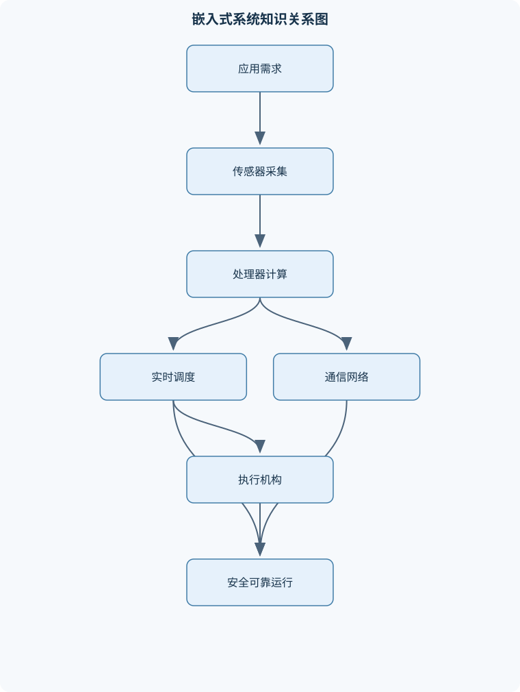
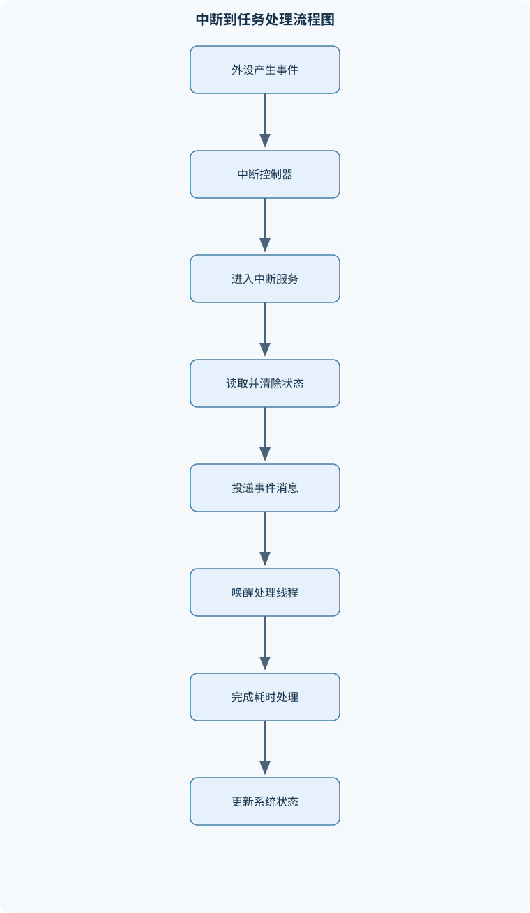

# 嵌入式计算技术

## 一、课程整体知识框架

### 课程边界与先修知识

《嵌入式计算技术》研究面向特定应用的计算机系统及其软硬件协同实现，覆盖处理器与存储器、嵌入式输入输出、实时任务调度、嵌入式操作系统、设备通信、可靠性与安全、交叉开发和典型边缘设备应用。课程重点是资源受限条件下的确定性响应、低功耗、可靠运行和软硬件接口，不等同于通用计算机组成原理、纯数字电路设计或一般应用软件开发。先修知识包括C语言、数据结构与算法、计算机组成原理、操作系统基础、数字逻辑、电路与测量基础；学习实践内容还需要掌握基本的Linux命令、编译链接和串口调试方法。





### 1. 课程对象与核心问题

嵌入式系统是面向特定应用、在资源和环境约束下运行的计算机系统。它可以采用微控制器、微处理器、数字信号处理器、片上系统或带操作系统的单板计算机，典型任务包括感知、计算、通信、控制和设备管理。判断一个系统是否属于嵌入式系统，不能只看处理器规模：小型微控制器固件、汽车控制器、网络设备、机器人控制器和边缘视觉终端都可能属于嵌入式系统；普通个人计算机上的通用办公软件则通常不属于本课程所讨论的嵌入式系统。

嵌入式系统把信息空间与物理空间连接起来。传感器将温度、压力、距离、图像或设备状态转换为电信号，处理器按照程序进行滤波、判断和控制，执行机构再把计算结果转换为电机转动、阀门动作、灯光变化或网络指令。因此，系统不仅要“算得对”，还要“在规定时间内算完”，并且要在电源波动、通信丢包、传感器异常和部分硬件失效时保持可接受行为。

课程的核心问题可概括为四类：

1. **资源受限下如何实现功能。** RAM、Flash、处理器时间、总线带宽、功耗和体积均有限，需要在性能、成本、功耗、体积和可维护性之间权衡。
2. **如何保证确定性响应。** 实时性关注截止期，而不是平均运行速度。硬实时任务错过截止期可能造成危险或严重故障；软实时任务偶尔超期通常表现为质量下降。
3. **如何实现软硬件接口。** 软件必须按照寄存器定义、电气电平、时序、缓存和中断规则使用硬件，接口名称相同并不意味着可以直接互换。
4. **如何保证长期可靠和安全运行。** 功能安全关注系统失效是否造成不可接受的物理后果；信息安全关注未授权访问、篡改、窃取和拒绝服务。二者目标不同，但在联网控制设备中需要联合设计。

### 2. 嵌入式系统概念与设计约束

一个典型系统由处理器、存储器、输入输出控制器、电源、传感器、执行机构和通信模块组成。处理器执行指令，存储器保存程序和运行数据，输入输出模块连接外部设备，传感器提供状态信息，执行机构产生物理动作，通信模块负责设备间或云边端之间的数据交换。

嵌入式系统与通用计算系统的区别主要在于应用专用性、资源约束和约束目标不同。通用计算机通常强调兼容性、交互性和平均性能；嵌入式系统常强调确定性、低功耗、低成本、长期运行和硬件接口稳定。例如，一个桌面程序平均运行速度较快但偶尔停顿数百毫秒，可能仍可接受；电机控制任务若在规定时间内没有更新控制量，则可能造成振荡或失稳。

设计约束之间存在冲突。提高主频和并行度通常有利于降低执行时间，但会增加功耗、散热和成本；增加缓存可降低平均访问延迟，却可能增加实时分析的不确定性；增加网络连接便于远程维护，却扩大攻击面；采用复杂算法可提高识别精度，却可能超过处理器和内存预算。工程设计不是单独优化某一指标，而是在明确任务截止期、功耗预算、故障后果和成本上限后进行取舍。

### 3. 处理器架构与存储系统

#### 3.1 指令集、微架构和处理器组织

指令集架构（ISA）规定可见的指令、寄存器、数据类型、寻址方式和异常模型，是编译器与处理器之间的接口；微架构规定流水线、执行单元、缓存、分支预测和总线等内部实现。相同ISA可以有不同微架构，因此执行性能、功耗和实时特性可能不同。

RISC通常使用较规则的指令格式、较少的寻址形式和较多的寄存器，便于流水线和低功耗实现；CISC允许较复杂的指令和寻址方式，可减少部分程序的指令数量。二者是设计思想，不等同于“某种处理器一定快”或“某种处理器一定适合嵌入式”。

冯诺依曼结构使用统一的指令和数据存储路径，硬件较简单，但取指和数据访问可能竞争带宽；哈佛结构将指令存储和数据存储分离，可以同时取指和访问数据，常见于微控制器和数字信号处理器。改进型哈佛结构可能在内部区分指令缓存和数据缓存，但对外仍提供统一地址空间。

寄存器保存高频使用的数据和控制信息。流水线将取指、译码、执行、访存等步骤重叠，提高吞吐率，但分支、数据相关、缓存未命中和中断都会造成停顿。异常机制用于处理外部中断、非法指令、访问错误和系统调用。中断响应不是瞬时完成的，其延迟包括硬件检测、优先级仲裁、关中断区间、上下文保存和ISR入口开销。

#### 3.2 字节序、存储器与启动布局

对多字节数据，低地址保存低有效字节称为小端存储，低地址保存高有效字节称为大端存储。例如，十六进制数 $0x12345678$ 按字节排列为 $12,34,56,78$。小端地址从低到高依次为 $78,56,34,12$；大端地址从低到高依次为 $12,34,56,78$。字节序只描述多字节数据在存储器中的排列，不等同于寄存器位编号、协议字段顺序或串行线路的位发送顺序。

RAM断电后通常丢失数据，适合保存栈、堆、全局变量和缓冲区；ROM或Flash具有非易失性，适合保存启动代码、程序和配置；外部存储器容量大，但访问延迟、总线竞争和功耗可能更高。缓存可降低平均访问延迟，却会引入命中与未命中差异。在硬实时任务中，必须把缓存、总线等待和存储器刷新等因素纳入最坏情况执行时间分析。

系统启动通常包括复位入口、向量表定位、栈指针初始化、时钟配置、数据段复制、未初始化段清零、硬件初始化和进入主程序或操作系统。链接脚本决定代码段、只读数据段、已初始化数据段、未初始化数据段、堆和栈在存储器中的布局。交叉编译成功只说明目标文件生成正确，不代表启动地址、ABI、硬件配置和外设初始化一定正确。

### 4. 嵌入式输入输出与外设接口

内存映射I/O把外设寄存器映射到处理器地址空间，软件通过普通读写指令访问；端口映射I/O使用独立的I/O指令空间。使用寄存器时必须确认读写属性、复位值、位宽、写入副作用和访问顺序。

GPIO输入输出受到VDD、GND、逻辑阈值、最大灌电流和拉电阻的限制。输入引脚悬空会产生不确定电平；输出直接连接两个相反驱动源可能产生过流；不同电压域之间需要电平转换。分析电平、电流和功耗时必须明确参考电压和负载条件。

轮询由处理器反复读取状态，结构简单但会占用处理器时间；中断由硬件在事件发生时通知处理器，响应及时但存在上下文切换和中断风暴风险；DMA可在外设与存储器之间搬运数据，减少CPU参与，但需要处理缓存一致性、缓冲区边界和传输完成通知。三者不是绝对替代关系：低速、简单且必须严格控制时序的任务可采用轮询，高速连续数据常采用DMA加中断。

定时器可用于计时、计数、输入捕获和输出比较；PWM通过改变周期内高电平持续时间控制平均能量，理想占空比为
$$
d=\frac{t_{\mathrm{on}}}{T}
$$
其中$d$为占空比，$t_{\mathrm{on}}$为高电平持续时间，$T$为PWM周期，二者单位均为秒。实际电机和负载还受开关损耗、死区时间、非线性和电源电压影响。

ADC把连续电压量化为有限位数的数字量。理想量化步长近似为
$$
\Delta V=\frac{V_{\mathrm{ref}}}{2^N}
$$
其中$V_{\mathrm{ref}}$为参考电压，单位为伏，$N$为ADC位数。该式未包含增益误差、偏置误差、噪声、非线性和参考源波动。采样频率为$f_s$，输入最高频率为$f_m$时，为避免理想条件下的混叠，需要满足$f_s>2f_m$，并在采样前使用抗混叠低通滤波器。现实中还要考虑传感器带宽、采样抖动和量化噪声。

UART使用独立时钟约定进行异步通信。若采用1个起始位、8个数据位、无校验、1个停止位，每个有效字节需要10个比特时间，因此理论字节率约为波特率除以10。实际吞吐率还受帧间隔、缓冲区和软件处理速度影响。

I2C使用SCL和SDA两根信号线，通常为开漏结构并需要上拉电阻。一次写传输通常包含起始条件、7位地址和读写位、接收方应答、数据字节及停止条件。每个8位数据字节后还需一个应答位，所以一个地址加一个数据字节至少包含地址阶段和两个9位阶段，理论位数约为27位，不应只按有效数据位计算。I2C适合板级、低速、多设备连接，但线长、电容和上拉电阻会限制上升时间。

SPI使用MOSI、MISO、SCK和CS信号，通常由主设备产生时钟，通过片选选择从设备。它可实现全双工，协议开销较小，但每个从设备通常需要独立片选，且时钟极性和相位必须匹配。CAN采用多主通信和基于标识符的优先级仲裁，显性位可覆盖隐性位，失去仲裁的节点自动停止发送并等待下一次机会。CAN的标识符优先级、错误检测、帧格式和总线负载共同影响实时性。

### 5. 实时系统与任务调度

周期任务$\tau_i$每个周期执行一次，$C_i$表示一次执行的最坏情况执行时间，单位可为秒或处理器时钟周期；$T_i$为周期，单位为秒；$D_i$为相对截止期，单位为秒；$R_i$为从释放到完成的响应时间。若任务每周期执行一次，则单处理器平均利用率为
$$
U=\sum_i\frac{C_i}{T_i}
$$
其中$U$是无量纲比例。该式只表示平均计算负载，不能单独证明任务满足截止期；任务可能因高优先级干扰、阻塞或截止期短而超时。

固定优先级调度中，课程约定数值越小表示优先级越高，但具体内核可能相反。速率单调调度按周期分配优先级，周期越短优先级越高。在独立、周期、单处理器、无阻塞、相对截止期等于周期等理想条件下，充分可行性界为
$$
U\le n\left(2^{1/n}-1\right)
$$
其中$n$为任务数。$n$增大时该界趋近于$\ln2$，约为0.693。超过该界不代表一定不可调度，因为这是充分条件而不是必要条件；低于该界也不能覆盖实际系统中的阻塞、缓存抖动和中断开销。

固定优先级响应时间可迭代计算：
$$
R_i^{(k+1)}
=C_i+B_i+\sum_{j\in hp(i)}
\left\lceil\frac{R_i^{(k)}}{T_j}\right\rceil C_j
$$
其中$B_i$是任务$\tau_i$的阻塞上界，$hp(i)$是优先级高于$\tau_i$的任务集合，$\lceil\cdot\rceil$表示向上取整。常以$R_i^{(0)}=C_i+B_i$开始。若相邻结果相等，得到固定点；若结果不超过$D_i$，在模型假设下可行；若超过$D_i$，则不可行。该分析必须使用最坏情况执行时间和可靠的阻塞上界，不能用平均执行时间替代。

最早截止期优先是动态优先级方法，截止期越近优先级越高。在理想单处理器、抢占式、独立任务等条件下，它的理论利用率上界可接近1，但实际系统还受到上下文切换、锁、非抢占区和调度器实现的影响。非抢占式调度减少上下文切换，却可能使高优先级任务等待低优先级任务完成；抢占式调度响应更快，但增加保存恢复和缓存扰动开销。

优先级倒置发生在高优先级任务等待被低优先级任务持有的锁，而中优先级任务持续运行、阻止低优先级任务释放锁。优先级继承使持锁低优先级任务临时继承高优先级，减少中优先级任务的干扰；它降低优先级倒置，但不消除锁本身造成的阻塞，也不保证没有死锁。

### 6. 嵌入式操作系统、并发与通信

线程控制块（TCB）保存线程状态、栈指针、优先级、调度链表信息和同步对象等。线程一般经历新建、就绪、运行、阻塞和终止状态。线程栈保存局部变量、返回地址和上下文，栈空间过小会导致栈溢出，过大则浪费RAM。可采用栈填充标记、水位检查和越界保护检测最大使用量。

信号量适合资源计数或事件通知；互斥锁强调所有权和临界区保护，并可支持优先级继承；事件用于表达一个或多个条件；消息队列传递结构化数据；环形缓冲区适合连续字节流或生产者消费者模型。消息队列容量有限，当长期生产速率高于消费速率时最终必然满，系统只能阻塞、丢弃、覆盖或降采样，不能仅靠扩大队列永久解决速率不匹配。

ISR通常应短小、不可阻塞，不应执行长时间计算、文件操作或等待互斥锁。常见做法是ISR读取并清除硬件状态，把最小事件信息写入队列或设置事件标志，再唤醒线程完成解析和耗时处理。系统时钟提供时间片、超时和软件定时器基础，但时钟节拍越高并不必然越好，因为会增加中断和调度开销。

共享内存通信速度快，但必须处理竞态条件、内存可见性和同步；管道适合字节流；消息队列保留消息边界。死锁需要互斥、请求并保持、不可剥夺和循环等待四个条件同时成立。通过统一资源编号并强制按递增顺序申请，可以破坏循环等待条件。原子操作只保证某个不可分割操作的原子性，不能自动保证一组操作的整体一致性。

### 7. 嵌入式软件开发与Linux环境

宿主机通常负责编辑、编译和调试，目标机负责运行固件。交叉编译流程包括预处理、编译、汇编、链接、生成镜像、烧录或加载、启动验证。工具链、目标架构、ABI、头文件、库文件和链接脚本必须匹配。Linux环境中需要理解用户和权限、进程、文件系统、挂载、设备文件、环境变量、I/O重定向、管道、符号链接和硬链接。

设备文件提供用户程序访问驱动的接口，但文件读写语义不一定等同于普通磁盘文件。串口调试应确认波特率、数据位、校验位、停止位、电平标准和共地；网络调试还需检查地址、端口、防火墙和协议超时。符号链接保存目标路径，目标删除后可能失效；硬链接共享同一inode引用，通常不能跨文件系统。交叉编译成功后仍需验证启动参数、动态库、设备树或硬件配置、权限和外设初始化。

### 8. 可靠性、故障恢复、通信集成与典型应用

看门狗定时器（WDT）由硬件计数器构成。正常路径在规定窗口内刷新计数器，若软件死循环、任务阻塞或系统失控导致未刷新，超时后触发复位或故障处理。刷新动作不能由一个独立且无条件运行的循环代替，否则即使关键任务失效，系统仍可能持续“喂狗”。可靠恢复流程应记录复位原因和最小故障上下文，进入安全状态，区分可恢复与不可恢复故障，并限制重复复位。

掉电保护可采用电源监测、储能、事务式写入和关键数据校验；安全启动通过验证启动组件的完整性和来源，防止未经授权的固件运行。最小权限限制进程和设备访问范围，密钥应放在受保护存储中。通信认证、序号、随机数或时间窗口可用于防止重放。日志、运行时健康检查和通信超时监测是诊断依据，但日志写入也会消耗存储寿命和执行时间。

有线或无线通信的选择取决于距离、带宽、功耗、拓扑、抗干扰、成本和安全要求。传感器采集链路通常包括传感器、接口驱动、采样、校准、滤波、时间戳和异常检测；执行链路包括控制算法、输出限幅、驱动器和执行机构反馈。云边端系统中，安全性和实时性要求高的闭环控制应尽量在本地完成，云端更适合长期存储、模型更新和全局分析。

典型平台包括无操作系统或实时内核的微控制器、运行嵌入式Linux的单板计算机和具有专用加速器的边缘设备。超声波测距根据回波时间计算距离：
$$
d=\frac{v\Delta t}{2}
$$
其中$d$为距离，单位为米；$v$为声速，单位为米每秒；$\Delta t$为发射到接收的往返时间，单位为秒；除以2是因为声波经过往返路径。温度改变会影响$v$，近距离盲区、反射面倾角和定时器分辨率会产生误差。

摄像头应用通常经过采集、颜色或灰度转换、缩放、去噪、目标检测、分类和结果过滤。检测置信度表示候选区域属于目标的可信程度，不能与分类距离指标混淆。飞控系统则将惯性、位置和姿态传感器数据送入状态估计与控制算法，再输出到电机或舵机；硬件在环测试可在真实控制器上用仿真环境替代部分物理对象，降低实物测试风险，但不能完全替代真实振动、电磁干扰和执行机构非理想特性。

## 二、章节和模块划分

### 核心知识覆盖清单

本清单用于检查正文是否覆盖本课程的主要知识模块：

- **嵌入式系统概念与设计约束**：嵌入式系统定义与边界、专用性与通用计算的区别、嵌入式系统基本组成、传感器与执行机构、实时性、可靠性与可维护性、性能、功耗、成本与体积权衡、信息空间与物理空间耦合、安全性与功能安全的区别。
- **处理器架构与存储系统**：ISA与微架构的关系、RISC与CISC设计思想、冯诺依曼与哈佛结构、端模式与多字节数据存储、寄存器、流水线与异常机制、片上存储器与外部存储器、缓存、总线与存储访问延迟、启动代码、向量表与链接布局。
- **嵌入式输入输出与外设接口**：内存映射I/O与端口映射I/O、GPIO输入输出与电气约束、轮询、中断与DMA、定时器、计数器与PWM、ADC、DAC与采样误差、UART异步串行通信、I2C总线时序与应答、SPI总线时序与片选、CAN报文与总线仲裁。
- **实时系统与任务调度**：硬实时与软实时约束、任务周期、执行时间与截止期、非抢占式与抢占式调度、静态优先级与动态优先级、速率单调调度、最早截止期优先调度、上下文切换与时间片、优先级倒置与优先级继承、响应时间与调度可行性。
- **嵌入式操作系统内核**：线程控制块与线程栈、线程创建、就绪与阻塞状态、内核调度器与优先级模型、信号量、互斥锁与事件、消息队列与环形缓冲区、中断服务例程约束、中断工作下沉到线程、栈使用率与栈溢出检测、系统时钟与软件定时器。
- **进程通信、并发控制与死锁**：共享内存通信、管道与消息队列、生产者消费者问题、临界区与原子操作、互斥条件与同步条件、死锁四个必要条件、资源有序申请、静态资源分配与死锁预防、竞态条件与可重复性。
- **嵌入式软件开发与Linux环境**：宿主机与目标机开发模型、交叉编译与交叉链接、启动流程与固件加载、编译、汇编、链接与调试、Linux用户、权限与进程、文件系统、挂载与设备文件、Shell环境变量与I/O重定向、管道、符号链接与硬链接、串口、网络和远程调试。
- **可靠性、故障恢复与系统安全**：看门狗定时器工作原理、复位原因记录与故障诊断、掉电保护与安全启动、容错、降级与故障隔离、信息安全与功能安全边界、最小权限与密钥保护、通信认证与重放防护、日志、监控与运行时健康检查。
- **嵌入式通信网络与系统集成**：有线与无线通信选择、UART、I2C、SPI的适用边界、CAN多主通信与优先级仲裁、通信帧、校验与超时、设备驱动与抽象接口、传感器采集链路、执行机构控制链路、云边端分工与本地闭环、系统集成测试与接口一致性。
- **典型平台与应用工程**：微控制器应用结构、嵌入式Linux单板计算机、GPIO与串口实验流程、超声波测距原理、摄像头采集与图像预处理、目标检测与分类流程、飞控系统的传感、控制与执行、硬件在环与实物测试、功耗、实时性和鲁棒性评估。


### 1. 代表性算法与工作流程

#### 1.1 固定优先级响应时间分析

**输入：**任务集合、$C_i$、$T_i$、$D_i$、优先级、阻塞上界$B_i$。  
**输出：**每个任务的响应时间和可行性结论。  
**过程：**按优先级从高到低，计算高优先级任务在等待区间内的干扰次数；迭代式中的每一项都向上取整，表示在响应窗口内可能释放的完整任务次数。  
**不变量：**每次迭代纳入的高优先级工作量不低估当前响应区间中的释放次数。  
**终止条件：**相邻两次结果相等、结果超过截止期或达到预设上限。  
**适用条件：**单处理器、固定优先级、任务参数可估计，且阻塞上界已知。朴素计算复杂度约为$O(km)$，其中$k$为迭代次数，$m$为高优先级任务数。

```text
伪代码
输入：任务集合 Tasks，按优先级从高到低排列
输出：每个任务的 R_i 和可行性

for each task i in Tasks:
    R_old = C_i + B_i
    repeat:
        interference = 0
        for each task j with priority higher than i:
            interference += ceil(R_old / T_j) * C_j
        R_new = C_i + B_i + interference

        if R_new > D_i:
            result[i] = "不可行"
            break
        if R_new == R_old:
            result[i] = "在模型假设下可行"
            break
        R_old = R_new
    until 达到最大迭代次数
```

#### 1.2 生产者消费者环形缓冲区

固定容量为$N$的环形缓冲区由存储区、写指针和读指针组成。生产者写入数据后推进写指针，消费者读取数据后推进读指针，指针到达$N$后回到0。若使用计数器记录有效元素数量，则空条件为计数器为0，满条件为计数器等于$N$。若仅用读写指针表示状态，常需保留一个空槽以区分空和满。

每次入队和出队的时间复杂度为$O(1)$，空间复杂度为$O(N)$。单生产者单消费者且指针更新满足原子性时可减少锁；多生产者或多消费者必须使用互斥、原子操作或内核队列。数据区域、已消费区域和空闲区域不能重叠，这是环形缓冲区的核心不变量。

#### 1.3 中断工作下沉到线程

流程是：初始化向量表和外设；ISR读取并清除硬件状态；ISR把时间戳、状态码或DMA缓冲区指针写入队列；唤醒处理线程；线程执行解析、校验、滤波、文件记录和协议响应；设备关闭时注销IRQ并回收资源。ISR不能等待可能阻塞的锁，也不应执行不确定时间的复杂算法。该流程把固定的快速响应与可阻塞的复杂工作分离，适用于串口接收、DMA完成、GPIO边沿和传感器采样等场景。

#### 1.4 故障恢复流程

输入包括超时、非法状态、通信错误、复位原因和安全状态定义。首先检测异常并记录最小故障上下文；其次关闭或限制危险执行机构，进入安全状态；然后判断故障是瞬态、可重试还是不可恢复；可恢复故障执行有限次数重试或模块复位，不可恢复故障进入受控停机；系统重启后读取复位原因，保存故障计数并限制重复重启，必要时进入维护模式。故障处理路径不能依赖已经确认失效的存储器、通信链路或调度线程。

### 2. 代表性例题

#### 例题一：周期任务调度可行性

**题干：**单处理器上有三个独立周期任务：

| 任务 | $C_i$ / ms | $T_i$ / ms | $D_i$ / ms |
|---|---:|---:|---:|
| $\tau_1$ | 1 | 4 | 4 |
| $\tau_2$ | 1 | 5 | 5 |
| $\tau_3$ | 2 | 10 | 10 |

按速率单调规则分配优先级，并分析可行性。

**分析与解答：**周期越短优先级越高，因此优先级从高到低为$\tau_1,\tau_2,\tau_3$。利用率为
$$
U=\frac14+\frac15+\frac{2}{10}=0.65
$$
任务数$n=3$时，速率单调充分界为
$$
3(2^{1/3}-1)\approx0.779
$$
由于$0.65<0.779$，在理想模型下可直接得到可行的充分结论。

再使用响应时间分析。$\tau_1$没有高优先级任务：
$$
R_1=C_1=1\text{ ms}\le D_1
$$
对$\tau_2$：
$$
R_2^{(0)}=1
$$
$$
R_2^{(1)}=1+\left\lceil\frac15\right\rceil1=2\text{ ms}
$$
再次迭代仍为2 ms，因此$R_2=2$ ms，小于5 ms。对$\tau_3$：
$$
R_3^{(0)}=2
$$
$$
R_3^{(1)}
=2+\left\lceil\frac24\right\rceil1+
\left\lceil\frac25\right\rceil1
=4\text{ ms}
$$
$$
R_3^{(2)}
=2+\left\lceil\frac44\right\rceil1+
\left\lceil\frac45\right\rceil1
=4\text{ ms}
$$
收敛于4 ms，小于10 ms。

**结果验证：**三个任务均满足截止期。  
**变式：**若$\tau_3$的$C_3$增加到8 ms，总利用率变为1.25，显然不可行；若利用率仍低于1但某任务$D_i$明显小于$T_i$，仍需响应时间分析，不能只看利用率。

#### 例题二：优先级倒置与优先级继承

**题干：**低优先级线程L持有互斥锁，高优先级线程H随后请求该锁，中优先级线程M不需要该锁。比较没有优先级继承和采用优先级继承的执行过程。

**分析与解答：**没有优先级继承时，H阻塞在锁上，L虽然持锁却只有低优先级；M可以抢占L并持续运行，导致L无法尽快释放锁，H间接等待M，形成优先级倒置。采用优先级继承后，H请求锁时，L临时继承H的优先级，M不能抢占L；L完成临界区并释放锁，H获得锁继续执行。高优先级任务的等待时间主要由L剩余临界区和更高优先级干扰构成，而不是由M的任意执行时间决定。

**结果验证：**优先级继承降低了由中优先级任务造成的额外阻塞，但锁临界区越长，H仍需等待越久。  
**变式：**若L同时持有两个锁，或多个高优先级线程竞争不同锁，则必须重新分析锁嵌套、阻塞上界和死锁风险；优先级继承不能替代资源有序申请。

#### 例题三：I2C传输时间

**题干：**主设备向7位地址为$0x2A$的从设备写入一个寄存器地址和一个数据字节，I2C时钟频率为100 kHz。忽略起始和停止条件的额外模拟时间，计算理论总线占用时间。

**分析与解答：**地址阶段为7位地址加1位读写位，再加1位应答，共9位；寄存器地址为8位数据加1位应答，共9位；数据字节同样为9位。因此总位数为
$$
9+9+9=27\text{ bit}
$$
100 kHz表示每秒100000个时钟周期，理论时间为
$$
t=\frac{27}{100000}=270\ \mu s
$$
实际时间还会受到起始、停止、时钟拉伸、总线仲裁和设备处理时间影响。

**结果验证：**不能只用16个有效数据位除以100 kHz，因为地址、读写位和应答位也占用总线。  
**变式：**若连续写入10个数据字节，地址阶段仍只发生一次，而数据阶段需要$10\times9$位，因此总位数约为$9+9+90=108$位。

#### 例题四：UART有效吞吐率

**题干：**UART配置为115200 bit/s，帧格式为1个起始位、8个数据位、1个停止位，无校验。发送100字节消息需要多长时间？

**分析与解答：**每个字节占10个比特时间，100字节占
$$
100\times10=1000\text{ bit}
$$
发送时间为
$$
t=\frac{1000}{115200}\approx8.68\text{ ms}
$$
理论有效字节率约为
$$
\frac{115200}{10}=11520\text{ byte/s}
$$
若接收线程处理速度低于该速率，接收缓冲区会逐渐积累并最终溢出。

**结果验证：**这里的有效数据量是800 bit，但线路还包括200 bit的起始和停止开销。  
**变式：**若加入1个校验位，每帧变为11 bit，100字节时间增加到约9.55 ms；若时钟误差超过接收器容许范围，还可能出现帧错误，理论吞吐率不能保证通信可靠。

#### 例题五：超声波测距

**题干：**声速取340 m/s，测得触发到回波返回的时间为10 ms，求目标距离。

**分析与解答：**声波经历发射到目标和目标返回接收端的往返路程，因此
$$
d=\frac{v\Delta t}{2}
=\frac{340\times0.010}{2}
=1.7\text{ m}
$$
单位换算中10 ms必须写成0.010 s。

**结果验证：**如果错误地不除以2，会得到3.4 m，这是往返距离而非单程距离。  
**变式：**温度变化会改变声速；目标表面倾斜会使回波减弱或消失；近距离盲区会使发射与接收信号重叠；定时器分辨率决定距离量化误差。若定时分辨率为1 μs，理想单次距离分辨率约为
$$
\frac{340\times10^{-6}}2=0.17\text{ mm}
$$
但实际误差通常远大于此，还受阈值、噪声和声速估计影响。

### 3. 实验与项目流程

#### 3.1 GPIO、UART和环形缓冲区实验

**输入数据：**一块带GPIO、定时器和UART的微控制器开发板，一个按钮或信号源，串口终端，以及预先规定的波特率和帧格式。

**步骤：**

1. 编写启动代码和GPIO初始化程序，设置输入上拉或下拉，配置LED为输出。
2. 先用轮询读取按钮状态，记录处理器占用和按键抖动现象。
3. 改用外部中断，在ISR中清除中断状态并向环形缓冲区写入事件时间戳。
4. 由线程或主循环读取缓冲区，完成消抖、状态转换和LED控制。
5. 配置UART发送测试消息，逐字节验证帧格式，再使用接收中断或DMA接收连续数据。
6. 人为降低消费线程处理速度，观察缓冲区从正常、接近满到溢出的过程。

**评价标准：**GPIO电平无悬空和误触发；ISR不执行阻塞操作；UART无持续帧错误；环形缓冲区不越界，读写顺序正确；在规定输入速率下不丢失事件；测得的发送时间与波特率计算结果基本一致。

**排错方法：**LED始终不亮时检查电源、引脚复用、输出极性和共地；按钮随机触发时检查上拉、下拉和机械抖动；串口乱码时依次检查电平标准、波特率、数据位、校验位、停止位和地线；缓冲区数据错乱时检查读写指针原子性、满空判定和并发保护；中断重复进入时检查是否正确清除硬件标志。

#### 3.2 传感器采集与本地闭环项目

**输入数据：**超声波传感器或温度传感器、定时器捕获输入、执行机构、若干带已知距离或温度的测试样本。

**步骤：**

1. 明确传感器量程、采样周期、接口时序和异常范围。
2. 使用定时器测量回波时间或ADC采样值，保存时间戳。
3. 按物理模型完成单位换算、零点校准和必要滤波。
4. 对超范围、超时、无回波和突变数据进行故障标记，不直接送入控制器。
5. 根据测量结果驱动LED、蜂鸣器、电机或其他执行机构，设置输出限幅和安全状态。
6. 分别进行正常、边界、断线、遮挡、供电波动和通信中断测试。
7. 使用日志记录原始值、校准值、控制输出、故障码和复位原因。

**评价标准：**测量结果在规定误差范围内；采样和控制周期满足截止期；异常输入不会产生危险输出；通信暂时中断后系统能进入预定义安全状态；连续运行期间无栈溢出、内存泄漏和缓冲区溢出；故障日志可定位传感器、通信、调度或电源问题。

**排错方法：**数值整体偏移时检查参考电压、零点和校准参数；偶发尖峰时检查接地、屏蔽、滤波和采样时刻；控制输出抖动时检查采样噪声、迟滞和控制周期；周期超时时检查ISR长度、锁等待、日志写入和高优先级任务干扰；反复复位时读取WDT复位原因并限制自动重启次数，避免用持续喂狗掩盖故障。

## 三、核心概念的详细解释

### 3.1 嵌入式系统的边界与设计约束

嵌入式系统是面向特定应用、嵌入设备或物理过程中的计算机系统。其“特定”并不意味着只能执行一个函数，而是指系统的硬件资源、软件结构和接口通常围绕明确的应用目标设计。微控制器固件、汽车电子控制器、机器人控制器、网络设备、工业采集终端和带操作系统的边缘视觉设备，均可能属于嵌入式系统。判断依据是应用专用性、资源约束、物理接口和长期运行要求，而不是处理器是否微小。

嵌入式系统通常包括处理器、RAM、Flash或其他非易失性存储器、输入输出控制器、电源管理单元、传感器、执行机构以及通信模块。传感器把温度、距离、压力、图像或设备状态转换为可处理的数据；处理器执行滤波、估计、判断和控制；执行机构把计算结果转换成电机转动、阀门动作、显示变化或网络指令。这个链路把信息空间与物理空间耦合起来，因此软件错误、采样延迟、通信丢包和电源波动都可能产生物理后果。

设计时需要同时处理性能、实时性、功耗、成本、体积、可靠性、可维护性和安全性之间的矛盾。提高主频通常能缩短计算时间，但会增加动态功耗和散热压力；增大缓存可能降低平均访问延迟，却可能使最坏情况延迟更难预测；增加无线连接便于远程维护，却扩大攻击面；使用复杂识别模型可能提高精度，却增加RAM、Flash和推理时间需求。嵌入式设计不是单纯追求平均性能，而是在明确截止期、功耗预算、故障后果和成本上限后进行系统权衡。

实时性表示任务必须在规定时间约束内完成。硬实时任务错过截止期可能导致危险或控制失效，软实时任务偶尔超期通常表现为质量下降，但持续超期仍会导致系统不可用。可靠性关注系统在规定环境和时间内持续完成预期功能；可维护性关注故障诊断、升级、测试和替换的难易程度。信息安全主要防止未授权访问、窃取、篡改和拒绝服务；功能安全主要关注系统失效或异常行为是否造成不可接受的物理危险。二者可能共享认证、日志、故障隔离等机制，但目标不能混为一谈。

### 3.2 处理器、存储器与启动过程

指令集架构（ISA）规定指令、寄存器、数据类型、寻址方式和异常模型，是编译器与处理器之间的接口；微架构规定流水线、缓存、执行单元、分支预测和总线等内部实现。相同ISA可以由不同微架构实现，因此不能仅凭ISA判断执行速度、功耗或实时确定性。

RISC强调较规则的指令格式、较少的寻址形式和较多的寄存器，便于流水线和低功耗实现；CISC允许较复杂的指令和寻址形式，可能减少程序指令数。RISC与CISC是设计思想，不能直接等同于“简单”和“复杂”，也不能仅据此断言某类处理器一定更快。

冯诺依曼结构使用统一的指令和数据存储路径，结构简单但取指和数据访问可能争用带宽；哈佛结构分离指令存储和数据存储，可能同时取指和访问数据。许多现代处理器采用改进型哈佛结构，即内部具有独立的指令缓存和数据缓存，但软件仍可能看到统一地址空间。

存储层次通常包括寄存器、片上RAM、片上Flash、片外RAM、片外Flash以及缓存。寄存器访问速度快但数量有限；RAM断电后数据通常丢失，适合保存栈、堆和运行时缓冲区；Flash断电保持程序和配置，但写入次数、擦除粒度和写入时间受到限制。缓存能降低平均访问延迟，却引入命中与未命中差异；对严格实时任务，必须把缓存、总线竞争和外设等待状态纳入最坏情况分析。

多字节数据存储必须明确端模式。小端存储把低有效字节放在低地址，大端存储把高有效字节放在低地址。端模式只描述字节在内存中的排列，不等于协议位序，也不等于寄存器位编号顺序。通信协议若规定一个16位字段按高字节在前发送，就必须按协议组装数据，不能直接把内存中的字节序当作线上格式。

典型启动过程包括复位、读取向量表、设置栈指针、执行启动代码、初始化时钟和RAM、复制或清零数据段、调用运行库初始化，最后进入主函数或操作系统入口。链接脚本决定代码段、只读数据段、已初始化数据段、未初始化数据段和栈的位置。交叉编译成功只能说明宿主机生成了目标格式文件；还必须验证目标架构、ABI、链接地址、启动参数、设备树或硬件配置以及镜像完整性。

### 3.3 输入输出与外设接口

内存映射I/O把外设寄存器放入处理器地址空间，软件通过普通读写指令访问；端口映射I/O使用独立的I/O地址空间和专门指令。无论采用何种方式，寄存器访问都必须遵守数据手册规定的读写权限、位含义、写入顺序和清除方式。对硬件寄存器使用普通变量的缓存假设可能导致编译器优化掉访问，因此驱动代码通常需要使用适当的易变访问语义，并根据芯片要求处理内存屏障。

GPIO输入输出不仅是逻辑值问题，还涉及VDD与GND参考、电平兼容、上拉或下拉、电流能力、开漏结构、按键抖动和外部保护。输入悬空会产生不稳定电平；输出直接连接两个相反驱动的端口可能造成过流；电压兼容不能只看逻辑“高”和“低”，还要检查输入阈值和绝对最大额定值。

轮询由处理器反复检查状态，结构简单但可能浪费CPU时间；中断由硬件在事件发生时请求处理器，适合低频异步事件；DMA由专用控制器在内存与外设之间搬运数据，适合连续、高吞吐数据。DMA降低CPU搬运开销，却需要处理缓存一致性、缓冲区所有权、传输完成通知和越界保护。中断服务例程（ISR）应快速读取并清除硬件状态，将事件或最小数据放入队列，再由线程执行解析、日志和可能阻塞的操作。

定时器可以产生周期中断、测量时间间隔、统计外部脉冲或输出PWM。PWM的占空比为一个周期内高电平持续时间与周期的比值，驱动电机、灯具或执行器时还要考虑驱动电路的响应、负载惯性和电磁干扰。ADC把连续电压映射为离散码，误差包括量化误差、参考电压误差、采样保持误差和噪声；DAC则把数字码转换为模拟输出，也会受到建立时间和非线性的影响。

UART是异步串行接口，双方预先约定波特率、数据位、校验位和停止位。I2C使用SCL和SDA两根线，设备通过地址区分，数据线上采用开漏或类似结构并依赖上拉；SPI使用SCK、MOSI、MISO和CS，通常具有更高吞吐率，但需要为设备管理片选。CAN采用报文标识符参与总线仲裁，标识符优先级越高通常越先获得总线，适合多主、抗干扰和分布式控制。UART、I2C、SPI和CAN不能因为都能“传数据”而直接互换，必须比较吞吐率、距离、同步方式、线数、寻址、错误检测和实时要求。

### 3.4 实时任务、操作系统与并发

周期任务 $\tau_i$ 每隔 $T_i$ 秒释放一次，一次执行的最坏情况执行时间为 $C_i$ 秒，相对截止期为 $D_i$ 秒。任务从释放到完成的响应时间为 $R_i$。实时性要求通常是 $R_i\le D_i$，而不是只要求平均执行时间较短。

抢占式调度允许高优先级任务打断低优先级任务，响应速度较快，但会产生上下文切换、缓存扰动和同步复杂度；非抢占式调度结构简单，任务切换次数较少，但长任务可能阻塞紧急任务。固定优先级在任务运行期间不改变优先级，速率单调调度通常给周期短的任务更高优先级；动态优先级根据截止期或其他运行状态改变，最早截止期优先（EDF）按绝对截止期最早者优先。

线程控制块（TCB）保存线程状态、栈指针、优先级、调度链表信息和同步对象引用。线程可能处于运行、就绪、阻塞、挂起或终止状态。线程栈保存返回地址、局部变量和保存的寄存器，栈过小会造成栈溢出，栈过大则浪费RAM，因此应通过高水位检测、保护区或运行时检查估计实际使用量。

信号量适合资源计数和事件同步；互斥锁用于保护临界区，并通常具备所有权概念；事件标志适合表示多个条件；消息队列传递有边界的数据单元；环形缓冲区适合连续字节流。共享数据若没有原子操作、锁或明确的单生产者单消费者约束，就可能产生竞态条件。

优先级倒置发生在高优先级线程等待低优先级线程持有的锁，而中优先级线程又持续抢占低优先级线程时。优先级继承使持锁低优先级线程暂时继承高优先级，缩短高优先级线程的等待时间，但不能消除锁本身的阻塞，也不能解决所有死锁和长临界区问题。

死锁需要互斥、请求并保持、不可剥夺和循环等待四个必要条件同时成立。通过统一资源编号并按递增顺序申请，可以破坏循环等待；通过静态资源分配可以减少运行时申请；通过超时、回滚或故障恢复可以降低长期阻塞风险。资源顺序必须在所有线程中一致，否则局部正确的加锁顺序仍可能形成全局环路。

### 3.5 通信、可靠性、安全与系统集成

通信链路通常由驱动、协议解析、缓冲区、超时机制和应用接口组成。帧应明确同步字段、长度、类型、载荷、校验和或CRC；接收方必须检查长度、校验、序号、时间戳和状态，不能只依赖“收到了一帧”。超时应根据任务周期、线路延迟、重试次数和故障后果设定，过短会误报，过长会延迟故障发现。

生产者消费者模型中，生产者产生数据，消费者处理数据，中间通过队列或环形缓冲区解耦。若生产速率长期高于消费速率，任何有限队列最终都会满，此时必须明确阻塞、丢弃、覆盖、降采样或报警策略。队列满并不是单纯的程序错误，而是系统吞吐能力不足的可观测结果。

看门狗定时器（WDT）在规定时间内未被刷新时触发复位或故障处理。合理设计要求刷新动作由系统健康状态共同决定，而不是由一个独立循环无条件执行。看门狗超时后应记录复位原因、关键状态和故障计数，并在连续重启时进入安全模式或等待维护，避免系统在故障状态下无限重启。

故障恢复流程包括检测、记录、隔离、进入安全状态、重试或复位、启动后诊断和恢复验证。掉电保护可采用事务式写入、双备份配置、校验和、剩余电量判断或受控关机。安全启动通过验证固件签名或完整性，防止未授权代码运行；最小权限限制进程、线程和设备访问范围；通信认证与序号、随机数或时间窗口结合，可降低伪造和重放风险。

嵌入式Linux开发采用宿主机与目标机分离模型。编译、链接、调试通常在宿主机完成，程序通过串口、网络或存储介质加载到目标机。Linux中的用户、权限、进程、文件系统、挂载点、设备文件、环境变量、管道、硬链接和符号链接构成开发环境基础。设备文件提供用户空间访问驱动的接口，但具体权限、路径和内核行为受目标系统配置影响，不能把某一版本环境的命令假定为永久不变。

### 3.6 典型算法与工程流程

#### 3.6.1 固定优先级响应时间分析

输入为任务集合、$C_i$、$T_i$、$D_i$、优先级和阻塞上界 $B_i$；输出为各任务响应时间及可行性结论。对任务 $\tau_i$，只考虑优先级高于它的任务集合 $\mathrm{hp}(i)$，迭代：

$$
R_i^{(k+1)}
=
C_i+B_i+
\sum_{j\in\mathrm{hp}(i)}
\left\lceil\frac{R_i^{(k)}}{T_j}\right\rceil C_j
$$

初值可取 $R_i^{(0)}=C_i+B_i$。每次迭代加入在响应窗口内可能释放的高优先级任务数量。若相邻两次结果相等，则得到固定点；若结果超过 $D_i$，可判定在该模型下不可行。该方法适用于单处理器、独立周期任务、固定优先级、已知最坏执行时间和可界定阻塞的分析。缓存未命中、DMA竞争、关中断区间和调度开销若未计入 $C_i$ 或 $B_i$，结论可能过于乐观。

#### 3.6.2 环形缓冲区

容量为 $N$ 的环形缓冲区维护写指针和读指针。生产者只有在存在空闲空间时写入并推进写指针；消费者只有在存在有效数据时读取并推进读指针；指针到达 $N$ 后回到零。单生产者单消费者场景可通过原子指针和明确的内存可见性规则减少锁开销；多生产者或多消费者必须增加互斥或更复杂的并发协议。每次入队、出队均为 $O(1)$，空间复杂度为 $O(N)$。关键不变量是有效数据区、已消费区和空闲区不能重叠。

#### 3.6.3 中断到线程的工作下沉

初始化阶段配置向量表、外设寄存器、IRQ和处理线程。ISR到来后只读取必要状态、清除中断源、保存时间戳或少量数据，并向队列写入事件或设置事件标志；随后唤醒线程。线程完成协议解析、滤波、日志和可能阻塞的设备访问。ISR不能等待互斥锁、执行不可预测的大循环或直接进行大块日志写入。该流程的固定中断部分通常为 $O(1)$，后续处理复杂度取决于数据量。

#### 3.6.4 交叉编译与故障恢复流程

交叉构建输入包括目标架构源码、头文件、库、工具链、链接脚本和配置文件。流程为预处理、编译、汇编、链接、生成镜像、完整性校验、烧录或加载、启动日志验证。所有目标文件必须具有兼容的架构、ABI和链接布局。

故障恢复流程的输入为超时、非法状态、通信错误、复位原因和安全状态定义；输出为恢复、降级或受控停机。流程是检测故障、记录最小上下文、隔离失效资源、进入安全状态、执行有限重试或复位、启动后读取原因并抑制重复复位。故障处理路径不能依赖已经确认失效的存储、通信或传感器。

#### 3.6.5 事件处理伪代码

```c
/* 单生产者、单消费者示例；实际平台还需保证内存可见性 */
#include <stdbool.h>
#include <stddef.h>
#include <stdint.h>

#define QUEUE_CAPACITY 16

typedef struct {
    uint16_t code;
    uint32_t timestamp;
} Event;

typedef struct {
    Event data[QUEUE_CAPACITY];
    volatile size_t write_pos;
    volatile size_t read_pos;
} EventQueue;

static EventQueue queue = {0};

static bool queue_push(Event event) {
    size_t next = (queue.write_pos + 1u) % QUEUE_CAPACITY;
    if (next == queue.read_pos) {
        return false;                 /* 队列满 */
    }
    queue.data[queue.write_pos] = event;
    queue.write_pos = next;
    return true;
}

static bool queue_pop(Event *event) {
    if (queue.read_pos == queue.write_pos) {
        return false;                 /* 队列空 */
    }
    *event = queue.data[queue.read_pos];
    queue.read_pos = (queue.read_pos + 1u) % QUEUE_CAPACITY;
    return true;
}

/* ISR中只做固定时间的状态读取和入队 */
void peripheral_isr(void) {
    Event event = {
        .code = 1u,
        .timestamp = read_hardware_timer()
    };
    clear_peripheral_interrupt();
    (void)queue_push(event);           /* 满时按策略丢弃并记录计数 */
}

/* 线程中执行较复杂的处理 */
void event_thread(void) {
    Event event;
    while (system_is_running()) {
        if (queue_pop(&event)) {
            process_event(event);
        } else {
            wait_for_event_notification();
        }
    }
}
```

### 3.7 典型例题与实验任务

#### 例题一：UART吞吐率

**题干：**UART波特率为 $115200$，帧格式为1个起始位、8个数据位、无校验、1个停止位，发送100字节需要多长时间？

**分析与解答：**每个有效字节占 $1+8+1=10$ 个比特时间，因此理论字节率为 $115200/10=11520$ 字节/秒。100字节发送时间为

$$
t=\frac{100\times10}{115200}\approx0.00868\ \text{s}
$$

即约 $8.68$ ms。该结果未计入帧间空闲、软件调度、FIFO等待和接收处理时间。若使用偶校验，每字节增加1位，时间应改为 $100\times11/115200$。

#### 例题二：I2C传输时间

**题干：**使用7位地址进行一次写操作，发送1个寄存器地址和2个数据字节，时钟频率为100 kHz，忽略起始和停止条件的额外边沿时间，求总线占用时间。

**解答：**地址加读写位共8位，随后有1位应答；3个数据字节每个为8位并各有1位应答。因此总位数为

$$
(8+1)+3(8+1)=36\ \text{位}
$$

100 kHz下一个时钟周期为 $10\ \mu\text{s}$，理论时间为 $36\times10=360\ \mu\text{s}$。若从设备进行时钟拉伸，实际时间还要增加；若从设备未应答，主机必须根据协议停止或重试。

#### 例题三：周期任务利用率

**题干：**三个周期任务的参数分别为 $(C,T)=(1,5)$ ms、$(1,10)$ ms和$(2,20)$ ms，求处理器利用率。

**解答：**

$$
U=\frac{1}{5}+\frac{1}{10}+\frac{2}{20}=0.5
$$

因此平均计算负载为50%。这不能单独证明满足截止期，因为任务可能同时释放、发生抢占或受到锁阻塞。若相对截止期等于周期，可进一步按速率单调优先级和响应时间方程分析。

#### 例题四：优先级倒置

**题干：**低优先级任务持有互斥锁，高优先级任务随后请求该锁，中优先级任务不断运行。说明问题及解决方法。

**解答：**高优先级任务因等待锁而阻塞，低优先级任务又被中优先级任务抢占，高优先级任务的实际等待时间由中优先级任务间接延长，形成优先级倒置。启用优先级继承后，低优先级持锁任务暂时获得高优先级，完成临界区并释放锁，高优先级任务继续运行。仍需把锁持有时间计入阻塞上界，不能认为等待时间为零。

#### 例题五：超声波测距

**题干：**超声波回波时间为 $2$ ms，声速按 $340$ m/s 计算，求目标距离。

**解答：**声波经历发射到目标再返回的往返路径，因此单程距离为

$$
d=\frac{v\Delta t}{2}
=\frac{340\times0.002}{2}
=0.34\ \text{m}
$$

该结果假设声速恒定、触发与回波时间戳准确、反射面近似垂直且目标在传感器有效量程内。温度变化会改变声速，倾斜或柔软反射面会造成回波减弱，近距离盲区和定时器分辨率会增加误差。无回波时不能把超时值直接换算为最大距离后送入控制器，应输出故障状态。

#### 实验一：GPIO与串口采集链路

**输入数据：**目标板、按键或传感器、LED、串口线、已知测试序列和串口参数。  
**步骤：**先确认VDD、GND和电平兼容；配置GPIO输入输出与消抖；使用定时器周期采集输入；把状态、时间戳和故障码写入UART发送缓冲区；在主机端核对字节序、帧长度和校验；分别断开输入、改变采样频率并制造队列满条件。  
**评价标准：**输入状态变化能够在规定延迟内反映；串口帧无错位和溢出；中断服务时间稳定；队列满时按照预先定义的丢弃或报警策略处理；长时间运行无异常复位。  
**排错方法：**无串口输出时检查波特率、地线、引脚复用和发送使能；乱码时检查时钟误差、数据位和停止位；偶发丢帧时检查ISR过长、环形缓冲区边界和并发访问；GPIO抖动时增加硬件或软件消抖，但不能用无限延时掩盖实时问题。

#### 实验二：传感器采集与安全控制

**输入数据：**距离或温度传感器原始值、采样周期、标定参数、控制阈值和异常范围。  
**步骤：**建立原始值到物理量的换算关系；使用定时器产生固定采样周期；记录原始值、校准值和时间戳；对超范围、突变、超时和断线数据标记故障；根据有效数据输出控制量，并设置限幅和安全状态；模拟遮挡、供电波动、通信中断和重复复位。  
**评价标准：**测量误差在规定范围内；采样和控制任务在截止期前完成；异常输入不会产生未经限制的危险输出；故障日志能够区分传感器、调度、通信和电源问题；连续运行期间无缓冲区溢出和栈溢出。  
**排错方法：**整体偏移检查参考电压、零点和标定参数；尖峰检查接地、屏蔽和采样时刻；控制抖动检查噪声、迟滞和控制周期；周期超时检查日志写入、锁等待、ISR长度和高优先级干扰；反复复位时读取WDT复位原因并限制自动重启次数。

## 四、重要定义、公式、定理和推导

### 专业审校补充：关键定义与适用边界

DMA不是简单的外设高速搬运工具，而是独立于CPU执行数据传输的总线主设备。其适用边界是：外设具有DMA请求或可映射的触发源，目标内存可被DMA访问，且系统能够正确处理缓存一致性、缓冲区所有权和传输完成通知。典型链路为外设请求DMA，DMA按配置的源地址、目的地址、传输宽度和计数搬运数据，完成后产生中断；CPU只处理半传输、完成或错误事件。若CPU启用了数据缓存，发送前必须将待发送数据写回内存，接收后必须使缓存失效或采用非缓存区域，否则CPU可能读到旧数据。DMA缓冲区还需满足对齐、长度和生命周期要求。DMA降低CPU平均负载，却可能与CPU争用总线，增加存储访问延迟；它也不能保证实时性，必须把配置时间、中断响应、缓存维护、总线仲裁和后处理时间纳入截止期分析。环形DMA适合连续采样，但必须明确生产位置、消费位置和覆盖策略，不能把尚未消费的数据静默覆盖。


### 4.1 处理器利用率与截止期条件

周期任务 $\tau_i$ 的平均处理器利用率定义为

$$
U_i=\frac{C_i}{T_i}
$$

其中，$C_i$ 是一次执行的最坏情况执行时间，单位为秒或处理器时钟周期；$T_i$ 是任务周期，单位为秒。单处理器上所有任务的平均利用率为

$$
U=\sum_{i=1}^{n}\frac{C_i}{T_i}
$$

推导来自每个任务在任意长时间窗口内平均执行次数约为窗口长度除以周期，即 $L/T_i$ 次；总执行时间约为 $(L/T_i)C_i$，除以窗口长度 $L$ 后得到 $C_i/T_i$。

$U>1$ 时，平均计算需求超过处理器能力，在长期稳定运行条件下必然无法完成所有工作；但 $U\le1$ 也不能证明可调度，因为任务可能在同一时刻释放、存在阻塞、截止期早于周期或调度器产生额外开销。例如两个任务的总利用率为0.8，但若高优先级任务在短截止期内受到低优先级临界区阻塞，仍可能超期。

### 4.2 速率单调充分条件

在独立、周期、单处理器、固定优先级、无阻塞、相对截止期等于周期且任务可抢占的理想模型下，速率单调调度把周期越短的任务分配为越高优先级。若有 $n$ 个任务，满足

$$
U\le n\left(2^{1/n}-1\right)
$$

则任务集一定可调度。这是充分条件，不是必要条件。随着 $n$ 增大，右侧趋近于 $\ln2\approx0.693$。当利用率超过该界时，只能说明该充分性判据未通过，不能直接断言任务集不可调度；应继续进行响应时间分析或精确调度仿真。

该结论不适用于任意现实系统。若存在非抢占区间、共享锁、任务释放抖动、执行时间变化、缓存影响、DMA竞争或多处理器调度，就必须扩展模型，把这些因素纳入分析。

### 4.3 固定优先级响应时间方程

对固定优先级任务 $\tau_i$，若 $B_i$ 为其最大阻塞时间，$\mathrm{hp}(i)$ 为所有优先级高于它的任务集合，则第 $k+1$ 次响应时间迭代为

$$
R_i^{(k+1)}
=
C_i+B_i+
\sum_{j\in\mathrm{hp}(i)}
\left\lceil\frac{R_i^{(k)}}{T_j}\right\rceil C_j
$$

其中，$\lceil x\rceil$ 表示不小于 $x$ 的最小整数。取初值 $R_i^{(0)}=C_i+B_i$，因为任务至少需要自身执行时间和可能的阻塞时间。公式中

$$
\left\lceil\frac{R_i^{(k)}}{T_j}\right\rceil
$$

表示在候选响应窗口内，高优先级任务 $\tau_j$ 可能释放的次数。每次迭代加入高优先级干扰工作量，因此在理想模型下不会低估已经考虑的干扰。

若存在某次迭代满足 $R_i^{(k+1)}=R_i^{(k)}$，则得到固定点；若固定点不超过 $D_i$，任务在该模型下满足截止期；若迭代结果超过 $D_i$，则可判定该任务不可行。若达到工程上设定的迭代上限仍未收敛，不能简单当作成功，应检查参数、阻塞模型和实现开销。

### 4.4 中断延迟与总响应时间

中断延迟不是单一常数，可分解为硬件识别IRQ的时间、当前关中断区间、优先级仲裁、保存上下文、向量跳转和ISR入口开销。可用概念式表示为

$$
L_{\mathrm{IRQ}}
=
L_{\mathrm{hw}}
+L_{\mathrm{mask}}
+L_{\mathrm{arb}}
+L_{\mathrm{save}}
+L_{\mathrm{entry}}
$$

其中各项单位均为秒。若事件还需在线程中处理，则从事件发生到功能完成的总时间还应加上ISR执行、线程唤醒、调度等待、队列传递和线程处理时间。缩短ISR只能减少ISR部分，不能消除长时间关中断、低优先级线程等待或锁竞争造成的延迟。

### 4.5 UART、I2C与采样公式

UART若采用 $s$ 个起始位、$d$ 个数据位、$p$ 个校验位和 $q$ 个停止位，则每个有效字节占

$$
b=s+d+p+q
$$

个比特时间。波特率为每秒传输的符号数，在普通二进制UART中可近似视为比特率，因此理论有效字节率为

$$
r=\frac{\text{baud}}{b}
$$

实际吞吐率还受空闲间隔、软件处理、FIFO深度和重传影响。

I2C中一个8位数据字节后通常跟随1位应答，因此发送 $m$ 个数据字节并包含一个地址字节和地址读写位时，忽略起始、停止和时钟拉伸，位数约为

$$
B=(8+1)+(m)(8+1)
$$

在总线频率 $f_{\mathrm{SCL}}$ 下，理论时间为 $B/f_{\mathrm{SCL}}$。若从设备拉低SCL延迟响应，实际时间大于此值。

采样频率为 $f_s$，输入信号最高频率为 $f_m$。在理想带限、理想采样时钟和采样前无噪声的条件下，为避免混叠需要

$$
f_s>2f_m
$$

实际系统必须在采样前加入抗混叠低通滤波器，因为传感器和外部环境可能含有高于目标带宽的分量。量化噪声、时钟抖动、参考电压误差和传感器带宽都会使理想结论失效或需要提高安全裕量。

### 4.6 功耗、能量与数据吞吐

一段时间内的平均功耗定义为

$$
P_{\mathrm{avg}}=\frac{1}{\Delta t}\int_{t_0}^{t_0+\Delta t}P(t)\,\mathrm{d}t
$$

其中 $P(t)$ 单位为瓦，$\Delta t$ 单位为秒。若电压近似恒定为 $V$、电流为 $I$，则 $P=VI$；能量为

$$
E=\int P(t)\,\mathrm{d}t
$$

降低功耗不能只降低主频，还要检查外设时钟、GPIO翻转、无线发送、Flash写入、待机漏电和电源转换效率。若降低主频导致任务错过截止期，功耗优化就是以实时性为代价，不能视为成功。

通信或队列系统的长期稳定条件还与生产率 $\lambda_p$ 和消费率 $\lambda_c$ 有关。若 $\lambda_p>\lambda_c$ 持续成立，则有限容量队列最终必然溢出。要避免溢出，必须降低生产率、提高消费率、增加容量，或明确丢弃、覆盖和降采样政策。增加队列容量只能延迟溢出，不能解决长期平均速率不匹配。

### 4.7 可靠性与看门狗窗口

看门狗超时时间 $T_w$ 必须大于正常路径中可能出现的最大刷新间隔，并留出调度抖动、临界区和瞬时负载的裕量；同时又不能过大，否则故障发现延迟增加。若正常任务周期为 $T_i$，最坏阻塞和调度等待分别为 $B_i$、$J_i$，则工程上至少应检查

$$
T_w>C_i+B_i+J_i
$$

但该不等式只是局部估算，不足以替代完整响应时间分析。刷新动作必须依赖任务健康状态、关键线程进度或多个监测条件。若一个不受故障任务影响的循环始终刷新WDT，任务即使死锁、跑飞或数据失控，系统也可能继续运行，失去看门狗的诊断意义。

### 4.8 可靠性、安全与功能安全的边界

可靠性问题通常表现为随机故障、老化、通信中断、存储损坏或软件异常；功能安全要求在故障发生后采取可验证的安全反应，例如停止执行机构、限制输出、切换冗余传感器或进入降级模式；信息安全则要求验证身份、保护密钥、检查固件完整性、抵抗重放和限制未授权操作。

一个系统通过签名验证固件，可以提高信息安全，但不能证明传感器失效后控制输出一定安全；一个系统具有冗余传感器，可以提高功能安全，但若攻击者能伪造两路输入，仍存在信息安全问题。因此，威胁建模、故障模式分析、权限控制、故障隔离、日志审计和安全状态设计需要结合，但验收指标必须分别定义：安全性检查未授权行为和数据保护，功能安全检查失效后的物理后果与受控响应。

## 五、算法、流程和实现思路

### 方法与流程覆盖索引

下列方法或流程应在正文中说明输入、步骤、适用条件、结果检查和边界：

- 实时任务响应时间分析：输入为任务集合、执行时间Cᵢ、周期Tᵢ、截止期Dᵢ、优先级和阻塞上界Bᵢ；输出为每个任务的响应时间及可行性结论；过程是按优先级从高到低迭代计算干扰工作量，直到相邻两次结果相等或超过截止期；不变量是每次迭代得到的干扰量不低估已纳入的高优先级工作；终止条件是收敛、超过Dᵢ或达到预设迭代上限；适用于固定优先级单处理器分析；朴素复杂度与迭代次数及高优先级任务数相关，通常为O(km)。
- 生产者消费者环形缓冲区：输入为固定容量N的字节或消息缓冲区、写指针、读指针和同步原语；输出为有序且不越界的数据流；过程是生产者检查空闲空间后写入并推进写指针，消费者检查可读数据后读取并推进读指针，指针到N后回绕；不变量是已消费区域、有效数据区域和空闲区域互不重叠；终止条件由线程退出或系统关闭事件决定；适用于单生产者单消费者或已正确加锁的多方场景；每次入队和出队时间复杂度为O(1)，空间复杂度为O(N)。
- 中断到线程的工作下沉流程：输入为外设IRQ、ISR和处理线程；输出为低延迟中断响应及可阻塞的后续处理；过程是初始化向量表和外设、ISR读取并清除硬件状态、将最小事件信息写入队列或设置事件标志、唤醒线程、线程完成解析和耗时操作；不变量是ISR不执行可能阻塞或长时间计算的操作；终止条件是设备关闭并注销IRQ；适用于实时内核和大多数需要快速响应的设备；单次事件的固定部分为O(1)，后续处理复杂度取决于消息内容。
- 死锁预防分析：输入为进程或线程的资源申请顺序和资源集合；输出为是否可能形成环路等待及修改后的安全申请顺序；过程是建立资源分配图，检查互斥、请求并保持、不可剥夺和环路等待条件，再统一资源编号并强制按单调顺序申请；不变量是任何线程都不能逆序申请已规定的资源序列；终止条件是所有资源顺序审查完成；适用于资源类型和申请顺序可预先规定的系统；建图和检查复杂度为O(V+E)。
- 交叉编译构建流程：输入为目标架构源码、头文件、库文件、链接脚本和工具链；输出为可加载的固件镜像及符号信息；过程是预处理、交叉编译、汇编、链接、生成镜像、烧录或加载、启动日志验证；不变量是所有目标对象和库使用兼容的目标架构、ABI和链接布局；终止条件是镜像通过完整性检查并在目标板启动；适用于宿主机性能高于目标机且目标机资源有限的开发模型；源码编译阶段总复杂度取决于源代码规模，链接阶段取决于目标文件和符号数量。
- 故障恢复流程：输入为故障检测信号、错误日志、复位原因和安全状态定义；输出为可诊断的复位、降级或受控停机结果；过程是检测超时或非法状态、记录最小故障上下文、进入安全状态、区分可恢复与不可恢复故障、执行重试或复位、启动后读取复位原因并限制重复重启；不变量是故障处理路径不能依赖已确认失效的资源；终止条件是系统恢复正常服务或进入人工维护状态；适用于看门狗、通信超时和传感器异常；单次处理复杂度通常为O(1)，日志写入成本取决于存储介质。





### 5.1 实时任务的响应时间分析流程

#### 输入、输出与适用条件

该流程用于分析单处理器、固定优先级实时任务集合。输入包括任务 $\tau_i$ 的最坏情况执行时间 $C_i$、周期 $T_i$、相对截止期 $D_i$、优先级以及可能的阻塞时间上界 $B_i$；输出为各任务的响应时间上界 $R_i$ 和调度可行性结论。$C_i$、$T_i$、$D_i$、$B_i$、$R_i$ 的单位必须一致，可以使用秒或处理器时钟周期。

在任务 $\tau_i$ 的分析中，设高于它的任务集合为 $\mathrm{hp}(i)$。固定优先级响应时间迭代式为

$$
R_i^{(k+1)}
=
C_i+B_i+
\sum_{j\in\mathrm{hp}(i)}
\left\lceil\frac{R_i^{(k)}}{T_j}\right\rceil C_j
$$

其中，$\left\lceil R_i^{(k)}/T_j\right\rceil$ 表示在待分析响应窗口内，高优先级任务 $\tau_j$ 最多释放的次数。初值通常取

$$
R_i^{(0)}=C_i+B_i
$$

若迭代收敛到 $R_i\le D_i$，则在模型假设下该任务满足截止期；若某次迭代已经超过 $D_i$，可判定该任务不可行。若任务存在共享资源、释放抖动、非周期干扰、缓存未命中和中断开销，还应把这些因素计入执行时间或阻塞项，不能直接套用理想模型。

#### 逐步算法与不变量

1. 按优先级从高到低排列任务。
2. 对当前任务确定高优先级任务集合、阻塞上界和执行时间上界。
3. 用 $C_i+B_i$ 初始化响应时间。
4. 计算高优先级任务在当前响应窗口内产生的干扰工作量。
5. 若新旧结果相等，得到固定点；若结果超过 $D_i$，报告不可行；否则继续迭代。
6. 对下一个低优先级任务重复分析。

迭代过程中，每次计算得到的干扰量都不低估当前响应窗口中已经纳入的高优先级工作。该“不低估”性质是分析保守性的基础。若任务释放存在抖动、任务不是独立任务，或调度器使用动态优先级，则必须修改模型。

任务利用率为

$$
U=\sum_i\frac{C_i}{T_i}
$$

它只表示平均处理器负载，不能单独证明满足截止期。对于独立、周期、单处理器、固定优先级、无阻塞、相对截止期等于周期的理想任务集，速率单调调度的充分可行性界为

$$
U\le n\left(2^{1/n}-1\right)
$$

其中 $n$ 是任务数。$n$ 增大时该界趋近于 $\ln 2$。超过该界不代表任务集必然不可调度，仍需进行响应时间分析。

### 5.2 中断到线程的工作下沉流程

ISR用于快速响应IRQ，通常不能执行阻塞调用、长时间循环、复杂动态内存分配或不受界限的日志输出。标准流程如下：

1. 初始化外设寄存器、向量表、IRQ优先级和处理线程。
2. IRQ到达后，ISR读取必要的硬件状态。
3. 清除中断源，避免同一事件持续触发。
4. 将时间戳、状态字、少量数据或DMA缓冲区指针写入队列，或设置事件标志。
5. 唤醒处理线程。
6. 线程完成协议解析、数据校验、滤波、文件写入和控制计算。
7. 设备关闭时，先禁止IRQ，再清空待处理事件，最后注销中断和释放资源。

不变量是：ISR不执行可能阻塞或长时间运行的操作；硬件状态必须在合理时间内被清除；事件数据在生产者和消费者之间具有明确的所有权。若ISR只设置标志但没有保存硬件状态，后续线程可能无法区分多个连续事件；若ISR执行过多工作，则会增加其他IRQ和高优先级任务的延迟。

### 5.3 固定容量环形缓冲区

环形缓冲区适合UART接收、ADC采样、日志暂存和生产者消费者通信。设容量为 $N$，读指针为 `read_pos`，写指针为 `write_pos`。每个指针到达 $N$ 后回到0。必须明确“空”和“满”的表示方法，常见方案是额外保存计数 `count`，这样可同时表示 $0$ 到 $N$ 个有效元素。

下面代码采用单生产者、单消费者模型。若多个线程或ISR同时修改同一指针，必须加入适合平台的原子操作或锁保护。

```c
#include <stdbool.h>
#include <stddef.h>
#include <stdint.h>

#define RING_CAPACITY 16u

typedef struct {
    uint8_t data[RING_CAPACITY];
    size_t read_pos;
    size_t write_pos;
    size_t count;
} ring_buffer_t;

static void ring_init(ring_buffer_t *rb)
{
    rb->read_pos = 0u;
    rb->write_pos = 0u;
    rb->count = 0u;
}

static bool ring_push(ring_buffer_t *rb, uint8_t value)
{
    if (rb->count == RING_CAPACITY) {
        return false;  // 缓冲区满
    }

    rb->data[rb->write_pos] = value;
    rb->write_pos = (rb->write_pos + 1u) % RING_CAPACITY;
    rb->count++;
    return true;
}

static bool ring_pop(ring_buffer_t *rb, uint8_t *value)
{
    if (rb->count == 0u || value == NULL) {
        return false;  // 缓冲区空或参数无效
    }

    *value = rb->data[rb->read_pos];
    rb->read_pos = (rb->read_pos + 1u) % RING_CAPACITY;
    rb->count--;
    return true;
}
```

算法输入为固定容量、读写指针和同步条件，输出为不越界且保持顺序的数据流。每次入队和出队时间复杂度为 $O(1)$，空间复杂度为 $O(N)$。不变量是有效数据区域、已消费区域和空闲区域互不重叠。当生产速率长期高于消费速率时，任何有限队列最终都会满，因此系统必须规定阻塞、丢弃、覆盖或降采样策略。

### 5.4 通信帧处理流程

UART、I2C、SPI和CAN虽然都能传输数据，但帧边界、寻址、同步方式和错误处理不同。一个健壮的通信接收器通常采用状态机：

1. 等待帧头或起始条件。
2. 读取长度、地址、控制字段和数据。
3. 检查长度是否在允许范围内。
4. 累积接收数据，直到达到声明长度。
5. 检查校验和、CRC、应答或帧格式。
6. 验证序号、时间戳和命令权限。
7. 将合法消息交给业务线程，将非法消息记录为错误并丢弃至下一帧边界。

UART的波特率是每秒传输的符号数。若采用1个起始位、8个数据位、无校验、1个停止位，则一个有效字节占10个比特时间，理论字节率约为波特率除以10。例如波特率为115200 bit/s时，理想字节率约为11520 byte/s；发送100字节至少需要

$$
t=\frac{100\times10}{115200}\ \mathrm{s}\approx 8.68\ \mathrm{ms}
$$

实际时间还可能受到帧间隔、软件调度和流控影响。

I2C采用SCL和SDA两根线，数据线通常需要上拉。一次写传输通常包括起始条件、7位地址加读写位、接收方应答、寄存器地址、数据字节及停止条件。每个8位数据字节后还需要1位应答，所以一个地址字节加两个数据字节至少占用 $9\times3=27$ 个时钟周期，不应只按24个有效数据位计算。SPI使用SCK、MOSI、MISO和CS，通常没有总线级地址字段，主机通过片选选择设备；其时序必须明确时钟极性和相位。CAN使用报文标识符进行仲裁，标识符优先级与总线仲裁机制有关，不能把CAN当作点对点UART。

### 5.5 交叉编译与固件启动流程

交叉编译流程的输入是目标架构源代码、头文件、库、启动文件、链接脚本和工具链，输出是目标机可加载的镜像、符号文件和调试信息。

1. 预处理：展开头文件和宏，形成目标架构源文件。
2. 编译：生成目标架构汇编或目标文件。
3. 汇编：将汇编代码转换为目标文件。
4. 链接：依据链接脚本分配代码段、只读数据段、已初始化数据段、未初始化数据段、堆和栈。
5. 生成镜像：根据烧录格式生成二进制或其他镜像。
6. 烧录或加载：写入Flash、RAM或目标文件系统。
7. 启动验证：检查向量表、栈指针、时钟、串口日志、外设初始化和应用入口。

不变量是所有目标文件和库必须兼容目标架构、ABI和链接布局。主机上编译成功不代表目标机一定能运行，还要检查动态库、设备树或硬件配置、权限、启动参数、外设电平和文件系统挂载。

### 5.6 故障检测、看门狗与恢复

看门狗恢复流程包括故障检测、最小上下文记录、进入安全状态、选择重试或复位、启动后读取复位原因以及限制重复重启。WDT刷新不应由一个脱离任务健康状态的循环无条件完成，而应依赖关键线程按期上报心跳、通信链路处于有效状态、传感器数据未持续非法等条件。

看门狗超时应满足两个边界：过短会把正常调度抖动误判为故障，过长则延迟故障发现。若正常路径的最大执行、阻塞和调度等待分别为 $C$、$B$、$J$，至少应检查

$$
T_w>C+B+J
$$

但这只是局部估算，不能替代系统级响应时间分析。若连续复位次数超过阈值，系统应保存故障信息并进入维护或降级模式，而不是无限重启。

### 5.7 代表性例题

#### 例题一：利用率与响应时间

**题干：**有三个周期任务：

| 任务 | $C_i$ | $T_i$ | $D_i$ |
|---|---:|---:|---:|
| $\tau_1$ | 1 ms | 5 ms | 5 ms |
| $\tau_2$ | 2 ms | 10 ms | 10 ms |
| $\tau_3$ | 2 ms | 20 ms | 20 ms |

采用速率单调优先级。

**分析与解答：**周期越短优先级越高，因此优先级顺序为 $\tau_1,\tau_2,\tau_3$。利用率为

$$
U=\frac15+\frac2{10}+\frac2{20}=0.6
$$

三个任务的充分界为

$$
3(2^{1/3}-1)\approx0.78
$$

因此利用率检验通过，但这只是充分条件。对 $\tau_2$：

$$
R^{(0)}_2=2
$$

$$
R^{(1)}_2=2+\left\lceil\frac2{5}\right\rceil1=3
$$

$$
R^{(2)}_2=2+\left\lceil\frac3{5}\right\rceil1=3
$$

得到 $R_2=3$ ms，小于10 ms。对 $\tau_3$：

$$
R^{(0)}_3=2
$$

$$
R^{(1)}_3=2+\left\lceil\frac2{5}\right\rceil1+
\left\lceil\frac2{10}\right\rceil2=5
$$

$$
R^{(2)}_3=2+\left\lceil\frac5{5}\right\rceil1+
\left\lceil\frac5{10}\right\rceil2=5
$$

得到 $R_3=5$ ms，小于20 ms。结果表明在理想假设下任务可调度。

**变式：**若$\tau_2$增加2 ms的不可抢占临界区，则$\tau_3$的阻塞时间和高优先级干扰都可能改变，不能只重新计算利用率，必须重新计算$B_i$和响应时间。

#### 例题二：UART传输时间

**题干：**UART配置为9600 bit/s、1起始位、8数据位、偶校验、1停止位，发送50字节。

**解答：**每帧包含

$$
1+8+1+1=11
$$

个比特，因此总时间为

$$
t=\frac{50\times11}{9600}\ \mathrm{s}\approx57.3\ \mathrm{ms}
$$

理论有效字节率约为 $9600/11\approx872.7$ byte/s。若接收线程每100 ms才处理一次，而缓冲区容量小于一次突发接收量，则可能溢出，即使平均数据率不高。

**结果验证：**检查发送端和接收端的波特率误差、校验位设置、停止位数量以及接收FIFO水位。若出现乱码，不能只增加软件延时，还应检查时钟源和电平标准。

#### 例题三：I2C写寄存器

**题干：**主机向7位地址为 `0x2A` 的设备写入寄存器 `0x10` 和数据 `0x55`，总线时钟为100 kHz。

**解答：**地址字节为7位地址左移一位并将读写位置0：

$$
(0x2A\ll1)|0=0x54
$$

传输序列为：起始、地址字节 `0x54`、应答、寄存器字节 `0x10`、应答、数据字节 `0x55`、应答、停止。三个字节各占9个时钟周期，总线占用时间近似为

$$
\frac{27}{100000}\ \mathrm{s}=270\ \mu\mathrm{s}
$$

该时间未计入起始、停止保持时间和设备内部写周期。

**变式：**若设备地址误写成8位地址或忽略读写位，主机可能收不到应答。若SDA没有上拉或上拉电阻不适合总线电容，逻辑高电平上升时间可能不满足时序。

#### 例题四：超声波测距

**题干：**发射触发后，回波高电平持续2.0 ms，空气中声速取340 m/s，求目标距离。

**解答：**回波时间是声波往返时间，因此单程距离为

$$
d=\frac{v\Delta t}{2}
=\frac{340\times0.002}{2}
=0.34\ \mathrm{m}
$$

若定时器以1 MHz计数，测得2000个计数，则时间为 $2000\ \mu\mathrm{s}$，计算结果相同。

**边界分析：**声速随温度变化；目标表面倾斜、吸声材料、近距离盲区和多径反射都会产生误差。无回波、超时或回波宽度超量程时，应输出无效状态，而不能把超时值直接当作最大距离。

#### 例题五：优先级倒置

**题干：**低优先级线程持有互斥锁，高优先级线程需要该锁，中优先级线程不需要该锁但持续运行。说明系统行为及优先级继承作用。

**解答：**低优先级线程先持锁；高优先级线程到达后阻塞等待；中优先级线程抢占低优先级线程；低优先级线程无法运行，也就不能释放锁，高优先级线程因此被中优先级线程间接阻塞。启用优先级继承后，低优先级持锁线程临时继承高优先级，能够抢占中优先级线程，尽快完成临界区并释放锁。高优先级线程随后获得锁并继续执行。

**边界：**优先级继承只降低由中间任务造成的间接阻塞，不会消除临界区本身的执行时间，也不能自动解决死锁、锁顺序错误和中断长期关闭等问题。

### 5.8 实验与项目流程

#### 实验一：GPIO、定时器和串口联合调试

**输入数据：**目标板、LED、按键或外部信号源、串口终端、逻辑分析仪；设定一个周期任务，例如每100 ms采样输入并通过串口输出状态。

**步骤：**

1. 配置GPIO输入输出方向、电平模式和必要的上拉或下拉。
2. 用定时器产生固定周期事件。
3. 在中断中只记录时间戳和输入状态，在线程中完成消抖和串口格式化。
4. 输出原始状态、消抖状态和时间戳。
5. 使用逻辑分析仪测量GPIO翻转周期和UART帧。
6. 人为制造快速按键、串口突发和输入悬空等情况。

**评价标准：**采样周期误差在规定范围内；ISR执行时间有上界；串口数据无乱码和丢帧；输入悬空时不会产生不可预测的频繁触发；缓冲区不溢出。

**排错方法：**周期漂移先检查时钟配置和定时器重装值；乱码检查波特率、数据位、校验位、停止位和共地；偶发按键抖动检查消抖状态机；系统卡顿检查是否在ISR中执行了串口阻塞发送。

#### 实验二：传感器采集、异常处理与闭环控制

**输入数据：**距离或温度传感器、执行机构、采样周期、量程和允许误差；构造正常值、突变值、超量程、断线和通信超时数据。

**步骤：**

1. 配置传感器接口并记录原始读数。
2. 完成零点校准、单位换算和必要滤波。
3. 对每个读数执行范围检查、变化率检查和超时检查。
4. 将有效数据送入控制逻辑，设置输出限幅和安全状态。
5. 记录采样时间、原始值、校准值、控制输出、故障码和复位原因。
6. 测量端到端延迟、任务响应时间、CPU占用率、RAM使用量和功耗。
7. 分别测试传感器断开、执行机构无响应、通信丢包和看门狗复位。

**评价标准：**正常测量误差满足设计上限；采样和控制在截止期前完成；非法数据不会直接产生危险输出；通信中断后进入预定义安全状态；连续运行无内存、栈和缓冲区异常；日志足以区分采集、调度、通信和执行故障。

**排错方法：**整体偏移检查参考电压、零点和校准参数；尖峰检查接地、屏蔽和采样时刻；输出抖动检查采样噪声、迟滞和控制周期；反复复位读取复位原因并检查是否存在过短看门狗窗口或无条件喂狗。

## 六、概念之间的关系与对比

### 6.1 嵌入式系统与通用计算系统

| 对比维度 | 嵌入式系统 | 通用计算系统 |
|---|---|---|
| 主要目标 | 特定功能、确定性、低功耗和长期运行 | 多用途、兼容性和平均性能 |
| 资源特点 | RAM、Flash、能量和带宽通常受限 | 资源相对充足，可动态扩展 |
| 输入输出 | 强调传感器、执行机构和专用外设 | 主要面向人机交互和通用设备 |
| 时间约束 | 可能存在硬实时或软实时截止期 | 通常更关注吞吐率和交互体验 |
| 失效后果 | 可能影响设备和物理环境 | 通常主要影响软件服务或用户数据 |
| 设计重点 | 软硬件协同、可预测性和故障恢复 | 通用性、可移植性和功能扩展 |

带操作系统的边缘设备仍可能是嵌入式系统。是否属于嵌入式系统不能只看是否使用操作系统，也不能把“嵌入式”简单等同于微控制器。

### 6.2 轮询、中断与DMA

轮询由处理器反复检查状态寄存器，控制简单、时序直观，但在等待期间消耗CPU，且响应时间取决于轮询周期。中断允许外设在事件发生时主动通知处理器，适合低频或不规则事件，但会产生上下文保存、优先级仲裁和ISR执行开销。DMA由专用控制器在内存与外设之间搬运数据，适合连续、大块数据，能降低CPU负担，但需要处理缓存一致性、缓冲区所有权和传输完成中断。

三者不是绝对替代关系。按键可采用中断结合消抖线程；高速ADC可采用DMA加半缓冲中断；极简单且周期很短的状态检查可能适合轮询。选择依据是事件频率、数据量、延迟上界、CPU预算和实现复杂度。

### 6.3 内存映射I/O与端口映射I/O

内存映射I/O把外设寄存器放入处理器地址空间，软件使用普通加载和存储指令访问，便于统一编程，但必须考虑访问宽度、易失性、读写副作用和内存屏障。端口映射I/O使用独立的I/O地址空间和专用指令，硬件语义更明确，但编程模型不同。

寄存器地址相同并不意味着寄存器行为相同。写入“写1清零”寄存器、读取“读后清除”寄存器或对只读位执行写操作，都可能产生副作用。GPIO还受到VDD、GND、负载电流、电平兼容、上拉下拉和复用功能限制，不能只根据软件位值推断引脚电压。

### 6.4 UART、I2C、SPI与CAN

| 接口 | 同步方式 | 设备选择 | 典型优势 | 主要限制 |
|---|---|---|---|---|
| UART | 异步 | 通常点对点 | 简单、调试方便 | 无总线级仲裁，波特率和时钟误差敏感 |
| I2C | 同步 | 7位或扩展地址 | 两根信号线、多设备共享 | 速率较低，需要上拉，受总线电容影响 |
| SPI | 同步 | 片选线 | 高速、时序简单、全双工 | 每个设备通常需要片选，缺少统一寻址和确认机制 |
| CAN | 同步、差分 | 报文标识符 | 多主通信、仲裁和错误处理 | 协议栈和收发器要求较复杂，数据帧长度受限 |

UART的“发送完成”可能只表示移位寄存器空，也可能表示整个帧已发送，软件必须依据硬件定义判断。I2C的应答位由接收方产生，地址正确但设备忙、未上电或线路异常时仍可能无应答。SPI没有统一规定数据含义，必须明确时钟极性、相位、位序和片选保持时间。CAN中标识符参与仲裁，优先级设计不当会造成低优先级报文长期等待。

### 6.5 任务、线程、进程和ISR

任务是可调度的工作单元；线程通常共享同一进程地址空间并拥有独立栈；进程具有更强的地址空间隔离；ISR由硬件事件触发，不是普通可阻塞线程。TCB保存线程栈指针、优先级、状态和调度信息，线程可以处于运行、就绪、阻塞或挂起状态。

ISR适合完成确认和快速取数，线程适合完成可阻塞、复杂和耗时的处理。把所有工作放进ISR会降低系统可调度性；把极紧急的硬件确认完全延迟到线程则可能丢失状态。二者之间通常通过事件、信号量、消息队列或环形缓冲区连接。

### 6.6 信号量、互斥锁、事件和消息队列

信号量适合资源计数或事件通知；互斥锁适合保护临界区，并通常支持优先级继承；事件适合表达多个状态位；消息队列传递有边界的消息；环形缓冲区适合连续字节流。它们都能用于同步，但语义不同，不能仅因“都能唤醒线程”而互换。

生产者消费者问题中，生产者负责写入，消费者负责读取。若使用共享内存，必须保护读写指针、计数器和数据所有权；若使用消息队列，则需要考虑固定消息大小、队列容量和内存占用。消息队列能保持消息边界，环形字节缓冲区通常需要上层协议自行划分帧。

### 6.7 优先级倒置、继承与天花板

优先级倒置是高优先级任务因为低优先级任务持有资源而等待，同时被中优先级任务间接延迟的现象。优先级继承让持锁低优先级线程临时继承等待者的高优先级；优先级天花板协议则依据资源可能被访问的最高优先级控制锁的进入条件和线程优先级。二者都可降低阻塞，但触发机制和可分析的阻塞上界不同。

解决优先级倒置不能只提高某个线程优先级，还要缩短临界区、固定锁顺序、避免在锁内进行文件写入和阻塞通信，并把锁等待计入响应时间分析。

### 6.8 硬实时、软实时与平均性能

硬实时要求每次关键任务都在截止期前完成；软实时允许少量超期，但超期会降低服务质量。平均执行时间低并不能证明实时性，因为一次极端的缓存未命中、总线争用、锁等待或中断屏蔽就可能造成截止期违约。

实时系统关注最坏情况响应时间，吞吐系统关注单位时间完成的平均工作量。一个系统可能吞吐率很高但延迟抖动很大，也可能平均速度不高但每次响应稳定。电机控制、保护动作和采样闭环通常更强调截止期与抖动；图像批处理可能更关注平均帧率，但仍需设置单帧最大延迟。

### 6.9 RAM、Flash、缓存与外部存储

RAM适合栈、堆和运行时缓冲区，断电后通常丢失；Flash适合固件和持久配置，但擦写有寿命和时间限制；缓存降低平均访问延迟，却增加访问时间的不确定性；外部存储容量较大，但受总线速度、等待状态和信号完整性影响。

启动代码通常从Flash取指，把已初始化数据复制到RAM，清零未初始化数据段，再设置栈和堆。若链接脚本地址错误，可能导致程序启动后立即异常；若只检查镜像生成成功而不检查向量表、栈指针和实际映射，无法证明固件可运行。

### 6.10 信息安全与功能安全

信息安全关注机密性、完整性、身份认证、授权和抗重放；功能安全关注传感器、执行机构、软件或电源失效后是否进入可接受的安全状态。安全启动和固件签名主要验证软件来源和完整性，不能替代传感器冗余和执行机构限幅；故障安全停机可以保护物理过程，但不能防止攻击者伪造合法命令。

二者的共同机制包括最小权限、密钥保护、故障隔离、日志和健康监测，但验收标准不同。安全验收应检查未授权访问、篡改和重放；功能安全验收应检查故障注入后的输出上限、停机路径和恢复行为。

### 6.11 典型易错点

1. 把实时性理解为平均运行速度快，而忽略截止期和最坏情况响应。
2. 认为利用率小于100%就一定可调度，忽略优先级、阻塞和截止期。
3. 把ISR当作普通线程，在ISR中执行睡眠、文件写入或长时间计算。
4. 认为中断一定优于轮询，忽略频繁中断造成的上下文切换和抖动。
5. 忽略GPIO的电压、电流、上拉、下拉、复用和共地要求。
6. 把I2C地址、SPI片选和UART串口号视为可以直接互换的设备标识。
7. 将7位I2C地址直接当作线上8位地址，忘记读写位的拼接。
8. 计算UART吞吐率时只按8个数据位计算，忽略起始、校验和停止位。
9. 把小端字节序、协议位序和寄存器位编号顺序混为一谈。
10. 认为缓存只会提高性能，忽略未命中、缓存一致性和实时抖动。
11. 让所有线程共享全局变量，却不考虑原子性、可见性和竞态条件。
12. 认为优先级继承能自动消除所有死锁和阻塞。
13. 只增加消息队列容量，却不处理生产速率长期大于消费速率的问题。
14. 用无条件循环喂狗，导致失控任务仍被看门狗“证明”为正常。
15. 把交叉编译成功等同于目标板可运行，忽略ABI、链接布局和启动参数。
16. 把符号链接和硬链接视为同一机制；二者在inode、跨文件系统和目标删除后的行为不同。
17. 把信息安全和功能安全混为一谈，认为固件签名能保证所有物理行为安全。
18. 对传感器固定使用一个阈值，忽略温度、光照、安装角度、漂移和噪声变化。

### 6.12 典型笔试问题及解答思路

#### 问题一：为什么利用率不超过100%仍可能不可调度？

**解答思路：**利用率只描述平均计算量；任务可能同时释放，产生瞬时干扰；高优先级任务会抢占低优先级任务；共享资源会造成阻塞；截止期可能小于周期。因此应进一步使用响应时间分析，而不是只比较 $U$ 与1。

#### 问题二：小端和大端如何判断？

**解答思路：**若多字节数值为 $0x12345678$，小端低地址依次保存 `78 56 34 12`，大端低地址依次保存 `12 34 56 78`。但协议字节序必须按协议规定处理，不能直接从处理器端模式推断线上格式。

#### 问题三：为什么ISR应尽量短？

**解答思路：**ISR运行期间可能阻塞其他中断和线程，过长会增加中断延迟、调度抖动和任务响应时间。应在ISR中确认状态、取出最小数据并唤醒线程，将复杂工作下沉。

#### 问题四：I2C为什么需要应答位？

**解答思路：**每个数据字节后由接收方返回应答或非应答，用于表示接收成功、继续传输或结束读取。地址正确不等于事务成功，还必须检查应答、超时和总线错误。

#### 问题五：看门狗为什么不能由独立线程无条件刷新？

**解答思路：**若业务线程死锁、数据异常或控制任务停止，独立喂狗线程仍会刷新计数器，系统无法复位。正确做法是要求关键任务上报健康状态，由监测逻辑在所有条件满足时刷新。

#### 问题六：如何避免死锁？

**解答思路：**死锁需要互斥、请求并保持、不可剥夺和循环等待四个条件同时成立。工程上可统一资源编号并按编号递增申请，缩短持锁时间，避免持锁等待外部事件，必要时采用静态资源分配。

#### 问题七：DMA为什么可能导致数据错误？

**解答思路：**DMA与CPU可能同时访问缓冲区，缓存中的数据未及时回写或失效会导致双方看到不同内容。需要执行缓存清理或失效操作，明确缓冲区所有权，并在DMA完成后再读取数据。

#### 问题八：如何区分信息安全和功能安全？

**解答思路：**信息安全防止未授权访问、篡改和重放；功能安全处理故障和失效造成的物理风险。安全启动解决软件完整性问题，但不能替代传感器故障检测、输出限幅和安全停机。

### 6.13 典型面试问题与回答要点

#### 问题一：如何设计一个可靠的UART接收模块？

**参考答案：**采用中断或DMA接收数据，先写入环形缓冲区，再由线程按帧头、长度和校验字段解析；对长度越界、校验失败、超时和缓冲区溢出分别处理，并记录统计信息。

**深入追问要点：**说明单生产者单消费者条件；解释满队列策略；指出DMA缓存一致性和帧间隔超时问题。

#### 问题二：遇到系统偶发卡死，如何定位？

**参考答案：**先读取复位原因和看门狗记录，再检查任务状态、栈使用率、锁等待、临界区时长和日志时间线；通过故障复现、断言、运行时监控和最小故障现场逐步缩小范围。

**深入追问要点：**不能只延长看门狗时间；应区分死锁、栈溢出、内存破坏、优先级反转和外设阻塞。

#### 问题三：如何保证一个控制任务满足实时性？

**参考答案：**明确周期、截止期和最坏执行时间，计算利用率并进行响应时间分析；把中断、锁、DMA、日志和通信干扰纳入预算，再通过时间戳和逻辑分析仪验证实际抖动。

**深入追问要点：**说明平均执行时间不能代替最坏情况；解释缓存、总线竞争和优先级设计的影响。

#### 问题四：SPI与I2C如何选择？

**参考答案：**设备数量多、引脚有限且速率要求不高时可考虑I2C；需要较高吞吐、全双工或确定的片选控制时可考虑SPI。最终还要检查电平、线长、时序、驱动能力和设备协议。

**深入追问要点：**说明SPI片选管理、I2C上拉和总线电容，以及二者错误检测机制的差异。

#### 问题五：如何处理优先级倒置？

**参考答案：**减少共享资源和临界区，采用互斥锁的优先级继承或合适的优先级天花板协议，统一锁顺序，并把阻塞时间纳入响应时间分析。

**深入追问要点：**说明优先级继承不能解决资源循环申请造成的死锁，也不能消除临界区执行时间。

#### 问题六：交叉编译成功但目标板无法启动，检查什么？

**参考答案：**检查目标架构和ABI、链接脚本、向量表、初始栈指针、时钟配置、启动参数、动态库、文件系统挂载、设备树或硬件配置，并用串口日志和调试器确认启动停在哪一步。

**深入追问要点：**区分“镜像无法加载”“启动代码异常”“内核启动但应用失败”“外设初始化失败”。

#### 问题七：如何设计看门狗机制？

**参考答案：**由关键任务分别上报心跳，监测线程检查任务进度、通信状态和关键数据合法性，所有条件满足后才刷新WDT；复位后读取原因并保存最小故障现场，连续复位时进入降级模式。

**深入追问要点：**讨论窗口式看门狗、临界区导致的误复位和重启风暴抑制。

#### 问题八：如何验证边缘视觉算法能在设备上运行？

**参考答案：**先测量摄像头采集、预处理、推理和后处理各阶段的时间与内存，再评估帧率、端到端延迟、置信度阈值、异常帧和光照变化；必要时采用缩小输入、量化、帧跳过或本地闭环与云端分析分工。

**深入追问要点：**区分检测置信度与分类距离；说明模型精度、延迟、功耗和鲁棒性的权衡。

### 6.14 岗位任务、知识使用与验收标准

| 岗位方向 | 实际任务 | 主要使用知识 | 典型产出 | 验收标准 |
|---|---|---|---|---|
| 微控制器固件工程师 | 编写GPIO、定时器、ADC和控制逻辑 | 寄存器、ISR、实时调度、C语言 | 固件、驱动、接口说明 | 功能正确、周期满足、无越界和异常复位 |
| 嵌入式Linux开发工程师 | 构建系统镜像、编写设备程序和启动脚本 | 交叉编译、进程、文件系统、设备文件 | 镜像、构建配置、日志方案 | 目标板可启动，权限、设备节点和依赖正确 |
| 驱动开发工程师 | 实现UART、I2C、SPI或传感器驱动 | 总线时序、中断、DMA、锁 | 驱动代码、寄存器配置、测试记录 | 时序正确、错误可恢复、并发访问安全 |
| 实时系统工程师 | 分配优先级并验证任务可行性 | $C_i$、$T_i$、$D_i$、响应时间分析 | 调度表、时间预算、测试数据 | 最坏响应时间不超过截止期，阻塞有上界 |
| 嵌入式测试工程师 | 进行接口、压力、故障注入和回归测试 | 黑盒与白盒测试、日志、故障恢复 | 测试用例、缺陷报告、覆盖记录 | 正常、边界和故障场景均有可重复结果 |
| 设备安全工程师 | 设计启动验证、认证、密钥保护和权限 | 信息安全、最小权限、抗重放 | 威胁模型、密钥方案、审计日志 | 未授权操作被拒绝，篡改和重放可检测 |
| 机器人或控制软件工程师 | 连接传感、估计、控制和执行机构 | 采样、滤波、实时任务、执行限幅 | 控制程序、参数配置、实物测试报告 | 控制周期稳定，异常传感器不会导致危险输出 |
| 边缘计算工程师 | 完成摄像头采集、预处理和本地推理 | DMA、缓存、图像流程、功耗评估 | 推理程序、性能报告、异常处理 | 在目标资源内达到规定帧率、延迟和鲁棒性 |
| 硬件在环测试工程师 | 用仿真输入验证控制器和故障响应 | 接口一致性、时间同步、故障注入 | 测试场景、波形、判定报告 | 仿真和实物接口一致，故障响应符合设计边界 |

岗位验收不能只看“程序能运行”。完整验收至少应覆盖功能正确性、时间约束、资源占用、异常恢复、接口电气条件、日志可诊断性和长期稳定性。对于连接云端的设备，还应分别验证本地闭环在断网时仍处于可接受状态，以及远程命令经过身份认证、权限检查和重放防护。

## 七、典型例题和应用场景

### 专业审校补充：综合例题

题干：某嵌入式系统用DMA接收UART数据。波特率为115200 bit/s，帧格式为1个起始位、8个数据位、无校验、1个停止位；DMA采用容量为64字节的环形缓冲区。接收线程每10 ms运行一次，单次解析最多需要2 ms。假设缓存维护和中断处理合计0.15 ms，判断缓冲区是否足够，并设计数据处理流程。分析：每个字节占10个比特，因此理论字节率为115200除以10，即11520 byte/s。10 ms内最多到达115.2字节，已经超过64字节；即使平均到达量取115字节，接收线程一次只能处理部分数据，缓冲区也会在下一次调度前溢出。逐步解答：第一，按最坏情况计算10 ms到达数据量，得到115.2字节，因此至少按116字节预算。第二，若线程每10 ms才检查一次，容量至少应大于一个检查周期内的最大到达量，并额外留出调度抖动和处理余量；64字节不满足。第三，可将缓冲区扩大到256字节，并在DMA半传输和全传输事件时唤醒线程；线程读取DMA当前写位置，只处理已经提交的数据。第四，接收线程处理数据前执行必要的缓存失效，处理完成后推进读指针；若发生校验错误、帧超时或读写指针追上，则记录溢出并按规定丢弃旧数据或进入故障状态。结果验证：256字节在无持续阻塞时可容纳约22.2 ms数据，覆盖10 ms周期及一定抖动，但仍须测量最坏处理时间。变式：若改为DMA容量128字节且线程周期为5 ms，5 ms到达约58字节，容量在理想情况下足够；若线程可能连续被阻塞3 ms，还应按最长未消费时间8 ms计算，约需93字节，再加安全余量后128字节才较合理。


### 典型题型与应用覆盖索引

建议通过下列题型或应用检查概念是否能够迁移：

- 调度可行性例题：给出三个周期任务的C、T和D，先计算各任务利用率，再按速率单调分配优先级，使用响应时间迭代式逐任务计算Rᵢ，并说明利用率界只能作充分条件而不能作必要条件。
- 优先级倒置例题：设置高、中、低三个线程和一个互斥锁，按时间线展示低优先级持锁、中优先级运行、高优先级阻塞的过程，再引入优先级继承并重新计算高优先级线程的等待区间。
- I2C时序例题：给出7位从设备地址和一个寄存器地址，逐位说明起始、地址读写位、应答、数据和停止条件，并计算指定时钟频率下的理论传输时间。
- UART配置例题：给出波特率、数据位、校验位和停止位，计算单字节帧长度、理论吞吐率和一段消息的发送时间，同时讨论时钟误差和接收缓冲区溢出。
- 环形缓冲区例题：给出容量、读写指针和若干次入队出队操作，逐步判断空、满和回绕状态，说明为什么并发访问需要原子性或互斥保护。
- 交叉编译例题：给出一个包含主程序、设备驱动接口和静态库的工程，说明头文件搜索、目标文件生成、链接脚本分配代码段与数据段以及镜像启动验证。
- 看门狗例题：给出任务周期、看门狗超时时间和可能的阻塞区间，判断超时设置是否合理，并设计故障日志、复位原因读取和重复复位抑制流程。
- 传感器测距例题：根据触发脉冲和回波脉冲宽度计算距离，明确声速、往返传播和单位换算假设，并分析温度变化、盲区、反射面倾角和定时器分辨率造成的误差。
- 图像识别流程例题：给出摄像头帧、灰度化、尺寸归一化、目标检测和分类结果，区分检测置信度与分类距离指标，设计阈值、异常帧处理和资源受限下的帧率评估。


### 7.1 周期任务的调度可行性分析

#### 题干

单处理器系统中有三个独立周期任务：

| 任务 | 最坏执行时间 $C_i$ | 周期 $T_i$ | 相对截止期 $D_i$ |
|---|---:|---:|---:|
| $\tau_1$ | $1\ \mathrm{ms}$ | $5\ \mathrm{ms}$ | $5\ \mathrm{ms}$ |
| $\tau_2$ | $2\ \mathrm{ms}$ | $10\ \mathrm{ms}$ | $10\ \mathrm{ms}$ |
| $\tau_3$ | $2\ \mathrm{ms}$ | $20\ \mathrm{ms}$ | $20\ \mathrm{ms}$ |

采用速率单调策略分配优先级，周期越短，优先级越高。忽略阻塞、中断和调度切换开销，判断任务集是否满足截止期。

#### 分析与解答

首先计算处理器平均利用率：

$$
U=\frac{1}{5}+\frac{2}{10}+\frac{2}{20}
=0.2+0.2+0.1=0.5
$$

其中，$C_i$ 和 $T_i$ 必须使用相同时间单位。任务优先级为

$$
\tau_1>\tau_2>\tau_3
$$

对最高优先级任务 $\tau_1$，没有更高优先级干扰，因此

$$
R_1=C_1=1\ \mathrm{ms}
$$

满足 $R_1\le D_1$。

对 $\tau_2$，响应时间迭代式为

$$
R_2^{(k+1)}
=
C_2+
\left\lceil \frac{R_2^{(k)}}{T_1}\right\rceil C_1
$$

取初值 $R_2^{(0)}=C_2=2\ \mathrm{ms}$：

$$
R_2^{(1)}
=
2+\left\lceil\frac{2}{5}\right\rceil\times1
=3\ \mathrm{ms}
$$

继续迭代：

$$
R_2^{(2)}
=
2+\left\lceil\frac{3}{5}\right\rceil\times1
=3\ \mathrm{ms}
$$

迭代收敛，故 $R_2=3\ \mathrm{ms}\le10\ \mathrm{ms}$。

对 $\tau_3$：

$$
R_3^{(k+1)}
=
2+
\left\lceil \frac{R_3^{(k)}}{5}\right\rceil\times1+
\left\lceil \frac{R_3^{(k)}}{10}\right\rceil\times2
$$

初值为 $R_3^{(0)}=2\ \mathrm{ms}$：

$$
R_3^{(1)}
=
2+\left\lceil\frac{2}{5}\right\rceil
+\left\lceil\frac{2}{10}\right\rceil\times2
=5\ \mathrm{ms}
$$

$$
R_3^{(2)}
=
2+\left\lceil\frac{5}{5}\right\rceil
+\left\lceil\frac{5}{10}\right\rceil\times2
=5\ \mathrm{ms}
$$

因此 $R_3=5\ \mathrm{ms}\le20\ \mathrm{ms}$。三个任务均满足截止期。

#### 结果验证与边界

利用率 $U=0.5$ 只能说明平均负载不高，不能单独证明实时可行。若把 $\tau_3$ 的执行时间增加到 $15\ \mathrm{ms}$，利用率变为 $1.15$，在单处理器上必然无法长期完成全部工作；但即使 $U<1$，也可能因为高优先级干扰、锁阻塞或截止期短而失败。

若任务共享互斥锁，应把阻塞上界 $B_i$ 加入响应时间公式：

$$
R_i^{(k+1)}
=
C_i+B_i+
\sum_{j\in\mathrm{hp}(i)}
\left\lceil\frac{R_i^{(k)}}{T_j}\right\rceil C_j
$$

该分析适用于单处理器、固定优先级、执行时间有上界且任务释放模型明确的情况。多处理器、动态优先级、缓存竞争和不受控中断需要额外建模。

### 7.2 优先级倒置与互斥锁

#### 题干

低优先级线程 $L$ 持有互斥锁，高优先级线程 $H$ 随后请求该锁，中优先级线程 $M$ 不需要该锁。说明为什么 $H$ 可能长时间不能运行，并分析采用优先级继承后的变化。

#### 逐步分析

在没有优先级继承时，事件顺序如下：

1. $L$ 获得锁并开始访问共享设备。
2. $H$ 被唤醒，请求同一把锁，因此阻塞。
3. $M$ 就绪。由于 $L$ 被阻塞或其优先级低于 $M$，调度器运行 $M$。
4. $M$ 运行期间，$L$ 无法获得处理器，因而不能释放锁。
5. $H$ 虽然优先级最高，却只能等待 $L$ 完成临界区。

这形成了“高优先级任务被低优先级任务间接阻塞，中优先级任务反而运行”的优先级倒置。$H$ 的等待时间不再只由临界区长度决定，还受到无关任务 $M$ 的影响。

采用优先级继承后，$H$ 阻塞时，持锁线程 $L$ 暂时继承 $H$ 的优先级。此时调度器运行 $L$，而不是运行 $M$。$L$ 完成临界区并释放锁后，恢复原有优先级，$H$ 获得锁并继续执行。优先级继承降低了无关中优先级任务造成的延迟，但不能消除临界区本身带来的阻塞，也不能解决死锁、锁顺序错误或中断长期关闭等问题。

### 7.3 UART帧格式与吞吐率计算

#### 题干

UART采用 $115200\ \mathrm{bit/s}$ 波特率、1个起始位、8个数据位、无校验位、1个停止位。计算发送一个字节和长度为32字节的消息所需的理论时间。

#### 解答

一个帧包含：

- 起始位：1位；
- 数据位：8位；
- 校验位：0位；
- 停止位：1位。

因此每个有效字节需要

$$
1+8+1=10\ \mathrm{bit}
$$

单个字节的发送时间为

$$
t_{\text{byte}}=\frac{10}{115200}\ \mathrm{s}
\approx86.81\ \mu\mathrm{s}
$$

32字节消息的理论发送时间为

$$
t_{\text{msg}}=32\times86.81\ \mu\mathrm{s}
\approx2.778\ \mathrm{ms}
$$

理论有效字节率约为

$$
\frac{115200}{10}=11520\ \mathrm{byte/s}
$$

实际时间还可能增加帧间空闲、软件调度延迟、DMA启动时间和流控等待。若接收线程不能及时取走数据，UART硬件FIFO或软件环形缓冲区可能溢出。解决方法包括提高消费线程优先级、使用DMA、增大缓冲区、降低波特率或制定丢包策略。

### 7.4 I2C寄存器读写与总线占用时间

#### 题干

主设备向7位地址为 $0x3A$ 的I2C从设备读取一个寄存器。过程为：先写入寄存器地址 $0x12$，再重复起始并读取一个数据字节。总线速率为 $100\ \mathrm{kbit/s}$。忽略起始、停止和时钟伸展的额外时间，估算总线占用时间。

#### 逐步解答

第一次写事务包含：

1. 7位从地址；
2. 1位写方向；
3. 1位应答；
4. 8位寄存器地址；
5. 1位应答。

共

$$
8+1+8+1=18\ \mathrm{bit}
$$

第二次读事务包含：

1. 7位从地址；
2. 1位读方向；
3. 1位应答；
4. 8位数据；
5. 1位非应答。

共

$$
8+1+8+1=18\ \mathrm{bit}
$$

总位数为 $36\ \mathrm{bit}$，理论时间为

$$
t=\frac{36}{100000}\ \mathrm{s}=360\ \mu\mathrm{s}
$$

实际还要增加起始条件、重复起始条件、停止条件以及从设备可能产生的时钟伸展。I2C的SDA只能在SCL为低电平时改变普通数据；起始和停止是特殊时序，不能把它们简单当作普通数据位。SDA与SCL通常需要上拉，电阻值和总线电容会影响上升时间。若电平、上拉、电源参考地或地址配置错误，软件反复重试通常不能根治问题。

### 7.5 超声波测距的物理模型与误差

#### 题干

超声波传感器测得发射到接收回波的时间为 $2.00\ \mathrm{ms}$，空气中声速按 $340\ \mathrm{m/s}$ 估算。计算目标距离，并说明为什么必须除以2。

#### 解答

声波从传感器传播到目标，再由目标反射回传感器，测得时间是往返时间。因此单程距离为总传播距离的一半：

$$
d=\frac{vt}{2}
$$

其中，$v=340\ \mathrm{m/s}$，$t=2.00\ \mathrm{ms}=0.00200\ \mathrm{s}$。代入得到

$$
d=\frac{340\times0.00200}{2}
=0.340\ \mathrm{m}
$$

结果为 $34.0\ \mathrm{cm}$。

若未除以2，会得到 $0.680\ \mathrm{m}$，这是往返路径长度而不是目标距离。实际误差来源包括温度和湿度改变声速、目标表面倾斜导致回波变弱、近距离盲区、定时器分辨率、触发抖动和多路径反射。定时器计数频率为 $f_{\mathrm{timer}}$ 时，时间量化步长约为 $1/f_{\mathrm{timer}}$；提高计数频率能减小量化误差，但不能消除声速模型误差和回波识别错误。

### 7.6 环形缓冲区的并发实现

#### 代码示例

下面代码展示单生产者、单消费者场景下的字节环形缓冲区。实际系统中，读写索引是否需要原子访问，取决于处理器字长、编译器规则和并发模型；若存在多生产者或多消费者，应使用互斥锁或内核消息队列。

```c
#include <stdbool.h>
#include <stddef.h>
#include <stdint.h>

#define RING_CAPACITY 8u

typedef struct {
    uint8_t data[RING_CAPACITY];
    size_t read_pos;
    size_t write_pos;
    size_t count;
} ring_buffer_t;

static void ring_init(ring_buffer_t *rb)
{
    rb->read_pos = 0u;
    rb->write_pos = 0u;
    rb->count = 0u;
}

static bool ring_push(ring_buffer_t *rb, uint8_t value)
{
    if (rb->count == RING_CAPACITY) {
        return false;                 /* 缓冲区满 */
    }

    rb->data[rb->write_pos] = value;
    rb->write_pos = (rb->write_pos + 1u) % RING_CAPACITY;
    rb->count++;
    return true;
}

static bool ring_pop(ring_buffer_t *rb, uint8_t *value)
{
    if (rb->count == 0u) {
        return false;                 /* 缓冲区空 */
    }

    *value = rb->data[rb->read_pos];
    rb->read_pos = (rb->read_pos + 1u) % RING_CAPACITY;
    rb->count--;
    return true;
}
```

其不变量是：$0\le\text{count}\le N$，其中 $N$ 为缓冲区容量；有效数据位于读指针之后、写指针之前的环形区域内。生产者写入后再推进写指针，消费者读取后再推进读指针，避免消费者读到尚未写完的数据。若中断与线程同时修改同一个结构体，必须保证索引和计数更新的原子性，或者在临界区中完成更新。

## 八、实验、实践和项目相关知识

### 专业审校补充：实践任务

实验任务：实现一个DMA采集与实时处理链路，输入材料包括带定时触发的ADC或模拟传感器、DMA缓冲区、处理线程、串口日志接口和可选逻辑分析仪。目标是比较CPU轮询、逐次中断和DMA三种方式的处理器占用、数据丢失率与响应时间。步骤如下：先确定采样频率、样本宽度、缓冲区容量、允许延迟和异常处理规则，并计算单位时间数据量；再配置定时器触发ADC，DMA以半传输和全传输事件通知处理线程；线程完成缓存维护、数据校准、滑动平均或限幅处理，并将结果写入另一队列；随后逐步提高采样率，注入线程阻塞、突发日志、缓存未同步、DMA错误和缓冲区故意过小等故障。输入输出应带序号和时间戳，便于核对丢样与乱序。输出包括采样波形、每秒样本数、CPU占用、最大处理延迟、DMA错误次数、溢出次数和故障日志。评价标准是：样本序号连续性可验证，正常负载下无静默丢样，处理延迟不超过设定截止期，缓冲区满时按明确策略处理，缓存一致性配置正确，DMA错误能被检测并恢复或受控停机。排错时先核对触发频率和DMA计数，再检查源地址、目的地址、数据宽度、地址递增方式和中断清除；若数据呈周期性旧值，重点检查缓存失效；若样本错位，检查半字或字对齐；若高负载时丢样，测量线程最坏执行时间、日志阻塞和总线竞争，而不能只增大缓冲区。


### 8.1 实验一：GPIO、定时器与串口综合实验

#### 实验目标

构建一个微控制器输入输出链路：按键或GPIO输入触发事件，定时器产生周期节拍，UART输出状态日志，LED或蜂鸣器作为执行机构。实验用于验证GPIO电气配置、去抖、中断响应、定时任务、串口帧格式和中断到线程的工作下沉流程。

#### 输入数据与硬件条件

输入包括：

- 一个数字输入端，电平范围必须与VDD和GND参考一致；
- 一个LED或其他低功耗指示器；
- 一个UART接口；
- 一个周期性定时器；
- 一块RAM缓冲区，用于保存事件和日志。

若按键采用上拉输入，按下时可能产生低电平；程序不能仅凭“按下为高”这一假设判断状态。LED还需考虑限流和GPIO输出电流，不能把GPIO直接连接到超过其额定能力的负载。

#### 实验步骤

1. 配置GPIO方向、上下拉和初始输出状态。
2. 先用轮询读取输入，验证电平变化和按键逻辑。
3. 加入定时器，每隔固定时间记录一次系统节拍。
4. 将输入改为中断触发。ISR只读取状态、清除中断并把事件写入队列。
5. 由处理线程完成去抖、状态机判断和LED控制。
6. 配置UART帧格式，发送事件编号、时间戳和当前输出状态。
7. 使用逻辑分析仪或串口终端检查波形、波特率和帧内容。
8. 分别测试快速连续按键、长时间按住、输入悬空、串口接收暂时停止等情况。

#### 评价标准

- GPIO输入不会因悬空产生无规律翻转；
- 按键事件能够去抖，不重复触发异常数量的事件；
- ISR执行时间短，不调用阻塞式串口发送；
- 周期任务的响应时间满足设定截止期；
- UART实际字节率与帧格式计算相符；
- 串口接收暂停时，缓冲区满能够按规定丢弃、阻塞或报警；
- 系统连续运行期间无死锁、栈溢出和异常复位。

#### 排错方法

若输入始终为固定电平，应检查GPIO复用功能、方向寄存器、上拉配置、共地和电压参考。若按键一次触发多次，应检查机械抖动、中断清除时机和去抖时间。若串口出现乱码，应依次检查波特率、数据位、校验位、停止位、时钟误差和交叉连接方式。若LED动作延迟明显，应检查是否在ISR中执行了串口发送或复杂日志格式化。若系统偶发复位，应读取复位原因，区分看门狗、欠压、非法访问和软件主动复位。

### 8.2 实验二：传感器采集、异常处理与执行机构控制

#### 实验目标

完成一条从传感器采集到本地控制的闭环链路。可使用超声波测距或ADC模拟传感器作为输入，用定时器测量时间或进行周期采样，经过校准和滤波后驱动LED、蜂鸣器或电机。实验重点是采样误差、异常数据、任务截止期、输出限幅和安全状态。

#### 输入数据与计算模型

以超声波测距为例，输入为触发信号和回波持续时间 $t$，声速假设为 $v$。目标距离为

$$
d=\frac{vt}{2}
$$

其中 $t$ 的单位为秒，$v$ 的单位为米每秒，$d$ 的单位为米。若采用ADC采样，则应同时记录参考电压、ADC分辨率、传感器量程和采样周期。对于最高频率为 $f_m$ 的输入信号，理想采样频率应满足

$$
f_s>2f_m
$$

并在采样前加入适当的抗混叠低通滤波。这个条件不能消除量化噪声、时钟抖动和传感器自身带宽限制。

#### 实验步骤

1. 明确传感器量程、有效输出范围、采样周期和异常编码。
2. 初始化定时器、输入捕获、ADC或通信接口。
3. 由ISR记录时间戳或搬运采样数据，避免在ISR中执行滤波和控制计算。
4. 在线程中完成单位换算、零点校准和简单滤波。
5. 对无回波、超量程、超时、突变和连续重复值进行标记。
6. 根据有效测量值计算控制输出，并设置最大输出、最小输出和变化速率限制。
7. 传感器异常时进入预先定义的安全状态，例如关闭执行机构或限制速度。
8. 记录原始值、校准值、滤波值、控制量、异常码和复位原因。
9. 分别进行正常距离、边界距离、遮挡、倾斜反射面、通信中断和供电波动测试。

#### 评价标准

- 测量值在规定误差范围内，且单位换算正确；
- 采样、滤波和控制任务的响应时间不超过截止期；
- 输入异常不会产生超范围或方向错误的控制输出；
- 执行机构具有输出限幅和安全停机路径；
- 连续运行时无内存越界、栈溢出和缓冲区溢出；
- 日志能够区分传感器、调度、通信、电源和软件逻辑故障；
- 断网或短时通信中断时，本地闭环仍能维持规定的安全行为。

#### 排错方法

测量结果整体偏大或偏小时，检查声速参数、时间单位、往返距离除以2、零点偏置和定时器时钟。数据偶发尖峰时，检查接地、屏蔽、回波阈值、采样时刻和抗混叠滤波。控制输出抖动时，应检查传感器噪声、滤波窗口、控制周期、迟滞和执行机构死区。周期超时时，应测量ISR长度、锁等待时间、日志写入时间和高优先级任务干扰。若系统反复复位，应读取WDT复位原因并保存最小故障现场，不能通过无条件持续喂狗掩盖任务失控。

### 8.3 项目一：嵌入式Linux边缘视觉终端

#### 项目任务

使用带摄像头的嵌入式Linux设备采集图像，完成灰度化、尺寸归一化、目标检测或分类，并通过GPIO、串口或本地网络接口输出结果。系统应在资源受限条件下平衡帧率、端到端延迟、内存占用、功耗和识别鲁棒性。

#### 开发流程

1. 在宿主机建立交叉编译工程，明确目标架构、ABI、头文件、库文件和链接配置。
2. 在目标机确认摄像头设备节点、用户权限、图像格式和分辨率。
3. 先实现单帧采集，将原始帧保存到内存缓冲区，不在高频路径中无限制写Flash。
4. 完成颜色空间转换、缩放和必要的去噪，记录各阶段耗时。
5. 接入检测或分类模块。检测输出通常包括位置和置信度，分类输出可能是类别及其分数，不能把二者指标混为一谈。
6. 对低置信度、图像损坏、摄像头断开和内存不足进行异常处理。
7. 通过串口输出阶段耗时、帧号、内存使用、温度和错误码。
8. 将关键控制动作留在本地，不把必须满足实时性的闭环完全依赖云端连接。

#### 评价标准

- 设备能够稳定启动并正确加载摄像头和运行库；
- 采集、预处理、推理和后处理的总延迟满足要求；
- 峰值RAM和Flash占用不超过预算；
- 规定光照、距离、姿态和遮挡范围内的识别结果稳定；
- 摄像头断开、异常帧和推理超时不会导致系统崩溃；
- 远程服务不可用时，本地安全功能仍可运行；
- 日志具备时间戳、帧号和故障码，能够复现问题。

#### 排错方法

若交叉编译成功但目标机无法运行，应检查架构、ABI、动态库路径、文件权限、启动参数和设备节点。若图像颜色异常，应检查像素格式、通道顺序和行对齐。若帧率低，应分别测量采集、拷贝、预处理、推理和显示耗时，不能只观察总体平均值。若运行一段时间后内存持续增长，应检查帧缓冲区、线程栈、消息队列和异常路径是否重复分配。若识别结果受光照影响明显，应检查曝光、白平衡、归一化、阈值和训练数据覆盖范围，而不能仅提高固定置信度阈值。

### 8.4 项目二：飞控或机器人控制系统的硬件在环验证

#### 项目任务

构建“传感器输入—状态估计—控制器—执行机构输出”的闭环，并用仿真模型产生姿态、速度、位置或障碍物数据。硬件在环测试使控制器运行在真实目标硬件上，而被控对象由仿真器提供，从而在不直接承担真实设备风险的情况下测试调度、通信和故障处理。

#### 输入与系统分层

输入包括：

- 仿真器产生的时间同步状态；
- 加速度计、陀螺仪、位置或距离传感器数据；
- 控制器的周期、执行时间和截止期；
- 执行机构输出范围和故障注入信号。

系统通常分为采集任务、状态估计任务、控制任务、执行输出任务、通信监控任务和故障管理任务。采集任务需要保存时间戳；估计任务应处理丢包、延迟和异常值；控制任务必须有明确的输出限幅；故障管理任务负责超时、传感器不一致和通信中断后的降级。

#### 实施步骤

1. 定义仿真器与目标板之间的接口字段、单位、字节序、时间戳和校验方式。
2. 在无故障场景下验证传感器数据的数值范围、采样周期和通信延迟。
3. 测量每个任务的最坏执行时间 $C_i$、周期 $T_i$ 和截止期 $D_i$。
4. 采用响应时间分析检查固定优先级调度，明确互斥锁阻塞和中断开销。
5. 注入传感器冻结、突变、丢包、延迟、错误校验和执行机构饱和。
6. 注入处理器高负载、日志突发、通信拥塞和看门狗超时。
7. 验证故障后是否进入预定义安全状态，例如限速、悬停、断开动力输出或受控停机。
8. 对同一输入序列重复运行，检查结果是否可重复，并保存波形和日志。

#### 评价标准

- 接口字段的单位、端序、缩放和校验完全一致；
- 任务在规定截止期内完成，控制周期抖动处于允许范围；
- 传感器异常不会直接产生危险控制量；
- 执行机构输出不超过硬件边界；
- 通信超时、校验失败和时间戳倒退能够被识别；
- 看门狗能恢复真正的任务失控，同时不会因正常高负载频繁误复位；
- 故障注入结果与安全状态定义一致；
- 测试日志能关联输入、任务响应、输出和复位原因。

#### 排错方法

若控制结果与仿真预期相反，首先检查坐标系、单位、符号约定和端序；若输出存在周期性抖动，检查任务相位、采样延迟、时间戳和控制器离散化参数；若偶发超时，记录最高优先级任务、锁等待、ISR执行时间和缓存访问情况；若硬件在环正常而实物异常，应进一步检查传感器噪声、执行机构迟滞、供电波动、机械间隙和电磁干扰。硬件在环能够验证软件逻辑和接口时序，但不能完全替代真实环境中的振动、温度、气流、负载变化和电磁兼容测试。

## 九、常见错误和易混淆内容

### 重点易错项核对清单

复习和回答问题时应逐项检查以下边界：

- 把嵌入式系统简单等同于微控制器；单板计算机、实时控制器和带操作系统的边缘设备都可能属于嵌入式系统。
- 把实时性误解为平均运行速度快；实时系统首先要求在规定截止期前完成，平均吞吐率不能替代最坏情况响应分析。
- 混淆中断服务例程与线程；ISR通常应短小、不可阻塞，耗时任务应通过队列、信号量或事件转交线程。
- 用轮询替代所有中断；轮询可能浪费处理器时间，中断也可能因频繁触发、优先级冲突和上下文切换造成额外开销。
- 认为利用率不超过100%就一定可调度；任务相互抢占、阻塞、截止期和调度策略都会影响可行性。
- 把优先级继承误认为优先级天花板；两者都是缓解优先级倒置的方法，但触发条件和阻塞分析方式不同。
- 只关注数据手册中的接口名称而忽略电平、上拉、电流、时序、线长和共地要求。
- 将I2C、SPI和UART当作可直接互换的协议；它们在同步方式、寻址、双工能力、布线和多设备管理上不同。
- 把看门狗当作软件异常的根治措施；看门狗只能提供一种恢复通道，不能替代错误处理、状态监测和故障原因分析。
- 混淆信息安全与功能安全；防止攻击、保护机密性和保证失效后不造成危险是不同目标，可能需要共同设计。
- 错误使用小端和大端假设；协议字段、寄存器位序和内存字节序必须分别确认，不能根据处理器名称直接推断。
- 交叉编译成功不代表目标系统可运行；还需检查ABI、动态库、启动参数、设备树或硬件配置、权限和外设初始化。
- 把符号链接和硬链接视为同一机制；硬链接共享inode引用，符号链接保存目标路径，目标删除或跨文件系统时行为不同。
- 在人脸或传感器应用中直接使用固定阈值；光照、温度、安装姿态、样本分布和传感器漂移都会影响阈值有效性。
- 将实验平台命令、库接口和内核配置视为永久不变；具体工具、发行版、内核和框架版本应以目标环境文档为准。


### 1. 把嵌入式系统等同于微控制器

微控制器只是嵌入式系统的一类实现平台。微控制器通常把处理器、片上RAM、Flash、定时器和GPIO集成在一块芯片上，适合低成本、低功耗和实时控制；嵌入式Linux单板计算机、汽车控制器、网络设备、工业网关和边缘视觉终端同样属于嵌入式系统。判断边界的依据是应用专用性、资源约束、物理接口和长期运行要求，而不是处理器的体积或主频。

### 2. 把实时性误解为运行速度快

实时性关注任务是否在截止期前完成，而不是平均吞吐率是否高。若任务 $\tau_i$ 的执行时间为 $C_i$、相对截止期为 $D_i$，则必须分析响应时间 $R_i$ 是否满足 $R_i\le D_i$。即使处理器平均利用率较低，某个任务也可能因高优先级干扰、锁等待、关中断区间或通信阻塞而超期。反过来，平均速度不高的系统，只要响应时间有上界且满足约束，也可能是合格的实时系统。

### 3. 认为处理器利用率不超过 $100\%$ 就一定可调度

周期任务的平均利用率为

$$
U=\sum_i\frac{C_i}{T_i}
$$

$U\le1$ 只是单处理器长期完成工作量的必要条件之一，不能单独证明满足截止期。任务的释放相位、优先级、截止期、阻塞时间和抢占开销都会影响实际结果。例如，一个高优先级任务的截止期很短，即使总利用率只有 $0.6$，也可能因低优先级临界区造成超时。固定优先级系统应进一步使用响应时间迭代式：

$$
R_i^{(k+1)}
=
C_i+B_i+
\sum_{j\in\mathrm{hp}(i)}
\left\lceil\frac{R_i^{(k)}}{T_j}\right\rceil C_j
$$

其中 $B_i$ 是阻塞上界，$\mathrm{hp}(i)$ 是优先级高于任务 $\tau_i$ 的任务集合。

### 4. 混淆优先级数值与优先级高低

本课程约定数值越小表示优先级越高，例如 $P_1=1$ 比 $P_2=3$ 优先级高。但不同内核可能采用相反的编号方式，因此分析题必须先确认约定。若直接把数值较大的任务当作高优先级任务，响应时间中的干扰集合会全部写错。

速率单调调度中，周期 $T_i$ 越短，优先级通常越高；这不是“执行时间越短优先级越高”。一个执行时间较长但周期很短的控制任务，可能需要高优先级，以保证频繁截止期。

### 5. 把中断服务例程当作普通线程

ISR由IRQ异步触发，通常需要尽快读取硬件状态、清除中断源并保存最小事件信息。ISR中不应执行不可预测的长循环、阻塞等待、文件写入、复杂日志格式化或可能休眠的锁操作。耗时工作应通过队列、信号量或事件标志下沉到线程。

ISR过长会造成三类问题：其他中断响应延迟增加；高优先级线程无法及时运行；中断嵌套和共享数据访问更难分析。缩短ISR只能减少入口和处理开销，不能替代对系统整体调度延迟的分析。

### 6. 认为轮询或中断可以无条件互相替代

轮询实现简单，适合低速、状态变化不频繁且允许固定检查周期的设备，但会持续占用处理器时间，并可能在两次检查之间丢失短脉冲。中断能在事件发生时通知处理器，适合异步事件和低占空比设备，但高频中断会产生上下文保存、调度和队列处理开销。

DMA适合连续、大批量数据传输，例如ADC采样或摄像头帧缓冲。DMA并不意味着完全不需要CPU，仍需处理缓冲区切换、缓存一致性、错误状态和数据所有权。

### 7. 混淆互斥锁、信号量和事件

互斥锁用于保护具有所有者概念的临界资源，例如共享设备或链表；获得锁的线程通常负责释放。信号量可以表示资源数量或同步许可，适合生产者消费者和中断到线程通知。事件通常表示一个或多个条件是否发生，不一定表示资源所有权。

用信号量替代互斥锁可能无法表达优先级继承；用互斥锁表示事件通知则会造成语义混乱。选择同步原语时，应先回答“保护资源”还是“通知事件”，再考虑是否需要计数、所有权和优先级继承。

### 8. 把优先级继承误认为消除阻塞

当高优先级任务等待由低优先级任务持有的锁时，低优先级任务可以临时继承高优先级，以减少中优先级任务对它的抢占。因果链是：高优先级任务等待锁，低优先级持锁任务提升优先级，中优先级任务不能长期插入，低优先级任务释放锁，高优先级任务继续运行。

优先级继承不能消除锁本身的等待，也不能解决所有死锁。若存在多个锁的逆序申请，仍可能形成环路等待；若临界区过长，高优先级任务仍需等待。优先级天花板协议与优先级继承的触发条件和阻塞上界也不同，不能混写。

### 9. 忽略共享数据的原子性和可见性

一个变量在C语言中声明为 `volatile`，只能提示编译器该值可能被异步改变，不能自动保证复合操作的原子性，也不能替代互斥锁或内存屏障。例如 `counter++` 实际包含读取、加一、写回三个步骤，ISR和线程同时操作时可能丢失更新。

环形缓冲区中的读指针、写指针和数据区域也必须明确访问规则。单生产者单消费者可以在严格的原子指针更新和内存顺序条件下减少锁的使用；多生产者或多消费者通常需要互斥保护或更复杂的无锁协议。

### 10. 混淆I2C、SPI和UART的适用边界

UART是异步串行通信，通常没有独立时钟线，双方必须约定波特率、数据位、校验位和停止位；它适合点对点调试和低成本串行链路。SPI使用时钟线和片选线，通常吞吐率较高、协议开销较小，但每个从设备往往需要独立片选，且没有统一的地址和应答机制。I2C使用SCL和SDA两根线，通过地址区分设备，支持多设备共享，但需要上拉电阻、开漏电气结构和应答时序。

三者不能仅依据“都是串口”而直接替换。还必须检查电压电平、参考地、线长、上拉能力、时钟频率、设备数量和错误恢复方式。

### 11. 错误理解端序、位序和协议字段

小端存储表示低有效地址保存低有效字节，大端存储表示低有效地址保存高有效字节。端序描述内存中的字节排列，不等于线上比特发送顺序，也不等于寄存器位编号。一个协议规定16位数值按高字节在前发送时，必须明确组装两个字节，不能直接把处理器内存中的地址内容发送出去。

读取寄存器时还应区分“位编号从低位到高位书写”和“线上先发送哪一位”。这两个概念相互独立，必须分别依据芯片手册和通信协议确认。

### 12. 忽略GPIO的电气条件

GPIO输出高电平并不等于可以驱动任意负载。必须检查VDD、GND、输入阈值、输出电流、上拉或下拉电阻、开漏结构、最大灌电流和源电流。不同电源域之间直接连接可能造成过压或输入保护二极管导通。

按键输入还可能存在机械抖动，需要硬件滤波、软件延时或状态机消抖。LED、电机、继电器等负载通常不能直接由普通GPIO驱动，可能需要限流电阻、晶体管、驱动芯片和反向保护电路。

### 13. 把ADC采样频率超过两倍最高频率视为现实系统的充分条件

理想采样定理要求采样频率 $f_s$ 大于最高输入频率 $f_m$ 的两倍，即 $f_s>2f_m$，但现实系统还需要在采样前使用抗混叠低通滤波器。否则高于奈奎斯特频率的噪声仍会折叠到低频区域。

ADC结果还受量化误差、参考电压、采样保持时间、输入源阻抗、时钟抖动和传感器带宽影响。提高采样频率不能自动消除噪声，过高采样率还会增加处理器、DMA和存储压力。

### 14. 把UART波特率直接当作有效字节率

若UART采用1个起始位、8个数据位、无校验、1个停止位，每个有效字节占10个比特时间。因此波特率为 $B$ 时，理想有效字节率约为

$$
\frac{B}{10}
$$

例如波特率为 $115200\ \mathrm{bit/s}$，理论有效速率约为 $11520\ \mathrm{byte/s}$，并非每秒传输115200个字节。实际速率还受帧间空闲、软件处理、FIFO深度、流控和接收任务调度影响。

### 15. 把看门狗当作异常根治措施

WDT只能提供超时复位或故障处理通道，不能修复内存越界、死锁、错误控制算法或电源问题。正确做法是由关键任务上报健康状态，由监测逻辑在条件满足时刷新看门狗。一个独立的无条件循环持续喂狗，会使任务已经死锁时系统仍不复位。

看门狗超时时间既不能短到被正常临界区和高负载误触发，也不能长到故障长期不被发现。复位后必须记录复位原因、关键状态和重启次数；连续重启时应进入降级模式或受控停机。

### 16. 混淆信息安全、功能安全与可靠性

信息安全主要处理未授权访问、篡改、窃取、重放和拒绝服务；功能安全关注设备故障或异常后是否产生危险；可靠性关注系统在规定条件下持续完成预期功能。固件签名有助于防止未授权代码运行，但不能证明传感器失效后的控制输出安全。冗余传感器有助于功能安全，但不能防止攻击者伪造输入。

系统设计需要分别建立威胁模型、故障模式、权限边界、密钥保护、故障隔离和安全状态，不能用单一指标替代三类分析。

### 17. 认为交叉编译成功就代表目标机可运行

交叉编译只说明源码在宿主机上生成了目标架构的对象文件或镜像。目标机仍可能因ABI不匹配、动态库缺失、启动参数错误、设备树或硬件配置不符、文件权限不正确、设备节点不存在而无法运行。

完整验证应包括：检查目标架构和链接结果；确认启动代码、链接脚本和内存布局；在目标板加载镜像；观察串口启动日志；检查进程、设备文件、权限和外设初始化；最后进行功能、压力和异常测试。

### 18. 混淆硬链接和符号链接

硬链接是多个目录项指向同一个文件对象，通常共享同一inode，删除一个目录项不等于删除文件内容；符号链接保存目标路径，目标文件删除或路径变化后可能失效。符号链接可以跨文件系统，硬链接通常受到文件系统边界和目录限制。

在嵌入式Linux系统中，设备文件、启动脚本和版本目录常使用符号链接组织，但升级时必须避免链接指向不存在的路径。

## 十、笔试重点、题型和解题方法

### 专业审校补充：笔试题型

题型一：DMA与缓存一致性分析。题目方向是给出CPU缓存、DMA发送或接收缓冲区和一段执行顺序，判断CPU与外设各自看到的数据，并提出发送前写回、接收后失效或使用非缓存区的修正方案。解题关键是区分内存真实内容与缓存副本，明确缓冲区所有权交接点。常见失分点是认为DMA自动维护CPU缓存，或只写出清缓存而未说明操作发生在DMA启动前后。
题型二：通信带宽与缓冲区容量计算。题目方向是给出UART、SPI或采样接口的符号率、帧格式、采样周期、线程周期和最长阻塞时间，计算数据到达量、最小缓冲区容量及可能的溢出时间。解题关键是把有效数据率换算为总线占用率，并按最坏未消费时间而非平均时间预算；还要考虑起始位、应答位、时间戳和协议头。常见失分点是把波特率直接当字节率，忽略帧开销，或只用平均负载判断不会溢出。
题型三：启动与故障恢复流程设计。题目方向是设计包含镜像校验、复位原因读取、看门狗、失败计数和安全状态的启动流程。解题关键是按复位后最小初始化、镜像选择与完整性检查、正常启动、故障记录和重复失败抑制的顺序论证，并说明哪些资源在故障路径中不可依赖。常见失分点是把看门狗当作错误根治手段，未保存复位原因，或让启动失败无限重启而没有维护模式。


### 1. 概念辨析题：嵌入式系统与通用计算系统有什么区别？

**解题思路：**从应用目标、资源约束、接口形式和验收指标四方面回答。嵌入式系统通常面向特定任务，连接传感器和执行机构，强调实时性、低功耗、可靠性、成本和长期运行；通用计算系统更强调通用性、兼容性和平均性能。不能只说“嵌入式系统性能低”，因为高性能边缘计算设备也可能属于嵌入式系统。

**边界说明：**一台设备即使运行操作系统，只要其硬件和软件围绕特定设备功能设计，仍可能是嵌入式系统。

### 2. ISA、微架构、RISC和CISC如何区分？

**解题思路：**先说明ISA是软件可见的指令、寄存器、寻址和异常接口；微架构是流水线、缓存、执行单元和分支预测等内部实现。RISC与CISC是指令系统设计思想，不能直接等同于某一种具体芯片。

**常见失分点：**把RISC说成“没有复杂指令”，把CISC说成“必然速度更快”，或认为相同ISA的所有处理器性能和功耗都相同。

### 3. 小端和大端如何判断？

**题干示例：**将32位数值 $0x12345678$ 存放在起始地址 $A$，分别写出小端和大端的字节排列。

**解答：**

小端排列为：

- 地址 $A$：$0x78$
- 地址 $A+1$：$0x56$
- 地址 $A+2$：$0x34$
- 地址 $A+3$：$0x12$

大端排列为：

- 地址 $A$：$0x12$
- 地址 $A+1$：$0x34$
- 地址 $A+2$：$0x56$
- 地址 $A+3$：$0x78$

**验证方法：**先把数值按高低字节拆分，再根据“低地址放低有效字节”或“低地址放高有效字节”排列。不能把端序与位序混为一谈。

### 4. UART帧长度和吞吐率如何计算？

**题干示例：**UART配置为1个起始位、8个数据位、无校验、1个停止位，波特率为 $115200\ \mathrm{bit/s}$，发送100字节，忽略帧间额外间隔，求理论发送时间。

**解答：**每字节占

$$
1+8+1=10\ \mathrm{bit}
$$

100字节共占 $1000\ \mathrm{bit}$，发送时间为

$$
t=\frac{1000}{115200}\ \mathrm{s}
\approx 8.68\ \mathrm{ms}
$$

理论有效字节率为 $115200/10=11520\ \mathrm{byte/s}$。

**结果验证：**发送时间也可由 $100/11520$ 得到约 $8.68\ \mathrm{ms}$。若加入奇偶校验，每字节变为11位，吞吐率相应下降。

### 5. I2C一次写传输包含哪些部分？

**解题思路：**典型过程为起始条件、7位地址加写位、接收方应答、寄存器地址字节及其应答、数据字节及其应答、停止条件。每个8位数据字节后通常还有1位应答，因此总线占用位数大于有效数据位数。

**计算示例：**若发送地址字节、寄存器地址1字节、数据2字节，则有效传输中的8位字节数为4，每个字节加1位应答，至少占 $4\times9=36$ 个时钟周期；起始和停止是总线条件，不应简单当成普通数据位。若使用重复起始或读操作，还要加入对应地址和应答阶段。

### 6. 给定任务参数，如何判断调度可行性？

**题干示例：**

| 任务 | $C_i$ | $T_i$ | $D_i$ |
|---|---:|---:|---:|
| $\tau_1$ | $1\ \mathrm{ms}$ | $5\ \mathrm{ms}$ | $5\ \mathrm{ms}$ |
| $\tau_2$ | $2\ \mathrm{ms}$ | $10\ \mathrm{ms}$ | $10\ \mathrm{ms}$ |
| $\tau_3$ | $2\ \mathrm{ms}$ | $20\ \mathrm{ms}$ | $20\ \mathrm{ms}$ |

**解题步骤：**

1. 计算 $U=1/5+2/10+2/20=0.5$。
2. 按周期从短到长分配优先级：$\tau_1>\tau_2>\tau_3$。
3. 计算 $\tau_1$ 的响应时间：$R_1=1\ \mathrm{ms}$。
4. 计算 $\tau_2$：

$$
R_2^{(1)}=2+\left\lceil\frac{2}{5}\right\rceil\times1=3\ \mathrm{ms}
$$

再次迭代仍为 $3\ \mathrm{ms}$，满足 $D_2$。
5. 计算 $\tau_3$：

$$
R_3^{(1)}
=
2+\left\lceil\frac{2}{5}\right\rceil\times1
+\left\lceil\frac{2}{10}\right\rceil\times2
=5\ \mathrm{ms}
$$

再次迭代仍为 $5\ \mathrm{ms}$，满足 $D_3$。

**结论：**在独立、周期、单处理器、无阻塞且忽略调度开销的模型下任务可行。若加入锁阻塞或中断开销，必须增大 $C_i$ 或加入 $B_i$ 后重新计算。

### 7. 环形缓冲区为什么会出现“空”和“满”难以区分？

环形缓冲区使用读指针和写指针在容量为 $N$ 的数组中回绕。若只用“读指针等于写指针”判断状态，则该状态既可能表示空，也可能表示写指针追上读指针后的满，无法区分。

常用解决方法有三种：

1. 保留一个空槽：写指针的下一个位置等于读指针时判满，因此实际可存放 $N-1$ 个元素。
2. 额外维护计数器：计数为0表示空，计数为容量表示满。
3. 为指针增加回绕标志或使用更宽的单调计数，再通过差值判断有效数据量。

多线程场景还必须保证指针更新和数据写入顺序。生产者不能在数据尚未写完时提前发布写指针，消费者也不能在数据未确认有效时读取。

### 8. 看门狗超时时间如何设置？

**解题步骤：**

1. 找出正常路径中最长的刷新间隔。
2. 加入任务执行时间、锁等待、关中断区间、调度抖动、Flash写入和通信阻塞。
3. 预留合理裕量，但不能无限增大。
4. 确认刷新动作依赖关键任务健康状态。
5. 设计复位原因记录、故障日志和连续复位抑制。

若某关键任务最坏执行时间为 $C_i$，可能阻塞为 $B_i$，调度抖动为 $J_i$，则可先检查

$$
T_w>C_i+B_i+J_i
$$

这只是局部估算，不能替代全系统响应时间分析。若看门狗由一个不受故障任务影响的循环无条件刷新，则设置再合理也可能失去保护作用。

### 9. 交叉编译、链接和启动过程如何说明？

**解题思路：**按“预处理—编译—汇编—链接—生成镜像—加载—启动验证”描述。交叉工具链根据目标架构生成对象文件；链接器依据链接脚本把代码段、只读数据、已初始化数据、未初始化数据、堆和栈放入目标内存区域；启动代码设置栈、初始化时钟和RAM，最后进入主程序或操作系统入口。

**结果验证：**不能只看构建命令返回成功，还应检查目标架构、符号和段地址，确认镜像烧录后能通过串口输出启动日志，并验证外设、权限、设备节点和运行时依赖。

### 10. 如何区分黑盒、白盒、单元、集成和系统测试？

黑盒测试根据输入和输出检查功能，不要求了解内部实现；白盒测试关注分支、路径、状态和异常处理。单元测试针对函数或小模块，集成测试检查多个模块组合后的接口，系统测试则在完整目标环境中验证端到端功能。

一个UART驱动的测试可以分层进行：单元测试验证帧解析函数；集成测试验证驱动与串口控制器、DMA和队列的协作；系统测试验证目标板上从物理接收、校验、缓存到应用处理的完整链路。

### 11. 面试问题：如何设计一个可靠的UART接收模块？

**参考答案：**使用硬件FIFO或DMA接收数据，在ISR中只读取状态、处理溢出并提交缓冲区事件；线程负责帧解析、长度检查、校验和处理超时。环形缓冲区需要明确读写指针、容量和并发保护。对于帧边界，可以使用长度字段、固定帧格式或帧间超时。

**深入追问要点：**说明波特率误差、接收缓冲区溢出、DMA半传输事件、异常帧丢弃、校验失败和通信恢复策略。不能只回答“在中断里逐字节解析”，因为高吞吐率下ISR可能过长。

### 12. 面试问题：如何定位嵌入式系统偶发复位？

**参考答案：**先读取复位原因寄存器，区分上电复位、外部复位、看门狗复位、电压异常和软件请求复位；保存最小故障现场，包括任务状态、程序计数器、栈指针、错误码和关键日志；再结合运行时健康监测、栈水位、堆使用率和电源波形定位原因。

**深入追问要点：**讨论日志写入本身导致阻塞、复位循环、掉电时日志损坏和看门狗被错误喂养。恢复机制不能覆盖原始故障证据。

### 13. 面试问题：如何处理优先级倒置？

**参考答案：**缩短临界区，减少共享资源；使用支持优先级继承的互斥锁；必要时采用优先级天花板策略；避免不同线程以相反顺序申请多个锁，并对最大阻塞时间进行分析。

**深入追问要点：**优先级继承只能减少中优先级任务的干扰，不能消除锁等待和死锁；还应检查锁的嵌套、超时释放和异常退出路径。

### 14. 面试问题：I2C设备无应答时如何排查？

**参考答案：**先检查VDD、GND和电平兼容性，再检查SCL、SDA是否具有正确上拉，确认地址格式是7位地址还是已经左移后的8位地址，随后用逻辑分析仪检查起始、地址、读写位和应答位。还要确认设备是否处于复位、忙状态或需要特定初始化时序。

**深入追问要点：**分析SDA被拉低、总线锁死、时钟拉伸、上拉电阻过大或过小、设备地址冲突和停止条件缺失等情况。不能只重复发送地址。

### 15. 面试问题：如何在低功耗与实时性之间做权衡？

**参考答案：**先建立任务、周期、截止期和功耗预算，再测量主动运行、待机、无线发送、Flash写入和外设工作状态下的电流。可以采用降低主频、睡眠唤醒、DMA搬运、批量通信和关闭未使用外设等方法，但每项优化都必须重新验证最坏响应时间。

**深入追问要点：**指出降低频率可能增加执行时间，批量通信可能增加单次延迟，深度睡眠会增加唤醒时间；最终验收应同时包含能量、截止期和唤醒延迟。

### 16. 面试问题：如何保证固件升级安全？

**参考答案：**在启动阶段验证镜像完整性和签名，使用版本号或单调计数防止回滚；升级过程采用双镜像、断电可恢复的状态记录和校验；密钥应保存在受保护区域，运行时限制访问权限。升级失败时回退到已知可运行版本或进入维护状态。

**深入追问要点：**区分完整性校验与身份认证：普通校验和能发现传输错误，但不能证明镜像来自可信发布者。还要考虑重放、密钥泄露、断电、空间不足和升级后的配置兼容性。

### 17. 面试问题：如何设计传感器采集到执行机构的闭环？

**参考答案：**明确传感器量程、采样周期、单位、校准参数和异常范围；使用定时器或DMA采集，在线程中完成滤波、状态估计和控制计算；对超时、断线、突变和不一致数据设置故障标志；对执行输出设置限幅、斜率限制和安全状态。

**深入追问要点：**说明采样延迟、时间戳、滤波器相位延迟、执行器饱和以及温度和安装姿态对结果的影响。不能把异常传感器值直接送入控制器。

### 18. 面试问题：如何评价边缘视觉算法是否适合嵌入式设备？

**参考答案：**把流程拆成采集、颜色或灰度转换、缩放、归一化、推理、后处理和显示，分别测量执行时间、内存峰值、功耗和帧率。评价时同时关注识别准确性、端到端延迟、置信度阈值、光照变化、遮挡、异常帧和连续运行稳定性。

**深入追问要点：**检测置信度不是分类距离；提高分辨率通常有利于精度但增加计算量；量化、帧跳过、ROI裁剪和本地闭环可以降低资源需求，但必须重新验证漏检、误检和实时性。

### 19. 面试问题：如何组织嵌入式Linux设备的调试？

**参考答案：**先确认目标板启动、内核和文件系统正常，再检查设备节点、权限、进程、环境变量和动态库。通过串口获取早期启动日志，通过网络或远程调试工具观察进程和服务，使用时间戳日志、资源监控和最小复现程序定位问题。

**深入追问要点：**区分用户态程序错误、驱动错误、设备树或硬件配置错误和电源问题；不要把宿主机上能运行误认为目标机环境完整。具体命令和接口应以目标系统版本为准。

### 20. 岗位关联与验收标准

#### 微控制器固件工程师

实际任务包括GPIO、定时器、ADC、PWM、UART和中断驱动开发。主要使用寄存器配置、电气约束、ISR设计、实时调度、C语言内存和故障恢复知识。产出包括固件、驱动接口、时序说明、测试记录和故障码表。验收标准包括功能正确、响应时间满足截止期、无越界和栈溢出、异常输入不会产生危险输出，并能通过复位原因和日志定位故障。

#### 嵌入式Linux开发工程师

实际任务包括交叉编译、启动配置、文件系统、设备文件、进程管理、脚本和远程调试。产出包括可启动镜像、构建配置、启动脚本、应用程序和部署说明。验收标准包括目标板能够稳定启动，设备节点和权限正确，依赖库完整，断电或通信异常后能恢复，长期运行不存在明显内存增长和进程泄漏。

#### 驱动开发工程师

实际任务包括UART、I2C、SPI、CAN、传感器和DMA驱动。需要掌握总线时序、寄存器、缓存一致性、中断下沉、并发控制和错误恢复。产出包括驱动代码、寄存器配置、接口文档、逻辑分析记录和压力测试结果。验收标准包括电平和时序满足硬件要求，错误应答、超时、溢出和总线锁死有处理路径，多线程访问不会造成竞态。

#### 实时系统工程师

实际任务包括任务划分、优先级分配、锁设计、响应时间分析和调度测试。需要使用 $C_i$、$T_i$、$D_i$、$B_i$、$R_i$ 和 $U$ 等参数。产出包括任务表、优先级表、时间预算、阻塞分析和测量报告。验收标准是关键任务最坏响应时间不超过截止期，所有阻塞有明确上界，中断、缓存和通信开销已纳入分析。

#### 嵌入式测试与验证工程师

实际任务包括单元、集成、系统、压力、故障注入、硬件在环和回归测试。产出包括测试用例、输入数据、日志、波形、缺陷报告和复现步骤。验收标准不仅是正常路径通过，还包括边界值、通信丢包、传感器断线、掉电、看门狗复位、权限错误和长时间运行结果可重复。

#### 设备安全与可靠性工程师

实际任务包括安全启动、固件升级、密钥保护、通信认证、重放防护、故障隔离和降级策略设计。产出包括威胁模型、故障模式分析、权限矩阵、密钥生命周期方案和恢复测试报告。验收标准是未授权镜像不能运行，重放和篡改可检测，关键密钥不通过普通日志泄露，故障后系统进入预定义安全状态，并且自动恢复不会造成无限重启。

#### 边缘计算和机器人控制工程师

实际任务包括摄像头或传感器采集、状态估计、控制算法、执行机构输出和本地闭环。需要综合使用采样理论、DMA、缓存、实时调度、滤波、输出限幅和硬件在环测试。产出包括控制程序、推理程序、参数配置、性能报告和实物测试记录。验收标准包括采样和控制周期稳定、端到端延迟满足要求、异常传感器不会导致危险动作、目标设备的功耗和内存峰值不超过预算，并且断网时本地关键功能仍保持可接受运行。

## 十一、面试重点、追问方向和回答要点

### 专业审校补充：面试追问

问题一：为什么启用DMA后仍可能出现实时性问题？参考回答：DMA减少CPU搬运数据的工作量，但DMA与CPU、缓存控制器及其他主设备共享总线，可能造成存储访问延迟；DMA完成中断还会引入调度和缓存维护开销，后处理线程也可能被高优先级任务延迟。因此应测量端到端延迟，包括采样触发、DMA搬运、通知、线程处理和输出，而不能只看CPU占用率。深入追问：怎样避免DMA覆盖未处理数据？回答要点是明确生产者和消费者位置，设置半传输或水位通知，按最坏处理延迟计算容量，并在满载时规定丢弃、覆盖、降采样或进入故障状态。
问题二：设备启动时如何区分安全启动、功能安全和普通完整性检查？参考回答：完整性检查只能发现数据被破坏，安全启动还要验证固件是否来自受信任来源，防止未授权镜像运行；功能安全则关注软件或硬件失效后是否进入可接受的物理状态。三者目标不同但可协同：启动阶段验证镜像，运行阶段监测任务和通信，故障阶段限制执行机构输出并记录复位原因。深入追问：看门狗为什么不能由主循环无条件刷新？回答要点是无条件刷新无法证明关键任务正常；应由任务健康检查汇总各任务心跳、截止期和状态，在所有必要条件满足时才刷新，否则记录故障并让系统复位或进入安全状态。


### 1. 嵌入式系统边界、约束与软硬件协同

#### 常见笔试问题：什么是嵌入式系统？它与通用计算机有什么区别？

回答应从应用目标、资源约束和物理接口三个方面说明。嵌入式系统是面向特定应用、嵌入设备或物理过程的计算机系统，可以采用微控制器、微处理器、数字信号处理器、片上系统或带操作系统的单板计算机。它通常包含处理器、存储器、输入输出控制器、电源、传感器、执行机构和通信模块。

与通用计算机相比，嵌入式系统更强调确定性响应、低功耗、低成本、体积限制、长期稳定运行和故障后的可接受行为。通用计算机通常关注平均性能和功能丰富程度；嵌入式控制器即使平均运行速度较快，只要关键任务偶尔超过截止期，也可能无法满足要求。

追问时应说明“嵌入式”不等同于“微控制器”。带操作系统的网络设备、汽车控制器、机器人控制器和边缘视觉终端同样可能属于嵌入式系统。还应区分信息安全与功能安全：前者关注未授权访问、篡改、窃取和拒绝服务，后者关注系统失效后是否产生不可接受的物理危险。

#### 常见笔试问题：为什么嵌入式系统必须进行软硬件协同设计？

硬件决定处理器能力、存储容量、外设接口、电气电平、功耗和时序边界；软件决定任务划分、调度方式、驱动实现、数据处理和故障恢复。只从软件角度设计，可能出现RAM不足、外设带宽不够、IRQ响应超时或功耗超预算；只从硬件角度设计，可能造成外设虽完整但驱动复杂、调试困难或资源利用率低。

例如，摄像头连续输出数据时，可以通过DMA将数据写入内存，处理器只处理缓冲区完成事件；如果没有DMA而完全依靠CPU逐字节搬运，可能无法同时完成图像预处理和控制任务。软硬件协同的结果应表现为明确的接口规格、资源预算、任务时间预算、异常处理方式和可验证的验收条件。

### 2. 处理器架构、端模式和存储系统

#### 常见笔试问题：ISA与微架构有什么区别？RISC和CISC如何比较？

ISA是软件可见的指令集架构，规定指令、寄存器、数据类型、寻址方式和异常模型，是编译器与处理器之间的接口。微架构是ISA的内部实现，包括流水线级数、执行单元、缓存、分支预测、总线和功耗控制等。同一ISA可以由不同微架构实现，因此不能仅凭ISA判断速度或实时性。

RISC强调规则指令格式、较少寻址方式和较多寄存器，便于流水线和硬件实现；CISC支持较复杂的指令和寻址方式，可能减少部分程序的指令数量。二者是设计思想，不等同于“RISC一定快”或“CISC一定耗电”。在嵌入式系统中，还要结合编译器、缓存、外设访问、功耗和最坏响应时间判断。

#### 常见笔试问题：小端和大端如何判断？为什么不能只看处理器名称？

设16位数值为$0x1234$，从低地址到高地址存储时，小端依次为$0x34$、$0x12$，大端依次为$0x12$、$0x34$。小端是低有效字节放在低地址，大端是高有效字节放在低地址。它描述的是多字节数据在内存中的字节排列，不等同于通信协议的位发送顺序，也不等同于寄存器位编号。

处理协议字段时，必须按照协议规定组装。例如协议规定16位长度字段高字节先发送，就应显式取出高字节和低字节，不能直接把结构体内存复制到发送缓冲区。寄存器文档还可能分别规定字节顺序、位编号、读写副作用和字段对齐，这些信息不能根据处理器名称推断。

#### 常见面试问题：如何解释嵌入式系统的启动流程？

复位后，处理器首先依据硬件约定读取向量表或启动入口，设置栈指针并进入启动代码。启动代码随后完成时钟和必要硬件初始化，设置内存映射，复制已初始化数据段到RAM，清零未初始化数据段，建立运行库环境，最后调用主函数或操作系统启动入口。若存在引导加载程序，还可能先完成镜像选择、完整性检查、升级回滚判断和启动参数传递。

回答不能只说“上电后执行main函数”。还要指出启动阶段的栈、链接脚本、向量表、代码段、只读数据段、数据段和未初始化段之间的关系。若目标板能够烧录但无法运行，应检查镜像入口、链接地址、目标架构、ABI、时钟初始化、外设复位状态和启动日志。

#### 深入追问要点

面试官可能追问缓存为什么影响实时性。应回答：缓存命中和未命中的访问时间不同，未命中还可能引发总线访问和其他主设备竞争，因此平均延迟降低并不代表最坏延迟降低。严格实时任务需要考虑缓存策略、关键代码和数据布局、DMA缓存一致性以及总线竞争。

还可能追问Flash为什么不能完全替代RAM。Flash适合保存程序和断电保持的数据，但写入和擦除通常较慢，擦除粒度较大，写入寿命有限；栈、堆、运行时变量和高速缓冲通常需要RAM。若断电保护参数写入Flash，还应考虑磨损均衡、掉电中断写入和数据校验。

### 3. GPIO、定时器、ADC和嵌入式输入输出

#### 常见笔试问题：轮询、中断和DMA如何选择？

轮询由处理器按照固定周期主动检查状态，结构简单、行为容易预测，适合低速且允许固定检查延迟的设备，但会持续占用CPU，并可能错过短脉冲。中断由硬件事件触发，适合异步事件和低占空比设备，但过高的中断频率会增加上下文保存、调度和队列处理开销。DMA适合连续、大批量数据传输，例如ADC采样、串口接收和摄像头帧搬运，但仍需处理缓冲区切换、缓存一致性和传输错误。

选择时应同时考虑事件频率、允许延迟、数据量、CPU负载、功耗和最坏情况。不能以“中断一定优于轮询”作绝对判断。

#### 常见面试问题：如何设计一个可靠的GPIO输入和输出？

输入端首先确认电平标准、上拉或下拉方式、输入悬空风险、按键抖动和过压保护。机械按键不能简单地把一次电平变化当作一次事件，需要硬件滤波、定时采样或状态机消抖。输出端要确认负载电流、电压、电平转换、驱动能力和是否需要三态或开漏结构。GPIO的VDD和GND必须明确，外部设备与控制器之间还需确认共地条件。

对于执行机构，软件应设置输出限幅、上电默认状态和故障安全状态。不能只验证逻辑波形，还要验证实际负载下的电流、温升、电源跌落和电磁干扰。

#### 常见面试问题：ADC采样频率如何确定？采样值为什么会失真？

若输入信号最高频率为$f_m$，理想条件下避免混叠需要采样频率$f_s>2f_m$，并在采样前使用抗混叠低通滤波器。实际系统还受传感器带宽、量化误差、参考电压噪声、采样保持时间、时钟抖动和电源噪声影响。若传感器输出包含高频干扰而没有抗混叠滤波，即使提高软件采样频率，也不能恢复已经混叠到低频的错误成分。

ADC结果还必须结合分辨率和参考电压解释。若理想ADC分辨率为$N$位、参考电压为$V_{\mathrm{ref}}$，理想量化步长近似为$V_{\mathrm{ref}}/2^N$；实际精度还受偏置、增益误差、非线性和噪声影响。

### 4. UART、I2C、SPI和CAN通信

#### 常见笔试问题：UART发送一个字节需要多长时间？

UART波特率是每秒传输的符号数。采用1个起始位、8个数据位、无校验、1个停止位时，每个有效字节占10个比特时间。若波特率为$B$，理论发送时间为

$$
t_{\mathrm{byte}}=\frac{10}{B}
$$

理论有效字节率约为$B/10$。例如波特率为$115200\ \mathrm{bit/s}$时，单字节发送时间约为$86.8\ \mu\mathrm{s}$，理论有效字节率约为$11520\ \mathrm{byte/s}$。实际吞吐率还受字节间隔、软件调度、FIFO深度、流控和接收处理速度影响。

追问时应说明双方需要匹配波特率、数据位、校验位、停止位和电平标准。时钟误差过大、线缆过长、接地不良或接收缓冲区处理不及时，都可能导致帧错误或溢出。

#### 常见笔试问题：I2C一次写传输包含哪些字段？

典型过程为：主机产生起始条件，发送7位从设备地址和读写位，接收从设备应答，再发送寄存器地址和数据字节；每个8位数据字节后，接收方需要产生1位应答，最后由主机产生停止条件。若传输包含地址字节、寄存器字节和一个数据字节，还应计算地址阶段、数据阶段和各自的应答位，不能只按有效数据位估算时间。

I2C的SCL和SDA通常使用开漏或开集电极结构，需要上拉电阻。SDA在SCL为高电平期间的变化具有特殊含义：起始和停止条件必须按照总线时序产生。排错时应使用逻辑分析仪观察起始、地址、应答、时钟拉伸和停止条件。

#### 常见面试问题：UART、I2C、SPI和CAN如何选择？

UART点对点、异步、线路简单，适合调试、模块连接和低成本串行通信；I2C使用SCL和SDA两根信号线，支持寻址和多设备共享，适合板级低速控制，但受上拉、电容和总线长度影响；SPI使用时钟、主入从出、主出从入和片选信号，吞吐率高、时序简单，但每个从设备通常需要片选管理，缺少统一寻址；CAN支持多主通信、报文仲裁、错误检测和故障隔离，适合车辆和工业现场网络。

回答中必须结合带宽、距离、设备数量、实时性、电气环境、线缆长度和错误恢复，而不是只罗列协议名称。

#### 深入追问要点

如果通信帧丢失，应设计超时、校验、重试、序号和错误计数。重试不能无限进行，否则可能阻塞实时任务；应规定最大重试次数和失败后的降级行为。网络命令还要进行身份认证、权限检查和重放防护，不能把CRC当作安全认证。CRC主要发现传输错误，不能防止攻击者主动构造合法校验值的报文。

### 5. 实时调度、操作系统与并发控制

#### 常见笔试问题：如何计算周期任务利用率和响应时间？

周期任务$\tau_i$的平均利用率为

$$
U_i=\frac{C_i}{T_i}
$$

所有任务的总利用率为

$$
U=\sum_i\frac{C_i}{T_i}
$$

其中$C_i$是一次执行的最坏情况执行时间，$T_i$是周期，二者单位必须相同。$U$只表示平均计算负载，不能单独证明截止期满足。

固定优先级任务的响应时间可按下式迭代：

$$
R_i^{(k+1)}
=
C_i+B_i+
\sum_{j\in\mathrm{hp}(i)}
\left\lceil\frac{R_i^{(k)}}{T_j}\right\rceil C_j
$$

$B_i$是阻塞时间，$\mathrm{hp}(i)$是优先级高于$\tau_i$的任务集合。初值可取$R_i^{(0)}=C_i+B_i$。若迭代收敛且$R_i\le D_i$，则在给定模型下可行；若超过$D_i$，则任务不可行。

速率单调界

$$
U\le n\left(2^{1/n}-1\right)
$$

只是在独立、周期、单处理器、固定优先级、无阻塞且截止期等于周期等理想条件下的充分条件。超过界限不等于一定不可调度。

#### 常见面试问题：优先级倒置如何产生？如何缓解？

设低优先级线程持有互斥锁，高优先级线程需要该锁而阻塞；此时中优先级线程不断运行，抢占低优先级线程，使低优先级线程迟迟不能释放锁，高优先级线程因而间接受到中优先级线程影响，这就是优先级倒置。

优先级继承的过程是：高优先级线程等待锁，持锁低优先级线程临时继承高优先级，减少中优先级线程对它的抢占；锁释放后，持锁线程恢复原优先级，高优先级线程继续运行。优先级继承可以降低倒置，但不能消除锁本身造成的阻塞，也不能解决死锁、过长临界区或多个资源形成的复杂等待链。还可采用优先级天花板、缩短临界区、资源有序申请和静态资源分配等方法。

#### 常见笔试问题：如何判断是否存在死锁？

死锁通常需要同时具备互斥、请求并保持、不可剥夺和循环等待四个必要条件。分析时可建立资源分配图，检查线程、资源和等待边是否形成环路。工程上常通过统一资源编号并要求线程按编号递增顺序申请资源来破坏循环等待；也可以在初始化阶段静态分配资源，避免运行时请求并保持。

生产者消费者问题中，生产者向有限环形缓冲区写入，消费者读取。必须保护读写指针、有效数据数和缓冲区内容，避免竞态条件。单生产者单消费者场景下，可通过严格的原子读写协议减少锁；多生产者或多消费者场景则通常需要互斥或更复杂的无锁算法。

#### 常见面试问题：线程、ISR、信号量、互斥锁和消息队列如何配合？

ISR负责快速读取硬件状态、清除中断源并保存最小事件信息；线程负责协议解析、滤波、日志和可能阻塞的处理。信号量适合表示资源数量或同步许可；互斥锁用于保护具有所有者概念的共享资源；事件用于通知一个或多个条件发生；消息队列传递结构化数据；环形缓冲区适合连续字节流和固定容量数据暂存。

设计时需要明确数据所有权、缓冲区容量、满载策略和关闭流程。若生产速率长期大于消费速率，任何有限队列最终都会满，必须降低生产速率、提高消费速率，或规定丢弃、覆盖、阻塞和降采样政策。

### 6. 交叉编译、嵌入式Linux和设备开发

#### 常见笔试问题：交叉编译流程包括哪些阶段？

宿主机使用目标架构工具链完成预处理、编译、汇编和链接，生成目标机可执行文件或固件镜像。链接阶段依据链接脚本将代码段、只读数据、已初始化数据、未初始化数据、栈和堆放到指定地址区域。之后还需生成适合烧录或加载的镜像，传输到目标机，执行启动验证并查看串口或调试日志。

交叉编译成功只说明源代码通过了构建流程，不代表目标机一定能运行。还要检查目标架构、ABI、动态库、设备树或硬件配置、启动参数、文件权限、设备节点和外设时钟。

#### 常见面试问题：如何使用Linux命令定位一个嵌入式程序启动失败？

先确认文件是否存在、权限和架构是否正确，再检查动态库依赖、环境变量、工作目录和设备节点。通过串口获取早期启动信息，使用进程、内存、文件系统和日志工具观察程序状态。若程序立即退出，应区分权限错误、缺少库、参数错误、设备打开失败和段错误；若运行一段时间后异常，应检查内存增长、文件描述符、线程栈、队列积压和设备超时。

还应理解管道、重定向、符号链接和硬链接的差异。符号链接保存目标路径，目标删除后可能失效；硬链接共享同一文件对象引用，不能简单理解为“另一个快捷方式”。文件系统挂载、只读属性、掉电保护和日志写入方式也会影响嵌入式设备可靠性。

### 7. 可靠性、看门狗和系统安全

#### 常见笔试问题：如何设置看门狗超时时间？

看门狗超时时间$T_w$应大于正常路径中关键任务可能出现的最大刷新间隔，并留出调度抖动、临界区、瞬时高负载和通信处理的裕量，同时不能大到使故障发现延迟不可接受。若任务正常周期为$T_i$，其执行、阻塞和调度等待分别为$C_i$、$B_i$、$J_i$，工程上可先检查

$$
T_w>C_i+B_i+J_i
$$

但这只是局部估算，不能替代完整响应时间分析。

刷新动作不能放在一个与关键任务无关的无限循环中。合理做法是由关键线程上报心跳，监测线程确认任务进度、通信状态、数据合法性和安全状态后再刷新WDT。复位后应读取复位原因，保存最小故障上下文，并限制连续自动重启次数，避免重启风暴。

#### 常见面试问题：如何设计一个可诊断的故障恢复流程？

流程通常包括故障检测、最小上下文记录、进入安全状态、区分可恢复与不可恢复故障、执行重试或复位、启动后读取复位原因以及重复故障抑制。故障处理路径不能依赖已确认失效的资源，例如堆损坏时不能盲目进行复杂动态分配，存储异常时不能只依赖同一存储区域写日志。

故障日志应包含时间戳、任务或设备标识、错误码、关键状态、复位原因和计数器，但不能将密钥、口令或敏感数据写入普通日志。恢复策略要明确边界：通信暂时中断可以重试，传感器持续异常可能需要切换冗余输入或限制控制输出，内存破坏或控制流跑飞则可能必须复位或进入维护状态。

#### 深入追问要点

如果被问到“安全启动是否等于系统安全”，应回答：安全启动可以验证固件来源或完整性，阻止未经授权的镜像运行，但不能保证运行时无漏洞，也不能解决传感器失效、控制算法错误和执行机构卡死。完整方案还需要最小权限、密钥保护、通信认证、抗重放、漏洞修复、日志审计和故障降级。

### 8. 传感器、边缘视觉和典型应用

#### 常见笔试问题：超声波测距如何计算距离？

若触发后经过$\Delta t$接收到回波，声速为$v$，由于声波经历往返传播，距离为

$$
d=\frac{v\Delta t}{2}
$$

若$v$使用$\mathrm{m/s}$，$\Delta t$必须使用秒，得到的$d$单位为米。声速受温度影响，传感器存在盲区，反射面倾斜、表面材料、定时器分辨率和回波阈值都会引入误差。无回波、超时或回波宽度异常时，程序应返回故障状态，而不是把异常时间直接换算成距离。

#### 常见面试问题：如何在资源受限设备上实现摄像头目标检测？

首先明确采集格式、分辨率、帧率和内存布局，使用DMA或采集驱动获得帧缓冲；随后进行颜色转换、缩放、归一化和必要的去噪，再执行目标检测和分类，最后进行阈值判断、跟踪、告警或控制。检测置信度表示模型对候选目标的判断强度，分类距离或相似度指标属于不同概念，不能混用。

性能评估应分别测量采集、预处理、推理、后处理和显示或通信耗时，计算端到端延迟、帧率、CPU占用、内存峰值和功耗。若资源不足，可采用降低输入尺寸、量化、帧跳过、区域裁剪、分阶段处理或将非关键分析交给云端；但本地安全闭环不能依赖不确定的网络连接。

## 十二、与岗位技能和实际工作的关联

### 1. 微控制器固件工程师

#### 实际工作

负责GPIO、定时器、PWM、ADC、UART、I2C、SPI、CAN、DMA和看门狗等底层功能，编写启动代码、驱动接口、控制任务和故障处理逻辑。常见任务是读取传感器、完成滤波和状态判断，再通过PWM或GPIO控制电机、阀门、指示灯或继电器。

#### 使用的课程知识

需要综合使用寄存器和存储映射、端模式、向量表、ISR、线程同步、实时调度、采样理论、通信帧格式和低功耗设计。开发中必须明确VDD、GND、电平、电流、上拉、时序和负载条件，不能只根据接口名称写代码。

#### 典型产出与验收

产出包括固件、驱动、寄存器配置说明、链接脚本、调试日志和测试记录。验收标准包括功能正确、关键任务满足截止期、GPIO输出不超出电气边界、通信错误可恢复、看门狗能够识别失控、断电或复位后状态可控，并且连续运行无栈溢出、缓冲区越界和异常复位。

### 2. 嵌入式Linux开发工程师

#### 实际工作

负责目标板启动、交叉编译、根文件系统、设备文件、启动脚本、应用进程、日志系统和远程调试。还可能负责串口、网络、摄像头、存储和升级功能的集成。

#### 使用的课程知识

需要掌握宿主机与目标机模型、编译与链接、ABI、链接脚本、Linux用户和权限、进程、文件系统、挂载、环境变量、管道、重定向、符号链接、硬链接、串口调试和设备文件。若应用有严格截止期，还要分析普通进程调度、实时线程、锁等待和I/O延迟。

#### 典型产出与验收

产出包括可启动镜像、构建配置、部署脚本、应用程序和故障排查文档。验收标准是目标机能够稳定启动，设备节点和权限正确，依赖库完整，串口和网络调试可用，断电后文件系统处于可恢复状态，程序长期运行无内存泄漏、文件描述符泄漏和进程异常退出。

### 3. 驱动开发工程师

#### 实际工作

实现传感器、显示器、存储器、通信控制器、摄像头和执行机构驱动，处理寄存器配置、IRQ、DMA、缓存和并发访问。驱动不仅要在正常路径传递数据，还要处理超时、错误应答、总线锁死、FIFO溢出和设备热插拔或复位。

#### 使用的课程知识

需要掌握UART、I2C、SPI、CAN的适用边界和具体时序；理解内存映射I/O、端口访问、DMA缓冲区、缓存一致性、中断到线程的工作下沉，以及互斥锁、信号量和消息队列的使用条件。

#### 典型产出与验收

产出包括驱动代码、设备树或硬件配置、接口文档、逻辑分析波形和压力测试记录。验收标准包括时序和电平符合硬件要求，读写顺序与数据手册一致，应答失败和超时有明确处理，多个线程并发访问不会破坏数据，驱动卸载或设备复位后资源能够正确释放。

### 4. 实时操作系统工程师

#### 实际工作

负责线程划分、优先级分配、周期设计、锁和队列设计、中断延迟分析、栈配置以及调度可行性验证。对于控制系统，还要根据传感、估计、控制和执行链路确定任务相位和数据更新时间。

#### 使用的课程知识

需要使用$C_i$、$T_i$、$D_i$、$B_i$、$R_i$和$U$进行时间预算。对固定优先级系统，必须分析高优先级干扰、锁阻塞、ISR开销和上下文切换；对于队列，还要检查生产率、消费率、容量和满载策略。

#### 典型产出与验收

产出包括任务表、优先级表、调度分析、栈使用率报告和压力测试结果。验收标准是关键任务最坏响应时间不超过截止期，临界区长度有上界，优先级倒置得到控制，栈不会溢出，系统在峰值中断和通信负载下仍能保持可预测行为。

### 5. 嵌入式测试与验证工程师

#### 实际工作

设计单元测试、集成测试、系统测试、接口测试、压力测试、故障注入、回归测试和硬件在环测试。输入不仅包括正常数据，还包括边界值、非法帧、传感器断线、时间戳倒退、通信丢包、掉电和重复复位。

#### 使用的课程知识

需要理解白盒与黑盒测试的差异，掌握接口一致性、实时性、可靠性、日志、看门狗、故障恢复、传感器模型和执行机构安全边界。测试不能只观察最终输出，还应记录中间状态、任务响应时间、队列深度、栈余量和复位原因。

#### 典型产出与验收

产出包括测试计划、测试用例、输入数据、波形、日志、缺陷报告和复现步骤。验收标准是测试结果可重复，正常、边界和异常场景均有明确判定，缺陷能够定位到硬件、驱动、调度、通信、算法或电源层，长期运行测试无持续内存增长和无界队列积压。

### 6. 物联网设备开发工程师

#### 实际工作

负责传感器采集、设备状态管理、本地控制、无线或有线通信、远程配置、升级和云端数据上报。设备必须在断网时继续完成必要的本地功能，网络恢复后再进行数据补传或状态同步。

#### 使用的课程知识

需要综合使用传感器采样、通信帧、校验、超时、队列、功耗、看门狗、文件系统、权限、认证和重放防护。通信协议的CRC用于发现传输差错，不能替代身份认证；远程命令还必须经过权限检查和参数范围验证。

#### 典型产出与验收

产出包括设备固件、通信协议、状态机、升级流程、功耗报告和安全测试记录。验收标准包括断网本地闭环不失控，通信超时后进入预定义状态，非法命令被拒绝，重复报文不能重复执行敏感操作，升级失败能够回滚，密钥不会出现在普通日志中。

### 7. 机器人控制软件工程师

#### 实际工作

连接惯性传感器、编码器、距离传感器、摄像头、状态估计、控制器和电机驱动。典型闭环为：采集传感器数据，进行滤波或状态估计，计算控制量，执行限幅，输出到驱动器，再根据反馈更新状态。

#### 使用的课程知识

需要掌握采样周期、时间戳、实时调度、滤波、异常值检测、PWM、CAN或SPI通信、执行机构限幅和故障降级。控制任务不能接受无界的通信等待或日志写入；传感器异常时应冻结、降权、切换冗余输入或进入安全模式。

#### 典型产出与验收

产出包括控制程序、参数配置、仿真模型、硬件在环场景和实物测试报告。验收标准是控制周期稳定，端到端延迟满足要求，执行输出不超出硬件边界，传感器突变和通信中断不会产生危险动作，硬件在环和实物测试之间的差异能够解释。

### 8. 边缘计算应用工程师

#### 实际工作

负责摄像头或其他高速传感器的数据采集、图像预处理、目标检测、分类、跟踪、告警和本地控制。资源受限设备通常需要在有限RAM、Flash、CPU和功耗下完成连续推理。

#### 使用的课程知识

需要使用DMA、缓存、环形缓冲区、线程通信、采样和帧率分析。应区分摄像头采集帧率、算法处理帧率和系统有效输出帧率，并分别测量采集、拷贝、预处理、推理、后处理和显示耗时。

#### 典型产出与验收

产出包括推理程序、模型转换配置、输入预处理代码、性能报告和异常帧处理策略。验收标准包括目标设备上能够达到规定帧率和端到端延迟，内存峰值和功耗不超过预算，光照、遮挡、分辨率变化和无效帧不会导致系统崩溃；模型阈值应通过代表性场景验证，不能把固定阈值当作所有环境都有效。

### 9. 汽车电子与现场总线工程师

#### 实际工作

负责CAN或其他现场总线节点、报文定义、周期发送、接收过滤、故障诊断和网络管理。工程中需要处理多主通信、优先级仲裁、总线负载、错误帧、节点离线和恢复。

#### 使用的课程知识

需要理解CAN报文标识符与仲裁关系、通信超时、校验、周期任务、消息队列、故障隔离和功能安全边界。总线上的高优先级报文更容易获得发送机会，但不能因此忽略低优先级报文长期等待和总线负载过高的问题。

#### 典型产出与验收

产出包括报文矩阵、节点软件、总线分析记录、诊断流程和故障注入报告。验收标准包括报文字段单位和端序一致，周期和超时符合设计，错误节点不会持续占用总线，通信中断后执行机构进入安全状态，恢复后不会重复执行过期控制命令。

### 10. 硬件在环测试工程师

#### 实际工作

让真实控制器连接仿真器，由仿真器提供传感器和被控对象数据，控制器输出再反馈给仿真器。该方法适合验证调度、通信、故障处理和控制逻辑，能够在不直接损坏真实设备的情况下测试危险边界。

#### 使用的课程知识

需要掌握接口字段、时间同步、端序、单位、校验、任务截止期、故障注入、看门狗和日志关联。仿真输入必须覆盖正常、边界、传感器冻结、突变、丢包、延迟、执行机构饱和和处理器高负载场景。

#### 典型产出与验收

产出包括仿真场景、测试脚本、时间波形、故障注入记录和判定报告。验收标准包括接口字段与实物一致，测试结果可重复，任务在截止期内完成，异常输入不会导致危险输出，故障后进入预定义安全状态。硬件在环不能完全替代真实环境测试，振动、温度、电磁干扰、机械间隙、执行机构迟滞和实际负载仍需通过实物测试验证。
