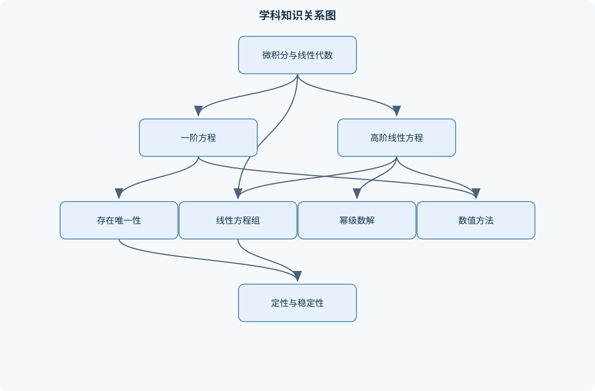
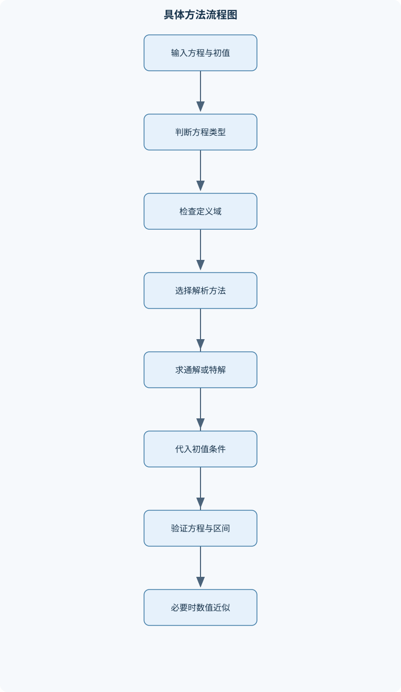

# 常微分方程

## 一、课程整体知识框架

### 课程边界与先修知识

本课程研究常微分方程及其方程组，即未知函数只依赖一个自变量、方程中出现该函数及其各阶导数的数学模型。内容覆盖一阶方程、二阶及高阶线性方程、线性方程组、初值问题与边值问题、存在唯一性、定性理论、稳定性、级数解和基本数值方法。重点包括可显式求解的典型方程、线性系统的结构理论以及非线性系统在平衡点附近的局部行为。先修知识包括一元微积分、常用积分技巧、无穷级数与幂级数、矩阵与行列式、特征值和特征向量；使用复特征值时还需掌握复数的指数表示。课程边界通常不系统展开偏微分方程、泛函分析和高阶数值分析，但会说明常微分方程与这些内容的联系。





### 1. 研究对象、基本表示与课程边界

常微分方程研究未知函数只依赖一个自变量的方程。自变量通常记为 $x$ 或 $t$，未知标量函数记为 $y(x)$，未知向量函数记为 $X(t)$。如果方程中出现 $y$ 及其导数，且最高阶导数为 $y^{(n)}$，则称其为 $n$ 阶常微分方程。一般形式为

$$
F\bigl(x,y,y',\ldots,y^{(n)}\bigr)=0.
$$

若能够在适当区域内解出最高阶导数，则可写成

$$
y^{(n)}=f\bigl(x,y,y',\ldots,y^{(n-1)}\bigr).
$$

“能够解出”不仅是代数变形问题，还涉及定义域。例如方程 $y'=1/y$ 在 $y=0$ 处没有定义，因此不能把包含 $y=0$ 的点直接作为普通初值点。方程的解必须在某个区间上具有所需阶数的导数，并且代入方程后恒等成立。解的定义域是函数、方程各项及所需导数都定义的区间；不能仅凭形式积分得到一个表达式，就断言其在整个实轴上都是解。

常微分方程的阶数表示最高阶导数的阶，不表示方程中项的数量。例如

$$
x^2y''-3xy'+5y=x^2\sin(\ln x)
$$

是二阶方程；在实数范围内，由于 $\ln x$ 的存在，通常先在 $x>0$ 或 $x<0$ 的连通区间内讨论。方程的阶数决定一般解中通常需要几个独立常数：在适当的正则条件下，$n$ 阶方程的局部解由 $n$ 个初始数据确定。

### 2. 线性与非线性结构

$n$ 阶线性方程写为

$$
a_n(x)y^{(n)}+a_{n-1}(x)y^{(n-1)}+\cdots+a_1(x)y'+a_0(x)y=g(x),
$$

其中各系数只依赖于自变量，未知函数及其各阶导数只以一次幂出现，且彼此不相乘。若 $g(x)\equiv 0$，称为齐次线性方程；否则称为非齐次线性方程。若出现 $y^2$、$yy'$、$\sin y$ 或系数依赖于 $y$，则通常是非线性的。

线性结构的核心是叠加原理。设线性微分算子为

$$
L[y]=a_ny^{(n)}+\cdots+a_1y'+a_0y.
$$

若 $L[y_1]=0$、$L[y_2]=0$，则对任意常数 $c_1,c_2$，

$$
L[c_1y_1+c_2y_2]=c_1L[y_1]+c_2L[y_2]=0.
$$

因此，齐次方程的解构成线性空间；非齐次方程的通解等于齐次通解加一个特解：

$$
y=y_h+y_p.
$$

该结论要求微分算子线性，且各解必须在同一连通区间上具有相同的定义条件。非线性方程一般不满足叠加原理，例如 $y'=y^2$ 的两个解之和通常不是解。

### 3. 初值问题、边值问题与积分曲线

一阶初值问题写成

$$
y'=f(x,y),\qquad y(x_0)=y_0.
$$

高阶初值问题还需给出

$$
y(x_0),\ y'(x_0),\ \ldots,\ y^{(n-1)}(x_0).
$$

初值条件集中在同一个自变量点，目标是确定经过指定点并具有指定切向信息的积分曲线。边值问题则在不同位置给出条件，例如

$$
y''+p(x)y'+q(x)y=g(x),\qquad y(a)=\alpha,\quad y(b)=\beta.
$$

初值问题通常适合按自变量向前延拓；边值问题可能无解、唯一解或有无穷多个解。对于线性二阶边值问题，齐次方程是否存在满足两个齐次边界条件的非零解，是判断非齐次问题唯一性的关键。

方向场把方程 $y'=f(x,y)$ 在平面点 $(x,y)$ 处的斜率表示为 $f(x,y)$。等斜率线满足 $f(x,y)=c$，在同一条等斜率线上方向场线段斜率相同。方向场能够展示解的定性走势，但不能替代存在唯一性证明，也不能准确给出爆破时间或精确数值。

### 4. 解的存在区间、最大延拓与初值依赖

局部解只保证在初值点附近存在。若解可以沿着同一方程继续定义到更大的区间，则原区间不是最大存在区间。不能继续延拓的最大区间称为最大存在区间。解停止延拓的原因可能是：

1. $y$ 或高阶导数在有限时间内发散；
2. 解接近方程右端函数的奇点；
3. 解离开 $f$ 连续或满足唯一性条件的区域；
4. 方程本身只在有限区间内定义。

例如

$$
y'=y^2,\qquad y(0)=1
$$

分离变量得到

$$
-\frac1y=x+C,\qquad y=\frac1{1-x}.
$$

该解在 $x=1$ 发散，所以最大存在区间是 $(-\infty,1)$，而不是整个实轴。有限时间爆破说明局部理论不能自动推出全局存在。

课程中的存在唯一性理论通常按以下逻辑组织：若 $f(x,y)$ 在包含 $(x_0,y_0)$ 的矩形区域内连续，则初值问题至少有局部解；若 $f$ 对 $y$ 满足局部 Lipschitz 条件，即在局部区域存在 $L>0$ 使

$$
|f(x,y_1)-f(x,y_2)|\le L|y_1-y_2|,
$$

则局部解唯一。连续性主要控制存在性，Lipschitz 条件主要控制唯一性。仅有连续性时，解可能存在但不唯一，例如

$$
y'=3|y|^{2/3},\qquad y(0)=0
$$

既有恒等于零的解，也有在一段时间保持零后再离开的非零解。

### 5. 从标量高阶方程到一阶方程组

$n$ 阶方程可通过引入状态变量转化为一阶方程组。令

$$
X=
\begin{pmatrix}
y\\y'\\\vdots\\y^{(n-1)}
\end{pmatrix},
$$

则原方程可写成

$$
X'=F(x,X).
$$

这一转化统一了存在唯一性理论、矩阵方法、相平面方法和数值算法。线性系统的一般形式为

$$
X'=A(t)X+G(t),
$$

其中 $X$ 是列向量，$A(t)$ 是系数矩阵，$G(t)$ 是外力向量。若 $A$ 和 $G$ 不显含 $t$，则为自治系统；齐次自治线性系统为 $X'=AX$。

对于常矩阵 $A$，解由矩阵指数给出：

$$
X(t)=e^{At}X(0),
$$

其中

$$
e^{At}=I+At+\frac{A^2t^2}{2!}+\frac{A^3t^3}{3!}+\cdots.
$$

若 $A=PDP^{-1}$ 可对角化，则

$$
e^{At}=Pe^{Dt}P^{-1}.
$$

若缺少足够多的特征向量，则需使用 Jordan 块或广义特征向量，解中会出现 $t^k e^{\lambda t}$ 项。

### 6. 从显式求解到定性和数值分析

常微分方程的求解并不总是意味着写出初等函数形式。课程知识框架包括三种互补方法：

- **解析方法**：通过变量分离、积分因子、特征方程、参数变易、拉普拉斯变换和级数展开得到公式；
- **定性方法**：不求精确表达式，而研究解的存在性、单调性、有界性、平衡点、稳定性和长期行为；
- **数值方法**：在无法显式求解或模型数据复杂时，用离散计算近似解，并分析误差与稳定性。

解析表达式若没有定义域和初值条件，通常是不完整的；相图若没有说明平衡点和参数条件，通常也不能作为完整结论；数值结果若不报告步长、误差和稳定性限制，则不能直接视为方程的精确解。

课程通常不系统展开偏微分方程、泛函分析和高阶数值分析，但会说明联系：常微分方程描述单一自变量演化，偏微分方程涉及多个自变量及偏导数；泛函分析为无限维系统提供理论框架，而常微分方程组主要在有限维空间中研究；高阶数值分析则进一步讨论刚性、误差控制、隐式方法和自适应步长。

## 二、章节和模块划分

### 核心知识覆盖清单

本清单用于检查正文是否覆盖本课程的主要知识模块：

- **常微分方程基础与初值问题**：方程的阶数与线性性、显式形式与隐式形式、通解、特解与积分曲线、初值问题与边值问题、方向场与等斜率线、解的存在区间、最大延拓解、变量替换与降阶思想。
- **一阶一阶方程的解析方法**：变量分离方程、齐次型一阶方程、一阶线性方程、伯努利方程、恰当方程与积分因子、一阶非线性方程的参数表示、一阶方程的奇解、解的定义域与初值限制。
- **存在唯一性与解的定性性质**：局部存在定理、唯一性条件、局部Lipschitz条件、Peano存在定理、Picard迭代思想、延拓定理、比较定理、爆破解与有限时间离开、初值连续依赖性。
- **高阶线性微分方程**：线性齐次方程的解空间、线性无关与Wronski行列式、常系数齐次方程、重根与复根情形、非齐次方程叠加原理、待定系数法、参数变易法、降阶法、欧拉型方程。
- **拉普拉斯变换与积分变换方法**：拉普拉斯变换定义、常见函数的变换表、导数与初值的变换、单位阶跃函数、脉冲与分段输入、卷积定理、逆变换与部分分式、变换法求初值问题、变换方法的收敛条件。
- **幂级数解与特殊函数初步**：普通点与奇异点、幂级数设解、系数递推关系、收敛半径与局部有效性、常点附近的解析解、正则奇点、Frobenius方法、指标方程、偶解与奇解分解。
- **线性微分方程组**：一阶方程组的矩阵形式、基本矩阵与基解矩阵、矩阵指数、常系数齐次系统、特征值与特征向量、Jordan块与广义特征向量、非齐次系统的变参数公式、高阶方程组的等价化、基于矩阵的初值问题。
- **平面自治系统与相平面分析**：自治系统与轨线、平衡点与奇点、零流线、方向场与相图、线性系统分类、节点、鞍点与焦点、中心与中心型行为、线性化系统、Hartman-Grobman局部思想、非线性系统的局部相图。
- **稳定性与渐近行为**：Lyapunov稳定性、渐近稳定与不稳定、线性系统稳定判据、特征值实部判别、二阶系统的阻尼分类、Lyapunov函数、不变集与轨道有界性、受迫系统的稳态响应、渐近稳定性与输入衰减、参数变化与分岔初步。
- **数值方法与建模应用**：Euler方法、改进Euler方法、Runge-Kutta方法、局部截断误差、全局误差、步长选择、刚性问题初识、数值稳定性、人口与资源模型、振动与电路模型。


### 1. 常微分方程基础与初值问题

本模块建立统一语言。需要区分显式形式 $y'=f(x,y)$ 与隐式形式 $F(x,y,y')=0$，区分通解、特解和积分曲线。通解含任意常数，特解由初值、边值或其他条件确定；积分曲线是解在 $(x,y)$ 平面上的几何轨迹。

学习方向场和等斜率线时，应把方程看作局部斜率规则，而不是把图形当作证明。变量替换和降阶的基本思想是寻找方程中的隐藏结构。例如若方程不显含 $y$，可令 $p=y'$；若不显含 $x$，可令 $p(y)=y'$，并利用

$$
y''=\frac{dp}{dx}=\frac{dp}{dy}\frac{dy}{dx}=p\frac{dp}{dy}.
$$

这些变换只有在相应导数和变量可作为局部坐标时才有效，不能机械使用。

### 2. 一阶方程的解析方法

#### 2.1 变量分离、齐次型与伯努利方程

变量分离方程为

$$
y'=g(x)h(y).
$$

在 $h(y)\ne0$ 的解支上，

$$
\frac{dy}{h(y)}=g(x)\,dx,
$$

积分后再利用初值确定常数。除以 $h(y)$ 前必须检查 $h(y)=0$ 是否给出遗漏的常值解。例如 $y'=y(1-y)$ 中，$y=0$ 与 $y=1$ 都是平衡解，不能因除以 $y(1-y)$ 而遗漏。

齐次型一阶方程通常指

$$
y'=F\left(\frac yx\right),
$$

在 $x\ne0$ 时令 $v=y/x$，则 $y=vx$、$y'=v+xv'$。代入后得到可分离方程。该方法不能直接跨过 $x=0$，所得解需按正负区间分别检查。

伯努利方程为

$$
y'+p(x)y=q(x)y^\alpha,\qquad \alpha\ne0,1.
$$

在 $y\ne0$ 的区间令 $z=y^{1-\alpha}$，有

$$
z'=(1-\alpha)y^{-\alpha}y',
$$

从而转化为一阶线性方程。若原方程允许 $y=0$，还要单独检查零解。

#### 2.2 一阶线性方程与恰当方程

一阶线性方程

$$
y'+p(x)y=q(x)
$$

的积分因子为

$$
\mu(x)=\exp\left(\int p(x)\,dx\right).
$$

因为

$$
(\mu y)'=\mu y'+\mu'y
=\mu\bigl(y'+p(x)y\bigr),
$$

所以

$$
(\mu y)'=\mu q(x),
$$

积分得到

$$
y=\mu^{-1}(x)\left(\int\mu(x)q(x)\,dx+C\right).
$$

积分因子只需在所讨论的连通区间内非零且可微。若 $p(x)=3/x$，则 $x=0$ 是方程奇点，解应在 $(0,\infty)$ 或 $(-\infty,0)$ 上分别讨论，不能用一个表达式不加说明地跨越零点。

恰当方程写成

$$
M(x,y)\,dx+N(x,y)\,dy=0.
$$

若在单连通区域内 $M_y=N_x$，则存在势函数 $\Phi(x,y)$，满足

$$
\Phi_x=M,\qquad \Phi_y=N,
$$

通解为 $\Phi(x,y)=C$。若不恰当，可尝试寻找仅依赖 $x$ 或仅依赖 $y$ 的积分因子，但这不是所有方程都能做到的固定程序。

### 3. 存在唯一性与解的定性性质

本模块解释“求出公式”与“证明解存在”之间的差异。Peano 存在定理要求右端函数连续，给出局部存在；Picard 迭代从初始近似出发反复代入积分方程

$$
y(x)=y_0+\int_{x_0}^{x}f(s,y(s))\,ds,
$$

在适当压缩条件下逐步逼近唯一解。局部 Lipschitz 条件使两个候选解之差可被控制，结合 Gronwall 型估计可以证明唯一性和初值连续依赖性。

延拓定理的核心是：若解在有限区间端点附近始终停留在一个紧致的正则区域内，并且没有发散或接触方程奇点，则通常可以继续延拓。因此判断最大区间时，需同时检查函数值是否无界、导数是否失控以及右端函数的定义域。

比较定理利用两个方程右端的大小关系比较解的大小，常用于证明单调性、有界性和爆破。例如若 $y'\ge y^2$ 且 $y(x_0)>0$，则解的增长至少不慢于相应比较方程，可能在有限时间内离开所有有界区域。但比较结论依赖初值顺序、连续性和定义区间，不能仅凭图像推断。

### 4. 高阶线性微分方程

#### 4.1 齐次方程、Wronski 行列式与常系数法

$n$ 阶齐次线性方程的解空间维数为 $n$。若 $y_1,\ldots,y_n$ 是一组基本解，则通解为

$$
y=c_1y_1+\cdots+c_ny_n.
$$

Wronski 行列式定义为

$$
W(y_1,\ldots,y_n)(x)
=
\det
\begin{pmatrix}
y_1&\cdots&y_n\\
y_1'&\cdots&y_n'\\
\vdots&&\vdots\\
y_1^{(n-1)}&\cdots&y_n^{(n-1)}
\end{pmatrix}.
$$

在系数连续的区间上，若某点 $W\ne0$，则这些解线性无关；对线性方程，Wronski 行列式在区间内要么处处非零，要么处处为零。只在一个孤立点计算非零值而不说明系数条件，结论是不完整的。

常系数方程

$$
a_ny^{(n)}+\cdots+a_1y'+a_0y=0
$$

对应特征多项式

$$
a_nr^n+\cdots+a_1r+a_0=0.
$$

实根 $r$ 产生 $e^{rx}$；重根 $r$ 的重数为 $m$ 时产生

$$
e^{rx},xe^{rx},\ldots,x^{m-1}e^{rx};
$$

复根 $\alpha\pm i\beta$ 产生实解

$$
e^{\alpha x}\cos(\beta x),\qquad
e^{\alpha x}\sin(\beta x).
$$

#### 4.2 非齐次方程与欧拉型方程

非齐次方程的待定系数法适用于右端由指数函数、多项式、正弦余弦及其有限乘积构成的情形。若试探特解与齐次解重复，必须乘以足够高次的 $x$，这就是共振修正。参数变易法适用范围更广，但需要已知齐次基本解，并要求 Wronski 行列式在区间内不为零。

欧拉型方程常见形式为

$$
x^ny^{(n)}+a_{n-1}x^{n-1}y^{(n-1)}
+\cdots+a_0y=g(x),
$$

在 $x>0$ 上令 $t=\ln x$，可将其化为常系数方程。由于 $\ln x$ 和 $x^r$ 的定义域限制，正区间与负区间必须分别处理。

### 5. 拉普拉斯变换与积分变换方法

拉普拉斯变换定义为

$$
\mathcal L\{f\}(s)=\int_0^\infty e^{-st}f(t)\,dt,
$$

要求积分在某个 $s$ 的区域内收敛。若 $Y(s)=\mathcal L\{y(t)\}$，则

$$
\mathcal L\{y'\}=sY(s)-y(0),
$$

$$
\mathcal L\{y''\}=s^2Y(s)-sy(0)-y'(0).
$$

因此，线性初值问题可被转化为关于 $Y(s)$ 的代数方程，初值直接出现在变换公式中。单位阶跃函数可表示分段输入，脉冲输入用于理想化瞬时作用；卷积定理

$$
\mathcal L\{(f*g)(t)\}=F(s)G(s)
$$

把时域卷积转化为乘法。逆变换常通过部分分式分解完成，但每一步都必须检查收敛区域、初值和 $t=0$ 附近的分段定义。

### 6. 幂级数解与特殊函数初步

若方程最高阶导数的系数在展开点 $x_0$ 不为零，且归一化后的系数在该点解析，则称 $x_0$ 为普通点，可设

$$
y=\sum_{n=0}^{\infty}a_n(x-x_0)^n.
$$

把级数及其导数代入方程，按 $(x-x_0)^n$ 的幂次比较系数，即可得到递推关系。初值通常决定前若干个自由系数，递推关系再确定其余系数。收敛半径受方程系数奇点限制，局部级数不自动代表整个实轴上的解。

若最高阶导数系数在 $x_0$ 为零，则可能是奇异点。正则奇点附近使用 Frobenius 形式

$$
y=(x-x_0)^r\sum_{n=0}^{\infty}a_n(x-x_0)^n.
$$

最低次幂给出的代数方程称为指标方程。两个指标根之差、是否重根等情况会影响第二个独立解的形式。普通幂级数还可按偶次项和奇次项分解；例如正弦、余弦的递推关系分别只保留奇次或偶次幂。

### 7. 线性微分方程组

基本矩阵 $\Phi(t)$ 的列由齐次系统的线性无关解组成，并满足

$$
\Phi'(t)=A(t)\Phi(t).
$$

若 $\Phi(t_0)=I$，则称其为归一化基本矩阵。非齐次系统

$$
X'=A(t)X+G(t)
$$

的变参数公式为

$$
X(t)=\Phi(t)
\left[
C+\int_{t_0}^{t}\Phi^{-1}(s)G(s)\,ds
\right].
$$

公式要求系数连续且 $\Phi$ 可逆。常系数系统中，特征值的实部决定指数增长或衰减趋势；Jordan 块会引入多项式因子，因此不能只看特征值而忽略不可对角化结构。

### 8. 平面自治系统与相平面分析

二维自治系统写为

$$
x'=f(x,y),\qquad y'=g(x,y).
$$

满足

$$
f(x,y)=0,\qquad g(x,y)=0
$$

的点是平衡点。两条零流线把平面分成区域；在每个区域中，$x'$ 和 $y'$ 的符号确定轨线运动方向。平衡点附近的线性化矩阵为雅可比矩阵

$$
J(p)=Df(p).
$$

二维线性系统的主要类型包括鞍点、节点、焦点和中心。特征值实部异号时为鞍点；实部同号且特征值为实数时通常为节点；共轭复特征值且实部非零时为焦点；纯虚特征值在线性系统中对应中心。对非线性系统，Hartman–Grobman 局部思想主要适用于双曲平衡点，即没有实部为零的特征值。非双曲点不能仅凭线性化判断稳定性，需分析高阶项、构造 Lyapunov 函数或使用更细致的相图方法。

### 9. 稳定性与渐近行为

平衡点 $p$ 的 Lyapunov 稳定性要求：对任意 $\varepsilon>0$，存在 $\delta>0$，使初值距离 $p$ 小于 $\delta$ 的解在未来存在期间始终距 $p$ 小于 $\varepsilon$。若解还满足

$$
\lim_{t\to\infty}X(t)=p,
$$

则称其渐近稳定。该极限只针对解在整个未来时间区间存在的情形；有限时间爆破不能直接称作某种渐近行为。

对二阶齐次常系数方程

$$
y''+py'+qy=0,
$$

所有解趋于零的充要条件是特征根实部均为负，等价于

$$
p>0,\qquad q>0.
$$

该判据不适用于含外力方程或变系数方程。Lyapunov 函数 $V(X)$ 若正定且沿轨道满足 $\dot V\le0$，可用于证明稳定性；若 $\dot V<0$，通常可进一步支持渐近稳定性，但还需注意轨道有界性和不变集条件。受迫系统的长期行为还取决于输入是否持续、衰减或具有周期性。

### 10. 数值方法与建模应用

Euler 方法对

$$
y'=f(t,y),\qquad y(t_0)=y_0
$$

采用

$$
y_{n+1}=y_n+h f(t_n,y_n).
$$

它的局部截断误差为 $O(h^2)$，全局误差通常为 $O(h)$。改进 Euler 方法使用预测值和区间两端斜率，典型形式为

$$
\widetilde y_{n+1}=y_n+h f(t_n,y_n),
$$

$$
y_{n+1}
=y_n+\frac h2
\left[f(t_n,y_n)+f(t_{n+1},\widetilde y_{n+1})\right],
$$

全局误差通常为 $O(h^2)$。四阶 Runge–Kutta 方法通过四个阶段斜率加权平均，理想光滑条件下全局误差为 $O(h^4)$。这些阶数是理论趋势，不保证任意大步长下都有效。

数值计算需区分截断误差、舍入误差和稳定性误差。刚性问题中，真实解可能变化缓慢，但显式方法仍要求极小步长，否则数值解会振荡或发散。人口—资源模型常写成增长、竞争和承载能力的方程；机械振动、电路和控制系统则通过位移、电流或状态变量建立一阶方程组。模型验收不仅看终点数值，还应检查单位一致性、初值复现、步长改变后的结果稳定性以及解是否超出模型适用范围。

## 三、核心概念的详细解释

### 1. 方程、解与解的定义域

常微分方程是关于一个未知函数及其导数的关系式。未知函数只依赖一个自变量，通常记为 $y(x)$ 或向量函数 $X(t)$。$n$ 阶方程的一般形式为

$$
F\bigl(x,y,y',\ldots,y^{(n)}\bigr)=0.
$$

若能在某个区域内解出最高阶导数，则写成

$$
y^{(n)}=f\bigl(x,y,y',\ldots,y^{(n-1)}\bigr).
$$

一个函数只有在某个区间上具有所需阶数的导数，并且代入方程后恒等成立，才称为该方程在该区间上的解。解的定义域必须同时满足函数本身、方程中的系数、非线性表达式以及各阶导数均有意义。例如，方程

$$
y'=\frac1y
$$

不能在包含 $y=0$ 的点上作为普通显式方程使用；方程

$$
x^2y''-3xy'+5y=x^2\sin(\ln x)
$$

通常要分别在 $x>0$ 和 $x<0$ 的连通区间内讨论，因为 $\ln x$ 在实数范围内只对 $x>0$ 有定义。

方程的阶数是最高阶导数的阶数，而不是方程中项的数量。在线性方程的正则条件满足时，$n$ 阶初值问题通常需要 $n$ 个初始数据；但这只是局部解结构的结论，不表示任意 $n$ 个数都能产生全局解，也不表示边值问题必然有唯一解。

线性 $n$ 阶方程写为

$$
a_n(x)y^{(n)}+\cdots+a_1(x)y'+a_0(x)y=g(x).
$$

未知函数及其导数只以一次幂出现，且不相乘，系数只能依赖于自变量。$g\equiv0$ 时为齐次线性方程，否则为非齐次线性方程。含有 $y^2$、$yy'$、$\sin y$ 或系数依赖于 $y$ 的方程通常是非线性的。线性判别必须针对未知函数及其导数进行，而不是看 $x$ 的幂次；例如 $x^2y''+\sin x\,y'+e^xy=0$ 仍是线性方程。

### 2. 初值问题、边值问题与积分曲线

一阶初值问题为

$$
y'=f(x,y),\qquad y(x_0)=y_0.
$$

高阶初值问题还需指定 $y(x_0),y'(x_0),\ldots,y^{(n-1)}(x_0)$。初值条件集中在同一点，通常通过逐步向前或向后延拓确定解。边值问题则在不同位置给条件，例如

$$
y''+p(x)y'+q(x)y=g(x),\qquad y(a)=\alpha,\quad y(b)=\beta.
$$

边值问题可能无解、唯一解或有无穷多个解。对线性问题，若相应齐次方程存在满足齐次边界条件的非零解，则非齐次问题的唯一性会失败。

对一阶显式方程，方向场在点 $(x,y)$ 处画出斜率 $f(x,y)$ 的短线段。等斜率线满足 $f(x,y)=c$。方向场可显示解的增减、转折和趋近趋势，但它不能代替存在唯一性证明，也不能自动确定最大存在区间。

### 3. 一阶方程的结构与求解思想

#### 3.1 变量分离方程

若

$$
y'=g(x)h(y),
$$

在 $h(y)\ne0$ 的解支上可写成

$$
\frac{dy}{h(y)}=g(x)\,dx,
$$

积分得

$$
\int\frac{dy}{h(y)}=\int g(x)\,dx+C.
$$

除以 $h(y)$ 前必须单独检查 $h(y)=0$。例如

$$
y'=x(1+y^2)
$$

可分离为

$$
\frac{dy}{1+y^2}=x\,dx,
$$

所以

$$
\arctan y=\frac{x^2}{2}+C.
$$

若给定 $y(0)=0$，则 $C=0$，从而

$$
y=\tan\frac{x^2}{2}.
$$

由于正切函数在 $\frac{x^2}{2}=\frac{\pi}{2}+k\pi$ 处无定义，包含 $x=0$ 的最大对称存在区间是

$$
\left(-\sqrt{\pi},\sqrt{\pi}\right).
$$

这里的有限区间不是计算失误，而是解在有限自变量处趋于无穷，无法继续作为有限值函数延拓。

#### 3.2 齐次型、线性型与伯努利型

若方程可写为

$$
y'=F\left(\frac yx\right),
$$

令 $y=vx$，则 $y'=v+xv'$，通常可化为关于 $v$ 与 $x$ 的可分离方程。该代换要求 $x\ne0$，所得解还须回代检查。

一阶线性方程

$$
y'+p(x)y=q(x)
$$

的积分因子为

$$
\mu(x)=\exp\left(\int p(x)\,dx\right).
$$

因为

$$
(\mu y)'=\mu y'+\mu'y
=\mu\bigl(y'+p(x)y\bigr),
$$

所以

$$
(\mu y)'=\mu q.
$$

积分后得到

$$
y=\mu^{-1}(x)\left(\int\mu(x)q(x)\,dx+C\right).
$$

公式适用于 $p,q$ 在所讨论区间内连续的情形。若 $p(x)=3/x$，则必须在 $x>0$ 或 $x<0$ 上分别讨论，不能把两个区间强行合并。

伯努利方程

$$
y'+p(x)y=q(x)y^m,\qquad m\ne0,1
$$

在 $y\ne0$ 时令 $v=y^{1-m}$，有

$$
v'=(1-m)y^{-m}y',
$$

代换后变成一阶线性方程。若除以 $y^m$，还要检查可能被遗漏的零解。

#### 3.3 恰当方程与积分因子

方程

$$
M(x,y)\,dx+N(x,y)\,dy=0
$$

若满足

$$
\frac{\partial M}{\partial y}
=
\frac{\partial N}{\partial x},
$$

则在单连通区域内存在势函数 $\Phi(x,y)$，使得

$$
d\Phi=M\,dx+N\,dy,
$$

通解为 $\Phi(x,y)=C$。求势函数可先对 $M$ 关于 $x$ 积分，再利用对 $y$ 的偏导确定只依赖于 $y$ 的项。

若不恰当，可检验仅依赖 $x$ 的积分因子 $\mu(x)$ 或仅依赖 $y$ 的积分因子 $\mu(y)$。例如当

$$
\frac{M_y-N_x}{N}
$$

仅为 $x$ 的函数时，可取

$$
\mu(x)=\exp\left(\int\frac{M_y-N_x}{N}\,dx\right).
$$

这些判据是充分条件而非必要条件；检验失败并不表示不存在积分因子。

### 4. 存在唯一性、延拓与定性性质

若 $f(x,y)$ 在包含 $(x_0,y_0)$ 的矩形邻域内连续，则初值问题至少有一个局部解，这是 Peano 存在定理的结论。若 $f$ 关于 $y$ 满足局部 Lipschitz 条件，即存在常数 $L$ 使

$$
|f(x,y_1)-f(x,y_2)|\le L|y_1-y_2|,
$$

则局部解唯一。连续性控制右端函数是否有足够规则的取值，Lipschitz 条件控制两条解曲线之间的距离增长。

Picard 迭代从积分形式

$$
y(x)=y_0+\int_{x_0}^{x}f(t,y(t))\,dt
$$

出发，取

$$
y_{k+1}(x)=y_0+\int_{x_0}^{x}f(t,y_k(t))\,dt.
$$

在足够小的区间内，该迭代可收敛到解，并说明唯一性来源于积分算子的压缩性质。延拓定理表明：若解在有限端点处仍停留在方程定义域的某个紧集内，则通常可以继续延拓。因此有限最大区间的端点往往对应函数值发散、接近方程奇点或离开所有有界区域。

比较定理用于估计解的大小。例如若 $y'\le g(y)$，且比较方程 $z'=g(z)$ 的解已知，则在初值有序时可在共同存在区间内比较 $y$ 与 $z$。比较只能在条件满足、区间一致且解确实存在时使用，不能把局部不等式直接推广到未知的全局区间。

### 5. 高阶线性方程与线性系统

齐次线性方程的解构成向量空间。若 $y_1,\ldots,y_n$ 是线性无关的解，则任意解可写为

$$
y=c_1y_1+\cdots+c_ny_n.
$$

Wronski 行列式为

$$
W(y_1,\ldots,y_n)
=
\det
\begin{pmatrix}
y_1&\cdots&y_n\\
y_1'&\cdots&y_n'\\
\vdots&&\vdots\\
y_1^{(n-1)}&\cdots&y_n^{(n-1)}
\end{pmatrix}.
$$

在线性方程系数连续的区间上，某一点 $W\ne0$ 等价于这些解在整个区间线性无关；但脱离该条件不能机械使用这一结论。

常系数方程

$$
y^{(n)}+a_{n-1}y^{(n-1)}+\cdots+a_0y=0
$$

对应特征多项式

$$
r^n+a_{n-1}r^{n-1}+\cdots+a_0=0.
$$

实单根 $r$ 给出 $e^{rx}$；重根 $r$ 的重数为 $m$ 时给出

$$
e^{rx},xe^{rx},\ldots,x^{m-1}e^{rx};
$$

复根 $\alpha\pm i\beta$ 给出实解

$$
e^{\alpha x}\cos\beta x,\qquad e^{\alpha x}\sin\beta x.
$$

非齐次方程的通解是齐次通解加一个特解。右端为多项式、指数、正弦余弦及其乘积时可用待定系数法；若试探项与齐次解重复，则乘以足够高次的 $x$，这就是共振修正。一般右端或系数变化时使用参数变易法。

令二阶齐次基本解为 $y_1,y_2$，设

$$
y_p=v_1y_1+v_2y_2,\qquad
v_1'y_1+v_2'y_2=0.
$$

代入标准形方程后得到

$$
v_1'y_1'+v_2'y_2'=\frac{g(x)}{a_2(x)}.
$$

与附加条件联立，用 Wronski 行列式解出 $v_1',v_2'$，积分即可。其适用前提是 $W\ne0$ 且系数在区间内连续。

令

$$
X=
\begin{pmatrix}
y\\y'
\end{pmatrix},
$$

高阶方程可改写成一阶系统

$$
X'=A(t)X+G(t).
$$

对常矩阵 $A$，

$$
X(t)=e^{A(t-t_0)}X(t_0),
$$

其中

$$
e^{At}=I+At+\frac{A^2t^2}{2!}+\cdots.
$$

若 $A=PDP^{-1}$，则

$$
e^{At}=Pe^{Dt}P^{-1}.
$$

不可对角化时使用 Jordan 块；大小为 $m$ 的 Jordan 块产生 $e^{\lambda t}$ 乘以最高 $m-1$ 次的多项式。非齐次系统的变参数公式为

$$
X(t)=\Phi(t)\left[
C+\int_{t_0}^{t}\Phi^{-1}(s)G(s)\,ds
\right].
$$

### 6. 级数、拉普拉斯变换与定性分析

普通点附近可设

$$
y=\sum_{n=0}^{\infty}a_n(x-x_0)^n.
$$

代入方程后按 $(x-x_0)^n$ 比较系数，得到递推关系。递推确定系数，而收敛半径受方程系数最近奇点限制。若最高阶导数系数在 $x_0$ 为零，不能机械使用普通幂级数；正则奇点处可设

$$
y=(x-x_0)^r\sum_{n=0}^{\infty}a_n(x-x_0)^n,
$$

最低次幂给出指标方程。指标根的差值可能导致第二个解含对数项，不能保证两个解都具有相同形式。

拉普拉斯变换定义为

$$
\mathcal L\{f\}(s)=\int_0^\infty e^{-st}f(t)\,dt,
$$

要求积分在某个 $s$ 的区域收敛。若 $Y(s)=\mathcal L\{y\}(s)$，则

$$
\mathcal L\{y'\}=sY(s)-y(0),
$$

$$
\mathcal L\{y''\}=s^2Y(s)-sy(0)-y'(0).
$$

因此初值被直接带入代数方程。单位阶跃函数可表示分段输入，卷积定理

$$
\mathcal L\{f*g\}=F(s)G(s)
$$

适合处理系统响应。变换法不适用于不满足相应指数阶或分段连续条件的函数。

二维自治系统

$$
X'=f(X)
$$

的轨线位于相平面。满足 $f(p)=0$ 的点是平衡点。在线性化中，

$$
u'=J(p)u,\qquad J(p)=Df(p).
$$

异号实特征值对应鞍点；实部同号的两个实特征值通常对应节点；具有非零实部的共轭复根对应焦点；纯虚特征值在线性系统中对应中心。若所有特征值实部为负，线性系统渐近稳定；若存在正实部特征值，则不稳定。纯虚或零实部属于非双曲情形，非线性高阶项可能改变结论，不能仅凭线性化断言稳定性。

Lyapunov 稳定性要求：对任意 $\varepsilon>0$，存在 $\delta>0$，使初始距离小于 $\delta$ 的解在未来始终距离平衡点小于 $\varepsilon$。若同时满足解趋于平衡点，则为渐近稳定。常用 Lyapunov 函数 $V(X)$ 满足 $V>0$ 且

$$
\dot V=\nabla V\cdot f(X)\le0.
$$

若 $\dot V<0$，通常可得到局部渐近稳定；若仅有半负定，还需结合不变集分析。有限时间爆破的解并不存在于整个未来区间，因此不能直接称其具有某种渐近稳定性。

### 7. 数值方法、模型与实际限制

Euler 方法为

$$
y_{n+1}=y_n+h f(t_n,y_n),
$$

局部截断误差为 $O(h^2)$，全局误差通常为 $O(h)$。改进 Euler 方法先预测

$$
\widetilde y_{n+1}=y_n+h f(t_n,y_n),
$$

再修正为

$$
y_{n+1}
=y_n+\frac h2
\left[f(t_n,y_n)+f(t_{n+1},\widetilde y_{n+1})\right],
$$

其全局误差通常为 $O(h^2)$。四阶 Runge–Kutta 方法通过四个阶段斜率组合，光滑非刚性问题中全局误差通常为 $O(h^4)$。理论阶数要求函数足够光滑且步长处于适用范围，刚性问题可能要求隐式方法或更严格的稳定性分析。

人口模型可写成增长与资源限制的平衡方程，振动模型通常由位移、速度组成一阶系统，电路模型则以电压、电流为状态变量。建模验收不能只看一组数值，还要检查单位一致、初值复现、参数量纲、步长改变后的结果稳定，以及解是否超出模型的物理范围。

## 四、重要定义、公式、定理和推导

### 专业审校补充：关键定义与适用边界

正则 Sturm–Liouville 特征值问题可写为 $-(p(x)y')'+q(x)y=\lambda w(x)y$，$a\le x\le b$，其中 $p,q,w$ 在区间上连续，$p(x)>0$、$w(x)>0$，并配以齐次分离边界条件，例如 $\alpha_1y(a)+\alpha_2y'(a)=0$、$\beta_1y(b)+\beta_2y'(b)=0$，且每组系数不同时为零。若边界条件使微分算子自伴，则不同特征值对应的特征函数关于权函数 $w$ 正交：若 $\lambda_m\ne\lambda_n$，则 $\int_a^b w(x)y_m(x)y_n(x)\,dx=0$。推导时分别乘以另一特征函数并相减，积分后利用分部积分和边界项为零得到 $(\lambda_m-\lambda_n)\int_a^bwy_my_n\,dx=0$。正则问题的特征值为实数并形成离散序列，特征函数可用于加权平方可积函数的展开。该结论依赖自伴边界条件、正权函数和齐次边界条件；非自伴问题、非齐次边界条件或权函数变号时，不能直接套用正交性和实特征值结论。


### 1. 代表性算法与流程

#### 1.1 一阶方程分类流程

**输入：** 方程、初值以及需要考察的区间。  
**输出：** 通解或满足初值的特解、定义域和可验证的存在区间。

1. 先判断能否显式解出 $y'$，并标记分母、对数、根式等限制。
2. 依次检查变量分离、齐次型、一阶线性、伯努利型和恰当型。
3. 进行代换或乘以积分因子。
4. 求出通解后代入初值。
5. 回代原方程，并检查被除因子是否可能为零。
6. 按奇点和爆破点确定最大连通定义区间。

不变量是每一步所得表达式在原方程定义域内等价；终止条件是回代成立且定义域检查完成。对不能归入标准类型的方程，该流程只能给出分类结果，不能保证存在初等函数形式的解。

#### 1.2 矩阵指数流程

**输入：** 常矩阵 $A$ 和初值 $X(t_0)=X_0$。  
**输出：** $X(t)=e^{A(t-t_0)}X_0$。

1. 求特征多项式和特征值。
2. 若有完整特征向量矩阵 $P$，写成 $A=PDP^{-1}$。
3. 计算 $e^{Dt}$，其对角元为 $e^{\lambda_i t}$。
4. 若不能对角化，构造 Jordan 链；每个 Jordan 块的指数包含 $e^{\lambda t}$ 与有限次幂函数。
5. 乘以初值并验证 $X'(t)=AX(t)$。

关键不变量是矩阵指数始终满足

$$
\frac d{dt}e^{At}=Ae^{At},\qquad e^{A0}=I.
$$

符号计算时复杂度取决于特征分解；数值计算中还需考虑矩阵条件数和舍入误差，不能把理论分解直接视为稳定的数值算法。

#### 1.3 初值问题的数值流程

给定 $t_0,y_0,T,h$，令 $t_n=t_0+nh$。Euler 法逐步计算

$$
y_{n+1}=y_n+h f(t_n,y_n).
$$

改进 Euler 法使用预测—修正步骤，Runge–Kutta 法使用多阶段斜率。每一步检查函数是否可计算、数值是否溢出、步长是否满足稳定性要求。到达 $T$ 或检测到模型区间外行为时终止。

```python
# Python：四阶 Runge–Kutta 求解 y'=f(t,y)
def rk4(f, t0, y0, T, h):
    t = t0
    y = y0
    values = [(t, y)]
    while t < T - 1e-14:
        step = min(h, T - t)
        k1 = f(t, y)
        k2 = f(t + step / 2, y + step * k1 / 2)
        k3 = f(t + step / 2, y + step * k2 / 2)
        k4 = f(t + step, y + step * k3)
        y = y + step * (k1 + 2*k2 + 2*k3 + k4) / 6
        t = t + step
        values.append((t, y))
    return values
```

该代码假定 $f$ 在步进区间内可计算，且解没有因模型奇点而离开有效区域。它给出近似值，不构成存在唯一性证明。

### 2. 典型例题

#### 例题一：变量分离、初值与最大区间

求解

$$
y'=x(1+y^2),\qquad y(0)=0.
$$

**分析：** 方程可分离，且 $1+y^2$ 在实数范围内不为零。

**解答：**

$$
\frac{dy}{1+y^2}=x\,dx,
$$

积分得

$$
\arctan y=\frac{x^2}{2}+C.
$$

代入 $y(0)=0$ 得 $C=0$，所以

$$
y(x)=\tan\frac{x^2}{2}.
$$

**验证：**

$$
y'=\sec^2\frac{x^2}{2}\cdot x
=x\left(1+\tan^2\frac{x^2}{2}\right)=x(1+y^2).
$$

要求 $\frac{x^2}{2}\in(-\pi/2,\pi/2)$，故包含初值点的最大区间为

$$
(-\sqrt{\pi},\sqrt{\pi}).
$$

**变式：** 若右端为 $x(y^2-1)$，分离时除以 $y^2-1$ 会遗漏 $y=1$ 与 $y=-1$ 两个常值解，必须先单独检查。

#### 例题二：一阶线性方程

在 $x>0$ 上求解

$$
y'+\frac3x y=x^2,\qquad y(1)=2.
$$

**分析：** 这是线性方程，积分因子为

$$
\mu(x)=\exp\int\frac3x\,dx=x^3.
$$

**解答：**

$$
(x^3y)'=x^5.
$$

积分得

$$
x^3y=\frac{x^6}{6}+C,
\qquad
y=\frac{x^3}{6}+\frac C{x^3}.
$$

代入 $y(1)=2$ 得 $C=11/6$，故

$$
y=\frac{x^3}{6}+\frac{11}{6x^3},\qquad x>0.
$$

**验证：** 将表达式代回 $y'+3y/x$，结果为 $x^2$；在 $x=0$ 处方程系数奇异，因此不能把正半轴解直接延拓到零点。

**变式：** 在 $x<0$ 上积分因子仍可取 $|x|^3$ 或与之相差非零常数的 $x^3$，但负半轴上的积分常数需重新确定，不能由正半轴初值自动决定。

#### 例题三：常系数共振方程

求解

$$
y''-3y'+2y=e^{2x}.
$$

**分析：** 特征方程为

$$
r^2-3r+2=(r-1)(r-2),
$$

齐次解为 $y_h=C_1e^x+C_2e^{2x}$。右端 $e^{2x}$ 已在齐次解中，因此发生一次共振。

**解答：** 试取

$$
y_p=Ax e^{2x}.
$$

计算

$$
y_p'=A(1+2x)e^{2x},\qquad
y_p''=A(4+4x)e^{2x}.
$$

代入左端：

$$
y_p''-3y_p'+2y_p
=A\bigl[(4+4x)-3(1+2x)+2x\bigr]e^{2x}
=Ae^{2x}.
$$

故 $A=1$，通解为

$$
y=C_1e^x+C_2e^{2x}+xe^{2x}.
$$

**验证：** 上述代入直接得到右端 $e^{2x}$。若右端为 $xe^{2x}$，一次重合根只需在待定系数多项式前乘一个 $x$，应试取 $y_p=x(Ax+B)e^{2x}$，再代入确定 A、B。

#### 例题四：参数变易法

求解

$$
y''+y=\sec x,
$$

并在不跨越 $\cos x=0$ 的区间内讨论。

**分析：** 齐次基本解为

$$
y_1=\cos x,\qquad y_2=\sin x,
$$

且

$$
W=y_1y_2'-y_1'y_2=1.
$$

设 $y_p=v_1y_1+v_2y_2$，则标准公式给出

$$
v_1'=-y_2\sec x=-\tan x,
\qquad
v_2'=y_1\sec x=1.
$$

**解答：**

$$
v_1=\ln|\cos x|,\qquad v_2=x.
$$

因此可取

$$
y_p=\cos x\ln|\cos x|+x\sin x.
$$

通解为

$$
y=C_1\cos x+C_2\sin x+\cos x\ln|\cos x|+x\sin x.
$$

**验证：** 参数变易附加条件保证二阶导数中的 $v_1'',v_2''$ 项抵消，直接代回可得 $y_p''+y_p=\sec x$。解只在不含 $\cos x=0$ 的连通区间上讨论。

#### 例题五：二维线性系统分类

考虑

$$
X'=
\begin{pmatrix}
2&0\\
0&-1
\end{pmatrix}X.
$$

**分析：** 特征值为 $2$ 和 $-1$，符号相反。

**解答：**

$$
x'=2x,\qquad y'=-y,
$$

所以

$$
x=C_1e^{2t},\qquad y=C_2e^{-t}.
$$

特征值异号，原点是鞍点。沿 $x$ 轴的轨线远离原点，沿 $y$ 轴的轨线趋向原点；其他非零轨线通常一方面远离、一方面靠近。

**稳定性：** 存在沿 $x$ 轴方向发散的初值，因此原点不稳定。

**变式：** 若矩阵为 $\operatorname{diag}(-1,-2)$，原点为稳定节点；若特征值为 $\pm i$，线性系统为中心，但对应的非线性系统仍需检查高阶项。

### 3. 实验与项目流程

#### 实验一：比较 Euler、改进 Euler 与四阶 Runge–Kutta

**输入数据：**

$$
y'=-2y,\qquad y(0)=1,\qquad 0\le t\le1.
$$

精确解为 $y=e^{-2t}$。分别取 $h=0.2,0.1,0.05$，计算终点近似值。

**步骤：**

1. 用三种方法在同一组网格上计算。
2. 以 $|y_{\text{num}}(1)-e^{-2}|$ 作为终点误差。
3. 将步长减半，比较误差比值。
4. 检查数值解是否始终为正以及是否单调下降。

**评价标准：** Euler 误差应呈约一阶趋势，改进 Euler 约二阶，四阶 Runge–Kutta 在足够小步长下约四阶。实际比值受舍入误差影响，不要求在粗网格上精确达到理论阶数。

**排错方法：** 若结果不收敛，检查 $t_{n+1}$ 是否正确更新、改进 Euler 的预测值是否代入端点斜率、步长最后一段是否超过终点，以及指数精确值是否使用同一终点。

#### 实验二：非线性系统平衡点与线性化

研究系统

$$
x'=x(1-x-y),\qquad y'=y(2-x-y).
$$

**输入数据：** 右端函数、初始点若干组，例如 $(0.2,0.2)$、$(1.5,0.2)$ 和 $(0.2,1.5)$。

**步骤：**

1. 解 $x(1-x-y)=0$ 与 $y(2-x-y)=0$，得到全部平衡点。
2. 计算雅可比矩阵
   $$
   J(x,y)=
   \begin{pmatrix}
   1-2x-y&-x\\
   -y&2-x-2y
   \end{pmatrix}.
   $$
该系统的平衡点为 $(0,0)$、$(1,0)$ 和 $(0,2)$。在 $(0,0)$ 处特征值为 $1,2$，是不稳定节点；在 $(1,0)$ 处特征值为 $-1,1$，是鞍点；在 $(0,2)$ 处特征值为 $-1,0$，是非双曲点，线性化不能单独决定其非线性稳定性。
3. 在各平衡点求特征值并分类。
4. 用数值积分绘制代表性轨线，观察是否与线性化结论一致。
5. 对特征值含零实部的点，不能只依据线性化下结论，应进一步考察高阶项或构造 Lyapunov 函数。

**评价标准：** 平衡点求解应无遗漏；Jacobian 的偏导数正确；数值轨线的初始点、时间方向和稳定性判断一致；步长改变后定性结论不应无故改变。

**排错方法：** 若轨线穿过理论上不变的坐标轴，检查数值误差和方程实现；若平衡点附近轨线类型与特征值矛盾，先检查矩阵代入和特征多项式，再检查绘图坐标尺度。

### 4. 常见错误、笔试与面试要点

#### 4.1 具体易错点

1. 分离变量时除以 $h(y)$，遗漏 $h(y)=0$ 的常值解。
2. 只因 $f$ 连续就断言唯一性；唯一性通常还需局部 Lipschitz 条件。
3. 把局部存在区间误认为整个实轴。
4. 忽略对数、根式、分母和反三角函数造成的定义域限制。
5. 重根特征值漏掉 $xe^{rx}$ 等多项式因子。
6. 复根只写复指数，未整理为实值正弦余弦解。
7. 待定系数法遇到共振时未乘以足够高次的 $x$。
8. 把 Wronski 行列式某一点非零的结论脱离系数连续条件使用。
9. 将边值问题当作初值问题，默认必然存在唯一解。
10. 在正则奇点处机械设普通幂级数，漏掉指标方程。
11. 忽略拉普拉斯变换的收敛区域。
12. 把纯虚特征值直接等同于非线性系统稳定。
13. 用数值轨线代替存在唯一性证明。
14. 认为步长减半时误差必然精确按理论倍数下降。
15. 对刚性问题使用过大的显式步长，误判真实解发散。
16. 混淆局部截断误差与全局误差的阶数。

#### 4.2 典型笔试问题及解答思路

1. **为什么变量分离可能丢解？**  
   因为除以 $h(y)$ 的步骤要求 $h(y)\ne0$。先解 $h(y)=0$ 得常值解，再处理非零解支。

2. **连续性和 Lipschitz 条件分别保证什么？**  
   连续性通常保证局部存在；关于 $y$ 的局部 Lipschitz 条件保证唯一性。回答时应说明两者作用不同。

3. **如何判断常系数二阶齐次方程的渐近稳定性？**  
   特征方程两个根实部均为负。对 $y''+py'+qy=0$，等价于 $p>0,q>0$，仅适用于齐次常系数二阶情形。

4. **为什么非齐次通解等于齐次通解加特解？**  
   由线性算子叠加：
   $$
   L[y_h+y_p]=L[y_h]+L[y_p]=0+g.
   $$

5. **参数变易法中的附加条件有什么作用？**  
   它不是额外限制最终解，而是为两个未知函数 $v_1,v_2$ 提供第二个方程，并抵消二阶导数中的复杂项。

6. **何时线性化不能判断非线性稳定性？**  
   平衡点为非双曲点，即 Jacobian 存在实部为零的特征值。此时须分析高阶项、Lyapunov 函数或中心流形等工具。

7. **Wronski 行列式为零是否必然说明函数线性相关？**  
   对一般光滑函数不必然；但对同一线性齐次方程且系数连续的解，Wronski 行列式在一点为零会导致线性相关。

8. **为什么数值方法需要稳定性分析？**  
   离散误差可能被递推放大。即便真实解有界，数值解也可能因步长过大而振荡或发散。

#### 4.3 典型面试问题与回答要点

1. **如何向工程人员解释最大存在区间？**  
   它是解能够作为同类有限函数继续延拓的最大区间，端点可能对应爆破或模型系数奇异，不能简单等同于仿真终点。

2. **矩阵指数如何处理不可对角化矩阵？**  
   使用 Jordan 标准形或广义特征向量；Jordan 块指数产生 $e^{\lambda t}$ 乘多项式因子。

3. **如何验证一个数值解是否可信？**  
   改变步长比较收敛性，检查初值复现、单位一致性、残差、稳定性和模型有效范围。

4. **刚性问题的主要困难是什么？**  
   解的某些衰减模态要求显式方法使用极小步长，否则数值解不稳定；通常考虑隐式方法或专门的刚性求解器。

5. **如何判断非线性系统的平衡点？**  
   联立各分量右端为零，求出全部解，再计算 Jacobian 和特征值；非双曲点不能只按线性分类。

6. **Laplace 变换为什么适合初值问题？**  
   导数变换公式会直接带入 $y(0),y'(0)$ 等初值，使微分方程转化为代数方程，尤其适合分段输入。

7. **模型参数改变可能产生什么现象？**  
   平衡点稳定性、周期轨道或解的长期行为可能改变，这类定性变化称为分岔现象；必须结合参数范围和模型边界说明。

8. **如何判断一个解析公式是否真的是解？**  
   检查定义域、所需导数、代回方程、初值或边值条件，并确认表达式所在连通区间没有跨越奇点。

### 5. 岗位关联与产出标准

在科学计算和工程算法任务中，常微分方程知识用于把物理规律转为状态空间模型，选择求解器，分析稳定性并输出误差报告。验收通常包括方程和单位说明、初值与边界条件记录、步长收敛实验、异常值处理和结果可复现。

在控制系统与动力系统分析中，重点使用矩阵指数、特征值、线性化、Lyapunov 稳定性和相平面方法。产出应包括平衡点表、特征值分类、稳定性结论、参数变化说明和必要的仿真对照；不能仅提交一张轨线图。

在仿真软件开发中，重点使用 Euler、Runge–Kutta、误差估计、刚性识别和数值稳定性。验收标准包括已知解析解上的误差阶测试、不同步长结果比较、异常状态检测和终止条件明确。

在数据科学、金融风险和资源模型中，方程往往是近似模型，参数具有估计误差，长期外推尤其敏感。除计算解外，还需报告参数扰动下的敏感性、解的可解释范围以及模型假设失效的条件，不能把形式上的全局解当成现实预测的可靠保证。

## 五、算法、流程和实现思路

### 方法与流程覆盖索引

下列方法或流程应在正文中说明输入、步骤、适用条件、结果检查和边界：

- 一阶方程分类与求解流程：输入方程及初值；先检查是否可显式解出 y'，再依次识别变量分离、线性、齐次型、伯努利型或恰当型；选择对应变换或积分因子；求通解后代入初值；检查被除表达式不为零、对数真数为正以及根式定义域；输出满足初值的最大可验证解区间。终止条件是完成回代和定义域检查，适用于可归入上述标准类型的一阶方程。
- 存在唯一性分析流程：输入 y'=f(x,y) 和初值；选取包含初值的闭矩形；检查 f 是否连续以判断局部存在；估计 f 对 y 的差值是否可由常数乘 |y_1-y_2| 控制；若能控制则应用局部Lipschitz唯一性；再检查解是否在有限时间离开任意有界区域或函数值发散。输出局部存在、唯一性和可能的最大区间结论。
- 常系数高阶方程流程：输入齐次或非齐次线性方程；写出特征多项式；求根并按实单根、重根、复根分类；构造齐次基本解；对右端选择待定系数法或参数变易法；叠加得到通解；代入初值或边值条件解常数。若右端与齐次解共振，应提高试探特解中多项式的次数。
- 参数变易法流程：输入二阶非齐次方程和齐次基本解 y_1,y_2；令特解 y_p=v_1y_1+v_2y_2；附加约束 v_1'y_1+v_2'y_2=0；由系数比较解出 v_1'和v_2'；积分得到 v_1,v_2；合成并验证。关键不变量是Wronski行列式在区间内不为零，终止条件是代回原方程成立。
- 矩阵指数求解流程：输入常矩阵A和初值X_0；求特征值与特征向量；若有完整特征向量则构造 A=PDP^(-1) 并计算 e^(At)=Pe^(Dt)P^(-1)；若缺少特征向量则构造Jordan链；对每个Jordan块使用 e^(λt)乘有限次幂函数；输出X(t)=e^(At)X_0。适用于有限维常系数线性系统，数值计算时还需考虑条件数和舍入误差。
- 平衡点与相图流程：输入二维自治系统 X'=f(X)；解 f_1=0 与 f_2=0 得全部平衡点；在每个平衡点计算雅可比矩阵；求特征值及特征向量；依据实部和特征方向分类；绘制零流线、特征方向和代表性轨线；对非双曲点标注线性化不足并改用高阶项、Lyapunov函数或数值积分。
- 幂级数解流程：输入方程及展开点 x_0；检查最高阶导数系数在x_0是否为零；普通点处设 y=求和 a_n(x-x_0)^n；正则奇点处设 y=(x-x_0)^r求和 a_n(x-x_0)^n；代入并整理最低次幂得到指标方程；比较各次幂得到递推式；用初值确定自由系数；通过比值或根值方法估计收敛半径。
- 初值问题数值流程：输入 f(t,y)、初值、终点和步长；Euler法用 y_(n+1)=y_n+h f(t_n,y_n)；改进Euler法先预测再用区间端点斜率平均修正；四阶Runge-Kutta法计算四个阶段斜率并加权平均；逐步检查误差、稳定性和是否超出模型有效区间；输出网格点近似值及误差估计。其终止条件是达到终点或检测到数值发散，适用于右端函数可计算且解在步进区间内存在的初值问题。





### 1. 一阶方程分类与解析求解流程

#### 1.1 总体判别顺序

对一阶方程，先将方程整理为显式形式

$$
y'=f(x,y),
$$

并记录初值点 $(x_0,y_0)$、方程系数的定义域以及可能被除去的表达式。分类时可按以下顺序进行：

1. 检查是否能够直接分离变量；
2. 检查是否为一阶线性方程
   $$
   y'+p(x)y=q(x);
   $$
3. 检查是否可通过 $y=vx$ 或 $y=ux$ 化为变量分离方程；
4. 检查是否为伯努利方程
   $$
   y'+p(x)y=q(x)y^\alpha,\qquad \alpha\ne0,1;
   $$
5. 对微分形式
   $$
   M(x,y)\,dx+N(x,y)\,dy=0
   $$
   检查恰当性，即 $M_y=N_x$；
6. 若以上形式均不成立，再考虑参数表示、特殊代换或定性分析。

每次除以 $y$、$h(y)$、$x$ 或其他表达式前，都必须单独检查该表达式等于零时是否给出遗漏的解。求得表达式后，还需检查对数、根式、反三角函数和系数奇点所限制的定义域。

#### 1.2 变量分离方程

设

$$
y'=g(x)h(y).
$$

在 $h(y)\ne0$ 的解支上，有

$$
\frac{dy}{h(y)}=g(x)\,dx,
$$

因此

$$
\int \frac{dy}{h(y)}
=
\int g(x)\,dx+C.
$$

若 $h(y_*)=0$，则 $y(x)\equiv y_*$ 是候选常值解，必须另行代回原方程验证。

**例 1：**求解

$$
y'=x(1+y^2),\qquad y(0)=0.
$$

分离变量得

$$
\frac{dy}{1+y^2}=x\,dx.
$$

积分后得到

$$
\arctan y=\frac{x^2}{2}+C.
$$

由 $y(0)=0$ 得 $C=0$，所以

$$
y(x)=\tan\frac{x^2}{2}.
$$

正切函数要求

$$
\frac{x^2}{2}\ne\frac{\pi}{2}+k\pi.
$$

包含初值点 $x=0$ 的最大区间由最近的奇点确定：

$$
-\sqrt{\pi}<x<\sqrt{\pi}.
$$

代回可得

$$
y'= \sec^2\frac{x^2}{2}\cdot x
=x\left(1+\tan^2\frac{x^2}{2}\right)
=x(1+y^2),
$$

故所得表达式在该区间内确为解。若原方程改为 $y'=x(y^2-1)$，则分离时不能漏掉 $y\equiv1$ 与 $y\equiv-1$ 两个常值解。

#### 1.3 一阶线性方程和积分因子

对于

$$
y'+p(x)y=q(x),
$$

取积分因子

$$
\mu(x)=\exp\left(\int p(x)\,dx\right).
$$

因为

$$
(\mu y)'=\mu y'+\mu' y
=\mu\bigl(y'+p(x)y\bigr),
$$

所以

$$
(\mu y)'=\mu q.
$$

积分得到

$$
\mu(x)y(x)=\int \mu(x)q(x)\,dx+C,
$$

即

$$
y(x)=\mu(x)^{-1}
\left(\int \mu(x)q(x)\,dx+C\right).
$$

积分因子的定义要求 $p(x)$ 在所讨论区间内连续。若 $p(x)=3/x$，则应分别在 $x>0$ 和 $x<0$ 上讨论，不能把两个区间自动连成一个解的定义域。

**例 2：**在 $x>0$ 上求解

$$
y'+\frac3x y=x^2,\qquad y(1)=2.
$$

积分因子为

$$
\mu(x)=e^{\int 3/x\,dx}=x^3.
$$

于是

$$
(x^3y)'=x^5.
$$

积分得

$$
x^3y=\frac{x^6}{6}+C,
\qquad
y=\frac{x^3}{6}+\frac{C}{x^3}.
$$

代入 $y(1)=2$ 得 $C=11/6$，所以

$$
y(x)=\frac{x^3}{6}+\frac{11}{6x^3},
\qquad x>0.
$$

验证时计算

$$
y'=\frac{x^2}{2}-\frac{11}{2x^4},
$$

从而

$$
y'+\frac3x y
=
\frac{x^2}{2}-\frac{11}{2x^4}
+\frac{x^2}{2}+\frac{11}{2x^4}
=x^2.
$$

若要求在 $x<0$ 上求解，积分因子可取 $|x|^3$；常数的确定必须使用该连通区间上的初值，不能把正半轴上的解直接延拓穿过 $x=0$。

#### 1.4 恰当方程和积分因子

对

$$
M(x,y)\,dx+N(x,y)\,dy=0,
$$

若在单连通区域内 $M_y=N_x$，则存在势函数 $\Phi(x,y)$，使得

$$
\Phi_x=M,\qquad \Phi_y=N.
$$

求势函数的步骤是先对 $M$ 关于 $x$ 积分：

$$
\Phi(x,y)=\int M(x,y)\,dx+\psi(y),
$$

再对 $y$ 求导并与 $N$ 比较，确定 $\psi'(y)$。最后写成

$$
\Phi(x,y)=C.
$$

若

$$
\frac{M_y-N_x}{N}
$$

仅依赖于 $x$，可尝试积分因子 $\mu(x)$；若

$$
\frac{N_x-M_y}{M}
$$

仅依赖于 $y$，可尝试积分因子 $\mu(y)$。这些判别式只是充分条件，不是所有积分因子的穷尽分类。

### 2. 存在唯一性、延拓与定性分析流程

#### 2.1 局部存在唯一性判断

对初值问题

$$
y'=f(x,y),\qquad y(x_0)=y_0,
$$

先取包含 $(x_0,y_0)$ 的闭矩形

$$
R=\{(x,y):|x-x_0|\le a,\ |y-y_0|\le b\}.
$$

若 $f$ 在 $R$ 上连续，则由 Peano 存在定理，至少存在一个局部解。若还满足关于 $y$ 的Lipschitz条件，即存在常数 $L$ 使

$$
|f(x,y_1)-f(x,y_2)|
\le L|y_1-y_2|,
$$

则局部解唯一。若 $f$ 关于 $y$ 具有连续偏导数，则在较小邻域内通常可由有界偏导数推出局部Lipschitz条件。

连续性主要保证解不会因右端函数本身不定义而立即失去存在性；Lipschitz条件控制相同初值出发的两条解之间的距离。仅有连续性不能推出唯一性。例如

$$
y'=3|y|^{2/3},\qquad y(0)=0
$$

存在零解，也存在在某段时间后才离开零点的非零解，因此唯一性失败。

#### 2.2 最大存在区间判断

局部解能否延拓，取决于解是否在有限时间内：

- 函数值趋于无穷；
- 接近方程的奇异集合；
- 离开所有可应用存在定理的有界区域。

**例 3：**考虑

$$
y'=(y-x)e^{y^2},\qquad y(0)=2.
$$

在初值点附近，右端函数连续，且对 $y$ 的偏导数

$$
\frac{\partial f}{\partial y}
=e^{y^2}\bigl(1+2y(y-x)\bigr)
$$

在局部矩形内连续，因此局部解唯一。由于初值为正，且当 $y>x$ 时有 $y'>0$，在足够小的正向区间内解上升。对正向延拓，若能找到区域使 $y-x$ 保持正并且 $e^{y^2}$ 快速增大，则可用比较方程证明有限时间爆破的可能性；但仅凭“右端含有指数”不能直接断言爆破，必须建立明确的不等式或积分估计。向负方向则需研究解是否下降、是否接近 $y=x$，不能由正向行为对称推出结论。

#### 2.3 比较和连续依赖流程

若两个标量方程满足

$$
u'\le F(t,u),\qquad v'=F(t,v),
$$

且 $u(t_0)\le v(t_0)$，在适当的单调性和唯一性条件下，可推出 $u(t)\le v(t)$。比较方法常用于证明有界性、爆破和不变区域，但必须明确比较函数的初值、定义区间和右端的单调条件。

对初值扰动，若 $f$ 在有界区域内满足Lipschitz条件，则常可由 Grönwall 不等式得到

$$
|y(t)-\widetilde y(t)|
\le
|y_0-\widetilde y_0|e^{L|t-t_0|}.
$$

这说明连续依赖不等于误差永远减小；当 $L>0$ 且时间较长时，初值误差可能被放大。

### 3. 高阶线性方程和线性系统的计算流程

#### 3.1 常系数高阶方程

对于

$$
a_ny^{(n)}+\cdots+a_1y'+a_0y=0,
$$

设 $y=e^{rx}$，得到特征方程

$$
a_nr^n+\cdots+a_1r+a_0=0.
$$

若实根 $r$ 为 $m$ 重根，则对应解为

$$
e^{rx},\ xe^{rx},\ldots,x^{m-1}e^{rx}.
$$

若根为 $\alpha\pm i\beta$，则对应实解为

$$
e^{\alpha x}\cos\beta x,\qquad
e^{\alpha x}\sin\beta x.
$$

非齐次方程的通解为

$$
y=y_h+y_p.
$$

**例 4：**求解

$$
y''-3y'+2y=e^{2x}.
$$

特征方程为

$$
r^2-3r+2=(r-1)(r-2)=0,
$$

所以

$$
y_h=C_1e^x+C_2e^{2x}.
$$

右端 $e^{2x}$ 已属于齐次解空间，发生共振，因此不能设 $y_p=Ae^{2x}$，而应设

$$
y_p=Ax e^{2x}.
$$

代入可得

$$
y_p''-3y_p'+2y_p=Ae^{2x}.
$$

故 $A=1$，通解为

$$
y=C_1e^x+C_2e^{2x}+xe^{2x}.
$$

验证非齐次项时只需代回线性算子即可。若右端改为 $x e^{2x}$，则试探式需进一步乘以 $x$，可设 $y_p=x^2(Ax+B)e^{2x}$。

#### 3.2 参数变易法

已知二阶齐次方程的基本解 $y_1,y_2$，设

$$
y_p=v_1(x)y_1(x)+v_2(x)y_2(x),
$$

并附加约束

$$
v_1'y_1+v_2'y_2=0.
$$

若标准形式为

$$
y''+p(x)y'+q(x)y=r(x),
$$

则由

$$
v_1'y_1'+v_2'y_2'=r(x)
$$

得到

$$
\begin{cases}
v_1'y_1+v_2'y_2=0,\\
v_1'y_1'+v_2'y_2'=r(x).
\end{cases}
$$

系数行列式为 Wronski 行列式

$$
W=y_1y_2'-y_1'y_2.
$$

只有在 $W\ne0$ 的区间内，才能解出 $v_1'$、$v_2'$。该方法适用范围比待定系数法广，但积分可能不能用初等函数表示。

#### 3.3 矩阵指数和变参数公式

常系数系统

$$
X'=AX+G(t),\qquad X(t_0)=X_0
$$

的齐次解为

$$
X_h(t)=e^{A(t-t_0)}X_0,
$$

其中

$$
e^{At}
=I+At+\frac{A^2t^2}{2!}+\cdots.
$$

若 $A=PDP^{-1}$，则

$$
e^{At}=Pe^{Dt}P^{-1}.
$$

若 $A$ 不可对角化，应使用 Jordan 链。Jordan 块

$$
J=\lambda I+N,\qquad N^m=0
$$

满足

$$
e^{Jt}=e^{\lambda t}
\left(I+Nt+\frac{N^2t^2}{2!}+\cdots+
\frac{N^{m-1}t^{m-1}}{(m-1)!}\right).
$$

非齐次系统的解为

$$
X(t)=\Phi(t)
\left[
C+\int_{t_0}^{t}\Phi(s)^{-1}G(s)\,ds
\right],
$$

其中 $\Phi$ 是齐次系统的基本矩阵。该公式要求 $\Phi$ 在区间内可逆，且 $A(t)$、$G(t)$ 具有相应连续性。

### 4. 数值初值问题算法

#### 4.1 Euler、改进 Euler 与四阶 Runge–Kutta

对

$$
y'=f(t,y),\qquad y(t_0)=y_0,
$$

设步长为 $h$，$t_n=t_0+nh$。

Euler 方法：

$$
y_{n+1}=y_n+h f(t_n,y_n).
$$

它用左端点斜率近似整个区间斜率，局部截断误差为 $O(h^2)$，全局误差为 $O(h)$。

改进 Euler 方法先预测：

$$
\widetilde y_{n+1}
=y_n+h f(t_n,y_n),
$$

再修正：

$$
y_{n+1}
=y_n+\frac h2
\left[
f(t_n,y_n)+f(t_{n+1},\widetilde y_{n+1})
\right].
$$

其理想全局误差为 $O(h^2)$。

四阶 Runge–Kutta 方法为

$$
k_1=f(t_n,y_n),
$$

$$
k_2=f\left(t_n+\frac h2,y_n+\frac h2k_1\right),
$$

$$
k_3=f\left(t_n+\frac h2,y_n+\frac h2k_2\right),
$$

$$
k_4=f(t_n+h,y_n+hk_3),
$$

$$
y_{n+1}
=y_n+\frac h6(k_1+2k_2+2k_3+k_4).
$$

其理想全局误差为 $O(h^4)$。这些阶数要求 $f$ 足够光滑，并且数值解处于真实解存在的区域内。

#### 4.2 可复现的 Python 实现

```python
import math

def rk4(f, t0, y0, t_end, h):
    """求解标量初值问题 y'=f(t,y)，返回网格点和近似值。"""
    if h <= 0:
        raise ValueError("步长必须为正")
    if t_end < t0:
        raise ValueError("本实现只处理 t_end >= t0")

    n = math.ceil((t_end - t0) / h)
    t_values = [t0]
    y_values = [y0]

    t, y = t0, y0
    for _ in range(n):
        step = min(h, t_end - t)
        if step == 0:
            break

        k1 = f(t, y)
        k2 = f(t + step / 2, y + step * k1 / 2)
        k3 = f(t + step / 2, y + step * k2 / 2)
        k4 = f(t + step, y + step * k3)

        y = y + step * (k1 + 2*k2 + 2*k3 + k4) / 6
        t = t + step

        t_values.append(t)
        y_values.append(y)

    return t_values, y_values

# 示例：y' = y, y(0) = 1，精确解为 y=e^t
ts, ys = rk4(lambda t, y: y, 0.0, 1.0, 1.0, 0.1)
error = abs(ys[-1] - math.e)
print(f"数值值={ys[-1]:.10f}, 绝对误差={error:.3e}")
```

程序的输入是右端函数、初值、终点和步长；输出是网格点及其近似解。验收至少应包括：改变 $h$ 后误差按理论阶下降；初值点的数值结果等于给定初值；在已知解析解 $y=e^t$ 的例子中检查终点误差；若 $f$ 含有奇点，则在步进前检查是否接近奇异区域。

#### 4.3 刚性和稳定性检查

对于测试方程

$$
y'=\lambda y,\qquad \operatorname{Re}\lambda<0,
$$

Euler 方法给出的放大因子为

$$
R(z)=1+z,\qquad z=h\lambda.
$$

数值稳定要求

$$
|1+h\lambda|<1.
$$

因此真实解衰减并不保证 Euler 数值解也衰减。若 $\lambda$ 的负实部很大而真实系统还含有慢变量，就可能出现刚性：显式方法必须采用极小步长才能稳定。此时应考虑隐式方法、问题重标度或专门的刚性求解策略；不能仅通过增大步长来提高效率。

## 六、概念之间的关系与对比

### 1. 初值问题、边值问题与最大延拓

| 概念 | 条件位置 | 主要目标 | 典型困难 |
|---|---|---|---|
| 初值问题 | 同一点给出函数及导数值 | 确定经过初始状态的解 | 有限时间爆破、唯一性失败、无法延拓 |
| 边值问题 | 不同点给出边界条件 | 同时满足两端约束 | 可能无解、唯一解或无穷多解 |
| 最大存在区间 | 由解和方程共同决定 | 找到不能继续延拓的区间 | 解发散或接近方程奇点 |

例如

$$
y''+y=0,\qquad y(0)=1,\quad y'(0)=0
$$

是初值问题，解为 $y=\cos x$，在整个实轴存在。若改为

$$
y''+y=0,\qquad y(0)=0,\quad y(\pi)=1,
$$

则通解 $y=A\cos x+B\sin x$ 给出 $A=0$、$0=1$，所以该边值问题无解。边值条件的数量形式上与方程阶数匹配，并不保证相容。

### 2. 线性与非线性

线性方程具有：

- 解的叠加性；
- 齐次解空间结构；
- 非齐次解可写成齐次解加特解；
- 叠加后可通过线性代数确定常数。

非线性方程通常没有这些性质。例如 $y_1$、$y_2$ 是 $y'=y^2$ 的解时，$y_1+y_2$ 通常不再满足方程。非线性系统虽然难以获得显式通解，但仍可使用平衡点、线性化、Lyapunov函数、比较方法和数值积分进行研究。

线性并不等于容易。变系数线性方程可能没有初等闭式解，线性系统的矩阵也可能不可对角化；非线性也不等于不能分析，许多非线性系统可在平衡点附近通过线性化获得局部结论。

### 3. 解析法、变换法、级数法与数值法

| 方法 | 适用对象 | 优点 | 主要边界 |
|---|---|---|---|
| 变量分离、积分因子 | 特定一阶方程 | 推导直接、结果精确 | 只能处理特定结构 |
| 待定系数法 | 常系数线性方程及特定右端 | 计算快 | 右端类型有限，共振需修正 |
| 参数变易法 | 已知齐次基本解的线性方程 | 适用范围广 | 积分可能复杂 |
| 拉普拉斯变换 | 线性初值问题、分段输入 | 初值和阶跃输入处理方便 | 需满足变换收敛条件 |
| 幂级数与 Frobenius 法 | 普通点、正则奇点附近 | 可构造局部解析解 | 局部有效，收敛半径受奇点限制 |
| 数值方法 | 复杂非线性或无闭式解问题 | 可计算近似轨线 | 有截断误差、舍入误差和稳定性限制 |

解析表达式必须附带定义域；数值结果必须附带步长、误差和稳定性信息。不能因数值轨线平滑，就把它当成存在唯一性的证明。

### 4. 局部线性化与全局非线性行为

设自治系统为

$$
X'=f(X),
$$

平衡点 $p$ 满足 $f(p)=0$。令 $X=p+u$，Taylor 展开得

$$
u'=Df(p)u+R(u),
$$

其中

$$
\frac{\|R(u)\|}{\|u\|}\to0
\quad (u\to0).
$$

若雅可比矩阵 $Df(p)$ 的全部特征值实部都不为零，则平衡点是双曲的，线性化系统能够给出局部拓扑类型：鞍点、稳定节点、不稳定节点或焦点等。若存在纯虚特征值或零特征值，则为非双曲情形，线性化可能无法判断稳定性。

**例 5：**系统

$$
x'=-y+x(x^2+y^2),\qquad
y'=x+y(x^2+y^2)
$$

在原点的线性化为

$$
x'=-y,\qquad y'=x,
$$

其特征值为 $\pm i$，线性系统是中心。但非线性项可能使轨线向外发散，因此不能仅凭线性中心断言原系统稳定。相反，若系统为

$$
x'=-y-x(x^2+y^2),\qquad
y'=x-y(x^2+y^2),
$$

取

$$
V(x,y)=\frac12(x^2+y^2),
$$

则

$$
\dot V=xx'+yy'
=-(x^2+y^2)^2<0
\quad ((x,y)\ne(0,0)),
$$

因此原点渐近稳定。这个例子说明纯虚特征值时必须分析高阶项或构造 Lyapunov 函数。

### 5. 二阶系统、特征值与稳定性

对

$$
y''+py'+qy=0,
$$

特征方程为

$$
r^2+pr+q=0.
$$

所有解趋于零的充要条件是两个根实部均为负。对于该二阶齐次常系数方程，这等价于

$$
p>0,\qquad q>0.
$$

阻尼分类如下：

- $p^2-4q>0$：两个实根；
- $p^2-4q=0$：重根，临界阻尼型；
- $p^2-4q<0$：共轭复根，振荡型；
- 根实部为负时稳定并趋于零；
- 根实部为正时不稳定；
- 根实部为零时不能直接推出非线性系统稳定。

该判据不适用于任意变系数方程，也不直接决定有外力时的长期响应。对于受迫系统，还要区分齐次暂态响应和由输入决定的稳态响应；若输入不衰减，系统状态通常不会趋于零。

### 6. 常见易错点与纠错方法

1. 把方程的阶数误认为未知函数的最高幂次；应看最高阶导数。
2. 把 $x$ 的非线性系数误判为非线性；线性方程允许系数为 $\sin x$、$x^2$ 或 $e^x$。
3. 变量分离时除以 $h(y)$，却漏掉 $h(y)=0$ 的常值解。
4. 只由 $f$ 连续就断言唯一性；还需 Lipschitz 条件或其他唯一性条件。
5. 把局部存在区间当成整个实轴；必须检查爆破和方程奇点。
6. 忽略对数真数、根式和反三角函数的定义域。
7. 把正半轴和负半轴上的表达式当作同一个解；$x=0$ 可能是方程奇点。
8. 重特征根只写一个 $e^{rx}$，漏掉 $xe^{rx}$ 等独立解。
9. 复根直接写复指数而不整理为实解；实系数方程应写成指数乘正弦余弦。
10. 待定系数法遇到共振仍使用原试探式；应乘以足够高次的 $x$。
11. 把 Wronski 行列式某一点非零误认为任意区间都非零；需结合系数连续性和区间说明。
12. 在非双曲平衡点处直接使用线性化分类；纯虚或零实部时需进一步分析。
13. 把线性系统的中心稳定性直接推广到非线性系统。
14. 把 Euler 的局部误差 $O(h^2)$ 误写成全局误差 $O(h^2)$；Euler 全局误差通常为 $O(h)$。
15. 认为步长越大计算越快且越好；刚性问题中大步长可能导致数值发散。
16. 用数值轨线替代存在唯一性证明；数值方法只能提供近似证据。

### 7. 典型笔试问题及解答思路

#### 问题一：求解变量分离方程时为什么要检查常值解？

若分离过程中除以 $h(y)$，只覆盖 $h(y)\ne0$ 的解支。对每个零点 $y_*$，代入原方程检查 $y\equiv y_*$ 是否成立；成立时应把它与分离得到的非恒定解并列写出。

#### 问题二：如何判断一阶初值问题的局部唯一性？

先检查 $f$ 在初值点附近连续以保证局部存在，再检查关于 $y$ 的局部 Lipschitz 条件。若 $\partial f/\partial y$ 在邻域连续，则通常可用有界性推出 Lipschitz 条件。仅有连续性不能保证唯一性。

#### 问题三：为什么重根会产生 $x^ke^{rx}$？

常系数微分算子可写成特征多项式对应的算子。$m$ 重根意味着算子含有 $(D-r)^m$ 因子，需要 $m$ 个线性无关解，依次为 $e^{rx},xe^{rx},\ldots,x^{m-1}e^{rx}$。

#### 问题四：非齐次线性方程的通解为何是 $y_h+y_p$？

由线性算子 $L$ 的线性性，

$$
L[y_h+y_p]=L[y_h]+L[y_p]=0+g=g.
$$

任意两个特解之差满足齐次方程，所以所有特解只相差一个齐次解。

#### 问题五：什么时候待定系数法需要乘以 $x$？

若右端试探函数已经属于齐次解空间，原试探式会与齐次解重合，无法确定系数。若对应特征根的重数为 $m$，则试探式乘以 $x^m$。

#### 问题六：矩阵不可对角化时如何计算 $e^{At}$？

构造 Jordan 标准形或广义特征向量链。对 Jordan 块 $J=\lambda I+N$，利用 $N$ 的幂在有限阶后为零，得到

$$
e^{Jt}=e^{\lambda t}\sum_{k=0}^{m-1}\frac{N^kt^k}{k!}.
$$

#### 问题七：为什么纯虚特征值不能直接判定非线性系统稳定？

线性化只保留一阶项，而纯虚特征值对应的一阶项既不衰减也不增长，高阶项可能决定轨道向内、向外或保持周期。应使用高阶展开、Lyapunov 函数或中心流形等方法。

#### 问题八：Euler 方法为什么真实解衰减而数值解仍可能发散？

测试方程的真实放大因子为 $e^{h\lambda}$，而 Euler 使用 $1+h\lambda$。即使 $|e^{h\lambda}|<1$，也可能有 $|1+h\lambda|>1$，这就是离散数值稳定域与连续系统稳定性的差别。

### 8. 常见面试问题及参考回答要点

#### 问题一：解析解和数值解如何选择？

若方程属于可分离、线性常系数或其他标准类型，优先求解析解以获得结构和精确稳定性结论；若模型复杂、非线性强或无闭式解，则使用数值方法。实际工作中常用解析解验证数值程序，再进行复杂模型计算。

追问重点：说明误差阶、步长收敛和刚性处理，不能只说“数值方法更方便”。

#### 问题二：如何验证一个 ODE 求解器？

使用有精确解的测试方程，改变步长 $h$，计算误差 $E(h)$，检查

$$
\frac{E(h)}{E(h/2)}
$$

是否接近理论阶对应的比例；同时检查初值复现、异常值、终止条件和稳定性。

#### 问题三：什么是刚性问题？

刚性问题含有衰减速度差异很大的时间尺度。显式方法为了稳定而被迫采用远小于真实慢变化尺度的步长。识别后应考虑隐式方法、专用刚性算法或变量尺度变换。

#### 问题四：如何判断非线性平衡点的稳定性？

先求平衡点，再计算雅可比矩阵。若平衡点双曲，特征值实部可给出局部分类；若存在零实部特征值，则线性化不足，需使用 Lyapunov 函数、不变集、中心流形或高阶项分析。

#### 问题五：矩阵指数在工程中有什么作用？

它给出常系数线性系统从初始状态到任意时刻的状态转移：

$$
X(t)=e^{A(t-t_0)}X(t_0).
$$

可用于状态预测、连续系统离散化、模态分析和稳定性判断。数值实现时还需考虑特征分解病态、舍入误差和大矩阵计算成本。

#### 问题六：边值问题为什么可能无解？

两端边界条件必须与微分方程的解空间相容。若齐次问题存在满足齐次边界条件的非零解，非齐次问题可能失去唯一性；若外力与该齐次解不相容，则可能无解。

#### 问题七：如何判断模型参数是否可靠？

检查量纲、初值和边界条件是否合理；改变参数并观察解的敏感性；用独立数据或已知极限情形验证。参数扰动导致结论大幅变化时，应报告不确定性而不是只给单一预测曲线。

#### 问题八：数值结果出现振荡或爆炸时如何排错？

先检查右端函数、单位和初值，再减小步长；比较不同算法；检查是否遇到方程奇点、有限时间爆破或刚性；用简单解析模型验证程序。若减小步长后仍异常，不能简单归因于舍入误差，应重新检查模型和实现。

### 9. 与实际岗位任务的关联

#### 9.1 数学建模与科学计算

实际任务包括把人口、资源、振动或反应过程写成 ODE，估计参数并求解。使用知识包括建模假设、存在区间、稳定性、Runge–Kutta 方法和误差分析。产出为方程说明、参数表、仿真结果和敏感性报告。验收标准包括单位一致、初值复现、步长收敛和模型适用边界明确。

#### 9.2 控制与自动化

实际任务包括建立状态空间模型、计算平衡点、分析特征值和设计稳定控制策略。使用矩阵指数、线性化、Lyapunov 函数和受迫响应理论。产出包括状态方程、极点或特征值分析、稳定性证明和仿真对照。验收时需区分局部稳定与全局稳定，并验证输入扰动下的响应。

#### 9.3 仿真软件与工程算法

实际任务包括实现 Euler、改进 Euler、Runge–Kutta 或刚性求解器。使用局部截断误差、全局误差、稳定域和异常状态检测。产出为可复现实验、误差曲线和接口说明。验收应包含精确解回归测试、步长减半测试、边界输入测试和终止条件测试。

#### 9.4 金融、资源与数据建模

实际任务包括连续增长、衰减、竞争、库存或风险状态的动态预测。使用线性方程、非线性平衡点、参数敏感性和数值积分。产出不仅是预测值，还应包括参数扰动区间、长期行为解释和模型失效条件。不能将数学模型的长期外推直接等同于现实系统的确定性预测。

## 七、典型例题和应用场景

### 专业审校补充：综合例题

题干：求正则边值特征值问题 $y''+\lambda y=0$，$0\le x\le\pi$，满足 $y(0)=0$、$y'(\pi)=0$ 的全部特征值和特征函数，并验证正交性。分析：必须分别讨论 $\lambda>0$、$\lambda=0$ 和 $\lambda<0$，否则可能漏掉或误纳入特征值。解答：第一种，令 $\lambda=\mu^2$，其中 $\mu>0$。通解为 $y=A\cos(\mu x)+B\sin(\mu x)$。由 $y(0)=0$ 得 $A=0$，故 $y=B\sin(\mu x)$。再由 $y'(\pi)=B\mu\cos(\mu\pi)=0$，若 $B\ne0$，必须有 $\cos(\mu\pi)=0$，于是 $\mu=n+\tfrac12$，$n=0,1,2,\ldots$。因此 $\lambda_n=(n+\tfrac12)^2$，可取 $y_n(x)=\sin((n+\tfrac12)x)$。第二种，$\lambda=0$ 时 $y=A x+B$。边界条件给出 $B=0$、$A=0$，只有零解，故不是特征值。第三种，令 $\lambda=-\mu^2$，$\mu>0$，则 $y=A\cosh(\mu x)+B\sinh(\mu x)$。由 $y(0)=0$ 得 $A=0$，而 $y'(\pi)=B\mu\cosh(\mu\pi)=0$。由于 $\cosh(\mu\pi)>0$，只能有 $B=0$，仍无非零解。结果为全部特征值 $\lambda_n=(n+\tfrac12)^2$，特征函数为其非零常数倍。验证正交性：当 $m\ne n$ 时，利用积化和差公式，$\int_0^\pi\sin((m+\tfrac12)x)\sin((n+\tfrac12)x)\,dx=0$；当 $m=n$ 时，积分为 $\pi/2$。变式：若边界条件改为 $y'(0)=0$、$y(\pi)=0$，同样分类可得 $\lambda_n=(n+\tfrac12)^2$，但可取特征函数 $y_n(x)=\cos((n+\tfrac12)x)$。原因是左端边界条件先消去了正弦项，右端条件再要求余弦因子为零。两种问题特征值相同而特征函数族不同，说明边界条件决定谱结构。


### 典型题型与应用覆盖索引

建议通过下列题型或应用检查概念是否能够迁移：

- 变量分离与奇解：完整求解 y'=x(1+y^2)，并说明反正切积分、初值确定常数以及解的最大区间；另检查 y'=g(x)h(y)中 h(y)=0 是否产生遗漏的常值解。
- 一阶线性方程：求解 y'+3y/x=x^2，给定正区间上的初值；完整计算积分因子、积分、常数和定义域，并比较正区间与负区间上的解。
- 恰当方程与积分因子：判断 M(x,y)dx+N(x,y)dy=0 是否恰当；若不恰当，检验仅依赖x或仅依赖y的积分因子；求势函数并用初值确定积分曲线。
- 存在区间判断：分析 y'=(y-x)e^(y^2)，y(0)=2 的初值问题，利用解的单调性、不等式比较或积分估计判断正向或反向最大存在区间是否可能有限，并明确结论所需的充分条件。
- 常系数非齐次方程：求解 y''-3y'+2y=e^(2x)或含多项式、正弦输入的方程；展示特征根、共振修正、特解代入验证和初值常数求解。
- 参数变易法：已知二阶齐次方程的一组基本解，求对应非齐次方程的特解；完整计算Wronski行列式、两个变参数导数并验证结果。
- 幂级数解：在普通点或正则奇点附近求二阶方程的级数解；展示指标方程、偶次与奇次系数递推、初值代入和收敛范围，并说明何时可识别为正弦、余弦或其他熟悉函数。
- 线性系统分类：给定二维系统 X'=AX，求特征值、特征向量、通解和相图；分别给出鞍点、稳定节点、螺旋焦点和中心的代表性例题，并判断稳定性。
- 非线性系统线性化：求系统 x'=f(x,y)、y'=g(x,y) 的所有平衡点，计算雅可比矩阵并分类；对含非双曲平衡点的例题说明线性化结论为何不足。
- 拉普拉斯变换初值题：求解带分段外力或单位阶跃输入的二阶初值问题；完成变换、代数整理、部分分式分解、逆变换和分段表达式检验。
- 数值误差比较：对同一初值问题分别使用Euler法、改进Euler法和四阶Runge-Kutta法，在固定步长下计算终点值；比较误差阶，并解释步长减半时误差变化的理想趋势与实际偏差。


### 1. 一阶方程：变量分离、奇解与最大存在区间

#### 题目

求初值问题

$$
y'=x(1+y^2),\qquad y(0)=0
$$

并确定包含初值点的最大存在区间。

#### 分析

方程右端是 $x$ 与 $y$ 的乘积，属于变量分离方程。分离变量时除以 $1+y^2$ 不会丢失实数解，因为 $1+y^2>0$ 对所有实数 $y$ 成立。若方程改为 $y'=x(y^2-1)$，则必须另行检查 $y\equiv1$ 和 $y\equiv-1$ 这两个常值解。

#### 逐步解答

由

$$
\frac{dy}{1+y^2}=x\,dx
$$

积分得

$$
\arctan y=\frac{x^2}{2}+C.
$$

代入 $y(0)=0$，得到 $C=0$，因此

$$
y(x)=\tan\frac{x^2}{2}.
$$

正切函数在

$$
\frac{x^2}{2}=\frac{\pi}{2}+k\pi
$$

处无定义。离 $x=0$ 最近的奇点满足

$$
\frac{x^2}{2}=\frac{\pi}{2},
\qquad x=\pm\sqrt{\pi}.
$$

所以包含 $0$ 的最大存在区间为

$$
(-\sqrt{\pi},\sqrt{\pi}).
$$

#### 结果验证与变式

求导可得

$$
y'(x)=\sec^2\frac{x^2}{2}\cdot x
=x\left(1+\tan^2\frac{x^2}{2}\right)
=x(1+y^2),
$$

且 $y(0)=0$，故结果正确。

若初值改为 $y(0)=1$，则

$$
\arctan y=\frac{x^2}{2}+\frac{\pi}{4},
$$

从而

$$
y=\tan\left(\frac{x^2}{2}+\frac{\pi}{4}\right).
$$

此时最近奇点由

$$
\frac{x^2}{2}+\frac{\pi}{4}=\frac{\pi}{2}
$$

给出，最大存在区间变为

$$
(-\sqrt{\pi/2},\sqrt{\pi/2}).
$$

这说明最大存在区间不仅由方程决定，也由初值所在的积分曲线决定。

### 2. 一阶线性方程：积分因子与定义域

#### 题目

在 $x>0$ 上求解

$$
y'+\frac{3}{x}y=x^2,\qquad y(1)=2.
$$

#### 分析

这是标准的一阶线性方程

$$
y'+p(x)y=q(x),
$$

其中

$$
p(x)=\frac3x,\qquad q(x)=x^2.
$$

由于 $p(x)$ 在 $x=0$ 处无定义，实数范围内应分别在 $x>0$ 和 $x<0$ 上讨论，不能把两个区间合并。

#### 逐步解答

在 $x>0$ 上，积分因子为

$$
\mu(x)=\exp\left(\int\frac3x\,dx\right)=x^3.
$$

方程两边乘以 $x^3$：

$$
x^3y'+3x^2y=x^5.
$$

左端是乘积导数：

$$
(x^3y)'=x^5.
$$

积分得

$$
x^3y=\frac{x^6}{6}+C,
$$

所以

$$
y=\frac{x^3}{6}+\frac{C}{x^3}.
$$

代入 $y(1)=2$：

$$
2=\frac16+C,
\qquad C=\frac{11}{6}.
$$

因此

$$
y(x)=\frac{x^3}{6}+\frac{11}{6x^3},\qquad x>0.
$$

#### 结果验证与变式

有

$$
y'=\frac{x^2}{2}-\frac{11}{2x^4},
$$

且

$$
\frac3x y=\frac{x^2}{2}+\frac{11}{2x^4}.
$$

两式相加得到 $x^2$，验证了微分方程。代入 $x=1$ 也得到 $y(1)=2$。

若题目要求在 $x<0$ 上求解，积分因子可取

$$
\mu(x)=|x|^3
$$

或直接取 $x^3$；两者相差一个非零常数，不影响最终解的形式，但积分区间仍必须保持在 $x<0$ 内。

### 3. 存在唯一性、有限时间爆破与比较思想

#### 题目

讨论初值问题

$$
y'=(y-x)e^{y^2},\qquad y(0)=2
$$

在正向时间上的解是否可能在有限的 $x$ 处爆破。

#### 分析

右端函数

$$
f(x,y)=(y-x)e^{y^2}
$$

在整个 $(x,y)$ 平面上连续，并且对 $y$ 的偏导数

$$
f_y(x,y)=e^{y^2}\bigl[1+2y(y-x)\bigr]
$$

在任意有界矩形内连续且有界。因此，局部 Lipschitz 条件成立，初值问题有唯一局部解。

要研究正向最大存在区间，关键是判断 $y$ 是否可能在有限时间趋于无穷大。由于初值为 $y(0)=2$，在 $0\le x\le1$ 且 $y\ge2$ 时有

$$
y-x\ge y-1\ge \frac y2.
$$

于是

$$
y'\ge \frac y2e^{y^2}.
$$

这给出一个增长速度极快的下界。

#### 逐步推导

令

$$
z=y^2.
$$

在 $y>0$ 的区间内，

$$
z'=2yy'
\ge 2y\cdot\frac y2 e^{y^2}
=z e^z.
$$

特别地，当 $z\ge4$ 时，

$$
z'\ge z e^4.
$$

这个较粗的估计只能说明指数增长，还不足以直接证明有限时间爆破。使用更强的积分估计。由

$$
y'\ge \frac y2e^{y^2}
$$

得

$$
\frac{dy}{y e^{y^2}}\ge \frac12\,dx.
$$

如果解能在所有 $x\ge0$ 上存在并且始终满足上述条件，则从 $x=0$ 积分到 $x=T$：

$$
\int_{2}^{y(T)}\frac{du}{u e^{u^2}}
\ge \frac T2.
$$

但

$$
\int_2^\infty\frac{du}{u e^{u^2}}
\le \int_2^\infty\frac{du}{u}
$$

虽然右侧发散，不能直接使用这个粗估计；应令 $v=u^2$，则

$$
\int_2^\infty\frac{du}{u e^{u^2}}
=
\frac12\int_4^\infty\frac{e^{-v}}{v}\,dv<\infty.
$$

因此，若解一直保持 $y\ge2$，其达到无穷大的时间上界不超过

$$
2\int_2^\infty\frac{du}{u e^{u^2}},
$$

该积分是有限数。这说明正向最大存在区间有可能是有限的；结合 $y'>0$ 的增长趋势，可以证明解在有限正时间内爆破。

#### 结果边界

该结论不是由“右端函数连续”直接推出的。连续性只保证局部存在；有限时间爆破需要增长估计。类似地，$y'=y^2$ 的解

$$
y(x)=\frac{y_0}{1-y_0x}
$$

在 $y_0>0$ 时于 $x=1/y_0$ 爆破，说明光滑右端也不保证全局解。

### 4. 常系数非齐次方程：重根、共振与待定系数法

#### 题目

求解

$$
y''-3y'+2y=e^{2x}.
$$

#### 分析

先求对应齐次方程的通解，再寻找一个特解。右端 $e^{2x}$ 对应特征根 $2$，因此出现共振，普通试探形式 $Ae^{2x}$ 已经属于齐次解空间，必须乘以 $x$。

#### 逐步解答

齐次方程的特征方程为

$$
r^2-3r+2=0,
$$

即

$$
(r-1)(r-2)=0.
$$

所以

$$
y_h=C_1e^x+C_2e^{2x}.
$$

由于右端与齐次解 $e^{2x}$ 共振，设

$$
y_p=Axe^{2x}.
$$

计算导数：

$$
y_p'=Ae^{2x}+2Axe^{2x},
$$

$$
y_p''=4Ae^{2x}+4Axe^{2x}.
$$

代入左端：

$$
y_p''-3y_p'+2y_p
=
\left(4A+4Ax-3A-6Ax+2Ax\right)e^{2x}
=Ae^{2x}.
$$

与右端比较得到 $A=1$。因此通解为

$$
y=C_1e^x+C_2e^{2x}+xe^{2x}.
$$

#### 结果验证与变式

上述代入已经验证了特解。若右端改为 $e^x$，由于 $e^x$ 也对应特征根，试探特解应为 $Axe^x$。若特征根 $r=2$ 是二重根，则应使用 $Ax^2e^{2x}$。一般地，右端对应的试探函数属于齐次解空间时，应乘以 $x^s$，其中 $s$ 是该特征根的重数。

### 5. 线性系统、平衡点与非线性线性化

#### 题目

考虑系统

$$
\begin{cases}
x'=-2x+ay,\\
y'=4-x^2.
\end{cases}
$$

已知 $(2,2)$ 是平衡点。求参数 $a$，找出全部平衡点，并分类各平衡点。

#### 逐步解答

平衡点满足

$$
-2x+ay=0,\qquad 4-x^2=0.
$$

由第二式得

$$
x=\pm2.
$$

已知 $(2,2)$ 是平衡点，代入第一式：

$$
-2\cdot2+a\cdot2=0,
$$

所以

$$
a=2.
$$

此时系统为

$$
\begin{cases}
x'=-2x+2y,\\
y'=4-x^2.
\end{cases}
$$

当 $x=2$ 时，第一式给出 $y=2$；当 $x=-2$ 时，第一式给出

$$
4+2y=0,
\qquad y=-2.
$$

因此全部平衡点为

$$
(2,2),\qquad(-2,-2).
$$

雅可比矩阵为

$$
J(x,y)=
\begin{pmatrix}
-2&2\\
-2x&0
\end{pmatrix}.
$$

在 $(2,2)$ 处，

$$
J(2,2)=
\begin{pmatrix}
-2&2\\
-4&0
\end{pmatrix}.
$$

特征方程为

$$
\det(\lambda I-J)
=
\begin{vmatrix}
\lambda+2&-2\\
4&\lambda
\end{vmatrix}
=\lambda^2+2\lambda+8.
$$

所以

$$
\lambda=-1\pm i\sqrt7.
$$

两个特征值实部均为负，故 $(2,2)$ 是渐近稳定焦点。

在 $(-2,-2)$ 处，

$$
J(-2,-2)=
\begin{pmatrix}
-2&2\\
4&0
\end{pmatrix},
$$

特征方程为

$$
\lambda^2+2\lambda-8=0,
$$

根为

$$
\lambda=2,\qquad\lambda=-4.
$$

一正一负，所以 $(-2,-2)$ 是鞍点，因而不稳定。

#### 结果边界

这里两个平衡点都是双曲平衡点，线性化结论可靠。若某个平衡点的特征值含有零实部，例如纯虚特征值或零特征值，则不能仅凭雅可比矩阵断言原非线性系统的稳定性，必须进一步使用高阶项、Lyapunov 函数或中心流形方法。

### 6. 常见错误及纠正

1. 变量分离时除以 $h(y)$，却不检查 $h(y)=0$ 的常值解。
2. 将形式通解误认为在整个实轴上成立，忽略对数、根式、正切函数和系数奇点。
3. 只因 $f(x,y)$ 连续就断言初值问题唯一；唯一性通常还需局部 Lipschitz 条件。
4. 将局部存在区间误认为全局存在区间。
5. 重根只写一个 $e^{rx}$，遗漏 $xe^{rx}$、$x^2e^{rx}$ 等独立解。
6. 复特征根只写复指数，未转换为实通解中的指数、正弦和余弦。
7. 非齐次方程发生共振时仍采用未修正的待定系数形式。
8. 把一个点上的 Wronski 行列式非零，误解为任意情形下整个区间都线性无关。
9. 把线性系统的纯虚特征值结论直接用于非线性系统。
10. 把二阶齐次常系数方程的稳定判据用于有外力方程。
11. 幂级数在正则奇点处仍机械设为普通幂级数，遗漏指标方程。
12. 拉普拉斯变换不检查收敛条件，也不处理单位阶跃函数的分段含义。
13. 认为数值轨线可以代替存在唯一性证明。
14. 步长过大导致数值发散时，未区分真实爆破、数值不稳定和代码错误。
15. 对边值问题默认存在唯一解，忽略其可能无解或有无穷多个解。

### 7. 常见笔试问题与解答思路

#### 问题一：为什么一阶线性方程的积分因子有效？

对

$$
y'+p(x)y=q(x)
$$

取

$$
\mu=e^{\int p(x)\,dx}.
$$

由于 $\mu'=\mu p$，有

$$
(\mu y)'=\mu y'+\mu' y
=\mu(y'+py)=\mu q.
$$

因此原方程被化为可直接积分的乘积导数方程。

#### 问题二：如何判断变量分离过程中是否漏解？

列出所有被除的表达式。若除以 $h(y)$，先求 $h(y)=0$ 的根，再将相应常值函数代回原方程。只有代回成立的根才是解。

#### 问题三：为什么非齐次线性方程的通解是 $y_h+y_p$？

线性算子满足

$$
L[y_h+y_p]=L[y_h]+L[y_p]=0+g=g.
$$

若两个非齐次解之差为 $z$，则 $L[z]=0$，所以任意非齐次解都等于一个特解加齐次解。

#### 问题四：重根为什么产生多项式因子？

对于常系数算子 $L(D)$，若特征多项式含有 $(r-\lambda)^m$，则指数函数 $e^{\lambda x}$ 被算子重复湮灭。为获得 $m$ 个线性无关解，需要加入

$$
e^{\lambda x},\ xe^{\lambda x},\ldots,x^{m-1}e^{\lambda x}.
$$

#### 问题五：局部存在与唯一性的条件分别是什么？

若 $f(x,y)$ 在含初值点的矩形内连续，Peano 型结论保证至少存在局部解。若 $f$ 关于 $y$ 满足局部 Lipschitz 条件，则该局部解唯一。连续性本身通常不足以保证唯一性。

#### 问题六：二维线性系统如何按特征值分类？

异号实特征值对应鞍点；两个不同的非零实特征值同号时对应节点；重根还需根据特征向量个数区分星形节点和退化节点；共轭复特征值且实部非零对应焦点；纯虚特征值在线性系统中对应中心。非线性系统只有在平衡点双曲时才能直接借助线性化得到局部拓扑分类。

#### 问题七：为什么数值方法要区分局部误差和全局误差？

局部截断误差是在假定当前点精确时单步产生的误差；全局误差是经过多步累积后的误差。Euler 方法局部误差通常为 $O(h^2)$，但全局误差为 $O(h)$，不能将二者混同。

#### 问题八：边值问题为什么不一定唯一？

边界条件是在不同位置施加的约束，可能与解空间不相容。对应齐次问题若存在满足齐次边界条件的非零解，则非齐次问题的唯一性失效；外力项还可能造成无解。

### 8. 常见面试问题与深入追问

#### 问题一：如何选择 Euler 法、改进 Euler 法和 Runge–Kutta 法？

若模型简单、精度要求低且计算成本敏感，可使用 Euler 法；改进 Euler 法通过平均端点斜率提高到二阶；四阶 Runge–Kutta 法在非刚性、光滑问题中通常能以较少步数获得更高精度。追问时应说明：高阶并不自动解决刚性问题，步长仍受稳定性限制。

#### 问题二：如何判断一个仿真结果可信？

检查方程和单位、初值复现、解析解或基准解对照、步长减半后的收敛性、参数扰动敏感性以及是否超出模型有效区间。追问重点是区分数值误差、参数误差和模型结构误差。

#### 问题三：什么情况下不能直接用线性化判断稳定性？

当雅可比矩阵存在实部为零的特征值时，平衡点不是双曲的，线性项不能决定非线性高阶项的影响。此时需构造 Lyapunov 函数、研究高阶项或使用中心流形。追问时应举出中心型与非线性阻尼系统的区别。

#### 问题四：矩阵指数有什么工程意义？

对于 $X'=AX$，

$$
X(t)=e^{At}X(0)
$$

是状态转移公式。它可以用于连续系统预测、模态分解和稳定性判断。追问包括不可对角化矩阵，此时需使用 Jordan 块或其他稳定的矩阵指数算法。

#### 问题五：为什么数值解会比真实解更快发散？

可能原因包括步长过大、方法稳定域不包含 $h\lambda$、系统刚性、浮点误差累积或右端函数实现错误。应先用减小步长和更换方法进行诊断，再检查方程定义域。

#### 问题六：怎样处理一个无法显式求解的非线性方程？

先分析平衡点、方向场、单调性、比较不等式和稳定性，再使用数值积分。若存在守恒量或变量代换，也可寻找隐式解。追问时应说明数值解不能替代存在性和唯一性论证。

#### 问题七：模型参数估计后为什么还要做稳定性分析？

参数变化可能改变特征值实部，使稳定节点变成不稳定节点，甚至产生分岔。稳定性分析可以判断预测对参数误差是否敏感，并确定长期行为是否具有解释意义。

#### 问题八：如何解释一个有限时间爆破的结果？

首先确认爆破来自真实方程的增长结构，而不是数值不稳定；其次检查解是否在有限时间趋于无穷或接近方程奇点；最后说明模型在爆破附近通常已经失去物理适用性，不能把形式解继续外推。

## 八、实验、实践和项目相关知识

### 专业审校补充：实践任务

任务：用射击法数值求解并验证上述特征值问题 $y''+\lambda y=0$、$y(0)=0$、$y'(\pi)=0$ 的前四个特征值。输入材料包括区间 $[0,\pi]$、方程右端、初始条件 $y(0)=0$、$y'(0)=1$、参数扫描范围 $\lambda\in[0,30]$、步长 $h=0.01$，以及解析参考值 $\lambda_n=(n+\tfrac12)^2$。步骤：先把方程改写为一阶系统 $y_1'=y_2$、$y_2'=-\lambda y_1$；固定初始斜率为 $1$，用四阶 Runge–Kutta 从 $0$ 积分到 $\pi$；定义边界残差 $R(\lambda)=y_2(\pi;\lambda)$；扫描参数并记录残差变号区间，再用二分法逐个缩小区间，直到区间宽度小于 $10^{-6}$ 或 $|R(\lambda)|<10^{-8}$；对得到的每个根保存数值轨线，并计算不同轨线的内积 $I_{mn}=\int_0^\pi y_m(x)y_n(x)\,dx$，积分可用复合梯形公式。输出应包括四个数值特征值、与解析值的绝对误差、残差、特征函数图像和内积矩阵。评价标准：每个特征值误差应随步长减小而下降；边界残差达到设定阈值；相邻特征函数内积接近零；报告应说明固定初始斜率只改变特征函数幅值，不改变特征值。排错方法：若找不到根，先检查是否把 $y'(\pi)=0$ 错写成 $y(\pi)=0$；若残差图没有预期变号，检查二阶方程转一阶系统时的符号；若根随步长变化明显，重复计算并将步长减半；若扫描遗漏高阶根，应缩小参数扫描步长或先用解析近似确定每个根所在区间；若内积不接近零，应统一网格、统一特征函数方向，并区分离散积分误差与模型错误。


### 1. 实验一：解析解与数值方法误差比较

#### 实验目标

比较 Euler 法、改进 Euler 法和四阶 Runge–Kutta 法的误差阶，理解局部截断误差、全局误差和步长选择之间的关系。

#### 输入数据

选取具有精确解的初值问题

$$
y'=-2y,\qquad y(0)=1,
$$

其精确解为

$$
y(t)=e^{-2t}.
$$

计算区间取 $0\le t\le1$，分别使用

$$
h=0.2,\quad0.1,\quad0.05.
$$

终点精确值为

$$
y(1)=e^{-2}.
$$

#### 实验步骤

1. 输入右端函数 $f(t,y)=-2y$、初值 $(t_0,y_0)=(0,1)$、终点 $T=1$ 和步长 $h$。
2. 使用 Euler 法更新
   $$
   y_{n+1}=y_n+h f(t_n,y_n).
   $$
3. 使用改进 Euler 法先预测
   $$
   \widetilde y_{n+1}=y_n+h f(t_n,y_n),
   $$
   再修正
   $$
   y_{n+1}=y_n+\frac h2
   \left[f(t_n,y_n)+f(t_{n+1},\widetilde y_{n+1})\right].
   $$
4. 使用四阶 Runge–Kutta 法计算四个阶段斜率。
5. 计算终点绝对误差
   $$
   E_h=|y_N-e^{-2}|.
   $$
6. 比较 $E_h/E_{h/2}$。若方法全局阶为 $p$，理想情况下该比值接近 $2^p$。

#### 代码实现

```python
import math

def f(t, y):
    return -2.0 * y

def euler(f, t0, y0, T, h):
    t, y = t0, y0
    n = int(round((T - t0) / h))
    for _ in range(n):
        y = y + h * f(t, y)
        t = t + h
    return t, y

def improved_euler(f, t0, y0, T, h):
    t, y = t0, y0
    n = int(round((T - t0) / h))
    for _ in range(n):
        k1 = f(t, y)
        y_predict = y + h * k1
        k2 = f(t + h, y_predict)
        y = y + 0.5 * h * (k1 + k2)
        t = t + h
    return t, y

def rk4(f, t0, y0, T, h):
    t, y = t0, y0
    n = int(round((T - t0) / h))
    for _ in range(n):
        k1 = f(t, y)
        k2 = f(t + h / 2.0, y + h * k1 / 2.0)
        k3 = f(t + h / 2.0, y + h * k2 / 2.0)
        k4 = f(t + h, y + h * k3)
        y = y + h * (k1 + 2*k2 + 2*k3 + k4) / 6.0
        t = t + h
    return t, y

exact = math.exp(-2.0)
for h in [0.2, 0.1, 0.05]:
    _, y1 = euler(f, 0.0, 1.0, 1.0, h)
    _, y2 = improved_euler(f, 0.0, 1.0, 1.0, h)
    _, y4 = rk4(f, 0.0, 1.0, 1.0, h)
    print(h, abs(y1 - exact), abs(y2 - exact), abs(y4 - exact))
```

#### 评价标准

Euler 法的误差随步长减半，理想上约缩小为原来的 $1/2$；改进 Euler 法约缩小为 $1/4$；四阶 Runge–Kutta 法约缩小为 $1/16$。实际比例会受到舍入误差、终点是否恰好落在网格点以及常数项的影响。

#### 排错方法

若误差不随步长减小，先检查循环次数、终点更新和初值；若 Euler 法出现符号交替或幅值增长，检查稳定性条件。对本实验方程，Euler 法的放大因子为 $1-2h$，当

$$
|1-2h|>1
$$

时会产生不稳定行为；因此 $h$ 过大可能导致数值解错误。

### 2. 实验二：二维自治系统的平衡点和相图

#### 实验目标

研究非线性系统的平衡点、零流线、雅可比矩阵和局部稳定性，并比较线性化预测与数值轨线。

#### 输入数据

考虑系统

$$
\begin{cases}
x'=x(1-x-y),\\
y'=y(2-x-y).
\end{cases}
$$

这里 $x,y$ 可表示两种相互竞争的无量纲种群密度；若恢复量纲，时间单位和密度单位必须在建模阶段明确。

#### 实验步骤

1. 求解
   $$
   x(1-x-y)=0,\qquad y(2-x-y)=0
   $$
   得到全部平衡点。
2. 分别绘制零流线：
   $[
   x=0,\quad x+y=1
   $]
   对应 $x'=0$；
   $[
   y=0,\quad x+y=2
   $]
   对应 $y'=0$。
3. 计算雅可比矩阵
   $$
   J(x,y)=
   \begin{pmatrix}
   1-2x-y&-x\\
   -y&2-x-2y
   \end{pmatrix}.
   $$
4. 在每个平衡点处求特征值，分类节点、鞍点或其他类型。
5. 从多个初值出发进行数值积分，观察轨线是否趋向某一平衡点。
6. 比较数值结果与线性化结论。

#### 评价标准

实验报告应包含平衡点的完整列表、零流线方程、每个平衡点的雅可比矩阵和特征值、代表性初值轨线以及稳定性解释。不能只提交相图，因为图形可能因绘图范围、步长和初值选择而误导。

#### 排错方法

若轨线穿过理论上不变的坐标轴，检查数值误差和积分器实现；若轨线突然发散，检查步长和右端函数；若平衡点分类与数值图形不一致，先确认该点是否为非双曲点，再检查绘图时间是否足够长。

### 3. 项目：阻尼振动与受迫响应

#### 项目目标

建立二阶机械振动模型，比较自由响应、阻尼衰减和周期外力下的稳态响应。

#### 输入数据与模型

设质量为 $m$、阻尼系数为 $c$、弹簧系数为 $k$，位移为 $u(t)$，外力为 $F(t)$。模型为

$$
m u''+c u'+ku=F(t).
$$

若取状态变量

$$
X_1=u,\qquad X_2=u',
$$

则系统化为

$$
\begin{cases}
X_1'=X_2,\\
X_2'=\dfrac{F(t)-cX_2-kX_1}{m}.
\end{cases}
$$

单位必须一致：若 $u$ 用米、$t$ 用秒、质量用千克，则 $k$ 的单位为牛顿每米，$c$ 的单位为牛顿秒每米，外力单位为牛顿。

#### 项目步骤

1. 明确 $m,c,k$ 和初值 $u(0),u'(0)$。
2. 分别设置 $F(t)=0$ 和周期外力 $F(t)=F_0\cos(\omega t)$。
3. 将二阶方程转为一阶系统。
4. 使用四阶 Runge–Kutta 法求解。
5. 计算齐次特征方程
   $$
   mr^2+cr+k=0
   $$
   的根，判断欠阻尼、临界阻尼或过阻尼。
6. 比较不同 $c$ 对振幅衰减的影响。
7. 当 $\omega$ 接近固有频率时，观察受迫响应的幅值变化。
8. 改变步长，检查结果是否收敛。

#### 验收标准

项目应给出模型假设、参数单位、状态方程、初值、数值算法、误差或步长对照、自由响应和受迫响应图表。若结论涉及共振，必须说明阻尼存在时响应通常表现为有限幅值峰值，不能简单套用无阻尼系统的无限增长结论。

### 4. 项目：人口—资源模型的定性与数值分析

#### 模型形式

可用二维系统表示人口 $P(t)$ 与资源 $R(t)$：

$$
\begin{cases}
P'=P\bigl(a-bP+cR\bigr),\\
R'=R\bigl(d-eR-fP\bigr),
\end{cases}
$$

其中 $a,b,c,d,e,f$ 是模型参数。若 $P,R$ 分别以“个体数”和“资源量”表示，则参数单位不能全部视为无量纲；例如 $a,d$ 是时间倒数，而 $bP$、$cR$、$eR$、$fP$ 必须具有相同的时间倒数单位。

#### 分析步骤

1. 求解 $P'=0$ 与 $R'=0$ 得到边界平衡点和内部平衡点。
2. 检查第一象限是否具有正不变性：当 $P=0$ 或 $R=0$ 时，相应导数为零，因此理想模型下非负初值不会穿越到负值。
3. 计算雅可比矩阵并分类平衡点。
4. 选取多个非负初值进行数值积分。
5. 检查参数改变是否导致平衡点消失、稳定性改变或轨线接近边界。
6. 通过步长减半和参数扰动评估数值与模型敏感性。

#### 结果边界

该模型假设人口和资源连续变化、参数固定、个体随机性可忽略。若研究对象数量很小、存在季节性或突发事件，自治常微分方程可能不再适用，需要引入随机模型、离散模型或显含时间的非自治系统。数值轨线只能说明给定参数和初值下的模型行为，不能自动证明现实系统必然如此。

### 5. 实践流程：从方程到可验收结论

#### 输入

输入应包括方程或方程组、变量定义、参数及单位、初值或边界条件、计算区间、期望精度和模型假设。

#### 过程

先检查方程定义域和解的局部存在唯一性，再判断是否存在解析解。对于线性常系数问题，优先使用特征根、拉普拉斯变换或矩阵指数；对于局部级数问题，检查普通点和正则奇点；对于无法显式求解的问题，采用数值算法并进行稳定性分析。

#### 输出

输出至少应包括解的表达式或网格近似值、定义域或计算区间、初值或边界条件验证、误差估计、参数单位、稳定性结论以及适用边界。若解在有限时间爆破或接近方程奇点，应明确标记终止原因。

#### 验收与排错

验收不能只看某一个终点数值。应检查：

- 代回方程后的残差是否足够小；
- 初值或边值条件是否满足；
- 减小步长后结果是否趋于稳定；
- 不同算法是否给出一致趋势；
- 参数和变量单位是否一致；
- 数值解是否越过模型允许区域；
- 结论是否依赖未说明的线性化、光滑性或全局存在假设。

在数学建模、科学计算、控制系统、仿真软件和资源预测等任务中，最终产出不仅是一个函数表达式或一张曲线图，还应包括推导依据、计算条件、误差说明和模型失效边界。

## 九、常见错误和易混淆内容

### 重点易错项核对清单

复习和回答问题时应逐项检查以下边界：

- 把通解中的任意常数误认为所有初值都能取到；初值可能落在解的奇点、对数不可定义区间或不同连通定义域上。
- 变量分离时除以 h(y) 会丢失 h(y)=0 的常值解；每次约去因子前必须单独讨论其零点。
- 只凭 f 连续就断言解唯一；连续性通常保证局部存在，而唯一性还需要关于 y 的局部Lipschitz条件或其他独立唯一性条件。
- 把局部存在区间误认为整个实轴；解可能因函数值发散、接近方程奇点或有限时间离开有界区域而不能延拓。
- 求特征根后遗漏重根对应的 t^k 因子，或把复根产生的复指数直接作为未整理的实通解。
- 待定系数法遇到共振时仍使用原试探形式；若试探项属于齐次解空间，应乘以足够高次的 x。
- Wronski行列式在某一点非零与在整个区间非零的含义不同；线性无关性结论必须结合系数连续性和所在区间说明。
- 将线性化矩阵的中心或纯虚特征值直接等同于非线性系统稳定；非双曲平衡点通常必须分析高阶项或构造Lyapunov函数。
- 二阶方程 y''+py'+qy=0 的稳定性条件只适用于齐次常系数情形；有外力时还要分析强迫响应和输入的长期性质。
- 幂级数递推中忽略最低次幂系数会导致错误的初始关系；正则奇点处必须先求指标方程，不能机械使用普通幂级数。
- 拉普拉斯变换只在收敛条件满足时成立；部分分式结果还需结合初值和单位阶跃的定义检查 t=0 附近的表达式。
- 数值方法产生的是近似解，不能用数值轨线替代存在唯一性证明；大步长、刚性或不稳定系统可能使数值结果严重偏离真实解。


### 1. 方程类型、解与定义域的混淆

#### 1.1 把“阶数”与“项数”“次数”混淆

常微分方程的阶数由最高阶导数决定。例如

$$
x^2y''-3xy'+5y=x^2\sin(\ln x)
$$

是二阶方程，而不是因为含有三项就称为三阶方程。方程中 $y$ 或 $y'$ 的幂次则涉及非线性程度，不决定方程的阶数。方程

$$
y''+y^3=0
$$

仍是二阶方程，但它是非线性的。

判断线性时，应检查未知函数及其各阶导数是否只以一次幂出现，是否彼此相乘，以及系数是否只依赖自变量。下列方程均不是线性方程：

$$
y''+yy'=0,\qquad y''+\sin y=0,\qquad y''+a(y)y'=0.
$$

而

$$
x^2y''+\sin x\,y'+e^xy=x
$$

是线性方程，因为系数虽然是 $x$ 的复杂函数，但未知函数及其导数仍只线性出现。

#### 1.2 把形式解误认为任意区间上的解

解的定义域必须是一个区间，并且函数、方程各项及所需导数在该区间内都有定义。例如

$$
y'=\frac{1}{y}
$$

不能在包含 $y=0$ 的区间上作为普通解讨论。又如

$$
y'=\frac{y}{x}
$$

的系数在 $x=0$ 处无定义，解应分别在 $x>0$ 或 $x<0$ 上考虑。

对于

$$
y'=x(1+y^2),\qquad y(0)=0,
$$

积分得到

$$
y=\tan\frac{x^2}{2}.
$$

这并不意味着解在整个实轴上存在，因为当

$$
\frac{x^2}{2}=\frac{\pi}{2}+k\pi
$$

时正切函数无定义。包含初值点 $0$ 的最大存在区间是

$$
(-\sqrt{\pi},\sqrt{\pi}).
$$

因此，求解结束后必须检查对数真数、根式、分母、反三角函数反解和显式函数的极点。

#### 1.3 忽略初值点限制

通解含有任意常数，并不表示任意初值都能代入。例如

$$
y'=\frac{y}{x},\qquad y(1)=2
$$

在 $x>0$ 上的解为 $y=2x$；若要求在包含 $0$ 的区间上求解，则原方程本身已在 $x=0$ 失去定义。初值点必须位于方程和候选解的共同定义域内。

边值问题也不能简单套用初值问题的结论。问题

$$
y''+y=0,\qquad y(0)=0,\quad y(\pi)=1
$$

无解：通解 $y=A\cos x+B\sin x$ 由 $y(0)=0$ 得 $A=0$，再由 $y(\pi)=1$ 得 $0=1$，产生矛盾。若边界条件改为 $y(0)=0,\ y(\pi)=0$，则存在无穷多个解 $y=C\sin x$，因此唯一性失败。线性边值问题的存在性和唯一性必须结合对应齐次问题分析。

### 2. 一阶方程求解中的典型错误

#### 2.1 变量分离时除去零因子

对于

$$
y'=g(x)h(y),
$$

若写成

$$
\frac{dy}{h(y)}=g(x)\,dx,
$$

就已经假设 $h(y)\ne0$。若 $h(y_*)=0$，则必须另行检查 $y\equiv y_*$。例如

$$
y'=y(1-y)
$$

在分离变量时除以 $y(1-y)$，会遗漏两个常值解

$$
y\equiv0,\qquad y\equiv1.
$$

分离变量所得的隐式解通常只描述非平衡解支，不能自动包含所有奇解。

#### 2.2 混淆齐次型与线性方程

一阶“齐次型”通常指

$$
y'=F\left(\frac yx\right),
$$

可令 $y=ux$，从而

$$
y'=u+xu',
$$

将方程化为关于 $u$ 与 $x$ 的可分离方程。它与线性齐次方程

$$
y'+p(x)y=0
$$

不是同一个概念。前者是变量齐次型，后者是线性方程中右端为零的情形。

#### 2.3 使用积分因子时忘记区间

一阶线性方程

$$
y'+p(x)y=q(x)
$$

的积分因子为

$$
\mu(x)=\exp\left(\int p(x)\,dx\right).
$$

若 $p(x)=3/x$，则积分因子可写为 $|x|^3$，但实际求解仍需在 $x>0$ 或 $x<0$ 的连通区间上进行。不能通过形式上的绝对值把两个区间连接起来，因为方程在 $x=0$ 处不定义。

#### 2.4 恰当方程的偏导方向写反

对于

$$
M(x,y)\,dx+N(x,y)\,dy=0,
$$

恰当条件为

$$
\frac{\partial M}{\partial y}
=
\frac{\partial N}{\partial x}.
$$

若成立，应寻找势函数 $\Phi$，使得

$$
\Phi_x=M,\qquad \Phi_y=N.
$$

通常先对 $M$ 关于 $x$ 积分：

$$
\Phi(x,y)=\int M(x,y)\,dx+\psi(y),
$$

再对 $y$ 求导并与 $N$ 比较，以确定 $\psi(y)$。不能把 $M_x=N_y$ 当成恰当条件。

#### 2.5 伯努利方程代换后漏掉定义限制

对于

$$
y'+p(x)y=q(x)y^\alpha,\qquad \alpha\ne0,1,
$$

令

$$
v=y^{1-\alpha}
$$

后，需使用

$$
v'=(1-\alpha)y^{-\alpha}y'.
$$

该代换通常要求在 $y\ne0$ 的解支上进行；如果原方程允许 $y\equiv0$，必须单独检查。代换得到的线性方程解还应代回原方程验证。

### 3. 存在唯一性、延拓与定性分析中的错误

#### 3.1 只凭连续性断言唯一性

若 $f(x,y)$ 在初值点附近连续，Peano 型结论保证局部存在，但不一定保证唯一性。唯一性常用条件是关于 $y$ 的局部 Lipschitz 条件：存在常数 $L$，使

$$
|f(x,y_1)-f(x,y_2)|
\le L|y_1-y_2|.
$$

例如

$$
y'=3|y|^{2/3},\qquad y(0)=0
$$

右端连续，但在 $y=0$ 附近不是局部 Lipschitz，存在多个解，包括零解和在某个时刻后离开零值的解。故“右端连续”不能替代唯一性条件。

#### 3.2 把局部存在区间当成全局存在

局部解可能因函数值在有限时间趋于无穷、接近方程奇点或离开任意有界区域而不能延拓。例如

$$
y'=y^2,\qquad y(0)=1
$$

的解为

$$
y=\frac{1}{1-x},
$$

最大存在区间是 $(-\infty,1)$，并非整个实轴。延拓定理只能在解保持在方程定义域的有界闭区域内时继续延拓；它不能消除有限时间爆破。

#### 3.3 把比较结论当成等式结论

比较定理通常给出大小关系，而不是精确表达式。若

$$
y'\le ay+b
$$

并且 $a>0$，可通过积分因子或 Gronwall 不等式得到上界，但不能因此断言 $y$ 等于该上界。使用不等式时必须说明初值比较关系、系数符号和所讨论的时间区间。

#### 3.4 混淆稳定、渐近稳定和有界

平衡点 $p$ Lyapunov 稳定，是指初值足够接近 $p$ 时，未来解始终保持接近 $p$。渐近稳定还要求

$$
X(t)\to p,\qquad t\to+\infty.
$$

有界不等于渐近稳定。例如线性中心的轨线可能始终有界，但不趋于平衡点。有限时间爆破解不能直接用 $t\to+\infty$ 的极限描述，因为解在有限时间已经不存在。

### 4. 线性方程、级数和拉普拉斯变换中的错误

#### 4.1 重根漏写多项式因子

若特征方程有 $m$ 重实根 $\lambda$，对应基本解为

$$
e^{\lambda x},\ xe^{\lambda x},\ldots,x^{m-1}e^{\lambda x}.
$$

例如

$$
y''-2y'+y=0
$$

的特征根为 $\lambda=1$ 的二重根，通解是

$$
y=(C_1+C_2x)e^x,
$$

不是只有 $C_1e^x+C_2e^x$。

若根为 $\alpha\pm i\beta$，则实通解为

$$
e^{\alpha x}
\bigl(C_1\cos\beta x+C_2\sin\beta x\bigr).
$$

复指数形式必须转化为实函数，除非题目明确允许复值解。

#### 4.2 共振时不提高试探次数

对于右端为 $e^{\lambda x}P_m(x)$ 的方程，若 $\lambda$ 是齐次特征根，待定系数试探式必须乘以足够高次的 $x$。若 $\lambda$ 是 $r$ 重根，则至少乘以 $x^r$。例如

$$
y''-2y'+y=e^x
$$

中 $e^x$ 对应二重根 $1$，特解应设为

$$
y_p=Ax^2e^x,
$$

而不能设为 $Ae^x$ 或 $Axe^x$。

#### 4.3 错误使用 Wronski 行列式

Wronski 行列式为

$$
W(y_1,\ldots,y_n)
=
\det
\begin{pmatrix}
y_1&\cdots&y_n\\
y_1'&\cdots&y_n'\\
\vdots&&\vdots\\
y_1^{(n-1)}&\cdots&y_n^{(n-1)}
\end{pmatrix}.
$$

在线性方程系数连续的区间上，某一点 $W\ne0$ 可推出解在该区间上线性无关；但必须说明区间和系数条件。只在单个点计算 Wronski 行列式，不应脱离线性方程背景直接推广到任意函数组。

#### 4.4 普通幂级数误用于正则奇点

若最高阶导数的系数在展开点 $x_0$ 为零，不能机械设

$$
y=\sum_{n=0}^\infty a_n(x-x_0)^n.
$$

正则奇点常需使用 Frobenius 形式

$$
y=(x-x_0)^r\sum_{n=0}^{\infty}a_n(x-x_0)^n.
$$

最低次幂的系数给出指标方程，指标根的差值还会影响第二个解的形式。忽略最低次幂项或指标方程，会导致整个递推关系错误。

#### 4.5 拉普拉斯变换忽略收敛和初值项

若 $Y(s)=\mathcal L\{y(t)\}$，则

$$
\mathcal L\{y'\}=sY(s)-y(0),
$$

$$
\mathcal L\{y''\}=s^2Y(s)-sy(0)-y'(0).
$$

初值项不能遗漏。拉普拉斯变换还要求函数满足适当的分段连续性和指数阶条件，并且积分

$$
\int_0^\infty e^{-st}f(t)\,dt
$$

在相应的 $s$ 区域收敛。分段输入使用单位阶跃函数时，应检查 $t=0$ 处的定义以及逆变换后的分段表达式。

### 5. 线性系统、相平面与数值计算中的错误

#### 5.1 把特征值分类和非线性分类完全等同

对线性系统

$$
X'=AX,
$$

特征值实部决定指数增长或衰减。对非线性系统

$$
X'=f(X),
$$

只有在平衡点为双曲型时，线性化通常才能给出局部拓扑类型。若存在纯虚特征值或零特征值，线性化可能不足。例如线性化为中心的非线性系统，可能因高阶项表现为稳定、渐近稳定或不稳定。

#### 5.2 忽略 Jordan 块

矩阵不能对角化时，不能写成完整的特征向量展开。Jordan 块

$$
J=\lambda I+N,\qquad N^m=0
$$

满足

$$
e^{Jt}=e^{\lambda t}
\left(I+tN+\frac{t^2N^2}{2!}+\cdots+
\frac{t^{m-1}N^{m-1}}{(m-1)!}\right).
$$

因此会出现 $te^{\lambda t}$ 等多项式乘指数项。

#### 5.3 把 Euler 数值解当成精确解

Euler 方法

$$
y_{n+1}=y_n+h f(t_n,y_n)
$$

是近似算法，全局误差通常为 $O(h)$。改进 Euler 方法的全局误差通常为 $O(h^2)$，四阶 Runge–Kutta 方法在光滑且非刚性的条件下通常为 $O(h^4)$。这些是渐近阶，不表示任意步长下都精确，也不能替代存在唯一性证明。

#### 5.4 步长过大导致数值不稳定

对测试方程

$$
y'=\lambda y,\qquad \operatorname{Re}\lambda<0,
$$

Euler 方法的放大因子为

$$
1+h\lambda.
$$

即使真实解衰减，只要

$$
|1+h\lambda|>1,
$$

数值解也可能增长或振荡。刚性问题尤其不能只根据真实解的变化速度选步长，还需考虑数值稳定域。

## 十、笔试重点、题型和解题方法

### 专业审校补充：笔试题型

题型一：给定正则 Sturm–Liouville 方程及两组边界条件，要求判断其是否为自伴问题，并证明不同特征值对应的特征函数正交。解题关键是分别写出两个特征方程，交叉相乘后相减，再对 $p y'$ 项分部积分；必须明确边界项因齐次自伴边界条件而消失。常见失分点是把普通欧氏内积误写成带权内积 $\int_a^b w y_m y_n\,dx$，或未说明 $\lambda_m\ne\lambda_n$ 和 $w>0$ 的条件。题型二：求含参数 $\lambda$ 的二阶边值问题的特征值与特征函数。解题关键是分 $\lambda>0$、$\lambda=0$、$\lambda<0$ 三种情形，分别使用三角函数、一次函数和双曲函数，再由边界条件要求系数行列式为零。常见失分点是只讨论正特征值、把零解误当作特征函数，或忘记特征函数只确定到非零常数倍。题型三：分析射击法或有限差分法求边值问题的数值误差。解题关键是先将二阶方程改写为一阶系统或离散方程，明确待调参数、边界残差、根的终止条件，并用步长减半比较收敛性。常见失分点是把满足左端边界条件的任意数值轨线都当作满足完整边界条件的解，未检查右端残差；还可能把数值近似的稳定性、离散误差和连续问题的存在唯一性混为一谈。


### 1. 常见笔试题型与统一作答流程

#### 1.1 一阶方程分类与求解题

**典型题目：**求解

$$
y'=\frac{y}{x}+x,\qquad y(1)=2.
$$

**分析：**移项得

$$
y'-\frac1x y=x,
$$

这是 $x>0$ 上的一阶线性方程。积分因子为

$$
\mu(x)=\exp\left(\int-\frac1x\,dx\right)=x^{-1}.
$$

于是

$$
\left(\frac yx\right)'=1.
$$

积分得

$$
\frac yx=x+C,
\qquad y=x^2+Cx.
$$

由 $y(1)=2$ 得 $C=1$，所以

$$
y=x^2+x,\qquad x>0.
$$

**验证：**

$$
y'=2x+1,\qquad \frac yx+x=(x+1)+x=2x+1.
$$

**易变式：**若题目给出 $M\,dx+N\,dy=0$，先检查恰当性；若不恰当，再判断积分因子是否只依赖 $x$ 或只依赖 $y$。若题目给出 $y'=F(y/x)$，优先令 $y=ux$，并记住 $y'=u+xu'$。

#### 1.2 变量分离与奇解题

**典型题目：**求解

$$
y'=y(1-y),\qquad y(0)=\frac12.
$$

在非平衡解支上，

$$
\frac{dy}{y(1-y)}=dx.
$$

部分分式分解为

$$
\frac1{y(1-y)}=\frac1y+\frac1{1-y}.
$$

因此

$$
\ln|y|-\ln|1-y|=x+C,
$$

即

$$
\frac{y}{1-y}=Ce^x.
$$

由 $y(0)=1/2$ 得 $C=1$，所以

$$
y=\frac{e^x}{1+e^x}
=\frac1{1+e^{-x}}.
$$

同时应说明原方程还有两个未被分离过程保留的平衡解 $y\equiv0$ 和 $y\equiv1$。初值 $1/2$ 不属于这两个解，因此本题答案为上式。

#### 1.3 存在唯一性与最大区间题

**典型题目：**分析

$$
y'=y^2,\qquad y(0)=1.
$$

右端 $f(x,y)=y^2$ 在整个平面连续并且关于 $y$ 局部 Lipschitz，因此存在唯一局部解。分离变量得

$$
-\frac1y=x+C.
$$

由 $y(0)=1$ 得 $C=-1$，于是

$$
y=\frac1{1-x}.
$$

当 $x\to1^-$ 时，$y\to+\infty$，所以包含初值点的最大存在区间为

$$
(-\infty,1).
$$

作答时应区分三件事：局部存在、局部唯一和最大延拓。连续性不能单独推出唯一性；局部唯一也不等于全局存在。

#### 1.4 二阶常系数非齐次方程题

**典型题目：**求解

$$
y''-3y'+2y=e^{2x}.
$$

齐次特征方程为

$$
r^2-3r+2=(r-1)(r-2)=0,
$$

所以

$$
y_h=C_1e^x+C_2e^{2x}.
$$

右端 $e^{2x}$ 与齐次解共振，且对应特征根为单根，因此设

$$
y_p=Ax e^{2x}.
$$

计算

$$
y_p'=A(1+2x)e^{2x},
$$

$$
y_p''=A(4+4x)e^{2x}.
$$

代入左端：

$$
y_p''-3y_p'+2y_p
=A\bigl[(4+4x)-3(1+2x)+2x\bigr]e^{2x}
=Ae^{2x}.
$$

故 $A=1$，通解为

$$
y=C_1e^x+C_2e^{2x}+xe^{2x}.
$$

若右端为 $x^2e^{2x}$，试探式应改为

$$
y_p=x e^{2x}(Ax^2+Bx+C).
$$

#### 1.5 参数变易法题

**典型题目：**已知齐次方程基本解 $y_1,y_2$，求

$$
y''+p(x)y'+q(x)y=r(x)
$$

的特解。

设

$$
y_p=v_1(x)y_1(x)+v_2(x)y_2(x),
$$

附加条件

$$
v_1'y_1+v_2'y_2=0.
$$

再由代入原方程得到

$$
v_1'y_1'+v_2'y_2'=r(x).
$$

解线性方程组

$$
\begin{pmatrix}
y_1&y_2\\
y_1'&y_2'
\end{pmatrix}
\begin{pmatrix}
v_1'\\v_2'
\end{pmatrix}
=
\begin{pmatrix}
0\\r
\end{pmatrix}.
$$

若

$$
W=y_1y_2'-y_1'y_2\ne0,
$$

则

$$
v_1'=-\frac{y_2r}{W},
\qquad
v_2'=\frac{y_1r}{W}.
$$

积分后得到特解。解题时可以忽略积分常数，因为它们只会重新并入齐次解。最后必须代回验证。

#### 1.6 幂级数和 Frobenius 题

**典型题目：**在 $x=0$ 附近求解

$$
y''+y=0.
$$

设

$$
y=\sum_{n=0}^{\infty}a_nx^n,
\qquad
y''=\sum_{n=0}^{\infty}(n+2)(n+1)a_{n+2}x^n.
$$

代入得

$$
\sum_{n=0}^{\infty}
\bigl[(n+2)(n+1)a_{n+2}+a_n\bigr]x^n=0.
$$

比较系数：

$$
a_{n+2}=-\frac{a_n}{(n+2)(n+1)}.
$$

偶数项由 $a_0$ 决定，奇数项由 $a_1$ 决定，分别得到

$$
y=a_0\left(1-\frac{x^2}{2!}+\frac{x^4}{4!}-\cdots\right)
+a_1\left(x-\frac{x^3}{3!}+\frac{x^5}{5!}-\cdots\right).
$$

因此

$$
y=a_0\cos x+a_1\sin x.
$$

若最高阶导数系数在展开点为零，应先判断是否为正则奇点，再使用指标方程，不能直接套用普通点递推。

#### 1.7 拉普拉斯变换初值题

**典型题目：**求解

$$
y''+y=1,\qquad y(0)=0,\quad y'(0)=0.
$$

令 $Y(s)=\mathcal L\{y\}$。变换后有

$$
(s^2Y-sy(0)-y'(0))+Y=\frac1s.
$$

代入初值：

$$
(s^2+1)Y=\frac1s,
\qquad
Y=\frac1{s(s^2+1)}.
$$

部分分式分解：

$$
\frac1{s(s^2+1)}
=\frac1s-\frac{s}{s^2+1}.
$$

逆变换得到

$$
y=1-\cos t.
$$

验证：

$$
y''+y=\cos t+1-\cos t=1,
$$

且 $y(0)=0,\ y'(0)=0$。含单位阶跃函数的题目，应先写清楚输入在各时间段的表达式，再使用移位公式。

#### 1.8 线性系统与矩阵指数题

**典型题目：**求解

$$
X'=AX,\qquad
A=
\begin{pmatrix}
2&0\\
0&-1
\end{pmatrix},
\qquad
X(0)=
\begin{pmatrix}
a\\b
\end{pmatrix}.
$$

由于 $A$ 已对角化，

$$
e^{At}=
\begin{pmatrix}
e^{2t}&0\\
0&e^{-t}
\end{pmatrix}.
$$

所以

$$
X(t)=e^{At}X(0)
=
\begin{pmatrix}
ae^{2t}\\be^{-t}
\end{pmatrix}.
$$

特征值一正一负，因此原点为鞍点，不稳定。若矩阵有 Jordan 块，则必须出现多项式因子与指数的乘积，不能只写特征向量对应的指数解。

#### 1.9 平衡点、线性化与稳定性题

**典型题目：**对自治系统

$$
x'=f(x,y),\qquad y'=g(x,y)
$$

求平衡点并分类。

作答步骤如下：

1. 解
   $$
   f(x,y)=0,\qquad g(x,y)=0
   $$
   得全部平衡点；
2. 计算雅可比矩阵
   $$
   J(x,y)=
   \begin{pmatrix}
   f_x&f_y\\
   g_x&g_y
   \end{pmatrix};
   $$
3. 在每个平衡点 $p$ 处计算 $J(p)$；
4. 求特征值；
5. 根据特征值实部和特征方向分类；
6. 若有零实部，明确说明线性化不足，并转用 Lyapunov 函数、高阶项或数值分析。

二维线性系统中，异号实特征值给出鞍点；同号实特征值给出节点或退化节点；非零实部的共轭复根给出焦点；纯虚特征值在线性系统中给出中心，但不能直接据此判断非线性系统。

### 2. 数值题、证明题和综合题的作答方法

#### 2.1 Euler、改进 Euler 与 Runge–Kutta 的计算流程

对于

$$
y'=f(t,y),\qquad y(t_0)=y_0,
$$

Euler 方法为

$$
y_{n+1}=y_n+h f(t_n,y_n).
$$

改进 Euler 方法先预测：

$$
\widetilde y_{n+1}=y_n+h f(t_n,y_n),
$$

再修正：

$$
y_{n+1}
=y_n+\frac h2
\left[f(t_n,y_n)+f(t_{n+1},\widetilde y_{n+1})\right].
$$

四阶 Runge–Kutta 方法为

$$
k_1=f(t_n,y_n),
$$

$$
k_2=f\left(t_n+\frac h2,y_n+\frac h2k_1\right),
$$

$$
k_3=f\left(t_n+\frac h2,y_n+\frac h2k_2\right),
$$

$$
k_4=f(t_n+h,y_n+hk_3),
$$

$$
y_{n+1}=y_n+\frac h6(k_1+2k_2+2k_3+k_4).
$$

笔试中应写明网格点、步长、每一步的斜率和最终结果。若比较误差，应说明理论全局阶：Euler 为 $O(h)$，改进 Euler 为 $O(h^2)$，经典四阶 Runge–Kutta 为 $O(h^4)$。

```python
# Python：四阶 Runge-Kutta 求解标量初值问题
def rk4(f, t0, y0, h, n):
    t = t0
    y = y0
    values = [(t, y)]

    for _ in range(n):
        k1 = f(t, y)
        k2 = f(t + h / 2, y + h * k1 / 2)
        k3 = f(t + h / 2, y + h * k2 / 2)
        k4 = f(t + h, y + h * k3)

        y = y + h * (k1 + 2 * k2 + 2 * k3 + k4) / 6
        t = t + h
        values.append((t, y))

    return values

# 示例：y' = y - t^2 + 1，y(0)=0.5
solution = rk4(lambda t, y: y - t * t + 1, 0.0, 0.5, 0.1, 10)
for t, y in solution:
    print(t, y)
```

该程序的输入是右端函数、初值、步长和步数，输出为网格点上的近似值。它不自动判断解是否爆破，也不自动保证稳定；实际使用时应增加步长收敛、异常值和定义域检查。

#### 2.2 证明题：乘积结构下的唯一性

**典型题目：**设 $f(x,y)$ 在矩形邻域内连续并关于 $y$ 局部 Lipschitz，$g(y)$ 连续且恒正，证明

$$
y'=f(x,y)g(y),\qquad y(0)=0
$$

的局部解唯一。

由于初值附近的解都落在某个有界小区间内，连续函数 $g$ 在该区间上有界，设

$$
|g(y)|\le M.
$$

又由于 $f$ 关于 $y$ 局部 Lipschitz，存在 $L>0$，使

$$
|f(x,y_1)-f(x,y_2)|
\le L|y_1-y_2|.
$$

对

$$
F(x,y)=f(x,y)g(y)
$$

若还需直接验证 $F$ 关于 $y$ 的 Lipschitz 性，应利用 $g$ 在局部区间上的有界性和局部 Lipschitz 性。仅有“$g$ 连续”并不能一般性地保证乘积关于 $y$ Lipschitz；在具体题目中还必须利用 $g$ 恒正、连续并结合可分离结构，或补充验证 $g$ 在所取紧区间上满足相应的局部 Lipschitz 控制。若 $g$ 具有连续导数，则

$$
\frac{\partial F}{\partial y}
=f_y(x,y)g(y)+f(x,y)g'(y)
$$

局部有界，从而 $F$ 局部 Lipschitz，唯一性成立。

这类题的关键不是机械引用 Peano 定理，而是明确区分：连续性给存在性，关于未知函数的 Lipschitz 控制给唯一性。

#### 2.3 定性题：方向场、零流线和相图

对二维自治系统

$$
x'=f(x,y),\qquad y'=g(x,y),
$$

先求零流线：

$$
f(x,y)=0,\qquad g(x,y)=0.
$$

在 $f=0$ 上，轨线的水平速度为零；在 $g=0$ 上，竖直速度为零。再根据 $f$、$g$ 在各区域的符号确定轨线方向。平衡点是两类零流线的交点。线性化只能描述双曲平衡点附近的局部行为，不能替代全局相图分析。

#### 2.4 综合题：模型、解析与数值相互验证

综合题应按照“建模假设—存在唯一性—解析结构—数值计算—稳定性—适用边界”的顺序作答。若模型为

$$
X'=F(X;\theta),
$$

应说明状态变量 $X$、参数 $\theta$ 的单位和取值范围；求平衡点时解 $F(X;\theta)=0$；研究参数变化时检查特征值是否穿越虚轴。数值结果必须通过步长改变、守恒量或已知特殊情形进行检验，不能仅凭图形作结论。

### 3. 常见面试问题、参考答案与深入追问

#### 3.1 为什么线性方程容易系统求解？

因为线性算子满足叠加原理。齐次解构成线性空间，非齐次解可写成齐次解加特解。高阶方程可以用特征根、参数变易、拉普拉斯变换或矩阵指数统一处理。

深入追问：非线性方程是否完全不能使用线性方法？回答应指出，非线性系统可在平衡点附近线性化，但结论通常是局部的，并且非双曲点不能仅靠线性化判断。

#### 3.2 连续性和 Lipschitz 条件分别起什么作用？

右端连续通常用于保证局部解存在；关于未知函数的局部 Lipschitz 条件用于控制不同解之间的距离，从而保证局部唯一性。二者都不是全局存在的充分条件，仍需检查解是否有限时间爆破或接近方程奇点。

深入追问：给出连续但不唯一的例子。可举

$$
y'=3|y|^{2/3},\qquad y(0)=0.
$$

#### 3.3 如何判断解能否延拓？

若解在有限区间端点附近始终停留在方程定义域内的有界闭集，并且右端满足相应连续性条件，则可继续延拓。若解函数趋于无穷、导数失去定义或接近系数奇点，则可能不能延拓。

深入追问：为什么 $y'=y^2$ 在 $x=1$ 不能延拓？因为其唯一解 $y=1/(1-x)$ 在 $x\to1^-$ 时发散。

#### 3.4 如何区分线性系统的节点、鞍点、焦点和中心？

根据特征值判断：异号实部为鞍点；两个实特征值同号为节点或退化节点；共轭复特征值实部非零为焦点；纯虚特征值在线性系统中为中心。稳定性还要结合实部符号：所有特征值实部小于零时，线性系统原点渐近稳定；有正实部时不稳定。

深入追问：为什么非线性中心不能直接由纯虚特征值推出？因为高阶非线性项可能改变轨线的径向变化。

#### 3.5 矩阵指数有哪些计算方法？

常见方法包括对角化、Jordan 标准形、Cayley–Hamilton 定理和直接使用级数定义。若 $A=PDP^{-1}$，则

$$
e^{At}=Pe^{Dt}P^{-1}.
$$

若不能对角化，则 Jordan 块产生多项式乘指数项。

深入追问：数值计算中是否总应显式求特征向量？不应。病态矩阵中显式特征分解可能放大误差，应使用稳定的矩阵指数算法。

#### 3.6 为什么拉普拉斯变换适合初值问题？

导数变换公式直接包含初值：

$$
\mathcal L\{y'\}=sY-y(0),
$$

因此微分方程可转化为关于 $Y(s)$ 的代数方程。它尤其适合常系数线性方程、分段输入、单位阶跃和脉冲输入。

深入追问：拉普拉斯变换是否适合所有非线性方程？一般不适合，因为非线性项的变换不能简单表示为 $Y(s)$ 的代数运算。

#### 3.7 数值误差为什么分为局部和全局？

局部截断误差是单步计算中用精确值代替数值值产生的误差；全局误差是经过多步累计后网格点近似值与精确解的差异。Euler 方法局部截断误差通常为 $O(h^2)$，但累计约 $1/h$ 步后全局误差为 $O(h)$。

深入追问：步长减半时误差是否必然精确减半？不必然。理论比例只在步长足够小、解光滑且舍入误差和稳定性问题不占主导时近似成立。

#### 3.8 什么是刚性问题，怎样处理？

刚性问题具有多个差异很大的时间尺度，显式方法可能因为稳定性要求而使用极小步长。处理方法包括使用隐式 Euler、后向差分、专门的刚性 Runge–Kutta 方法或合适的变量尺度变换。

深入追问：若只是减小步长是否总能解决？理论上可能改善显式方法的稳定性，但计算代价可能极高；若系统含有强衰减模态，应优先选择适合刚性的算法。

### 4. 与岗位任务对应的知识、产出和验收

#### 4.1 数学建模与科学计算

实际任务包括将人口、资源、振动、反应或库存过程写成常微分方程，并进行参数分析和数值模拟。需要使用建模假设、量纲分析、存在区间、稳定性、Runge–Kutta 方法和误差估计。产出包括模型说明、参数表、求解程序、误差报告和敏感性分析。验收标准是单位一致、初值复现、步长改变后结果具有收敛趋势，并明确模型失效边界。

#### 4.2 控制系统与自动化

实际任务包括建立状态空间模型、计算平衡点、分析极点和设计稳定控制策略。需要使用矩阵指数、特征值、线性化、Lyapunov 函数和受迫响应。产出包括状态方程、平衡点表、特征值分类、稳定性论证和仿真曲线。验收时必须区分局部稳定与全局稳定，并检查输入扰动下的响应是否满足约束。

#### 4.3 动力系统分析

实际任务包括识别平衡点、绘制零流线和相图、分析参数变化导致的稳定性改变。需要使用雅可比矩阵、Hartman–Grobman 局部思想、中心型分析和不变集。产出应包含平衡点计算、线性化矩阵、轨线方向、稳定性结论和非双曲点的补充论证，不能只提交数值图。

#### 4.4 仿真软件与工程算法

实际任务包括实现 Euler、改进 Euler、Runge–Kutta 和刚性问题处理模块。需要使用局部截断误差、全局误差、稳定域、步长控制和异常终止条件。验收应包括精确解回归测试、步长减半测试、极端参数测试、方程奇点检测和结果可复现性检查。

#### 4.5 数据、金融和资源模型

实际任务包括连续增长、衰减、风险状态、库存和资源竞争的动态预测。需要使用线性方程、非线性平衡点、参数敏感性和长期稳定性分析。产出不应只有一条预测曲线，还应包括参数不确定性、长期外推风险、模型适用区间和异常情形说明。数学上的存在性不能自动等价于现实预测的可靠性。

## 十一、面试重点、追问方向和回答要点

### 专业审校补充：面试追问

问题一：为什么自伴 Sturm–Liouville 问题的不同特征函数具有正交性？参考回答：设 $L[y]=-(p y')'+q y$，且 $L[y_m]=\lambda_m w y_m$、$L[y_n]=\lambda_n w y_n$。分别乘以 $y_n$、$y_m$ 后相减并在区间上积分，分部积分得到边界项与 $(\lambda_m-\lambda_n)\int_a^b w y_m y_n\,dx$ 的关系。自伴边界条件使边界项为零；当特征值不同且 $w>0$ 时，积分必须为零，所以得到带权正交性。深入追问：若边界条件非自伴，回答要点是边界项未必消失，正交性可能失效，甚至特征值可能出现复数，不能继续使用正则自伴问题的谱结论。问题二：射击法求边值问题时，为什么它本质上是一个参数寻根问题？参考回答：以 $y''=f(x,y,y')$、$y(a)=\alpha$、$y(b)=\beta$ 为例，先把未知初始斜率 $s=y'(a)$ 当作参数，对每个 $s$ 解初值问题，再定义残差 $R(s)=y(b;s)-\beta$。边值问题的数值解对应 $R(s)=0$，因此可用二分法、割线法等寻找 $s$。算法输入是方程、区间、边界值、初始参数区间和容差；输出是参数近似值、轨线及右端残差；终止条件应同时检查参数区间宽度或残差。深入追问：射击法何时可能失效？回答要点是初值问题对参数高度敏感、存在多个根、残差不变号或方程刚性较强时，简单扫描和二分法可能漏根或产生较大误差，此时需缩小步长、改变寻根区间，或改用有限差分、松弛法并比较离散残差。


### 1. 面试回答的总体原则

常微分方程相关面试通常不只考查公式记忆，还会追问公式的适用条件、解的定义域、稳定性含义和数值结果的可信程度。一个完整回答应包含四层内容：先说明方程类型，再给出核心推导或判据，随后说明使用条件，最后指出边界情形或可能失效的地方。

例如回答“如何求解一阶方程”时，不能只说“使用分离变量或积分因子”，还应说明：先整理为显式形式；判断能否分离、是否线性、是否为齐次型或伯努利型；每次除以表达式前检查被除因子为零时是否产生常值解；求出表达式后结合初值确定常数，并检查对数、根式、分母和系数奇点所限制的最大存在区间。

### 2. 典型面试问题一：常微分方程中的“线性”如何判断？

#### 参考答案

$n$ 阶方程

$$
a_n(x)y^{(n)}+\cdots+a_1(x)y'+a_0(x)y=g(x)
$$

是线性的，条件是：各系数只依赖自变量 $x$；未知函数及其各阶导数只以一次幂出现；未知函数之间不存在乘积；不能出现 $\sin y$、$e^y$、$|y|$ 等非线性函数。右端 $g(x)$ 可以是任意已知函数，不影响线性判定。

例如

$$
x^2y''+\sin x\,y'+e^xy=x
$$

是线性方程，而

$$
y''+yy'=0,\qquad y''+\sin y=0
$$

是非线性方程。这里“齐次”与“线性”不是同一个概念。线性方程的齐次性只表示 $g(x)\equiv0$；非齐次线性方程仍然具有线性微分算子结构。

#### 深入追问要点

若问为什么非齐次线性方程的通解为 $y_h+y_p$，应设 $L$ 为线性算子。由于 $L[y_h]=0$、$L[y_p]=g$，所以

$$
L[y_h+y_p]=L[y_h]+L[y_p]=g.
$$

若两个特解之差为 $z$，则 $L[z]=0$，因此所有特解之差属于齐次解空间。这个结论要求解在同一连通区间内，并且微分算子系数和解的定义条件一致。

### 3. 典型面试问题二：如何解释局部存在、唯一性和最大存在区间？

#### 参考答案

对初值问题

$$
y'=f(x,y),\qquad y(x_0)=y_0,
$$

若 $f$ 在包含 $(x_0,y_0)$ 的矩形邻域内连续，则 Peano 型存在定理保证至少存在一个局部解。若 $f$ 关于 $y$ 满足局部 Lipschitz 条件，即在该邻域内存在常数 $L$ 使

$$
|f(x,y_1)-f(x,y_2)|\le L|y_1-y_2|,
$$

则局部解唯一。连续性主要控制存在性，Lipschitz 条件主要控制不同解之间的距离，从而保证唯一性。

最大存在区间是包含初值点且不能继续延拓为同类解的最大区间。局部定理不保证解存在于整个实轴。解可能在有限时间内发散，也可能接近方程系数的奇点。例如

$$
y'=y^2,\qquad y(0)=1
$$

的解为

$$
y=\frac1{1-x},
$$

其最大正向存在区间只到 $x=1$。有限时间爆破不是定理失效，而是解无法作为有限值函数继续延拓。

#### 深入追问要点

仅有连续性不能保证唯一性。例如某些右端函数在 $y=0$ 附近连续但不满足局部 Lipschitz 条件，会出现同一初值对应多个解。回答时应注意：局部 Lipschitz 是充分条件，不是所有唯一性结论的必要条件；实际证明中还可使用单调性、比较原理或特殊结构。

### 4. 典型面试问题三：变量分离时最容易遗漏什么？

#### 参考答案

对于

$$
y'=g(x)h(y),
$$

在 $h(y)\ne0$ 的解支上才能写成

$$
\frac{dy}{h(y)}=g(x)\,dx.
$$

如果 $h(y_*)=0$，则必须单独检查常值函数 $y(x)\equiv y_*$。例如

$$
y'=y(1-y)
$$

有两个平衡解

$$
y\equiv0,\qquad y\equiv1.
$$

若直接除以 $y(1-y)$，这两个解会被同时排除。分离后得到的积分曲线通常只描述非平衡解，不能自动包含被除因子为零的解。

#### 深入追问要点

还要说明初值和定义域的限制。例如积分后出现 $\ln|y|$，不能把 $y=0$ 纳入该积分表达式；若反解产生正切函数，则必须排除正切的极点；若方程含 $1/x$，则应在 $x>0$ 或 $x<0$ 的连通区间内分别讨论。

### 5. 典型面试问题四：常系数线性方程如何处理重根、复根和共振？

#### 参考答案

对齐次方程

$$
a_ny^{(n)}+\cdots+a_1y'+a_0y=0,
$$

设 $y=e^{rx}$，得到特征多项式。若实根 $r$ 为单根，则给出 $e^{rx}$；若 $r$ 的重数为 $m$，则给出

$$
e^{rx},\ xe^{rx},\ldots,x^{m-1}e^{rx}.
$$

若有复根 $\alpha\pm i\beta$，则对应的实解为

$$
e^{\alpha x}\cos\beta x,\qquad e^{\alpha x}\sin\beta x.
$$

非齐次方程的通解为齐次解加特解。使用待定系数法时，若右端试探形式已属于齐次解空间，就会发生共振，必须乘以足够高次的 $x$，直到试探项与齐次解线性无关。若右端复杂或系数变动，参数变易法通常更通用。

#### 深入追问要点

应说明待定系数法只适用于常系数线性方程且右端属于有限维可微函数族，例如多项式、指数、正弦余弦及其乘积。参数变易法要求已知齐次方程基本解，且 Wronski 行列式在所讨论区间内非零。

### 6. 典型面试问题五：Wronski 行列式能说明什么，不能说明什么？

#### 参考答案

对函数组 $y_1,\ldots,y_n$，Wronski 行列式由函数及其各阶导数组成。在线性齐次方程的系数连续区间内，若某一点的 Wronski 行列式非零，则这些解在线性无关；由于 Abel 公式，Wronski 行列式若在区间内某点为零，则通常在整个区间恒为零。

它用于构造基本解组、参数变易法和判断解空间维数。必须强调适用条件：函数应当是同一个线性齐次方程在同一连通区间上的解，并且最高阶导数系数不为零、其标准化后的系数连续。脱离这些条件，不能机械地把某一点的 Wronski 值当成任意函数组的普遍线性无关判据。

#### 深入追问要点

若已知基本解组，二阶参数变易法可设

$$
y_p=v_1y_1+v_2y_2,
$$

并附加条件

$$
v_1'y_1+v_2'y_2=0.
$$

再由原方程得到关于 $v_1'$、$v_2'$ 的线性方程组。其系数行列式正是 Wronski 行列式，因此 $W\ne0$ 是唯一求出变参数导数的关键。

### 7. 典型面试问题六：如何用矩阵指数求解线性系统？

#### 参考答案

对常系数齐次系统

$$
X'(t)=AX(t),\qquad X(t_0)=X_0,
$$

定义矩阵指数

$$
e^{A\tau}
=I+A\tau+\frac{A^2\tau^2}{2!}+\cdots,
\qquad \tau=t-t_0.
$$

则

$$
X(t)=e^{A(t-t_0)}X_0.
$$

若 $A=PDP^{-1}$ 可对角化，则

$$
e^{At}=Pe^{Dt}P^{-1},
$$

其中 $e^{Dt}$ 的对角元为 $e^{\lambda_i t}$。若不能对角化，则使用 Jordan 块和广义特征向量；对 Jordan 块会出现 $e^{\lambda t}$ 乘以有限次幂函数的形式。

非齐次系统

$$
X'=A(t)X+G(t)
$$

若 $\Phi(t)$ 是齐次系统的基本矩阵，则

$$
X(t)=\Phi(t)
\left[
C+\int_{t_0}^{t}\Phi(s)^{-1}G(s)\,ds
\right].
$$

#### 深入追问要点

计算矩阵指数时，理论上的 Jordan 分解不一定是数值计算中的最佳方法，因为矩阵可能病态，特征向量对舍入误差敏感。实际软件常使用缩放平方、Padé 逼近或专门的矩阵指数算法。回答中应区分符号推导与数值实现。

### 8. 典型面试问题七：如何分析平衡点和非线性系统稳定性？

#### 参考答案

对自治系统

$$
X'=f(X),
$$

平衡点 $p$ 满足

$$
f(p)=0.
$$

在 $p$ 附近令 $X=p+u$，泰勒展开得

$$
u'=Df(p)u+\text{高阶项}.
$$

矩阵 $J(p)=Df(p)$ 是线性化矩阵。若 $J(p)$ 的所有特征值实部均为负，则平衡点局部渐近稳定；若存在正实部特征值，则不稳定。二维系统中，异号实部对应鞍点；同号实特征值通常对应节点；具有非零实部的共轭复根对应焦点；纯虚特征值在线性系统中对应中心。

若存在零实部特征值，平衡点为非双曲点，线性化通常不能决定非线性稳定性。例如线性部分为中心并不意味着非线性系统仍稳定，必须进一步研究高阶项、构造 Lyapunov 函数、分析不变集或使用中心流形方法。

#### 深入追问要点

应区分稳定、渐近稳定和指数稳定。稳定只要求初值足够近时轨道始终保持近；渐近稳定还要求轨道趋于平衡点；指数稳定则给出指数衰减估计。对受迫系统，不能只检查齐次系统特征值，还要分析外力是否衰减、有界或具有持续周期输入。

### 9. 典型面试问题八：Euler、改进 Euler 和 Runge–Kutta 的差异是什么？

#### 参考答案

对

$$
y'=f(t,y),\qquad y(t_0)=y_0,
$$

Euler 方法为

$$
y_{n+1}=y_n+h f(t_n,y_n),
$$

只使用左端斜率，通常是一阶全局精度。改进 Euler 方法先预测右端点，再取两端斜率平均：

$$
\widetilde y_{n+1}=y_n+h f(t_n,y_n),
$$

$$
y_{n+1}
=y_n+\frac h2
\left[
f(t_n,y_n)+f(t_{n+1},\widetilde y_{n+1})
\right],
$$

通常为二阶全局精度。四阶 Runge–Kutta 方法使用四个阶段斜率，在解足够光滑且稳定性允许时通常具有四阶全局精度。

局部截断误差描述单步中把精确解代入离散格式后的误差；全局误差则是多步累计后的网格误差。理论阶数只在步长足够小、解光滑且舍入误差不占主导时表现明显。

#### 深入追问要点

若数值结果振荡或发散，应先检查方程、单位、初值和步长，再判断是否存在刚性、有限时间爆破或方程奇点。对于刚性问题，单纯使用显式 Runge–Kutta 可能需要极小步长，通常应考虑隐式方法或刚性专用求解器。

### 10. 拉普拉斯变换和级数方法的面试重点

#### 10.1 拉普拉斯变换何时适用？

拉普拉斯变换适合线性初值问题，尤其是初值在 $t=0$ 给出、外力分段连续或含单位阶跃函数的情形。若

$$
Y(s)=\mathcal L\{y(t)\},
$$

则

$$
\mathcal L\{y'\}=sY(s)-y(0),
$$

$$
\mathcal L\{y''\}=s^2Y(s)-sy(0)-y'(0).
$$

因此微分方程可转为关于 $Y(s)$ 的代数方程。必须说明变换存在需要适当的分段连续性和指数阶条件；逆变换时还要检查部分分式、阶跃函数平移和 $t=0$ 附近的表达式。

#### 10.2 普通点和正则奇点如何区分？

对线性方程先将最高阶导数系数标准化。若标准化后的系数在展开点 $x_0$ 附近解析，则 $x_0$ 是普通点，可设

$$
y=\sum_{n=0}^{\infty}a_n(x-x_0)^n.
$$

若系数在 $x_0$ 处有奇性，但乘以适当幂次后满足正则性条件，则可使用 Frobenius 形式

$$
y=(x-x_0)^r\sum_{n=0}^{\infty}a_n(x-x_0)^n.
$$

最低次幂给出指标方程，随后比较各次幂得到递推关系。普通幂级数不能在正则奇点处机械套用，否则可能得不到足够多的独立解。

## 十二、与岗位技能和实际工作的关联

### 1. 数学建模与科学计算工程师

#### 典型任务

将人口、资源、库存、反应、热过程或机械系统转化为常微分方程或一阶方程组；根据观测数据估计参数；选择解析或数值方法；分析长期趋势、平衡状态和参数敏感性。

#### 使用的课程知识

需要使用变量分离、一阶线性方程、线性系统、平衡点、稳定性、量纲分析以及 Euler、改进 Euler 和 Runge–Kutta 方法。若模型具有多个时间尺度，还需识别刚性并选择合适的求解器。

#### 主要产出与验收标准

产出包括模型假设、变量和单位说明、参数表、方程推导、仿真程序、误差报告和敏感性分析。验收时应检查初值能否复现、单位是否一致、步长减半后结果是否呈收敛趋势、参数扰动是否改变结论，以及模型是否在计算区间内仍具有现实意义。

### 2. 控制系统与自动化工程师

#### 典型任务

建立状态空间模型，求取平衡点，分析系统极点，判断输入扰动下的响应，并评估系统是否稳定。对于线性模型，常计算状态转移矩阵；对于非线性模型，则在工作点附近进行线性化。

#### 使用的课程知识

核心知识包括

$$
X'=AX+G(t)
$$

的矩阵表示、矩阵指数、特征值与特征向量、Jordan 结构、变参数公式、线性化和 Lyapunov 稳定性。对二维系统还需能够使用零流线、特征方向和相平面判断局部轨道形态。

#### 主要产出与验收标准

产出包括状态方程、平衡点及其分类、特征值表、稳定性论证、输入响应曲线和异常工况分析。验收不能只看仿真轨线，还应说明稳定性是局部还是全局、是否依赖线性化、输入是否有界、状态是否满足物理约束。

### 3. 动力系统分析师

#### 典型任务

研究参数改变对平衡点、周期行为和稳定性的影响，识别鞍点、节点、焦点、中心型行为以及可能的分岔现象。对于非线性系统，通常需要将解析推导、相图和数值轨线结合起来。

#### 使用的课程知识

需要求解

$$
f_1(x,y)=0,\qquad f_2(x,y)=0
$$

得到全部平衡点，再计算雅可比矩阵

$$
J(p)=Df(p).
$$

通过特征值判断双曲平衡点类型；对纯虚或零特征值情形，应使用高阶项、Lyapunov 函数、不变集或其他局部分析方法，不能直接套用线性分类。

#### 主要产出与验收标准

产出包括平衡点表、零流线、特征方向、局部相图、参数变化说明和数值验证。验收时要核查是否遗漏平衡点，是否区分了线性系统中心与非线性中心型行为，是否标明线性化结论的适用范围。

### 4. 仿真软件开发工程师

#### 典型任务

实现初值问题求解器、步长控制模块、误差估计模块和异常终止机制，为工程模型提供稳定、可复现的数值积分功能。

#### 使用的课程知识

需要理解 Euler、改进 Euler、Runge–Kutta 的阶段计算，区分局部截断误差和全局误差，并理解数值稳定性与刚性。对于方程组，算法中的标量 $y_n$ 应推广为向量 $X_n$，右端函数返回向量，步长单位必须与时间变量一致。

#### 主要产出与验收标准

软件产出包括算法实现、接口说明、测试数据和误差报告。至少应设置以下测试：

1. 使用具有解析解的线性方程测试误差阶；
2. 将步长从 $h$ 减为 $h/2$，检查误差比例；
3. 测试不同初值、极端参数和接近奇点的情况；
4. 检查达到终点、检测到发散或违反状态约束时能否正确终止；
5. 比较不同算法在同一问题上的结果和运行成本。

若程序给出“稳定”曲线，仍需用解析解、理论稳定性或更小步长进行验证，不能将图形平滑误认为计算正确。

### 5. 工程算法工程师

#### 典型任务

为机械、电子、能源或过程系统建立动态模型，选择求解算法并处理模型中的非线性、强衰减和输入切换。

#### 使用的课程知识

常用知识包括二阶方程降阶、线性系统、拉普拉斯变换、单位阶跃输入、卷积、受迫振动、特征值、阻尼分类和数值稳定性。二阶模型通常需要判断特征根的实部、振荡频率和衰减速率，并将理论响应与实验数据比较。

#### 主要产出与验收标准

产出包括动力学方程、传递或状态表示、输入响应、参数辨识和仿真报告。验收标准包括单位一致、初始条件正确、稳态响应与理论一致、输入切换点处理正确，并说明模型在大振幅、强非线性或参数变化下是否仍然适用。

### 6. 物理与工程研发人员

#### 典型任务

把位移、速度、电流、电荷、温度或浓度的变化规律写成常微分方程，研究衰减、共振、能量交换和稳态响应。

#### 使用的课程知识

需要使用高阶线性方程、常系数特征根、复根对应的正弦余弦形式、拉普拉斯变换和受迫系统分析。建立方程时应明确变量单位，例如位移通常具有长度单位，速度是长度除以时间，二阶导数是长度除以时间平方；方程各项必须具有相同量纲。

#### 主要产出与验收标准

产出包括物理假设、方程推导、初值或边界条件、解析解或数值解、实验对照和误差来源。验收时要检查初值是否来自真实测量，参数是否具有物理意义，长期趋势是否符合能量或守恒规律，以及线性近似是否超出小振幅范围。

### 7. 金融与风险模型分析师

#### 典型任务

建立连续增长、衰减、均值回复、库存和风险状态的动态模型，分析参数改变对长期状态和短期响应的影响。

#### 使用的课程知识

可使用一阶线性方程、自治方程平衡点、稳定性、比较思想和数值积分。若模型为

$$
y'=a-by,\qquad b>0,
$$

平衡点为 $y_*=a/b$，令 $z=y-y_*$，则

$$
z'=-bz,
$$

所以偏离量按 $e^{-bt}$ 衰减。该结论要求参数在所讨论区间内保持相应符号；若参数随时间变化或含随机扰动，需使用非自治或随机模型。

#### 主要产出与验收标准

产出包括参数解释、情景分析、长期稳定性、敏感性报告和预测区间。验收不能只给单一确定值，还应说明参数估计误差、初值误差、外部输入变化和长期外推风险。数学上的渐近稳定不等于现实市场或经济系统必然收敛。

### 8. 数据科学与时间序列建模人员

#### 典型任务

分析动态数据的变化率，建立连续时间状态模型，并将观测数据与模型状态进行拟合或比较。

#### 使用的课程知识

需要理解初值问题、状态空间形式、线性系统响应、参数敏感性和数值积分误差。若观测数据是离散采样，必须区分采样间隔、模型时间尺度和数值步长；不能直接把采样间隔当成理论上最优的积分步长。

#### 主要产出与验收标准

产出包括状态变量定义、模型假设、参数估计、预测结果、残差分析和稳定性说明。验收应包括训练区间与外推区间的区分、步长或采样频率敏感性、异常点处理和模型失配说明。若残差呈系统性趋势，说明方程结构可能缺少外力、周期项或非线性项。

### 9. 计算数学研究助理

#### 典型任务

研究常微分方程的存在性、渐近行为、数值格式或特殊方程的级数解，并对理论结论进行符号或数值验证。

#### 使用的课程知识

需要综合使用 Peano 存在定理、局部 Lipschitz 唯一性、延拓定理、比较定理、Lyapunov 方法、Wronski 理论、Frobenius 方法以及数值稳定性分析。研究中必须明确区分局部结论、全局结论和仅对特定参数成立的结论。

#### 主要产出与验收标准

产出包括定理条件、证明步骤、反例、数值实验和误差分析。验收要求每个结论都有明确假设，不能把实验现象当成证明；数值结果应报告步长、精度、初值、参数、终止条件和重复计算的一致性。

### 10. 教学与课程内容开发人员

#### 典型任务

设计例题、推导材料、实验任务和自动评测内容，使学习者能够从方程分类过渡到解析求解、定性分析和数值计算。

#### 使用的课程知识

需要准确区分线性与非线性、初值与边值、局部与全局、稳定与渐近稳定、解析误差与数值误差，并为每个算法提供输入、输出、过程、适用条件和失败情形。例如讲解变量分离时必须包含零因子检查；讲解线性化时必须包含非双曲点的限制；讲解 Euler 方法时必须区分局部截断误差与全局误差。

#### 主要产出与验收标准

产出包括定义、定理说明、完整例题、反例、代码或伪代码、实验数据和评价标准。验收应检查公式符号统一、单位明确、推导可复核、例题有结果验证、数值实验有步长比较，并且所有结论都标注适用边界。
