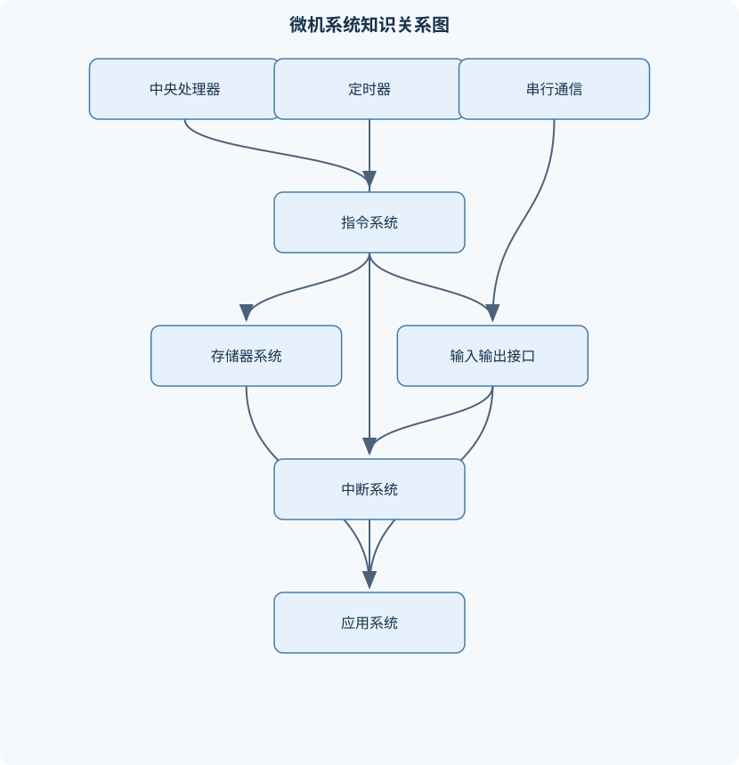
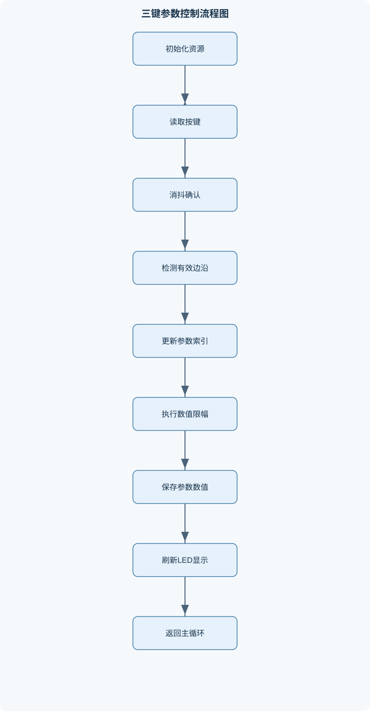

# 微机原理

## 一、课程整体知识框架

### 课程边界与先修知识

《微机原理》研究微处理器或单片机组成、指令系统、汇编语言程序设计、存储器组织、输入输出接口、中断、定时计数、串行通信及典型人机交互系统的工作原理与实现方法。课程重点以经典8位单片机体系结构和通用微机原理为主，使用8051类单片机作为具体示例，同时说明这些概念向其他处理器架构迁移时的差异。先修知识包括二进制与十六进制数制、布尔代数和逻辑门、电路基本概念、数据结构中的数组与状态变量、程序流程控制，以及少量电工电子基础。不把某一型号芯片的寄存器地址、时序参数和电气特性直接推广到所有微处理器；涉及具体芯片时必须以相应数据手册的引脚定义、复位条件、电平有效方式和时序约束为准。





### 1. 课程对象、研究范围与先修基础

《微机原理》研究数字计算系统如何表示数据、执行程序、访问存储器、控制输入输出设备，并在有限硬件资源下完成定时、通信和人机交互任务。课程中的“微机”不是单指某一种芯片，而是由处理器、存储器、输入输出接口以及连接它们的总线和控制逻辑组成的可编程数字系统。微处理器通常强调中央处理器本身；单片机则通常把CPU、存储器、并行端口、定时器、串行接口等集成在一块芯片内，但不同型号的集成资源、引脚功能、复位方式和电气特性可能不同。

学习本课程需要能够进行二进制、十六进制和十进制之间的转换，理解布尔代数、逻辑门和触发器的基本行为，区分电平、脉冲、频率和周期，能够阅读简单的程序流程并使用数组、索引和状态变量描述数据。电路基础主要用于理解端口电平、上拉下拉、LED限流、按键输入和串行信号；数据结构基础主要用于理解连续内存、参数表、查表和状态机。上述基础并不意味着可以把软件中的“0”和“1”直接等同于固定电压，实际电压范围、驱动能力和输入阈值必须由具体器件的电气参数确定。

### 2. 从系统组成到程序执行

一个微型计算机系统可以抽象为CPU、存储器、输入输出接口和总线四个部分。CPU由控制器和运算器组成：控制器根据指令产生取指、译码、执行以及读写控制信号；运算器完成加法、减法、逻辑运算、移位和比较，并更新相应状态标志。存储器保存程序和数据，I/O接口则把CPU能够访问的数字信息转换为外部设备可使用的信号。

程序计数器$PC$保存下一条待取指令的地址。普通顺序执行时，取指后$PC$通常增加当前指令长度；执行跳转、调用、返回或响应中断时，$PC$被改写为新的目标地址。累加器$A$用于算术、逻辑、移位和数据暂存，具体位宽取决于处理器，8051类单片机中通常为8位。程序状态字$PSW$保存进位$C$、辅助进位、溢出$V$、奇偶校验以及寄存器组选择等状态。堆栈指针$SP$用于定位堆栈区域，但不同架构对“当前栈顶”的定义不同，不能仅凭名称推断其加减方向。

总线通常分为地址总线、数据总线和控制总线。地址总线决定可选地址数量；若有$N$条独立地址线，理论上可选择$2^N$个地址。数据总线决定一次传输的位数，但数据总线宽度不等于存储器容量。例如，16位地址总线、8位数据总线最多直接选择$2^{16}=65536$个8位存储单元，即64 KiB地址空间；实际可用容量还受到地址译码、片选信号和存储器类型限制。

冯·诺依曼结构把程序和数据放入统一存储空间，指令和数据通常共享地址和数据通路，硬件组织较灵活，但可能产生取指与数据访问竞争。哈佛结构使用相互独立的程序存储器和数据存储器，能够在结构上区分代码和数据，有利于并行访问，但程序空间和数据空间的访问指令可能不同。许多单片机采用改进型哈佛结构：程序存储器和数据存储器在物理上分离，同时提供特定指令或接口实现程序常量查表。

### 3. 数据表示、编码与标志判断

$N$位无符号数的每一位权值为$2^i$，因此表示范围为

$$
0\le x\le \sum_{i=0}^{N-1}2^i=2^N-1。
$$

例如8位无符号数范围为0到255。若加法结果超过255，机器仍只保留低8位，高位产生的进位由$C$记录。这里的截断是固定字长运算的结果，不能把机器结果当作无限精度整数。

$N$位补码有符号数的最高位权值为$-2^{N-1}$，其余位权值为正，因此范围为

$$
-2^{N-1}\le x\le 2^{N-1}-1。
$$

8位补码范围为$-128$到127。补码减法可转化为固定$N$位加法：

$$
x-y=x+(\sim y+1),
$$

其中$\sim y$表示按位取反，计算时丢弃第$N$位以外的进位。例如8位计算$37-59$：$37=00100101$，$59=00111011$；对59取反加1得到$11000101$；相加得$11101010$，其补码值为$-22$。

无符号加法主要根据最高位产生的进位判断是否超出范围；有符号加法主要根据$V$判断是否溢出。两个同号操作数相加，若结果符号与操作数不同，则发生有符号溢出，也可写为

$$
V=C_{N-1}\oplus C_N，
$$

其中$C_{N-1}$是进入最高位的进位，$C_N$是最高位产生的进位。$C$和$V$可能只出现一个，也可能同时出现，二者不能混用。BCD码以十进制数字为单位编码，ASCII码用于字符编码；数值$09H$和字符“9”的编码并不自动等价。

逻辑运算逐位处理，常见操作包括与、或、异或和按位取反。位操作常用于置位、清零、测试和翻转控制标志。循环移位若经过$C$参与，移入的位可能来自旧的$C$，因此执行前必须明确$C$的初始值。位、字节和字长也不能混淆：8位通常组成1字节，但某处理器的自然字长可以是16位、32位或其他宽度。

### 4. 8051类单片机的资源组织

8051类单片机通常包括8位CPU、累加器$A$、程序状态字$PSW$、通用寄存器组、片内RAM、特殊功能寄存器、程序存储器、数据存储器、并行I/O端口、定时器、串行接口、时钟和复位电路。具体型号可能扩展中断源、定时器、端口或存储器，因此教材中的结构用于理解原理，不能替代具体型号的数据手册。

内部RAM通常划分为工作寄存器区、位寻址区和通用数据区。寄存器组由$R_i$表示，$R_i$的实际集合取决于当前寄存器组选择。特殊功能寄存器用于控制CPU和外设，其地址、复位值和可读写属性必须按具体器件定义。堆栈一般位于内部RAM中，调用、返回和中断响应都会使用堆栈；若程序变量、堆栈和寄存器临时区发生重叠，可能导致返回地址或现场被破坏。

8051类结构通常区分程序存储器和数据存储器。程序常量不能依据数据RAM的访问方式直接读取，查表时应使用适合程序存储器的指令或机制。端口位可记作$P_n.m$，例如$P1.0$表示端口1的第0位，但端口编号、复用功能、上拉结构和输入输出模式须由具体芯片定义。

复位用于把CPU和外设置于确定状态，时钟系统决定指令执行和定时器计数的时间基准。若振荡器频率为$f_{osc}$，一个机器周期包含$k$个时钟周期，则

$$
T_{mc}=kT_{clk}=\frac{k}{f_{osc}}。
$$

$k$不是所有处理器都相同，不能把某一经典型号的机器周期规则推广到其他架构。

### 5. 指令系统与汇编程序设计

指令系统包括数据传送、算术运算、逻辑运算、移位、位操作、转移、调用和返回。寻址方式决定操作数如何获得：立即数寻址直接把常量写入指令；直接寻址使用指令中的地址访问存储单元或特殊功能寄存器；寄存器寻址从$R_i$或其他寄存器取得操作数；间接寻址把寄存器内容解释为地址，访问$M[a]$；相对寻址通常用于条件分支；变址寻址适合查表或访问连续数据。

汇编源程序通常包括符号定义、程序段、指令、伪指令、常量表和结束标记。伪指令由汇编工具处理，不一定转换为CPU执行指令，例如定义数据、分配空间和声明符号。程序设计应先区分数据对象的语义：参数值、当前选择索引、显示编码、临时变量和状态标志不应共用同一存储单元。

顺序程序按固定顺序执行；分支程序根据标志或输入状态选择不同路径；循环程序依靠计数器、条件判断和跳转重复执行。子程序通过调用和返回复用代码，参数可以通过寄存器、固定内存区或堆栈传递。多字节加法必须从低字节开始，并用带进位加法处理高字节。例如$1234H+00F0H$：低字节$34H+F0H=124H$，保存$24H$并产生进位1；高字节$12H+00H+1=13H$，结果为$1324H$。

### 6. 存储器系统、地址译码与时序

存储器容量由地址数量和每个地址的数据宽度共同决定。若有$N$条地址线、每个地址存储$w$位，则容量为$2^N\times w$位。地址译码把CPU地址转换为存储器或外设片选信号。全译码使用全部相关地址线，地址唯一、地址镜像少；部分译码只使用部分地址线，电路简单，但可能使多个地址映射到同一个物理单元。

统一编址把I/O寄存器放入统一地址空间，普通存储器访问指令可能也能访问外设；独立编址为I/O设置单独地址空间和专用指令。两者在指令系统、地址译码和软件访问方式上不同，不能仅凭某个地址数值判断其属于RAM还是I/O。

存储器时序包括地址建立、片选有效、读写控制、数据稳定和保持等阶段。CPU必须在数据有效窗口内采样，否则会读到错误数据。堆栈读写还涉及$SP$的更新顺序，不能把所有处理器的“入栈先减还是先写”视为相同。存储保护的基本思想是限制代码、数据和外设寄存器的非法访问，避免越界索引破坏变量、堆栈或控制寄存器。

### 7. 接口、中断、定时与通信

并行I/O端口可以输入外部电平，也可以锁存并输出数字模式。端口锁存值不一定等于引脚实际电平，外部负载、上拉结构、端口模式和驱动能力都会影响结果。“低电平有效”表示逻辑0有效，“高电平有效”表示逻辑1有效。若LED采用低电平点亮，数值为$k$的条形显示可构造为低$k$位有效的掩码，再按灯的排列方向重排位序。

中断由外设提出请求，CPU在满足中断允许、优先级和当前执行条件时暂停主程序，保存必要现场，转到中断向量对应的服务程序，处理事件后恢复现场并返回。中断服务程序必须保护会被修改的寄存器和状态字；还应清除或等待中断请求条件，否则返回主程序后可能立即重复进入。中断延迟包括当前指令完成时间、硬件响应时间、现场保护时间和服务程序入口开销。

定时器根据内部时钟计数，计数器根据外部脉冲计数。若计数频率为$f_c$，目标时间为$T$，所需计数次数为

$$
n=T f_c。
$$

对于$N$位向上计数器，若每次溢出后重新装入初值，则

$$
Initial=2^N-n。
$$

该公式要求$0<n\le 2^N$，并假定计数频率稳定、计数模式确实为向上计数、重装和中断处理时间已纳入误差分析。软件延时会占用CPU，且容易受到指令周期、编译结果和中断影响，不能替代所有实时定时任务。

串行通信按位传输数据。异步帧通常包括起始位、数据位、可选校验位和停止位。若一帧有$b$个比特，波特率为$f_{baud}$，理想传输时间为

$$
t=\frac{b}{f_{baud}}。
$$

例如1个起始位、8个数据位、1个校验位和1个停止位在$9600\ \text{bit/s}$下需要$11/9600\approx1.146\ \text{ms}$。有效数据吞吐率不是波特率本身，还要扣除帧控制位。双方必须约定波特率、数据位数、校验方式、停止位数和信号电平。

### 8. 人机交互与综合系统

按键输入必须考虑机械抖动、有效电平和长按行为。设低电平按下，保存上次采样$old$和本次采样$new$，当$old=1$且$new=0$时可检测下降沿；但未经消抖时，一个物理按键动作可能产生多个下降沿。较可靠的流程是周期采样，只有连续若干次采样相同才更新稳定状态$D$，并仅在$D$由释放变为按下时产生一次事件。

独立按键逐个占用输入端；矩阵键盘通过行列扫描减少引脚数量，但必须避免多键同时按下造成的歧义。LED条形显示要求明确数值级数、灯排列方向和有效电平；数码管可采用静态显示或动态扫描，动态扫描需要周期性切换位选并保持足够刷新率，同时控制占空比和驱动电流。液晶显示接口的核心是按照控制器规定的命令、数据和时序发送信息，不能把“写入端口”简单等同于“屏幕已经显示”。

综合设计通常经历需求分析、资源分配、硬件接口设计、寄存器和内存映射、软件流程设计、仿真、实物测试和故障定位。系统应把参数值、当前参数索引、按键稳定状态、显示编码和外设寄存器分开管理。对范围为$0$到$M$的参数，增减操作可分别写成

$$
x\leftarrow\min(x+1,M),\qquad x\leftarrow\max(x-1,0)。
$$

这种限幅与计数器自然回绕不同：参数越界通常应保持边界，周期计数器则可能允许回到0。

## 二、章节和模块划分

### 核心知识覆盖清单

本清单用于检查正文是否覆盖本课程的主要知识模块：

- **微型计算机系统概论**：微型计算机基本组成、CPU、存储器与I/O、指令执行过程、总线及其分类、程序计数器作用、控制器与运算器、单片机与通用微机、冯·诺依曼结构、哈佛结构与改进型结构。
- **数制、编码与数据表示**：二进制、十六进制转换、无符号整数表示、原码反码补码、补码加减法、带符号数范围、BCD码与ASCII码、位、字节与字长、溢出与进位判断、逻辑运算与位操作。
- **8051类单片机结构**：中央处理器结构、累加器与程序状态字、通用寄存器组、内部RAM分区、特殊功能寄存器、程序存储器与数据存储器、堆栈指针与堆栈区、片内并行I/O端口、复位与时钟系统。
- **指令系统与寻址方式**：数据传送指令、算术运算指令、逻辑运算指令、移位与循环移位、位操作指令、条件转移与无条件转移、子程序调用与返回、立即数寻址、直接、寄存器和间接寻址、变址寻址与相对寻址。
- **汇编语言程序设计**：汇编源程序结构、伪指令与符号定义、顺序程序设计、分支程序设计、循环程序设计、子程序与参数传递、查表程序、多字节算术运算、代码与数据存储规划、程序调试与状态跟踪。
- **存储器系统与地址译码**：存储器容量计算、地址线与数据线、RAM与ROM特性、片内与片外存储器、统一编址与独立编址、存储器地址译码、部分译码与全译码、堆栈读写机制、存储器时序、存储保护的基本思想。
- **并行输入输出接口**：I/O端口工作模式、输入端口采样、输出端口锁存、高电平与低电平有效、LED驱动与限流、按键接口电路、输入上拉与下拉、端口复用功能、外设状态读取、接口电气边界与驱动能力。
- **中断系统与实时响应**：中断源与中断请求、中断允许控制、中断优先级、中断向量、中断服务程序、现场保护与恢复、中断响应过程、查询方式与中断方式、中断嵌套条件、中断延迟分析。
- **定时器与计数器**：定时与计数的区别、定时器工作模式、计数初值计算、溢出标志、定时中断、外部脉冲计数、周期与频率测量、软件延时局限、定时误差来源、多任务时间基准。
- **串行通信与串行接口**：串行通信基本概念、同步与异步通信、波特率与帧格式、起始位停止位、数据位与校验位、串行发送过程、串行接收过程、半双工与全双工、通信错误检测、串口中断应用。
- **人机交互与显示接口**：独立按键扫描、矩阵键盘扫描、按键消抖、状态机设计、LED条形显示、数码管静态显示、数码管动态扫描、液晶显示接口思想、参数设置系统、输入输出一致性测试。
- **系统综合设计与调试**：需求分析与资源分配、硬件接口设计、软件流程设计、寄存器和内存映射、仿真验证方法、边界条件测试、断点与单步调试、逻辑分析与时序观察、故障定位流程、软硬件协同优化。


### 1. 第一模块：微型计算机系统概论

本章先建立CPU、存储器、I/O和总线的系统视图，再解释取指、译码、执行、写回和中断响应。重点不是记忆部件名称，而是能根据一次指令访问说明$PC$如何变化、地址如何产生、数据从哪里来以及状态标志何时更新。章节还比较通用微机、单片机、冯·诺依曼结构、哈佛结构和改进型结构的差异。

### 2. 第二模块：数制、编码与数据表示

本章处理二进制和十六进制转换、位宽、无符号数、补码、BCD、ASCII、逻辑运算和位操作。典型计算包括范围推导、补码加减、多字节加法以及$C$与$V$的判断。边界反例包括8位补码的$128$不能表示为正数、$FFH$既可表示无符号255，也可表示补码$-1$，其含义取决于程序语义。

### 3. 第三模块：8051类单片机结构

本章按照CPU、存储器、特殊功能寄存器、堆栈、端口、复位和时钟组织内容。需要用内存映射解释参数如何保存，例如首记录地址为$30H$、每条记录占2字节时，第2条记录首地址为$30H+2\times2=34H$；若第1字节才是参数值，则数值地址为$35H$。这说明记录首地址、数值地址和显示端口数据是三个不同概念。

### 4. 第四模块：指令系统与寻址方式

本章按数据传送、算术、逻辑、移位、位操作、转移、调用和返回组织。每条指令都应同时说明操作数来源、结果去向、受影响标志和适用寻址方式。相对寻址适合短距离分支，变址寻址适合查表，间接寻址适合访问运行时确定的地址，但必须检查索引边界。

### 5. 第五模块：汇编语言程序设计

本章从源程序结构开始，逐步分析顺序、分支、循环、子程序、查表和多字节运算。查表流程应先验证索引小于表长，再计算地址并读取表项。调试时不能只观察最终LED或数码管，还要跟踪$A$、$PSW$、$PC$、$SP$、内存变量和端口时序。

### 6. 第六模块：存储器系统与地址译码

本章计算容量，区分地址线与数据线，比较RAM、ROM、片内与片外存储器，说明统一编址和独立编址。通过全译码和部分译码案例理解地址镜像，并结合读写时序说明为什么地址、片选和读写控制不能任意改变。还应说明堆栈、程序区、数据区和I/O区重叠时可能产生的故障。

### 7. 第七模块：并行输入输出接口

本章解释输入采样、输出锁存、端口复用、有效电平、上拉下拉、LED限流和外设状态读取。LED实际亮灭由接法决定：若端口输出低电平点亮，8个LED全部熄灭时输出可能是$FFH$，全部点亮时可能是$00H$。不能把端口寄存器写入值直接当作引脚测得电压。

### 8. 第八模块：中断系统与实时响应

本章依次讲解中断源、请求、允许控制、优先级、中断向量、现场保护、服务程序和返回。中断服务程序的基本不变量是：主程序中需要保留的寄存器和状态在返回前恢复；中断源必须被确认和清除；服务时间必须小于事件允许的最大响应间隔。查询方式结构简单但可能增加轮询延迟，中断方式适合事件不规则或实时性要求较高的场景。

### 9. 第九模块：定时器与计数器

本章比较内部定时和外部计数，推导初值计算，分析溢出标志、定时中断、周期测量和频率测量。定时误差来自振荡器误差、整数取整、预装时间、中断响应、软件重装和任务阻塞。多任务系统通常用固定周期定时中断产生时间基准，再由软件计数器派生按键扫描、显示刷新和通信超时。

### 10. 第十模块：串行通信与串行接口

本章讲同步和异步通信、波特率、帧格式、发送和接收状态机、半双工与全双工、校验和串口中断。接收状态机可分为等待起始位、接收数据位、接收校验位、检查停止位和提交数据五个状态。若起始位或停止位错误，应丢弃当前帧并重新等待，不能把错误帧继续写入正常数据缓冲区。

### 11. 第十一模块：人机交互与显示接口

本章把按键、状态机和显示结合起来。多参数设置系统可用索引$i$表示当前参数，选择事件执行$i\leftarrow i+1$，若$i\ge K$则置0，并保持$0\le i<K$。增加和减少事件只修改当前参数，选择事件不改变参数值。显示层根据参数值生成LED、数码管或液晶数据，避免把存储值直接当作显示编码。

### 12. 第十二模块：系统综合设计与调试

本章以完整系统为对象，覆盖需求分析、资源分配、硬件连接、寄存器配置、软件流程、仿真、边界测试、断点单步、逻辑分析和故障定位。排错顺序应从电源与地、引脚连接、端口配置、有效电平、软件采样、时序和驱动能力逐项验证，而不是首先随意修改延时循环。验收标准应包括正常输入、边界输入、连续按键、长时间运行、通信错误和复位恢复。

### 13. 代表性算法与流程

#### 13.1 按键消抖与下降沿检测

输入为原始电平、采样周期和连续确认次数；输出为稳定按下、稳定释放或无事件。每次采样比较当前值与候选值，只有连续若干次相同才更新稳定状态。稳定状态由1变为0时产生一次按下事件。其时间和空间开销均为$O(1)$，适合放在主循环或定时中断中。

```c
// 低电平按下；sample_key()返回0或1
typedef struct {
    unsigned char stable;
    unsigned char candidate;
    unsigned char same_count;
} KeyState;

unsigned char key_update(KeyState *s,
                         unsigned char raw,
                         unsigned char confirm_count)
{
    unsigned char event = 0;

    if (raw == s->candidate) {
        if (s->same_count < confirm_count) {
            s->same_count++;
        }
    } else {
        s->candidate = raw;
        s->same_count = 1;
    }

    if (s->same_count >= confirm_count &&
        s->stable != s->candidate) {
        unsigned char old = s->stable;
        s->stable = s->candidate;
        if (old == 1 && s->stable == 0) {
            event = 1;
        }
    }
    return event;
}
```

该代码只处理逻辑状态，不假定具体端口地址、输入电压或中断方式。实际使用时还需保证采样周期和确认次数的乘积足以覆盖触点抖动，同时不能大到使用户感到明显响应延迟。

#### 13.2 参数循环选择与限幅增减

输入为参数数组、参数数量$K$、当前索引$i$和按键事件。选择键只执行索引循环；增减键只修改$parameter[i]$。不变量是$0\le i<K$且每个参数保持在自己的上下界内。该流程适合四个或多个参数的设置界面。

#### 13.3 定时器初值计算

输入为$f_{osc}$、分频系数$p$、目标时间$T$和定时器位宽$N$。先求计数频率$f_c=f_{osc}/p$，再求$n=T f_c$，将$n$取为可实现的整数，最后计算$Initial=2^N-n$。若$n>2^N$，单次溢出无法实现目标时间，应采用分频、预分频或软件累计。

#### 13.4 串口接收状态机

输入为采样位流，输出为完整数据帧或帧错误。状态依次检查起始位、数据位、校验位和停止位；任一格式错误即丢弃当前帧并回到等待起始位。若每帧共有$b$位，处理一帧的时间复杂度按位处理为$O(b)$，但实际串口硬件通常会把采样和移位部分交给外设完成。

### 14. 代表性例题

#### 例题一：补码减法与溢出判断

**题干：** 用8位补码计算$37-59$，判断$C$和$V$的意义。

**分析：** 减法转化为加法，所有结果限制在8位。

**解答：**

1. $37=00100101$，$59=00111011$。
2. $59$取反为$11000100$，加1得$11000101$。
3. $00100101+11000101=11101010$。
4. $11101010$为负数，取反加1得$00010110$，所以结果为$-22$。
5. 两个操作数分别为正数，结果仍在$-128$到127范围内，因此$V=0$。本次加法的最高位进位也不代表有符号溢出。

**结果验证：** 十进制直接计算$37-59=-22$，与补码结果一致。

**变式：** 计算$100+60$。数学结果为160，超出8位补码上限127，因此结果位模式虽可生成，但$V=1$；若按无符号解释，则应结合$C$判断。

#### 例题二：多字节加法

**题干：** 计算$1234H+00F0H$。

**分析：** 低字节产生的进位必须传给高字节。

**解答：**

1. 低字节：$34H+F0H=124H$，保存$24H$，$C=1$。
2. 高字节：$12H+00H+C=13H$。
3. 拼接高低字节得$1324H$。

**结果验证：** $0x1234=4660$，$0x00F0=240$，总和为4900，即$1324H$。

**变式：** 若低字节无进位，高字节仍应使用带进位加法，但输入进位为0；若直接使用普通加法，可能丢失跨字节进位。

#### 例题三：内存记录地址

**题干：** 四条参数记录从$30H$开始，每条记录占2字节，第$i$条记录的第1字节保存参数值。求第2条参数值的地址。

**分析：** 先求记录首地址，再加字段偏移。

**解答：**

1. 第2条记录首地址为$30H+2\times2=34H$。
2. 参数值位于记录第1字节，因此地址为$34H+1=35H$。
3. $30H$、$34H$和$35H$分别表示首记录地址、第2条记录首地址和第2条参数值地址，不能混为一谈。

**结果验证：** 第0条占$30H$至$31H$，第1条占$32H$至$33H$，第2条占$34H$至$35H$，地址连续。

**变式：** 若每条记录占4字节、参数值在第0字节，则第3条参数地址为$30H+3\times4=3CH$。

#### 例题四：低电平有效LED显示

**题干：** 8个LED按低位到高位排列，低电平点亮。要求显示有效灯数量$k=0,1,4,8$时的端口模式。

**分析：** 低电平有效意味着有效位为0，先构造低$k$位有效的掩码，再取反。

**解答：**

- $k=0$：无有效灯，输出$FFH$。
- $k=1$：最低位为0，输出$FEH$。
- $k=4$：低4位为0，输出$F0H$。
- $k=8$：全部位为0，输出$00H$。

**结果验证：** 每种模式中0的数量等于应点亮的灯数。

**变式：** 若LED从高位到低位排列，必须重新排列位序；若改为高电平点亮，上述输出模式需要按位取反。

#### 例题五：定时器初值

**题干：** 定时器计数频率为$1\text{ MHz}$，使用16位向上计数模式产生$10\text{ ms}$溢出，求初值。

**分析：** 每次计数间隔为$1\ \mu\text{s}$，目标时间需要整数计数。

**解答：**

1. $n=10\times10^{-3}\times10^6=10000$。
2. 16位计数器最大计数空间为$2^{16}=65536$。
3. 初值为$65536-10000=55536$。
4. $55536=D8F0H$，因此应装入$D8F0H$。

**结果验证：** 从$D8F0H$计数到$FFFFH$再溢出，共计10000次。

**变式：** 若计数频率改变，不能继续使用$D8F0H$；若中断服务中存在重装延迟，应把延迟纳入实际周期测量。

### 15. 实验与项目流程

#### 15.1 按键—参数—LED综合实验

**输入数据：** 四个参数初值均为0，当前参数为第1个；事件序列为“增加、增加、选择、减少、选择”。

**实验步骤：**

1. 分配四个参数的RAM地址，另设当前索引、按键稳定状态和显示暂存变量。
2. 周期采样三个按键，使用连续采样确认消抖。
3. 增加键对当前参数执行限幅加1，减少键执行限幅减1。
4. 选择键使索引在0到3之间循环。
5. 依据当前索引点亮独占指示灯，并把当前参数编码到LED或数码管。
6. 通过单步或内存观察确认参数值、索引和端口模式分别变化。

**预期跟踪：**

- 第一次增加后，第1个参数为1。
- 第二次增加后，第1个参数为2。
- 选择后当前参数变为第2个，四个参数仍为$2,0,0,0$。
- 减少后第2个参数保持0，因为不能低于下界。
- 再次选择后当前参数变为第3个，原参数值仍被保留。

**评价标准：** 一次物理按键只产生一次事件；参数不越界；选择键不修改参数值；复位后初值确定；显示与当前索引一致。

**排错方法：** 若按键重复触发，检查消抖和边沿检测；若参数错位，检查记录首地址与字段偏移；若LED反向，检查有效电平；若显示值正确但指示灯错误，分离检查参数存储、索引和显示编码。

#### 15.2 定时串口与显示协同项目

**输入数据：** 设定串口帧格式为1个起始位、8个数据位、1个校验位和1个停止位，波特率为$9600\text{ bit/s}$；定时器周期用于按键扫描和显示刷新。

**实验步骤：**

1. 配置串口波特率、数据位、校验方式和停止位。
2. 发送固定测试帧，使用逻辑分析仪或串口监视工具检查帧边界。
3. 用定时器产生固定周期中断，在中断中设置扫描标志，不直接执行过长显示逻辑。
4. 主循环检测扫描标志，完成按键采样、参数更新和显示刷新。
5. 故意改变波特率或校验位，观察接收端的帧错误表现。
6. 记录发送时间、按键响应时间和显示刷新是否稳定。

**输入与评价：** 正常帧应正确接收；校验错误帧应被拒绝；停止位错误不能写入有效数据；在持续串口接收时按键仍应能响应；定时周期误差应通过实测波形与理论值比较。

**排错方法：** 若完全无数据，依次检查电源地、TX/RX连接、端口复用、电平兼容和波特率；若数据错位，检查起始位和数据位配置；若偶发错误，检查时钟误差、采样时刻、现场保护和中断服务时间；若显示闪烁，检查动态扫描周期和中断阻塞。

## 三、核心概念的详细解释

### 1. 微型计算机系统与指令执行

微型计算机系统由中央处理器（CPU）、存储器、输入输出接口和连接它们的总线构成。CPU中的控制器负责取出指令、译码并组织读写和运算；运算器执行算术、逻辑、移位等操作。处理器依照指令系统规定的操作码和操作数格式工作，汇编语言则用助记符表达这些机器指令。微处理器通常指CPU芯片，单片机通常还在同一芯片内集成存储器、定时器和I/O等资源；两者的集成边界随具体器件而异。

一次典型指令执行包含取指、译码、取操作数、执行和写回等阶段。$PC$保存下一条待取指令的程序存储器地址。顺序执行时，处理器按指令长度推进$PC$；转移、调用、返回或中断则将其改为目标地址。指令执行的实际时序取决于处理器实现，不能仅由“机器周期”一词推定。地址总线选择访问位置，数据总线传送内容，控制总线传送读、写、中断等控制信号。若地址总线有$N$条线，且地址按字节编址，则理论地址空间为$2^N$字节；实际可用空间还取决于译码和器件连接。

冯·诺依曼结构通常让程序和数据共享存储空间及通路；哈佛结构分别设置程序与数据存储空间及通路；改进型结构则结合两者特点。因而，“程序地址”和“数据地址”是否属于同一空间，以及如何读取程序常量，须依具体指令集和存储器组织判断，不能凭地址数值相同便认为访问的是同一单元。

### 2. 数制、编码与运算状态

二进制位权从最低位的$2^0$开始，十六进制的一位对应四个二进制位，便于书写和观察字节。无符号$N$位数的范围是$0$至$2^N-1$。补码有符号数的范围是$-2^{N-1}$至$2^{N-1}-1$，最高位的权值为$-2^{N-1}$。固定字长运算只保留规定宽度的结果，超出的位不会自动成为结果的一部分。

补码减法可在固定$N$位下写成$x-y=x+(\sim y+1)$，其中$\sim y$为逐位取反，最高位之外的进位丢弃。例如8位计算$37-59$：$37=00100101_2$，$59=00111011_2$，$-59$的补码为$11000101_2$，相加得到$11101010_2$，其补码数值为$-22$。结果落在8位补码范围内，故无有符号溢出。

进位$C$与有符号溢出$V$描述不同情况。无符号加法关注最高位产生的进位；有符号加法若两个操作数符号相同而结果符号相反，则发生溢出。若$C_{N-1}$表示进入最高位的进位、$C_N$表示最高位产生的进位，则$V=C_{N-1}\oplus C_N$。例如8位无符号数$255+1$结果为0且有进位；把同样位模式解释为有符号数时，$127+1$得到$-128$的位模式并发生溢出。BCD以十进制数字编码，ASCII用于表示字符；二者用途不同，不能把字符编码直接当作数值运算编码。

### 3. 8051类单片机的资源组织

8051类单片机通常以8位$A$执行多种算术和逻辑操作。$PSW$保存进位、辅助进位、溢出、奇偶校验和寄存器组选择等状态。寄存器组中的$R_i$可用于临时数据和循环变量，但可用组别受当前选择状态影响。内部RAM、特殊功能寄存器（SFR）和程序存储器是不同的资源类别；具体地址、可访问方式和复位值须按芯片资料确定。

堆栈保存调用返回地址和需要暂存的现场。$SP$的初始值、压栈时的递增或递减方向，以及返回地址字节顺序，都取决于处理器定义。若堆栈与普通变量区重叠，调用或中断可能覆盖数据；因此系统设计需为局部数据、调用深度和中断嵌套预留空间。复位会令处理器进入规定初始状态，但端口电平、时钟起振条件和复位有效电平等不能从“8051类”这一名称推断，必须针对具体型号确认。

### 4. 指令寻址与汇编程序组织

立即数寻址把常数写在指令中；寄存器寻址以寄存器为操作数；直接寻址给出存储器地址；间接寻址由寄存器保存有效地址；相对寻址以当前指令附近的位置加偏移形成转移目标；变址寻址常用于按索引访问表。寻址方式决定操作数在哪里、访问何种存储空间以及合法范围。特别是8051类器件，程序存储器和数据存储器的访问指令可能不同，不能把一种空间中的地址直接套用于另一种空间。

汇编源程序通常包含指令、标签、常量或地址定义及汇编器伪指令。伪指令用于组织代码、定义符号或分配存储，不一定对应CPU执行指令。顺序结构按地址执行；分支依据标志或比较结果选择路径；循环通过条件转移重复执行；子程序以调用和返回实现复用。子程序参数可通过寄存器、内存或堆栈传递，但需约定哪些寄存器由调用者保存、哪些由被调用者保存。查表时必须限制索引，避免访问表外内容。多字节加法从低字节开始，后续字节使用带进位加法；若只用普通加法，低字节产生的进位会丢失。

### 5. 存储器、地址译码与堆栈

容量为$C$字节的按字节编址存储器需要至少$\lceil\log_2 C\rceil$条地址线才能独立选择每个字节；数据线宽度表示一次传输的数据位数，不直接决定容量。RAM通常支持读写但断电后数据可能丢失，ROM类存储器用于保存非易失内容，具体可编程方式因类型而异。片内与片外存储器可能采用不同总线和控制信号。

地址译码根据地址高位或全部地址位产生片选信号。全译码使每个存储单元映射到明确地址；部分译码硬件较少，但可能出现多个地址映射到同一器件的地址镜像。读写时序还要满足地址建立、数据有效和控制信号宽度等约束。统一编址把存储器与I/O放在同一地址空间；独立编址则使用专门的I/O访问机制。存储保护的基本目标是避免非法访问破坏其他区域，低端单片机可由软件约定分区，高级处理器也可能由硬件提供权限检查。

### 6. 并行I/O、电气接口与人机交互

端口锁存值是软件写入的逻辑状态，不必等于引脚实际电平。输入阈值、上拉结构、端口模式、外部负载和驱动能力都会影响引脚。高电平有效表示逻辑1有效，低电平有效表示逻辑0有效。LED接法决定端口输出何种电平时点亮，并应有适当限流；不能只凭端口名称判断亮灭。按键输入通常需要上拉或下拉形成确定的空闲电平，悬空输入可能受噪声影响。引脚还可能复用为定时器、串口或外部中断功能，启用复用功能后，普通I/O行为可能改变。

按键机械触点会抖动，单次按下可能造成多个边沿。可靠处理通常先周期采样，再要求连续若干次采样一致后才更新稳定状态$D$，并只在稳定状态从释放变为按下时产生一次事件。矩阵键盘通过行列扫描减少引脚数量，但需考虑多键同时按下时的冲突或鬼键。LED条形显示需定义位序与有效电平；数码管动态扫描则轮流使能各位，刷新周期过长会闪烁，驱动电流和扫描占空比也受硬件限制。显示状态应由参数值和索引编码得到，不应与参数本身混用。

### 7. 中断、定时计数与串行通信

查询方式由程序反复读取外设状态；中断方式由外设请求CPU处理，减少无效轮询，但会引入响应延迟和现场保存开销。中断响应包括识别请求、完成当前指令或规定的响应阶段、转入向量入口、执行服务程序并返回。中断服务程序应保存其会修改且主程序仍需使用的寄存器和状态，处理或清除请求条件后恢复现场。中断优先级决定竞争时的处理次序；能否嵌套还取决于允许位、优先级规则和软件设计。服务时间过长会延迟其他请求，甚至造成数据丢失。

定时器按内部时钟或分频后的时钟计数；计数器通常按外部事件计数。若计数频率为$f_c$、目标时间为$T$，理想计数次数为$n=T f_c$。对$N$位向上计数器，若初值为$R$，溢出前计数次数为$2^N-R$，因此$R=2^N-n$，前提是$0<n\le2^N$且计数模型确为向上溢出。取整、时钟误差、重装时间和中断响应都会引入误差。软件空循环延时受指令执行时间和编译结果影响，不宜作为精确时间基准。

串行通信逐位传送数据。同步通信依靠共享时钟或规定的同步机制；异步通信在帧中使用起始位、数据位、可选校验位和停止位。若每帧总计$b$位、波特率为$f_{baud}$，理想帧时间为$t=b/f_{baud}$。波特率表示每秒符号数；常见二进制串行线路中每个符号承载一位时，它与比特率数值相同，但有效数据吞吐率仍受帧开销影响。发送端和接收端必须匹配波特率、数据位、校验方式和停止位。校验可检测部分错误，但不能保证检出所有错误。半双工共享方向上的传输时段，全双工可同时双向传输，具体能力依接口硬件而定。

### 8. 系统综合设计与调试

综合设计先明确输入、输出、响应时间和边界条件，再分配端口、定时器、RAM、程序空间和中断资源。软件可采用主循环处理常规任务、中断处理时间敏感事件的结构，但共享变量需考虑读写时序及原子性。验证时分别检查逻辑状态与电气信号：断点和单步用于观察$PC$、$A$、$PSW$、内存和端口锁存值；逻辑分析仪用于观察实际边沿、脉宽和串口帧。故障排查可按电源与地、接线、端口配置、有效电平、软件状态和驱动能力逐层缩小范围。仿真器中的理想电平不能代替实物的噪声、负载和时序验证。

## 四、重要定义、公式、定理和推导

### 专业审校补充：关键定义与适用边界

在经典8051体系中，内部RAM与特殊功能寄存器虽然都可使用8位直接地址编码，但其地址空间含义不能混淆。内部RAM通常包括工作寄存器区、位寻址区和通用RAM区；特殊功能寄存器位于另一逻辑区域，具体地址及复位值必须以目标器件数据手册为准。直接寻址操作数表示“访问该地址对应的RAM单元或特殊功能寄存器”，而以寄存器间接寻址访问内部RAM时，地址值被解释为RAM地址，不能据此访问特殊功能寄存器。经典8051中，工作寄存器R0～R7由PSW中的RS1、RS0选择四组寄存器区；切换寄存器组会改变同一寄存器名对应的物理RAM位置。堆栈通常位于内部RAM中，执行PUSH、CALL或中断响应时，SP先增加再写入数据；执行POP或返回时先读出再减少。因此必须检查SP初值、工作寄存器区、局部变量区和中断现场保存区是否重叠。上述规则适用于经典8051的典型组织，其他8051兼容器件可能扩展内部RAM、改变复位值或增加专用堆栈，不能直接套用。


### 1. 位宽与数值范围

$N$位无符号数各位权值为$2^0,2^1,\ldots,2^{N-1}$。所有位为1时取最大值，因此
$$
x_{\max}=\sum_{i=0}^{N-1}2^i=2^N-1,\qquad 0\le x\le2^N-1。
$$
该范围假定所有位用于数值且采用无符号解释。8位范围为0至255；把$11111111_2$解释为无符号数是255，解释为补码则是$-1$。

补码最高位权值为负，其余位权值为正：
$$
x=-b_{N-1}2^{N-1}+\sum_{i=0}^{N-2}b_i2^i。
$$
最高位为1、其余位为0时得到最小值$-2^{N-1}$；最高位为0、其余位为1时得到最大值$2^{N-1}-1$。因此
$$
-2^{N-1}\le x\le2^{N-1}-1。
$$
8位补码范围为$-128$至127。该结论只适用于固定宽度二进制补码；不能把8位运算结果不加解释地视为无限精度整数。

### 2. 补码减法及进位、溢出判断

$N$位数$y$的按位反码加1等于其补码表示的相反数，因此
$$
x-y=x+(\sim y+1)。
$$
机器实际执行时只保留低$N$位，进位位可能用于标志判断，但不是结果的一部分。例：$1234H+00F0H$按字节相加，低字节$34H+F0H=124H$，保留$24H$并产生进位1；高字节$12H+00H+1=13H$，结果为$1324H$。若高字节误用不带进位的普通加法，结果会错误地成为$1224H$。

无符号加法以最高位产生的进位判断是否超过$2^N-1$。有符号加法判断是否超出补码范围：同号数相加而结果异号即溢出，也可用$V=C_{N-1}\oplus C_N$计算，其中两个$C$分别为进入最高位和离开最高位的进位。无符号进位不等于有符号溢出；例如8位$FFH+01H=00H$有进位，但将$FFH$解释为$-1$时，$-1+1=0$并未溢出。

### 3. 存储映射与堆栈空间

$M[a]$表示地址$a$处的数据，$a$是地址而$M[a]$是内容。若连续参数记录从基地址$base$开始，每条记录占$stride$字节，第$i$条记录首地址为
$$
a_i=base+i\times stride。
$$
其中地址和$stride$以字节计，索引$i$从0开始。若记录含保留字段和值字段，字段地址还需加字段偏移。例如首记录地址为$30H$、每条2字节、第3条记录（索引2）的首地址为$34H$；数值字段若在偏移1处，则地址为$35H$。记录地址、字段地址、端口显示数据是不同概念。

存储器容量为$C$字节且按字节编址时，所需地址位数至少为$\lceil\log_2 C\rceil$。该计算只表示可区分地址数，不保证对应地址空间都已接入有效存储器。堆栈可用空间还受$SP$初值、增长方向、返回地址长度、现场保存量和嵌套深度限制；栈与普通变量区重叠时，即使单条指令正确，也可能因调用或中断而破坏变量。

### 4. 定时计数与时间误差

若振荡器频率为$f_{osc}$，定时器每$p$个振荡器周期计数一次，则
$$
f_c=\frac{f_{osc}}{p},\qquad T_c=\frac{1}{f_c}。
$$
$f_c$单位为赫兹，$T_c$单位为秒，分频系数$p$须按具体定时器的时钟路径确定。目标定时时间$T$需要的理想计数次数为$n=T f_c$。若使用$N$位向上计数器，预装值为
$$
R=2^N-n,\qquad 0<n\le2^N。
$$
该式假定溢出发生在计满$2^N$个计数状态之后，且没有额外硬件重装行为。$n$须取可实现的整数；取整导致的量化误差小于一个计数周期。若计数频率为$1\text{ MHz}$、目标为$10\text{ ms}$，则$n=10000$；16位初值$65536-10000=55536=D8F0H$。实际周期仍会受到时钟偏差、重装延迟及服务程序执行时间影响。

### 5. 异步串行帧与参数边界

若一帧由1个起始位、$d$个数据位、$q$个校验位和$s$个停止位组成，则总位数为$b=1+d+q+s$，理想帧时间为
$$
t=\frac{b}{f_{baud}}。
$$
这里$f_{baud}$的单位为符号每秒；在每符号一位的常见二进制线路上可按位每秒理解。1起始位、8数据位、1校验位、1停止位共11位，在$9600\text{ bit/s}$下$t=11/9600\approx1.146\text{ ms}$。8位有效数据的理想吞吐率是每帧8位除以帧时间，不是直接把波特率当成有效数据速率。

对于范围$L$至$U$的参数，限幅增减可定义为
$$
x'_{\mathrm{inc}}=\min(x+1,U),\qquad
x'_{\mathrm{dec}}=\max(x-1,L)。
$$
其不变量是$L\le x\le U$。边界处继续按键仍保持边界值，不会回绕；这与允许自然回绕的硬件计数器语义不同。若参数设计要求循环选择，应另行定义模运算规则，不能把限幅和回绕混为一谈。

### 6. 代表性算法与流程

#### 6.1 按键采样、消抖与边沿事件

**输入：** 按键原始电平、周期采样时基、确认次数$K$。  
**输出：** 稳定状态$D$及按下或释放事件。  
**过程：** 每次采样时，若新样本与候选状态相同，则连续计数加一；若不同，则把候选状态改为新样本并将计数置为1。当连续计数达到$K$时才更新$D$。仅当$D$从释放变成按下时产生一次按下事件。低电平是否表示按下由接线和有效电平约定决定。  
**不变量与终止：** $D$只在连续确认达到$K$后改变；一次调用完成一个样本处理，之后由主循环或定时中断再次调用。  
**适用边界：** 采样间隔和$K$应能覆盖实际触点抖动时间；过大的确认时间会增加操作延迟，过小则可能漏滤抖动。每次处理时间和额外存储均为$O(1)$。

**伪代码：**
```text
初始化 stable_state、candidate_state、same_count

每次采样(raw):
    sample = 按硬件有效电平归一化(raw)

    if sample == candidate_state:
        same_count = min(same_count + 1, K)
    else:
        candidate_state = sample
        same_count = 1

    if same_count == K and stable_state != candidate_state:
        old_state = stable_state
        stable_state = candidate_state

        if old_state == RELEASED and stable_state == PRESSED:
            产生一次按下事件
```

#### 6.2 多参数选择和限幅修改

**输入：** 参数数组$P[0\ldots K-1]$、当前索引$i$、选择/增加/减少事件及参数上下界。  
**输出：** 更新后的索引、参数数组和显示状态。  
**过程：** 选择事件令$i\leftarrow(i+1)\bmod K$；增加或减少事件只修改$P[i]$，并分别使用上界截断或下界截断。显示数据从$P[i]$读取，选择指示由$i$单独生成。  
**不变量与终止：** $0\le i<K$且每个参数均在其合法范围内；一次输入事件处理完即结束。  
**适用边界：** 参数个数固定且选择允许循环时使用模运算；参数修改通常限幅保持，不应误用索引回绕规则。单次事件时间为$O(1)$，参数存储空间为$O(K)$。

#### 6.3 中断服务流程

**输入：** 已使能的中断请求、当前CPU现场和中断源状态。  
**输出：** 处理后的设备状态，并恢复主程序执行。  
**过程：** 确认中断来源；保存会被服务程序修改且主程序仍需保留的寄存器和状态字；完成必要的设备处理并清除请求条件；恢复现场；执行中断返回。  
**不变量与终止：** 返回前恢复受保护的现场；请求条件已处理或已按硬件要求清除后才返回。  
**适用边界：** 中断向量、优先级和允许位配置必须正确。服务时间应低于系统可容忍的响应时限；处理数据量较大时，可在中断中记录状态并将后续工作交给主循环。

#### 6.4 查表访问流程

**输入：** 索引$i$、表长$L$、表首地址及表所在的存储空间。  
**输出：** 表中第$i$项，或越界状态。  
**过程：** 先检查$0\le i<L$；再按表项宽度计算偏移，使用与该存储空间相匹配的访问指令读取。  
**不变量与终止：** 只有合法索引才形成访问地址；完成读取或报告越界后结束。  
**适用边界：** 固定映射且表长有限时适用；程序存储器和数据存储器可能需要不同访问机制。读取一次为$O(1)$，存储表需要$O(L)$空间。

### 7. 综合例题

#### 例题一：补码减法

**题干：** 用8位补码计算$37-59$。  
**分析：** 8位补码范围是$-128$至127；结果$-22$在范围内。  
**解答：** $37=00100101_2$，$59=00111011_2$。对59取反加1得$11000101_2$。相加：
$$
00100101+11000101=11101010。
$$
结果最高位为1，取反加1得到$00010110_2=22$，故结果为$-22$。  
**验证：** $37-59=-22$，且结果在范围内，无溢出。  
**变式：** 计算$100-(-40)$时，数学结果为140，超出8位补码上界127，因此机器结果会溢出，不能仅按位模式读作正确的140。

#### 例题二：参数记录地址

**题干：** 记录首地址为$30H$，每条记录2字节，当前索引为2；数值字段位于记录偏移1，求数值地址。  
**分析：** 索引从0开始，先求记录首地址，再加字段偏移。  
**解答：** $30H+2\times2=34H$，再加1字节，得到$35H$。  
**验证：** 索引0、1、2的记录首地址依次为$30H$、$32H$、$34H$，字段地址依次为$31H$、$33H$、$35H$。  
**变式：** 若每条记录改为3字节，索引2的首地址是$30H+2\times3=36H$，不能继续使用2字节步长。

#### 例题三：三键参数设置跟踪

**题干：** 四个参数初值均为0，当前索引为0；依次输入增加、增加、选择、减少、选择。  
**分析：** 选择事件只改索引；增加和减少只改当前参数，且下界为0。  
**解答：** 初始为索引0、$(0,0,0,0)$；两次增加后为索引0、$(2,0,0,0)$；选择后索引1；减少因参数值已为0而保持；再次选择后索引2。  
**验证：** 最终为索引2、$(2,0,0,0)$，其他参数未被改写。  
**变式：** 若选择索引从3再加1，应回到0；若参数减到下界，则保持0而不是回绕到最大值。

#### 例题四：低电平有效LED条形显示

**题干：** 8个LED按端口低位到高位排列，低电平点亮。求显示级数$k=0,1,4,8$的输出。  
**分析：** 前$k$位为0，其余位为1。  
**解答：** $k=0$为$FFH$；$k=1$为$FEH$；$k=4$为$F0H$；$k=8$为$00H$。  
**验证：** 分别统计输出中的低电平位数，结果为0、1、4、8。  
**变式：** 若LED排列方向相反，需重新映射位序；若改为高电平点亮，则有效位模式取反。

#### 例题五：定时器初值

**题干：** 16位向上计数器的计数频率为$1\text{ MHz}$，目标溢出时间为$10\text{ ms}$，求初值。  
**分析：** 每次计数间隔为$1\ \mu\text{s}$，目标计数为整数。  
**解答：** $n=10\times10^{-3}\times10^6=10000$；初值$R=65536-10000=55536=D8F0H$。  
**验证：** 从$D8F0H$到溢出需要10000次计数，理想时间为$10000\ \mu\text{s}$。  
**变式：** 若计数频率变为$2\text{ MHz}$，需要20000次计数，初值为$65536-20000=B1E0H$；还应测量重装和中断带来的周期偏差。

#### 例题六：串口帧时间

**题干：** 帧格式为1起始位、8数据位、1校验位、1停止位，波特率为$9600\text{ bit/s}$，求理想帧时间。  
**分析：** 每帧共11位。  
**解答：** $t=11/9600\text{ s}\approx1.146\text{ ms}$。有效数据为8位，因此不能把9600直接当作每秒有效数据位数。  
**验证：** 若每秒传输$9600/11$帧，则有效数据约为$8\times9600/11\approx6982$位每秒。  
**变式：** 去掉校验位后每帧10位，理想帧时间为$10/9600\text{ s}$，有效数据比例随帧格式变化。

### 8. 实验与项目流程

#### 8.1 按键、参数和LED综合验证

**输入数据：** 四个参数初值为0，索引为0；按键事件为增加、增加、选择、减少、选择。  
**步骤：** 分配参数存储区、索引变量、按键候选与稳定状态；周期采样按键并消抖；按事件更新参数或索引；由索引生成独占选择指示，由当前参数生成显示编码；单步观察内存和端口锁存值。  
**评价标准：** 一次稳定按下只产生一次事件；参数不越界；选择不改参数；显示和当前索引一致；复位后状态确定。  
**排错方法：** 参数错位时核对记录步长和字段偏移；重复触发时检查消抖及边沿判定；亮灭相反时检查有效电平；软件值正确但引脚异常时检查端口模式、负载和驱动能力。

#### 8.2 定时器与串口协同测试

**输入数据：** 设定异步帧为1起始位、8数据位、1校验位、1停止位，波特率为$9600\text{ bit/s}$；定时器周期用于按键扫描。  
**步骤：** 配置双方一致的串口格式；发送已知测试字节并观察帧波形；配置定时器周期采样；在中断中仅记录扫描时基或必要状态，主循环完成较长处理；改变校验设置进行错误注入并记录接收结果。  
**评价标准：** 正常帧数据正确；错误校验或停止位不应被当作有效帧；持续通信时按键仍及时响应；实测定时周期与理论值的偏差可解释。  
**排错方法：** 无数据时依次检查供电地、TX/RX方向、端口复用、电平兼容和波特率；数据错位时检查帧格式和采样时刻；偶发错误时检查时钟误差、中断阻塞和缓冲处理；显示不稳时检查刷新周期及中断服务时间。

### 9. 常见笔试问题及解答思路

1. **$PC$的作用是什么？**  
   答：保存下一条待取指令的程序地址；顺序执行时按指令长度推进，转移、调用、返回和中断会改写它。指令长度及具体更新时机由处理器定义。

2. **地址总线有12条线时可寻址多少个字节？**  
   答：若按字节编址且每种位组合对应一个地址，则$2^{12}=4096$字节，即4 KiB。实际连接容量可能更小。

3. **$FFH+01H$在8位下的进位和溢出如何判断？**  
   答：结果低8位为$00H$且有无符号进位。若操作数按补码解释，则$-1+1=0$，没有有符号溢出。

4. **为什么多字节加法要从低字节开始？**  
   答：低字节先产生进位，高字节必须使用带进位加法吸收该进位。反向运算无法事先得知低字节产生的进位。

5. **全译码与部分译码的区别是什么？**  
   答：全译码使用完整地址信息选择器件，映射明确；部分译码忽略部分地址位，可能造成地址镜像，节省译码逻辑但减少独立映射能力。

6. **定时器与计数器有何区别？**  
   答：定时器通常对内部时钟计数以测量时间；计数器通常对外部事件计数。具体芯片可能用同一硬件模块切换时钟来源。

7. **为什么中断服务程序要保存现场？**  
   答：服务程序可能改写主程序仍依赖的寄存器或状态标志；不保存并恢复会使主程序从中断返回后状态被破坏。应按实际修改范围保存，避免无必要的长延迟。

8. **异步串口波特率相同是否足够？**  
   答：不够。双方还需匹配数据位、校验方式、停止位和电气电平；时钟误差也必须处于接收采样允许范围内。

9. **端口写入0为何不能一概认为引脚为低电平？**  
   答：端口可能处于复用或特殊模式，外部负载和端口结构也会影响引脚电平；需结合端口模式和电气特性判断。

### 10. 常见面试问题及参考回答

1. **如何区分程序错误和硬件接口错误？**  
   参考回答：先用断点检查变量、索引、标志和端口锁存值，再测量引脚实际电平。若软件状态已错，追踪控制流程和边界条件；若锁存值正确而引脚不符，检查模式、接线、电平和负载。  
   深入追问要点：使用逻辑分析仪观察边沿和时序；每次只改变一个因素；保留可复现的输入序列。

2. **如何设计一次按键只产生一个事件？**  
   参考回答：周期采样，连续若干次确认一致后更新稳定状态；只在稳定状态从释放变为按下时产生事件。长按是否重复执行应另设策略。  
   深入追问要点：采样周期与确认次数共同决定延迟；短于确认窗口的脉冲可能被忽略；释放也应消抖。

3. **中断程序中哪些寄存器需要保护？**  
   参考回答：保护服务程序会修改且被主程序或其他上下文依赖的寄存器和状态字。具体集合取决于调用约定和编译器生成代码，不能无条件套用固定清单。  
   深入追问要点：嵌套中断需要考虑重复压栈和栈空间；长耗时处理可延后到主循环。

4. **如何估算定时器实际误差？**  
   参考回答：先计算理论计数周期，再考虑整数取整、时钟频率容差、定时器分频、重装延迟和中断响应。最后用示波器或逻辑分析仪测量输出周期进行校准。  
   深入追问要点：周期性自动重装与软件重装的误差来源不同；测量设备自身也有时间基准误差。

5. **如何避免参数数组越界？**  
   参考回答：访问前检查索引小于参数数目，计算地址时使用明确的记录步长和字段偏移；边界测试覆盖索引0和最后一项。  
   深入追问要点：索引变量本身也可能溢出；不同地址空间的合法范围应分别检查。

6. **如何验证低电平有效LED编码？**  
   参考回答：先确认LED接法和端口电流方向，再用单灯模式逐位测试，建立逻辑位到物理灯的对应关系，最后测试全灭、单灯和全亮边界。  
   深入追问要点：考虑端口灌电流/拉电流能力、限流和扫描占空比；仿真结果不能替代实测。

7. **串口偶发校验错误应如何排查？**  
   参考回答：核对双方格式、波特率、时钟误差和电平；观察帧波形及采样点；检查中断服务是否来不及读取接收寄存器。  
   深入追问要点：区分线路噪声、时钟偏差和软件溢出；校验能检测部分错误但不是纠错机制。

8. **如何组织一个含按键、定时显示和串口的主循环？**  
   参考回答：定时中断提供节拍或置标志；主循环按标志完成按键采样、参数更新和显示；串口接收通过缓冲或短服务程序处理，避免长时间阻塞。  
   深入追问要点：共享标志需考虑原子访问；缓冲区要定义满载策略；任务响应上限应通过时序测量验证。

### 11. 岗位任务关联

- **嵌入式软件开发：** 实际任务包括编写驱动、状态机、通信协议和参数管理；使用指令、存储器、中断及定时知识；产出为可构建的固件和接口说明；验收关注功能边界、时序、资源占用和异常输入处理。
- **嵌入式硬件与接口设计：** 任务包括端口连接、上拉下拉、LED及按键电路、总线译码和电平匹配；使用I/O电气边界、地址译码和时序知识；产出为原理图及接口约束；验收关注电压、电流、时序裕量和实测波形。
- **固件与电子产品测试：** 任务包括设计边界用例、注入通信错误、验证复位和异常恢复；使用状态跟踪、串口帧、定时误差和调试方法；产出为测试记录和故障复现条件；验收关注覆盖范围、结果可重复及缺陷定位证据。
- **自动化、仪器仪表与终端开发：** 任务包括采集外部事件、周期控制、显示参数并传输数据；使用定时计数、并行接口、串行通信和资源分配；产出为可运行的控制固件或终端模块；验收关注响应时间、数据正确性、显示一致性及连续运行稳定性。

## 五、算法、流程和实现思路

### 方法与流程覆盖索引

下列方法或流程应在正文中说明输入、步骤、适用条件、结果检查和边界：

- 按键边沿检测与消抖：输入为按键原始电平、采样周期和消抖确认次数；输出为稳定按下、稳定释放或无事件。过程是周期采样，比较当前采样与前次采样，若连续若干次相同则更新稳定状态；仅在稳定状态由释放变为按下时产生一次事件。不变量是稳定状态只在达到确认条件后改变；终止条件为完成一次采样处理，通常在主循环或定时中断中重复执行；适用条件是采样周期足够短且大于触点抖动变化的可观测范围；每次处理时间为$O(1)$，存储空间为$O(1)$。
- 多参数循环选择：输入为参数总数$K$、当前索引$i$和选择事件；输出为更新后的索引和当前参数显示。每次事件执行$i\leftarrow i+1$，若$i\ge K$则置为0，再根据$i$生成独占有效的参数指示位。不变量是$0\le i<K$且最多一个参数指示灯有效；终止条件为完成一次选择事件处理；适用条件是参数数量固定且允许循环选择；时间和空间复杂度均为$O(1)$。
- 限幅增减算法：输入为当前值$x$、上下界$L$和$U$、增减事件；输出为新值$x'$。增加时若$x<U$则执行$x\leftarrow x+1$，否则保持$U$；减少时若$x>L$则执行$x\leftarrow x-1$，否则保持$L$。不变量是$L\le x\le U$；终止条件为一次事件处理结束；适用条件是参数越界时要求保持边界而非循环回绕；时间和空间复杂度均为$O(1)$。
- LED条形显示编码：输入为数值$k$、最大级数$M$和低电平或高电平有效约定；输出为端口位模式。先限制$k$在$0$到$M$之间，再生成前$k$位有效的掩码，最后按LED有效电平取反或保持。若采用低电平有效，位模式可表示为$mask=\sim((1\ll k)-1)$，并截取到$M$位。不变量是有效灯数量与$k$一致；终止条件为生成并写出一个端口字节；时间和空间复杂度均为$O(1)$。
- 8051类查表流程：输入为索引$i$和常量表首地址；输出为表中第$i$项。先检查$i$是否小于表长，再计算索引偏移，使用直接寻址、间接寻址或程序存储器查表指令读取数据。不变量是访问地址落在表的合法范围内；终止条件为返回一个表项或报告越界；适用条件是映射关系固定且表规模有限；时间复杂度通常为$O(1)$，空间复杂度为$O(L)$，其中$L$为表长度。
- 中断服务程序流程：输入为中断请求和当前CPU现场；输出为完成处理并恢复主程序执行。进入中断后保存会被修改的寄存器和状态字，确认中断源，清除或等待硬件请求条件，处理事件，恢复现场并执行中断返回。不变量是被保护的主程序现场在返回前恢复；终止条件是中断源已处理且返回指令执行；适用条件是中断向量、优先级和中断允许位配置正确；单次服务时间为$O(1)$或与待处理数据量成正比，必须小于系统允许的响应周期。
- 定时器初值计算：输入为时钟频率、分频系数、目标定时时间和定时器位宽；输出为定时器预装值。先计算计数频率$f_c=f_{osc}/p$，再计算所需计数次数$n=T f_c$；对向上计数的$N$位定时器，预装值为$2^N-n$，最后检查$n\le2^N$并评估整数取整误差。不变量是定时器计数范围不溢出；终止条件为得到可装入寄存器的整数初值；适用条件是时钟稳定且定时器工作模式确实为所采用的计数模型；计算复杂度为$O(1)$。
- 串口接收状态机：输入为串行采样位流；输出为完整数据帧或帧错误。状态依次为等待起始位、接收数据位、接收校验位、检查停止位和提交数据；若起始位、校验位或停止位不符合约定则转入错误处理并重新等待。不变量是每个状态只接收其规定位置的比特；终止条件为成功接收完整帧或检测到错误；适用条件是双方波特率、帧格式和电平约定一致；每帧处理时间为$O(b)$，额外状态空间为$O(1)$。





### 1. 从需求到可执行方案的总体流程

微机系统的实现不能从“先写几条指令”开始，而应先把需求转换为可观察、可验证的输入、输出和状态。一个包含按键、参数、LED、定时器和串口的系统，至少应区分以下对象：

- **输入事件**：按键按下、按键释放、外部脉冲到来、串口收到完整字节。
- **内部状态**：当前参数索引、各参数数值、按键稳定状态、定时计数值、串口接收状态。
- **输出动作**：更新LED端口、刷新数码管、发送串口数据、设置或清除标志位。
- **时间约束**：按键扫描周期、显示刷新周期、串口接收截止时间、中断响应上限。
- **资源约束**：RAM空间、堆栈空间、端口位数、定时器数量和可用中断源。

实现流程通常为：先列出输入和输出，再确定每个变量的存储位置及位宽；然后画出主循环、中断服务程序和状态机之间的控制关系；接着计算定时器初值、地址偏移和端口编码；最后通过边界测试和波形观察验证实现。

理想模型中，输入信号在采样时刻立即稳定，端口输出能够直接驱动负载，定时器频率完全准确。真实系统还受到按键抖动、端口驱动能力、时钟误差、中断延迟、线路噪声和电平兼容性的影响，因此算法必须明确哪些条件是理想假设，哪些误差需要测量或补偿。

### 2. 多参数存储和索引访问算法

假设有$K$个参数，每个参数记录占用$stride$个字节，首记录地址为$base$，第$i$个参数的数值位于记录内偏移$offset$处，则其地址为

$$
addr_i=base+i\times stride+offset。
$$

其中，$i$从0开始，必须满足$0\le i<K$；$stride$和$offset$的单位是字节。若每条记录只保存一个8位参数，则$stride=1$、$offset=0$。若每条记录包含一个状态字节和一个数值字节，记录首地址可能为$30H、32H、34H、36H$，此时$stride=2$，若数值放在第二个字节，则$offset=1$，四个参数数值地址为$31H、33H、35H、37H$。

“值域地址”和“状态地址”不是固定的处理器术语，而是程序设计者对内存字段用途的命名。值域可以表示参数的数值；状态字可以表示该参数是否被选中、是否需要更新、是否有效或其他控制信息。若程序实际上没有读取状态字，那么这些地址即使被预留，也不会对运行结果产生作用；但删除它们前必须确认没有指令、堆栈或中断程序使用该区域。

**输入：** 参数总数$K$、当前索引$i$、参数存储首地址、记录步长和字段偏移。  
**输出：** 当前参数的合法地址。  
**过程：**

1. 检查$K>0$。
2. 若$i\ge K$，将$i$置为0，或报告索引越界。
3. 计算$addr=base+i\times stride+offset$。
4. 检查$addr$落在预留RAM区域内。
5. 读取或写入$M[addr]$。

**不变量：** $0\le i<K$，且地址计算不会越过参数区域。  
**终止条件：** 完成一次地址计算和一次合法访问。  
**适用条件：** 参数记录具有固定长度。  
**复杂度：** 单次访问为$O(1)$，不需要随参数数量增加而逐项搜索。

#### 2.1 参数索引的循环选择

选择键只改变当前索引，不应直接改变参数数值。循环选择可以写成

$$
i\leftarrow i+1,\qquad
i\ge K\Rightarrow i\leftarrow0。
$$

如果$K=4$，索引变化为$0\to1\to2\to3\to0$。索引变量、参数数值和LED显示编码必须分开保存。若把索引直接当作参数值写入RAM，选择操作就会破坏原有参数。

#### 2.2 限幅增减

对于范围为$L$到$U$的参数，增加和减少应分别采用

$$
x\leftarrow\min(x+1,U),
$$

$$
x\leftarrow\max(x-1,L)。
$$

限幅与回绕的语义不同。参数设置通常要求达到上限后继续按键仍保持上限；定时器计数则常允许自然回绕。若$x=U$仍执行8位加法，结果可能回到0，这不是限幅，而是固定字长溢出。

### 3. 按键采样、边沿检测与消抖

按键输入不能简单地把一次低电平读取等同于一次按下事件。机械触点闭合和断开时会产生抖动，原始采样序列可能在高、低电平之间反复变化。若低电平表示按下，应先定义：

- 原始输入$new$：当前端口采样值；
- 上次采样$old$：上一个采样周期的输入；
- 稳定状态$D$：经过确认后认为有效的按键状态；
- 事件：例如“稳定释放变为稳定按下”。

连续采样消抖算法如下。

**输入：** 原始电平、采样周期、连续确认次数$Q$。  
**输出：** 稳定按下、稳定释放或无事件。  
**过程：**

1. 读取当前原始电平$new$。
2. 若$new$与上次候选状态相同，则候选计数加1；否则更新候选状态并将计数置为1。
3. 当候选计数达到$Q$时，认为候选状态稳定。
4. 若稳定状态由释放变为按下，产生一次按下事件。
5. 若稳定状态由按下变为释放，更新状态但通常不产生按下事件。
6. 保存$new$，等待下一次采样。

**不变量：** 稳定状态只有在连续$Q$次采样一致后才改变。  
**终止条件：** 完成一个采样周期的处理；该算法通常由主循环或定时中断反复调用。  
**适用条件：** 采样周期能够观察到抖动过程，且$Q$次采样的总时间足以过滤短暂变化。  
**复杂度：** 每次处理$O(1)$，额外存储$O(1)$。

```text
伪代码
初始化 stable = RELEASED
初始化 candidate = RELEASED
初始化 count = 0

每次定时采样:
    raw = 读取按键电平

    如果 raw == candidate:
        count = count + 1
    否则:
        candidate = raw
        count = 1

    如果 count >= Q 且 candidate != stable:
        old_stable = stable
        stable = candidate
        count = 0

        如果 old_stable == RELEASED 且 stable == PRESSED:
            产生一次 PRESS_EVENT
```

**例题一：** 原始序列为$11110000100001111$，低电平按下。若只检测$1\to0$下降沿，序列中可能出现两次下降沿；第一次低电平段结束后又出现短暂高电平，随后再次进入低电平。若连续3次相同采样才确认，则短暂低电平或高电平段若不足3次，不会改变稳定状态，最终只产生一次稳定按下事件。

**结果验证：** 统计的是稳定状态变化次数，而不是原始电平变化次数。  
**变式：** 若按键为高电平有效，只需交换$PRESSED$和$RELEASED$的电平定义；若采用定时器中断采样，必须保证中断周期稳定。

### 4. LED条形显示和端口编码

LED显示算法的关键不是“把数值写到端口”，而是确定数值、灯数量、灯排列顺序和有效电平之间的映射。

设显示级数为$k$，最大灯数为$M$，且低$k$位对应前$k$个LED。高电平有效时，理想掩码为

$$
mask=(1\ll k)-1,
$$

其中$1\ll k$表示数值1左移$k$位。若低电平有效，则输出模式为

$$
port=\sim mask
$$

并截取到实际端口宽度。使用按位取反时必须只保留有效位，不能让高位无关位影响其他端口功能。

**输入：**级数$k$、最大级数$M$、端口位宽、LED有效电平。  
**输出：**端口输出模式。  
**过程：**

1. 若$k<0$，置为0；若$k>M$，置为$M$。
2. 生成低$k$位有效的掩码。
3. 根据高电平有效或低电平有效决定是否取反。
4. 依据LED实际排列方向进行位重排。
5. 写入端口锁存器。

**不变量：**有效灯的数量等于$k$，且输出不修改无关端口位。  
**终止条件：**完成一个端口模式的生成和输出。  
**适用条件：**LED数量和接线方向固定，端口驱动能力满足要求。  
**复杂度：**时间和空间均为$O(1)$。

**例题二：** 8个LED从低位到高位排列，低电平点亮。  
当$k=0$时，掩码为$00H$，端口输出为$FFH$，所有灯灭；  
当$k=1$时，低1位有效，输出为$FEH$；  
当$k=4$时，低4位有效，输出为$F0H$；  
当$k=8$时，输出为$00H$，全部点亮。

**结果验证：** 统计输出字节中的低电平位数量，应与$k$相等。  
**变式：** 若LED从高位向低位排列，需把掩码反向；若高电平点亮，则应使用未取反的掩码。若LED采用动态扫描，亮度还受扫描频率和占空比影响，不能只验证静态端口值。

### 5. 定时器初值计算与时间基准

定时器的定时功能是利用已知计数周期累计计数；计数器则利用外部脉冲作为计数事件。若定时器计数频率为$f_c$，目标时间为$T$，所需计数次数为

$$
n=T f_c。
$$

若为$N$位向上计数器，从预装值$pre$计数到$2^N-1$后溢出，则

$$
pre=2^N-n。
$$

该公式成立的条件是：计数器确实从预装值向上计数、每次计数间隔恒定、溢出事件定义为从最大值回到0，并且$n$为不超过$2^N$的整数。若$n>2^N$，一次溢出无法覆盖目标时间，应使用分频、预分频器或软件累计多次溢出。

**输入：**振荡器频率$f_{osc}$、分频系数$p$、目标时间$T$、定时器位宽$N$。  
**输出：**预装值和理论定时时间。  
**过程：**

1. 计算计数频率$f_c=f_{osc}/p$。
2. 计算$n=T f_c$。
3. 对$n$取合适整数，并计算量化误差。
4. 检查$0<n\le2^N$。
5. 计算$pre=2^N-n$。
6. 将预装值写入规定寄存器，并考虑重装和中断处理时间。

**不变量：** 预装值处于定时器可表示范围内。  
**终止条件：** 得到可写入寄存器的初值。  
**复杂度：** $O(1)$。  

**例题三：** 计数频率为$1\text{ MHz}$，目标时间为$10\text{ ms}$，定时器为16位向上计数器。

1. 每次计数时间为$1/f_c=1\ \mu\text{s}$。
2. 所需计数次数为  
   $n=10\times10^{-3}\times10^6=10000$。
3. 计数容量为$2^{16}=65536$。
4. 预装值为  
   $65536-10000=55536$。
5. 转换为十六进制得$D8F0H$。

从$D8F0H$计数到$FFFFH$并发生溢出，理论上包含10000个计数间隔。实际周期还会受到时钟误差、寄存器重装时间和中断响应延迟影响。

**变式：** 若目标时间为1秒而单次计数容量不足，不能直接把计算结果截断写入16位寄存器，应设置较短溢出周期，再用软件计数器累计规定次数。软件累计变量也必须防止溢出。

### 6. 多字节运算和进位传递

8位处理器处理16位或更长数据时，必须按字节分段，并利用进位标志$C$连接各段。以16位加法为例，低字节使用普通加法，高字节使用带进位加法：

$$
low=a_L+b_L,
$$

$$
high=a_H+b_H+C。
$$

**例题四：** 计算$1234H+00F0H$。

1. 低字节：$34H+F0H=124H$，保存低8位$24H$，同时产生$C=1$。
2. 高字节：$12H+00H+C=13H$。
3. 结果为$1324H$。

若第二步误用普通加法而不加入$C$，结果会错误地成为$1224H$。若最终仍有进位，还要根据题目要求判断是否需要保存第17位；对于16位无符号结果，该进位通常作为溢出信息保留在$C$中。

### 7. 串口发送、接收和状态机

异步串行通信不共享独立时钟线，双方依靠约定的波特率和帧格式恢复数据。一帧通常包括起始位、数据位、可选校验位和停止位。若一帧有$b$个比特、波特率为$f_{baud}$，理想传输时间为

$$
t=\frac{b}{f_{baud}}。
$$

**例题五：** 一帧含1个起始位、8个数据位、1个校验位和1个停止位，共11位；波特率为$9600\text{ bit/s}$，则

$$
t=\frac{11}{9600}\approx1.146\text{ ms}。
$$

有效数据占8/11，因此不能把$9600\text{ bit/s}$直接等同于每秒传输9600个有效字节。

串口接收适合使用状态机：等待起始位、接收数据位、接收校验位、检查停止位、提交数据或报告帧错误。每个状态只处理自己负责的比特，能够避免把错误帧继续解释成有效数据。接收中断服务程序宜尽快读取接收寄存器、保存数据或写入环形缓冲区；复杂协议解析可延后到主循环。

### 8. 中断服务程序和主循环协同

中断服务程序的正确流程包括：

1. 进入中断后保护会被修改的寄存器和$PSW$。
2. 判断具体中断源，不能把任意中断都当作同一事件。
3. 清除请求标志，或处理导致请求保持有效的硬件条件。
4. 完成短小、确定的必要操作，例如读取数据、重装定时器、设置软件标志。
5. 恢复现场。
6. 使用规定的中断返回指令。

中断服务时间必须小于下一次同类事件到来前的可用时间，否则可能丢失请求或产生延迟。长时间显示、复杂除法、串口协议解析和大量循环不宜全部放在中断中。更合理的方式是中断只采样和置标志，主循环根据标志完成非紧急任务。

### 9. 综合实验与排错流程

#### 9.1 按键—参数—LED综合验证

**输入数据：** 四个参数初值为0，当前索引为0，事件序列为“增加、增加、选择、减少、选择”。  
**步骤：**

1. 分配参数存储区、索引变量、候选按键状态和稳定状态。
2. 用固定采样周期执行消抖。
3. 增加和减少事件只修改当前参数，并执行限幅。
4. 选择事件只修改索引。
5. 根据索引计算参数地址，并根据参数值生成LED编码。
6. 逐事件观察内存、索引和端口值。

**预期结果：**

- 两次增加后，第0个参数为2；
- 第一次选择后索引为1，参数仍为$2,0,0,0$；
- 对第1个参数执行减少，由于已经为下界0，仍为0；
- 第二次选择后索引为2；
- 原参数值$2$仍保存在第0个参数位置。

**评价标准：** 一次物理按键只产生一次事件；参数不越界；选择不改值；显示指示与索引一致。  
**排错方法：** 参数错位时检查$base$、$stride$和$offset$；LED反向时检查有效电平；按键重复时检查消抖和边沿检测；程序运行异常时检查堆栈区是否与参数区重叠。

#### 9.2 定时器—串口—显示协同验证

**输入数据：** 固定串口帧格式、指定波特率、定时器产生扫描节拍。  
**步骤：**

1. 配置串口帧格式和定时器工作模式。
2. 发送已知数据帧，记录接收结果。
3. 定时中断只完成计数、重装和置标志。
4. 主循环处理按键、参数和显示。
5. 人为改变波特率、校验位或停止位，观察错误检测。
6. 用逻辑分析仪观察串口帧时间和显示刷新波形。

**评价标准：** 正常帧可正确接收；帧格式错误被拒绝；定时周期满足误差要求；连续通信时按键和显示仍能响应。  
**排错方法：** 完全无通信时依次检查电源地、TX/RX方向、端口复用、电平和波特率；数据错位时检查起始位及数据位顺序；偶发错误时检查时钟偏差、接收溢出和中断服务时间。

## 六、概念之间的关系与对比

### 1. 易错点及纠正

1. **把微处理器、微型计算机和单片机当作同义词。** 微处理器主要指CPU，微型计算机是由CPU、存储器、I/O及总线组成的系统，单片机通常把多种资源集成到一块芯片内。
2. **把$C$和$V$混用。** $C$主要反映无符号运算的进位，$V$反映有符号补码范围溢出。
3. **忽略固定字长。** 8位运算只保留8位结果，不能按无限精度整数解释。
4. **把端口锁存值当作引脚实际电平。** 外部负载、上拉结构和端口驱动能力都可能改变实际电平。
5. **把低电平有效LED按高电平有效处理。** 有效电平必须结合LED的具体接法判断。
6. **把参数索引当作参数值。** 索引表示“选择哪一个参数”，参数值表示“该参数是多少”。
7. **把记录首地址当作数值地址。** 若记录含状态字段，数值地址还需加字段偏移。
8. **未检查间接寻址索引。** 越界可能覆盖其他变量、堆栈或特殊功能寄存器。
9. **只判断按键电平，不检测事件。** 长按会在主循环中被重复处理。
10. **未进行消抖。** 一次机械动作可能产生多个按下事件。
11. **用软件延时替代所有定时功能。** 指令周期、编译结果和中断都会改变延时长度。
12. **中断服务程序不保护现场。** 返回主程序后，$A$、$PSW$或通用寄存器可能被破坏。
13. **清除中断标志的时机错误。** 若请求条件仍存在，刚清除的标志可能立即再次置位。
14. **把串口波特率当作有效字节速率。** 起始位、停止位和校验位占用传输时间。
15. **混淆程序存储器、数据存储器和I/O地址。** 哈佛结构与统一编址系统的访问方式不同。
16. **把定时器溢出和参数回绕混为一谈。** 定时器回绕通常是硬件计数规则，参数设置往往要求限幅保持。
17. **只观察最终显示，不观察中间状态。** 应同时检查寄存器、RAM、标志位、端口时序和中断次数。
18. **认为仿真结果等于实物结果。** 仿真通常忽略电流限制、噪声、接触抖动和电平兼容性。

### 2. 代表性笔试问题与解答思路

#### 问题一：$N$位无符号数的范围是什么？

由各位权值相加，最大值为

$$
\sum_{i=0}^{N-1}2^i=2^N-1。
$$

因此范围为$0$到$2^N-1$。边界反例是8位无符号数不能表示256。

#### 问题二：补码减法为什么可以转为加法？

固定$N$位下，$-y$由$\sim y+1$表示，因此

$$
x-y=x+(\sim y+1)。
$$

计算必须丢弃第$N$位以外的进位；若不限定字长，该等式不能直接用于机器结果分析。

#### 问题三：进位和有符号溢出有什么区别？

无符号加法看最高位产生的进位；有符号加法看同号相加是否得到异号结果，或使用$V=C_{N-1}\oplus C_N$判断。一个运算可能有进位但无有符号溢出，也可能有有符号溢出但最终进位表现不同。

#### 问题四：16位地址总线、8位数据总线能直接寻址多少空间？

若按字节编址，地址数量为$2^{16}=65536$，因此理论地址空间为64 KiB。数据总线宽度只说明一次传送8位，不决定地址空间容量。

#### 问题五：为什么多字节加法的高字节要使用带进位加法？

低字节产生的$C$是高字节的额外加数。若忽略它，低字节溢出的数值贡献会丢失。应先普通加法，再带进位加法。

#### 问题六：为什么按键消抖后仍要进行边沿检测？

消抖只能确认电平已经稳定，不能区分“持续按住”和“刚刚按下”。边沿检测使程序只在稳定状态由释放转为按下时产生一次事件。

#### 问题七：定时器初值$2^N-n$的适用条件是什么？

它只适用于$N$位向上计数、从预装值计到最大值后溢出的模型，并假定计数频率稳定。若定时器向下计数、自动重装规则不同或存在分频，必须按实际模式重新推导。

#### 问题八：串口一帧为什么不能只按8位数据计算传输时间？

异步帧还包含起始位、停止位和可能的校验位。总时间应为总帧位数除以波特率，只有在计算纯数据量时才使用数据位数量。

### 3. 典型面试问题、参考答案与追问

#### 问题一：如何设计一个可靠的按键驱动？

参考答案：使用固定周期采样，采用连续一致采样或计数器消抖，再用稳定状态的边沿产生一次按下事件。  
追问要点：采样周期与确认次数共同决定响应时间；长按、连发和多键同时按下需要额外定义策略。

#### 问题二：如何定位LED始终熄灭？

参考答案：先确认电源、地、LED极性和限流电阻，再逐位写入测试模式；随后检查端口复用、有效电平、端口锁存器和实际引脚电压。  
追问要点：应区分软件输出值和引脚电平，检查端口拉电流或灌电流能力。

#### 问题三：为什么中断服务程序应尽量短？

参考答案：中断服务时间过长会增加其他中断和主循环任务的延迟，可能造成串口溢出、按键响应不及时或定时误差。通常在中断中采样、清标志、保存数据和置标志，复杂处理放到主循环。  
追问要点：若必须处理大量数据，应使用缓冲区并分析最坏响应时间。

#### 问题四：如何防止堆栈覆盖变量？

参考答案：预先估算调用层数、中断嵌套层数和现场保存字节数，为堆栈单独划定区域，并通过边界填充或运行监测检查最大深度。  
追问要点：复位后的$SP$位置不能想当然，必须结合具体芯片定义。

#### 问题五：如何判断某次运算是无符号溢出还是有符号溢出？

参考答案：先明确数据解释方式；无符号运算检查$C$，有符号运算检查$V$或操作数与结果的符号关系。  
追问要点：同一位模式可以代表不同数值，溢出判断依赖数据类型语义。

#### 问题六：串口偶发错误应如何排查？

参考答案：核对双方波特率、数据位、校验位、停止位和电平；测量帧波形，检查时钟误差、接收中断响应和缓冲区溢出。  
追问要点：校验只能发现部分错误，不能代替重传、超时和帧同步机制。

#### 问题七：如何设计多参数设置界面？

参考答案：将参数值、当前索引、显示编码和按键事件分开管理；选择键只更新索引，增减键对当前参数限幅，显示模块只读取状态并输出。  
追问要点：参数保存、掉电恢复、非法输入和并发更新需要明确一致性策略。

#### 问题八：如何验证一个嵌入式系统的时序？

参考答案：先根据$f_{osc}$、分频和计数初值计算理论周期，再用示波器或逻辑分析仪测量端口翻转、串口帧和中断响应时间，比较理论值与实测值。  
追问要点：要区分量化误差、时钟容差、软件重装延迟和测量仪器误差。

### 4. 理想模型与现实系统的边界

理想模型把端口看作只具有0和1两种状态，把定时器看作频率绝对准确的计数器，把串口看作无噪声传输，把中断看作立即响应。现实系统中，输入电压必须满足器件的高低电平阈值，输出电流不能超过端口限制；时钟频率存在误差，定时器重装和中断响应需要时间；串口信号会受线缆、地电位差和噪声影响；按键存在抖动，显示器件存在刷新和占空比限制。

因此，程序验收不能只看“最终显示是否正确”，还应检查复位后初值、边界输入、长时间运行、快速连续按键、通信错误、堆栈深度、端口波形和异常恢复。仿真适合验证逻辑关系，实物测试还必须验证电气和时序条件。

### 5. 知识与岗位任务的对应关系

- **嵌入式软件开发：** 任务包括驱动编写、状态机设计、中断处理、参数管理和串口协议实现；使用指令系统、寻址方式、RAM规划、定时器和通信知识；产出为固件、接口定义和测试用例；验收关注功能正确、边界不越界、响应时间满足要求。
- **单片机应用开发：** 任务包括按键、LED、数码管、传感器和执行器的综合控制；使用I/O端口、有效电平、消抖、定时刷新和资源分配知识；产出为可运行程序和硬件连接说明；验收关注输入输出一致、复位可靠和连续运行稳定。
- **嵌入式硬件与接口设计：** 任务包括地址译码、端口连接、上拉下拉、LED限流和电平匹配；使用总线、存储器、接口电气边界和时序知识；产出为原理图、接口约束和测量记录；验收关注电压、电流、驱动能力和时序裕量。
- **固件测试与电子产品测试：** 任务包括边界测试、异常注入、串口错误测试和中断响应测试；使用补码边界、限幅算法、状态机和逻辑分析知识；产出为测试报告、缺陷复现步骤和定位证据；验收关注测试可重复、覆盖异常情况并能区分软件与硬件故障。
- **自动化控制与仪器仪表开发：** 任务包括周期采集、外部事件计数、参数显示和通信传输；使用定时器、计数器、并行I/O、串口和多任务时间基准知识；产出为控制固件或仪表功能模块；验收关注采样周期、测量误差、响应延迟、显示一致性和长期运行稳定性。

## 七、典型例题和应用场景

### 专业审校补充：综合例题

题干：采用经典8051的典型内部RAM布局，复位后SP=07H，当前使用寄存器组0。主程序把30H、31H作为两个变量，随后执行一次CALL调用子程序；子程序执行PUSH ACC和PUSH PSW，修改现场后再恢复并返回。求各阶段SP及堆栈写入地址，并判断是否与寄存器组0冲突。分析：寄存器组0占用00H～07H，主程序变量30H、31H不与其冲突。8051类堆栈向高地址增长，PUSH和CALL都会先递增SP。CALL保存返回地址，通常按低字节、 高字节写入两个连续堆栈单元；具体字节顺序应以目标指令定义为准，下面只分析占用范围。逐步解答：复位后SP=07H。执行CALL前SP仍为07H；CALL保存返回地址，占用08H、09H，执行后SP=09H。进入子程序后执行PUSH ACC，SP先变为0AH，再把ACC写入0AH；执行PUSH PSW，SP先变为0BH，再把PSW写入0BH。此时堆栈占用08H～0BH。恢复时先POP PSW，读取0BH并使SP回到0AH；再POP ACC，读取0AH并使SP回到09H；执行返回指令取出08H、09H保存的返回地址，SP恢复为07H。结果验证：堆栈最高占用地址为0BH，未覆盖00H～07H寄存器组0，也未覆盖30H、31H变量；若在子程序中再使用更多PUSH，必须重新计算最高地址。变式：若复位后SP被设置为2FH，则CALL及两次PUSH将占用30H～33H，其中30H、31H变量会被返回地址或现场数据覆盖，表现为子程序返回后变量异常；解决方法是把SP移到明确分配的空闲RAM区域，并预留最大中断嵌套和调用深度所需空间。


### 典型题型与应用覆盖索引

建议通过下列题型或应用检查概念是否能够迁移：

- 补码运算例题：用8位补码计算$37-59$。先将$37$写为$00100101$，$59$写为$00111011$；对$59$取反得$11000100$，加1得$11000101$；相加得到$11101010$。该结果为负数，取反加1得$00010110$，所以结果为$-22$；同时说明没有发生有符号溢出。
- 多参数内存映射例题：设首参数记录地址为$30H$，每个参数记录占2字节，当前参数索引为2，求其数值字段地址。计算记录首地址$30H+2\times2=34H$；若每条记录的第0字节保存保留字段、第1字节保存数值，则数值地址为$35H$。要求区分“记录首地址”“数值地址”和“显示端口数据”。
- 三键参数设置例题：四个参数初值均为0，当前参数为第1个，依次按下增加、增加、选择、减少、选择。完整跟踪每次事件后的当前索引和四个参数值，说明选择键只改变索引，增减键只修改当前参数，重新选择某参数时其原值仍被保留。
- LED低电平有效例题：8个LED从低位到高位排列，数值为0、1、4、8时分别求端口输出模式。数值0时所有灯灭，输出为$FFH$；数值1时最低位有效，输出为$FEH$；数值4时低4位中前4位有效，输出为$F0H$；数值8时全部有效，输出为$00H$。需明确LED排列方向，否则应对位模式进行反转或重排。
- 按键边沿与消抖例题：给出采样序列$11110000100001111$，设低电平按下，要求判断未经消抖的下降沿次数，并设计连续3次相同采样的确认过程。解答应区分原始边沿与稳定按下事件，说明一次机械按下可能产生多个原始下降沿，而消抖后只产生一个有效事件。
- 定时器初值例题：假设定时器计数频率为$1\text{ MHz}$，使用16位向上计数模式产生$10\text{ ms}$溢出。所需计数次数为$n=10\times10^{-3}\times10^6=10000$，预装值为$65536-10000=55536= D8F0H$。还要说明时钟误差、指令重装时间和中断响应时间会造成实际周期偏差。
- 多字节加法例题：计算两个16位无符号数$1234H+00F0H$。先加低字节$34H+F0H=124H$，保存低字节$24H$并产生进位1；再用带进位加法计算高字节$12H+00H+1=13H$，结果为$1324H$。要求说明普通加法和带进位加法的区别。
- 串口帧时间例题：给出1个起始位、8个数据位、1个校验位和1个停止位，波特率为$9600\text{ bit/s}$，计算一帧理想传输时间。总比特数为11，时间为$11/9600\approx1.146\text{ ms}$；有效数据吞吐率为$8/11$，不能把波特率直接当作有效字节速率。
- 接口故障定位例题：按键输入始终为低电平，LED始终熄灭。要求按“电源与地—按键接线—端口配置—有效电平—软件采样—输出驱动能力”的顺序逐项验证，并根据万用表或逻辑分析结果缩小故障范围，而不是直接修改延时或循环代码。


### 1. 多字节补码运算与标志判断

#### 例题一：8位补码减法

**题干：** 使用8位补码计算 $37-59$，并判断是否发生有符号溢出。

**分析：** 8位补码的有符号表示范围为 $-128$ 到 $127$。减法可转化为加法：

$$
x-y=x+(\sim y+1)
$$

其中 $\sim y$ 表示在固定8位宽度内逐位取反，最高位之外的进位丢弃。

**逐步解答：**

1. 将十进制数转换为8位二进制：

$$
37=00100101_2,\qquad 59=00111011_2
$$

2. 求 $59$ 的补码：

$$
\sim 00111011=11000100
$$

$$
11000100+1=11000101
$$

3. 执行加法：

$$
00100101+11000101=11101010
$$

4. 结果最高位为1，说明结果为负数。对结果取补码求其绝对值：

$$
\sim11101010=00010101
$$

$$
00010101+1=00010110=22
$$

因此：

$$
37-59=-22
$$

**结果验证：** $-22$ 在8位补码范围内，不可能发生有符号溢出。这里的最高位之外没有影响结果的进位，也不能仅凭是否有进位判断有符号溢出。判断有符号加法溢出，应观察两个操作数符号相同而结果符号不同的情况，或使用 $V=C_{N-1}\oplus C_N$。

**变式：** 计算 $127+1$。二进制相加得到 $10000000$，该位模式在8位补码中表示 $-128$，所以发生有符号溢出。若把它当作无符号数，结果为128，未产生最高位之外的进位。该例说明进位标志 $C$ 和溢出标志 $V$不能混用。

### 2. 多字节加法与进位传递

#### 例题二：两个16位无符号数相加

**题干：** 计算 $1234H+00F0H$，并说明普通加法和带进位加法的区别。

**逐步解答：**

1. 将两个16位数分为高、低字节：

- 第一个数：高字节 $12H$，低字节 $34H$；
- 第二个数：高字节 $00H$，低字节 $F0H$。

2. 先加低字节：

$$
34H+F0H=124H
$$

低8位为 $24H$，并产生进位1。

3. 高字节必须把低字节产生的进位加入：

$$
12H+00H+1=13H
$$

4. 合并高、低字节：

$$
1234H+00F0H=1324H
$$

**结果验证：** 十进制计算为 $4660+240=4900$，而 $1324H=4900$，结果一致。

**实现要点：** 低字节使用普通加法指令，高字节使用“带进位加法”指令。若高字节仍使用普通加法，就会丢失低字节产生的进位，得到错误结果 $1224H$。

**适用边界：** 多字节运算必须规定字节顺序。上述过程采用低字节先处理的方式；若处理器或数据结构采用其他存储顺序，应按实际布局调整访问顺序。

### 3. 参数内存映射与查表访问

#### 例题三：计算参数记录地址

**题干：** 设参数记录首地址为 $30H$，每条记录占2字节，第0字节保存辅助状态，第1字节保存参数值。求第2个参数的记录首地址和数值地址。

**分析：** 参数索引从0开始。每条记录的字节数为 $stride=2$，数值字段偏移为 $offset=1$。

**逐步解答：**

1. 第2个参数的记录首地址：

$$
30H+2\times2=34H
$$

2. 数值字段地址：

$$
34H+1=35H
$$

因此：

- 记录首地址为 $34H$；
- 状态字段地址为 $34H$；
- 数值字段地址为 $35H$。

**结果验证：** 四条记录的地址分布为：

| 参数索引 | 记录首地址 | 状态字段 | 数值字段 |
|---|---:|---:|---:|
| 0 | $30H$ | $30H$ | $31H$ |
| 1 | $32H$ | $32H$ | $33H$ |
| 2 | $34H$ | $34H$ | $35H$ |
| 3 | $36H$ | $36H$ | $37H$ |

这里的“状态字段”只是由程序设计者规定的字段用途，并不是所有8051类单片机都自动赋予这些地址特殊含义。如果程序没有读取或修改状态字段，则它可能只是预留空间。

**变式：** 若每条记录占3字节，数值放在第2字节，则第 $i$ 个参数的数值地址为：

$$
base+i\times3+2
$$

此时必须重新计算所有地址，不能继续使用奇数地址序列。

### 4. LED条形显示编码

#### 例题四：低电平有效LED

**题干：** 8个LED按端口低位到高位排列，低电平点亮。要求显示亮灯数量 $k$，求 $k=0、1、4、8$ 时的端口输出值。

**分析：** 低电平有效意味着端口位为0时LED点亮，端口位为1时LED熄灭。若低位对应第一盏灯，则应使最低 $k$ 位为0，其余位为1。

**逐步解答：**

- $k=0$：没有有效位，输出

$$
11111111B=FFH
$$

- $k=1$：最低位有效，输出

$$
11111110B=FEH
$$

- $k=4$：最低4位有效，输出

$$
11110000B=F0H
$$

- $k=8$：8位全部有效，输出

$$
00000000B=00H
$$

**结果验证：** 输出字节中0的数量分别为0、1、4、8，与要求的亮灯数量一致。

**变式：** 若LED改为高电平有效，输出模式需要按位取反；若LED排列方向从高位到低位，还需重新排列位序。LED实际亮灭还取决于连接方式、限流电阻和端口的拉电流或灌电流能力，不能只依据端口寄存器数值判断。

### 5. 按键边沿检测与消抖

#### 例题五：从采样序列中识别一次按键

**题干：** 低电平表示按下，采样序列为：

$$
11110000100001111
$$

要求说明未经消抖时可能检测到几次下降沿，并设计连续3次相同采样的确认方法。

**分析：** 下降沿定义为上一次采样为1、本次采样为0。原始序列中，机械抖动可能使电平在按下和释放状态之间多次变化，因此原始下降沿数量不一定等于实际按键次数。

**逐步处理：**

1. 使用变量 $old$ 保存上一次采样值，使用 $new$ 保存本次采样值。
2. 当

$$
old=1,\quad new=0
$$

时，产生一次原始下降沿。
3. 维护连续相同采样计数器。若当前采样与候选状态相同，计数器加1；若不同，重新开始计数。
4. 当同一状态连续出现3次时，才把该状态更新为稳定状态 $D$。
5. 只有稳定状态由释放变为按下时，才产生一次有效按键事件。

**不变量：** 稳定状态不会因单次异常采样立即改变。  
**终止条件：** 每次采样处理完成后返回主循环或定时中断。  
**适用条件：** 采样周期能够覆盖触点抖动变化，并且连续3次采样的确认时间不会明显降低系统响应速度。每次处理的时间和空间复杂度均为 $O(1)$。

**边界情况：** 如果采样周期过长，可能漏掉短暂按键；如果确认次数过小，抖动可能被当作多次按键；如果确认次数过大，按键响应会变慢。

### 6. 定时器初值计算

#### 例题六：16位定时器产生10 ms溢出

**题干：** 定时器计数频率为 $1\text{ MHz}$，使用16位向上计数模式，要求每次溢出间隔约为 $10\text{ ms}$，求预装初值。

**逐步解答：**

1. 每次计数的时间为：

$$
T_c=\frac{1}{1\text{ MHz}}=1\ \mu\text{s}
$$

2. 所需计数次数为：

$$
n=10\times10^{-3}\times10^6=10000
$$

3. 16位计数器共有：

$$
2^{16}=65536
$$

个计数状态。

4. 向上计数时，预装值为：

$$
X=65536-10000=55536
$$

5. 转换为十六进制：

$$
55536=D8F0H
$$

因此预装初值为 $D8F0H$。

**结果验证：** 从 $D8F0H$ 计数到 $FFFFH$，再溢出回到0，计数次数为10000次。

**现实限制：** 如果定时器需要软件重装，写入初值的指令时间会增加周期；中断响应、时钟频率误差、分频器误差和整数取整也会造成偏差。实际应用应使用逻辑分析仪或示波器测量输出周期。

### 7. 串行帧时间与有效吞吐率

#### 例题七：计算一帧异步串行数据的时间

**题干：** 一帧数据包含1个起始位、8个数据位、1个校验位和1个停止位，波特率为 $9600\text{ bit/s}$。求理想传输时间和有效数据吞吐率。

**逐步解答：**

1. 一帧总比特数：

$$
b=1+8+1+1=11
$$

2. 理想传输时间：

$$
t=\frac{b}{f_{baud}}
=\frac{11}{9600}
\approx1.146\text{ ms}
$$

3. 每帧有效数据为8位，因此有效比特率为：

$$
9600\times\frac{8}{11}\approx6982\text{ bit/s}
$$

若以字节计算，理想字节速率约为：

$$
\frac{9600}{11}\approx872.7\text{ byte/s}
$$

**结果验证：** 波特率表示线路上的符号传输速率，不等于有效数据字节速率。起始位、停止位和校验位属于通信开销。

**变式：** 若取消校验位，一帧为10位，传输时间变为 $10/9600\approx1.042\text{ ms}$，但错误检测能力也随之降低。

### 8. 典型应用场景

#### 8.1 参数设置终端

参数设置终端通常包括按键输入、当前参数选择、参数限幅、LED或数码管显示以及串口保存功能。系统应把“参数值”“当前索引”“按键稳定状态”和“显示编码”分开保存。选择键只改变索引，增减键只修改当前参数，显示模块只读取状态并生成端口模式。

参数增减可采用：

$$
x\leftarrow\min(x+1,U)
$$

和

$$
x\leftarrow\max(x-1,L)
$$

其中 $L$ 和 $U$ 是参数下限和上限。这样可保证参数始终满足 $L\le x\le U$，不会因继续按键而回绕到非法值。

#### 8.2 周期采集与报警系统

定时器产生固定时间基准，主循环按照标志位执行采样、阈值比较和显示更新；外部脉冲则可由计数器统计。定时中断中不宜执行长时间显示或复杂通信，而应尽快保存必要状态、清除请求并设置任务标志，以降低中断延迟和任务相互阻塞。

#### 8.3 串口调试和设备互联

串口可用于发送运行状态、参数值和故障代码。接收端应使用状态机区分等待起始位、接收数据位、检查校验位和检查停止位。波特率、数据位数、校验方式、停止位数量和电平标准必须双方一致。串口程序还应考虑接收溢出、帧错误和校验错误，不应把所有接收到的字节都直接写入有效数据区。

## 八、实验、实践和项目相关知识

### 专业审校补充：实践任务

设计并验证一个“中断现场保护与堆栈边界”实验。输入材料包括：一块具有8051类CPU的实验板或仿真器、目标器件数据手册、汇编程序、串口或LED输出端口、定时器中断源，以及一张内部RAM地址分配表。先根据器件资料确认复位后的SP、RAM范围、工作寄存器组、定时器中断向量和中断允许位；再规划寄存器区、主程序变量区、堆栈区和监视区，禁止这些区域重叠。程序中让主循环周期性修改一个RAM变量，定时器中断中保存ACC、PSW及会被修改的寄存器，翻转一个输出位后恢复现场并中断返回。实验步骤为：一，记录复位后SP和RAM初值；二，单步执行CALL、PUSH、POP、RET或RETI，记录每一步SP及堆栈内容；三，开启定时器中断，观察中断前后主循环变量是否保持连续变化；四，逐渐增加现场保存量或嵌套调用，测量堆栈最高地址；五，故意把SP设到变量区前方，复现数据破坏并记录症状。输出包括RAM分配表、SP变化表、堆栈内容快照、输出波形或LED现象、测试结论和故障定位记录。评价标准：现场保存与恢复顺序正确；主程序变量不被破坏；中断返回后程序状态一致；堆栈最高地址低于保留区上界；复位后所有关键状态确定。若变量异常，先比较中断前后的RAM快照，再检查SP增长方向、PUSH与POP配对和PSW恢复顺序；若中断无法返回，检查是否误用RET代替RETI、向量配置和中断请求清除条件；若输出周期异常，区分堆栈破坏、定时器重装和中断服务时间问题。


### 1. 实验一：三键参数输入与LED显示

#### 1.1 实验目的

验证并行输入、按键消抖、边沿检测、参数内存映射、限幅增减、循环选择和低电平有效LED编码之间的协同关系。实验重点不是简单观察LED亮灭，而是建立“硬件资源—内存状态—输入事件—输出编码”的对应关系。

#### 1.2 输入、输出与资源分配

**输入：**

- 增加键；
- 减少键；
- 选择键；
- 复位信号。

**内部状态：**

- 四个8位参数；
- 当前参数索引，取值范围为0到3；
- 每个按键的原始采样值和稳定状态；
- 消抖计数器；
- LED显示暂存变量。

**输出：**

- 参数数值显示；
- 当前参数指示灯；
- 必要时通过串口输出参数值。

内存映射应明确区分记录首地址和参数值地址。例如每条记录占2字节，偶数地址保存辅助字段，奇数地址保存参数值，则四个参数值可以放在 $31H、33H、35H、37H$。这些地址只有在程序确实按此布局访问时才具有相应含义，不能把偶数地址自动理解为某种硬件寄存器。

#### 1.3 实验步骤

1. 依据具体芯片手册配置按键端口为输入功能，确认输入上拉、下拉或高阻状态。
2. 确认低电平或高电平表示按下，使用万用表先测量释放和按下时的实际电平。
3. 使用定时器产生固定采样周期。
4. 对每个按键连续采样，只有连续若干次相同才更新稳定状态。
5. 只在稳定状态由释放变为按下时产生一次事件。
6. 增加键对当前参数执行限幅加1，减少键执行限幅减1。
7. 选择键更新当前索引：

$$
i\leftarrow i+1,\qquad i\ge4\Rightarrow i\leftarrow0
$$

8. 根据当前参数值生成LED模式，根据当前索引生成独占指示灯。
9. 通过单步调试观察索引、参数RAM、端口锁存值和按键状态变量。
10. 使用多组按键序列验证参数是否被正确保留。

#### 1.4 输入数据与预期结果

四个参数初值为 $(0,0,0,0)$，当前索引为0，事件序列为：

“增加、增加、选择、减少、选择”。

逐步结果为：

| 事件 | 当前索引 | 参数1 | 参数2 | 参数3 | 参数4 |
|---|---:|---:|---:|---:|---:|
| 初始 | 0 | 0 | 0 | 0 | 0 |
| 增加 | 0 | 1 | 0 | 0 | 0 |
| 增加 | 0 | 2 | 0 | 0 | 0 |
| 选择 | 1 | 2 | 0 | 0 | 0 |
| 减少 | 1 | 2 | 0 | 0 | 0 |
| 选择 | 2 | 2 | 0 | 0 | 0 |

减少操作发生在参数2上，而参数2已经为0，因此应保持0，不允许回绕为255。

#### 1.5 评价标准

- 一次物理按键只产生一次有效事件；
- 参数值始终处于规定范围；
- 选择键不改变任何参数值；
- 增减键只作用于当前索引对应的参数；
- 参数切换后原值仍然保留；
- LED有效电平和排列方向正确；
- 复位后所有状态具有确定初值；
- 长时间运行不出现堆栈覆盖或显示错乱。

#### 1.6 排错方法

若按一次键数值增加多次，先检查消抖和稳定边沿，而不是盲目增加软件延时。若所有按键都为低电平，依次检查电源地、上拉或下拉、按键接线、端口模式和输入阈值。若参数值正确但指示灯错误，应分别检查当前索引、指示灯位掩码和LED有效电平。若显示反向，逐位输出测试模式 $01H、02H、04H$ 等，建立端口位与物理灯之间的对应关系。

### 2. 实验二：定时器驱动的多任务时间基准

#### 2.1 实验目的

使用定时器产生周期性节拍，驱动按键扫描、LED刷新和超时判断，理解定时中断、主循环标志和任务执行时间之间的关系。

#### 2.2 输入与实验条件

输入包括：

- 具体芯片的振荡器频率 $f_{osc}$；
- 定时器分频系数 $p$；
- 定时器位宽 $N$；
- 目标节拍 $T$；
- 按键和显示任务的执行时间。

计数频率为：

$$
f_c=\frac{f_{osc}}{p}
$$

需要的计数次数为：

$$
n=T f_c
$$

对于向上计数的 $N$ 位定时器，若 $n\le2^N$，预装值为：

$$
X=2^N-n
$$

如果 $n$ 不是整数，应选择近似整数并计算量化误差。

#### 2.3 实验步骤

1. 根据芯片资料确认定时器时钟来源、分频方式、工作模式和溢出标志清除方式。
2. 计算理论初值，检查初值是否能装入定时器寄存器。
3. 在定时中断中保存必要现场，清除溢出请求，重装初值并设置扫描标志。
4. 主循环检测扫描标志，依次执行按键采样、显示刷新和超时计数。
5. 在端口输出翻转信号，用示波器或逻辑分析仪测量实际周期。
6. 比较理论周期和实测周期，记录软件重装、中断响应和任务执行时间带来的偏差。
7. 增大主循环工作量，观察定时中断是否仍能按时响应。
8. 检查计数变量溢出和长时间运行后的周期稳定性。

#### 2.4 评价标准

- 定时周期误差在项目规定范围内；
- 中断服务程序能够及时返回；
- 定时标志不会因重复置位造成任务丢失或异常重复；
- 主循环阻塞时能够明确观察到响应延迟；
- 按键扫描周期稳定；
- 显示刷新频率足够高，不出现明显闪烁；
- 定时器溢出和中断标志处理符合具体芯片定义。

#### 2.5 排错方法

若周期整体偏长，检查时钟频率、分频系数和初值计算；若周期存在固定额外延迟，测量中断进入、重装和退出所占时间；若周期偶发变长，检查中断是否被屏蔽、是否存在更高优先级中断或主程序临界区。若显示闪烁，检查刷新周期和任务执行时间；若按键偶发漏检，检查采样周期是否过长以及主循环是否被长任务阻塞。

### 3. 项目：串口参数配置与显示终端

#### 3.1 项目功能

设计一个小型参数终端，通过三个按键选择和修改参数，通过LED或数码管显示当前值，并通过异步串口发送参数帧。接收端能够检查帧格式和校验错误，只有完整且合法的帧才更新参数。

#### 3.2 数据帧定义

可定义一帧为：

| 字段 | 长度 | 作用 |
|---|---:|---|
| 起始标志 | 1字节 | 标识帧开始 |
| 参数编号 | 1字节 | 指定修改对象 |
| 参数值 | 1字节 | 传输新值 |
| 校验字段 | 1字节 | 检测部分传输错误 |
| 结束标志 | 1字节 | 标识帧结束 |

实际项目中，字段长度、校验算法和转义规则应由通信双方共同约定。串口物理帧仍需另行配置起始位、数据位、校验位和停止位。

#### 3.3 实现流程

1. 分配参数数组、当前索引、接收缓冲区和接收状态变量。
2. 定时中断提供按键采样节拍和显示刷新节拍。
3. 串口中断只负责读取接收寄存器、保存字节并推进接收状态机。
4. 当接收到完整帧时，主循环检查参数编号、数值范围和校验字段。
5. 校验通过后更新对应参数；校验失败则丢弃该帧并记录错误状态。
6. 发送端按规定顺序发送字段，并计算理想帧时间。
7. 使用错误波特率、错误校验位或故意修改数据位测试异常处理。

#### 3.4 评价标准

- 正常帧能够正确更新指定参数；
- 参数编号越界时不会写入其他RAM或外设；
- 校验错误帧不会改变有效参数；
- 丢失结束标志时能够重新同步；
- 连续接收时不发生缓冲区越界；
- 按键、显示和串口任务能够并行运行；
- 复位后通信状态机回到等待起始状态。

#### 3.5 排错方法

完全无数据时，依次检查电源地、发送端与接收端连接、端口复用、电平兼容和波特率。若每个字节都错位，检查数据位、起始位和停止位配置。若偶发校验错误，观察串口波形，区分时钟偏差、线路噪声和软件接收溢出。若参数偶发被改写到错误地址，重点检查帧中的参数编号、地址计算公式和越界判断。

### 4. 项目综合验收与故障定位流程

#### 4.1 验收顺序

综合系统应按照“电源与复位—时钟—端口电平—存储器状态—定时器—中断—通信—显示”的顺序验收。先确认硬件基础条件，再验证单个外设，最后验证多模块协同，避免把多个未验证模块同时接入后难以定位故障。

#### 4.2 边界测试数据

至少应测试：

- 参数最小值、最大值以及超过边界的输入；
- 当前索引为0和最后一个索引；
- 连续快速按键、长按和抖动输入；
- 定时器初值边界；
- 串口空帧、错误校验、错误停止位和连续满载数据；
- LED全灭、单灯、全亮和位序反转；
- 复位期间端口状态及复位释放后的首次输出。

#### 4.3 结果记录与判断

每次测试应记录输入条件、关键寄存器、RAM数据、端口实际电平、波形周期和最终输出。若软件变量正确而端口电平错误，应检查端口复用、电气负载和有效电平；若端口锁存值正确而LED不亮，应检查LED接法、限流电阻和驱动能力；若输入采样值异常，应检查上拉下拉和输入阈值。

调试时应同时观察逻辑状态和物理信号。断点、单步适合检查程序流程和寄存器变化，但会改变实时系统的时序；逻辑分析仪适合观察定时周期、串口帧和端口翻转，却不能直接说明某个RAM变量的值。只有将软件跟踪、寄存器观察和实际波形结合起来，才能区分寻址错误、编码错误、时序错误和硬件连接错误。

## 九、常见错误和易混淆内容

### 重点易错项核对清单

复习和回答问题时应逐项检查以下边界：

- 把微处理器、微型计算机和单片机当作完全同义词；单片机通常将CPU、存储器和外设集成在同一芯片内，但具体集成资源不同。
- 把进位标志$C$与有符号溢出标志$V$混用；无符号范围判断主要看进位，有符号范围判断主要看溢出。
- 忽略固定字长，直接把补码按无限精度整数理解；机器运算会截断超出位宽的高位。
- 将低电平有效的端口数据按高电平有效解释，导致LED亮灭相反或按键按下状态相反。
- 把端口输出锁存值等同于引脚实际电平；外部负载、上拉结构、端口模式和驱动能力都会影响实际电平。
- 使用循环移位时没有预先设置或清除进位标志，导致移入最高位或最低位的比特不可预测。
- 把参数的数值存储单元、参数选择索引和LED显示编码混为一个变量，造成修改参数后无法正确恢复。
- 只判断按键当前电平而不检测边沿，导致一次长按被主循环重复执行多次。
- 用软件延时实现所有定时功能，却不考虑指令周期、晶振频率、中断响应和其他任务造成的误差。
- 中断服务程序不保存会修改的寄存器或状态字，返回主程序后出现难以复现的逻辑错误。
- 访问间接地址前未检查索引边界，可能读写到其他变量、堆栈或外设寄存器。
- 把仿真器中的理想LED和按键结果直接等同于真实硬件；真实系统还存在电流限制、抖动、噪声和电平兼容问题。
- 混淆程序存储器地址、数据存储器地址和I/O地址；不同架构的编址方式不同，不能根据地址数值形式猜测存储空间。
- 修改代码后只观察最终显示，不检查寄存器、内存、标志位和端口时序，容易把数据编码错误误判为硬件故障。
- 计数器达到上限后直接回到0而未说明是否允许循环；参数设置通常需要限幅保持，而周期计数器通常允许自然回绕，二者语义不同。


### 1. 系统结构、地址空间与存储器组织的混淆

#### 1.1 微处理器、微型计算机与单片机不是同义词

微处理器通常强调CPU本身，外部还需要配置程序存储器、数据存储器、输入输出接口和定时器等；微型计算机是由CPU、存储器、I/O接口、总线和控制逻辑构成的完整系统；单片机则通常把CPU、片内存储器、并行端口、定时器和串行接口等集成在一块芯片内。单片机并不意味着所有资源都在片内，也不意味着不同型号具有相同的存储器容量、端口结构和复位方式。

**易错点：** 将某一8051类器件的SFR地址、端口电平或机器周期直接推广到所有8051类芯片，甚至推广到其他处理器。正确做法是先区分通用原理与型号参数：地址译码、堆栈、定时器溢出属于通用概念，而寄存器地址、复位值、端口电气模式和时序参数必须以具体器件定义为准。

#### 1.2 程序存储器、数据存储器和I/O地址不能仅凭数值判断

$M[a]$表示地址$a$处的存储器内容，但“程序地址”“数据地址”和“I/O地址”是否属于同一地址空间，取决于处理器的编址方式。冯·诺依曼结构通常把程序和数据置于统一地址空间；哈佛结构通常将二者分开；8051类单片机常见程序存储器与数据存储器分离，读取程序常量可能需要专用查表指令。

**边界反例：** 即使程序存储器地址和数据存储器地址都写成$30H$，也不能据此断定二者指向同一个物理单元。若处理器采用独立编址，两个地址可能分别位于代码空间和数据空间。

#### 1.3 地址线、数据线与容量的关系不能混用

若有$N$条地址线、按字节编址，则理论地址空间为$2^N$字节；数据总线宽度决定一次传输的位数，不直接决定存储器容量。例如16条地址线、8位数据线对应的理论地址空间是$2^{16}=65536$个字节，即64 KiB，而不是16×8=128字节。

实际可用容量还受片选信号、地址译码方式和存储器芯片引脚数量限制。部分译码可能使多个地址映射到同一存储单元，形成地址镜像；全译码则使用全部相关地址位选择唯一芯片和单元。

### 2. 数制、补码与状态标志的错误理解

#### 2.1 固定字长不能被忽略

$N$位无符号数范围为$0$到$2^N-1$，$N$位补码有符号数范围为$-2^{N-1}$到$2^{N-1}-1$。机器只保留规定宽度的低位结果，超出位宽的高位被丢弃或由状态标志记录。

例如8位无符号数$255+1$得到$00H$并产生进位；若把$00H$当作普通数学结果0，便忽略了溢出到第9位的事实。另一方面，8位补码$127+1$得到$80H$，该位模式表示$-128$，此时发生有符号溢出。

#### 2.2 进位$C$不等于溢出$V$

无符号加法主要看最高位产生的进位$C$；有符号加法主要看$V$。有符号溢出的判断条件是：两个操作数符号相同，而结果符号与它们不同。也可用

$$
V=C_{N-1}\oplus C_N
$$

判断，其中$C_{N-1}$是进入最高位的进位，$C_N$是最高位产生的进位。

**易错例：** $0FFH+01H=00H$有无符号进位，但若把$FFH$解释为8位补码的$-1$，则$-1+1=0$，没有有符号溢出。相反，$7FH+01H=80H$没有无符号最高位进位，却发生有符号溢出。

#### 2.3 减法中的借位约定不能凭经验猜测

补码减法可写成

$$
x-y=x+(\sim y+1)
$$

但不同处理器对减法指令执行后$C$标志的含义可能采用“借位”或“无借位”约定。分析具体指令时，必须查看该指令集对$C$的定义，不能把加法中的进位含义原样套用到减法。

#### 2.4 BCD、ASCII和二进制数的用途不同

二进制数$09H$表示数值9；BCD编码中$09H$也可表示十进制数字9，但$0AH$不是合法的单字节BCD数字；ASCII码$39H$表示字符“9”，其数值并不是9。字符转数值通常需要执行减去ASCII字符“0”的编码值，数值转字符则需要加回该编码值。不能直接对ASCII码和二进制数进行同义比较。

### 3. 8051类结构、寄存器与堆栈的错误理解

#### 3.1 寄存器组和内部RAM地址不能混为一谈

$R_i$通常表示当前寄存器组中的通用寄存器。寄存器组选择状态改变后，同一个$R0$符号可能对应不同的内部RAM物理位置。直接地址访问某个RAM单元与通过$R0$访问寄存器，不一定具有相同语义。

参数表中可以把偶数地址作为记录首地址、奇数地址作为数值字段，也可以直接使用连续地址保存参数。所谓“值域”和“状态域”只是软件对字段用途的划分，不是处理器自动赋予的特殊区域。若程序没有读取状态字段，预留的状态字节不会自动产生作用，但仍必须确认它没有与堆栈、寄存器组或其他变量冲突。

#### 3.2 $SP$的含义、增长方向和初值不能想当然

$SP$是堆栈指针，但不同架构可能规定它指向当前栈顶、下一个空位，或者在压栈前后采用不同的更新顺序。调用和中断都会使用堆栈，若堆栈区域与参数区重叠，返回地址或现场数据可能覆盖参数。

**排错方法：** 通过单步执行观察压栈前后的$SP$、堆栈内存和返回地址；不要仅根据“堆栈向上增长”或“堆栈向下增长”的一般说法判断具体芯片行为。

#### 3.3 端口锁存值不等于引脚实际电平

端口寄存器中保存的是输出锁存值，而引脚实际电平还受端口工作模式、内部上拉、外部负载、LED接法和驱动能力影响。特别是准双向端口或复用端口，写入“1”可能表示释放引脚、开启上拉或切换功能，并不一定表示引脚能够主动输出高电平。

### 4. 指令、寻址和汇编程序的常见错误

#### 4.1 立即数与直接地址混淆

立即数表示操作数本身，直接寻址表示某个存储单元的地址。将“把常数5送入$A$”和“把地址为5的存储单元内容送入$A$”混淆，会导致程序结果完全不同。汇编语法中是否使用立即数标记、符号名最终被汇编为何种地址，也应结合具体汇编器规则判断。

#### 4.2 相对转移的范围和基准地址不能忽略

相对转移通常以当前指令之后的$PC$为基准，加上带符号位移量得到目标地址。因此，不能直接把机器码中的位移字段当作绝对地址。短跳转超出允许范围时，需要改用长跳转、分段跳转或先跳到中间标号。

#### 4.3 循环计数与边界条件容易差一轮

若循环变量初值为0，程序条件是“达到$K$时停止”，通常执行$K$次；若先加一再判断，执行次数可能变成$K-1$或$K+1$。查表时必须保证索引满足$0\le i<L$，其中$L$为表长。访问前未检查索引，可能读到其他变量、堆栈或外设寄存器。

#### 4.4 循环移位依赖进位标志

带进位循环移位会把$C$中的旧值移入操作数，并把移出的位送入$C$。如果没有在移位前明确设置或清除$C$，结果会依赖前一条指令留下的状态。独立循环移位与带进位循环移位不能混用，尤其是在多字节移位中，应明确每个字节之间如何传递被移出的位。

### 5. 输入输出、中断和定时器的易错点

#### 5.1 “低电平有效”不等于“输出0一定点亮”

低电平有效只说明逻辑0表示有效，LED是否点亮还取决于电流方向和连接方式。若端口灌电流点亮LED，低电平可能点亮；若端口拉电流点亮，可能需要高电平。测试LED时应依次验证全灭、单灯、全亮和位序，不能只看端口寄存器的十六进制值。

#### 5.2 按键当前电平不等于按键事件

仅判断“当前为低电平”会使长按在每次主循环中重复触发。按键事件应基于消抖后的稳定状态和边沿产生。例如低电平按下时，只有稳定状态从释放变为按下才产生一次按下事件。原始采样可能在机械抖动期间多次变为高、低电平，未经确认不能直接作为有效事件。

#### 5.3 查询方式和中断方式的适用条件不同

查询方式实现简单，但CPU必须主动检查状态，响应时间取决于查询周期；中断方式能在事件发生时请求CPU处理，但需要配置中断允许、优先级、向量和现场保护。中断并不自动保证实时性，若中断服务程序过长，可能阻塞低优先级事件或造成串口接收溢出。

#### 5.4 中断服务程序不能任意修改现场

中断服务程序会使用$A$、$PSW$、工作寄存器或其他临时变量。若没有保存被修改的现场，主程序恢复后可能出现难以复现的错误。进入中断后应保存必要寄存器，确认并清除中断源，处理事件，恢复现场，再执行中断返回。是否需要保存某个寄存器，取决于中断程序实际使用情况和系统调用约定。

#### 5.5 定时器初值计算必须统一时间单位

设定时器计数频率为$f_c$，目标时间为$T$，所需计数次数为

$$
n=T f_c。
$$

若为$N$位向上计数器，且从初值计数到溢出，初值为

$$
2^N-n。
$$

其中$T$用秒、$f_c$用Hz，$n$为无量纲计数次数。若$n>2^N$，单次溢出无法实现目标时间，必须采用分频、软件累计或多次溢出。取整、重装时间、时钟误差和中断延迟都会造成实际误差。

#### 5.6 定时器与计数器的时钟来源不同

定时器通常使用内部时钟计算时间，计数器通常对外部脉冲计数。若把外部脉冲频率直接代入内部定时器公式，或者忽略外部输入的最大频率、脉宽和同步条件，所得结论可能无效。

### 6. 串行通信、显示和调试的易错点

#### 6.1 波特率不是有效字节速率

异步串行一帧可能包含1个起始位、8个数据位、1个校验位和1个停止位，共11位。波特率为$f_{baud}$时，理想帧时间为

$$
t=\frac{11}{f_{baud}}。
$$

有效数据只占其中8位，不能直接用$9600\text{ bit/s}$除以8后忽略帧开销。双方还必须一致设置起始位、数据位、校验位、停止位和电平约定。

#### 6.2 动态数码管刷新频率与占空比有关

动态扫描时各位数码管依次点亮。若扫描周期过长，会产生闪烁；若中断或主循环阻塞，某些位的占空比会下降，导致亮度不一致。显示段码还受共阴、共阳和有效电平影响，同一数字不一定对应同一段码。

#### 6.3 仿真正确不代表实物正确

仿真器可能忽略LED电流限制、按键抖动、输入悬空、端口驱动能力、时钟误差和电平不兼容。实物排错应按“电源与地—复位—时钟—接线—端口配置—有效电平—软件状态—时序波形”的顺序进行。仅修改延时循环而不测量引脚波形，不能有效定位通信或显示故障。

## 十、笔试重点、题型和解题方法

### 专业审校补充：笔试题型

题型一：给定PSW中的RS1、RS0、SP初值和一串PUSH、POP、CALL、RET指令，要求填写寄存器组对应的RAM范围、每一步SP及堆栈地址，并判断变量是否被覆盖。解题关键是先确定寄存器组，再按“入栈先加、出栈后减”的规则逐步跟踪；CALL和中断响应产生的返回地址也要计入堆栈空间。常见失分点是把R0～R7理解为固定物理地址、忘记工作寄存器组由PSW选择、认为PUSH先写后加，以及只计算子程序现场而漏算返回地址。题型二：给出一个外部中断或定时器中断配置场景，要求写出中断响应流程、判断中断是否能够进入，并说明中断服务程序应保存哪些现场。解题关键是依次检查请求标志、总中断允许位、对应中断允许位、优先级和向量入口，再说明硬件自动完成的动作与软件必须完成的保存、清除和恢复动作。常见失分点是把查询方式与中断方式混同、认为所有寄存器都会由硬件自动保存、用普通返回指令代替中断返回，或未处理持续有效的中断请求导致反复进入。题型三：给出端口外部接线、有效电平和一段读写端口的程序，要求判断LED亮灭、按键状态或端口读回值。解题关键是区分端口锁存器、引脚实际电平和外部负载；先确定输入上拉或准双向结构，再判断写入端口值对引脚的影响，最后分析读端口锁存值还是读引脚值。常见失分点是默认高电平必然点亮LED、忽略低电平有效、把端口锁存值当作实际电平，以及未考虑端口复用、外部上拉和驱动能力。


### 1. 数制、补码与标志位题

#### 题型一：判断8位补码结果及溢出

**题目：** 计算$7FH+01H$，判断无符号进位和有符号溢出。

**解题步骤：**

1. 逐位相加：$01111111+00000001=10000000$。
2. 结果为$80H$，无最高位之外的进位，因此无符号进位$C=0$。
3. 两个操作数均为正数，结果符号位为1，超出正数范围，故有符号溢出$V=1$。
4. $80H$作为8位补码表示$-128$。

**变式：** 计算$FFH+01H$。无符号结果为$00H$且产生进位；若按补码解释为$-1+1=0$，则无有符号溢出。

#### 题型二：补码减法

**题目：** 用8位补码计算$37-59$。

**解题步骤：**

$$
37=00100101,\quad 59=00111011
$$

$$
\sim59+1=11000101
$$

$$
00100101+11000101=11101010
$$

$11101010$取补码得到$00010110=22$，故结果为$-22$。验证$-22$在$[-128,127]$内，没有有符号溢出。

### 2. 存储器容量和地址译码题

#### 题型三：根据地址线计算容量

**题目：** 某系统有16条地址线、8条数据线，按字节编址，理论地址空间是多少？

**解答：**

16条地址线可产生$2^{16}$个地址，每个地址对应1字节，因此容量为

$$
2^{16}\text{ byte}=65536\text{ byte}=64\text{ KiB}。
$$

**注意：** 8条数据线表示一次传送8位，不改变地址数量。若题目改为按字编址，必须重新说明一个地址对应多少字节。

#### 题型四：识别部分译码地址镜像

**题目：** 某存储器片选只使用地址线$A_{15}$，低位地址线用于片内寻址，问未参与译码的高位地址线会产生什么现象？

**解题思路：** 未参与译码的地址位变化不会改变片选结果，同一片存储器会对应多个CPU地址，形成地址镜像。判断镜像数量时，统计未参与片选和片内寻址的地址位数，每增加1条未使用地址线，理论镜像数量增加一倍。实际还要考虑其他控制信号。

### 3. 汇编程序与寻址题

#### 题型五：区分立即、直接、间接寻址

**题目：** 解释“把常数$30H$送入$A$”与“把地址为$30H$的单元内容送入$A$”的区别。

**解答思路：**

- 前者的操作数是数值$30H$，属于立即数寻址；
- 后者的操作数是地址$30H$，CPU先访问$M[30H]$，再把其中内容送入$A$，属于直接寻址。

若$M[30H]=7AH$，两条操作得到的$A$分别为$30H$和$7AH$。答题时应明确区分“地址”和“地址处的内容”。

#### 题型六：多字节加法

**题目：** 计算$1234H+00F0H$，说明进位如何传递。

**解答：**

低字节：

$$
34H+F0H=124H
$$

保存低字节$24H$，产生进位1。高字节使用带进位加法：

$$
12H+00H+1=13H。
$$

结果为$1324H$。若高字节不用带进位加法，结果会错误地成为$1224H$。

### 4. 定时器和串行通信题

#### 题型七：计算定时器初值

**题目：** 计数频率为$1\text{ MHz}$，16位向上计数器定时$10\text{ ms}$，求初值。

**解答：**

$$
n=10\times10^{-3}\times10^6=10000
$$

$$
初值=2^{16}-10000=65536-10000=55536=D8F0H。
$$

**结果验证：** 从$D8F0H$到$FFFFH$再溢出，共计10000个计数间隔。若题目给出的是振荡器频率而非计数频率，还必须先除以具体分频系数。

**变式：** 若$n$不是整数，应说明取整方向和误差；若$n>65536$，应改用分频或多次溢出累计。

#### 题型八：串行帧时间和吞吐率

**题目：** 一帧包含1个起始位、8个数据位、1个校验位和1个停止位，波特率为$9600\text{ bit/s}$，求帧时间。

**解答：**

总位数为

$$
b=1+8+1+1=11。
$$

理想帧时间为

$$
t=\frac{11}{9600}\approx1.146\text{ ms}。
$$

有效数据占比为$8/11$，所以有效数据速率约为$9600\times8/11\approx6982\text{ bit/s}$，不能把9600直接视为有效数据速率。

### 5. I/O、中断和人机交互综合题

#### 题型九：分析按键消抖和边沿

**题目：** 低电平表示按下，采样序列为$11110000100001111$，要求说明为什么不能把每个下降沿都作为一次按键事件。

**解题思路：**

机械按键抖动会在按下或释放过程中产生多个短暂电平变化。未经消抖时，序列中可能出现多次从1到0的下降沿；这些下降沿不一定对应多个物理按键。应采用连续若干次采样相同、或延时后再次确认的方法更新稳定状态，只有稳定状态由释放变为按下时产生一次有效事件。

**变式：** 若采用连续3次相同采样确认，则需明确采样周期和确认窗口；采样太慢会增加响应延迟，采样太快又可能无法过滤短抖动。

#### 题型十：判断中断响应延迟

**题目：** 某中断请求发生时，CPU正在执行一条不可打断指令，随后还需完成现场保护和中断入口处理。如何估算响应延迟？

**解题思路：** 响应延迟至少包括当前指令剩余执行时间、中断识别时间、硬件转入向量入口时间和软件现场保护时间。若更高优先级中断正在执行，还应加上允许等待的时间。不能只用“中断发生后立即执行服务程序”作理想化回答。

### 6. 面试问题、参考答案与深入追问

#### 面试问题一：为什么$C$和$V$不能混用？

**参考答案：** $C$反映无符号运算最高位产生的进位，$V$反映补码有符号结果是否超出表示范围。无符号范围判断主要看$C$，有符号范围判断主要看$V$。例如$7FH+1=80H$没有无符号进位，但发生有符号溢出。

**深入追问要点：** 说明$V=C_{N-1}\oplus C_N$；解释固定字长和结果截断；补充减法时需按具体指令集理解借位标志。

#### 面试问题二：如何设计按键消抖？

**参考答案：** 以固定周期采样原始电平，只有连续若干次采样相同才更新稳定状态；在稳定状态从释放变为按下时产生一次事件。算法需要保存当前稳定状态、候选状态和计数器。

**深入追问要点：** 讨论采样周期、确认次数和响应延迟的折中；说明长按是否重复触发应由需求决定；说明中断只捕获边沿不能替代消抖。

#### 面试问题三：中断服务程序为什么要保护现场？

**参考答案：** 中断服务程序和主程序共享CPU寄存器。若服务程序修改$A$、$PSW$或工作寄存器而不保存，主程序恢复执行时会使用错误数据或错误标志。应保存会被修改且主程序依赖的现场，并在中断返回前按相反顺序恢复。

**深入追问要点：** 讨论嵌套中断的栈空间；区分必须保存的寄存器与可由调用约定保护的寄存器；说明服务程序不宜执行长时间阻塞操作。

#### 面试问题四：软件延时为什么不适合所有定时任务？

**参考答案：** 软件延时占用CPU，时间受指令周期、编译结果、中断插入和主循环执行路径影响；任务多时还会阻塞其他功能。定时器能提供更稳定的时间基准，通常在中断中置标志，由主循环完成较长处理。

**深入追问要点：** 说明定时器初值、时钟误差、重装延迟和中断响应对实际周期的影响；用实测波形校准，而不是只依赖理论计算。

#### 面试问题五：如何判断LED始终不亮是软件问题还是硬件问题？

**参考答案：** 先测量端口实际电平，再确认LED接法、限流电阻和电流方向。若端口输出模式正确但引脚电平被负载拉住，应检查驱动能力；若引脚波形正确而LED不亮，应检查LED极性和接线；若引脚没有按预期翻转，再检查端口复用、有效电平和程序编码。

**深入追问要点：** 区分端口锁存值与引脚电平；讨论低电平有效、高电平有效及灌电流、拉电流；说明仿真不能代替电气测量。

#### 面试问题六：如何避免参数表访问越界？

**参考答案：** 访问前检查$0\le i<K$，使用明确的记录首地址、$stride$和字段偏移计算地址；对输入索引进行限幅、拒绝或循环处理。边界测试应覆盖0、$K-1$、$K$和最大可表示值。

**深入追问要点：** 讨论索引本身溢出；检查地址是否落在预留RAM区域；说明参数区不能与堆栈和SFR冲突。

#### 面试问题七：串口偶发接收错误如何定位？

**参考答案：** 先核对双方波特率、数据位、校验位、停止位和电平标准，再观察TX/RX波形。若帧边界错位，检查起始位和波特率；若校验错误但帧完整，检查时钟误差和噪声；若连续数据丢失，检查接收中断响应和软件缓冲区是否溢出。

**深入追问要点：** 区分线路错误、时钟偏差、接收寄存器未及时读取和协议配置错误；说明校验只能检测部分错误，不能自动纠错。

#### 面试问题八：如何组织按键、显示和串口共存的系统？

**参考答案：** 用定时器提供系统节拍，周期性完成按键采样和显示刷新；串口接收采用短中断服务程序，将数据放入缓冲区或设置标志；主循环根据标志执行参数更新、协议解析和显示逻辑，避免在中断中执行长时间处理。

**深入追问要点：** 讨论共享变量的原子性、缓冲区满载策略、任务最大响应时间和显示刷新频率；通过逻辑分析仪检查周期和阻塞情况。

#### 面试问题九：如何验证一个综合系统是否可靠？

**参考答案：** 先进行单模块测试，再进行接口联调，最后进行边界和长时间运行测试。测试项目包括复位、端口电平、按键消抖、参数上下界、定时误差、串口错误帧、显示位序和异常恢复。每项测试应记录输入、寄存器、RAM、端口波形和输出结果。

**深入追问要点：** 区分功能正确性、时序正确性和电气正确性；说明断点可能改变实时行为；要求测试结果可重复并能定位故障层次。

### 7. 岗位关联与验收标准

#### 7.1 嵌入式软件工程师和单片机应用开发工程师

实际任务包括编写初始化程序、端口驱动、定时器中断、按键状态机、串口协议和参数存储模块。需要使用寻址方式、RAM规划、补码运算、定时器、中断和I/O知识。主要产出包括可构建固件、寄存器配置说明、接口定义和测试用例。

验收标准包括：参数不越界；一次按键只产生规定次数的事件；中断返回后主程序状态不被破坏；串口错误帧被识别；显示、端口和内部变量保持一致；复位后系统进入确定状态。

#### 7.2 嵌入式硬件与接口工程师

实际任务包括设计LED驱动、按键上拉下拉、端口复用、电平匹配、存储器连接和地址译码。需要使用总线结构、片选逻辑、部分译码、端口驱动能力和时序知识。产出包括原理图、接口电平约束、地址分配表和实测波形记录。

验收标准包括：输入端无悬空；输出电流不超过器件边界；地址空间无非预期冲突；复位和时钟满足工作条件；串口和并行端口的电平、极性和时序均符合系统要求。

#### 7.3 固件测试和电子产品测试工程师

实际任务包括设计边界测试、异常注入、串口通信测试、定时误差测量和故障复现。需要使用补码边界、状态机、定时器计算、中断响应和逻辑分析方法。产出包括测试计划、测试记录、缺陷复现步骤和故障定位结论。

验收标准包括：测试数据覆盖最小值、最大值、越界值、快速输入和长时间运行；每个缺陷具有可重复条件；能够区分软件变量错误、端口配置错误、时序错误和硬件连接错误。

#### 7.4 自动化控制、仪器仪表和终端开发工程师

实际任务包括周期采集、外部脉冲计数、参数设置、显示刷新和串口上报。需要使用定时/计数器、并行I/O、串行通信、显示扫描和多任务时间基准。产出包括控制固件、参数界面、通信帧定义和现场调试记录。

验收标准包括：采样周期和响应延迟满足约束；计数结果不因溢出或越界而异常；显示内容与内部参数一致；通信数据可验证；系统在持续运行、快速输入和通信负载变化时仍能保持稳定。

## 十一、面试重点、追问方向和回答要点

### 专业审校补充：面试追问

问题一：为什么中断服务程序必须保护现场，为什么不能简单地在入口处保存所有寄存器？参考回答：主程序运行依赖累加器、PSW、通用寄存器和部分RAM状态；中断若修改这些内容而不恢复，主程序返回后会出现与中断无关的错误。应依据中断程序实际修改的寄存器保存现场，并保证保存和恢复顺序相反；若使用不同寄存器组，可减少现场保护，但仍需处理PSW及共享变量。不能无条件保存所有寄存器，因为会增加响应延迟、堆栈占用和溢出风险。深入追问：如何判断中断服务时间是否过长？回答要点是测量请求到响应、服务入口到RETI的时间，比较最坏服务时间与下一次请求间隔；还要检查中断嵌套、同级请求积压和堆栈最大深度。问题二：8051类端口为什么会出现“写入值正确但外部电平不符合预期”？参考回答：端口锁存值只是内部状态，实际引脚电平还受端口工作模式、内部上拉或下拉、外部负载、LED接法、按键电阻和驱动能力影响。低电平有效的LED需要按相反逻辑编码；输入端口若缺少确定的上拉或下拉，可能处于悬空状态。排查时应分别读取锁存器和引脚，使用万用表或逻辑分析仪观察实际电平，并核对端口复用配置。深入追问：为什么对端口执行读—改—写操作可能产生错误？回答要点是某些指令读取的是端口锁存值，另一些操作可能依赖引脚状态；外部负载造成的实际电平与锁存值不同，会使按位修改结果不符合预期。应明确指令的读源，并采用影子变量统一维护输出状态。


### 1. 面试回答的总体组织方法

《微机原理》相关面试通常不只考察是否记住某个寄存器名称，而是考察能否把“处理器—存储器—接口—时序—程序状态—实际故障”连成完整因果链。回答一个问题时，应先明确对象和工作条件，再说明数据如何流动、控制信号如何变化、程序如何验证，最后指出具体型号差异和现实边界。

例如，回答“如何实现一个按键控制LED参数系统”，不能只说“读取按键后修改变量，再输出到端口”。完整回答应包括：按键输入是否低电平有效；是否存在上拉或下拉；如何采样和消抖；一次按下如何转换为一次事件；参数存储在何处；当前索引如何变化；LED是高电平还是低电平有效；端口锁存值与实际引脚电平是否一致；最大值和最小值如何限幅；最终如何通过单步调试和逻辑分析验证。

涉及8051类单片机时，应把通用原理和具体器件参数分开。$A$、$PSW$、$PC$、$SP$、$R_i$、程序存储器、数据存储器、并行端口、定时器和串口属于分析对象，但寄存器地址、复位值、堆栈初值、端口模式、机器周期和电气驱动能力不能脱离具体芯片直接推广。

### 2. 指令执行、系统结构与存储器

#### 面试问题一：一条指令从取指到执行经历了什么过程？

**参考答案：** 处理器首先根据$PC$到程序存储器取出指令，随后译码，确定操作码、寻址方式和操作数来源；如果需要，再访问寄存器、数据存储器或I/O空间取得操作数；运算器执行算术、逻辑、移位或控制操作；最后把结果写回寄存器、存储器或端口，并按照指令类型更新$PC$和状态标志。顺序执行时，$PC$通常推进到下一条指令；执行跳转、调用、返回或中断时，$PC$改写为新的地址。

**深入追问要点：**

- 指令长度、机器周期和执行周期取决于具体处理器，不能假定所有指令耗时相同。
- 取指和数据访问是否共享通路，与冯·诺依曼结构、哈佛结构或改进型结构有关。
- 算术运算可能更新$C$、$V$、辅助进位或奇偶校验，但具体更新规则由指令定义。
- 中断响应会改变正常取指流程，并可能自动保存部分现场；其余现场通常需由中断服务程序保护。

#### 面试问题二：冯·诺依曼结构和哈佛结构有什么区别？实际系统为什么常采用改进型结构？

**参考答案：** 冯·诺依曼结构通常把程序和数据放在统一地址空间，共享存储通路，编程和存储器组织较灵活，但取指和数据访问可能竞争通路。哈佛结构使用独立的程序存储器和数据存储器，地址空间和访问通路可以分离，有利于并行访问和保护程序，但指令系统通常需要明确区分代码访问与数据访问。许多单片机采用改进型结构：程序和数据在物理上分离，同时提供专用查表指令或接口读取程序常量。

**深入追问要点：**

- 程序地址和数据地址即使写成同一个十六进制数，也不一定指向同一物理单元。
- 查表时必须确认使用的是程序存储器访问方式还是数据存储器间接寻址。
- 不能因为某个单片机使用独立程序空间，就把所有处理器都称为严格哈佛结构。

#### 面试问题三：如何根据地址线和数据线估算存储器容量？

**参考答案：** 如果有$N$条地址线，且系统按字节编址，理论地址空间为$2^N$字节。数据总线宽度决定一次传输的位数，不直接决定可寻址容量。例如16条地址线可形成$2^{16}=65536$个地址；若每个地址对应一个8位字节，则理论空间为64 KiB。实际可用容量还受片选信号、地址译码、芯片容量和地址镜像影响。

**深入追问要点：**

- 全译码使用全部相关地址位，通常能避免多个地址映射到同一存储器单元。
- 部分译码可能形成地址镜像，多个地址读写相同物理位置。
- 必须说明按字节编址还是按字编址；改变编址单位后容量计算的单位也会变化。
- 程序存储器、数据存储器和I/O空间可能独立编址，不能把所有地址简单相加。

### 3. 数据表示、补码与汇编程序

#### 面试问题四：为什么补码可以统一处理加法和减法？如何判断进位与溢出？

**参考答案：** 在固定$N$位宽下，负数用其绝对值按位取反再加1表示，因此

$$
x-y=x+(\sim y+1)。
$$

运算时只保留低$N$位，最高位之外的进位被丢弃或由状态标志保存。无符号加法主要看最高位产生的进位$C$；有符号加法主要看结果是否超出补码范围，判断条件是两个操作数符号相同而结果符号不同，也可使用

$$
V=C_{N-1}\oplus C_N。
$$

其中$C_{N-1}$是进入最高位的进位，$C_N$是最高位产生的进位。

**深入追问要点：**

- $C$和$V$描述不同数学解释下的异常，不能混用。
- 8位无符号数范围是0至255，8位补码范围是$-128$至127。
- 减法指令执行后$C$究竟表示借位还是无借位，必须依据具体指令集定义。
- “发生进位”不等于“有符号溢出”，例如$FFH+01H$与$7FH+01H$的判断不同。

#### 面试问题五：如何实现16位或更长数据的加法？

**参考答案：** 将多字节数据拆成低字节和高字节，先对低字节使用普通加法，保存低字节结果和产生的进位；随后对高字节使用带进位加法，把低字节的进位加入。如果还有更高字节，则继续逐字节传递进位。以$1234H+00F0H$为例，低字节$34H+F0H=124H$，保存$24H$并产生进位1；高字节$12H+00H+1=13H$，最终结果为$1324H$。

**深入追问要点：**

- 必须明确数据在内存中的字节顺序。
- 低字节加法和高字节带进位加法不能全部使用普通加法。
- 若结果还需判断无符号溢出，应检查最高字节最终产生的进位。
- 若数据被解释为有符号数，还需根据最终符号和操作数符号判断$V$。

#### 面试问题六：直接寻址、寄存器寻址、间接寻址和变址寻址分别适合什么场景？

**参考答案：** 立即数寻址适合访问固定常量；寄存器寻址适合访问循环变量、临时数据和高频使用的操作数；直接寻址适合访问固定地址的变量或特殊功能寄存器；间接寻址适合访问数组、缓冲区和动态指针指向的数据；变址寻址适合按索引读取查找表或连续记录。选择寻址方式时，要同时考虑地址空间、指令长度、执行时间、可修改性和边界检查。

**深入追问要点：**

- 访问程序存储器中的常量表，不能直接套用访问内部RAM的指令。
- 间接寻址前应验证索引范围，避免访问到堆栈、其他变量或外设寄存器。
- 连续记录的地址可写为$base+i\times stride+offset$，其中$base$和$stride$的单位应明确为字节或字。
- 汇编语言中伪指令用于符号定义、数据分配和程序组织，不等同于CPU实际执行的机器指令。

### 4. 端口、按键、显示与人机交互

#### 面试问题七：按键为什么不能只读取一次电平？如何设计消抖？

**参考答案：** 机械按键在触点闭合和释放时会产生抖动，输入电平可能在短时间内多次变化。如果程序每次检测到低电平都执行一次操作，一次物理按键可能被误判为多次按键。常见方法是以固定采样周期连续采样，只有当连续若干次采样相同后，才更新稳定状态；再通过释放到按下的状态转换产生一次按下事件。

设释放为1、按下为0，保存上次稳定状态$old$和本次稳定状态$new$，当

$$
old=1,\qquad new=0
$$

时产生按下边沿事件。一次事件处理后，应等待状态重新回到稳定释放，避免长按被反复触发。

**深入追问要点：**

- 采样周期应与抖动持续时间和系统响应要求匹配。
- 消抖不是简单增加一个很长的软件延时；长延时会阻塞其他任务。
- 需要分别处理按下、保持和释放状态，长按功能应另设计时条件。
- 若按键输入始终为低，应检查上拉、端口模式、接线和有效电平，而不应先修改延时。

#### 面试问题八：如何判断LED端口输出应该写入什么数值？

**参考答案：** 先确认LED是高电平有效还是低电平有效，再确认LED与端口位的物理对应关系。若8个LED从低位到高位排列，低电平点亮，要求点亮低$k$位，则低$k$位应为0，其余位为1。例如$k=1$时输出$FEH$，$k=4$时输出$F0H$，全部点亮时输出$00H$。若改为高电平有效，应对有效位模式取反。

**深入追问要点：**

- “低电平有效”只表示逻辑有效条件，LED实际亮灭还取决于灌电流、拉电流和接线方式。
- 端口锁存器的值不一定等于引脚实际电平，外部负载可能造成电压变化。
- 应进行全灭、单灯、全亮和位序测试，建立逻辑位与物理灯的对应关系。
- 动态扫描数码管还需考虑刷新频率、占空比、段码极性和位选极性。

### 5. 中断、定时器与串行通信

#### 面试问题九：中断响应过程包括哪些步骤？中断服务程序为什么要保护现场？

**参考答案：** 外设或外部信号产生中断请求后，CPU在满足全局允许、对应中断允许和优先级条件时，结束当前允许完成的指令，保存或形成返回所需的信息，并根据中断向量转入中断服务程序。服务程序通常先保存会被修改的寄存器和$PSW$，确认中断源，清除请求条件或读取相关数据，完成短处理，恢复现场，最后执行中断返回指令。

现场保护的目的，是保证主程序暂停前的$A$、$PSW$、通用寄存器和必要的临时状态在返回后保持一致。若不保存被修改的寄存器，主程序可能出现只在特定时序下发生的错误。

**深入追问要点：**

- 现场保护顺序必须和恢复顺序匹配。
- 中断服务程序应短小，长耗时任务可只记录数据或设置标志，延后到主循环处理。
- 中断嵌套必须同时满足允许条件、优先级条件和栈空间条件。
- 需要清除或等待中断请求条件，否则返回后可能立即再次进入同一服务程序。
- 中断延迟包括当前指令完成时间、硬件响应时间、现场保护时间和服务程序入口开销。

#### 面试问题十：如何计算定时器初值？实际定时为何会有误差？

**参考答案：** 先确定定时器实际计数频率。若振荡器频率为$f_{osc}$，分频系数为$p$，则在相应工作模式下可写为

$$
f_c=\frac{f_{osc}}{p}。
$$

目标时间为$T$时，所需计数次数为

$$
n=T f_c。
$$

对于$N$位向上计数器，从预装值计数到溢出，预装值通常为

$$
2^N-n，
$$

前提是$0<n\le2^N$且计数器确实采用该向上计数模型。若$n$不是整数，需要取整、分频、预装不同初值或用软件累计进行补偿。

实际误差来源包括振荡器频率误差、分频模型、计数初值取整、软件重装时间、中断响应延迟、其他中断阻塞以及测量设备误差。

**深入追问要点：**

- 定时器溢出周期与中断服务程序执行周期不是完全相同的概念。
- 软件重装可能在每次溢出后引入固定延迟，自动重装通常更适合稳定周期。
- 若目标周期较长，可采用短周期中断加软件计数，避免一次计数超出位宽。
- 需要用示波器或逻辑分析仪测量实际输出周期，而不是只依据公式判断。

#### 面试问题十一：串行通信中的波特率、比特率和有效吞吐率有什么区别？

**参考答案：** 波特率表示每秒传输的符号数；在常见二进制异步串行通信中，一个符号通常对应一个比特，因此波特率与比特率数值可能相同，但概念并不完全等价。一帧通常包括起始位、数据位、可选校验位和停止位。若一帧有$b$个比特，波特率为$f_{baud}$，理想发送时间为

$$
t=\frac{b}{f_{baud}}。
$$

例如一帧包含1个起始位、8个数据位、1个校验位和1个停止位，总计11位；在$9600\text{ bit/s}$下，发送时间约为$1.146\text{ ms}$。有效数据只占其中8位，因此有效吞吐率不能直接等于波特率。

**深入追问要点：**

- 双方必须匹配波特率、数据位、校验位和停止位。
- 接收状态机应依次处理起始位、数据位、校验位和停止位，错误时丢弃当前帧并重新等待起始位。
- 校验可以检测部分错误，但不能保证发现所有错误，也不能自动纠错。
- 连续数据接收时，应检查接收寄存器覆盖、缓冲区溢出和中断响应时间。

### 6. 系统调试与故障定位

#### 面试问题十二：一个按键无效、LED不亮的系统应如何排查？

**参考答案：** 应按照由基础到上层的顺序排查：

1. 检查电源、地和复位是否正常。
2. 检查按键接线、上拉或下拉电阻及输入端电平。
3. 检查端口模式和端口复用功能是否正确。
4. 确认按键有效电平，观察原始输入和消抖后的状态变量。
5. 检查程序是否进入按键扫描、边沿检测和事件处理分支。
6. 检查参数值、当前索引和LED编码是否正确。
7. 检查端口锁存值、引脚实际电平、LED极性、限流电阻和端口驱动能力。

如果按键采样变量一直为0，重点检查输入电路和有效电平；如果变量变化但参数不变，检查事件状态机和地址计算；如果端口数据正确但LED不亮，重点检查接线和电气驱动；如果仿真正常而实物异常，应优先怀疑电气边界、噪声和复位条件。

**深入追问要点：**

- 断点可能改变定时和中断行为，不应把断点结果完全等同于实时运行结果。
- 逻辑分析仪能观察端口翻转和串口帧，但不能直接证明某个RAM单元内容正确。
- 应同时记录输入、关键寄存器、RAM、端口锁存值、实际引脚波形和最终输出。
- 不应一发现故障就盲目增加延时或修改循环次数。

### 7. 典型追问中的边界判断

面试官可能继续追问以下问题：

- **如果$K=0$，参数循环选择如何处理？**  
  不能执行$i\leftarrow(i+1)\bmod K$，因为除零无定义。应在初始化或配置阶段禁止空参数表，或明确返回错误状态。

- **如果参数已经达到最大值仍按增加键，是否回到0？**  
  取决于需求。参数设置通常采用限幅，即$x\leftarrow\min(x+1,M)$；计数器若表示周期事件编号，可能允许自然回绕。必须先说明语义，不能把两者混用。

- **如果中断服务程序运行时间超过定时周期，会发生什么？**  
  可能造成中断请求积压、丢失外部事件、主循环长期得不到执行、串口接收溢出或显示刷新异常。解决办法包括缩短服务程序、只置标志、提高缓冲能力、调整优先级或重新分配定时任务。

- **如果地址计算正确但数据显示错位，可能是什么原因？**  
  需要分别检查记录首地址、字段偏移、索引起始值、字节顺序和显示编码。不能把数值存储错误、当前选择错误和LED位序错误混为同一种故障。

- **如果串口完全没有数据，应该先改波特率吗？**  
  不应直接修改软件参数。应先检查电源地、TX/RX方向、电平兼容、端口复用、发送端是否真正输出波形，再核对波特率和帧格式。

## 十二、与岗位技能和实际工作的关联

### 1. 嵌入式软件工程师

#### 典型实际任务

嵌入式软件工程师需要完成启动初始化、端口配置、定时器驱动、中断服务、按键状态机、显示驱动、串口协议和参数管理等工作。实际系统通常不是单一程序顺序执行，而是由主循环、中断、缓冲区和多个状态变量共同组成。

例如一个参数设置终端，软件需要：

- 为参数值、当前索引、按键稳定状态和串口缓冲区分配RAM；
- 根据参数数量和记录步长计算访问地址；
- 对按键进行周期采样和消抖；
- 对参数执行上下界限幅；
- 将内部数值转换为LED、数码管或液晶显示编码；
- 通过串口接收远程设置命令，并检查帧格式和校验；
- 防止中断修改主循环正在使用的共享变量。

#### 使用的课程知识

该岗位直接使用指令执行、寻址方式、补码运算、RAM规划、堆栈、中断、定时器、串口和并行I/O知识。汇编级调试时，还需跟踪$A$、$PSW$、$PC$、$SP$、$R_i$和关键内存单元的变化，判断错误发生在数据计算、地址访问还是控制流程。

#### 主要产出

主要产出包括：

- 可构建、可下载的固件；
- 初始化和驱动代码；
- RAM、SFR和端口资源分配表；
- 通信帧和参数协议说明；
- 中断优先级与任务时序说明；
- 单元测试、边界测试和故障复现记录。

#### 验收标准

验收不能只看功能演示，还应包括：

- 复位后所有关键状态进入确定值；
- 参数索引始终满足$0\le i<K$；
- 参数值始终位于规定上下界；
- 一次按键只产生一次规定事件；
- 中断返回后主程序现场不被破坏；
- 串口错误帧不会污染有效参数；
- 定时周期和响应延迟满足设计要求；
- 长时间运行时无堆栈覆盖、缓冲区溢出和异常复位。

### 2. 单片机应用开发工程师

#### 典型实际任务

该岗位常见任务包括开发小型控制器、仪器面板、家电控制板、执行器控制模块和传感器终端。系统可能包含独立按键、矩阵键盘、LED、数码管、蜂鸣器、继电器、外部脉冲输入和串行接口。

设计时需要先进行资源分配：哪些端口用于输入，哪些端口用于输出，哪些引脚具有端口复用功能，定时器用于扫描还是用于精确计时，串口是否需要中断，堆栈和参数区是否发生冲突。若端口位数不足，还可能使用动态扫描、移位寄存器或扩展I/O，但这些扩展会引入新的时序和驱动约束。

#### 使用的课程知识

该岗位重点使用：

- 高低电平有效逻辑；
- 上拉、下拉和输入悬空判断；
- LED限流与端口驱动能力；
- 按键消抖与状态机；
- 数码管动态扫描；
- 定时器产生扫描节拍；
- 外部脉冲计数和频率测量；
- 串口通信和参数设置；
- 复位、异常输入和边界状态处理。

#### 主要产出与验收

产出包括控制程序、硬件接口定义、参数表、显示编码表、按键操作说明和调试记录。验收时应覆盖：

- 按键快速连续操作和长按；
- 参数最小值、最大值及越界操作；
- LED全灭、单灯、全亮和位序；
- 数码管无明显闪烁；
- 外部脉冲计数不因软件延时而漏计；
- 通信中断时本地按键和显示仍能正常运行；
- 复位期间输出不会误动作。

### 3. 嵌入式硬件工程师与硬件接口工程师

#### 典型实际任务

硬件接口工程师需要完成存储器连接、地址译码、片选逻辑、并行端口连接、按键输入、LED驱动、串行电平转换和外设复用设计。设计不仅要满足逻辑功能，还要满足电压、电流、建立保持时间和信号完整性要求。

例如连接外部RAM时，应根据地址线数量、数据总线宽度、片选信号和读写控制信号确定译码方式；若采用部分译码，必须识别地址镜像是否会影响软件；若多个外设共享数据总线，还要保证未选中设备不会驱动总线。

#### 使用的课程知识

所需知识包括：

- 地址总线、数据总线和控制总线；
- 全译码与部分译码；
- RAM和ROM的读写特性；
- 存储器时序；
- 端口输入阈值和输出驱动能力；
- LED限流和电流方向；
- 上拉下拉；
- 高电平有效和低电平有效；
- 端口复用；
- 复位与时钟边界。

#### 主要产出与验收标准

主要产出包括原理图、地址分配表、端口连接表、时序约束、电气预算和实测波形。验收标准包括：

- 地址空间无非预期冲突；
- 片选信号只在目标器件访问时有效；
- 读写控制信号满足存储器时序；
- 输入端不会悬空；
- 输出电流不超过端口和负载允许范围；
- 复位和时钟电平满足器件工作条件；
- 实测端口电压与逻辑状态一致；
- 仿真和实际硬件的有效电平、位序和响应时间一致。

### 4. 固件测试工程师和电子产品测试工程师

#### 典型实际任务

测试工程师需要把需求转换为可重复的测试条件，而不是只验证一个正常输入。例如对按键系统，应测试抖动、长按、快速连按、同时按键和按键释放；对串口系统，应测试校验错误、停止位错误、波特率偏差、连续满载和接收缓冲区满；对定时器，应测试不同初值、时钟变化和中断阻塞。

#### 使用的课程知识

该岗位使用补码范围、进位和溢出判断、状态机、边界索引、定时器初值计算、中断延迟、串口帧结构、端口有效电平和逻辑分析方法。测试时需要区分：

- 功能错误：例如参数值计算错误；
- 地址错误：例如索引越界或字段偏移错误；
- 时序错误：例如扫描周期不稳定；
- 电气错误：例如端口无法拉高或拉低；
- 通信错误：例如双方帧格式不一致。

#### 主要产出与验收标准

主要产出包括测试计划、测试用例、波形截图或测量数据、缺陷记录、复现步骤和回归测试结果。合格的测试记录应明确：

- 输入数据和硬件条件；
- 操作顺序和采样周期；
- 期望结果与实际结果；
- 关键寄存器、RAM和端口状态；
- 是否可重复；
- 初步故障层次和定位依据。

验收不能只写“运行正常”，而应说明边界和异常条件是否通过。例如参数范围为0至$M$时，应验证$M+1$不会写入非法值；索引范围为0至$K-1$时，应验证选择键从最后一个参数回到0；串口错误帧应被拒绝而不是更新参数。

### 5. 自动化控制工程师

#### 典型实际任务

自动化系统通常需要采集外部开关量、计算输入频率、执行周期控制、驱动执行器并通过串口或其他接口上报状态。定时器既可以产生固定采样节拍，也可以作为外部事件计数器。若在时间窗口$T_g$内计得$N_p$个脉冲，理想频率估计为

$$
f=\frac{N_p}{T_g}。
$$

其中$N_p$为窗口内有效脉冲数，单位为个；$T_g$单位为秒；$f$单位为赫兹。该估计的分辨率受计数窗口长度和计数误差影响，窗口越短，响应越快，但单个脉冲造成的相对误差可能越大。

#### 使用的课程知识

需要使用外部计数、定时器溢出、输入边沿、中断响应、状态变量、并行输出和串行通信知识。若外部信号存在抖动或噪声，不能把每一个电平变化都当作有效脉冲，必须根据输入电路和信号规格设置滤波、边沿条件或硬件整形。

#### 主要产出与验收标准

产出包括采集和控制固件、I/O时序说明、报警逻辑、通信数据格式和测量记录。验收应检查：

- 采样周期稳定；
- 外部脉冲计数不因中断延迟而明显漏计；
- 定时器溢出和软件累计不会破坏计数结果；
- 异常输入不会导致输出误动作；
- 控制输出的有效电平和驱动能力满足负载要求；
- 连续运行时参数、计数值和通信状态保持一致。

### 6. 仪器仪表研发工程师

#### 典型实际任务

仪器仪表通常包含参数设置、测量采集、显示、报警和数据通信。设计中需要将内部测量值、校准参数、显示编码和通信编码分开，避免把“内部数值”直接当作“显示段码”或“串口字符”。

例如一个8位测量值可能需要先进行范围限制，再转换为十进制各位，使用查表或除法得到显示编码；串口发送时还可能需要转换为ASCII字符；LED条形显示则需要生成按位有效的端口模式。三种编码的语义不同，不能共享同一个未经说明的变量。

#### 使用的课程知识

该岗位使用数据表示、BCD和ASCII、查表、定时显示扫描、按键消抖、串口帧、中断、参数存储和调试跟踪知识。对于显示结果，应同时验证数值、编码和物理显示三层：

1. 内存中的原始数值是否正确；
2. 生成的段码或字符码是否正确；
3. 端口有效电平和显示器件实际亮灭是否正确。

#### 主要产出与验收标准

产出包括仪表固件、显示编码表、按键操作流程、通信协议和校准记录。验收应包括：

- 显示值与内部数值一致；
- 最大值、最小值和零值显示正确；
- 按键设置不会越界或错误回绕；
- 动态显示无明显闪烁；
- 串口上报的数值和本地显示一致；
- 复位和通信异常后参数状态符合规定；
- 长时间运行时显示、测量和通信任务不会相互阻塞。

### 7. 物联网终端开发工程师

#### 典型实际任务

物联网终端通常需要采集本地输入、周期产生数据、缓存通信信息、处理远程配置并控制本地输出。即使通信模块使用较复杂的协议，底层仍离不开串口初始化、帧接收、缓冲区管理、超时计数、状态机和异常恢复。

#### 使用的课程知识

需要掌握：

- 串行帧时间和有效吞吐率；
- 接收状态机；
- 校验和错误处理；
- 环形缓冲区或线性缓冲区；
- 定时器超时；
- 中断与主循环协作；
- 参数索引和内存映射；
- 复位后的默认状态；
- 输入输出一致性验证。

#### 主要产出与验收标准

产出包括通信驱动、数据帧解析器、参数配置模块、状态指示和测试脚本。验收应关注：

- 不完整帧不会被误提交；
- 校验错误帧被拒绝；
- 连续数据不会覆盖未处理数据；
- 通信阻塞不会使按键和安全输出失控；
- 断线、复位和重新连接后状态可恢复；
- 配置参数写入后，内部变量、显示结果和实际输出保持一致。

### 8. 嵌入式系统调试工程师

#### 典型实际任务

调试工程师需要从现象反推故障层次。例如“显示始终为0”可能由输入未采样、索引错误、参数未更新、段码错误、端口复用错误或硬件接线错误造成。调试不能只修改代码试错，而应建立可验证的假设，逐层缩小范围。

#### 推荐调试流程

1. **确认供电、地和复位：** 排除系统未运行或处于复位状态。
2. **确认时钟：** 观察时钟或通过端口翻转验证程序是否按预期速度运行。
3. **确认程序入口：** 检查$PC$和启动初始化是否正确。
4. **确认输入：** 读取原始端口值，判断输入电平和有效逻辑。
5. **确认状态：** 观察消抖状态、边沿事件、当前索引和参数值。
6. **确认地址：** 根据$base+i\times stride+offset$核对实际访问地址。
7. **确认输出编码：** 检查LED段码、位序和有效电平。
8. **确认引脚波形：** 用万用表、示波器或逻辑分析仪观察实际信号。
9. **确认负载：** 检查限流电阻、驱动能力、电平兼容和外部连接。
10. **进行回归测试：** 修复后重新测试正常、边界和异常条件。

#### 调试产出与验收标准

调试产出应包括故障现象、复现条件、关键变量变化、寄存器和端口记录、波形证据、根因判断、修复方案和回归结果。合格的结论应能说明“为什么发生”和“如何证明已经修复”，而不仅是“修改后可以运行”。

实际工作中，断点和单步适合观察顺序逻辑，但可能改变中断时序；逻辑分析仪适合观察周期、脉冲宽度、串口帧和端口翻转，但不能独立证明内存值；示波器适合判断电平、边沿和噪声，但需要结合软件状态解释信号含义。只有把程序状态、寄存器、内存、端口和物理波形对应起来，才能完成可靠的软硬件协同调试。
