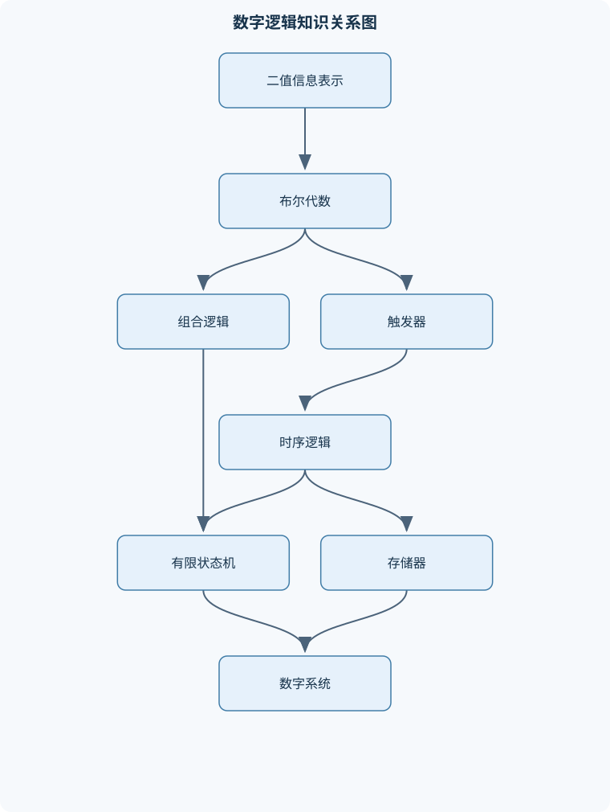
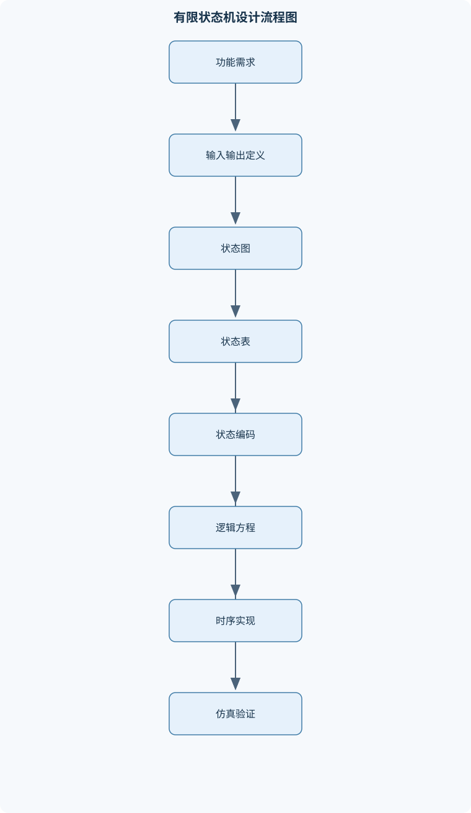

# 数字逻辑设计

## 一、课程整体知识框架

### 课程边界与先修知识

本课程研究用二值逻辑表示、变换、存储和处理信息的基本方法，覆盖逻辑代数、组合逻辑、时序逻辑、有限状态机、寄存器与计数器、存储器、可编程逻辑器件以及数字系统的层次化设计。课程重点是从功能需求建立逻辑模型，完成真值表、逻辑表达式、逻辑电路和时序行为之间的转换，并分析延迟、竞争冒险、同步时序和资源代价。可适度延伸到数据通路、控制器、流水线和指令级抽象，以说明数字逻辑如何构成更高层计算系统，但不系统覆盖模拟电路、晶体管物理、完整计算机组成原理或操作系统。先修知识包括集合与基本代数、二进制整数表示、初等概率概念，以及电路电压电流的基本概念；不要求先修复杂电子器件模型。





### 1. 研究对象、抽象层次与基本符号

数字逻辑设计研究如何用有限个离散逻辑状态表示信息，并通过组合逻辑、存储元件和时钟组织信息的变换、保存与传输。最基本的逻辑变量取值集合为 $\{0,1\}$，其中 $0$ 表示逻辑假，$1$ 表示逻辑真；逻辑值不直接等同于某个固定电压，实际电平必须结合供电电压、输入阈值、噪声容限和器件接口标准解释。逻辑非写作 $\lnot A$ 或 $\overline{A}$，逻辑与写作 $A\cdot B$ 或 $AB$，逻辑或写作 $A+B$。在布尔代数中，$+$ 不是普通整数加法，$AB$ 也不是普通数乘。

数字系统通常采用层次化抽象。物理层关注电压、电流、功耗、负载和传播延迟；门级关注与、或、非、与非、或非等逻辑门；寄存器传输级关注寄存器、数据通路和控制信号；系统级关注处理数据的路径、控制器、存储器和接口。理想布尔模型能够验证功能关系，但不能单独证明电路具有足够的速度、驱动能力、噪声裕量和可靠性。因此，课程始终区分三种正确性：功能正确性、时序正确性和电气可实现性。

组合逻辑函数写作 $F(x_{n-1},\ldots,x_1,x_0)$，输出只依赖当前输入。时序逻辑还具有状态，当前状态记为 $Q$ 或 $S$，下一状态记为 $Q^+$ 或 $S^+$。时钟信号记为 $\mathrm{CLK}$，上升沿表示从 $0$ 到 $1$ 的变化，下降沿表示从 $1$ 到 $0$ 的变化。复位必须说明是同步还是异步、有效电平是高还是低。高阻态 $Z$ 表示输出暂不驱动总线，未知态 $X$ 表示仿真中无法确定的值；$X$ 和 $Z$ 不能在普通布尔推导中直接当作 $0$ 或 $1$。

### 2. 数字系统基础与数制编码

无符号 $n$ 位二进制数的权值展开为

$$
N=\sum_{i=0}^{n-1}b_i2^i,\qquad b_i\in\{0,1\},
$$

其表示范围为 $0$ 至 $2^n-1$。二进制转十六进制时，从最低位开始每四位分组；不足四位时在最高位补零。例如 $11010110_2$ 分成 $1101\ 0110$，得到 $\mathrm{D6}_{16}$。十六进制转二进制则把每个十六进制数字替换为四位二进制。

补码用固定宽度表示有符号整数。$n$ 位补码的范围为

$$
-2^{n-1}\leq N\leq 2^{n-1}-1.
$$

正数按普通二进制表示，负数先写绝对值，再逐位取反并加 $1$。补码加法可以直接使用同一个二进制加法器，但最高位产生的进位被丢弃。补码加法的有符号溢出判据不是“最高位有进位”，而是两个同号数相加得到异号结果；例如在四位补码中，$0111_2=7$，加上 $0001_2=1$ 得到 $1000_2$，其位模式代表 $-8$，因此发生溢出。

定点数把小数点固定在预定位置。若总宽度为 $n$，其中有 $f$ 位小数，则最低位权值为 $2^{-f}$，可表示的步长是 $2^{-f}$。定点表示的范围和精度同时受总位宽与小数位数限制，增加小数位会提高精度但减少整数部分范围。定点数溢出、截断和舍入必须分别讨论，不能把截断误认为溢出。

BCD 码用四位二进制分别编码十进制数字 $0$ 至 $9$，编码 $1010$ 至 $1111$ 通常不是合法 BCD 数字。BCD 便于十进制显示和逐位运算，但同样数值所需位数通常多于普通二进制。格雷码相邻编码只改变一位，适合旋转编码器等输入变化可能发生在临界时刻的场景；但格雷码的数值加法不能直接按普通二进制加法处理，必须先转换或建立专用逻辑。

奇偶校验通过增加冗余位检测错误。偶校验要求所有数据位和校验位中 $1$ 的总数为偶数，能够检测任意奇数位翻转，但不能保证检测所有偶数位翻转。冗余编码的检测能力取决于码字之间的汉明距离；距离为 $d$ 的码至少能够检测 $d-1$ 位错误，但纠错能力还需满足相应的距离条件。编码选择必须结合传输环境、硬件代价和允许的错误类型。

### 3. 布尔代数与逻辑门

布尔代数的基本定律包括交换律、结合律、分配律、吸收律和互补律：

$$
A+B=B+A,\qquad AB=BA,
$$

$$
A+(B+C)=(A+B)+C,\qquad A(BC)=(AB)C,
$$

$$
A(B+C)=AB+AC,
$$

$$
A+AB=A,\qquad A(A+B)=A,
$$

$$
A+\overline{A}=1,\qquad A\overline{A}=0.
$$

例如，吸收律 $A+AB=A$ 的推导为

$$
A+AB=A(1+B)=A.
$$

德摩根定律为

$$
\overline{AB}=\overline A+\overline B,\qquad
\overline{A+B}=\overline A\ \overline B.
$$

它说明取反会把与和或互换，是把某种门电路改写为另一种门电路的基础。对偶原理是：若某个布尔恒等式成立，把其中的 $+$ 与乘法、$0$ 与 $1$ 互换，所得对偶式也成立，但变量和取反符号不交换。

与非门具有完备性。设 $N(A,B)=\overline{AB}$，则

$$
\overline A=N(A,A),
$$

$$
AB=N(N(A,B),N(A,B)),
$$

$$
A+B=N(N(A,A),N(B,B)).
$$

因此，只用与非门即可构成非、与、或。或非门同样完备：$\overline A=A\downarrow A$，再由双重取反构造与和或。完备门集的意义在于，任何有限输入的布尔函数都能转换为只含一种通用门的网络，但转换后的门数、级数、扇入和延迟未必最优。

正逻辑约定中高电平表示逻辑 $1$，负逻辑约定中低电平可能表示逻辑有效。改变逻辑极性不仅是把标签改名，还会影响门符号、有效电平、复位定义和接口协议。实际门电路还受到扇入、扇出和传播延迟限制。扇入是门的输入数量，扇出是一个输出能够可靠驱动的后级输入数量；超过器件能力时，即使布尔表达式正确，电平也可能达不到规定阈值。

### 4. 组合逻辑分析与化简

从真值表得到逻辑表达式时，对输出为 $1$ 的行分别写出最小项，再将它们相或。若输入顺序为 $A,B,C$，编码 $101$ 对应最小项 $AB̅C$，因为该行要求 $A=1,B=0,C=1$。函数可以写成

$$
F=\sum m(i),
$$

其中 $m_i$ 表示编码为 $i$ 时值为 $1$ 的乘积项。也可以根据输出为 $0$ 的行写最大项：

$$
F=\prod M(i).
$$

最大项 $M_i$ 在输入编码为 $i$ 时取值为 $0$，因此每一项是若干变量的或。对有限输入组合函数，逐行构造最小项后相或，能够证明标准与或式可以表示任意函数；逐行构造最大项后相与，则得到标准或与式。

卡诺图把相邻编码放在相邻格中，并且首尾相接。两个相邻最小项只在一个变量上不同，例如 $ABC$ 和 $AB\overline C$ 相或为 $AB$，因为

$$
ABC+AB\overline C=AB(C+\overline C)=AB.
$$

因此，每合并一对相邻项，就能消去一个变化变量。合法合并组的单元数通常为 $1,2,4,8,\ldots$，不能斜向合并，也不能把不相邻单元强行合并。无关项可作为 $1$ 或 $0$ 使用，但只有在扩大化简组且不改变规定输出时才能使用；无关项不能无条件当作有效输出。

变量较少时可用卡诺图，变量较多时可用奎因—麦克拉斯基方法。该方法先按二进制中 $1$ 的个数分组，只合并相差一位的项，重复直到不能继续合并；未再合并的项构成主蕴含项，再建立覆盖表选择必要项。其候选项数量可能随变量数快速增长，不适合无条件处理大规模函数。

组合电路分析应从输入端沿无反馈拓扑顺序计算每个节点的逻辑值和延迟。若网络含反馈，就不能继续把它当作普通组合网络，而应分析其状态、稳定条件和时序行为。验证组合电路至少包括真值覆盖、边界输入、无关输入、延迟引发的瞬态以及输出是否存在毛刺。

### 5. 组合逻辑模块设计

译码器把 $n$ 位输入转换为最多 $2^n$ 个互斥输出。例如 $2$—$4$ 译码器在使能有效时只有一个输出有效。编码器执行逆向映射，但普通编码器要求同一时刻最多一个输入有效；多个输入同时有效时必须使用优先编码器，并给出有效标志。数据选择器根据选择信号从多个输入中选出一个输出，数据分配器则根据选择信号把一个输入送往指定输出。

比较器可以从最高位开始比较。对于两位数 $A=A_1A_0$ 与 $B=B_1B_0$，大于关系为

$$
G=A_1\overline{B_1}+(A_1\odot B_1)A_0\overline{B_0},
$$

等于关系为

$$
E=(A_1\odot B_1)(A_0\odot B_0),
$$

其中 $\odot$ 表示同或。最高位不同时即可确定结果，只有最高位相等时才比较低位，这种结构可级联到更宽位数。

半加器输入为 $A,B$，和为

$$
S=A\oplus B,
$$

进位为

$$
C=AB.
$$

全加器再加入输入进位 $C_{\mathrm{in}}$，其和与输出进位分别为

$$
S=A\oplus B\oplus C_{\mathrm{in}},
$$

$$
C_{\mathrm{out}}=AB+AC_{\mathrm{in}}+BC_{\mathrm{in}}.
$$

串行进位加法器把低位的进位逐级传给高位，结构简单但总延迟随位数增加。定义第 $i$ 位的生成和传播信号

$$
G_i=A_iB_i,\qquad P_i=A_i\oplus B_i.
$$

则

$$
C_{i+1}=G_i+P_iC_i.
$$

展开可得

$$
C_2=G_1+P_1G_0+P_1P_0C_0.
$$

超前进位加法器预先并行计算这些表达式，降低进位等待，但需要更多门、布线和功耗。算术逻辑单元通常由加法器、逻辑运算单元、多路选择器和标志位生成电路组成，操作码决定数据路径和输出行为。

### 6. 时序逻辑与触发器

锁存器是电平敏感器件，在使能电平有效期间输入变化可能直接影响输出；边沿触发器只在规定时钟边沿采样输入。二者不可混为一谈。D 触发器的特性方程为

$$
Q^+=D.
$$

它把下一状态直接交给数据输入，适合构造寄存器和状态寄存器。T 触发器满足

$$
Q^+=T\oplus Q,
$$

当 $T=0$ 时保持，当 $T=1$ 时翻转。JK 触发器满足

$$
Q^+=J\overline Q+\overline KQ.
$$

当 $J=K=0$ 时保持，$J=1,K=0$ 时置 $1$，$J=0,K=1$ 时清零，$J=K=1$ 时翻转。

建立时间 $t_{\mathrm{setup}}$ 是数据在有效时钟沿之前必须稳定的最短时间，保持时间 $t_{\mathrm{hold}}$ 是时钟沿之后仍需稳定的最短时间。若数据在窗口内变化，触发器可能进入亚稳态，即输出在一段不确定时间内不能可靠判定为 $0$ 或 $1$。跨时钟域信号不能直接连接到目标域触发器，常需使用两级同步器、握手协议或异步先进先出结构。时钟偏斜是时钟到达不同寄存器的时间差，时钟抖动是时钟边沿的随机或确定性偏移，二者都会减少可用时序裕量。

### 7. 寄存器、计数器与时序电路

并行寄存器在同一时钟沿同时装载多位数据；移位寄存器把每一位送入相邻级，可实现串并转换、延迟线和串行数据接收。由 $D$ 触发器构成的寄存器满足每个时钟沿后 $Q_i^+=D_i$。同步计数器的各级触发器由同一时钟驱动，下一状态由组合逻辑计算；异步计数器则让前一级输出驱动后一级时钟，级联延迟会造成中间状态，直接译码可能产生短暂错误脉冲。

模 $N$ 计数器需要覆盖 $N$ 个合法状态。触发器数量至少为满足

$$
2^k\geq N
$$

的最小整数 $k$。当 $N$ 不是 $2$ 的整数次幂时，有 $2^k-N$ 个非法状态，设计必须规定其恢复路径，例如全部回到零状态。环形计数器把单个有效位循环移动，若有 $n$ 个触发器通常得到 $n$ 个合法状态；约翰逊计数器把反相反馈移入，理论上可得到 $2n$ 个状态，但仍需检查非法状态恢复。

时序电路分析包括列出当前状态和输入、计算触发器输入、利用特性方程得到下一状态、计算输出并检查复位和时序约束。只列出合法状态而不规定非法状态，会使实际电路在上电干扰或单粒子翻转后出现不可预测行为。

### 8. 有限状态机设计

有限状态机可表示为

$$
S^+=\delta(S,X),\qquad Y=\lambda(S,X).
$$

摩尔型状态机的输出只依赖当前状态，写作 $Y=\lambda(S)$，输出通常在状态改变后变化，抗输入毛刺能力较强，但可能需要更多状态。米利型状态机的输出依赖状态和输入，写作 $Y=\lambda(S,X)$，可在输入到达后较快响应，但输入变化可能直接影响输出。

设计过程是：从自然语言中识别输入事件、输出动作和必须记忆的信息；建立状态图；转换为状态表；合并等价状态；选择二进制、独热码或格雷码等状态编码；推导下一状态和输出逻辑；加入同步或异步复位；为非法状态规定恢复路径；最后验证所有状态转移。状态寄存器应与下一状态组合逻辑、输出组合逻辑清晰分离，以便分析和综合。

### 9. 存储器与可编程逻辑

具有 $a$ 条地址线、每个地址存储 $w$ 位数据的存储器容量为

$$
2^a\times w,
$$

总存储位数为 $2^aw$。地址译码器根据地址产生片选信号，保证同一时刻只有目标存储单元或芯片被选中。进行存储器扩展时，字扩展增加可寻址字数，位扩展增加每个字的宽度。低位地址线通常并联到各芯片，高位地址线经译码产生片选，数据线按位宽分组连接。

只读存储器可把地址作为输入、存储内容作为输出，用查找表实现组合逻辑。可编程逻辑阵列通过可编程与阵列和或阵列实现乘积项组合。现场可编程门阵列通常包含查找表、触发器、可编程互连、输入输出资源以及专用存储和算术资源。其优势是可重构，但资源数量、布线拥塞、时钟资源和时序约束仍限制实际设计。

### 10. 数字系统时序、可靠性与硬件描述

寄存器到寄存器路径的基本建立时间约束为

$$
T_{\mathrm{clk}}
\geq
t_{\mathrm{clkq}}+t_{\mathrm{pd}}+t_{\mathrm{setup}}+t_{\mathrm{margin}},
$$

其中 $T_{\mathrm{clk}}$ 单位为时间，$t_{\mathrm{clkq}}$ 是发送寄存器时钟到输出延迟，$t_{\mathrm{pd}}$ 是组合路径最大传播延迟，$t_{\mathrm{setup}}$ 是接收寄存器建立时间，$t_{\mathrm{margin}}$ 是时钟偏斜、抖动和建模误差等裕量。因此理想最高频率满足

$$
f_{\mathrm{clk,max}}\approx \frac{1}{T_{\mathrm{clk,min}}}.
$$

保持时间约束关注最短路径，不能仅通过降低频率解决。若保持时间违例，应增加数据路径最小延迟、调整时钟分配或使用专门的延迟修正手段。

静态一冒险通常发生在输出应保持 $1$ 时，由于不同路径延迟暂时降为 $0$；静态零冒险则是在输出应保持 $0$ 时暂时升为 $1$。通过增加共识项、保证相邻有效区域有覆盖或在同步采样前寄存输出，可以降低冒险造成的错误传播。动态冒险多发生在多级逻辑中，可能出现多次翻转。故障诊断可采用固定型故障模型，寻找故障激励条件，再寻找传播到可观测输出的路径；这种模型不能替代真实器件的模拟故障分析。

硬件描述语言用于结构化描述组合逻辑、时序逻辑、模块接口和测试平台。组合过程应覆盖所有输出赋值，避免意外推导锁存器；时序过程通常在时钟边沿触发，并用非阻塞赋值描述寄存器更新。阻塞赋值按语句顺序立即更新，适合表达组合计算；非阻塞赋值在当前时间步结束时统一更新，适合表达并行触发器。仿真验证的是描述行为，综合则把可综合部分转换为门、触发器、存储器和互连，综合后电路还必须独立检查资源、时序和复位实现。

### 11. 数据通路、控制器与系统级抽象

寄存器传输级描述把系统分为数据通路和控制器。数据通路包括寄存器、加法器、比较器、多路选择器、移位器和标志位寄存器；控制器根据操作码、状态和外部条件产生装载、清零、选择、读写和启动等控制信号。资源共享可以减少硬件面积，但可能增加多路选择器、控制复杂度和关键路径延迟。

微操作描述一个时钟周期内完成的寄存器传送或运算，例如“在时钟沿装载寄存器 A”“将 B 与 C 相加并写入 D”。并发执行要求操作之间没有资源冲突和数据依赖；存在先后约束时，必须安排不同周期或增加旁路。流水线把长组合路径分成若干段，在段之间加入寄存器。理想情况下，非流水电路单项延迟约为各段延迟之和；稳定输入后，流水线吞吐率由最慢一级决定，但单个数据项的端到端延迟通常增加，并产生寄存器、控制、功耗和冒险处理开销。

## 二、章节和模块划分

### 核心知识覆盖清单

本清单用于检查正文是否覆盖本课程的主要知识模块：

- **数字系统基础与数制编码**：数字信号与二值抽象、无符号二进制数制、二进制与十六进制转换、带符号数与补码、定点数表示及溢出、BCD码与格雷码、奇偶校验与冗余编码、数字系统的层次化抽象。
- **布尔代数与逻辑门**：布尔变量和逻辑函数、与或非基本逻辑、与非门和或非门完备性、布尔代数基本定律、对偶原理与德摩根定律、正负逻辑约定、逻辑电平与噪声容限、门级传播延迟与扇出。
- **组合逻辑分析与化简**：真值表到逻辑表达式、最小项与最大项、标准与或式和标准或与式、卡诺图化简、无关项的使用条件、多级逻辑网络、静态冒险识别、组合电路功能验证。
- **组合逻辑模块设计**：译码器与编码器、优先编码器、数据选择器与数据分配器、比较器设计、半加器与全加器、串行进位加法器、超前进位加法器、算术逻辑单元基本结构。
- **时序逻辑与触发器**：锁存器与电平敏感性、同步时序系统、SR触发器、D触发器、JK触发器和T触发器、建立时间与保持时间、时钟偏斜与时钟抖动、亚稳态及跨时钟域风险。
- **寄存器、计数器与时序电路**：并行寄存器与移位寄存器、同步计数器、异步计数器及级联延迟、模N计数器、环形计数器和约翰逊计数器、时序电路状态方程、状态转移表与输出表、非法状态恢复。
- **有限状态机设计**：状态机的输入输出模型、摩尔型与米利型状态机、状态图与状态表、状态编码方法、状态化简、状态寄存器和组合逻辑分离、同步复位与异步复位、有限状态机的验证与覆盖。
- **存储器与可编程逻辑**：只读存储器结构、随机存取存储器结构、存储单元、字长与容量、地址译码与片选、存储器扩展方法、查找表实现组合逻辑、可编程逻辑阵列、现场可编程门阵列的逻辑资源。
- **数字系统时序与可靠性**：组合路径延迟、寄存器到寄存器时序约束、最大时钟频率估算、竞争与冒险分类、静态冒险消除、动态冒险及多级逻辑、同步设计原则、故障模型与可测试性。
- **硬件描述与层次化实现**：硬件描述语言的结构化建模、组合过程与时序过程、阻塞赋值与非阻塞赋值、参数化模块、模块例化与接口连接、仿真、综合与实现的区别、测试平台与激励设计、综合后电路与理想行为差异。
- **数据通路、控制器与系统级抽象**：寄存器传输级描述、数据通路组成、控制器与控制信号、多路选择与资源共享、操作时序与微操作、并发执行与先后约束、流水线基本概念、性能、延迟与吞吐率。


### 1. 代表性设计流程与算法

#### 1.1 组合逻辑化简流程

**输入：**变量集合、真值表或最小项集合，以及可选无关项。  
**输出：**满足功能要求的最简或近似最简表达式。  
**步骤：**

1. 固定变量排列顺序，避免最小项编号前后不一致。
2. 将输出为 $1$ 的最小项填入卡诺图；无关项标记为 $X$。
3. 以 $2$ 的整数次幂为大小寻找尽可能大的相邻分组。
4. 优先保留只能由一个分组覆盖的必含主蕴含项。
5. 用其余分组覆盖尚未覆盖的目标最小项。
6. 检查每个合法输出为 $1$ 的单元均被覆盖，且没有把规定为 $0$ 的单元覆盖进去。

其不变量是：每次合并都只消除一个在组内变化的变量，不改变已覆盖的合法目标。终止条件是所有目标最小项均被覆盖且不存在可继续扩大、又不引入错误输出的分组。变量较多时可用奎因—麦克拉斯基流程，但其候选项数量可能呈指数增长。

#### 1.2 同步时序电路分析流程

**输入：**触发器类型、当前状态、外部输入、组合逻辑和复位条件。  
**输出：**下一状态、输出及时序约束。  

先列出所有当前状态和输入组合，再根据组合逻辑求触发器输入；对于 D 触发器直接使用 $Q^+=D$，对于 T 触发器使用 $Q^+=T\oplus Q$；最后根据输出方程得到输出。随后检查建立时间、保持时间、复位有效性以及非法状态恢复。该流程适用于单一时钟域同步电路；跨时钟域信号必须另行设计同步器或握手机制。

#### 1.3 模 $N$ 计数器设计流程

**输入：**计数模数 $N$、计数方向、复位方式和输出需求。  
**输出：**合法状态序列、触发器输入逻辑和非法状态处理逻辑。  

先取满足 $2^k\geq N$ 的最小 $k$，再列出 $N$ 个合法状态及其下一状态。对剩余 $2^k-N$ 个状态指定回归状态，依据 D、JK 或 T 触发器激励表推导输入方程，最后逐个检查全部 $2^k$ 个状态。若使用异步计数器，还要分析各级翻转不同步造成的瞬态译码风险。

#### 1.4 存储器扩展流程

**输入：**目标字数、目标位宽、现有芯片容量及地址、数据、读写控制接口。  
**输出：**芯片数量、地址连接、片选译码和数据总线连接方案。  

若目标字数大于单片字数，先进行字扩展；若目标位宽大于单片位宽，再进行位扩展。低位地址线通常并联连接，高位地址线送入译码器生成片选，数据线按位宽分组连接，读写控制信号按器件有效电平连接。验算时应确认每个地址最多选中一组芯片，且未使用地址不会产生多个片选同时有效。

### 2. 代码与硬件描述示例

下面示例使用 Verilog 描述一个带同步清零、同步使能的四位寄存器。输入在时钟上升沿被采样；当 `rst` 有效时优先清零，否则当 `en` 有效时装载 `d`，否则保持原值。

```verilog
module reg4 (
    input  wire       clk,
    input  wire       rst,
    input  wire       en,
    input  wire [3:0] d,
    output reg  [3:0] q
);
    always @(posedge clk) begin
        if (rst)
            q <= 4'b0000;
        else if (en)
            q <= d;
    end
endmodule
```

这里使用非阻塞赋值 `<=` 表示触发器在同一时钟沿并行更新。`rst` 是同步复位，因为只有在 `posedge clk` 到来时才检查。若把复位敏感信号加入敏感列表，则模型含义会变为异步复位，接口规范和时序分析也必须相应改变。验证时应覆盖复位期间、复位释放后的第一个时钟沿、使能为零时保持以及连续装载等情况。

### 3. 例题一：补码加法与溢出判断

#### 题干

用八位补码计算 $37+(-12)$，并判断结果是否溢出；再计算 $100+60$ 并判断是否溢出。

#### 分析

八位补码范围为 $-128$ 至 $127$。补码加法的进位可以丢弃，但有符号溢出要根据操作数符号和结果符号判断。

#### 逐步解答

$37$ 的二进制为 $00100101$。$12$ 为 $00001100$，取反加一得到 $-12=11110100$。相加：

$$
00100101+11110100=1\,00011001.
$$

丢弃最高位进位，结果为 $00011001_2=25$，两个操作数异号，不会发生有符号溢出。

$100=01100100$，$60=00111100$：

$$
01100100+00111100=10100000.
$$

两个操作数均为正数，而结果最高位为 $1$，表示负数，因此发生溢出。位模式 $10100000$ 在八位补码中代表 $-96$，但数学结果应为 $160$，超出范围。

#### 结果验证与变式

第一组结果符合 $37-12=25$。第二组超出 $127$ 的上界。变式是计算 $-100+(-60)$，两个负数得到正数时也发生溢出；最高位进位本身不能作为通用溢出判据。

### 4. 例题二：卡诺图化简

#### 题干

四变量函数

$$
F(A,B,C,D)=\sum m(1,3,5,7,9,11,13,15)
$$

求最简与或式。

#### 分析

这些最小项的二进制编号最低位均为 $1$，说明 $D=1$。卡诺图中八个单元可以组成一个八格组。

#### 逐步解答

当 $D=1$ 时，$A,B,C$ 可以任意取值，所有对应单元均为 $1$。因此

$$
F=D.
$$

代数验证为：每个最小项都含有 $D$，并且其余变量的所有组合均出现，因此

$$
F=D(A+\overline A)(B+\overline B)(C+\overline C)=D.
$$

#### 结果验证与变式

取 $D=0$ 时输出为 $0$，取 $D=1$ 时输出为 $1$，与原最小项集合一致。若删去 $m(15)$，八格组不能再使用，可能需要两个或多个较小分组；不能因为大部分单元相邻就跨越缺失单元合并。

### 5. 例题三：四位串行进位加法器

#### 题干

用四个全加器计算 $A=0101_2$ 与 $B=0011_2$ 的和，输入进位 $C_0=0$。

#### 分析

逐位使用

$$
S_i=A_i\oplus B_i\oplus C_i,
$$

$$
C_{i+1}=A_iB_i+A_iC_i+B_iC_i.
$$

#### 逐步解答

从最低位开始：

- 第 0 位：$A_0=1,B_0=1,C_0=0$，得到 $S_0=0,C_1=1$。
- 第 1 位：$A_1=0,B_1=1,C_1=1$，得到 $S_1=0,C_2=1$。
- 第 2 位：$A_2=1,B_2=0,C_2=1$，得到 $S_2=0,C_3=1$。
- 第 3 位：$A_3=0,B_3=0,C_3=1$，得到 $S_3=1,C_4=0$。

因此结果为

$$
0101_2+0011_2=1000_2.
$$

#### 结果验证与变式

十进制验证为 $5+3=8$。若把相同输入改作四位补码，$0101+0011=1000$，两个正数得到负数，因而产生有符号溢出。若只关心无符号加法，结果 $1000_2=8$ 是正确的。

### 6. 例题四：模十同步计数器

#### 题干

设计一个同步模十计数器，状态按 $0000$ 到 $1001$ 循环，$1010$ 至 $1111$ 为非法状态，要求非法状态下一拍回到 $0000$。

#### 分析

因为 $2^3<10\leq 2^4$，至少需要四个触发器。用 D 触发器时，下一状态的四位直接作为 $D_3,D_2,D_1,D_0$。状态转移必须定义全部十六个状态。

#### 逐步解答

合法转移为：

$$
0000\to0001\to\cdots\to1001\to0000.
$$

非法状态 $1010$ 至 $1111$ 均指定下一状态为 $0000$。随后根据状态表逐位化简 $D_i$。若使用同步清零和使能，优先级应明确，例如复位有效时下一状态为 $0000$，否则使能为零时保持，只有使能为一时执行计数转移。

#### 结果验证与变式

检查十个合法状态均只出现一次，$1001$ 后回到 $0000$；检查六个非法状态均能在一个时钟周期内回归。变式是设计倒计数模十计数器，状态转移改为 $0000\to1001$、$1001\to1000$，非法状态仍需指定恢复路径。

### 7. 例题五：建立时间约束

#### 题干

某寄存器到寄存器路径的参数为 $t_{\mathrm{clkq}}=2\text{ ns}$、最大组合延迟 $t_{\mathrm{pd}}=7\text{ ns}$、建立时间 $t_{\mathrm{setup}}=1\text{ ns}$，设计裕量为 $0.5\text{ ns}$。求最小时钟周期和理想最高频率。

#### 分析

采用同步单时钟域模型，不考虑额外的时钟偏斜独立项，且给出的裕量已经包含抖动和偏斜影响。

#### 逐步解答

$$
T_{\mathrm{clk,min}}
=2+7+1+0.5
=10.5\text{ ns}.
$$

因此

$$
f_{\mathrm{clk,max}}
=\frac{1}{10.5\text{ ns}}
\approx95.24\text{ MHz}.
$$

#### 结果验证与变式

若组合逻辑被分为两级，每级最大延迟约为 $3.5\text{ ns}$，增加流水寄存器后，理想时钟周期可接近 $2+3.5+1+0.5=7\text{ ns}$，但系统端到端延迟增加了一个寄存器级，且实际还要加入寄存器开销和布线不平衡。若是保持时间违例，单纯把时钟频率降低通常不能解决问题。

### 8. 实验与项目一：组合逻辑化简和门级验证

#### 目标与输入数据

输入为一个四变量真值表，输出包含合法的 $1$、合法的 $0$ 和若干无关项。学生需分别用卡诺图和门级描述实现同一函数。

#### 实施步骤

1. 固定变量顺序并列出最小项、最大项和无关项。
2. 使用卡诺图寻找合法相邻分组，记录每个分组消去的变量。
3. 写出最简与或式，再改写为与非门两级结构。
4. 用全部 $2^4=16$ 种输入组合仿真。
5. 在输入变化间隔很短的情况下观察是否出现静态冒险。
6. 将化简表达式与未化简表达式的输出逐项比较。

#### 评价标准

功能评价要求所有规定输入的输出均正确；结构评价要求表达式没有错误使用无关项；时序评价要求说明门级延迟可能造成的瞬态，不能仅凭稳定时刻真值表断言无冒险；文档评价要求给出变量顺序、分组依据和验证结果。

#### 排错方法

若某行输出错误，先核对最小项编号和高低位顺序，再检查卡诺图首尾相邻关系。若稳定值正确但波形出现短脉冲，应检查不同路径延迟、是否缺少共识项以及输出是否应在时钟边沿采样。若与非门结构错误，应逐层使用德摩根定律核对，而不能只凭门图形直觉判断。

### 9. 实验与项目二：串行数据接收控制器

#### 输入数据与功能

设计一个单时钟域串行接收控制器，输入包括串行数据、采样使能、复位和时钟；数据帧依次包含起始位、固定数量的数据位、奇偶校验位和停止位。输出包括接收完成、数据字、校验错误和帧错误。

#### 实施步骤

1. 建立空闲、起始检测、数据接收、校验接收、停止位检查和错误处理状态。
2. 用移位寄存器保存数据位，用计数器记录已接收位数。
3. 明确起始位、停止位和校验位的有效电平。
4. 在状态图中规定错误输入的转移，例如校验失败后转入错误状态或重新等待空闲。
5. 将状态寄存器、下一状态逻辑、移位寄存器和计数器分开描述。
6. 仿真正常帧、连续帧、错误校验、错误停止位、复位中断和边界计数。

#### 评价标准

必须正确识别完整帧，数据位顺序不能颠倒；计数器不能多移位或少移位；错误标志必须在约定周期有效；所有合法状态和规定异常路径均需覆盖；复位释放后不能出现未定义状态。

#### 排错方法

若数据位整体反转，检查串行移位方向和位编号；若完成信号提前或滞后，检查计数器更新与状态转移是否在同一时钟沿生效；若复位后偶发进入错误状态，检查异步复位释放、未覆盖的状态编码和组合逻辑默认赋值。

### 10. 具体易错点

1. 把逻辑 $1$ 直接当作固定高电压，忽略阈值和噪声容限。
2. 把布尔或运算 $A+B$ 当作二进制算术加法。
3. 把最高位进位误认为补码有符号溢出。
4. 忘记补码范围由位宽决定，不能用无限精度整数解释固定宽度结果。
5. 卡诺图中把对角线单元当作相邻单元。
6. 无关项被任意当作 $1$，导致规定输出为 $0$ 的输入也被覆盖。
7. 混淆锁存器的电平敏感性和触发器的边沿敏感性。
8. 认为异步计数器各级会同时翻转，忽略级联延迟。
9. 只列出有限状态机的合法状态，不处理非法状态。
10. 把摩尔型输出误写成只依赖输入，或把米利型输入变化风险忽略。
11. 用降低时钟频率的方法解决保持时间违例。
12. 把异步复位的有效性与释放时序混为一谈。
13. 将仿真中的 `X`、`Z` 当作普通的 $0$ 或 $1$。
14. 在组合过程里没有覆盖所有输出分支，意外推导锁存器。
15. 用阻塞赋值描述多个并行寄存器，产生与真实触发器不一致的仿真顺序。
16. 把存储器的地址数、字长和总位数混为一谈。
17. 把优先编码器当作普通编码器，漏掉多输入同时有效时的优先级。
18. 认为流水线只降低延迟而不增加寄存器和控制开销。

### 11. 典型笔试问题及解答思路

#### 问题一：为什么与非门具有完备性？

先用同一输入连接两个端口得到非门，再对输出重复与非得到与门，最后对两个输入分别取反后进行与非，依据德摩根定律得到或门。由于与、或、非可以表示任意有限布尔函数，所以与非门单独构成完备门集。

#### 问题二：标准与或式为什么能表示任意组合函数？

对每一行输出为 $1$ 的输入组合构造一个只在该行取 $1$ 的最小项，将所有这些最小项相或。目标行至少有一个最小项为 $1$，其他行所有最小项均为 $0$，所以所得函数与真值表完全一致。

#### 问题三：串行进位和超前进位的主要差异是什么？

串行进位等待前一位进位，延迟随位数近似增长，面积和布线较简单；超前进位利用 $G_i$、$P_i$ 并行展开进位表达式，速度更快但门数、布线、功耗和设计复杂度增加。

#### 问题四：为什么补码加法最高位进位可以丢弃？

补码运算在固定模 $2^n$ 的位宽下进行，保留低 $n$ 位正好得到模运算结果。丢弃进位不等于没有溢出；有符号溢出仍需根据同号输入得到异号结果判断。

#### 问题五：建立时间约束如何推导？

数据从发送寄存器出发，必须经过时钟到输出延迟和组合路径延迟，并在捕获沿之前预留建立时间及裕量，因此有 $T_{\mathrm{clk}}\geq t_{\mathrm{clkq}}+t_{\mathrm{pd}}+t_{\mathrm{setup}}+t_{\mathrm{margin}}$。

#### 问题六：摩尔型和米利型状态机如何选择？

摩尔型输出仅由状态决定，通常更稳定但可能增加状态或响应周期；米利型输出由状态和输入共同决定，响应快、状态可能少，但输入毛刺可能直接传到输出。若输出连接外部接口，常需寄存器化或同步采样。

#### 问题七：模十计数器为什么需要四个触发器？

三个触发器最多表示 $2^3=8$ 个状态，不足十个；四个触发器可表示十六个状态，因此能覆盖十个合法状态，但必须为六个非法状态规定恢复行为。

#### 问题八：为什么真值表正确不能证明真实硬件可靠？

真值表只描述稳定逻辑关系，没有说明传播延迟、建立保持时间、时钟偏斜、负载、扇出、噪声、功耗和跨时钟域问题。因此还需门级时序分析、接口电气检查、复位分析和实际约束验证。

### 12. 典型面试问题、参考答案与深入追问

#### 问题一：如何设计一个可综合的组合逻辑模块？

先明确输入、输出和无关条件，列出真值表或逻辑关系，再用表达式、查找表或结构化模块实现。组合过程应为所有输出赋值，避免推导锁存器，并用边界输入和全覆盖测试验证。

深入追问要点：如何处理 `X` 输入；如何判断综合结果是否符合预期；如何比较面积、延迟和功耗；如何处理输出冒险。

#### 问题二：阻塞赋值和非阻塞赋值如何使用？

阻塞赋值立即更新，适合在组合过程内按顺序计算中间变量；非阻塞赋值在当前时刻结束时更新，适合描述同一时钟沿并行更新的触发器。不能仅按语言习惯选择，必须使描述语义与目标硬件一致。

深入追问要点：多个时序过程之间的竞态；组合过程中的默认赋值；混用两类赋值造成的仿真与综合差异。

#### 问题三：如何处理跨时钟域单比特控制信号？

不能直接把异步信号连接到目标时钟域逻辑。单比特慢变化信号可使用两级同步器；脉冲信号需采用脉冲展宽、事件翻转同步或握手；多位数据不能逐位独立同步，应使用握手、异步 FIFO 或稳定数据配合控制信号的协议。

深入追问要点：亚稳态不能被完全消除，只能降低传播概率；同步器级数、MTBF、复位释放和多位一致性必须综合考虑。

#### 问题四：如何定位一次时序违例？

先确定违例类型。建立时间违例检查最大延迟路径，可缩短组合逻辑、优化布线、降低频率或增加流水级；保持时间违例检查最小延迟路径，应增加数据路径延迟或修正时钟分配，不能简单降低频率。随后查看时钟偏斜、抖动、约束文件和路径端点是否正确。

#### 问题五：为什么异步计数器不适合直接驱动译码逻辑？

各级触发器由不同级输出触发，翻转不会同时发生，状态变化过程中会出现暂态码。译码器可能把暂态码识别为有效状态，产生毛刺。改进方法包括使用同步计数器、对译码结果寄存、增加有效窗口或采用格雷码等。

#### 问题六：如何验证有限状态机完备性？

覆盖复位、每个合法状态的所有输入分支、状态转移边界、输出变化、非法状态恢复和连续事务。还应检查是否存在不可达状态、死循环、遗漏转移和输出毛刺。形式验证可进一步证明状态不变量和安全属性。

#### 问题七：如何在资源和速度之间进行选择？

增加并行逻辑、复制资源或使用超前进位通常能提高速度，但会增加面积、功耗和布线压力；资源共享可降低面积，却可能增加多路选择和关键路径。应根据时钟目标、吞吐率、延迟、功耗预算和可用器件资源作出权衡，而不是只追求门数最少。

#### 问题八：仿真通过但综合后不符合预期，可能原因是什么？

可能存在不可综合语句、锁存器推导、阻塞与非阻塞语义差异、未约束的时钟和接口、初始化在仿真中有效但硬件中不保证、综合优化改变了未定义行为，或综合后布线延迟造成时序违例。排查应比较 RTL 仿真、综合网表仿真和静态时序分析结果。

### 13. 岗位关联与产出要求

数字逻辑设计工程师通常根据功能规格建立真值表、状态图、门级或 RTL 设计，并提交可综合代码、接口说明、时序约束和验证报告。验收标准包括功能覆盖完整、复位和异常路径明确、资源与时序满足目标、代码可维护。

RTL 设计工程师重点完成寄存器传输级模块、参数化接口、数据通路和控制器，使用组合过程与时序过程描述硬件，并通过仿真、断言、覆盖率和综合报告验收。参数化设计必须验证不同位宽、边界计数和非法输入。

FPGA 开发工程师还需关注查找表、触发器、片上存储器、时钟资源、引脚电平、布线拥塞和实现后时序。产出包括工程约束、比特流前的实现报告、资源利用率和时序收敛结果。

ASIC 前端设计工程师关注可综合 RTL、时钟与复位结构、功耗估算、形式等价和静态时序约束。验收不仅要求仿真正确，还要求无关键时序违例、无未处理锁存器和不受控跨时钟域路径。

芯片验证工程师负责测试平台、参考模型、激励、断言、覆盖率和错误定位。其知识重点包括状态机覆盖、边界条件、未知态传播、故障模型和时序协议。产出应能定位首次不一致的时间、输入、状态和预期值。

数字集成电路测试工程师关注可测试性、故障激励、故障传播、扫描链和测试向量。需要说明目标故障模型、可检测故障集合和不可观测原因，不能把少量随机测试当作完整故障覆盖。

计算机组成与数据通路工程师把寄存器、算术逻辑单元、控制器、存储器和流水线组合为更高层系统，验收指标包括操作正确性、吞吐率、端到端延迟、资源共享冲突和异常处理。

嵌入式硬件工程师还需处理外部输入同步、复位、电平转换、总线争用和接口时序。其产出必须包含接口时序说明、异常电平处理、测试点和硬件验证记录。

## 三、核心概念的详细解释

### 1. 数字抽象、编码与层次化设计

数字逻辑把连续变化的物理信号抽象为有限个离散状态。最基本的二值模型只有逻辑 $0$ 和逻辑 $1$，但它们不是任意固定电压。实际输入是否被识别为 $0$ 或 $1$，取决于供电电压、输入阈值、输出驱动能力、噪声幅度和负载条件。若输出高电平的最低保证值为 $V_{OH(\min)}$，接收端高电平输入阈值为 $V_{IH(\min)}$，则通常需要满足

$$
V_{OH(\min)}\geq V_{IH(\min)}.
$$

低电平也应满足输出低电平最高值不超过接收端低电平允许上限。逻辑噪声容限分别可近似表示为

$$
NM_H=V_{OH(\min)}-V_{IH(\min)},\qquad
NM_L=V_{IL(\max)}-V_{OL(\max)}.
$$

噪声容限的单位是伏特；数值越大，输入越能承受外部干扰，但不能由布尔表达式直接推出。

数字系统采用层次化设计：门级由与、或、非等基本逻辑组成；组合模块由门级网络构成；时序模块由组合逻辑和存储元件构成；寄存器传输级描述寄存器之间的数据运动；更高层则由数据通路、控制器、存储器和接口组成。每一层都有自己的验证对象。真值表能够验证组合功能，却不能证明传播延迟、扇出、功耗和时序约束满足要求。

### 2. 组合逻辑与时序逻辑的边界

组合逻辑的输出只由当前输入决定，可写为

$$
Y=F(X).
$$

对于相同的当前输入，理想组合电路应始终产生相同输出。译码器、编码器、选择器、比较器和加法器都属于组合逻辑。组合逻辑不能自行“记住”过去输入；若电路中存在反馈或存储元件，就必须转入时序逻辑分析。

时序逻辑具有状态，通常写为

$$
S^+=\delta(S,X),\qquad Y=\lambda(S,X),
$$

其中 $S$ 是当前状态，$S^+$ 是下一状态，$X$ 是当前输入，$Y$ 是输出。摩尔型状态机满足 $Y=\lambda(S)$，输出只由状态决定；米利型状态机满足 $Y=\lambda(S,X)$，输入变化可能立即影响输出。摩尔型输出通常较稳定，但可能需要额外状态；米利型响应较快、状态数可能较少，却更容易把输入毛刺传播到输出。

锁存器是电平敏感元件。在有效电平持续期间，输入变化可能继续影响输出；触发器通常是边沿敏感元件，只在时钟有效边沿附近采样。不能将锁存器的透明区间误认为触发器的瞬时采样。同步时序系统要求数据在时钟边沿之间完成传播，并满足建立时间和保持时间。

### 3. 布尔代数、逻辑门与完备门集

逻辑与、或、非分别记为 $AB$、$A+B$ 和 $\overline A$。基本恒等式包括：

$$
A+0=A,\quad A\cdot1=A,\quad A+1=1,\quad A\cdot0=0,
$$

$$
A+\overline A=1,\qquad A\overline A=0,
$$

$$
A+A=A,\qquad AA=A.
$$

吸收律为

$$
A+AB=A,\qquad A(A+B)=A.
$$

例如，

$$
A+AB=A(1+B)=A.
$$

德摩根定律为

$$
\overline{A+B}=\overline A\cdot\overline B,\qquad
\overline{AB}=\overline A+\overline B.
$$

它使“对整个逻辑式取反”可以转换为“交换与、或并分别取反”。因此，或非门和与非门都能构成完备逻辑。仅用与非门时：

$$
\overline A=A\ \text{NAND}\ A,
$$

$$
AB=(A\ \text{NAND}\ B)\ \text{NAND}\ (A\ \text{NAND}\ B),
$$

$$
A+B=(A\ \text{NAND}\ A)\ \text{NAND}\ (B\ \text{NAND}\ B).
$$

这说明单一种类的门也可实现任意有限输入布尔函数，但实际电路仍需考虑门数、级数、扇入、扇出和布线延迟。

### 4. 标准表达式、最小项与卡诺图

对于 $n$ 个输入变量，共有 $2^n$ 种输入组合。给定真值表，可以把输出为 $1$ 的行转换成最小项之和。最小项 $m_i$ 在输入编码为 $i$ 时为 $1$，其他输入组合均为 $0$。因此任意有限输入组合函数都可写为标准与或式：

$$
F=\sum m(i_1,i_2,\ldots).
$$

同理，输出为 $0$ 的行可写成最大项之积：

$$
F=\prod M(j_1,j_2,\ldots).
$$

最小项是每个变量都出现一次的乘积项；最大项是每个变量都出现一次的和项。若某行编码为 $x_2x_1x_0=101$，则对应最小项为 $x_2\overline{x_1}x_0$，对应最大项为 $\overline{x_2}+x_1+\overline{x_0}$。最大项在该编码处为 $0$，这正是其与最小项定义方向相反的原因。

卡诺图将只相差一个变量的最小项安排为相邻单元。相邻两项可合并，是因为变化变量在两项之和中被消去：

$$
AB+ A\overline B=A(B+\overline B)=A.
$$

合并组的单元数必须为 $1,2,4,8,\ldots$，允许首尾相接，但不允许仅按对角线相邻。每扩大一倍合并组，就能消去一个变量。无关项 $d$ 只能在不会改变规定输出的前提下作为 $1$ 使用，不能把所有未知情形任意视为有效输出。

### 5. 常用组合逻辑模块及其结构权衡

译码器把 $n$ 位输入转换成最多 $2^n$ 个互斥输出。编码器进行逆向转换；优先编码器在多个输入同时有效时，按照预定优先级选择一个输入，并通常提供“至少一个输入有效”的标志。

多路选择器根据选择信号从多个数据输入中选出一个输出。一个具有 $k$ 个选择端的选择器最多选择 $2^k$ 路输入，因此可用多个选择器实现复杂组合函数。数据分配器则把一个输入信号送到由选择信号指定的某一路输出。

半加器输入为 $A,B$，和位与进位分别为

$$
S=A\oplus B,\qquad C=AB.
$$

全加器增加输入进位 $C_i$，输出和位 $S$ 与进位 $C_o$：

$$
S=A\oplus B\oplus C_i,
$$

$$
C_o=AB+AC_i+BC_i.
$$

串行进位加法器让第 $i$ 位等待第 $i-1$ 位进位，结构简单但延迟随位数增长。定义传播项与生成项：

$$
P_i=A_i\oplus B_i,\qquad G_i=A_iB_i,
$$

则

$$
C_{i+1}=G_i+P_iC_i.
$$

展开可得

$$
C_1=G_0+P_0C_0,
$$

$$
C_2=G_1+P_1G_0+P_1P_0C_0.
$$

超前进位电路直接计算多个进位，减少等待级数，但增加逻辑面积、布线和扇出。算术逻辑单元通常在加法、逻辑与、逻辑或、异或、比较等操作之间进行选择，并产生零标志、进位标志或溢出标志。

### 6. 触发器、寄存器与计数器

D 触发器的特性方程为

$$
Q^+=D.
$$

多个 D 触发器并列即可构成寄存器。若第 $i$ 位的输入连接到前一位输出，则可构成移位寄存器。T 触发器的特性方程为

$$
Q^+=T\oplus Q.
$$

当 $T=0$ 时保持，当 $T=1$ 时翻转。同步二进制计数器可以利用低位状态产生高位翻转条件。例如二进制加一计数器中，第 $k$ 位只有在所有低位均为 $1$ 时才翻转，因此

$$
T_k=Q_{k-1}Q_{k-2}\cdots Q_0.
$$

异步计数器的各级触发器由前一级输出触发，级联传播导致不同位不同时变化。若将中间状态直接送入译码器，可能产生短暂错误脉冲。同步计数器由同一时钟边沿驱动，便于进行时序约束，但组合逻辑通常更复杂。

模 $N$ 计数器需要至少 $k$ 个触发器，其中 $k$ 满足

$$
2^k\geq N,\qquad k=\lceil\log_2N\rceil.
$$

当 $N$ 不是 $2$ 的整数次幂时，存在 $2^k-N$ 个非法状态。设计必须规定非法状态的恢复路径，例如统一回到零态，否则上电或干扰进入非法状态后，电路行为可能不可预测。环形计数器使用移位寄存器中的单个有效位循环移动；约翰逊计数器把反相反馈移入寄存器，通常可得到 $2k$ 个状态，但仍需检查非法状态恢复。

### 7. 状态机、存储器与可编程逻辑

有限状态机设计应先从功能描述中提取事件、输入、输出和记忆需求，再建立状态图和状态表。状态编码可以采用二进制编码、独热编码或格雷编码。二进制编码节省触发器，独热编码便于组合译码，格雷编码有利于减少相邻状态变化时的多位同时翻转；具体选择取决于器件资源、速度和功耗。

存储器容量通常写为

$$
2^a\times w,
$$

其中 $a$ 是地址线数量，$w$ 是每个地址的数据位数。总存储位数为 $2^aw$。若单片存储器为 $2^{10}\times8$，目标为 $2^{12}\times16$，则需要在字数方向使用 $2^{12}/2^{10}=4$ 组，在位宽方向使用 $16/8=2$ 片并联，因此总片数为 $4\times2=8$。低位地址线通常并联到各芯片，高位地址线经译码产生片选信号，数据线按位宽分组连接。

只读存储器可以看作固定的地址到数据映射，因此也能实现组合逻辑查找表。可编程逻辑阵列通过可编程的与阵列和或阵列实现逻辑函数；现场可编程门阵列通常包含查找表、触发器、片上存储资源、专用算术单元和可编程互连。逻辑功能正确不代表资源、时序和布线一定满足实现条件。

### 8. 时序约束、冒险与跨时钟域

寄存器到寄存器路径的基本建立时间约束为

$$
T_{\mathrm{clk}}\geq t_{\mathrm{clkq}}+t_{\mathrm{pd}}+t_{\mathrm{setup}}+t_{\mathrm{skew}}+t_{\mathrm{margin}},
$$

其中 $T_{\mathrm{clk}}$ 为时钟周期，$t_{\mathrm{clkq}}$ 为发送寄存器时钟到输出延迟，$t_{\mathrm{pd}}$ 为组合路径最大传播延迟，$t_{\mathrm{setup}}$ 为接收寄存器建立时间，$t_{\mathrm{skew}}$ 表示时钟偏斜影响，$t_{\mathrm{margin}}$ 是对抖动和不确定性的裕量。若忽略偏斜和裕量，最大时钟频率近似为

$$
f_{\max}\leq\frac{1}{t_{\mathrm{clkq}}+t_{\mathrm{pd}}+t_{\mathrm{setup}}}.
$$

保持时间约束关注数据不能过早改变。降低时钟频率通常能改善建立时间，却不能直接修复保持时间违例；保持时间违例应增加最小数据路径延迟或修正时钟分配。

静态一冒险通常发生在输出理论上应保持 $1$，但不同路径延迟造成短暂下降；静态零冒险则相反。对与或结构，若相邻的两个乘积项覆盖同一输入变化，应增加共识项以维持覆盖。例如

$$
F=AB+\overline AC
$$

在 $B=C=1$ 且 $A$ 翻转时，两项可能同时短暂为 $0$，可增加共识项 $BC$：

$$
F=AB+\overline AC+BC.
$$

同步采样、输出寄存器化和合理的时序窗口可以降低毛刺传播风险。跨时钟域信号不能直接连接到目标域逻辑。单比特慢变化控制信号常用两级同步器；脉冲和多位数据则应使用握手、事件翻转同步或异步先进先出结构。同步器只能降低亚稳态传播概率，不能使亚稳态在物理上绝对消失。

### 9. 硬件描述、数据通路与流水线

硬件描述语言描述的是并行硬件，而非按顺序执行的软件。组合过程必须覆盖所有输出赋值，否则可能综合出锁存器；时序过程通常使用非阻塞赋值表达同一时钟沿对多个寄存器的同时更新。阻塞赋值适合描述组合计算中的立即更新，非阻塞赋值适合描述时序寄存器的状态更新。具体语法依赖语言，但这一硬件语义不变。

寄存器传输级设计通常分为数据通路和控制器。数据通路包含寄存器、加法器、逻辑单元、移位器和多路选择器；控制器根据当前状态、输入和条件标志产生使能、选择、读写和装载信号。资源共享能够减少硬件面积，却可能增加选择器级数和关键路径。

流水线把长组合路径划分为多个阶段，并在阶段之间插入寄存器。若非流水组合延迟为 $t_1+t_2$，理想情况下一级流水的稳态吞吐率受

$$
T_{\mathrm{stage}}\approx\max(t_1,t_2)+t_{\mathrm{reg}}
$$

限制，其中 $t_{\mathrm{reg}}$ 是流水寄存器开销。流水线通常提高单位时间完成的数据项数量，但会增加单个数据项的端到端延迟、寄存器面积、控制复杂度以及数据相关处理难度。

## 四、重要定义、公式、定理和推导

### 专业审校补充：关键定义与适用边界

同步寄存器到寄存器路径必须同时满足建立时间和保持时间，不能只检查最大延迟。设发射触发器时钟到输出的最大、最小延迟分别为 $t_{cq,max}$、$t_{cq,min}$，组合逻辑最大、最小延迟为 $t_{pd,max}$、$t_{pd,min}$，接收触发器建立时间和保持时间为 $t_{su}$、$t_h$，时钟周期为 $T$，接收时钟相对发射时钟的偏移为 $t_{skew}$（接收时钟到达较晚时取正），则忽略抖动和不确定裕量时，建立约束为 $T\ge t_{cq,max}+t_{pd,max}+t_{su}-t_{skew}$；保持约束为 $t_{cq,min}+t_{pd,min}\ge t_h+t_{skew}$。建立约束限制最高工作频率，保持约束通常与时钟周期无关。若把时钟偏斜、抖动和不确定性统一计入裕量，应在相应约束中保守增加限制。该模型适用于同一时钟域、单周期、无多周期例外的寄存器路径；跨时钟域信号不能仅靠放宽上述公式处理，必须采用同步器、握手或异步 FIFO 等结构。触发器违反建立或保持时间可能进入亚稳态，仿真中的逻辑值并不能证明硬件一定可靠。


### 1. 数制、补码与溢出判定

无符号 $n$ 位数为

$$
N=\sum_{i=0}^{n-1}b_i2^i,
$$

其中 $b_i\in\{0,1\}$，表示范围是 $0$ 至 $2^n-1$。补码的最高位权值为负，故

$$
N=-b_{n-1}2^{n-1}+\sum_{i=0}^{n-2}b_i2^i.
$$

其范围为 $-2^{n-1}$ 至 $2^{n-1}-1$。补码负数“按位取反再加一”的原因是：对一个 $n$ 位数 $x$，其补码负数为 $2^n-x$，而按位取反加一正好得到该值的低 $n$ 位表示。

**例题一：** 用四位补码计算 $7+1$，判断是否溢出。

分析：$7=0111_2$，$1=0001_2$。相加得

$$
0111+0001=1000.
$$

四位补码 $1000$ 表示 $-8$，而两个操作数均为正数，结果却为负数，因此发生有符号溢出。最高位是否产生进位不是判据；例如 $1111+0001=0000$ 丢弃最高位进位，但其表示的 $-1+1=0$ 并未溢出。

变式：$-4+(-5)$ 在四位补码中为 $1100+1011=0111$，两个负数得到正数，仍为溢出。

### 2. 任意组合函数的标准表示

设函数 $F(x_{n-1},\ldots,x_0)$ 的真值表中，输出为 $1$ 的行编号集合为 $I_1$。每一行对应一个只在该行取 $1$ 的最小项，因此

$$
F=\sum_{i\in I_1}m_i.
$$

证明思路是：对任意输入组合，只有与该组合对应的最小项为 $1$；若该行函数值为 $1$，标准式中包含该最小项，输出为 $1$；若函数值为 $0$，对应最小项不在集合中，所有项均为 $0$。因此标准与或式可表示任意有限输入组合函数。

**例题二：** 三变量函数在编码 $1,3,5,7$ 时输出为 $1$，写出标准与或式并化简。

设变量顺序为 $A,B,C$。对应最小项为

$$
F=\overline A\overline BC+\overline ABC+ A\overline BC+ABC.
$$

按 $C=1$ 提取：

$$
F=C(\overline A\overline B+\overline AB+A\overline B+AB)=C.
$$

验证：当 $C=1$ 时四种 $A,B$ 组合均输出 $1$；当 $C=0$ 时没有目标最小项，输出为 $0$。变式：若输出为 $1$ 的编码改为 $1,3,5$，则不能直接化为 $C$，因为编码 $7$ 的输出规定为 $0$。

### 3. 卡诺图合并与无关项

两个只相差一个变量的最小项具有形式

$$
XY+X\overline Y=X.
$$

因此卡诺图中两个相邻单元合并后，变化的变量被消去；四个相邻单元合并可消去两个变量。合并组必须覆盖合法输出为 $1$ 的单元，可以额外覆盖无关项，但不能覆盖规定为 $0$ 的单元。

**例题三：** 化简

$$
F(A,B,C)=\sum m(1,3,5,7).
$$

四个最小项的二进制形式分别为 $001,011,101,111$。它们都满足 $C=1$，在卡诺图中构成四格组，因此

$$
F=C.
$$

若增加无关项 $d(0,2)$，可以把 $0,1,2,3$ 合并为 $\overline A$，把 $4,5,6,7$ 合并为 $A$，但这两个结果相加为 $1$，会改变原函数在某些规定为零的情形，因此不能任意使用无关项。无关项只能作为扩大合法覆盖组的工具。

### 4. 加法器与进位传播

全加器的和位是三个输入的奇偶函数：

$$
S=A\oplus B\oplus C_i.
$$

进位在至少两个输入为 $1$ 时产生，因此

$$
C_o=AB+AC_i+BC_i.
$$

也可定义

$$
P=A\oplus B,\qquad G=AB,
$$

得到

$$
C_o=G+PC_i.
$$

串行连接 $n$ 个全加器时，第 $i$ 位进位满足

$$
C_{i+1}=G_i+P_iC_i.
$$

**例题四：** 计算四位无符号数 $1011_2+0110_2$。

从最低位开始：

- 第 0 位：$1+0=1$，$C_1=0$；
- 第 1 位：$1+1+0=0$，$C_2=1$；
- 第 2 位：$0+1+1=0$，$C_3=1$；
- 第 3 位：$1+0+1=0$，$C_4=1$。

结果为 $1\,0001_2$，四位结果为 $0001$，最高位产生进位 $1$。十进制验证：$11+6=17$。若把这两个四位位型解释为补码，$1011=-5$、$0110=6$，结果应为 $1$，此时丢弃最高位进位后得到 $0001$，没有有符号溢出。

### 5. 触发器激励与计数器推导

D 触发器直接满足 $D=Q^+$。因此设计同步时序电路时，只需先根据当前状态和输入求出下一状态，再把各位下一状态连接到对应的 $D$ 输入。

T 触发器满足 $Q^+=T\oplus Q$，由此可反推

$$
T=Q\oplus Q^+.
$$

当当前状态与下一状态相同，$T=0$；当二者不同，$T=1$。JK 触发器的特性方程为

$$
Q^+=J\overline Q+\overline KQ.
$$

其激励规律为：保持时 $J=0,K=0$；置位时 $J=1,K=0$；清零时 $J=0,K=1$；翻转时 $J=1,K=1$。所谓无关输入只能在对应当前状态下确实不影响目标下一状态时使用。

**例题五：** 设计一个三位同步二进制加一计数器，使用 T 触发器。

最低位每次翻转：

$$
T_0=1.
$$

第二位只有在最低位为 $1$ 时翻转：

$$
T_1=Q_0.
$$

最高位只有在低两位同时为 $1$ 时翻转：

$$
T_2=Q_1Q_0.
$$

复位后状态为 $000$，连续状态为 $001,010,011,100,101,110,111,000$。验证 $111$ 的下一状态：三个 T 输入均为 $1$，三位全部翻转，得到 $000$。若要求模六计数，则 $110$ 的下一状态应指定为 $000$，$110$ 和 $111$ 之外的非法处理必须明确。

### 6. 存储器容量和扩展推导

地址线为 $a$ 根时，每根地址线有两种状态，地址组合总数为

$$
2^a.
$$

若每个地址存放 $w$ 位，则容量为 $2^a\times w$。进行字扩展时，多个芯片并联数据线，由高位地址译码产生不同片选；进行位扩展时，各芯片共享地址和控制线，但分别连接不同的数据位。

**例题六：** 使用 $1\text{K}\times8$ 芯片构成 $4\text{K}\times16$ 存储器。

单片有 $2^{10}=1024$ 个字，目标有 $2^{12}=4096$ 个字，需要 $4$ 组字扩展。单片数据宽度为 $8$ 位，目标宽度为 $16$ 位，每组需要两片位扩展。因此总片数为 $4\times2=8$。地址线 $A_0$ 至 $A_9$ 并联到所有芯片，$A_{10},A_{11}$ 输入 $2$-4 译码器产生四个片选。每个片选同时控制该组的两片芯片。数据线中一片连接低八位，另一片连接高八位。验收条件是任意地址只能有一个组被选中，且读出的十六位数据不存在总线冲突。

### 7. 时序约束和流水线推导

设发送寄存器在时钟边沿后经过 $t_{\mathrm{clkq}}$ 输出数据，数据经过组合路径最大延迟 $t_{\mathrm{pd}}$，接收寄存器需要在采样边沿前稳定 $t_{\mathrm{setup}}$。忽略额外偏斜时，必须有

$$
T_{\mathrm{clk}}\geq t_{\mathrm{clkq}}+t_{\mathrm{pd}}+t_{\mathrm{setup}}.
$$

若 $t_{\mathrm{clkq}}=1\text{ ns}$、$t_{\mathrm{pd}}=6\text{ ns}$、$t_{\mathrm{setup}}=1\text{ ns}$，且裕量为 $1\text{ ns}$，则

$$
T_{\mathrm{clk}}\geq1+6+1+1=9\text{ ns},
$$

所以

$$
f_{\max}\leq\frac{1}{9\text{ ns}}\approx111.1\text{ MHz}.
$$

若在组合逻辑中间插入一级流水寄存器，将路径划分为 $3\text{ ns}$ 和 $3\text{ ns}$ 两段，假设每个流水寄存器开销为 $2\text{ ns}$，则新周期约为 $3+2+1+1=7\text{ ns}$，理想最大频率约为 $142.9\text{ MHz}$。但单个数据从输入到输出需要经过更多时钟周期，吞吐率提高不等于端到端延迟降低。

### 8. 代表性设计与验证流程

#### 8.1 组合逻辑化简流程

输入是真值表、最小项集合和可选无关项，输出是化简后的逻辑表达式。步骤如下：

1. 固定变量顺序，避免最小项编号混乱；
2. 标出输出为 $1$ 的单元；
3. 在不覆盖规定为 $0$ 的前提下，按最大面积合并相邻组；
4. 优先选取只被一个组覆盖的必含主蕴含项；
5. 用最少附加项覆盖剩余单元；
6. 用代数变换或枚举真值表验证等价性。

变量较少时适合卡诺图；变量较多时可用 Quine–McCluskey 方法。后者按二进制中 $1$ 的个数分组，只合并相差一位的项，反复合并直至不能继续，再建立主蕴含项覆盖表。其候选项数可能随变量数快速增长，不适合作为大规模逻辑综合的唯一方法。

#### 8.2 模 $N$ 同步计数器设计流程

输入为模数 $N$、计数方向、复位方式和输出要求，输出为合法状态转移及触发器输入逻辑。

1. 计算 $k=\lceil\log_2N\rceil$；
2. 列出 $N$ 个合法状态；
3. 为每个合法状态规定下一状态；
4. 为其余非法状态规定回归状态；
5. 根据 D 或 T 触发器激励方程求输入逻辑；
6. 检查复位、使能、状态覆盖和最大路径延迟；
7. 仿真全部 $2^k$ 个状态，确认不存在未定义下一状态。

该流程适合同步计数器。异步计数器还必须检查级联延迟和译码毛刺，不能只根据稳定状态表判断正确性。

#### 8.3 硬件描述模型示例

下面的 SystemVerilog 示例描述带同步清零和使能的参数化计数器。参数 `WIDTH` 表示寄存器位宽，单位为位；`clk` 为时钟；`rst` 和 `en` 为同步控制信号。

```systemverilog
module counter #(
    parameter int WIDTH = 4
) (
    input  logic             clk,
    input  logic             rst,
    input  logic             en,
    output logic [WIDTH-1:0] q
);

    always_ff @(posedge clk) begin
        if (rst)
            q <= '0;
        else if (en)
            q <= q + {{(WIDTH-1){1'b0}}, 1'b1};
    end

endmodule
```

该模型的输入是时钟、复位和使能，输出是当前计数状态。状态更新只发生在时钟上升沿；`rst=1` 时下一状态为零，`rst=0,en=0` 时保持，`rst=0,en=1` 时加一。参数化并不自动保证所有参数都合法，例如 `WIDTH=0` 没有有效的位向量，因此工程中应对参数范围作约束或在验证环境中拒绝非法参数。

### 9. 实验与项目工作流

#### 9.1 组合逻辑模块验证实验

**输入数据：** 一个三至四变量的真值表、若干无关项、目标门电路限制。

**步骤：**

1. 根据真值表写出标准与或式；
2. 用卡诺图或系统化合并得到化简式；
3. 分别搭建化简前和化简后门级网络；
4. 枚举全部输入组合，比较两种网络输出；
5. 为输入增加不同变化延迟，观察是否出现毛刺；
6. 统计门数量、逻辑级数和关键路径延迟。

**评价标准：** 所有规定输入下功能等价；无关项未改变规定输出；门级结构满足门类型限制；关键路径延迟计算有明确单位和假设；若存在冒险，能够说明产生路径和抑制方法。

**排错方法：** 首先检查变量顺序和最小项编号，再检查非门极性、门输入顺序和未连接输入。若稳态输出正确而波形有短脉冲，应检查不同路径延迟，而不是立即判定布尔表达式错误。

#### 9.2 有限状态机与串行接收项目

**输入数据：** 串行输入 `rx`、时钟、同步复位、起始位、固定数量数据位、校验位和停止位的协议要求。

**步骤：**

1. 明确空闲、检测起始位、接收数据、检查校验和等待停止位等状态；
2. 编写状态表，规定每个状态对所有输入的转移；
3. 设计移位寄存器和位计数器；
4. 将控制器与数据通路分离；
5. 对复位、连续帧、错误校验、错误停止位和输入抖动施加激励；
6. 检查输出有效脉冲是否只出现一次，并验证错误路径能回到空闲状态。

**评价标准：** 所有合法帧能够正确接收；非法帧不会产生有效数据；状态机无未定义转移；复位释放后状态确定；数据位顺序、校验规则和计数边界一致；仿真能定位首次错误发生的时刻和状态。

**排错方法：** 若少收一位，检查起始位后的计数初值和移位方向；若连续两帧粘连，检查停止位结束条件；若状态机偶发进入未知态，检查复位覆盖、组合过程是否完整赋值以及跨时钟域同步是否正确。

### 10. 典型易错点、笔试与面试考查

#### 10.1 具体易错点

1. 把布尔加法 $A+B$ 当作算术加法；
2. 把最高位进位直接当作补码溢出；
3. 忽略补码位宽，错误解释最高位；
4. 把 BCD 的非法编码当作普通二进制数字；
5. 把格雷码直接用于普通算术运算；
6. 卡诺图中按对角线合并；
7. 无关项覆盖了规定为零的单元；
8. 混淆锁存器和边沿触发器；
9. 只规定合法状态，不规定非法状态；
10. 把异步计数器当作所有位同时翻转；
11. 用降低时钟频率修复保持时间违例；
12. 逐位同步多位总线，造成数据撕裂；
13. 组合逻辑过程未覆盖所有分支而推导锁存器；
14. 在时序过程使用阻塞赋值导致仿真顺序与硬件语义不一致；
15. 把仿真中的 `X` 当作确定的零或一；
16. 只验证真值表，不检查负载、扇出、延迟和复位释放。

#### 10.2 典型笔试问题及解答思路

**问题一：** 为什么 $A+AB=A$？  
解答思路：先提取 $A$，得 $A(1+B)$，再利用 $1+B=1$，结果为 $A$。说明额外的 $AB$ 项不能扩大输出为一的范围。

**问题二：** 四位补码中 $0111+0001$ 是否溢出？  
解答思路：两个正数相加得到最高位为一的负数，发生有符号溢出；最高位进位不是充分必要条件。

**问题三：** 为什么与非门可以实现非门、与门和或门？  
解答思路：输入短接得到非门；两个与非结果再与非得到与；先分别对输入取反再与非得到或，依据德摩根定律验证。

**问题四：** 为什么组合路径加入寄存器后可提高最高频率？  
解答思路：原路径最大延迟被拆分，单周期需要完成的逻辑减少；但寄存器增加了时钟到输出、建立时间、面积和功耗，且端到端延迟可能增加。

**问题五：** 静态一冒险如何产生？  
解答思路：输出理论上保持一，但覆盖该一值的不同乘积项因传播延迟不同，可能短暂同时为零；增加共识项或寄存器化输出可抑制。

**问题六：** 模十计数器需要多少个触发器？  
解答思路：求最小 $k$ 使 $2^k\geq10$，得到 $k=4$；四位共有十六个状态，因此必须处理六个非法状态。

**问题七：** 为什么多位异步数据不能逐位使用两级同步器？  
解答思路：各位可能在不同时间稳定，目标域可能采到混合字；应使用握手、稳定数据配合有效信号或异步 FIFO。

**问题八：** 仿真正确而综合后错误的原因有哪些？  
解答思路：检查不可综合语句、锁存器推导、阻塞与非阻塞赋值、未约束时钟、初始化假设、X/Z 行为、综合网表时序和复位结构。

#### 10.3 典型面试问题及回答要点

**问题一：如何区分建立时间和保持时间违例？**  
参考答案：建立时间检查数据是否在捕获沿之前足够早到达，常通过降低频率、缩短组合路径或增加流水级修复；保持时间检查数据是否在捕获沿之后保持足够久，通常需要增加最小延迟或调整时钟偏斜，降低频率通常无效。追问要点包括时钟抖动、偏斜和裕量。

**问题二：为什么不能直接使用异步输入？**  
参考答案：输入变化可能靠近时钟边沿，使触发器进入亚稳态并传播到后级。单比特控制信号可使用两级同步器；脉冲和多位数据必须采用协议化跨时钟域方法。追问应说明同步器只能降低概率，不能消除亚稳态。

**问题三：如何设计一个可靠的模 $N$ 计数器？**  
参考答案：先确定触发器数量，再列出合法转移，为非法状态规定恢复路径，根据触发器特性方程求输入逻辑，最后验证复位、使能和所有状态。追问包括异步计数器毛刺和非法状态自恢复。

**问题四：摩尔型和米利型状态机如何选择？**  
参考答案：摩尔型输出只依赖状态，输出更容易同步和稳定，但可能增加状态；米利型输出依赖输入，响应快、状态可能较少，但输入毛刺可能直接影响输出。选择取决于协议时序和输出是否必须寄存。

**问题五：如何减少加法器延迟？**  
参考答案：可采用超前进位、分组进位、进位选择或流水线。代价是面积、布线、功耗和设计复杂度增加。追问要比较串行进位的线性延迟与并行结构的资源代价。

**问题六：如何验证状态机没有遗漏转移？**  
参考答案：建立覆盖矩阵，覆盖复位、每个状态、每个输入分支、边界条件、非法状态和输出变化；使用断言检查状态合法性和安全属性。追问包括不可达状态和死循环分析。

**问题七：什么时候应该使用资源共享？**  
参考答案：当多个操作不会在同一时刻发生且面积受限时，可共享加法器或比较器；但多路选择器会增加关键路径，可能降低频率。验收时应同时看面积、时序、功耗和吞吐率。

**问题八：如何处理仿真中出现的 `X`？**  
参考答案：先判断 `X` 来自未复位寄存器、未连接信号、总线争用、条件分支不完整还是跨时钟域问题；不能简单把 `X` 替换成零。追问包括综合网表初始化差异和断言对未知态的处理。

### 11. 岗位任务与验收产出

数字逻辑设计和 RTL 设计岗位通常需要把自然语言规格转成接口定义、状态图、数据通路和可综合代码，产出包括设计说明、RTL、时序约束、仿真波形和验证报告。验收标准是功能覆盖完整、复位和异常路径明确、无关键时序违例、参数边界经过验证。

FPGA 开发岗位还要检查查找表、触发器、片上存储器、专用算术资源、引脚约束和实现后布线时序。产出应包括资源利用率、时序报告和接口电平约束。芯片验证岗位重点产出测试平台、参考模型、断言、覆盖率和首次错误定位信息；测试岗位则需要说明故障模型、故障激励、故障传播和可观测性。数据通路与控制器岗位还需验收操作时序、资源冲突、流水线吞吐率、端到端延迟和异常处理。

## 五、算法、流程和实现思路

### 方法与流程覆盖索引

下列方法或流程应在正文中说明输入、步骤、适用条件、结果检查和边界：

- 组合逻辑化简流程：输入为变量集合、真值表或最小项集合及可选无关项，输出为满足要求的最简或近似最简表达式。先确定变量顺序，再填写卡诺图或建立蕴含项集合；合并允许的相邻项，优先覆盖必含主蕴含项，最后覆盖未覆盖的1。终止条件是所有目标最小项均被覆盖且不引入无关输出。适用于变量数量较少的人工化简；变量较多时应采用系统化蕴含项搜索，复杂度随变量数和候选项数量快速增长。
- Quine–McCluskey化简流程：输入为最小项编号和无关项编号，输出为主蕴含项及最小覆盖。按二进制1的个数分组，仅合并相差一位的项并记录被消去的位；重复合并直至不能继续，未再合并项构成主蕴含项，再用主蕴含项表选择必选项和剩余覆盖项。终止条件是所有目标最小项覆盖。适合可程序化的中小规模函数，但候选项数量可能呈指数增长。
- 组合电路分析流程：输入为门级连接图和输入组合，输出为各节点逻辑表达式、输出真值及关键延迟。自输入端开始按拓扑顺序计算每个节点，记录逻辑值和门延迟，再检查是否存在反馈；无反馈的组合网络必须在有限拓扑遍历后结束。适用于无存储元件、无闭环反馈的电路，含反馈电路应转入时序分析。
- 同步时序电路分析流程：输入为触发器类型、当前状态、外部输入和组合逻辑，输出为下一状态、输出以及时序约束。先列出当前状态和输入组合，再用激励方程求触发器输入，利用特性方程得到下一状态，最后计算输出并检查建立、保持和复位条件。终止条件是状态表所有合法组合均已处理。适用于单一时钟域的同步电路。
- 有限状态机设计流程：输入为自然语言功能描述、输入输出定义和复位要求，输出为状态图、状态编码、组合逻辑和时序实现。提取事件和记忆需求，建立状态图，转换为状态表，进行等价状态化简，选择编码，推导下一状态与输出方程，加入复位和非法状态恢复，最后用时序仿真验证所有转移。适用于有限记忆行为；存在无限数据结构或复杂算术迭代时应拆分为数据通路与控制器。
- 模N计数器设计流程：输入为计数模数N、计数方向、复位方式和输出要求，输出为合法状态序列及触发器逻辑。确定至少需要的触发器数k，使2^k不小于N；列出合法转移，为非法状态指定回归状态，依据触发器激励表推导输入逻辑，并检查每个状态的下一状态。终止条件是所有2^k状态均有定义或被明确禁止。适用于同步计数器，异步级联计数器需另外分析瞬态译码问题。
- 时序约束检查流程：输入为时钟周期、触发器参数、组合路径延迟、时钟偏斜和裕量，输出为最大工作频率及违例位置。对每条寄存器到寄存器路径计算数据到达时间和捕获截止时间，检查建立时间与保持时间；若建立时间不满足则降低频率、缩短组合路径或增加流水级，若保持时间不满足则增加最小延迟或修正时钟分配。适用于同步单时钟域，跨时钟域必须加入同步器或专门握手机制。
- 存储器扩展流程：输入为目标容量、现有存储器芯片容量和地址数据接口，输出为芯片数量及连接方案。先比较目标字数与单片字数决定字扩展，再比较目标位宽与单片位宽决定位扩展；低位地址并联到各芯片，高位地址经过译码产生片选，数据线按位宽分组连接，最后检查未使用地址和读写控制极性。适用于具有明确地址、数据和控制端口的存储器模型。
- 故障诊断流程：输入为门级网络、故障模型和测试向量，输出为可检测故障集合或故障位置候选。为目标故障寻找激励条件，使正常值与故障值不同，再寻找传播路径将差异传至可观测输出；逐个施加测试向量并比较预期响应与实际响应。适用于单固定型故障等简化模型，不能直接替代真实器件的模拟故障分析。
- 硬件描述验证流程：输入为模块接口、时钟复位协议、功能断言和测试激励，输出为仿真波形、覆盖结果和错误定位信息。先验证组合真值，再验证复位、边界状态、非法输入、背靠背事务和时序相邻事件；比较参考模型与被测设计输出，记录首次不一致的时间和状态。终止条件是测试集合执行完毕或发现需要修正的功能错误。适用于功能仿真，综合后时序仍需独立检查。


### 1. 组合逻辑设计与化简流程

组合逻辑设计的输入可以是自然语言功能描述、输入变量集合、真值表、最小项集合或门级连接要求，输出是逻辑表达式、门级网络及其验证结果。设计时必须先确认输出是否只依赖当前输入；如果输出还依赖历史状态、时钟或反馈，就不能按纯组合逻辑处理。

#### 1.1 从功能描述建立逻辑模型

完整流程如下：

1. **定义输入、输出及有效电平。**  
   例如，多数表决电路有三个输入 $A,B,C$，当至少两个输入为 $1$ 时输出 $F=1$。必须说明输入“1”代表同意、有效还是高电平，不能只写“输入有效”。

2. **列出全部输入组合。**  
   $n$ 个二值输入共有 $2^n$ 种组合。对三输入电路，应列出从 $000$ 到 $111$ 的八行。

3. **确定输出值并识别无关项。**  
   无关项只能表示某些输入组合不会出现，或这些组合的输出不影响系统功能。无关项不是任意的“未知值”，也不能在验证中无条件当作 $1$。

4. **写出标准与或式或标准或与式。**  
   输出为 $1$ 的行对应最小项；输出为 $0$ 的行对应最大项。若变量顺序为 $A,B,C$，编码 $101$ 的最小项为
   $$
   m_5=A\overline{B}C.
   $$
   因为该项要求 $A=1$、$B=0$、$C=1$。

5. **使用卡诺图或系统化方法化简。**  
   卡诺图中相邻单元只允许在一个变量上不同；首尾相接，但对角线不相邻。合法分组大小必须是 $1,2,4,8,\ldots$，每扩大一倍，通常可以消去一个变化变量。

6. **转换为目标门结构。**  
   如果只允许与非门，应根据德摩根定律把与或式改写成与非—与非结构；如果要求两级逻辑，则要检查表达式的级数和每个门的扇入。

7. **验证功能和实现约束。**  
   应重新生成真值表，检查表达式等价性，并另外检查传播延迟、扇出、静态冒险和未定义输入。

#### 1.2 卡诺图与系统化化简算法

卡诺图适合变量数较少的人工化简。变量较多时，可采用奎因—麦克拉斯基方法。其输入为目标最小项集合 $M_1$、无关项集合 $D$，输出为主蕴含项及其最小覆盖。

过程如下：

1. 将 $M_1\cup D$ 中的编号转换为定长二进制。
2. 按二进制表示中 $1$ 的个数分组。
3. 只合并相差一位的项，并用短横线记录被消去的变量。
4. 重复合并，直到没有新的合法合并。
5. 未再被合并的项构成主蕴含项。
6. 建立主蕴含项表，先选择覆盖唯一目标最小项的必选项，再覆盖剩余目标最小项。
7. 无关项可以参与合并，但不能作为必须覆盖的目标最小项。

其终止条件是所有规定输出为 $1$ 的最小项均已覆盖，且没有把规定输出为 $0$ 的项纳入覆盖。变量数增加时，候选蕴含项数可能呈指数增长，因此该方法适合中小规模函数，不能把它视为大规模逻辑综合的通用最优算法。

#### 1.3 示例一：三输入多数表决器

**题干：** 输入 $A,B,C$ 中至少两个为 $1$ 时，输出 $F=1$。要求使用与非门实现。

**分析：** 输出为 $1$ 的输入组合为 $011,101,110,111$，因此

$$
F=\overline{A}BC+A\overline{B}C+AB\overline{C}+ABC.
$$

合并相邻项：

$$
\overline{A}BC+ABC=BC,
$$

$$
A\overline{B}C+ABC=AC,
$$

$$
AB\overline{C}+ABC=AB.
$$

所以

$$
F=AB+AC+BC.
$$

将每个乘积项先用与非门产生反相结果，再用一个与非门完成等价的或运算：

$$
F=\overline{\overline{AB}\cdot\overline{AC}\cdot\overline{BC}}.
$$

**结果验证：** 当只有一个输入为 $1$ 时，三个乘积项均为 $0$；当有两个或三个输入为 $1$ 时，至少一个乘积项为 $1$。因此功能正确。

**变式：** 若三输入中存在一个无效输入，且无效时输出必须为 $0$，应先定义有效标志 $V$，再令

$$
F_{\text{out}}=V(AB+AC+BC).
$$

不能直接把无效输入当作无关项，除非系统规格明确保证该输入组合不会出现。

#### 1.4 示例二：使用无关项进行化简

**题干：** 四变量函数在最小项 $m_1,m_3,m_5,m_7,m_9,m_{11}$ 时输出 $1$，在 $m_{13},m_{15}$ 时为无关项，其余输入输出为 $0$。

**分析：** 这些最小项的最低位均为 $1$，且无关项可以补足更大的卡诺图分组。把 $m_1,m_3,m_5,m_7,m_9,m_{11},m_{13},m_{15}$ 视为一个八格组，可得到

$$
F=D.
$$

**结果验证：** 对所有规定输出为 $1$ 的项，$D=1$；对规定输出为 $0$ 的项，$D=0$。无关项被纳入该组不会造成规定输出错误。

**变式：** 如果 $m_{13}$ 或 $m_{15}$ 实际上规定输出为 $0$，则不能把八格合并为 $D$，否则会错误覆盖零项。无关项的使用边界由系统输入约束决定。

### 2. 组合电路分析与门级延迟估算

组合电路分析的输入是无反馈门级网络、输入组合和每个逻辑门的延迟参数，输出是各节点逻辑值、最终输出及关键路径延迟。

#### 2.1 拓扑分析流程

对无反馈网络，应从输入端开始，按信号传播方向逐层计算：

1. 确认电路没有存储元件和闭环反馈。
2. 为每个节点建立表达式或逻辑值。
3. 按拓扑顺序计算门输出。
4. 同时记录到达该节点的最长传播路径。
5. 检查输出是否与功能规格一致。
6. 若同一输出由不同延迟路径汇合，检查输入变化时是否产生静态冒险。

若某输出路径依次经过延迟为 $t_1,t_2,\ldots,t_k$ 的门，则该路径传播延迟近似为

$$
t_{\mathrm{path}}=\sum_{i=1}^{k}t_i.
$$

这是理想门级串联模型。实际延迟还受负载、电源电压、温度、布线和输入转换时间影响。

#### 2.2 示例三：组合路径延迟

**题干：** 某输出经过两个与门和一个或门，三个门的最大传播延迟分别为 $2\ \mathrm{ns}$、$2\ \mathrm{ns}$ 和 $3\ \mathrm{ns}$。求最坏情况下的传播延迟。

**逐步解答：**

1. 两个与门分别形成并行分支，每条分支延迟均为 $2\ \mathrm{ns}$。
2. 或门必须等待较慢分支输出稳定，因此进入或门的最晚信号时间为 $2\ \mathrm{ns}$。
3. 或门再延迟 $3\ \mathrm{ns}$。
4. 总延迟为
   $$
   t_{\mathrm{pd}}=2+3=5\ \mathrm{ns}.
   $$

**结果验证：** 不能把两个并行与门的延迟相加为 $4\ \mathrm{ns}$；只有同一条串行路径上的延迟才相加。

**变式：** 若某一分支经过三个门，延迟总和为 $7\ \mathrm{ns}$，则最坏输出延迟应取最长路径，即 $7\ \mathrm{ns}$ 加上其后续公共路径延迟，而不是取所有门延迟总和。

### 3. 加法器、比较器和数据选择器的设计流程

#### 3.1 半加器和全加器

半加器输入为两个一位二进制数 $A,B$，输出和位 $S$ 与进位 $C$。真值表可直接得到：

$$
S=A\oplus B,
$$

$$
C=AB.
$$

全加器增加输入进位 $C_{\mathrm{in}}$，输出为 $S,C_{\mathrm{out}}$：

$$
S=A\oplus B\oplus C_{\mathrm{in}},
$$

$$
C_{\mathrm{out}}=AB+AC_{\mathrm{in}}+BC_{\mathrm{in}}.
$$

也可写成

$$
C_{\mathrm{out}}=G+PC_{\mathrm{in}},
$$

其中

$$
G=AB,\qquad P=A\oplus B
$$

分别表示本位产生进位和传播进位。若采用或定义 $P=A+B$，则必须同步改变进位表达式；不同教材对“传播”的定义可能不同，使用公式前必须确认定义。

#### 3.2 示例四：四位补码加法与溢出判断

**题干：** 使用四位补码计算 $7+1$，判断是否溢出。

**逐步解答：**

1. $7$ 的四位补码为 $0111$。
2. $1$ 的四位补码为 $0001$。
3. 按位相加：
   $$
   0111+0001=1000.
   $$
4. 四位补码中 $1000$ 表示 $-8$。
5. 两个加数均为正数，结果却为负数，因此发生有符号溢出。

**结果验证：** 最高位没有额外进位并不能说明没有溢出；四位补码的正数最大值为 $7$，数学结果 $8$ 超出范围。

**变式：** $1000+1111$ 表示 $-8+(-1)$，位模式相加为 $0111$，两个负数得到正数，同样是溢出。无符号加法的进位标志与有符号溢出标志不能混用。

#### 3.3 比较器设计

对两个 $n$ 位无符号数 $A$ 和 $B$ 进行比较，应从最高位开始。设第 $i$ 位相等信号为

$$
E_i=A_i\odot B_i,
$$

其中 $\odot$ 表示同或。若高位均相等，则第 $i$ 位决定大小。因此二位比较器的“大于”输出可写为

$$
G=A_1\overline{B_1}+E_1A_0\overline{B_0},
$$

“小于”输出为

$$
L=\overline{A_1}B_1+E_1\overline{A_0}B_0,
$$

“等于”输出为

$$
E=E_1E_0.
$$

这种高位优先结构可级联到任意位宽。

#### 3.4 数据选择器实现逻辑函数

一个 $2^k$ 选一数据选择器具有 $k$ 个选择端。将逻辑函数的 $k$ 个输入接到选择端，把每个选择组合对应的数据端接为 $0$、$1$ 或剩余变量，即可实现组合函数。其本质是把真值表中的每一行映射到一个数据入口。使用时必须确认选择端的位序，否则会发生最小项编号与输入编码错位。

### 4. 同步时序电路分析流程

同步时序电路的输入包括触发器类型、当前状态、外部输入、组合逻辑和复位要求，输出为下一状态、输出方程及建立保持约束。

#### 4.1 基本分析步骤

1. 列出当前状态 $Q$ 和外部输入 $X$ 的所有合法组合。
2. 根据组合逻辑计算触发器输入。
3. 使用触发器特性方程得到下一状态 $Q^+$。
4. 根据输出逻辑计算 $Y$。
5. 对所有状态和输入检查是否存在遗漏。
6. 为非法状态指定恢复路径，或给出其不可达的理由。
7. 检查建立时间、保持时间、复位有效性和时钟边沿。

D 触发器满足

$$
Q^+=D.
$$

T 触发器满足

$$
Q^+=T\oplus Q.
$$

因此，若目标是让状态保持，应令 $T=0$；若目标是翻转，应令 $T=1$。

#### 4.2 示例五：同步模十计数器的状态设计

**题干：** 设计一个同步模十加法计数器，状态按 $0000$ 到 $1001$ 循环，$1010$ 至 $1111$ 为非法状态，要求非法状态下一个时钟回到 $0000$。

**分析：**

1. 合法状态数为 $10$，需要满足
   $$
   2^k\geq 10.
   $$
   因此 $k=4$，使用四个触发器。
2. 合法转移为
   $0000\to0001\to\cdots\to1001\to0000$。
3. 对六个非法状态统一指定下一状态为 $0000$。
4. 采用 D 触发器时，对每一位建立 $D_3,D_2,D_1,D_0$ 的状态转移表。
5. 通过卡诺图化简每个 $D_i$，但不能把非法状态全部当作无关项，因为题目要求它们回到确定状态。
6. 若使用“非法状态为无关项”化简，电路可能在非法状态下进入任意状态，不能满足自恢复要求。

**结果验证：** 应逐项检查全部 $2^4=16$ 个当前状态，而不仅检查十个合法状态。合法状态产生模十序列，六个非法状态均在下一拍转入零态。

**变式：** 若系统能证明非法状态不会出现，可以在化简阶段把非法状态作为无关项，但仍建议在硬件设计中加入恢复逻辑，以应对上电未知状态、干扰或软错误。

### 5. 有限状态机设计流程

有限状态机设计的输入是自然语言行为描述、输入输出接口、复位方式和时序协议，输出是状态图、状态表、状态编码、下一状态逻辑、输出逻辑及验证结果。

#### 5.1 从规格到状态机

1. 提取需要跨时钟保存的信息。例如，“是否已经收到起始位”“是否已接收四个数据位”都需要状态或计数器。
2. 用状态表示阶段，而不是把每个瞬时信号都设计成状态。
3. 对每个状态的每种输入定义下一状态。
4. 明确输出是在进入状态时产生，还是在当前输入满足时产生。
5. 选择摩尔型或米利型结构。
6. 进行状态化简和编码。
7. 将状态寄存器与组合逻辑分离。
8. 指定同步或异步复位、复位有效电平及非法状态恢复。
9. 通过仿真和覆盖检查所有转移。

#### 5.2 示例六：序列检测器

**题干：** 检测串行输入中是否出现连续序列 $101$，允许重叠检测。

**分析：**

可定义三个状态：

- $S_0$：尚未匹配任何前缀；
- $S_1$：最近输入形成前缀 $1$；
- $S_2$：最近输入形成前缀 $10$。

从 $S_0$ 输入 $1$ 转到 $S_1$，输入 $0$ 留在 $S_0$；从 $S_1$ 输入 $0$ 转到 $S_2$，输入 $1$ 仍可留在 $S_1$；从 $S_2$ 输入 $1$ 表示检测成功。

若采用米利型结构，在 $S_2$ 且输入为 $1$ 时输出检测脉冲，同时转到 $S_1$，因为最后一个 $1$ 可以作为下一次匹配的起点。这样输入序列 $10101$ 可在两个位置产生检测结果。

**结果验证：** 输入 $101$ 时，输出只在最后一个输入到达时有效；输入 $10101$ 时应产生两次检测。若检测后回到 $S_0$，则会漏掉重叠序列。

**变式：** 若输出必须只在时钟边沿后稳定，并且不允许输入毛刺直接影响输出，可使用摩尔型结构，并增加“检测成功”状态。代价是状态数量和输出响应延迟可能增加。

### 6. 寄存器到寄存器时序检查

对单时钟域中一条寄存器到寄存器路径，若时钟周期为 $T_{\mathrm{clk}}$，发送寄存器时钟到输出延迟为 $t_{\mathrm{clkq}}$，组合路径最大延迟为 $t_{\mathrm{pd,max}}$，接收寄存器建立时间为 $t_{\mathrm{setup}}$，时钟不确定性及必要裕量为 $t_{\mathrm{margin}}$，则基本建立约束为

$$
T_{\mathrm{clk}}
\geq
t_{\mathrm{clkq}}+t_{\mathrm{pd,max}}+t_{\mathrm{setup}}+t_{\mathrm{margin}}.
$$

因此理想最高时钟频率为

$$
f_{\mathrm{clk,max}}\approx\frac{1}{T_{\mathrm{clk,min}}}.
$$

该公式适用于同一时钟域、单周期路径和已明确时钟偏斜的同步设计。若存在时钟偏斜，可将其按符号加入有效捕获窗口；若跨时钟域、存在多周期路径或异步接口，则必须使用相应约束，不能直接套用。

保持时间检查关注最短路径。其核心要求是新数据不能过早到达接收寄存器，降低频率通常不能解决保持时间违例，因为保持约束主要由同一时钟边沿附近的最小延迟决定。

#### 示例七：建立时间判断

**题干：** 已知 $t_{\mathrm{clkq}}=1\ \mathrm{ns}$，$t_{\mathrm{pd,max}}=6\ \mathrm{ns}$，$t_{\mathrm{setup}}=2\ \mathrm{ns}$，裕量为 $1\ \mathrm{ns}$，求最小时钟周期和最高频率。

**解答：**

$$
T_{\mathrm{clk,min}}=1+6+2+1=10\ \mathrm{ns}.
$$

因此

$$
f_{\mathrm{clk,max}}=\frac{1}{10\ \mathrm{ns}}=100\ \mathrm{MHz}.
$$

若目标频率为 $125\ \mathrm{MHz}$，周期为 $8\ \mathrm{ns}$，建立时间不满足。改进方向包括缩短组合路径、降低逻辑级数、增加流水级或降低目标频率。

### 7. 存储器扩展与地址译码流程

容量通常写为 $2^a\times w$，其中 $a$ 是地址线数量，$w$ 是每个地址对应的数据位数。总存储位数为 $2^aw$。

#### 7.1 存储器扩展步骤

1. 比较目标字数与单片芯片字数，确定字扩展倍数。
2. 比较目标数据位宽与单片位宽，确定位扩展倍数。
3. 低位地址线并联到各芯片。
4. 高位地址线输入译码器，产生唯一片选信号。
5. 数据线按位宽分组连接。
6. 统一连接读写控制信号，并检查有效电平。
7. 检查未使用地址是否应禁止、映射到保留区或重复映射。
8. 验证任意地址只能选通一个芯片，避免总线争用。

#### 示例八：存储器容量扩展

**题干：** 使用 $1\mathrm{K}\times4$ 芯片组成 $4\mathrm{K}\times8$ 存储器，需要多少芯片？

**解答：**

单片有 $1\mathrm{K}$ 个字，目标有 $4\mathrm{K}$ 个字，因此字扩展倍数为 $4$。单片位宽为 $4$，目标位宽为 $8$，位扩展倍数为 $2$。总芯片数为

$$
4\times2=8.
$$

每组两片并联形成 $1\mathrm{K}\times8$，共四组；低十位地址线连接到每组所有芯片，高两位地址线经 $2$—$4$ 译码器产生四个片选信号。

**结果验证：** 共有 $4\mathrm{K}$ 个可寻址字，每个字 $8$ 位；任一高位地址只选通一组，组内两片同时提供低四位和高四位。

### 8. 硬件描述与验证流程

硬件描述语言模型至少应明确输入、输出、时钟、复位和接口协议。组合逻辑过程必须为所有输出赋值，避免意外推导锁存器；时序逻辑通常在时钟有效边沿使用非阻塞赋值，使同一时刻触发的寄存器表现为并行更新。

下面给出一个无副作用的四位同步模十计数器示例。复位为高有效同步复位，使能为高时计数：

```verilog
module mod10_counter (
    input  logic       clk,
    input  logic       rst,
    input  logic       en,
    output logic [3:0] q
);
    always_ff @(posedge clk) begin
        if (rst) begin
            q <= 4'd0;
        end else if (en) begin
            if (q >= 4'd9)
                q <= 4'd0;
            else
                q <= q + 4'd1;
        end
    end
endmodule
```

输入是 `clk`、`rst`、`en`，输出是四位状态 `q`。其不变量是：在复位释放且设计从合法状态开始时，$q$ 始终位于 $0$ 至 $9$；若因外部原因进入 $10$ 至 $15$，代码中的 `q >= 9` 条件会使其下一拍回到零。该模型适合综合为同步时序电路，但仍需检查触发器、加法逻辑和比较逻辑的实现后时序。

验证流程应包括：

1. 复位期间检查 $q=0$；
2. 使能为零时检查状态保持；
3. 连续计数检查 $0$ 到 $9$ 的循环；
4. 检查 $9$ 到 $0$ 的边界；
5. 对非法状态建立激励，检查自恢复；
6. 检查相邻时钟边沿的建立和保持条件；
7. 比较 RTL 输出与参考模型；
8. 综合后重新检查锁存器、资源、时序和复位结构。

### 9. 故障诊断与实验项目流程

#### 9.1 实验一：组合逻辑功能与冒险分析

**输入数据：** 一个具有两级或三级门网络的组合模块、完整真值表、各门标称延迟和若干输入变化序列。

**实验步骤：**

1. 根据门级连接图写出每个节点表达式。
2. 对全部输入组合生成理论输出。
3. 在仿真中施加单输入变化、同时输入变化和相邻状态变化。
4. 记录输出首次变化时间、最终稳定时间及是否出现毛刺。
5. 对静态一冒险，检查输出原本应保持 $1$ 但暂时跌落为 $0$；对静态零冒险，检查输出原本应保持 $0$ 但暂时升为 $1$。
6. 尝试增加共识项或在输出端寄存，比较修改前后的波形。

**评价标准：** 真值表结果完全正确；每个输入组合均有定义；能区分功能错误和暂态毛刺；能说明毛刺是否可能在采样窗口内被捕获。

**排错方法：** 先检查变量顺序和反相方向，再检查门级连接，最后检查延迟模型。若逻辑稳态正确而波形短暂错误，重点分析不同路径延迟，不应立即修改布尔表达式。

#### 9.2 实验二：有限状态机与计数器验证

**输入数据：** 状态转移规格、时钟周期、复位协议、合法状态集合和非法状态恢复要求。

**实验步骤：**

1. 建立状态表，列出每个状态的全部输入分支。
2. 编写状态寄存器、下一状态逻辑和输出逻辑。
3. 分别施加同步复位、复位释放、正常输入、边界输入和非法状态激励。
4. 覆盖所有合法状态、所有状态转移、输出变化和异常路径。
5. 将仿真结果与独立参考模型比较。
6. 对状态机加入断言，例如状态寄存器不能超出规定编码，计数器不能连续停留在非法状态。
7. 综合后检查是否产生锁存器、组合环路或未约束时钟路径。

**评价标准：** 所有规定转移均可到达并产生正确输出；复位行为与规格一致；非法状态能在规定时钟数内恢复；没有建立、保持和复位释放违例；覆盖结果能够说明哪些状态和转移已验证。

**排错方法：** 发现状态错误时，先定位首次不一致的时钟边沿，再比较当前状态、输入、下一状态和输出四项，而不是只观察最终结果。若首次错误发生在复位释放附近，应检查同步/异步复位定义、有效电平和释放时序。

## 六、概念之间的关系与对比

### 1. 组合逻辑、时序逻辑与有限状态机

| 对象 | 输出依赖 | 是否保存历史 | 典型结构 | 主要验证内容 |
|---|---|---:|---|---|
| 组合逻辑 | 当前输入 $X$ | 否 | 门、译码器、选择器、加法器 | 真值表、化简、延迟、冒险 |
| 同步时序逻辑 | 当前输入和当前状态 | 是 | 触发器加组合逻辑 | 状态转移、建立保持、复位 |
| 有限状态机 | 状态及输入 | 是，且状态有限 | 状态寄存器、下一状态逻辑、输出逻辑 | 状态覆盖、非法状态、协议时序 |
| 数据通路 | 数据和控制信号 | 通常由寄存器保存 | 加法器、寄存器、选择器、移位器 | 数据正确性、资源冲突、吞吐率 |
| 控制器 | 操作阶段和条件 | 通过状态保存 | FSM、译码逻辑 | 控制顺序、异常路径、握手 |

组合逻辑不能通过反馈保存信息；一旦加入反馈，必须分析稳定状态、传播延迟和可能的振荡。有限状态机是时序逻辑的一种结构化表达，不等于所有时序电路。移位寄存器、计数器和流水线寄存器也属于时序逻辑，但可以不使用复杂的状态图。

### 2. 锁存器、触发器与寄存器

锁存器是电平敏感的：在使能有效的透明阶段，输入变化可以传到输出。触发器通常是边沿敏感的：只在有效时钟边沿附近采样。寄存器则是多个触发器或锁存器组成的多位存储结构。

| 比较项 | 锁存器 | 边沿触发器 |
|---|---|---|
| 敏感方式 | 电平敏感 | 边沿敏感 |
| 数据可传播时间 | 透明窗口内 | 主要集中在时钟边沿 |
| 时序分析 | 需要分析透明阶段 | 常用寄存器到寄存器模型 |
| 优点 | 可利用时间借用，结构可能紧凑 | 设计规则清晰，易于同步 |
| 风险 | 透明窗口可能造成竞态和路径穿透 | 需满足建立、保持和时钟质量 |

不能因为两者都能存储一位信息，就把锁存器直接替换为触发器而不重新检查时序。

### 3. 摩尔型与米利型状态机

摩尔型状态机满足

$$
Y=\lambda(S),
$$

米利型状态机满足

$$
Y=\lambda(S,X).
$$

| 比较项 | 摩尔型 | 米利型 |
|---|---|---|
| 输出依赖 | 仅当前状态 | 当前状态和当前输入 |
| 输入变化是否可直接影响输出 | 通常不能 | 可以 |
| 响应速度 | 可能晚一个状态周期 | 可较快响应 |
| 状态数量 | 可能较多 | 可能较少 |
| 毛刺风险 | 输出较易寄存和稳定 | 输入毛刺可能传播 |
| 适用场景 | 稳定控制信号、同步接口 | 需要快速响应的检测和握手 |

米利型并不必然不可靠，关键在于输入是否已同步、输出是否寄存以及协议是否允许组合响应。若输出连接到异步外部接口，通常应增加寄存器或握手机制。

### 4. 同步计数器与异步计数器

同步计数器的所有触发器使用同一时钟边沿，状态变化可以按统一时刻设计。异步计数器中，某一级输出可能作为下一级时钟，因此各级并非同时翻转。

| 比较项 | 同步计数器 | 异步计数器 |
|---|---|---|
| 时钟结构 | 各级共用时钟 | 级联传播 |
| 状态转换 | 接近同时 | 逐级发生 |
| 速度 | 通常较高且易约束 | 受级联延迟限制 |
| 译码毛刺 | 相对容易控制 | 暂态码可能产生毛刺 |
| 设计复杂度 | 组合逻辑较多 | 结构简单 |
| 适用范围 | 高可靠控制和精确时序 | 简单分频、低速计数等 |

异步计数器的输出在状态转换瞬间可能经历多个中间码，因此不能直接把译码结果当作稳定控制信号，除非已分析其采样时间和毛刺影响。

### 5. 串行进位与超前进位加法器

串行进位加法器中，第 $i$ 位进位依赖第 $i-1$ 位进位，最坏延迟随位数增加。超前进位通过生成信号和传播信号并行计算进位。

设

$$
G_i=A_iB_i,\qquad P_i=A_i\oplus B_i,
$$

则

$$
C_{i+1}=G_i+P_iC_i.
$$

展开可得

$$
C_1=G_0+P_0C_0,
$$

$$
C_2=G_1+P_1G_0+P_1P_0C_0.
$$

继续展开可以直接得到更高位进位，但项数、扇入和布线复杂度迅速增加。因此实际设计常采用分组超前进位、进位选择或树形结构，在速度、面积、功耗和布线之间折中。

### 6. 标准逻辑、与非门和或非门实现

与非门和或非门都具有逻辑完备性。只用与非门时：

$$
\overline A=A\ \mathrm{NAND}\ A,
$$

$$
AB=(A\ \mathrm{NAND}\ B)\ \mathrm{NAND}\ (A\ \mathrm{NAND}\ B),
$$

$$
A+B=(A\ \mathrm{NAND}\ A)\ \mathrm{NAND}\ (B\ \mathrm{NAND}\ B).
$$

只用或非门时：

$$
\overline A=A\ \mathrm{NOR}\ A,
$$

$$
A+B=(A\ \mathrm{NOR}\ B)\ \mathrm{NOR}\ (A\ \mathrm{NOR}\ B),
$$

并可利用德摩根定律实现与运算。完备性说明“理论上可以实现任意布尔函数”，不表示实际实现一定最省门、最快或功耗最低。

### 7. 卡诺图、代数化简与逻辑综合

卡诺图依靠相邻单元合并，适合少量变量和人工观察；代数化简适合根据恒等式快速变形，但不一定容易判断是否达到最简；奎因—麦克拉斯基方法具有明确的系统步骤，适合程序化处理中小规模函数，但候选项可能指数增长；实际综合工具还会综合考虑门库、驱动能力、时序、面积和功耗。

“最简”必须说明目标。最少乘积项、最少文字数、最少门数、最短延迟和最小功耗并不总是同一个目标。例如，增加共识项可能增加门数，却能消除静态冒险。

### 8. 静态冒险、动态冒险与同步采样

静态一冒险是输出理论上应保持 $1$，但由于不同路径延迟暂时降为 $0$；静态零冒险是理论上应保持 $0$，但暂时升为 $1$。增加覆盖相邻输入变化的共识项，可以让至少一条路径在变化期间维持有效输出。

动态冒险通常出现在多级逻辑中，输出可能在最终稳定前多次翻转。减少多级级联、采用单调逻辑结构、寄存输出或使用同步采样可以降低风险。同步采样并不能消除组合电路本身的毛刺，只是使毛刺不在有效采样窗口内传播；若毛刺持续时间跨越采样边沿，仍可能造成错误。

### 9. 建立时间、保持时间、时钟偏斜与亚稳态

建立时间要求数据在有效时钟沿之前提前稳定，保持时间要求数据在时钟沿之后继续保持。建立时间违例通常与最大路径延迟有关，可通过降低频率、缩短逻辑路径或增加流水级改善；保持时间违例通常与最小路径延迟和时钟偏斜有关，需要增加数据路径延迟或调整时钟分配，不能只降低频率。

跨时钟域信号可能在目标触发器采样窗口内变化，引发亚稳态。两级同步器适合慢变化的单比特控制信号，但不适合直接同步多位数据。多位数据应使用握手、异步 FIFO 或稳定数据配合有效标志的协议。同步器只能降低亚稳态传播概率，不能把概率严格变为零。

### 10. 补码、无符号数、BCD码与格雷码

| 编码或解释 | $n$ 位范围或特点 | 主要用途 | 典型限制 |
|---|---|---|---|
| 无符号二进制 | $0$ 至 $2^n-1$ | 非负整数 | 不直接表示负数 |
| $n$ 位补码 | $-2^{n-1}$ 至 $2^{n-1}-1$ | 有符号整数运算 | 最负数没有相反数的同宽表示 |
| BCD | 每个十进制数字用四位表示 | 十进制显示、金融数码处理 | 编码存在六个非法组合，位数开销较大 |
| 格雷码 | 相邻编码只改变一位 | 旋转编码器、跨域计数表示 | 不能直接按普通二进制做算术 |

补码最高位进位不等于有符号溢出；BCD 的非法码不能当作普通二进制数使用；格雷码减少相邻转换的多位同时变化风险，但仍需同步和合法性检查。

### 11. ROM、RAM、查找表与可编程逻辑器件

ROM 根据地址输出预先存储的数据，适合实现固定查找表和组合函数；RAM 支持对地址对应存储单元进行读写，强调存储状态和读写时序。若有 $a$ 条地址线、每个地址存储 $w$ 位，则容量为 $2^a\times w$。

可编程逻辑器件可以利用查找表实现组合逻辑，利用触发器保存状态，并通过可编程互连构成数据通路和控制器。逻辑函数是否适合放入查找表，不只取决于输入变量数量，还取决于目标器件的查找表输入数、级联资源、布线和时序。理论上的门级最简式不一定对应器件上的最优实现。

### 12. 功能正确性、时序正确性与电气可实现性

三者必须分别验收：

- **功能正确性：** 真值表、状态转移和算术结果是否符合规格；
- **时序正确性：** 传播延迟、建立时间、保持时间、时钟偏斜和复位时序是否满足；
- **电气可实现性：** 电压电平、噪声容限、扇出、负载、电流、功耗和布线是否允许。

例如，一个组合表达式可以在所有输入组合下得到正确稳态输出，但如果传播延迟超过时钟周期，寄存器仍可能捕获错误数据；一个状态机可以逻辑上完备，但若异步输入未同步，就可能因亚稳态产生不可预测行为。

### 13. 数据通路、控制器与流水线

数据通路负责保存和变换数据，包括寄存器、加法器、比较器、移位器、存储器和多路选择器；控制器产生使能、选择、读写和状态转移信号。把二者分离，可以分别验证数据运算正确性和控制顺序正确性。

资源共享能够减少硬件面积，例如多个操作共用一个加法器，但需要增加选择器，并可能降低时钟频率。复制资源可以提高并行度，却增加面积和功耗。

若非流水组合路径延迟为 $t_1+t_2$，加入寄存器分成两级后，理想稳态吞吐率由每个输入间隔约为 $t_1+t_2$，提高到由 $\max(t_1,t_2)$ 决定；但单个数据从输入到输出的端到端延迟增加了寄存器时钟开销和一级等待时间。因此，吞吐率和单项延迟不是同一指标。流水线还会引入停顿、冲突、复位和控制对齐问题，理想公式不能替代实现后时序分析。

## 七、典型例题和应用场景

### 专业审校补充：综合例题

题干：一个同步数据通路由发射触发器、组合逻辑和接收触发器组成。已知发射触发器的时钟到输出最大延迟为 $2\ \mathrm{ns}$、最小延迟为 $0.8\ \mathrm{ns}$，组合逻辑最大延迟为 $7\ \mathrm{ns}$、最小延迟为 $1.2\ \mathrm{ns}$，接收触发器建立时间为 $1\ \mathrm{ns}$、保持时间为 $1.5\ \mathrm{ns}$。接收时钟比发射时钟晚到 $0.5\ \mathrm{ns}$，暂不考虑时钟抖动。求允许的最小时钟周期，并判断保持约束是否满足。分析：数据最晚到达决定建立约束，数据最早到达决定保持约束。接收时钟晚到会给建立检查增加可用时间，但会使保持检查更严格。逐步解答：建立约束为 $T\ge t_{cq,max}+t_{pd,max}+t_{su}-t_{skew}=2+7+1-0.5=9.5\ \mathrm{ns}$，所以最小时钟周期为 $9.5\ \mathrm{ns}$，理想最高频率约为 $1/9.5\ \mathrm{ns}=105.3\ \mathrm{MHz}$。保持约束左侧为 $t_{cq,min}+t_{pd,min}=0.8+1.2=2.0\ \mathrm{ns}$，右侧为 $t_h+t_{skew}=1.5+0.5=2.0\ \mathrm{ns}$，恰好满足，没有保持裕量。结果验证：若把时钟周期缩短到 $9.0\ \mathrm{ns}$，建立路径只能在 $9.0\ \mathrm{ns}$ 内完成，而所需时间为 $9.5\ \mathrm{ns}$，产生建立违例；若最小路径延迟再减少 $0.2\ \mathrm{ns}$，保持约束将变为 $1.8<2.0\ \mathrm{ns}$，产生保持违例。变式：若接收时钟提前 $0.4\ \mathrm{ns}$，即 $t_{skew}=-0.4\ \mathrm{ns}$，建立约束变为 $T\ge2+7+1+0.4=10.4\ \mathrm{ns}$；保持约束变为 $0.8+1.2\ge1.5-0.4=1.1\ \mathrm{ns}$，保持裕量为 $0.9\ \mathrm{ns}$。这说明时钟偏斜可能同时恶化建立约束并改善保持约束，不能笼统地说偏斜只会降低性能。


### 典型题型与应用覆盖索引

建议通过下列题型或应用检查概念是否能够迁移：

- 给定四变量真值表和无关项，完整列出最小项，使用卡诺图进行分组，得到最简与或式，并用代数变换验证化简前后等价。
- 设计一个只使用与非门的三输入多数表决电路：建立真值表，推导函数，改写为两级与非结构，估算门级延迟并讨论输入变化导致的冒险。
- 用半加器构造四位串行进位加法器：推导每一位的和与进位，代入两个具体四位补码数，判断结果是否发生有符号溢出。
- 设计一个可检测两位二进制数大小关系的比较器：分别推导大于、等于和小于输出，并说明高位优先比较的级联方法。
- 设计一个带同步清零和使能端的模十同步计数器：列出十个合法状态，处理六个非法状态，利用T触发器或D触发器推导输入方程。
- 根据给定状态图实现序列检测器，分别采用摩尔型和米利型结构，比较状态数量、输出延迟及输入序列边界重叠处理。
- 给定寄存器、组合逻辑延迟、建立保持时间和时钟偏斜，计算允许的最小时钟周期，判断一条路径的建立或保持违例，并提出结构性修正方案。
- 设计一个由多片存储器组成的指定容量存储系统：计算地址线、片选译码器和数据总线连接，验证任意地址的唯一选通性。
- 用移位寄存器和有限状态机设计串行数据接收控制器，说明起始位、数据位、校验位和停止位的状态转移及错误处理。
- 将一个简单算术逻辑单元划分为数据通路和控制器，完成操作码译码、多路选择、标志位生成和同步输出，并比较组合输出与寄存器输出的时序差异。
- 给出具有两级组合逻辑的流水线候选电路，计算非流水与一级流水的理想延迟、吞吐率和额外寄存器开销，说明输入输出延迟不等于吞吐率。
- 为一个组合模块编写完整硬件描述模型和测试平台，覆盖正常输入、边界输入、未知输入和复位期间行为，并根据波形定位一次非阻塞赋值导致的时序错误。





### 1. 组合逻辑化简与门级实现

**题目：** 三个输入 $A、B、C$ 表示三个独立表决信号，当至少两个输入为 $1$ 时输出 $F=1$。要求写出逻辑函数，并改写为只使用与非门的形式。

**分析：** 输出为 $1$ 的输入组合为 $011、101、110、111$，因此标准与或式为

$$
F=\overline{A}BC+A\overline{B}C+AB\overline{C}+ABC.
$$

将包含 $ABC$ 的项分别合并：

$$
\overline{A}BC+ABC=BC,
$$

$$
A\overline{B}C+ABC=AC,
$$

$$
AB\overline{C}+ABC=AB.
$$

得到

$$
F=AB+AC+BC.
$$

使用与非门表示时，先得到三个乘积项的反相结果：

$$
X_1=\overline{AB},\qquad X_2=\overline{AC},\qquad X_3=\overline{BC}.
$$

再利用德摩根定律：

$$
F=AB+AC+BC
=\overline{\overline{AB}\cdot\overline{AC}\cdot\overline{BC}}
=\overline{X_1X_2X_3}.
$$

因此，电路由三个两输入与非门和一个三输入与非门构成。若器件不支持三输入与非门，可用多个两输入与非门级联，但级联会增加传播延迟。

**结果验证：** 当 $A=B=C=0$ 时，三个乘积项均为 $0$，输出为 $0$；当只有一个输入为 $1$ 时，输出仍为 $0$；当至少两个输入为 $1$ 时，至少一个乘积项为 $1$，输出为 $1$。该函数还可用于三路传感器表决、冗余控制器输出判决和故障容错系统。

**变式：** 若要求“至少两个输入有效且 $C$ 必须为有效状态”，可在原函数外增加 $C$：

$$
F'=C(AB+AC+BC)=AC+BC.
$$

此时 $AB$ 项被吸收，因为 $C(AB)=ABC$，而 $ABC$ 已包含在 $AC$ 和 $BC$ 的覆盖范围内。

### 2. 四位补码加法与溢出判断

**题目：** 使用四位补码计算 $7+1$ 和 $(-5)+(-4)$，判断是否发生有符号溢出。

**分析与解答：**

四位补码的表示范围为

$$
-2^{3}\leq N\leq 2^{3}-1,
$$

即 $-8$ 至 $7$。

第一组：

$$
7=0111_2,\qquad 1=0001_2.
$$

逐位相加：

$$
0111+0001=1000.
$$

四位补码 $1000_2$ 表示 $-8$，而真实数学结果应为 $8$，超出四位补码最大值 $7$，因此发生有符号溢出。

第二组：

$$
-5=1011_2,\qquad -4=1100_2.
$$

相加得到

$$
1011+1100=1\,0111.
$$

丢弃最高位进位后为

$$
0111_2=7.
$$

真实数学结果为 $-9$，超出四位补码范围，因此发生溢出。

**判据验证：** 两个同号数相加，若结果符号与操作数符号不同，则发生有符号溢出。第一组两个正数相加得到负数；第二组两个负数相加得到正数，均满足该判据。

**边界反例：** 最高位有进位不一定发生有符号溢出。例如

$$
1111_2=-1,\qquad 0001_2=1,
$$

相加得到 $1\,0000$，丢弃最高位后为 $0000$，结果正确，没有有符号溢出。最高位进位主要与无符号进位有关，不能直接作为补码溢出判据。

### 3. 比较器和优先级编码器

**题目：** 设计两个两位无符号数 $A=A_1A_0$ 与 $B=B_1B_0$ 的大小比较器，输出 $G、E、L$，分别表示 $A>B、A=B、A<B$。

**分析：** 比较必须从最高位开始。令

$$
X_1=A_1\odot B_1,\qquad X_0=A_0\odot B_0,
$$

其中 $\odot$ 表示同或，即两个输入相同时输出 $1$。最高位比较结果为

$$
G=A_1\overline{B_1}+\left(A_1\odot B_1\right)A_0\overline{B_0},
$$

$$
L=\overline{A_1}B_1+\left(A_1\odot B_1\right)\overline{A_0}B_0,
$$

$$
E=X_1X_0.
$$

第一项表示最高位已经决定结果；第二项表示最高位相等时，再比较最低位。

**结果验证：** 当 $A_1=1、B_1=0$ 时，无论最低位如何，均有 $G=1$。当最高位相等而 $A_0=1、B_0=0$ 时，$G=1$。只有两位均相等时，$E=1$。若三个输出同时为 $0$ 以外的其他组合，说明逻辑设计或输入解释存在错误，因为 $G、E、L$ 应满足互斥关系。

**应用：** 比较器用于地址范围判断、优先级控制、计数器终值检测和算术逻辑单元中的条件码生成。将多个比较器级联时，低位比较结果必须受到高位相等信号控制，否则低位信息会错误地覆盖高位结果。

### 4. 全加器、串行进位与超前进位

**题目：** 用全加器构成四位加法器，计算 $A=1011_2$ 与 $B=0110_2$ 的和，并说明串行进位结构的延迟特点。

**分析：** 第 $i$ 位全加器接收 $A_i、B_i$ 和输入进位 $C_i$，输出和位 $S_i$ 与进位 $C_{i+1}$：

$$
S_i=A_i\oplus B_i\oplus C_i,
$$

$$
C_{i+1}=A_iB_i+(A_i\oplus B_i)C_i.
$$

令生成信号和传播信号分别为

$$
G_i=A_iB_i,\qquad P_i=A_i\oplus B_i.
$$

则

$$
C_{i+1}=G_i+P_iC_i.
$$

四位加法中，若初始进位 $C_0=0$，则

$$
C_1=G_0+P_0C_0,
$$

$$
C_2=G_1+P_1G_0+P_1P_0C_0,
$$

继续展开可得到 $C_3、C_4$ 的表达式。串行进位结构必须等待前一位进位到达后才能计算后一位，最坏延迟近似随位数线性增长；超前进位结构通过并行展开进位表达式降低等待时间，但会增加逻辑门、布线和功耗。

代入数据：

$$
1011+0110=1\,0001.
$$

若按五位结果保留进位，结果为 $10001_2$；四位结果为 $0001_2$，最高位产生进位。

**结果验证：** 十进制中 $1011_2=11$，$0110_2=6$，和为 $17$，二进制为 $10001_2$，计算正确。

**变式：** 若这是四位补码运算，$1011_2=-5$，$0110_2=6$，结果应为 $1$，四位结果 $0001$ 正确，虽然产生最高位进位，但没有有符号溢出。

### 5. 模十同步计数器

**题目：** 设计一个带同步清零输入的模十同步计数器，状态按 $0000$ 至 $1001$ 循环，$1010$ 至 $1111$ 为非法状态。要求非法状态在下一个时钟沿回到 $0000$。

**分析：** 模数为 $N=10$，所需触发器数量 $k$ 满足

$$
2^k\geq 10.
$$

因此 $k=4$。状态转移为

$$
0000\rightarrow0001\rightarrow\cdots\rightarrow1001\rightarrow0000.
$$

对于同步清零，若清零输入有效，则下一状态统一为 $0000$；若清零无效，则按计数规则转移。非法状态也指定为 $0000$，这样即使因上电、干扰或状态翻转进入非法状态，也能在一个有效时钟沿后恢复。

若采用 D 触发器，则每个触发器的输入 $D_i$ 等于对应下一状态位 $Q_i^+$。设计过程为：

1. 列出十个合法状态及其下一状态；
2. 列出六个非法状态，并将下一状态指定为 $0000$；
3. 根据当前状态和清零输入建立完整状态表；
4. 对每个 $D_i$ 进行卡诺图化简；
5. 检查所有 $16$ 个状态均有定义；
6. 仿真验证复位、正常计数和非法状态恢复。

若采用 T 触发器，则

$$
T_i=Q_i\oplus Q_i^+.
$$

当当前位与下一状态位不同，$T_i=1$；相同时，$T_i=0$。

**边界说明：** 只列出十个合法状态而不规定六个非法状态，会使硬件在非法状态下的行为不确定。不能仅依赖“非法状态不会发生”的假设，除非有额外证明和可靠的初始化机制。

### 6. 序列检测状态机

**题目：** 设计检测输入序列 $101$ 的重叠检测器。当最近输入形成 $101$ 时输出一个时钟周期的 $1$，允许序列重叠，例如输入 $10101$ 应产生两次检测结果。

**分析：** 采用米利型状态机，状态表示已经匹配的前缀长度：

- $S_0$：尚未匹配；
- $S_1$：最近输入为 $1$；
- $S_2$：最近输入为 $10$。

状态转移如下：

| 当前状态 | 输入 | 下一状态 | 输出 |
|---|---:|---|---:|
| $S_0$ | 0 | $S_0$ | 0 |
| $S_0$ | 1 | $S_1$ | 0 |
| $S_1$ | 0 | $S_2$ | 0 |
| $S_1$ | 1 | $S_1$ | 0 |
| $S_2$ | 0 | $S_0$ | 0 |
| $S_2$ | 1 | $S_1$ | 1 |

当处于 $S_2$ 且输入为 $1$ 时形成 $101$，输出 $1$。形成序列后进入 $S_1$，因为最后一个输入 $1$ 仍可能是下一次序列的起点，因此支持重叠检测。

**结果验证：** 输入序列 $10101$ 的状态和输出为：

| 输入 | 状态变化 | 输出 |
|---:|---|---:|
| 1 | $S_0\to S_1$ | 0 |
| 0 | $S_1\to S_2$ | 0 |
| 1 | $S_2\to S_1$ | 1 |
| 0 | $S_1\to S_2$ | 0 |
| 1 | $S_2\to S_1$ | 1 |

输出为 $00101$，其中两个 $1$ 对应两次重叠检测。

**摩尔型变式：** 摩尔型状态机需要增加一个“已检测到 $101$”状态，使输出只由状态决定。其输出在状态切换后产生，通常比米利型多一个状态或多一个时钟阶段，但输出更容易寄存并减少输入毛刺传播。

### 7. 寄存器到寄存器时序计算

**题目：** 某同步路径的时钟到输出延迟为 $t_{\mathrm{clkq}}=1.0\ \mathrm{ns}$，组合路径最大延迟为 $6.5\ \mathrm{ns}$，接收触发器建立时间为 $1.2\ \mathrm{ns}$，时钟不确定性和设计裕量共为 $0.8\ \mathrm{ns}$。求允许的最小时钟周期和理论最高频率。

**推导：** 建立时间约束要求数据在下一个有效时钟沿之前到达并稳定，因此

$$
T_{\mathrm{clk}}\geq
t_{\mathrm{clkq}}+t_{\mathrm{pd,max}}+t_{\mathrm{setup}}+t_{\mathrm{margin}}.
$$

代入：

$$
T_{\mathrm{clk}}\geq1.0+6.5+1.2+0.8=9.5\ \mathrm{ns}.
$$

因此理论最高频率为

$$
f_{\mathrm{clk,max}}=\frac{1}{T_{\mathrm{clk,min}}}
=\frac{1}{9.5\ \mathrm{ns}}
\approx105.26\ \mathrm{MHz}.
$$

该结果只针对建立时间约束。保持时间约束使用最短数据路径、触发器保持时间和时钟偏斜进行检查，不能用降低时钟频率的方法解决保持时间违例。

**修正方案：** 若建立时间不满足，可缩短组合逻辑、优化布线、降低频率或增加流水级；若保持时间不满足，应增加数据路径最小延迟或修正时钟分配。

### 8. 常见算法与实现流程

#### 8.1 有限状态机设计流程

输入是自然语言规格、输入输出定义、时钟和复位要求；输出是状态图、状态表、状态编码、下一状态逻辑和输出逻辑。

1. 提取需要记忆的事件和历史条件；
2. 定义状态及其含义；
3. 为每个状态列出所有输入分支；
4. 指定输出和下一状态；
5. 删除等价状态；
6. 选择二进制、独热码或其他状态编码；
7. 推导组合逻辑；
8. 加入同步或异步复位；
9. 为非法状态指定恢复路径；
10. 用仿真、断言和覆盖检查所有合法及异常转移。

终止条件是每个状态和每个规定输入均有明确的下一状态与输出。适用于有限记忆行为，不适合直接描述无限长度队列或复杂动态数据结构。

#### 8.2 存储器扩展流程

目标存储器容量为 $2^{a_t}\times w_t$，现有芯片容量为 $2^{a_c}\times w_c$。

- 字扩展数量为
  $$
  N_{\mathrm{word}}=2^{a_t-a_c},
  $$
  前提是目标字数不小于单片字数且地址宽度差为非负整数；
- 位扩展数量为
  $$
  N_{\mathrm{bit}}=\frac{w_t}{w_c},
  $$
  前提是目标位宽是单片位宽的整数倍；
- 总芯片数为
  $$
  N=N_{\mathrm{word}}N_{\mathrm{bit}}.
  $$

低位地址线通常并联到所有芯片，高位地址线进入译码器生成片选信号，数据线按位宽分组连接，读写控制信号必须确认有效电平一致。最后验证每个有效地址只选通一个芯片组，未使用地址的行为也应明确。

### 9. 硬件描述语言示例：同步模十计数器

下面给出一个完整的 SystemVerilog 示例。该模块使用同步低有效复位 `rst_n`、同步使能 `en`，计数器只在 `en=1` 时更新；非法状态在下一个有效时钟沿恢复为零。

```systemverilog
module mod10_counter (
    input  logic       clk,
    input  logic       rst_n,
    input  logic       en,
    output logic [3:0] count
);

    always_ff @(posedge clk) begin
        if (!rst_n) begin
            count <= 4'd0;
        end
        else if (!en) begin
            count <= count;
        end
        else if (count >= 4'd9) begin
            count <= 4'd0;
        end
        else begin
            count <= count + 4'd1;
        end
    end

endmodule
```

该代码的输入是时钟、同步复位和使能信号，输出是四位计数值。状态集合中合法值为 $0$ 至 $9$，$10$ 至 $15$ 属于非法状态。`count >= 4'd9` 的判断同时覆盖状态 $9$ 和非法状态 $10$ 至 $15$，使它们在下一次有效更新时返回 $0$。

使用非阻塞赋值是因为 `count` 表示时序元件输出，所有状态更新应在同一时钟事件中并行生效。若把多个时序寄存器之间的更新错误地写成阻塞赋值，仿真执行顺序可能与实际触发器的并行更新语义不一致。

### 10. 典型易错点与纠正方法

1. **把逻辑或当作算术加法。**  
   $A+B$ 在布尔代数中表示或，不表示二进制数相加；算术加法必须考虑进位。

2. **把逻辑 $1$ 直接等同于固定高电压。**  
   逻辑电平必须结合输入阈值、输出驱动、供电和噪声容限判断。

3. **把卡诺图对角线单元当作相邻。**  
   只有一个变量变化的单元相邻；对角线通常有两个变量变化，不能直接合并。

4. **错误使用无关项。**  
   无关项只能用于扩大合法分组，不能覆盖规定输出必须为 $0$ 的输入。

5. **把最高位进位当作补码溢出。**  
   有符号溢出应检查同号相加是否产生异号结果。

6. **混淆锁存器和边沿触发器。**  
   锁存器具有透明电平区间，边沿触发器主要在有效边沿附近采样。

7. **只列出计数器合法状态。**  
   非法状态必须规定恢复路径，否则电路行为可能不可预测。

8. **认为降低时钟频率能解决所有时序违例。**  
   降低频率主要改善建立时间，不能直接解决保持时间违例。

9. **直接使用异步外部信号驱动同步状态机。**  
   外部信号需经过同步器、握手协议或专门的跨时钟域结构。

10. **逐位同步多位数据总线。**  
    各位可能在不同时间稳定，导致接收端得到不存在的组合；应使用握手、异步 FIFO 或稳定数据配合控制信号。

11. **把米利型输出当成只由状态决定。**  
    米利型输出依赖当前状态和当前输入，输入毛刺可能直接影响输出。

12. **忽略异步计数器的暂态状态。**  
    各级触发器不会同时翻转，直接译码可能产生短暂错误脉冲。

13. **组合过程赋值不完整。**  
    分支未覆盖时可能推导出锁存器，必须为所有路径赋值或明确采用锁存器结构。

14. **在时序过程中过度使用阻塞赋值。**  
    时序逻辑通常使用非阻塞赋值，以体现同一时钟沿的并行更新。

15. **把仿真中的 `X` 当作普通零。**  
    `X` 可能表示未初始化、未连接、总线争用或条件不完备，不能简单替换。

16. **只验证几个典型输入。**  
    必须覆盖边界值、复位、非法状态、连续事务、输入同时变化和输出毛刺风险。

### 11. 常见笔试问题及解答思路

#### 问题一：为什么与非门和或非门是完备门集？

与非门可以实现非：

$$
\overline A=A\ \mathrm{NAND}\ A.
$$

先用与非门获得 $\overline{AB}$，再对其自输入一次与非，得到

$$
AB=(A\ \mathrm{NAND}\ B)\ \mathrm{NAND}\ (A\ \mathrm{NAND}\ B).
$$

根据德摩根定律，或运算也可以由与非门实现。因此，只要能够实现非、与、或，就能实现任意有限输入组合逻辑。或非门的证明过程对偶。

#### 问题二：如何判断补码加法是否溢出？

检查两个操作数符号。两个正数相加若结果为负，或两个负数相加若结果为正，则发生有符号溢出。不同符号相加不会发生有符号溢出，但可能产生无符号进位。

#### 问题三：串行进位加法器和超前进位加法器有何区别？

串行进位结构的进位逐位传播，延迟大致随位宽线性增加，面积和布线较简单。超前进位结构并行计算进位，延迟较低，但需要更多逻辑、布线和功耗。实际设计还要考虑扇入、层级分组和器件专用资源。

#### 问题四：建立时间和保持时间违例如何修复？

建立时间违例说明数据到达过晚，可缩短最大组合延迟、降低时钟频率、增加流水级或减少时钟不确定性。保持时间违例说明数据变化过早，应增加最小数据路径延迟或调整时钟偏斜；单纯降低时钟频率通常无效。

#### 问题五：为什么异步计数器不能直接驱动复杂译码器？

异步计数器各位在不同时间翻转，计数状态之间会经过多个暂态编码。译码器可能短暂识别出某个有效状态，产生毛刺。可使用同步计数器、寄存器化译码结果或采用适合转换特性的编码。

#### 问题六：摩尔型和米利型状态机如何选择？

摩尔型输出只依赖状态，输出较稳定、便于同步，但可能需要更多状态。米利型输出依赖状态和输入，响应快、状态数可能较少，但输入毛刺可能传播到输出。若输出连接到外部控制线，通常需要额外寄存或同步处理。

#### 问题七：如何判断存储器扩展连接是否正确？

先分别比较目标字数与单片字数、目标位宽与单片位宽。低位地址线用于片内寻址，高位地址线经过译码产生片选，数据线按位宽并联或分组。验收时选择多个高低地址组合，检查每次只有一个芯片组被选中且数据位没有错接。

#### 问题八：仿真通过但综合后不正确的常见原因是什么？

可能原因包括锁存器意外推导、阻塞和非阻塞赋值语义错误、不可综合语句、未声明复位行为、综合优化暴露未定义输入、时序约束缺失、跨时钟域处理错误以及布线延迟造成时序违例。应依次比较 RTL 仿真、综合后网表仿真和静态时序分析结果。

### 12. 常见面试问题及回答要点

#### 问题一：如何设计一个可靠的跨时钟域单比特同步结构？

参考答案：对于慢变化单比特控制信号，通常在目标时钟域使用两级触发器同步，降低亚稳态传播概率。对于短脉冲，应采用脉冲展宽、事件翻转同步或握手协议，不能直接假定目标时钟一定能采到脉冲。

深入追问要点：亚稳态不能完全消除，只能降低传播概率；同步器级数、复位释放、信号频率和可靠性目标需要综合考虑。

#### 问题二：如何定位一条建立时间违例路径？

参考答案：检查发送触发器的时钟到输出延迟、组合路径最大延迟、接收触发器建立时间、时钟偏斜和裕量。若总和超过时钟周期，应优化逻辑、布线、频率或流水线结构。

深入追问要点：确认时钟约束是否正确，判断违例是否来自错误的时钟组、虚假路径或跨时钟域路径。

#### 问题三：如何避免组合逻辑毛刺影响输出？

参考答案：识别静态一冒险、静态零冒险和动态冒险的产生条件；通过增加共识项、使用单一稳定编码、寄存输出或在同步时钟沿采样来降低影响。对于异步接口，不能仅依赖逻辑化简，应使用同步和握手。

深入追问要点：逻辑上等价的表达式可能具有不同的传播路径，冒险分析必须考虑门延迟而非只看稳态真值表。

#### 问题四：如何验证有限状态机设计完整？

参考答案：覆盖复位、每个合法状态、每个输入分支、状态边界、输出变化、非法状态恢复和连续事务。使用断言检查状态编码合法性、不可达状态和安全属性。

深入追问要点：需要区分状态覆盖、转移覆盖、条件覆盖和功能场景覆盖；覆盖率高不等于规格一定完整。

#### 问题五：如何在面积和速度之间进行权衡？

参考答案：并行计算、资源复制、超前进位和流水线通常提高速度，但增加面积、功耗和布线压力；资源共享降低面积，却增加选择逻辑和控制复杂度。应根据时钟频率、吞吐率、延迟和功耗目标选择结构。

深入追问要点：流水线改善稳态吞吐率，但会增加端到端延迟、寄存器数量和停顿处理复杂度。

#### 问题六：如何处理硬件描述仿真中的 `X`？

参考答案：先确认 `X` 的来源，包括未复位寄存器、未连接端口、总线争用、条件分支遗漏或跨时钟域采样。不能简单把 `X` 强制替换为零，否则可能掩盖真实设计错误。

深入追问要点：综合硬件可能没有仿真初始化值；对未知态的处理应符合接口协议和安全要求。

#### 问题七：什么时候使用参数化模块？

参考答案：当同一结构需要支持不同位宽、计数模数或通道数时，参数化模块可以减少重复代码并保持结构一致。必须对最小位宽、非整数关系、边界模数和非法参数进行检查。

深入追问要点：参数化不能只改变端口宽度，还要检查移位量、常量宽度、比较边界、状态编码和综合资源变化。

#### 问题八：如何把一个简单处理器操作拆分为数据通路和控制器？

参考答案：先列出寄存器传输和微操作，例如取指、寄存器读出、算术运算、结果写回；再确定数据通路中的寄存器、ALU、多路选择器和存储器，最后由状态机产生读写、使能和选择信号。

深入追问要点：需要检查资源冲突、控制信号时序、流水线寄存器插入位置、异常路径和操作完成条件。

### 13. 数字逻辑在实际系统中的应用

#### 13.1 传感器表决与冗余控制

三模冗余控制器可将三个独立计算结果输入多数表决器。当一个通道发生单点错误时，另外两个通道仍可决定输出。该方法依赖故障独立性假设；如果三个通道共享同一电源、时钟或输入接口，则共同原因故障仍可能同时影响所有通道。

#### 13.2 串行通信接收器

串行接收器通常包含输入同步器、起始位检测器、移位寄存器、位计数器、奇偶校验逻辑和停止位检查状态机。状态机负责控制采样时刻，移位寄存器负责保存数据，校验逻辑负责发现奇数位错误。起始位和停止位的电平必须经过同步，不能直接由异步输入驱动状态机。

#### 13.3 地址译码与片选生成

存储系统使用高位地址进行片选，低位地址进行片内寻址。例如，若四片存储器各自容量为 $256\times8$，需要组成 $1024\times8$ 存储器，则低八位地址连接到四片芯片，高两位地址输入 $2$—$4$ 译码器，译码输出分别驱动四个片选端。若片选有效电平为低，译码逻辑必须相应取反。

#### 13.4 数据通路与控制器

算术逻辑单元、寄存器堆、多路选择器和状态寄存器构成数据通路，控制器根据操作码和当前状态生成控制信号。一个控制信号的错误不仅可能导致数值错误，还可能产生总线争用、错误写回或状态机死循环。因此，验收必须同时检查数据结果、控制时序和非法操作处理。

## 八、实验、实践和项目相关知识

### 专业审校补充：实践任务

实验任务：建立一个四位同步寄存器路径的时序分析与修正实验，比较理想 RTL 行为和带延迟模型的门级行为。输入材料包括：发射与接收寄存器的时钟到输出最大、最小延迟，组合逻辑的最大、最小延迟，建立时间、保持时间，时钟周期候选值，以及若干组时钟偏斜和输入数据变化波形。步骤如下：第一，依据给定参数计算建立约束、保持约束和时序裕量；第二，画出时钟、发射寄存器输出、组合逻辑输出和接收寄存器采样窗口的时序图；第三，建立一个四位数据寄存器到四位数据寄存器的仿真模型，分别施加满足约束、建立违例和保持违例的时序；第四，改变组合逻辑级数，观察最大延迟对最高时钟频率的影响；第五，在最短路径中加入延迟单元或寄存器前组合逻辑，比较保持裕量变化；第六，记录每组参数下的理论结论、波形现象和修正措施。输出应包括参数计算表、时序图、仿真波形、建立和保持裕量、违例定位及修正前后对比。评价标准：公式中符号和单位正确；最大路径与最小路径区分正确；至少覆盖一种建立违例和一种保持违例；修正措施不能只写“降低频率”，还应说明增加逻辑延迟、调整时钟关系或重新分割寄存器的适用条件；理论预测与波形一致。排错时，若建立结果与计算不符，检查时钟偏斜正负号、时间单位和采样边沿；若保持违例未出现，检查仿真模型是否真的包含最小延迟；若 RTL 始终输出理想结果，应说明 RTL 功能仿真通常不呈现真实门级传播延迟，需结合延迟模型或实现后时序分析。


### 1. 实验一：组合逻辑化简与门级验证

#### 1.1 实验目标

验证从功能描述到真值表、逻辑表达式、化简结果和门级电路的完整流程，并观察传播延迟和静态冒险对实际输出的影响。实验对象可选择三输入多数表决器、四位比较器或带无关项的译码函数。

#### 1.2 输入数据与准备

输入数据包括：

- 输入变量数量及变量顺序；
- 真值表或最小项集合；
- 无关项集合；
- 目标门类型，如与非门或或非门；
- 门的典型传播延迟；
- 测试输入序列和采样时刻。

例如，三输入多数表决器的目标最小项为

$$
F=\sum m(3,5,6,7).
$$

若约定某些输入组合不会出现，应明确列出无关项，不能在实验过程中临时改变。

#### 1.3 实验步骤

1. 根据输入变量顺序建立真值表；
2. 写出标准与或式；
3. 用卡诺图完成分组；
4. 使用布尔代数验证化简前后等价；
5. 将表达式转换为与非门或或非门网络；
6. 对全部输入组合施加测试向量；
7. 记录稳态输出和输入变化后的瞬态波形；
8. 对存在多个逻辑路径的输入变化进行冒险检查；
9. 将实验结果与理论真值表逐项比较；
10. 改变门延迟或输入切换顺序，观察毛刺是否发生变化。

#### 1.4 评价标准

- 全部规定输入组合的稳态输出正确；
- 化简前后逻辑功能等价；
- 门级连接没有悬空输入和错误极性；
- 输入变化后的毛刺被识别并解释；
- 输出报告说明功能正确性与时序可靠性的区别；
- 若使用无关项，报告中必须说明其适用条件。

#### 1.5 排错方法

若某一行真值表错误，先检查变量顺序是否一致，尤其是最小项编号的最高位和最低位定义。若稳态输出正确但出现短暂毛刺，应检查不同逻辑路径的延迟是否不同，并判断是否属于静态一冒险或静态零冒险。若所有输出均为未知态，检查输入是否未初始化、门输入是否悬空或测试平台是否未驱动端口。

### 2. 实验二：同步模十计数器与状态机验证

#### 2.1 实验目标

设计并验证带同步复位、使能和非法状态恢复的模十计数器，进一步将计数器与序列检测状态机连接，观察状态寄存器、下一状态逻辑和输出逻辑之间的关系。

#### 2.2 输入数据

实验输入包括：

- 时钟周期，例如 $10\ \mathrm{ns}$；
- 同步复位有效电平；
- 使能信号序列；
- 初始状态；
- 状态转移表；
- 非法状态恢复规则；
- 输出有效条件。

测试序列至少应包括复位期间、复位释放、连续计数、使能关闭、使能重新打开和非法状态注入。

#### 2.3 实验步骤

1. 根据模数确定触发器数量；
2. 列出全部合法状态及下一状态；
3. 为非法状态指定恢复状态；
4. 分别写出状态寄存器和组合下一状态逻辑；
5. 编写测试平台，产生时钟和复位；
6. 检查复位有效期间状态是否保持规定值；
7. 检查使能无效时状态是否保持；
8. 检查状态 $9$ 后是否回到 $0$；
9. 将状态寄存器暂时设置为非法值，验证能否自动恢复；
10. 统计状态覆盖和转移覆盖；
11. 检查输出是否只在规定状态或输入条件下有效。

#### 2.4 评价标准

- 十个合法状态均能到达；
- 计数顺序无跳变和重复；
- 使能、复位和计数控制的优先级符合规格；
- 六个非法状态均能在规定时间内恢复；
- 状态输出与下一状态没有混淆；
- 时钟边沿附近没有违反建立、保持要求；
- 仿真波形能够定位每次状态变化的原因。

#### 2.5 排错方法

若计数器少计或多计一次，检查复位释放时刻、使能采样边沿和终值判断条件。若非法状态无法恢复，检查非法状态是否进入默认分支以及组合过程是否为所有分支赋值。若仿真中出现 `X`，检查状态寄存器初始化、复位是否真正施加以及测试平台是否在第一个有效时钟沿前建立了稳定输入。

### 3. 项目一：串行数据接收控制器

#### 3.1 项目功能

设计一个接收固定格式串行帧的控制器。帧结构为一个起始位、八个数据位、一个偶校验位和一个停止位。接收器需要完成输入同步、位采样、数据移位、奇偶校验和错误标志生成。

#### 3.2 模块划分

项目可划分为：

- **输入同步模块：** 使用两级触发器降低亚稳态传播风险；
- **状态机：** 包含空闲、起始位、数据位、校验位、停止位和错误状态；
- **移位寄存器：** 按规定顺序保存八个数据位；
- **位计数器：** 记录已接收的数据位数量；
- **校验逻辑：** 计算数据位和校验位中 $1$ 的总数；
- **输出寄存器：** 锁存接收完成标志、数据和错误标志。

#### 3.3 实施步骤

1. 明确串行输入的空闲电平、起始位电平和停止位电平；
2. 确定输入同步后的采样时钟；
3. 建立状态图并规定每个状态的进入和退出条件；
4. 设计移位寄存器和位计数器；
5. 定义偶校验错误、停止位错误和帧超时处理；
6. 编写组合下一状态逻辑和时序状态寄存器；
7. 编写测试平台，生成正确帧、错误校验帧、错误停止位帧和连续帧；
8. 检查接收完成标志只产生一个规定宽度的脉冲；
9. 检查连续帧之间是否存在状态残留；
10. 记录首次错误发生的输入位、状态、计数值和输出。

#### 3.4 评价标准

- 正确帧被完整接收；
- 数据位顺序正确；
- 奇偶校验错误能够被检测；
- 停止位错误不会被误判为正常帧；
- 异步输入经过同步后才进入控制逻辑；
- 接收完成、错误和数据输出之间的时序关系明确；
- 连续帧、最短帧间隔和异常中断均有定义。

#### 3.5 排错方法

若数据整体左移或右移，检查第一个数据位的采样时刻和移位方向。若偶尔出现错误数据，重点检查输入同步、采样点、时钟偏差和建立保持条件。若错误标志持续多个周期，检查错误输出是否寄存以及清除条件是否完整。若连续帧第二帧出错，检查状态机是否在停止位后正确返回空闲状态，并清空位计数器和校验累加器。

### 4. 项目二：存储器扩展与查找表实现

#### 4.1 项目功能

使用多个小容量存储器构成较大容量存储系统，并利用只读存储结构实现一个组合函数查找表。项目要求同时验证地址译码、片选唯一性、数据位连接和读写控制时序。

#### 4.2 输入数据示例

现有芯片规格为 $256\times4$，目标存储器为 $1024\times8$。

目标地址线数量为

$$
a_t=\log_2 1024=10,
$$

单片地址线数量为

$$
a_c=\log_2 256=8.
$$

因此需要：

- 字扩展数量：
  $$
  N_{\mathrm{word}}=\frac{1024}{256}=4;
  $$
- 位扩展数量：
  $$
  N_{\mathrm{bit}}=\frac{8}{4}=2;
  $$
- 总芯片数：
  $$
  N=4\times2=8.
  $$

低八位地址连接到所有芯片，高两位地址通过译码器选择四组芯片。每组包含两片芯片，分别提供低四位和高四位数据。

#### 4.3 实施步骤

1. 根据容量计算目标地址线和数据位宽；
2. 计算字扩展和位扩展数量；
3. 划分芯片组，每组提供完整目标字宽；
4. 连接低位地址线到所有芯片；
5. 使用高位地址产生片选信号；
6. 连接读写控制端，并核对有效电平；
7. 写入若干边界地址和随机地址；
8. 读回数据并检查数据位是否错位；
9. 检查任意地址是否只有一个芯片组被选通；
10. 检查地址切换期间片选和数据总线是否存在争用。

#### 4.4 评价标准与排错

验收要求包括：所有目标地址均能唯一访问；写入一个地址不会改变其他地址；高四位和低四位数据连接正确；片选译码覆盖全部有效地址且不重复。

若不同高位地址读出相同内容，检查高位地址是否真正连接到译码器。若数据只有低四位正确，检查位扩展芯片的高低位分组。若多个芯片同时输出，检查片选有效电平和译码器输出极性。若读写边界地址错误，检查地址线编号是否从 $A_0$ 开始连续连接。

### 5. 项目三：简单算术逻辑单元与控制器

#### 5.1 项目功能

设计一个支持加法、减法、按位与、按位或和比较操作的简单算术逻辑单元。数据通路包含两个输入寄存器、一个多路选择器、算术逻辑单元、结果寄存器和标志寄存器；控制器根据操作码产生选择和写使能信号。

#### 5.2 实施步骤

1. 定义操作码与运算的对应关系；
2. 确定输入数据位宽和结果位宽；
3. 设计加法器、逻辑运算器和比较器；
4. 用多路选择器选择运算结果；
5. 生成零标志、进位标志、符号标志和溢出标志；
6. 规定结果何时写入结果寄存器；
7. 设计控制器状态，包括取操作、执行和写回；
8. 对每种操作建立参考结果；
9. 验证最大值、最小值、零、补码溢出和非法操作码；
10. 比较组合输出与寄存器输出的响应时间。

#### 5.3 评价标准

功能验收应覆盖所有操作码、边界操作数和异常操作码。时序验收应确认控制信号在正确时钟周期有效，结果寄存器只在规定条件下更新。资源验收应说明加法器、比较器和多路选择器是否共享，以及共享后对关键路径的影响。

若零标志错误，检查标志是在组合结果还是寄存结果上生成。若减法溢出判断错误，不能直接使用最高位进位，而应根据两个操作数和结果的符号关系建立补码溢出判据。若非法操作码导致随机结果，应定义默认安全操作或错误状态，不能留下未赋值分支。

### 6. 项目成果的通用验收流程

数字逻辑实验和项目应分别提交功能、时序和实现三类结果。

#### 6.1 功能验收

检查真值表、状态转移、算术结果、非法输入和异常路径。测试向量应覆盖正常值、边界值、连续操作、复位过程和规定的未知或高阻接口行为。

#### 6.2 时序验收

检查组合路径最大延迟、寄存器到寄存器建立时间、保持时间、复位释放、时钟偏斜和跨时钟域路径。仿真中看到正确输出，不等于硬件满足时序；必须结合路径延迟和时钟约束判断。

#### 6.3 实现验收

检查扇入、扇出、资源数量、存储器使用、查找表数量、寄存器数量、功耗趋势和布线压力。对于可编程逻辑实现，还应检查综合后的逻辑结构是否与设计意图一致，不能只依据 RTL 代码行数判断硬件规模。

#### 6.4 故障定位记录

每次错误应至少记录：

- 首次错误发生的时间或时钟周期；
- 输入向量和当前状态；
- 期望输出与实际输出；
- 发生错误的模块和信号；
- 是否属于功能、时序或电气问题；
- 复现条件；
- 修正方案；
- 修正后重新执行的测试集合。

这种记录方式能够区分“表达式错误”“状态转移遗漏”“复位问题”“采样时序问题”和“综合实现问题”，避免只修改现象而没有解决根因。

## 九、常见错误和易混淆内容

### 重点易错项核对清单

复习和回答问题时应逐项检查以下边界：

- 把逻辑1直接等同于固定高电压；逻辑电平必须结合器件输入阈值、噪声容限和供电条件解释。
- 混淆逻辑加法与算术加法；A+B在布尔代数中表示或运算，二进制数相加必须使用加法器及进位。
- 卡诺图的相邻关系包含首尾相接，但对角线单元不相邻；合并组的大小通常必须是2的整数次幂。
- 无关项只能在有助于扩大合法化简组且不改变规定输出的条件下使用，不能把任意未知输入当作无条件的1。
- 补码加法的最高位进位不等同于有符号溢出；同号相加得到异号结果才是典型的有符号溢出判据。
- 锁存器具有电平敏感性，边沿触发器具有边沿敏感性；二者的透明区间和时序约束不同。
- 异步计数器的各级触发器并非同时翻转，直接译码中间状态可能产生短暂错误脉冲。
- 复位同步性、有效电平和释放时序必须明确；异步复位释放不当可能造成不同触发器恢复不同步。
- 摩尔型输出只依赖状态，米利型输出还依赖输入；同一功能在两种模型中的状态数和输出响应时刻可能不同。
- 仅列出合法状态而不规定非法状态会留下不可预测行为；实际设计应指定恢复路径或证明非法状态不可达。
- 建立时间违例与保持时间违例的修正方向不同，单纯降低时钟频率通常不能解决保持时间违例。
- 组合逻辑中加入反馈会改变电路性质，不能继续使用无反馈组合网络的拓扑分析方法。
- 仿真中的X和Z是建模状态，不是普通布尔输入；忽略它们可能掩盖未连接、总线争用或未初始化问题。
- 阻塞赋值和非阻塞赋值在硬件描述中的执行语义不同；组合逻辑、时序逻辑和跨过程通信必须采用与模型一致的写法。
- 理想门级表达式正确并不保证实际电路可靠，还需要检查负载、扇出、功耗、布线延迟、时钟偏斜和跨时钟域问题。
- 流水线通常提高稳态吞吐率，但会增加寄存器开销、控制复杂度和单个数据项的端到端延迟。


### 1. 逻辑值、电压电平与数值运算的混淆

逻辑变量 $0$ 和 $1$ 是抽象状态，不直接等于某个固定电压。一个输出是否被接收端识别为逻辑 $1$，取决于输出高电平下限、输入高电平阈值、噪声容限和负载条件；同理，逻辑 $0$ 也必须满足低电平电压约束。因而，布尔表达式正确，并不等于实际接口一定能够可靠工作。

还应区分布尔运算与普通二进制算术。式子 $A+B$ 在布尔代数中表示逻辑或，不产生算术进位；二进制数相加必须使用半加器、全加器及进位链。例如，单个位的逻辑或满足 $1+1=1$，而算术加法中的 $1+1=10_2$。如果把两种含义混用，会导致真值表、加法器和溢出分析全部错误。

### 2. 数制、编码和位宽的错误理解

无符号 $n$ 位数范围为 $0$ 至 $2^n-1$，而 $n$ 位补码范围为 $-2^{n-1}$ 至 $2^{n-1}-1$。同一位模式的解释取决于编码规则。例如，四位模式 $1111$ 在无符号表示中为 $15$，在补码中为 $-1$，不能脱离数据类型直接判断其数值。

补码最高位进位不等于有符号溢出。判断补码加法溢出，应观察两个操作数是否同号以及结果是否变号：两个正数相加得到负数，或两个负数相加得到正数，才是典型的有符号溢出。相反，最高位产生进位可能只是无符号进位，不能单独作为补码溢出判据。

定点数还要区分溢出、截断和舍入。增加小数位通常提高分辨率，但会减少整数部分可表示的范围；删除低位小数会产生量化误差，不一定发生溢出。BCD 的四位编码中，$1010$ 至 $1111$ 通常不是合法十进制数字，不能把这些编码按普通二进制数直接参与 BCD 运算。格雷码相邻编码只改变一位，但其位模式不能直接进行普通二进制加减法。

### 3. 布尔定律和逻辑符号的误用

在逻辑表达式中，$AB$ 表示逻辑与，$A+B$ 表示逻辑或。吸收律

$$
A+AB=A
$$

并不是普通代数中的因式约分，而是由布尔恒等式推得：

$$
A+AB=A(1+B)=A.
$$

德摩根定律必须对整个表达式取反：

$$
\overline{A+B}=\overline A\cdot\overline B,\qquad
\overline{AB}=\overline A+\overline B.
$$

常见错误是只对其中一个变量取反，或者把 $\overline{A+B}$ 错写成 $\overline A+\overline B$。化简后还应使用真值表、代数变换或仿真验证，不能仅凭形式相似判断等价。

### 4. 最小项、最大项和卡诺图相邻关系

最小项 $m_i$ 对应某一行输入编码下函数为 $1$ 的乘积项；最大项 $M_i$ 对应函数为 $0$ 的和项。变量顺序必须固定。例如变量顺序为 $A,B,C$ 时，编码 $101$ 对应

$$
m_5=A\overline{B}C,
$$

但对应的最大项为

$$
M_5=\overline A+B+\overline C.
$$

卡诺图中首尾相接，最左列与最右列相邻，最上行与最下行相邻；对角线单元不相邻。合法分组的单元数通常必须为 $1,2,4,8,\ldots$，因为每扩大一倍只能消去一个变化变量。不能把任意形状、对角线单元或不相邻单元强行合并。

无关项只表示某些输入组合不出现，或者这些组合的输出对系统无影响。它可以在扩大化简组时当作 $1$ 使用，也可以不使用；但不能覆盖规定输出必须为 $0$ 的合法输入组合，更不能把所有未知输入无条件视为 $1$。

### 5. 组合电路、锁存器和触发器的边界

组合电路输出只依赖当前输入，不具有记忆功能。若电路存在反馈、锁存器或触发器，就必须分析状态和时钟。锁存器具有电平敏感性，在有效电平持续期间，输入变化可能继续传到输出；边沿触发器通常只在有效时钟边沿附近采样。把锁存器当作边沿触发器，或者把触发器当作“任意时刻都透明”，都会导致时序推导错误。

D 触发器满足典型关系

$$
Q^+=D.
$$

但这只表示在有效时钟边沿满足建立时间、保持时间和输入电平要求时，下一状态等于采样到的 $D$。如果数据在边沿附近变化，触发器可能进入亚稳态，不能用理想方程保证输出立即确定。

### 6. 异步复位、同步复位与复位释放

同步复位只有在有效时钟边沿到来时才改变状态；异步复位可以不等待时钟立即清除状态。两者的有效电平也必须注明，例如“低有效异步复位”和“高有效同步复位”不是同一种接口。

异步复位的释放尤其需要谨慎。如果不同触发器在不一致的时刻退出复位，状态机可能暂时进入非法状态。工程上常采用异步置位、同步释放等结构，或使用专门的复位同步方案。不能因为复位信号逻辑上为 $0$ 就认为所有触发器已经可靠地同时复位。

### 7. 计数器、暂态状态和非法状态

异步计数器的各级触发器由不同级信号依次触发，不会同时翻转。例如从 $0111$ 变为 $1000$ 时，可能依次出现多个中间码。若直接用组合译码器检测某个状态，译码输出可能产生短暂毛刺。

模 $N$ 计数器至少需要 $k$ 个触发器，其中 $k$ 满足

$$
2^k\geq N.
$$

当 $N$ 不是 $2$ 的整数次幂时，存在 $2^k-N$ 个未使用状态。只列出合法状态而不规定非法状态的下一状态，会使电路在上电扰动、噪声或单粒子翻转后行为不可预测。应指定非法状态回到复位态、起始态或某个安全状态，并验证每个非法状态的恢复路径。

### 8. 摩尔型与米利型状态机的混淆

摩尔型状态机满足

$$
Y=\lambda(S),
$$

输出只由当前状态决定；米利型状态机满足

$$
Y=\lambda(S,X),
$$

输出还依赖当前输入。米利型输出可能在输入变化后立即变化，因此响应较快，但输入毛刺也可能直接传播到输出。摩尔型输出通常更容易寄存和同步，但可能需要增加状态，且输出变化往往要等到状态更新后才发生。

设计序列检测器时，还要明确是否允许重叠检测。例如检测序列 $101$，输入串 $10101$ 是否应产生两次检测脉冲，取决于检测完成后是否保留后缀状态。忽略这一点会造成状态图与功能规格不一致。

### 9. 建立时间、保持时间和时钟周期

寄存器到寄存器路径的基本建立时间约束为

$$
T_{\mathrm{clk}}
\geq
t_{\mathrm{clkq}}+t_{\mathrm{pd}}+t_{\mathrm{setup}}+t_{\mathrm{margin}},
$$

其中 $t_{\mathrm{clkq}}$ 是发送寄存器时钟到输出延迟，$t_{\mathrm{pd}}$ 是组合路径最大延迟，$t_{\mathrm{setup}}$ 是接收寄存器建立时间，$t_{\mathrm{margin}}$ 是时钟抖动、偏斜及建模误差等裕量。最大工作频率满足

$$
f_{\max}\leq \frac{1}{T_{\mathrm{clk,min}}}.
$$

建立时间违例通常需要缩短最大路径、降低时钟频率、增加流水级或优化布线；保持时间违例与最小路径延迟有关，单纯降低时钟频率通常不能解决，往往需要增加数据路径延迟或修正时钟分配。

### 10. 跨时钟域、未知态和高阻态

异步输入不能直接连接到目标时钟域的普通组合逻辑。单比特、变化较慢的控制信号通常需要两级或多级同步器；脉冲需要脉冲展宽、事件翻转或握手；多位数据不能逐位独立同步，否则各位可能在不同周期被采样，应使用握手协议、稳定数据配合有效标志或异步 FIFO。

仿真中的 $X$ 表示未知或未确定值，$Z$ 表示高阻态。$Z$ 不是逻辑 $0$，$X$ 也不是可以随意替换的 $0$ 或 $1$。出现 $X$ 时，应检查未复位寄存器、未连接信号、总线争用、条件分支不完整和跨时钟域问题。

### 11. 硬件描述语言中的赋值和综合差异

组合逻辑过程应保证所有输出在所有分支都有赋值，否则可能综合出锁存器。时序逻辑通常使用非阻塞赋值，使同一时钟沿触发的寄存器表现为并行更新；组合过程常使用阻塞赋值描述过程内的即时计算。不能只根据软件语言的执行习惯理解硬件描述。

仿真通过不等于综合和实现后一定正确。仿真可能使用了未综合的语句、理想初始化或零延迟模型，而实际电路还会受到逻辑优化、布线延迟、时钟偏斜、器件资源映射和输入输出约束影响。应分别检查 RTL 仿真、综合网表、静态时序分析和实现后结果。

### 12. 存储器扩展和地址连接错误

容量 $2^a\times w$ 中，$a$ 是地址线数量，$w$ 是每个地址对应的数据位数。若目标存储器需要增加字数，应扩展地址空间并用高位地址产生片选；若需要增加字长，则并联多个芯片的数据位。低位地址通常并联连接到同一组芯片，高位地址经译码保证任一时刻只有规定芯片被选中。

把地址线数量误认为数据位宽，或让多个芯片同时有效，会导致地址重叠、总线争用和读出错误。片选有效电平、读写控制方向和未使用地址范围也必须明确。

### 13. 冒险、毛刺和同步采样

静态一冒险是输出本应保持 $1$ 却短暂变为 $0$；静态零冒险是输出本应保持 $0$ 却短暂变为 $1$。它们常由不同路径传播延迟不同引起。卡诺图中相邻的两个 $1$ 若由不同乘积项覆盖而没有共识项，输入从一个单元变化到另一个单元时可能出现静态一冒险。可增加覆盖这两个相邻单元的共识项，或在同步系统中让寄存器只在稳定时刻采样。

动态冒险常出现在多级逻辑，表现为输出在稳定前多次翻转。增加门数并不一定提高可靠性；应结合路径延迟、输出寄存、同步采样和实际时序约束处理。

### 14. 扇入、扇出、资源与流水线的权衡

扩大门扇入可以减少逻辑级数，但可能增加门延迟、布线负担和电气负载。扇出过大时，一个输出驱动过多后级输入，可能导致边沿变慢、延迟增加或逻辑电平无法保持。逻辑表达式项数最少，也不一定代表器件资源最少，因为综合工具可能利用专用查找表、进位链或存储器资源进行不同映射。

流水线通常提高稳态吞吐率，但会增加寄存器、时钟功耗和控制复杂度。流水线分段后，单个数据的端到端延迟不一定降低；提高的是连续数据到达时的吞吐率。必须区分“每个结果需要多少时间”和“单位时间能产生多少结果”。

## 十、笔试重点、题型和解题方法

### 专业审校补充：笔试题型

题型一：给出一个寄存器到寄存器路径的 $t_{cq,max}$、$t_{cq,min}$、组合逻辑最大与最小延迟、建立时间、保持时间和时钟偏斜，要求计算最小时钟周期、最高理想频率及建立保持裕量。解题关键是先分别写建立和保持不等式，再代入数值并统一单位，不能用最大延迟检查保持约束。常见失分点包括把时钟偏斜符号写反、把最高频率直接写成周期、遗漏保持约束或把最高位进位式的概念带入时序计算。题型二：给出一个带使能、同步复位和异步复位选项的时序过程或状态表，要求判断某一时钟边沿后的寄存器值，并说明复位与使能的优先级。解题关键是区分“复位立即生效”和“复位在有效时钟边沿采样”，再按条件优先级逐项求下一状态。常见失分点包括把同步复位当作立即清零、忽略非阻塞赋值表示的“同一时刻旧值同时更新”、在使能无效时错误地让寄存器装入输入。题型三：给出一个小容量 ROM、PLA 或 LUT 的功能规格，要求计算地址线和数据线数量，填写存储内容或乘积项，并验证任意输入的输出。解题关键是容量 $2^k\times w$ 中，$k$ 为地址线数、$w$ 为每个地址输出的数据位数；若用 PLA 实现，应把输出为一的最小项转换为共享乘积项，并检查每个输入组合。常见失分点包括混淆存储容量的“字数”和“位数”、地址编码顺序错误、把无关项当作任意可写数据，以及只验证规定为一的输入而没有检查规定为零的输入。


### 1. 数制转换、补码与溢出题

#### 题型一：判断位宽、范围和补码溢出

**问题：** 四位补码能表示的范围是什么？计算 $0111+0001$，并判断是否溢出。

**解题步骤：**

1. 由补码范围公式得到
   $$
   -2^{3}\leq N\leq 2^{3}-1,
   $$
   即 $-8$ 至 $7$。
2. 二进制相加：
   $$
   0111+0001=1000.
   $$
3. $0111$ 和 $0001$ 都是正数，而结果 $1000$ 的符号位为 $1$，解释为 $-8$。
4. 正确数学结果应为 $8$，超出最大值 $7$，因此发生有符号溢出。

**验证：** 同号正数相加得到负数，符合补码溢出判据。若题目询问无符号进位，还应单独观察最高位进位，不能将两个概念混为一谈。

### 2. 布尔代数化简题

#### 题型二：使用恒等式化简

**问题：** 化简

$$
F=A+AB+\overline A C.
$$

**解题：**

先用吸收律：

$$
A+AB=A.
$$

于是

$$
F=A+\overline A C.
$$

使用恒等式 $X+\overline X Y=X+Y$，得到

$$
F=A+C.
$$

也可直接展开：

$$
A+\overline A C=(A+\overline A)(A+C)=A+C.
$$

**边界说明：** 不能把 $\overline A C$ 简单删除，因为当 $A=0,C=1$ 时该项决定输出为 $1$。

### 3. 卡诺图化简题

#### 题型三：含无关项的最简与或式

**问题：** 已知

$$
F(A,B,C,D)=\sum m(1,3,5,7,9,11)+\sum d(0,2).
$$

要求利用卡诺图化简。

**解题步骤：**

1. 固定变量顺序为 $A,B,C,D$，按格雷码顺序排列行列。
2. 将最小项 $1,3,5,7,9,11$ 填为 $1$，将 $0,2$ 填为无关项。
3. 利用首尾相邻关系，优先尝试形成较大的 $1$ 与无关项分组。
4. 观察这些项均满足 $D=1$，因此可得到覆盖
   $$
   F=D
   $$
   的候选结果，但必须检查给定函数是否还有规定为 $0$ 的合法项满足 $D=1$。
5. 若某些 $D=1$ 的单元未被列为 $1$ 或无关项，则不能直接写成 $D$；应选择只覆盖合法目标单元的较小分组。

**解题要点：** 无关项可用于扩大分组，但不能把未列出的合法 $0$ 当作无关项。考试中最常见的失分原因是忽略变量顺序、错误处理首尾相邻或把对角线当作相邻。

### 4. 只用与非门或或非门实现

#### 题型四：门集转换

**问题：** 将

$$
F=AB+CD
$$

改写成只使用与非门的形式。

**解答：**

先分别产生乘积项的反相：

$$
X=\overline{AB},\qquad Y=\overline{CD}.
$$

利用德摩根定律：

$$
F=AB+CD=\overline{\overline{AB}\cdot\overline{CD}}
=\overline{XY}.
$$

因此，先用两个与非门得到 $X,Y$，再用一个与非门对 $X,Y$ 做最终运算，即可实现 $F$。若门的输入数量受限，还需分解多输入与非门，并重新计算逻辑级数和传播延迟。

### 5. 加法器、比较器和算术逻辑题

#### 题型五：推导全加器

**问题：** 推导全加器的和输出 $S$ 和进位输出 $C_{\mathrm{out}}$，输入为 $A,B,C_{\mathrm{in}}$。

**解答：**

当三个输入中有奇数个 $1$ 时，和位为 $1$，因此

$$
S=A\oplus B\oplus C_{\mathrm{in}}.
$$

当至少两个输入为 $1$ 时产生进位，因此

$$
C_{\mathrm{out}}=AB+AC_{\mathrm{in}}+BC_{\mathrm{in}}.
$$

也可写成

$$
C_{\mathrm{out}}=AB+(A\oplus B)C_{\mathrm{in}}.
$$

构造多位串行进位加法器时，第 $i$ 位的进位输出作为第 $i+1$ 位的输入。串行进位结构面积较小，但最坏延迟随位数增加；超前进位则定义生成项和传播项：

$$
G_i=A_iB_i,\qquad P_i=A_i\oplus B_i,
$$

并有

$$
C_{i+1}=G_i+P_iC_i.
$$

展开后可以并行计算多个进位，但会增加硬件数量和布线复杂度。

### 6. 时序约束计算题

#### 题型六：计算最大时钟频率

**问题：** 某寄存器到寄存器路径中，$t_{\mathrm{clkq}}=2\ \mathrm{ns}$，组合路径最大延迟为 $7\ \mathrm{ns}$，建立时间为 $1\ \mathrm{ns}$，安全裕量为 $0.5\ \mathrm{ns}$。忽略偏斜，求最小时钟周期和最大频率。

**解答：**

代入约束：

$$
T_{\mathrm{clk,min}}
=2+7+1+0.5
=10.5\ \mathrm{ns}.
$$

因此

$$
f_{\max}\leq \frac{1}{10.5\ \mathrm{ns}}
\approx 95.24\ \mathrm{MHz}.
$$

这是由建立时间决定的理论上限。若还给出保持时间、时钟偏斜和最小路径延迟，应另行检查保持约束，不能只看上述最大延迟公式。

### 7. 状态机设计题

#### 题型七：序列检测器

**问题：** 设计检测输入序列 $101$ 的米利型检测器，允许重叠检测。

**解题思路：**

定义状态：

- $S_0$：尚未匹配；
- $S_1$：已匹配前缀 $1$；
- $S_2$：已匹配前缀 $10$。

状态转移：

- $S_0$ 输入 $0$ 仍留在 $S_0$，输入 $1$ 转到 $S_1$；
- $S_1$ 输入 $0$ 转到 $S_2$，输入 $1$ 仍可视为新的前缀，留在 $S_1$；
- $S_2$ 输入 $1$ 时检测到 $101$，输出 $Y=1$，并转到 $S_1$，因为最后一个 $1$ 可以作为下一次匹配的起点；输入 $0$ 则回到 $S_0$。

米利型输出在状态与输入共同决定，因此在 $S_2$ 且输入为 $1$ 的同一转移上产生检测脉冲。若采用摩尔型结构，通常需要增加“检测完成”状态，输出在进入该状态后有效，响应会多一个状态阶段。

### 8. 模 $N$ 计数器题

#### 题型八：模十同步计数器

**问题：** 设计模十计数器，要求列出触发器数量并说明非法状态处理。

**解答：**

因为

$$
2^3<10\leq 2^4,
$$

至少需要四个触发器。合法状态为 $0000$ 至 $1001$，即十个状态；$1010$ 至 $1111$ 为六个非法状态。同步计数器应规定：

- $0000\to0001\to\cdots\to1001\to0000$；
- 任一非法状态在下一个有效时钟沿回到 $0000$；
- 复位时进入 $0000$；
- 若有使能端，使能无效时保持当前状态。

随后根据 D、JK 或 T 触发器激励表，为四个触发器推导输入逻辑。不能只推导十个合法状态，因为非法状态恢复是设计完备性的一部分。

### 9. 存储器容量与扩展题

#### 题型九：字扩展与位扩展

**问题：** 使用若干片 $1\mathrm{K}\times4$ 存储器构造 $4\mathrm{K}\times8$ 存储系统，需要多少芯片？

**解答：**

单片容量为 $1\mathrm{K}$ 个字、每字 $4$ 位。目标字数是单片的四倍，因此需要四组进行字扩展；目标位宽是单片的两倍，因此每组需要两片并联进行位扩展。总芯片数为

$$
4\times2=8.
$$

目标系统需要

$$
\log_2(4\mathrm{K})=12
$$

条地址线。单片只需要 $10$ 条地址线，因此低 $10$ 位地址并联连接到各芯片，高两位地址经译码产生四个片选信号；每个片选同时使能一组中的两片。每组两片分别连接数据总线的低四位和高四位。

### 10. 建议掌握的解题流程

#### 10.1 组合逻辑题

先确认输入输出定义，再列真值表，确定最小项或最大项，进行卡诺图或代数化简，最后检查门级结构、冒险和延迟。若题目要求“最简”，应说明最简依据；若要求“只用某类门”，还必须完成门集转换。

#### 10.2 时序逻辑题

先区分当前状态、输入和下一状态，列状态转移表，再依据触发器特性方程求激励输入，最后检查复位、非法状态和输出时序。不能把 $Q$、$Q^+$ 和外部输入混写。

#### 10.3 时序约束题

先确定检查对象是最大延迟还是最小延迟，再选择建立或保持约束。建立时间关注数据“太晚到达”，保持时间关注数据“太早变化”。最后结合时钟偏斜、抖动和裕量判断设计是否可行。

### 11. 常见面试问题及参考回答

#### 问题一：为什么与非门和或非门都具有逻辑完备性？

**参考答案：** 以与非门为例，先将两个相同输入相连：

$$
\overline A=A\operatorname{NAND}A.
$$

再由两次与非门实现与：

$$
AB=(A\operatorname{NAND}B)\operatorname{NAND}(A\operatorname{NAND}B).
$$

利用德摩根定律，还可以实现或。因此，只使用与非门就能构造非、与、或三种基本运算，任意有限输入布尔函数都可实现。

**深入追问要点：** 完备性只说明逻辑功能可实现，不说明门数、延迟、功耗和扇出最优。实际选择门集还要考虑器件库和布线。

#### 问题二：如何区分建立时间违例和保持时间违例？

**参考答案：** 建立时间违例表示数据在捕获边沿前到达过晚，主要检查最大路径延迟；可通过降低频率、缩短组合路径、增加流水级或优化布线修复。保持时间违例表示数据在捕获边沿后变化过早，主要检查最小路径延迟；通常需要增加数据路径延迟或调整时钟偏斜，降低频率未必有效。

**深入追问要点：** 应同时查看时钟抖动、偏斜、裕量、端点约束和是否存在错误的时钟定义。

#### 问题三：为什么异步计数器的译码结果可能有毛刺？

**参考答案：** 异步计数器各级触发器依次翻转，状态码在稳定前会经历多个暂态组合。组合译码器可能在暂态期间短暂识别出某个有效状态，产生错误脉冲。同步计数器可使各位在同一时钟边沿更新，或将译码结果寄存，以降低毛刺传播。

**深入追问要点：** 即使同步计数器，也要考虑触发器输出偏差、组合延迟和异步外部观察；关键控制信号通常应寄存或同步采样。

#### 问题四：如何设计可靠的跨时钟域单比特信号？

**参考答案：** 不能直接把异步信号送入目标时钟域。对于变化较慢的单比特电平，可使用两级同步器降低亚稳态传播概率；对于窄脉冲，应采用脉冲展宽、事件翻转同步或请求—应答握手。同步器不能保证亚稳态绝对消失，只能降低其传播到后级逻辑的概率。

**深入追问要点：** 多位数据不能逐位独立同步；应采用握手、稳定数据配合有效标志、异步 FIFO 或其他完整协议。

#### 问题五：组合逻辑中静态冒险如何产生，如何消除？

**参考答案：** 当两个输入组合在逻辑上应保持输出不变，但不同路径的传播延迟不同，就可能出现短暂错误。静态一冒险常见于相邻两个逻辑为 $1$ 的单元未被同一个乘积项共同覆盖。可增加共识项，使过渡期间仍有一条稳定路径；也可在同步系统中寄存输出，避免在毛刺期间采样。

**深入追问要点：** 多级逻辑可能产生动态冒险，不能仅依靠消除静态冒险的方法处理所有毛刺；还要分析路径延迟和采样窗口。

#### 问题六：为什么有限状态机必须处理非法状态？

**参考答案：** 状态寄存器可能因上电未知、复位异常、噪声或单粒子翻转进入未使用编码。如果没有规定下一状态，组合逻辑可能产生锁死、错误控制信号或不可恢复行为。为每个非法状态指定安全恢复路径，并验证恢复过程，可以提高设计的完备性。

**深入追问要点：** 还应区分理论上不可达与硬件上绝对不会出现；前者需要证明，后者通常不能仅凭状态图假设。

#### 问题七：什么时候选择摩尔型状态机，什么时候选择米利型状态机？

**参考答案：** 摩尔型输出只依赖状态，较容易同步和去毛刺，但可能需要更多状态，输出响应通常晚一个状态更新过程。米利型输出依赖状态和输入，响应快、状态可能较少，但输入毛刺可能直接影响输出。若输出用于关键控制或外部接口，常倾向于寄存化或使用摩尔型；若需要尽快响应且输入已同步，可考虑米利型。

**深入追问要点：** 选择还取决于是否允许输出延迟、是否允许重叠检测、状态编码和验证复杂度。

#### 问题八：为什么仿真通过而综合后仍可能错误？

**参考答案：** 可能原因包括组合分支不完整导致锁存器、阻塞与非阻塞赋值使用不当、仿真初始化与硬件初始化不一致、不可综合语句、未约束时钟、综合优化暴露未定义行为，以及布线后出现时序违例。应比较 RTL 仿真、综合网表仿真和实现后静态时序结果。

**深入追问要点：** 不能只修改波形使其“看起来正确”，应定位首次错误的状态、输入、时钟边沿和路径约束。

#### 问题九：如何在面积和速度之间做设计权衡？

**参考答案：** 串行进位加法器面积较小但延迟随位宽增加；超前进位、进位选择或复制运算资源可以提高速度，但增加面积、功耗和布线压力。资源共享减少硬件数量，却会增加多路选择器和控制复杂度。选择应依据时钟频率、吞吐率、延迟、功耗和器件资源共同决定。

**深入追问要点：** 面积最小不一定功耗最低，逻辑级数最少也不一定布线延迟最小，应以综合和实现报告为依据。

#### 问题十：如何验证一个状态机是否完备？

**参考答案：** 应覆盖复位、每个合法状态、每个输入分支、状态边界、输出变化、非法状态恢复、连续事务和异常输入。可使用状态覆盖、转移覆盖、条件覆盖和断言检查状态合法性、互斥性及安全属性。验证不能只测试一条正常路径。

**深入追问要点：** 还要识别不可达状态、死循环、永远不会触发的分支和输出毛刺，并检查不同状态编码是否影响实现后的时序。

#### 问题十一：如何解释流水线提高吞吐率但可能增加延迟？

**参考答案：** 非流水路径若由两段组合逻辑组成，单个结果必须等待两段逻辑全部完成。插入寄存器后，两段可以对不同数据并行工作，稳态下每个时钟周期都可能产生一个结果，因此吞吐率提高。但单个数据需要经过输入寄存器、多个流水级和输出寄存器，端到端延迟可能增加。

**深入追问要点：** 还要考虑流水线寄存器的时钟到输出延迟、建立时间、停顿、数据相关、控制对齐和复位成本。

#### 问题十二：如何判断一个组合逻辑网络是否能用拓扑顺序分析？

**参考答案：** 必须没有存储元件和反馈闭环。若所有门可按输入到输出排列，就能按拓扑顺序计算节点逻辑值和路径延迟。若存在反馈，电路可能是锁存器、振荡结构或其他时序网络，不能继续使用无反馈组合网络的分析方法。

**深入追问要点：** 反馈不仅改变功能，还会引入状态、稳定性和初始化问题；必须转入时序或电路级分析。

### 12. 岗位任务、使用知识与验收标准

#### 12.1 RTL 设计与数字逻辑设计

实际任务通常包括把自然语言规格转换为接口定义、真值表、状态图、数据通路和可综合 RTL。需要使用布尔化简、组合模块设计、触发器时序、有限状态机、复位、参数化和时序约束知识。主要产出包括设计说明、RTL 文件、接口时序、约束文件、仿真记录和综合报告。

验收标准包括：功能覆盖完整；输入、输出和有效电平清楚；复位和非法状态有明确定义；组合逻辑无意外锁存器；时序路径满足目标；参数边界和异常输入已经验证。

#### 12.2 FPGA 开发

实际任务包括将逻辑映射到查找表、触发器、进位链、片上存储器和可编程互连，并完成时钟、引脚和电平约束。需要关注 LUT 输入数量、专用算术资源、布线拥塞、扇出、跨时钟域和实现后时序。

验收产出包括资源利用率、时钟频率、建立保持报告、引脚约束、接口测试记录和实现后的功能波形。仅凭 RTL 代码行数或逻辑表达式长度不能评价 FPGA 资源消耗。

#### 12.3 芯片验证

验证工程师需要建立测试平台、参考模型、激励、断言和覆盖指标。实际测试应包括正常输入、边界输入、连续事务、复位、非法状态、未知态传播和协议违例。错误报告至少要记录首次不一致的时钟周期、输入、当前状态、期望值和实际值。

验收重点是功能覆盖、状态覆盖、转移覆盖、异常路径覆盖和错误可复现性。随机测试不能替代对边界条件和关键状态转移的定向验证。

#### 12.4 可测试性与数字测试

测试任务需要针对固定型故障等故障模型寻找激励条件和可观测路径。一个故障只有在输入能够使正常值与故障值不同，并且差异能够传播到观测点时，才可能被检测。产出包括测试向量、可检测故障集合、未检测故障原因和故障覆盖报告。

不能把“仿真没有报错”当作故障覆盖证明；不可观测、不可控制和多个故障效应相互掩盖，都可能造成测试遗漏。

#### 12.5 数据通路、控制器和嵌入式硬件

数据通路岗位需要组合寄存器、加法器、比较器、选择器、存储器和流水线；控制器负责产生读写、使能、选择和状态转移信号。验收应同时检查功能操作、资源共享冲突、数据对齐、吞吐率、端到端延迟和异常处理。

嵌入式硬件接口还要处理异步输入、电平转换、复位释放、总线高阻、外部负载和接口时序。接口验收不能只看逻辑值，还必须检查电气电平、驱动能力、同步方式和异常断开时的安全状态。

## 十一、面试重点、追问方向和回答要点

### 专业审校补充：面试追问

问题一：为什么跨时钟域传输一个单比特控制信号时，不能直接把信号接入另一时钟域的触发器？参考回答：两个时钟没有固定相位关系，输入可能在接收触发器采样窗口附近变化，违反建立或保持时间，使触发器进入亚稳态。常用做法是使用同一接收时钟驱动的两级同步器，降低亚稳态传播到后级逻辑的概率，但它不能保证任意多比特总线同时一致。深入追问：为什么两级同步器不适合直接传输多位数据？回答要点：各位可能在不同时间解析，形成混合数据；多位数据应采用握手协议、数据保持加控制脉冲、格雷码指针或异步 FIFO，并验证数据保持时间和控制信号顺序。问题二：为什么一个电平敏感锁存器可能产生“透明窗口”，而边沿触发器通常只在边沿采样？参考回答：锁存器由有效电平控制，在有效电平期间输入变化可以传播到输出，因此具有透明区间；边沿触发器可由主从锁存器构成，只在时钟转换附近完成状态转移。透明窗口会改变组合路径的时序分析方式，并可能引入借时效应；边沿触发器则通常按完整时钟周期分析寄存器到寄存器路径。深入追问：锁存器一定比边沿触发器更差吗？回答要点：不一定。锁存器可以利用一个时相内的延迟借用，提高某些设计的时序利用率，但约束分析、时钟非重叠、毛刺控制和验证更复杂；若设计要求简单、可预测的同步边界，边沿触发器通常更易约束和验证。


### 1. 如何从功能需求完成一个数字逻辑模块的设计？

#### 参考回答

应先把自然语言需求转换为明确的接口和时序约束：列出输入、输出、有效电平、位宽、时钟、复位方式以及异常输入的处理规则。对于无记忆功能的模块，建立真值表或逻辑表达式；对于具有记忆功能的模块，识别状态，建立状态图、状态表和下一状态方程。

组合逻辑的一般设计链路是：

1. 确认输入变量、输出变量及其含义；
2. 列出所有合法输入组合；
3. 根据规格确定输出；
4. 写出最小项、最大项或直接建立布尔表达式；
5. 使用卡诺图、代数变换或系统化化简方法减少逻辑；
6. 根据目标器件选择门级、查找表、译码器或存储器实现；
7. 检查传播延迟、扇出、冒险和未定义输入；
8. 使用真值表、仿真和必要的时序分析验证。

若功能包含“等待”“保持”“计数”“接收完整帧”等时间概念，就不能只设计组合逻辑，而应拆分为数据通路和控制器。控制器通常由状态寄存器、下一状态组合逻辑和输出逻辑组成。

#### 深入追问与回答要点

- **为什么不能只给出一个逻辑表达式？**  
  逻辑表达式只能说明理想稳态功能，不能说明门级延迟、复位行为、输入毛刺、扇出和时钟约束。真实设计还必须证明时序正确性和电气可实现性。
- **如何处理没有规定的输入组合？**  
  先判断这些组合是否确实不会出现。若可以确认不出现，可作为无关项参与化简；若输入可能出现，则必须指定输出，通常选择安全状态或错误指示。
- **如何判断设计是否需要状态？**  
  如果同一组当前输入在不同历史条件下需要产生不同输出，就必须保存历史信息，使用锁存器、触发器或状态机。

### 2. 如何解释与非门或或非门的完备性？

#### 参考回答

完备门集是指仅使用该门集，就可以实现任意布尔函数。以与非门为例，记与非操作为 $\operatorname{NAND}(A,B)=\overline{AB}$。

首先，将同一个信号接到两个输入端：

$$
\overline A=\operatorname{NAND}(A,A).
$$

然后利用两次与非实现逻辑与：

$$
AB=\overline{\operatorname{NAND}(A,B)\operatorname{NAND}(A,B)}.
$$

再利用德摩根定律实现逻辑或：

$$
A+B=\overline{\overline A\cdot\overline B}
=\operatorname{NAND}(\overline A,\overline B).
$$

由于非、与、或构成基本完备集合，所以与非门可以实现任意有限输入布尔函数。或非门也有同样性质：

$$
\overline A=\operatorname{NOR}(A,A),
$$

并可进一步构造与和或。

#### 深入追问与回答要点

- **完备性是否意味着实现代价最小？**  
  不是。完备性只说明功能上能够实现，不说明门数、延迟、面积、功耗或布线最优。只用与非门可能增加级数和传播延迟。
- **为什么逻辑门的扇入不能无限增加？**  
  扇入受器件结构、输入电容、延迟和面积限制。高扇入逻辑常需要分解为多级结构，但多级结构又会增加延迟和冒险风险。
- **正逻辑和负逻辑如何影响解释？**  
  逻辑符号和有效电平必须区分。低电平有效信号可以用带有反相标记的信号表示，但不能因为电压低就直接把整个系统的逻辑含义改写成普通逻辑零。

### 3. 如何判断和处理组合逻辑中的竞争与冒险？

#### 参考回答

冒险是由于不同逻辑路径传播延迟不同，在输入变化过程中产生暂态错误脉冲。静态一冒险是输出本应保持 $1$，却短暂降为 $0$；静态零冒险是输出本应保持 $0$，却短暂升为 $1$。动态冒险则可能在一次输入变化后出现多次翻转，通常与多级逻辑和多条延迟路径有关。

以

$$
F=AB+\overline AC
$$

为例，当 $B=C=1$，输入 $A$ 从 $0$ 变为 $1$ 时，理论上输出应始终为 $1$。但如果 $\overline A C$ 的下降速度比 $AB$ 的上升速度快，两个乘积项可能短时间同时为 $0$。根据共识项规则，加入 $BC$：

$$
F=AB+\overline AC+BC
$$

可以在转换期间由 $BC$ 保持输出为 $1$。不过，增加冗余项会增加面积和功耗，也可能改变延迟结构，因此应结合实际采样时刻和接口要求决定。

#### 深入追问与回答要点

- **同步寄存器能否消除冒险？**  
  不能从物理上消除毛刺，但如果毛刺不在采样窗口内，寄存器可以阻止其传播到同步系统的后级。若毛刺恰好靠近采样沿，仍可能造成错误或亚稳态。
- **异步计数器为什么容易出现译码毛刺？**  
  各级触发器不是同时翻转，中间状态可能短暂存在。译码器看到的是暂态码，而不是稳定计数值。
- **如何区分功能错误和冒险？**  
  如果稳定输入下最终输出错误，通常是表达式或连接错误；如果只在输入切换期间出现短脉冲，则应检查路径延迟、共识项和采样时序。

### 4. 如何设计并验证一个全加器或多位加法器？

#### 参考回答

全加器有三个输入：本位加数 $A$、$B$ 和低位进位 $C_{\mathrm{in}}$；输出为本位和 $S$ 与向高位进位 $C_{\mathrm{out}}$。根据一位二进制加法：

$$
S=A\oplus B\oplus C_{\mathrm{in}},
$$

$$
C_{\mathrm{out}}=AB+AC_{\mathrm{in}}+BC_{\mathrm{in}}.
$$

也可以由两个半加器和一个或门构成。将多个全加器级联，得到串行进位加法器。第 $i$ 位的进位满足：

$$
C_{i+1}=A_iB_i+(A_i\oplus B_i)C_i.
$$

串行进位结构面积较小、设计简单，但最坏情况下进位必须逐位传播，延迟随位数增加。若定义生成项和传播项：

$$
G_i=A_iB_i,\qquad P_i=A_i\oplus B_i,
$$

则

$$
C_{i+1}=G_i+P_iC_i.
$$

进一步展开可得到超前进位结构，能够减少等待级数，但需要更多逻辑、布线和功耗。

#### 深入追问与回答要点

- **无符号溢出和补码溢出有什么区别？**  
  无符号运算关注最高位进位；补码运算关注同号相加是否变号。二者不能用同一个单一标志替代。
- **如何提高加法器速度？**  
  可采用超前进位、分组进位、进位选择、并行前缀结构或流水线。回答时应说明速度提高伴随面积、功耗和布线复杂度增加。
- **为什么流水线不能降低单个加法结果的必然计算延迟？**  
  流水线主要提高稳态吞吐率。一个数据仍需经过各级寄存器和组合逻辑，端到端延迟可能增加。

### 5. 建立时间和保持时间分别是什么？违例如何修正？

#### 参考回答

建立时间 $t_{\mathrm{setup}}$ 是数据在有效时钟沿之前必须稳定的最短时间；保持时间 $t_{\mathrm{hold}}$ 是时钟沿之后数据仍需保持稳定的最短时间。

对同一时钟域的寄存器到寄存器路径，建立时间约束可写为：

$$
T_{\mathrm{clk}}
\geq
t_{\mathrm{clkq}}+t_{\mathrm{pd}}+t_{\mathrm{setup}}+t_{\mathrm{margin}},
$$

其中 $T_{\mathrm{clk}}$ 为时钟周期，$t_{\mathrm{clkq}}$ 为发送寄存器时钟到输出延迟，$t_{\mathrm{pd}}$ 为组合路径最大延迟，$t_{\mathrm{margin}}$ 是时钟抖动、偏斜和其他不确定性形成的裕量。若时钟频率为 $f_{\mathrm{clk}}$，则

$$
f_{\mathrm{clk}}=\frac{1}{T_{\mathrm{clk}}}.
$$

建立时间违例说明数据到达太晚，可降低频率、缩短组合路径、优化布局布线或增加流水级。保持时间违例说明数据变化太早，通常要增加数据路径最小延迟、调整时钟偏斜或加入专门延迟单元；单纯降低时钟频率通常不能解决保持时间违例。

#### 深入追问与回答要点

- **为什么建立时间使用最大延迟，保持时间使用最小延迟？**  
  建立检查最坏情况是数据最晚到达；保持检查最坏情况是数据最早变化。
- **时钟偏斜如何影响约束？**  
  捕获时钟相对发送时钟提前或延后，会分别收紧或放宽不同约束，必须根据具体时钟关系和定义的正负号分析，不能笼统认为偏斜总是有害。
- **仿真没有违例提示是否足够？**  
  不足够。RTL 功能仿真常使用理想零延迟模型，必须结合静态时序分析、综合网表或实现后模型检查真实路径。

### 6. 如何选择锁存器、D触发器、JK触发器和T触发器？

#### 参考回答

锁存器对电平敏感，在有效电平期间输入可能持续传递到输出；D触发器通常在时钟有效边沿采样输入，适合构成寄存器和同步状态机。D触发器的特性方程为：

$$
Q^+=D.
$$

T触发器在 $T=0$ 时保持，在 $T=1$ 时翻转：

$$
Q^+=T\oplus Q.
$$

JK触发器的行为为：$J=K=0$ 保持，$J=0,K=1$ 清零，$J=1,K=0$ 置一，$J=K=1$ 翻转。其特性方程为：

$$
Q^+=J\overline Q+\overline KQ.
$$

工程设计中常用 D 触发器直接表达下一状态，便于从状态方程映射到硬件；T 或 JK 触发器在计数器等结构中可以减少部分激励逻辑，但需要根据目标状态转移推导激励输入。

#### 深入追问与回答要点

- **为什么锁存器可能引入时序复杂性？**  
  锁存器有透明窗口，数据可能在窗口内连续传播，形成时间借用和更复杂的竞争关系。边沿触发器的采样边界更明确。
- **同步复位和异步复位如何选择？**  
  同步复位只在时钟有效沿更新，时序行为较统一；异步复位能够快速清除状态，但释放必须同步，避免不同寄存器恢复时刻不一致。
- **T 触发器如何构成二进制计数器？**  
  低位在每次计数时翻转，高位在低位满足进位条件时翻转。实际实现仍需检查同步更新和非法状态。

### 7. 如何设计一个模十同步计数器？

#### 参考回答

模十计数器需要十个合法状态：

$$
0000,0001,\ldots,1001.
$$

触发器数量 $k$ 必须满足：

$$
2^k\geq10,
$$

因此至少需要四个触发器，因为 $2^3=8<10$，而 $2^4=16\geq10$。剩余六个状态 $1010$ 至 $1111$ 属于非法状态，必须规定其下一状态，例如统一回到 $0000$，或者在一个时钟周期内回到某个安全状态。

设计流程是：

1. 列出十个合法状态和计数方向；
2. 规定使能、清零和复位优先级；
3. 为六个非法状态指定恢复路径；
4. 根据 D、T 或 JK 触发器的激励表推导输入；
5. 检查所有十六种当前状态；
6. 仿真复位、连续计数、暂停、重新使能和非法状态恢复。

若使用同步计数器，四个触发器由同一个时钟沿更新，译码状态更稳定。异步级联虽然结构简单，但各位翻转有先后，直接译码可能产生毛刺。

#### 深入追问与回答要点

- **为什么不能只写十个合法状态？**  
  触发器实际有十六种位组合，未规定的六种状态可能因上电、干扰或设计错误进入，遗漏处理会导致不可预测或永久死锁。
- **清零和使能同时有效时怎么办？**  
  必须在规格中定义优先级，常见设计是复位优先于使能。代码和状态方程必须与该优先级一致。
- **如何验证自恢复？**  
  直接将仿真初态或强制状态设置为每个非法编码，观察是否在规定时钟数内回到合法状态。

### 8. 摩尔型和米利型有限状态机如何比较？

#### 参考回答

有限状态机可表示为：

$$
S^+=\delta(S,X),\qquad Y=\lambda(S,X).
$$

摩尔型状态机的输出只依赖状态：

$$
Y=\lambda(S).
$$

米利型状态机的输出依赖当前状态和输入。摩尔型输出在状态稳定后产生，通常更容易寄存和抑制输入毛刺，但可能需要更多状态；米利型输出可以在输入到达后更快响应，状态数可能较少，但输入变化可能直接传到输出，必须关注毛刺和同步问题。

设计序列检测器时，若输出表示“已经完成检测”，摩尔型通常需要增加一个检测状态；米利型可以在当前状态收到最后一个匹配位时直接输出。若输入来自异步接口，先同步输入，再送入状态机，不能直接使用异步电平作为状态转移条件。

#### 深入追问与回答要点

- **如何处理重叠序列？**  
  在检测成功后不能简单回到初始状态，应根据已匹配后缀是否也是目标序列前缀，保留相应状态。
- **如何编码状态？**  
  二进制编码节省触发器，独热编码可能简化组合逻辑并提高某些器件上的速度，格雷编码可减少相邻状态多位同时变化。选择要结合器件资源、速度、功耗和验证复杂度。
- **如何证明状态机完备？**  
  检查每个合法状态对所有输入的转移，定义非法状态恢复，覆盖复位、边界输入、连续事务和输出变化，并可用断言检查状态始终属于合法集合。

### 9. 如何设计跨时钟域信号传输？

#### 参考回答

不同步时钟域之间直接传输信号，可能使目标域触发器在建立或保持窗口内采样，导致亚稳态。亚稳态不能被完全消除，只能通过结构降低传播概率。

对于慢变化的单比特电平，常用两级同步器：第一级触发器承受潜在亚稳态，第二级在后续时钟沿采样第一级输出。对于短脉冲，不能简单使用两级同步器，因为脉冲可能在目标时钟域中完全错过，可采用脉冲展宽、事件翻转同步或握手协议。对于多位数据，不能把每一位独立同步后直接拼接，因为不同位可能在不同周期稳定，造成数据撕裂；应使用握手、稳定数据配合有效标志、异步 FIFO 或专用跨域协议。

#### 深入追问与回答要点

- **两级同步器是否保证绝对安全？**  
  不能保证绝对消除亚稳态，只能降低其传播概率。同步级数、时钟频率、器件特性和可靠性目标共同决定风险。
- **复位信号是否也需要同步？**  
  异步断言常用于快速复位，但解除复位通常应在各时钟域同步释放，以避免不同触发器在不同时间恢复。
- **多位计数值如何跨域？**  
  可先转换为格雷码再同步，用于特定异步 FIFO 指针场景；一般数据仍需结合稳定窗口和握手协议，不能仅依赖格雷码解决所有一致性问题。

### 10. 仿真、综合和实现后结果有什么区别？

#### 参考回答

仿真执行的是模型，可能使用零延迟、单位延迟或门级延迟模型，主要用于检查功能、状态转移、复位和协议行为。综合把可综合硬件描述转换为门、触发器、查找表、存储器等硬件资源，可能进行逻辑化简、常量传播和资源共享。实现阶段还要进行布局布线，真实路径延迟、负载、时钟偏斜和布线拥塞才会显现。

仿真通过并不意味着综合后一定正确。常见原因包括：

- 使用了不可综合语句；
- 组合过程分支不完整，综合出锁存器；
- 组合逻辑误用非阻塞赋值，或时序逻辑误用阻塞赋值；
- 复位或初始化只在仿真模型中存在；
- 未约束时钟和接口；
- 未处理 `X`、`Z`、总线争用或未连接信号；
- 综合优化暴露了原本依赖未定义行为的逻辑。

#### 深入追问与回答要点

- **组合过程和时序过程如何区分？**  
  组合过程应完整描述所有输出在所有分支下的赋值，通常使用阻塞赋值表达组合传播；时序过程在时钟或复位事件触发时更新寄存器，通常使用非阻塞赋值表达同时采样。
- **如何定位 RTL 与综合结果不一致？**  
  先比较接口和复位，再检查锁存器、未赋值分支、赋值类型、宽度转换、符号扩展和不可综合结构，最后进行综合网表仿真和时序分析。
- **如何理解 `X` 和 `Z`？**  
  `X` 表示仿真中无法确定的逻辑值，`Z` 表示高阻态。二者不能简单替换成零，否则可能掩盖未初始化、总线争用或未连接问题。

### 11. 如何进行数字电路的故障测试与可测试性分析？

#### 参考回答

以单固定型故障为例，测试某个节点固定为零或固定为一，需要完成两个条件。第一，输入必须激励该节点，使正常电路值与故障值不同；第二，这个差异必须沿某条逻辑路径传播到可观测输出。例如，若某节点正常应为 $1$，要检测其固定为 $0$ 的故障，必须使该节点在正常情况下为 $1$，并让后级逻辑处于能够传播差异的状态。

测试流程包括：

1. 明确故障模型和观测点；
2. 为目标故障寻找激励输入；
3. 分析故障效应的传播路径；
4. 生成测试向量；
5. 比较正常响应与故障响应；
6. 统计可检测、不可控制、不可观测和被其他效应掩盖的故障。

可测试性设计通过增加扫描链、测试点、旁路控制或可观测寄存器，改善内部节点的控制性和观测性。

#### 深入追问与回答要点

- **为什么随机测试不能保证故障覆盖？**  
  某些故障需要极少见的输入组合才能激励，或需要多个后级条件同时成立才能传播，随机向量可能长期无法覆盖。
- **一个故障未被检测的原因有哪些？**  
  节点不可控制、故障效应无法传播、输出被屏蔽、多个故障效应抵消，或测试点不足。
- **故障覆盖率是否等于产品可靠性？**  
  不是。故障覆盖率依赖选定的故障模型，不能直接代表所有模拟故障、时序故障和电气故障都被检测。

### 12. 如何在面积、速度、功耗和可维护性之间取舍？

#### 参考回答

数字逻辑设计不是单一目标优化。减少门数可能降低面积，却可能增加逻辑级数和延迟；增加并行硬件可以提高吞吐率，却会增加面积、功耗和布线压力；资源共享可节省硬件，但会增加多路选择器和控制复杂度。

例如，加法器可以选择串行进位、超前进位、分组进位或流水线结构。串行进位面积较小，适合速度要求不高的场景；超前进位速度较快，但需要更复杂的生成、传播网络；流水线能够提高稳态吞吐率，但增加寄存器、控制对齐和端到端延迟。

工程判断应基于明确指标：目标时钟频率、最大允许延迟、输入数据吞吐率、功耗预算、可用查找表和寄存器数量、布线资源、验证成本以及后续维护需求。

#### 深入追问与回答要点

- **为什么“逻辑最简”不一定是“硬件最优”？**  
  逻辑最简通常关注代数项数或门数，但器件可能有专用加法器、查找表和快速进位资源；实际延迟还受布线和扇出影响。
- **什么时候适合资源共享？**  
  多个操作不会同时发生、吞吐率允许串行复用且面积受限时适合共享。若操作需要并行完成或关键路径过长，则可能应复制资源。
- **如何证明取舍合理？**  
  通过综合和实现报告比较资源、频率、功耗、延迟、吞吐率及验证结果，而不是只凭代码结构判断。

## 十二、与岗位技能和实际工作的关联

### 1. 数字逻辑设计工程师

#### 实际任务

数字逻辑设计工程师通常接收模块规格，将其转换为接口定义、真值表、状态图、时序约束和门级或寄存器传输级实现。典型任务包括设计译码器、选择器、比较器、加法器、计数器、状态机、存储器接口和简单控制器。

设计过程中需要判断模块属于组合逻辑还是时序逻辑，明确输入同步方式、复位有效电平、状态编码、非法状态恢复和输出是否需要寄存。对于算术模块，还需区分无符号和补码运算、进位和溢出、截断和舍入。

#### 主要产出与验收标准

产出通常包括：

- 接口和时序说明；
- 状态图、状态表或功能真值表；
- 可综合 RTL 或门级设计；
- 复位、异常和非法输入处理说明；
- 功能仿真波形；
- 资源、时序和功耗分析；
- 设计变更记录。

验收要求功能覆盖完整，所有合法输入均有规定输出，非法状态不会导致永久死锁；时钟、复位和跨域路径具有明确约束；最大延迟、建立时间、保持时间和扇出满足目标；代码结构能够被综合工具稳定解释。

### 2. RTL 设计工程师

#### 实际任务

RTL 设计工程师使用硬件描述语言描述寄存器、组合逻辑、状态机、数据通路和接口协议。与普通软件不同，RTL 描述的是硬件并发行为，代码中的一个过程、一个赋值或一个未覆盖分支都可能改变综合后的电路结构。

重点工作包括：

1. 将寄存器与组合逻辑分离；
2. 明确阻塞赋值和非阻塞赋值的使用场景；
3. 为组合过程提供完整赋值，避免意外锁存器；
4. 设计参数化位宽、计数范围和接口；
5. 处理复位同步性、有效电平和释放顺序；
6. 对状态机定义合法状态和非法状态恢复；
7. 使用断言检查协议、状态和时序性质。

#### 主要产出与验收标准

产出包括可综合模块、参数说明、端口协议、时序约束、断言、测试平台和覆盖报告。验收不仅看 RTL 仿真是否通过，还要检查综合后的寄存器和组合逻辑是否符合意图，是否存在锁存器、组合环路、未驱动信号、宽度截断、符号扩展错误和未约束时钟。

参数化模块必须验证多个位宽和边界值。例如，模 $N$ 计数器不能只验证常见的 $N=2^k$，还应验证非二的整数次幂情况，并检查非法状态回归。

### 3. FPGA 开发工程师

#### 实际任务

FPGA 开发工程师需要把逻辑功能映射到查找表、触发器、片上存储器、专用算术资源、时钟资源和可编程互连。逻辑上等价的两种实现，在不同器件上的资源占用和时序表现可能完全不同。

典型任务包括：

- 将组合函数映射为查找表；
- 使用片上存储器实现缓存、查找表或队列；
- 设计计数器、串并转换器和接口控制器；
- 配置时钟、复位和跨时钟域结构；
- 处理外部引脚、电平标准和输入同步；
- 分析布局布线后的关键路径和拥塞；
- 根据资源报告调整数据通路和流水线结构。

#### 主要产出与验收标准

产出包括 RTL、引脚约束、时钟约束、综合报告、布局布线报告、资源利用率、实现后时序报告和板级测试记录。验收要检查：

- 目标时钟频率是否满足；
- 建立、保持和最小脉宽是否无违例；
- 查找表、触发器、存储器和专用算术资源是否在预算内；
- 外部接口电平和时序是否符合硬件条件；
- 异步输入是否经过同步；
- 复位释放是否可靠；
- 实现后波形是否与 RTL 行为一致。

不能只根据仿真结果或逻辑单元数量判断设计质量，还应考虑布线延迟、扇出、时钟资源和实际负载。

### 4. ASIC 前端设计工程师

#### 实际任务

ASIC 前端设计关注可综合 RTL、层次化模块、时钟与复位网络、低功耗结构、形式等价和静态时序约束。其工作通常在综合和物理实现之前完成，但必须为后续时序收敛和测试插入提供清晰结构。

重要知识包括：

- 寄存器到寄存器路径的建立、保持约束；
- 时钟偏斜、抖动和不确定性；
- 多时钟域信号同步；
- 异步复位的断言与同步释放；
- 组合路径最大、最小延迟；
- 资源共享与关键路径的权衡；
- 综合优化后逻辑结构的变化；
- 不同工作模式和时钟关系的约束。

#### 主要产出与验收标准

产出包括可综合 RTL、时钟和复位架构、约束文件、综合报告、静态时序报告、形式等价结果、功耗估算和问题修复记录。验收重点是：

- 无未处理锁存器和组合环路；
- 无关键寄存器到寄存器时序违例；
- 跨时钟域路径有同步器或协议保护；
- 复位和时钟结构符合设计规则；
- 功能仿真、综合网表仿真和形式检查结果一致；
- 模块接口和参数在不同配置下仍然稳定。

### 5. 芯片验证工程师

#### 实际任务

验证工程师负责建立测试平台、参考模型、激励、断言、覆盖率和错误定位机制。验证对象不仅包括正常功能，还包括复位、边界状态、非法输入、未知态传播、握手违例、连续事务和时序相邻事件。

对于有限状态机，应覆盖每个合法状态、每条输入分支、状态转移、输出变化和非法状态恢复。对于加法器和比较器，应覆盖零、最大值、最小值、进位、借位、补码溢出和符号组合。对于存储器，应覆盖地址边界、片选互斥、读写冲突和未使用地址。

#### 主要产出与验收标准

产出包括：

- 可重复的测试平台；
- 参考模型；
- 定向和随机激励；
- 功能断言；
- 状态、转移和功能覆盖报告；
- 首次错误定位信息；
- 回归测试结果；
- 缺陷修复后的复测记录。

一个合格的错误报告应包含首次不一致的时间、时钟周期、输入、当前状态、期望输出、实际输出和相关波形。不能只报告“结果错误”，还要说明错误是由状态转移、复位、位宽、符号、赋值语义还是时序协议造成的。

### 6. 形式验证工程师

#### 实际任务

形式验证利用数学方法检查设计在约束范围内是否满足性质，不依赖有限数量的测试向量。典型性质包括：状态机始终处于合法状态；请求最终得到响应；读写使能不能同时有效；FIFO 不会在空状态下读出；计数器不会越界；复位后系统进入规定初始状态。

形式验证工程师需要区分假设、断言和覆盖目标。若环境假设过强，可能把现实中会发生的输入排除在外；若断言过弱，证明通过也不能说明关键功能完整。

#### 主要产出与验收标准

产出包括性质说明、环境约束、断言集合、证明结果、反例波形和覆盖分析。验收标准是每条关键安全性质都有明确证明范围，无法证明的性质给出反例或复杂度原因，环境假设不会掩盖实际设计风险。对跨时钟域和模拟电气问题，形式逻辑只能覆盖抽象模型，不能替代物理时序和电气验证。

### 7. 数字集成电路测试工程师

#### 实际任务

测试工程师根据故障模型生成测试向量，分析故障的激励和传播，并评估电路的可控制性与可观测性。固定型故障分析要求找到使目标节点正常值与故障值不同的输入，并确保差异能够传播到输出或测试点。

此外，还要关注扫描链、测试模式、片上自测试、存储器测试和接口测试。测试结构可能改变正常功能路径，因此必须验证测试模式与功能模式之间的隔离。

#### 主要产出与验收标准

产出包括故障模型说明、测试向量、可检测故障列表、未检测故障原因、故障覆盖报告和测试模式验证记录。验收不能只看测试向量数量，而要看目标故障是否被有效激励、传播并观测。不可检测故障应说明是不可控制、不可观测、故障效应被屏蔽，还是故障模型本身不适用。

### 8. 嵌入式硬件工程师

#### 实际任务

嵌入式硬件工程师把数字逻辑与外部传感器、执行器、存储器、通信接口和处理器连接起来。重点问题包括异步外部输入同步、复位电路、总线方向控制、高阻态、电平转换、接口握手、按键抖动和异常断开。

外部输入不能直接连接到状态机或计数器时钟端。慢变化单比特输入通常需要同步器；短脉冲需要脉冲捕获或握手；多位数据需要稳定窗口、有效标志和一致性协议。总线必须规定谁在何时驱动，其他设备何时进入高阻态，避免总线争用。

#### 主要产出与验收标准

产出包括接口时序图、信号有效电平说明、同步和复位方案、电平兼容性分析、硬件测试记录和异常处理说明。验收要同时检查逻辑功能、电压电平、噪声容限、驱动能力、时序裕量、复位行为和故障安全状态。

### 9. 计算机组成与数据通路工程师

#### 实际任务

该岗位将寄存器、算术逻辑单元、比较器、移位器、存储器和控制器组织成更高层的数据通路。设计时需要确定每个时钟周期执行的微操作，例如寄存器装载、加法、比较、存储器读写和结果回写，并用控制器生成相应使能信号。

流水线设计还要分析各级组合路径、寄存器开销、数据相关、控制相关、结构冲突和停顿。资源共享可以节省面积，但必须保证同一时刻不会发生冲突；并行复制资源可以提高吞吐率，却增加面积和功耗。

#### 主要产出与验收标准

产出包括数据通路框图、控制状态机、微操作时序、操作码译码、标志位定义、流水线划分和性能报告。验收指标包括：

- 指令或操作功能正确；
- 控制信号与数据有效周期对齐；
- 结果、标志位和异常状态正确；
- 吞吐率、端到端延迟和时钟频率达到目标；
- 资源共享没有产生数据覆盖或竞争；
- 流水线停顿和清空行为明确；
- 复位后数据通路和控制器进入一致状态。

### 10. 硬件设计自动化工程师

#### 实际任务

硬件设计自动化工程师关注逻辑综合、网表生成、静态时序分析、形式等价、仿真加速、测试生成和报告自动化。该岗位需要理解逻辑表达式、门级网络、状态机、时序路径和故障模型，才能正确解释工具输出。

工具报告中的关键路径可能经过多级组合逻辑、宽扇出网络、跨层次模块或复杂选择器。自动化脚本的结果必须结合设计约束判断，不能把所有报告数字直接视为设计错误。例如，未约束时钟可能导致时序报告不完整，错误的时钟关系可能产生虚假违例或遗漏真实路径。

#### 主要产出与验收标准

产出包括综合配置、时序分析报告、约束检查报告、形式验证结果、回归测试结果和自动化流程文档。验收标准是流程可重复、输入输出边界清晰、错误能够定位到具体模块或路径，报告中明确区分功能问题、约束问题、工具建模问题和实现问题。

### 11. 岗位能力的共同验收框架

不同岗位虽然使用的工具和产出不同，但数字逻辑设计工作的验收通常可以归纳为四个层次：

1. **功能层：** 真值表、状态转移、算术结果、存储器读写和接口协议正确；
2. **时序层：** 传播延迟、建立时间、保持时间、时钟关系、复位释放和跨域处理满足要求；
3. **实现层：** 资源、功耗、扇出、噪声容限、布线和器件特性可接受；
4. **验证层：** 测试覆盖边界和异常，错误可复现、可定位，修正后能够回归验证。

因此，岗位工作中不能把“仿真通过”“代码能够综合”“逻辑表达式最简”任意等同于设计完成。一个完整的数字系统模块必须同时说明其功能模型、状态行为、时序边界、实现资源、异常处理和验证证据。
