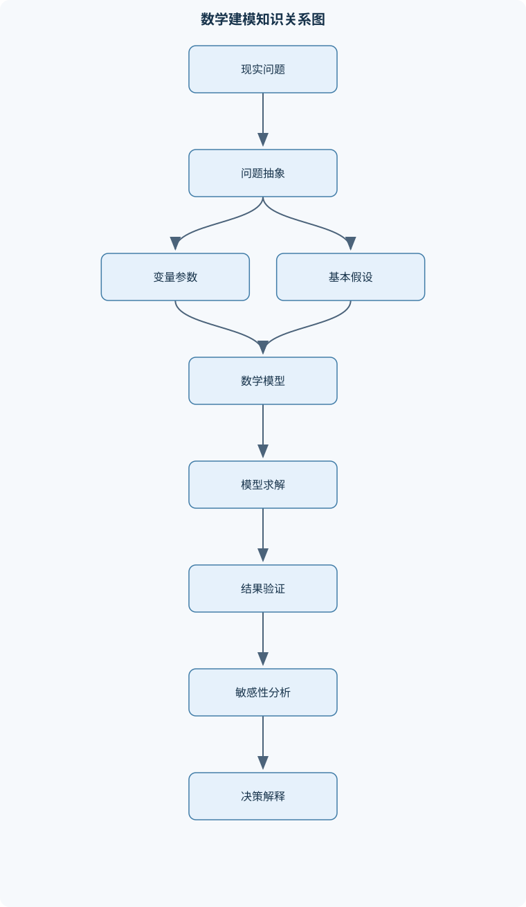
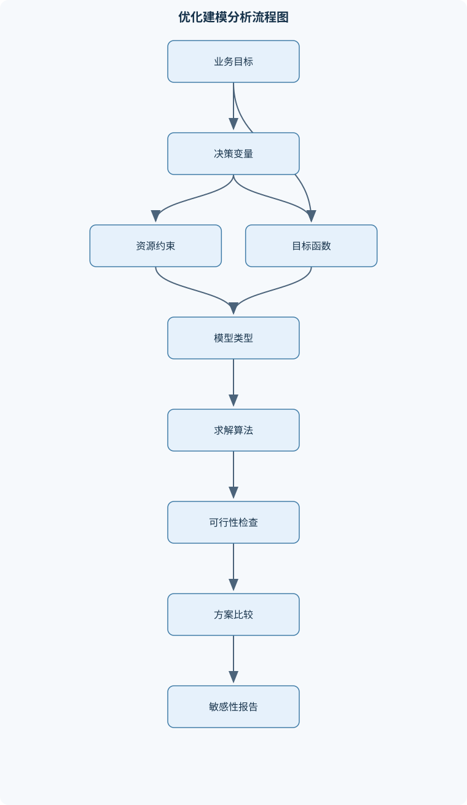

# 数学建模

## 一、课程整体知识框架

### 课程边界与先修知识

数学建模课程研究如何把现实问题抽象为数学结构，利用数据、方程、优化模型、概率统计、算法和计算实验进行分析，并将结果解释回实际情境。内容边界包括建模流程、量纲与尺度分析、常微分方程与动力系统、概率统计与抽样调查、回归分析、线性与整数规划、多目标决策、图论与组合优化、调度与装箱、博弈论、随机模拟和数值计算。先修知识包括微积分、线性代数、概率论基础、初等统计学和一门编程语言；不要求先修高等偏微分方程、测度论或高级优化理论。课程强调理想模型与现实系统的区别，要求明确变量、参数、假设、约束、数据来源、误差和适用范围。





### 1. 数学建模的对象、任务与基本闭环

数学建模是把现实系统中的实体、关系、变化规律和决策目标转化为可计算的数学结构。模型不是现实本身，而是对现实的有目的、有限度的抽象。一个完整模型至少应说明研究对象、时间和空间边界、变量、参数、数据、假设、约束、目标函数、求解方法、验证指标以及适用范围。

建模闭环可表示为：明确问题与目标，识别实体和关系，定义变量与参数，提出可检验假设，建立方程或优化模型，利用数据估计参数，求解模型，检验误差与稳定性，进行敏感性和情景分析，最后把数学结果解释回实际问题。输入是实际问题、背景约束和可用数据；输出不只是一个数，还应包括模型、解、误差范围、关键假设和适用边界。当验证结果不满足预先设定的精度或解释要求时，应修改变量、假设、参数或模型结构，而不是只更换求解器。

变量表示随对象、时间或决策而变化的量。$x,y,z$可以表示决策变量、状态变量或观测变量，但必须注明单位和取值范围；$t$表示时间，连续时间通常取$t\ge 0$，离散时间用$k=0,1,2,\ldots$表示；$\theta$表示未知参数，$\hat\theta$表示由数据得到的估计。参数在一次分析中通常被视为固定，但不代表它在现实中永远不变。$M$表示模型输出，$D$表示观测数据，参数估计、样本内拟合、模型验证和未来预测必须区分。

模型可按结构分为确定性模型与随机模型、连续模型与离散模型、静态模型与动态模型、解释模型与预测模型。确定性模型在给定输入后输出唯一结果，例如线性规划；随机模型把不可预测因素用随机变量或随机过程描述，例如排队模型。连续模型用微分方程表达连续变化，离散模型用差分方程或图结构表达逐步变化。分类不是绝对的：同一交通系统可以用连续流量方程描述，也可以用离散车辆仿真描述。

### 2. 量纲、尺度与模型可信性

等式两侧必须具有相同量纲。例如速度的单位可以是$\mathrm{m/s}$或$\mathrm{km/h}$，但长度、时间和速度不能在未换算时直接代入同一公式。若某物理量由基本量构成，可通过选取特征长度、特征时间或特征速度构造无量纲变量。无量纲化能够减少参数数量、揭示主导机制，但不能消除真实机制；不同无量纲参数对应不同系统状态，不能把一个尺度下的结论无条件外推到另一个尺度。

误差需要区分绝对误差和相对误差。若真实值为$x$、计算值为$\hat x$，绝对误差是$|\hat x-x|$；当$x\ne0$时，相对误差是$|\hat x-x|/|x|$。对于接近零的量，相对误差可能失去解释力，应同时报告绝对误差。问题条件数$\kappa$描述输入微小扰动可能引起的输出相对变化；条件数大说明问题本身病态，不等于算法一定不稳定。算法还可能由于舍入、相消、溢出或迭代误差而不稳定，因此要分别检查问题条件和算法稳定性。

### 3. 动力系统与平衡分析

离散动力系统常写为

$$
x_{k+1}=f(x_k).
$$

平衡点$x^*$满足$f(x^*)=x^*$。令$x_k=x^*+\delta_k$，若$f$在$x^*$附近可微，则

$$
\delta_{k+1}\approx f'(x^*)\delta_k.
$$

当$|f'(x^*)|<1$时，扰动近似按几何级数衰减，平衡点局部稳定；当$|f'(x^*)|>1$时，扰动通常放大，平衡点不稳定；当$|f'(x^*)|=1$时，线性化不能单独给出结论，必须考察更高阶项或直接分析轨道。平衡点存在不表示系统一定会趋于该点。

连续动力系统写为

$$
\dot{x}=f(x),
$$

平衡点满足$f(x^*)=0$。在平衡点附近作线性化，令$\boldsymbol{x}=\boldsymbol{x}^*+\boldsymbol{\delta}$，得到

$$
\dot{\boldsymbol{\delta}}\approx J\boldsymbol{\delta},\qquad
J=Df(\boldsymbol{x}^*).
$$

矩阵$J$的特征值满足$Jv=\lambda v$。二维系统中，若所有特征值实部均为负，则线性模型的平衡点局部渐近稳定；若存在正实部特征值，则不稳定；若有特征值实部为零，线性化通常不足以判断非线性稳定性。相图中的轨迹、零流线和方向场可帮助解释长期行为，但数值相图不能替代理论边界分析。

### 4. 概率统计与数据建模

随机变量$X$用概率分布描述不确定性，$E(X)$和$\operatorname{Var}(X)$分别是期望和方差。条件概率满足

$$
P(A\mid B)=\frac{P(A\cap B)}{P(B)},\qquad P(B)>0,
$$

贝叶斯公式为

$$
P(A\mid B)=\frac{P(B\mid A)P(A)}{P(B)}.
$$

独立性比“不相关”更强。若$X,Y$独立，则通常有$\operatorname{Cov}(X,Y)=0$；反之，协方差为零不必然意味着独立。随机游走、赌徒破产、排队和蒙特卡罗模拟都依赖对随机机制的明确假设，不能只凭观察到的波动随意指定分布。

总体容量记为$N$，样本容量记为$n$，样本均值为

$$
\bar{x}=\frac{1}{n}\sum_{i=1}^n x_i,
$$

样本方差为

$$
s^2=\frac{1}{n-1}\sum_{i=1}^n(x_i-\bar{x})^2.
$$

若$X_i$独立同分布，$E(X_i)=\mu$，$\operatorname{Var}(X_i)=\sigma^2<\infty$，则

$$
E(\bar X)=\mu,\qquad \operatorname{Var}(\bar X)=\frac{\sigma^2}{n}.
$$

样本增大能够降低随机波动，却不能自动消除抽样框覆盖不足、无应答和选择偏差。分层抽样先按重要特征划分层，再在层内抽样；总体均值估计使用层权重，不能把各层样本均值简单平均，除非各层容量相等或已进行适当加权。

统计推断包括点估计、区间估计和假设检验。矩估计令样本矩匹配理论矩；最大似然估计选择使观测数据概率或密度最大的参数。假设检验中，第一类错误是在原假设为真时拒绝它，概率为显著性水平；第二类错误是在原假设不真时仍未拒绝它，检验功效是正确拒绝错误原假设的概率。不拒绝原假设不等于证明原假设成立。

拟合优度检验把样本空间分成互不相交的类别，比较观测频数与原假设下期望频数。若估计了参数，自由度要扣除估计参数的个数。卡方近似要求期望频数不能过小；列联表独立性检验只能说明分类变量之间是否存在统计关联，不能单独推出因果关系。回归模型

$$
y_i=\beta_0+\sum_{j=1}^{p-1}\beta_jx_{ij}+\varepsilon_i
$$

通过最小化残差平方和估计系数。$R^2$表示样本内变异的解释比例，不是因果证明，也不能单独判断外推性能。残差应检查线性性、独立性、方差齐性、异常点和多重共线性。

### 5. 优化、网络、博弈与计算

线性规划使用线性目标函数和线性约束，例如

$$
\min f(x)=c^Tx,\qquad Ax\le b,\quad x\ge0.
$$

可行域是满足全部约束的点集。若可行域非空、有界且目标函数线性，则至少有一个最优顶点。整数规划加入$x\in\mathbb Z$，混合整数规划允许部分变量整数、部分变量连续；整数约束、逻辑约束、互斥约束和容量约束必须明确，否则连续最优解可能无法执行。对偶变量可解释为约束右端项的局部边际价值，但只有在单位、最优基和扰动范围稳定时才有该解释。

多目标问题不能把不同单位的成本、风险和服务水平直接相加。加权和法需要统一目标方向和量纲；约束法可把一个目标作为约束；帕累托最优是不存在在所有目标上不差且至少一项更好的方案，不等于唯一的全局最优。投资组合模型通常以权重和为$1$、权重非负或允许卖空为约束，以预期收益和协方差矩阵表达收益—风险权衡。

图记为$G=(V,E)$，$V$为顶点集合，$E$为边集合。$c_{ij}$表示节点$i$到$j$的成本、距离或时间，单位必须保持一致。最短路、最小生成树、匹配、顶点覆盖、着色、旅行商、网络流分别对应不同决策含义，不能因为都使用图就混为一谈。无权图可用广度优先搜索获得最少边数路径；非负权图可用Dijkstra算法，存在负权边时不能直接使用。

调度模型需说明机器数、任务释放时间、工序顺序、可否抢占、加工时间和目标函数。完工时间、最大延迟、总延迟和机器利用率是不同指标。装箱问题要求把物品放入容量有限的箱中，首次适应递减等方法通常给出可行解，但不自动保证最优。精确枚举、动态规划、分支定界可能在小规模问题上证明最优，组合优化问题规模增大后常需要局部搜索、近似算法或启发式方法。

博弈模型的参与者$i$有策略$s_i$和收益$u_i$。完全信息与不完全信息、静态与动态、合作与非合作分别描述不同信息和行动结构。支配策略不依赖对手选择而始终更优；纳什均衡是任何单个参与者都不愿单独改变策略的组合。二人零和有限博弈若有纯策略鞍点，则最大最小值等于最小最大值；没有鞍点时可用混合策略，使收益按概率加权。

数值计算处理求根、插值、拟合、积分和微分方程。浮点数会产生舍入误差，输入病态会放大误差，直接相减两个接近数可能产生灾难性相消。模型验证应使用独立验证集、交叉验证、残差诊断、敏感性分析和情景分析；验证说明模型在指定数据和范围内具有一定表现，不等于证明模型完全真实。

## 二、章节和模块划分

### 核心知识覆盖清单

本清单用于检查正文是否覆盖本课程的主要知识模块：

- **数学建模导论与问题抽象**：建模对象与数学表示、现实问题的边界设定、变量参数与指标、假设的合理性检验、确定性与随机性、连续模型与离散模型、模型建立验证与修正、量纲分析与无量纲化。
- **函数模型与离散动力系统**：比例指数与对数模型、利息与复利模型、蛛网模型与价格波动、差分方程及平衡点、平衡点稳定性、线性差分方程求解、人口与资源模型、模型参数敏感性。
- **常微分方程与动力系统**：一阶微分方程建模、种群增长与竞争、传染病动力学模型、捕食与种间关系、Lanchester战斗模型、火箭运动与变质量系统、平衡点与线性化、特征值与相图、稳定性与模型边界。
- **概率模型与随机过程基础**：随机变量与分布、条件概率与贝叶斯公式、期望方差与协方差、独立性与相关性、随机游走、赌徒破产模型、排队与等待现象、蒙特卡罗思想、概率模型的假设检验。
- **统计描述与抽样调查**：总体样本与统计量、频数分布与可视化、均值中位数与分位数、方差标准差与变异系数、异常值识别、简单随机抽样、分层抽样与样本分配、抽样误差与非抽样偏差、敏感问题随机化回答。
- **统计推断与回归分析**：点估计与矩估计、最大似然估计、置信区间、假设检验与两类错误、拟合优度检验、列联表独立性检验、简单线性回归、多元线性回归、残差诊断与共线性。
- **数学规划与多目标决策**：线性规划建模、可行域与最优解、单纯形法思想、对偶问题与影子价格、整数规划、混合整数规划、目标函数与约束设计、多目标规划、加权和与帕累托最优、投资组合模型。
- **图论与网络优化**：图与网络的基本概念、路径与连通性、最短路问题、最小生成树、匹配问题、顶点覆盖、顶点着色、环游与旅行商问题、网络流与资源分配。
- **组合优化与计算复杂性**：组合优化问题结构、精确算法与枚举、贪心算法、动态规划、分支定界法、局部搜索与邻域、NP难问题、近似算法与性能界、问题规模与计算复杂度。
- **排序调度与装箱模型**：机器任务调度表示、完工时间与最大延迟、单机排序规则、并行机调度、作业车间调度、装箱问题、拥挤度与扩张度、在线算法、算法下界与近似比。
- **博弈论与竞争决策**：参与者策略与收益、完全信息与不完全信息、静态与动态博弈、合作与非合作博弈、支配策略、纳什均衡、二人零和博弈、混合策略与期望收益、竞争与垄断模型、讨价还价模型。
- **数值计算与模型验证**：浮点数与舍入误差、问题条件数、算法稳定性、方程数值求根、插值与拟合、数值积分与微分方程、误差传播、验证集与交叉验证、敏感性分析与情景分析。


### 1. 数学建模导论与问题抽象

本模块先把现实叙述转成数学对象。应逐一列出决策变量、状态变量、观测变量、参数、目标和约束，并写明每个量的单位、范围及可观测性。假设必须能够被数据、数量级或逻辑关系检验。例如“人口封闭”意味着忽略迁入迁出，“均匀混合”意味着任意个体接触机会近似相同；若现实中存在明显迁移或空间聚集，模型边界就需要修改。

### 2. 函数模型与离散动力系统

比例模型、指数模型和对数模型分别对应恒定比例关系、恒定相对增长率和乘法关系的逆变换。复利递推为

$$
A_{k+1}=(1+r)A_k,
$$

其中$A_k$是第$k$个计息期金额，$r$是每期利率，故

$$
A_k=A_0(1+r)^k.
$$

当计息期足够细且每期利率与时间步长成比例时，极限得到连续复利$A(t)=A_0e^{rt}$。利率必须与计息周期一致，年利率不能未经换算直接当作月利率。蛛网模型用供给、需求和价格调整方程描述滞后反馈，平衡点的线性化斜率乘积绝对值小于$1$时趋于平衡，大于$1$时发散，等于$1$时可能出现持续振荡。

### 3. 常微分方程与动力系统

一阶微分方程建模的核心是守恒关系和变化率关系。种群增长可从出生率、死亡率、资源限制得到；竞争模型加入种间抑制项；捕食模型同时描述猎物增长和捕食损失。传染病模型中，易感者、感染者和移除者分别为$S,I,R$，总人数为$N$，基本模型是

$$
\dot S=-\beta SI/N,\qquad
\dot I=\beta SI/N-\gamma I,\qquad
\dot R=\gamma I.
$$

在封闭人群、均匀混合和参数恒定条件下，感染者初期增长取决于$\beta/\gamma$与$1$的比较。Lanchester模型用平方律或线性律描述战斗力和兵力损耗，选择哪一种取决于远程集中打击或近距离单兵作用等假设。火箭运动还要考虑质量随时间变化，不能直接套用恒质量质点方程。模型输出必须说明初值、参数范围和外部干预是否保持不变。

### 4. 概率模型与随机过程基础

本模块从分布、条件概率和期望开始，逐步建立随机游走、赌徒破产和排队模型。排队模型至少要定义到达过程、服务时间、服务台数量、队列容量和服务规则。蒙特卡罗方法用随机试验估计期望；若有$N$个独立样本，样本均值的随机误差通常按$O(N^{-1/2})$下降，因此将精度提高十倍通常需要约一百倍样本量。模拟结果还应报告标准误差或区间，而不是只给一个模拟均值。

### 5. 统计描述、抽样调查与统计推断

描述统计包括频数表、直方图、箱线图、均值、中位数、分位数、方差、标准差和变异系数。均值容易受极端值影响，中位数和分位数对偏态数据更稳健；异常值可能是录入错误，也可能是重要真实事件，不能机械删除。敏感问题可通过随机化回答减少直接披露压力，但必须把回答机制纳入概率模型，否则总体比例估计会偏差。

推断部分包括矩估计、最大似然估计、置信区间、两类错误、拟合优度检验、列联表检验和回归分析。多元回归要关注共线性：若自变量高度相关，系数可能对样本微扰非常敏感，即使整体预测尚可，单个系数的解释也不稳定。残差图是识别非线性、异方差和异常观测的主要工具之一。

### 6. 数学规划与多目标决策

建模时先确定目标方向，再写资源、需求、容量、比例、逻辑和整数性约束。单纯形法从基可行解出发，通过检验数选择入基变量和出基变量，保持当前基对应的基本解可行；当没有改进方向时得到最优解，若可行方向无限改进则模型无界。整数规划可用分支定界：先解线性松弛，以松弛目标值作界；若松弛解非整数，就对某个整数变量作上下分支，并用界限剪枝。最坏复杂度可能为指数级。

### 7. 图论、网络优化、组合优化与调度

最短路问题适合路径成本可加的网络；最小生成树连接全部节点且总边权最小，不要求形成从指定源点到各点的最短路径；网络流用于容量约束下的输送量最大化或成本最小化。匹配解决成对分配，顶点覆盖解决覆盖全部边所需的节点集合，着色解决相邻节点不能同色的问题。

组合优化算法包括枚举、贪心、动态规划、分支定界、局部搜索和近似算法。动态规划要求状态具有最优子结构；若状态数为$S$、每状态最多有$A$个决策，典型时间复杂度为$O(SA)$。贪心算法只有在能给出交换论证或其他证明时才能称为精确算法，否则应称为启发式。调度和装箱必须同时检查机器、顺序、容量、释放时间和可抢占性，不能仅凭排序结果判断可执行性。

### 8. 博弈论与竞争决策

建模步骤是列出参与者、策略集合、收益函数和信息结构，再确定行动顺序。完全信息静态博弈可用收益矩阵寻找支配策略和纳什均衡；动态博弈需考虑后行动者观察到的信息；不完全信息模型还需描述类型及其概率。垄断与竞争模型的价格、产量和收益结论依赖需求函数、成本函数和市场规则，不能把理想模型结论直接当成现实价格预测。讨价还价模型中，耐心程度、外部选择和议价顺序都会改变均衡结果。

### 9. 代表性算法与流程

#### 建模闭环流程

输入为实际问题、数据和背景约束。过程是定义目标，划定边界，建立变量和参数表，提出假设，写出方程或优化模型，估计参数，计算解，进行残差、误差、敏感性和情景分析。输出为模型、方案、误差范围和适用条件。终止条件是验证指标达到预设要求，或确认必须返回模型修正阶段。

#### 最短路算法

对非负边权图使用Dijkstra算法。初始化源点距离为$0$，其余为无穷大；每次选取当前距离最小且未确定的节点，松弛其所有出边。若通过节点$i$到$j$的距离小于当前记录，则更新距离和前驱。其不变量是已取出的节点距离已经是最终最短距离。使用二叉堆时复杂度约为$O((|V|+|E|)\log|V|)$；存在负权边时不适用。

#### 动态规划与分支定界

动态规划先定义状态、决策、转移和边界，再按自底向上或记忆化方式计算并回溯决策。分支定界先解连续松弛，利用上下界剪枝，直到所有未处理节点都不可能改进当前整数解。两者都必须保留可行性检查；得到一个较好解不等于已经证明最优。

#### 统计检验与蒙特卡罗流程

检验流程包括设定原假设和备择假设、选择统计量、确定原假设下分布、计算$p$值或拒绝域，并结合效应大小和置信区间解释。蒙特卡罗流程是生成符合随机机制的样本，计算每次试验指标，汇总均值和标准误差，增加样本量检查稳定性。二者都不能把数值输出脱离假设解释。

```python
import random
import math

def monte_carlo_mean(sample_size, seed=1):
    """估计单位正方形内四分之一圆的面积，即 pi/4。"""
    rng = random.Random(seed)
    hit = 0
    for _ in range(sample_size):
        x = rng.random()
        y = rng.random()
        if x * x + y * y <= 1:
            hit += 1
    estimate = 4 * hit / sample_size
    standard_error = 4 * math.sqrt((hit / sample_size) *
                                   (1 - hit / sample_size) / sample_size)
    return estimate, standard_error

estimate, error = monte_carlo_mean(100000)
print(estimate, error)
```

该程序输入样本量和随机种子，输出圆周率估计值及近似标准误差。它假定点在单位正方形内独立均匀生成；样本量增加只能降低随机误差，不能修正随机数机制错误或代码判断错误。

### 10. 代表性例题

#### 例题一：复利模型

题干：本金为$10000$元，年利率为$3.6\%$，按月复利，存两年，求期末金额。

分析：月利率为$r=0.036/12=0.003$，计息次数为$k=24$，不能把年利率直接作为每月利率。

解答：

$$
A_{24}=10000(1+0.003)^{24}\approx10746.4\text{元}.
$$

结果验证：逐月递推$A_{k+1}=1.003A_k$应得到相同结果。变式是连续复利，此时使用$A(t)=10000e^{0.036\times2}$；两者差异来自计息机制不同。

#### 例题二：离散平衡与稳定性

题干：价格模型为$p_{k+1}=12-0.5p_k$，求平衡价格并判断稳定性。

分析：令$p_{k+1}=p_k=p^*$，得到$1.5p^*=12$。

解答：

$$
p^*=8,\qquad f'(p^*)=-0.5.
$$

因为$|f'(p^*)|=0.5<1$，扰动会交替变号但逐步衰减，故局部稳定。变式若系数改为$-1.2$，则扰动幅度扩大，平衡点不稳定；若改为$-1$，线性判据不能直接决定稳定性。

#### 例题三：传染病初期增长

题干：封闭人群中，传播参数$\beta=0.4$，移除参数$\gamma=0.2$，初期感染者为$I>0$，判断感染人数初期趋势。

分析：

$$
\dot I=I(\beta S/N-\gamma).
$$

初期若$S/N$接近$1$，则增长率约为$0.4-0.2=0.2>0$。

结论：感染者初期增加，基本再生条件$\beta/\gamma=2>1$。验证时应检查人口守恒$\dot S+\dot I+\dot R=0$。变式是加入疫苗或迁移后，封闭人群假设失效，不能继续直接使用该结论。

#### 例题四：线性回归解释

题干：用学习时间$x$预测成绩$y$，拟合得到$\hat y=52+4x$，$R^2=0.64$。解释系数。

分析：斜率单位为“成绩单位/小时”。在模型假设和样本范围内，学习时间增加一小时，预测成绩平均增加$4$个成绩单位。

结果：$R^2=0.64$表示样本内成绩变异中约$64\%$由该线性模型解释，不表示学习时间造成了$64\%$的变化。验证需查看残差图、异常点和预测区间。变式是若数据来自自愿学习者，动机等遗漏变量可能造成混淆，不能仅凭回归系数作因果结论。

#### 例题五：最短路

题干：节点$A$到$B,C$的边权分别为$2,5$，$B$到$C$的边权为$1$，求$A$到$C$的最短路。

分析：直接路径$A\to C$成本为$5$，经$B$的路径成本为$2+1=3$。

解答：最短路为$A\to B\to C$，距离为$3$。验证时比较所有可行路径；若图中加入负权边，Dijkstra算法的“取出即确定”不再成立。变式是无权图时应按边数使用广度优先搜索，而不是把边数和实际距离混用。

### 11. 实验与项目流程

#### 实验一：回归模型诊断

输入数据为响应变量$y$和自变量矩阵$X$，包括缺失值、异常值标记和变量单位。步骤如下：先检查数据类型、重复记录和缺失机制；再拟合线性回归；输出系数、置信区间、预测值和残差；绘制残差—拟合值图，检查线性性和方差齐性；用验证集或交叉验证评价预测误差。

评价标准包括数据对应关系未被破坏、系数单位正确、残差没有明显结构、验证误差与训练误差差距可解释。排错方法是：若矩阵不可逆，检查完全共线变量；若残差呈曲线，考虑变换或非线性项；若少数点支配结果，检查录入错误和高杠杆点，但不能仅因点“不符合预期”而删除。

#### 实验二：装箱与整数规划比较

输入是一组物品体积$v_i$和箱容量$C$。先按体积递减，使用首次适应递减算法依次放入能够容纳物品的第一个箱；记录箱数、每箱剩余容量和装载率。再建立小规模整数规划，以$x_{ij}=1$表示物品$i$放入箱$j$，约束每件物品恰入一个箱，且每箱总容量不超过$C$，目标最小化启用箱数。

评价标准包括所有物品均被分配、容量约束不违反、箱数与整数规划最优值比较、近似差距可解释。排错方法是检查物品单位是否一致、是否遗漏“每件物品恰好一次”约束，以及是否把空箱误计入目标。若规模过大无法精确求解，应报告当前最好可行解、下界和不能证明最优的事实，而不能把启发式结果直接称为最优。

## 三、核心概念的详细解释

### 1. 建模对象、变量、参数与边界

数学建模的第一步不是立即写方程，而是确定“研究什么、在什么范围内研究、为了回答什么问题”。现实系统通常包含大量实体和关系，模型只保留与目标有关的部分。例如研究城市道路拥堵，可以把车辆流量、道路容量、行驶时间和信号配时作为核心变量，而暂时忽略车辆颜色等与目标无关的信息。

变量是随时间、空间、样本或决策而变化的量。状态变量描述系统当前状态，决策变量表示可以控制的选择，观测变量表示从现实中记录的数据。参数是模型中相对固定但可能需要估计的量，例如增长率、传播率、单位成本和需求均值。若$\theta$表示未知参数，$\hat{\theta}$表示根据数据得到的估计，则必须区分“真实参数”“估计参数”和“由估计参数产生的预测值”。参数估计的误差会传递到模型输出，不能把$\hat{\theta}$当作无误差常数。

边界设定包括时间边界、空间边界、对象边界和信息边界。封闭人口模型把出生、死亡和迁移排除在研究范围之外；若研究时间很长，这种边界可能不再合理。模型还需要规定变量的取值范围，例如人数通常满足$S,I,R\ge 0$，概率满足$0\le p\le1$，装箱决策变量必须是整数或$0$—$1$变量。忽略取值范围，可能得到代数上正确但现实中无意义的解。

### 2. 假设、确定性与随机性

假设是把现实系统简化为数学结构的依据。常见假设包括参数在研究期间保持不变、个体均匀混合、观测误差独立、需求服从某种分布、资源可连续分割以及决策者具有理性偏好。假设必须能够说明其作用和适用边界，而不能只写“假设条件合理”。

确定性模型在输入完全给定时产生唯一输出，例如容量约束明确的线性规划。随机模型承认输入、状态或观测中存在不可预测因素，用随机变量、概率分布或随机过程表达不确定性。确定性模型并不意味着现实没有随机性，而是把随机波动视为可忽略、已平均化或暂不研究。反过来，随机模型也不是把所有因素都随意加上随机项；随机项应有数据、机制或误差分析支持。

连续模型使用实数变量和微分方程，适合描述人口比例、浓度、温度等在时间上近似连续变化的量。离散模型使用整数时刻、网络节点或有限状态，适合描述逐期价格、车辆路径、任务分配和库存补货。连续模型与离散模型可能描述同一系统的不同尺度。若单次变化量与总体规模不可忽略，直接使用连续近似会产生偏差。

### 3. 模型验证、修正与解释

建模闭环包括：明确目标，定义边界，识别变量和参数，提出假设，建立数学结构，估计参数，求解，验证，进行敏感性和情景分析，并将结果解释回实际问题。验证不是证明模型“真实”，而是检验模型在指定数据、指标和范围内是否具有足够的解释力或预测能力。

验证至少应包括三类内容。第一是结构验证，检查方程、约束和变量单位是否符合机制，例如人口模型中总人数是否守恒。第二是数值验证，检查算法输出是否满足约束，是否存在溢出、负概率、负人数或不合理极端值。第三是经验验证，将模型输出与独立观测数据或验证集比较，报告误差指标及其不确定性。

若模型拟合很好但验证集表现差，常见原因是过拟合、数据泄漏或训练数据与应用场景不同。若所有数据上的误差都较大，可能是变量遗漏、函数形式错误、参数估计不可靠或数据质量不足。修正模型时应优先检查边界、单位、数据对应关系和假设，而不是盲目增加方程复杂度。

### 4. 量纲分析与尺度分析

等式两侧必须具有相同量纲。若距离$x$以米计、时间$t$以秒计，则速度应为$\mathrm{m/s}$；不能把以$\mathrm{km/h}$记录的速度直接代入以米和秒为单位的公式。量纲检查可以发现许多建模错误，但量纲一致并不保证模型机制正确。

设摆长为$L$，重力加速度为$g$，摆动时间尺度为$T$。假设$T$可表示为

$$
T=C L^a g^b,
$$

其中$C$为无量纲常数。由于$[T]=\mathrm{T}$、$[L]=\mathrm{L}$、$[g]=\mathrm{L}\mathrm{T}^{-2}$，右侧量纲为$\mathrm{L}^{a+b}\mathrm{T}^{-2b}$。比较指数得到

$$
a+b=0,\qquad -2b=1.
$$

因此$b=-\frac12$、$a=\frac12$，得到时间尺度

$$
T=C\sqrt{\frac{L}{g}}.
$$

该推导只能给出尺度关系，不能确定常数$C$，也不能说明摆角、阻力和支点运动一定可以忽略。无量纲化能够减少参数数量，但不同无量纲参数的取值仍可能对应完全不同的机制。

### 5. 动力系统中的平衡与稳定性

离散系统写成

$$
x_{k+1}=f(x_k),
$$

平衡点$x^*$满足$f(x^*)=x^*$。令$x_k=x^*+\delta_k$，在$x^*$附近作泰勒展开：

$$
\delta_{k+1}=f(x^*+\delta_k)-f(x^*)\approx f'(x^*)\delta_k.
$$

于是扰动近似为

$$
\delta_k\approx \bigl(f'(x^*)\bigr)^k\delta_0.
$$

当$|f'(x^*)|<1$时扰动衰减，平衡点局部稳定；当$|f'(x^*)|>1$时扰动放大，平衡点不稳定；当$|f'(x^*)|=1$时，线性近似不足以判定结论。平衡点存在并不等于系统会趋于平衡点，例如某些差分方程有平衡解，但初值扰动会导致振荡或发散。

连续系统写成

$$
\dot{\boldsymbol{x}}=\boldsymbol{f}(\boldsymbol{x}).
$$

平衡点满足$\boldsymbol{f}(\boldsymbol{x}^*)=\boldsymbol{0}$。令$\boldsymbol{x}=\boldsymbol{x}^*+\boldsymbol{\delta}$，得到

$$
\dot{\boldsymbol{\delta}}\approx J\boldsymbol{\delta},
\qquad
J=D\boldsymbol{f}(\boldsymbol{x}^*).
$$

矩阵$J$的特征值决定线性化系统的局部行为。若所有特征值实部均为负，平衡点局部渐近稳定；若存在实部为正的特征值，则不稳定；若有特征值实部为零，线性化通常不能单独判断非线性系统的稳定性。

### 6. 概率、统计与抽样误差

随机变量$X$用概率分布描述不确定结果，期望$E(X)$表示长期平均水平，方差$\operatorname{Var}(X)$表示围绕期望的波动程度。独立性比“不相关”更强：独立随机变量一定协方差为零，但协方差为零不必然独立。建模时若把相关观测误当成独立观测，会低估不确定性。

若$X_1,\ldots,X_n$独立同分布，且$E(X_i)=\mu$、$\operatorname{Var}(X_i)=\sigma^2<\infty$，样本均值为

$$
\bar X=\frac1n\sum_{i=1}^nX_i.
$$

则

$$
E(\bar X)=\mu,\qquad
\operatorname{Var}(\bar X)=\frac{\sigma^2}{n}.
$$

推导中使用了期望的线性性和独立变量方差可加性。该结论说明增大样本量可以降低随机抽样波动，但不能消除抽样框覆盖不足、无应答和选择偏差。样本容量大而抽样方式有系统偏差时，估计仍可能偏离总体真实值。

分层抽样把总体划分为若干层，在每层内抽样。设第$h$层总体容量为$N_h$、样本均值为$\bar x_h$，总体容量为$N=\sum_hN_h$，则总体均值的分层估计为

$$
\hat\mu_{\mathrm{st}}
=\sum_{h=1}^H\frac{N_h}{N}\bar x_h.
$$

比例分配按层容量分配样本；Neyman分配还考虑层内标准差，波动较大的层应获得更多样本。敏感问题可使用随机化回答，使受访者不必直接暴露真实状态，但这种设计会增加估计方差，必须在隐私保护和统计效率之间权衡。

### 7. 回归、检验与因果边界

线性回归模型可写为

$$
y_i=\beta_0+\beta_1x_{i1}+\cdots+\beta_px_{ip}+\varepsilon_i.
$$

最小二乘法选择参数，使残差平方和

$$
\sum_{i=1}^n
\left(y_i-\beta_0-\sum_{j=1}^p\beta_jx_{ij}\right)^2
$$

最小。$R^2$描述样本内响应变量变异中被模型解释的比例，但不能证明因果关系，也不能保证未来预测准确。解释回归系数时要说明单位、条件和变量范围；多元回归中的$\beta_j$表示其他纳入模型的变量保持不变时$x_j$变化一个单位对应的平均响应变化。

残差诊断应检查线性性、独立性、方差齐性、异常点和高杠杆点。自变量高度共线时，系数可能对样本扰动非常敏感，虽然整体预测仍可能较好。拟合优度高也可能来自数据泄漏、过拟合或共同趋势。

假设检验以原假设$H_0$和备择假设$H_1$为基础。由样本计算的量称为检验统计量；在$H_0$成立时，落入拒绝域则拒绝$H_0$，否则只能表述为“不拒绝$H_0$”，不能说已经证明$H_0$成立。第一类错误是在$H_0$为真时错误拒绝，概率为显著性水平$\alpha$；第二类错误是在$H_0$不真时未拒绝，概率通常记为$\beta$；检验功效为$1-\beta$。$p$值小说明数据与$H_0$不相容程度较高，不等于效应一定重要。

拟合优度检验把样本空间划分为互不相交的类别，比较观察频数$O_i$与理论期望频数$E_i$。统计量为

$$
\chi^2=\sum_{i=1}^k\frac{(O_i-E_i)^2}{E_i}.
$$

在样本量充分、期望频数条件适当且估计参数数量为$q$时，该统计量近似服从自由度为$k-1-q$的卡方分布。若期望频数过小，卡方近似可能不可靠，应合并类别或采用更合适的精确方法。Kolmogorov检验比较经验分布函数与理论分布函数的最大绝对差异，适用于连续分布情形；离散数据和参数估计会改变其临界值条件，不能机械套用表值。

### 8. 优化、图论、博弈与数值计算

线性规划以线性目标函数和线性约束描述资源配置。若可行域非空、有界，则线性目标至少在某个顶点取得最优值。整数规划进一步要求部分或全部变量取整数，用于人数、车辆、设备启用和互斥决策。连续模型得到的最优解可能是$2.6$辆车或$0.4$台设备，不能直接执行。

图$G=(V,E)$由顶点和边构成。无权图中，广度优先搜索第一次访问某顶点时得到从源点出发的最少边数距离；带非负权边时可使用Dijkstra算法；存在负权边时，Dijkstra的确定性结论不再成立。最短路、最小生成树、匹配、顶点覆盖和网络流的目标不同，不能把一个问题的解直接解释为另一个问题的解。

博弈模型的基本元素是参与者、策略集合和收益函数。支配策略、纳什均衡、帕累托最优和全局最优并非同一概念。纳什均衡表示任何单个参与者在其他人策略固定时都没有单独改变策略的收益动机，并不保证社会总收益最大。二人零和有限博弈若存在纯策略鞍点，则最大最小值等于最小最大值；没有纯鞍点时可引入混合策略。

数值计算还要区分问题条件数与算法稳定性。条件数大说明输入扰动可能被问题本身放大；算法不稳定则说明算法额外引入了超过问题敏感性所能解释的误差。例如直接使用二次公式计算两个相近根时，大数相减会造成灾难性相消。应结合前向误差、后向误差、舍入误差和条件数判断结果可靠性。

## 四、重要定义、公式、定理和推导

### 专业审校补充：关键定义与适用边界

模型可辨识性是数学建模中常被遗漏的边界：若不同的参数组合在给定观测条件下产生完全相同或近似相同的模型输出，则参数不能由这些数据唯一确定，称为结构不可辨识或实际不可辨识。设模型输出为 y(t;θ)，参数向量为 θ；若存在 θ₁≠θ₂，使所有观测时刻均有 y(t;θ₁)=y(t;θ₂)，则仅凭该观测无法区分两组参数。线性回归中的完全共线是典型例子；在动力系统中，只观测总人数而不观测分组状态，也可能无法同时估计多个传播参数。应先分析参数—输出关系，再进行估计，不能把优化器返回的唯一数值误认为参数真实唯一。增加观测时段、观测变量或施加有机制依据的约束，可能改善可辨识性；但增加同类重复观测主要降低随机误差，未必消除结构不可辨识。参数可辨识还不等于模型有效，仍需进行残差诊断、样本外验证和敏感性分析。


### 1. 代表性算法与流程

#### 1.1 最小二乘回归流程

**输入：**响应变量数据$y_1,\ldots,y_n$、自变量矩阵$X$、变量单位和研究目标。  
**过程：**

1. 检查缺失值、重复记录、异常值和观测对应关系。
2. 明确回归形式及误差假设。
3. 构造设计矩阵，计算使残差平方和最小的系数。
4. 输出拟合值、残差、系数区间和预测区间。
5. 检查残差独立性、线性性、方差齐性和近似正态性。
6. 用验证集或交叉验证评价样本外误差。

不变量是每一行观测的响应值与自变量始终保持对应。若设计矩阵完全共线，参数解可能不唯一；可删除冗余变量、重新定义变量或采用正则化，但改变方法后应重新解释系数。直接矩阵分解的主要计算量通常约为$O(np^2+p^3)$，其中$n$为样本量，$p$为参数数量。

#### 1.2 分支定界法

**输入：**整数规划模型。  
**输出：**当前最好整数可行解，以及在能够证明时的全局最优性。  

先去掉整数限制，求线性松弛。对于最大化问题，松弛最优值是整数问题的上界；若松弛解已经整数化，则得到一个候选最优解。若某变量$x_j$取非整数值，则分成$x_j\le\lfloor x_j\rfloor$和$x_j\ge\lceil x_j\rceil$两个子问题。分别求解子问题的松弛，并进行剪枝：

- 子问题不可行，剪枝；
- 子问题上界不超过当前最好整数解，剪枝；
- 松弛解整数化，更新最好解；
- 否则继续分支。

不变量是被剪枝节点不可能产生优于当前最好解的整数方案。所有节点处理完毕后，当前最好解才具有最优性证明。该方法最坏情况下为指数复杂度，适合中小规模或具有较强界限的整数规划。

#### 1.3 动态规划

动态规划适用于具有阶段结构和最优子结构的问题。以容量为$C$的背包为例，物品$i$的重量为$w_i$、价值为$v_i$，定义$F(i,c)$为前$i$件物品在容量不超过$c$时的最大价值，则

$$
F(i,c)=
\begin{cases}
F(i-1,c),&w_i>c,\\
\max\{F(i-1,c),F(i-1,c-w_i)+v_i\},&w_i\le c.
\end{cases}
$$

边界条件为$F(0,c)=0$。第一项表示不选第$i$件物品，第二项表示选择该物品。按$i=1,\ldots,n$和容量递推，最后从$F(n,C)$回溯选择方案。状态数约为$nC$，每个状态的决策数为$2$，时间复杂度为$O(nC)$；这里的$C$是数值容量，因此该复杂度属于伪多项式复杂度。

#### 1.4 蒙特卡罗模拟

**输入：**随机机制、参数、模拟次数$N$和待估计指标。  
**输出：**指标估计值、标准误差、置信区间及稳定性分析。  

每次试验按照同一概率机制生成样本，计算指标$Y_r$，再取

$$
\hat\mu_N=\frac1N\sum_{r=1}^NY_r.
$$

若试验独立且方差有限，则估计标准误差可用样本标准差除以$\sqrt N$近似。独立模拟下误差通常按$O(N^{-1/2})$下降，因此把模拟次数增加四倍，误差尺度大约减半，而不是减为四分之一。

```python
import random
import math

def estimate_pi(trials, seed=0):
    """用独立均匀点估计圆周率；无文件和网络副作用。"""
    if trials <= 0:
        raise ValueError("trials 必须为正整数")
    rng = random.Random(seed)
    inside = 0
    estimates = []

    for k in range(1, trials + 1):
        x = rng.random()
        y = rng.random()
        if x * x + y * y <= 1.0:
            inside += 1
        if k in {trials // 4, trials // 2, 3 * trials // 4, trials}:
            estimates.append((k, 4.0 * inside / k))

    return 4.0 * inside / trials, estimates

estimate, checkpoints = estimate_pi(100000, seed=42)
print("估计值:", estimate)
print("阶段结果:", checkpoints)
```

程序的不变量是每次生成的点都服从单位正方形上的同一均匀机制，且只在四分之一圆内时计数。估计值不必每次都接近真实值，判断质量应依据重复试验、标准误差和置信区间，而不能只看一次运行结果。

### 2. 典型例题

#### 例题一：复利与连续复利

**题干：**本金$A_0=10000$元，年利率$r=6\%$，每年计息一次，求三年后的金额；再比较连续复利结果。

**分析：**年度复利递推为

$$
A_{k+1}=(1+r)A_k.
$$

逐次代入得到

$$
A_3=10000(1.06)^3=11910.16\text{元}.
$$

连续复利模型为

$$
A(t)=A_0e^{rt},
$$

故

$$
A(3)=10000e^{0.18}\approx11971.22\text{元}.
$$

**结果验证：**两种结果均大于本金，且连续复利略大于年度复利，原因是计息更频繁。若利率是月利率，不能直接把月数代入年利率公式；必须统一利率和计息期。变式是分期还款，此时每期支付会形成现金流方程，不能继续使用单纯的本金增长公式。

#### 例题二：蛛网模型稳定性

**题干：**供给价格和需求价格的线性关系在平衡点附近可表示为$p_{k+1}=a-bp_k$，求平衡价格并判断稳定性。

**解答：**平衡点满足

$$
p^*=a-bp^*,
$$

因此

$$
p^*=\frac{a}{1+b},\qquad b\ne-1.
$$

令$p_k=p^*+\delta_k$，则

$$
\delta_{k+1}=-b\delta_k.
$$

所以当$|b|<1$时扰动衰减，价格趋近平衡；当$|b|>1$时扰动扩大；当$b<0$时还可能出现方向交替的振荡。

**结果验证：**代入$p^*$可检查递推式两边相等。变式是供需曲线斜率乘积达到$1$的情形，此时线性化只能说明扰动不衰减，不能直接断定最终发散，需考虑非线性项、边界和价格截断。

#### 例题三：传染病初期增长条件

**题干：**封闭人群总数为$N$，易感者、感染者和移除者分别为$S,I,R$，传播率$\beta$，移除率$\gamma$。判断感染者初期是否增加。

**解答：**基本模型为

$$
\dot S=-\beta\frac{SI}{N},\qquad
\dot I=\beta\frac{SI}{N}-\gamma I,\qquad
\dot R=\gamma I.
$$

整理感染者方程：

$$
\dot I=I\left(\beta\frac SN-\gamma\right).
$$

初期若$S\approx N$，则

$$
\dot I\approx I(\beta-\gamma).
$$

因此$\beta/\gamma>1$时感染者初期增加，$\beta/\gamma<1$时初期减少。

**验证：**三式相加得到$\dot S+\dot I+\dot R=0$，说明封闭人群总数守恒。该结论依赖均匀混合、参数恒定和无迁移等假设。变式是加入疫苗接种或出生死亡后，方程需要增加相应流入流出项，不能直接沿用封闭系统结论。

#### 例题四：回归系数与判定系数

**题干：**学习时间$x$以小时计，成绩$y$以分数计，拟合结果为$\hat y=52+4x$，$R^2=0.64$。解释模型。

**解答：**截距$52$表示在模型定义的$x=0$附近预测成绩为$52$分，但若样本中没有接近零小时的观测，截距未必具有实际含义。斜率$4$的单位是“分/小时”，表示在样本范围和模型条件下，学习时间增加一小时，预测成绩平均增加$4$分。$R^2=0.64$表示样本内成绩变异中约$64\%$被该线性模型解释。

**验证与边界：**应检查残差图、异常点、方差齐性和验证集误差。$R^2$不等于学习时间造成的成绩变化比例；学习动机、基础水平等遗漏变量可能同时影响学习时间和成绩。变式是加入二次项后$R^2$提高，不代表模型必然更好，还应比较验证误差和模型复杂度。

#### 例题五：最短路径与算法条件

**题干：**有向图中$A\to B$成本为$2$，$A\to C$成本为$5$，$B\to C$成本为$1$，求$A$到$C$的最短路径。

**解答：**直接路径成本为$5$，经$B$的路径成本为$2+1=3$，因此最短路径是$A\to B\to C$，最短距离为$3$。Dijkstra算法从$A$开始，初始距离$d(A)=0$、$d(B)=2$、$d(C)=5$；取出$B$后松弛$B\to C$，得到$d(C)=\min(5,2+1)=3$。

**验证与变式：**应检查所有可行路径或算法的前驱链。若存在负权边，Dijkstra“取出后距离已最终确定”的不变量可能失效；无权图应使用广度优先搜索，此时最短含义是边数最少，而不是实际距离最短。

### 3. 实验与项目流程

#### 3.1 回归模型诊断实验

**输入数据：**响应变量$y$、自变量矩阵$X$、每个变量的单位、观测时间或个体标识、缺失值和异常标记。  

**步骤：**

1. 核对每一行是否代表同一观测单位，检查重复、缺失和单位混用。
2. 将数据划分为训练集和验证集，避免用验证数据调参。
3. 拟合基准线性回归，保存系数、拟合值和残差。
4. 绘制残差—拟合值图、残差—自变量图，检查曲线结构和异方差。
5. 检查自变量相关性及共线性，比较系数在变量删除或扰动后的变化。
6. 用均方误差、平均绝对误差和预测区间评价验证集表现。

**评价标准：**数据对应关系正确，系数单位可解释，残差无明显系统结构，训练误差与验证误差差距能够说明，结论不超出数据范围。  

**排错方法：**若矩阵不可逆，检查完全共线变量；若残差呈曲线，考虑变量变换或非线性项；若方差随拟合值增大，考虑变换或加权方法；若少数点强烈影响系数，检查录入错误和高杠杆点，但不能仅因结果“不符合预期”而删除观测。

#### 3.2 装箱算法与整数规划比较

**输入数据：**物品体积$v_i>0$、箱容量$C>0$和物品数量$n$。  

**步骤：**

1. 按$v_i$从大到小排序。
2. 依次把物品放入能够容纳它的第一个已开箱子；若没有这样的箱子，则开启新箱。
3. 记录箱数、每箱装载量和剩余容量。
4. 对小规模实例建立整数规划：令$x_{ij}=1$表示物品$i$放入箱$j$，$y_j=1$表示箱$j$启用。
5. 加入
   $$
   \sum_jx_{ij}=1,
   \qquad
   \sum_iv_ix_{ij}\le Cy_j,
   $$
   并最小化$\sum_jy_j$。
6. 比较启发式箱数与整数规划最优箱数。

**评价标准：**每件物品恰好分配一次，每箱不超容量，启发式方案可执行；小规模实例中应报告最优箱数及启发式差距。规模过大时，应同时报告当前最好可行解和下界，不能把启发式解称为已证明最优。

**排错方法：**检查体积和容量单位是否一致，确认空箱没有被计入目标，确认$x_{ij}$与$y_j$的逻辑关系完整，并检查排序后是否丢失物品编号。

### 4. 常见错误、考法与岗位应用

#### 4.1 具体易错点

1. 把模型输出当作现实事实，忽略模型假设和适用范围。
2. 混用米、千米、秒和小时，导致量纲不一致。
3. 认为平衡点存在就必然趋于平衡。
4. 在$|f'(x^*)|=1$时仍直接据线性化断言稳定。
5. 把样本量增大当作消除所有偏差的方法。
6. 把不相关误认为独立。
7. 把$p$值小解释为效应大。
8. 把“不拒绝原假设”写成“接受并证明原假设”。
9. 卡方拟合优度检验中忽略期望频数条件。
10. 用$R^2$单独评价回归模型。
11. 把回归关系直接解释为因果关系。
12. 把连续规划解直接当作整数决策。
13. 把贪心算法的可行解称为最优解。
14. 在有负权边时直接使用Dijkstra算法。
15. 把帕累托最优、纳什均衡和全局最优混为一谈。
16. 把条件数大简单归因于程序错误。
17. 直接相减两个接近的大数，忽略灾难性相消。
18. 把一次模拟结果当作稳定的概率结论。

#### 4.2 典型笔试问题与解答思路

**问题一：**证明离散平衡点在$|f'(x^*)|<1$时局部稳定。  
**思路：**先写$x_k=x^*+\delta_k$，泰勒展开得到$\delta_{k+1}\approx f'(x^*)\delta_k$，再说明扰动按几何级数衰减，并指出这是局部结论。

**问题二：**为什么样本均值方差为$\sigma^2/n$？  
**思路：**利用方差的齐次性和独立变量方差可加性；若样本相关，则必须加入协方差项。

**问题三：**解释第一类错误、第二类错误和检验功效。  
**思路：**先区分$H_0$真假，再画出“拒绝/不拒绝”的决策表，说明$\alpha$和$1-\beta$的含义。

**问题四：**为什么$R^2$高不代表因果关系？  
**思路：**指出遗漏变量、反向因果、共同趋势和选择偏差均可能产生高拟合度。

**问题五：**线性规划最优解为什么可在顶点取得？  
**思路：**说明线性目标在多面体可行域上沿方向改进；若最优点不是顶点，可沿包含该点的面移动到顶点而不降低目标值。

**问题六：**Dijkstra算法为什么不能处理一般负权边？  
**思路：**说明算法依赖“当前最小暂定距离已最终确定”的不变量；负权边可能在之后通过另一条路径降低该距离。

**问题七：**动态规划适用的关键条件是什么？  
**思路：**必须有阶段结构、有限状态表达和最优子结构；若子问题之间相互依赖且状态无法压缩，直接动态规划会失效。

**问题八：**如何区别病态问题和不稳定算法？  
**思路：**病态性属于数学问题本身，由条件数衡量；不稳定性属于算法，表现为误差超过条件数预期。应分别计算输入敏感性和算法误差。

#### 4.3 典型面试问题与参考要点

**问题一：如何从现实问题建立可计算模型？**  
参考答案应包括目标、边界、变量、参数、假设、约束、数据、求解、验证和敏感性分析。深入追问时应说明若验证失败，优先检查数据对应关系、单位和假设，而不是直接更换算法。

**问题二：如何判断模型是否过拟合？**  
应比较训练误差与验证误差，使用交叉验证、残差诊断和模型复杂度分析。追问时应说明增加变量必然不降低样本内残差，但可能恶化样本外预测。

**问题三：线性规划得到小数解怎么办？**  
若决策对象不可分割，应建立整数或混合整数规划；若小数可解释为比例，才可保留连续模型。追问时应说明舍入可能违反容量和逻辑约束，必须重新检查可行性。

**问题四：如何评价一个启发式算法？**  
至少报告可行性、目标值、运行时间、重复试验稳定性以及与下界或小规模最优解的差距。追问时应区分“找到较好方案”和“证明全局最优”。

**问题五：模拟次数是否越多越好？**  
增加次数通常降低随机误差，但不能修正错误的概率机制、偏差参数或相关结构。追问时应说明误差通常按$N^{-1/2}$下降，需结合目标精度和计算成本决定$N$。

**问题六：回归系数能否解释为因果效应？**  
只有在研究设计、控制变量、时间顺序和识别假设支持时才可能作因果解释。追问时应讨论混杂变量、选择偏差和实验设计。

**问题七：如何处理数值计算结果不稳定？**  
先判断问题条件数，再检查溢出、相消、迭代停止和舍入误差；可采用稳定公式、正交分解、缩放和后向误差检验。追问时要说明高条件数即使使用稳定算法也可能难以获得高精度结果。

**问题八：多个目标互相冲突时如何决策？**  
统一目标方向和量纲，采用加权和、约束法或分层优化，并分析权重变化下的帕累托解。追问时应说明权重不是纯技术参数，而是偏好信息，最终方案需报告权衡关系。

#### 4.4 岗位关联与验收标准

数据分析师常处理清洗、抽样、回归、检验和预测任务，使用统计推断、残差诊断和交叉验证，产出数据报告、模型系数、误差区间和可解释结论；验收重点是数据口径一致、指标可复现、验证误差明确且不夸大因果解释。

运筹优化工程师和供应链计划工程师通常建立线性规划、整数规划、网络流、装箱和车辆路径模型，产出排产方案、配送方案、成本边界及不可行原因；验收标准是所有硬约束满足、目标值可核算、输入扰动下方案不过度脆弱。

生产调度工程师需要明确机器数量、任务释放时间、工序顺序、是否允许抢占以及最大完工时间或最大延迟等目标，产出任务开始结束时间和资源占用表；验收时应检查工序 precedence、机器冲突、交付期限和异常任务处理。

算法工程师和仿真工程师重点使用图算法、动态规划、分支定界、随机模拟和数值稳定性分析，产出可运行程序、复杂度说明、测试结果和误差评估；验收标准包括边界输入、不可行输入、运行时间、结果正确性和随机种子下的可复现性。

## 五、算法、流程和实现思路

### 方法与流程覆盖索引

下列方法或流程应在正文中说明输入、步骤、适用条件、结果检查和边界：

- 建模闭环流程：输入为实际问题、背景约束和可用数据；过程为明确目标、识别实体、定义变量参数、提出假设、建立方程或优化模型、估计参数、求解、验证、敏感性分析和解释；输出为模型、解、误差范围和适用边界；终止条件为验证指标达到预先设定要求或确认模型需要修正；适用于可量化问题。
- 最小二乘回归流程：输入为响应变量和自变量数据；过程为检查缺失值与异常点，设定回归形式，构造设计矩阵，求解残差平方和最小的系数，检查残差独立性、线性性、方差齐性和近似正态性，再进行区间估计与预测；输出为系数、拟合值、诊断结果和预测区间；不变量是每一步都保留观测与变量对应关系；复杂度通常主要由矩阵分解决定，直接法约为$O(np^2+p^3)$，其中$n$为样本数、$p$为参数数。
- 单纯形法流程：输入为标准形式线性规划；过程为构造初始基可行解，计算检验数，选择能改进目标值的入基变量，按最小比值规则选择出基变量，进行枢轴变换并更新基；输出为最优解、无界结论或不可行提示；不变量是当前基始终对应一个可行基本解；当不存在改进方向时终止；适用于连续线性规划，最坏情况复杂度可能为指数级，但实际表现常较好。
- 分支定界法流程：输入为整数规划；过程为先解线性松弛，利用松弛解给出上界或下界，若解满足整数性则更新最好解，否则选择非整数变量分支，分别加入向下和向上约束，利用界限剪枝；输出为当前已知最优整数解和最优性证明；不变量是被剪枝节点不可能优于当前最好解；当所有节点处理完毕终止；最坏情况复杂度为指数级。
- 动态规划流程：输入为具有阶段结构和最优子结构的问题；过程为定义状态、决策和状态转移，确定边界条件，按自底向上或记忆化方式计算价值函数，记录最优决策并回溯；输出为最优值和决策序列；不变量是已计算状态的价值等于其子问题最优值；所有目标状态完成后终止；若状态数为$S$、每状态最多考虑$A$个决策，时间复杂度通常为$O(SA)$。
- 最短路流程：输入为带权图和源点；非负边权使用Dijkstra算法，初始化源点距离为0，其余为无穷大，反复选择当前距离最小且未确定节点并松弛其出边；输出为各点最短距离和前驱；不变量是取出节点的距离已是最终最短距离；所有可达节点确定后终止；二叉堆实现复杂度约为$O((|V|+|E|)\log|V|)$；存在负权边时不适用。
- 蒙特卡罗模拟流程：输入为随机机制、参数、样本量$N$和待估指标；过程为生成独立或按模型相关的随机样本，计算每次试验的指标，取样本均值并估计标准误差，增加样本量检查结果稳定性；输出为估计值、误差估计和置信区间；不变量是每次模拟遵守同一概率机制；达到精度或样本量条件时终止；独立样本下均值误差通常按$O(N^{-1/2})$下降。
- 数值稳定性分析流程：输入为数学问题和候选算法；过程为计算问题条件数，逐步估计舍入误差，识别相消、溢出和病态线性系统，比较后向误差与前向误差，必要时改写公式或采用稳定分解；输出为误差界、稳定性结论和推荐算法；终止条件为误差达到精度要求或确认输入本身病态；适用于需要计算机数值求解的问题。
- 统计假设检验流程：输入为样本、原假设、备择假设和显著性水平；过程为确定检验统计量及其在原假设下的分布，计算观测值、拒绝域或$p$值，结合效应大小和置信区间作出拒绝或不拒绝原假设的结论；输出为统计结论及其条件；终止条件为完成预先设定的检验；不应把不拒绝原假设表述成证明原假设成立。
- 多目标决策流程：输入为多个目标、约束、权重或偏好信息；过程为统一目标方向和量纲，构造加权模型、约束法或分层优化模型，求得候选解，分析权重变化和帕累托前沿；输出为候选方案、目标值、权衡关系和敏感性结果；终止条件为满足决策者设定的可接受方案集；目标不可简单相加时必须先归一化或明确效用函数。





### 1. 建模闭环与模型实现的一般流程

数学建模的计算流程不是“输入数据后调用程序”，而是从问题定义开始的闭环。输入包括实际问题、研究目标、边界条件、可用数据和资源限制；输出应包括数学模型、计算结果、误差或不确定性、敏感性结论以及适用范围。

具体步骤如下：

1. **明确目标**：区分预测、解释、控制、优化和评价。例如“预测明日需求量”与“在库存容量有限时制定补货方案”不是同一目标。
2. **划定边界**：确定研究对象、时间区间、空间范围、可控制因素和暂不考虑因素。
3. **定义变量与参数**：说明每个变量的含义、单位、取值范围和数据来源。决策变量表示可以选择的方案，状态变量表示系统状态，观测变量表示记录数据。
4. **提出假设**：例如需求在短期内保持稳定、个体均匀混合、机器不可同时加工两个任务。每个假设都应说明可能造成的偏差。
5. **建立模型**：根据机制选择方程、概率分布、回归结构、优化目标或图模型。
6. **估计参数**：用观测数据得到$\hat{\theta}$，并区分参数估计、样本内拟合和未来预测。
7. **求解与验证**：检查方程、约束、单位、数值精度和经验预测能力。
8. **敏感性与情景分析**：改变关键参数、边界或约束，观察结论是否改变。
9. **解释与修正**：把数学结果翻译为实际决策；若验证不通过，应修改假设或模型结构，而不是只更换算法。

模型的终止条件可以是：验证指标达到预先设定的要求，或已经明确模型在当前数据和范围内不能满足要求。模型验证不能证明模型与现实完全相同，只能说明其在特定条件下具有一定有效性。

### 2. 最小二乘回归流程

设有$n$个观测样本，第$i$个样本的响应变量为$y_i$，解释变量为$x_{i1},\ldots,x_{ip}$。多元线性回归模型写为

$$
y_i=\beta_0+\beta_1x_{i1}+\cdots+\beta_px_{ip}+\varepsilon_i,
$$

其中$\beta_j$是待估系数，$\varepsilon_i$是误差。最小二乘法选择系数，使残差平方和

$$
\operatorname{SSE}=\sum_{i=1}^n
\left(y_i-\beta_0-\sum_{j=1}^{p}\beta_jx_{ij}\right)^2
$$

最小。

#### 2.1 算法步骤与不变量

输入为响应数据$y$、自变量矩阵$X$、变量单位和缺失值处理规则；输出为系数估计、拟合值、残差、预测结果和诊断指标。

1. 检查每行观测是否对应同一个研究对象，统一单位，识别缺失值、重复记录和明显录入错误。
2. 构造设计矩阵$X$，第一列通常为全1列，用于估计截距。
3. 通过QR分解或奇异值分解求解最小二乘问题，避免直接计算$(X^TX)^{-1}$造成数值不稳定。
4. 计算拟合值$\hat y_i$和残差$e_i=y_i-\hat y_i$。
5. 检查残差独立性、线性性、方差齐性和异常点影响。
6. 使用验证集或交叉验证评价样本外误差。
7. 报告系数单位、置信区间、预测区间和模型限制。

每一步都应保持观测顺序和变量对应关系不变，这是该流程的重要不变量。若设计矩阵存在完全共线性，系数可能无法唯一确定；若变量尺度差异极大，计算中还可能出现病态问题。直接矩阵分解的主要计算量通常约为$O(np^2+p^3)$，其中$n$为样本数，$p$为参数个数。

$R^2$可表示样本内变异被模型解释的比例，但高$R^2$不等于因果关系成立，也不保证未来预测准确。若残差图呈现明显曲线，线性形式可能不合适；若残差散布随拟合值扩大，可能存在异方差；若多个自变量高度相关，系数解释会不稳定。

### 3. 线性规划与单纯形法思想

线性规划的一般形式为

$$
\min\ f(x)=c^Tx
$$

满足

$$
Ax\le b,\qquad x\ge0.
$$

其中$x$为决策变量向量，$c$为单位成本或收益向量，$A$为资源消耗矩阵，$b$为资源上限。若产量、运输量等对象不可分割，还需增加$x_j\in\mathbb Z$或$0$—$1$约束，此时问题转为整数规划。

在线性规划中，可行解是满足所有约束的解，可行域是所有可行解组成的集合。若可行域非空、有界，则线性目标函数至少在一个顶点取得最优值。单纯形法利用这一结构，在相邻基本可行解之间移动，使目标函数不断改善。

单纯形法的输入是标准形式线性规划；过程为：

1. 构造初始基可行解；
2. 计算非基变量进入基后对目标值的改进量；
3. 选择能够改善目标的入基变量；
4. 用最小比值规则选择出基变量，保持可行性；
5. 进行枢轴变换，更新基和目标值；
6. 若不存在改善方向，则达到最优；若目标可无限改善，则判定无界；若无法构造基可行解，则可能不可行。

不变量是当前基对应的解始终满足约束。单纯形法实际运行通常较快，但最坏情况下可能需要指数级迭代。对大规模问题还可使用内点法等方法，但算法选择不能替代模型约束的正确性。

对偶变量可解释为资源约束右端项的局部边际价值。例如某资源约束为$Ax\le b$，若最优解附近将$b_i$增加一个单位使目标值约增加$\lambda_i$，则$\lambda_i$是该约束的影子价格。该解释只在模型结构、单位和最优基在局部保持稳定时成立，不能直接当作长期市场价格预测。

### 4. 整数规划的分支定界法

整数规划要求部分或全部决策变量取整数。连续松弛是去掉整数约束后得到的线性规划。以最大化问题为例，连续松弛最优值是整数问题最优值的上界。

分支定界法步骤如下：

1. 求解原整数规划的连续松弛，得到上界和一个可能含小数的解；
2. 若松弛解满足整数性，则它就是当前节点的最优整数解；
3. 若某变量$x_j=3.6$，建立两个子问题：$x_j\le3$与$x_j\ge4$；
4. 分别求解子问题的松弛；
5. 若某节点不可行，或其上界不超过当前最好整数解，则剪枝；
6. 继续处理未剪枝节点，直到所有节点处理完毕。

不变量是：被剪枝节点不可能产生优于当前最好整数解的方案。终止时，当前最好整数解与所有未处理节点界限共同构成最优性证明。最坏时间复杂度通常为指数级，因此大规模问题常需结合割平面、启发式或时间限制。若计算在时间限制内结束但仍有未处理节点，应报告当前最好解和最优性间隙，不能直接称为已证明最优。

### 5. 图算法：最短路、广度优先搜索与网络流

图记为$G=(V,E)$，$V$为节点集合，$E$为边集合。边可以有方向、权重、容量或成本。图的方向和边权必须在建模时明确，因为无向图、有向图、无权图和带负权图适用的算法不同。

#### 5.1 无权图的广度优先搜索

输入为图$G$和源点$s$，输出为每个可达节点到$s$的最少边数距离以及前驱节点。算法从$s$开始，将节点按层加入队列；每次取出队首节点，访问尚未访问的邻接节点，并记录其距离为当前节点距离加1。

不变量是：节点第一次被访问时，已经获得从$s$出发的最少边数距离。终止条件是队列为空。使用邻接表时，时间复杂度为$O(|V|+|E|)$。该算法只适合每条边代价相同的情形；若边代表不同距离或时间，按边数最少不等于成本最小。

#### 5.2 非负权图的Dijkstra算法

输入为边权非负的带权图和源点$s$。初始化$d(s)=0$，其他节点距离为无穷大。反复取出当前未确定节点中距离最小的节点$u$，然后对每条出边$(u,v)$执行松弛：

$$
d(v)\leftarrow\min\{d(v),d(u)+c_{uv}\}.
$$

不变量是：被取出并确定的节点，其当前距离已经是全局最短距离。使用二叉堆时，时间复杂度约为

$$
O((|V|+|E|)\log |V|).
$$

若存在负权边，取出即确定的结论可能失效，不能直接使用Dijkstra算法。

```python
def dijkstra(graph, source):
    """
    graph[u] 是列表 [(v, weight), ...]
    要求所有 weight >= 0
    返回：从 source 到各节点的最短距离和前驱节点
    """
    import heapq

    distance = {node: float("inf") for node in graph}
    previous = {node: None for node in graph}
    distance[source] = 0.0
    heap = [(0.0, source)]

    while heap:
        current_dist, u = heapq.heappop(heap)

        # 旧的堆元素可能已经过时
        if current_dist != distance[u]:
            continue

        for v, weight in graph[u]:
            if weight < 0:
                raise ValueError("Dijkstra算法要求边权非负")
            candidate = current_dist + weight
            if candidate < distance[v]:
                distance[v] = candidate
                previous[v] = u
                heapq.heappush(heap, (candidate, v))

    return distance, previous
```

代码的输入是邻接表和源点，输出是距离字典与前驱字典；未到达节点的距离保持为无穷大。若需要恢复路径，应从目标节点沿前驱指针逆向回溯，再反转所得序列。

### 6. 动态规划与装箱启发式

动态规划适用于具有阶段结构、最优子结构和可重复子问题的问题。设状态为$s$，决策为$a$，状态转移为$s'=T(s,a)$，价值函数可写为

$$
V(s)=\min_{a\in A(s)}
\{g(s,a)+V(T(s,a))\},
$$

其中$g(s,a)$是当前阶段成本。流程包括定义状态、确定边界条件、写出转移方程、按自底向上或记忆化方式计算，并记录决策以便回溯。若状态数为$S$，每个状态最多考虑$A$个决策，通常时间复杂度为$O(SA)$。

装箱问题中，物品体积为$v_i$，箱容量为$C$。首次适应递减算法先按$v_i$从大到小排序，然后依次把物品放入第一个能够容纳它的已有箱；若没有合适的箱，则新开一个箱。其输出一定可行，但不必然最优。评价时应报告箱数、每箱剩余容量，并与小规模整数规划最优值或理论下界比较。

### 7. 蒙特卡罗模拟与数值稳定性流程

蒙特卡罗模拟输入为随机机制、参数、模拟次数$N$和目标指标。每次试验独立生成随机样本，计算指标$Z_r$，用

$$
\hat{\mu}=\frac{1}{N}\sum_{r=1}^{N}Z_r
$$

估计期望。独立同分布且方差有限时，均值的标准误差约为$s_Z/\sqrt N$，因此增加模拟次数只能按平方根速度降低随机误差。模拟终止条件可以是估计误差小于预设阈值，或达到最大计算预算。若随机机制设错，增加$N$不能消除模型偏差。

数值稳定性分析应区分三个层次：

- **问题条件数**：输入小扰动对准确输出的放大程度，反映问题本身是否病态；
- **算法稳定性**：算法产生的误差是否超过问题条件数可以解释的范围；
- **实现误差**：包括浮点舍入、溢出、下溢、相消和迭代停止误差。

例如直接使用二次公式

$$
x=\frac{-b\pm\sqrt{b^2-4ac}}{2a}
$$

时，若$-b$与$\sqrt{b^2-4ac}$接近，减法会产生严重相消。此时应改写公式或使用稳定的根计算方法，并通过残差$|p(\hat{x})|$检查结果，而不能只比较输出小数位数。

## 六、概念之间的关系与对比

### 1. 理想模型、计算结果与现实决策

数学模型至少包含三层含义：结构层、计算层和解释层。结构层回答“变量如何联系”；计算层回答“如何求解”；解释层回答“结果对现实意味着什么”。结构复杂不代表预测一定更准，计算精确也不代表假设合理。

| 对比对象 | 核心问题 | 典型输出 | 主要限制 |
|---|---|---|---|
| 机制模型 | 系统按什么规律变化 | 方程、平衡点、轨道 | 机制假设可能过度简化 |
| 统计模型 | 数据中存在什么关系 | 估计系数、区间、预测 | 相关不自动表示因果 |
| 优化模型 | 哪种方案目标最好 | 决策变量和最优值 | 漏掉约束会导致不可执行 |
| 仿真模型 | 随机或复杂过程如何运行 | 分布、风险、情景结果 | 结果依赖随机机制和参数 |
| 图模型 | 对象间如何连接和流动 | 路径、流、匹配、覆盖 | 方向、权重和容量必须明确 |

### 2. 平衡点、最优解、局部最优与纳什均衡

这些概念都表示某种“稳定”或“不可改进”状态，但含义不同。

- **动力系统平衡点**满足$f(x^*)=0$或离散情形$f(x^*)=x^*$，描述状态在无扰动下不再变化；它不一定稳定。
- **线性规划最优解**是在可行域中使目标函数达到最优的方案；它依赖目标函数和约束。
- **局部最优解**只保证在某个邻域内不能改进，不保证全局最优。
- **帕累托最优**表示不存在一个方案能在不损害任何目标的情况下改善至少一个目标，通常存在多个帕累托解。
- **纳什均衡**表示在其他参与者策略固定时，任何单个参与者都不愿单独改变策略；它不是社会总收益最大，也不必然唯一。
- **鞍点**是二人零和博弈中的特殊结构，行方不能通过单独改变策略提高保证收益，列方也不能降低对手的保证收益。

把这些概念混用会导致错误结论。例如一个投资组合可能是帕累托最优，却不是某个加权目标下的唯一最优解；一个博弈均衡可能使所有参与者收益都较低，但任何单方偏离都会更差。

### 3. 连续模型与离散模型

连续模型通常用$t\ge0$和微分方程描述变化，例如

$$
\dot{x}=f(x).
$$

离散模型用$k=0,1,2,\ldots$和差分方程描述逐期变化，例如

$$
x_{k+1}=f(x_k).
$$

连续模型适合时间尺度细、单次变化相对总体很小的系统；离散模型适合按天、按期、按任务或按节点变化的系统。离散化并不只是把$t$替换成$k$，还会引入步长误差和稳定性条件。若用欧拉法近似微分方程，

$$
x_{k+1}=x_k+h f(x_k),
$$

其中$h$为时间步长。$h$过大可能使数值解振荡或发散，即使原连续系统稳定。因此必须区分真实动力学的不稳定与数值算法造成的不稳定。

### 4. 确定性模型与随机模型

确定性模型给定输入后输出唯一结果，适合资源总量、静态成本和理想机制分析；随机模型通过概率分布描述需求、故障、到达和观测误差，适合风险和不确定性分析。

样本均值满足

$$
E(\bar X)=\mu,\qquad
\operatorname{Var}(\bar X)=\frac{\sigma^2}{n}
$$

的前提是样本独立同分布，且$E(X_i)=\mu$、$\operatorname{Var}(X_i)=\sigma^2<\infty$。样本量增加可降低随机波动，但不能消除抽样框覆盖不足、无应答和选择偏差。因而“样本大”不等于“结论无偏”。

### 5. 回归、相关、拟合与因果

相关系数描述变量共同变化的程度；回归模型描述给定自变量时响应变量的条件均值或预测关系；拟合优度衡量模型对已有数据的描述程度；因果关系则要求更强的研究设计和识别条件。

例如模型

$$
\hat y=52+4x
$$

中，若$x$为学习时间，斜率$4$的单位是“成绩单位/小时”。它表示在模型假设和观测范围内，学习时间增加一小时对应的条件平均成绩增加约4个单位。若学习动机、基础成绩等变量同时影响$x$和$y$，则该系数不能直接解释为学习时间的因果效应。$R^2=0.64$只表示样本内变异的解释比例，不表示因果强度，也不保证样本外预测误差小。

### 6. 假设检验、置信区间与实际意义

假设检验先提出原假设$H_0$和备择假设$H_1$，再根据样本构造检验统计量。显著性水平$\alpha$是原假设为真时错误拒绝它的概率上限或控制标准；第二类错误是原假设不真却未拒绝，检验功效为在备择情形下拒绝原假设的概率。

“不拒绝原假设”不能表述为“证明原假设成立”。$p$值小表示在$H_0$成立时观察到当前或更极端数据的证据较强，不表示效应一定具有实际重要性。结论应同时考虑效应大小、置信区间、样本量、测量误差和应用成本。

拟合优度检验将样本空间划分为若干互不相交类别，比较观察频数$O_i$与原假设下期望频数$E_i$。卡方统计量为

$$
\chi^2=\sum_i\frac{(O_i-E_i)^2}{E_i}.
$$

当样本量足够大且期望频数条件满足时，才可使用卡方近似。若估计了原假设中的参数，自由度应相应减少。期望频数过小时，近似可能不可靠，应合并类别或采用更合适的精确方法。

### 7. 线性规划、整数规划与多目标规划

线性规划允许变量连续变化，适合可分割资源；整数规划要求离散决策，适合车辆数、设备启用、任务分配等问题。把整数解简单四舍五入可能违反容量、互斥或逻辑约束，因此不能代替整数规划。

多目标规划处理成本、风险、服务水平等相互冲突的目标。加权和形式可写为

$$
\min_x\sum_{j=1}^{m}w_j f_j(x),
$$

但只有在目标方向一致、量纲已统一且权重具有明确含义时才适用。若一个目标以元计、另一个目标以分钟计，不能直接相加；应先标准化或构造效用函数。权重改变可能导致不同帕累托方案，因此应报告权重敏感性，而不是只给出一个看似唯一的答案。

### 8. 精确算法、启发式算法与近似算法

精确算法在终止时能够证明全局最优或不可行，例如穷举、分支定界和某些动态规划。启发式算法以较低计算成本寻找较好可行解，但通常不提供最优性证明。近似算法除输出方案外，还能给出与最优值的性能界。

贪心算法只有在能够证明交换性质或最优子结构时，才可声称保证最优。例如某些区间选择问题可用贪心获得最优，但一般装箱和旅行商问题中的简单贪心只是一种启发式方法。评价算法时应区分可行性、目标值、运行时间、最优性间隙、重复稳定性和理论性能界。

### 9. 图问题之间的区别

| 问题 | 决策对象 | 目标 | 常见条件 |
|---|---|---|---|
| 最短路 | 从源点到目标点的路径 | 最小距离或时间 | 边权、方向、负权性质 |
| 最小生成树 | 连接全部节点的边集 | 总边权最小 | 通常要求无向连通图 |
| 最大流 | 每条边传输多少流量 | 源点到汇点的总流量最大 | 容量约束和流守恒 |
| 匹配 | 选择互不冲突的边 | 匹配数量或权重最大 | 二分图或一般图 |
| 顶点覆盖 | 选择节点集合 | 覆盖所有边且节点数最少 | 与匹配存在关系但不等价 |
| 顶点着色 | 给节点分配颜色 | 相邻节点颜色不同且颜色数最少 | 适合排课、频率分配 |
| 旅行商问题 | 选择访问顺序 | 每个节点访问一次且总路程最短 | 通常为组合优化难题 |

“路径最短”和“覆盖节点最少”关注的决策对象不同，不能仅因为都使用道路网络就使用同一个模型。

### 10. 常见易错点

1. 未注明变量单位，导致米、千米、小时和秒混用。
2. 把参数估计$\hat{\theta}$当作真实参数，忽略估计误差。
3. 认为平衡点存在就必然稳定。
4. 把连续模型直接外推到个体数量很小或时间步长很大的情形。
5. 用样本量增大掩盖抽样偏差和无应答偏差。
6. 把相关、回归和因果关系混为一谈。
7. 只报告$R^2$，不检查残差和验证集误差。
8. 将$p$值小理解为效应很大，将$p$值大理解为原假设已被证明。
9. 忽略卡方检验期望频数条件。
10. 在线性规划中遗漏整数性、容量、互斥或逻辑约束。
11. 把局部最优、全局最优、帕累托最优和纳什均衡视为同一概念。
12. 把贪心算法得到的可行解直接称为最优解。
13. 在无权图中使用距离算法，或在带负权图中直接使用Dijkstra算法。
14. 把条件数大误认为算法一定错误。
15. 直接相减两个接近的大数，忽略灾难性相消。
16. 将仿真次数增加当作修正错误概率模型的方法。
17. 将当前最好整数解误称为已证明最优解。
18. 将模型验证误写成模型真实性证明。

### 11. 典型笔试问题与解答思路

#### 问题一：如何判断离散平衡点的局部稳定性？

对$x_{k+1}=f(x_k)$先求$f(x^*)=x^*$，再计算$f'(x^*)$。若$|f'(x^*)|<1$，扰动局部衰减；若$|f'(x^*)|>1$，通常不稳定；若等于1，线性化不能单独判定。

#### 问题二：为什么样本均值方差是$\sigma^2/n$？

将$\bar X=n^{-1}\sum_iX_i$代入方差公式，在独立条件下协方差项为零，得到

$$
\operatorname{Var}(\bar X)=\frac{1}{n^2}\sum_{i=1}^n\sigma^2
=\frac{\sigma^2}{n}.
$$

若样本相关，则必须加入协方差项。

#### 问题三：$R^2$高是否说明模型好？

不一定。应检查验证误差、残差结构、变量共线性、异常点和模型复杂度。加入变量通常会使样本内$R^2$不下降，但可能造成过拟合。

#### 问题四：线性规划出现小数解怎么办？

先判断变量是否可分割。若车辆数、工人数或设备启用决策不可分割，应加入整数约束；不能简单四舍五入后不检查可行性。

#### 问题五：Dijkstra算法为何不能处理负权边？

算法依赖“当前距离最小的节点已经确定”的性质。负权边可能使后来经过其他节点的路径进一步降低该节点距离，因此该性质失效。

#### 问题六：影子价格有什么限制？

影子价格是最优解附近资源右端项变化带来的边际目标变化，只在局部结构和最优基保持稳定时有意义。资源变化过大、约束切换或模型假设变化时，原影子价格不再适用。

#### 问题七：如何区分病态问题和不稳定算法？

条件数大说明问题本身对输入扰动敏感；不稳定算法会额外放大舍入或中间计算误差。应分别计算条件数、后向误差和前向误差。

#### 问题八：蒙特卡罗估计的误差如何随样本量变化？

独立样本下标准误差通常按$N^{-1/2}$下降。若希望随机误差约缩小为原来的二分之一，模拟次数通常需要增加约四倍；但模型偏差不会因增加次数而消失。

### 12. 典型面试问题、参考答案与追问要点

#### 问题一：你如何从实际问题建立优化模型？

参考答案：先定义目标和决策边界，再明确决策变量、参数、单位和约束，随后确定目标函数，检查可行性和数据来源，最后求解并进行敏感性分析。追问时应说明遗漏一个硬约束可能导致数学最优解无法执行。

#### 问题二：如何判断回归模型是否可靠？

参考答案：检查变量定义、缺失值和异常点，观察残差的线性性、独立性和方差齐性，检查共线性，并用验证集或交叉验证评价预测误差。追问时应区分预测可靠性与因果解释能力。

#### 问题三：启发式算法没有最优性证明时如何汇报？

参考答案：报告可行解、目标值、运行时间、随机重复结果，并与理论下界或小规模精确解比较；若存在最优性间隙，应明确说明。追问时应避免把“运行结束”误写成“求得最优”。

#### 问题四：客户要求同时降低成本和提高服务水平，你如何处理？

参考答案：统一目标方向和量纲，构造加权模型、约束法或分层优化，并展示帕累托方案和权重敏感性。追问时应说明权重体现管理偏好，不能由算法自动决定。

#### 问题五：模型在训练数据上很好、上线后很差怎么办？

参考答案：检查数据分布变化、数据泄漏、过拟合、变量口径变化和异常输入；使用独立验证集、时间切分验证和交叉验证重新评价。追问时应说明增加模型复杂度通常不是第一选择。

#### 问题六：如何处理不可行的优化模型？

参考答案：先检查单位、符号、边界和数据范围，再识别互相冲突的约束；可通过逐步加入约束、松弛约束并引入违约惩罚定位冲突来源。追问时应区分“放松约束得到可行解”和“改变业务规则”。

#### 问题七：仿真结果波动很大，如何排错？

参考答案：检查随机种子、样本独立性、随机数生成范围、参数单位和模型状态更新；增加重复次数并报告标准误差，同时比较不同场景。追问时应说明不能只看一次模拟输出。

#### 问题八：数值算法输出看似合理但误差很大，如何分析？

参考答案：检查输入尺度、条件数、浮点溢出、相消、迭代停止条件和残差；采用缩放、稳定分解或等价改写，并比较后向误差。追问时应说明输出“看起来合理”不能代替误差验证。

### 13. 岗位关联、实际任务与验收标准

- **数据分析师**：处理抽样、回归、假设检验和预测。产出数据字典、模型报告、系数区间和验证结果；验收标准是口径一致、过程可复现、残差诊断充分，且不夸大因果结论。
- **运筹优化工程师**：建立线性规划、整数规划、网络流和装箱模型。产出决策方案、成本分解、约束检查和最优性间隙；验收标准是硬约束全部满足，输入变化下方案仍可解释。
- **供应链计划工程师**：处理库存、运输、需求预测和资源配置。使用预测模型、网络优化和敏感性分析；产出补货计划、运输计划和风险情景，验收重点是容量、交付期限和库存上下限。
- **生产调度工程师**：安排机器、工序和交付顺序。使用调度模型、整数规划、局部搜索和甘特式时间表；验收标准是机器不冲突、工序先后满足、释放时间和交付期限有效。
- **算法工程师**：实现图算法、动态规划、分支定界和近似算法。产出程序、复杂度说明、边界测试和性能报告；验收标准包括结果正确、异常输入可处理、运行时间可接受。
- **仿真工程师**：建立随机过程和蒙特卡罗模型。产出情景分布、置信区间、随机误差分析和可复现实验；验收标准是随机机制清楚、参数有依据、模拟误差与模型偏差分开报告。
- **风险建模分析师**：估计损失分布、极端情景和参数敏感性。使用概率模型、统计推断和数值模拟；验收标准是尾部情景、参数不确定性和模型适用边界均有说明。
- **商业分析师**：将需求、价格、转化率和资源限制转为预测与优化问题。产出方案比较、成本收益分析和决策建议；验收标准是结果能够追溯到数据和假设，并明确不确定性。

## 七、典型例题和应用场景

### 专业审校补充：综合例题

题干：某服务台的顾客按平均每小时8人到达，服务时间服从均值为5分钟的指数分布。假设到达过程为泊松过程、服务相互独立、先到先服务且只有一个服务台，求系统稳定条件、平均排队人数、平均等待时间，并验证结果。分析：这是稳态M/M/1排队模型。到达率λ=8人/小时，服务率μ=60/5=12人/小时，利用率ρ=λ/μ=2/3。只有ρ<1时队列才存在稳定稳态；若ρ≥1，长期平均等待量通常无有限稳态值。解答：平均排队人数为 Lq=ρ²/(1−ρ)=(2/3)²/(1/3)=4/3人；平均排队等待时间为 Wq=Lq/λ=(4/3)/8=1/6小时=10分钟。系统内平均人数为 L=ρ/(1−ρ)=2人，平均逗留时间为 W=L/λ=1/4小时=15分钟，其中平均服务时间为5分钟，因此 W=Wq+1/μ=10+5=15分钟，计算一致。结果解释：虽然平均到达量低于平均服务能力，但服务台有约2/3的时间处于忙碌状态，随机到达会形成等待。该结论依赖泊松到达、指数服务、无限等待空间和稳态假设；高峰期到达率变化或服务时间分布集中时，结果可能失真。变式：若平均到达率增至11人/小时而服务率仍为12人/小时，则ρ=11/12，Lq=(11/12)²/(1/12)=121/12≈10.08人，Wq=Lq/11≈0.916小时，约55分钟。可见利用率接近1时，等待量呈非线性急剧增加；若到达率达到12人/小时，ρ=1，稳态公式不再适用。


### 典型题型与应用覆盖索引

建议通过下列题型或应用检查概念是否能够迁移：

- 利息与还款模型：给定本金、年利率、计息频率和期限，分别推导单利、复利和等额支付模型，逐期列出现金流，核对单位并比较利率变化对总支付额的敏感性。
- 罚球策略模型：把不同投篮位置、命中概率和得分转化为期望收益，比较确定策略与混合策略，并说明期望最大不代表每次结果最好。
- 蛛网模型：建立供给和需求的离散调整方程，求平衡价格，计算线性化斜率乘积并判断收敛、发散或周期振荡。
- 传染病模型：根据初始人数和传播、移除参数建立微分方程，求基本增长条件，解释峰值变化，并讨论封闭人群、均匀接触和参数恒定假设的限制。
- Lanchester模型：分别建立平方律和线性律的兵力变化方程，利用守恒量或积分关系比较初始兵力、战斗力和损耗系数的影响。
- 量纲分析例题：由长度、速度和重力加速度构造摆动时间尺度，验证量纲一致性，说明无量纲参数改变时结论为何不能直接照搬。
- 抽样调查例题：用分层抽样估计总体均值，计算层权、分层估计量和方差，比较比例分配与Neyman分配在层内波动不同情况下的效果。
- 列联表例题：根据两个分类变量的频数计算期望频数、卡方统计量和自由度，说明小期望频数时近似条件不足以及不能由相关推出因果。
- 回归分析例题：用父母身高预测子女身高，完整计算回归系数、残差、判定系数和置信区间，再用残差图识别非线性或方差不齐。
- 投资组合例题：在给定预期收益、风险协方差和权重约束下建立二次规划，比较最小方差、目标收益和禁止卖空三种条件下的组合。
- 装箱与调度例题：将不同体积物品装入固定容量箱，先用首次适应递减算法求可行方案，再用整数规划验证小规模实例的最优性并比较近似差距。
- 最短路径与覆盖例题：把应急设施、道路和服务范围转为带权图，分别求最短路径和最小顶点覆盖，说明两个模型的目标与决策含义不同。


### 1. 利息与还款模型：从递推关系到现金流方程

#### 题干

某人借款本金$A_0=10000$元，年名义利率为$6\%$，按月复利，期限为$2$年。比较一次性到期还本付息与每月等额还款两种方案。

#### 分析与建模

设月利率为

$$
r=\frac{0.06}{12}=0.005.
$$

这里假定年利率是名义年利率，计息频率为每年$12$次；若题目给出的是有效年利率，则不能直接除以$12$，而应使用

$$
(1+r)^{12}=1.06
$$

求月利率。计息期总数为

$$
n=2\times 12=24.
$$

一次性还本付息时，余额满足递推式

$$
A_{k+1}=(1+r)A_k,\qquad A_0=10000.
$$

逐次展开可得

$$
A_k=A_0(1+r)^k.
$$

因此到期本息合计为

$$
A_{24}=10000(1.005)^{24}\approx11271.60\text{元}.
$$

若每月末等额偿还$P$元，则第$k$个月末的还款会减少当期余额。为了把不同时间的金额折算到同一时点，将每期还款折算到借款时刻，有

$$
10000=P\sum_{k=1}^{24}(1+r)^{-k}.
$$

等比数列求和得

$$
P=10000\frac{r(1+r)^{24}}{(1+r)^{24}-1}
\approx443.21\text{元}.
$$

总还款额约为

$$
24P\approx10637.04\text{元}.
$$

#### 结果验证与适用边界

两种方案的总金额不同，是因为等额还款在每月逐步偿还本金，后续利息基数不断下降。验证时应检查每一期余额是否非负、最后一期余额是否接近$0$，以及利率单位是否与期数一致。

该模型假设利率固定、无手续费、无提前还款、还款发生在每月末。若存在手续费、逾期利息、浮动利率或还款日不规则，应将这些现金流逐项列入，而不能继续使用简单的等额支付公式。

#### 变式

若每月初还款，则第一笔还款不产生一个月利息，其月供为

$$
P_{\text{初}}=P(1+r).
$$

若允许提前还款，则问题转化为带有时间选择和违约约束的现金流优化模型。

---

### 2. 蛛网模型：供求滞后引起的价格振荡

#### 题干

设某农产品在第$k$期的价格为$p_k$。生产者根据上一期价格决定下一期供给，需求与价格满足

$$
D_k=a-bp_k,\qquad b>0,
$$

供给满足

$$
S_k=c+dp_{k-1},\qquad d>0.
$$

市场出清条件为$D_k=S_k$。求平衡价格并判断价格是否收敛。

#### 建模与推导

由供求相等，

$$
a-bp_k=c+dp_{k-1}.
$$

解出下一期价格：

$$
p_k=\frac{a-c}{b}-\frac{d}{b}p_{k-1}.
$$

令平衡价格为$p^*$，平衡时$p_k=p_{k-1}=p^*$，因此

$$
p^*=\frac{a-c}{b}-\frac{d}{b}p^*.
$$

整理得

$$
p^*=\frac{a-c}{b+d}.
$$

令偏离量$e_k=p_k-p^*$，代入递推式可得

$$
e_k=-\frac{d}{b}e_{k-1}.
$$

因此

$$
|e_k|=\left(\frac{d}{b}\right)^k|e_0|.
$$

当$d<b$时，偏离量逐期衰减，但由于系数为负，价格在平衡价格两侧交替振荡；当$d>b$时，偏离量扩大，系统发散；当$d=b$时，偏离量绝对值近似保持不变，形成持续振荡。

#### 结果解释

$d/b$表示供给对滞后价格反应相对于需求价格敏感性的强弱。生产者反应越强而消费者需求越缺乏价格弹性，市场越容易出现较大波动。

这一结论只描述局部线性关系。现实中价格可能受库存、天气、政策、预期和非线性成本影响，供给函数也可能受到产能上限约束。因此，发散并不意味着价格会无限增大，而是说明线性模型在该范围内预测出不稳定趋势，模型边界需要修正。

---

### 3. 传染病动力学：增长条件与模型验证

#### 题干

在封闭人群中，易感者、感染者和移除者人数分别为$S(t),I(t),R(t)$，总人数为$N$。假设人群均匀混合，感染率为$\beta$，移除率为$\gamma$，建立模型并判断感染者在初期是否增加。

#### 建模

基本模型为

$$
\dot S=-\frac{\beta SI}{N},
$$

$$
\dot I=\frac{\beta SI}{N}-\gamma I,
$$

$$
\dot R=\gamma I.
$$

三个变量的单位均为“人”，时间$t$可用“天”计；若$t$的单位为天，则$\beta$和$\gamma$的单位为$\text{天}^{-1}$。三式相加得到

$$
\dot S+\dot I+\dot R=0,
$$

所以

$$
S(t)+I(t)+R(t)=N
$$

保持不变，这验证了封闭人群假设下的人口守恒。

感染者方程可以写成

$$
\dot I=I\left(\beta\frac{S}{N}-\gamma\right).
$$

在感染初期，若$S$接近初始总人数$N$，则

$$
\dot I\approx I(\beta-\gamma).
$$

因此，当

$$
\frac{\beta}{\gamma}>1
$$

时，感染者初期增加；当$\beta/\gamma<1$时，感染者初期减少。若初始易感者为$S_0$，更精确的初始增长条件为

$$
\beta\frac{S_0}{N}>\gamma.
$$

#### 数值例子

若$\beta=0.4\text{天}^{-1}$、$\gamma=0.2\text{天}^{-1}$，且初始时$S_0/N\approx1$，则

$$
\frac{\beta}{\gamma}=2>1.
$$

感染者初期会增加。该比值常用于描述一个感染者在完全易感环境中的平均传播能力，但它不是固定不变的现实常数；接触行为、隔离措施和免疫比例变化都会改变有效传播条件。

#### 适用边界

模型忽略年龄结构、空间迁移、重复感染、潜伏期、接触网络和参数随时间变化等因素。若研究重点是潜伏期，应增加暴露者舱室；若人群分布明显不均匀，应采用分区模型或网络模型。不能把模型在短期、封闭人群中的结论直接外推到长期开放系统。

---

### 4. 分层抽样估计总体均值

#### 题干

某总体分为两层。第一层有$N_1=600$个对象，样本均值为$\bar x_1=80$，样本方差为$s_1^2=100$；第二层有$N_2=400$个对象，样本均值为$\bar x_2=70$，样本方差为$s_2^2=400$。用分层估计总体均值。

#### 分析与解答

总体容量为

$$
N=N_1+N_2=1000.
$$

层权重为

$$
W_1=\frac{N_1}{N}=0.6,\qquad W_2=\frac{N_2}{N}=0.4.
$$

分层总体均值估计量为

$$
\hat\mu_{\mathrm{st}}=W_1\bar x_1+W_2\bar x_2.
$$

代入数据：

$$
\hat\mu_{\mathrm{st}}
=0.6\times80+0.4\times70
=76.
$$

它不是两个样本均值的简单平均，因为两层总体规模不同。

若在两层分别抽取$n_1,n_2$个样本，忽略有限总体修正时，估计量方差近似为

$$
\operatorname{Var}(\hat\mu_{\mathrm{st}})
\approx
\frac{W_1^2s_1^2}{n_1}
+
\frac{W_2^2s_2^2}{n_2}.
$$

由于第二层的层内方差更大，若目标是降低总体均值估计方差，不能只按层规模分配样本；在抽样成本相同的条件下，Neyman分配近似满足

$$
n_h\propto N_hs_h.
$$

这意味着波动较大的层应获得相对更多样本。

#### 验证与边界

应检查每个样本确实属于对应层，层权重之和为$1$，各层样本没有重复。分层抽样只能降低随机误差，不能自动纠正层划分错误、无应答偏差和覆盖不足。若第二层样本都来自某一特殊子群体，即使样本量很大，估计仍可能有系统偏差。

---

### 5. 线性规划与影子价格

#### 题干

某工厂生产产品$A$和$B$。每件$A$需要$2$小时设备工时和$1$千克原料，利润为$30$元；每件$B$需要$1$小时设备工时和$2$千克原料，利润为$20$元。设备最多可用$8$小时，原料最多有$6$千克。求最大利润。

#### 建模

设生产$A$和$B$的数量分别为$x_1,x_2$，单位为件。模型为

$$
\max z=30x_1+20x_2
$$

约束为

$$
2x_1+x_2\le8,
$$

$$
x_1+2x_2\le6,
$$

$$
x_1,x_2\ge0.
$$

这里把产品视为可连续分割，适用于产量可以按批量近似连续变化的情况；若产品必须是整数件，则应增加$x_1,x_2\in\mathbb Z$。

#### 求解

考察边界交点：

$$
2x_1+x_2=8,
$$

$$
x_1+2x_2=6.
$$

由第一式得$x_2=8-2x_1$。代入第二式：

$$
x_1+2(8-2x_1)=6,
$$

$$
-3x_1=-10,
$$

$$
x_1=\frac{10}{3},\qquad x_2=\frac{4}{3}.
$$

此时利润为

$$
z=30\cdot\frac{10}{3}+20\cdot\frac{4}{3}
=\frac{380}{3}\approx126.67.
$$

还需比较顶点$(0,0)$、$(4,0)$和$(0,3)$：

- $(0,0)$的利润为$0$；
- $(4,0)$的利润为$120$；
- $(0,3)$的利润为$60$；
- 交点利润约为$126.67$。

所以连续模型的最优解为

$$
x_1=\frac{10}{3},\qquad x_2=\frac{4}{3}.
$$

#### 验证与变式

两项资源约束均取等号，说明设备和原料都是紧约束。若产品必须按整数件生产，则可检查可行整数点，例如$(3,1)$的利润为$110$，$(2,2)$的利润为$100$，最优整数解可能不同于连续解。不能简单对连续解四舍五入，因为四舍五入后可能违反资源约束。

影子价格表示资源右端项在局部范围内增加一单位时最优目标值的边际变化。它依赖于当前最优基、单位和模型稳定性，不能直接理解为长期市场价格。

---

### 6. 装箱、调度与近似解

#### 题干

箱容量为$10$，物品体积依次为$7,6,5,5,4,3$。使用首次适应递减算法安排物品，并与整数规划的最优性进行比较。

#### 算法过程

首先按体积非递增排序：

$$
7,6,5,5,4,3.
$$

依次放入当前能够容纳该物品的第一个箱：

1. 放入$7$，箱1剩余$3$；
2. $6$不能放入箱1，开箱2，箱2剩余$4$；
3. $5$不能放入箱1或箱2，开箱3，箱3剩余$5$；
4. 第二个$5$放入箱3，箱3剩余$0$；
5. $4$放入箱2，箱2剩余$0$；
6. $3$放入箱1，箱1剩余$0$。

共使用$3$个箱，装载情况为

$$
(7+3),\qquad(6+4),\qquad(5+5).
$$

#### 最优性验证

总容量为

$$
7+6+5+5+4+3=30.
$$

每个箱容量为$10$，因此任何方案至少需要

$$
\left\lceil\frac{30}{10}\right\rceil=3
$$

个箱。算法得到$3$个箱，达到下界，因此该实例的结果是最优的。

但“达到容量下界”并不总能证明一般实例最优。若物品体积变化，首次适应递减仍能快速构造可行解，却可能多使用箱子。小规模问题可建立整数规划：

设$x_{ij}=1$表示物品$i$放入箱$j$，$y_j=1$表示箱$j$启用。约束为

$$
\sum_jx_{ij}=1,
$$

$$
\sum_i v_ix_{ij}\le Cy_j,
$$

$$
x_{ij}\in\{0,1\},\qquad y_j\in\{0,1\}.
$$

目标为

$$
\min\sum_jy_j.
$$

整数规划可给出最优值或最优性界，但规模增大时计算成本可能迅速上升。

---

### 7. 图论应用：应急设施与最短路径

#### 场景

把道路交叉口表示为顶点，把道路表示为边，边权$c_{ij}$表示行驶时间或距离。若需要从医院$A$向事故点$D$派车，应使用最短路模型；若需要选择少量设施覆盖若干区域，则应使用覆盖模型。两者的决策含义不能混淆。

对于非负边权图，可使用Dijkstra算法：

1. 初始化$d(A)=0$，其余节点距离为无穷大；
2. 选择尚未确定且距离最小的节点；
3. 对其每条出边进行松弛：
   $$
   d(v)\leftarrow\min\{d(v),d(u)+c_{uv}\};
   $$
4. 记录前驱节点；
5. 所有可达节点确定后终止。

算法不变量是：每次取出的节点，其当前距离已经是源点到该节点的最短距离。使用二叉堆时，复杂度约为

$$
O((|V|+|E|)\log|V|).
$$

若边权相同，最短路目标退化为最少边数问题，此时广度优先搜索更合适。若存在负权边，Dijkstra算法的确定性不再成立。

---

### 8. 博弈模型：罚球策略与混合均衡

设罚球者可以选择左、中、右三个方向，守门员也选择相应扑救方向。若双方选择同一方向，罚球命中概率较低；若方向不同，命中概率较高。罚球者的收益不是每次结果，而是给定双方策略后的期望收益。

若罚球者选择方向$i$的概率为$p_i$，守门员选择方向$j$的概率为$q_j$，收益矩阵为$A=(a_{ij})$，则罚球者期望收益为

$$
E(p,q)=\sum_i\sum_jp_iq_ja_{ij}=p^TAq.
$$

若某一策略无论对手如何选择都不差于另一策略，则前者支配后者，可以删除被支配策略。若不存在纯策略鞍点，则双方可能采用混合策略，使对手无法通过改变单一策略获得确定性优势。

必须区分“期望收益最大”和“每次结果最好”。混合策略提供的是长期平均意义下的平衡，并不能保证单次罚球成功。若双方能够观察到对方动作后再决策，模型属于动态博弈；若双方同时选择，则属于静态博弈。

## 八、实验、实践和项目相关知识

### 专业审校补充：实践任务

项目任务：比较“增加一个服务台”和“缩短服务时间”两种排队改善方案。输入材料包括一周内按小时记录的到达人数、每位顾客服务时长、营业时间、当前服务台数量，以及方案成本。步骤如下：第一，统一时间单位，检查缺失记录、异常服务时长和营业外观测；第二，按小时计算到达率和服务率，绘制到达量、服务时长和等待量的变化；第三，在稳定性假设下建立M/M/1或M/M/c模型，若数据明显不服从泊松或指数假设，则采用经验分布进行离散事件模拟；第四，为当前方案和两种改进方案分别模拟至少若干个独立重复日，记录平均等待时间、95%等待分位数、平均队列长度、最大队列长度和总成本；第五，改变高峰到达率、服务时间和缺勤比例，进行情景敏感性分析。输入为原始记录和方案参数，输出为清洗规则、模型假设、指标表、方案比较图、推荐方案及适用边界。评价标准：单位和时间窗口一致；队列状态更新无遗漏；每个方案满足容量和人员约束；报告平均值的同时报告波动或分位数；模拟结果可由随机种子复现；推荐结论能说明成本与服务水平的权衡。排错方法：若队列长度出现负值，检查离开事件是否超过当前人数；若模拟等待远低于实际记录，检查是否遗漏开门前积压、休息时段或高峰相关性；若重复模拟差异过大，增加重复次数并报告标准误；若模型预测稳定而实际队列持续增长，优先检查到达率是否超过服务能力以及稳态假设是否失效。


### 1. 实验一：回归模型的拟合、诊断与预测

#### 实验目标

利用一组观测数据建立多元线性回归模型，完成数据清洗、参数估计、残差诊断、验证集评价和敏感性分析。实验重点不是得到尽可能大的$R^2$，而是判断模型是否适合当前预测任务，以及系数是否具有合理解释。

#### 输入数据

每行代表一个观测对象，至少包括：

- 响应变量$y$，例如日需求量；
- 自变量$x_1,\ldots,x_p$，例如价格、促销、温度和节假日标志；
- 观测时间或对象编号；
- 每个变量的单位和缺失值编码。

应先核对一行是否对应同一个对象，避免把不同时间或不同对象的数据错误拼接。

#### 实验步骤

1. 检查重复记录、缺失值、异常单位和分类变量编码。
2. 将数据划分为训练集和验证集。若数据具有时间顺序，应按时间划分，不能随机打乱造成未来信息泄漏。
3. 在训练集上拟合
   $$
   y_i=\beta_0+\sum_{j=1}^{p}\beta_jx_{ij}+\varepsilon_i.
   $$
4. 输出$\hat\beta_j$、标准误、置信区间、拟合值和残差。
5. 绘制残差—拟合值图、残差—时间图和变量间相关性检查图。
6. 在验证集上计算平均绝对误差、均方根误差等指标。
7. 对关键变量进行扰动，例如将价格增加$5\%$，观察预测结果变化。
8. 比较基准模型与扩展模型，判断增加变量是否真正改善样本外表现。

#### 评价标准

- 数据行列对应关系正确；
- 每个系数的单位和符号能够解释；
- 残差不存在明显的系统曲线或随拟合值扩大的扇形结构；
- 训练误差与验证误差差距可解释；
- 预测结果处于合理边界，例如需求量不能为负；
- 对异常点的处理有记录，不能只因结果不符合预期而删除。

#### 排错方法

若设计矩阵不可逆，检查是否存在完全共线变量或重复列；若系数极大且符号不稳定，检查变量尺度和共线性；若残差呈曲线，考虑对数变换、二次项或其他函数形式；若训练误差很小而验证误差很大，优先检查过拟合和数据泄漏；若预测值为负，应重新审查模型形式或加入符合业务含义的约束。

#### 可复现代码示例

下面代码只进行本地数据计算，不联网、不修改文件。数据中的每一行包含一个响应变量$y$和若干数值型解释变量。

```python
import numpy as np

def fit_least_squares(X, y):
    """
    输入：
        X: n×p 设计矩阵，第一列可为全1列
        y: 长度为 n 的响应向量
    输出：
        beta: 最小二乘系数
    """
    X = np.asarray(X, dtype=float)
    y = np.asarray(y, dtype=float)

    if X.ndim != 2:
        raise ValueError("X 必须是二维矩阵")
    if y.ndim != 1 or X.shape[0] != y.shape[0]:
        raise ValueError("X 与 y 的样本数必须一致")
    if not np.all(np.isfinite(X)) or not np.all(np.isfinite(y)):
        raise ValueError("输入不能包含 NaN 或无穷值")

    # 使用 QR 分解，避免直接计算 (X^T X)^(-1)
    Q, R = np.linalg.qr(X)
    if np.linalg.matrix_rank(R) < R.shape[1]:
        raise ValueError("设计矩阵存在完全共线性")
    beta = np.linalg.solve(R, Q.T @ y)
    return beta

def regression_metrics(y, y_hat):
    """返回均方根误差 RMSE 和平均绝对误差 MAE。"""
    y = np.asarray(y, dtype=float)
    y_hat = np.asarray(y_hat, dtype=float)
    if y.shape != y_hat.shape:
        raise ValueError("真实值和预测值维度不一致")
    error = y_hat - y
    rmse = np.sqrt(np.mean(error ** 2))
    mae = np.mean(np.abs(error))
    return rmse, mae

# 示例数据：第一列为截距项，后两列为解释变量
X = np.array([
    [1, 1.0, 10.0],
    [1, 2.0, 12.0],
    [1, 3.0, 13.0],
    [1, 4.0, 15.0],
    [1, 5.0, 18.0]
])
y = np.array([12.0, 15.0, 17.0, 21.0, 24.0])

beta = fit_least_squares(X, y)
y_hat = X @ beta
rmse, mae = regression_metrics(y, y_hat)

print("系数：", beta)
print("训练集 RMSE：", rmse)
print("训练集 MAE：", mae)
```

代码输出的训练误差不能替代验证误差。若变量数量接近样本数量，矩阵即使可分解，模型也可能严重过拟合。

---

### 2. 实验二：装箱启发式算法与整数规划比较

#### 实验目标

比较首次适应递减算法与小规模整数规划在装箱问题上的表现，理解可行解、下界、最优解和近似解之间的区别。

#### 输入数据

- 物品体积列表$v_1,\ldots,v_n$；
- 箱容量$C$；
- 每个物品是否必须完整放入一个箱；
- 箱子数量是否有上限；
- 目标是最小化箱数还是同时考虑装载均衡。

所有体积必须使用相同单位，例如全部使用立方分米。若某些物品不可拆分，应使用$0$—$1$变量表示归属。

#### 启发式步骤

1. 按体积从大到小排序；
2. 依次取出每个物品；
3. 扫描已开启箱子，将物品放入第一个剩余容量足够的箱；
4. 若没有合适箱子，则开启新箱；
5. 记录箱数、每箱装载量和剩余容量。

该算法的输入是物品体积和箱容量，输出是箱子分组。过程中的不变量是：每个已经放入的物品只出现一次，且每个箱子的装载量不超过容量。所有物品处理完毕后终止。它保证得到可行解，但一般不保证全局最优。

#### 评价标准

- 每件物品恰好分配一次；
- 每个箱子的总容量不超过$C$；
- 箱数与容量下界
  $$
  L=\left\lceil\frac{\sum_i v_i}{C}\right\rceil
  $$
  比较；
- 对小规模数据，用精确算法求得最优值；
- 报告近似差距，例如
  $$
  \frac{B-B^*}{B^*},
  $$
  其中$B$为启发式箱数，$B^*$为最优箱数；
- 对多个随机实例报告平均表现和最差表现，不能只挑选有利实例。

#### 排错方法

若箱子容量被超过，检查体积单位、剩余容量更新和浮点数比较；若物品被遗漏或重复，检查排序后是否保留原编号；若整数规划给出“更少箱子”但方案不可行，检查是否遗漏了每件物品恰好分配一次的约束；若模型运行时间过长，应报告当前最好可行解和下界，而不能直接声称已得到最优解。

---

### 3. 实验三：蒙特卡罗模拟估计圆周率

#### 实验目标

通过随机模拟理解期望估计、标准误差、收敛速度和随机误差边界。该实验只适合说明概率模拟思想，不应把有限次模拟结果当作圆周率的精确证明。

#### 输入与过程

在正方形$[-1,1]\times[-1,1]$内均匀生成$N$个点。若点满足

$$
x^2+y^2\le1,
$$

则它落入单位圆。设落入圆内的点数为$K$，则圆面积与正方形面积之比为$\pi/4$，所以估计量为

$$
\hat\pi=4\frac{K}{N}.
$$

输入包括随机数生成机制、模拟次数$N$和随机种子；输出包括$\hat\pi$、命中比例和误差估计。对独立样本，随机误差的数量级通常按$O(N^{-1/2})$下降，因此若希望误差缩小约一半，样本量通常需要增加约四倍。

#### 评价与排错

应重复不同随机种子，比较估计值波动，并记录$N$增加时的误差变化。若估计值长期明显偏离，应检查随机点是否均匀分布、判断条件是否写成$x^2+y^2<1$以外的错误形式，以及是否误把正方形面积或半径写错。增加模拟次数不能纠正有偏的随机数生成机制。

---

### 4. 项目一：城市应急配送网络优化

#### 项目问题

在若干医院、仓库和需求点之间安排应急物资配送，使总运输时间或总成本尽量小，同时满足车辆容量、道路方向、需求量和时间窗约束。

#### 输入数据

- 节点集合$V$及其类型；
- 道路集合$E$；
- 道路成本$c_{ij}$，单位可为分钟、千米或元，但同一目标函数中必须统一；
- 各需求点需求量$d_i$；
- 车辆容量$Q$；
- 仓库库存上限；
- 必须避开的道路或单向通行规则；
- 需求点服务时间和截止时间。

#### 建模步骤

1. 将交叉口或设施定义为顶点，将道路定义为有向边；
2. 对单车路径问题先求最短路，检查道路方向和权重非负性；
3. 若同时决定多辆车的路径和装载量，定义车辆—节点访问变量和载荷变量；
4. 加入每个需求点恰好服务一次、车辆流守恒、容量和时间窗约束；
5. 目标函数可设为总距离最小、最大延迟最小，或建立多目标模型；
6. 小规模实例用整数规划求精确解，大规模实例使用插入法、局部搜索或分支定界；
7. 进行道路关闭、需求增加和车辆减少等情景分析。

#### 评价标准

- 每个需求点的需求均得到满足或明确报告短缺；
- 车辆容量和道路方向约束全部满足；
- 路径连续，不出现不连通跳转；
- 目标值与基准方案比较；
- 在关键参数变化下，方案仍能维持基本可执行性；
- 报告求解时间、最优性界或启发式差距。

#### 排错方法

若路线中出现不相邻节点，检查图的邻接关系；若总成本异常小，检查是否漏计返程或把不同单位混加；若车辆载荷为负或超过容量，检查流量守恒和载荷递推；若模型无可行解，依次放宽时间窗、增加车辆或检查需求总量是否超过库存总量，不能简单删除约束掩盖不可行性。

---

### 5. 项目二：生产调度与最大延迟控制

#### 项目问题

若有若干任务需要在有限机器上加工，每个任务具有释放时间、加工时间和交付期限，要求制定任务顺序，使最大完工时间或最大延迟最小。

#### 输入数据与变量

任务$j$的加工时间为$p_j$，释放时间为$r_j$，交付期限为$d_j$。设任务开始时间为$s_j$，完成时间为

$$
C_j=s_j+p_j.
$$

最大延迟定义为

$$
L_{\max}=\max_j(C_j-d_j).
$$

若不允许提前完成带来负延迟的奖励，常使用最大拖期

$$
T_{\max}=\max_j\max(0,C_j-d_j).
$$

必须明确机器数量、是否允许任务抢占、任务是否有工序先后关系以及同一机器能否同时处理多个任务。

#### 项目步骤

1. 清点任务、机器和工序约束；
2. 对单机且无复杂约束的小规模实例，比较按加工时间、交付期限或剩余松弛时间排序的规则；
3. 对多机器或有工序关系的实例，建立整数规划；
4. 使用二元变量表示两个任务的先后关系；
5. 加入机器不重叠约束和工序先后约束；
6. 生成甘特式时间表，逐项检查冲突；
7. 比较不同排序规则、精确算法和局部搜索的目标值。

#### 评价标准

- 每个任务只安排一次；
- 开始时间不早于释放时间；
- 同一机器上的任务不重叠；
- 工序先后关系满足；
- 最大完工时间或最大延迟计算正确；
- 在数据规模扩大时报告算法运行时间和是否证明最优。

#### 排错方法

若两个任务同时占用同一机器，检查不重叠约束是否采用了充分大的常数以及二元先后变量；若任务早于释放时间开始，检查边界条件；若结果只有目标值没有时间表，无法验收，应输出任务、机器、开始时间和完成时间；若启发式规则效果不佳，应把它称为可行方案或启发式方案，而不能称为最优调度。

---

### 6. 项目三：随机模拟与排队系统容量评估

#### 项目问题

某服务窗口接待随机到达的顾客。需要估计平均等待时间、队列长度和服务能力不足的概率，并判断增加一个服务台是否值得。

#### 建模假设

设顾客到达过程近似为泊松过程，到达率为$\lambda$；服务时间相互独立，平均服务率为$\mu$。这些假设只是在数据支持或作为初步近似时使用。若到达存在明显高峰、服务时间受顾客类型影响，或者顾客会中途离开，简单模型需要修正。

#### 实验步骤

1. 根据历史数据估计到达率和服务时间分布；
2. 生成顾客到达时刻和服务完成时刻；
3. 按先到先服务规则维护队列；
4. 记录每位顾客的等待时间、系统停留时间和队列长度；
5. 重复多组独立模拟，计算均值、分位数和置信区间；
6. 比较一个、两个和多个服务台的情景；
7. 对高峰到达率、服务速度和顾客放弃概率进行敏感性分析。

#### 评价标准与排错

应报告平均等待时间之外的高分位等待时间，因为平均值可能掩盖少数极端拥堵；应检查队列长度不为负、服务完成时间不早于开始时间、顾客到达顺序未被破坏。若模拟结果随运行时间增长而持续增大，可能是到达率大于系统总服务能力，系统未达到稳定状态；此时不能简单使用有限时间平均值代表长期平均性能。

项目结论应包括推荐容量、估计误差、关键假设和不适用情景。例如增加服务台可能降低等待时间，却增加设备和人员成本，最终应通过成本—服务水平权衡，而不能只比较单一指标。

## 九、常见错误和易混淆内容

### 重点易错项核对清单

复习和回答问题时应逐项检查以下边界：

- 把相关关系、回归拟合和因果关系混为一谈；回归系数需要结合研究设计、遗漏变量和数据生成机制解释。
- 只追求方程形式复杂而忽略变量定义、单位、边界条件和可观测性；复杂模型不必然比简单模型更有解释力。
- 把平衡点存在误认为系统会趋于平衡；稳定性必须由线性化、特征值或非线性分析判断。
- 在传染病、种群和市场模型中忽略封闭系统、均匀混合、参数恒定等假设，导致外推到不同场景时失效。
- 用样本量增大掩盖抽样框覆盖不足、无应答和选择偏差；随机误差与系统偏差不能用同一种方法消除。
- 把$p$值小理解为效应很大，或把$p$值大理解为原假设已被证明；应同时报告效应大小、区间和实际意义。
- 使用卡方近似时忽略期望频数条件，或在列联表中把边际比例和联合比例混淆。
- 用$R^2$单独判断模型优劣；高阶模型可能过拟合，低$R^2$也可能在噪声较大的实际系统中具有决策价值。
- 在线性规划中遗漏整数性、容量、逻辑和互斥约束，使连续最优解不能执行。
- 将局部最优、帕累托最优、全局最优和纳什均衡当作同一概念；它们分别对应不同问题结构。
- 把贪心算法得到的可行解称为最优解；除非给出交换论证、下界证明或精确算法验证，否则只能称为启发式或近似解。
- 忽略图的方向、边权、负权和连通性条件；Dijkstra算法不能直接处理一般负权边。
- 把条件数大归因于算法错误；病态输入会放大任何算法的输入误差，算法不稳定则是额外的误差来源。
- 直接计算接近数值的差或大数相减，可能产生灾难性相消；应改写公式、使用稳定算法并检查后向误差。
- 将模型验证等同于证明模型真实；验证只能说明模型在指定数据、指标和范围内具有一定解释或预测能力。


### 1. 建模边界、变量与单位方面的错误

#### 1.1 把现实问题直接等同于数学模型

数学模型是对现实系统的有目的抽象，不是现实本身。建立模型前必须说明研究对象、时间范围、空间范围、变量、参数、约束和目标。例如，人口模型中的$S(t),I(t),R(t)$分别表示易感者、感染者和移除者人数，时间$t$的单位可以是天；若将$\beta$理解为“每天每人的感染概率”，就会与常见的标准化接触模型中的传播率产生单位混淆。

模型假设若改变，结论可能完全不同。封闭人群模型要求没有出生、死亡和迁移；均匀混合模型要求每个人接触不同群体的机会近似相同；市场均衡模型通常忽略库存和交易摩擦。将模型结论无条件外推到不满足这些假设的场景，是典型的边界错误。

#### 1.2 忽略量纲或混用计量单位

等式两边必须量纲一致。若距离以$\mathrm{km}$计、时间以$\mathrm{h}$计，则速度应以$\mathrm{km/h}$计；若方程中的时间单位改为分钟，所有速率参数也必须相应换算。利息模型中，年利率、月利率和计息期数不能混用。名义年利率为$6\%$且按月计息时，月利率通常取$0.06/12$；若给出的是有效年利率，则月利率应满足$(1+r_m)^{12}=1.06$，不能直接相除。

量纲一致只是必要条件而非充分条件。两个公式即使单位相同，也可能因为机制不同而错误。例如，人口增长率和传染率都可能以“每年”为单位，但它们作用于不同变量，不能直接互换。

#### 1.3 把参数、变量、观测值和估计值混为一谈

$\theta$表示未知参数，$\hat{\theta}$表示由样本得到的估计值；$X$表示随机变量，$x$表示一次观测值；$M$表示模型输出，$D$表示观测数据。参数估计、样本内拟合和未来预测不是同一件事。使用数据估计$\hat{\theta}$后，在同一数据上计算的误差通常偏乐观，必须使用验证集、交叉验证或独立观测评价样本外表现。

### 2. 动力系统与微分方程中的错误

#### 2.1 把平衡点存在误认为系统会趋于平衡

离散系统$x_{k+1}=f(x_k)$的平衡点满足$f(x^*)=x^*$；连续系统$\dot{x}=f(x)$的平衡点满足$f(x^*)=0$。这只能说明系统在该点不再变化，不能说明邻近轨道会趋近该点。

对离散系统，若$f$在$x^*$附近可微，线性化为

$$
\delta_{k+1}\approx f'(x^*)\delta_k.
$$

当$|f'(x^*)|<1$时，扰动局部衰减；当$|f'(x^*)|>1$时，扰动通常放大；当$|f'(x^*)|=1$时，不能仅凭一阶导数判断。对连续系统，线性化矩阵$J=Df(x^*)$的特征值实部均为负时，通常可判定局部渐近稳定；若有特征值实部为正，则不稳定；若有实部为零的特征值，一阶线性化通常不足以作出结论。

#### 2.2 忽略状态变量的非负性和守恒关系

人数、库存量、概率、浓度等变量通常必须满足非负约束。以基本传染病模型为例：

$$
\dot S=-\beta SI/N,\qquad
\dot I=\beta SI/N-\gamma I,\qquad
\dot R=\gamma I.
$$

三式相加得$\dot S+\dot I+\dot R=0$，因此在封闭人群假设下$S+I+R=N$保持不变。若数值计算得到负人数或总人数不守恒，应检查步长、参数、初值和程序实现，而不能把结果直接解释为现实现象。

#### 2.3 将局部稳定性当作全局结论

线性化只描述平衡点附近的小扰动。非线性系统可能存在多个平衡点、极限环、周期振荡或不同吸引域。即使某个平衡点局部稳定，远离该点的初始条件也可能趋向其他状态，因此报告结论时必须注明“局部”或给出更强的全局分析依据。

### 3. 概率、抽样与统计推断中的错误

#### 3.1 把独立性和不相关性等同

若两个随机变量独立，则通常有$\operatorname{Cov}(X,Y)=0$；但不相关一般不能推出独立，除非附加特定分布条件，例如联合正态情形。时间序列、空间数据和重复测量通常存在相关性，直接套用独立同分布公式会低估不确定性。

若$X_1,\ldots,X_n$独立同分布，且方差为$\sigma^2$，则

$$
\operatorname{Var}(\bar X)=\frac{\sigma^2}{n}.
$$

当样本相关时，上式不一定成立，增加样本量也未必按$1/n$的速度降低方差。

#### 3.2 把样本量增大当作消除所有偏差

随机抽样误差可以通过增加样本量降低，但抽样框覆盖不足、无应答、选择性参与和测量误差属于非抽样偏差，不能仅靠扩大样本量消除。例如只调查主动填写问卷的人，即使样本数很大，也可能无法代表总体。

分层抽样中，若第$h$层总体规模为$N_h$、样本均值为$\bar x_h$，总体均值的分层估计为

$$
\hat{\mu}_{st}=\sum_{h=1}^{H}\frac{N_h}{N}\bar x_h.
$$

不能把各层样本均值简单平均，除非各层总体规模相等或目标本身是各层均值的非加权平均。

#### 3.3 错误解释$p$值、显著性水平和检验功效

原假设为真时拒绝原假设，是第一类错误，其概率通常由显著性水平$\alpha$控制；原假设不真时未拒绝原假设，是第二类错误，其概率记为$\beta$；检验功效为$1-\beta$。$p$值是在原假设成立条件下，得到当前或更极端样本结果的概率，不是原假设为真的概率。

“不拒绝原假设”不等于“证明原假设正确”。$p$值较小说明数据与原假设不相容程度较高，但不等于效应一定具有实际意义；$p$值较大也可能是样本量不足或检验功效较低。应同时报告效应大小、置信区间和实际解释。

#### 3.4 混淆拟合优度检验、独立性检验和因果关系

拟合优度检验用于比较观测频数与某一理论分布的差异；列联表独立性检验用于判断两个分类变量是否存在统计关联。对于卡方统计量，若期望频数过小，卡方近似可能不可靠，应合并类别、使用精确方法或采用更合适的模型。

“变量相关”不能推出“变量之间存在因果关系”。混杂变量、反向因果、选择偏差和测量误差都可能造成虚假关联。回归模型中的系数只有在研究设计和识别假设支持时才可以作因果解释。

### 4. 回归分析中的错误

#### 4.1 用$R^2$单独评价模型

在线性回归中，$R^2$表示样本内总变异中被模型解释的比例。增加自变量通常不会降低样本内$R^2$，但可能导致过拟合。高$R^2$不代表模型具有因果解释，也不保证样本外预测准确；低$R^2$也不必然说明模型无用，若实际数据噪声很大，模型仍可能改善决策。

应检查残差—拟合值图、残差独立性、方差齐性、异常点、高杠杆点和共线性。若残差呈曲线，线性形式可能不合适；若残差方差随拟合值扩大，可能存在异方差；若解释变量高度相关，单个回归系数可能非常不稳定。

#### 4.2 把异常点直接删除

异常点可能是录入错误，也可能是真实但罕见的观测。删除前必须检查原始记录、测量过程和研究对象定义；即使确认异常点真实，也应报告包含与不包含该点时的敏感性结果，不能只保留有利于结论的一种处理。

### 5. 优化模型中的错误

#### 5.1 漏写关键约束

线性规划、整数规划和调度模型中，目标函数不能代替约束。装箱问题至少需要保证每件物品恰好放入一个箱，并满足每个箱的容量约束。调度模型还要明确机器不重叠、任务释放时间、工序先后关系、是否允许抢占和交付期限。

连续线性规划得到的小数解只有在决策对象可分割时才有意义。若决策是“是否启用设备”“是否选择线路”，必须使用$0$—$1$变量；简单四舍五入可能违反容量、预算或逻辑约束。

#### 5.2 混淆全局最优、局部最优和帕累托最优

全局最优是在整个可行域中最优；局部最优只保证在某个邻域内无法改进；帕累托最优用于多目标问题，表示不能在不损害其他目标的情况下改善某一目标。它们不能互相替代。博弈论中的纳什均衡则是策略互动概念，表示任何单个参与者单独改变策略都不能提高自身收益，也不等同于社会最优。

#### 5.3 把启发式解称为最优解

贪心算法、局部搜索和遗传式搜索通常能较快找到可行解，但若没有交换论证、下界证明、分支定界或小规模精确验证，不能声称解是全局最优。应报告当前最好可行解、下界或上界、最优性差距和运行时间。

### 6. 图论、调度和数值计算中的错误

#### 6.1 误用最短路算法

广度优先搜索只保证无权图中的最少边数路径；Dijkstra算法要求边权非负，存在负权边时“取出节点后距离已确定”的不变量可能失效。最短路、最小生成树、最小顶点覆盖和最大流的目标不同，不能因都使用网络结构而混用结论。

#### 6.2 忽略调度中的实际约束

任务排列问题必须说明机器数量、加工时间、释放时间、交付期限、工序顺序和是否允许抢占。只给出任务顺序而没有机器时间表，不能证明方案可执行。评价指标也要明确是最大完工时间、总延迟、最大延迟、加权完工时间还是设备利用率。

#### 6.3 把条件数大归因于算法错误

条件数描述问题本身对输入扰动的敏感性；算法稳定性描述计算过程是否额外放大误差。病态问题即使使用稳定算法也可能难以得到高精度结果，不稳定算法则会在原有敏感性之外进一步放大舍入误差。大数相减、接近数相减、直接使用不稳定求根公式，都可能造成灾难性相消。

## 十、笔试重点、题型和解题方法

### 专业审校补充：笔试题型

题型一：给出带有释放时间、交付期限和机器容量的任务表，要求建立最小最大完工时间或最小总延迟的整数规划。解题关键是定义任务开始时间、机器分配变量和先后关系二元变量，写出释放时间、工序先后、机器不重叠和目标函数；大常数约束必须说明其足够大的条件。常见失分点是把“每台机器最多一个任务”误写成“每个任务只能分配一台机器”，或忘记任务释放时间。题型二：给定一组观测数据和两个候选回归模型，要求比较训练误差、验证误差并解释模型选择。解题关键是区分样本内拟合与样本外预测，检查残差结构、变量单位、共线性和数据泄漏，并说明交叉验证的划分原则。常见失分点是只依据R²选模型，把验证集信息用于训练，或将回归关系直接解释为因果关系。题型三：给出随机模拟估计量及若干批次结果，要求计算估计值、标准误并判断是否达到精度要求。解题关键是明确独立重复和指标定义，使用样本方差估计模拟方差，理解误差随模拟次数按N的负二分之一次方变化，并检查随机机制是否与题设一致。常见失分点是把模拟次数增加一倍误认为误差减半，忽略重复试验相关性，或把随机误差区间当成对错误模型的纠正。


### 1. 建模流程与量纲分析题

#### 典型题型

给出一个实际场景，要求定义变量、参数、目标函数、约束和假设，并判断某个公式是否量纲一致。

#### 解题方法

先写研究目标，再确定决策变量和状态变量；随后列出参数及单位，明确变量取值范围；再根据机制写方程或优化模型，最后检查边界条件。量纲题不能只看符号，应将每一项化为基本量纲。例如若时间尺度满足$T=C L^a g^b$，其中$[L]=L$、$[g]=LT^{-2}$，则右侧量纲为$L^{a+b}T^{-2b}$。与左侧$T$比较得

$$
a+b=0,\qquad -2b=1,
$$

所以$b=-1/2$、$a=1/2$，从而$T=C\sqrt{L/g}$。这只说明量纲允许该形式，常数$C$和具体机制仍需由理论或实验确定。

### 2. 差分方程与平衡稳定性题

#### 典型题型

给定$x_{k+1}=f(x_k)$，求平衡点并判断局部稳定性。

#### 解题步骤

1. 解$f(x^*)=x^*$得到平衡点；
2. 求$f'(x^*)$；
3. 使用$|f'(x^*)|<1$、$|f'(x^*)|>1$或临界情形作判断；
4. 若需要解释振荡，观察$f'(x^*)$的符号：负值通常表示相邻期偏离方向交替；
5. 检查初值是否处于局部分析范围内。

例如$x_{k+1}=a-bx_k$且$b>0$时，平衡点为$x^*=(a)/(1+b)$，偏离量满足$\delta_{k+1}=-b\delta_k$。因此$0<b<1$时交替收敛，$b>1$时交替发散，$b=1$时一阶判断不足。

### 3. 常微分方程与传染病模型题

#### 典型题型

根据人口分类建立微分方程，判断感染者初期增加或减少，并检查守恒关系。

#### 解题方法

先定义$S,I,R$的含义和单位，再说明封闭人群、均匀混合、参数恒定等假设。基本模型为

$$
\dot S=-\beta SI/N,\qquad
\dot I=\beta SI/N-\gamma I,\qquad
\dot R=\gamma I.
$$

初期感染者变化为

$$
\dot I=I\left(\frac{\beta S}{N}-\gamma\right).
$$

若初始时$S\approx N$，则感染者增加的条件近似为$\beta/\gamma>1$。解题后必须验证$\dot S+\dot I+\dot R=0$，并说明加入出生、死亡、迁移、疫苗接种或分层接触后，结论需要修正。

### 4. 概率期望与方差题

#### 典型题型

给出离散随机变量的分布，计算期望、方差、协方差或条件概率，并解释结果。

#### 解题方法

先确认概率总和为$1$，再使用

$$
E(X)=\sum_x xP(X=x),
$$

$$
\operatorname{Var}(X)=E(X^2)-[E(X)]^2.
$$

条件概率应写成

$$
P(A\mid B)=\frac{P(A\cap B)}{P(B)},\qquad P(B)>0.
$$

使用贝叶斯公式时，分母必须包含所有互斥且完备的情形。不能因为两个事件在经验上“没有明显关系”就断定独立；独立需要满足$P(A\cap B)=P(A)P(B)$。

### 5. 抽样调查与置信区间题

#### 典型题型

比较简单随机抽样和分层抽样，计算总体均值估计、抽样误差或置信区间。

#### 解题方法

先确认抽样设计，再确定估计量和方差。若样本独立同分布，样本均值$\bar X$的标准误差通常为$s/\sqrt n$；若是分层抽样，则必须考虑层权和层内方差。置信区间的含义是：在重复使用同一抽样程序时，所构造区间有约定比例覆盖真实参数，而不是“真实参数落入该已算区间的概率”。

要区分随机抽样误差和非抽样偏差。样本容量足够大不能弥补抽样框覆盖不足和无应答偏差。

### 6. 假设检验与拟合优度题

#### 典型题型

给出分类数据，检验总体分布是否服从指定分布，或检验两个分类变量是否独立。

#### 解题步骤

1. 写出原假设$H_0$和备择假设$H_1$；
2. 根据$H_0$计算各类别期望频数；
3. 构造统计量，例如

$$
\chi^2=\sum_{i=1}^{k}\frac{(O_i-E_i)^2}{E_i},
$$

其中$O_i$为观测频数，$E_i$为期望频数；
4. 确定自由度。拟合优度检验中，若估计了$r$个参数，自由度通常为$k-1-r$；
5. 比较$p$值与显著性水平，或比较统计量与临界值；
6. 用“不拒绝”或“拒绝”表述，不把“不拒绝”写成“接受并证明”。

当期望频数过小，卡方近似可能不可靠；应考虑合并类别、精确检验或其他分布模型。

### 7. 回归分析题

#### 典型题型

给出样本数据或回归输出，要求计算系数、解释$R^2$、分析残差或判断共线性。

#### 解题方法

建立

$$
y_i=\beta_0+\sum_{j=1}^{p}\beta_jx_{ij}+\varepsilon_i,
$$

并通过最小化残差平方和估计系数。解释系数时必须带单位，并限定在样本范围和模型假设内。例如$\hat\beta_1=4$表示自变量增加一个单位时，模型预测的响应变量平均增加$4$个响应单位，不自动表示因果效应。

诊断时不能只看$R^2$，还要检查残差结构、异常点、异方差和共线性。预测区间比均值响应置信区间更宽，因为它还包含个体随机误差。

### 8. 线性规划、整数规划和多目标题

#### 典型题型

根据资源、成本和需求建立线性规划，判断连续解是否可执行，或求多目标折中方案。

#### 解题方法

先定义决策变量，再写目标函数和硬约束，最后补充整数性、非负性、逻辑和互斥约束。线性规划可行域是由线性不等式构成的集合；若可行域非空且目标有界，至少存在一个最优顶点。影子价格表示约束右端项在局部变化下对最优目标值的边际影响，但只有在基结构不改变的范围内才可作这种解释。

多目标问题不能直接将不同单位的目标相加。应先统一目标方向和量纲，使用归一化、效用函数、加权和、约束法或分层优化，并报告权重变化对解的影响。

### 9. 图论、组合优化和算法复杂度题

#### 典型题型

判断应使用广度优先搜索、Dijkstra算法、动态规划、贪心算法还是分支定界法，并说明适用条件和复杂度。

#### 解题方法

- 无权最短路：使用广度优先搜索，第一次访问节点时得到最少边数距离；
- 非负权最短路：可使用Dijkstra算法；
- 具有阶段结构和最优子结构：考虑动态规划；
- 每一步局部选择可通过交换论证保证全局最优：才可使用贪心法；
- 整数规划需要最优性证明：可用分支定界法，利用松弛解界限剪枝；
- 一般组合优化问题可能具有指数级最坏复杂度，不能只凭小规模实验声称算法适用于所有规模。

答题时必须写出输入、输出、不变量、终止条件和适用边界，而不是只写算法名称。

### 10. 数值计算与模型验证题

#### 典型题型

比较两个数值算法的误差，判断是问题病态还是算法不稳定，或设计模型验证方案。

#### 解题方法

先区分输入扰动造成的误差和算法过程造成的误差。条件数大表示问题本身敏感；若算法误差远超条件数所能解释的范围，则可能存在不稳定计算。应检查浮点舍入、溢出、相消、迭代停止和矩阵分解方式。

模型验证应包括结构验证、数值验证和经验验证。结构验证检查单位、边界和守恒；数值验证检查约束、非负性和收敛；经验验证使用独立数据、验证集或交叉验证。验证通过不等于模型真实，只表示在指定范围和指标下具有可接受表现。

### 11. 面试问题、参考答案与深入追问

#### 问题一：如何从现实问题建立一个可计算模型？

参考答案：先明确决策目标和评价指标，再划定时间、空间和对象边界；随后定义变量、参数、数据和假设，建立方程、概率模型或优化模型；最后估计参数、求解、验证、敏感性分析并解释结果。

深入追问要点：说明如果验证不通过，应修改假设、变量或模型结构，而不是只更换求解器；还要说明模型输出应包含误差范围和适用边界。

#### 问题二：为什么模型越复杂不一定越好？

参考答案：复杂模型可能提高样本内拟合，却增加参数估计误差、计算成本和解释难度，并可能过拟合。模型选择应结合机制合理性、验证集表现、参数可识别性和决策需求。

深入追问要点：说明用交叉验证比较预测误差，同时保留简单模型作为基线；若复杂模型只在训练集改善而验证集恶化，应优先采用更简单的结构。

#### 问题三：回归分析能否证明因果关系？

参考答案：一般不能。回归描述条件关联，因果解释需要时间顺序、研究设计、合理控制混杂变量以及明确的识别假设。遗漏变量、反向因果和选择偏差都可能造成错误解释。

深入追问要点：说明随机对照实验、自然实验或合适的准实验设计可以增强因果识别；即使使用复杂模型，也不能自动消除研究设计偏差。

#### 问题四：线性规划得到小数解时如何处理？

参考答案：先判断决策对象是否可分割。若设备启用、人员选择和任务分配必须为整数，应建立整数或混合整数规划；不能直接四舍五入后就认为方案可执行。

深入追问要点：指出舍入可能违反容量、预算和互斥约束；若使用舍入，应重新检查可行性，并与整数规划或修复算法比较。

#### 问题五：如何评价一个启发式算法？

参考答案：报告可行率、目标值、运行时间、重复运行稳定性，并与小规模精确最优值或理论上下界比较。没有最优性证明时，应称为启发式解或近似解。

深入追问要点：说明近似比需要明确算法解与最优解的比较方向；随机启发式还应报告随机种子、重复次数和结果波动。

#### 问题六：蒙特卡罗模拟增加样本量能解决什么问题？

参考答案：在概率机制正确且样本近似独立时，增加模拟次数通常降低估计的随机误差，均值标准误差大致按$N^{-1/2}$下降。但它不能修正错误的分布假设、错误参数或系统性偏差。

深入追问要点：说明应报告估计值、标准误差或置信区间，并通过增加样本量检查结果稳定性；若模拟样本相关，独立样本公式需要修正。

#### 问题七：如何区分病态问题与不稳定算法？

参考答案：病态问题是输入微小扰动会导致输出显著变化，属于数学问题本身的敏感性；不稳定算法是在计算过程中额外放大误差。应分别估计条件数、后向误差和前向误差。

深入追问要点：可举大数相减或二次方程求根例子，说明改写公式、缩放或采用正交分解能够改善算法稳定性，但不能消除问题本身的病态性。

#### 问题八：如何处理多个相互冲突的目标？

参考答案：先统一目标方向和量纲，再根据决策者偏好使用加权和、约束法、分层优化或效用函数，求得帕累托候选解并分析权重敏感性。

深入追问要点：说明权重代表偏好而非纯粹技术参数；如果权重轻微改变就导致方案大幅变化，应报告方案脆弱性，而不能只展示一个权重下的结果。

### 12. 岗位关联与成果验收

数据分析师主要处理数据清洗、抽样、回归、检验和预测，使用统计描述、置信区间、残差诊断和交叉验证；产出应包括数据口径、模型系数、误差区间、验证结果和解释边界。验收标准是结果可复现、单位一致、样本外误差明确，且没有把相关关系写成因果关系。

运筹优化工程师和供应链计划工程师使用线性规划、整数规划、网络流、装箱、路径和调度模型；产出包括决策方案、成本或收益、约束检查、不可行原因和敏感性分析。验收标准是所有硬约束满足、方案能够执行、目标值可核算，并且关键参数变化时能够说明方案是否稳定。

生产调度工程师重点处理机器、工序、释放时间、交货期和设备冲突，使用调度模型、排序规则、局部搜索和整数规划；产出是任务—机器—时间表及最大完工时间、延迟等指标。验收时必须逐项检查工序先后、机器不重叠和交付约束，不能只提供一个抽象目标值。

算法工程师和仿真工程师使用图算法、动态规划、分支定界、蒙特卡罗模拟和数值稳定性分析；产出包括程序、复杂度说明、测试数据、边界情况和误差评估。验收标准包括结果正确性、异常输入处理、运行时间、内存使用、随机实验可复现性以及对无法证明最优结果的明确标注。

## 十一、面试重点、追问方向和回答要点

### 专业审校补充：面试追问

问题一：为什么模型校准后的拟合效果很好，仍可能不能用于决策？参考回答：校准只是在给定数据和目标函数下寻找参数，使模型输出接近观测；它不能保证机制正确、参数可辨识或未来情景与校准数据同分布。若存在过拟合、遗漏变量、结构突变或输入数据偏差，样本内拟合很好仍可能样本外失效。应结合留出验证、残差诊断、参数敏感性和情景检验判断。深入追问：如果验证误差也很小，是否能证明因果关系？回答要点：不能。预测有效与因果识别是不同目标，仍需研究设计、时间顺序、混杂控制和机制依据。问题二：在两个目标互相冲突时，如何判断一个方案是否“更优”？参考回答：先明确目标方向、单位、硬约束和决策者偏好；若不存在统一偏好，应求取帕累托有效方案，而不是擅自把多个指标相加。可使用加权和、ε约束法或分层优化，并报告权重变化造成的方案变化。深入追问：加权和是否能得到全部帕累托解？回答要点：在线性凸问题中，适当权重可得到支持型帕累托解；非凸情形可能遗漏非支持型有效解，因此需要改变约束参数、采用分段搜索或直接枚举有效前沿。


### 1. 建模流程与问题抽象

#### 1.1 常见面试问题：拿到一个实际问题后，如何开始建模？

**参考答案：**  
首先明确决策目标或研究问题，区分预测、解释、评价、控制和优化。例如“预测需求量”关注模型输出的准确性，“在仓储容量有限时安排补货”则需要优化决策。随后划定时间、空间和对象边界，识别实体及其关系，定义状态变量、决策变量、观测变量和参数，写明单位、取值范围与数据来源。

在此基础上提出可检验假设，例如需求在短期内保持稳定、机器不能同时处理两个任务、观测误差相互独立等；再根据问题结构选择回归、微分方程、概率模型、图模型或优化模型。完成求解后，必须检查约束、单位、误差、敏感性和适用范围，最后把数学结果解释回实际决策。模型输出不应只有一个最优数，还应包括关键假设、验证结果和模型失效边界。

**深入追问与回答要点：**

- **为什么不能一开始就选择某种算法？**  
  算法服务于模型结构。若变量定义错误、约束遗漏或目标函数不合理，换用更快的求解器不能修正建模错误。
- **如何判断假设是否合理？**  
  结合业务机制、历史数据和敏感性分析。假设不必绝对真实，但必须说明其作用、可能偏差以及结论对它的依赖程度。
- **如何处理模型验证不通过？**  
  先检查数据对应关系、单位、边界条件和参数估计，再检查模型结构。不能只在同一模型上反复调参，也不能把训练误差较小当作模型有效的充分证据。

#### 1.2 常见面试问题：如何说明理想模型与现实系统的区别？

理想模型只保留研究目标相关的主要机制。例如封闭传染病模型假设没有出生、死亡和迁移，且人群均匀混合；线性规划假设成本和资源消耗具有线性关系；连续人口模型把人数近似为实数。现实系统往往存在参数变化、测量误差、个体差异、离散性和制度约束。

回答时应明确三层内容：第一，模型在什么假设下成立；第二，这些假设违反时会造成什么方向或类型的偏差；第三，如何通过扩展模型、分情景计算或报告不确定性来弥补。例如短期库存问题可以采用固定需求率，但长期预测需要考虑季节性、促销和供应中断。模型简化不是缺点本身，未说明简化边界才是问题。

### 2. 动力系统与微分方程

#### 2.1 常见面试问题：如何判断平衡点稳定性？

对离散系统

$$
x_{k+1}=f(x_k),
$$

平衡点$x^*$满足$f(x^*)=x^*$。令$x_k=x^*+\delta_k$，在平衡点附近线性化：

$$
\delta_{k+1}\approx f'(x^*)\delta_k.
$$

当$|f'(x^*)|<1$时，扰动近似按几何级数衰减，平衡点局部稳定；当$|f'(x^*)|>1$时，扰动通常放大，不稳定；当$|f'(x^*)|=1$时，一阶线性化不足，需要考察高阶项或直接分析轨道。

对连续系统

$$
\dot{\boldsymbol{x}}=\boldsymbol{f}(\boldsymbol{x}),
$$

平衡点满足$\boldsymbol{f}(\boldsymbol{x}^*)=\boldsymbol{0}$。线性化矩阵为

$$
J=D\boldsymbol{f}(\boldsymbol{x}^*).
$$

若$J$的全部特征值实部为负，则通常可判断局部渐近稳定；若存在实部为正的特征值，则不稳定；若存在实部为零的特征值，不能只依据线性化作出结论。

**深入追问与回答要点：**

- 平衡点存在不等于系统会趋于平衡点，还必须分析稳定性和初始条件。
- 局部稳定不等于全局稳定；非线性系统可能存在多个平衡点、周期轨道或不同吸引域。
- 参数单位必须与时间尺度一致。例如$\gamma$若表示每天移除率，时间$t$必须以天为单位。
- 数值模拟中出现负人口、负库存或总人数不守恒，应先检查步长、初值、参数和守恒关系，而不能直接解释为现实现象。

#### 2.2 常见面试问题：传染病模型中的$\beta/\gamma$代表什么？

在基本模型

$$
\dot{S}=-\beta SI/N,\qquad
\dot{I}=\beta SI/N-\gamma I,\qquad
\dot{R}=\gamma I
$$

中，$S,I,R$分别为易感者、感染者和移除者人数，$N=S+I+R$为封闭人群总数。$\beta$是传播参数，$\gamma$是移除率，二者必须采用一致的时间单位。感染者方程可写为

$$
\dot I=I\left(\beta S/N-\gamma\right).
$$

在疾病初期$S/N$接近$1$时，若$\beta/\gamma>1$，感染者可能增长；若$\beta/\gamma<1$，感染者初期倾向于减少。该比值的具体解释依赖模型设定，不能脱离均匀混合、参数恒定和封闭人群等假设作长期预测。

**深入追问与回答要点：**

- 加入疫苗、迁移、出生死亡或行为变化后，初始增长条件需要重新推导。
- 参数估计具有不确定性，不能把拟合得到的$\hat\beta,\hat\gamma$视为无误差常数。
- 传染病模型的拟合效果不等于政策效果已经被证明；政策评价还需要研究设计、对照情景和混杂因素分析。

### 3. 概率统计、抽样与假设检验

#### 3.1 常见面试问题：样本量增加是否一定能消除误差？

不能。若样本独立同分布，且$E(X_i)=\mu$、$\operatorname{Var}(X_i)=\sigma^2<\infty$，样本均值

$$
\bar X=\frac{1}{n}\sum_{i=1}^nX_i
$$

满足

$$
E(\bar X)=\mu,\qquad
\operatorname{Var}(\bar X)=\frac{\sigma^2}{n}.
$$

因此增加样本量通常可以降低随机抽样误差。但若抽样框遗漏某类群体、无应答具有系统性或样本来自自选渠道，样本量增大不能自动消除抽样偏差。随机误差与系统偏差必须区分。

**深入追问与回答要点：**

- 分层抽样可以提高不同群体的覆盖程度，但层权必须计算正确。
- 样本量很大而抽样框错误，估计结果仍可能偏离总体。
- 调查敏感问题时，随机化回答等设计可以减少直接回答压力，但会增加估计方差，需要在隐私保护与精度之间权衡。

#### 3.2 常见面试问题：如何解释$p$值、第一类错误和第二类错误？

先提出原假设$H_0$和备择假设$H_1$，再选定检验统计量。由样本计算出的统计量落入拒绝域时，拒绝$H_0$；否则是不拒绝$H_0$，不能表述为“证明$H_0$成立”。

原假设为真却被拒绝，称为第一类错误，其概率通常记为显著性水平$\alpha$。原假设不真却未被拒绝，称为第二类错误，其概率记为$\beta$；检验功效为$1-\beta$。$p$值是在原假设成立条件下，观察到当前或更极端样本结果的概率，不是原假设为真的概率，也不是结果具有实际重要性的概率。

**深入追问与回答要点：**

- $p$值很小只说明数据与原假设不相容程度较高，不代表效应一定很大。
- $p$值较大只能说明证据不足，可能是效应确实很小，也可能是样本量不足。
- 应同时报告效应大小、置信区间、样本量和实际业务意义。
- 多次检验会增加偶然显著的概率，不能无说明地反复筛选结果。

#### 3.3 常见面试问题：什么时候使用拟合优度检验或列联表检验？

拟合优度检验用于检验观测频数是否符合指定的理论分布。将样本空间分为$k$个互不相交的类别，观测频数为$O_i$，原假设下期望频数为$E_i$，常用统计量为

$$
\chi^2=\sum_{i=1}^{k}\frac{(O_i-E_i)^2}{E_i}.
$$

当参数由样本估计时，自由度需要扣除估计参数个数；期望频数过小会削弱卡方近似，应合并类别或采用更合适的方法。列联表独立性检验用于判断两个分类变量是否具有统计关联，但不能由统计关联直接推出因果关系。

**深入追问与回答要点：**

- 彩票号码均匀性检验前要确认类别定义、开奖机制和每期号码是否允许重复。
- 频数独立性是检验条件之一；若同一对象多次出现且观测相关，简单卡方检验可能不适用。
- 统计显著不等于实际影响大，需结合差异大小和应用后果解释。

### 4. 回归分析与模型评价

#### 4.1 常见面试问题：如何判断回归模型是否可用？

设响应变量为$y_i$，解释变量为$x_{ij}$，多元线性模型为

$$
y_i=\beta_0+\sum_{j=1}^{p}\beta_jx_{ij}+\varepsilon_i.
$$

最小二乘法最小化残差平方和。评价流程包括：检查缺失值、重复记录和异常点；确认变量单位和时间对应关系；检查残差的独立性、线性性、方差齐性和近似正态性；检查自变量共线性；使用验证集或交叉验证评价样本外误差。

$R^2$表示样本内变异被模型解释的比例，但不代表因果关系，也不代表预测能力一定强。加入变量通常会使样本内$R^2$不降低，因此需要结合调整后指标、验证误差、残差结构和业务价值判断模型。

**深入追问与回答要点：**

- 若残差呈曲线，可能需要变换变量或加入非线性项。
- 若残差方差随拟合值增大，可能存在异方差，应考虑变换、加权方法或稳健标准误。
- 若变量高度共线，预测可能尚可，但单个回归系数的解释会不稳定。
- 高杠杆点或异常点不能仅因“不符合预期”就删除，必须检查数据记录、生成机制和对结果的影响。

### 5. 优化、图论与组合算法

#### 5.1 常见面试问题：线性规划得到小数解怎么办？

首先判断决策对象是否允许连续分割。若$x$表示吨数、比例或流量，小数可能有实际意义；若$x$表示是否启用设备、是否选择任务，则应增加整数约束或$0$—$1$约束。直接对小数解四舍五入可能违反容量、互斥、预算或逻辑约束，因此舍入后必须重新检查并修复可行性。

线性规划的影子价格可解释为约束右端项在局部范围内变化时，最优目标值的边际变化，但只有在最优基保持有效、单位清楚且模型结构稳定时成立。它不能直接当作长期市场价格或无限扩张资源的收益预测。

**深入追问与回答要点：**

- 整数规划通常比连续线性规划计算困难，分支定界通过线性松弛得到界限并剪枝。
- 若模型无可行解，应定位冲突约束，而不是修改求解器状态。
- 若求解时间过长，可考虑模型缩减、有效界、启发式初解或接受有界的近似方案，但必须报告最优性差距。

#### 5.2 常见面试问题：如何选择最短路算法？

先检查图的性质。无权图中，广度优先搜索按层访问节点，第一次访问得到最少边数距离。边权非负时可使用Dijkstra算法；它反复选取当前距离最小且未确定的节点并松弛出边，二叉堆实现的复杂度约为

$$
O((|V|+|E|)\log |V|).
$$

若存在负权边，Dijkstra的确定性结论不成立，应使用适合负权的算法并检查负环。边的方向、权重单位、不可达节点和多条边均需明确。

**深入追问与回答要点：**

- “最短路径”可能指距离最短、时间最短、费用最低或风险最小，权重定义必须与目标一致。
- 最短路与最小生成树不是同一问题；前者关注源点到目的地，后者关注连接全部节点的总边权。
- 最短路与顶点覆盖的决策含义不同，不能因为都使用图就混用目标函数。

#### 5.3 常见面试问题：如何评价贪心算法和局部搜索结果？

贪心算法每一步选择当前看起来最优的决策，只有在具有适当的交换性质或最优子结构时，才能证明全局最优。否则得到的只是可行解或启发式解。局部搜索依赖邻域定义，可能陷入局部最优；改变初始解、邻域或接受规则可能得到不同结果。

评价时至少报告：是否满足全部约束、目标值、运行时间、与小规模精确最优值的差距、与理论下界的差距以及重复运行的稳定性。若能给出近似比或性能界，应明确其成立条件。没有最优性证明或界限时，不能把较好的结果写成“最优”。

### 6. 数值计算与模拟

#### 6.1 常见面试问题：如何区分病态问题与不稳定算法？

条件数$\kappa$衡量问题本身对输入扰动的敏感性。若$\kappa$很大，输入的微小误差可能被放大为明显的输出误差，这是病态问题。算法不稳定则是计算步骤额外放大舍入误差、相消误差或迭代误差。二者可能同时出现，但概念不同。

分析流程是：先估计问题条件数，再检查浮点表示、溢出、相消和迭代终止条件，比较前向误差与后向误差，必要时通过缩放、公式改写、正交分解或稳定迭代改善算法。例如二次方程根公式中直接计算两个接近的大数之差可能产生灾难性相消，即使原问题并不严重病态，算法也可能不稳定。

**深入追问与回答要点：**

- 条件数大不等于程序一定错误。
- 后向稳定算法能说明计算结果是某个邻近问题的精确解，但不保证原问题输出具有高精度。
- 接近零的真实值不适合只报告相对误差，应同时报告绝对误差。

#### 6.2 常见面试问题：蒙特卡罗模拟如何确定停止条件？

输入包括随机机制、参数、模拟次数和待估指标。每次模拟都必须遵守同一概率机制，记录指标后计算样本均值、标准误差或置信区间。独立样本下，均值的随机误差通常按$N^{-1/2}$下降，因此停止条件可以设置为置信区间半宽小于预定阈值，或达到最大计算预算。

如果模拟结果不稳定，应先检查随机数生成、参数单位、边界条件和样本之间的相关性；增加模拟次数不能修正错误的概率模型。若系统本身不稳定，例如到达率超过总服务能力，长期队列可能持续增长，此时应先判断研究对象是否存在稳态，再解释模拟平均值。

## 十二、与岗位技能和实际工作的关联

### 1. 数据分析师：从数据描述到可验证预测

#### 1.1 典型任务与所用知识

数据分析师常处理业务指标统计、用户行为分析、抽样调查、异常识别、回归预测和实验结果解释。对应的建模知识包括总体与样本、均值和分位数、方差与变异系数、置信区间、假设检验、列联表分析、线性回归、残差诊断和交叉验证。

实际任务通常先统一数据口径和时间单位，再检查缺失、重复、异常和抽样覆盖；随后根据目标选择描述统计、检验或预测模型。若要比较两个群体，不能只比较均值，还需说明样本来源、变异程度和区间估计。若要预测未来数据，应使用时间上合理的验证方式，避免把未来信息泄漏到训练数据中。

#### 1.2 典型产出与验收标准

产出包括数据字典、统计表、模型系数、预测值、置信区间、验证误差和结论说明。验收标准包括：

- 每个指标有明确口径、单位、时间范围和分母；
- 样本与总体的对应关系清楚，抽样偏差有说明；
- 回归系数不被误写成因果效应；
- 训练误差与验证误差分别报告；
- 异常点处理有记录，不能为追求显著性随意删除；
- 结论能够追溯到数据、模型和假设。

### 2. 运筹优化工程师：把资源约束转为可执行方案

#### 2.1 典型任务与所用知识

运筹优化工程师处理资源分配、选址、路径、库存、装箱、排产和网络流问题。常用知识包括线性规划、整数规划、混合整数规划、对偶分析、图论、最短路、最小生成树、匹配、网络流和分支定界。

建模时必须区分可连续分配的资源与不可分割的决策。例如原材料重量可以是连续变量，而是否启用仓库通常是$0$—$1$变量。逻辑条件、互斥关系、最低开工量和固定成本往往需要整数变量表示。若只建立成本目标而遗漏服务水平、容量、先后关系或安全库存约束，数学最优解可能无法执行。

#### 2.2 典型产出与验收标准

产出包括变量和约束说明、方案表、目标值、资源利用率、不可行原因、最优性差距和敏感性分析。验收标准包括：

- 每项硬约束逐条满足；
- 方案中的数量、时间和成本能够重新核算；
- 小规模实例可与精确解比较；
- 大规模实例明确区分当前最好可行解、下界和最优性状态；
- 关键成本、容量和需求变化时，能够说明方案是否稳定；
- 影子价格仅在局部和模型有效范围内解释，不当作长期预测。

### 3. 供应链计划工程师：连接预测、库存与调度

#### 3.1 典型任务与所用知识

供应链计划通常包括需求预测、采购批量、库存补货、运输路径、仓储容量和生产计划。需求预测可使用回归、时间序列或概率模型；库存与采购可用线性规划、整数规划和随机需求模型；运输与配送可用最短路、网络流、车辆路径和装箱模型。

这类任务的关键是把预测不确定性传递到决策模型中。若需求仅有点预测，优化方案可能对误差极其敏感；因此应进行多情景分析，例如低需求、基准需求和高需求情景，并检查安全库存、缺货率和库存持有成本的变化。

#### 3.2 典型产出与验收标准

产出包括需求预测区间、补货计划、库存轨迹、供应商分配、运输方案和情景比较。验收标准包括：

- 物料、时间和数量单位一致；
- 采购、生产、运输和库存之间的流量守恒；
- 交期、容量、最小订货量和批量约束满足；
- 缺货率、库存周转和总成本的计算口径一致；
- 预测误差变化时，方案能够进行重新计算；
- 对供应中断、需求突增和运输延迟等情景给出可执行的备用方案。

### 4. 生产调度工程师：把工序关系转为时间表

#### 4.1 典型任务与所用知识

生产调度需要描述任务、机器、加工时间、释放时间、交货期、工序顺序和是否允许抢占。目标可以是最小化最大完工时间、总延迟、加权延迟、换线次数或综合成本。对应知识包括单机排序、并行机调度、作业车间调度、整数规划、优先队列、局部搜索和分支定界。

模型中必须明确：同一机器能否同时处理多个任务、任务是否可中断、工序之间是否存在先后关系、机器是否存在准备时间，以及任务迟到的惩罚方式。缺少这些条件时，所谓最优顺序通常没有可执行意义。

#### 4.2 典型产出与验收标准

产出应是完整的任务—机器—时间表，而不只是一个目标函数值。验收包括：

- 每个任务恰好安排一次；
- 开始时间不早于释放时间；
- 同一机器上的加工区间不重叠；
- 前置工序完成后才能开始后续工序；
- 完工时间、延迟和换线成本计算正确；
- 设备故障或紧急插单时能够重新调度；
- 若使用启发式方法，报告与基准方案或下界的差距。

### 5. 风险建模分析师：量化不确定性而不是隐藏不确定性

#### 5.1 典型任务与所用知识

风险建模涉及违约概率、损失分布、情景分析、压力测试和风险限额。常用知识包括随机变量与分布、条件概率、贝叶斯公式、期望与方差、协方差、抽样、回归、蒙特卡罗模拟和数值误差分析。

风险模型必须区分历史频率、模型参数和未来预测。数据不足时，不能通过盲目增加模型复杂度制造精确感。应检查样本代表性、极端事件覆盖、变量相关性和参数敏感性，并在模拟中报告置信区间或分位数。

#### 5.2 典型产出与验收标准

产出包括风险指标、情景损失、参数估计、模拟误差、压力测试结果和限额建议。验收标准包括：

- 概率和损失单位定义清楚；
- 相关性与独立性假设有说明；
- 极端情景能够复现并解释；
- 模拟次数、随机机制和误差估计可追溯；
- 条件数、舍入误差或数值截断不会改变关键结论；
- 对模型失效场景给出风险提示，而不是只报告单一预测值。

### 6. 商业分析师与市场研究分析师：把统计关联转为决策证据

#### 6.1 典型任务与所用知识

商业分析和市场研究常涉及客户分群、问卷抽样、价格敏感度、转化率、市场规模和方案比较。所用知识包括分层抽样、抽样误差、敏感问题调查、列联表检验、回归分析、多目标决策和博弈论。

市场调查中，样本结构必须覆盖目标人群。若高价值客户或某年龄层被系统性漏采，扩大样本量也不能修正偏差。对于分类变量，可用列联表分析关联；但关联不能直接证明价格变化导致购买变化，还需结合时间顺序、对照设计和潜在混杂因素。

多目标商业决策通常同时考虑收益、成本、风险、覆盖率和客户满意度。不同指标单位不同，不能未经处理直接相加。应先统一目标方向和尺度，使用加权和、约束法或帕累托分析，并展示权重变化下的方案稳定性。

#### 6.2 典型产出与验收标准

产出包括调查设计、样本结构、市场估计、客户分群、方案评分、回归结果和情景分析。验收标准包括：

- 目标总体、抽样框和分层标准明确；
- 样本权重和缺失处理可解释；
- 显著性结论同时报告效应大小和区间；
- 相关关系、预测关系和因果关系严格区分；
- 多目标权衡过程透明，权重来源和敏感性清楚；
- 推荐方案能够说明成本、收益、风险和适用边界。

### 7. 算法工程师与仿真工程师：从数学结构到可复现计算

#### 7.1 典型任务与所用知识

算法工程师可能实现最短路、动态规划、匹配、调度、装箱、局部搜索和分支定界；仿真工程师可能建立排队、库存、交通、生产或风险模拟。除正确性外，还需关注输入规模、时间复杂度、内存、随机性和数值稳定性。

实现算法时应明确输入、输出、不变量和终止条件。例如动态规划必须定义状态和最优子结构；分支定界必须说明上下界和剪枝条件；蒙特卡罗模拟必须说明随机机制、模拟次数和误差估计；数值程序必须区分问题条件数与算法稳定性。

#### 7.2 典型产出与验收标准

产出包括程序、接口说明、复杂度分析、测试数据、边界测试、性能报告和误差评估。验收标准包括：

- 正常输入、空输入、不可行输入和极端输入均有明确处理；
- 与手工可验证的小规模实例或精确结果一致；
- 随机算法记录随机种子并报告重复运行波动；
- 启发式算法不冒充精确算法；
- 数值结果报告单位、绝对误差或相对误差；
- 运行时间随问题规模变化符合复杂度预期；
- 结果解释能够回到原始业务含义，而不是只输出程序日志或目标函数值。

### 8. 科研建模人员：强调可解释、可复现与边界检验

#### 8.1 典型任务与所用知识

科研建模人员需要把研究假设转化为方程、概率结构或优化模型，利用数据估计参数，开展模型比较、敏感性分析和情景实验。动力系统、回归、抽样、数值计算、随机模拟和多目标决策都可能成为工具，但工具选择应服从研究问题，而不是为了增加公式复杂度。

科研建模尤其需要区分模型验证与现实证明。模型能够在验证集上取得较小误差，只说明在指定数据和范围内具有一定预测能力；它不自动证明机制正确，也不能无条件外推到不同时间、地区或人群。

#### 8.2 典型产出与验收标准

产出包括变量定义、假设清单、模型方程、参数估计、求解过程、验证结果、误差范围、敏感性分析和复现实验。验收标准包括：

- 每个公式中的符号、单位和取值范围明确；
- 推导步骤与程序实现一致；
- 数据拟合、参数估计、验证和预测不混淆；
- 关键结论在合理参数扰动下具有可解释性；
- 明确指出模型不能处理的情形；
- 他人能够依据模型定义、输入数据和计算流程复现主要结果。
