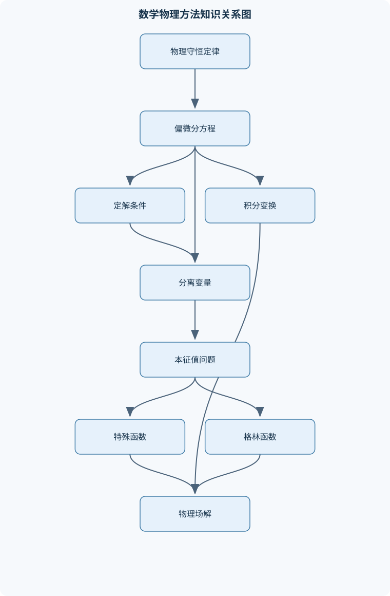
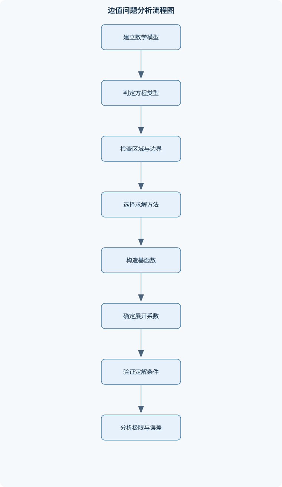

# 数学物理方法

## 一、课程整体知识框架

### 课程边界与先修知识

本课程研究将物理问题转化为数学模型、求解偏微分方程并解释解的结构与适用条件的方法体系。核心边界包括复变函数与积分、常微分方程和偏微分方程的典型解法、分离变量与本征值问题、傅里叶级数与积分变换、特殊函数、格林函数、变分方法以及保角变换。课程面向理工科本科高年级或相关专业基础课程，先修知识包括单变量微积分、多元微积分、常微分方程、线性代数、矢量分析和基础复数运算；最好掌握梯度、散度、旋度、正交坐标系及基本物理守恒定律。课程重点是线性数学物理方程及其边值问题、初值问题和本征展开，不覆盖泛函分析、分布理论和非线性偏微分方程的系统理论。





### 1. 课程对象、研究对象与基本符号

《数学物理方法》研究如何把物理规律写成数学模型，如何求解线性常微分方程和偏微分方程，以及如何判断所得解是否满足物理条件。课程的核心对象不是某一个具体方程，而是“建模—定解—求解—验证—解释”的完整过程。

空间坐标记为 $x,y,z$，时间记为 $t$，位置向量记为 $\mathbf r$。标量场记为 $u(\mathbf r,t)$，向量场记为 $\mathbf A$。梯度、散度和旋度分别记为 $\nabla u$、$\nabla\cdot\mathbf A$ 和 $\nabla\times\mathbf A$。拉普拉斯算子记为 $\nabla^2$；在直角坐标中，

$$
\nabla^2u=u_{xx}+u_{yy}+u_{zz}.
$$

复变量写成 $z=x+iy$，其中 $x=\operatorname{Re}z$、$y=\operatorname{Im}z$，复共轭为 $\bar z=x-iy$。区域记为 $\Omega$，边界记为 $\partial\Omega$，外法向导数记为 $\partial u/\partial n$。线性微分算子记为 $L$，本征值记为 $\lambda$，本征函数记为 $X(x)$ 或 $\phi_n(x)$。格林函数记为 $G(\mathbf r,\mathbf r')$，其中 $\mathbf r'$ 是源点，$\mathbf r$ 是观测点。

课程默认先修单变量微积分、多元微积分、常微分方程、线性代数、矢量分析和复数运算。若涉及物理解释，还需要理解连续介质近似、守恒定律、基本边界条件和量纲分析。课程重点是线性数学物理方程、初值问题、边值问题和本征展开；不系统讨论泛函分析、分布理论和非线性偏微分方程。

### 2. 数学物理方程的模型与分类

#### 2.1 连续介质中的守恒律与扩散方程

设 $u(\mathbf r,t)$ 表示单位体积内的某种密度，$\mathbf J$ 表示通量，$q$ 表示单位体积单位时间内的源强。对任意控制体积 $V$，守恒律为

$$
\frac{\mathrm d}{\mathrm dt}\int_Vu\,\mathrm dV
=
-\int_{\partial V}\mathbf J\cdot\mathbf n\,\mathrm dS
+\int_Vq\,\mathrm dV.
$$

利用高斯定理并假设场足够光滑，可得局部形式

$$
u_t+\nabla\cdot\mathbf J=q.
$$

在均匀各向同性介质中，若通量遵循线性扩散定律

$$
\mathbf J=-\kappa\nabla u,
$$

其中扩散系数 $\kappa>0$，则

$$
u_t=\kappa\nabla^2u+q.
$$

无源项 $q=0$ 时得到扩散方程

$$
u_t=\kappa\nabla^2u.
$$

若 $u$ 是温度，$\kappa$ 的单位通常为 $\mathrm{m^2/s}$；若 $u$ 是物质浓度，$\kappa$ 仍具有长度平方除以时间的量纲。该推导要求介质可视为连续体、$\kappa$ 为常数且扩散过程服从各向同性线性定律。若介质各向异性，通量应写为 $\mathbf J=-\mathbf K\nabla u$，方程变为 $u_t=\nabla\cdot(\mathbf K\nabla u)$，不能直接使用标量 $\kappa\nabla^2u$。

#### 2.2 波动方程与拉普拉斯方程

以绷紧的细弦为例，设横向位移为 $u(x,t)$，张力为 $T$，线密度为 $\mu$。在小振幅、小斜率条件下，

$$
\sin\theta\approx\tan\theta\approx u_x.
$$

对弦段应用牛顿第二定律：

$$
\mu\Delta x\,u_{tt}
\approx T\bigl[u_x(x+\Delta x,t)-u_x(x,t)\bigr].
$$

除以 $\Delta x$ 并令 $\Delta x\to0$，得到

$$
u_{tt}=c^2u_{xx},\qquad c^2=\frac{T}{\mu}.
$$

其中 $c$ 是波速，单位为 $\mathrm{m/s}$。在三维均匀介质中，类似形式为

$$
u_{tt}=c^2\nabla^2u.
$$

该模型要求振幅相对于波长足够小、张力近似恒定、介质参数不随位置变化，并忽略阻尼和外力。若存在阻尼或外力，可出现

$$
u_{tt}+2\gamma u_t-c^2\nabla^2u=f(\mathbf r,t),
$$

其中 $\gamma$ 的单位为 $\mathrm{s^{-1}}$。

稳态且无源的温度场、电势场和引力势通常满足拉普拉斯方程

$$
\nabla^2u=0.
$$

存在体源时则满足泊松方程

$$
\nabla^2u=f.
$$

拉普拉斯方程描述的是平衡状态，而不是扩散或振动的时间演化。

#### 2.3 二阶偏微分方程分类

二维二阶线性方程的主部可写为

$$
Au_{xx}+2Bu_{xy}+Cu_{yy}+\text{低阶项}=f.
$$

判别式为

$$
\Delta=B^2-AC.
$$

当 $\Delta<0$ 时为椭圆型，典型方程是拉普拉斯方程；当 $\Delta=0$ 时为抛物型，典型方程是扩散方程；当 $\Delta>0$ 时为双曲型，典型方程是波动方程。分类来自二次型 $A\,\mathrm dx^2+2B\,\mathrm dx\,\mathrm dy+C\,\mathrm dy^2$ 的性质，也决定了适合给出的数据类型：

- 椭圆型问题主要由边界数据决定，通常研究边值问题；
- 抛物型问题需要初始数据，并通常在空间边界给出边界条件；
- 双曲型问题需要初始位移、初始速度或相应的时间初值，并受有限传播速度影响。

分类不能只依据方程名称判断。例如加入变系数后，判别式可能随位置变化，方程在不同区域具有不同类型。

### 3. 定解问题、适定性、边界条件与尺度分析

初始条件规定某一时刻的场，例如

$$
u(\mathbf r,0)=u_0(\mathbf r).
$$

边界条件常见形式包括：

- 狄利克雷条件：$u|_{\partial\Omega}=g$；
- 诺伊曼条件：$\partial u/\partial n=h$；
- 混合或罗宾条件：$a u+b\,\partial u/\partial n=h$。

一个定解问题通常要求解存在、唯一，并且对数据连续依赖。三者分别称为存在性、唯一性和稳定性。形式上满足微分方程但不满足边界条件的函数，不是该定解问题的解。

纯诺伊曼边界下的泊松方程

$$
\nabla^2u=f,\qquad \frac{\partial u}{\partial n}=h
$$

必须满足相容条件。对区域积分并使用高斯定理：

$$
\int_\Omega f\,\mathrm dV
=
\int_\Omega\nabla^2u\,\mathrm dV
=
\int_{\partial\Omega}\frac{\partial u}{\partial n}\,\mathrm dS
=
\int_{\partial\Omega}h\,\mathrm dS.
$$

若条件不成立，则不存在解；若成立，解通常只确定到任意加性常数，因为 $\nabla^2(u+C)=\nabla^2u$。

无量纲化用于比较不同物理效应。以扩散方程为例，令 $x=L\hat x$、$t=T\hat t$、$u=U\hat u$，则

$$
\frac{U}{T}\hat u_{\hat t}
=
\kappa\frac{U}{L^2}\hat\nabla^2\hat u.
$$

取 $T=L^2/\kappa$ 后得到

$$
\hat u_{\hat t}=\hat\nabla^2\hat u.
$$

如果同时存在对流速度 $v$，则对流项与扩散项的比值给出佩克莱数的基本形式

$$
\mathrm{Pe}=\frac{vL}{\kappa}.
$$

$\mathrm{Pe}$ 大表示对流影响相对显著，$\mathrm{Pe}$ 小表示扩散更重要。无量纲化不能消除真实边界条件，也不能把不适定问题自动变成适定问题。

### 4. 复变函数与复积分

#### 4.1 解析函数、柯西—黎曼方程与调和函数

设

$$
f(z)=u(x,y)+iv(x,y).
$$

若复导数在某邻域内存在，则 $f$ 在该邻域解析。假设 $u,v$ 具有连续一阶偏导数，复导数从实轴方向和虚轴方向计算必须一致：

$$
f'(z)=u_x+iv_x=v_y-iu_y.
$$

比较实部和虚部得到柯西—黎曼方程

$$
u_x=v_y,\qquad u_y=-v_x.
$$

若 $u,v$ 的二阶偏导数连续，对第一式对 $x$ 求导、对第二式对 $y$ 求导并相加，得到

$$
u_{xx}+u_{yy}=v_{yx}-v_{xy}=0.
$$

因此解析函数的实部和虚部都是调和函数。反过来，一个调和函数在单连通区域内通常可以构造共轭调和函数；在非单连通区域中，可能因绕支点的积分不为零而无法构造单值共轭函数。

常见初等函数包括 $z^n$、$\exp z$、$\sin z$、$\cos z$、$\log z$ 和幂函数。$\log z=\ln|z|+i\arg z$ 是多值函数，必须选定支路；原点是其支点。若随意把多值函数当作全平面单值解析函数使用，会导致积分路径和边界条件错误。

零点是满足 $f(z_0)=0$ 的点；若 $f(z)=(z-z_0)^m g(z)$ 且 $g(z_0)\ne0$，则称 $z_0$ 是 $m$ 阶零点。极点是函数发散但倒数具有零点的孤立奇点。

#### 4.2 柯西定理、积分公式与级数

若 $f$ 在单连通区域内解析，且闭合正向回路 $C$ 可在区域内连续收缩，则

$$
\oint_C f(z)\,\mathrm dz=0.
$$

在适当条件下，这也说明解析函数的积分与路径无关。若 $z_0$ 位于回路内部，柯西积分公式为

$$
f(z_0)=\frac{1}{2\pi i}\oint_C\frac{f(z)}{z-z_0}\,\mathrm dz.
$$

对 $(z-z_0)^{-n-1}$ 求导可得高阶导数公式：

$$
f^{(n)}(z_0)
=
\frac{n!}{2\pi i}
\oint_C\frac{f(z)}{(z-z_0)^{n+1}}\,\mathrm dz.
$$

这说明解析函数在圆盘内部的值由边界值决定，但要求被积函数在回路上及其内部除指定核的奇点外解析。

在普通点附近可展开为泰勒级数：

$$
f(z)=\sum_{n=0}^{\infty}a_n(z-z_0)^n.
$$

在孤立奇点附近可展开为洛朗级数：

$$
f(z)=\sum_{n=-\infty}^{\infty}a_n(z-z_0)^n.
$$

若负幂项有限且最高负幂为 $(z-z_0)^{-m}$，则为 $m$ 阶极点；若没有负幂项，是可去奇点；若负幂项无限，是本性奇点。留数是洛朗展开中 $(z-z_0)^{-1}$ 的系数。若 $C$ 逆时针方向且路径不穿过奇点，

$$
\oint_Cf(z)\,\mathrm dz
=
2\pi i\sum_j\operatorname{Res}(f,z_j).
$$

路径顺时针时整体变号。奇点在路径上时不能直接套用留数定理，必须另行规定主值或修改路径。

### 5. 分离变量、本征值问题与傅里叶级数

对线性齐次方程尝试乘积形式

$$
u(x,t)=X(x)T(t).
$$

例如一维扩散方程

$$
u_t=\kappa u_{xx}
$$

代入后得

$$
XT'=\kappa X''T,
\qquad
\frac{T'}{\kappa T}=\frac{X''}{X}=-\lambda.
$$

于是得到

$$
X''+\lambda X=0,\qquad T'+\kappa\lambda T=0.
$$

若 $0<x<L$ 且 $X(0)=X(L)=0$，则 $\lambda_n=(n\pi/L)^2$，本征函数为

$$
X_n(x)=\sin\frac{n\pi x}{L},
\qquad
T_n(t)=\exp\left(-\kappa\frac{n^2\pi^2}{L^2}t\right).
$$

必须根据边界条件分别检查 $\lambda<0$、$\lambda=0$ 和 $\lambda>0$。例如齐次诺伊曼条件可能允许零本征值，不能在未检验前直接排除。

正交关系为

$$
\int_0^L X_m(x)X_n(x)\,\mathrm dx=0,\qquad m\ne n.
$$

将初始函数展开为

$$
f(x)=\sum_{n=1}^{\infty}b_n\sin\frac{n\pi x}{L},
$$

由正交性得

$$
b_n=\frac{2}{L}\int_0^Lf(x)\sin\frac{n\pi x}{L}\,\mathrm dx.
$$

分段光滑函数在连续点通常收敛到函数值，在跳跃点收敛到左右极限的平均值；均方收敛和逐点收敛不是同一概念。正弦级数对应奇延拓，余弦级数对应偶延拓，复指数形式为

$$
f(x)=\sum_{n=-\infty}^{\infty}c_ne^{inx},
\qquad
c_n=\frac{1}{2\pi}\int_{-\pi}^{\pi}f(x)e^{-inx}\,\mathrm dx.
$$

### 6. 傅里叶变换、拉普拉斯变换与半无限区间问题

为避免归一化歧义，本课程采用

$$
F(k)=\int_{-\infty}^{\infty}f(x)e^{-ikx}\,\mathrm dx,
$$

$$
f(x)=\frac{1}{2\pi}\int_{-\infty}^{\infty}F(k)e^{ikx}\,\mathrm dk.
$$

在函数及其导数满足适当可积性条件时，

$$
\mathcal F[f_x]=ikF(k),\qquad
\mathcal F[f_{xx}]=-k^2F(k).
$$

因此全空间扩散方程的变换域方程为

$$
\frac{\partial U(k,t)}{\partial t}
=
-\kappa k^2U(k,t),
$$

其解为

$$
U(k,t)=U(k,0)e^{-\kappa k^2t}.
$$

反变换后可得到高斯核形式。该推导要求初始函数具有足够的可积性或在更广义框架下解释变换；若数据增长过快，普通傅里叶变换可能不存在。

卷积定义为

$$
(f*g)(x)=\int_{-\infty}^{\infty}f(\xi)g(x-\xi)\,\mathrm d\xi,
$$

其傅里叶变换满足

$$
\mathcal F[f*g]=F(k)G(k).
$$

拉普拉斯变换定义为

$$
U(s)=\mathcal L\{u(t)\}
=
\int_0^\infty u(t)e^{-st}\,\mathrm dt.
$$

导数变换公式为

$$
\mathcal L\{u'\}=sU(s)-u(0),
$$

$$
\mathcal L\{u''\}=s^2U(s)-su(0)-u'(0).
$$

它适合处理 $t=0$ 给定初值的常系数线性问题。逆变换所得表达式必须再次检查初值、原方程和增长条件。

### 7. 特殊函数与正交多项式

在圆柱坐标中分离拉普拉斯方程或亥姆霍兹方程，径向部分常化为贝塞尔方程

$$
r^2R''+rR'+(k^2r^2-\nu^2)R=0.
$$

其解为第一类贝塞尔函数 $J_\nu(kr)$ 和第二类贝塞尔函数 $Y_\nu(kr)$。当原点属于区域且要求解有限时，通常舍弃在原点发散的 $Y_\nu$；在外部辐射问题中则常用汉克尔函数 $H_\nu^{(1)}$ 或 $H_\nu^{(2)}$，具体选择取决于时间因子约定和辐射方向。

球坐标分离得到角向方程。轴对称情形化为勒让德方程

$$
\frac{\mathrm d}{\mathrm dx}
\left[(1-x^2)\frac{\mathrm dP}{\mathrm dx}\right]
+n(n+1)P=0,
$$

其正则解为勒让德多项式 $P_n(x)$。一般三维角向解由球谐函数 $Y_l^m(\theta,\phi)$ 表示，其中 $l$ 为非负整数，$-l\le m\le l$。伴随勒让德函数用于构造非轴对称球谐函数。

厄米方程和拉盖尔方程分别出现在振子型问题、柱坐标或球坐标的径向问题中。超几何方程是许多特殊函数的统一标准形式。特殊函数的选择必须同时依据方程形式、奇点位置、原点正则性、无穷远衰减、边界条件和辐射条件；形式上是解但在物理区域发散的分支不能保留。渐近式只能在规定的小变量、大变量或参数范围内使用。

### 8. 格林函数、斯图姆—刘维尔问题与边值问题

线性算子 $L$ 的格林函数满足

$$
L_{\mathbf r}G(\mathbf r,\mathbf r')
=
\delta(\mathbf r-\mathbf r'),
$$

并满足指定的边界条件。除源点 $\mathbf r=\mathbf r'$ 外，$G$ 满足齐次方程。对于一维算子，通常分别在源点左、右构造齐次解，施加边界条件、连续性条件和导数跳跃条件。导数跳跃的大小由对方程在源点附近积分得到，不能凭形式猜测。

格林第二恒等式为

$$
\int_\Omega(u\nabla^2v-v\nabla^2u)\,\mathrm dV
=
\int_{\partial\Omega}
\left(
u\frac{\partial v}{\partial n}
-v\frac{\partial u}{\partial n}
\right)\mathrm dS.
$$

取 $v=G(\mathbf r,\mathbf r')$，可得到泊松方程的格林表示公式。狄利克雷问题中，边界上的 $G$ 通常取零；诺伊曼问题则需处理法向导数和相容条件。初值问题中的因果格林函数还必须满足 $G(t<t')=0$，从而体现因果性。

斯图姆—刘维尔问题一般写为

$$
-\frac{\mathrm d}{\mathrm dx}
\left[p(x)X'(x)\right]+q(x)X(x)
=
\lambda w(x)X(x),
$$

其中 $p(x)>0$、$w(x)>0$。在自伴边界条件下，本征值为实数；对应不同本征值的本征函数满足加权正交关系

$$
\int_a^b w(x)X_m(x)X_n(x)\,\mathrm dx=0,
\qquad \lambda_m\ne\lambda_n.
$$

这为傅里叶型本征展开提供理论基础。

### 9. 变分法与本征值理论

设泛函为

$$
J[y]=\int_a^bF(x,y,y')\,\mathrm dx.
$$

令 $y_\varepsilon=y+\varepsilon\eta$，其中 $\eta$ 在固定端点处为零。对 $\varepsilon$ 求导并在 $\varepsilon=0$ 处令一阶变分为零：

$$
\delta J
=
\int_a^b
\left(
\frac{\partial F}{\partial y}\eta+
\frac{\partial F}{\partial y'}\eta'
\right)\mathrm dx.
$$

分部积分得

$$
\delta J
=
\int_a^b
\left[
\frac{\partial F}{\partial y}
-\frac{\mathrm d}{\mathrm dx}
\left(\frac{\partial F}{\partial y'}\right)
\right]\eta\,\mathrm dx
+
\left[
\frac{\partial F}{\partial y'}\eta
\right]_a^b.
$$

若端点固定，边界项为零，得到欧拉—拉格朗日方程

$$
\frac{\partial F}{\partial y}
-\frac{\mathrm d}{\mathrm dx}
\left(\frac{\partial F}{\partial y'}\right)=0.
$$

若端点不固定，边界项不能丢弃，它给出自然边界条件。对本征值问题，可定义瑞利商

$$
R[X]
=
\frac{\int_a^b\left[p(X')^2+qX^2\right]\mathrm dx}
{\int_a^bwX^2\,\mathrm dx}.
$$

在满足边界条件的试探函数空间内取极值，可近似最低本征值。瑞利—里兹方法的试探函数必须先满足必要边界条件，否则所得极值不对应原问题。

### 10. 保角变换与二维场问题

若 $w=f(z)$ 在区域内解析且 $f'(z)\ne0$，则该映射在局部保持角度和方向，但一般不保持长度、面积或全局拓扑结构。局部长度尺度被 $|f'(z)|$ 放大，面积尺度被 $|f'(z)|^2$ 放大。

常用映射包括线性分式变换、幂函数、根式、指数和对数变换。儒可夫斯基变换可将圆形区域映射为具有尖点或翼型特征的边界，但必须检查映射在工作区域内是否一一对应以及导数是否为零。

二维不可压、无旋流可用复势表示：

$$
W(z)=\phi(x,y)+i\psi(x,y),
$$

其中 $\phi$ 为速度势，$\psi$ 为流函数。等势线与流线正交。二维静电场中的电势同样满足拉普拉斯方程，复杂边界可先通过保角映射变为圆、半平面或条带，在简单区域求解后再复合映射返回原区域。边界条件必须按照边界对应关系转换，不能只替换坐标而忽略法向方向、无穷远行为和奇点位置。

### 11. 综合应用与解的验证

热传导、物质扩散、弦和膜的振动、静电势、引力势、量子力学定态方程、波导和散射的简化模型，分别对应扩散方程、波动方程、拉普拉斯或泊松方程以及本征值问题。量子力学中定态方程常具有

$$
L\psi=E\psi
$$

的本征值结构，其中 $E$ 是能量本征值，$\psi$ 是本征函数。

任何形式解至少应进行以下检查：

1. 代入微分方程；
2. 检查所有边界条件和初始条件；
3. 检查量纲是否一致；
4. 检查对称性、正则性和远场行为；
5. 检查极限情形，例如 $t\to0^+$、$t\to\infty$、源项趋于零或区域尺度趋于极限；
6. 检查唯一性条件和数值截断误差。

截断本征展开时，有限项解只近似满足初始数据。跳跃点附近可能出现过冲，称为吉布斯现象；增加项数可缩小振荡区域，但不能完全消除局部过冲。

## 二、章节和模块划分

### 核心知识覆盖清单

本清单用于检查正文是否覆盖本课程的主要知识模块：

- **数学物理方程的模型与分类**：连续介质中的守恒定律、扩散方程的建模、波动方程的建模、拉普拉斯方程与稳态场、二阶偏微分方程分类、初始条件与边界条件、定解问题的适定性、无量纲化与尺度分析。
- **复变函数基础**：复数与复平面、复函数的极限与连续性、复导数与解析函数、柯西—黎曼方程、调和函数与共轭调和函数、初等复变函数、多值函数与支点、解析函数的零点与极点。
- **复积分与留数方法**：复积分与路径无关性、柯西积分定理、柯西积分公式、泰勒级数与洛朗级数、孤立奇点分类、留数定理、辐角原理、实积分的围道积分计算。
- **偏微分方程的分离变量法**：乘积形式试探解、矩形区域边值问题、极坐标中的分离变量、柱坐标与球坐标方程、本征值与本征函数、正交性与完备性、傅里叶级数展开、热方程与波动方程的定解。
- **傅里叶方法与积分变换**：周期函数的傅里叶级数、正弦与余弦级数、复指数形式傅里叶级数、傅里叶变换与逆变换、卷积定理、拉普拉斯变换、变换域中的微分方程、半无限区间与全空间问题。
- **特殊函数与正交多项式**：贝塞尔方程、第一类与第二类贝塞尔函数、球贝塞尔函数、勒让德方程、勒让德多项式、伴随勒让德函数、厄米方程与厄米多项式、拉盖尔方程与拉盖尔多项式、超几何方程、特殊函数的渐近性质。
- **格林函数与边值问题**：线性算子的伴随、自伴算子与本征值、斯图姆—刘维尔问题、格林恒等式、格林函数的定义、狄利克雷与诺伊曼边界条件、基本解与点源响应、格林表示公式、初值问题的因果格林函数。
- **变分法与本征值理论**：泛函与变分、欧拉—拉格朗日方程、边界项与自然边界条件、瑞利商、本征值的实性、本征函数正交性、最小作用量思想、能量估计、变分近似与瑞利—里兹方法。
- **保角变换与二维场问题**：保角映射的局部性质、线性分式变换、幂函数与根式变换、指数与对数映射、儒可夫斯基变换、复势与速度势、流函数与等势线、二维静电场边值问题、极板与障碍物外部场、变换后边界条件的对应。
- **综合应用与解的验证**：热传导与扩散模型、弦和膜的振动、静电势与引力势、量子力学中的定态方程、波导与散射的简化模型、解的唯一性验证、量纲与极限检验、边界条件匹配、数值截断误差分析。


### 1. 代表性算法与工作流程

#### 1.1 分离变量法

**输入：**线性齐次偏微分方程、规则区域、齐次边界条件和初始条件。  
**输出：**空间本征值、本征函数、时间因子及本征展开解。

步骤如下：

1. 设 $u=X(\mathbf r)T(t)$，代入方程；
2. 将只含空间变量的项和只含时间变量的项分开；
3. 令两者等于分离常数 $-\lambda$；
4. 先由空间边界条件确定允许的 $\lambda_n$ 和 $\phi_n$；
5. 解时间常微分方程；
6. 用正交投影确定展开系数；
7. 检查初始条件、边界条件和收敛意义。

不变量是每一个模态单独满足原方程和齐次边界条件。适用条件是方程线性、区域和坐标系可分离，且边界条件与分离结构相容。有限截断为 $N$ 项时，若每个模态在 $M$ 个网格点求值，直接求和复杂度约为 $O(NM)$。

#### 1.2 留数计算流程

**输入：**复被积函数和闭合路径。  
**输出：**围道积分。

先判断路径方向和内部奇点，再分类奇点。若 $z_0$ 为一阶极点，

$$
\operatorname{Res}(f,z_0)=\lim_{z\to z_0}(z-z_0)f(z).
$$

若为 $m$ 阶极点，

$$
\operatorname{Res}(f,z_0)
=
\frac{1}{(m-1)!}
\lim_{z\to z_0}
\frac{\mathrm d^{m-1}}{\mathrm dz^{m-1}}
\left[(z-z_0)^mf(z)\right].
$$

最后按路径方向使用留数定理。路径上有奇点时必须先说明主值或变形方式。若内部有 $K$ 个奇点，逐点计算留数的代数工作量通常随 $K$ 增长。

#### 1.3 格林函数构造流程

**输入：**线性算子、区域、边界条件和源点。  
**输出：**满足方程、边界条件和归一化条件的 $G(\mathbf r,\mathbf r')$。

1. 在源点两侧求齐次方程解；
2. 用边界条件确定各侧解的形式；
3. 在源点处施加函数连续条件；
4. 对含 $\delta$ 的方程在源点邻域积分，求导数跳跃；
5. 检查 $LG=\delta$；
6. 检查边界行为、对称性或互易性；
7. 用
   $$
   u(\mathbf r)=\int_\Omega G(\mathbf r,\mathbf r')f(\mathbf r')\,\mathrm dV'
   $$
   加上必要的边界积分构造非齐次问题的解。

#### 1.4 保角变换流程

**输入：**复杂二维区域、目标简单区域、边界数据和解析映射 $w=f(z)$。  
**输出：**原区域中的调和场或复势。

先选择把原边界映射为圆、半平面或条带的函数；在目标区域求解简单边值问题；再用复合函数返回原变量；最后核对边界对应关系、奇点、无穷远行为和物理量方向。适用条件是映射在工作区域内解析且局部导数不为零。该方法不适用于一般三维场或含强非线性源项的问题。

### 2. 计算示例：有限长杆热传导的本征展开

以下代码仅进行数值求和和绘图数据生成，不联网、不读写文件。

```python
import math

def temperature(x, t, L, kappa, coefficients, modes):
    """
    一维有限长杆、两端定温为零时的截断本征展开。
    x, L: 长度单位，例如 m
    t: 时间单位，例如 s
    kappa: 扩散系数，单位 m^2/s
    coefficients[n-1]: 第 n 个正弦模态系数
    modes: 截断模态数
    """
    value = 0.0
    for n in range(1, modes + 1):
        lam = (n * math.pi / L) ** 2
        spatial = math.sin(n * math.pi * x / L)
        temporal = math.exp(-kappa * lam * t)
        value += coefficients[n - 1] * spatial * temporal
    return value

L = 1.0
kappa = 0.01
coefficients = [1.0, 0.0, 0.2, 0.0, 0.1]

for t in [0.0, 0.1, 1.0]:
    values = [
        temperature(j * L / 10, t, L, kappa, coefficients, len(coefficients))
        for j in range(11)
    ]
    print(t, values)
```

程序中的每一项都满足方程和端点零值条件；截断误差来自未保留的高阶模态。若初始函数不光滑，初始时刻的点值误差可能较大，但对正时间，扩散因子会快速衰减高频模态。

### 3. 代表性例题

#### 例题一：推导一维扩散方程

**题干：**密度为 $u(x,t)$ 的物质在一维均匀介质中扩散，通量满足 $J=-\kappa u_x$，无源项。推导控制方程。

**分析：**使用局部守恒律 $u_t+J_x=0$。

**解答：**

$$
u_t+\frac{\partial}{\partial x}(-\kappa u_x)=0.
$$

当 $\kappa$ 为常数时，

$$
u_t=\kappa u_{xx}.
$$

若 $\kappa=\kappa(x)$，则应写为

$$
u_t=\frac{\partial}{\partial x}
\left(\kappa(x)u_x\right),
$$

不能写成 $\kappa(x)u_{xx}$。

**验证：**两边量纲均为“密度/时间”；若 $u$ 为温度，则 $\kappa$ 必须具有 $\mathrm{m^2/s}$ 量纲。

**变式：**若存在源项 $q(x,t)$，方程变为 $u_t=\kappa u_{xx}+q$；若存在对流速度 $v$，则可出现 $u_t+vu_x=\kappa u_{xx}+q$。

#### 例题二：有限长杆的热传导

**题干：**求解

$$
u_t=\kappa u_{xx},\quad 0<x<L,
$$

满足 $u(0,t)=u(L,t)=0$，$u(x,0)=f(x)$。

**分析：**边界条件是齐次的，适合分离变量。

**解答：**

设 $u=XT$，得到

$$
X''+\lambda X=0,\qquad T'+\kappa\lambda T=0.
$$

边界条件给出

$$
X_n(x)=\sin\frac{n\pi x}{L},\qquad
\lambda_n=\left(\frac{n\pi}{L}\right)^2.
$$

因此

$$
u(x,t)=
\sum_{n=1}^{\infty}
b_n\sin\frac{n\pi x}{L}
\exp\left[-\kappa\left(\frac{n\pi}{L}\right)^2t\right],
$$

其中

$$
b_n=\frac{2}{L}\int_0^Lf(x)\sin\frac{n\pi x}{L}\,\mathrm dx.
$$

**结果验证：**每项在 $x=0,L$ 为零；对 $t>0$，高阶模态因指数因子衰减；当 $t\to\infty$ 时，$u\to0$。

**变式：**若两端定温为非零值，先求满足边界温度的稳态解，再令总解减去稳态解，使剩余部分满足齐次边界条件。

#### 例题三：固定两端弦的振动

**题干：**长度为 $L$ 的弦满足

$$
u_{tt}=c^2u_{xx},\qquad u(0,t)=u(L,t)=0,
$$

初始位移为 $f(x)$，初始速度为 $g(x)$。写出模态解。

**解答：**

空间本征函数仍为

$$
X_n(x)=\sin\frac{n\pi x}{L}.
$$

时间方程为

$$
T_n''+c^2\left(\frac{n\pi}{L}\right)^2T_n=0,
$$

因此

$$
T_n(t)=A_n\cos\omega_nt+B_n\sin\omega_nt,
\qquad
\omega_n=\frac{cn\pi}{L}.
$$

总解为

$$
u(x,t)=\sum_{n=1}^{\infty}
\left[
A_n\cos\omega_nt+B_n\sin\omega_nt
\right]
\sin\frac{n\pi x}{L}.
$$

由初始位移和速度分别得到

$$
A_n=\frac{2}{L}\int_0^Lf(x)\sin\frac{n\pi x}{L}\,\mathrm dx,
$$

$$
B_n=\frac{2}{L\omega_n}\int_0^Lg(x)\sin\frac{n\pi x}{L}\,\mathrm dx.
$$

**验证：**时间因子是振荡函数而非衰减指数；这一区别来自波动方程时间方程中的负号结构。

**变式：**加入阻尼后，每个模态的时间方程含一阶导数，模态可能出现衰减振荡或过阻尼行为。

#### 例题四：含二阶极点的围道积分

**题干：**计算

$$
\int_{-\infty}^{\infty}\frac{e^{ikx}}{(x^2+a^2)^2}\,\mathrm dx,
\qquad a>0,\ k>0.
$$

**分析：**取上半平面半圆路径。指数因子为 $e^{ikz}$，在上半平面具有衰减趋势；内部二阶极点为 $z=ia$。

**解答：**令

$$
f(z)=\frac{e^{ikz}}{(z-ia)^2(z+ia)^2}.
$$

二阶极点留数为

$$
\operatorname{Res}(f,ia)
=
\left.
\frac{\mathrm d}{\mathrm dz}
\left[
\frac{e^{ikz}}{(z+ia)^2}
\right]\right|_{z=ia}.
$$

计算导数后，

$$
\operatorname{Res}(f,ia)
=
\frac{e^{-ka}}{4ia^3}(1+ka).
$$

若大半圆弧积分趋于零，则实轴积分等于 $2\pi i$ 乘留数，即

$$
\int_{-\infty}^{\infty}\frac{e^{ikx}}{(x^2+a^2)^2}\,\mathrm dx
=
\frac{\pi e^{-ka}}{2a^3}(1+ka).
$$

**验证：**令 $k=0$，得到 $\pi/(2a^3)$，与直接积分结果一致。

**变式：**若 $k<0$，应闭合于下半平面，路径方向和内部极点均改变；不能仍使用上半平面。

#### 例题五：球内轴对称静电势

**题干：**球面 $r=R$ 上电势为

$$
V(R,\theta)=V_0\cos\theta.
$$

求球内无源区域的电势。

**分析：**轴对称情形不含 $\phi$，球坐标拉普拉斯方程分离后，角向函数为 $P_l(\cos\theta)$，径向正则解为 $r^l$。

**解答：**边界数据为

$$
V_0\cos\theta=V_0P_1(\cos\theta),
$$

只有 $l=1$ 项。因此球内解为

$$
V(r,\theta)=A r\cos\theta.
$$

由 $r=R$ 处边界条件，

$$
AR=V_0,
$$

故

$$
V(r,\theta)=V_0\frac rR\cos\theta.
$$

**验证：**在 $r=R$ 时恢复给定边界；在 $r=0$ 有限；满足球坐标中的拉普拉斯方程。

**变式：**若边界为 $V_0\cos^2\theta$，利用

$$
\cos^2\theta=\frac13+\frac23P_2(\cos\theta)
$$

分解出 $l=0$ 和 $l=2$ 两个多极项。

### 4. 实验与项目流程

#### 4.1 傅里叶级数逼近分段函数

**输入数据：**区间 $[-\pi,\pi]$、一个分段函数、截断项数 $N$ 和采样点数 $M$。

**步骤：**

1. 按函数的奇偶性选择正弦、余弦或复指数形式；
2. 用数值积分计算前 $N$ 个系数；
3. 在 $M$ 个均匀网格点上求和；
4. 分别比较连续点、跳跃点和端点附近的误差；
5. 增加 $N$，观察误差和局部过冲变化。

**评价标准：**

- 系数计算与理论积分的一致性；
- 连续点处误差随 $N$ 增大而减小；
- 跳跃点处结果趋近左右极限平均值；
- 是否明确区分逐点误差与均方误差；
- 是否检查周期延拓造成的端点不连续。

**排错方法：**

- 所有系数均为零时，检查积分区间、奇偶性和归一化因子；
- 展开结果整体差一个符号时，检查正弦或复指数的符号约定；
- 端点异常时，检查函数是否按周期延拓；
- 增加项数后振荡位置不变时，应判断为吉布斯现象，而不是简单认为程序失效。

#### 4.2 有限长杆热传导数值验证

**输入数据：**杆长 $L$、扩散系数 $\kappa$、初始温度 $f(x)$、边界温度、模态数 $N$ 和时间采样点。

**步骤：**

1. 将非齐次边界条件分解为稳态解和齐次瞬态解；
2. 计算初始函数的正弦系数；
3. 用前 $N$ 项构造解析截断解；
4. 对不同 $N$ 和不同时间计算温度；
5. 检查 $t=0$、$t\to\infty$、端点和中点温度；
6. 用能量或最大值变化判断结果是否符合扩散特征。

**评价标准：**

- 端点边界误差接近数值精度；
- 长时间解趋近稳态解；
- 高频模态随时间衰减更快；
- 增加 $N$ 后初始时刻的逼近改善；
- 量纲、极限和边界条件全部通过检查。

**排错方法：**

- 温度随时间增长且无源时，检查指数因子符号；
- 端点不满足边界条件，检查是否忘记减去稳态解；
- 中心温度出现非物理剧烈振荡，检查初始系数积分和截断项数；
- 不同网格结果差异很大，检查空间采样是否足以解析最高模态；
- $\kappa$ 的单位错误会导致时间尺度错误，应确认 $\kappa t/L^2$ 为无量纲量。

## 三、核心概念的详细解释

### 3.1 数学物理问题的建模、分类与定解

数学物理问题的基本形式是：先用守恒律、受力定律或场方程建立微分方程，再用初始条件和边界条件选出唯一的物理解。设标量场为 $u(\mathbf r,t)$，其中 $\mathbf r=(x,y,z)$。对密度 $u$、通量 $\mathbf J$ 和体源项 $q$，局部守恒律为

$$
u_t+\nabla\cdot\mathbf J=q.
$$

在均匀、各向同性介质中，若通量满足线性扩散定律 $\mathbf J=-\kappa\nabla u$，则

$$
u_t=\kappa\nabla^2u+q,\qquad \kappa>0.
$$

这里 $\kappa$ 的量纲为长度平方除以时间，例如热扩散率和质量扩散系数通常具有 $\mathrm{m^2/s}$ 的量纲。无源项时得到扩散方程 $u_t=\kappa\nabla^2u$。若介质各向异性，应写成 $\mathbf J=-\mathbf K\nabla u$，其中 $\mathbf K$ 为扩散张量，方程为

$$
u_t=\nabla\cdot(\mathbf K\nabla u)+q,
$$

此时不能把 $\mathbf K$ 简化为标量 $\kappa$。

对细弦横向位移 $u(x,t)$，若张力为 $T$、线密度为 $\mu$，小振幅和小斜率条件给出

$$
\mu u_{tt}=T u_{xx},
$$

即

$$
u_{tt}=c^2u_{xx},\qquad c=\sqrt{\frac{T}{\mu}}.
$$

其中 $c$ 的单位为 $\mathrm{m/s}$。二维或三维理想波动问题相应写为

$$
u_{tt}=c^2\nabla^2u.
$$

该方程依赖于线性化条件：振幅相对于弦长足够小，张力近似恒定，材料和几何参数不随位移显著改变。大振幅、非均匀张力或强阻尼情形不能直接使用这一模型。

稳态无源场满足拉普拉斯方程

$$
\nabla^2u=0.
$$

若存在体源，则通常得到泊松方程

$$
\nabla^2u=f(\mathbf r).
$$

电势、引力势、稳态温度和不可压无旋流的势函数都可能满足这类方程，但物理量、边界条件和源项解释不同，不能仅凭方程形式判断所有物理性质。

二阶线性偏微分方程的主部可写为

$$
A u_{xx}+2B u_{xy}+C u_{yy}+\text{低阶项}=0.
$$

判别式为

$$
\Delta=B^2-AC.
$$

当 $\Delta<0$ 时为椭圆型，典型方程是拉普拉斯方程；当 $\Delta=0$ 时为抛物型，典型方程是扩散方程；当 $\Delta>0$ 时为双曲型，典型方程是波动方程。分类只由二阶导数项的主部决定，低阶项不改变这一基本分类，但会影响解的具体性质。

椭圆型问题通常由整个边界上的数据决定，适合讨论稳态场和边界值问题；抛物型问题具有明显的时间方向，通常需要一个初始时刻的数据以及空间边界条件；双曲型问题具有有限传播速度，初始位移和初始速度通常必须同时给出。所谓定解问题的适定性，包括解的存在性、唯一性和对数据的连续依赖。形式上求得的函数即使满足微分方程，也可能因不满足边界条件、初始条件或稳定性要求而不是定解问题的解。

### 3.2 复函数、解析性与二维调和场

复变量写为

$$
z=x+iy,\qquad \bar z=x-iy.
$$

复函数可写成

$$
f(z)=u(x,y)+iv(x,y),
$$

其中 $u=\operatorname{Re}f$，$v=\operatorname{Im}f$。复导数要求极限

$$
f'(z)=\lim_{\Delta z\to0}\frac{f(z+\Delta z)-f(z)}{\Delta z}
$$

与 $\Delta z$ 趋近于零的方向无关。这一条件强于实变量意义下的偏导数存在。

若 $u,v$ 在区域内具有连续一阶偏导数，则解析性的必要条件为柯西—黎曼方程

$$
u_x=v_y,\qquad u_y=-v_x.
$$

在这些偏导数连续的条件下，柯西—黎曼方程也是解析性的充分条件。对第一式关于 $x$ 求导、对第二式关于 $y$ 求导并相加，得到

$$
u_{xx}+u_{yy}=v_{yx}-v_{xy}=0.
$$

因此解析函数的实部是调和函数。类似地，对柯西—黎曼方程作相应微分可得

$$
v_{xx}+v_{yy}=0.
$$

所以解析函数的虚部也是调和函数。反过来，一个调和函数在单连通区域内通常可以构造共轭调和函数；若区域存在孔洞，调和共轭可能只能局部存在，或者绕孔洞积分后出现多值性。

常见初等函数包括 $z^n$、$\exp z$、$\sin z$、$\cos z$、$\log z$ 和 $z^\alpha$。其中指数函数具有周期性

$$
e^{z+2\pi i}=e^z,
$$

所以对数函数是多值函数：

$$
\log z=\ln|z|+i(\arg z+2\pi k),\qquad k\in\mathbb Z.
$$

为了使其成为单值解析函数，必须在区域中选取支路，并避开相应的支割线。支点不是普通孤立奇点，不能直接按极点处理。

若 $f$ 在 $z_0$ 附近解析且不恒为零，则其零点可表示为

$$
f(z)=(z-z_0)^m g(z),\qquad g(z_0)\ne0,
$$

其中 $m$ 是零点阶数。孤立奇点可分为可去奇点、极点和本性奇点。若洛朗展开中没有负幂项，奇点可去；若只有有限个负幂项，奇点是极点；若负幂项无限多，奇点是本性奇点。极点阶数等于最低负幂的绝对值。

### 3.3 复积分、级数与留数

复曲线积分定义为

$$
\int_C f(z)\,\mathrm dz
=
\int_a^b f(z(t))z'(t)\,\mathrm dt,
$$

其中 $z(t)$ 给出曲线参数方程，方向由参数递增方向确定。若 $f$ 在单连通区域内解析，则闭合回路积分为零：

$$
\oint_C f(z)\,\mathrm dz=0.
$$

这就是柯西积分定理。进一步，对位于回路内部的 $z_0$，

$$
f(z_0)=\frac{1}{2\pi i}\oint_C\frac{f(z)}{z-z_0}\,\mathrm dz.
$$

若 $f$ 在圆盘内部解析，则其边界值决定内部值。对被积函数关于 $z_0$ 求导，可得高阶导数公式

$$
f^{(n)}(z_0)
=
\frac{n!}{2\pi i}
\oint_C\frac{f(z)}{(z-z_0)^{n+1}}\,\mathrm dz.
$$

这说明解析函数具有任意阶导数，并且解析性自动产生泰勒展开，而不是仅仅具有有限阶可导性。

在环域中，函数可展开为洛朗级数

$$
f(z)=\sum_{n=-\infty}^{\infty}a_n(z-z_0)^n.
$$

其中 $a_{-1}$ 称为留数，记为 $\operatorname{Res}(f,z_0)$。若闭合正向回路 $C$ 内部包含有限个孤立奇点且路径不穿过奇点，则

$$
\oint_C f(z)\,\mathrm dz
=
2\pi i\sum_j\operatorname{Res}(f,z_j).
$$

若 $z_0$ 是一阶极点，

$$
\operatorname{Res}(f,z_0)
=
\lim_{z\to z_0}(z-z_0)f(z).
$$

若 $z_0$ 是 $m$ 阶极点，

$$
\operatorname{Res}(f,z_0)
=
\frac{1}{(m-1)!}
\lim_{z\to z_0}
\frac{\mathrm d^{m-1}}{\mathrm dz^{m-1}}
\left[(z-z_0)^m f(z)\right].
$$

路径若为顺时针方向，积分结果整体变号；若奇点位于路径上，不能直接套用留数定理，必须另行规定主值、路径缩进或其他积分解释。

### 3.4 分离变量、本征值与正交展开

分离变量法适用于线性、齐次、边界规则并且坐标系适合分离的方程。以一维热方程为例，

$$
u_t=\kappa u_{xx},\qquad 0<x<L,
$$

若边界为

$$
u(0,t)=u(L,t)=0,
$$

设

$$
u(x,t)=X(x)T(t).
$$

代入方程并除以 $XT$，得到

$$
\frac{T'}{\kappa T}=\frac{X''}{X}=-\lambda.
$$

于是空间和时间方程分别为

$$
X''+\lambda X=0,
$$

$$
T'+\kappa\lambda T=0.
$$

边界条件要求 $X(0)=X(L)=0$。当 $\lambda=0$ 时，$X=A+Bx$，边界条件迫使 $X\equiv0$；当 $\lambda<0$ 时，解为双曲函数，也只能得到零解。因此非零解必须满足

$$
\lambda_n=\left(\frac{n\pi}{L}\right)^2,\qquad
X_n(x)=\sin\frac{n\pi x}{L},\qquad n=1,2,\ldots
$$

时间因子为

$$
T_n(t)=\exp\left[-\kappa\left(\frac{n\pi}{L}\right)^2t\right].
$$

若初始条件为 $u(x,0)=f(x)$，则

$$
u(x,t)=\sum_{n=1}^{\infty}b_n
\sin\frac{n\pi x}{L}
\exp\left[-\kappa\left(\frac{n\pi}{L}\right)^2t\right],
$$

其中

$$
b_n=\frac{2}{L}\int_0^L f(x)\sin\frac{n\pi x}{L}\,\mathrm dx.
$$

扩散问题中高频模态衰减更快，特征时间尺度为 $L^2/\kappa$。这反映了扩散过程平滑初始不规则性的性质。

波动方程的分离解则产生振荡时间因子。固定两端弦的空间本征函数相同，但时间方程为

$$
T''+\omega_n^2T=0,\qquad
\omega_n=c\frac{n\pi}{L},
$$

因此

$$
T_n(t)=A_n\cos\omega_nt+B_n\sin\omega_nt.
$$

不能把扩散问题的指数衰减因子误用于波动问题。

### 3.5 傅里叶级数、积分变换与特殊函数

在 $[-L,L]$ 上，适当的傅里叶级数可写为

$$
f(x)\sim \frac{a_0}{2}
+\sum_{n=1}^{\infty}
\left[
a_n\cos\frac{n\pi x}{L}
+b_n\sin\frac{n\pi x}{L}
\right],
$$

其中

$$
a_n=\frac1L\int_{-L}^{L}f(x)\cos\frac{n\pi x}{L}\,\mathrm dx,
$$

$$
b_n=\frac1L\int_{-L}^{L}f(x)\sin\frac{n\pi x}{L}\,\mathrm dx.
$$

正弦函数和余弦函数在对应区间上正交，因此系数可由内积投影得到。分段光滑函数在连续点处收敛到函数值，在跳跃点处通常收敛到左右极限的平均值；均方收敛与逐点收敛是不同概念。跳跃附近的吉布斯现象不会因增加有限项数而完全消失。

本教材采用一种常见傅里叶变换约定：

$$
F(k)=\int_{-\infty}^{\infty}f(x)e^{-ikx}\,\mathrm dx,
$$

$$
f(x)=\frac1{2\pi}\int_{-\infty}^{\infty}F(k)e^{ikx}\,\mathrm dk.
$$

在此约定下，

$$
\mathcal F[f'](k)=ikF(k),\qquad
\mathcal F[f''](k)=-k^2F(k).
$$

因此全空间扩散方程的变换域解满足

$$
\frac{\partial F}{\partial t}=-\kappa k^2F,
$$

从而

$$
F(k,t)=F(k,0)e^{-\kappa k^2t}.
$$

拉普拉斯变换定义为

$$
U(s)=\mathcal L\{u(t)\}
=\int_0^\infty u(t)e^{-st}\,\mathrm dt.
$$

若初值为 $u(0)$，则

$$
\mathcal L\{u'(t)\}=sU(s)-u(0),
$$

$$
\mathcal L\{u''(t)\}=s^2U(s)-su(0)-u'(0).
$$

它将含时间导数的初值问题转化为关于 $s$ 的代数方程，但逆变换仍需满足增长条件和收敛条件。

特殊函数来自分离变量后的标准常微分方程。圆柱坐标中的径向方程常导致贝塞尔方程

$$
x^2y''+xy'+(x^2-\nu^2)y=0.
$$

其解为第一类贝塞尔函数 $J_\nu(x)$ 和第二类贝塞尔函数 $Y_\nu(x)$。在原点要求有限时，通常舍弃 $Y_\nu$；在辐射问题中则常使用汉克尔函数 $H_\nu^{(1)}$ 或 $H_\nu^{(2)}$，具体取舍取决于时间因子约定和传播方向。

球坐标中的角向方程产生勒让德方程。轴对称时角变量为 $\cos\theta$，正则解是勒让德多项式 $P_l(\cos\theta)$；非轴对称问题需要球谐函数 $Y_l^m(\theta,\phi)$。厄米多项式常见于含二次势的振子型方程，拉盖尔多项式常见于球坐标径向问题。特殊函数的级数、递推式和渐近式必须在相应变量范围、参数范围和边界条件下使用。

### 3.6 格林函数、变分方法与保角变换

对线性算子 $L$，格林函数 $G(\mathbf r,\mathbf r')$ 满足

$$
L_{\mathbf r}G(\mathbf r,\mathbf r')
=
\delta(\mathbf r-\mathbf r'),
$$

并满足与原边值问题一致的边界条件。这里 $\mathbf r'$ 是源点，$\mathbf r$ 是观测点。除源点外，格林函数满足齐次方程；源点处具有规定的奇异性。线性方程

$$
Lu=f
$$

的解可表示为源项与格林函数的积分，再加上边界数据所产生的项。

对泊松方程，格林第二恒等式为

$$
\int_\Omega
\left(u\nabla^2v-v\nabla^2u\right)\mathrm dV
=
\int_{\partial\Omega}
\left(
u\frac{\partial v}{\partial n}
-v\frac{\partial u}{\partial n}
\right)\mathrm dS.
$$

取 $v=G(\mathbf r,\mathbf r')$，并使用 $\nabla^2G=\delta(\mathbf r-\mathbf r')$，可得到格林表示公式。狄利克雷问题给定 $u|_{\partial\Omega}$，表示式中边界函数值和格林函数的法向导数出现；诺伊曼问题给定 $\partial u/\partial n$，则出现格林函数本身与边界通量。纯诺伊曼问题通常要求源项与总边界通量满足相容条件，并且解只确定到一个加性常数。

变分法研究泛函

$$
J[y]=\int_a^b F(x,y,y')\,\mathrm dx.
$$

令 $y_\varepsilon=y+\varepsilon\eta$，其中 $\eta(a)=\eta(b)=0$，对 $\varepsilon$ 求一阶导数并令其为零：

$$
\left.\frac{\mathrm d}{\mathrm d\varepsilon}
J[y+\varepsilon\eta]\right|_{\varepsilon=0}=0.
$$

分部积分后得到

$$
\int_a^b
\left(
\frac{\partial F}{\partial y}
-\frac{\mathrm d}{\mathrm dx}
\frac{\partial F}{\partial y'}
\right)\eta\,\mathrm dx
+
\left[
\frac{\partial F}{\partial y'}\eta
\right]_a^b=0.
$$

当端点固定时边界项消失，因 $\eta$ 任意，得到欧拉—拉格朗日方程

$$
\frac{\partial F}{\partial y}
-\frac{\mathrm d}{\mathrm dx}
\frac{\partial F}{\partial y'}=0.
$$

若端点不固定，边界项不能擅自删除，它会产生自然边界条件。对本征值问题，瑞利商常写成

$$
R[X]=
\frac{\int_a^b p(x)(X')^2\,\mathrm dx+\int_a^b q(x)X^2\,\mathrm dx}
{\int_a^b w(x)X^2\,\mathrm dx},
$$

其中 $w(x)>0$。在满足自伴边界条件时，极值给出本征值近似。瑞利—里兹方法用满足边界条件的有限维试探函数代替精确函数，试探空间扩大时通常可以改善最低本征值的上界近似。

保角变换以解析函数 $w=f(z)$ 为核心。当 $f'(z_0)\ne0$ 时，局部有

$$
f(z)-f(z_0)
\approx f'(z_0)(z-z_0).
$$

乘以非零复数只产生伸缩和旋转，因此局部角度及其方向保持不变，但长度一般乘以 $|f'(z_0)|$，面积乘以 $|f'(z_0)|^2$。所以保角变换不等于等距变换，也不保持面积。

线性分式变换

$$
w=\frac{az+b}{cz+d},\qquad ad-bc\ne0,
$$

把广义圆映射为广义圆；幂函数、指数函数和对数函数可把扇形、条带、半平面或圆域相互转换。二维无旋、不可压流可用复势表示，实部和虚部通常分别为速度势与流函数；等势线与流线正交。使用变换求场时，必须逐段核对原边界与像边界的对应关系，并检查映射导数是否在工作区域内为零或出现奇点。

## 四、重要定义、公式、定理和推导

### 专业审校补充：关键定义与适用边界

亥姆霍兹方程是由波动方程作简谐时间假设得到的频域方程。若 $u(\mathbf r,t)=\operatorname{Re}[U(\mathbf r)e^{-i\omega t}]$，且介质中波速为 $c$，则无源、均匀介质中的空间振幅满足 $\nabla^2U+k^2U=0$，其中 $k=\omega/c$，单位为 $\mathrm{m^{-1}}$。与拉普拉斯方程不同，亥姆霍兹方程的边值问题可能在离散本征频率处发生共振，因而不一定对任意边界数据都有唯一解。无界区域还必须补充无穷远条件，例如三维外向球面波满足 Sommerfeld 辐射条件 $\lim_{r\to\infty}r(\partial_rU-ikU)=0$；仅写“解在无穷远有界”通常不能排除入射波与外向波的混合。若 $k=0$，方程退化为拉普拉斯方程，不能继续使用依赖波数的辐射解释。


### 4.1 守恒律与典型方程的推导

对控制体积 $V$，守恒律为

$$
\frac{\mathrm d}{\mathrm dt}\int_Vu\,\mathrm dV
=
-\int_{\partial V}\mathbf J\cdot\mathbf n\,\mathrm dS
+\int_Vq\,\mathrm dV.
$$

由高斯定理，

$$
\int_{\partial V}\mathbf J\cdot\mathbf n\,\mathrm dS
=
\int_V\nabla\cdot\mathbf J\,\mathrm dV.
$$

若控制体积任意，则

$$
u_t+\nabla\cdot\mathbf J=q.
$$

代入 $\mathbf J=-\kappa\nabla u$，且 $\kappa$ 为常数，得到

$$
u_t-\kappa\nabla^2u=q.
$$

若 $\kappa$ 随空间变化，则

$$
\nabla\cdot(\kappa\nabla u)
=
\kappa\nabla^2u+\nabla\kappa\cdot\nabla u,
$$

因此不能遗漏 $\nabla\kappa\cdot\nabla u$ 项。

对小段弦，水平方向张力近似抵消，竖直方向合力为

$$
T\sin\theta(x+\Delta x)-T\sin\theta(x).
$$

小斜率下 $\sin\theta\approx\tan\theta\approx u_x$，所以合力近似为

$$
T[u_x(x+\Delta x,t)-u_x(x,t)]
\approx T u_{xx}\Delta x.
$$

弦段质量为 $\mu\Delta x$，由牛顿第二定律得到

$$
\mu\Delta x\,u_{tt}=T u_{xx}\Delta x,
$$

约去 $\Delta x$ 后得

$$
u_{tt}=\frac{T}{\mu}u_{xx}=c^2u_{xx}.
$$

该推导不适用于大斜率、显著纵向运动、张力随时间或位置明显变化的情形。

### 4.2 柯西—黎曼方程与调和性定理

设 $f(z)=u(x,y)+iv(x,y)$，取增量 $\Delta z=\Delta x+i\Delta y$。沿实轴趋近时，

$$
f'(z)=u_x+iv_x.
$$

沿虚轴趋近时，

$$
f'(z)=v_y-iu_y.
$$

两者相等要求

$$
u_x=v_y,\qquad v_x=-u_y,
$$

即

$$
u_x=v_y,\qquad u_y=-v_x.
$$

若 $u,v$ 的一阶偏导数连续，这些方程保证复导数与趋近方向无关，因此保证 $f$ 解析。再对其微分：

$$
u_{xx}=v_{yx},\qquad u_{yy}=-v_{xy}.
$$

在二阶偏导连续时，混合偏导相等，故

$$
u_{xx}+u_{yy}=0.
$$

同理，

$$
v_{xx}+v_{yy}=0.
$$

因此解析函数的实部和虚部均为调和函数。反向由给定调和函数 $u$ 构造 $v$ 时，需要积分

$$
v_y=u_x,\qquad v_x=-u_y.
$$

在单连通区域内，路径无关性保证所得 $v$ 为单值函数；在非单连通区域内，还需检查绕闭合曲线积分是否为零。

### 4.3 柯西公式、洛朗展开与留数定理

对解析函数 $f$，考虑

$$
\frac{f(z)}{z-z_0}.
$$

在 $z_0$ 附近写成

$$
f(z)=f(z_0)+(z-z_0)g(z),
$$

则

$$
\frac{f(z)}{z-z_0}
=
\frac{f(z_0)}{z-z_0}+g(z).
$$

对闭合正向回路积分时，第二项积分为零，而

$$
\oint_C\frac{\mathrm dz}{z-z_0}=2\pi i.
$$

所以

$$
\oint_C\frac{f(z)}{z-z_0}\,\mathrm dz
=
2\pi i f(z_0),
$$

即柯西积分公式。对 $z_0$ 求 $n$ 阶导数，得到

$$
f^{(n)}(z_0)
=
\frac{n!}{2\pi i}
\oint_C
\frac{f(z)}{(z-z_0)^{n+1}}\,\mathrm dz.
$$

在孤立奇点附近，洛朗展开为

$$
f(z)=\sum_{n=-\infty}^{\infty}a_n(z-z_0)^n.
$$

逐项积分时，只有 $(z-z_0)^{-1}$ 项贡献非零值，因为

$$
\oint_C(z-z_0)^n\,\mathrm dz
=
\begin{cases}
2\pi i,&n=-1,\\
0,&n\ne-1.
\end{cases}
$$

因此

$$
\oint_Cf(z)\,\mathrm dz
=
2\pi i\,a_{-1}
=
2\pi i\,\operatorname{Res}(f,z_0).
$$

多个奇点时利用积分的可加性得到留数定理。定理的前提是函数在路径上解析、奇点为孤立奇点且不在路径上。

### 4.4 斯图姆—刘维尔问题与正交性

斯图姆—刘维尔问题可写为

$$
-\frac{\mathrm d}{\mathrm dx}
\left[p(x)\frac{\mathrm dX}{\mathrm dx}\right]
+q(x)X
=
\lambda w(x)X,
$$

其中 $p(x)>0$、$w(x)>0$，并配以自伴边界条件。设 $X_m,X_n$ 分别对应 $\lambda_m,\lambda_n$，将两式分别乘以 $X_n,X_m$ 后相减并积分：

$$
(\lambda_m-\lambda_n)
\int_a^b wX_mX_n\,\mathrm dx
=
\left[
p(X_mX_n'-X_nX_m')
\right]_a^b.
$$

自伴边界条件使边界项为零，因此当 $\lambda_m\ne\lambda_n$ 时，

$$
\int_a^b w(x)X_m(x)X_n(x)\,\mathrm dx=0.
$$

这就是带权正交性。若算子和边界条件自伴，则本征值为实数。证明实性时，将本征方程乘以 $\overline X$ 并积分，通过分部积分可将左侧化为实数形式，右侧为 $\lambda\int w|X|^2\mathrm dx$；因分母为正，得到 $\lambda\in\mathbb R$。

正交性使任意适当函数可以按本征函数展开：

$$
f(x)\sim\sum_n c_nX_n(x),
$$

其中

$$
c_n=
\frac{\int_a^b w(x)f(x)X_n(x)\,\mathrm dx}
{\int_a^b w(x)X_n^2(x)\,\mathrm dx}.
$$

“完备”不是由正交性单独推出的，而是关于所选函数空间和算子条件的更强结论。在本科问题中通常通过标准傅里叶系、边界条件和分段光滑假设使用这一展开。

### 4.5 傅里叶与拉普拉斯变换的关键性质

傅里叶级数的正交关系包括

$$
\int_{-L}^{L}
\cos\frac{m\pi x}{L}
\cos\frac{n\pi x}{L}\,\mathrm dx
=
\begin{cases}
0,&m\ne n,\\
L,&m=n\ne0,
\end{cases}
$$

以及

$$
\int_{-L}^{L}
\sin\frac{m\pi x}{L}
\sin\frac{n\pi x}{L}\,\mathrm dx
=
\begin{cases}
0,&m\ne n,\\
L,&m=n.
\end{cases}
$$

将级数两侧分别乘以对应基函数并积分，利用正交性即可得到系数公式。若函数在某点有跳跃，级数和为

$$
\frac{f(x^-)+f(x^+)}2,
$$

而不是任一侧极限。

在傅里叶变换约定

$$
F(k)=\int_{-\infty}^{\infty}f(x)e^{-ikx}\,\mathrm dx
$$

下，卷积

$$
(f*g)(x)=\int_{-\infty}^{\infty}f(\xi)g(x-\xi)\,\mathrm d\xi
$$

满足

$$
\mathcal F[f*g]=F(k)G(k).
$$

对全空间扩散方程作变换：

$$
\frac{\partial F}{\partial t}
=
-\kappa k^2F.
$$

若初始变换为 $F_0(k)$，则

$$
F(k,t)=F_0(k)e^{-\kappa k^2t}.
$$

逆变换得到

$$
u(x,t)=
\frac1{2\pi}
\int_{-\infty}^{\infty}
F_0(k)e^{-\kappa k^2t}e^{ikx}\,\mathrm dk.
$$

指数因子说明波数越大的成分衰减越快。该推导要求初始函数和变换在适当意义下存在；若函数不绝对可积，则需使用均方或广义意义，而本课程不系统展开分布理论。

### 4.6 格林表示、变分本征值与边界条件

设 $G$ 满足

$$
\nabla^2G(\mathbf r,\mathbf r')
=
\delta(\mathbf r-\mathbf r').
$$

对 $u$ 和 $G$ 使用格林第二恒等式：

$$
\int_\Omega
(u\nabla^2G-G\nabla^2u)\,\mathrm dV
=
\int_{\partial\Omega}
\left(
u\frac{\partial G}{\partial n}
-G\frac{\partial u}{\partial n}
\right)\mathrm dS.
$$

若 $\nabla^2u=f$，则左侧为

$$
u(\mathbf r')-\int_\Omega G(\mathbf r,\mathbf r')f(\mathbf r)\,\mathrm dV,
$$

从而

$$
u(\mathbf r')
=
\int_\Omega G(\mathbf r,\mathbf r')f(\mathbf r)\,\mathrm dV
+
\int_{\partial\Omega}
\left(
u\frac{\partial G}{\partial n}
-G\frac{\partial u}{\partial n}
\right)\mathrm dS.
$$

若选择狄利克雷格林函数使 $G|_{\partial\Omega}=0$，则边界项只剩给定的 $u$ 与 $\partial G/\partial n$；若选择适合诺伊曼条件的格林函数，则必须处理加性常数和相容条件。

对于本征值变分问题，若

$$
LX=\lambda wX
$$

且 $L$ 为自伴算子，则将方程乘以 $X$ 并积分、分部积分，可得到

$$
\lambda=
\frac{\langle X,LX\rangle}{\langle X,wX\rangle}.
$$

在典型二阶问题中，这一表达式化为瑞利商。其使用条件包括：试探函数满足必要的边界条件，分母不为零，相关积分存在，并且算子边界项满足自伴要求。若试探函数不满足本质边界条件，计算出的商不再对应原本征值问题。

### 4.7 球坐标分离与保角映射的推导

球坐标中的拉普拉斯算子为

$$
\nabla^2u
=
\frac1{r^2}\frac{\partial}{\partial r}
\left(r^2\frac{\partial u}{\partial r}\right)
+
\frac1{r^2\sin\theta}
\frac{\partial}{\partial\theta}
\left(\sin\theta\frac{\partial u}{\partial\theta}\right)
+
\frac1{r^2\sin^2\theta}
\frac{\partial^2u}{\partial\phi^2}.
$$

设

$$
u(r,\theta,\phi)=R(r)\Theta(\theta)\Phi(\phi).
$$

代入 $\nabla^2u=0$ 并分别除以 $R\Theta\Phi$，可将变量分离。方位角方程要求单值性：

$$
\Phi(\phi+2\pi)=\Phi(\phi),
$$

因此得到

$$
\Phi_m(\phi)=e^{im\phi},\qquad m\in\mathbb Z.
$$

角向方程产生伴随勒让德函数，组合后形成球谐函数 $Y_l^m(\theta,\phi)$，其中 $l$ 为非负整数，$-l\le m\le l$。径向方程的两个基本解为

$$
r^l,\qquad r^{-(l+1)}.
$$

球心内部要求有限时保留 $r^l$；外部区域若要求无穷远衰减，通常保留 $r^{-(l+1)}$。轴对称情形 $m=0$，角向函数退化为 $P_l(\cos\theta)$。

若 $w=f(z)$ 且 $f'(z_0)\ne0$，则在 $z_0$ 附近

$$
\Delta w=f'(z_0)\Delta z+o(|\Delta z|).
$$

写成极坐标形式，复数 $f'(z_0)$ 的模给出局部尺度因子，辐角给出旋转角，因此两条曲线的夹角保持不变。若 $f'(z_0)=0$，线性主部消失，局部可能发生角度的倍增或退化，此处不能称为普通局部保角点。使用保角变换求解二维拉普拉斯问题时，还必须确认变换在目标区域内单值、解析，并且不会把源点或支割线错误地带入工作区域。

## 五、算法、流程和实现思路

### 方法与流程覆盖索引

下列方法或流程应在正文中说明输入、步骤、适用条件、结果检查和边界：

- 分离变量法：输入线性齐次偏微分方程、规则区域和齐次边界条件；输出本征值、本征函数及展开解。过程为设 u=X空间因子乘T时间因子，代入方程并分离常数，先解空间本征值问题，再解时间方程，最后用初始条件确定展开系数。不变量是每个模态都满足原方程和边界条件；终止条件是系数由正交投影确定并完成收敛性说明。适用于线性、可分离坐标系和边界形状规则的问题；通常截断到 N 项的计算复杂度为 O(N) 次模态求和。
- 傅里叶级数求解流程：输入周期或有限区间函数及其边界延拓类型；输出正弦级数、余弦级数或复指数级数。过程为确定周期和对称性，利用正交积分计算系数，按目标点或均方意义求和，并检查端点跳跃。关键不变量是每一项均属于相同的正交函数系；终止条件由所需截断误差或达到指定项数决定。适用于分段光滑函数；直接计算前 N 个系数和网格点值的复杂度约为 O(NM)，其中 M 为采样点数。
- 拉普拉斯变换解初值问题：输入含常系数线性微分算子的初值问题；输出时间域解。过程为对方程和初值作拉普拉斯变换，使用导数变换公式整理为 U(s)，进行部分分式分解或查表，再作逆变换并代回初值和原方程验证。终止条件是逆变换表达式明确且满足增长条件；适用于初值在 t=0 给定、系数常数或可变换的问题。代数化简的复杂度取决于多项式分解，低阶有理函数通常为 O(n²) 量级。
- 留数计算流程：输入有理函数或含指数、三角函数的复积分和闭合路径；输出围道积分。过程为确定路径内奇点，分类为可去奇点、极点或本性奇点，计算各留数，检查无穷远点和路径方向，最后使用留数定理。关键条件是被积函数在路径上解析且路径不穿过奇点；终止条件是所有内部奇点的留数计算完成。适用于可选取半圆、矩形或钥匙孔路径的实积分；若奇点数量为 K，逐点求留数通常为 O(K) 至 O(Kn) 的代数运算。
- 格林函数构造流程：输入线性算子 L、区域、边界条件和源点 r′；输出满足 L G=δ(r−r′) 的格林函数。过程为先在源点两侧求齐次解，施加边界条件，再在源点处施加连续性和导数跳跃条件，最后验证互易性、边界行为和归一化常数。关键不变量是除源点外满足齐次方程，且源点附近积分产生单位源强；终止条件是方程、边界和跳跃条件同时满足。适用于线性边值问题；解析构造复杂度依赖几何，数值离散后通常形成 O(N) 至 O(N²) 的线性系统。
- 特殊函数选型流程：输入方程、坐标系、奇点位置和边界条件；输出合适的特殊函数基底。过程为比较方程与贝塞尔、勒让德、厄米、拉盖尔或超几何标准型，确定阶数和参数，再依据原点正则性、无穷远衰减或辐射条件舍弃不合适分支。终止条件是候选解满足方程、边界和物理可接受性；适用于可化为已知标准方程的问题。函数值计算可采用级数、递推或渐近展开，复杂度取决于精度和参数范围。
- 保角变换解二维场流程：输入原区域、目标区域、边界条件和解析映射 w=f(z)；输出原区域中的复势或调和函数。过程为选择将复杂边界映射为圆、半平面或条带的函数，先在简单区域求解，再用复合函数返回原变量，最后计算物理场并核对边界对应关系。关键条件是映射在工作区域内解析且局部导数不为零；终止条件是边界条件、奇点位置和远场行为均匹配。适用于二维稳态势场和不可压无旋流；函数复合和网格评价通常为 O(M) 次点值计算。





### 5.1 数学物理问题的统一求解流程

线性数学物理问题通常遵循“建模—分类—定解—变换或展开—求解—验证”的流程。输入是物理区域 $\Omega$、未知场 $u(\mathbf r,t)$、控制方程、初始条件和边界条件；输出是满足方程及全部定解条件的函数表达式、级数或数值近似。

第一步是建立模型。应先确定未知量的物理含义和单位，再由守恒律、受力定律或场方程写出微分方程。例如扩散问题中，若 $u$ 为密度、$\mathbf J$ 为通量，且 $\mathbf J=-\kappa\nabla u$，则

$$
u_t=\kappa\nabla^2u+q.
$$

其中 $\kappa$ 的量纲为 $\mathrm{m^2/s}$，$q$ 的量纲为“$u$ 的单位除以时间”。若介质各向异性，则应使用 $\nabla\cdot(\mathbf K\nabla u)$，不能直接套用标量扩散系数。

第二步是判断方程类型。对二维二阶主部

$$
A u_{xx}+2B u_{xy}+C u_{yy},
$$

令 $\Delta=B^2-AC$。$\Delta<0$ 为椭圆型，$\Delta=0$ 为抛物型，$\Delta>0$ 为双曲型。椭圆型问题通常给定边界数据；抛物型问题需要初始数据和空间边界数据；双曲型问题通常需要初始位移与初始速度。分类不是形式上的标签，而是决定信息如何传播以及哪些条件能够构成适定问题。

第三步是检查条件是否相容。例如纯诺伊曼泊松问题

$$
\nabla^2u=f(\mathbf r),\qquad
\frac{\partial u}{\partial n}=g(\mathbf r)\quad\text{on }\partial\Omega
$$

必须满足

$$
\int_\Omega f\,\mathrm dV
=
\int_{\partial\Omega}g\,\mathrm dS.
$$

即使相容，解通常仍只确定到一个加性常数。若边界条件非齐次，分离变量前通常先构造稳态函数 $u_s$，令 $u=v+u_s$，使 $v$ 满足齐次边界条件。

第四步是选择坐标系和求解工具。矩形区域常用直角坐标和傅里叶级数；圆柱区域常出现贝塞尔函数；球形区域常出现勒让德多项式和球谐函数；全空间或半无限区间适合傅里叶变换或拉普拉斯变换；二维复杂边界的稳态势问题可尝试保角变换；一般线性边值问题可构造格林函数。

最后必须验证方程、边界条件、初始条件、奇点行为、量纲和极限。只把表达式代入微分方程而不检查边界和初始条件，不能证明得到的是定解问题的解。

### 5.2 分离变量与本征展开算法

#### 算法输入、输出与适用条件

**输入：**线性齐次偏微分方程、可分离坐标区域、齐次边界条件和初始数据。  
**输出：**空间本征值 $\lambda_n$、本征函数 $\phi_n$、时间因子以及本征展开解。  
**适用条件：**方程线性，区域和边界条件适合所选坐标系，空间算子可化为斯图姆—刘维尔型问题。  
**不变量：**每一个模态均满足原方程和齐次边界条件。  
**终止条件：**由正交投影确定展开系数，并说明级数在逐点、均方或其他意义下的收敛性质。

以一维热方程为例，

$$
u_t=\kappa u_{xx},\qquad 0<x<L,\quad t>0,
$$

边界条件为 $u(0,t)=u(L,t)=0$，初始条件为 $u(x,0)=f(x)$。设

$$
u(x,t)=X(x)T(t).
$$

代入并除以 $XT$，得到

$$
\frac{T'}{\kappa T}=\frac{X''}{X}=-\lambda.
$$

于是得到

$$
X''+\lambda X=0,\qquad X(0)=X(L)=0,
$$

和

$$
T'+\kappa\lambda T=0.
$$

空间问题要求非零解，因此

$$
\lambda_n=\left(\frac{n\pi}{L}\right)^2,\qquad
X_n(x)=\sin\frac{n\pi x}{L},
\quad n=1,2,\ldots
$$

时间因子为

$$
T_n(t)=\exp\left[-\kappa\left(\frac{n\pi}{L}\right)^2t\right].
$$

因此

$$
u(x,t)=\sum_{n=1}^{\infty}b_n
\sin\frac{n\pi x}{L}
\exp\left[-\kappa\left(\frac{n\pi}{L}\right)^2t\right],
$$

其中

$$
b_n=\frac{2}{L}\int_0^L f(x)\sin\frac{n\pi x}{L}\,\mathrm dx.
$$

高阶模态衰减更快，因为衰减率与 $n^2$ 成正比。特征时间尺度为 $L^2/\kappa$；无量纲时间 $\kappa t/L^2$ 远大于 $1$ 时，通常只剩低阶模态。

矩形区域、圆柱区域和球区域的分离变量过程相同，但空间本征函数不同。圆柱坐标中的径向方程通常化为贝塞尔方程，原点有界性决定舍弃 $Y_\nu$ 分支；球坐标中的角向方程给出 $P_l(\cos\theta)$ 或 $Y_l^m(\theta,\phi)$，球心有限性通常保留 $r^l$ 而舍弃 $r^{-(l+1)}$。

#### 截断实现与伪代码

取前 $N$ 个模态时，近似解为

$$
u_N(x,t)=\sum_{n=1}^{N}b_nX_n(x)T_n(t).
$$

在 $M$ 个网格点上直接计算的求和复杂度约为 $O(NM)$；若系数通过数值积分计算，还需计入积分离散的代价。

```python
import numpy as np

def heat_solution(x, t, L, kappa, coeffs):
    """
    计算零边界一维热方程的傅里叶截断解。
    x: 空间网格，单位为长度
    t: 时间，单位为时间
    L: 杆长，必须为正
    kappa: 扩散系数，必须为正
    coeffs: b_n 数组，索引 0 对应 n=1
    """
    if L <= 0 or kappa <= 0:
        raise ValueError("L 和 kappa 必须为正")
    x = np.asarray(x, dtype=float)
    result = np.zeros_like(x)

    for n, b_n in enumerate(coeffs, start=1):
        mode = np.sin(n * np.pi * x / L)
        decay = np.exp(-kappa * (n * np.pi / L) ** 2 * t)
        result += b_n * mode * decay

    return result
```

该程序只适用于齐次定温边界。若端点温度不为零，必须先减去稳态解；否则级数中的每一项虽然满足零边界，却无法恢复原问题的非零边界。

### 5.3 傅里叶级数与积分变换流程

对于区间 $[-L,L]$ 上的函数，复指数傅里叶级数写为

$$
f(x)=\sum_{n=-\infty}^{\infty}c_ne^{in\pi x/L},
$$

其中

$$
c_n=\frac{1}{2L}\int_{-L}^{L}f(x)e^{-in\pi x/L}\,\mathrm dx.
$$

若 $f$ 为偶函数，可使用余弦级数；若 $f$ 为奇函数，可使用正弦级数。选择对称性可以减少积分量，但不能改变归一化因子。分段光滑函数在连续点通常收敛到函数值，在跳跃点收敛到左右极限的平均值。端点处还要考虑周期延拓造成的跳跃，不能把原区间端点的单侧值直接当作级数和。

傅里叶变换适合全空间或半无限区间问题。采用约定

$$
F(k)=\int_{-\infty}^{\infty}f(x)e^{-ikx}\,\mathrm dx,
$$

逆变换为

$$
f(x)=\frac{1}{2\pi}\int_{-\infty}^{\infty}F(k)e^{ikx}\,\mathrm dk.
$$

在足够可积且边界项消失时，

$$
\mathcal F[f_{xx}]=-k^2F(k).
$$

因此全空间热方程 $u_t=\kappa u_{xx}$ 经变换后为

$$
\frac{\partial U}{\partial t}=-\kappa k^2U,
$$

从而

$$
U(k,t)=F(k)e^{-\kappa k^2t}.
$$

这说明高波数成分衰减更快，扩散具有平滑作用。傅里叶变换存在性和微分变换公式需要相应的可积性、光滑性或广义函数条件；不能对任意增长函数无条件使用。

拉普拉斯变换适合时间初值问题。若 $U(s)=\mathcal L\{u(t)\}$，则

$$
\mathcal L\{u'\}=sU(s)-u(0),
$$

$$
\mathcal L\{u''\}=s^2U(s)-su(0)-u'(0).
$$

变换后，微分方程成为关于 $s$ 的代数方程。逆变换时必须检查极点、增长条件和初值。拉普拉斯变换特别适合阶跃输入、脉冲输入和常系数线性系统，但不能因为形式上可以写出 $U(s)$ 就忽略逆变换的存在性。

### 5.4 留数、格林函数与保角变换流程

#### 留数计算流程

**输入：**闭合回路 $C$、被积函数 $f(z)$。  
**过程：**确定回路方向，列出内部奇点，分类奇点，计算留数，检查无穷远行为，应用

$$
\oint_Cf(z)\,\mathrm dz
=
2\pi i\sum_k\operatorname{Res}(f,z_k).
$$

**适用条件：**$f$ 在 $C$ 上解析，且回路不穿过奇点。若奇点在路径上，不能直接套用留数定理，必须另行规定主值或改变路径。

例如计算

$$
\int_{-\infty}^{\infty}\frac{e^{ikx}}{x^2+a^2}\,\mathrm dx,
\qquad a>0.
$$

当 $k>0$ 时，取上半平面半圆闭合，因为 $e^{ikz}=e^{ikx-ky}$ 在 $y>0$ 时衰减。内部极点为 $z=ia$，留数为

$$
\operatorname{Res}\left(\frac{e^{ikz}}{z^2+a^2},ia\right)
=
\frac{e^{-ka}}{2ia}.
$$

若大圆弧积分趋于零，则积分为

$$
2\pi i\cdot\frac{e^{-ka}}{2ia}
=
\frac{\pi}{a}e^{-ka}.
$$

$k<0$ 时应闭合于下半平面，不能继续使用上半平面的路径。

#### 格林函数构造流程

对线性算子 $L$，格林函数满足

$$
L_{\mathbf r}G(\mathbf r,\mathbf r')
=
\delta(\mathbf r-\mathbf r'),
$$

并满足与原问题相同的边界条件。对于一维算子，先在源点两侧求齐次解，再施加边界条件、连续条件和导数跳跃条件。以

$$
-u''(x)=f(x),\qquad 0<x<L,
$$

$$
u(0)=u(L)=0
$$

为例，格林函数满足

$$
-G_{xx}(x,\xi)=\delta(x-\xi).
$$

在 $x\ne\xi$ 时，$G$ 为线性函数；边界条件给出 $G(0,\xi)=G(L,\xi)=0$；连续性给出

$$
G(\xi^-,\xi)=G(\xi^+,\xi),
$$

对方程在 $\xi$ 附近积分得到

$$
-G_x(\xi^+,\xi)+G_x(\xi^-,\xi)=1.
$$

解得

$$
G(x,\xi)=
\begin{cases}
\dfrac{x(L-\xi)}{L},&x\le \xi,\\[6pt]
\dfrac{\xi(L-x)}{L},&x\ge \xi.
\end{cases}
$$

于是

$$
u(x)=\int_0^LG(x,\xi)f(\xi)\,\mathrm d\xi.
$$

格林函数在源点连续，但导数有跳跃；若把导数也误设为连续，就无法产生 $\delta$ 源项。

#### 保角变换流程

输入是复杂二维区域、边界数据和解析映射 $w=f(z)$。若 $f$ 在工作区域内解析且 $f'(z)\ne0$，则局部角度保持，但长度因子变为 $|f'(z)|$，面积因子变为 $|f'(z)|^2$。因此保角变换不保持距离和面积。

求解步骤是：先把原区域映射到圆、半平面或条带；在简单区域求解拉普拉斯方程；再以复合函数返回原变量；最后逐段核对边界对应关系、源点位置和无穷远行为。多值函数如 $\log z$、$z^\alpha$ 必须指定支割线，否则映射可能不是单值函数。

### 5.5 代表性例题与验证

#### 例题一：有限长杆的热传导

**题干：**求解

$$
u_t=\kappa u_{xx},\quad 0<x<L,
$$

$$
u(0,t)=u(L,t)=0,\qquad u(x,0)=x(L-x).
$$

**解答：**零边界对应正弦本征函数，因此

$$
u(x,t)=\sum_{n=1}^{\infty}b_n\sin\frac{n\pi x}{L}
e^{-\kappa(n\pi/L)^2t}.
$$

系数为

$$
b_n=\frac{2}{L}\int_0^Lx(L-x)\sin\frac{n\pi x}{L}\,\mathrm dx
=
\frac{4L^2}{n^3\pi^3}\bigl(1-(-1)^n\bigr).
$$

偶数项为零，奇数项为

$$
b_n=\frac{8L^2}{n^3\pi^3}.
$$

**验证：**每项满足热方程和零边界；在 $t\to\infty$ 时所有模态衰减到零，符合无源且端点保持零温度的物理结论。

**变式：**若两端温度分别为 $T_0$ 和 $T_L$，先取

$$
u_s(x)=T_0+\frac{T_L-T_0}{L}x,
$$

再对 $v=u-u_s$ 使用正弦展开。

#### 例题二：固定两端弦的振动

**题干：**设

$$
u_{tt}=c^2u_{xx},\qquad u(0,t)=u(L,t)=0,
$$

且初始位移为 $f(x)$，初始速度为 $g(x)$。

**解答：**

$$
u(x,t)=\sum_{n=1}^{\infty}
\left[
A_n\cos\frac{n\pi ct}{L}
+B_n\sin\frac{n\pi ct}{L}
\right]\sin\frac{n\pi x}{L},
$$

其中

$$
A_n=\frac{2}{L}\int_0^Lf(x)\sin\frac{n\pi x}{L}\,\mathrm dx,
$$

$$
B_n=\frac{2}{n\pi c}\int_0^Lg(x)\sin\frac{n\pi x}{L}\,\mathrm dx.
$$

**验证：**令 $t=0$ 得到初始位移；对时间求导后令 $t=0$ 得到初始速度。与热方程不同，模态因子是振荡函数而不是衰减指数。

**变式：**若只激发第 $m$ 个模态，则解为单一正弦空间形状，频率为 $\omega_m=m\pi c/L$。

#### 例题三：球内轴对称静电势

**题干：**球面 $r=R$ 上给定

$$
V(R,\theta)=V_0\cos\theta,
$$

球内无源，求 $V(r,\theta)$。

**解答：**轴对称球坐标解为

$$
V(r,\theta)=\sum_{l=0}^{\infty}A_lr^lP_l(\cos\theta).
$$

由于 $\cos\theta=P_1(\cos\theta)$，边界只有 $l=1$ 项，因此

$$
V(r,\theta)=Ar\cos\theta.
$$

代入 $r=R$ 得 $A=V_0/R$，所以

$$
V(r,\theta)=V_0\frac rR\cos\theta.
$$

**验证：**球心处有限，球面上恢复给定值，且满足拉普拉斯方程。

**变式：**若边界为 $V_0\cos^2\theta$，使用

$$
\cos^2\theta=\frac13+\frac23P_2(\cos\theta)
$$

得到 $l=0$ 与 $l=2$ 两个多极项。

#### 例题四：含二阶极点的围道积分

**题干：**计算逆时针回路 $|z|=2$ 上

$$
\oint_C\frac{e^z}{(z-1)^2(z+3)}\,\mathrm dz.
$$

**解答：**回路内只有二阶极点 $z=1$，$z=-3$ 在回路外。二阶极点留数为

$$
\operatorname{Res}(f,1)
=
\left.\frac{\mathrm d}{\mathrm dz}
\frac{e^z}{z+3}\right|_{z=1}
=
\frac{e}{4}-\frac{e}{16}
=
\frac{3e}{16}.
$$

因此

$$
\oint_Cf(z)\,\mathrm dz
=
2\pi i\frac{3e}{16}
=
\frac{3\pi e}{8}i.
$$

**验证：**若回路改为顺时针，结果整体变为负值；若回路半径增大到 $4$，还应加入 $z=-3$ 的留数。

#### 例题五：一维变分本征值近似

**题干：**估计

$$
-X''=\lambda X,\qquad X(0)=X(L)=0
$$

的最低本征值。取试探函数 $X_a(x)=a x(L-x)$。

**解答：**瑞利商为

$$
R[X]=
\frac{\int_0^L(X')^2\,\mathrm dx}
{\int_0^LX^2\,\mathrm dx}.
$$

由于常数 $a$ 会约去，只取 $X=x(L-x)$。计算得

$$
\int_0^L(X')^2\,\mathrm dx=\frac{L^3}{3},
$$

$$
\int_0^LX^2\,\mathrm dx=\frac{L^5}{30}.
$$

故

$$
R[X]=\frac{10}{L^2}.
$$

精确最低本征值为 $\pi^2/L^2$，而 $10>\pi^2$。这是符合变分原理的上界估计。扩大试探函数空间并重新极小化，通常可得到更接近真实值的估计。

### 5.6 实验与项目实施

#### 傅里叶级数逼近分段函数

**输入数据：**区间、分段函数、截断项数 $N$、采样点数 $M$。  
**步骤：**判断奇偶性；计算系数；在网格上求和；分别测量连续点、跳跃点和端点附近误差；改变 $N$ 观察收敛。  
**评价标准：**连续点误差应总体下降；跳跃点附近应出现局部过冲并趋于固定宽度；跳跃点的级数值应接近左右极限平均值。  
**排错：**结果整体差一个符号时检查指数符号和积分方向；所有系数为零时检查函数定义和积分区间；端点异常时检查周期延拓，而不能直接认定程序错误。

#### 格林函数边值问题验证

**输入数据：**区间长度 $L$、源项 $f(x)$、边界条件和离散网格。  
**步骤：**解析构造或数值求解 $G(x,\xi)$；检查两侧齐次方程；检查源点连续性与导数跳跃；计算积分表示的 $u(x)$；将结果代回离散方程。  
**评价标准：**边界残差、方程残差和源点跳跃误差均应随网格加密而下降；纯诺伊曼问题还应检查相容条件。  
**排错：**若解整体偏移，检查诺伊曼问题的加性常数；若源点附近误差不收敛，检查是否正确处理了导数跳跃；若边界残差较大，检查格林函数采用的边界条件是否与原问题一致。

## 六、概念之间的关系与对比

### 6.1 椭圆型、抛物型与双曲型方程

| 类型 | 典型方程 | 主要数据 | 信息特征 | 常见物理模型 |
|---|---|---|---|---|
| 椭圆型 | $\nabla^2u=0$ | 整个边界数据 | 全局约束，无有限传播时间 | 静电势、稳态温度 |
| 抛物型 | $u_t=\kappa\nabla^2u$ | 初始数据和空间边界数据 | 扩散、平滑、时间不可逆 | 热传导、物质扩散 |
| 双曲型 | $u_{tt}=c^2\nabla^2u$ | 初始位移和初始速度 | 有限传播速度、波前 | 弦振动、声波 |

椭圆型方程的解通常具有平均性质，内部极值原则上不会超过边界极值；这反映稳态场没有独立的内部源。抛物型方程会迅速削弱高频结构，但初始不连续性可能在 $t>0$ 时被平滑。双曲型方程保留振荡和传播结构，边界或初始数据的不相容可能沿特征方向传播。

### 6.2 初值问题、边值问题与本征值问题

初值问题在某一时间面给出数据，例如

$$
u(x,0)=f(x).
$$

边值问题则在空间边界上给出 $u$ 或 $\partial u/\partial n$。本征值问题要求非零函数满足

$$
L\phi=\lambda w(x)\phi
$$

以及相应边界条件。这里 $w(x)>0$ 是权函数。边界条件不仅决定解的数值，也决定本征函数的正交关系。例如不同边界条件会分别产生正弦、余弦或包含零模态的本征系。

对于自伴斯图姆—刘维尔问题，不同本征值对应的本征函数满足

$$
\int_a^b w(x)\phi_m(x)\phi_n(x)\,\mathrm dx=0,
\qquad m\ne n.
$$

正交性使初始数据能够通过投影确定系数。完备性则允许用本征函数展开足够规则的函数，但完备性不是由单个代入步骤自动得到的，必须依赖问题的边界条件和函数空间性质。

### 6.3 傅里叶级数、傅里叶变换与拉普拉斯变换

傅里叶级数处理有限区间上的周期延拓，离散频率为 $k_n=n\pi/L$；傅里叶变换处理全空间问题，频率变量连续；拉普拉斯变换主要处理半无限时间区间上的初值问题，并将初值显式带入代数方程。

傅里叶方法适合平移不变的空间算子，因为微分会转化为 $ik$ 或 $-k^2$ 的乘子。拉普拉斯变换适合含初始条件、阶跃和脉冲的时间演化。两者均依赖变换存在性和逆变换条件，不能只依据形式代数操作判断结果有效。

### 6.4 复变函数方法与实变量偏微分方程

若 $f(z)=u+iv$ 在区域内解析，则柯西—黎曼方程给出

$$
u_x=v_y,\qquad u_y=-v_x.
$$

再次求导可得

$$
u_{xx}+u_{yy}=0,\qquad
v_{xx}+v_{yy}=0.
$$

因此解析函数的实部和虚部都是二维调和函数。反向由一个调和函数构造共轭调和函数时，通常要求区域单连通；在有孔区域中，共轭函数可能只能局部存在，或绕孔一周后产生多值变化。

保角变换是复变函数方法在二维拉普拉斯问题中的几何实现。它保持局部角度，但不保持长度和面积。复势中的实部和虚部通常分别对应速度势与流函数，等势线和流线相交正交；但具体哪个部分代表哪一种物理量取决于复势的定义约定，不能脱离定义直接判断。

### 6.5 分离变量法、格林函数法与变分法

分离变量法直接构造本征模态，要求几何和边界条件具有可分离性；矩形、圆柱和球等规则区域最适合。格林函数法把源项分解为点源响应，适合线性算子和非齐次源项，即使区域不容易完全分离，也可能通过基本解或数值方法构造。变分法把微分方程转化为泛函极值问题，适合自伴算子、本征值估计和近似求解。

三者的关系可概括为：分离变量提供本征基；格林函数可由本征函数展开构造，例如形式上

$$
G(\mathbf r,\mathbf r')
=
\sum_n
\frac{\phi_n(\mathbf r)\phi_n(\mathbf r')}
{\lambda_n},
$$

其中具体权重和符号取决于算子定义及边界条件；变分法则从能量或瑞利商角度估计本征值。若试探函数不满足必要边界条件，瑞利商的物理和数学意义可能被破坏。

### 6.6 特殊函数的选取原则

| 几何或标准方程 | 典型函数 | 主要筛选条件 |
|---|---|---|
| 圆柱、圆盘 | $J_\nu,Y_\nu$ | 原点正则性、圆周边界 |
| 圆柱外部辐射 | $H_\nu^{(1)},H_\nu^{(2)}$ | 出射或入射辐射条件 |
| 球对称或轴对称 | $P_l$、球谐函数 | 球心有限性、角向单值性 |
| 带二次势或高斯权 | 厄米函数 | 无穷远可接受性 |
| 半无限区间和指数权 | 拉盖尔函数 | 原点行为、无穷远衰减 |
| 更一般参数方程 | 超几何函数 | 参数、奇点和分支条件 |

形式上写出两个线性无关解并不等于两个解都可以使用。圆柱原点处 $Y_\nu$ 常发散，球心处 $r^{-(l+1)}$ 发散；外部辐射问题则不能只因函数在原点奇异就舍弃汉克尔函数，因为工作区域可能根本不包含原点。最终取舍由区域、边界和物理可接受性共同决定。

### 6.7 常见易错点与纠正

1. 把解析函数等同于二阶连续可导函数。解析性要求邻域内存在复导数，条件更强。  
2. 忽略复积分方向。逆时针为正，顺时针使结果变号。  
3. 把路径上的奇点直接代入留数定理。路径穿过奇点时公式不能直接使用。  
4. 混淆极点阶数和洛朗展开最低负幂的绝对值。  
5. 分离变量时遗漏零本征值。零本征值必须由方程和边界条件共同判断。  
6. 把非齐次边界条件直接套用正弦展开。通常应先作稳态分解。  
7. 将傅里叶级数在跳跃点的值误认为左极限或右极限。常见情形下是两者平均。  
8. 把热方程的指数衰减因子写成振荡因子，或把波动方程的频率写成实指数。  
9. 只按方程形式选择特殊函数，不检查原点、无穷远和辐射条件。  
10. 颠倒格林函数中的源点 $\mathbf r'$ 与观测点 $\mathbf r$。  
11. 忽略纯诺伊曼问题的相容条件和加性常数不唯一性。  
12. 把保角变换误解为保持长度或面积。  
13. 在柱坐标、球坐标中漏掉尺度因子，导致拉普拉斯算子错误。  
14. 用渐近式时不检查变量大小、参数范围和复变量方向。  
15. 只验证微分方程，不验证边界、初始条件、唯一性和极限。  
16. 把有限项截断误差、数值积分误差和模型误差混为一谈。

### 6.8 常见笔试问题与解答思路

**问题一：推导扩散方程。**  
先写积分守恒律，再用高斯定理转为局部形式，代入 $\mathbf J=-\kappa\nabla u$，最后说明无源项、均匀各向同性介质和常系数条件。

**问题二：说明二阶方程分类。**  
写出主部并计算 $\Delta=B^2-AC$，分别解释椭圆、抛物和双曲类型的信息传播与定解条件。

**问题三：求有限长杆热方程。**  
先分离变量，再解空间本征值问题，根据边界条件筛选 $\lambda_n$，最后用正交性求傅里叶系数。

**问题四：证明解析函数实部调和。**  
写出柯西—黎曼方程，对第一式关于 $x$、第二式关于 $y$ 求导并相加，利用混合偏导相等得到拉普拉斯方程。

**问题五：计算高阶极点留数。**  
若 $z_0$ 为 $m$ 阶极点，使用

$$
\operatorname{Res}(f,z_0)
=
\frac{1}{(m-1)!}
\lim_{z\to z_0}
\frac{\mathrm d^{m-1}}{\mathrm dz^{m-1}}
\left[(z-z_0)^mf(z)\right].
$$

**问题六：解释本征函数正交性。**  
分别写两个本征方程，与另一个本征函数相乘后相减积分；利用自伴边界条件消去边界项，得到 $(\lambda_m-\lambda_n)$ 乘以内积为零。

**问题七：构造一维格林函数。**  
分段求齐次解，施加两端边界条件、源点连续性和导数跳跃条件，再对源项积分。

**问题八：解释纯诺伊曼泊松问题为何有相容条件。**  
对泊松方程积分并用高斯定理，将体积分与边界通量联系起来；同时说明解加常数不改变方程和法向导数。

### 6.9 常见面试问题与回答要点

**问题一：为什么扩散方程是抛物型？**  
回答要点：其时间导数是一阶、空间主部是二阶；高频模态因子 $e^{-\kappa k^2t}$ 衰减，体现平滑和不可逆扩散。追问时应说明这不等同于有限传播速度。

**问题二：什么时候优先使用傅里叶变换？**  
回答要点：全空间、半空间或平移不变问题，且初始数据具有适当可积性时优先使用；有限复杂边界则更适合本征展开、格林函数或数值离散。

**问题三：如何判断贝塞尔函数分支？**  
回答要点：检查原点是否属于区域、边界是否要求有限、无穷远是否要求衰减或辐射；不能只根据函数名称选择。

**问题四：格林函数中的点源有什么意义？**  
回答要点：它是线性算子对单位点源的响应，任意源项可由叠加积分重构；源点处允许导数不连续或函数具有对数、幂次奇异性。

**问题五：保角变换是否保持面积？**  
回答要点：不保持。局部长度缩放为 $|f'(z)|$，面积缩放为 $|f'(z)|^2$；只保持局部角度。

**问题六：分离变量法失败时怎么办？**  
回答要点：检查坐标系和边界几何；若不可分离，可使用格林函数、傅里叶或拉普拉斯变换、变分近似或数值方法。失败不一定意味着问题无解，而可能是表示基底不合适。

**问题七：如何验证数值截断解？**  
回答要点：检查方程残差、边界残差、初始条件误差、网格加密收敛、模态数增加收敛、量纲和长时间极限。

**问题八：变分法给出的本征值为什么常是上界？**  
回答要点：对满足边界条件的试探函数，瑞利商不低于最低本征值；扩大试探空间通常使近似最低值下降并接近精确值，但前提是算子自伴且相应能量泛函满足条件。

### 6.10 岗位任务中的知识使用与验收

在热流体或传热仿真中，实际任务通常是根据材料参数建立扩散模型，设置初始与边界条件，进行本征展开或数值离散，并输出温度场、稳态极限和误差报告。验收标准包括单位一致、边界残差达标、网格或模态加密后结果收敛、能量变化符合物理规律。

在声学、振动和结构动力学分析中，需要识别双曲型或特征值问题，计算固有频率和振型，判断边界条件对本征谱的影响。产出通常包括频率表、模态图和响应曲线；验收应检查模态正交性、边界约束、频率收敛和与简化理论模型的一致性。

在电磁、光学和静电场仿真中，常用拉普拉斯或泊松方程、格林函数、特殊函数和保角变换。实际产出包括势函数、电场、等势线和边界通量；验收标准包括场方程残差、边界条件匹配、源点奇异性处理、远场行为及量纲正确。

在科学计算工程中，重点不是写出一个形式解，而是建立可重复的流程：明确输入参数和单位，记录求解器假设，分离离散误差与模型误差，给出收敛曲线和异常排查记录。只有当方程、数据、边界、算法和验证结果彼此一致时，计算结果才具有可解释性。

## 七、典型例题和应用场景

### 专业审校补充：综合例题

题干：在区间 $0<x<L$ 上求解受迫亥姆霍兹问题 $u''+k^2u=1$，边界条件为 $u(0)=0$、$u'(L)=0$。分别讨论 $kL=\pi/3$ 和 $kL=\pi/2$ 的情形，并说明为什么第二种情形无解。分析：对应的齐次问题为 $v''+k^2v=0$，且 $v(0)=0$、$v'(L)=0$。其非零解为 $v=A\sin(kx)$，边界条件要求 $Ak\cos(kL)=0$；因此当 $\cos(kL)=0$ 时出现本征频率，可能发生共振。逐步解答：先取常数特解 $u_p=1/k^2$，齐次通解为 $u_h=A\sin(kx)+B\cos(kx)$，故 $u=A\sin(kx)+B\cos(kx)+1/k^2$。由 $u(0)=0$ 得 $B=-1/k^2$，于是 $u=A\sin(kx)+(1-\cos(kx))/k^2$。求导得 $u'=Ak\cos(kx)+\sin(kx)/k$。当 $kL=\pi/3$ 时，$\cos(kL)=1/2$、$\sin(kL)=\sqrt3/2$，由 $u'(L)=0$ 得 $A=-\sqrt3/k^2$，所以 $u(x)=[1-\cos(kx)-\sqrt3\sin(kx)]/k^2$。验证可得 $u''+k^2u=1$，且 $u(0)=0$、$u'(L)=0$。当 $kL=\pi/2$ 时，$\cos(kL)=0$，边界条件化为 $\sin(kL)/k=1/k=0$，矛盾，因此不存在经典解。也可由自伴算子的可解条件解释：共振本征函数为 $\sin(\pi x/(2L))$，右端常数与它的内积为 $\int_0^L\sin(\pi x/(2L))\,dx=2L/\pi\ne0$，不满足正交条件。变式：若将右端改为 $f(x)=\cos(\pi x/(2L))$，在 $kL=\pi/2$ 时应先检查与共振模态的内积；该内积为零时可能存在解，但解仍只能确定到共振本征函数的任意倍数，需增加归一化条件才能唯一确定。


### 典型题型与应用覆盖索引

建议通过下列题型或应用检查概念是否能够迁移：

- 矩形薄板的稳态温度：从拉普拉斯方程和四条边界温度出发，分离变量得到正弦本征函数，利用边界傅里叶展开求系数，并检查角点处不连续数据的收敛行为。
- 一维有限长杆的热传导：给定两端定温和初始温度分布，完整推导时间指数衰减因子、本征值和傅里叶系数，并解释长时间极限。
- 固定两端弦的振动：由波动方程、端点位移为零和初始位移及速度求模态展开，比较单模态、有限截断与连续解的区别。
- 半平面中的点源势：利用二维拉普拉斯方程和镜像思想构造格林函数，验证边界为零并解释源点奇异性。
- 计算含二阶极点的实轴积分：选择上半平面闭合路径，计算极点留数，说明大半圆弧积分消失所需的衰减条件。
- 贝塞尔方程的圆柱区域解：由极坐标分离拉普拉斯方程，确定整数阶贝塞尔函数和第二类函数的取舍，利用圆周边界条件确定离散本征值。
- 球内轴对称静电势：将球坐标拉普拉斯方程分离为径向方程和勒让德方程，用球面边界势展开求各阶多极项。
- 带源项的一维边值问题：构造分段格林函数，施加函数连续和导数跳跃条件，再对源项积分得到解并验证边界条件。
- 一维变分本征值近似：选取满足边界条件的试探函数，计算瑞利商，求其极值并与精确本征值比较，说明试探空间扩大时的改进。
- 二维外流绕圆柱的复势：用复势叠加均匀流和偶极子，计算速度势与流函数，识别等势线、流线和边界不可穿透条件。


### 1. 统一求解流程与模型选择

数学物理问题的求解应按“建模—分类—定解—求解—验证—解释”进行。首先确定未知场 $u(\mathbf r,t)$ 的物理意义、单位和定义域，再依据守恒律、受力定律或场方程建立微分方程。例如，密度 $u$ 的局部守恒律为

$$
u_t+\nabla\cdot\mathbf J=q.
$$

若通量满足 $\mathbf J=-\kappa\nabla u$，则得到

$$
u_t=\kappa\nabla^2u+q,\qquad \kappa>0.
$$

其中 $\kappa$ 的量纲为 $\mathrm{m^2/s}$。若介质各向异性，应改写为 $\mathbf J=-\mathbf K\nabla u$，方程为 $u_t=\nabla\cdot(\mathbf K\nabla u)+q$，不能继续使用标量扩散系数。

对二维二阶主部

$$
A u_{xx}+2B u_{xy}+C u_{yy},
$$

令 $\Delta=B^2-AC$。当 $\Delta<0$ 时为椭圆型，典型方程是拉普拉斯方程；当 $\Delta=0$ 时为抛物型，典型方程是扩散方程；当 $\Delta>0$ 时为双曲型，典型方程是波动方程。椭圆型问题通常由整个边界上的条件决定，抛物型问题通常需要初始条件和空间边界条件，双曲型问题通常需要初始位移和初始速度。

定解前必须检查条件相容性。对于纯诺伊曼问题

$$
\nabla^2u=f(\mathbf r),\qquad
\frac{\partial u}{\partial n}=g(\mathbf r),
$$

由高斯定理可知必须满足

$$
\int_\Omega f\,\mathrm dV
=
\int_{\partial\Omega}g\,\mathrm dS.
$$

即使满足该条件，解通常也只确定到加性常数。非齐次边界条件不能直接套用齐次分离变量法，通常先求一个满足边界条件的辅助函数或稳态解，再令 $u=v+u_s$，使 $v$ 满足齐次边界条件。

### 2. 代表性算法与实现流程

#### 2.1 分离变量与本征展开

**输入：**线性齐次偏微分方程、规则区域、齐次边界条件和初始数据。  
**输出：**本征值 $\lambda_n$、本征函数 $\phi_n$、时间因子以及展开解。  
**过程：**设 $u=X T$，代入方程并分离常数；先解空间本征值问题，再解时间方程，最后利用正交性确定系数。  
**不变量：**每个模态单独满足原方程和边界条件。  
**终止条件：**展开系数已由投影积分确定，并对收敛意义作出说明。  
**适用条件：**线性方程、可分离区域和适合的边界条件。保留前 $N$ 项时，若每项系数已知，网格上逐点求和约需 $O(NM)$ 运算，其中 $M$ 为评价点数。

例如有限长杆热方程

$$
u_t=\kappa u_{xx},\qquad 0<x<L,
$$

满足 $u(0,t)=u(L,t)=0$。设 $u=X(x)T(t)$，有

$$
\frac{T'}{\kappa T}=\frac{X''}{X}=-\lambda.
$$

空间问题为

$$
X''+\lambda X=0,\qquad X(0)=X(L)=0.
$$

非零解要求

$$
\lambda_n=\left(\frac{n\pi}{L}\right)^2,\qquad
X_n(x)=\sin\frac{n\pi x}{L}.
$$

因此

$$
u(x,t)=\sum_{n=1}^{\infty}b_n
\sin\frac{n\pi x}{L}
\exp\left[-\kappa\left(\frac{n\pi}{L}\right)^2t\right],
$$

其中

$$
b_n=\frac{2}{L}\int_0^L f(x)\sin\frac{n\pi x}{L}\,\mathrm dx.
$$

每一项的指数因子均为无量纲，因为 $\kappa t/L^2$ 无量纲。高频模态衰减更快，长时间主要由最低本征模态决定。

#### 2.2 傅里叶级数与拉普拉斯变换

周期为 $2\pi$ 的函数可写为

$$
f(x)\sim \frac{a_0}{2}+\sum_{n=1}^{\infty}
\left(a_n\cos nx+b_n\sin nx\right),
$$

其中

$$
a_n=\frac1\pi\int_{-\pi}^{\pi}f(x)\cos nx\,\mathrm dx,\qquad
b_n=\frac1\pi\int_{-\pi}^{\pi}f(x)\sin nx\,\mathrm dx.
$$

偶函数的正弦系数为零，奇函数的余弦系数及 $a_0$ 为零。分段光滑函数在连续点通常收敛到函数值，在跳跃点收敛到左右极限的平均值。端点处的行为取决于周期延拓，不能只看原区间内的单侧极限。

拉普拉斯变换适合初值问题。若

$$
y''+ay'+by=f(t),\qquad y(0)=y_0,\quad y'(0)=v_0,
$$

记 $Y(s)=\mathcal L\{y(t)\}$，则

$$
\mathcal L\{y'\}=sY-y_0,
\qquad
\mathcal L\{y''\}=s^2Y-sy_0-v_0.
$$

代入后先在 $s$ 域中解代数方程，再通过部分分式分解或逆变换得到 $y(t)$。结果必须代回初值和原方程验证；仅得到形式上的 $Y(s)$ 不等于完成求解。

#### 2.3 格林函数构造

对线性算子 $L$，格林函数满足

$$
L G(\mathbf r,\mathbf r')=\delta(\mathbf r-\mathbf r'),
$$

并满足与原问题相同的边界条件。构造时先在源点两侧求齐次解，再施加边界条件、源点处的连续性条件和导数跳跃条件。若一维算子为 $L=-\mathrm d^2/\mathrm dx^2$，源点为 $\xi$，则 $G(x,\xi)$ 在 $x=\xi$ 处通常连续，而导数满足由积分方程得到的跳跃关系。

格林表示式把解写成源项和边界数据的积分。优点是可以把不同源项统一处理；限制是格林函数强烈依赖区域形状和边界条件，复杂区域通常难以解析构造。源点 $\mathbf r'$ 和观测点 $\mathbf r$ 不能颠倒，且路径或区域边界不得穿过未处理的奇点。

#### 2.4 特殊函数选型

圆柱坐标中的径向方程常化为贝塞尔方程

$$
r^2R''+rR'+(k^2r^2-\nu^2)R=0.
$$

其基本解为 $J_\nu(kr)$ 和 $Y_\nu(kr)$。当区域包含 $r=0$ 且要求解有限时，通常舍弃在原点发散的 $Y_\nu$；外部辐射问题则常使用汉克尔函数，并根据时间约定选择入射或出射分支。

球坐标中的角向问题产生勒让德多项式 $P_l(\cos\theta)$ 或球谐函数 $Y_l^m(\theta,\phi)$。球心内部保留 $r^l$，外部衰减场保留 $r^{-(l+1)}$。特殊函数的形式选择不能只根据方程，还必须检查原点正则性、无穷远行为、边界条件和辐射条件。

### 3. 典型例题

#### 例题一：有限长杆的热传导

**题干：**长度为 $L$ 的杆满足

$$
u_t=\kappa u_{xx},\qquad u(0,t)=u(L,t)=0,
$$

初温为 $u(x,0)=T_0$，其中 $T_0$ 为常数。求 $u(x,t)$。

**分析：**边界条件齐次，使用正弦本征函数。常数初值需要展开成正弦级数。

**解答：**

$$
u(x,t)=\sum_{n=1}^\infty b_n\sin\frac{n\pi x}{L}
e^{-\kappa(n\pi/L)^2t},
$$

且

$$
b_n=\frac2L\int_0^L T_0\sin\frac{n\pi x}{L}\,\mathrm dx
=\frac{2T_0}{n\pi}\left(1-(-1)^n\right).
$$

因此偶数项为零，奇数项满足 $b_n=4T_0/(n\pi)$，故

$$
u(x,t)=\frac{4T_0}{\pi}
\sum_{\substack{n=1\\n\ \mathrm{奇}}}^{\infty}
\frac1n\sin\frac{n\pi x}{L}
e^{-\kappa(n\pi/L)^2t}.
$$

**验证：**每项满足热方程和端点零值；在 $t\to\infty$ 时所有模态衰减到零。初始时刻的级数在内部点恢复 $T_0$，但端点处按边界延拓解释。

**变式：**若两端温度分别为 $T_1,T_2$，先取稳态解 $u_s=T_1+(T_2-T_1)x/L$，再对 $u-u_s$ 使用正弦展开。

#### 例题二：固定两端弦的振动

**题干：**弦长为 $L$，满足

$$
u_{tt}=c^2u_{xx},\qquad u(0,t)=u(L,t)=0,
$$

初始位移为 $f(x)$，初始速度为 $g(x)$。求模态解。

**解答：**

$$
u(x,t)=\sum_{n=1}^\infty
\left[
A_n\cos\frac{n\pi ct}{L}
+B_n\sin\frac{n\pi ct}{L}
\right]\sin\frac{n\pi x}{L}.
$$

由初始位移和速度，

$$
A_n=\frac2L\int_0^L f(x)\sin\frac{n\pi x}{L}\,\mathrm dx,
$$

$$
B_n=\frac{2}{n\pi c}\int_0^L g(x)\sin\frac{n\pi x}{L}\,\mathrm dx.
$$

**验证：**时间因子为振荡函数而非衰减指数；若没有阻尼，模态能量不会因时间自行消失。若错误地写成扩散方程的指数因子，将无法满足波动方程。

**变式：**若端点一端固定、一端自由，空间本征函数不再全为正弦函数，必须根据 $X(0)=0$ 和 $X'(L)=0$ 重新确定本征值。

#### 例题三：球内轴对称电势

**题干：**半径为 $R$ 的球内无源，球面电势为

$$
V(R,\theta)=V_0\cos\theta.
$$

求球内电势。

**解答：**轴对称球坐标解为

$$
V(r,\theta)=\sum_{l=0}^{\infty}A_l r^lP_l(\cos\theta).
$$

由于 $\cos\theta=P_1(\cos\theta)$，只有 $l=1$ 项：

$$
V(r,\theta)=A_1r\cos\theta.
$$

由 $V(R,\theta)=V_0\cos\theta$ 得 $A_1=V_0/R$，所以

$$
V(r,\theta)=V_0\frac rR\cos\theta.
$$

**验证：**球心处有限，球面满足给定电势，且每一项均满足拉普拉斯方程。

**变式：**若边界为 $V_0\cos^2\theta$，使用

$$
\cos^2\theta=\frac13+\frac23P_2(\cos\theta)
$$

得到 $l=0$ 与 $l=2$ 两个多极项。

#### 例题四：留数计算实积分

**题干：**计算

$$
I=\int_{-\infty}^{\infty}\frac{\mathrm dx}{(x^2+a^2)^2},
\qquad a>0.
$$

**分析：**取上半平面半圆闭合路径，被积函数在 $z=ia$ 处有二阶极点。

**解答：**令

$$
f(z)=\frac1{(z-ia)^2(z+ia)^2}.
$$

二阶极点留数为

$$
\operatorname{Res}(f,ia)
=
\left.\frac{\mathrm d}{\mathrm dz}\frac1{(z+ia)^2}\right|_{z=ia}
=
-\frac{2}{(2ia)^3}
=\frac1{4ia^3}.
$$

半圆弧积分在半径趋于无穷时趋于零，因此

$$
I=2\pi i\operatorname{Res}(f,ia)
=\frac{\pi}{2a^3}.
$$

**验证：**量纲为 $a^{-3}$，与积分变量和分母次数相符。若积分路径穿过极点，不能直接使用此方法，必须另行规定主值或变形路径。

**变式：**加入因子 $e^{ikx}$ 后，应根据 $k$ 的正负选择上半平面或下半平面，以保证大圆弧积分衰减。

#### 例题五：一维变分本征值近似

**题干：**考虑

$$
-X''=\lambda X,\qquad X(0)=X(L)=0.
$$

选取试探函数 $X_a(x)=x(L-x)$，求瑞利商近似。

**解答：**瑞利商为

$$
R[X]=\frac{\int_0^L (X')^2\,\mathrm dx}
{\int_0^L X^2\,\mathrm dx}.
$$

有

$$
X_a'(x)=L-2x,
$$

所以

$$
\int_0^L(X_a')^2\,\mathrm dx=\frac{L^3}{3},
\qquad
\int_0^LX_a^2\,\mathrm dx=\frac{L^5}{30}.
$$

因此

$$
R[X_a]=\frac{10}{L^2}.
$$

精确最低本征值为 $\pi^2/L^2$，而 $10>\pi^2$，符合最低本征值是瑞利商下界的性质。试探函数空间扩大时，近似最低本征值通常不会升高。

**变式：**取 $X_a=x(L-x)(1+\alpha x)$，使近似空间包含参数 $\alpha$，再对瑞利商求极小，可得到更好的近似。

### 4. 典型易错点与考查问题

#### 易错点

1. 把解析函数误认为只需二阶实可导；解析性要求邻域内存在复导数，条件更强。
2. 忽略闭合路径方向；顺时针积分会比逆时针结果多一个负号。
3. 奇点在路径上时直接套用留数定理。
4. 将极点阶数与洛朗展开最低负幂混淆。
5. 分离变量时错误删除 $\lambda=0$；零本征值必须结合边界条件判断。
6. 用齐次边界条件处理非齐次边界数据而不作分解。
7. 把傅里叶级数在跳跃点的和误认为某一侧极限。
8. 混淆扩散方程的指数衰减和波动方程的时间振荡。
9. 在贝塞尔函数中保留原点发散分支。
10. 在球外问题中误保留随 $r^l$ 增长的项。
11. 忽略纯诺伊曼问题的相容条件及加性常数不唯一性。
12. 把保角变换误解为保持长度和面积。
13. 忽略柱坐标、球坐标拉普拉斯算子的尺度因子。
14. 不检查无穷远行为就使用渐近展开。
15. 只验证微分方程，不验证初始条件、边界条件和极限行为。

#### 常见笔试问题及解答思路

1. **说明扩散方程的建模过程。**  
   从守恒律 $u_t+\nabla\cdot\mathbf J=q$ 出发，代入 $\mathbf J=-\kappa\nabla u$，说明无源、均匀、各向同性和线性假设。

2. **证明解析函数的实部是调和函数。**  
   由柯西—黎曼方程 $u_x=v_y,\ u_y=-v_x$，分别求导并利用混合偏导交换，得到 $\nabla^2u=0$。

3. **求矩形区域拉普拉斯方程的分离变量解。**  
   设 $u=XY$，得到两个常微分方程；根据边界条件确定正弦或双曲函数，再用傅里叶系数匹配非齐次边界。

4. **解释斯图姆—刘维尔本征函数的正交性。**  
   将两个本征方程分别乘以对方本征函数后相减积分，利用自伴边界条件消去边界项，得到不同本征值对应函数的加权正交性。

5. **求一个含二阶极点的围道积分。**  
   先确定路径内奇点，再按二阶极点公式求导数形式的留数，最后乘以 $2\pi i$，同时检查大圆弧积分是否消失。

6. **说明纯诺伊曼泊松问题为何存在相容条件。**  
   对方程在区域积分，使用散度定理把左端转化为边界通量，从而得到源项积分等于边界通量积分。

7. **比较傅里叶变换与拉普拉斯变换。**  
   傅里叶变换适合全空间、周期或频谱问题，拉普拉斯变换特别适合带初始条件的时间问题；二者都把微分运算转化为乘法，但收敛区域和边界信息不同。

8. **解释变分法为什么能给出本征值近似。**  
   对满足边界条件的试探函数计算瑞利商；最低本征值是该商的下确界，限制在有限维试探空间后得到上界近似。

### 5. 面试问题与岗位应用

#### 面试问题

1. **如何判断一个解析解是否可信？**  
   参考答案：至少检查方程、初始条件、边界条件、奇点行为、量纲和极限。深入追问时应区分模型误差、截断误差和数值离散误差。

2. **为什么同一方程在不同区域会出现不同特殊函数？**  
   参考答案：特殊函数由坐标系和边界几何决定；圆柱坐标产生贝塞尔方程，球坐标产生勒让德方程。追问应说明正则性和远场条件会选择不同分支。

3. **如何处理非齐次边界条件？**  
   参考答案：构造满足边界条件的辅助函数，再令剩余未知量满足齐次边界条件；辅助函数不要求满足原方程，但其产生的剩余源项必须纳入方程。

4. **格林函数中的点源意味着什么？**  
   参考答案：它是线性系统对单位点源的响应，$\delta$ 是理想化源项。追问应说明源点附近函数可能奇异，但积分意义下源强必须归一化为一。

5. **如何选择上半平面还是下半平面做围道积分？**  
   参考答案：根据被积函数在无穷远处的衰减性和指数因子的符号选择；不能机械地总取上半平面。

6. **为什么高频热模态衰减更快？**  
   参考答案：衰减率为 $\kappa(n\pi/L)^2$，随模态序号平方增长。追问可讨论短时间内高频项对初始边界层的作用。

7. **保角变换的主要限制是什么？**  
   参考答案：要求映射在工作区域内解析且导数不为零，且边界对应关系必须清楚；变换只保持局部角度，不保持长度和面积。

8. **如何判断数值结果已经收敛？**  
   参考答案：改变网格、时间步长、模态数或积分精度，观察目标量和残差是否稳定；还要比较解析极限、守恒量和边界误差。

#### 岗位关联

在热流体和传热仿真中，实际任务包括建立扩散或热传导模型、处理定温与定热流边界、计算稳态和瞬态温度场。使用的知识包括守恒律、分离变量、傅里叶展开、格林函数和无量纲化。产出包括温度场、热流密度、时间尺度和收敛报告；验收标准是边界误差、能量平衡和网格收敛满足预定要求。

在声学、振动和结构动力学中，需要建立波动方程或本征值问题，计算固有频率、模态和受迫响应。产出包括频率表、振型和响应曲线；验收应检查边界约束、模态正交性、频率随网格或截断阶数的收敛，以及与简化模型的一致性。

在电磁和光学仿真中，需要求解拉普拉斯方程、泊松方程或亥姆霍兹型方程，并分析边界场、辐射条件和散射行为。格林函数、特殊函数、留数方法和保角变换可用于解析验证。验收指标包括方程残差、边界匹配、远场行为、源点处理和单位一致性。

## 八、实验、实践和项目相关知识

### 专业审校补充：实践任务

任务：数值验证一维亥姆霍兹边值问题的共振与可解性。输入材料为区间长度 $L=1$、波数扫描区间 $k\in[0.2,8]$、右端函数 $f(x)=1$，以及边界条件 $u(0)=0$、$u'(1)=0$。步骤如下：先由齐次问题推导候选本征波数 $k_n=(n+1/2)\pi$；再在均匀网格上计算 $f$ 与本征函数 $\phi_n(x)=\sin(k_nx)$ 的离散内积；对每个非共振波数，用有限差分离散 $u''+k^2u=f$，将边界条件写入线性方程组并求解；逐渐减小 $|\cos k|$，记录矩阵条件数、边界残差和解的最大绝对值；最后在第一个共振波数处检查线性方程组是否奇异或残差无法同时降低。输出应包括本征波数表、内积值、波数—解幅值曲线、离散方程残差和边界误差。评价标准：本征波数应接近 $(n+1/2)\pi$；共振模态与常数源的内积不应误判为零；远离共振时网格加密后解应稳定；接近共振时幅值增大、条件数上升；共振点必须报告“无解或离散近似病态”，不能简单把数值大幅值当作稳定解。排错方法：解整体反号时检查二阶差分矩阵符号；共振位置偏移时检查网格边界行的系数；残差很小但边界误差大时分别计算内部方程和边界行残差；改变网格后峰值明显移动，说明分辨率不足而非新的物理现象。


### 1. 实验一：傅里叶级数逼近分段函数

**目标：**观察正交展开、端点行为和吉布斯现象，区分逐点误差与均方误差。

**输入数据：**区间 $[-\pi,\pi]$，分段函数 $f(x)$，截断项数 $N$，采样点数 $M$。可选取方波

$$
f(x)=
\begin{cases}
1,&0<x<\pi,\\
-1,&-\pi<x<0.
\end{cases}
$$

**步骤：**

1. 判断奇偶性，选择正弦级数；
2. 按积分公式计算前 $N$ 个 $b_n$；
3. 在 $M$ 个均匀点上计算截断和；
4. 分别测量连续点、跳跃点和端点附近误差；
5. 增大 $N$，比较最大误差、均方误差和局部过冲；
6. 检查跳跃点处是否趋近左右极限平均值。

**评价标准：**连续点的误差应随 $N$ 增大而减小；跳跃点附近的过冲区域会变窄但峰值不完全消失；系数归一化、周期延拓和采样点位置应记录清楚。

**排错方法：**系数全为零时检查奇偶性和积分区间；结果整体反号时检查正弦符号；端点异常时检查周期延拓；高频振荡位置不消失时，应判断为吉布斯现象而非程序必然错误。

示例伪代码如下：

```python
import math

def fourier_square(x, N):
    value = 0.0
    for n in range(1, N + 1, 2):
        value += 4.0 / (math.pi * n) * math.sin(n * x)
    return value

xs = [-math.pi + 2 * math.pi * j / 1000 for j in range(1001)]
values = [fourier_square(x, 51) for x in xs]
```

该代码只进行局部数值计算，不涉及文件、网络或系统操作。截断项数为奇数项的数量，实际求和复杂度为 $O(NM)$。

### 2. 实验二：有限长杆热传导验证

**输入数据：**杆长 $L$、扩散系数 $\kappa$、初始温度 $f(x)$、边界温度、模态数 $N$ 和时间点集合。要求 $\kappa t/L^2$ 无量纲。

**步骤：**

1. 若边界非齐次，先构造稳态解 $u_s$；
2. 对瞬态部分计算正弦系数；
3. 用前 $N$ 项构造温度场；
4. 比较不同 $N$ 和不同时间的结果；
5. 检查 $t=0$、$t\to\infty$、端点和中点；
6. 计算边界误差和模态截断差异。

**评价标准：**端点应满足边界条件；长时间应趋近稳态解；高频模态应衰减更快；增加 $N$ 后初始时刻逼近改善；不同截断数的差异应随时间增大而减小。

**排错方法：**温度无源时反而增长，检查指数符号；端点不满足条件，检查是否遗漏稳态分解；初始时刻振荡过大，检查傅里叶积分和截断数；时间尺度错误，检查 $\kappa$ 的单位和 $L^2/\kappa$ 的特征时间。

### 3. 实验三：圆域拉普拉斯方程与贝塞尔模态

**输入数据：**圆域半径 $R$、边界函数 $u(R,\theta)$、角向采样数和径向采样数。对于非零波数问题，可选取圆柱区域的贝塞尔模态；对于无源静电场，使用角向傅里叶展开和径向幂函数。

**步骤：**

1. 将边界数据展开为 $\cos n\theta$ 和 $\sin n\theta$；
2. 根据是否包含圆心选择正则径向解；
3. 由边界条件确定模态系数；
4. 在圆心、边界和内部网格上计算场；
5. 用有限差分近似检验 $\nabla^2u$；
6. 比较增加角向截断数后的变化。

**评价标准：**圆心处解应有限；边界重构误差应随截断数增加而减小；内部拉普拉斯残差应较小；高角向模态不应在圆心产生不符合正则性的发散。

**排错方法：**圆心出现发散，检查是否错误保留 $Y_\nu$ 或负幂分支；边界角度错位，检查 $\theta$ 的采样顺序；残差集中在边界附近，应区分边界层、离散误差和边界数据本身的不光滑性。

### 4. 实验结果的统一验收流程

所有实验和项目都应记录方程、区域、参数单位、边界条件、初始条件、离散或截断方式以及验证结果。验收至少包括以下内容：

- **方程残差：**将计算解代入控制方程，计算离散残差；
- **边界误差：**分别检查函数值边界、法向导数边界和混合边界；
- **初始误差：**比较 $t=0$ 时计算解与给定初值；
- **收敛性：**增加模态数、网格数或积分精度，观察目标量变化；
- **极限检验：**检查 $t\to0$、$t\to\infty$、远场、圆心或对称轴行为；
- **物理检验：**检查量纲、能量、最大值原理或传播速度是否符合模型；
- **误差分类：**区分模型假设误差、参数误差、截断误差和离散误差。

在项目报告中，不能只展示一张场分布图。应说明为什么选择某种坐标系或函数基底，为什么舍弃某一特殊函数分支，边界数据如何映射到本征系数，以及改变计算精度后结果是否稳定。

### 5. 综合项目：二维势场与保角变换

**项目任务：**求二维复杂边界区域中的无源稳态势场。输入包括原区域边界、边界电势或流函数数据、解析映射 $w=f(z)$ 和评价网格。

**实施步骤：**

1. 判断区域是否为单连通，并确认是否存在适合的线性分式、幂函数、指数函数、对数函数或儒可夫斯基变换；
2. 检查 $f(z)$ 在工作区域内解析，并确认 $f'(z)\ne0$；
3. 将原边界映射到圆、半平面或条带；
4. 在简单区域中用傅里叶展开、镜像法或格林函数求解；
5. 通过复合函数返回原变量；
6. 计算场强 $\mathbf E=-\nabla V$ 或速度场；
7. 检查原边界对应关系、奇点位置和远场条件。

**评价标准：**变换后的边界条件应与原边界逐段对应；势函数应满足拉普拉斯方程；不可穿透边界上的法向速度或法向场分量应符合条件；局部尺度变化应由 $|f'(z)|$ 解释，不能把变换前后长度直接等同。

**排错方法：**边界映射方向错误时检查复变函数的分支和参数化方向；场在某处异常增大时检查 $f'(z)=0$ 的临界点；出现多值时检查对数或根式的支割线；远场不符时重新检查复势中的常数项、极点项和偶极项。

### 6. 实践中的岗位任务、产出与验收

科学计算工程师通常需要把解析模型转化为可复现的数值流程，输入参数、边界和网格必须有明确记录，产出包括场数据、收敛曲线、残差报告和参数敏感性分析。验收标准是结果可重复、单位一致、误差可解释。

有限元或偏微分方程工程师需要处理复杂区域和非齐次材料，重点使用弱形式、格林恒等式、变分原理和本征展开。产出包括离散模型、网格独立性测试、边界条件说明和误差估计；验收时应检查网格加密后关键物理量是否稳定。

光学、电磁和声学仿真人员需要根据波数、频率、边界和辐射条件选择贝塞尔函数、球谐函数、傅里叶方法或格林函数。产出包括模式、散射场、共振频率和远场响应；验收应包括辐射方向、能量流、边界残差和参数变化下的连续性。

理论物理或应用数学研究人员则更强调定理条件、解的结构和渐近行为，通常产出解析推导、唯一性证明、渐近公式或变分上界。验收标准是推导中的假设明确、公式适用区域清楚、边界和奇点处理严谨，并能通过特殊情形或极限情形验证。

## 九、常见错误和易混淆内容

### 重点易错项核对清单

复习和回答问题时应逐项检查以下边界：

- 把解析函数误认为二阶连续可导函数；解析性要求复导数存在于邻域内，条件强于实变量意义下的二阶可导。
- 忽略复积分路径方向；逆时针方向为正，顺时针方向会使积分整体变号。
- 将奇点位于路径上的积分直接套用留数定理；路径穿过奇点时必须先规定主值、缩进路径或重新定义积分。
- 把孤立奇点的极点阶数与洛朗级数最低幂混淆；极点阶数等于最低负幂的绝对值。
- 分离变量时遗漏零本征值或错误排除它；本征值必须由空间方程和边界条件共同决定。
- 把齐次边界条件直接用于非齐次边界问题；通常需要先作稳态解分解或构造满足边界条件的辅助函数。
- 把傅里叶级数在跳跃点的和误认为左、右极限之一；对常见收敛条件，级数和为两侧极限的平均值。
- 混淆扩散方程和波动方程的时间因子；扩散模态通常指数衰减，波动模态通常为振荡函数。
- 使用特殊函数时只保留形式上方便的分支，未检查原点正则性、无穷远行为或辐射条件。
- 格林函数源点和观测点记号颠倒，导致边界条件或对称性判断错误。
- 使用诺伊曼边界条件时忽略相容条件；泊松方程的纯诺伊曼问题通常要求源项积分与边界通量相容，解还只确定到加性常数。
- 把保角变换理解为保持距离或面积；保角变换只在导数非零处保持局部角度和方向。
- 忽略坐标变换后的尺度因子，导致柱坐标或球坐标中的拉普拉斯算子写错。
- 用渐近式替代精确特殊函数时不检查参数和变量范围；小变量、大变量以及复变量方向可能对应不同渐近区域。
- 只验证代入方程而不验证初始条件、边界条件、唯一性和极限行为；数学形式解不一定是定解问题的物理解。


### 9.1 建模、方程分类与定解条件

#### 把方程类型与定解条件割裂

二阶偏微分方程的类型由最高阶导数构成的主部决定，而不是由未知函数的物理名称决定。对
$$
A u_{xx}+2B u_{xy}+C u_{yy}+\text{低阶项}=0,
$$
判别式为 $\Delta=B^2-AC$：$\Delta<0$ 为椭圆型，$\Delta=0$ 为抛物型，$\Delta>0$ 为双曲型。分类决定了问题中信息如何组织：椭圆型问题通常由区域边界数据控制；抛物型问题通常需要初始数据和空间边界数据；双曲型问题通常需要初始位移、初始速度以及适当的边界数据。分类本身不能代替定解条件的相容性检查，也不自动保证解存在。

例如，热方程 $u_t=\kappa\nabla^2u$ 中，$\kappa>0$ 的量纲为 $\mathrm{m^2/s}$；若误把 $\kappa$ 当作波速，时间尺度与模型意义都会出错。波动方程 $u_{tt}=c^2\nabla^2u$ 中，$c>0$ 的量纲为 $\mathrm{m/s}$。用量纲分析可立即发现两种系数不能互换。

#### 把稳态场、无源场和零解混为一谈

稳态表示场不随时间变化，即 $u_t=0$；无源表示控制方程中没有体源项。稳态无源扩散问题可化为 $\nabla^2u=0$，但有源稳态问题通常是泊松方程 $\nabla^2u=f$。稳态解也不必为零，边界仍可维持非零温度或电势。将“稳态”误认为“无场”，或仅凭无时间项就认定方程是拉普拉斯方程，都会漏掉源项和边界数据。

#### 忽略纯诺伊曼问题的相容条件和常数自由度

泊松方程配纯诺伊曼边界条件时，
$$
\nabla^2u=f\quad\text{in }\Omega,\qquad
\frac{\partial u}{\partial n}=g\quad\text{on }\partial\Omega,
$$
对方程积分并用散度定理，必须有
$$
\int_\Omega f\,\mathrm dV=\int_{\partial\Omega}g\,\mathrm dS.
$$
该条件不成立时，不存在满足全部条件的解。条件成立时，若 $u$ 是解，则 $u+C$ 也是解，因此通常还要规定平均值或某一点的势值以固定常数。把这类问题误当成自动唯一，会导致格林函数或线性方程组出现零模态。

### 9.2 复变函数与复积分

#### 把调和函数误认为一定有全局共轭调和函数

若 $f=u+iv$ 在区域内解析，则柯西—黎曼方程为
$$
u_x=v_y,\qquad u_y=-v_x.
$$
对足够光滑的 $u,v$ 求导可得
$$
\nabla^2u=0,\qquad \nabla^2v=0.
$$
所以解析函数的实部和虚部都是调和函数。但反过来，从一个调和函数 $u$ 构造共轭调和函数 $v$，还需考虑区域的拓扑。单连通区域上可以构造全局共轭调和函数；多连通区域上可能只有局部构造。例如 $u=\log|z|$ 在穿孔平面调和，但其共轭角函数沿绕原点一周会改变 $2\pi$，不是单值函数。若忽略单连通条件，复势可能无法在整个区域内定义为单值解析函数。

#### 把可微、解析和满足柯西—黎曼方程视为同一条件

复可微要求差商在复平面所有方向趋近时有相同极限；它比仅有实变量意义下的偏导数更强。柯西—黎曼方程本身只有在适当的光滑条件下才可用于推出解析性。只检查某一点的两条偏导关系，不能证明函数在邻域内解析。较稳妥的判断方法是先确认偏导连续，再检验柯西—黎曼方程是否在开邻域成立。

#### 误用柯西积分定理与留数定理

柯西积分定理要求被积函数在路径及其内部区域解析；若内部存在奇点，不能直接得出积分为零。留数定理允许内部有孤立奇点，但路径本身不能穿过奇点。逆时针为正向，顺时针积分会整体变号。路径穿过极点时，必须先定义主值或选取明确的路径缩进，不能不作说明地套用留数定理。

孤立奇点的类型由洛朗级数判定：主部有限且含有限个负幂项时为极点；主部含无限多个负幂项时为本性奇点；负幂项不存在时为可去奇点。若最低次幂为 $(z-z_0)^{-m}$，极点阶数为 $m$。例如二阶极点并不意味着留数是二阶极限的数值本身；对 $m$ 阶极点，
$$
\operatorname{Res}_{z=z_0}f(z)
=\frac{1}{(m-1)!}
\lim_{z\to z_0}
\frac{\mathrm d^{m-1}}{\mathrm dz^{m-1}}
\left[(z-z_0)^m f(z)\right].
$$

#### 忽略围道弧积分的消失条件

使用半圆围道计算实积分时，不能只看到弧长变大或变小就判断弧积分消失。被积函数在弧上的衰减必须足以抵消弧长，含 $e^{iaz}$ 的积分还要根据 $a$ 的符号选择上半平面或下半平面。若选错半平面，指数因子可能增长，弧积分不消失。实轴上的极点也不能按普通围道处理，需说明主值与小半圆贡献。

### 9.3 分离变量、傅里叶方法与本征函数

#### 分离常数的符号不是预先指定的

设 $u=X(x)T(t)$ 后，分离常数的取值由空间边界条件和可接受性共同决定。以有限区间、两端零位移为例，空间方程
$$
X''+\lambda X=0,\qquad X(0)=X(L)=0
$$
只有 $\lambda_n=(n\pi/L)^2$、$n=1,2,\ldots$ 时存在非零解。若边界条件改变，允许的特征值也会改变；若边界允许常数模态，还可能出现 $\lambda=0$。因此不应在计算前擅自排除零本征值，也不能只凭某种标准题型抄用特征值。

#### 非齐次边界条件直接套齐次本征展开

正弦或余弦本征函数通常是为齐次边界条件构造的。若边界温度非零，直接把原函数按满足零端点的正弦级数展开，所得级数在端点无法恢复规定值。常见处理是先找一个满足非齐次边界条件的稳态函数 $u_s$，令 $v=u-u_s$，再对齐次边界问题展开。若源项或边界数据随时间变化，则辅助函数还可能引入新的体源项，必须一并代入方程。

#### 混淆正交性、完备性与点态收敛

本征函数的正交性说明不同模态之间的内积为零，可据此计算展开系数；完备性意味着适当函数可由该组函数在规定函数空间意义下逼近。正交性并不等于任意函数的级数都处处逐点收敛。分段光滑周期函数在跳跃点的傅里叶级数通常收敛到左右极限的平均值；均方收敛又是不同于逐点收敛的概念。答案应说明所用收敛意义，不能以“级数等

## 十、笔试重点、题型和解题方法

### 专业审校补充：笔试题型

题型一：给定 $u''+k^2u=f(x)$ 及一端狄利克雷、一端诺伊曼条件，要求构造格林函数或判断共振。解题关键是先解两侧齐次方程，分别选取满足左、右边界条件的基本解，再由连续条件和导数跳跃条件确定常数；若齐次边值问题存在非零解，必须检查源项与该本征函数的正交性。常见失分点是把导数跳跃写成连续、漏掉算子前的负号，或在共振时仍直接套用非共振公式。题型二：给定时间谐振动的物理模型，要求从波动方程得到亥姆霍兹方程并选择无穷远条件。解题关键是明确时间约定 $e^{-i\omega t}$ 或 $e^{i\omega t}$，说明 $k=\omega/c$，再依据外向传播方向写辐射条件。常见失分点是时间符号改变后仍照搬波数符号，把拉普拉斯方程与亥姆霍兹方程混淆，或只写边界条件而不处理无穷远行为。题型三：给定斯图姆—刘维尔型方程和混合边界条件，要求证明本征函数正交并展开给定函数。解题关键是分别写出两个本征方程，乘以对方本征函数后相减并积分，利用分部积分和自伴边界条件消去边界项，得到 $(\lambda_m-\lambda_n)\int_a^bw\phi_m\phi_n\,dx=0$。常见失分点是遗漏权函数 $w(x)$、把任意边界条件都当作自伴条件，或未说明展开系数的积分区间、归一化约定和收敛意义。


### 10.1 数学物理方程的建模、分类与定解条件

数学物理方程题的核心不是直接写出某个熟悉公式，而是从守恒律、受力定律或场方程建立“方程加条件”的定解问题。常见考法包括：由通量定律推导扩散方程；由弦或膜的受力平衡推导波动方程；由稳态守恒关系得到拉普拉斯方程或泊松方程；根据二阶偏微分方程的主部判断类型，并说明边界条件的合理形式。

若 $u(\mathbf r,t)$ 表示密度、温度或浓度，$\mathbf J$ 为通量，$q$ 为单位体积单位时间内的源项，则局部守恒律为

$$
u_t+\nabla\cdot\mathbf J=q.
$$

在均匀、各向同性介质中，若满足线性扩散定律 $\mathbf J=-\kappa\nabla u$，其中 $\kappa>0$ 的单位为 $\mathrm{m^2/s}$，则有

$$
u_t=\kappa\nabla^2u+q.
$$

无源时 $q=0$，得到扩散方程。推导中必须说明连续介质、扩散系数为常数和各向同性等假设。若 $\kappa$ 随位置变化，正确形式是

$$
u_t=\nabla\cdot\bigl(\kappa(\mathbf r)\nabla u\bigr)+q,
$$

不能简单写成 $\kappa(\mathbf r)\nabla^2u$，因为对乘积求散度还会产生 $\nabla\kappa\cdot\nabla u$ 项。

以小振幅弦振动为例，设横向位移为 $u(x,t)$，张力为 $T$，线密度为 $\mu$。在小斜率条件下，弦元两端竖直方向合力近似为 $T u_{xx}\Delta x$，由牛顿第二定律得

$$
\mu\Delta x\,u_{tt}=T u_{xx}\Delta x,
$$

从而

$$
u_{tt}=c^2u_{xx},\qquad c=\sqrt{\frac{T}{\mu}}>0.
$$

这里的 $c$ 是波速，量纲为 $\mathrm{m/s}$。该方程依赖张力恒定、小振幅和线性化条件；大振幅、张力显著变化或存在阻尼时，模型需要修改。

对一般二维二阶方程

$$
A u_{xx}+2B u_{xy}+C u_{yy}+\text{低阶项}=0,
$$

用判别式

$$
D=B^2-AC
$$

分类：$D<0$ 为椭圆型，$D=0$ 为抛物型，$D>0$ 为双曲型。拉普拉斯方程属于椭圆型，扩散方程属于抛物型，波动方程属于双曲型。分类决定信息传播和定解条件：椭圆型问题通常给整个边界上的数据；抛物型问题需要初始条件并配合空间边界条件；双曲型问题需要初始位移、初始速度以及适合传播方向的边界条件。

例如有限长杆的热传导问题应写成

$$
u_t=\kappa u_{xx},\quad 0<x<L,\ t>0,
$$

并同时给出 $u(x,0)=f(x)$ 与两端条件。若两端定温，则是狄利克雷条件；若两端绝热，则是诺伊曼条件 $u_x(0,t)=u_x(L,t)=0$。若两端温度不为零，不能直接套用齐次正弦展开，通常先求稳态函数 $v(x)$，令 $u=v+w$，使 $w$ 满足齐次边界条件，再对 $w$ 分离变量。

### 10.2 分离变量法、本征值问题与傅里叶展开

分离变量题通常要求完整写出试探解、空间本征值问题、时间方程、本征函数展开以及系数公式。以有限区间热方程为例：

$$
u_t=\kappa u_{xx},\qquad 0<x<L,
$$

边界条件为

$$
u(0,t)=u(L,t)=0,
$$

初始条件为 $u(x,0)=f(x)$。设 $u=X(x)T(t)$，代入并除以 $\kappa XT$，得到

$$
\frac{T'}{\kappa T}=\frac{X''}{X}.
$$

左侧只依赖 $t$，右侧只依赖 $x$，在整个矩形区域内相等，因此必须等于常数。为使空间问题产生正弦本征函数，记该常数为 $-\lambda$，于是

$$
X''+\lambda X=0,\qquad X(0)=X(L)=0,
$$

以及

$$
T'+\kappa\lambda T=0.
$$

必须分别讨论 $\lambda<0$、$\lambda=0$ 和 $\lambda>0$。若 $\lambda=-\alpha^2<0$，则 $X=Ae^{\alpha x}+Be^{-\alpha x}$，两个齐次边界条件只给出零解；若 $\lambda=0$，则 $X=A+Bx$，同样只有零解；若 $\lambda=\alpha^2>0$，则

$$
X=A\cos\alpha x+B\sin\alpha x.
$$

由 $X(0)=0$ 得 $A=0$，由 $X(L)=0$ 得 $\sin(\alpha L)=0$，所以

$$
\alpha_n=\frac{n\pi}{L},\qquad
\lambda_n=\left(\frac{n\pi}{L}\right)^2,\qquad
X_n(x)=\sin\frac{n\pi x}{L},
$$

其中 $n=1,2,\ldots$。时间因子为

$$
T_n(t)=\exp\left[-\kappa\left(\frac{n\pi}{L}\right)^2t\right].
$$

叠加得到

$$
u(x,t)=\sum_{n=1}^{\infty}b_n
\sin\frac{n\pi x}{L}
\exp\left[-\kappa\left(\frac{n\pi}{L}\right)^2t\right].
$$

由正交关系

$$
\int_0^L
\sin\frac{n\pi x}{L}
\sin\frac{m\pi x}{L}\,\mathrm dx
=
\begin{cases}
0,&n\ne m,\\[4pt]
L/2,&n=m,
\end{cases}
$$

可得

$$
b_n=\frac{2}{L}\int_0^L f(x)\sin\frac{n\pi x}{L}\,\mathrm dx.
$$

若 $f(x)=T_0$ 为常数，则

$$
b_n=\frac{2T_0}{L}
\int_0^L\sin\frac{n\pi x}{L}\,\mathrm dx
=
\frac{2T_0}{n\pi}\bigl(1-(-1)^n\bigr).
$$

因此偶数项为零，奇数项为 $4T_0/(n\pi)$。这个结果还说明了端点处的收敛问题：常数初值与齐次端点条件在角点处不相容，傅里叶级数在内部点表示初值，在端点跳跃处按左右极限平均值收敛。

波动方程的分离步骤与热方程相似，但时间方程不同。对固定两端弦

$$
u_{tt}=c^2u_{xx},\qquad u(0,t)=u(L,t)=0,
$$

空间本征函数仍为 $\sin(n\pi x/L)$，而时间方程为

$$
T_n''+\omega_n^2T_n=0,\qquad
\omega_n=\frac{cn\pi}{L}.
$$

所以每一模态是振荡的：

$$
T_n(t)=A_n\cos\omega_nt+B_n\sin\omega_nt.
$$

若初始位移为 $f(x)$、初始速度为 $g(x)$，则

$$
u(x,t)=\sum_{n=1}^{\infty}
\left[
a_n\cos\omega_nt+b_n\sin\omega_nt
\right]\sin\frac{n\pi x}{L},
$$

其中

$$
a_n=\frac{2}{L}\int_0^L f(x)\sin\frac{n\pi x}{L}\,\mathrm dx,
$$

$$
b_n=\frac{2}{L\omega_n}
\int_0^L g(x)\sin\frac{n\pi x}{L}\,\mathrm dx.
$$

扩散模态的时间因子是指数衰减，波动模态的时间因子是正弦和余弦；混淆这两类时间因子是常见错误。

### 10.3 矩形、圆柱和球坐标中的特殊函数题

特殊函数题的关键是先判断坐标系和正则性，再识别标准方程。规则矩形区域常产生正弦、余弦函数；圆柱坐标中的径向方程通常产生贝塞尔函数；球坐标中的角向方程产生勒让德函数或球谐函数。

在极坐标中，二维拉普拉斯算子为

$$
\nabla^2u=
u_{rr}+\frac1r u_r+\frac1{r^2}u_{\theta\theta}.
$$

设 $u(r,\theta)=R(r)\Theta(\theta)$，代入 $\nabla^2u=0$ 并乘以 $r^2/(R\Theta)$，得到

$$
\frac{r^2R''+rR'}{R}
=
-\frac{\Theta''}{\Theta}
=\nu^2.
$$

角向方程为

$$
\Theta''+\nu^2\Theta=0.
$$

若要求 $u$ 关于 $\theta$ 单值，则必须有 $\Theta(\theta+2\pi)=\Theta(\theta)$，从而 $\nu=n$ 为整数，角向函数为 $\cos n\theta$ 和 $\sin n\theta$。径向方程为

$$
r^2R''+rR'-n^2R=0,
$$

其解为 $R=r^n$ 和 $R=r^{-n}$。若区域包含原点，$r^{-n}$ 在 $r=0$ 发散，必须舍去；若区域是圆外部，则应根据无穷远条件决定保留或舍去相应分支。

对于圆柱坐标中的亥姆霍兹方程

$$
\nabla^2u+k^2u=0,
$$

设轴向和角向部分已分离后，径向方程常写为

$$
r^2R''+rR'+(k^2r^2-\nu^2)R=0,
$$

这是阶数为 $\nu$ 的贝塞尔方程，通解为

$$
R(r)=A J_\nu(kr)+B Y_\nu(kr).
$$

其中 $J_\nu$ 是第一类贝塞尔函数，$Y_\nu$ 是第二类贝塞尔函数。整数阶时，$Y_\nu$ 在 $r=0$ 发散，因此圆柱内部且要求场有限时取 $B=0$。若圆周边界 $r=a$ 满足 $u(a,\theta)=0$，则允许波数由

$$
J_\nu(ka)=0
$$

决定，因而本征值是离散的。不能把“满足微分方程的任意线性组合”直接作为物理解，还必须检查原点正则性、圆周边界和远场行为。

球坐标中的轴对称拉普拉斯方程不含方位角 $\phi$。设 $u(r,\theta)=R(r)\Theta(\theta)$，角向方程在 $x=\cos\theta$ 下化为勒让德方程

$$
\frac{\mathrm d}{\mathrm dx}
\left[(1-x^2)\frac{\mathrm d\Theta}{\mathrm dx}\right]
+l(l+1)\Theta=0.
$$

当 $l$ 为非负整数时，正则解为勒让德多项式 $P_l(x)$。径向方程的两个解为 $r^l$ 和 $r^{-(l+1)}$，所以球内有限解通常写为

$$
u(r,\theta)=
\sum_{l=0}^{\infty}A_l r^lP_l(\cos\theta),
$$

球外且要求无穷远衰减时则常出现

$$
u(r,\theta)=
\sum_{l=0}^{\infty}B_l r^{-(l+1)}P_l(\cos\theta).
$$

球面边界数据必须先展开成勒让德级数，再逐项匹配系数。选择特殊函数的依据不是记忆形式，而是“坐标分离结果加正则性、边界条件和无穷远条件”。

### 10.4 复变函数、复积分与留数题

复变函数题常考解析性判定、柯西—黎曼方程、洛朗展开、奇点分类、留数计算以及利用留数定理求实积分。设

$$
f(z)=u(x,y)+iv(x,y),\qquad z=x+iy.
$$

若 $u,v$ 在邻域内具有连续一阶偏导数，则解析性的必要条件为柯西—黎曼方程

$$
u_x=v_y,\qquad u_y=-v_x.
$$

例如 $f(z)=z^2$ 时，$u=x^2-y^2$、$v=2xy$，有 $u_x=2x=v_y$，$u_y=-2y=-v_x$，因此处处解析。若函数含有 $\bar z$，如 $f(z)=z\bar z=x^2+y^2$，则一般不满足柯西—黎曼方程，因此不能把它视为解析函数。

若 $f$ 在闭曲线 $C$ 内及边界上解析，则

$$
\oint_C f(z)\,\mathrm dz=0.
$$

若 $f$ 在 $z_0$ 附近解析，则柯西积分公式为

$$
f(z_0)=\frac{1}{2\pi i}
\oint_C\frac{f(z)}{z-z_0}\,\mathrm dz,
$$

更一般地，

$$
f^{(n)}(z_0)=
\frac{n!}{2\pi i}
\oint_C\frac{f(z)}{(z-z_0)^{n+1}}\,\mathrm dz.
$$

使用这些公式的前提是积分路径为正向闭合曲线，奇点位于曲线内部而非曲线上。顺时针方向会使结果整体变号。

留数题的步骤应固定为：确定路径方向；列出路径内部全部奇点；判断奇点类型；计算每个留数；检查无穷远弧或其他部分的积分；最后求和。若 $z_0$ 是一阶极点，

$$
\operatorname{Res}_{z=z_0}f(z)
=
\lim_{z\to z_0}(z-z_0)f(z).
$$

若 $z_0$ 是二阶极点，

$$
\operatorname{Res}_{z=z_0}f(z)
=
\left.
\frac{\mathrm d}{\mathrm dz}
\left[(z-z_0)^2f(z)\right]
\right|_{z=z_0}.
$$

例如求

$$
I=\int_{-\infty}^{\infty}
\frac{\mathrm dx}{x^2+a^2},
\qquad a>0.
$$

取上半平面半圆轮廓，被积函数

$$
f(z)=\frac1{z^2+a^2}
=\frac1{(z-ia)(z+ia)}
$$

在上半平面只有一阶极点 $z=ia$，其留数为

$$
\operatorname{Res}_{z=ia}f(z)
=
\frac1{2ia}.
$$

当半径 $R\to\infty$ 时，半圆弧上的积分趋于零，因为被积函数为 $O(R^{-2})$，弧长为 $O(R)$，弧积分为 $O(R^{-1})$。因此

$$
I=2\pi i\cdot\frac1{2ia}=\frac{\pi}{a}.
$$

若被积函数含有 $e^{ikz}$，则半平面的选择还必须由 $e^{ikz}$ 的衰减性决定；不能机械地总取上半平面。若实轴上存在极点，路径穿过奇点，不能直接套用留数定理，必须明确主值或采用绕开极点的路径约定。

### 10.5 格林函数、变分法与边值问题

格林函数题通常考察如何把点源响应转换为一般源项响应。对线性算子 $L$，格林函数满足

$$
L_{\mathbf r}G(\mathbf r,\mathbf r')
=
\delta(\mathbf r-\mathbf r'),
$$

其中 $\mathbf r'$ 是源点，$\mathbf r$ 是观测点。除源点外，$G$ 满足齐次方程；在源点处要满足由积分得到的跳跃条件，并满足规定的边界条件。

以一维问题为例，设

$$
-u''(x)=f(x),\qquad 0<x<L,
$$

并有 $u(0)=u(L)=0$。定义格林函数满足

$$
-\frac{\mathrm d^2}{\mathrm dx^2}G(x,\xi)=\delta(x-\xi),
$$

其中 $\xi$ 是源点。对 $x\ne\xi$，有 $G''=0$，所以两侧均为一次函数。边界条件要求 $G(0,\xi)=G(L,\xi)=0$，源点连续性要求

$$
G(\xi^-,\xi)=G(\xi^+,\xi).
$$

对方程在 $\xi-\varepsilon$ 到 $\xi+\varepsilon$ 上积分，得到

$$
-\left[G_x(\xi^+,\xi)-G_x(\xi^-,\xi)\right]=1,
$$

即

$$
G_x(\xi^+,\xi)-G_x(\xi^-,\xi)=-1.
$$

由这些条件可得

$$
G(x,\xi)=
\begin{cases}
\dfrac{x(L-\xi)}{L},&0\le x\le \xi,\\[8pt]
\dfrac{\xi(L-x)}{L},&\xi\le x\le L.
\end{cases}
$$

因此

$$
u(x)=\int_0^L G(x,\xi)f(\xi)\,\mathrm d\xi.
$$

验证时应分别检查边界值、分段齐次方程、源点连续性和导数跳跃。源点与观测点的记号不能混淆。

格林第二恒等式为

$$
\int_\Omega
\left(u\nabla^2v-v\nabla^2u\right)\,\mathrm dV
=
\oint_{\partial\Omega}
\left(
u\frac{\partial v}{\partial n}
-v\frac{\partial u}{\partial n}
\right)\mathrm dS.
$$

将其中一个函数取为格林函数，即可得到泊松方程的表示公式。狄利克雷问题给定边界上的 $u$，诺伊曼问题给定边界上的 $\partial u/\partial n$。纯诺伊曼问题必须满足整体相容条件，并且解通常只确定到一个加性常数。

变分题重点是保留分部积分产生的边界项。对泛函

$$
J[y]=\int_a^b F(x,y,y')\,\mathrm dx
$$

作变分，得到

$$
\delta J
=
\int_a^b
\left(
\frac{\partial F}{\partial y}
-\frac{\mathrm d}{\mathrm dx}
\frac{\partial F}{\partial y'}
\right)\delta y\,\mathrm dx
+
\left[
\frac{\partial F}{\partial y'}\delta y
\right]_a^b.
$$

内部任意变分给出欧拉—拉格朗日方程

$$
\frac{\partial F}{\partial y}
-\frac{\mathrm d}{\mathrm dx}
\frac{\partial F}{\partial y'}=0.
$$

若端点值固定，则端点变分为零；若端点可变，则边界项产生自然边界条件。对于斯图姆—刘维尔问题

$$
-\frac{\mathrm d}{\mathrm dx}
\left(p(x)y'\right)+q(x)y
=
\lambda w(x)y,
$$

在 $p(x)>0$、$w(x)>0$ 且边界条件使算子自伴的条件下，本征值为实数，不同本征值的本征函数满足

$$
\int_a^b w(x)y_m(x)y_n(x)\,\mathrm dx=0,
\qquad \lambda_m\ne\lambda_n.
$$

### 10.6 综合题的规范作答与结果验证

综合题通常把模型、分离变量、特殊函数或积分变换结合起来。完整答案应形成以下逻辑链：先写方程和区域，再写初始或边界条件；说明坐标系和方法选择；完成分离或变换；利用正交关系确定系数；最后验证方程、条件、量纲和极限。

对变换法题，傅里叶变换可采用约定

$$
F(k)=\int_{-\infty}^{\infty}f(x)e^{-ikx}\,\mathrm dx,
$$

逆变换为

$$
f(x)=\frac1{2\pi}
\int_{-\infty}^{\infty}F(k)e^{ikx}\,\mathrm dk.
$$

在此约定下，

$$
\mathcal F[f'](k)=ikF(k),\qquad
\mathcal F[f''](k)=-k^2F(k).
$$

因此全空间扩散方程 $u_t=\kappa u_{xx}$ 变换后为

$$
\frac{\partial U}{\partial t}=-\kappa k^2U,
$$

若初始变换为 $U(k,0)=F(k)$，则

$$
U(k,t)=F(k)e^{-\kappa k^2t}.
$$

指数因子说明大波数成分衰减更快，这与有限区间本征展开中的高阶模态快速衰减一致。使用傅里叶变换时必须说明全空间或适合延拓的区域，以及初始函数满足的可积性或广义函数条件。

最后的验证不能只代回偏微分方程。至少应检查：

- **方程：**所有时间、空间导数和常数因子是否正确；
- **边界：**边界上的函数值、法向导数或通量是否满足要求；
- **初值：**$t=0$ 时是否恢复给定初始函数，波动问题还要检查初始速度；
- **正则性：**原点、源点、界面和无穷远处是否符合物理条件；
- **量纲：**例如扩散问题中的 $\kappa t/L^2$、波动问题中的 $ct/L$ 必须无量纲；
- **极限：**扩散问题长时间是否趋于稳态，波动问题是否保持合理传播，远场是否符合衰减或辐射条件；
- **唯一性：**若定解问题具有唯一性，满足全部条件的候选解才可确定为该问题的解。

解析解中的无穷级数还必须区分精确展开与有限项截断。取前 $N$ 项得到的是近似解，误差取决于函数光滑性、观测位置和截断阶数；在跳跃点附近可能出现明显振铃。数值题中应进一步检查增加模态数、缩小网格或改变积分精度后结果是否收敛。对于奇异源、尖角和纯诺伊曼条件，局部大梯度、零模态和相容条件必须单独处理，不能仅凭形式代入方程判断结果正确。

## 十一、面试重点、追问方向和回答要点

### 专业审校补充：面试追问

问题一：为什么频域中的亥姆霍兹问题比扩散方程更容易出现不唯一？参考回答：扩散方程的时间模态通常带有负指数因子，高频模态随时间衰减；亥姆霍兹方程是在固定频率下求空间振幅，若该频率等于边界本征频率，齐次问题存在非零解，线性算子不可逆，因此会出现共振、不唯一或无解。判断具体源项是否可解，还要检查它与共振模态的内积。深入追问：如何恢复唯一性？回答要点：避开本征频率、加入阻尼使波数成为复数、规定辐射条件，或在存在零空间时增加正交约束和归一化条件。问题二：格林函数中的导数跳跃从何而来？参考回答：若一维算子为 $L=-d^2/dx^2+q(x)$，格林函数满足 $LG=\delta(x-\xi)$。对源点两侧一个小区间积分，含 $qG$ 的积分在区间缩小时趋于零，而二阶导数项给出 $-[G_x(\xi^+,\xi)-G_x(\xi^-,\xi)]=1$，所以 $G$ 通常连续而一阶导数发生规定大小的跳跃。深入追问：若算子写成 $d^2/dx^2-k^2$，回答要点是跳跃符号随最高阶导数项的系数改变，不能凭记忆套用；必须先对实际算子在源点附近积分并结合边界条件验证。


### 11.1 统一回答框架：从物理模型到定解问题

面试中回答数学物理方法问题，不能只给出某个公式。较完整的回答应按照“物理量定义—基本假设—控制方程—初始与边界条件—求解方法—结果验证—适用边界”的顺序展开。

例如，解释扩散方程时，应先说明 $u(\mathbf r,t)$ 是温度、浓度或其他守恒密度，$\mathbf J$ 是通量，$q$ 是单位体积单位时间内的源项。局部守恒律为

$$
u_t+\nabla\cdot\mathbf J=q.
$$

在均匀、各向同性、线性扩散介质中取

$$
\mathbf J=-\kappa\nabla u,\qquad \kappa>0,
$$

得到

$$
u_t=\kappa\nabla^2u+q.
$$

其中 $\kappa$ 的量纲为 $\mathrm{m^2/s}$。若无源，则 $q=0$。回答还应说明：各向异性介质应使用

$$
u_t=\nabla\cdot(\mathbf K\nabla u)+q,
$$

而不能机械地使用标量 $\kappa\nabla^2u$；若存在对流、反应、辐射或非线性材料性质，模型还需增加相应项。

对波动方程，需说明它来自牛顿第二定律或连续介质的动量平衡。理想线性模型为

$$
u_{tt}=c^2\nabla^2u,\qquad c>0,
$$

其中 $c$ 的单位为 $\mathrm{m/s}$。小振幅、小斜率、参数近似恒定和阻尼可忽略是其主要前提。扩散方程的模态因子通常为指数衰减，波动方程的模态因子通常为正弦、余弦或复指数振荡，二者不能混淆。

### 11.2 方程分类、定解条件与适定性

#### 面试问题一：如何区分椭圆型、抛物型和双曲型方程？

**参考答案：**二维二阶偏微分方程的主部写成

$$
A u_{xx}+2B u_{xy}+C u_{yy}.
$$

令

$$
\Delta=B^2-AC.
$$

当 $\Delta<0$ 时为椭圆型，典型例子是拉普拉斯方程；当 $\Delta=0$ 时为抛物型，典型例子是扩散方程；当 $\Delta>0$ 时为双曲型，典型例子是波动方程。分类只由二阶导数主部决定，低阶项会影响具体解，但不改变这一基本判别。

椭圆型问题通常需要整个空间边界上的数据；抛物型问题通常需要初始条件和空间边界条件；双曲型问题通常需要初始位移和初始速度，并具有有限传播速度。分类反映信息传播方式，也影响适定性和可采用的数值或解析方法。

**深入追问：分类是否自动保证问题有唯一解？**

不能。方程分类不等于定解问题适定。还必须检查区域、边界条件、初始数据和源项是否相容。例如纯诺伊曼泊松问题

$$
\nabla^2u=f,\qquad \frac{\partial u}{\partial n}=g
$$

必须满足

$$
\int_\Omega f\,\mathrm dV
=
\int_{\partial\Omega}g\,\mathrm dS.
$$

即使满足相容条件，解通常也只确定到一个加性常数，需要额外规定某一点的值或区域平均值。

#### 面试问题二：初始条件与边界条件有什么区别？

**参考答案：**初始条件规定某个初始时刻的场及其时间导数，例如扩散问题常给出

$$
u(\mathbf r,0)=f(\mathbf r),
$$

波动问题通常还需要

$$
u(\mathbf r,0)=f(\mathbf r),\qquad
u_t(\mathbf r,0)=g(\mathbf r).
$$

边界条件规定区域边界 $\partial\Omega$ 上的行为，常见形式包括狄利克雷条件 $u|_{\partial\Omega}=h$、诺伊曼条件 $\partial u/\partial n=g$ 和混合条件。抛物型和双曲型问题通常同时包含时间初值与空间边界值；稳态椭圆型问题通常没有时间初值，而由边界数据确定场。

**深入追问：为什么非齐次边界条件不能直接使用正弦级数？**

正弦本征函数通常满足端点为零的齐次条件。如果原问题要求 $u(0,t)=a$、$u(L,t)=b$，直接展开会导致展开函数在端点无法匹配给定数据。通常先构造稳态函数 $u_s(x)$，使其满足非齐次边界条件，再令 $u=v+u_s$，使 $v$ 满足齐次边界条件，然后对 $v$ 进行本征展开。若 $u_s$ 不满足原方程，还必须把它引起的源项保留在 $v$ 的方程中。

### 11.3 复变函数、复积分与二维场

#### 面试问题三：解析函数为什么能生成二维调和场？

**参考答案：**设

$$
f(z)=u(x,y)+iv(x,y)
$$

在区域内解析。若 $u,v$ 的偏导连续，柯西—黎曼方程为

$$
u_x=v_y,\qquad u_y=-v_x.
$$

对第一式关于 $x$ 求导、对第二式关于 $y$ 求导并相加，有

$$
u_{xx}+u_{yy}=v_{yx}-v_{xy}=0.
$$

因此

$$
\nabla^2u=0.
$$

类似地可得 $\nabla^2v=0$。所以解析函数的实部和虚部都是调和函数，可用于二维静电势、稳态温度和不可压无旋流的势函数构造。

**深入追问：任意调和函数都有全局共轭调和函数吗？**

不一定。单连通区域中的适当光滑调和函数可以构造全局共轭调和函数；多连通区域可能只能局部构造。典型问题是角函数：绕过孔洞一周后会发生非零增量，导致共轭函数不是单值函数。因此使用复势前必须检查区域拓扑、单值性和支点位置。

#### 面试问题四：如何用留数定理计算实积分？

**参考答案：**先把实积分扩展为复积分，选择合适闭合路径，再确定路径内部的孤立奇点。若路径为逆时针方向，且被积函数在路径上无奇点，则

$$
\oint_C f(z)\,\mathrm dz
=
2\pi i\sum_k\operatorname{Res}(f,z_k).
$$

若实轴上存在极点，不能直接套用该公式，必须说明主值、路径缩进或其他正则化方式。若采用半圆围道，还需证明大圆弧上的积分趋于零。例如含 $e^{iaz}$ 的积分要根据 $a$ 的符号选择上半平面或下半平面，使指数因子衰减。

**深入追问：二阶极点的留数如何计算？**

若 $z_0$ 是二阶极点，则

$$
\operatorname{Res}_{z=z_0}f(z)
=
\lim_{z\to z_0}
\frac{\mathrm d}{\mathrm dz}
\left[(z-z_0)^2f(z)\right].
$$

更一般地，$m$ 阶极点的留数为

$$
\operatorname{Res}_{z=z_0}f(z)
=
\frac{1}{(m-1)!}
\lim_{z\to z_0}
\frac{\mathrm d^{m-1}}{\mathrm dz^{m-1}}
\left[(z-z_0)^mf(z)\right].
$$

计算后仍需检查路径方向、其他奇点以及无穷远弧积分条件。

### 11.4 分离变量、傅里叶方法与特殊函数

#### 面试问题五：请说明热方程分离变量的完整步骤。

**参考答案：**对

$$
u_t=\kappa u_{xx},\qquad 0<x<L,
$$

若边界为

$$
u(0,t)=u(L,t)=0,
$$

设 $u=X(x)T(t)$，代入后得到

$$
\frac{T'}{\kappa T}=\frac{X''}{X}=-\lambda.
$$

于是空间本征值问题为

$$
X''+\lambda X=0,\qquad X(0)=X(L)=0.
$$

非零解要求

$$
\lambda_n=\left(\frac{n\pi}{L}\right)^2,\qquad
X_n(x)=\sin\frac{n\pi x}{L}.
$$

时间因子为

$$
T_n(t)=\exp\left[-\kappa\left(\frac{n\pi}{L}\right)^2t\right].
$$

因此

$$
u(x,t)=
\sum_{n=1}^{\infty}
b_n\sin\frac{n\pi x}{L}
\exp\left[-\kappa\left(\frac{n\pi}{L}\right)^2t\right],
$$

其中

$$
b_n=\frac{2}{L}\int_0^L f(x)\sin\frac{n\pi x}{L}\,\mathrm dx.
$$

验证时应检查端点边界、初始展开、指数因子符号和长时间极限。由于 $\kappa>0$，所有非零模态随时间衰减，长时间通常趋于零；若边界温度非零，则应先减去稳态解。

**深入追问：为什么高频模态衰减更快？**

第 $n$ 个模态的衰减率为

$$
\kappa\left(\frac{n\pi}{L}\right)^2.
$$

它与 $n^2$ 成正比，因此空间变化越剧烈的高频成分衰减越快。这体现了扩散过程的平滑作用，也说明初始时刻若存在尖锐变化，需要更多模态才能准确表示。

#### 面试问题六：矩形、圆柱和球形区域为什么会出现不同特殊函数？

**参考答案：**特殊函数来自空间算子在不同坐标系中的分离结果。矩形区域的角向或空间方向通常产生正弦、余弦函数；圆柱坐标中的径向方程常化为贝塞尔方程，出现 $J_\nu$、$Y_\nu$；球坐标中的角向方程产生勒让德多项式、伴随勒让德函数和球谐函数，径向解常为 $r^l$ 或 $r^{-(l+1)}$，在亥姆霍兹问题中还可能出现球贝塞尔函数。

选择分支时不能只看形式方便性，而要检查原点正则性、无穷远行为、边界条件、单值性和辐射条件。例如圆柱中心若要求解有限，通常舍弃在原点发散的第二类贝塞尔函数；外部辐射问题则常选择满足出射辐射条件的汉克尔函数。

**深入追问：渐近表达式能否替代精确解？**

只能在明确参数区域和误差要求时使用。小变量、大变量、阶数很大以及复变量不同方向，渐近式的适用范围可能不同。工程计算中应同时检查渐近误差、边界匹配和极限行为，不能因为表达式形式简单就认为它在所有区域有效。

### 11.5 格林函数、变分法与保角变换

#### 面试问题七：格林函数的物理和数学含义是什么？

**参考答案：**对线性算子 $L$，格林函数满足

$$
L G(\mathbf r,\mathbf r')
=
\delta(\mathbf r-\mathbf r'),
$$

并满足与原边值问题相容的边界条件。它表示源点 $\mathbf r'$ 处单位点源对观测点 $\mathbf r$ 的响应。若

$$
L u=f,
$$

则解可表示为源项与格林函数的积分，再加上边界数据产生的贡献。格林函数除源点外满足齐次方程；在源点处具有规定的连续性和导数跳跃。构造后应验证方程、边界条件、归一化常数和互易性。

**深入追问：纯诺伊曼格林函数为什么需要特别处理？**

纯诺伊曼问题存在常数零模态。若源项不满足整体相容条件，问题无解；若满足，解仍只确定到常数，因此格林函数通常需要附加零均值规范或其他归一化约定。忽略零模态会使积分表示不唯一或离散系统出现奇异矩阵。

#### 面试问题八：如何从变分原理得到本征值问题？

**参考答案：**考虑泛函

$$
\mathcal F[y]
=
\int_a^b
\left[
p(x)y'(x)^2+q(x)y(x)^2
\right]\mathrm dx
$$

以及归一化约束

$$
\int_a^b w(x)y(x)^2\,\mathrm dx=1.
$$

引入拉格朗日乘子 $\lambda$，对

$$
\mathcal F[y]-\lambda\int_a^b w(x)y^2\,\mathrm dx
$$

作一阶变分并分部积分。内部项给出

$$
-\frac{\mathrm d}{\mathrm dx}
\left(p(x)y'(x)\right)
+q(x)y(x)
=
\lambda w(x)y(x),
$$

即斯图姆—刘维尔型本征方程。分部积分产生的边界项决定固定边界条件或自然边界条件。若算子自伴且边界条件合适，则本征值为实数，不同本征值的本征函数关于权函数 $w(x)$ 正交。

**深入追问：瑞利—里兹方法的误差如何判断？**

选取满足边界条件的试探函数

$$
y_N(x)=\sum_{j=1}^{N}a_j\psi_j(x),
$$

将其代入瑞利商

$$
R[y]=
\frac{\int_a^b[p(y')^2+qy^2]\,\mathrm dx}
{\int_a^bwy^2\,\mathrm dx}.
$$

对系数 $a_j$ 求极值即可得到近似本征值。扩大试探函数空间通常改善最低本征值的近似，但误差判断仍需结合网格或基函数加密、残差、边界条件满足程度以及与可得精确解的比较。

#### 面试问题九：保角变换保持什么，又不保持什么？

**参考答案：**若 $w=f(z)$ 在工作区域内解析且 $f'(z)\ne0$，则局部有

$$
\Delta w=f'(z_0)\Delta z+o(|\Delta z|).
$$

因此 $|f'(z_0)|$ 是局部尺度因子，$\arg f'(z_0)$ 是局部旋转角，曲线相交的角度保持不变。保角变换一般不保持长度、面积和整体距离。若 $f'(z_0)=0$，普通局部保角性可能失效。

二维静电或无旋流问题中，可先把复杂区域映射到圆、半平面或条带，在简单区域求调和函数，再通过复合函数返回原区域。必须核对原边界与映射后边界的对应关系，并检查支点、分支切线、无穷远行为和奇点是否被错误映射。

### 11.6 综合验证与开放性追问

#### 面试问题十：如何判断一个形式解是真正的物理解？

应至少进行六项检查：

1. **方程验证：**直接代入控制方程，确认各项系数和符号正确；
2. **边界验证：**检查狄利克雷、诺伊曼或混合条件，而不是只检查内部方程；
3. **初始验证：**对含时间问题检查 $t=0$ 时的函数及必要时间导数；
4. **正则性验证：**确认原点、源点、界面和无穷远处行为符合模型；
5. **量纲验证：**例如扩散方程中 $\kappa t/L^2$ 必须无量纲；
6. **极限验证：**检查长时间、短时间、远场、小参数或对称极限。

若存在唯一性定理，候选解满足全部条件即可作为唯一解；若问题不唯一，还需说明剩余自由度及附加规范。

#### 面试问题十一：解析解和数值解如何互相验证？

解析解可用于验证离散模型、边界实现和收敛阶；数值方法则可处理复杂几何、变系数和难以解析求解的问题。验证时应区分模型误差、离散误差、迭代误差和舍入误差。常见做法包括：逐步加密网格或增加模态数，观察结果是否收敛；计算控制方程残差和边界残差；比较守恒量、能量或最大值原理；在简化几何和已知精确解上进行基准测试。

## 十二、与岗位技能和实际工作的关联

### 12.1 科学计算与数值偏微分方程工程

#### 实际任务

科学计算工程师常需把物理描述转化为可计算模型，例如温度、浓度、压力、位移或电势场的求解。工作内容包括确定区域 $\Omega$、材料参数、源项、初始条件和边界条件，选择有限差分、有限元、谱方法或积分变换，并对结果进行网格收敛和参数敏感性分析。

#### 使用的课程知识

- 由守恒律建立扩散、对流扩散和稳态泊松模型；
- 根据主部判断椭圆型、抛物型或双曲型；
- 用分离变量和傅里叶级数构造基准解；
- 用本征值分析判断时间尺度、衰减率和稳定性；
- 用格林函数理解点源响应和边界影响；
- 用量纲分析确认输入参数和时间、长度尺度的一致性。

#### 典型产出与验收标准

产出包括模型说明、输入参数表、离散方程、求解结果、误差和收敛报告。验收不能只看图像是否平滑，还应检查：

- 方程残差和边界残差达到预定容差；
- 网格或时间步长加密后结果趋于稳定；
- 结果满足量纲、对称性和极限行为；
- 已知简化问题与解析解一致；
- 对异常值能够追溯到边界、参数、网格或求解器设置。

### 12.2 热流体、传热与环境模拟

传热工程中，温度场通常由扩散方程或含源扩散方程描述。有限长杆、薄板、圆柱和球体分别对应不同坐标系。工程人员需要判断边界是定温、定热流还是对流换热，并区分稳态问题与瞬态问题。非齐次边界条件常通过稳态解分解处理，瞬态部分再用本征函数展开。

在环境扩散、地下污染和大气传输中，扩散系数可能是张量，且常伴随速度场、反应项和空间非均匀性。此时理想的常系数扩散方程只是局部或基准模型。实际验收应包括质量守恒、边界通量平衡、源项积分、极端参数测试和实验数据对比。若结果出现无源情况下总量增长、长时间温度发散或边界通量符号相反，应优先检查守恒律、法向方向和离散边界实现。

### 12.3 声学、振动与结构动力学

弦、膜、梁和结构振动问题的共同核心是本征值和本征函数。波动方程给出传播机制，边界条件决定允许的波数，质量和刚度参数决定频率。工程任务包括固有频率计算、模态识别、受迫响应和共振风险评估。

课程中的正交性使复杂初始位移或外力可以分解为多个模态。低阶模态通常决定整体响应，高阶模态描述局部细节，但不能仅凭模态数量判断精度；必须结合激励频率、观测位置和目标误差。验收标准包括边界约束正确、固有频率随网格加密收敛、模态正交性成立、能量或质量矩阵处理一致，以及与实验频率或简化理论结果的数量级一致。

### 12.4 电磁、光学与静电场仿真

静电势在无源区域满足拉普拉斯方程，有源区域满足泊松方程。电场由

$$
\mathbf E=-\nabla V
$$

给出，因此电势的边界误差会直接影响场强和通量。二维规则或近规则区域可使用保角变换，矩形、圆柱和球形问题则可使用分离变量、贝塞尔函数、勒让德多项式和球谐函数。

实际工作中，必须区分电势边界与电场边界：给定电势属于狄利克雷条件，给定法向场或通量属于诺伊曼条件。纯诺伊曼问题要检查整体相容性，并固定电势零点。尖角、点电荷和导体边缘可能产生场强奇异性，不能把局部大梯度简单认定为数值错误；应通过网格加密、局部渐近分析和通量积分判断其是否符合物理模型。

### 12.5 量子器件与半导体建模

定态量子问题常归结为本征值方程

$$
L\psi=\lambda\psi,
$$

其中 $\psi$ 是波函数，$\lambda$ 是能级或与能量相关的本征值。边界条件、势函数和区域几何决定本征谱。课程中的自伴算子理论解释了为什么物理可接受的本征值通常为实数，不同本征态在适当内积下正交。

实际任务包括势阱、量子阱、波导和简化器件中的能级、模态和透射特性计算。验收应检查波函数边界条件、归一化、节点数、能级随势阱宽度和深度变化的趋势，以及离散本征值随网格加密的收敛性。不能只输出数值能级而忽略算子定义域、边界条件和归一化约定。

### 12.6 光学波导、散射和复势方法

圆柱波导和二维散射问题常出现贝塞尔函数、汉克尔函数及其匹配条件。内部区域通常要求原点有限，外部区域需根据入射波、出射波和辐射条件选择合适的函数组合。边界匹配通常同时涉及场及其法向导数，漏掉其中一项会得到错误的散射系数。

二维不可压无旋流和部分静电问题可用复势

$$
W(z)=\phi(x,y)+i\psi(x,y),
$$

其中 $\phi$ 可解释为速度势或电势，$\psi$ 为流函数或其对应的共轭势。等势线与流线在正则点处正交。实际验收需检查边界不可穿透条件、远场流动方向、奇点位置和流量守恒，不能只绘制形式上的流线图。

### 12.7 建模、仿真和科研岗位的通用工作流程

无论岗位属于热、力、声、光、电或环境领域，可靠工作流程都包括：

1. **定义变量和单位：**明确 $u$、$\mathbf r$、$t$、参数和输出物理量；
2. **写出假设：**说明连续介质、线性化、均匀性、各向同性、稳态或小振幅条件；
3. **建立定解问题：**给出控制方程、初始条件和边界条件；
4. **选择工具：**根据几何、算子和边界条件选择分离变量、傅里叶方法、格林函数、变分法、保角变换或数值离散；
5. **进行验证：**检查残差、边界、初值、量纲、极限、守恒和对称性；
6. **分析适用边界：**说明材料非线性、复杂几何、尖角、奇异源、强耦合或高频效应是否超出模型；
7. **形成可复核产出：**记录参数、边界、坐标约定、截断阶数、网格、误差指标和版本化结果。

### 12.8 岗位面试中应体现的综合能力

数学物理方法对应的岗位能力，不是背诵某个特殊函数公式，而是能解释“为什么采用该模型、为什么选该方法、结果如何证明可信”。较有说服力的回答通常包含以下内容：

- 能从守恒律或基本物理定律推导方程，而不是直接套模板；
- 能说明参数单位、符号约定和理想化假设；
- 能根据区域几何和边界条件选择坐标系与函数基底；
- 能识别零模态、奇异点、非齐次边界和相容性问题；
- 能区分解析表示、截断近似和数值离散；
- 能用残差、收敛性、极限和守恒量验证结果；
- 能明确说明模型在哪些条件下失效，以及下一步应如何扩展。

这样的回答既体现数学推导能力，也体现将理论转化为可验收工程结果的能力。
