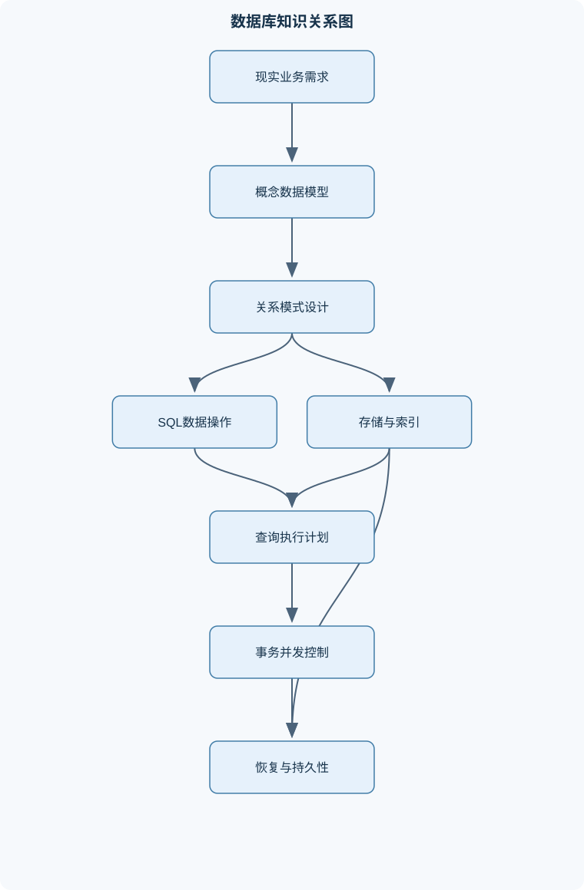
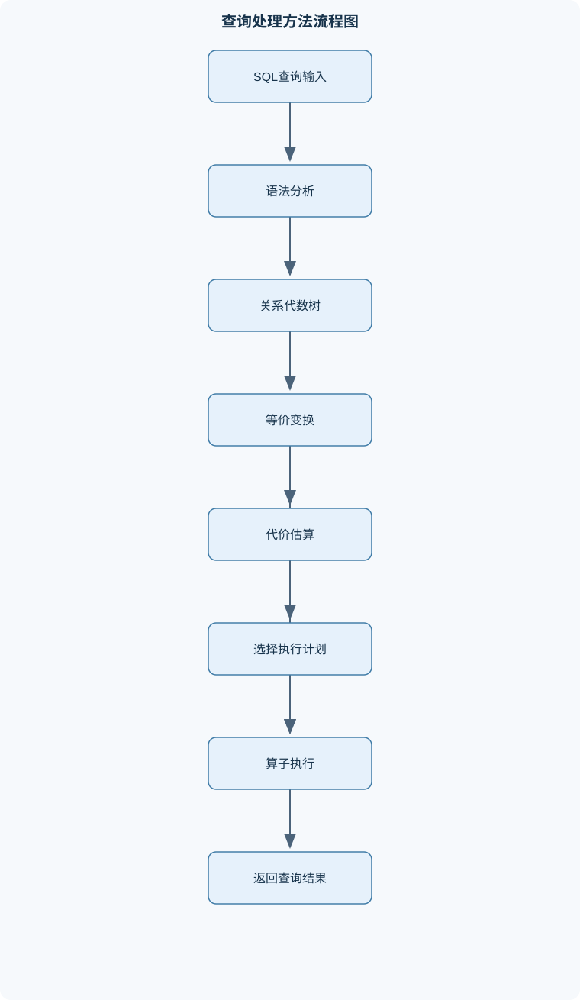

# 数据库系统原理

## 一、课程整体知识框架

### 课程边界与先修知识

数据库系统原理研究数据库管理系统的抽象、建模、定义、操作、存储、查询处理、优化、事务管理、恢复与应用接口。课程覆盖从需求分析到关系模式设计、SQL查询、索引与执行计划、并发控制和故障恢复的完整知识链，并介绍对象数据库、半结构化数据和分布式数据库的基本思想。先修知识包括离散数学中的集合、逻辑和关系，数据结构中的树、哈希与排序，计算机组成原理中的存储层次和输入输出，操作系统中的进程与文件，以及一种程序设计语言。课程不以某个具体数据库产品的语法为边界；产品文档中的语法、优化器行为和事务实现应视为具体系统的实现实例。





### 1. 数据库系统的研究对象与主线

数据库系统研究如何对数据进行抽象、组织、定义、存取、共享、保护和恢复。数据库不仅是若干数据文件的集合，还包括描述数据结构的模式、保证数据正确性的约束、处理并发访问的事务机制，以及负责存储管理、查询处理和故障恢复的数据库管理系统（DBMS）。

数据库管理系统与传统文件处理系统的根本差异，在于它把数据的逻辑组织和物理存储分离开来。文件系统通常围绕预先编译的程序组织数据，程序需要知道文件格式、记录布局和访问路径；DBMS则提供统一的数据定义语言、查询语言、事务机制和权限系统，使多个应用能够共享数据，并通过查询表达灵活的数据访问需求。文件系统可以完成基本的读写，但对多用户并发、完整性约束、故障恢复和复杂查询通常缺少统一支持。

课程知识链可以概括为：

需求分析与概念建模  
$\rightarrow$ 关系模式设计  
$\rightarrow$ 完整性约束与规范化  
$\rightarrow$ SQL定义和查询  
$\rightarrow$ 存储组织与索引  
$\rightarrow$ 查询处理与优化  
$\rightarrow$ 事务并发控制  
$\rightarrow$ 故障恢复与安全运维  
$\rightarrow$ 分布式和新型数据管理。

这条主线体现了数据库系统中的因果关系：概念模型决定数据实体和联系，关系模式决定表及其约束，模式和数据分布影响索引选择，索引和统计信息影响执行计划，多个事务的执行方式影响并发正确性，日志和数据页的写入顺序决定崩溃后的恢复能力。

### 2. 抽象层次、模式与数据库状态

数据库抽象通常分为物理层、逻辑层和视图层。物理层描述记录、页、文件和索引如何存放；逻辑层描述关系、属性、联系和约束；视图层描述不同用户能够看到的数据子集。三级模式结构中的内模式对应物理存储，概念模式对应全体数据库的逻辑结构，外模式对应某一用户或应用的视图。

数据库模式是相对稳定的结构定义，例如关系模式记为

$$
R(A_1,A_2,\ldots,A_n),
$$

其中 $R$ 是关系名，$A_i$ 是属性名；关系实例记为 $r(R)$，表示在某一时刻满足模式和约束的有限元组集合。模式描述“允许存储什么以及必须满足什么条件”，实例描述“当前实际存储了什么”。插入、删除或更新会改变实例，增加属性、修改数据类型或改变约束则可能改变模式。

数据独立性是分层抽象的重要目标。物理数据独立性指改变文件组织、页布局或索引结构时，尽量不修改逻辑模式和应用程序；逻辑数据独立性指改变逻辑模式时，尽量通过视图或模式映射保持外部应用稳定。数据独立性不是绝对不变，而是通过映射、视图和接口降低变化传播范围。

DBMS的核心功能包括数据定义、数据操纵、查询处理、存储管理、缓冲管理、事务管理、并发控制、恢复、安全控制和系统目录管理。数据库管理员通常负责模式与权限设计、容量规划、备份恢复、性能诊断、版本迁移和安全审计，但具体职责边界取决于组织架构和系统规模。

数据库应用可以采用集中式、客户机—服务器、三层架构或服务化架构。三层架构通常将表示层、业务逻辑层和数据访问层分开，使权限、事务和连接管理集中在服务端。集中式系统部署简单但扩展能力有限；分布式系统可以通过分片和复制扩展容量及吞吐量，但会引入网络延迟、节点故障、数据一致性和分布式事务问题。

### 3. 概念建模与关系模型

实体联系模型用于从业务需求中抽取实体集、属性和联系集。实体集表示具有相同性质的对象集合，例如“学生”或“课程”；属性描述实体特征；联系集描述实体之间的业务关系，并可带有联系属性。实体的候选键必须能够唯一标识实体，且不能删除其中任一属性后仍保持唯一性。

基数约束说明联系两端的数量关系。一对一联系表示一个实体最多对应另一端的一个实体；一对多联系表示一端的一个实体可对应另一端多个实体；多对多联系表示双方均可对应多个实体。参与约束说明实体是否必须参加联系：全参与意味着每个实体都必须至少出现在一个联系实例中，部分参与则允许不参加。

弱实体没有足以独立标识自身的完整键，必须依赖拥有实体及其部分键共同识别。特化把一个高层实体划分为多个低层实体，例如“员工”特化为“教师”和“技术人员”；概化则从多个实体抽取共同属性。聚合把一个联系或联系结构作为更高层对象参与其他联系，适合描述“某部门管理某项目中的某项任务”等复杂语义。

将E-R模型转换为关系模式时，普通实体集转换为一个关系，实体属性转换为列，实体键转换为候选键或主键。一对多联系通常把“一”端主键作为外键放入“多”端；多对多联系转换为独立关系，其主键通常由双方外键组合而成，并可存放联系属性；一对一联系可根据参与约束将一方主键放入另一方，或建立独立联系表。弱实体关系需要包含拥有实体主键和弱实体部分键。

### 4. 关系模型、关系代数与SQL语义

关系模式中的元组记为 $t$ 或 $u$，属性 $A$ 在元组 $t$ 上的值记为 $t[A]$，属性域记为 $\operatorname{dom}(A)$。超键是能够唯一标识元组的属性集，但不要求最小；候选键是最小超键；主键是从候选键中选定的一个。外键记为 FK，其非空值必须在被参照表的候选键或数据库系统允许的唯一键约束中存在；外键是否允许空值由 NULL 性约束和业务语义决定。

选择运算

$$
\sigma_p(r)
$$

保留满足谓词 $p$ 的元组；投影运算

$$
\pi_{A_1,\ldots,A_k}(r)
$$

保留指定属性，并按照关系的集合语义消除重复元组。笛卡尔积 $r\times s$ 产生两关系元组的全部组合；theta连接定义为

$$
r\bowtie_\theta s=\sigma_\theta(r\times s).
$$

自然连接按照所有同名属性进行等值匹配，并只保留一份公共属性，因此同名属性必须具有相同业务含义，否则可能产生错误匹配。

并、交、差要求两关系具有相同目数且对应属性域兼容。除法 $r(X,Y)\div s(Y)$ 表达“对 $s$ 中每个 $Y$ 值都满足”的全称查询。其推导步骤是：先产生候选 $X$；再计算候选 $X$ 与 $s$ 的笛卡尔积；从中找出没有对应匹配的候选；最后删除这些候选。若 $s$ 为空，除法结果的具体含义必须结合形式语义判断，不能仅凭自然语言直觉处理。

SQL与经典关系代数存在重要差异。关系代数通常采用集合语义，而SQL默认采用多重集语义，因此SQL查询可能保留重复行，`DISTINCT`才进行去重。SQL中的 `NULL` 不是普通数值，而是未知、缺失或不适用的标记。涉及 `NULL` 的比较通常产生 `UNKNOWN`；`WHERE` 只保留结果为 `TRUE` 的行，因此 `WHERE salary <> 0` 不会保留 `salary IS NULL` 的行。

SQL数据定义包括表、列类型、主键、外键、唯一性和检查约束。`INSERT`增加元组，`UPDATE`修改元组，`DELETE`删除元组。查询通常由 `SELECT`、`FROM`、`WHERE`、`GROUP BY`、`HAVING`、`ORDER BY` 等部分组成。逻辑处理顺序通常先形成来源关系，再执行连接和筛选，随后分组聚集、投影和排序；实际执行顺序由优化器决定。

外连接保留未匹配的一侧，并用 `NULL` 填充另一侧。将筛选条件放入 `WHERE` 可能在外连接之后删除这些补空值行，而将条件放入 `ON` 通常只影响匹配过程。因此二者不总是等价。视图是保存的查询定义，可隐藏敏感列并简化复杂查询；涉及聚集、分组、连接多个基表或计算列的视图，通常不能直接更新，更新边界取决于视图是否能唯一映射到基表元组。

### 5. 数据库设计、规范化与约束

函数依赖 $X\to Y$ 表示：在关系实例中，任意两个元组若在属性集 $X$ 上取值相同，则在属性集 $Y$ 上取值也相同。若 $Y\subseteq X$，则为平凡函数依赖；否则为非平凡函数依赖。属性集闭包 $X^+$ 是由 $X$ 根据函数依赖集 $F$ 能推出的全部属性集合。

闭包算法如下：

```text
输入：属性集 X，函数依赖集 F
输出：X 关于 F 的闭包 X+

X_plus ← X
重复：
    changed ← false
    对 F 中每个依赖 Y → Z：
        如果 Y ⊆ X_plus 且 Z 不完全包含于 X_plus：
            X_plus ← X_plus ∪ Z
            changed ← true
直到 changed = false
返回 X_plus
```

算法的不变量是：每轮得到的 $X^+$ 都是由 $X$ 和 $F$ 可推出的属性集合，并且属性只增加不减少。若 $X^+=R$，则 $X$ 是超键；再逐一删除 $X$ 中属性并重新计算闭包，若删除后不再覆盖全部属性，则原集合具有最小性，是候选键。候选键枚举最坏情况下呈指数增长，因此实际设计中需优先加入不出现在任何依赖右部的属性。

规范化通过分解关系减少冗余和更新异常。第一范式要求属性值具有原子性；第二范式要求在满足第一范式的基础上，非主属性不依赖于候选键的部分属性；第三范式要求对每个非平凡依赖 $X\to A$，$X$ 是超键或 $A$ 是主属性；BCNF要求每个非平凡函数依赖的决定项都必须是超键。BCNF通常比3NF更严格，但可能损失依赖保持性。

二元分解 $R\to R_1,R_2$ 对依赖集 $F$ 无损的判定条件为：若交集 $R_1\cap R_2$ 能在 $F^+$ 中决定 $R_1$，或能决定 $R_2$，即

$$
(R_1\cap R_2)\to R_1
$$

或

$$
(R_1\cap R_2)\to R_2,
$$

则该分解无损。3NF综合算法先求最小依赖集，再为每个依赖构造包含决定项和被决定项的关系；若生成的关系中没有包含候选键的关系，则补充一个候选键关系。该方法通常能够保证无损连接和依赖保持，但具体结果仍取决于最小依赖集和候选键选择。

多值依赖描述一个属性集合与另一属性集合之间的独立多值关联，第四范式用于处理由多值依赖造成的冗余。规范化并不意味着表越多越好；反规范化可以减少连接和读取成本，但会增加重复数据、更新维护和一致性风险，必须同时设计约束、同步机制和验收规则。

### 6. 存储、索引与查询优化

数据库通常以页或块作为磁盘与内存之间的基本传输单位。记录可以是定长或变长，变长记录需要记录偏移量、长度或槽目录。堆文件适合快速插入和无序存储；有序文件适合顺序扫描和范围访问，但插入可能需要移动记录或维护溢出区。缓冲区管理器负责将磁盘页装入内存，并决定哪些页保留、替换和刷回磁盘。

索引通过额外结构减少查找数据所需的页访问。稠密索引通常为每个搜索键值或记录提供索引项；稀疏索引只为部分数据页或有序段提供索引项，因此要求数据文件具有相应顺序。B+树的所有叶结点位于同一层，叶结点按键有序并通常具有链指针，适合等值、范围和排序访问。B+树查找和插入平均需要 $O(\log_B N)$ 次页访问，其中 $B$ 是扇出，实际扇出由页大小、键长度和指针长度共同决定。

哈希索引通过哈希函数将键映射到桶，适合等值查询，不适合一般范围查询和按键排序。联合索引的列顺序决定可利用的前缀范围；例如索引 $(A,B,C)$ 通常最适合以 $A$ 开始的等值或范围条件，不能简单认为三个单列索引效果完全相同。覆盖索引包含查询所需全部列，可减少回表；表达式索引针对计算结果建立索引；部分索引只维护满足条件的行。索引会增加插入、删除、更新成本和存储空间，因此不能因为“有索引”就断定查询一定更快。

查询优化器把SQL转换为关系代数表达式树，再选择具体执行计划。选择下推的基本依据是：若谓词只涉及关系 $r$ 的属性，在连接语义不变的条件下，可将

$$
\sigma_p(r\bowtie s)
$$

改写为

$$
\sigma_p(r)\bowtie s.
$$

投影下推时必须保留输出属性、后续连接属性和后续筛选属性。外连接、聚集、窗口函数、重复语义和空值可能使简单下推失效。

连接算法包括嵌套循环连接、块嵌套循环连接、索引嵌套循环连接、排序归并连接和哈希连接。若 $r$ 为外部关系、$s$ 为内部关系，内存缓冲页数为 $M$，块嵌套循环连接的理想传输代价近似为

$$
b_r+\left\lceil\frac{b_r}{M-2}\right\rceil b_s.
$$

该式假定连续块访问、至少保留一个输入缓冲和一个输出缓冲，并忽略寻道、缓存命中、并行执行和倾斜。哈希连接在理想均匀哈希且分区不溢出的条件下，约需

$$
3(b_r+b_s)
$$

次块传输；数据倾斜、递归分区或内存不足会使实际成本更高。

外部排序首先把每次可装入内存的最多 $M$ 个块排序成有序段，再使用最多 $M-1$路归并。初始有序段数约为 $\lceil b/M\rceil$，理想块读写量约为

$$
2b\left(1+\left\lceil
\log_{M-1}\left\lceil\frac{b}{M}\right\rceil
\right\rceil\right).
$$

这个公式只估算块传输，不等同于完整运行时间；CPU比较、随机寻道、输出缓冲和重复键处理都可能影响实际性能。

### 7. 事务、恢复、安全与分布式扩展

事务 $T$ 是一组具有逻辑整体性的读写操作。ACID分别表示原子性、一致性、隔离性和持久性。事务通常经历活动、部分提交、提交、失败和中止等状态。调度是多个事务操作的交错序列；若调度与某个串行调度等价，则具有可串行化性质。

冲突可串行化可通过优先图判定：结点表示事务，若同一数据项上的冲突操作按先后属于不同事务，则加入有向边。图无环当且仅当调度冲突可串行化；拓扑序给出一个等价串行顺序。脏读、不可重复读和幻读分别涉及读取未提交数据、同一事务两次读取结果不同、两次范围查询之间出现新增或删除匹配行。

两阶段锁要求事务先获得锁，进入收缩阶段后不再获得新锁；严格两阶段锁进一步要求排他锁直到提交或回滚才释放。严格两阶段锁可以防止级联回滚并简化恢复，但不能自动消除死锁。等待图出现环时存在死锁，系统可通过检测后回滚事务，也可采用超时、资源排序或时间戳策略预防。

恢复机制依赖日志和先写日志原则：数据页写入稳定存储前，对应日志记录必须先持久化。立即更新允许未提交更新先写入数据页，因此崩溃后需要UNDO；延迟更新在提交前不写入数据页，通常需要REDO；实际系统常采用UNDO/REDO。检查点缩短恢复扫描范围，ARIES思想通常包括分析、重做和撤销阶段，并在撤销过程中写入补偿日志记录。介质故障还需要备份、归档日志和恢复演练。

安全机制包括身份认证、授权、角色、最小权限、视图、审计和脱敏。参数化查询可将代码与数据分离，防止输入被解释为SQL语法，从而降低SQL注入风险。约束既可以在数据库层实施，也可以在应用层预检查，但关键一致性约束不能只依赖应用层，因为多个应用、并发事务或绕过应用的操作都可能破坏数据。

分布式数据库通过分片、复制和节点协作扩展容量与可用性。两阶段提交的协调者先询问参与者是否准备提交，所有参与者同意后再广播提交；它保证原子提交，但协调者或网络故障可能导致参与者阻塞。分布式系统中的一致性、可用性和分区容错之间存在权衡，复制日志和共识机制用于维护副本顺序，但两阶段提交不能替代共识算法。

新型数据管理包括键值、文档、列族和图模型。JSON适合字段可选、结构嵌套和模式变化较快的数据，但可能带来解析成本、约束困难和数据重复。对象关系扩展可保存复杂对象、数组或空间类型。空间数据管理关注位置、范围、相交和距离等操作，不能简单套用普通等值索引。联机事务处理强调低延迟和高并发，联机分析处理强调大范围扫描、聚集和多维分析，二者在模式、索引、事务时长和硬件配置上通常不同。

## 二、章节和模块划分

### 核心知识覆盖清单

本清单用于检查正文是否覆盖本课程的主要知识模块：

- **数据库系统概论与体系结构**：数据库与文件系统的差异、数据库管理系统的功能、数据抽象与数据独立性、模式、实例与数据库状态、三级模式结构、数据库语言与接口、数据库管理员职责、数据库应用架构、集中式与分布式数据库概览。
- **概念数据建模与实体联系模型**：实体集与属性、联系集与联系属性、候选键与实体完整性、一对一与一对多联系、多对多联系建模、参与约束与基数约束、弱实体集、特化与概化、聚合建模、E-R模型向关系模式转换。
- **关系模型与关系代数**：关系模式与关系实例、超键候选键与主键、外键与参照完整性、选择与投影、并交差集合运算、笛卡尔积与连接、自然连接与theta连接、重命名与赋值、除法运算与全称查询、外连接空值与三值逻辑、聚集与分组运算。
- **SQL数据定义与基础查询**：CREATE TABLE与数据类型、INSERT UPDATE DELETE、SELECT查询结构、WHERE条件与谓词、NULL语义、ORDER BY与分页、DISTINCT与重复元组、连接查询与连接条件、子查询与相关子查询、集合运算、主键外键唯一性检查约束、视图定义与视图更新边界。
- **SQL高级特性与数据库应用**：聚集函数与GROUP BY、HAVING与分组过滤、窗口函数、公共表表达式、递归查询的基本思想、CASE表达式与条件计算、存储过程与触发器概念、参数化查询与应用接口、事务控制语句、JSON等半结构化数据、对象关系扩展、权限授予与撤销。
- **关系数据库设计与规范化**：函数依赖、平凡与非平凡函数依赖、属性集闭包、候选键求解、部分依赖与传递依赖、第一至第三范式、Boyce-Codd范式、无损连接分解、依赖保持分解、多值依赖与第四范式、规范化与反规范化权衡。
- **存储管理与索引结构**：磁盘页与记录组织、定长记录与变长记录、堆文件与有序文件、缓冲区管理、日志与数据页关系、稠密与稀疏索引、B+树索引结构、哈希索引、联合索引与最左前缀、覆盖索引与索引仅扫描、表达式索引与部分索引、索引维护成本。
- **查询处理与查询优化**：查询编译与执行计划、关系代数表达式树、选择和投影下推、连接重排、基于代价的优化、统计信息与选择率、嵌套循环连接、块嵌套循环连接、索引嵌套循环连接、排序归并连接、哈希连接、外部排序与多路归并、执行计划代价估算。
- **事务管理与并发控制**：事务ACID性质、事务状态转换、可串行化调度、冲突可串行化、视图可串行化概念、脏读不可重复读幻读、两阶段锁协议、严格两阶段锁、死锁检测与预防、时间戳排序、多版本并发控制、隔离级别与异常现象。
- **数据库恢复与故障处理**：故障类型与恢复目标、日志记录与先写日志、立即更新与延迟更新、检查点机制、UNDO恢复、REDO恢复、UNDO/REDO恢复、模糊检查点、介质故障与备份、ARIES恢复思想、恢复过程中的事务分类、提交持久性与崩溃一致性。
- **数据库安全完整性与运维**：身份认证与授权、角色与最小权限、视图安全机制、SQL注入原理与参数化防护、审计日志、约束实施位置、备份恢复策略、容量与连接管理、慢查询定位、执行计划验证、索引与统计信息维护、数据脱敏与访问控制边界。
- **分布式数据库与新型数据管理**：分布式数据库基本架构、数据分片与复制、分布式事务、两阶段提交、分布式死锁、一致性与可用性权衡、共识与复制日志基本思想、键值文档列族图数据模型、JSON存储与查询、空间数据管理概念、联机事务处理与分析处理、分布式系统中的故障边界。


### 1. 数据库系统概论与体系结构

本模块建立数据库、DBMS、数据库应用、模式、实例、数据独立性和三级模式结构的概念基础。重点分析数据库与文件系统在共享、查询、并发、完整性和恢复方面的差异，并介绍数据库语言、应用接口、管理员职责以及集中式和分布式架构。判断一个系统是否真正承担DBMS职责，不能只看它是否能保存文件，还要看它是否统一处理模式、查询、约束、事务和权限。

### 2. 概念数据建模与E-R模型

本模块从业务语义出发识别实体、属性、联系、键、参与约束和基数约束，进一步讨论弱实体、特化、概化和聚合。核心产出是能够把需求中的“对象”“对象特征”“对象之间的关系”和“关系发生的条件”区分开，并正确转换为关系模式。转换时尤其要注意多对多联系必须独立成表，一对多联系通常把外键放在多的一侧，弱实体必须带有拥有实体的标识属性。

### 3. 关系模型与关系代数

本模块定义关系模式、关系实例、元组、属性域、超键、候选键、主键和外键，并系统解释选择、投影、连接、集合运算、重命名、赋值、除法、外连接和聚集。练习中必须区分集合语义与SQL多重集语义，区分自然连接与明确连接条件，区分空值参与比较时的UNKNOWN与普通布尔值。

### 4. SQL数据定义与基础查询

本模块覆盖表和数据类型定义、插入、更新、删除、查询、连接、子查询、集合运算、排序、分页、重复消除和约束定义。主键保证实体唯一性，外键保证参照完整性，`UNIQUE`限制重复值，`CHECK`限制局部谓词，但`CHECK`是否允许空值取决于谓词结果和具体约束定义，不能把它简单理解为非空约束。

### 5. SQL高级特性与数据库应用

本模块讨论聚集函数、分组、`HAVING`、窗口函数、公共表表达式、递归查询、`CASE`、存储过程、触发器、事务控制、参数化接口、权限授予与撤销，以及JSON和对象关系扩展。窗口函数在保留明细行的同时计算分组统计，不能用普通 `GROUP BY` 完全替代。递归查询适合层次结构，但必须设计终止条件或循环检测机制。触发器可自动维护审计或派生数据，却可能隐藏副作用、增加调试难度。

### 6. 关系数据库设计与规范化

本模块从函数依赖、闭包和候选键求解出发，解释部分依赖、传递依赖、1NF、2NF、3NF、BCNF、无损连接、依赖保持、多值依赖和4NF。设计分解时必须同时检查三个问题：是否减少冗余，是否无损连接，是否保持关键依赖。不能只因为表数量增加就断定设计更优，也不能把反规范化等同于设计错误。

### 7. 存储管理与索引结构

本模块介绍页、记录、堆文件、有序文件、缓冲区和日志页之间的关系，再比较稠密索引、稀疏索引、B+树、哈希索引、联合索引、覆盖索引、表达式索引和部分索引。索引选择必须结合谓词类型、选择率、范围大小、排序需求、回表成本、缓存状态和更新频率。B+树适合范围和排序，哈希结构主要适合等值，低选择率查询可能仍由顺序扫描更有效完成。

### 8. 查询处理与查询优化

本模块解释SQL编译、关系代数表达式树、物理执行计划、统计信息和代价估计。优化规则包括选择下推、投影下推、连接重排和不必要操作消除；物理算法包括嵌套循环、块嵌套循环、索引嵌套循环、排序归并和哈希连接。优化器的估算依赖基数、块数、选择率和数据分布，独立性假设、相关属性、倾斜数据和过期统计信息都可能造成估算偏差。

### 9. 事务管理与并发控制

本模块从ACID和事务状态转换开始，分析调度、冲突可串行化、视图可串行化、脏读、不可重复读、幻读、两阶段锁、严格两阶段锁、死锁、时间戳排序和多版本并发控制。隔离级别必须按允许的异常定义，不能直接把某个产品名称等同于理论隔离级别，因为不同系统可能采用锁、快照或串行化快照等不同实现。

### 10. 数据库恢复与故障处理

本模块区分事务故障、系统崩溃、介质故障和通信故障，解释日志、LSN、页LSN、先写日志、立即更新、延迟更新、UNDO、REDO、UNDO/REDO、检查点、模糊检查点、备份和ARIES。恢复的基本验证标准是：已提交事务的更新不能丢失，未提交事务的更新不能残留，且恢复后的数据库满足完整性约束。

### 11. 数据库安全、完整性与运维

本模块把认证、授权、角色、最小权限、视图安全、参数化查询、审计、约束实施、备份恢复、容量管理、连接管理、慢查询定位、执行计划验证、统计信息维护和脱敏联系起来。性能诊断不能只看单条SQL耗时，还需检查等待事件、锁竞争、I/O、缓存命中、计划变化和数据增长趋势。安全控制的边界必须明确：脱敏减少展示风险，但不能替代权限控制；应用校验改善用户体验，但不能替代数据库约束。

### 12. 分布式数据库与新型数据管理

本模块介绍分布式架构、数据分片、复制、分布式事务、两阶段提交、分布式死锁、一致性与可用性权衡、共识、复制日志，以及键值、文档、列族、图、JSON和空间数据管理。设计分布式方案时要明确故障边界：节点宕机、网络延迟、网络分区、消息重复、消息丢失和协调者故障的处理方式不同。分片提高扩展能力但可能造成跨分片连接和事务成本；复制提高读取能力和容错性但带来副本同步、冲突处理和一致性延迟。

### 13. 代表性流程一：候选键求解与规范化分析

**输入**：关系模式 $R$ 和函数依赖集 $F$。  
**输出**：候选键、部分或传递依赖、可行的3NF或BCNF分解。  
**步骤**：

1. 找出不出现在任何依赖右部的属性，这些属性必须属于任一候选键。
2. 逐步加入其他属性，计算当前属性集闭包。
3. 当闭包覆盖 $R$ 时得到超键。
4. 删除超键中的属性并重新计算闭包；删除后不能覆盖 $R$ 的超键才是候选键。
5. 根据候选键识别部分依赖和传递依赖。
6. 检查分解的无损性和依赖保持性。

**不变量**：候选键始终能够函数决定全体属性；删除测试保证最小性。候选键枚举最坏为指数复杂度，适用于属性数和依赖集规模可控的关系设计分析。

### 14. 代表性流程二：冲突可串行化与死锁分析

**输入**：多个事务交错形成的调度。  
**输出**：是否冲突可串行化、可能的串行顺序，以及锁等待图中的死锁。  
**步骤**：

1. 为每个事务建立一个结点。
2. 按调度顺序检查同一数据项上的读写、写读和写写冲突。
3. 若先操作属于 $T_i$、后操作属于 $T_j$，加入边 $T_i\to T_j$。
4. 对优先图执行拓扑排序。
5. 无环时，拓扑序给出一个等价串行顺序；有环时，不冲突可串行化。
6. 若分析锁调度，再建立等待图；等待图有环表示死锁。

复杂度用邻接表表示时约为 $O(V+E)$，其中 $V$ 是事务数，$E$ 是冲突边数。该方法只判定冲突可串行化，不能据此断言所有视图可串行化调度都不可行。

### 15. 代表性流程三：外部多路归并排序

**输入**：包含 $b$ 个磁盘块的关系、$M$ 个缓冲页和排序键。  
**输出**：按排序键排列的磁盘关系。  
**步骤**：

1. 每次读取最多 $M$ 个块，在内存中排序并写出一个有序段。
2. 初始有序段数约为 $\lceil b/M\rceil$。
3. 每轮使用输入缓冲和一个输出缓冲，最多归并 $M-1$ 个段。
4. 重复归并直到只剩一个有序段。

不变量是每个中间段内部有序，归并后仍保持全局有序。理想块传输量为

$$
2b\left(1+\left\lceil\log_{M-1}\left\lceil\frac{b}{M}\right\rceil\right\rceil\right).
$$

该估算不包含CPU比较、寻道、缓存命中和并发I/O影响。

### 16. 例题一：关系代数优化

**题干**：给定 `branch(branch_name, branch_city, assets)`，查询资产高于某个布鲁克林支行的支行名称。

**分析**：查询需要把同一关系分别作为目标支行和参考支行，因此要重命名。布鲁克林条件只涉及参考支行，应在连接前下推；连接后只需保留目标支行名称。

**逐步解答**：

$$
S=\rho_S\left(
\pi_{branch\_name,assets}
\left(
\sigma_{branch\_city='Brooklyn'}(branch)
\right)
\right)
$$

$$
T=\rho_T\left(
\pi_{branch\_name,assets}(branch)
\right)
$$

$$
\pi_{T.branch\_name}
\left(
\sigma_{T.assets>S.assets}(T\times S)
\right).
$$

**结果验证**：若某布鲁克林支行资产为100，目标支行资产为120，则目标支行保留；目标支行资产等于100或低于100则不保留。  
**变式**：若要求“高于所有布鲁克林支行”，不能只比较一个参考元组，应使用除法、聚集最大值或等价的反存在逻辑表达全称条件。

### 17. 例题二：外连接与聚集

**题干**：课程表为 `course`，选课表为 `enroll(course_id, student_id, score)`，查询每门课程的选课人数、平均成绩和最高成绩，并保留没有选课记录的课程。

**解答**：

```sql
SELECT c.course_id,
       c.course_name,
       COUNT(e.student_id) AS student_count,
       AVG(e.score) AS avg_score,
       MAX(e.score) AS max_score
FROM course AS c
LEFT JOIN enroll AS e
  ON c.course_id = e.course_id
GROUP BY c.course_id, c.course_name;
```

使用 `LEFT JOIN` 保留无匹配课程。`COUNT(e.student_id)`只统计实际匹配的选课记录；若使用 `COUNT(*)`，外连接产生的补空值行也会被计为一行，结果可能把零人课程误算为1人。  
**结果验证**：无选课课程的计数应为0，平均成绩和最高成绩通常为NULL，而不是0。  
**变式**：若只保留平均成绩高于80的课程，应使用 `HAVING AVG(e.score) > 80`；这会过滤没有选课记录的课程，因为其平均值为NULL。

### 18. 例题三：函数依赖与候选键

**题干**：关系

$$
R(\text{学号},\text{课程号},\text{教师},\text{教师办公室},\text{成绩})
$$

依赖为：学号、课程号 $\to$ 成绩；课程号 $\to$ 教师；教师 $\to$ 教师办公室。求候选键并判断主要依赖类型。

**解答**：计算

$$
(\text{学号},\text{课程号})^+
$$

初始包含学号、课程号；由课程号 $\to$ 教师得到教师；由教师 $\to$ 教师办公室得到教师办公室；由学号、课程号 $\to$ 成绩得到成绩，因此闭包覆盖全部属性。学号和课程号分别不能单独推出全部属性，所以候选键为$(学号,课程号)$。

成绩依赖于完整键，不构成部分依赖；教师由课程号决定，而课程号只是复合键的一部分，存在部分依赖；教师办公室经由教师决定，存在传递依赖。  
**结果验证**：同一课程的教师和办公室在多条学生选课记录中重复。  
**变式**：可拆分为选课表$(学号,课程号,成绩)$、课程表$(课程号,教师)$和教师表$(教师,教师办公室)$，再检查外键和无损连接。

### 19. 例题四：块嵌套循环连接估算

**题干**：关系 $r$ 有800块，关系 $s$ 有1500块，内存缓冲页数为 $M$。分别令 $r$ 和 $s$ 为外部关系，比较块嵌套循环连接代价。

**解答**：

当 $r$ 为外部关系时：

$$
C_r=800+\left\lceil\frac{800}{M-2}\right\rceil\times1500.
$$

当 $s$ 为外部关系时：

$$
C_s=1500+\left\lceil\frac{1500}{M-2}\right\rceil\times800.
$$

例如 $M=102$，则 $M-2=100$：

$$
C_r=800+\lceil800/100\rceil\times1500
=800+8\times1500=12800,
$$

$$
C_s=1500+\lceil1500/100\rceil\times800
=1500+15\times800=13500.
$$

因此此时选择较小的 $r$ 作为外部关系更优。  
**结果验证**：若内存足够容纳整个较小关系，公式不再是最合适的估算，应采用一次读入后扫描另一关系的模型。  
**变式**：若存在适合连接条件的索引，还应比较索引嵌套循环连接，不能只比较块传输公式。

### 20. 例题五：事务调度判定

**题干**：调度为

$$
r_1(X),\ w_1(X),\ r_2(X),\ w_2(Y),\ r_1(Y),\ w_1(Y).
$$

判断是否冲突可串行化。

**解答**：在 $X$ 上，$w_1(X)$ 先于 $r_2(X)$，产生边 $T_1\to T_2$。在 $Y$ 上，$w_2(Y)$ 先于 $r_1(Y)$，产生边 $T_2\to T_1$。优先图包含环

$$
T_1\to T_2\to T_1.
$$

因此该调度不是冲突可串行化。  
**结果验证**：两个事务分别先影响一个数据项，再读取或修改另一个数据项，存在循环依赖。严格两阶段锁可以避免产生不符合协议的调度，但若两个事务各自持有一个锁并等待另一个锁，仍可能死锁。  
**变式**：若删除 $w_2(Y)$，则只剩 $T_1\to T_2$，图无环，调度冲突可串行化。

### 21. 实验一：索引选择与执行计划验证

**输入数据**：建立包含用户编号、状态、创建时间和文本说明的业务表，准备等值查询、时间范围查询、状态与时间联合查询以及按时间排序查询。

**步骤**：

1. 在无索引条件下执行查询，记录返回行数、计划、扫描块和耗时。
2. 建立用户编号B+树，比较等值查询变化。
3. 建立状态、创建时间联合索引，比较联合过滤和排序查询。
4. 增加覆盖列，观察回表是否减少。
5. 插入和更新大量数据，比较索引维护开销。
6. 令统计信息过期，再观察估算基数与实际基数的差异。

**评价标准**：不能只以一次耗时判断优劣，应同时比较计划类型、估算行数与实际行数、逻辑读、物理读、排序和回表次数，并说明不同数据规模下结论是否稳定。

**排错方法**：若索引未被使用，检查谓词是否对列施加了不可利用的函数、选择率是否过低、统计信息是否过期、查询是否需要大量回表，以及参数类型是否导致隐式转换。若联合索引效果异常，检查过滤列顺序和最左前缀条件。

### 22. 实验二：事务并发与恢复演练

**输入数据**：建立账户表和转账操作，设计两个并发事务分别更新相同账户，并模拟提交、回滚和系统崩溃。

**步骤**：

1. 在不同隔离级别下交错执行两个事务，记录脏读、不可重复读和幻读是否出现。
2. 使用锁等待构造可能的死锁，观察等待图或超时回滚结果。
3. 执行一个已提交事务和一个未提交事务，在故障前分别修改数据。
4. 检查日志中的事务标识、旧值、新值、LSN和提交记录。
5. 恢复时区分需要REDO的事务和需要UNDO的事务。
6. 验证恢复后已提交更新存在、未提交更新消失，并重新检查账户余额约束。

**评价标准**：恢复结果必须满足原子性和持久性；并发实验必须说明异常现象出现的前提，而不能把某一产品默认隔离级别推广为所有DBMS的普遍行为。

**排错方法**：若未提交更新仍然存在，检查数据页写入是否遵守先写日志和撤销流程；若已提交更新丢失，检查提交日志是否持久化；若实验无法复现幻读，检查查询是否为范围谓词、隔离实现是否采用快照，以及测试事务是否真正重叠执行。

## 三、核心概念的详细解释

### 3.1 数据库系统的抽象、模式与体系结构

数据库系统由数据库、数据库管理系统、应用程序和用户组成。数据库是按照一定结构组织并长期存储的数据集合；数据库管理系统（DBMS）负责定义、存储、查询、更新、并发控制、故障恢复和安全管理。文件系统通常围绕具体应用程序提供文件读写，程序必须了解记录格式和访问路径；DBMS则通过模式、查询语言和事务机制，使多个应用能够共享数据，并将逻辑数据组织与物理存储分离。

数据库模式描述数据库允许具有的结构和约束，例如关系模式

$$
R(A_1,A_2,\ldots,A_n),
$$

其中 $R$ 是关系名，$A_i$ 是属性名。关系实例 $r(R)$ 是某一时刻符合该模式和约束的有限元组集合。插入、删除和更新通常改变实例；增加属性、改变数据类型或修改约束则可能改变模式。模式相对稳定，实例随业务操作不断变化，二者不能混同。

三级模式结构包括外模式、概念模式和内模式。外模式是面向特定用户或应用的视图；概念模式描述整个数据库的逻辑结构；内模式描述记录、页、文件和索引的物理组织。外模式—概念模式映射支持逻辑数据独立性，概念模式—内模式映射支持物理数据独立性。物理数据独立性意味着改变堆文件、有序文件、B+树索引或页布局时，应用不必随之修改；逻辑数据独立性意味着在一定范围内修改逻辑模式时，可以通过视图或映射保持原有应用接口。数据独立性是降低变化传播的目标，不等于任何模式变化都无需迁移数据或修改程序。

数据库语言通常分为数据定义语言、数据操纵语言、查询语言和事务控制语言。数据定义语言建立表、视图、索引和约束；数据操纵语言插入、修改和删除数据；查询语言描述所需结果；事务控制语言控制提交和回滚。数据库管理员还需要管理用户和角色、权限、备份、恢复、容量、连接、统计信息、索引、性能和审计。

数据库应用可以采用集中式、客户机—服务器、三层或服务化架构。三层架构将表示层、业务逻辑层和数据访问层分离，便于集中实施权限、参数校验、事务边界和连接池管理。分布式数据库通过数据分片、复制或多副本部署提高容量和可用性，但网络延迟、节点故障、复制一致性和分布式事务会成为新的正确性条件。

### 3.2 概念数据建模与实体联系模型

实体联系模型（E-R模型）用于从业务需求中抽取对象及其联系。实体集表示具有相同属性结构的一类对象，例如学生、课程和部门；实体实例是实体集中的一个具体对象。属性描述实体或联系的特征，可以是简单属性、复合属性、单值属性或多值属性。能够唯一标识实体实例的属性集合称为候选键。

联系集表示实体集之间的业务联系。例如学生与课程之间存在“选修”联系，选修联系可以包含成绩、选课时间等联系属性。若属性描述的是学生本身，应归属于学生实体；若属性只有在学生和课程建立联系后才有意义，则应归属于联系。错误地把联系属性放到某一端，可能导致重复存储或无法表达同一对象参与多个联系的情况。

基数约束描述联系两端允许出现的数量。一个一对一联系中，每个实体至多对应另一端的一个实体；一对多联系中，一端的一个实体可以对应另一端多个实体，而另一端至多对应一端一个实体；多对多联系中，双方都可以对应多个实体。参与约束还区分全部参与和部分参与：全部参与表示每个实体必须参加该联系，部分参与表示允许没有对应联系。

弱实体没有足以独立标识自身的完整键，必须依赖强实体及其部分键来识别。弱实体与强实体之间通常存在标识联系，弱实体对该联系具有全部参与。例如，一个部门内的项目成员编号可能只有与部门编号组合后才具有唯一性。将弱实体转换为关系模式时，需要把强实体的主键作为外键并纳入弱实体的主键。

特化把一个高层实体集划分为若干低层实体集，例如员工可以特化为教师和行政人员；概化则从多个相似实体抽取共同父类。特化可以具有互斥约束，也可以允许一个实体同时属于多个子类；还可以具有完全覆盖或部分覆盖约束。转换为关系模式时，可以建立父类表和子类表，也可以在特定条件下把子类属性合并到一个表中，但合并方案可能产生大量空值。

E-R模型向关系模式转换通常遵循以下原则：

1. 强实体集转换为一个关系，实体属性转换为列，候选键选为主键。
2. 一对多联系通常把“一”端主键放入“多”端作为外键，联系属性也放入“多”端。
3. 多对多联系转换为独立关系，其主键通常由两端主键组合而成，并保存联系属性。
4. 一对一联系可以选择一端吸收另一端主键；应优先把外键放在全部参与的一端，以减少空值。
5. 多值属性转换为独立关系，主键由实体主键和多值属性组成。
6. 弱实体关系的主键由拥有者主键和弱实体部分键构成。

### 3.3 关系模型、完整性与关系代数

关系模式记为 $R(A_1,\ldots,A_n)$，其属性具有相应的域。关系实例是满足模式的元组集合，元组记为 $t$，属性 $A$ 在元组 $t$ 上的值记为 $t[A]$。超键是能够唯一标识元组的属性集合，但不要求最小；候选键是最小超键；主键是被选定用于主要标识元组的候选键。

实体完整性要求主键不能为空，因为空值无法稳定标识一个实体。参照完整性要求外键为空，或其非空值必须在被参照关系的候选键中存在。外键约束并不要求参照端每一列都非空，是否允许空值取决于业务含义和 `NOT NULL` 约束。删除或更新被参照元组时，可以拒绝操作、级联操作或将外键置空，但 `SET NULL` 的前提是外键允许空值。

关系代数是描述关系查询的形式化语言。选择记为

$$
\sigma_p(r),
$$

表示保留满足谓词 $p$ 的元组；投影记为

$$
\pi_{A_1,\ldots,A_k}(r),
$$

表示保留指定属性。传统关系代数采用集合语义，投影后会消除重复元组；SQL通常采用多重集语义，只有明确使用 `DISTINCT` 才去重，因此二者的结果基数和执行代价可能不同。

集合并、差和交要求两个关系具有相同目数且对应属性域兼容。笛卡尔积定义为

$$
r\times s,
$$

其每个结果元组由 $r$ 中一个元组和 $s$ 中一个元组拼接而成。若 $|r|$ 和 $|s|$ 分别是两个关系的元组数，则笛卡尔积最多产生 $|r||s|$ 个元组，连接条件会进一步筛选这些组合。

theta连接定义为

$$
r\bowtie_\theta s=\sigma_\theta(r\times s).
$$

自然连接按照同名属性执行等值匹配，并在结果中只保留一份公共属性。若同名属性只是名称相同而语义不同，自然连接可能产生错误结果，此时应使用明确的 theta 连接。内连接只保留匹配成功的元组；左外连接还保留左关系中未匹配的元组，并在右侧属性中填入空值。

除法用于表达“对另一个关系中的每个元组都满足”的查询。若

$$
r(X,Y),\qquad s(Y),
$$

则 $r\div s$ 的结果模式为 $X$。它返回那些与 $s$ 中所有 $Y$ 值都建立匹配的 $X$ 值。除法不是所有数据库产品都直接提供的 SQL 运算，通常使用分组计数、双重 `NOT EXISTS` 或反连接实现。

### 3.4 SQL、空值、视图与应用接口

SQL的数据定义部分通过表、列、数据类型和约束描述模式。主键、外键、唯一约束、非空约束和检查约束分别表达身份唯一性、参照关系、列值唯一性、必填性和业务谓词。约束可以在数据库层强制执行，也可以在应用层预先检查，但只在应用层检查无法防止多个应用并发绕过检查，因此核心一致性约束应尽量由数据库保证。

典型的课程统计查询如下：

```sql
SELECT
    c.course_id,
    c.course_name,
    COUNT(e.enrollment_id) AS student_count,
    AVG(e.score) AS average_score,
    MAX(e.score) AS highest_score
FROM course AS c
LEFT JOIN enrollment AS e
    ON e.course_id = c.course_id
GROUP BY c.course_id, c.course_name;
```

使用 `LEFT JOIN` 的原因是保留没有选课记录的课程。对于这样的课程，连接结果会生成一行右侧补空值的记录。这里假定 `enrollment_id` 是非空主键或非空唯一标识。`COUNT(e.enrollment_id)`只统计非空的选课编号，因此结果为零；`COUNT(*)`会把外连接产生的补空值行也计为一行，结果通常为一，不符合“选课人数”的语义。`AVG`和`MAX`会忽略空值，但如果没有任何有效成绩，其结果可能为空。

SQL中的空值表示未知、缺失或不适用，不等于零、空字符串或普通的特殊数值。与空值进行比较通常产生 `UNKNOWN`，而不是 `TRUE` 或 `FALSE`。`WHERE`子句只保留条件结果为 `TRUE` 的行，因此 `WHERE score > 60`不会保留 `score` 为空的行；判断空值必须使用 `IS NULL` 或 `IS NOT NULL`。

视图是保存的查询定义，向用户提供受限或抽象的数据接口。视图可以隐藏敏感列、限制可见行，也可以屏蔽物理表结构变化。简单单表视图通常较容易更新；包含聚集、分组、去重、连接、多层嵌套或计算列的视图可能无法唯一映射到基础表，因此更新边界取决于视图定义和具体系统规则。

参数化查询将SQL结构与用户输入分离，应用只把输入作为参数值传递，而不是把字符串直接拼接到SQL文本中。这样可以避免输入内容改变SQL语法结构，降低SQL注入风险。存储过程把一组数据库操作封装在服务器端；触发器在指定表发生插入、更新或删除时自动执行。触发器适合维护审计、派生约束等规则，但隐式执行可能增加调试难度，应避免复杂触发器链。

JSON等半结构化数据允许嵌套对象、数组和可选字段，适合字段变化较快或结构具有层次性的数据。其代价是约束表达、统计信息、索引设计和跨文档关联可能比规范化关系表更困难。对象关系扩展可以在关系模型中支持复杂类型、数组、空间类型或用户定义类型，但仍需明确类型约束、索引策略和查询语义。

### 3.5 函数依赖、规范化与分解

函数依赖记为

$$
X\to Y,
$$

表示在关系实例中，任意两个元组若在属性集 $X$ 上取值相同，则在属性集 $Y$ 上取值也相同。若 $Y\subseteq X$，则称为平凡函数依赖；否则为非平凡函数依赖。函数依赖描述模式约束，不是某个偶然实例中的数据重复现象。

规范化通过分解关系减少冗余和更新异常。部分依赖是非主属性依赖于候选键的一部分；传递依赖是非主属性通过非键属性间接依赖候选键。第二范式要求满足第一范式且不存在非主属性对候选键的部分依赖；第三范式要求对每个非平凡依赖 $X\to A$，要么 $X$ 是超键，要么 $A$ 是主属性。BCNF要求每个非平凡函数依赖的决定因素都是超键，因此比第三范式更严格。

分解必须关注无损连接和依赖保持。无损连接要求把分解后的关系自然连接回来时不会产生额外的伪元组，也不会丢失原有元组。依赖保持要求可以分别在各个分解关系上检查原函数依赖，而不必重新连接所有关系。第三范式合成通常较好地保持依赖并保证无损，但BCNF分解不一定保持全部依赖。

反规范化不是取消约束，而是在查询性能、存储空间、写入维护和一致性风险之间进行有意识权衡。例如，为减少频繁统计，可以保存汇总列；但每次基础数据变化都必须同步更新汇总值，否则会产生不一致。

### 3.6 存储组织、索引与查询处理

磁盘或固态存储上的数据通常按页进行输入输出。页是缓冲管理和I/O成本估算的基本单位，记录可以是定长或变长。堆文件不要求记录按键排序，插入简单但范围查询可能需要扫描；有序文件支持顺序访问和范围查找，但插入可能需要移动记录或维护溢出空间。

缓冲区管理器把磁盘页载入内存缓冲页，并根据替换策略决定哪些页保留或淘汰。日志与数据页之间必须满足先写日志原则：在包含某次修改的数据页写入稳定存储前，与该修改对应的日志记录必须先持久化。否则故障后可能无法撤销或重做已经写入的数据页。

B+树是常用于等值、范围和排序访问的平衡索引。内部结点保存分隔键和子指针，叶结点保存索引键及记录位置，所有叶结点位于同一层，并通常通过叶链支持范围扫描。B+树阶数不能脱离页大小、键长度和指针长度直接确定。查找、插入和删除的页访问复杂度通常为 $O(\log_B N)$，其中 $B$ 表示有效扇出，$N$ 表示索引项规模。

哈希索引将键映射到桶，适合等值查找；普通哈希结构不天然支持范围查询和排序。联合索引的列顺序影响可利用谓词，常见的最左前缀规则意味着仅过滤后续列而不提供前导列条件时，索引利用程度可能下降。覆盖索引包含查询所需的全部列，可以减少回表；表达式索引针对计算表达式建立索引；部分索引只为满足条件的行建立索引，从而减少空间和维护成本。

查询处理通常经历解析、语义检查、关系代数转换、逻辑优化、物理计划选择和执行。选择下推可提前减少元组数量，投影下推可减少中间元组宽度，连接重排可改变中间结果规模。优化器需要使用基数、值分布、选择率和索引信息估算代价，但相关属性、数据倾斜和过期统计信息会使估算偏离实际。

常见连接算法包括嵌套循环连接、块嵌套循环连接、索引嵌套循环连接、排序归并连接和哈希连接。选择算法时不能只看CPU比较次数，还必须考虑磁盘块传输、随机访问、缓冲页数、中间结果物化和数据倾斜。

### 3.7 事务、并发控制与故障恢复

事务是具有逻辑完整性的操作序列。ACID分别表示原子性、一致性、隔离性和持久性：原子性要求事务操作全部成功或全部撤销；一致性要求事务前后满足约束；隔离性要求并发执行的效果符合规定的隔离语义；持久性要求已提交结果在故障后仍能恢复。

事务通常经历活动、部分提交、提交、失败和中止等状态。调度是多个事务操作的交错序列。若调度可以等价于某个串行执行顺序，则称为可串行化。冲突可串行化通过优先图判定：结点表示事务，同一数据项上存在冲突操作时，按先后顺序加入有向边；图无环当且仅当调度冲突可串行化。

脏读是读取其他事务尚未提交的修改；不可重复读是同一事务两次读取同一行得到不同结果；幻读是同一范围查询两次执行时出现或消失了满足条件的新行。隔离级别应按允许的并发现象定义，不能把某个具体产品的默认级别直接推广到所有DBMS。

两阶段锁协议要求事务先获得锁，进入收缩阶段后不再获得新锁。严格两阶段锁还要求排他锁直到提交或回滚才释放，因此可以避免其他事务读取或覆盖未提交数据，并简化恢复；但它不能自动消除死锁。死锁可以通过等待图检测，也可以采用超时、按序加锁、抢占或基于时间戳的预防策略。

恢复机制使用日志记录事务标识、数据项或页面标识、旧值、新值和日志序列号。立即更新允许未提交修改先写入数据页，恢复时需要撤销未提交事务并重做必要的已提交更新；延迟更新在提交前不把修改写入数据页，通常主要依赖重做。检查点记录恢复所需的信息，缩短崩溃后扫描日志的范围。ARIES思想通常包括分析、重做和撤销阶段，并使用页LSN判断某条日志更新是否已经体现在数据页中。介质故障超出普通崩溃恢复范围，必须依赖备份、归档日志或副本重建。

### 3.8 安全、运维、分布式与新型数据管理

数据库安全包括身份认证、授权、角色管理、最小权限、视图限制、审计和数据脱敏。角色可以集中管理一组权限，最小权限原则要求用户只获得完成任务所必需的访问权。视图可以隐藏敏感列或过滤敏感行，但若通过连接、聚集或错误的更新接口泄露间接信息，仍不能认为视图天然安全。

运维工作包括备份恢复、容量规划、连接管理、慢查询定位、执行计划验证、索引维护和统计信息更新。慢查询分析应同时观察实际执行计划、估算行数与实际行数、逻辑读、物理读、锁等待、排序和回表，而不能只依据总耗时判断原因。

分布式数据库通常由协调节点、数据节点、路由层和复制组件构成。分片把数据划分到不同节点，复制为同一数据维护多个副本。分布式事务需要协调多个参与者，经典两阶段提交包含准备阶段和提交阶段：参与者先报告能否提交，协调者在所有参与者同意后发布全局提交决定。两阶段提交保证原子提交，但协调者或网络故障可能使参与者在已准备状态下阻塞，因此它不是共识算法，也不能单独解决网络分区下的可用性问题。

键值、文档、列族和图数据库分别强调键到值映射、嵌套文档、按列族组织的数据和节点—边关系。它们并非简单替代关系数据库，而是针对访问模式、扩展方式和数据结构的不同选择。OLTP重视短事务、高并发和一致性；OLAP重视大规模扫描、聚合和分析。空间数据管理还需要考虑几何对象、空间关系和空间索引。

## 四、重要定义、公式、定理和推导

### 专业审校补充：关键定义与适用边界

视图可串行化比冲突可串行化更一般。冲突可串行化要求调度与某个串行调度具有相同的冲突先后关系，可用优先图无环判定；视图可串行化只要求三点保持一致：每次读操作若读到初始值或某事务写入的值，来源相同；每个读操作所读的写入事务相同；最终写入某数据项的事务相同。由于“盲写”不读取旧值，某些优先图有环的调度仍可能视图等价于串行调度。例如只有写操作时，冲突边可能形成环，但只要最终写入者一致，视图等价关系仍可成立。视图可串行化判定一般比冲突可串行化困难，工程实现通常优先采用冲突可串行化协议，如两阶段锁。还要区分可串行化与可恢复性：可串行化关注结果等价，可恢复性关注事务提交顺序；若事务读取了另一事务写入的数据，则读者不应先于写者提交，否则写者回滚后会留下已提交但依赖脏数据的结果。


### 4.1 关系代数等价变换

若谓词 $p$ 只涉及关系 $r$ 的属性，则选择可以下推到连接的一侧：

$$
\sigma_p(r\bowtie s)
=
\sigma_p(r)\bowtie s.
$$

推导过程如下：连接结果中的每个元组都由 $r$ 和 $s$ 的匹配元组组成；若 $p$ 只读取 $r$ 的属性，则连接后判断 $p$ 与连接前先筛选 $r$ 完全一致。因此先计算 $\sigma_p(r)$ 不会改变最终结果，只会减少参与连接的元组。若 $p$ 同时引用 $r$ 和 $s$ 的属性，则不能只下推到一侧。

投影下推的前提是保留后续操作需要的属性。若最终输出属性集合为 $A$，连接属性集合为 $J$，筛选属性集合为 $P$，在内连接和相同集合语义下可以先投影保留；实际还必须保留后续分组、聚集、排序、窗口和表达式所需的全部属性，外连接或 NULL 语义下需重新验证

$$
A\cup J\cup P.
$$

如果过早删除连接属性或后续谓词需要的属性，连接条件无法计算，结果就不再等价。外连接、聚集、窗口函数、空值和重复语义还可能使简单下推规则失效。

自然连接满足交换律和结合律的基本推导：

$$
r\bowtie s=s\bowtie r,
$$

$$
(r\bowtie s)\bowtie t=r\bowtie(s\bowtie t).
$$

其原因是内连接最终保留的元组恰好是满足所有等值匹配条件的元组，匹配条件的合取具有交换律和结合律。但外连接不是无条件满足这些性质；外连接保留未匹配元组，改变连接顺序可能改变补空值的位置和数量，因此不能直接套用内连接结论。

### 4.2 除法运算的推导

设

$$
r(X,Y),\qquad s(Y).
$$

要得到满足“对 $s$ 中每个 $Y$ 都有匹配”的候选 $X$，先计算所有出现过的候选：

$$
C=\pi_X(r).
$$

再构造候选与要求值的全部组合：

$$
C\times s.
$$

其中不在 $r$ 中出现的组合表示该候选缺少某个要求值。缺少匹配的候选为

$$
M=\pi_X((C\times s)-r).
$$

最终结果为

$$
r\div s=C-M.
$$

该推导依赖集合语义和属性兼容性。若 $s$ 为空，按照经典关系代数，“对空集合中的所有值都满足”通常导致所有候选 $X$ 都属于结果；在SQL中使用 `NOT EXISTS` 表达时也要明确这一边界。

### 4.3 函数依赖闭包与候选键

属性集闭包 $X^+$ 是从属性集 $X$ 出发，依据函数依赖集 $F$ 能推出的全部属性。闭包算法如下：

```text
输入：属性集 X，函数依赖集 F
输出：X 关于 F 的闭包 X+

X_plus ← X
重复：
    changed ← false
    对 F 中每个依赖 Y → Z：
        如果 Y ⊆ X_plus 且 Z ⊄ X_plus：
            X_plus ← X_plus ∪ Z
            changed ← true
直到 changed = false
返回 X_plus
```

不变量是：每一轮的 $X^+$ 都是可由 $X$ 和 $F$ 推出的属性集合，且只增加、不删除属性。有限属性集最多加入 $|R|$ 个属性，因此算法终止。若

$$
X^+=R,
$$

则 $X$ 是超键；若再不存在真子集 $X'\subset X$ 满足 $X'^+=R$，则 $X$ 是候选键。

例如，给定

$$
R(A,B,C,D),
$$

以及

$$
A\to B,\quad B\to C,\quad AC\to D.
$$

计算 $A^+$：

1. 初始 $A^+=\{A\}$；
2. 由 $A\to B$ 加入 $B$；
3. 由 $B\to C$ 加入 $C$；
4. 此时 $AC\subseteq A^+$，由 $AC\to D$ 加入 $D$；
5. 因此 $A^+=\{A,B,C,D\}=R$。

所以 $A$ 是超键。由于单属性 $A$ 的闭包已经覆盖全部属性，不能再删除属性，故 $A$ 是候选键。

候选键求解不能只看某一组数据中的唯一值，而必须依据函数依赖。若某些属性不出现在任何依赖的右部，它们通常必须出现在每个候选键中，因为依赖集无法从其他属性推出它们；但仍需通过闭包和最小性检查确认。

### 4.4 无损连接分解判定

将关系模式 $R$ 分解为 $R_1$ 和 $R_2$，令公共属性为

$$
X=R_1\cap R_2.
$$

若在依赖集 $F^+$ 中满足

$$
X\to R_1
\quad\text{或}\quad
X\to R_2,
$$

则该二元分解对 $F$ 无损。

以 $X\to R_1$ 为例，公共属性 $X$ 的值可以唯一决定 $R_1$ 中的全部属性。因此把分解后的两个关系自然连接时，不会把一个 $R_1$ 元组错误地与多个不相容的 $R_2$ 元组组合出伪元组。若公共属性既不能决定 $R_1$，也不能决定 $R_2$，则仅凭该条件无法保证无损，必须使用更一般的表格算法或进一步分析依赖。

### 4.5 规范化分解的基本结论

3NF合成通常先将函数依赖集化为最小覆盖：

1. 将每个依赖右部拆成单属性；
2. 删除决定项中多余属性；
3. 删除可以由其他依赖推出的冗余依赖。

对最小覆盖中的每个依赖 $X\to A$ 构造关系模式 $R_i(X\cup\{A\})$。若已有关系包含某个候选键，则分解具有无损连接保障；若没有，则补充一个候选键关系。该方法的核心优点是通常保持依赖，并可构造满足3NF的模式。BCNF分解则不断选择违反BCNF的依赖 $X\to Y$，将关系分为

$$
R_1=X\cup Y,
\qquad
R_2=R-(Y-X).
$$

BCNF分解保证无损的典型条件，但可能丢失依赖保持性，因此不能只依据范式等级判断设计优劣。

### 4.6 外部排序与连接代价

设关系占用 $b$ 个磁盘块，内存有 $M$ 个缓冲页。外部多路归并排序第一阶段每次读入至多 $M$ 个块并排序，因此初始有序段数约为

$$
\left\lceil\frac{b}{M}\right\rceil.
$$

归并阶段通常保留一个输出缓冲页，其余缓冲页用于输入，因此每轮最多归并 $M-1$ 个有序段。理想情况下总块传输量约为

$$
2b\left(
1+
\left\lceil
\log_{M-1}
\left\lceil\frac{b}{M}\right\rceil
\right\rceil
\right).
$$

前面的因子 $2b$ 表示每一趟读取并写回全部数据；公式假设顺序I/O、缓冲分配理想且没有额外溢出。实际代价还受输出缓冲、重复键、随机访问和替换选择影响。

块嵌套循环连接中，若 $r$ 为外部关系、$s$ 为内部关系，且有 $M$ 个缓冲页，则近似块传输代价为

$$
b_r+
\left\lceil\frac{b_r}{M-2}\right\rceil b_s.
$$

其中 $M-2$ 个页用于一次装入外部关系块，剩余页分别用于内部关系扫描和输出。若外部关系为 $800$ 块、内部关系为 $1500$ 块，则代价为

$$
800+
\left\lceil\frac{800}{M-2}\right\rceil\times1500.
$$

交换内外关系后为

$$
1500+
\left\lceil\frac{1500}{M-2}\right\rceil\times800.
$$

不能只根据元组数量决定外部关系，还要比较块数、内存大小和访问代价。若某一关系能全部装入内存，代价模型会发生变化，不能继续机械使用最坏情况下的嵌套循环公式。块传输次数也不等于磁盘寻道次数；连续访问、缓冲命中和存储设备类型都会影响实际寻道或随机I/O代价。

哈希连接在理想均匀哈希、分区不溢出且每个分区可在内存处理时，通常需要约

$$
3(b_r+b_s)
$$

次块传输：第一次读写分区产生约 $2(b_r+b_s)$，第二次读分区完成连接产生约 $b_r+b_s$。若存在严重数据倾斜、哈希桶溢出或内存不足，可能递归分区，实际代价高于该公式。

### 4.7 冲突可串行化与锁协议

给定调度中的事务操作，读写冲突包括同一数据项上的读—写、写—读和写—写冲突；读—读不冲突。若事务 $T_i$ 的冲突操作先于事务 $T_j$ 的冲突操作，则在优先图中加入边

$$
T_i\to T_j.
$$

优先图无环，当且仅当调度冲突可串行化。若图无环，对图进行拓扑排序即可得到一个等价的串行事务顺序；若图有环，则不存在与该调度冲突等价的串行顺序。

严格两阶段锁要求事务在提交或回滚前不释放排他锁。其因果关系是：其他事务无法读取或覆盖未提交数据，因此未提交修改不会传播给其他事务，恢复时也不需要级联回滚。可是两个事务仍可能分别持有对方需要的锁，形成等待环，所以严格两阶段锁不能单独排除死锁。

### 4.8 日志恢复与先写日志

日志记录至少包含事务标识、页面或数据项标识、旧值、新值和日志序列号。页面还可以保存页LSN，表示最近一次已应用修改对应的日志位置。先写日志原则要求：

$$
\text{数据页落盘前，相关日志记录必须先落盘。}
$$

发生系统崩溃后，恢复分析阶段识别故障时仍活跃的事务和可能包含未写入数据页的更新；重做阶段从合适的LSN开始，若日志记录的LSN大于页面LSN，则重放该更新；撤销阶段按逆序撤销未提交事务，并写入补偿日志记录。

已提交事务必须重做或保留其结果，因为提交表示事务的逻辑结果已经确定；未提交事务必须撤销，因为其结果不能成为数据库稳定状态。检查点可以减少恢复扫描范围，但模糊检查点期间系统仍允许正常处理事务，因此不能简单把检查点时刻视为所有页面都已写盘。崩溃恢复主要处理运行故障；磁盘损坏、介质丢失等介质故障还需要备份和归档日志。

### 4.9 分布式事务与两阶段提交

两阶段提交包含以下状态转换：

1. 协调者向所有参与者发送准备请求；
2. 参与者检查约束、锁和本地资源，写入准备日志并返回“同意”或“拒绝”；
3. 任一参与者拒绝时，协调者发布全局回滚；
4. 所有参与者同意时，协调者写入提交决定并发布全局提交；
5. 参与者执行决定、释放资源并写入完成日志。

若协调者在参与者已准备后崩溃，参与者可能无法自行判断最终决定，只能等待恢复信息或外部裁决，因此两阶段提交具有阻塞风险。它解决的是一次分布式事务的原子提交，不等于复制日志共识，也不保证网络分区期间继续高可用。

### 4.10 数据库系统分析中的边界

数据库理论中的关系通常采用集合语义，而SQL默认使用多重集语义；内连接的交换律和结合律不能直接推广到外连接；选择率公式常依赖独立性和均匀分布假设，面对相关属性和倾斜数据可能严重失真；索引查找的渐进复杂度不包含缓存命中、随机I/O和维护成本；隔离级别名称不能脱离具体实现推断全部锁和快照行为；提交记录写入日志也不等于所有数据页已经写入磁盘。实际设计必须同时检查逻辑语义、约束条件、物理资源、故障边界和具体实现。

## 五、算法、流程和实现思路

### 方法与流程覆盖索引

下列方法或流程应在正文中说明输入、步骤、适用条件、结果检查和边界：

- 属性集闭包算法。输入：属性集X和函数依赖集F；输出：X关于F的闭包X+。过程：初始化X+=X；反复扫描F，若依赖Y→Z满足Y⊆X+则令X+=X+∪Z；当一轮扫描不再增加属性时终止。不变量：每轮X+都是可由X和F推出的属性集合，且不会删除属性。复杂度：朴素实现约为O(|F|·|R|)轮内检查，具体取决于依赖表示；适用条件是函数依赖以有限属性集表示。
- 候选键求解流程。输入：关系模式R和函数依赖集F；输出：全部候选键或指定一个候选键。过程：先计算不出现在任何依赖右部的属性，这些属性必须加入任意键；逐步加入其余属性并计算闭包，闭包覆盖R时得到超键；依次删除可删属性并重新计算闭包，保留不可再删的超键。不变量：保留的键始终能决定R，删除测试保证最小性。终止条件：所有必要的属性组合均已检查。复杂度：候选键枚举在最坏情况下呈指数级。
- 关系代数查询优化流程。输入：关系代数表达式、模式约束、统计信息和可用索引；输出：语义等价且估计代价较低的执行计划。过程：构造表达式树，合并选择谓词，执行选择和投影下推，消除不必要属性，枚举连接顺序和连接算法，估算每个候选计划的I/O与CPU代价，选择代价最小计划。不变量：每次变换都必须保持结果关系等价或在明确的重复与空值语义下等价。终止条件：达到规则固定点或完成受限计划枚举。复杂度：全连接顺序枚举约为O(n!)，动态规划可将无序连接枚举降至指数级但仍可能很大。
- 外部多路归并排序。输入：无法一次装入内存的b个磁盘块、M个缓冲页和比较键；输出：按键有序的磁盘关系。过程：每次读入最多M块并内存排序，写出有序段；每轮使用一个输出缓冲和若干输入缓冲归并最多M-1个段；重复归并直到只剩一个段。不变量：每个中间段内部有序，归并后段的键序保持有序。终止条件：输出一个覆盖全部输入的有序段。复杂度：理想情况下块传输量约为$2b(1+\lceil\log_{M-1}\lceil b/M\rceil\rceil)$。
- 冲突可串行化判定。输入：包含多个事务读写操作的调度；输出：是否冲突可串行化及可能的串行顺序。过程：为每个事务建结点；按调度顺序检查同一数据项上的读写或写写冲突；若前一操作属于Ti、后一操作属于Tj且i≠j，则加入Ti→Tj；使用拓扑排序检测有向环。若无环，拓扑序给出等价串行顺序。不变量：优先图边完整表示所有冲突先后约束。终止条件：全部操作扫描完且图完成。复杂度：用邻接表约为O(V+E)，其中V为事务数、E为冲突边数。
- 两阶段锁调度分析。输入：事务操作序列、锁模式和锁升级规则；输出：是否满足两阶段锁，是否可能死锁。过程：为每次读写映射共享锁或排他锁，检查事务是否在释放锁后再次获取或升级锁；构造等待图，若事务Ti等待持锁事务Tj则加入Ti→Tj；等待图有环表示死锁。严格两阶段锁还需检查排他锁直到提交或回滚才释放。不变量：锁表反映当前持锁者和等待者，等待边只表示当前无法获得的锁。终止条件：处理完调度或检测到环。复杂度：一次检查约为O(L+E)，L为操作数。
- B+树查找与插入。输入：有序索引键、目标键和页结构；输出：目标记录位置或更新后的B+树。查找从根沿分隔键选择子指针，直到叶结点，再在叶内定位键；插入先定位叶并插入，若溢出则分裂叶、复制分隔键到父结点，父结点继续溢出时递归分裂，根溢出则建立新根。不变量：所有叶在同一层，叶链按键有序，除根外结点至少达到规定占用率。终止条件：键已定位且所有分裂已向上处理完。复杂度：查找和插入平均为O(log_B N)页访问，B为扇出，实际代价还包括缓存命中和随机I/O。
- 故障恢复分析。输入：日志、数据页、检查点记录和故障时刻；输出：需要REDO的事务、需要UNDO的事务及恢复后的数据库状态。过程：分析阶段确定故障时活跃事务和脏页；重做阶段从适当LSN开始重放满足页LSN条件的更新；撤销阶段按日志逆序撤销未提交事务，并写入补偿日志记录。不变量：先写日志保证被写入磁盘的数据页对应日志已持久化；REDO后已提交更新不丢失，UNDO后未提交更新不残留。终止条件：所有需撤销事务完成并写入结束记录。复杂度：与检查点后日志长度和受影响页面数相关。


### 1. 数据库设计与查询执行的总体流程

数据库应用的实现通常沿着“需求分析—概念建模—关系模式设计—约束定义—查询与事务实现—物理优化—运维验证”的流程展开。需求分析阶段先识别实体、属性、联系、业务规则和访问任务；概念建模阶段使用实体联系模型表达实体集、联系集、基数约束和参与约束；转换为关系模式后，利用主键、外键、唯一性约束和检查约束表达数据规则；再根据函数依赖进行规范化，减少更新异常。

查询执行时，用户提交的 SQL 先经过语法分析和语义检查，再转换为关系代数表达式或内部逻辑计划。优化器根据谓词、连接条件、索引、统计信息和内存大小，选择连接顺序、访问路径及连接算法。执行器随后调用存储管理器读取数据页，缓冲区管理器尽量复用内存页，索引管理器定位记录，事务管理器负责锁、版本或时间戳，并由日志管理器保证故障后的恢复。

这一流程中存在明确的因果关系：模式设计决定可用的约束和连接条件；数据分布决定选择率和基数估算；索引结构影响访问路径；查询计划影响锁持有时间和事务并发；日志和数据页的刷盘顺序决定崩溃恢复是否正确。因此，不能孤立地以“有索引”“用了事务”或“完成了规范化”判断系统质量。

### 2. 属性集闭包与候选键求解

**输入**：关系模式 $R$、属性集 $X$ 和函数依赖集 $F$。  
**输出**：属性闭包 $X^+$，以及由此判断 $X$ 是否为超键或候选键。

属性集闭包是从 $X$ 出发，依据函数依赖能够推出的全部属性集合。算法如下：

1. 初始化 $X^+\leftarrow X$。
2. 扫描每个函数依赖 $Y\to Z$。
3. 若 $Y\subseteq X^+$，则将 $Z$ 加入 $X^+$。
4. 只要本轮增加了属性，就继续扫描；否则终止。
5. 若 $X^+=R$，则 $X$ 是超键；若删除 $X$ 中任一属性后都不能使闭包覆盖 $R$，则 $X$ 是候选键。

不变量是：每次迭代得到的闭包都是真实可推出属性的超集，并且不会删除已经得到的属性。终止条件是闭包在一轮完整扫描后不再增加。朴素实现的时间开销约为 $O(|F|\cdot |R|)$ 量级，具体取决于依赖的表示和集合操作效率；候选键的全部枚举在最坏情况下呈指数级，因为需要检查大量属性组合。

**例题一：候选键与传递依赖。**

题干：给定

$$
R(\text{学号},\text{课程号},\text{教师},\text{教师办公室},\text{成绩})
$$

以及函数依赖：

$$
\text{学号课程号}\to\text{成绩},\qquad
\text{课程号}\to\text{教师},\qquad
\text{教师}\to\text{教师办公室}.
$$

分析步骤：

1. 计算 $\{\text{学号},\text{课程号}\}^+$。由第一条依赖得到成绩，由第二条得到教师，再由第三条得到教师办公室，因此闭包覆盖全部属性。
2. 单独计算“学号”的闭包，只能得到学号；单独计算“课程号”的闭包只能得到课程号、教师和教师办公室。
3. 删除“学号”后不能覆盖全部属性，删除“课程号”后也不能覆盖全部属性，所以“学号、课程号”是候选键。
4. “课程号”只决定非键属性，属于候选键的真子集，因此“课程号”到“教师”构成部分依赖；“课程号”到“教师”再到“教师办公室”构成传递依赖。

结果：候选键为“学号、课程号”；成绩直接依赖完整候选键，教师存在部分依赖，教师办公室存在传递依赖。变式是增加依赖“教师、课程号 $\to$ 成绩”，该依赖可能是冗余的，因为“学号、课程号”仍可直接决定成绩，需先计算依赖闭包而不能仅凭表面形式判断。

### 3. 关系代数改写与查询优化

**输入**：关系代数表达式或 SQL 查询、模式约束、统计信息和可用索引。  
**输出**：语义等价且估计代价较低的执行计划。

基本流程如下：

1. 将 SQL 转换为关系代数表达式树。
2. 合并可以合并的选择条件。
3. 把只涉及单个关系属性的选择尽量下推。
4. 把投影下推到连接之前，但必须保留最终输出属性、连接属性和后续筛选属性。
5. 消除不必要的笛卡尔积，改写为 theta 连接或等值连接。
6. 枚举或启发式选择连接顺序。
7. 比较索引扫描、顺序扫描、嵌套循环连接、排序归并连接和哈希连接。
8. 根据估算代价选择计划，并在执行后比较估算基数和实际基数。

不变量是每次改写都必须保持结果语义等价。内连接通常满足交换律和结合律，但外连接、空值、重复元组、聚集和窗口函数会改变这一结论的适用条件。全连接顺序枚举约有 $O(n!)$ 种，动态规划可以减少重复计算，但连接优化总体仍可能呈指数复杂度。

**例题二：选择下推和投影下推。**

题干：查询资产高于某个布鲁克林支行的所有支行名称。关系为

$$
\text{branch}(\text{branch\_name},\text{branch\_city},\text{assets}).
$$

逐步解答：

1. 将同一关系重命名为 $T$ 和 $S$，分别代表待输出支行和布鲁克林支行。
2. 先筛选 $S$：

$$
S=\rho_S\left(\pi_{\text{assets}}\left(\sigma_{\text{branch\_city}='Brooklyn'}(\text{branch})\right)\right).
$$

3. 对 $T$ 保留名称和资产：

$$
T=\pi_{\text{branch\_name},\text{assets}}(\rho_T(\text{branch})).
$$

4. 连接并投影：

$$
\pi_{T.\text{branch\_name}}
\left(
\sigma_{T.\text{assets}>S.\text{assets}}(T\times S)
\right).
$$

这样做先过滤城市，再删除无关属性，减少笛卡尔积输入宽度和元组数量。若把城市条件放在连接之后，结果仍可能正确，但中间结果可能大得多。变式是使用 `LEFT JOIN` 或包含空值的条件时，不能无条件套用内连接下推规则，必须重新检查保留行语义。

### 4. 外部多路归并排序

当待排序关系不能一次装入内存时，使用外部排序。设输入占用 $b$ 个磁盘块，内存有 $M$ 个缓冲页。

**输入**：磁盘上的 $b$ 个块、$M$ 个缓冲页和排序键。  
**输出**：一个按排序键有序的关系。  
**过程**：

1. 初始归并段阶段：每次读入最多 $M$ 个块，在内存中排序，再写出一个有序段。初始段数约为

$$
\left\lceil\frac{b}{M}\right\rceil.
$$

2. 归并阶段：使用一个输出缓冲页和若干输入缓冲页，一次最多归并 $M-1$ 个有序段。
3. 重复归并，直到只剩一个覆盖全部输入的有序段。

不变量是每个中间段内部有序，且每次归并后仍保持全局键序。理想块传输量约为

$$
2b\left(1+
\left\lceil
\log_{M-1}
\left\lceil\frac{b}{M}\right\rceil
\right\rceil
\right).
$$

这里 $b$ 和 $M$ 的单位都是磁盘块或缓冲页，不能把字节数直接代入，除非先换算为块数。该公式假定顺序读写、缓冲分配理想且没有额外溢出；随机寻道、并发I/O、重复键处理和替换选择都可能使实际开销不同。

**例题三：连接算法代价。**

题干：关系 $r$ 占 $800$ 块，关系 $s$ 占 $1500$ 块，内存缓冲页数为 $M$，比较块嵌套循环连接。

若 $r$ 为外关系，近似块传输代价为

$$
b_r+\left\lceil\frac{b_r}{M-2}\right\rceil b_s
=
800+\left\lceil\frac{800}{M-2}\right\rceil1500.
$$

若 $s$ 为外关系，代价为

$$
1500+\left\lceil\frac{1500}{M-2}\right\rceil800.
$$

当 $r$ 较小或可被更多缓冲页分批装入时，令 $r$ 作为外关系通常更有利，但必须代入实际 $M$ 比较。若 $M>802$，可以把 $r$ 全部放入内存，读取 $r$ 和 $s$ 后直接匹配，块传输接近 $800+1500$，不应继续使用块嵌套循环公式的普通分批解释。

排序归并连接适合连接键可排序且需要排序输出的场景；哈希连接适合等值连接，并依赖哈希分布均匀和分区不溢出。理想条件下哈希连接约需

$$
3(b_r+b_s)
$$

次块传输。若存在严重数据倾斜，某些分区可能继续递归划分，实际代价明显增大。外连接、非等值连接通常不能直接使用普通哈希连接。

### 5. B+树索引查找与插入

**输入**：B+树索引、目标键或待插入键。  
**输出**：记录位置，或插入后的平衡B+树。

查找从根结点开始，根据分隔键选择子指针，直到叶结点，再在叶结点中定位键并取得记录指针。插入时先定位目标叶；若叶未满，直接插入；若溢出，则分裂叶结点，把新的分隔键复制到父结点；父结点继续溢出时递归向上分裂；根溢出则建立新根。

不变量包括：所有叶结点处于同一层；叶结点通过链指针按键有序；内部结点的分隔键能正确覆盖子树范围；除根外的结点满足实现规定的最小占用率。若扇出为 $B$、记录数为 $N$，查找和插入的页访问通常约为 $O(\log_B N)$，但实际性能还取决于缓存命中、页大小、键长度、随机I/O和分裂频率。B+树适合等值、范围和排序访问；哈希索引通常更适合等值查找，不适合范围顺序扫描。

**例题四：联合索引选择。**

题干：有三类查询：按用户编号等值查询、按时间范围查询、按状态和时间联合过滤，比较单列索引、哈希索引和联合B+树。

分析：

1. 用户编号等值查询适合用户编号上的B+树或哈希索引。若还需要按用户编号排序，B+树更合适。
2. 时间范围查询需要定位区间并顺序扫描，B+树优于哈希索引。
3. 对条件 `status = ? AND create_time BETWEEN ? AND ?`，联合索引 `(status, create_time)` 通常能先定位状态，再扫描时间范围。
4. 联合索引 `(status, create_time)` 对仅按 `create_time` 查询未必有效，因为不满足最左前缀条件。
5. 若索引叶中已包含查询所需列，可以减少回表；但索引越宽，存储、写入和维护成本越高。

变式是状态只有“成功、失败”两种值，选择率很低，此时索引未必优于顺序扫描；若只有极少数记录满足某个状态，部分索引可能更适合，但必须保证查询谓词与索引谓词语义一致。

### 6. 冲突可串行化判定与锁流程

**输入**：多个事务交错组成的调度。  
**输出**：是否冲突可串行化，以及可能的等价串行顺序。

1. 为每个事务建立一个结点。
2. 扫描调度中同一数据项的操作。
3. 若两个不同事务的操作发生读—写、写—读或写—写冲突，并且前者先执行，则加入相应有向边。
4. 对优先图进行拓扑排序。
5. 图无环时，拓扑序给出一个等价串行顺序；图有环时，调度不是冲突可串行化。

冲突可串行化的判定复杂度用邻接表表示约为 $O(V+E)$，其中 $V$ 是事务数，$E$ 是冲突边数。读—读不构成冲突；同一事务内部的操作不产生事务间边。

**例题五：调度判定。**

题干：考虑调度

$$
r_1(X),\ w_2(X),\ w_1(Y),\ r_2(Y),\ c_1,\ c_2.
$$

步骤：

1. $r_1(X)$ 先于 $w_2(X)$，产生边 $T_1\to T_2$。
2. $w_1(Y)$ 先于 $r_2(Y)$，产生边 $T_1\to T_2$。
3. 图只有 $T_1\to T_2$，没有环。
4. 因而该调度冲突可串行化，等价串行顺序是先执行 $T_1$，再执行 $T_2$。

变式是加入 $w_2(Z)$ 后 $T_2$ 先于 $w_1(Z)$，则会产生 $T_2\to T_1$，与已有边形成环，调度不再冲突可串行化。严格两阶段锁可以防止这类不符合串行化要求的调度，但不能单独消除死锁。

### 7. 两阶段锁、死锁检测与恢复流程

两阶段锁协议规定事务分为扩展阶段和收缩阶段：扩展阶段只能获得锁，收缩阶段只能释放锁。严格两阶段锁进一步要求排他锁保持到提交或回滚，从而避免其他事务读取或覆盖未提交数据，减少级联回滚并简化恢复。

锁分析流程包括：

1. 将读操作映射为共享锁，将写操作映射为排他锁。
2. 检查事务释放锁后是否再次申请锁；若是，则不满足两阶段锁。
3. 构造等待图：事务 $T_i$ 等待持有冲突锁的 $T_j$，加入边 $T_i\to T_j$。
4. 等待图出现环时，存在死锁。
5. 选择回滚代价较小的事务作为牺牲者，释放其锁并重新调度。

死锁预防可以使用统一加锁顺序、时间戳等待规则或超时；死锁检测则允许死锁出现后再搜索等待图。检测并不能说明事务一定具有高并发性，严格锁协议可能增加等待。

### 8. 日志恢复与ARIES式思路

**输入**：日志记录、检查点、数据页、页LSN和故障时刻。  
**输出**：恢复后的数据库状态，以及需要重做和撤销的事务集合。

日志至少包含事务标识、数据项或页面标识、旧值、新值和LSN。数据页保存页LSN，表示该页最近一次修改对应的日志位置。先写日志原则要求：在数据页写入磁盘前，对应日志记录必须已经持久化；否则恢复时可能找不到撤销或重做所需的信息。

恢复通常分为：

1. **分析阶段**：从检查点或适当LSN开始，确定故障时仍活跃的事务和可能包含未落盘更新的脏页。
2. **重做阶段**：从恢复起点向前扫描日志。若页面的页LSN小于日志LSN，说明该更新尚未反映到页面，应重做；若页LSN已经不小于日志LSN，则可跳过。
3. **撤销阶段**：对故障时未提交事务按日志逆序撤销，并写入补偿日志记录；撤销完成后写入事务结束记录。

**例题六：提交与故障。**

题干：日志中 $T_1$ 修改页面后提交，$T_2$ 修改页面但在系统崩溃前未提交。

步骤：

1. 分析阶段将 $T_1$ 归为已提交事务，将 $T_2$ 归为未完成事务。
2. 重做阶段确保 $T_1$ 的修改存在，即使其数据页在故障前尚未刷盘。
3. 撤销阶段使用 $T_2$ 的旧值恢复其修改。
4. 恢复后必须满足：$T_1$ 的已提交结果保留，$T_2$ 的未提交结果不可见。

变式是数据页在故障前已经写入，但日志没有先落盘，此时恢复协议不完整，可能既无法可靠重做，也无法可靠撤销，说明提交记录本身不等于数据页和日志都已按正确顺序持久化。

### 9. 分布式事务与两阶段提交

**输入**：协调者、多个参与者及一个分布式事务。  
**输出**：所有参与者一致提交或一致回滚的结果。

流程如下：

1. 协调者向参与者发送准备请求。
2. 参与者执行本地检查，持有必要锁，写入准备日志，并返回同意或拒绝。
3. 任一参与者拒绝时，协调者记录回滚决定并广播回滚。
4. 所有参与者同意时，协调者记录提交决定并广播提交。
5. 参与者执行决定、释放资源并写完成日志。

两阶段提交保证原子提交，但不保证无阻塞。若参与者已经“准备”而协调者在发布最终决定前崩溃，参与者可能无法自行判断应提交还是回滚，只能等待协调者恢复或获得外部裁决。两阶段提交也不是共识算法，它不单独解决成员变更、网络分区下的可用性或复制日志一致性。

### 10. 实验与项目流程

#### 实验一：索引与查询计划对比

**输入数据**：包含用户编号、状态、创建时间和业务金额的关系，分别构造均匀数据和明显倾斜数据。

**步骤**：

1. 建立无索引、单列索引和联合B+树索引的对照环境。
2. 执行等值查询、范围查询、状态与时间联合查询。
3. 记录执行计划、估算行数、实际行数、逻辑读、物理读、排序和回表次数。
4. 插入和更新大量数据，比较索引维护开销。
5. 修改数据分布或使统计信息过期，再重复测试。
6. 检查优化器估算错误是否导致连接顺序或扫描方式改变。

**评价标准**：不能只比较一次运行时间；应同时解释计划类型、选择率、估算误差、缓存状态和写入成本。**排错方法**：检查谓词是否对索引列施加了不可利用的函数，是否发生隐式类型转换，联合索引是否满足最左前缀，统计信息是否过期，以及低选择率是否使顺序扫描更合适。

#### 实验二：事务并发与故障恢复

**输入数据**：账户表、转账事务和模拟故障时刻。

**步骤**：

1. 让两个事务交错读取和修改相同账户。
2. 在不同隔离级别下测试脏读、不可重复读和幻读的出现条件。
3. 通过两个事务分别先占有不同资源再申请对方资源，构造等待环。
4. 记录锁、等待图、事务状态和回滚结果。
5. 设置一个已提交事务和一个未提交事务，在故障前分别修改数据。
6. 按分析、重做、撤销阶段执行恢复。
7. 检查已提交余额是否保留、未提交余额是否消失，并重新验证余额约束。

**评价标准**：恢复后必须满足原子性和持久性；并发结论必须说明具体隔离实现，不能把某一系统的默认级别推广为所有数据库。**排错方法**：若未提交数据残留，检查撤销日志和先写日志；若已提交数据丢失，检查提交日志是否持久化；若无法复现幻读，检查查询是否为范围谓词、事务是否真正重叠以及实现是否采用快照机制。

## 六、概念之间的关系与对比

### 1. 模式、实例、约束与视图

| 概念 | 含义 | 变化特点 | 主要作用 |
|---|---|---|---|
| 模式 | 关系、属性、类型和约束的结构定义 | 相对稳定 | 规定数据结构 |
| 实例 | 某一时刻实际存在的元组集合 | 随插入、删除、更新变化 | 表示当前状态 |
| 约束 | 对合法实例的限制 | 由业务规则决定 | 防止非法状态 |
| 视图 | 基于一个或多个关系的逻辑结果 | 随基表或查询变化 | 提供抽象和安全边界 |

主键、候选键和超键不能混为一谈。超键只要求能唯一标识元组，可能包含冗余属性；候选键是最小超键；主键是被选定的候选键。唯一约束通常保证某列或列组不重复，但空值处理和是否允许多个空值取决于具体系统语义，不能简单等同于主键。

### 2. 文件系统与数据库管理系统

文件系统主要提供文件和字节流层面的存储与访问，程序通常预先知道记录格式和访问路径；DBMS则提供模式、声明式查询、完整性约束、并发控制、日志恢复和权限机制。文件系统适合结构简单、访问模式固定且由单一程序控制的数据；DBMS适合多用户共享、查询变化多、需要事务和一致性保证的应用。

二者并非互斥。DBMS通常仍以操作系统文件作为持久化基础，但在文件之上增加页管理、缓冲管理、索引、锁、日志和恢复协议。把数据库文件直接当作普通文本或二进制文件修改，可能绕过约束、破坏页结构并使日志恢复失效。

### 3. 关系代数与SQL语义

关系代数通常采用集合语义，重复元组会被消除；SQL通常采用多重集语义，重复行默认保留。因此，关系代数中的投影不一定等同于 SQL 的普通 `SELECT`，需要使用 `DISTINCT` 才具有去重效果。`DISTINCT` 可能引入排序或哈希去重成本。

SQL中的 `NULL` 不是普通数值，也不等同于空字符串。与 `NULL` 的大多数比较结果为 `UNKNOWN`，而 `WHERE` 只保留结果为 `TRUE` 的行。例如，`score = NULL` 不能正确判断空值，应使用 `score IS NULL`。在外连接中，条件写在 `ON` 子句通常保留未匹配的左表行；写在 `WHERE` 子句可能过滤掉补出的空值行，使结果接近内连接。

### 4. 规范化与反规范化

规范化依据函数依赖分解关系，以减少冗余和插入、删除、更新异常。第三范式允许某些非主属性依赖于非超键决定项，但要求该被决定属性属于某个候选键；BCNF要求每个非平凡函数依赖的决定项都是超键，因此比第三范式更严格。

分解时必须同时考虑无损连接和依赖保持。二元分解 $R\to R_1,R_2$ 在给定依赖集下无损的一个判定条件是：

$$
(R_1\cap R_2)\to R_1
$$

或

$$
(R_1\cap R_2)\to R_2
$$

能够由依赖集推出。3NF合成通常有较好的依赖保持性和无损性，但BCNF分解可能牺牲依赖保持。反规范化不是规范化失败，而是为了减少连接、提高读取性能而有意识地复制数据；代价是写入维护复杂、一致性风险增加、占用空间增大。

### 5. 索引结构与访问谓词

| 索引或结构 | 适合操作 | 不适合或受限操作 |
|---|---|---|
| B+树 | 等值、范围、排序、前缀扫描 | 高度无序且选择率极低时可能不划算 |
| 哈希索引 | 等值查找 | 范围查询、排序和前缀匹配 |
| 联合B+树 | 多列组合过滤和排序 | 不满足最左前缀时利用受限 |
| 覆盖索引 | 查询列全部在索引中，减少回表 | 索引过宽会增加存储和写入成本 |
| 部分索引 | 只索引满足固定谓词的行 | 查询条件与索引谓词不匹配时难以利用 |
| 表达式索引 | 对表达式结果进行检索 | 表达式变化或语义不一致时无法复用 |

“有索引”不等于“一定更快”。选择率低、需要读取大量记录、随机回表成本高、缓存中表页已经常驻，或者索引维护成本过大时，顺序扫描可能更优。B+树阶数不能脱离页大小、键长度和指针长度直接确定；实际扇出决定树高和页访问次数。

### 6. 查询优化中的逻辑等价与物理代价

选择下推减少输入元组数，投影下推减少元组宽度，连接重排可能显著减少中间结果。设谓词 $p$ 只涉及关系 $r$ 的属性，在内连接语义下可写为：

$$
\sigma_p(r\bowtie s)
=
\sigma_p(r)\bowtie s.
$$

但若涉及外连接保留行、空值填充、聚集或窗口计算，必须重新证明等价性。优化器的代价估算通常使用选择率 $s(P)$、关系基数 $|r|$、块数 $b_r$ 和缓冲页数 $M$。若假定属性值均匀且谓词独立，选择后的基数可近似为 $s(P)|r|$；相关属性、数据倾斜或过期统计信息会使该估算严重偏离实际。

连接算法的选择也不同：嵌套循环连接实现简单但可能产生大量重复扫描；块嵌套循环通过缓冲页减少扫描次数；排序归并连接适合已排序或需要排序结果的场景；哈希连接适合等值连接但依赖均匀分区。比较算法时应同时考虑块传输、随机I/O、CPU比较、内存占用和中间结果物化。

### 7. 事务正确性、隔离与恢复

ACID分别表示原子性、一致性、隔离性和持久性。原子性由提交或回滚保证；一致性依赖约束、业务规则和正确的事务逻辑；隔离性由锁、时间戳或多版本机制实现；持久性依赖提交日志、刷盘顺序和恢复协议。

冲突可串行化强调调度能否等价于某个串行顺序；视图可串行化范围更宽，判定也更复杂。两阶段锁能保证冲突可串行化，但可能死锁；严格两阶段锁可以防止级联回滚并简化恢复，但不消除等待。多版本并发控制通常允许读操作访问一致性快照，减少读写阻塞，但并不自动解决所有写写冲突。

隔离级别不能只看名称。脏读是读取未提交数据；不可重复读是同一事务两次读取同一行得到不同已提交值；幻读是同一范围查询两次得到不同的行集合。具体系统可能通过锁、快照或串行化快照实现隔离，因此相同名称下的细节也可能不同。

### 8. 本地事务、分布式事务与复制

本地事务通常在一个数据库实例内完成，锁表、日志和提交决定由同一恢复系统管理。分布式事务涉及多个参与者，需要协调者保证原子提交。两阶段提交强调“所有参与者一起提交或一起回滚”，但准备后的协调者故障可能导致参与者阻塞。

复制日志和共识机制关注多个副本如何对操作顺序和成员决定达成一致；两阶段提交关注一次事务是否原子完成，二者解决的问题不同。分片把数据按键、范围或其他规则分布到节点，能够扩展容量和吞吐，但跨分片连接、聚集和事务需要网络通信。复制提高可用性和读取能力，却引入复制延迟、故障切换和一致性边界。

### 9. 关系数据库与新型数据模型

关系模型以固定属性集合、元组和约束为核心，适合结构稳定、事务一致性要求高的数据。键值模型按键访问，结构简单且扩展性较好；文档模型允许嵌套对象和可选字段，适合结构变化较快的记录；列族模型适合按列族组织的大规模分布式访问；图模型直接表达顶点、边和路径关系。

JSON并不自动消除模式问题。虽然字段可以灵活增减，但嵌套数据可能造成存储膨胀、解析成本、索引复杂和约束表达困难。空间数据管理则需要考虑几何对象、空间关系和专用索引，不能只把经纬度当作普通字符串。联机事务处理强调短事务、高并发和快速提交；联机分析处理通常扫描大量数据、执行聚集和多表分析，二者在索引、分区、存储布局和并发策略上存在差异。

### 10. 安全、完整性与运维边界

身份认证回答“用户是谁”，授权回答“用户能做什么”；角色便于集中授予权限，最小权限原则要求只授予完成任务所需的最低权限。视图可以隐藏敏感列和限制可见行，但视图安全性取决于定义方式、更新路径和底层权限，不能把视图自动视为绝对隔离层。

参数化查询把数据作为参数传递，避免将用户输入直接拼接到 SQL 语句中，是防止 SQL 注入的基本措施。审计日志记录身份、时间、对象和操作结果，可用于追责和故障分析，但审计本身也需要防篡改和容量规划。备份策略要区分全量、增量和日志备份，并验证恢复可用性；“已经备份”不等于“能够恢复”。

### 11. 常见笔试问题与解答思路

1. **为什么选择下推通常能优化查询？**  
   先判断谓词是否只涉及一个输入关系，再说明过滤减少中间结果基数；若有外连接、空值或聚集，补充等价性边界。

2. **如何判断一个属性集是不是候选键？**  
   先计算闭包判断是否覆盖全部属性，再逐一删除属性检查最小性；覆盖全部只能说明是超键。

3. **块嵌套循环连接为什么要交换外表和内表？**  
   代价近似为 $b_r+\lceil b_r/(M-2)\rceil b_s$，外表块数和缓冲分批次数会影响重复扫描，必须代入两种顺序比较。

4. **冲突可串行化如何判断？**  
   建立优先图，读写或写写冲突产生有向边；无环则可串行化，有环则不可冲突串行化。

5. **严格两阶段锁解决哪些问题？**  
   它保持排他锁到提交或回滚，避免脏读、脏写和级联回滚，并简化UNDO；但仍可能死锁。

6. **为什么提交事务也需要REDO？**  
   提交只说明事务逻辑完成，数据页可能尚未落盘；故障后要根据日志重做已提交更新以保证持久性。

7. **为什么 `COUNT(*)` 与 `COUNT(外键列)` 在左连接中不同？**  
   未匹配行会补出一条全为空的右表部分，`COUNT(*)`仍计数，而 `COUNT(外键列)`忽略空值，适合统计实际匹配记录。

8. **为什么两阶段提交不是共识算法？**  
   两阶段提交处理事务原子提交；共识机制还需处理副本成员、操作顺序和故障节点，在网络分区下的性质也不同。

### 12. 典型面试问题、岗位任务与验收标准

1. **如何定位慢查询？**  
   参考答案：先获取实际执行计划，再比较估算与实际基数，检查扫描方式、连接顺序、排序、回表和锁等待。追问要点：统计信息是否过期、参数敏感性、缓存状态和数据倾斜。

2. **什么时候不应建立索引？**  
   参考答案：低选择率、写入频繁、查询很少使用、索引过宽或维护成本高时应谨慎。追问要点：比较顺序扫描、覆盖索引和实际I/O，而不是只看索引存在。

3. **如何处理死锁？**  
   参考答案：统一加锁顺序进行预防，或通过等待图检测后回滚代价较小的事务。追问要点：超时不等于证明无环，重试必须具备幂等性。

4. **如何设计备份恢复方案？**  
   参考答案：根据恢复点目标和恢复时间目标组合全量、增量和日志备份，并定期进行恢复演练。追问要点：备份介质故障、异地保存、权限保护和恢复后数据校验。

5. **如何防止SQL注入？**  
   参考答案：使用参数化查询、限制数据库账户权限、校验输入并记录审计信息。追问要点：动态排序字段和表名不能直接作为普通参数，需要白名单映射。

6. **如何选择分片键？**  
   参考答案：考虑访问频率、数据均衡、跨分片事务比例和扩容时的数据迁移成本。追问要点：热点键、范围查询、分片键变更和跨分片聚集。

7. **如何验证一个查询优化确实有效？**  
   参考答案：比较同一数据集、同一参数范围下的实际计划、逻辑读、物理读、CPU、延迟分位数和并发吞吐。追问要点：冷缓存与热缓存、数据规模变化和回归风险。

8. **如何判断是否应反规范化？**  
   参考答案：先测量连接和聚集成本，再评估读取收益、写入维护、并发更新和一致性风险，只有收益稳定且有维护策略时才采用。追问要点：冗余字段由触发器、应用事务或批处理维护时各自的故障边界。

数据库系统开发工程师的实际任务包括设计模式、编写查询和实现事务，产出是可执行的表结构、SQL和测试结果，验收标准是约束正确、并发行为明确、计划稳定。数据库管理员主要负责备份恢复、容量、权限、索引和故障处理，产出是恢复演练记录、监控指标和变更方案，验收标准是能够在规定故障边界内恢复且权限符合最小化原则。查询优化或性能工程岗位需要分析执行计划、统计信息和I/O，产出是可复现的优化前后对比，验收标准是实际资源消耗和延迟改善，而不是仅凭理论复杂度宣称优化。分布式系统岗位则关注分片、复制、两阶段提交和故障切换，验收标准包括一致性边界、故障时状态转换、重试安全性以及网络分区下的可用性说明。

## 七、典型例题和应用场景

### 专业审校补充：综合例题

题干：设初始数据项 X=0，事务 T1、T2 的操作序列为 W1(X); W2(X); W1(X)，并补充各事务的 COMMIT 或 ABORT 顺序后再判断完整调度。判断该调度是否冲突可串行化，是否视图可串行化，并说明它是否满足可恢复性。假设写操作直接覆盖 X，事务没有读操作，且最后一个写操作完成后数据库中的 X 取该值。

分析：同一数据项上的两个不同事务写操作属于写—写冲突。扫描调度可得，T1 的第一次写先于 T2 的写，因此有边 T1→T2；T2 的写又先于 T1 的第二次写，因此有边 T2→T1。优先图包含环 T1→T2→T1，所以该调度不是冲突可串行化。

逐步解答：第一步，比较调度与串行顺序 T1、T2。串行执行 T1 后 T2 时，T2 是最后写入者，最终结果由 T2 决定；原调度最后由 T1 写入，因此不等价。第二步，比较串行顺序 T2、T1。该串行调度的最终写入者是 T1，与原调度相同；由于原调度没有读操作，不存在“读到初始值”或“读到某事务写入值”的条件需要保持；最终写入者也相同。因此原调度视图等价于串行调度 T2、T1，属于视图可串行化。第三步，判断可恢复性。调度中没有读操作，事务之间没有读写依赖，因此不存在“读者先提交”的风险；若 T1、T2 最终都提交，该调度可恢复。若采用严格两阶段锁，T1 的第一次排他锁会阻塞 T2，通常不能产生该交错调度。

结果验证：冲突图有环只能否定冲突可串行化，不能直接否定视图可串行化；最终值由 T1 写入，正好与串行顺序 T2、T1 一致。变式：若在 W2(X) 后加入 R1(X)，则 T1 读到 T2 写入的值，且 T1 最终仍写 X。此时必须重新检查读来源、最终写入者和候选串行顺序，不能仅凭最终值相同就判定视图等价。


### 典型题型与应用覆盖索引

建议通过下列题型或应用检查概念是否能够迁移：

- 关系代数查询改写：给定branch(branch_name,branch_city,assets)，查询资产高于某个布鲁克林支行的支行名称。先构造$S=\rho_S(\sigma_{branch\_city='Brooklyn'}(branch))$，再构造$T=\rho_T(branch)$，计算$\pi_{T.branch\_name}(\sigma_{T.assets>S.assets}(T\times S))$；说明先选择布鲁克林支行并只保留连接所需属性可减少笛卡尔积输入。
- 连接代价估算：给定r有800块、s有1500块、内存缓冲页数为M，分别计算r作外表和s作外表的块嵌套循环连接代价$800+\lceil800/(M-2)\rceil1500$与$1500+\lceil1500/(M-2)\rceil800$，再比较排序归并连接和哈希连接的适用条件；要求区分块传输、磁盘寻道和CPU比较，不把理想公式用于内存不足或严重倾斜场景。
- SQL综合查询：设计学生、课程、选课三张表，查询每门课程的选课人数、平均成绩和最高成绩，同时保留没有学生选课的课程。使用LEFT JOIN、COUNT选课主键、AVG成绩、GROUP BY课程标识，并解释COUNT(*)与COUNT(选课主键)在外连接下的差异。
- 完整性约束设计：建立部门、员工和项目表，要求员工部门必须存在、工资为正、员工编号唯一、项目负责人可为空；给出主键、外键、CHECK、UNIQUE和适当的删除动作，并分析删除部门或负责人时CASCADE、SET NULL和RESTRICT的语义后果。
- 函数依赖与规范化：给定R(学号,课程号,教师,教师办公室,成绩)及依赖学号课程号→成绩、课程号→教师、教师→教师办公室，计算候选键，指出部分或传递依赖，分解到3NF或BCNF，并用依赖闭包说明分解是否无损及是否保持依赖。
- 事务调度判定：给出两个事务交错读写账户余额的调度，建立优先图，判断是否冲突可串行化；若存在环，给出可能产生的异常，并用严格两阶段锁或更高隔离级别说明如何避免。
- 恢复过程演算：给出包含更新、提交、检查点和系统崩溃的日志，标出故障时活跃事务和脏页，分别执行REDO与UNDO，解释为什么已提交事务不能撤销、未提交事务不能保留。
- 索引选择与执行计划：给定按用户编号等值查询、按时间范围查询以及按状态和时间联合过滤的工作负载，比较B+树、哈希索引和联合B+树；说明选择率、回表成本、写入维护成本、覆盖索引和最左前缀对选择的影响。
- 视图与空值语义：构造包含没有匹配选课记录的学生视图，比较INNER JOIN、LEFT JOIN、WHERE条件放在ON子句和WHERE子句的结果，解释NULL参与比较时UNKNOWN以及WHERE只保留TRUE的原因。
- 分布式事务流程：给出协调者和两个参与者执行两阶段提交时正常提交、参与者投票拒绝、协调者在准备后崩溃三种情形，画出状态转换并说明原子性、阻塞和恢复信息之间的关系。


### 7.1 关系代数改写与选择下推

**题干**：关系 `branch(branch_name, branch_city, assets)` 存储支行名称、城市和资产。查询资产高于至少一家布鲁克林支行的所有支行名称。将以下 SQL 查询改写为关系代数，并说明改写如何减少中间结果：

```sql
SELECT T.branch_name
FROM branch AS T
JOIN branch AS S ON T.assets > S.assets
WHERE S.branch_city = 'Brooklyn';
```

**分析**：这是同一关系的自连接。别名 `T` 表示候选支行，`S` 表示用于比较的布鲁克林支行。条件 `S.branch_city = 'Brooklyn'` 只涉及 `S`，因此可以先筛选 `S`，再执行 theta 连接。若在连接完成后才筛选，比较操作可能先处理更多支行组合。

**逐步解答**：

1. 先选择布鲁克林支行，并只保留连接和后续输出所需的属性：
   $$S=\pi_{\text{branch\_name},\text{assets}}\bigl(\sigma_{\text{branch\_city}='Brooklyn'}(\text{branch})\bigr).$$
2. 将关系重命名为候选支行 `T`，并执行资产比较：
   $$J=\rho_T(\text{branch})\bowtie_{T.\text{assets}>S.\text{assets}}S.$$
3. 投影出候选支行名称：
   $$\pi_{T.\text{branch\_name}}(J).$$

这里的比较是“高于至少一家布鲁克林支行”，不是“高于所有布鲁克林支行”。若业务要求高于所有布鲁克林支行，则需要与布鲁克林支行中的最大资产值比较，或使用等价的全称量化表达；两种查询的语义不同。投影下推时必须保留后续比较所需的 `assets` 属性，否则表达式无法计算。

**结果验证**：若布鲁克林支行资产分别为 40 和 70，则资产为 50 的支行满足“高于至少一家”，但不满足“高于所有”。若不存在布鲁克林支行，内连接结果为空。SQL 默认保留重复行，关系代数投影按集合语义消除重复；如果需要保留 SQL 的多重集行为，必须另外考虑重复元组。

**变式**：要求查询“资产高于所有布鲁克林支行”的支行。可把条件理解为不存在资产不小于候选支行的布鲁克林支行，或先求布鲁克林支行的最大资产，再比较。使用 `MAX` 时应明确空集合的处理约定；不同 SQL 表达式对空集合的结果需按具体查询结构解释。

### 7.2 连接算法的块传输代价

**题干**：关系 `r1(A,B,C)` 有 20,000 个元组，每块可容纳 25 个元组；关系 `r2(C,D,E)` 有 45,000 个元组，每块可容纳 30 个元组。分别估算两个关系作为外表时的块嵌套循环连接代价，并说明排序归并连接和哈希连接的适用限制。设内存缓冲页数为 $M$，块数分别为 $b_{r1}$ 和 $b_{r2}$。

**分析**：先由记录数和每块容纳量计算关系块数。块嵌套循环连接每次将外表最多 $M-2$ 个块读入缓冲区，另留一个输入缓冲给内表、一个输出缓冲。理想块传输代价为
$$b_{\text{outer}}+\left\lceil\frac{b_{\text{outer}}}{M-2}\right\rceil b_{\text{inner}},$$
要求 $M>2$，并假定块访问和缓冲分配符合该模型。

**逐步解答**：

1. $b_{r1}=\lceil20000/25\rceil=800$ 块；$b_{r2}=\lceil45000/30\rceil=1500$ 块。
2. 令 `r1` 为外表，代价为
   $$800+\left\lceil\frac{800}{M-2}\right\rceil1500$$
   次块传输。
3. 令 `r2` 为外表，代价为
   $$1500+\left\lceil\frac{1500}{M-2}\right\rceil800$$
   次块传输。
4. 当 $M=102$ 页时，外表每批可读 100 块。以 `r1` 为外表需要 8 批，代价为 $800+8\times1500=12{,}800$ 次块传输；以 `r2` 为外表需要 15 批，代价为 $1500+15\times800=13{,}500$ 次。此例中较小关系作外表更省块传输，但并不代表所有缓冲大小和访问模式下都能只按关系大小作决定。
5. 排序归并连接先按连接键排序，再归并匹配。若输入已按连接键有序，排序成本可能降低；否则外部排序要增加多趟读写。哈希连接通常在等值连接、哈希分区足够均匀且内存容纳相应分区时有效。数据倾斜或分区溢出会导致递归分区和更多 I/O。

**结果验证**：块传输数不等于磁盘寻道次数，也不等于 CPU 比较次数。块嵌套循环公式没有直接计入随机访问成本、缓存命中和具体存储设备特性。若使用逐元组嵌套循环模型，代价与外表元组数相乘，远高于本例块嵌套循环估算；不能把两个模型的公式混用。

**变式**：若两个关系均已按连接键排序，可比较排序归并所需的归并读写与块嵌套循环代价；若连接条件改为范围比较，则普通哈希连接不适用，因为哈希分区不保持键的大小顺序。

### 7.3 函数依赖、候选键与规范化

**题干**：关系模式
$$R(\text{学号},\text{课程号},\text{教师},\text{教师办公室},\text{成绩})$$
满足函数依赖：
$$\text{学号课程号}\to\text{成绩},\quad
\text{课程号}\to\text{教师},\quad
\text{教师}\to\text{教师办公室}.$$
求候选键，说明主要依赖问题，并给出一个分解方案。

**分析**：函数依赖 $X\to Y$ 表示在符合约束的关系实例中，任意两行若 $X$ 上取值相同，则 $Y$ 上取值也相同。求键时计算属性集闭包；依赖问题则结合候选键和依赖决定项判断。

**逐步解答**：

1. 计算 $\{\text{学号},\text{课程号}\}^+$。初始包含学号、课程号；由课程号决定教师，再由教师决定办公室；由学号和课程号决定成绩。因此闭包覆盖 $R$。
2. 学号不能由其他属性推出，课程号也不能由其他属性推出，所以二者都必须出现在任何候选键中。
3. 删除学号后，无法得到学号；删除课程号后，也不能通过现有依赖推出课程号。因此 `{学号, 课程号}` 是候选键。
4. 课程号是候选键的真子集，却决定教师；教师又决定办公室。这造成非键属性依赖于部分键，并存在传递依赖，可能引起更新、插入和删除异常。
5. 一种分解是 `选课(学号,课程号,成绩)`、`课程(课程号,教师)`、`教师(教师,教师办公室)`。各关系的键分别为 `(学号,课程号)`、`课程号` 和 `教师`。

**结果验证**：原依赖分别能在三个分解关系中检查，因而依赖保持。连接时，课程号是“选课”和“课程”的公共属性，并决定“课程”关系中的全部属性；教师是“课程”和“教师”的公共属性，并决定“教师”关系中的全部属性。按二元分解无损判定条件逐步连接，这两个分解步骤都满足公共属性决定其中一侧关系，因此该分解无损。

**变式**：若额外给出“教师、课程号 $\to$ 成绩”，不能直接据此断言需要新增键；应计算该依赖是否能由现有依赖推出，并重新计算候选键。若要求 BCNF，还需对分解后的每个关系逐一检查：每个非平凡函数依赖的决定项是否为该关系的超键。

### 7.4 左外连接、空值与聚集

**题干**：有 `course(course_id, title)`、`enrollment(course_id, student_id, score)` 两表。查询每门课程的选课人数、平均成绩和最高成绩，包括没有选课

## 八、实验、实践和项目相关知识

### 专业审校补充：实践任务

实验任务：实现一个“调度可串行化与可恢复性分析器”，不依赖具体数据库产品。输入材料是一组文本调度，每行包含事务标识、操作类型和数据项，例如 R1(X)、W2(X)、C1、A2；约定同一事务的操作按出现顺序执行，C 表示提交，A 表示回滚。输出包括冲突优先图、是否冲突可串行化、若无环则给出一个拓扑序、读写依赖关系、是否可恢复，以及是否满足级联无关和严格性。

步骤：1. 先校验输入格式，并记录每个事务的操作序列；2. 扫描同一数据项上的操作，对不同事务之间的 R-W、W-R、W-W 冲突加入有向边，读-读不加边；3. 用拓扑排序检测优先图是否有环，若无环输出一个等价串行顺序；4. 记录每次读到的数据来源，若事务 Ti 读取了 Tj 尚未提交的写入，则形成脏读依赖；5. 检查 Tj 是否在 Ti 提交前提交，以判断可恢复性；若 Ti 在读取后、Tj 提交前又提交，则不满足可恢复性；若任何事务读取未提交数据，则不满足级联无关；若事务读取或覆盖其他事务未提交的写入，则不满足严格性；6. 用人工构造的无环调度、有环调度、脏读调度和写后读调度验证结果。

输出应包含结构化分析表、图的边集合、判定结论和至少一条判定依据。评价标准：冲突定义完整占30%，环检测和串行顺序正确占25%，提交依赖判断正确占25%，能区分可恢复、级联无关和严格占15%，边界说明占5%。排错方法：若优先图结果错误，逐项检查是否漏掉同一数据项上的 W-W 冲突；若把读-读误加为边，检查冲突定义；若可恢复性误判，先确认读操作实际读取的是初始值、已提交值还是未提交值；若严格性误判，检查事务提交或回滚前是否允许其他事务读写其修改项。





### 1. 从需求分析到可执行数据库方案

数据库实验不应从“先建几张表”开始，而应先把业务规则转换为实体、联系、属性、键和完整性约束。一个适合综合实践的场景是课程选课系统。系统至少包含学生、课程、教师和选课记录四类对象：

- 学生具有学号、姓名、专业等属性；
- 课程具有课程号、课程名称、学分等属性；
- 教师具有工号、姓名和所属部门等属性；
- 选课记录描述学生与课程之间的多对多联系，并带有成绩、选课时间等联系属性。

“学生可以选多门课程，一门课程也可以被多名学生选择”不能直接表示为学生表中的一个课程号字段，否则会造成重复组和查询困难。正确做法是建立中间关系 `enrollment(student_id, course_id, score, selected_at)`，以 $(student\_id, course\_id)$ 作为候选键或主键。若业务规定同一学生可以重复修读同一课程，则主键设计必须增加修读次数或学期属性；这说明键的选择依赖业务语义，而不是只依赖字段名称。

将E-R模型转换为关系模式时，一对多联系通常把“一”端的主键作为外键放入“多”端；多对多联系则建立独立关系；一对一联系需要根据参与约束、访问频率和可空性决定合并或分表。弱实体不能脱离其拥有实体独立标识，通常需要把拥有实体的主键纳入弱实体的复合键。特化与概化可以通过一张总表加多张子表实现，也可以根据查询和约束需求采用单表方案，但必须明确空值、类型约束和唯一性问题。

实验报告中应分别列出模式和实例。模式可以写为 $R(A_1,A_2,\ldots,A_n)$，实例 $r(R)$ 则是某一时刻实际存在的元组集合。插入一条选课记录是改变实例；增加 `score` 属性或修改主键定义则是改变模式。将这两者混淆，会导致把“当前没有数据”误认为“表结构不存在”，也会错误判断约束是否生效。

### 2. 表定义、约束设计与SQL验证

表结构实验的重点不是记忆 `CREATE TABLE` 的格式，而是把约束放在能够最早发现错误的位置。下面给出一个具有主键、外键、唯一性和检查约束的示例：

```sql
CREATE TABLE student (
    student_id  CHAR(8) PRIMARY KEY,
    student_name VARCHAR(40) NOT NULL,
    major       VARCHAR(60)
);

CREATE TABLE course (
    course_id   CHAR(8) PRIMARY KEY,
    course_name VARCHAR(100) NOT NULL,
    credits     DECIMAL(3,1) NOT NULL CHECK (credits > 0)
);

CREATE TABLE enrollment (
    student_id  CHAR(8) NOT NULL,
    course_id   CHAR(8) NOT NULL,
    score       DECIMAL(5,2),
    selected_at DATE NOT NULL,
    PRIMARY KEY (student_id, course_id),
    FOREIGN KEY (student_id) REFERENCES student(student_id),
    FOREIGN KEY (course_id) REFERENCES course(course_id),
    CHECK (score IS NULL OR (score >= 0 AND score <= 100))
);
```

`PRIMARY KEY`同时体现唯一性和实体完整性，主键值不能为 `NULL`。外键体现参照完整性：选课记录中的学生和课程必须已经存在，除非外键允许空值。`CHECK`约束可以限制成绩范围，但它通常只能检查同一行中的条件，不能直接表达“一个学生最多选五门课”这类需要跨行统计的规则。跨行规则可以由触发器、事务逻辑或定期校验程序实现，具体方式取决于系统要求。

删除动作必须与业务语义一致。删除学生时使用 `CASCADE` 会同时删除其选课记录，适用于选课记录没有独立保留价值的场景；使用 `RESTRICT` 或等价限制可以阻止误删；若某个负责人字段允许暂时没有负责人，则 `SET NULL` 可能比级联删除更合理。考试和面试中常要求说明三种动作的后果，不能只写出语法名称。

SQL查询实验应特别检查多重集、空值和外连接。查询每门课程的选课人数、平均成绩和最高成绩，并保留没有学生选课的课程，可以写成：

```sql
SELECT
    c.course_id,
    c.course_name,
    COUNT(e.student_id) AS student_count,
    AVG(e.score) AS average_score,
    MAX(e.score) AS highest_score
FROM course AS c
LEFT JOIN enrollment AS e
       ON e.course_id = c.course_id
GROUP BY c.course_id, c.course_name;
```

这里使用 `COUNT(e.student_id)` 而不是 `COUNT(*)`。对于没有匹配选课记录的课程，左外连接会补出一行右侧全为 `NULL` 的结果；`COUNT(*)`会把这行计数为1，而 `COUNT(e.student_id)`只统计非空学生编号，因此结果为0。`AVG`和`MAX`会忽略 `NULL`，但如果所有成绩都是空值，聚集结果仍可能为 `NULL`，不能把它直接解释为0分。

`ON`和`WHERE`的位置也会改变结果。若要求保留所有课程，并只连接成绩不低于60分的选课记录，应将条件写入连接条件：

```sql
SELECT c.course_id, c.course_name, e.student_id, e.score
FROM course AS c
LEFT JOIN enrollment AS e
  ON e.course_id = c.course_id
 AND e.score >= 60;
```

若把 `e.score >= 60` 放入 `WHERE`，补出的空值行会因谓词结果为 `UNKNOWN` 而被过滤，左外连接实际表现为只保留存在合格记录的课程。SQL中的逻辑判断遵循真、假、未知三值逻辑，`WHERE`只保留结果为 `TRUE` 的行，因此判断空值必须使用 `IS NULL` 或 `IS NOT NULL`。

### 3. 索引实验与执行计划分析

索引实验应围绕工作负载设计，而不是为每一列都建立索引。设查询主要包括以下三类：

1. 根据 `student_id` 等值查找某学生的选课记录；
2. 根据 `selected_at` 查询某时间范围内的选课记录；
3. 同时按照 `course_id` 和 `selected_at` 筛选记录。

B+树适合等值、范围、排序和前缀查询；哈希索引通常适合等值查找，但不适合范围扫描和有序输出。对于第三类查询，可以考虑联合索引：

```sql
CREATE INDEX idx_enrollment_course_date
ON enrollment(course_id, selected_at);
```

联合索引的列顺序影响可用谓词。以 `(course_id, selected_at)` 为例，当查询包含 `course_id = ?` 时，通常能够继续利用 `selected_at` 的范围条件；若只查询 `selected_at`，则未必能够有效利用该索引，因为索引首先按 `course_id` 分组。这就是最左前缀原则的典型应用，但具体优化器行为仍取决于系统实现和统计信息。

实验应比较三种访问方式：全表扫描、索引扫描后回表、覆盖索引扫描。若查询只需要索引中已经包含的列，系统可能不必访问数据页；若还需要读取大量不在索引中的列，则会产生大量回表访问。当谓词选择率很低时，索引通常有利；当绝大多数行都会被返回时，顺序扫描可能更便宜。索引还会增加插入、删除和更新成本，因为每次修改相关键都可能维护索引页、引发页分裂或产生额外日志。

查询优化实验应记录估算基数和实际基数。优化器可能根据选择率 $s(P)$ 估计结果规模：

$$
|\sigma_P(r)| \approx s(P)\cdot |r|.
$$

这个估算通常依赖独立性、均匀分布等近似假设。当 `status` 与 `selected_at` 具有相关性，或数据集中在少数日期时，实际基数会偏离估算值，进而导致错误的连接顺序或连接算法选择。

连接代价也应结合缓冲页数 $M$ 分析。若关系 $r$ 有 $b_r$ 个块，关系 $s$ 有 $b_s$ 个块，块嵌套循环连接且以 $r$ 为外表，其近似块传输代价为：

$$
b_r+\left\lceil\frac{b_r}{M-2}\right\rceil b_s.
$$

其中两个缓冲页分别用于输入和输出的基本管理，剩余缓冲页用于装入外表块。该公式只反映理想块传输，不包括随机寻道、缓存命中、CPU比较、数据倾斜和中间结果写盘。实验中交换内外表后重新计算代价，能够说明为什么连接顺序会影响性能。

一个规范的执行计划分析流程如下：

- 输入：SQL语句、表结构、索引、统计信息和代表性数据；
- 输出：候选执行计划、估算代价、实际运行指标和优化结论；
- 过程：先确认查询语义，再查看扫描方式、连接顺序、连接算法、排序和聚集节点，比较估算行数与实际行数，最后提出查询改写或索引调整；
- 不变量：所有改写必须保持结果等价，不能为了性能改变外连接、重复行或空值语义；
- 终止条件：改动后的计划在目标数据规模和并发条件下达到预设性能，且写入维护成本没有超过允许范围。

### 4. 事务、并发控制与故障恢复实践

事务实验应使用能够产生冲突的操作，而不是只执行一条独立查询。例如两个事务同时读取账户余额并分别扣款，若都基于旧余额计算新余额，可能出现丢失更新。将事务记为 $T_1,T_2$，读写操作记为 $r_i(X)$和 $w_i(X)$。若同一数据项上的两个操作来自不同事务，且至少一个是写操作，则它们存在冲突。建立优先图时，若先出现 $T_i$ 的冲突操作，后出现 $T_j$ 的冲突操作，则加入边 $T_i\rightarrow T_j$。图无环时，调度冲突可串行化；有环时则不能通过冲突等价变换为某个串行顺序。

两阶段锁要求事务先获得锁，进入收缩阶段后不再获得新锁。严格两阶段锁还要求排他锁保持到提交或回滚，因此其他事务不能读取或覆盖未提交的数据，能够减少级联回滚并简化恢复。但严格两阶段锁不能自动消除死锁。例如 $T_1$ 持有资源 $A$ 等待 $B$，而 $T_2$ 持有 $B$ 等待 $A$，等待图出现环，就形成死锁。实验应记录锁申请顺序、等待边、检测时间和回滚事务，而不能只记录“发生死锁”。

隔离级别实验要分别验证脏读、不可重复读和幻读。脏读是读取其他事务尚未提交的修改；不可重复读是在同一事务中两次读取同一行得到不同结果；幻读是两次范围查询返回的满足条件的行集合不同。具体数据库产品可能采用锁、快照或多版本并发控制实现相同名称的隔离级别，因此实验报告必须记录实现机制和实际观察到的现象，不能仅依据名称推断结果。

恢复实验围绕日志和先写日志原则展开。日志记录至少包含事务标识、数据项或页面标识、旧值、新值和日志序列号LSN。数据页写入磁盘前，对应日志记录必须先持久化。发生崩溃后，恢复过程通常包括：

1. 分析阶段：根据检查点和日志确定故障时仍活跃的事务，以及可能包含未落盘更新的脏页；
2. 重做阶段：从适当的LSN开始检查日志，若页面的页LSN小于日志记录LSN，则重放该更新；
3. 撤销阶段：对未提交事务按逆序撤销更新，并写入补偿日志记录；
4. 完成阶段：为已结束的事务写入结束记录，保证恢复过程可重复处理。

已提交事务不能被撤销，因为提交意味着其结果必须具有持久性；未提交事务不能保留，因为原子性要求事务的全部操作要么生效，要么全部失效。实验中应区分“日志已写入磁盘”和“数据页已写入磁盘”：提交通常首先依赖日志持久化，并不等同于所有数据页已经落盘。

### 5. 综合项目的实现、测试与验收

一个完整数据库项目应形成“需求—模型—模式—SQL—性能—事务—恢复”的闭环。项目可以选择图书借阅、实验设备预约或订单管理等场景，但必须明确业务规则。例如设备预约至少需要处理设备、用户、预约记录和归还记录，并规定同一设备在重叠时间段内不能被重复预约。这个规则不能只依靠单行 `CHECK` 约束，需要通过事务锁、范围约束、触发器或服务层并发控制实现。

项目实施可采用以下流程：

1. **需求抽取**：列出实体、属性、联系、基数约束、可选参与和禁止状态；
2. **模式设计**：确定候选键、主键、外键、函数依赖和规范化目标；
3. **约束实现**：优先使用数据库能够直接保证的主键、唯一、外键和检查约束；
4. **数据装载**：准备正常、边界、重复、缺失和非法数据，验证约束拒绝行为；
5. **查询实现**：分别测试等值、范围、连接、聚集、外连接、子查询和分页；
6. **性能验证**：建立索引前后比较执行计划、逻辑读、物理读、CPU和延迟；
7. **并发测试**：构造冲突事务，检查隔离现象、锁等待、死锁和回滚；
8. **恢复演练**：在更新、提交、检查点和未提交事务并存时模拟崩溃，验证UNDO与REDO结果；
9. **安全验收**：检查角色权限、参数化查询、视图可见范围和审计记录。

测试数据不能只覆盖“成功插入一行”这种正常路径。至少应包括空值、边界数值、重复主键、不存在的外键、删除被引用对象、并发更新、事务中途异常、重复请求和大批量数据。项目验收应同时关注正确性与代价：查询结果必须符合关系和SQL语义，事务必须满足原子性和隔离性，恢复后必须符合持久性要求；同时还要评估索引维护、日志增长、锁等待、连接占用和跨表查询的资源成本。

常见考法和面试应用通常要求从一个具体问题追溯到多个模块。例如“为什么这个查询很慢”不能只回答“建立索引”，而应先确认谓词选择率和结果规模，再分析是否发生全表扫描、错误连接顺序、统计信息失真、排序溢出或锁等待；“为什么订单重复创建”也不能只归因于数据库，而要检查唯一约束、事务边界、应用重试和幂等键。数据库实践的核心不是孤立记忆语句，而是能够证明数据模型正确、查询结果正确、并发行为可解释、故障后状态可恢复，并在这些前提下进行性能和运维权衡。

## 九、常见错误和易混淆内容

### 重点易错项核对清单

复习和回答问题时应逐项检查以下边界：

- 把数据库模式与某一时刻的数据库实例混为一谈；模式描述结构和约束，实例是当前数据状态。
- 把主键、候选键、超键和唯一约束视为完全相同；超键不要求最小，候选键要求最小，主键是被选定的候选键。
- 自然连接会按所有同名属性匹配，若同名属性并非同一语义，可能产生错误结果；应改用明确theta连接。
- 将SQL表误认为数学集合；SQL默认保留重复行，DISTINCT会引入去重代价，关系代数教材中的集合语义与SQL多重集语义必须区分。
- 把NULL当作普通数值或空字符串；NULL表示未知或不存在，比较结果可能为UNKNOWN，IS NULL才是正确的空值判断。
- 把外连接条件写在WHERE中而意外过滤掉补空值行；需要根据保留未匹配行的需求决定条件放在ON还是WHERE。
- 认为选择下推和投影下推在所有查询中都无条件成立；外连接、聚集、窗口函数、重复语义和NULL可能改变等价变换条件。
- 把笛卡尔积的元组数简单理解为最终结果大小；连接谓词、重复值和选择条件会显著改变结果基数。
- 用平均选择率或独立性假设当作真实数据分布；相关属性、数据倾斜和过期统计信息会使估算严重偏差。
- 认为有索引就一定更快；低选择率查询、回表代价、缓存状态、排序需求和写入维护成本可能使顺序扫描更优。
- 把B+树、哈希索引和全文或空间索引的适用谓词混用；等值、范围、排序、前缀、空间相交等操作对索引结构要求不同。
- 只比较连接算法的CPU计算量而忽略磁盘块传输、随机寻道、缓冲页数量和中间结果物化。
- 认为两阶段锁天然无死锁；锁协议保证特定串行化性质，但事务互相等待仍可能形成环。
- 把可串行化与无阻塞混为一谈；严格隔离可能牺牲并发度，快照机制也可能因序列化冲突而回滚事务。
- 只依赖数据库默认隔离级别推断并发行为；默认值、锁策略和快照实现可能随具体系统和配置变化。
- 把提交写入日志等同于数据页已写入磁盘；持久性依赖日志落盘、刷盘顺序和故障恢复协议。


### 9.1 模式、实例、键与约束的混淆

数据库模式描述关系的结构、属性域和完整性约束，关系实例 $r(R)$ 表示某一时刻实际存在的元组集合。执行 `INSERT`、`UPDATE` 或 `DELETE` 通常改变实例；增加属性、修改数据类型或改变约束则可能改变模式。把“当前表中有哪些行”当作模式，或把“表结构定义”当作实例，都会导致对数据独立性和模式迁移的错误判断。

超键、候选键、主键和唯一约束也不能混为一谈。超键是能够唯一标识元组的属性集，但不要求最小；候选键是最小超键；主键是从候选键中选定的一个；唯一约束通常要求非空值之间唯一，但对空值的处理可能依赖具体系统。判断候选键时必须同时检查唯一性和最小性，不能仅因一个属性“通常不重复”就断言它是候选键。

外键表示参照关系中的属性与被参照关系的候选键之间的联系。外键值必须在被参照关系中存在，除非该外键允许空值。外键并不自动意味着参照端已经建立索引；是否建立索引要根据连接、删除、更新和查询负载决定。删除动作中的 `CASCADE`、`SET NULL` 和 `RESTRICT` 具有不同后果，不能只看语法名称而不分析数据传播范围。

### 9.2 E-R模型转换中的错误

一对多联系通常把“多”端实体的主键作为外键放入关系模式；多对多联系必须建立独立关系，并将双方主键作为外键，通常共同构成联系关系的主键。一对一联系则需结合参与约束、访问模式和可空性决定外键放置位置，不能机械套用一对多转换规则。

联系属性应放在联系关系中，而不是任意放到某个实体表。例如，学生与课程之间的“成绩”取决于一次选课，而不是只取决于学生或课程。若将成绩放入学生表，一个学生选多门课程时无法表达不同成绩；若放入课程表，则多个学生的成绩会互相冲突。

弱实体的标识依赖于强实体。弱实体的部分键通常必须与强实体主键组合，才能形成完整主键。若只把弱实体的部分键单独设为主键，可能把不同强实体下的同名弱实体错误地合并。

特化和概化还涉及互斥、重叠、全部覆盖和部分覆盖等约束。将“员工可以同时具有多个角色”误建模为互斥特化，会丢失合法数据；将“每个员工必须属于某一子类”误设为部分覆盖，则无法由数据库约束保证业务规则。

### 9.3 关系代数与SQL语义差异

数学关系通常采用集合语义，重复元组只保留一份；SQL查询默认采用多重集语义，连接和投影可能保留重复行。`DISTINCT` 才会显式去重，而去重通常需要排序、哈希或其他额外代价。因此，不能直接把关系代数投影的结果行数当作普通 SQL `SELECT` 的结果行数。

自然连接会依据所有同名属性进行等值匹配，并只保留一份公共属性。如果两个同名属性实际上含义不同，自然连接会引入错误连接条件。实际查询应优先使用明确的 `JOIN ... ON ...` 或 theta 连接。

笛卡尔积 $r\times s$ 的元组数在无重复和有限集合条件下为 $|r||s|$，但这只是连接前的中间结果规模，不是最终连接结果规模。连接谓词、重复值分布、选择条件和空值都会影响最终基数。实际执行计划通常会尽量避免显式生成完整笛卡尔积。

关系代数中的除法 $r\div s$ 表达“对 $s$ 中每个元组都满足”的全称查询。SQL中常用 `NOT EXISTS` 的嵌套形式表达，但必须确保内层查询的相关属性正确。把“至少满足一个”写成除法，或把 `EXISTS` 与 `NOT EXISTS` 逻辑方向写反，是常见错误。

### 9.4 NULL、外连接与聚集的错误

`NULL` 不是零、空字符串或普通特殊值，而是未知、缺失或不适用的标记。`NULL = NULL` 的结果不是 `TRUE`，而是 `UNKNOWN`；判断空值应使用 `IS NULL` 或 `IS NOT NULL`。在 `WHERE` 中，只有结果为 `TRUE` 的行被保留，`FALSE` 和 `UNKNOWN` 都会被过滤。

外连接中，连接条件放在 `ON` 与放在 `WHERE` 的语义不同。例如：

```sql
SELECT c.course_id, e.student_id
FROM course AS c
LEFT JOIN enrollment AS e
  ON c.course_id = e.course_id
 AND e.score >= 60;
```

该写法保留没有及格选课记录的课程，并将不满足条件的右表部分补为 `NULL`。若把 `e.score >= 60` 放入 `WHERE`，补出的 `NULL` 参与比较得到 `UNKNOWN`，这些课程会被过滤，查询效果接近内连接。

在左外连接后，`COUNT(*)` 会把未匹配的补空行也计为一行；`COUNT(e.student_id)` 只统计非空学生编号。因此，统计实际匹配记录时通常应使用右表主键或非空列，而不能无条件使用 `COUNT(*)`。`AVG`、`SUM`、`MAX` 和 `MIN` 通常忽略空值，空集合上的结果还需结合具体聚集函数和查询结构判断。

### 9.5 SQL查询书写和视图更新错误

SQL查询的逻辑处理顺序通常可理解为：`FROM` 和连接、`WHERE`、`GROUP BY`、聚集计算、`HAVING`、`SELECT`、`DISTINCT`、`ORDER BY`、分页。书写顺序并不等于逻辑执行顺序，因此不能在同一层 `WHERE` 中直接引用通常只在 `SELECT` 阶段形成的别名。

`WHERE` 用于分组前过滤行，`HAVING` 用于分组后过滤组。把聚集条件写在 `WHERE` 中通常是不合法或语义错误的。窗口函数不会像 `GROUP BY` 那样把多行压缩成一行，它是在保留明细行的同时计算分区统计；不能用窗口函数直接替代所有分组查询。

相关子查询依赖外层当前行，可能被重复求值。它在语义上清晰，但性能取决于优化器是否能改写为连接、半连接或反连接。不能仅凭“子查询看起来简短”判断其执行效率。

视图是否可更新取决于视图定义和具体系统规则。包含多表连接、聚集、分组、`DISTINCT`、集合运算或复杂表达式的视图，通常难以把对视图的更新唯一映射回基础表。视图还可以用于限制列和行，但不能替代所有权限设计；需要同时配置基础表权限、视图权限和角色边界。

### 9.6 规范化、函数依赖与分解错误

函数依赖 $X\to Y$ 描述的是约束：任意两元组若在 $X$ 上相同，则在 $Y$ 上也相同。它不表示当前数据中偶然观察到的唯一性。只凭一份样例数据推断函数依赖，可能把偶然现象误当作业务规则。

计算闭包时，只有当依赖左部已经包含在当前闭包中，才能加入右部属性。若 $X^+=R$，只能说明 $X$ 是超键；还必须逐一删除属性并重新计算闭包，才能判断其是否为候选键。

3NF允许某些决定项不是超键，只要被决定属性属于某个候选键，即为主属性；BCNF则要求每个非平凡函数依赖的决定项都是超键。因此，满足3NF不必然满足BCNF。将“分解得越细越好”作为规范化原则也是错误的，因为过度分解可能增加连接成本，甚至造成依赖不保持。

无损连接和依赖保持是两个不同性质。无损连接保证分解后自然连接不会产生伪元组或丢失原信息；依赖保持保证可以在分解后的关系中局部检查原函数依赖。某个分解可能无损但不保持依赖，也可能保持部分依赖但不是无损分解，必须分别证明。

### 9.7 索引和查询优化中的错误

“有索引就一定更快”是错误判断。若谓词选择率很低，索引会返回大量记录，逐条回表的随机I/O可能超过顺序扫描；若表很小，扫描整表也可能更快。索引还会增加插入、删除、更新成本和存储空间。

B+树适合等值、范围、排序和前缀类查询，哈希索引主要适合等值查询，通常不能直接支持范围顺序。联合索引的最左前缀规则意味着 `(状态, 时间)` 索引通常更适合以状态为前导条件的过滤；只查询时间列时，能否有效利用该索引取决于具体优化器和索引结构，不能简单断言一定能够高效使用。

覆盖索引包含查询所需的全部列，可以减少回表，但索引会变宽，维护和缓存成本也会上升。表达式索引要求查询表达式与索引定义具有可匹配的形式；对列施加函数、隐式类型转换或不一致的表达式可能导致普通索引无法使用。部分索引只覆盖满足条件的行，查询谓词必须能够证明目标行属于该部分，否则无法安全使用。

连接代价不能只比较CPU比较次数。磁盘块传输、随机寻道、缓冲页数量、中间结果物化、缓存命中、数据倾斜和并发竞争都会影响实际执行时间。块嵌套循环连接近似公式

$$
b_r+\left\lceil\frac{b_r}{M-2}\right\rceil b_s
$$

要求 $r$ 为外部关系、$s$ 为内部关系、$M>2$，并假设按块批量读取。它不是逐元组嵌套循环的公式，也不能直接用于内存不足、随机I/O占主导或缓冲分配不同的场景。

### 9.8 事务、锁、恢复与分布式系统的错误

冲突可串行化要求调度的优先图无环；“事务最终提交了”并不能证明执行过程可串行化。脏读、不可重复读和幻读分别涉及读取未提交数据、同一行前后读取值变化、同一范围前后出现不同记录，三者成因不同，不能用一个例子代替全部分析。

两阶段锁要求事务经历扩展阶段和收缩阶段，释放锁后不能再获得新锁。严格两阶段锁进一步要求排他锁保持到提交或回滚，因此有利于避免级联回滚，但它不能自动消除死锁。若事务按不同顺序持有资源，仍可能形成等待环。

提交记录写入日志不等于所有数据页已经写入磁盘。持久性依赖先写日志、日志落盘、提交记录持久化以及恢复过程中的重做。立即更新可能需要 `UNDO` 和 `REDO`；延迟更新通常避免在提交前把更新写入数据页，但仍需根据日志和故障时点分析恢复。

检查点并不一定停止系统运行。模糊检查点允许事务继续执行，因此恢复时仍需结合活跃事务、脏页信息和页面LSN。ARIES思想中的分析、重做、撤销三个阶段分别承担不同任务；不能把“重做所有日志”或“撤销所有未提交事务”作为完整恢复算法。

两阶段提交解决分布式事务的原子提交，不等于共识算法。协调者在参与者已经准备后崩溃，参与者可能处于不确定状态并发生阻塞；网络分区下也不能简单同时保证强一致、持续可用和无等待。分片、复制、共识日志和事务提交应分别分析其目标和故障边界。

## 十、笔试重点、题型和解题方法

### 专业审校补充：笔试题型

1. 视图可串行化判定题。题目方向：给出含盲写的调度，要求分别建立冲突优先图，并依据读来源、初始读和最终写入者判断是否视图可串行化。解题关键：先用优先图判断冲突可串行化；若图有环，不能立即断言视图不可串行化，还要枚举可能的串行事务顺序并逐项比较读来源和最终写入者。常见失分点是把“优先图有环”误写成“任何串行化都不成立”，或只比较最终数据值而忽略读操作来源。

2. 可恢复性、级联无关与严格性综合题。题目方向：给出事务读写及提交、回滚顺序，判断调度是否可恢复、是否级联无关、是否严格，并说明某事务回滚时是否需要级联回滚。解题关键：记录每次读所依赖的写入事务；若 Ti 读了 Tj 的数据，必须有 Tj 先于 Ti 提交，调度才可恢复；级联无关要求事务不能读取未提交写入；严格性进一步要求其他事务在写入事务提交或回滚前不能读写该数据项。常见失分点是把“没有脏读”直接等同于严格，或忽略覆盖未提交数据这一类写冲突。

3. SQL视图与更新语义分析题。题目方向：给出基表、连接视图和对视图执行的INSERT、UPDATE或DELETE，判断操作是否可唯一映射回基表，并说明视图是否具有可更新性。解题关键：检查视图是否包含连接、聚集、GROUP BY、DISTINCT、集合运算和计算列；即使某些系统允许更新，也必须明确更新目标基表、连接键和约束传播条件。对连接视图要分析一行视图数据是否唯一对应基表中的一行，不能只看语句语法。常见失分点是认为所有视图都能更新，或把视图中修改派生列、聚集结果的行为当作普通基表更新。


### 10.1 关系代数改写题

**题型**：给定SQL自连接查询，要求写出等价且较高效的关系代数表达式。

**解题方法**：

1. 区分查询中的候选关系、筛选关系和输出关系，必要时使用重命名 $\rho$。
2. 把只涉及单个关系的选择条件尽量下推。
3. 投影下推时必须保留最终输出属性、连接属性和后续筛选属性。
4. 明确是“至少一个”还是“全部满足”；前者常用连接或 `EXISTS`，后者可能需要除法、聚集或双重否定。
5. 检查SQL多重集语义与关系代数集合语义的差异。

**例题**：查询资产高于某个布鲁克林支行的支行名称。先构造

$$
S=\pi_{\text{branch\_name},\text{assets}}
\left(
\sigma_{\text{branch\_city}='Brooklyn'}(\text{branch})
\right),
$$

再令候选关系为 $T=\rho_T(\text{branch})$，结果为

$$
\pi_{T.\text{branch\_name}}
\left(
T\bowtie_{T.\text{assets}>S.\text{assets}}S
\right).
$$

验证时要说明：选择下推减少了进入连接的 $S$ 元组数，投影下推减少了元组宽度；如果题目要求高于所有布鲁克林支行，则上述表达式不够，需要改成全称条件。

### 10.2 函数依赖、闭包与候选键题

**题型**：给定关系模式和函数依赖集，求候选键、判断范式或验证依赖。

**标准步骤**：

1. 写出关系的全部属性集合 $R$。
2. 选定候选属性集 $X$，初始化 $X^+=X$。
3. 反复使用左部包含于闭包中的函数依赖。
4. 若 $X^+=R$，则 $X$ 是超键。
5. 删除候选属性并重新计算闭包，检查最小性。
6. 根据候选键判断部分依赖和传递依赖，再检查3NF或BCNF。

**例题**：若有

$$
AB\to C,\qquad C\to D,\qquad D\to E,
$$

且关系属性为 $R(A,B,C,D,E)$，则

$$
(AB)^+=\{A,B,C,D,E\}=R.
$$

所以 $AB$ 是超键。由于 $A^+$ 和 $B^+$ 都不能覆盖 $R$，故 $AB$ 是候选键。依赖 $C\to D$ 的决定项不是超键，且 $D$ 通常不是主属性，因此原关系不满足BCNF；若 $C$ 也不是候选键，通常还不满足3NF。解题时必须根据完整候选键集合判断，不能只看一个已找到的键。

### 10.3 无损连接与依赖保持题

**题型**：给定分解 $R\to R_1,R_2$，判断是否无损连接，或判断分解是否保持依赖。

对于二元分解，若

$$
R_1\cap R_2\to R_1
$$

或

$$
R_1\cap R_2\to R_2
$$

能够由函数依赖集 $F$ 推出，则该分解对 $F$ 无损。解题时先求交集，再计算交集属性闭包，看它是否覆盖某一侧关系的全部属性。

依赖保持不能用无损条件替代。需要把每个分解关系中的依赖投影出来，检查原依赖能否通过这些局部依赖的联合推导得到。若某个依赖必须先连接多个分解关系才能检查，则通常说明它没有被局部保持。

### 10.4 SQL聚集、外连接与空值题

**题型**：要求统计所有实体，包括没有匹配联系记录的实体。

典型结构是：

```sql
SELECT c.course_id,
       COUNT(e.student_id) AS student_count,
       AVG(e.score) AS avg_score,
       MAX(e.score) AS max_score
FROM course AS c
LEFT JOIN enrollment AS e
  ON c.course_id = e.course_id
GROUP BY c.course_id;
```

逐步判断：

1. `LEFT JOIN` 保证没有选课的课程仍出现在结果中。
2. `COUNT(e.student_id)` 忽略补出的空值，因此统计真实选课记录。
3. `AVG` 和 `MAX` 忽略空值；没有任何成绩时，结果可能为 `NULL`。
4. 若只要求及格选课，应把条件放在 `ON` 中以保留无及格记录的课程；放在 `WHERE` 中会过滤补空行。
5. 若题目要求将没有成绩显示为0，需要使用 `COALESCE`，但要区分“没有记录”和“平均成绩确实为0”。

### 10.5 索引选择和执行计划题

**题型**：根据查询谓词、排序要求、选择率和写入负载选择索引。

分析顺序：

1. 判断谓词是等值、范围、前缀、排序还是表达式过滤。
2. 估计选择率。选择率低通常更有利于索引查找，但不能忽略回表。
3. 检查联合索引的列顺序和最左前缀。
4. 判断是否能够覆盖查询，减少数据页访问。
5. 评估插入、删除、更新的索引维护成本。
6. 对比实际执行计划中的估算行数、实际行数、扫描页数和排序操作。

例如，按 `user_id` 等值查询，B+树和哈希索引都可能适用；若还需要按时间范围过滤或按时间排序，B+树通常更灵活。对 `(status, create_time)` 的联合B+树，查询同时指定 `status` 并按 `create_time` 范围过滤通常更容易利用索引；只按 `create_time` 查询则未必高效。最终判断必须结合数据分布和计划验证。

### 10.6 连接算法和代价估算题

给定关系块数 $b_r,b_s$ 和内存缓冲页数 $M$，块嵌套循环连接近似代价为

$$
b_r+\left\lceil\frac{b_r}{M-2}\right\rceil b_s.
$$

其中 $r$ 是外部关系，$s$ 是内部关系，$M-2$ 是每批外部块可使用的缓冲页数；该式假设一个内部输入缓冲和一个输出缓冲，并且 $M>2$。

若 $b_r=800$、$b_s=1500$、$M=102$：

- $r$ 作外表：每批处理 $100$ 块，共 $\lceil800/100\rceil=8$ 批，代价为
  $$800+8\times1500=12800.$$
- $s$ 作外表：共 $\lceil1500/100\rceil=15$ 批，代价为
  $$1500+15\times800=13500.$$

若采用理想均匀哈希且分区不溢出，哈希连接通常约需

$$
3(b_r+b_s)
$$

次块传输，即本例约为 $6900$ 次，但该估算不适用于严重数据倾斜、内存不足或递归分区。排序归并连接还需考虑外部排序成本；若输入已有序，排序成本可能明显降低。答题时必须说明公式假设，不能只写数字。

### 10.7 冲突可串行化和优先图题

**题型**：给出多个事务交错执行的读写序列，判断是否冲突可串行化。

步骤：

1. 每个事务建立一个结点。
2. 按调度顺序检查同一数据项上的跨事务冲突。
3. 若 $T_i$ 的冲突操作先于 $T_j$，加入边 $T_i\to T_j$。
4. 对优先图进行拓扑排序。
5. 无环则冲突可串行化，拓扑序给出一种等价串行顺序；有环则不可冲突串行化。

冲突包括读写、写读和写写，要求操作访问同一数据项且至少一个是写操作。同一事务内部操作不构成跨事务优先边。不能因为“每个事务单独看都正确”就断言调度正确。

### 10.8 两阶段锁和死锁题

读操作通常需要共享锁，写操作需要排他锁。两阶段锁检查的是事务是否在获得第一把锁后进入只释放不再获取的收缩阶段；如果释放锁后又申请新锁，则不满足两阶段锁。严格两阶段锁还要检查排他锁是否一直保持到提交或回滚。

判断死锁时构造等待图：若 $T_i$ 等待 $T_j$ 持有的锁，加入 $T_i\to T_j$。图中出现有向环即可判定当前存在死锁。预防方法包括统一加锁顺序、一次性申请资源、限制等待或基于时间戳回滚；检测方法包括定期构造等待图并选择代价较小的事务回滚。死锁超时只能作为工程处理手段，不能代替理论上的环检测证明。

### 10.9 故障恢复分析题

给定日志时，先按故障时刻区分事务：

- 已提交事务：需要保证其更新能够保留，通常属于重做对象；
- 故障时仍活跃的事务：其更新不能保留，通常属于撤销对象；
- 已开始但未完成提交记录的事务：不能仅凭曾经执行过更新就视为已提交。

恢复分析一般分为：

1. 分析阶段：确定活跃事务和需要关注的脏页；
2. 重做阶段：依据日志和页LSN重放必要更新；
3. 撤销阶段：按逆序撤销未提交事务，并写入补偿日志记录。

先写日志要求数据页写入磁盘前，对应日志记录已经持久化。若未提交数据页已经写入磁盘，恢复必须通过 `UNDO` 清除；若已提交数据页尚未写入磁盘，恢复必须通过 `REDO` 补上。答题时要区分“事务逻辑提交”和“数据页已经落盘”。

### 10.10 分布式事务与两阶段提交题

两阶段提交包括准备阶段和提交阶段：

1. 协调者向参与者发送准备请求。
2. 参与者执行本地检查、写入准备日志并返回同意或拒绝。
3. 只要有一个参与者拒绝，协调者发布回滚。
4. 所有参与者同意时，协调者写入提交决定并广播提交。
5. 参与者执行决定、释放资源并记录完成状态。

若协调者在准备阶段后崩溃，参与者可能已经锁定资源却不知道最终决定，从而阻塞。两阶段提交保证事务原子性，但不保证无阻塞，也不等于共识算法。答题时应分别说明正常提交、参与者拒绝、协调者故障和网络分区下的状态。

### 10.11 常见面试问题及参考回答

#### 1. 为什么有索引仍可能选择全表扫描？

参考答案：索引只在能够减少访问成本时有利。若谓词选择率很低、返回行很多，或者索引访问后需要大量随机回表，顺序扫描可能更快。表很小、缓存命中率高、统计信息显示结果集较大时，优化器也可能选择扫描。

深入追问要点：比较估算行数和实际行数；检查统计信息是否过期；区分覆盖索引和需要回表的索引；说明不能只凭索引是否存在作判断。

#### 2. 联合索引为什么强调最左前缀？

参考答案：联合B+树通常先按第一列排序，再按后续列排序。只有能够利用前导列确定索引搜索范围时，后续列才能在该范围内有效定位。若跳过第一列，仅使用第二列，通常无法形成连续的高效索引范围。

深入追问要点：讨论等值条件与范围条件的组合；说明列顺序应根据选择率、排序需求和典型查询决定；指出具体优化器可能通过其他方法部分利用索引，不能把规则绝对化。

#### 3. 如何判断一个调度是否冲突可串行化？

参考答案：建立优先图。结点表示事务，冲突操作按调度先后添加有向边；图无环当且仅当调度冲突可串行化。拓扑序可以给出等价串行执行顺序。

深入追问要点：说明读读不冲突；读写、写读、写写在同一数据项上冲突；区分冲突可串行化与视图可串行化；指出不可冲突串行化不等价于一定不可视图串行化。

#### 4. 严格两阶段锁能解决哪些问题？

参考答案：严格两阶段锁要求排他锁保持到提交或回滚，避免其他事务读取或覆盖未提交数据，因此能够防止脏读、脏写和级联回滚，并保证冲突可串行化。它不能消除死锁，也可能降低并发度。

深入追问要点：比较基本两阶段锁、严格两阶段锁和强严格两阶段锁；说明死锁检测仍需要等待图或超时机制；讨论快照并发控制与锁机制的差异。

#### 5. 如何解释 `COUNT(*)` 和 `COUNT(列)` 的差异？

参考答案：`COUNT(*)` 统计输入行数；`COUNT(列)`只统计该列非空的行。在左外连接中，未匹配的右表属性被补为 `NULL`，因此 `COUNT(*)` 会把补空行计入，而 `COUNT(右表主键)` 不会。

深入追问要点：说明聚集函数通常忽略空值；区分“没有匹配记录”和“匹配记录但成绩为空”；解释为什么统计人数应选择非空且具有代表性的键列。

#### 6. 如何设计备份与恢复方案？

参考答案：先确定恢复点目标和恢复时间目标，再组合全量备份、增量或差异备份以及连续日志备份。备份必须进行恢复演练，并验证数据完整性、权限、备份可读性和故障切换流程。

深入追问要点：讨论备份介质损坏、异地保存、加密、密钥管理、恢复顺序和恢复后的业务校验；说明“有备份”不等于“可恢复”，验收必须以实际恢复演练为依据。

#### 7. 如何排查慢查询？

参考答案：先获取实际执行计划，比较估算行数与实际行数，再检查访问路径、连接顺序、排序、聚集、回表、锁等待和I/O。随后确认统计信息、索引设计、参数类型和数据倾斜，最后用同一数据集和参数进行优化前后对比。

深入追问要点：区分CPU瓶颈、I/O瓶颈和锁等待；检查冷缓存与热缓存；关注延迟分位数和并发吞吐，而不是只比较一次平均耗时；防止通过强制索引掩盖统计信息问题。

#### 8. 什么时候应当反规范化？

参考答案：当高频查询中的连接或聚集成本长期成为瓶颈，并且冗余字段能够显著降低读取代价时，可以考虑反规范化。但必须明确维护方式、更新事务边界、并发冲突和一致性校验。

深入追问要点：比较触发器、应用事务、异步任务和定期重算的维护边界；说明反规范化不是取消约束；验收应包括读取收益、写入成本、故障恢复和数据一致性。

#### 9. 参数化查询为什么能防止SQL注入？

参考答案：参数化查询将SQL结构与数据值分离，用户输入作为参数值参与执行，而不是被重新解析为SQL语法。它还能够复用执行计划并降低手工拼接转义错误。

深入追问要点：动态表名、列名和排序方向通常不能直接作为普通值参数，应使用白名单映射；参数化不能替代最小权限、输入校验和审计；应防止应用账户拥有不必要的DDL或管理权限。

#### 10. 两阶段提交为什么可能阻塞？

参考答案：参与者在准备阶段确认自己可以提交后，通常会保留锁和资源，等待协调者的最终决定。若协调者或网络在此时失效，参与者无法仅凭本地信息判断应该提交还是回滚，因此可能长期等待。

深入追问要点：区分原子性和可用性；说明超时后擅自回滚可能破坏原子提交；比较两阶段提交与带复制日志的分布式提交机制，但不能把二者混为同一算法。

#### 11. 如何选择分片键？

参考答案：分片键应同时考虑数据均衡、访问模式、跨分片连接和事务范围。理想分片键能够均匀分布数据和请求，并使主要查询在单分片内完成；还要考虑热点值、扩容迁移和分片键变更。

深入追问要点：说明按范围分片容易出现热点，按哈希分片可能削弱范围查询；讨论跨分片聚集、全局唯一键、重平衡和故障切换；验收应包括均衡性、延迟、迁移成本和故障行为。

#### 12. 如何验证查询优化是否真实有效？

参考答案：在固定数据集、参数和并发条件下，比较优化前后的实际执行计划、逻辑读、物理读、CPU、内存、排序、回表、锁等待和延迟分布。还要在数据规模增长、缓存状态变化和典型参数范围内进行回归测试。

深入追问要点：不能只看估算成本；不能只用一个参数或热缓存结果；要验证统计信息变化、索引维护成本以及其他查询是否受到负面影响。

### 10.12 岗位任务、知识应用与验收标准

数据库系统开发工程师通常负责关系模式、约束、SQL、事务边界和应用接口。其产出包括表结构脚本、参数化查询、事务测试和错误处理方案；验收标准是数据约束有效、异常回滚正确、并发行为符合定义、查询结果可复现。

数据库管理员负责权限、容量、连接、备份恢复、索引和故障处理。其产出包括备份策略、恢复演练记录、权限矩阵、容量监控和变更方案；验收标准是能够在规定故障边界内恢复，最小权限得到落实，容量和连接不会因异常增长而失控。

查询优化工程师和性能测试工程师需要分析关系代数改写、统计信息、选择率、索引、连接算法和执行计划。其产出应是可复现的计划对比、资源消耗报告和回归测试结果；验收不能只写“查询更快”，而应给出实际读写次数、CPU、延迟分位数、并发吞吐和数据规模条件。

数据工程师和数据仓库开发工程师经常处理批量装载、聚集、分区、半结构化数据和联机分析。其设计需要区分规范化事务模型与面向分析的冗余模型，明确数据质量约束、重复处理、失败重跑和结果校验。验收标准包括批处理完整性、重复执行的幂等性、统计结果准确性和故障后的可恢复性。

数据安全工程师关注身份认证、角色、最小权限、视图、参数化查询、审计和脱敏。其产出包括权限矩阵、审计规则、注入测试和敏感字段访问方案；验收标准是越权访问被拒绝、审计记录可追溯、应用输入不能改变SQL结构，并且脱敏不会被普通查询路径绕过。

分布式系统工程师需要处理分片、复制、分布式事务、两阶段提交、共识日志和网络故障。其产出包括分片方案、状态转换说明、故障演练和一致性边界文档；验收标准是正常提交、参与者拒绝、协调者故障、网络分区和节点恢复等场景下的行为均有明确定义，且不会把原子提交错误地表述为无阻塞或始终高可用。

## 十一、面试重点、追问方向和回答要点

### 专业审校补充：面试追问

问题一：为什么冲突可串行化协议在工程中比直接判断视图可串行化更常见？参考回答：冲突可串行化可以通过优先图检测，或由两阶段锁等协议在执行过程中直接保证，判定和实现相对明确；视图可串行化允许更多调度，尤其允许含盲写的调度，但一般判定更复杂，难以作为高并发系统的实时控制规则。工程系统因此通常牺牲一部分可接受调度，换取可证明的并发控制和恢复性质。深入追问：两阶段锁保证冲突可串行化，是否保证无死锁？回答要点：不保证。事务可能分别持有对方需要的锁，等待图形成环；需要死锁检测、超时或预防策略处理。

问题二：可恢复性、级联无关和严格性有什么层次关系？参考回答：它们都约束事务提交与数据可见性，但强度不同。可恢复性只要求读者事务不能早于其数据写入者提交；级联无关禁止读取未提交数据，因此避免因写入者回滚而引发级联回滚；严格性不仅禁止读取未提交写入，还禁止覆盖未提交写入，因而更便于UNDO恢复。通常严格调度能够推出级联无关和可恢复性，但反向不成立。深入追问：为什么严格两阶段锁有利于恢复？回答要点：未提交事务的修改不会被其他事务读取或覆盖，回滚时无需处理已经传播到其他事务的脏数据，也减少级联回滚；但它仍可能产生死锁，且不能解决介质故障。


### 1. 数据库系统整体知识链的回答框架

面试中不应把数据库知识回答成彼此孤立的术语。较完整的回答应沿着“需求与建模—关系模式—约束与规范化—SQL查询—索引与存储—执行计划—事务并发—恢复安全—分布式扩展”的链条展开。

例如，设计一个订单系统时，首先识别用户、订单、商品和订单明细等实体及其联系；随后将实体联系模型转换为关系模式，并使用主键、外键、唯一性约束和检查约束保证基本正确性；再根据函数依赖检查是否存在部分依赖和传递依赖。完成逻辑设计后，依据查询条件、排序方式、连接键和数据规模设计索引。执行查询时，优化器会根据统计信息选择顺序扫描、索引扫描、嵌套循环连接、排序归并连接或哈希连接。多个用户同时修改订单时，需要通过锁、时间戳或多版本机制保证隔离性；系统崩溃后依靠日志、检查点和恢复算法保证已提交事务不丢失、未提交事务不残留。

回答具体问题时，应同时说明定义、成立条件、实现代价和边界。例如，“建立索引可以提高查询性能”并不完整，还应说明索引适合高选择率过滤、等值或范围查找，但会增加插入、删除、更新维护成本；当查询返回大部分表数据，或索引导致大量随机回表时，顺序扫描可能更优。

### 2. 典型笔试问题及解答思路

#### 问题一：区分模式、实例、外模式、概念模式和内模式

**题目**：说明数据库模式与数据库实例的区别，并解释三级模式结构和数据独立性。

**解答思路**：模式是数据结构、属性、约束和对象关系的定义；实例是某一时刻实际存在的元组集合。执行插入、删除和更新通常改变实例，修改表结构或约束可能改变模式。外模式面向特定用户或应用，概念模式描述整个数据库的逻辑结构，内模式描述页、记录、文件和索引等物理组织。改变索引或文件组织而不改变应用逻辑，体现物理数据独立性；通过视图或模式映射减小逻辑结构变化对应用的影响，体现逻辑数据独立性。

**边界**：数据独立性不是绝对不修改程序。若修改导致属性语义变化、约束不兼容或接口结果改变，仍需要迁移和改造应用。

#### 问题二：E-R模型如何转换为关系模式

**题目**：说明一对一、一对多和多对多联系的关系模式转换方法。

**解答思路**：

1. 实体集通常转换为一个关系，实体属性转换为列，候选键转换为主键。
2. 一对多联系通常把“一”端主键放入“多”端作为外键；联系属性也放在“多”端关系中。
3. 多对多联系必须建立独立关系，将双方主键作为外键，并通常共同组成联系关系的主键。
4. 一对一联系应结合全部参与约束、空值允许情况和访问模式决定外键放置位置；若双方都全部参与，也可以合并关系，但要确认合并不会产生大量空值或破坏实体独立性。
5. 弱实体关系需要包含强实体主键，并将其与弱实体部分键组合为主键。

**边界**：联系属性不能随意放入任意实体表。例如“学生—课程”的成绩依赖一次选课，应放在选课关系，而不是学生关系或课程关系。

#### 问题三：求函数依赖闭包和候选键

**题目**：给定关系 $R(A,B,C,D,E)$ 和函数依赖集
$$
A\to B,\quad BC\to D,\quad D\to E,
$$
判断 $AC$ 是否为候选键。

**解答思路**：

1. 初始化 $(AC)^+=\{A,C\}$。
2. 因为 $A\in(AC)^+$，加入 $B$。
3. 因为 $B,C\subseteq(AC)^+$，由 $BC\to D$ 加入 $D$。
4. 由 $D\to E$ 加入 $E$。
5. 因此 $(AC)^+=\{A,B,C,D,E\}=R$，所以 $AC$ 是超键。
6. 计算 $A^+$只能得到 $A,B$，不能覆盖全部属性；计算 $C^+$只能得到 $C$。删除 $A$或 $C$都不能覆盖关系，因此 $AC$ 是候选键。

**易错点**：闭包覆盖全部属性只能证明超键，必须进一步检查最小性，才能证明候选键。

#### 问题四：解释选择下推、投影下推和连接重排

**题目**：为什么优化器要尽量把选择和投影操作下推到连接之前？

**解答思路**：若选择谓词只涉及关系 $r$ 的属性，在内连接且不受空值和外连接语义影响时，有
$$
\sigma_p(r\bowtie s)=\sigma_p(r)\bowtie s.
$$
先过滤可以减少参与连接的元组数量。投影下推则尽早删除后续不需要的属性，减少元组宽度和中间结果的页数，但必须保留输出属性、连接属性以及后续筛选和分组所需属性。

连接重排利用内连接的交换律和结合律，尝试把选择率高、结果小的中间关系先连接，从而降低后续操作成本。

**边界**：外连接、聚集、窗口函数、重复语义、空值以及用户定义函数可能使简单改写不再等价。不能只凭“中间结果越小越好”进行改写，还要验证语义保持。

#### 问题五：比较B+树索引、哈希索引和联合索引

**题目**：按用户编号等值查询、按时间范围查询、按状态和时间联合过滤时，如何选择索引？

**解答思路**：

- B+树适合等值查询、范围查询、前缀匹配以及按索引顺序输出。
- 哈希索引主要适合等值查找，不适合范围查询和排序。
- 联合B+树应结合最左前缀规则。例如索引 `(status, create_time)` 通常适合按 `status` 过滤，或按 `status` 和 `create_time` 联合过滤；只按 `create_time` 查询时，能否充分利用该索引取决于具体优化器和索引结构，不能简单认为等价于单列时间索引。
- 若查询所需列都包含在索引中，可能进行索引仅扫描，减少回表。
- 部分索引和表达式索引适合固定条件或对表达式结果进行过滤，但查询表达式必须与索引定义具有可利用的匹配关系。

**边界**：索引不是越多越好。每个索引都会增加写入维护、存储、统计信息和缓存压力；低选择率查询、返回大量行的查询以及需要大量回表的查询可能更适合顺序扫描。

#### 问题六：分析连接算法和代价公式

**题目**：关系 $r$ 有 $b_r$ 个块，关系 $s$ 有 $b_s$ 个块，内存缓冲页数为 $M$。写出块嵌套循环连接的近似代价，并说明适用条件。

**解答思路**：若 $r$ 作为外部关系，每轮可将约 $M-2$ 个外部块装入内存，另外保留内表输入缓冲和输出缓冲，则理想块传输代价近似为
$$
b_r+\left\lceil\frac{b_r}{M-2}\right\rceil b_s.
$$
其中 $b_r,b_s,M$ 的单位都是磁盘块或缓冲页数量，且要求 $M>2$。若交换内外关系，应重新计算：
$$
b_s+\left\lceil\frac{b_s}{M-2}\right\rceil b_r.
$$

**边界**：该公式主要估计块传输，不等于总执行时间。随机寻道、缓存命中、CPU比较、并发I/O、预取和中间结果写盘都会影响实际时间。若使用逐元组嵌套循环，代价模型不同，不能套用块嵌套循环公式。

#### 问题七：判断调度是否冲突可串行化

**题目**：说明如何判断多个事务的调度是否冲突可串行化。

**解答思路**：

1. 为每个事务建立一个结点。
2. 按调度顺序检查同一数据项上的跨事务操作。
3. 读—写、写—读和写—写属于冲突；读—读不冲突。
4. 若事务 $T_i$ 的冲突操作先于事务 $T_j$，加入有向边 $T_i\to T_j$。
5. 对优先图进行拓扑排序。
6. 图无环时，调度冲突可串行化，任一拓扑序都可作为等价串行顺序；图有环时，不冲突可串行化。

**边界**：视图可串行化的范围大于冲突可串行化，不能用“优先图有环”证明调度一定不具备任何串行化性质，只能证明它不属于冲突可串行化。

#### 问题八：解释严格两阶段锁、死锁与隔离级别

**题目**：严格两阶段锁解决什么问题，为什么仍可能死锁？

**解答思路**：两阶段锁要求事务先获得锁，进入收缩阶段后不能再获得新锁。严格两阶段锁进一步要求排他锁在提交或回滚前不释放。这样可以避免其他事务读取或覆盖未提交数据，防止级联回滚，并使恢复过程更简单。

但严格两阶段锁并不规定事务按照同一顺序申请资源。若 $T_1$ 持有 $X$ 等待 $Y$，而 $T_2$ 持有 $Y$ 等待 $X$，等待图出现环，就发生死锁。可通过统一加锁顺序预防，也可通过等待图检测后回滚某个事务。

隔离级别应按允许的现象理解：脏读是读到未提交数据，不可重复读是同一事务两次读取同一行结果不同，幻读是同一范围查询两次返回的行集合不同。具体系统可能使用锁、快照或多版本机制实现隔离，因此不能只根据隔离级别名称推断全部内部行为。

### 3. 典型面试问题、参考答案与追问方向

#### 问题一：为什么有索引仍然可能执行全表扫描？

**参考答案**：优化器比较索引访问和顺序扫描的估计成本。如果谓词选择率低、返回行数多，索引查找后需要大量随机回表，顺序扫描可能更便宜。统计信息过期、数据倾斜、索引列被函数包裹、隐式类型转换或查询需要大量排序和聚集，也可能使索引优势下降。

**追问要点**：要求说明如何使用实际执行计划验证，比较估算行数与实际行数、逻辑读、物理读、回表次数和缓存状态。不能只回答“重建索引”或“强制使用索引”。

#### 问题二：如何定位一条慢SQL？

**参考答案**：先确认慢的对象是CPU、I/O、锁等待、网络传输还是资源排队；然后取得实际执行计划，检查扫描方式、连接顺序、估算基数、排序、哈希溢出、回表和中间结果大小。再检查统计信息、索引设计、参数值和数据分布。优化后应在相同或可比数据集、参数范围和并发条件下进行对照测试。

**追问要点**：冷缓存和热缓存的结果可能不同；一次耗时下降不代表高并发下吞吐提升；计划稳定性和参数敏感性也属于验收内容。

#### 问题三：如何防止SQL注入？

**参考答案**：使用参数化查询，使用户输入作为值绑定，而不是拼接为SQL语法；对动态排序字段、表名和列名采用白名单映射；数据库账户采用最小权限；对异常输入和高风险操作进行审计。输入校验可以降低风险，但不能替代参数化查询。

**追问要点**：说明为什么普通参数不能直接替代表名；解释存储过程并不天然安全，若过程内部继续拼接未校验字符串，仍可能产生注入。

#### 问题四：事务边界应如何设计？

**参考答案**：事务应覆盖一个需要原子完成的业务操作，例如扣款和入账必须在同一事务中完成；事务不应包含长时间网络调用、用户交互或无关计算，以减少锁持有时间。提交前要完成必要的约束检查，失败时回滚。对于重试逻辑，需要保证操作幂等，避免第一次已提交、客户端未收到响应后再次执行造成重复扣款。

**追问要点**：区分数据库事务原子性和业务幂等性；解释自动提交、显式事务、消息重试和外部服务调用之间的边界。

#### 问题五：如何处理死锁？

**参考答案**：预防方法包括统一访问资源顺序、缩短事务、尽早释放不必要的锁和避免在事务中执行外部调用；检测方法是构造等待图，发现环后选择回滚代价较小的事务。事务回滚后通常需要重试，但重试必须限制次数、引入退避并确保操作幂等。

**追问要点**：锁超时只能终止等待过久的事务，不等于证明系统不存在死锁；快照机制也可能产生序列化冲突或更新冲突。

#### 问题六：备份与日志恢复方案如何设计？

**参考答案**：先明确恢复点目标和恢复时间目标，再组合全量备份、增量或差异备份以及连续日志保存。备份必须与业务数据、权限信息和配置恢复要求相匹配，并定期在隔离环境中进行恢复演练。恢复时需要区分故障时活跃事务和已提交事务：已提交事务需要REDO以保证持久性，未提交事务需要UNDO以保证原子性。

**追问要点**：说明备份成功不等于可恢复；要验证备份可读、日志连续、恢复后的约束一致、关键数据可查询，并考虑备份介质损坏和权限保护。

#### 问题七：如何选择分片键？

**参考答案**：分片键应同时考虑数据均衡、访问模式、热点风险、跨分片事务比例、范围查询效率和扩容迁移成本。高频查询若能带上分片键，可减少跨节点访问；但按时间或单调递增字段分片可能产生热点。分片方案还要明确重分片、节点故障、路由元数据和跨分片聚集的处理方式。

**追问要点**：如果业务查询经常跨分片，分片带来的扩展收益可能被协调和网络成本抵消；复制并不能自动解决分片路由问题。

#### 问题八：两阶段提交与共识算法有什么区别？

**参考答案**：两阶段提交用于协调多个参与者对一个分布式事务作出一致的提交或回滚决定。准备阶段参与者锁定资源并表决，提交阶段执行协调者的最终决定。它可以保证原子提交，但协调者或网络故障时，参与者可能处于已准备但无法获知决定的阻塞状态。

共识算法解决多个副本在故障和消息延迟下对操作顺序或状态决定达成一致，关注成员、日志复制和故障节点。两阶段提交不等于共识，也不单独保证网络分区下的高可用。

#### 问题九：什么时候可以反规范化？

**参考答案**：反规范化应建立在实际测量基础上。当连接、聚集或频繁读取的成本稳定地成为瓶颈，且增加冗余字段能够明显降低读取成本时，可以考虑反规范化。但必须明确冗余数据的维护机制、更新事务边界、失败补偿和一致性校验。

**追问要点**：要求比较写放大、存储成本、并发更新冲突、缓存收益和查询延迟，不能把“少一次连接”直接等同于整体性能必然提升。

#### 问题十：JSON数据与关系数据如何选择？

**参考答案**：JSON适合字段结构变化较快、层次嵌套明显或需要保留半结构化原文的场景；关系表适合稳定模式、强约束、多表连接、精确事务和复杂聚集。实际系统可以采用混合方案：核心检索和约束字段独立成列，变化字段保存在JSON中，并针对高频路径建立合适索引。

**追问要点**：JSON不能自动替代关系建模；需要考虑重复数据、字段类型不一致、约束表达困难、索引膨胀和更新代价。

### 4. 面试中的综合追问方法

#### 4.1 先问逻辑正确性，再问性能

一个查询是否快，必须建立在结果正确的前提上。面试中若提出“把条件移到 `WHERE` 中更快”，应进一步判断该条件原本位于 `ON` 还是 `WHERE`。对于左外连接，将右表过滤条件放到 `WHERE` 可能过滤掉补空值行，使左外连接退化为内连接。正确做法是先说明希望保留哪些未匹配行，再决定条件位置。

#### 4.2 先问理论模型，再问产品实现

“可重复读是否一定防止幻读”“提交后数据是否已经写入数据页”“默认隔离级别是什么”等问题，都不能脱离具体实现回答。理论模型给出抽象性质，具体系统可能采用锁、快照、多版本、延迟刷盘或其他机制。回答应先给出课程中的一般结论，再说明实现差异和验证方法。

#### 4.3 先问故障边界，再问高可用

分布式数据库的“高可用”必须明确节点故障、网络分区、协调者故障、磁盘故障和数据损坏分别由什么机制处理。复制可能提高副本可用性，但复制延迟会影响读一致性；两阶段提交保证事务原子性，但可能阻塞；共识日志保证副本对操作顺序达成一致，但也需要处理成员变更和多数派可达性。

### 5. 面试回答中的常见失分点

#### 5.1 把定义回答成口号

“数据库用于存储数据”“索引可以加速查询”“事务保证一致性”都过于笼统。高质量回答应说明对象、条件、机制和代价。例如，索引通过维护键到记录位置的有序或哈希映射减少定位成本，但会占用空间并增加写入维护。

#### 5.2 混淆ACID中的一致性与隔离性

一致性是事务执行前后满足模式和业务约束；隔离性描述并发事务之间的可见性和执行效果。一个事务可以在没有并发干扰时破坏业务约束，也可以满足约束但发生脏读。因此二者不能相互替代。

#### 5.3 把“执行计划估算”当作“实际执行结果”

优化器根据统计信息估计选择率、连接基数和代价，估算可能因相关属性、数据倾斜、过期统计信息和参数变化而偏差。性能分析必须结合实际执行计划和运行指标，不能只看估算成本。

## 十二、与岗位技能和实际工作的关联

### 1. 数据库系统开发工程师

数据库系统开发工程师通常负责设计关系模式、实现SQL访问、封装事务边界、维护数据约束并处理查询性能问题。

#### 典型任务

- 将业务需求转换为实体、属性、联系和约束。
- 设计主键、外键、唯一约束、检查约束和删除动作。
- 编写连接、聚集、窗口函数、公共表表达式和分页查询。
- 使用参数化接口访问数据库，避免SQL注入。
- 根据执行计划调整索引、查询结构和事务范围。
- 编写并发测试，验证异常回滚和重试行为。

#### 使用的课程知识

需求分析和E-R建模决定实体关系；函数依赖和规范化帮助减少更新异常；SQL语义决定查询是否正确；索引和查询优化决定访问效率；事务和隔离级别决定并发行为；日志和恢复知识帮助判断提交、回滚与故障后的结果。

#### 产出与验收标准

产出包括表结构脚本、约束定义、SQL代码、数据访问模块、事务测试和执行计划记录。验收时应检查：非法外键和负数金额能否被拒绝；重复业务编号能否被拦截；没有关联记录的主体是否按需求保留；并发扣款是否不会造成余额丢失；异常重试是否不会重复写入；查询在代表性数据规模下是否满足延迟和资源约束。

### 2. 数据库管理员

数据库管理员负责数据库实例的权限、容量、备份、恢复、连接、索引、统计信息和故障处置。

#### 典型任务

- 创建用户、角色和最小权限授权。
- 管理连接数、内存、磁盘容量和日志空间。
- 设计全量、增量和日志备份策略。
- 定期执行恢复演练，验证备份可用性。
- 分析锁等待、死锁、长事务和慢查询。
- 维护索引和统计信息，评估结构变更风险。
- 实施审计、敏感字段访问控制和数据脱敏。

#### 使用的课程知识

三级模式和数据独立性帮助理解逻辑对象与物理存储的分离；缓冲区和页组织帮助分析I/O；索引与统计信息帮助定位计划异常；严格两阶段锁和多版本并发控制帮助解释等待和冲突；日志、检查点、UNDO/REDO和ARIES思想帮助设计恢复流程。

#### 产出与验收标准

产出包括权限矩阵、备份策略、恢复演练记录、容量趋势、慢查询报告、索引变更方案和故障应急流程。验收不能只看“备份文件存在”，还要确认可以在隔离环境恢复，恢复后的数据满足约束，已提交事务保留、未提交事务消失，权限变更可审计，磁盘和日志空间不会因长期增长失控。

### 3. 后端开发工程师

后端工程师需要把数据库操作嵌入业务服务，重点是接口设计、事务边界、连接管理、并发控制和错误处理。

#### 典型任务

- 设计数据访问层和连接池。
- 确定一个接口对应的事务边界。
- 处理唯一约束冲突、外键冲突、死锁回滚和超时。
- 使用分页、批量写入和预编译语句。
- 防止长事务持有锁，避免在事务中调用不稳定的外部服务。
- 对重试操作设计幂等键或去重机制。

#### 使用的课程知识

SQL的NULL和外连接语义影响接口返回结果；聚集和窗口函数影响统计接口；事务ACID性质和隔离级别影响并发更新；锁和死锁知识影响重试策略；索引和执行计划影响接口延迟；权限和参数化查询影响安全边界。

#### 产出与验收标准

产出包括接口代码、事务封装、异常映射、幂等设计、SQL测试和压力测试报告。验收标准包括：失败操作能够原子回滚；重复请求不会重复扣款或创建重复订单；数据库连接在异常路径中能够释放；分页结果稳定且不会因重复排序造成漏数；高并发下锁等待、死锁和超时率处于可接受范围。

### 4. SQL开发工程师与数据工程师

SQL开发工程师和数据工程师经常处理复杂查询、数据清洗、批量装载、维度关联和质量校验。

#### 典型任务

- 编写多表连接、分组聚集、窗口计算和递归查询。
- 处理重复数据、空值、异常日期和类型转换。
- 构造增量装载和历史数据更新流程。
- 设计事实表、维度表和必要的汇总结果。
- 分析执行计划，避免不必要的笛卡尔积和重复扫描。
- 对数据量变化和数据倾斜进行性能测试。

#### 使用的课程知识

关系代数有助于理解选择、投影、连接和除法；集合语义与SQL多重集语义的差异决定是否需要显式去重；窗口函数适合保留明细同时计算分组统计；外部排序、哈希连接和块嵌套循环连接有助于判断大表处理成本；函数依赖和规范化帮助检查数据重复与一致性。

#### 产出与验收标准

产出包括SQL脚本、数据处理流程、数据质量规则、血缘说明和性能报告。验收时应核对总量、主键唯一性、外键匹配率、空值比例、重复记录数和关键聚集结果；性能方面要比较逻辑读、物理读、中间结果规模和实际运行时间，不能只检查最终结果是否正确。

### 5. 数据仓库开发工程师

数据仓库开发工程师需要在规范化、查询性能和历史追踪之间进行权衡。事务系统通常重视更新一致性和并发写入，分析系统则常需要大范围扫描、聚集、排序和多维度过滤。

#### 典型任务

- 设计事实表、维度表和汇总表。
- 处理维度属性变化和历史版本。
- 构建批处理或增量处理流程。
- 针对时间、组织、产品等常用分析维度设计分区和索引。
- 验证来源数据与汇总数据的一致性。
- 评估预计算、物化结果和反规范化的维护成本。

#### 使用的课程知识

规范化揭示冗余和依赖关系；反规范化用于减少分析连接，但会增加更新和一致性维护；查询优化知识帮助选择连接顺序和聚集策略；外部排序和哈希连接解释大规模数据处理的资源消耗；统计信息和数据倾斜分析影响计划稳定性。

#### 产出与验收标准

产出包括数仓模型、装载脚本、指标口径、数据质量报告和刷新性能报告。验收需要同时确认指标定义一致、历史数据可追溯、重复装载不会重复计算、失败任务可重跑、源表更新不会造成部分汇总结果残留，并评估全量与增量场景下的运行时间和资源峰值。

### 6. 查询优化工程师和性能测试工程师

查询优化与性能测试岗位的核心不是机械添加索引，而是建立“现象—计划—原因—改动—验证”的闭环。

#### 典型任务

1. 收集慢查询、锁等待、CPU、I/O和内存数据。
2. 获取实际执行计划，比较估算基数与真实基数。
3. 判断问题来自统计信息、连接顺序、访问路径、数据倾斜、排序溢出还是并发竞争。
4. 设计查询改写、索引调整、数据布局或统计信息维护方案。
5. 在不同数据量、参数值、缓存状态和并发度下回归测试。
6. 评估优化后的写入维护成本和计划稳定性。

#### 使用的课程知识

基于代价的优化依赖选择率、关系基数、块数和内存页数；连接算法的代价受内外表顺序和缓冲数量影响；B+树、哈希索引、联合索引和覆盖索引对应不同谓词；锁和事务知识解释“单次查询很快但并发变慢”的现象。

#### 产出与验收标准

产出包括执行计划对比、资源消耗报告、索引变更方案和回归测试数据。验收应至少包含实际延迟、延迟分位数、CPU、逻辑读、物理读、锁等待、吞吐量和写入影响。若只在单次热缓存测试中变快，却使写入性能下降或高并发下出现计划抖动，不能视为完整优化。

### 7. 数据安全工程师

数据安全工程师关注身份认证、授权、审计、注入防护、敏感数据访问和脱敏边界。

#### 典型任务

- 根据角色和业务职责设计最小权限。
- 使用视图限制用户可见的行和列。
- 对敏感字段进行分级、脱敏和访问审计。
- 检测动态SQL拼接和危险输入路径。
- 分析数据库账户、应用账户和运维账户的权限边界。
- 检查备份、日志和临时表中是否泄露敏感数据。

#### 使用的课程知识

视图可提供受限逻辑接口；主键、外键和检查约束保障数据基本完整性；参数化查询防止输入改变SQL结构；事务和审计日志支持操作追踪；备份恢复知识提醒安全边界不能只覆盖在线表，还要覆盖备份介质和恢复环境。

#### 产出与验收标准

产出包括角色权限矩阵、审计规则、注入测试报告、脱敏方案和越权访问测试。验收标准是无关角色不能读取或修改敏感数据；应用不能通过输入拼接改变查询逻辑；高风险操作具有可追溯记录；脱敏数据无法通过普通关联、备份或错误消息轻易还原；权限变更能够被发现和审计。

### 8. 分布式系统工程师

分布式系统工程师需要理解数据分片、复制、分布式事务、一致性、共识日志和故障边界。

#### 典型任务

- 设计分片键和路由策略。
- 规划副本数量、读写路径和故障切换。
- 处理跨分片查询和跨分片事务。
- 分析两阶段提交中的准备、提交、回滚和阻塞状态。
- 设计重试、幂等、补偿和对账机制。
- 验证网络分区、节点宕机、协调者故障和副本延迟场景。

#### 使用的课程知识

分片影响数据定位和跨节点访问；复制影响可用性和一致性；两阶段提交保证分布式事务原子提交但可能阻塞；隔离性和日志恢复决定故障时的数据状态；共识与复制日志帮助多个副本对操作顺序达成一致，但不能与普通异步复制或两阶段提交混为一谈。

#### 产出与验收标准

产出包括分片和复制方案、事务状态机、故障演练脚本、数据一致性检查和恢复流程。验收标准必须明确：参与者拒绝时是否全部回滚；协调者在准备阶段故障时如何恢复决定；网络分区时哪些请求可继续、哪些必须阻塞；副本延迟时读请求能看到什么；重试是否会产生重复提交；节点恢复后如何补齐日志和校验数据。

### 9. 数据库内核工程师

数据库内核工程师关注存储引擎、缓冲管理、索引、执行器、事务管理和恢复模块的实现。

#### 典型任务

- 实现页、记录、堆文件和缓冲区管理。
- 实现B+树查找、插入、分裂和并发访问。
- 实现扫描、连接、排序和聚集算子。
- 维护锁表、等待图、版本链或时间戳状态。
- 写入日志并实现崩溃恢复。
- 测试页LSN、先写日志、检查点和补偿日志记录。

#### 使用的课程知识

磁盘页和存储层次决定I/O单位；B+树的扇出和页大小决定树高；外部排序和多路归并处理无法装入内存的数据；执行计划和代价模型指导算子选择；严格两阶段锁和多版本机制保证并发正确性；UNDO/REDO和ARIES思想保证崩溃后恢复。

#### 产出与验收标准

产出包括存储模块、索引模块、执行算子、事务模块、日志格式和故障测试。验收要检查叶结点是否同层、键序和占用率是否满足约束；恢复后已提交更新是否保留、未提交更新是否撤销；并发运行是否出现脏读、丢失更新或不可解释的数据状态；内存不足、页分裂、日志截断和重复恢复等边界场景是否可控。
