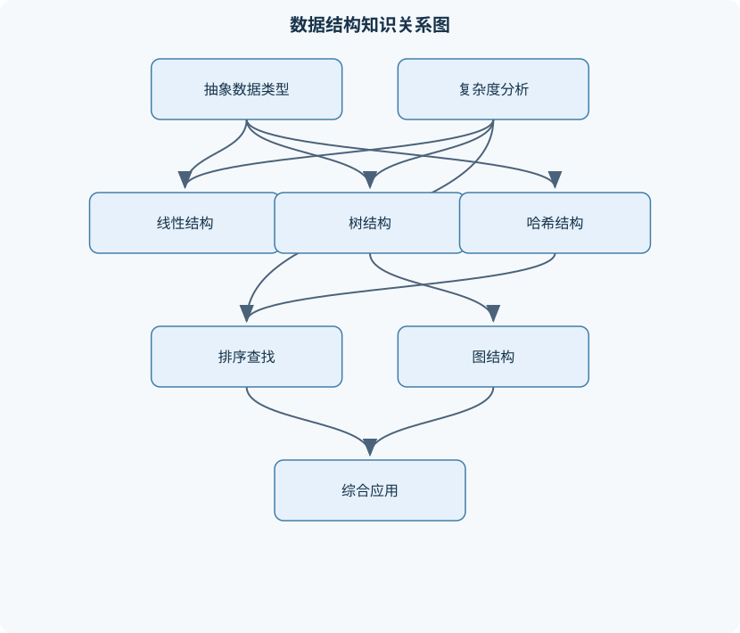
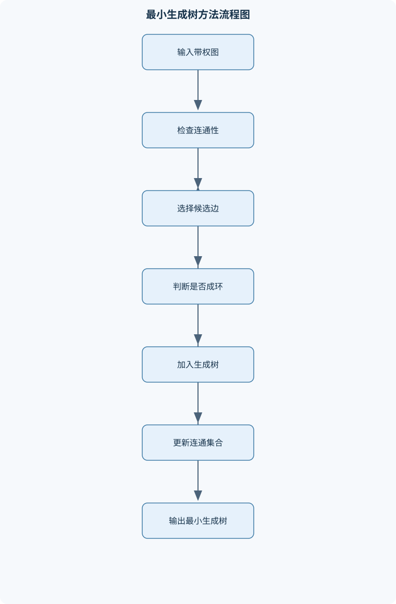

# 数据结构基础

## 一、课程整体知识框架

### 课程边界与先修知识

本课程研究数据的逻辑组织、物理表示、基本操作、算法设计与复杂度分析。内容覆盖线性表、栈、队列、树、优先队列、散列表、查找、排序、图、并查集及典型图算法。课程重点是抽象数据类型与具体实现之间的对应关系，能够根据操作需求选择数据结构，并证明算法的正确性、终止性和时间空间复杂度。先修知识包括程序设计基础、C或C++基本语法、指针与动态内存、递归、离散数学中的集合与图论基础，以及初等数学中的求和、对数和概率。课程不以操作系统、数据库内部实现或高级算法理论为主要边界，但可通过项目说明数据结构在这些领域中的应用。





### 1. 研究对象与基本层次

数据结构研究数据之间的逻辑关系、数据在存储器中的物理表示，以及围绕这些数据进行访问、插入、删除、查找、排序和关系分析的算法。课程中的“数据结构”不是某一种具体容器，而是逻辑结构、存储结构和操作算法三者的组合。

逻辑结构描述数据元素之间“有什么关系”，通常包括四类。线性结构中，一个元素至多有一个直接前驱和一个直接后继，线性表、栈和队列属于此类；树形结构中元素具有层次关系，一个结点可以拥有多个后继，树和二叉树属于此类；图结构中任意顶点之间可以通过边建立关系，适合表示道路、网络和任务依赖；集合结构强调元素是否属于同一组，通常不强调元素的线性次序，并查集就是典型例子。

存储结构描述逻辑数据如何落在内存中。顺序存储使用连续地址保存元素，数组是典型形式，能够利用下标快速定位，但中间插入和删除往往需要移动大量元素。链式存储通过指针连接分散的结点，插入和删除可以避免整体移动，但按位置访问必须沿指针逐步查找。哈希存储利用关键字和哈希函数定位元素，平均情况下查找很快，但需要处理冲突。树和图既可以采用数组，也可以采用指针、邻接表或邻接矩阵表示。

抽象数据类型（ADT）只规定数据对象、数据关系和允许的操作，不规定操作的具体实现。例如，栈的核心约束是后进先出，操作包括 `push`、`pop` 和查看栈顶；它既可以用数组实现，也可以用链表实现。抽象接口与具体实现分离后，可以根据容量变化、访问模式、内存限制和性能目标替换实现，而不改变上层算法的使用方式。

### 2. 算法分析与正确性框架

算法是有限、确定且可执行的操作步骤。评价一个算法不能只看某一次运行时间，还要说明输入规模、输入分布、最好情况、平均情况、最坏情况，以及额外占用的空间。设输入规模为 $n$，若基本操作次数为

$$
c_0+c_1n+\cdots+c_kn^k,
$$

当 $c_k\ne 0$ 且 $k$ 为常数时，复杂度为 $\Theta(n^k)$。大 $O$ 表示渐近上界，大 $\Omega$ 表示渐近下界，大 $\Theta$ 表示同阶界。比如插入排序最坏情况下需要移动约 $n(n-1)/2$ 个元素，因此最坏时间复杂度为 $\Theta(n^2)$；这不意味着每个输入都恰好执行这个次数。

循环分析要先确定循环变量的变化范围，再计算循环体执行次数。两个独立嵌套循环分别执行 $n$ 次和 $m$ 次，循环体执行 $nm$ 次，复杂度是 $\Theta(nm)$；若二者规模相同，则为 $\Theta(n^2)$。若内层变量每次减半，例如 $n,n/2,n/4,\ldots,1$，循环次数约为 $\log_2 n$。只有当 $n\ge 1$ 时，减半过程才有明确的终止边界；对 $n=0$ 的输入必须单独定义处理方式。

递归算法需要写出递归式、边界条件和每次递归的规模变化。归并排序把规模为 $n$ 的问题分为两个规模约为 $n/2$ 的子问题，并用线性时间合并，因此

$$
T(n)=2T(n/2)+\Theta(n)=\Theta(n\log n).
$$

递归式的结论依赖于子问题规模确实缩小、递归分支数明确以及合并成本可估计。朴素递归计算斐波那契数时，同一个子问题被重复计算，递归树规模呈指数增长；使用自底向上的动态规划后，每个状态只计算一次，时间可降为 $O(n)$，空间根据是否保存完整数组可为 $O(n)$ 或 $O(1)$。

循环不变量用于证明循环算法的正确性。证明通常分为初始化、保持和终止三步。初始化说明第一次循环前不变量成立；保持说明执行一轮后仍成立；终止说明循环结束时，不变量结合终止条件能够推出目标结论。例如插入排序每轮开始时，当前元素左侧的前缀已经有序；将当前元素插入该前缀后，下一轮仍满足这一条件。

算法正确性还需要说明终止性。若每次循环都使未处理元素数量减少，且数量不会小于零，则循环必然终止。链表遍历必须保证指针最终到达 `NULL` 或有效结束标记；图遍历必须在顶点首次发现时标记，避免在环中无限重复；二分查找必须保证每轮缩小区间，否则可能在边界条件下死循环。

摊还分析关注一系列操作的总成本，而不是单次操作的最坏成本。动态数组采用倍增扩容时，某次扩容可能需要复制 $\Theta(n)$ 个元素，但连续执行 $n$ 次尾插的总复制次数为

$$
1+2+4+\cdots+2^k<2n,
$$

因此总时间为 $O(n)$，平均到每次操作的摊还成本为 $O(1)$。摊还 $O(1)$ 不表示每一次操作都为常数时间，扩容发生的那一次仍可能是线性时间。

### 3. 结构选择的统一判断标准

选择数据结构时，应先明确主要操作和约束。若需要按下标频繁读取且元素数量相对稳定，顺序表通常更合适；若频繁在已知结点前驱处插入和删除，链表更有优势；若访问规律是“最后进入者先处理”，应使用栈；若要求先到先服务，应使用队列；若每次都要取出当前最小或最大关键字，应使用优先队列或堆；若需要按关键字快速查找且不要求有序遍历，可考虑散列表；若需要范围查询和有序迭代，则搜索树更合适。

复杂度必须与实现绑定。同为“队列”，数组循环队列的入队和出队可以为 $O(1)$，链式队列也可以为 $O(1)$，但容量管理和内存局部性不同。同为“图”，邻接矩阵占用 $\Theta(|V|^2)$ 空间，判断两点是否相邻为 $O(1)$；邻接表占用 $\Theta(|V|+|E|)$ 空间，遍历稀疏图更高效。这里 $V$ 是顶点集合，$E$ 是边集合，$|V|$ 和 $|E|$ 分别是顶点数与边数。

理想复杂度还受现实因素影响。数组具有较好的缓存局部性，某些情况下即使理论插入成本较高，实际运行仍可能优于指针跳转频繁的链表。哈希表平均查找为 $O(1)$ 依赖哈希函数近似均匀和装填因子适当；输入具有恶意构造或哈希分布严重偏斜时，最坏情况仍可能退化为 $O(n)$。因此，复杂度结论必须注明适用条件，不能脱离实现和输入模型孤立使用。

## 二、章节和模块划分

### 核心知识覆盖清单

本清单用于检查正文是否覆盖本课程的主要知识模块：

- **算法分析与抽象数据类型**：抽象数据类型与数据结构、算法正确性与循环不变量、最好平均最坏情况、大O、大Ω与大Θ、循环与嵌套循环分析、递归方程与递归树、摊还分析基本思想。
- **线性表与链式结构**：顺序表的存储与扩容、单链表的结点结构、双链表与循环链表、头结点与边界处理、插入删除与连接操作、链表反转与合并、稀疏数据的链式表示。
- **栈、队列与表达式处理**：栈的后进先出模型、顺序栈与链栈、队列的先进先出模型、循环队列的判空判满、双端队列与优先队列接口、中缀表达式转后缀表达式、括号匹配与栈序列判定。
- **树与二叉树**：树的度、高度与路径、二叉树的递归定义、先序中序后序遍历、层序遍历与队列、由遍历序列重建二叉树、线索二叉树、树与森林的表示转换。
- **查找树与平衡树**：二叉搜索树的有序性质、搜索插入与删除、搜索树的平均与最坏高度、AVL树的平衡因子、单旋转与双旋转、红黑树的颜色约束、红黑树插入调整与删除调整、有序映射与范围查询。
- **优先队列与堆**：优先队列抽象操作、完全二叉树的数组表示、最小堆与最大堆序、上滤与下滤、建堆算法、堆排序、堆在最短路和任务调度中的应用。
- **散列表与集合映射**：字典与符号表、哈希函数与键的均匀分布、装填因子、分离链接法、开放定址法、线性探测与二次探测、删除标记与表扩容、哈希冲突的性能分析。
- **排序算法**：排序问题与比较模型、插入排序与希尔排序、选择排序与堆排序、归并排序、快速排序与三数取中、稳定性与原地性、内部排序复杂度比较、基数排序的适用条件。
- **图的表示与遍历**：有向图与无向图、带权图与多重图、邻接矩阵表示、邻接表表示、深度优先搜索、广度优先搜索、连通分量与强连通分量、拓扑排序与有向环检测。
- **图优化与并查集**：单源最短路径问题、Dijkstra算法及非负权条件、最小生成树、Prim算法、Kruskal算法、切分性质与安全边、并查集的合并与查找、路径压缩与按秩合并、关键路径与任务依赖。


### 1. 算法分析与抽象数据类型

本模块建立全课程的共同语言。重点包括 ADT、正确性证明、循环不变量、递归分析、渐近符号、最好情况、平均情况、最坏情况和摊还分析。需要区分“操作次数上界”和“精确操作次数”：$O(n^2)$ 只说明增长不超过某个二次函数的常数倍，而 $\Theta(n^2)$ 说明上下界同阶。

复杂度分析中的空间通常指额外辅助空间，不把输入本身占用的存储重复计入。递归深度为 $h$ 时，递归栈通常占用 $O(h)$ 空间；若二叉树退化为链，$h=O(n)$，即使算法平均情况下较快，也可能发生较深递归。对递归树、排序算法和图算法，必须同时给出时间、辅助空间、终止条件和适用输入。

### 2. 线性表与链式结构

线性表是有限个数据元素组成的序列，元素之间存在唯一的前后次序。顺序表把元素保存在连续数组中。数组下标默认从 $0$ 开始，长度为 $n$ 的有效元素位于下标 $0$ 到 $n-1$。在位置 $i$ 插入元素时，必须将区间 $[i,n-1]$ 向右移动；删除位置 $i$ 的元素时，必须将区间 $[i+1,n-1]$ 向左移动。因此按位置插入和删除的最坏复杂度为 $O(n)$，尾部插入在容量充足时为 $O(1)$。

动态顺序表需要区分长度和容量。长度表示当前有效元素数，容量表示已申请的槽位数。插入前若 $n$ 等于容量，应申请更大的数组并复制原元素，再完成位置移动。倍增扩容能够使连续尾插的摊还复杂度为 $O(1)$，但扩容瞬间仍需 $O(n)$ 时间和新的临时空间。

链表结点通常包含数据域和后继指针。单链表只能沿 `next` 向后访问，按位置访问第 $i$ 个结点需要从头结点逐步移动，平均访问次数为

$$
\frac{1+2+\cdots+n}{n}=\frac{n+1}{2},
$$

因此平均复杂度为 $\Theta(n)$。已知待插入位置的前驱结点时，单链表插入只需保存原后继、让新结点指向原后继、再让前驱指向新结点，操作为 $O(1)$。若先覆盖前驱指针而未保存原后继，就会丢失剩余链表。

双链表在结点中同时保存前驱和后继指针，适合双向遍历和已知结点的删除，但每次插入和删除需要维护更多指针。循环链表将尾结点指向头结点，适合轮转处理；判断结束时不能只检查 `NULL`，而应判断是否重新回到起始结点。头结点是不存放有效数据的哨兵结点，可统一处理头部插入、删除和空表边界，减少特殊分支。

### 3. 栈、队列与表达式处理

栈遵循后进先出。顺序栈可用数组和栈顶下标实现，链栈可用头指针实现。`push` 将元素放入栈顶，`pop` 删除并返回栈顶元素。两种实现的基本操作都可以为 $O(1)$，但顺序栈需要处理容量上限，链栈需要处理动态结点分配和释放。

队列遵循先进先出。若直接用数组并在出队时移动全部元素，出队可能为 $O(n)$；循环队列通过取模让数组首尾相接，使入队和出队均可为 $O(1)$。当只使用 `front` 和 `rear` 两个下标时，空队列和满队列可能出现相同状态，因此必须额外保存元素个数、保留一个空槽，或明确规定一个下标含义。双端队列允许两端插入和删除，可用于滑动窗口、任务缓冲和回文判断。

优先队列支持插入、查看最小或最大元素，以及删除最小或最大元素。它不是普通队列，因为元素处理顺序由优先级决定。堆是实现优先队列的典型结构，后文将详细讨论。

栈还可用于括号匹配、表达式转换和栈序列判定。中缀表达式转后缀表达式时，操作数直接输出；左括号入栈；遇到右括号则弹出运算符直到左括号；普通运算符根据优先级和结合性决定是否弹出栈顶运算符。后缀表达式求值时，操作数入栈，遇到二元运算符就依次弹出右操作数和左操作数。必须检查括号匹配、表达式格式、除数是否为零以及一元运算符规则。

### 4. 树与二叉树

树是由结点和边组成的层次结构。结点的度是其孩子数，树的高度按边数计时，根结点深度为 $0$。二叉树要求每个结点至多有左、右两个孩子。二叉树的递归定义是：空树是二叉树；非空二叉树由根结点、左子树和右子树组成，且左右子树仍是二叉树。

先序遍历访问顺序为“根、左、右”，中序为“左、根、右”，后序为“左、右、根”。层序遍历从根开始按层访问，需要使用队列。递归遍历的时间复杂度为 $O(n)$，递归空间为 $O(h)$；层序遍历的队列空间取决于最宽层的结点数。

含 $n_0$ 个度为 $0$ 的结点、$n_1$ 个度为 $1$ 的结点和 $n_2$ 个度为 $2$ 的结点的非空二叉树满足

$$
n_0=n_2+1.
$$

推导如下：树有 $n_0+n_1+n_2-1$ 条边；从结点孩子数统计，边数又等于 $n_1+2n_2$。令两式相等即可得到结论。高度为 $h$ 的二叉树最多有 $2^{h+1}-1$ 个结点；这是每一层都达到最大结点数时取得。若树中只有度为 $0$ 和度为 $2$ 的结点，且高度按边数计，达到高度 $h$ 的最少结点数为 $2h+1$，因为从根到最深叶子的每一层都需要形成继续向下的分支。

由先序和中序序列重建二叉树时，先序第一个元素必为根；在中序序列中找到根后，左侧是左子树，右侧是右子树，再根据左右区间长度切分先序序列。该方法要求结点关键字能够唯一定位；若存在重复值，仅凭两种遍历序列通常不能唯一确定树。

### 5. 查找树与平衡树

二叉搜索树满足：左子树所有关键字小于根，右子树所有关键字大于根；若允许重复关键字，必须额外规定重复元素统一放左侧或右侧。搜索、插入和删除都沿树高 $h$ 进行，复杂度为 $O(h)$。树形平衡时 $h=O(\log n)$，但按有序序列插入普通二叉搜索树可能退化为链表，此时 $h=O(n)$。

删除结点分为三类：叶结点直接删除；只有一个孩子时用孩子替代结点；有两个孩子时，可用右子树最小结点，即中序后继，或左子树最大结点，即中序前驱，替换待删结点，再删除替代结点原来的位置。替代结点最多只有一个孩子，因此问题规模会继续简化。

AVL 树要求每个结点的平衡因子

$$
BF=height(left)-height(right)
$$

属于 $\{-1,0,1\}$。插入或删除后自底向上更新高度。左左失衡使用右旋，右右失衡使用左旋，左右和右左失衡分别使用双旋。旋转只改变局部指针关系，但保持中序序列不变，因此不会破坏搜索树的有序性。AVL 树的搜索、插入和删除均为 $O(\log n)$。

红黑树通过颜色约束控制高度：根为黑色；红结点不能有红孩子；从任一结点到其后代空叶子的每条简单路径包含相同数量的黑结点。插入和删除可能暂时破坏颜色或黑高约束，需要通过重新着色和旋转恢复。红黑树的高度为 $O(\log n)$，通常比严格平衡的 AVL 树允许更松的结构，适合插入、删除和查找都较频繁的有序映射。无论 AVL 树还是红黑树，若实现忽略空孩子的定义、颜色约定或父指针更新，都可能出现结构错误。

### 6. 优先队列与堆

完全二叉树按层从左到右填充，适合用数组表示。下标从 $0$ 开始时，结点 $i$ 的左孩子为 $2i+1$，右孩子为 $2i+2$，父结点为 $\lfloor(i-1)/2\rfloor$（根结点没有父结点）。最小堆要求每个结点关键字不大于其孩子，最大堆则相反。堆序只保证父子之间的局部关系，不保证整个数组有序。

插入元素时先放在数组末尾，再执行上滤，与父结点比较并在违反堆序时交换。删除堆顶时，将末尾元素移到根，再执行下滤，与较小的孩子或较大的孩子交换。堆高为 $\Theta(\log n)$，因此插入和删除堆顶为 $O(\log n)$，查看堆顶为 $O(1)$。

建堆有两种方式。逐个插入在最坏情况下为 $O(n\log n)$；自底向上从最后一个非叶结点开始下滤，总复杂度为 $O(n)$。其原因是靠近底部的结点高度较小，虽然结点数量多，但每个结点的下滤成本低；高层结点数量少，能够下滤较远，但总贡献仍为线性级别。

堆排序先建立最大堆，再反复交换堆顶和未排序区间末尾，并缩小堆范围。最终得到非递减序列，时间复杂度为 $O(n\log n)$，额外空间可为 $O(1)$，但通常不稳定。优先队列还可用于任务调度和 Dijkstra 算法中的最小距离选择。

### 7. 散列表与集合映射

字典或符号表保存键值对，支持按键查找、插入和删除。散列表使用哈希函数将键映射到槽位。表大小为 $m$，元素数为 $n$，装填因子为

$$
\alpha=\frac{n}{m}.
$$

装填因子不是关键字取值范围，而是元素数与槽位数之比。分离链接法在每个槽位维护一个链表或其他容器，冲突元素放入同一槽位。若哈希函数近似均匀，期望操作时间为 $O(1)$；若所有键都映射到同一槽位，最坏时间退化为 $O(n)$。

开放定址法把元素直接放在表内，通过探测序列寻找可用槽位。第 $t$ 次探测位置可写为

$$
(h(key)+g(t))\bmod m.
$$

线性探测的探测位置连续，容易产生聚集；二次探测使用平方项改变步长，可减轻部分聚集，但必须结合表长和探测公式确认是否能访问足够多的槽位。开放定址法通常要求 $\alpha<1$，表过满会使探测次数急剧增加。

删除元素时不能简单清空槽位，因为这可能截断其他元素的探测链，使本来存在的键被错误报告为不存在。常见处理是设置“删除标记”，或删除后重新插入受影响的元素。扩容时不能只复制原槽位，因为表大小改变后哈希位置通常改变，必须重新散列全部元素。

### 8. 排序算法

排序问题要求根据关键字的可比较关系重新排列元素。比较排序通过比较关键字获得次序信息，任意比较排序在最坏情况下至少需要 $\Omega(n\log n)$ 次比较。插入排序逐步扩大有序前缀，最好情况下为 $\Theta(n)$，最坏情况下为 $\Theta(n^2)$，并且稳定、适合小规模或近乎有序数据。希尔排序先按递减增量对间隔子序列排序，最后以增量 $1$ 完成整体排序；其复杂度依赖增量序列，不能笼统固定为某一个复杂度，通常也不稳定。

选择排序每轮选择剩余部分的最小元素并交换到前面，时间复杂度为 $\Theta(n^2)$，交换次数较少但通常不稳定。归并排序将数组递归分半并线性合并，满足

$$
T(n)=2T(n/2)+\Theta(n)=\Theta(n\log n),
$$

通常需要 $O(n)$ 辅助空间；合并时相等元素优先取左侧元素即可保持稳定性。

快速排序通过枢轴划分数组。每层划分总成本为 $O(n)$；若划分近似均衡，复杂度为 $O(n\log n)$；若每次只排除一个元素，最坏为 $O(n^2)$。三数取中可以改善常见输入下的枢轴质量，但不能消除理论最坏情况。快速排序的原地实现通常空间较少，但递归栈在均衡和退化情况下分别约为 $O(\log n)$ 与 $O(n)$。

基数排序不依赖元素之间的直接比较，要求关键字能够分解为有限位数或有限字符位，并且每一位使用稳定的分配过程。它适合整数、定长字符串等特定数据，不适用于任意可比较对象。稳定性表示相等关键字的原相对顺序保持不变，与时间复杂度和是否原地是不同属性。

### 9. 图的表示与遍历

图记为 $G=(V,E)$。无向边记为 $\{u,v\}$，有向边记为 $(u,v)$，带权边权记为 $w(u,v)$。多重图允许同一对顶点之间存在多条边。无向图所有顶点度数之和为 $2|E|$，因为每条无向边对两个端点各贡献一次。含 $n$ 个顶点的连通无向图至少有 $n-1$ 条边，简单无向图最多有 $n(n-1)/2$ 条边。

邻接矩阵使用二维数组表示边关系，空间为 $\Theta(|V|^2)$，判断两点是否相邻为 $O(1)$，适合稠密图。邻接表为每个顶点保存其邻接点集合，空间为 $\Theta(|V|+|E|)$，适合稀疏图。选择表示方法时不能只看顶点数，还要考虑边的密度和主要操作。

深度优先搜索（DFS）沿一条路径尽可能深入，再回溯处理其他分支。使用白、灰、黑三色时，白色表示未发现，灰色表示已发现但未完成，黑色表示完成。对有向图，遇到指向灰色顶点的边可判定存在回边和有向环。广度优先搜索（BFS）使用队列按层访问顶点。邻接表实现下，DFS 和 BFS 的时间复杂度均为 $O(|V|+|E|)$，前提是每个顶点和每条边只被扫描常数次。

BFS 还能求无权图中的最少边数路径。源点距离设为 $0$，第一次发现邻接点时令其距离加一并记录前驱。队列中的顶点按非递减距离排列，因此第一次发现某顶点时得到的就是最短边数。若边权不同，即使所有权值为正，也不能直接用 BFS 得到加权最短路。

拓扑排序只适用于有向图。其存在当且仅当图无有向环。入度法反复取出入度为零的顶点，并删除其出边；若最终输出顶点数少于 $|V|$，则剩余部分含环。拓扑序通常不唯一，多个入度为零的顶点可以采用不同选择顺序。

### 10. 图优化与并查集

Dijkstra 算法解决非负权图中的单源最短路径问题。距离数组记为 $d[v]$，前驱数组记为 $parent[v]$，不可达距离记为 $\infty$。初始化源点距离为 $0$，其余为 $\infty$；每轮选择未确定且 $d$ 最小的顶点 $u$，再对每条出边执行松弛：

$$
d[v]>\ d[u]+w(u,v)
$$

时，更新 $d[v]$ 和 $parent[v]$。其正确性依赖所有边权非负；存在负权边时，已经选定的顶点可能通过后续路径获得更短距离，贪心结论失效。邻接表加二叉堆时通常为 $O((|V|+|E|)\log |V|)$，邻接矩阵加线性寻找最小值时为 $O(|V|^2)$。

最小生成树针对连通带权无向图，目标是连接全部顶点且总边权最小。最小生成树包含 $|V|-1$ 条边，但不一定是从某个源点出发的最短路径集合。Prim 算法从一个顶点开始，每次选择连接当前树和外部顶点的最小边；Kruskal 算法按边权递增处理边，若加入后不成环则保留。二者都依赖切分性质：对任意把顶点划分为两部分的切分，跨越该切分的最轻边是某棵最小生成树中的安全边。相同权值可能产生不同边集，但总权值相同。

并查集维护元素的等价类。`parent[x]` 表示结点 $x$ 的父结点，根结点满足 $parent[x]=x$。`find` 沿父指针寻找根，路径压缩会在回溯时直接把沿途结点连接到根；`union` 按秩或按大小合并两棵树，避免形成过高结构。两种优化同时使用时，一系列操作的均摊复杂度为 $O(\alpha(n))$，其中 $\alpha$ 是增长极慢的反阿克曼函数。Kruskal 用并查集判断一条边的两个端点是否已连通，从而在线性近似常数的集合操作下检测成环。

关键路径分析用于任务依赖构成有向无环图的项目网络。任务持续时间必须明确且通常取非负值。先进行拓扑排序，再按拓扑序计算最早开始和最早完成时间，按逆拓扑序计算最迟时间；时间余量为零的任务属于关键任务，起点到终点的最长路径决定项目最短完成时间。若依赖图含环，任务之间存在循环等待，不能直接进行关键路径计算。

## 三、核心概念的详细解释

### 3.1 抽象数据类型、数据结构与算法分析

抽象数据类型（Abstract Data Type，ADT）描述数据对象、数据之间的逻辑关系以及允许执行的操作，但不规定数据在内存中的具体排列方式。例如，栈只规定“后进先出”，可提供 `push`、`pop` 和查看栈顶等操作；它既可以用数组实现，也可以用链表实现。数据结构则进一步规定逻辑结构的物理表示和操作实现。算法是解决特定问题的有限步骤集合，必须具有确定性、可执行性和终止性。

同一个逻辑结构可以有多种物理实现。线性表用顺序表表示时，按下标访问为 $O(1)$，但在中间插入或删除可能需要移动 $\Theta(n)$ 个元素；用单链表表示时，已知前驱结点即可在 $O(1)$ 时间插入或删除，但按位置访问需要从头结点逐步移动，时间为 $O(n)$。因此，选择数据结构不能只看某个操作，而要根据操作频率、数据规模、内存连续性要求和是否需要稳定引用综合判断。

复杂度必须说明输入规模和情形。最好情况、平均情况和最坏情况分别描述不同输入或输入分布下的运行成本。大 $O$ 是渐近上界，$\Omega$ 是渐近下界，$\Theta$ 是同阶界。例如，线性查找在第一个元素命中时为 $\Theta(1)$，在最后一个元素命中或查找失败时为 $\Theta(n)$；若只知道其最坏上界，可以写 $O(n)$，若要表达最坏情况下确实与 $n$ 同阶，应写 $\Theta(n)$。

若基本操作数为

$$
c_0+c_1n+\cdots+c_kn^k,\qquad c_k\ne 0,
$$

其中 $n$ 是输入规模，$c_i$ 是与输入无关的常数，则当 $n$ 趋于无穷时，最高次项决定增长速度，复杂度为 $\Theta(n^k)$。这个结论要求 $k$ 为固定常数，且基本操作的代价被视为常数。例如，若数组元素是固定宽度整数，赋值可以看作 $O(1)$；若元素是长度随 $n$ 增长的字符串，字符串复制则不能直接视为 $O(1)$。

循环分析应先计算循环体执行次数。两个独立嵌套循环分别执行 $n$ 次和 $m$ 次，循环体执行 $nm$ 次，复杂度为 $\Theta(nm)$；若外层第 $i$ 次执行内层 $i$ 次，则总次数为

$$
\sum_{i=1}^{n}i=\frac{n(n+1)}2=\Theta(n^2).
$$

若循环变量每次乘以 $2$ 或除以 $2$，循环次数通常为 $\Theta(\log n)$，但要明确初值和终止条件。对 $n=0$、空数组或空图，算法必须单独规定返回结果，否则复杂度推导不能代替边界处理。

递归算法需要说明递归规模、分支数、非递归工作和边界条件。归并排序满足

$$
T(n)=2T(\lfloor n/2\rfloor)+\Theta(n),\qquad T(1)=\Theta(1),
$$

递归树第 $j$ 层有 $2^j$ 个子问题，每个子问题规模约为 $n/2^j$，该层合并成本为 $\Theta(n)$。树高约为 $\log_2n$，所以总成本为 $\Theta(n\log n)$。递归栈深度为 $O(\log n)$，合并数组通常还需要 $O(n)$辅助空间。

摊还分析研究一系列操作的平均成本，而不是某次操作的独立最坏成本。动态数组采用容量倍增时，扩容一次可能复制 $\Theta(n)$ 个元素，但在连续尾插过程中，容量从 $1,2,4,\ldots$增长，所有扩容复制次数之和为

$$
1+2+4+\cdots+2^k<2^{k+1}=O(n).
$$

因此执行 $n$ 次尾插的总成本为 $O(n)$，单次摊还成本为 $O(1)$。这个结论依赖扩容因子大于 $1$ 且每次扩容确实增加容量；若每次只增加一个位置，连续插入的总成本会达到 $\Theta(n^2)$。

### 3.2 线性表、栈、队列与链式结构

顺序表把有效元素存储在连续区间 $A[0\,..\,n-1]$ 中。插入位置为 $p$ 时，先把 $A[p],A[p+1],\ldots,A[n-1]$ 向后移动一个位置，再写入新元素，移动次数为 $n-p$；删除则把后继元素向前移动。若在尾部操作且数组有空闲容量，时间为 $O(1)$；若在头部操作，时间通常为 $\Theta(n)$。

单链表结点包含数据域和 `next` 指针。插入时必须先保存原后继，再连接新结点：

```c
new_node->next = prev->next;
prev->next = new_node;
```

若先执行 `prev->next = new_node`，而没有保存原后继，后续结点链会丢失。删除结点时也应先保存待删结点的后继，再修改前驱指针，最后释放待删结点。空表、删除头结点、删除尾结点和目标不存在是必须分别处理的边界。

双链表结点同时含有 `prev` 和 `next`，已知结点时可以在常数时间内删除，并支持向前和向后遍历；代价是每个结点多一个指针。循环链表将尾结点的后继连接到头结点，适合轮转访问，但遍历不能以 `NULL` 作为唯一终止条件，必须以“再次到达起点”为终止条件。头结点通常不存放有效数据，用于统一处理头部插入和删除，降低边界分支数量。

栈遵循后进先出。顺序栈用数组和栈顶下标实现，链栈通常在头部进行入栈和出栈。表达式括号匹配、函数调用返回、深度优先搜索和中缀表达式转换都具有“最近加入者先处理”的特征。队列遵循先进先出，顺序队列若不断移动元素会造成低效，因此通常采用循环队列。若数组容量为 $m$，使用 `front`、`rear` 和计数器 `size`，判空条件为 `size==0`，判满条件为 `size==m`；只使用两个下标时，必须额外保留一个空槽或明确区分空和满。

双端队列允许两端插入和删除。优先队列的接口通常包括 `insert`、`find-min` 或 `find-max`、`delete-min` 或 `delete-max`，其逻辑约束不是先进先出，而是每次优先处理关键字最小或最大的元素。二叉堆是优先队列的一种高效实现，但“优先队列”是抽象接口，“堆”是具体数据结构，二者不能混为一谈。

### 3.3 树、二叉树、搜索树与平衡树

树是无环连通结构。根到结点的边数是结点深度，所有结点深度的最大值是树高。非空树含有 $n-1$ 条边。二叉树递归定义为：空树，或者由根结点、左子树和右子树组成的树。二叉树中的左右位置有区别，即使两个子树关键字相同，交换左右子树也可能得到不同的二叉树。

先序遍历顺序为“根、左、右”，中序为“左、根、右”，后序为“左、右、根”。层序遍历使用队列，按照深度从小到大访问。若给定先序和中序序列且关键字互不重复，可以唯一重建二叉树：先序第一个元素是根，在中序中定位根，左侧区间属于左子树，右侧区间属于右子树，再递归处理两个区间。若关键字重复，仅凭这两种遍历通常不能唯一确定结构。

含 $n_0$ 个叶结点、$n_1$ 个度为 $1$ 的结点、$n_2$ 个度为 $2$ 的结点的非空二叉树满足

$$
n_0=n_2+1.
$$

证明如下：树的边数为结点数减一，即

$$
e=n_0+n_1+n_2-1.
$$

另一方面，边数也等于所有结点孩子数之和：

$$
e=n_1+2n_2.
$$

两式相等后得到 $n_0=n_2+1$。高度按边数计时，高度为 $h$ 的二叉树最多有 $2^{h+1}-1$ 个结点；若只有度为 $0$ 和度为 $2$ 的结点，且高度为 $h$，最少结点数为 $2h+1$。若把高度定义为层数，公式中的指数和边界会相应改变，不能混用。

二叉搜索树满足左子树所有关键字小于根，右子树所有关键字大于根；若允许重复关键字，必须额外规定重复值统一放左侧或右侧。搜索、插入和删除的时间复杂度为 $O(h)$，其中 $h$ 是树高。树退化为链时 $h=\Theta(n)$；平衡时 $h=\Theta(\log n)$。删除双孩子结点时，常用其中序后继，即右子树中的最小结点，用其数据替换待删结点，再删除原后继结点。

AVL树要求每个结点平衡因子

$$
BF(x)=height(x.left)-height(x.right)
$$

属于 $\{-1,0,1\}$。插入或删除后从失衡结点向上更新高度。左左失衡使用右旋，右右失衡使用左旋，左右和右左失衡分别使用双旋。旋转保持中序序列不变，因此不会破坏二叉搜索树的有序性质。红黑树通过颜色约束限制最长路径与最短路径的比例，要求根为黑色、空叶视为黑色、红色结点不能有红色孩子、从任一结点到后代空叶的每条路径包含相同数量的黑色结点。红黑树的查找、插入和删除均为 $O(\log n)$，但调整过程比普通二叉搜索树复杂。

### 3.4 堆、散列表与排序

完全二叉树适合用数组保存。下标从 $0$ 开始时，结点 $i$ 的左孩子、右孩子和父结点分别为

$$
2i+1,\qquad 2i+2,\qquad \left\lfloor\frac{i-1}{2}\right\rfloor.
$$

最小堆满足父结点关键字不大于孩子，最大堆满足父结点关键字不小于孩子。插入元素后执行上滤，删除堆顶后将末尾元素移到根并执行下滤。堆高为 $\Theta(\log n)$，所以这两类操作为 $O(\log n)$。自底向上建堆从最后一个非叶结点开始下滤，总代价为 $O(n)$；逐个插入建堆在最坏情况下为 $O(n\log n)$。

散列表通过哈希函数把关键字映射为槽位。表大小为 $m$、元素数为 $n$ 时，装填因子为

$$
\alpha=\frac{n}{m}.
$$

分离链接法在每个槽位保存一个链表；开放定址法要求所有元素存放在表内，通常必须保持 $\alpha<1$。线性探测容易产生主聚集，二次探测可以减轻连续聚集，但探测序列和表容量必须满足相应条件。开放定址删除后不能直接清空槽位，否则会截断后续探测链，应设置删除标记或重新插入受影响元素。哈希函数近似均匀且装填因子受控时，查找、插入和删除的期望时间为 $O(1)$；哈希冲突严重时，最坏仍为 $O(n)$。

比较排序只能通过关键字比较获得次序。插入排序稳定、实现简单，最好情况为 $\Theta(n)$，最坏情况为 $\Theta(n^2)$；选择排序通常为 $\Theta(n^2)$，但交换次数较少且通常不稳定。归并排序稳定，时间为 $\Theta(n\log n)$，通常需要 $\Theta(n)$辅助空间。快速排序划分每层总成本为 $O(n)$，平均为 $O(n\log n)$，最坏为 $O(n^2)$；三数取中可改善常见输入，但不能消除理论最坏情况。堆排序最坏为 $O(n\log n)$，可原地进行，但通常不稳定。希尔排序的复杂度依赖增量序列，不能笼统写成固定的 $O(n\log n)$。基数排序不依赖关键字之间的比较，要求关键字可分解为有限位或字符，并且每一位使用稳定排序；其性能取决于位数、基数和每位排序成本。

### 3.5 图、遍历、最短路、生成树与并查集

图记为 $G=(V,E)$。无向边写作 $\{u,v\}$，有向边写作 $(u,v)$，边权写作 $w(u,v)$。邻接矩阵空间为 $\Theta(|V|^2)$，判断两点是否相邻为 $O(1)$，适合稠密图；邻接表空间为 $\Theta(|V|+|E|)$，适合稀疏图。无向图度数之和为 $2|E|$，连通无向图至少有 $|V|-1$ 条边，简单无向图最多有 $|V|(|V|-1)/2$ 条边。

深度优先搜索使用递归或显式栈，广度优先搜索使用队列。邻接表中每个顶点和每条边只被扫描常数次时，二者均为 $O(|V|+|E|)$。BFS在无权图中第一次到达顶点时得到最少边数距离；若边权不同，即使所有权值为正，也不能直接把 BFS 当作最短路算法。DFS中的白、灰、黑三色可用于检测有向环：从当前递归路径再次遇到灰色顶点，说明存在回边和有向环。

拓扑排序只适用于有向图。反复选择入度为零的顶点并删除其出边；若最终输出顶点数少于 $|V|$，图中存在有向环。拓扑序通常不唯一。若每一步只有一个可选的入度为零顶点，才得到唯一序列。

Dijkstra算法要求所有边权非负。其关键不变量是：每次选出的未确定顶点，其当前距离已经是最短距离。若存在负权边，后续路径可能使已确定距离变小，贪心证明失效。邻接表配二叉堆时复杂度通常为 $O((|V|+|E|)\log |V|)$，邻接矩阵线性寻找最小距离时为 $O(|V|^2)$。

最小生成树是连通带权无向图中连接全部顶点且总权值最小的树，包含 $|V|-1$ 条边。Prim维护一个已加入顶点集合，每次选择连接集合内外的最轻边；Kruskal将边按权值排序，若两端属于不同集合则加入。两者都使用切分性质：跨越任意切分的最轻边是某棵最小生成树中的安全边。并查集中的 `find` 查找代表元，`union` 合并集合；路径压缩和按秩或按大小合并后，一系列操作的均摊复杂度为 $O(\alpha(n))$。

关键路径分析要求任务依赖图是有向无环图，任务持续时间通常为非负值。按拓扑序计算最早开始时间，按逆拓扑序计算最迟开始时间，时间余量为零的任务属于关键任务。关键路径是起点到终点的最长路径，其长度决定项目最短完成时间；它不是最短路径问题。

## 四、重要定义、公式、定理和推导

### 专业审校补充：关键定义与适用边界

比较排序的下界只适用于“只能通过关键字比较获得次序信息”的模型。对任意包含 n 个互异元素的输入，可能的排列有 n! 种；一棵正确排序的决策树至少需要 n! 个叶结点，而高度为 h 的二叉决策树最多有 2^h 个叶结点，因此 2^h≥n!，得到 h≥log₂(n!)=Ω(n log n)。所以归并排序、堆排序和比较型快速排序不能在该模型中突破 Ω(n log n) 的最坏下界。基数排序和计数排序不违反该结论，因为它们利用了整数位、取值范围等额外结构，而不是只比较两个关键字。若关键字为固定长度 d 的、每位取值范围为 0 到 r−1 的整数，稳定的 LSD 基数排序需要 d 轮，每轮计数分配为 Θ(n+r)，总复杂度为 Θ(d(n+r))，并需 Θ(n+r) 的辅助空间。若 d、r 随输入规模增长，不能无条件写成线性时间；若关键字是变长字符串，还必须把读取和处理字符的成本计入。


### 4.1 代表性算法及正确性框架

#### 动态顺序表扩容

**输入：**数组、当前长度 $n$、容量 $m$、待插入位置 $p$ 和元素 $x$。  
**输出：**插入后的顺序表。

过程为：若 $n=m$，申请更大数组，通常令新容量为 $2m$，复制原有元素并释放旧数组；然后从下标 $n-1$ 到 $p$ 逆序移动元素；最后令 $A[p]=x$ 并令 $n\leftarrow n+1$。循环不变量是：尚未处理的元素仍保存在原位置，已处理元素已经向后移动一个位置。终止条件是所有下标从 $p$ 到 $n-1$ 均完成移动。单次插入最坏为 $O(n)$，连续尾插采用倍增容量时摊还为 $O(1)$。

#### 栈模拟括号匹配

```text
输入：由括号字符组成的序列 s[0..n-1]
输出：括号是否匹配

创建空栈 S
for c in s:
    if c 是左括号:
        push(S, c)
    else if c 是右括号:
        if S 为空:
            return false
        t = pop(S)
        if t 与 c 不是同一括号类型:
            return false
if S 为空:
    return true
else:
    return false
```

不变量是：处理完前 $i$ 个字符后，栈中保存所有尚未匹配的左括号，并且从栈底到栈顶保持原出现顺序。若遇到右括号时栈为空，说明没有可匹配的左括号；若类型不一致，说明嵌套关系错误；扫描结束时栈非空，说明存在未闭合左括号。时间复杂度为 $O(n)$，辅助空间最坏为 $O(n)$。

#### Dijkstra算法

初始化 $d[source]=0$，其余顶点距离为 $\infty$，所有顶点标记为未确定。每轮从未确定顶点中选择 $d$ 最小的顶点 $u$，将其确定，并对每条出边 $(u,v)$执行松弛：

$$
\text{若 }d[v]>d[u]+w(u,v)，
$$

则令

$$
d[v]\leftarrow d[u]+w(u,v),\qquad parent[v]\leftarrow u.
$$

不变量是：已确定顶点的 $d$ 值等于源点到它们的最短距离。证明依赖非负权条件：若某条更短路径要经过尚未确定顶点，则该路径在首次进入未确定集合时，其前缀距离不会小于当前选出的 $d[u]$，与 $u$ 是最小估计矛盾。因此选择 $u$ 是安全的。不可达顶点保持 $\infty$。该算法不能用于含负权边的图。

### 4.2 例题与逐步解答

#### 例题一：循环与递归复杂度

**题干：**

```text
for i = 1 to n:
    j = 1
    while j <= n:
        执行一次基本操作
        j = 2*j
```

另有递归式 $T(n)=2T(n/2)+n$，$T(1)=1$。

**分析与解答：**外层循环执行 $n$ 次。内层变量依次为 $1,2,4,\ldots,2^k$，满足 $2^k\le n$，因此执行 $\lfloor\log_2n\rfloor+1$ 次。总次数为

$$
n(\lfloor\log_2n\rfloor+1)=\Theta(n\log n).
$$

递归式的第 $j$ 层有 $2^j$ 个子问题，每个规模为 $n/2^j$，该层非递归成本为 $2^j(n/2^j)=n$；递归树高度为 $\log_2n$，所以总成本为 $\Theta(n\log n)$。

**结果验证：**当 $n=1,2,4,8$ 时，循环次数分别近似为 $1,4,12,32$，增长趋势符合 $n\log n$。若内层变量改为 `j=j+1`，复杂度将变为 $\Theta(n^2)$，说明循环变量变化方式决定复杂度。

#### 例题二：单链表交替合并

**题干：**链表 $L_1$ 从头到尾为 $1\to2\to3\to4\to NULL$，链表 $L_2$ 为 $a\to b\to c\to NULL$。要求依次取 $L_1$ 一个结点、$L_2$ 一个结点，直到其中一个链表耗尽，再接上剩余结点。

**解答：**令 $p$ 指向 $L_1$ 当前结点，$q$ 指向 $L_2$ 当前结点，$tail$ 指向结果尾部。第一次取 $1$，再取 $a$；第二次取 $2$，再取 $b$；第三次取 $3$，再取 $c$。此时 $L_2$ 为空，将 $L_1$ 剩余的 $4$ 接到尾部，结果为

$$
1\to a\to2\to b\to3\to c\to4\to NULL.
$$

每次修改指针前必须保存原后继，避免链表断裂。若任一输入为空，结果直接是另一个链表。若两个链表共享结点，简单拼接可能形成环或重复访问，必须先检测共享地址或复制结点。时间复杂度为 $O(n+m)$，额外空间为 $O(1)$，其中 $n,m$ 是两个链表长度。

#### 例题三：中缀表达式转换

**题干：**将 $A+B*C-D/E$ 转换为后缀表达式，并说明运算符处理过程。

**解答：**扫描 $A$，直接输出；扫描 `+`，入栈；扫描 $B$，输出；扫描 `*`，其优先级高于栈顶 `+`，入栈；扫描 $C$，输出；扫描 `-`，先弹出 `*`，再弹出同优先级且左结合的 `+`，输出 `*+`，然后把 `-` 入栈；扫描 $D$ 输出；扫描 `/`，优先级高于 `-`，入栈；扫描 $E$ 输出；扫描结束后弹出 `/` 和 `-`。后缀表达式为

$$
ABC*+DE/-.
$$

若表达式含括号，左括号直接入栈，遇右括号时不断弹栈至左括号。除法或减法求值时，第二次弹出的操作数是左操作数，第一次弹出的是右操作数。变式是 $A-(B-C)$，后缀形式为 $ABC--$，括号改变了结合顺序，不能只按运算符优先级处理。

#### 例题四：堆排序与建堆

**题干：**数组为 $[4,10,3,5,1]$，建立最大堆。

**解答：**最后一个非叶结点下标为 $\lfloor n/2\rfloor-1=1$。从下标 $1$ 的元素 $10$ 开始下滤，孩子为 $1$，无需变化。再处理下标 $0$ 的元素 $4$，孩子为 $10$ 和 $3$，与较大孩子 $10$ 交换，数组变为 $[10,4,3,5,1]$；继续对下标 $1$ 的元素 $4$ 下滤，与孩子 $5$ 交换，得到

$$
[10,5,3,4,1].
$$

此时每个父结点均不小于孩子，形成最大堆。堆排序第一轮交换堆顶 $10$ 与末尾 $1$，得到 $[1,5,3,4,10]$，缩小堆范围至前四项，再对根下滤，得到 $[5,4,3,1,10]$。重复后得到非递减序列。建堆为 $O(n)$，排序阶段进行 $n-1$ 次 $O(\log n)$ 下滤，总复杂度为 $O(n\log n)$，额外空间为 $O(1)$。

#### 例题五：Dijkstra最短路

**题干：**有向边为 $s\to a$ 权 $2$，$s\to b$ 权 $5$，$a\to b$ 权 $1$，$a\to t$ 权 $6$，$b\to t$ 权 $1$。求从 $s$ 出发的最短距离。

**解答：**初始化：

$$
d[s]=0,\quad d[a]=d[b]=d[t]=\infty.
$$

确定 $s$ 后松弛得到 $d[a]=2,d[b]=5$。选择最小的 $a$，松弛 $a\to b$ 得到 $d[b]=3$，松弛 $a\to t$ 得到 $d[t]=8$。选择 $b$，松弛 $b\to t$ 得到 $d[t]=4$。最后选择 $t$，算法结束。结果为

$$
d[s]=0,\quad d[a]=2,\quad d[b]=3,\quad d[t]=4.
$$

根据前驱数组可还原路径 $s\to a\to b\to t$，总权值为 $2+1+1=4$。验证时将路径边权相加，并检查不存在更短候选路径。若增加边 $t\to a$ 权 $-10$，图中出现负权边，原有正确性证明不再成立。

### 4.3 实验与项目流程

#### 实验一：比较顺序表、链表和哈希表

**输入数据：**生成或给定同一组整数关键字，规模取 $10^3$、$10^4$ 和 $10^5$；分别进行尾部插入、头部插入、随机位置查找和删除。

**步骤：**  
1. 顺序表分别测试固定容量和倍增扩容。  
2. 单链表测试头部插入、按位置查找和已知前驱删除。  
3. 哈希表采用分离链接法，改变装填因子，记录冲突次数。  
4. 每种操作重复多次，取总耗时和平均操作次数。  
5. 检查三种结构最终元素集合是否一致。

**评价标准：**不仅比较运行时间，还要核对操作语义是否正确、扩容后元素顺序是否保持、链表是否存在断链、哈希查找失败是否正确。预期现象是顺序表随机访问快，链表已知结点插删快，哈希表在均匀散列且装填因子适当时查找平均较快。

**排错方法：**若顺序表出现重复元素，检查移动循环方向；若链表遍历提前结束，检查是否覆盖了原 `next`；若哈希删除后后继元素查找失败，检查是否错误地把删除槽位直接置空。

#### 实验二：图遍历与最短路径

**输入数据：**构造一个含 $|V|$ 个顶点和 $|E|$ 条边的邻接表，同时建立同一图的邻接矩阵；准备无权图、非负权图和含负权边的图各一组。

**步骤：**  
1. 从指定源点运行 BFS，记录访问序列、距离数组和前驱数组。  
2. 运行 DFS，记录发现时间、完成时间和递归树。  
3. 对非负权图运行 Dijkstra，逐轮记录已确定集合和松弛结果。  
4. 使用手工枚举的小图验证路径总权值。  
5. 比较邻接表和邻接矩阵的空间及运行时间。

**评价标准：**BFS的无权距离必须等于最少边数；DFS发现时间小于完成时间，且有向环能被灰色回边检测；Dijkstra输出的每条可达路径应与前驱数组一致；含负权边的测试应明确报告“不满足适用条件”，不能把异常结果当作正确答案。

**排错方法：**若 BFS 距离错误，检查顶点是否在入队时而不是出队时标记；若 DFS 重复访问，检查颜色更新时机；若 Dijkstra结果异常，检查是否允许从距离为 $\infty$ 的顶点进行加法，以及是否误用了负权图。

### 4.4 典型易错点、笔试问题与面试问题

#### 具体易错点

1. 把 ADT 当成数组或链表，忽略接口与实现的区别。  
2. 只写 $O(n)$ 而不说明是最好、平均还是最坏情况。  
3. 把高度按结点数和按边数混用。  
4. 单链表插入时覆盖原后继，造成断链。  
5. 循环队列未区分空和满。  
6. 栈序列判定时忽略输入元素必须按原序入栈。  
7. 二叉搜索树删除双孩子结点时未处理后继原位置。  
8. 把普通二叉搜索树的最坏复杂度误写成 $O(\log n)$。  
9. 认为堆中任意两个结点都满足全局排序关系。  
10. 把建堆误判为必须逐个插入，因此写成 $O(n\log n)$。  
11. 开放定址删除后直接清空槽位。  
12. 把装填因子误认为关键字取值范围。  
13. 声称快速排序总是 $O(n\log n)$。  
14. 把稳定性与时间复杂度混为一谈。  
15. 用 BFS 求任意带权图的最短路。  
16. 在 Dijkstra 中使用负权边。  
17. 把最小生成树误认为源点到各点的最短路径树。  
18. 认为拓扑序一定唯一。  
19. 关键路径求最短路径而不是最长依赖路径。  
20. 并查集合并时连接非根结点，破坏父指针树结构。

#### 典型笔试问题及解答思路

1. **为什么动态数组倍增扩容的尾插摊还为 $O(1)$？**  
   将所有扩容复制量写成几何级数，证明总复制量为 $O(n)$，再除以 $n$ 次操作。

2. **为什么归并排序是 $\Theta(n\log n)$？**  
   写出 $T(n)=2T(n/2)+\Theta(n)$，说明每层总合并成本为 $\Theta(n)$、层数为 $\Theta(\log n)$。

3. **已知前序和中序能否唯一重建二叉树？**  
   关键条件是关键字互不重复；定位根后划分左右区间。重复关键字时一般不能唯一确定。

4. **证明二叉树叶结点数与度为二结点数的关系。**  
   分别从“树边数为结点数减一”和“边数等于孩子数总和”列式消元。

5. **为什么自底向上建堆是 $O(n)$？**  
   高度为 $r$ 的结点数量随 $r$ 指数减少，总代价可写成 $\sum_r O(n/2^{r+1})\cdot O(r)=O(n)$。

6. **开放定址法为什么需要删除标记？**  
   查找遇到真正空槽才可失败；直接清空删除槽会让同一探测序列中的后继元素不可达。

7. **Dijkstra为什么不能有负权边？**  
   其不变量依赖“已选最小估计不会被未来路径降低”，负权边会破坏这个条件。

8. **Prim和Kruskal的目标有什么不同于最短路？**  
   它们优化的是连接全部顶点的总边权；最短路优化的是指定源点到目标点或各顶点的路径长度。

#### 典型面试问题及参考答案

1. **数组和链表如何选择？**  
   需要随机访问和缓存连续性时优先数组；需要频繁中间插删且已知位置时可选链表。追问应说明链表按位置查找仍为 $O(n)$，不能仅凭插删复杂度下结论。

2. **如何证明一个循环算法正确？**  
   使用循环不变量，分别证明初始化、保持和终止。追问可要求说明终止条件以及不变量是否足以推出目标结论。

3. **为什么快速排序通常较快但最坏为 $O(n^2)$？**  
   划分每层成本为 $O(n)$；均衡划分有 $\log n$ 层，不均衡划分可能只有一个元素被排除。三数取中改善常见输入，但不改变最坏界。

4. **红黑树和 AVL 树如何取舍？**  
   AVL平衡更严格，查找路径通常更短；红黑树约束较宽松，插入删除调整通常更灵活。追问应说明二者查找、插入、删除均为 $O(\log n)$，但常数和实现复杂度不同。

5. **如何判断图是否有环？**  
   有向图可用 DFS 灰色回边或拓扑排序；无向图可用 DFS 中的已访问非父结点或并查集。追问需区分有向边和无向边的判环逻辑。

6. **BFS为什么能求无权最短路？**  
   队列保证按距离非递减顺序处理，顶点第一次被发现时已达到最少边数。追问应指出带不同权值时该证明失效。

7. **哈希表性能下降的原因有哪些？**  
   装填因子过高、哈希函数分布不均、冲突处理不当都会使探测或链表长度增长。追问可要求说明扩容时必须重新散列，不能只复制原槽位。

8. **并查集中的路径压缩做了什么？**  
   `find` 回溯时把沿途结点直接连到根，降低后续查询路径；配合按秩或按大小合并，操作序列均摊为 $O(\alpha(n))$。追问应说明这是均摊结论，不是每次严格常数时间。

#### 岗位关联与验收标准

软件开发和后端开发中，线性表、哈希表、树和排序用于实现缓存索引、集合映射、任务队列和有序数据访问；验收应检查接口语义、边界行为、并发环境下的额外约束以及复杂度是否满足规模要求。数据库内核和搜索推荐系统常使用 B 树、红黑树、堆和哈希结构，产出包括索引、范围查询或优先级调度模块，验收标准包括查询结果正确、更新后结构不破坏、极端装填因子或退化输入下性能可解释。

图计算、路径规划和系统软件任务通常涉及邻接表、BFS、DFS、Dijkstra、Prim、Kruskal及并查集。产出应包含路径、前驱、生成树或连通分量，并验证不可达顶点、负权边、非连通图和有向环等边界。算法工程和性能优化工作还需报告输入规模、最好与最坏情形、时间及空间复杂度、缓存或内存分配影响，不能只提交一次运行时间。测试开发岗位应设计空结构、单元素、重复关键字、退化树、满哈希表、环图和负权图等测试用例，以确认实现既满足功能规格，也没有超出算法适用边界。

## 五、算法、流程和实现思路

### 方法与流程覆盖索引

下列方法或流程应在正文中说明输入、步骤、适用条件、结果检查和边界：

- 顺序表动态扩容：输入为数组、当前长度和容量，输出为支持插入删除的动态表。插入前检查容量，满时申请更大数组并复制元素，再移动插入位置后的元素；不变量是有效元素始终位于连续区间内；终止条件是完成一次扩容或插入。单次扩容为$O(n)$，采用倍增扩容时连续尾插的均摊复杂度为$O(1)$。
- 单链表插入与删除：输入为头指针、目标位置和元素，输出为更新后的头指针。插入时先保存待接位置的后继，再依次修改新结点和前驱指针；删除时先保存待删结点的后继，释放待删结点并连接前驱。边界包括空表、头部、尾部和不存在位置；已知前驱时操作为$O(1)$，按位置寻找前驱为$O(n)$。
- 栈序列判定：输入为入栈序列和候选输出序列，输出是否合法。依次读取输入元素并压栈，只要栈非空且栈顶等于当前待输出元素就弹栈；处理完输入后继续弹栈匹配。不变量是栈中元素保持未输出输入元素的原有相对顺序；若所有输出均匹配则合法，否则不合法。时间复杂度为$O(n)$，辅助空间为$O(n)$。
- 中缀转后缀与后缀求值：输入为含操作数、运算符和括号的表达式，输出为后缀表达式或数值。转换时将操作数直接输出，左括号入栈，遇右括号弹出至左括号，其他运算符按照优先级弹出栈顶运算符后再入栈；求值时操作数入栈，遇运算符弹出两个操作数并计算。必须明确结合性、除数为零和表达式格式合法性；时间复杂度为$O(n)$。
- 二叉树遍历：输入为二叉树根结点，输出先序、中序、后序或层序序列。递归版本按照访问时机访问根结点；层序版本使用队列逐层取出结点并加入非空孩子。不变量是每个结点恰好入队或递归处理一次；终止条件是递归遇到空指针或队列为空。时间复杂度为$O(n)$，辅助空间为$O(h)$或最宽层大小。
- 二叉搜索树操作：输入为满足左子树关键字小于根、右子树关键字大于根的树和关键字。搜索按比较结果向左或向右下降；插入在空子树位置建立结点；删除分叶结点、单孩子和双孩子三种情况，双孩子时用中序后继或前驱替换。循环不变量是目标若存在必在当前子树中；复杂度为$O(h)$，树退化时$h=O(n)$。
- AVL树旋转调整：输入为插入或删除后的搜索树，输出满足平衡条件的树。自底向上更新高度，计算平衡因子$height(left)-height(right)$；若出现左左、右右、左右或右左失衡，分别执行单旋转或双旋转。旋转保持中序序列不变；调整完成后每个结点平衡因子属于$[-1,1]$。搜索、插入和删除复杂度为$O(\log n)$。
- 堆排序：输入为可比较数组，输出为非递减或非递增序列。先将数组自底向上建成最大堆，再反复交换堆顶与末尾未排序元素，并对新的堆顶下滤。不变量是未排序前缀保持最大堆，已排序后缀最终位置固定；处理完所有元素后终止。时间复杂度为$O(n\log n)$，额外空间为$O(1)$，但通常不稳定。
- 哈希表开放定址：输入为键值对、容量、哈希函数和探测规则，输出为查找、插入或删除结果。第$t$次探测位置为$(h(key)+g(t))\bmod m$；查找遇到空槽即可失败，插入使用空槽或删除标记，删除不能直接清空造成探测链断裂。不变量是同一探测序列上的元素仍可被查找；表接近满载时必须扩容并重新散列。平均复杂度依赖装填因子，最坏为$O(n)$。
- 插入排序与希尔排序：插入排序输入数组并逐步扩大已排序前缀，每次将当前元素插入正确位置；其循环不变量是每轮开始时前缀有序，最坏为$O(n^2)$且稳定。希尔排序使用递减增量对多个间隔子序列插入排序，最后以增量$1$完成整体有序；复杂度取决于增量序列，通常不稳定，不能笼统视为固定的$O(n\log n)$。





### 5.1 从抽象数据类型到可执行实现

实现数据结构时，应先明确抽象数据类型的操作契约，再选择物理表示。以线性表为例，若接口包含按下标访问、尾部追加和中间插入，顺序表能够提供平均较好的缓存局部性；若接口主要是已知结点位置的插入、删除和拼接，链表更合适。接口层不应暴露数组容量、结点地址等实现细节，否则更换实现会影响上层程序。

顺序表插入的基本流程如下：先检查插入位置是否满足 $0\leq pos\leq n$；若当前长度等于容量，则申请更大的数组并复制原有元素；从后向前移动区间 $[pos,n-1]$ 中的元素；把新元素写入下标 $pos$，最后令长度加一。移动必须从后向前进行，否则尚未复制的元素可能被覆盖。若采用容量倍增，单次扩容的最坏时间为 $O(n)$，但连续尾插 $n$ 次的总复制量为 $O(n)$，所以摊还到每次尾插为 $O(1)$。这里的摊还结论不表示每一次插入都严格为常数时间。

单链表结点至少包含数据域和后继指针。已知前驱结点 $p$ 时，在其后插入新结点的顺序必须是：保存 $p\to next$，令新结点的 `next` 指向原后继，再令 $p\to next$ 指向新结点。删除结点时也要先保存待删结点的后继，再修改前驱指针，最后释放结点。空表、删除头结点、删除尾结点、目标位置不存在和重复结点都必须有明确处理。头结点可以是一个不存放有效元素的哨兵结点，它能统一头部插入和普通位置插入的代码；但表的逻辑长度不能把哨兵误计为元素。

双链表增加前驱指针，适合需要向前遍历或频繁删除当前结点的场景；循环链表把尾结点指向头结点，适合轮转访问，但必须用“回到起点”而不是 `NULL` 作为终止条件。稀疏数据可以只保存非零元素的下标和值，空间从按整个数据范围计的 $\Theta(M)$ 降为按非零元素数量 $k$ 计的 $\Theta(k)$，但随机访问某个下标时可能需要额外索引或哈希表。

### 5.2 栈、队列和表达式处理流程

栈遵循后进先出。顺序栈可用数组和栈顶下标实现，链栈则把栈顶放在链表头部。两者的 `push` 和 `pop` 都可为 $O(1)$；顺序栈需要处理容量上溢，链栈需要处理空指针和动态内存失败。

队列遵循先进先出。若顺序队列只递增 `rear`，前端出队后留下的空间不能复用；循环队列让下标按模容量 $m$ 回绕。仅用 `front == rear` 时，空队列和满队列可能状态相同，因此必须采用计数器、保留一个空槽或额外记录状态。双端队列允许两端插入和删除；优先队列则不保证元素按进入顺序取出，而是每次取出关键字最小或最大的元素。

中缀表达式转后缀表达式时，操作数直接输出，左括号入栈；遇到右括号，持续弹出运算符直到左括号；遇到普通运算符时，根据优先级和结合性弹出栈顶运算符，再把当前运算符入栈。对于左结合运算符，当栈顶优先级大于或等于当前优先级时应弹出；右结合运算符通常只在栈顶优先级严格高于当前优先级时弹出。表达式结束后，必须清空运算符栈。后缀求值遇到操作数就入栈，遇到二元运算符就按“先弹出的是右操作数、后弹出的是左操作数”的顺序计算；除数为零、操作数不足和括号不匹配都属于格式错误。

栈序列判定的输入是入栈序列和候选出栈序列。依次读取入栈元素并压栈，只要栈顶等于当前待输出元素就弹栈；输入处理完后继续匹配剩余输出。若某一步既不能继续输入又无法弹出匹配元素，则序列非法。该方法的时间复杂度为 $O(n)$，辅助空间为 $O(n)$。

### 5.3 树、二叉树和搜索树操作

树的度是结点孩子数的最大值，结点深度是从根到该结点的边数，树高是最大深度。二叉树递归定义为：空树，或由根结点、左子树和右子树组成的树。高度按边数计时，只有根结点的树高为 $0$；若高度按层数计，结果会整体加一，推导公式时不能混用。

含 $n_0$ 个叶结点、$n_1$ 个度为 $1$ 的结点和 $n_2$ 个度为 $2$ 的结点的非空二叉树满足

$$
n_0=n_2+1.
$$

推导如下：树有 $n_0+n_1+n_2-1$ 条边；按孩子数统计，边数又等于 $n_1+2n_2$。令两者相等并整理即可。高度为 $h$ 的二叉树最多有

$$
1+2+\cdots+2^h=2^{h+1}-1
$$

个结点。该上界只在满二叉树中达到，不能把任意二叉树都当作满树。

先序遍历访问顺序为“根、左、右”，中序为“左、根、右”，后序为“左、右、根”。递归遍历每个结点一次，时间复杂度为 $O(n)$，递归栈空间为 $O(h)$。层序遍历使用队列，根结点入队后，每次取出一个结点并把非空孩子入队；时间复杂度为 $O(n)$，辅助空间是最大层宽度。给定先序和中序序列且关键字互不相同，可以由先序首元素确定根，再在中序中划分左右区间，递归重建；若关键字重复，遍历序列通常不能唯一确定一棵树。

二叉搜索树要求左子树关键字小于根、右子树关键字大于根；若允许重复关键字，必须额外规定重复值统一放左侧或右侧。搜索、插入和删除的时间复杂度为 $O(h)$。删除叶结点时直接断开；删除只有一个孩子的结点时用孩子替代；删除有两个孩子的结点时，可用右子树最小结点，即中序后继替换，再删除后继原位置。普通搜索树在有序输入下会退化成链表，$h=O(n)$。

AVL 树在每个结点维护平衡因子

$$
BF=height(left)-height(right),
$$

并要求 $BF\in[-1,1]$。插入或删除后从修改位置向根回溯，更新高度并处理 LL、RR、LR、RL 四种失衡。单旋转或双旋转保持中序序列不变，因此搜索树的有序性质不会被破坏。AVL 树的搜索、插入和删除均为 $O(\log n)$。红黑树通过颜色约束限制根到叶路径的高度，典型约束包括根为黑色、红结点不能有红孩子、每条简单路径包含相同数量的黑结点。红黑树平衡约束弱于 AVL，更新调整通常更灵活，但实现中的插入和删除情况更多。

### 5.4 堆、优先队列和排序流程

完全二叉树适合用数组表示。采用从 $0$ 开始的下标时，结点 $i$ 的左孩子、右孩子和父结点分别为

$$
2i+1,\qquad 2i+2,\qquad \left\lfloor\frac{i-1}{2}\right\rfloor.
$$

最小堆要求父关键字不大于孩子，最大堆要求父关键字不小于孩子。插入时把元素放在数组末尾，再进行上滤；删除堆顶时，用末尾元素替代根，再进行下滤。堆高为 $\Theta(\log n)$，所以两种操作均为 $O(\log n)$。

自底向上建堆从最后一个非叶结点开始向前下滤。虽然单次下滤可能为 $O(\log n)$，但靠近底部的结点数量多、可下滤高度小，所有结点的总移动量满足按高度分组的求和，结果为 $O(n)$。逐个调用插入建堆则最坏为 $O(n\log n)$，两种建堆流程不能混为一谈。

堆排序先建立最大堆，再反复交换堆顶和未排序区间末尾，并缩小堆规模后下滤。循环不变量是：已排序后缀中的元素都已处于最终位置，未排序前缀仍满足最大堆性质。排序完成后得到非递减序列。堆排序时间复杂度为 $O(n\log n)$，若原地实现，额外空间为 $O(1)$，但通常不稳定。

插入排序维护有序前缀，每轮把当前元素插入前缀中。逆序输入时移动次数为

$$
1+2+\cdots+(n-1)=\frac{n(n-1)}2,
$$

因此最坏时间为 $\Theta(n^2)$；已基本有序时，插入排序可能接近 $O(n)$。希尔排序先按较大间隔对多个子序列进行插入排序，再逐渐减小间隔，最后以间隔 $1$ 完成排序。其复杂度依赖增量序列，不能笼统写成固定的 $O(n\log n)$。

归并排序把区间分成两半，递归排序后再线性合并，满足

$$
T(n)=2T(n/2)+\Theta(n)=\Theta(n\log n).
$$

合并时若左段元素与右段元素相等，优先复制左段元素即可保持稳定性。快速排序每轮划分成本为 $O(n)$；划分均衡时递归层数为 $O(\log n)$，平均复杂度为 $O(n\log n)$，极端不均衡时为 $O(n^2)$。三数取中能减少常见有序输入导致的退化概率，但不能消除最坏情况。基数排序不依赖关键字之间的比较，适用于位数有限、每一位可稳定分类且分类成本可控的整数或定长字符串；它不能直接推广到任意实数或无界复杂对象。

### 5.5 散列表、图遍历与图优化流程

散列表用哈希函数把关键字映射到槽位。表大小为 $m$、元素数为 $n$ 时，装填因子为

$$
\alpha=\frac{n}{m}.
$$

分离链接法在每个槽位维护一个冲突链；若哈希函数近似均匀，链长期望约为 $\alpha$，查找、插入和删除的期望时间可为 $O(1)$。开放定址法把元素直接存入表槽，第 $t$ 次探测位置可写为

$$
(h(key)+g(t))\bmod m.
$$

线性探测容易产生主聚集，二次探测可减轻连续聚集，但其探测序列、表长和装填因子必须满足实现约定。删除元素不能直接清空槽位，否则会使后续探测链提前遇到空槽，导致本来存在的元素查找失败；应设置删除标记，或重新插入受影响的元素。表接近满载时必须扩容并重新散列，不能只把旧槽位机械复制到新表。

图可表示为 $G=(V,E)$。邻接矩阵空间为 $\Theta(|V|^2)$，判断两点是否有边为 $O(1)$，适合稠密图；邻接表空间为 $\Theta(|V|+|E|)$，扫描某顶点邻接点高效，适合稀疏图。深度优先搜索使用递归或显式栈；有向图中从灰色顶点再次到达灰色顶点表示回边和有向环。广度优先搜索使用队列，顶点第一次发现时记录前驱和距离，可求无权图中的最少边数路径。二者在邻接表上的时间复杂度均为 $O(|V|+|E|)$。

拓扑排序只适用于有向图。入度法反复把入度为零的顶点加入队列并删除其出边；若最终输出顶点数小于 $|V|$，说明存在有向环。拓扑序通常不唯一。关键路径分析也要求任务依赖图无环，先拓扑排序，再计算最早和最迟时间；时间余量为零的任务属于关键任务，最长路径决定项目最短完成时间。

Dijkstra 算法初始化 $d[source]=0$，其他顶点为 $\infty$，每次选择未确定且 $d$ 最小的顶点 $u$，再执行松弛：

$$
d[v]>\ d[u]+w(u,v)
$$

时，令 $d[v]=d[u]+w(u,v)$，并设置 `parent[v]=u`。其正确性要求所有边权非负。Prim 和 Dijkstra 都使用“当前最小值”的选择形式，但目标不同：Prim 构造最小生成树，Dijkstra 求源点到各点的最短路。Kruskal 按边权递增处理边，若两个端点不在同一并查集集合中就加入该边并合并集合。并查集的 `find` 使用路径压缩，`union` 使用按秩或按大小合并，连续操作的均摊复杂度为 $O(\alpha(n))$。

#### 代表性实现：邻接表上的 Dijkstra 算法

下面代码处理非负权有向图，输入顶点数、边数、边信息和源点，输出从源点到各顶点的最短距离。使用优先队列保存当前最小距离；旧的队列记录可能已经过时，因此弹出时必须检查记录距离是否等于当前 `dist[u]`。

```cpp
#include <iostream>
#include <vector>
#include <queue>
#include <limits>
using namespace std;

struct Edge {
    int to;
    long long weight;
};

int main() {
    ios::sync_with_stdio(false);
    cin.tie(nullptr);

    int vertexCount, edgeCount;
    cin >> vertexCount >> edgeCount;

    vector<vector<Edge>> graph(vertexCount);
    for (int i = 0; i < edgeCount; ++i) {
        int u, v;
        long long w;
        cin >> u >> v >> w;
        if (w < 0) {
            cerr << "negative edge weight is not allowed\n";
            return 1;
        }
        graph[u].push_back({v, w});
    }

    int source;
    cin >> source;

    const long long INF = numeric_limits<long long>::max() / 4;
    vector<long long> dist(vertexCount, INF);
    vector<int> parent(vertexCount, -1);

    using State = pair<long long, int>;
    priority_queue<State, vector<State>, greater<State>> pq;

    dist[source] = 0;
    pq.push({0, source});

    while (!pq.empty()) {
        auto [currentDist, u] = pq.top();
        pq.pop();

        if (currentDist != dist[u]) {
            continue; // 丢弃过期记录
        }

        for (const Edge& edge : graph[u]) {
            int v = edge.to;
            long long candidate = dist[u] + edge.weight;
            if (candidate < dist[v]) {
                dist[v] = candidate;
                parent[v] = u;
                pq.push({dist[v], v});
            }
        }
    }

    for (int v = 0; v < vertexCount; ++v) {
        cout << v << ": ";
        if (dist[v] == INF) {
            cout << "unreachable\n";
        } else {
            cout << dist[v] << '\n';
        }
    }
    return 0;
}
```

输入规模为 $|V|$ 个顶点和 $|E|$ 条边，输出为每个顶点的最短距离及前驱数组。核心不变量是：从优先队列中取出且未被过期记录淘汰的顶点，其当前距离已经是最终最短距离。若存在负权边，该不变量不成立；若需要处理负权边，应改用适用的其他算法。使用二叉堆时复杂度通常为 $O((|V|+|E|)\log |V|)$，邻接表空间为 $O(|V|+|E|)$。

### 5.6 典型例题与逐步解答

#### 例题一：动态数组扩容的摊还复杂度

**题干：** 初始容量为 $1$，满时容量加倍，连续执行 $n$ 次尾插。求复制元素的总次数和总时间复杂度。

**分析：** 扩容发生在容量为 $1,2,4,\ldots,2^k$ 时。每次复制量分别为这些容量。

**解答：**

$$
1+2+4+\cdots+2^k=2^{k+1}-1.
$$

当最终容量至少为 $n$ 时，$2^k<n\leq 2^{k+1}$，因此复制总量小于 $2n$。加上 $n$ 次常数时间写入，总时间为 $O(n)$，单次摊还复杂度为 $O(1)$。

**结果验证：** 若每次插入都重新申请恰好大一个位置，复制量为 $1+2+\cdots+(n-1)=\Theta(n^2)$，说明倍增条件不可省略。

**变式：** 若容量每次增加固定常数，连续尾插的摊还复杂度为 $\Theta(n)$，而不是 $O(1)$。

#### 例题二：链表交替合并

**题干：** 给定两个单链表 $A=a_1\to a_2\to\cdots$ 和 $B=b_1\to b_2\to\cdots$，要求输出 $a_1,b_1,a_2,b_2,\ldots$，较长链表剩余部分接在末尾。

**分析：** 不能先修改当前结点的 `next` 再读取原后继，否则原链表可能断裂。每轮必须先保存 `aNext` 和 `bNext`。

**步骤：**

1. 设置虚拟头结点 `dummy`，尾指针 `tail` 指向它。
2. 当 $A$ 和 $B$ 均非空时，先把 $A$ 当前结点接到 `tail`，再把 $B$ 当前结点接上。
3. 更新两个链表指针为保存的后继。
4. 将非空链表剩余部分整体接到尾部。
5. 返回 `dummy->next`。

**结果验证：** 输出结点总数应等于两个输入链表长度之和；若某个输入为空，结果应为另一个链表；若两个链表共享结点，不能直接按普通不相交链表处理，否则可能形成环。

**复杂度：** 时间为 $\Theta(p+q)$，其中 $p,q$ 是两个链表长度；若只改变指针，额外空间为 $O(1)$。

#### 例题三：表达式转后缀并求值

**题干：** 将 `A+B*C-D/E` 转为后缀表达式，并在 $A=8,B=3,C=4,D=9,E=3$ 时求值。

**分析：** 乘除优先于加减，且同级运算符左结合。

**步骤：**

1. 读 `A`，直接输出：`A`。
2. 读 `+`，入栈。
3. 读 `B`，输出；读 `*`，因其优先级高于栈顶 `+`，入栈。
4. 读 `C`，输出；读 `-`，先弹出 `*`，再弹出 `+`，然后压入 `-`。
5. 读 `D`，输出；读 `/`，优先级高于 `-`，入栈。
6. 读 `E`，输出；表达式结束，依次弹出 `/` 和 `-`。

后缀表达式为 `ABC*+DE/-`。求值过程为：$B*C=12$，$A+12=20$，$D/E=3$，$20-3=17$。

**结果验证：** 若把 `+` 和 `*` 按相同优先级处理，会得到错误顺序；若运算符为减法或除法，必须区分弹出顺序。

**变式：** 对含括号的表达式，右括号出现时必须弹栈到对应左括号；若栈中没有左括号，应报告格式错误。

#### 例题四：堆排序的一轮调整

**题干：** 给定数组 `[4, 10, 3, 5, 1]`，建立最大堆并完成一次堆排序交换。

**分析：** 从最后一个非叶结点开始下滤。数组下标从 $0$ 开始，最后一个非叶结点为 $\lfloor n/2\rfloor-1=1$。

**步骤：**

1. 从下标 $1$ 的元素 $10$ 开始，其孩子为下标 $3$ 的 $5$，无需调整。
2. 处理下标 $0$ 的元素 $4$，孩子为 $10$ 和 $3$，与较大孩子 $10$ 交换，得到 `[10, 4, 3, 5, 1]`。
3. 继续下滤下标 $1$ 的元素 $4$，与孩子 $5$ 交换，得到 `[10, 5, 3, 4, 1]`。
4. 最大堆建立完成。交换堆顶与末尾元素，得到 `[1,5,3,4,10]`，堆大小变为 $4$。
5. 对新的堆顶 $1$ 下滤，先与 $5$ 交换，再与 $4$ 交换，未排序区恢复最大堆。

**结果验证：** 每轮交换后，已排序后缀的首元素应不小于此前未排序区的所有元素；重复操作后数组递增有序。

**变式：** 若建立最小堆并把堆顶放到数组末尾，可得到相反方向的排序，但仍需明确未排序区和已排序区的不变量。

#### 例题五：拓扑排序和环检测

**题干：** 任务依赖为 $A\to C$、$B\to C$、$C\to D$、$B\to E$。求一个拓扑序；若增加边 $D\to B$，判断能否继续排序。

**分析：** 初始入度为：$A=0,B=0,C=2,D=1,E=1$。

**步骤：**

1. 把 $A,B$ 放入队列。
2. 取出 $A$，$C$ 入度降为 $1$。
3. 取出 $B$，$C$ 入度降为 $0$，$E$ 入度降为 $0$。
4. 取出 $C$，$D$ 入度降为 $0$。
5. 依次取出 $E,D$，得到一种拓扑序 `A,B,C,E,D`。

加入 $D\to B$ 后，$B$ 的入度增加，且 $B\to C\to D\to B$ 构成环。队列中的入度为零顶点最终无法删除所有顶点，输出数量少于 $|V|$，因此不存在拓扑序。

**结果验证：** 拓扑序中每条有向边的起点都必须出现在终点之前；不同的入度为零选择可能产生不同的合法拓扑序。

### 5.7 实验与项目流程

#### 实验一：比较线性表实现的操作性能

**输入数据：** 生成长度分别为 $10^3$、$10^4$、$10^5$ 的整数序列，分别测试顺序表和单链表的头部插入、尾部插入、中间位置插入、按下标访问和删除操作。每种规模至少使用相同数量的重复操作，并记录操作总时间及内存占用。

**步骤：**

1. 先实现统一的线性表接口，隐藏底层数组或指针细节。
2. 为顺序表加入容量倍增，为链表加入头结点。
3. 分别测试随机访问、已知位置插入和按位置查找后插入。
4. 对空表、单元素表、满容量扩容、删除头尾和非法下标进行边界测试。
5. 将实测趋势与理论复杂度对照。

**评价标准：** 结果必须保持元素顺序和长度正确；顺序表随机访问应表现为常数级趋势，链表按位置访问应随长度增长；动态数组扩容不能丢失元素，链表不能出现断链或环。

**排错方法：** 若链表长度异常，沿 `next` 指针遍历并设置最大检查步数；若顺序表数据重复，重点检查移动方向；若时间波动明显，应增加重复次数并区分初始化、扩容和正式操作时间。

#### 实验二：图遍历与最短路算法对照

**输入数据：** 构造稀疏无向图、稠密图、非连通图、有向无环图、含有向环图和带非负权图。顶点数取多个规模，边权采用整数，并额外构造一组含负权边的图作为非法输入测试。

**步骤：**

1. 使用邻接表和邻接矩阵分别存储同一图。
2. 运行 BFS，输出访问顺序、距离数组和前驱数组。
3. 运行 DFS，输出发现时间、完成时间，并用灰色回边判定有向环。
4. 对非负权图运行 Dijkstra，输出每轮确定顶点、距离和前驱。
5. 用可验证的小图枚举路径，检查 Dijkstra 输出是否为真实最短距离。
6. 比较两种图表示在邻接判断、遍历和内存使用方面的差异。

**评价标准：** BFS 对无权图得到最少边数距离；DFS 能正确区分有向环；Dijkstra 对不可达顶点保留 $\infty$，并能通过 `parent` 还原路径；含负权边时程序必须拒绝输入或明确提示算法不适用。

**排错方法：** 若 BFS 距离错误，检查顶点是否在第一次发现时标记；若 DFS 把无向图的父边误判为回边，需在判环时排除父结点；若 Dijkstra 出现更短的已确定距离，检查是否错误接受了负权边或未丢弃优先队列中的过期记录。

## 六、概念之间的关系与对比

### 6.1 逻辑结构、物理结构、接口与算法

| 层次 | 关注问题 | 典型对象 | 不能混淆的边界 |
|---|---|---|---|
| 抽象数据类型 | 支持哪些操作、操作满足什么语义 | 栈、队列、优先队列、字典 | 不规定数组还是链表 |
| 逻辑结构 | 元素之间具有什么关系 | 线性、树、图、集合 | 不等于内存中的地址排列 |
| 物理表示 | 数据如何存储和定位 | 顺序存储、链式存储、哈希存储、邻接表 | 同一逻辑结构可以多种实现 |
| 算法 | 如何完成操作并证明正确 | 搜索、遍历、排序、最短路 | 复杂度依赖输入模型和实现 |

栈和队列都可以由数组或链表实现，但栈强调后进先出，队列强调先进先出；优先队列也有插入和删除操作，却按关键字优先级取出，不保证先进先出。线性表强调位置和顺序，集合通常只强调成员关系，字典强调键到值的映射，不能因为它们都“存储多个元素”就使用相同的操作语义。

### 6.2 顺序表、链表、树和哈希表的选择

| 结构 | 访问 | 插入/删除 | 主要优势 | 主要限制 |
|---|---:|---:|---|---|
| 顺序表 | 按下标 $O(1)$ | 中间最坏 $O(n)$ | 连续存储、缓存友好 | 扩容和移动成本 |
| 单链表 | 按位置 $O(n)$ | 已知前驱时 $O(1)$ | 插删不需移动整体元素 | 无随机访问、指针额外空间 |
| 平衡搜索树 | 搜索 $O(\log n)$ | 更新 $O(\log n)$ | 有序遍历、范围查询 | 旋转或颜色维护复杂 |
| 哈希表 | 期望 $O(1)$ | 期望 $O(1)$ | 精确键查找快 | 无序，依赖哈希和装填因子 |
| 堆 | 堆顶 $O(1)$ | 插入、删顶 $O(\log n)$ | 优先级取最值 | 不支持高效任意范围查询 |

哈希表适合“是否存在某个键”或“根据键精确取值”，不适合按键排序和范围查询；平衡搜索树适合前驱、后继、范围遍历和有序映射。堆只保证根是全局最小或最大，不保证数组中其他元素有序，因此不能用堆直接替代搜索树。

### 6.3 常见算法的目标差异

| 算法 | 输入条件 | 目标 | 关键限制 |
|---|---|---|---|
| BFS | 无权图或边权相同 | 最少边数路径 | 不适用于一般不同权值 |
| Dijkstra | 带权图 | 单源最短路 | 所有边权必须非负 |
| Prim | 连通带权无向图 | 最小生成树 | 不求源点到各点的最短路 |
| Kruskal | 带权无向图 | 最小生成树 | 依赖按边排序和成环检测 |
| DFS | 一般图 | 遍历、连通性、环检测 | 访问顺序受邻接表顺序影响 |
| 拓扑排序 | 有向图 | 依赖顺序 | 有向无环才存在拓扑序 |
| 关键路径 | 任务有向无环图 | 项目最短完成时间 | 依赖关系不能有环 |

最短路径与最小生成树的目标函数不同。最短路径要求从指定源点出发的路径代价最小，路径可能经过很多边；最小生成树要求连接所有顶点的边集总权值最小，不关注某个源点到某个顶点的单独路径。即使图中存在一棵最小生成树，也不能据此断言树上的路径就是原图中的最短路径。

### 6.4 排序算法的稳定性、原地性和复杂度

| 算法 | 平均/典型时间 | 最坏时间 | 稳定性 | 额外空间 |
|---|---:|---:|---|---:|
| 插入排序 | $O(n^2)$，近有序时较快 | $O(n^2)$ | 通常稳定 | $O(1)$ |
| 选择排序 | $O(n^2)$ | $O(n^2)$ | 通常不稳定 | $O(1)$ |
| 归并排序 | $O(n\log n)$ | $O(n\log n)$ | 可稳定 | 通常 $O(n)$ |
| 快速排序 | $O(n\log n)$ | $O(n^2)$ | 通常不稳定 | 平均 $O(\log n)$ |
| 堆排序 | $O(n\log n)$ | $O(n\log n)$ | 通常不稳定 | $O(1)$ |
| 希尔排序 | 依赖增量序列 | 依赖增量序列 | 通常不稳定 | $O(1)$ |

稳定性只讨论相等关键字的相对顺序是否保持，不表示算法运行更快。原地性只描述额外辅助空间是否为常数级，也不等同于不使用递归栈。比较排序的最坏比较次数下界为 $\Omega(n\log n)$，因此归并排序、堆排序和平均意义下的快速排序已达到这一数量级；基数排序绕开比较模型，但要求关键字结构和稳定分类过程满足额外条件。

### 6.5 十二个以上具体易错点

1. 把 ADT 当成数组或链表，忘记同一接口可以有多种实现。
2. 把大 $O$ 当成精确执行次数，忽略常数、低阶项和情形限定。
3. 把最好、平均和最坏情况混写，尤其把快速排序平均界说成所有输入的界。
4. 动态数组扩容时从前向后移动元素，造成尚未复制的数据被覆盖。
5. 单链表插入前没有保存原后继，导致链表断裂。
6. 删除链表结点后仍访问已释放指针，形成悬空指针。
7. 循环队列没有区分空和满，或计算回绕下标时忘记取模。
8. 栈序列判定只检查元素是否出现，没有模拟输入顺序和栈顶约束。
9. 混用按边数和按层数定义的树高，导致结点数公式差一层。
10. 搜索树删除双孩子结点时忘记删除后继原位置，造成重复结点。
11. 认为普通二叉搜索树必然是 $O(\log n)$，忽略有序输入造成的退化。
12. 把逐个插入建堆误认为自底向上建堆，错误写成两者都必为 $O(n)$。
13. 开放定址删除后直接清空槽位，截断探测链。
14. 把装填因子当成关键字取值范围，而不是 $n/m$。
15. 把 BFS 用于一般带权图，或把 Dijkstra 用于含负权边的图。
16. 把无向边在邻接表中只存一份，导致遍历和度数统计错误。
17. 拓扑排序中把“暂时没有入度为零顶点”误判为空图，而不是检测环。
18. 将 Prim、Kruskal 与最短路径算法混为一谈。
19. 认为相同边权下的最小生成树必须唯一。
20. 关键路径分析未先检查依赖图是否有环，直接计算最早和最迟时间。

### 6.6 典型笔试问题及解答思路

#### 问题一：为什么两个嵌套循环不一定是 $O(n^2)$？

若内层循环执行次数为外层变量 $i$，总次数是

$$
\sum_{i=1}^{n}i=\Theta(n^2),
$$

但若内层每次把变量减半，则总次数可能是 $\Theta(n\log n)$；若两个循环分别由规模 $n$ 和 $m$ 控制，则应写 $\Theta(nm)$。解题关键是逐轮求和，而不是只看“嵌套”形式。

#### 问题二：为什么归并排序是 $\Theta(n\log n)$？

每层递归合并总成本为 $\Theta(n)$，子问题规模每次减半，递归树高度为 $\Theta(\log n)$，所以总成本为 $\Theta(n\log n)$。边界条件为规模不超过一个元素时直接返回；辅助数组使通常空间为 $O(n)$。

#### 问题三：如何证明插入排序正确？

循环不变量是每轮开始时，当前位置左侧的前缀已经有序。初始化时前缀只有一个元素；保持时把当前元素向左移动到正确位置；终止时整个数组成为有序序列。若要求稳定性，插入时相等元素不向前越过原有相等元素。

#### 问题四：为什么建堆是 $O(n)$而逐个插入是 $O(n\log n)$？

逐个插入的每个元素都可能上滤 $\log n$ 层。自底向上建堆中，靠近底部的结点数量多但可移动高度小，靠近顶部的结点少但高度大，对所有结点按高度求和后为 $O(n)$。

#### 问题五：AVL 旋转为什么不破坏搜索树性质？

旋转只改变局部父子关系，但旋转前后的中序遍历序列完全相同。因为搜索树性质等价于中序序列有序，所以旋转后仍是搜索树；旋转的作用是降低局部高度并恢复平衡。

#### 问题六：开放定址法为什么需要删除标记？

查找沿固定探测序列进行。若某个槽位被删除后直接置空，查找遇到该空槽会错误停止，而目标元素可能位于其后的冲突槽。删除标记表示“这里曾有元素，探测必须继续”，但插入时可以复用该位置。

#### 问题七：BFS 为什么能求无权最短路？

队列按发现距离的非递减顺序处理顶点。顶点第一次被发现时，所有更短的边数路径若存在，必已先被处理，因此第一次设置的距离就是最少边数。不同边权会破坏这个层次性质。

#### 问题八：Dijkstra 为什么不能处理负权边？

算法把当前距离最小的顶点视为最终值。若存在负边，某个尚未处理顶点可能通过后续路径和负边得到更小距离，已确定结点的贪心结论可能被推翻，因此非负权是正确性证明的必要条件之一。

### 6.7 典型面试问题、参考答案与追问要点

1. **数组和链表如何选择？**  
   参考答案：需要频繁随机访问和连续内存时选数组；需要已知位置插删、拼接且不要求随机访问时选链表。追问要点：链表按位置查找仍是 $O(n)$，数组中间插入仍可能是 $O(n)$。

2. **如何证明一个循环算法正确？**  
   参考答案：建立循环不变量，证明初始化、保持和终止三步。追问要点：不变量必须足以结合终止条件推出目标结论，不能只描述“程序运行正常”。

3. **快速排序如何降低退化概率？**  
   参考答案：使用随机枢轴、三数取中或处理小区间切换插入排序。追问要点：这些策略改善常见输入，但理论最坏复杂度仍可为 $O(n^2)$。

4. **AVL 树和红黑树怎样取舍？**  
   参考答案：AVL 平衡更严格，查询路径通常更短；红黑树更新调整相对灵活，适合更新较多的有序映射。追问要点：二者基本操作都为 $O(\log n)$，实际差异还包括常数、旋转次数和实现复杂度。

5. **如何判断有向图是否有环？**  
   参考答案：DFS 中遇到灰色顶点表示回边；或使用入度法拓扑排序，若输出顶点不足 $|V|$ 则有环。追问要点：无向图的 DFS 判环需要排除父边，不能直接照搬有向图规则。

6. **哈希表为什么会从 $O(1)$ 退化到 $O(n)$？**  
   参考答案：哈希函数分布不均、装填因子过高或攻击性输入会造成大量冲突。追问要点：平均 $O(1)$ 依赖假设，最坏情况始终可能为 $O(n)$；扩容必须重新散列。

7. **并查集的路径压缩改变了什么？**  
   参考答案：`find` 回溯时把路径上的结点直接连到根，降低后续查询深度。追问要点：需结合按秩或按大小合并，$O(\alpha(n))$ 是一系列操作的均摊复杂度，而非每次操作的严格上界。

8. **如何验证最短路实现没有错误？**  
   参考答案：检查初始化、松弛条件、前驱更新、不可达处理和算法适用条件，并用小图枚举路径进行交叉验证。追问要点：测试负权边、重边、零权边、孤立顶点和多个等长最短路。

### 6.8 岗位任务、知识使用、产出与验收标准

软件开发和后端开发中，线性表、栈、队列、哈希表、搜索树和堆可用于缓存、任务调度、表达式处理、索引和集合映射。产出通常是接口实现、单元测试和复杂度说明；验收应覆盖空结构、单元素、重复键、容量扩展、非法操作和大规模输入。

数据库内核、搜索推荐和性能优化任务重视有序映射、范围查询、堆、哈希表和排序。应明确查询是否要求顺序、是否支持范围、更新与查询比例以及内存上限。验收不仅检查结果正确，还应检查退化数据下的时间上界、空间占用、扩容行为和稳定性要求。

图计算、路径规划和系统软件任务使用邻接表、BFS、DFS、Dijkstra、Prim、Kruskal和并查集。产出可能是最短路径、连通分量、拓扑序、生成树或关键路径报告。验收必须包含不可达顶点、非连通图、有向环、负权边、相同权值和多条等长路径等边界情形。

测试开发岗位应把算法不变量转化为测试断言。例如排序后数组必须有序且元素多重集合不变；搜索树中序遍历必须有序；堆的每个父结点必须满足堆序；拓扑序必须满足每条边的前后约束；最小生成树必须无环、包含全部可连接顶点且边数为 $|V|-1$；并查集的连通性结果必须与合并操作的等价类一致。

## 七、典型例题和应用场景

### 专业审校补充：综合例题

题干：使用 LSD 基数排序，按十进制升序排列序列 [329,457,657,839,436,720,355]，要求每一轮使用稳定排序，并给出结果验证；再说明若改用不稳定的按位排序会有什么风险。分析：所有数均为三位整数，个位、十位、百位的位数 d=3，基数 r=10。LSD 方法从最低位开始，稳定地按当前位排序；稳定性保证高位排序时，同一高位下元素仍保持此前低位的相对次序。第一轮按个位分组：329(9)、457(7)、657(7)、839(9)、436(6)、720(0)、355(5)。从桶 0 到桶 9 依次读出，得到 [720,355,436,457,657,329,839]。第二轮按十位排序：720(2)、355(5)、436(3)、457(5)、657(5)、329(2)、839(3)，稳定输出为 [720,329,436,839,355,457,657]。第三轮按百位排序：720(7)、329(3)、436(4)、839(8)、355(3)、457(4)、657(6)，稳定输出为 [329,355,436,457,657,720,839]。结果验证：最终序列相邻元素满足前者不大于后者；每一轮只改变元素位置，没有丢失或重复元素；第三轮后百位有序，百位相同的 329、355 保持第二轮结果中的相对顺序，436、457 也保持相对顺序。若每轮排序不稳定，例如按位分组时逆序收集同一桶中的元素，则第二轮形成的十位次序可能被破坏，第三轮无法保证整体有序。变式：若输入改为 [105,15,2,100]，先统一补为三位 [105,015,002,100]，仍按个位、十位、百位处理，结果为 [002,015,100,105]，去掉前导零后为 [2,15,100,105]。


### 典型题型与应用覆盖索引

建议通过下列题型或应用检查概念是否能够迁移：

- 复杂度推导题：分析双重循环、条件分支和递归斐波那契函数，逐行计算基本操作次数，建立递归式并说明为什么朴素斐波那契递归呈指数增长，再给出动态规划优化后的$O(n)$时间和$O(1)$或$O(n)$空间方案。
- 链表操作题：给定两个带地址和后继地址的非连续单链表，先按头地址沿后继指针重建逻辑顺序，再按指定规则交替合并或逆序拼接，逐步列出每次指针变化，并处理空表、重叠结点和结束标记。
- 栈与表达式题：将$A+B*C-D/E$转换为后缀和前缀形式，再给定操作数值使用栈求值；完整说明运算符优先级、左结合规则、括号处理和每一步栈内容。
- 二叉树遍历题：给定先序和中序序列，递归确定根及左右子树区间，画出树结构并求后序和层序序列；另给定结点度数，利用边数关系计算叶结点数。
- 搜索树调整题：依次插入一组关键字，展示普通二叉搜索树的形态，再对出现的LL、RR、LR、RL失衡分别执行旋转，比较旋转前后的中序序列和树高。
- 堆操作题：给定数组，逐步执行自底向上建最大堆，标出每次下滤后的数组；随后进行堆排序，记录每轮堆顶交换、堆大小变化和下滤结果，并解释建堆为何为$O(n)$。
- 哈希探测题：给定表长、哈希函数、已有关键字和二次探测公式，逐次计算冲突位置直到找到空槽；再比较分离链接、线性探测和二次探测的查找路径，并说明删除标记的必要性。
- 排序过程题：对同一序列分别执行增量为$3$的希尔排序、三数取中快速排序的第一次划分、归并排序的一轮合并和堆排序的一轮调整，逐行展示数组状态并判断稳定性。
- 图遍历题：给定带编号图和邻接表，按照邻接点编号升序执行DFS和BFS，列出访问序列、DFS树、发现时间、完成时间和队列内容；利用DFS回边判断有向环。
- 最短路题：给定带非负权图，从指定源点执行Dijkstra算法，列出每轮已确定集合、最小距离、松弛结果和前驱数组，再根据前驱数组还原源点到目标点的路径，并说明等距顶点的选择不影响最短距离结论。
- 最小生成树题：对同一带权无向图分别执行Prim和Kruskal，逐步记录候选边、是否成环、并查集集合状态和最终边集；存在相同权值时比较不同选择是否产生不同但等权的生成树。
- 关键路径题：给定任务依赖关系和持续时间，建立有向无环图，进行拓扑排序，计算最早和最迟时间、时间余量及关键路径；若依赖图含环，明确指出项目无法按该模型排程。


### 7.1 复杂度、抽象数据类型与实现选择

#### 例题一：分析嵌套循环与动态数组扩容

**题干：**设数组长度为 $n$，执行如下操作：外层循环执行 $n$ 次，第 $i$ 次内层循环执行 $i$ 次；随后向采用容量倍增策略的动态数组尾部连续插入 $n$ 个元素。求两部分的时间复杂度，并说明单次尾插的最坏复杂度与摊还复杂度。

**分析：**第一部分的基本操作次数为

$$
\sum_{i=1}^{n}i=\frac{n(n+1)}{2}=\Theta(n^2).
$$

动态数组尾插通常只需把元素写入下一个空位置，时间为 $O(1)$。当容量不足时，申请新数组并复制旧元素，某次扩容可能复制 $\Theta(n)$ 个元素，因此单次操作的最坏复杂度为 $O(n)$。

若容量依次为 $1,2,4,\ldots,2^k$，扩容复制总次数不超过

$$
1+2+4+\cdots+2^k<2^{k+1}=O(n).
$$

因此连续插入 $n$ 个元素的总成本为 $O(n)$，平均到每次操作的摊还复杂度为 $O(1)$。这里不能把“摊还 $O(1)$”误写为“任何一次扩容都为 $O(1)$”。

**结果验证：**当 $n=8$ 时，循环体执行 $36$ 次；动态数组最多复制 $1+2+4=7$ 或同阶数量的元素，远小于每次都复制全部数组的情形。

**变式：**若容量每次只增加一个位置，连续尾插时复制次数为

$$
1+2+\cdots+(n-1)=\Theta(n^2),
$$

此时单次尾插的摊还复杂度为 $\Theta(n)$，说明扩容策略会改变整体性能。

#### 应用场景

抽象数据类型用于隔离接口与实现。例如，任务队列只规定 `enqueue`、`dequeue` 和查看队首，不规定底层必须使用数组。若任务数量变化大且要求连续内存，可使用动态顺序表；若频繁从两端操作，可使用双端队列；若任务按照优先级处理，则应使用优先队列或堆，而不能把普通先进先出队列直接替代。

### 7.2 链表、栈、队列与表达式处理

#### 例题二：非连续地址单链表的重建与交替输出

**题干：**结点记录包含地址、数据和后继地址。头地址为 `10000`，记录如下：

| 地址 | 数据 | 后继 |
|---|---:|---|
|10000|1|20000|
|20000|2|30000|
|30000|3|-1|
|40000|8|50000|
|50000|9|-1|

要求沿后继指针重建第一条链，并将第二条链逆序后插入第一条链的每两个结点之间。

**分析：**

1. 从 `10000` 开始读取地址为 `10000、20000、30000` 的结点，得到第一条逻辑链：
   $$
   (1,2,3).
   $$
2. 从 `40000` 开始读取第二条链，得到 $(8,9)$，逆序后为 $(9,8)$。
3. 第一条链长度为 $3$，第二条链长度为 $2$。从第一条链的第一个结点开始输出，每输出两个第一链结点后插入一个第二链结点，得到：
   $$
   (1,2,9,3).
   $$
   $8$ 没有可插入的位置，应按题目规定追加或单独输出；若规则是“继续交替直到第二链耗尽”，则结果为 $(1,2,9,3,8)$。

**指针操作要点：**链表的逻辑顺序由 `Next` 字段决定，而不是由地址大小规律决定。插入结点时必须先保存原后继，再执行：

```text
new.next = predecessor.next
predecessor.next = new
```

若先覆盖 `predecessor.next`，原链的剩余部分会丢失。

**结果验证：**从新头地址沿后继指针再次遍历，输出的数据应与交替规则一致；所有原链结点至多出现一次，末结点的后继必须为 `-1`。

**变式：**若两条链共享某个地址，不能简单地把结点复制到两个数组后再拼接，否则可能产生重复访问或环。应使用地址访问标记，检测共享结点和环，并明确题目要求是复用结点还是复制数据。

#### 例题三：中缀表达式转后缀并求值

**题干：**将表达式

$$
A+B*C-D/E
$$

转换为后缀表达式；若 $A=8,B=3,C=4,D=9,E=3$，求表达式值。

**逐步解答：**

1. 读取 `A`，直接输出：`A`。
2. 读取 `+`，运算符栈为空，入栈。
3. 读取 `B`，输出：`AB`。
4. 读取 `*`。栈顶为 `+`，乘法优先级更高，直接入栈。
5. 读取 `C`，输出：`ABC`。
6. 读取 `-`。栈顶 `*` 优先级更高，弹出 `*`；随后栈顶 `+` 与 `-` 同为左结合，也弹出 `+`；再将 `-` 入栈。
7. 读取 `D`，输出；读取 `/`，其优先级高于 `-`，入栈。
8. 读取 `E`，输出。
9. 输入结束，依次弹出 `/`、`-`。

后缀表达式为：

```text
ABC*+DE/-
```

求值时：

- $B*C=3\times4=12$；
- $A+12=8+12=20$；
- $D/E=9/3=3$；
- $20-3=17$。

因此结果为 $17$。

**正确性检查：**后缀求值遇到二元运算符时，第一次弹出的是右操作数，第二次弹出的是左操作数。对于减法和除法，顺序错误会导致结果错误。表达式还必须检查括号匹配、操作数不足和除数为零。

**变式：**若表达式改为 $A-(B-C)$，括号会改变弹栈顺序；若把 `-` 错误处理为右结合，结果会与规范的左结合规则不一致。

#### 应用场景

栈用于函数调用返回、递归回溯、括号匹配、编译器表达式处理和深度优先搜索；队列用于广度优先搜索、消息缓冲和任务排队；循环队列适合固定容量的生产者—消费者缓冲区。循环队列必须额外记录元素数量、保留一个空槽或维护空满标志，否则 `front == rear` 不能同时准确表示空和满。

### 7.3 树、搜索树、平衡树与堆

#### 例题四：由先序和中序序列重建二叉树

**题干：**给定先序序列 `ABDECFG` 和中序序列 `DBEAFCG`，求后序和层序序列。

**逐步解答：**

1. 先序第一个元素 `A` 是根。
2. 在中序序列中找到 `A`，左侧为 `DBE`，右侧为 `FCG`，分别是左右子树的中序序列。
3. 左子树有三个结点，因此先序中紧接着的 `BDE` 属于左子树；剩余 `CFG` 属于右子树。
4. 左子树先序为 `BDE`，中序为 `DBE`：根为 `B`，左子树为 `D`，右子树为 `E`。
5. 右子树先序为 `CFG`，中序为 `FCG`：根为 `C`，左子树为 `F`，右子树为 `G`。

后序遍历为：

```text
DEBFGCA
```

层序遍历为：

```text
ABC DEFG
```

去掉分隔空格后为 `ABCDEFG`。

**结果验证：**对重建结果重新执行先序和中序遍历，应分别得到 `ABDECFG` 和 `DBEAFCG`。重建唯一性的前提是结点关键字不重复；若存在重复关键字，仅凭先序和中序通常不能唯一确定树。

**变式：**只有先序和后序通常不能唯一重建一般二叉树，因为只有一个孩子的结点无法确定该孩子在左侧还是右侧。若给出层序和中序，也可以采用类似的根定位方法，但区间划分过程不同。

#### 例题五：二叉搜索树删除与 AVL 旋转

**题干：**向空二叉搜索树依次插入 $30,20,10$，再说明删除双孩子结点时的处理方法。

**逐步解答：**

插入 $30$ 后，$30$ 为根；插入 $20$ 后放在根的左侧；插入 $10$ 后形成左左型失衡：

```text
    30
   /
  20
 /
10
```

结点 $30$ 的平衡因子为

$$
height(left)-height(right)=2-0=2.
$$

这是 LL 型失衡，应对 $30$ 进行右旋，结果为：

```text
   20
  /  \
10   30
```

旋转前后中序序列均为：

```text
10 20 30
```

这验证了旋转保持二叉搜索树的有序性质。

若删除一个有两个孩子的结点，例如删除根 $20$，可选择其中序后继，即右子树中的最小结点；也可选择中序前驱，即左子树中的最大结点。用后继关键字替换待删结点后，再删除原后继结点。由于后继没有左孩子，第二次删除最多归入叶结点或单孩子情形。

**复杂度：**普通二叉搜索树操作复杂度为 $O(h)$，其中 $h$ 是树高；树退化时 $h=O(n)$。AVL 树通过旋转保持 $h=O(\log n)$，因此搜索、插入和删除均为 $O(\log n)$。

**变式：**依次插入 $10,20,30$ 产生 RR 型，需要左旋；插入 $30,10,20$ 产生 LR 型，需要先对左子树左旋，再对根右旋。红黑树不要求每条路径长度完全相同，而是通过颜色约束保证高度为 $O(\log n)$。

#### 例题六：堆操作与优先队列

**题干：**给定数组 `[4, 10, 3, 5, 1]`，使用自底向上方法建立最大堆。

**逐步解答：**

数组下标从 $0$ 开始，结点 $i$ 的左孩子为 $2i+1$，右孩子为 $2i+2$。最后一个非叶结点下标为

$$
\left\lfloor\frac{n-2}{2}\right\rfloor
=\left\lfloor\frac{3}{2}\right\rfloor=1.
$$

1. 对下标 $1$ 的值 $10$ 下滤。其孩子为 $5$ 和 $1$，已满足最大堆序。
2. 对下标 $0$ 的值 $4$ 下滤。孩子为 $10$ 和 $3$，与较大孩子 $10$ 交换：
   `[10, 4, 3, 5, 1]`。
3. 继续对值 $4$ 下滤，其孩子为 $5$ 和 $1$，交换后得到：
   `[10, 5, 3, 4, 1]`。

最终最大堆为 `[10,5,3,4,1]`。每个父结点均不小于孩子。

**结果验证：**反复交换堆顶和末尾元素，再对缩小后的堆下滤，可得到非递减排序结果。建堆为 $O(n)$，而逐个执行插入建堆最坏为 $O(n\log n)$；堆排序总时间为 $O(n\log n)$，额外空间可为 $O(1)$，但通常不稳定。

**变式：**若需要每次取出最小关键字，应使用最小堆；若任务优先级动态变化，还需提供更新关键字或重新插入机制。

### 7.4 哈希表与排序

#### 例题七：开放定址法与删除标记

**题干：**哈希表大小为 $m=7$，哈希函数为 $h(k)=k\bmod7$，采用线性探测。依次插入 $10,17,24$，随后删除 $17$，再查找 $24$。

**逐步解答：**

三个关键字的初始位置均为 $3$：

- 插入 $10$：位置 $3$ 为空，放入 $3$；
- 插入 $17$：位置 $3$ 冲突，探测位置 $4$；
- 插入 $24$：位置 $3$、$4$ 冲突，放入位置 $5$。

若删除 $17$ 后直接清空位置 $4$，查找 $24$ 时从位置 $3$ 开始，位置 $3$ 不是目标，位置 $4$ 被视为空，于是错误地报告查找失败。正确做法是写入“删除标记”，查找遇到删除标记时继续探测，直到遇到真正空槽或找到目标。

装填因子为

$$
\alpha=\frac{n}{m}.
$$

开放定址法通常要求 $\alpha<1$，且实际应保持在较低水平。表过满或哈希函数分布不均时，平均 $O(1)$ 的结论不再可靠，最坏查找仍为 $O(n)$。

**变式：**二次探测可以减少部分连续聚集，但必须确认探测序列能够覆盖足够多的槽位；扩容时不能直接把旧槽位复制到新表，而要使用新表大小重新计算位置。

#### 排序算法的应用比较

| 算法 | 平均时间 | 最坏时间 | 额外空间 | 稳定性 | 适用特点 |
|---|---:|---:|---:|---|---|
| 插入排序 | $O(n^2)$ | $O(n^2)$ | $O(1)$ | 稳定 | 小规模或近乎有序数据 |
| 归并排序 | $O(n\log n)$ | $O(n\log n)$ | $O(n)$ | 可稳定 | 需要稳定排序或外部归并 |
| 快速排序 | $O(n\log n)$ | $O(n^2)$ | 平均 $O(\log n)$ | 通常不稳定 | 内存局部性较好，需防退化 |
| 堆排序 | $O(n\log n)$ | $O(n\log n)$ | $O(1)$ | 不稳定 | 需要稳定的最坏时间和低额外空间 |
| 希尔排序 | 依赖增量序列 | 依赖增量序列 | $O(1)$ | 通常不稳定 | 中等规模、原地排序 |
| 基数排序 | 与位数和基数有关 | 与位数和基数有关 | 通常需辅助空间 | 可稳定 | 键具有可分解的有限位或字符结构 |

基数排序不属于比较排序，其适用条件是关键字可以按位或按字符处理，并且每一趟分配与收集的规则明确；不能把它无条件用于任意对象关键字。

### 7.5 图、最短路、最小生成树与关键路径

#### 例题八：BFS、Dijkstra 与路径恢复

**题干：**无权图边为 $\{A,B\},\{A,C\},\{B,D\},\{C,D\},\{D,E\}$，从 $A$ 出发求到各点的最少边数。

**逐步解答：**

初始化 $d[A]=0$，其他顶点为 $\infty$，队列为 `[A]`。

1. 取出 $A$，发现 $B,C$，设置 $d[B]=d[C]=1$；
2. 取出 $B$，发现 $D$，设置 $d[D]=2$；
3. 取出 $C$，$D$ 已发现，不再更新；
4. 取出 $D$，发现 $E$，设置 $d[E]=3$；
5. 取出 $E$，队列为空，算法结束。

结果为：

$$
d[A]=0,\quad d[B]=1,\quad d[C]=1,\quad d[D]=2,\quad d[E]=3.
$$

第一次发现顶点时记录 `parent`，例如 `parent[E]=D`、`parent[D]=B`，从 $E$ 沿前驱回溯并逆序即可得到 $A\to B\to D\to E$。BFS 的正确性来自队列按非递减距离处理顶点，因此只适用于无权图或所有边权相等的图。

若边权不同且均非负，应改用 Dijkstra。每次选择未确定且 $d$ 最小的顶点，并对其出边执行松弛：

$$
d[v]>\ d[u]+w(u,v).
$$

若存在负权边，已经确定的顶点可能通过后续路径获得更短距离，Dijkstra 的贪心证明失效。

#### 例题九：Kruskal 与并查集

**题干：**无向图边及权值为 $(A,B,1),(B,C,2),(A,C,3),(C,D,1),(B,D,4)$，使用 Kruskal 算法求最小生成树。

**逐步解答：**

按权值排序：

```text
(A,B,1), (C,D,1), (B,C,2), (A,C,3), (B,D,4)
```

1. 加入 $(A,B)$，合并集合 $\{A,B\}$；
2. 加入 $(C,D)$，合并集合 $\{C,D\}$；
3. 加入 $(B,C)$，两端属于不同集合，加入后形成 $\{A,B,C,D\}$；
4. 已选 $|V|-1=3$ 条边，终止。

最小生成树边集为前三条边，总权值为 $1+1+2=4$。边 $(A,C)$ 和 $(B,D)$ 会形成环或不是必要的连接，故跳过。

并查集的 `find` 返回根，`union` 按秩或按大小合并。路径压缩和按秩合并使一系列操作的均摊复杂度为 $O(\alpha(|V|))$；整体复杂度主要来自边排序，即 $O(|E|\log|E|)$。

**变式：**若图不连通，Kruskal 最终只能得到最小生成森林，不能声称得到包含所有顶点的生成树。相同权值的边有多种选择时，具体生成树可能不同，但总权值相同。

#### 例题十：拓扑排序与关键路径

**题干：**任务依赖关系为 $A\to C$、$B\to C$、$C\to D$。持续时间分别为 $A=3,B=2,C=4,D=1$，求项目最短完成时间。

**逐步解答：**

初始入度为零的任务是 $A,B$。按拓扑序处理：

1. $A$ 完成时间为 $3$，$B$ 完成时间为 $2$；
2. $C$ 的最早开始时间取所有前驱完成时间最大值：
   $$
   ES(C)=\max(3,2)=3,
   $$
   $EF(C)=3+4=7$；
3. $D$ 的最早开始时间为 $7$，完成时间为 $8$。

因此项目最短完成时间为 $8$。关键路径为 $A\to C\to D$，任务 $B$ 的完成时间较早，具有一定时间余量。

若拓扑排序过程中最终输出的顶点数小于 $|V|$，说明图中存在有向环，项目依赖无法按该模型排程。该结论不适用于允许循环迭代的项目模型，除非先把迭代关系转换为有向无环的阶段模型。

## 八、实验、实践和项目相关知识

### 专业审校补充：实践任务

实验任务：实现并比较“基数排序”和“比较型排序”。输入材料为若干组非负整数记录，每条记录包含 key 和 original_id；至少准备空输入、单元素、含重复关键字、已排序、逆序、不同位数整数以及最大位数差异明显的数据。步骤如下：第一，设计稳定的计数排序函数，输入为记录数组和当前位权，输出按该位升序排列的记录；明确桶计数、前缀和、从左到右或从右到左分配的方向，并保证相同关键字记录的相对次序不变。第二，按个位、十位直至最大位数执行 LSD 基数排序；当某个数没有当前位时按 0 处理。第三，实现一种比较型排序作为对照，记录关键字比较次数、移动次数和辅助空间。第四，对每组数据检查结果是否非降序、记录数量是否保持、相同 key 的 original_id 是否保持原顺序，并统计不同 n、位数 d 和基数 r 下的运行时间。输出应包括源代码、测试输入、每轮数组状态、正确性检查结果、复杂度分析和对照表。评价标准：算法能处理空表、重复值和不同位数；稳定性验证通过；计数数组边界正确；复杂度报告能写出 Θ(d(n+r)) 并说明空间 Θ(n+r)；比较结果不把一次实验时间直接当成渐近结论。排错时先打印每轮桶计数和前缀位置，检查总计数是否等于 n；若结果只按最高位有序，通常是计数排序不稳定；若出现越界，检查 key 的当前位计算和桶编号范围；若重复记录顺序颠倒，检查分配方向及输出数组回填过程。


### 8.1 实验一：实现并验证线性表、栈、队列与排序

#### 实验目标与输入数据

实现一个动态顺序表、一个栈、一个循环队列和一种稳定排序算法。测试数据至少包括：

```text
空序列
[7]
[5, 1, 5, 3, 2]
已经有序序列
逆序序列
含重复关键字的记录序列
```

记录类型应包含关键字和原始序号，例如 `(5,0)`、`(5,2)`，这样可以验证稳定性。

#### 实验步骤

1. 动态顺序表初始容量设置为 $2$，依次执行尾插、头部插入、中间插入和删除。
2. 每次操作后检查有效元素是否仍位于连续区间 $[0,length-1]$。
3. 记录扩容时的旧容量、新容量、复制元素数和当前长度。
4. 用栈执行括号匹配和中缀转后缀；测试括号不匹配、操作数不足和除数为零。
5. 用循环队列执行入队、出队、再次入队，覆盖从数组尾部回绕到数组头部的情况。
6. 用归并排序处理带原始序号的记录，检查关键字有序且相等关键字的原始序号保持递增。

#### 参考代码：括号匹配

```cpp
#include <iostream>
#include <stack>
#include <string>

bool matches(char left, char right) {
    return (left == '(' && right == ')') ||
           (left == '[' && right == ']') ||
           (left == '{' && right == '}');
}

bool isBalanced(const std::string& text) {
    std::stack<char> st;

    for (char ch : text) {
        if (ch == '(' || ch == '[' || ch == '{') {
            st.push(ch);
        } else if (ch == ')' || ch == ']' || ch == '}') {
            if (st.empty() || !matches(st.top(), ch)) {
                return false;
            }
            st.pop();
        }
    }
    return st.empty();
}

int main() {
    std::string text;
    std::getline(std::cin, text);
    std::cout << (isBalanced(text) ? "valid" : "invalid") << '\n';
    return 0;
}
```

**算法不变量：**扫描到任意位置时，栈中保存尚未匹配的左括号，且顺序与它们在文本中的出现顺序一致。遇到右括号时，只有它与栈顶匹配才可能保持不变量。扫描结束后栈为空，才说明所有括号均已匹配。

**复杂度：**设字符串长度为 $n$，每个字符入栈或出栈至多一次，时间复杂度为 $O(n)$，辅助空间为 $O(n)$。

#### 评价标准与排错方法

- 功能正确：空字符串、单层括号、多层嵌套、交叉括号和缺失括号均有正确结果。
- 边界正确：队列空时出队、栈空时弹栈、顺序表满时扩容均不会越界。
- 性能可解释：连续尾插采用倍增扩容时，整体复制量应为 $O(n)$。
- 稳定性正确：相等关键字的记录相对次序不变。
- 内存正确：链表结点删除后释放，数组扩容后释放旧存储空间。

常见排错顺序是先打印长度、容量、栈顶、队首和队尾，再检查下标回绕公式；循环队列的下标通常使用

$$
(index+1)\bmod m.
$$

若排序结果有序但稳定性错误，应检查合并时相等元素的选择顺序，稳定归并通常优先取左半部分元素。

### 8.2 实验二：树、堆、哈希表综合实验

#### 实验目标与输入数据

实现二叉搜索树、AVL 树、最大堆和开放定址哈希表，输入由一组整数关键字组成：

```text
30 20 10 25 28 40 50 50 15
```

另准备三类测试：

1. 随机关键字；
2. 递增或递减关键字，用于观察普通搜索树退化；
3. 大量相同关键字，用于检验重复键策略。

#### 实验步骤

1. 依次插入关键字到普通二叉搜索树和 AVL 树。
2. 每次插入后输出树高、中序序列和平衡因子。
3. 对出现的 LL、RR、LR、RL 情形记录旋转前后结构，并验证中序序列不变。
4. 依次删除叶结点、单孩子结点和双孩子结点，检查搜索树有序性。
5. 用数组自底向上建最大堆，记录每个非叶结点下滤后的数组状态。
6. 使用开放定址法插入、查找和删除，分别测试空槽、删除标记和扩容。
7. 比较普通搜索树、AVL 树、哈希表和堆在不同操作上的适用性。

#### 正确性断言

- 搜索树中序遍历应为非递减序列；若不允许重复键，则应为严格递增序列。
- AVL 每个结点的平衡因子必须属于 $\{-1,0,1\}$。
- 最大堆中每个父结点关键字不得小于孩子。
- 哈希表查找结果必须与插入但未删除的键集合一致。
- 删除后不能因清空槽位而截断开放定址探测链。
- 堆排序结束后数组有序，且元素多重集合与输入一致。

#### 评价标准

结构正确性占主要评价部分：不能只凭输出结果判断，还要检查每次旋转、下滤和探测过程是否保持不变量。复杂度报告应说明：

- 普通搜索树最坏高度可能为 $O(n)$；
- AVL 操作复杂度为 $O(\log n)$；
- 堆插入和删除堆顶为 $O(\log n)$，自底向上建堆为 $O(n)$；
- 哈希表在近似均匀哈希且装填因子合适时，期望操作为 $O(1)$，最坏仍为 $O(n)$。

#### 排错方法

若 AVL 中序序列错误，优先检查旋转时中间子树指针是否丢失；旋转必须保持中序序列不变。若堆顶正确但内部不满足堆序，应检查下滤是否与较大的孩子交换，而不是任意孩子。若哈希表删除后查找失败，应检查是否使用了删除标记。若扩容后部分键无法查找，应确认所有键是否按照新表容量重新计算哈希位置。

### 8.3 实验三：图遍历、最短路、最小生成树与关键路径项目

#### 项目输入与功能

设计一个小型交通或任务依赖系统，输入包括：

- 顶点集合 $V$；
- 边集合 $E$；
- 边方向；
- 非负边权；
- 查询源点和目标点；
- 对任务网络，还需输入任务持续时间及依赖关系。

图既要提供邻接表，也可提供邻接矩阵，用于比较稀疏图和稠密图的存储差异。

#### 实施步骤

1. 使用邻接表实现 DFS 和 BFS，输出访问序列、父结点和连通分量。
2. 对无权图使用 BFS 计算最少边数路径。
3. 对非负带权图使用 Dijkstra，输出每轮确定的顶点、距离数组和前驱数组。
4. 对无向带权图分别使用 Prim 和 Kruskal，输出候选边、是否成环和最终生成树。
5. 使用并查集记录 Kruskal 的集合状态。
6. 对任务依赖图进行拓扑排序；若检测到环，报告无法按当前依赖排程。
7. 对无环任务图计算最早时间、最迟时间和时间余量，输出关键路径。

#### 评价标准

- DFS 和 BFS 必须对每个可达顶点只完成一次首次访问，邻接表复杂度为 $O(|V|+|E|)$。
- BFS 路径必须满足每条边代价相同的前提。
- Dijkstra 输入含负权边时应拒绝运行或明确报告不适用，不能输出无条件可信的结果。
- 生成树必须无环、覆盖连通图中的全部顶点并包含 $|V|-1$ 条边。
- 非连通图应输出最小生成森林或失败信息，而不是伪造一棵生成树。
- 拓扑序必须满足每条有向边 $(u,v)$ 中 $u$ 出现在 $v$ 之前。
- 关键路径分析只对有向无环图有效，持续时间应有明确且通常非负的定义。

#### 排错方法

若 BFS 得到的路径不是最少边数，检查是否在顶点第一次发现时立即标记，而不是出队时重复入队。若 Dijkstra 距离错误，检查是否先选取未确定顶点中的最小 $d$，以及松弛时是否使用旧距离。若 Kruskal 选出环，检查 `find` 是否比较了两个端点的根，而不是直接比较端点编号。若拓扑排序输出顶点数不足 $|V|$，应检查入度递减是否覆盖每条出边，并判断图中是否存在环。

### 8.4 综合项目：可扩展任务调度器

#### 项目设计

实现一个任务调度器，任务包含编号、优先级、提交时间、依赖列表和执行状态。系统至少支持：

- 按编号哈希查找任务；
- 用邻接表保存依赖图；
- 用拓扑排序判断依赖是否合法；
- 用优先队列选择当前可执行且优先级最高的任务；
- 用并查集维护可选的资源连通组；
- 输出任务完成顺序、关键路径和异常依赖。

#### 处理流程

1. 读取任务并建立哈希表，检查编号重复。
2. 建立依赖图并计算入度。
3. 运行拓扑排序；若有向环，输出环检测结果并停止调度。
4. 将入度为零的任务加入优先队列。
5. 每完成一个任务，就减少其后继任务入度；新变为零的任务加入优先队列。
6. 若需要估算项目最短完成时间，再按拓扑序计算最早完成时间。
7. 输出调度结果，并验证每个任务的所有前驱均已完成。

#### 验收标准

输入为空时返回空调度；只有一个任务时应正确完成；重复任务编号必须被拒绝；依赖环必须被检测；多个可执行任务时应按优先级和明确的平局规则处理；任务完成顺序必须满足所有依赖约束。报告应分别给出哈希表、堆、图和拓扑排序的复杂度，不能把整个系统笼统标记为单一复杂度。

## 九、常见错误和易混淆内容

### 重点易错项核对清单

复习和回答问题时应逐项检查以下边界：

- 把抽象数据类型、逻辑结构和物理存储结构混为一谈；同一线性表可以用数组或链表实现。
- 只写出大O上界却声称是精确复杂度；应区分$O$、$\Omega$和$\Theta$，并说明输入模型和最坏、平均或最好情形。
- 链表插入时先覆盖前驱的后继指针，导致原后继结点丢失；正确顺序是先保存后继，再连接新结点。
- 循环队列只用一个front和rear时，空队列与满队列可能状态相同，必须保留计数、空槽或明确判定约定。
- 栈序列只检查输出元素是否出现，忽略输入元素必须按顺序入栈；合法性判定必须模拟入栈和弹栈过程。
- 把二叉树高度按结点数和按边数混用，导致最小结点数、最大结点数公式相差一层。
- 二叉搜索树删除双孩子结点时未更新后继结点的原父结点，或错误地复制指针而非关键字和数据。
- 认为AVL树、红黑树和普通二叉搜索树的所有操作复杂度相同；普通树最坏可退化为链表，而平衡树需维护额外约束。
- 误以为建堆必须逐个插入；自底向上下滤建堆是$O(n)$，逐个插入在最坏情况下为$O(n\log n)$。
- 开放定址法删除元素后直接清空槽位，可能截断后续探测链；应使用删除标记或重新插入受影响的元素。
- 把装填因子理解为关键字取值范围；装填因子是元素数与表槽数的比值，哈希函数均匀性和冲突处理同样影响性能。
- 声称快速排序总是$O(n\log n)$；枢轴选择不均衡时会退化为$O(n^2)$，随机化或三数取中只能改善常见情况。
- 把稳定性等同于时间复杂度；归并排序可以同时稳定且为$O(n\log n)$，堆排序通常不稳定但也为$O(n\log n)$。
- 邻接矩阵和邻接表的复杂度不能脱离图的稠密程度比较；矩阵节省邻接判断时间，邻接表节省稀疏图空间。
- 把BFS用于任意带权图的最短路；BFS只保证无权图或所有边权相等时的最少边数路径。
- 在Dijkstra算法中使用负权边；非负权是其贪心选择正确的必要条件之一。


### 9.1 抽象数据类型、物理结构与复杂度

#### 把抽象数据类型和具体实现混为一谈

栈的抽象约束是后进先出，队列的抽象约束是先进先出，优先队列的抽象约束是按关键字优先级取出元素。抽象数据类型规定“能做什么”和“必须满足什么语义”，并不规定必须使用数组、链表或堆实现。例如，栈既可以用顺序存储，也可以用链式存储；只要 `push`、`pop` 和查看栈顶的行为符合后进先出，就属于栈的实现。

因此，不能因为“链表插入方便”就认为链表天然适合所有栈和队列，也不能把“数组下标访问为 $O(1)$”推广为数组的所有操作都是 $O(1)$。顺序表中间插入或删除时，区间元素可能需要整体移动，最坏时间为 $\Theta(n)$；链表按位置访问需要逐结点查找，时间为 $\Theta(n)$，但已知前驱结点时插入或删除可以为 $O(1)$。

#### 混淆大 $O$、大 $\Omega$ 和大 $\Theta$

$O(f(n))$ 表示渐近上界，$\Omega(f(n))$ 表示渐近下界，$\Theta(f(n))$ 表示同阶上、下界同时成立。若某算法在最坏情况下的基本操作数为

$$
3n^2+5n+7,
$$

则其最坏时间复杂度为 $\Theta(n^2)$，当然也可以说是 $O(n^2)$，但只写 $O(n^2)$ 没有表达出“确实达到二次量级”的信息。

复杂度还必须说明情形。线性查找在第一个元素就成功时为 $\Theta(1)$，在最后一个元素成功或查找失败时为 $\Theta(n)$。若题目要求平均复杂度，还要说明输入分布，例如假设目标等概率出现在 $n$ 个位置，平均比较次数为

$$
\frac{1+2+\cdots+n}{n}=\frac{n+1}{2}=\Theta(n).
$$

不能把最好情况的 $O(1)$ 当成整个算法的复杂度，也不能把一次运行时间当成渐近复杂度。

#### 忽视基本操作的实际代价

渐近分析常把整数比较、指针修改和固定宽度赋值视为 $O(1)$，但这一假设有适用边界。若数组元素是长度随输入增长的字符串，复制一个元素的成本可能与字符串长度有关；若哈希函数需要扫描整个字符串，哈希计算本身就不是固定常数。分析时应说明关键字是否为固定宽度、比较是否为常数时间，以及空间复杂度是否包含输入存储。

递归算法还要计入递归栈。归并排序的递归深度为 $O(\log n)$，而深度优先搜索的递归深度可能达到 $O(|V|)$；即使图遍历的边和顶点处理时间为 $O(|V|+|E|)$，递归栈溢出仍可能成为现实限制。

### 9.2 线性表、链表和动态数组

#### 链表插入时丢失后继结点

在单链表中，若要在结点 $p$ 后插入新结点 `q`，正确顺序是：

```text
q->next = p->next
p->next = q
```

第一步先保存原后继关系，第二步再把前驱连接到新结点。如果先执行 `p->next = q`，又没有保存原来的 `p->next`，原后继结点及其后续链就无法访问。删除结点时同样要先保存待删结点的后继，再修改前驱指针，最后释放待删结点。

空表、删除头结点、删除尾结点和目标不存在都必须单独检查。使用头结点可以减少头部操作的特殊分支，但头结点通常不代表逻辑元素，计算长度时不能把它计入。

#### 按地址排序代替按指针追踪

链式结点的物理地址不代表逻辑顺序。若结点记录包含地址、数据和 `Next` 字段，逻辑顺序必须从头地址开始，反复读取当前结点的 `Next`，直到 `NULL` 或约定的结束标记。把所有结点按地址大小规律排序会破坏链表语义。

若输入存在重复地址、指向不存在结点的后继或多个结点指向同一结点，程序还应明确是报告非法结构、截断遍历还是避免重复访问。实际实现不能假设输入永远构成一条干净的链。

#### 忽视动态数组扩容的边界

动态数组满时，扩容必须先申请新空间、复制有效元素，再更新数组指针和容量。若申请失败，不能提前覆盖原数组指针，否则会造成内存泄漏或数据丢失。插入位置应满足 $0\leq pos\leq n$；删除位置则通常满足 $0\leq pos<n$，二者边界不同。

容量倍增能使连续尾插的摊还复杂度为 $O(1)$，但单次扩容仍可能为 $O(n)$。如果每次只增加一个槽位，连续插入的复制总成本为 $\Theta(n^2)$。此外，删除元素后是否立即缩容必须有明确策略；过于频繁的扩容和缩容会导致性能抖动。

### 9.3 栈、队列、表达式与递归

#### 循环队列的空、满状态混淆

循环队列的下标按模容量 $m$ 回绕。若只使用 `front` 和 `rear`，则 `front == rear` 既可能表示空，也可能表示所有槽位已被占满。常见解决方法有三种：额外维护元素个数；保留一个空槽，使有效容量为 $m-1$；增加布尔变量记录空满状态。

采用“保留一个空槽”时，判空和判满必须写清楚，例如判空为 `front == rear`，判满为 `(rear + 1) mod m == front`。不能把某种实现约定直接套到另一种实现上。

#### 栈序列判定只检查元素集合

候选出栈序列合法，不仅要求元素相同，还要求入栈顺序必须保持原输入顺序。正确方法是依次读取入栈元素，将其压入栈；每次只要栈顶等于当前待输出元素，就弹栈并继续匹配。如果栈顶不匹配且仍有输入元素，可以继续入栈；如果输入耗尽仍不能匹配，则序列非法。

例如入栈序列为 $(1,2,3)$，输出序列 $(2,1,3)$ 合法；输出 $(3,1,2)$ 不合法，因为输出 $3$ 后栈中只剩 $1,2$，栈顶为 $2$，无法先输出 $1$。

#### 中缀转后缀时忽略结合性

运算符处理不仅依赖优先级，还依赖结合性。对于左结合的减法和除法，当前运算符入栈前，栈顶相同优先级的运算符应先弹出。例如：

$$
A-B-C
$$

应转换为

$$
AB-C-
$$

表示 $(A-B)-C$，而不是 $ABC--$ 所表达的 $A-(B-C)$。遇到右括号时必须弹栈直到左括号，表达式结束时还要检查是否残留不匹配的括号。后缀求值中，二元运算符先弹出的操作数是右操作数，后弹出的是左操作数。

### 9.4 树、搜索树和平衡树

#### 混用树高的定义

本课程将根结点深度定义为 $0$，树高按边数计。因此，只有根结点的树高为 $0$，高度为 $h$ 的二叉树最多有

$$
2^{h+1}-1
$$

个结点。若把高度定义为层数，公式会变为 $2^h-1$。计算叶结点最少数、完全二叉树层数或递归深度时，必须先确认题目采用哪种定义。

#### 由遍历序列重建二叉树时缺少唯一条件

仅给出先序序列通常不能唯一确定二叉树；仅给出中序或后序也不能唯一确定。先序和中序在结点关键字互不相同的条件下可以唯一重建：先序第一个元素是根，在中序中找到根后，左侧是左子树，右侧是右子树，再递归处理两个区间。

若关键字允许重复，仅凭数值序列可能无法唯一确定根在中序中的位置，必须额外提供结点编号、出现位置或其他约束。不能不加条件地声称任何“先序加中序”都唯一。

#### 二叉搜索树删除双孩子结点不完整

删除只有一个孩子或没有孩子的结点相对直接；删除有两个孩子的结点时，通常用其中序后继或前驱替代。若选择中序后继，它是右子树中关键字最小的结点，替换后还要从其原位置删除该后继。后继最多只有一个右孩子，因此删除过程会继续转化为零个或一个孩子的情形。

常见错误包括只复制关键字而忘记复制关联数据、错误更新后继原父结点的指针，或直接交换指针导致子树结构丢失。删除后必须验证中序遍历仍然有序。

#### 把普通搜索树当成平衡树

普通二叉搜索树的操作复杂度为 $O(h)$，树高 $h$ 可能达到 $n-1$，退化后与链表相似。AVL 树要求每个结点的平衡因子

$$
height(left)-height(right)
$$

属于 $\{-1,0,1\}$；红黑树通过颜色约束限制最长路径，二者都能保证操作为 $O(\log n)$，但维护规则不同。旋转必须保持中序序列不变；如果旋转后中序序列发生变化，说明指针连接错误。

### 9.5 堆、哈希表与排序

#### 把堆误认为完全有序结构

最小堆只保证父结点关键字不大于子结点，不能保证同层或任意两个结点有序。因此，堆顶可以在 $O(1)$ 时间取得最小值，但查找任意关键字不能直接使用二叉搜索的逻辑。插入和删除堆顶通常为 $O(\log n)$。

自底向上建堆从最后一个非叶结点开始下滤，复杂度为 $O(n)$；逐个执行插入建堆在最坏情况下为 $O(n\log n)$。把每个结点都按高度上界相乘，会得到过松的 $O(n\log n)$，但不能说明真实总和。下滤成本随结点高度变化，底层结点数量多而高度小，所有结点的总成本为线性量级。

#### 开放定址删除时直接清空槽位

开放定址法中，一个元素可能因冲突被放在初始哈希位置之后。查找沿探测序列进行，遇到真正的空槽才可判定后续没有该元素。若删除元素后直接把槽位清空，后续探测链会被截断，原本存在的元素可能被错误报告为不存在。

因此需要使用“删除标记”，或删除后重新插入受影响的探测链元素。删除标记不能被查找当成失败，但可以被插入操作复用。表接近满载时，探测长度会明显增加，必须扩容并重新散列，不能只把旧槽位原样复制到新表。

#### 混淆装填因子与键值范围

哈希表装填因子为

$$
\alpha=\frac{n}{m},
$$

其中 $n$ 是当前元素数，$m$ 是表大小。它描述表的拥挤程度，不是关键字取值范围，也不是冲突次数。即使 $\alpha$ 较小，哈希函数分布不均仍可能造成大量冲突；即使哈希函数理想，$\alpha$ 过高也会降低开放定址的性能。

排序中的稳定性、原地性和复杂度是不同属性。归并排序通常稳定但需要 $O(n)$ 辅助空间；堆排序通常原地但不稳定；快速排序平均为 $O(n\log n)$，但最坏为 $O(n^2)$。三数取中可以改善常见输入的划分质量，却不能消除理论最坏情况。

### 9.6 图算法、并查集与关键路径

#### 混淆邻接矩阵和邻接表的适用场景

邻接矩阵空间为 $\Theta(|V|^2)$，判断两点是否有边可以为 $O(1)$，适合稠密图或需要频繁判断任意两点相邻关系的场景。邻接表空间为 $\Theta(|V|+|E|)$，适合稀疏图；遍历一个顶点的邻接点时只需扫描实际存在的边。

不能脱离图的稠密程度比较二者。稀疏图使用矩阵会浪费大量空间；若图接近完全图，邻接表也不一定具有明显空间优势。

#### 把 BFS 用于任意带权最短路

BFS 按边数从小到大的顺序访问顶点，所以只能保证无权图或所有边权相等时的最少边数路径。若边权分别为 $1$ 和 $10$，一条包含两条边的路径不一定比一条包含一条边的路径更短。非负带权图应根据条件使用 Dijkstra 等算法，存在负权边时还需更换算法和正确性证明。

Dijkstra 的非负权条件不能省略。若存在负权边，已经确定的顶点可能通过后续发现的负权路径获得更小距离，贪心不变量失效。

#### 混淆最短路径和最小生成树

最短路径回答“从指定源点到目标点的路径代价最小”；最小生成树回答“连接全部顶点且总边权最小”。最短路径树不一定是最小生成树，最小生成树中的路径也不一定是任意两点间的最短路径。Prim 和 Kruskal 都求最小生成树，不是单源最短路径。

#### 并查集根结点判断错误

并查集中根结点满足 `parent[x] == x`。`find` 必须沿父指针向上直到根，再执行路径压缩；`union` 应先找两个根，再按秩或按大小合并。不能直接把任意两个非根结点相连后声称完成合并，否则可能破坏父树结构。

路径压缩和按秩合并的 $O(\alpha(n))$ 是一系列操作的均摊复杂度，不表示每次 `find` 都严格为常数时间。Kruskal 中只有当两端根不同，加入边才不会形成环。

#### 拓扑排序和关键路径忽视有向环

拓扑序存在的充要条件是有向图无环。入度法中，若处理结束时输出顶点数少于 $|V|$，则剩余部分包含环；DFS 中遇到灰色顶点表示发现回边，也可判定存在有向环。含环的任务依赖图不能直接进行关键路径分析，因为任务可能循环等待。

关键路径是满足依赖约束的最长路径，长度表示项目最短完成时间。这个结论要求任务持续时间定义明确、通常取非负值，且依赖图为有向无环图；不能把它与一般图中的“最短路径”概念混用。

## 十、笔试重点、题型和解题方法

### 专业审校补充：笔试题型

题型一：给定若干互异关键字，要求说明比较排序最坏情况下的下界，并判断某算法是否可能在比较模型中达到 O(n)。解题关键：从 n! 种输入排列和二叉决策树出发，写出 2^h≥n!，再推出 h≥log₂(n!)=Ω(n log n)；同时指出归并排序和堆排序可达到 O(n log n) 的上界。常见失分点是把下界说成所有排序算法的绝对下界，忽略计数排序、基数排序使用了额外键值结构；或只写结论而未说明比较模型。题型二：给定固定长度整数和指定基数，要求逐轮执行 LSD 基数排序，并判断是否稳定、原地。解题关键：从最低位开始，逐轮使用稳定的计数排序，列出每个桶的计数、前缀位置和输出序列；总复杂度写为 Θ(d(n+r))，辅助空间通常为 Θ(n+r)，并说明基数排序通常不是原地算法。常见失分点是从最高位开始却仍称 LSD，计数排序回填不稳定，遗漏前导零位，或把 d、r 当作恒定量后无条件写成 Θ(n)。题型三：给出一组不相同的键值记录，要求比较插入排序、归并排序和堆排序的稳定性、原地性及适用边界。解题关键：稳定性必须以相等关键字记录的相对顺序是否保持为判据；标准归并排序可稳定但通常需要 Θ(n) 辅助空间，堆排序通常原地但不稳定，插入排序原地且稳定，最好情况下可达 Θ(n)，最坏为 Θ(n²)。常见失分点是把“原地”误认为“空间复杂度为 O(1)”而忽略递归栈，或仅凭交换次数判断稳定性；还要说明稳定性取决于具体实现中的相等元素处理。


### 10.1 复杂度与正确性证明题

#### 题型一：循环复杂度分析

**题目：**外层循环执行 $n$ 次，第 $i$ 次内层循环执行 $i$ 次，求复杂度。

**解题方法：**不要只看两层循环就写 $\Theta(n^2)$，应列出总次数：

$$
\sum_{i=1}^{n}i=\frac{n(n+1)}{2}=\Theta(n^2).
$$

若内层每次减半，则应计算对数级次数；若循环变量范围由两个不同规模 $n$ 和 $m$ 决定，则结果可能是 $\Theta(nm)$，不能擅自令二者相等。

#### 题型二：递归式分析

**题目：**归并排序满足什么递归式，为什么是 $\Theta(n\log n)$？

**解题方法：**先说明有两个规模约为 $n/2$ 的子问题，再说明合并需要线性时间：

$$
T(n)=2T(n/2)+\Theta(n),\qquad T(1)=\Theta(1).
$$

递归树每层总成本均为 $\Theta(n)$，层数约为 $\log_2n$，所以总成本为 $\Theta(n\log n)$。同时说明辅助数组通常需要 $O(n)$ 空间，递归栈为 $O(\log n)$。

#### 题型三：循环不变量证明

**题目：**证明插入排序每轮结束后前缀有序。

**解题方法：**

1. **初始化：**第一轮开始时，长度为 $1$ 的前缀天然有序。
2. **保持：**设前缀 $[0,i-1]$ 有序，把下标 $i$ 的元素从后向前与较大元素比较并右移，插入空出位置后，$[0,i]$ 有序。
3. **终止：**循环结束时 $i=n$，因此整个数组有序。

证明时还应说明元素没有丢失，只发生移动；若要求稳定性，插入时相等元素不应被无条件越过。

### 10.2 线性结构和表达式题

#### 题型四：链表插入、删除和反转

**题目：**给定单链表头指针，要求原地反转。

**解题方法：**维护三个指针 `prev`、`cur` 和 `next`。每轮先保存 `cur->next`，再令 `cur->next = prev`，随后推进 `prev` 和 `cur`。循环不变量是：`prev` 指向已经反转的前缀，`cur` 指向尚未处理的后缀；当 `cur == NULL` 时，`prev` 即为新头指针。

时间复杂度为 $O(n)$，额外空间为 $O(1)$。空表和单结点表不应访问空指针。若题目要求递归实现，还需说明递归栈空间为 $O(n)$。

#### 题型五：栈序列合法性判断

**题目：**判断给定出栈序列是否可能由某个入栈序列产生。

**解题方法：**模拟真实操作，而不是只比较两个序列包含的元素。依次读入元素并压栈；只要栈顶等于当前目标输出元素，就弹栈并推进目标下标。输入耗尽后继续尝试弹栈。若最终输出序列全部匹配，则合法，否则非法。

结果验证应检查每个元素恰好入栈一次、出栈一次，且出栈顺序没有违反后进先出约束。

#### 题型六：中缀表达式转后缀并求值

**题目：**将 $A+B*C-D/E$ 转为后缀表达式。

**逐步解答：**

1. 读到 $A$，直接输出：`A`。
2. 读到 `+`，运算符栈为空，入栈。
3. 读到 $B`，输出。
4. 读到 `*`，优先级高于 `+`，入栈。
5. 读到 `C`，输出。
6. 读到 `-`，弹出 `*`，再弹出同为左结合且优先级不低于当前运算符的 `+`，然后压入 `-`。
7. 读到 `D`，输出；读到 `/`，入栈。
8. 读到 `E`，输出；输入结束，依次弹出 `/` 和 `-`。

后缀表达式为：

$$
ABC*+DE/-
$$

求值时，遇到运算符先弹右操作数，再弹左操作数。若出现除数为零、操作数不足、括号不匹配或结束后栈中不止一个结果，应判定表达式非法。

### 10.3 树、堆、哈希与排序题

#### 题型七：由先序和中序重建二叉树

**题目：**先序序列为 $(A,B,D,E,C)$，中序序列为 $(D,B,E,A,C)$，求后序序列。

**逐步解答：**

1. 先序第一个元素 $A$ 是根。
2. 在中序中找到 $A$，左侧为 $(D,B,E)$，右侧为 $(C)$。
3. 左子树先序部分为 $(B,D,E)$，其中 $B$ 为左子树根；中序中 $B$ 左侧为 $D$，右侧为 $E$，所以其左右孩子分别为 $D$ 和 $E$。
4. 右子树只有 $C$。
5. 后序为左子树后序 $(D,E,B)$、右子树后序 $(C)$、根 $A$：

$$
(D,E,B,C,A).
$$

验证时可重新进行先序和中序遍历。该方法要求结点关键字互不相同；有重复关键字时，序列可能不能唯一确定树。

#### 题型八：AVL 旋转判断

**题目：**依次插入 $30,20,10$，应执行什么调整？

**解答：**插入 $10$ 后，结点 $30$ 的左子树高度比右子树高 $2$，且失衡路径为“左—左”，属于 LL 型。对 $30$ 执行一次右旋，得到根为 $20$、左孩子为 $10$、右孩子为 $30$ 的树。

验证方法有三种：中序序列仍为 $(10,20,30)$；每个结点平衡因子属于 $\{-1,0,1\}$；树高降低并保持搜索树有序。若插入路径为右—右，则左旋；左—右和右—左分别需要双旋。

#### 题型九：建堆和堆排序

**题目：**说明为什么自底向上建堆为 $O(n)$。

**解题方法：**最后一层结点不需要下滤，倒数第二层结点最多下滤一次，更高层结点数量逐层减少。设高度为 $h$ 的结点数量约为 $n/2^{h+1}$，下滤成本至多为 $O(h)$，总成本满足

$$
\sum_{h\geq 0}\frac{n}{2^{h+1}}O(h)=O(n),
$$

因为 $\sum_{h\geq0}h/2^h$ 收敛。该结论适用于完全二叉树数组表示和自底向上调整；逐个插入建堆不能使用这个证明。

#### 题型十：哈希探测和删除

**题目：**开放定址表删除元素后为什么不能直接清空槽位？

**解答：**假设键 $a$ 和 $b$ 的初始哈希位置相同，$a$ 先占据初始位置，$b$ 沿探测序列放到后续位置。删除 $a$ 后若直接清空初始槽位，查找 $b$ 时遇到空槽就会错误停止。因此必须使用删除标记，或者重新插入受影响的元素。

解题时应写出第 $t$ 次探测位置：

$$
(h(key)+g(t))\bmod m,
$$

并根据题目给出的线性探测或二次探测公式逐步计算。若装填因子接近 $1$，应说明扩容和重新散列的必要性。

### 10.4 图算法与集合题

#### 题型十一：BFS 求无权最短路

**题目：**给定无权图和源点 $s$，求各顶点到 $s$ 的最少边数。

**解题方法：**初始化 $d[s]=0$，其他顶点为 $\infty$；将 $s$ 入队并标记。每次取出队首顶点 $u$，扫描其邻接点 $v$；若 $v$ 尚未发现，则令

$$
d[v]=d[u]+1,\qquad parent[v]=u,
$$

并入队。队列中的顶点按非递减距离排列，因此顶点第一次被发现时已得到最少边数。

验证时应沿 `parent` 数组回溯路径，并检查路径边数等于 $d[v]$。该算法不适用于边权不同的图。

#### 题型十二：Dijkstra 的逐轮松弛

**题目：**解释每轮选择最小 $d[v]$ 的未确定顶点为何正确。

**解答思路：**在所有边权非负时，当前未确定顶点中距离估计最小的顶点 $u$，如果存在一条更短路径，则该路径从源点到 $u$ 的过程中必然先经过某个尚未确定的顶点；到达该顶点的距离不会小于当前最小估计，非负边权也不会使后续路径突然降低到小于 $d[u]$，因此 $d[u]$ 已经是最终最短距离。

答案必须写出非负权条件。若存在负权边，上述不变量可能失效，不能继续使用该证明。

#### 题型十三：Kruskal 与并查集

**题目：**按边权递增执行 Kruskal，什么时候加入一条边？

**解题方法：**先对边按权值非递减排序；对每条边 $(u,v)$，分别执行 `find(u)` 和 `find(v)`。若根不同，则加入该边并合并两个集合；若根相同，加入后会形成环，应跳过。直到选出 $|V|-1$ 条边或边集处理完毕。

验证条件包括：已选边不成环；连通图中最终边数为 $|V|-1$；所有顶点均连通。若图不连通，不能得到覆盖全部顶点的生成树，只能得到生成森林。

#### 题型十四：拓扑排序和环检测

**题目：**使用入度法判断有向图是否有环。

**解题方法：**计算所有顶点入度，把入度为零的顶点入队。每次取出一个顶点并输出，删除其出边，使邻接点入度减一；新变为零的顶点入队。若最终输出顶点数等于 $|V|$，图无环且输出序列是拓扑序；若少于 $|V|$，剩余顶点无法消除入度，图中存在有向环。

拓扑序通常不唯一。若多个顶点同时入度为零，采用不同的选择顺序可能产生不同但都正确的结果。

### 10.5 常见面试问题、参考答案与追问要点

#### 问题一：数组和链表如何选择？

参考答案：需要随机访问、连续内存和较好缓存局部性时优先考虑数组；需要频繁在已知位置插入、删除或拼接时可考虑链表。若只是按位置查找，链表并不占优，因为查找仍为 $O(n)$。

追问要点：说明动态数组扩容的摊还成本；说明链表结点的额外指针空间；分析中间插入、尾插和随机访问的不同成本。

#### 问题二：如何证明循环算法正确？

参考答案：建立循环不变量，依次证明初始化、保持和终止。终止时必须说明不变量与循环结束条件如何共同推出目标结论。

追问要点：不变量不能只是重复目标结论；还应说明循环是否一定终止，以及空输入时初始化是否成立。

#### 问题三：为什么快速排序不能保证总是 $O(n\log n)$？

参考答案：每层划分总成本为 $O(n)$。若枢轴近似中位数，递归深度为 $O(\log n)$；若每次只排除一个元素，递归式接近 $T(n)=T(n-1)+O(n)$，最坏为 $O(n^2)$。

追问要点：三数取中和随机枢轴主要改善常见输入；重复关键字可能导致划分失衡；递归栈空间也会从约 $O(\log n)$ 增长到 $O(n)$。

#### 问题四：AVL 树和红黑树有什么区别？

参考答案：AVL 树要求局部高度差严格受限，通常查找路径较短；红黑树平衡约束相对宽松，更新时的旋转和调整通常更灵活。二者都能保证搜索、插入和删除为 $O(\log n)$。

追问要点：说明 AVL 的平衡因子；说明红黑树路径上的黑结点约束；指出复杂度相同不代表常数、旋转次数和适用工作负载相同。

#### 问题五：BFS 为什么能求无权最短路？

参考答案：BFS 使用队列，先处理距离为 $0$ 的顶点，再处理距离为 $1$、$2$ 的顶点。第一次发现一个顶点时，不存在更少边数的路径尚未处理，因此首次设置的距离就是最小边数。

追问要点：带权图不能直接套用；所有边权相同可以通过统一缩放转化为按边数比较；若权值为 $0$ 和 $1$，需要使用适合该条件的专门方法而非普通 BFS。

#### 问题六：哈希表为什么会变慢？

参考答案：装填因子过高、哈希函数分布不均、冲突处理规则造成聚集，都会增加查找路径或链表长度。扩容时应建立新表并重新计算每个键的位置。

追问要点：比较分离链接和开放定址；说明删除标记的作用；指出平均 $O(1)$ 依赖近似均匀哈希和合理装填因子，最坏仍可能为 $O(n)$。

#### 问题七：Prim 和 Kruskal 有什么区别？

参考答案：Prim 从一个顶点开始维护一棵不断扩大的树，每次选择连接树内外的最轻边；Kruskal 全局按边权排序，只加入不会成环的边。二者都求最小生成树，不是最短路径。

追问要点：Prim 更自然地结合邻接表和优先队列；Kruskal 依赖并查集；非连通图中 Prim 需要从多个分量启动或报告失败，Kruskal 得到生成森林。

#### 问题八：如何测试一个图算法实现？

参考答案：至少测试空图、单顶点图、孤立顶点、平行边、重边、环、有向环、非连通图、零权边、负权边和多条等长路径。测试结果还要检查前驱数组、不可达顶点的 $\infty$ 表示和输出路径是否真的存在。

追问要点：根据算法适用条件设计拒绝输入；用小规模图枚举路径进行交叉验证；对排序和最小生成树检查结果的结构性质，而不能只检查总权值。

### 10.6 岗位关联、实际任务与验收标准

#### 软件开发与后端开发

实际任务包括实现缓存索引、任务队列、集合映射、表达式处理和有序查询。需要根据操作模式选择动态数组、链表、哈希表、堆或平衡搜索树。产出应包括接口实现、边界测试、复杂度说明和异常处理。

验收标准包括：空结构、单元素、重复键、容量扩展、删除后再次查找、非法输入和大规模数据均有明确行为；哈希表扩容后所有键仍可查找；优先队列每次取出的元素满足优先级约束；有序映射的中序遍历保持有序。

#### 算法、搜索推荐与性能优化

实际任务可能涉及排序候选项、维护最高优先级元素、构造倒排索引中的集合关系或处理路径网络。需要关注比较次数、哈希冲突、缓存局部性、递归深度和辅助空间。

验收标准不能只记录一次运行时间，而应给出输入规模、数据分布、最好和最坏情况、时间复杂度及空间复杂度。排序模块还要明确稳定性；范围查询模块要验证边界关键字和重复关键字；性能报告应说明扩容、内存分配和退化输入的影响。

#### 图计算、路径规划与系统软件

实际任务包括无权最短路、非负权最短路、连通分量、拓扑依赖、最小生成树和关键路径。产出可能是距离数组、前驱数组、拓扑序、生成树边集、连通分量或关键任务集合。

验收标准包括：不可达顶点保持 $\infty$；路径回溯后每条相邻顶点确有对应边；Dijkstra 对负权边拒绝或转交其他算法；最小生成树无环、边数为 $|V|-1$ 且覆盖全部顶点；拓扑排序遇到有向环能够报告失败；关键路径分析只对有向无环任务图执行。

#### 测试开发与质量保证

测试人员应把数据结构不变量转化为断言：排序后数组有序且元素多重集合不变；搜索树中序遍历有序；堆中每个父结点满足堆序；循环队列的计数与实际元素一致；并查集的根结构无环；拓扑序满足每条有向边的先后约束。

排错时应优先定位不变量第一次失效的位置，而不是只观察最终输出。例如链表反转后丢结点，应逐轮记录 `prev`、`cur` 和 `next`；Dijkstra 结果错误，应记录每轮确定顶点、松弛前后的 $d$ 数组和 `parent` 数组；哈希查找失败，应完整记录探测序列并检查是否错误跳过删除标记。

## 十一、面试重点、追问方向和回答要点

### 专业审校补充：面试追问

问题一：为什么哈希表平均查找可以接近 O(1)，却不能保证最坏 O(1)？参考回答：设表中有 n 个元素、表长为 m，装填因子 α=n/m。若哈希函数近似均匀，分离链接时每个桶的平均链长约为 α，成功查找的期望链表扫描长度与 1+α 同阶，失败查找与 α 同阶；开放定址法也要求装填因子不能过高，并依赖探测序列覆盖和冲突分布。若所有关键字映射到同一位置，查找会退化为 Θ(n)，因此哈希函数质量、扩容策略和输入分布都是平均性能的前提。追问：删除开放定址表中的元素能否直接清空槽位？回答要点：不能直接清空，因为这可能截断后续元素的探测链，使本应找到的元素被误判为不存在；应使用删除标记，或在删除后重新插入受影响的连续探测元素。问题二：稳定排序在什么场景有价值？参考回答：当记录按多个字段分阶段排序时，稳定性可以保留前一阶段的次关键字顺序。例如先按姓名排序，再稳定地按班级排序，最终在同一班级内仍按姓名有序。稳定性不是“结果有序”本身，而是相等关键字记录的相对次序保持不变；它需要把记录而非仅关键字作为排序对象，并在比较相等时避免不必要地交换。追问：为什么堆排序通常不稳定，而归并排序可以稳定？回答要点：堆调整中的父子交换可能跨越多个相等元素，破坏其原有顺序；归并时若左右序列当前元素相等，优先取左侧元素即可保持稳定，但这通常需要额外的合并缓冲区。


### 11.1 如何说明抽象数据类型、数据结构和算法复杂度

#### 常见问法

**问题：栈、数组、链表分别是什么？三者能否相互替代？**

参考回答应先区分层次。栈是抽象数据类型，核心语义是后进先出，主要操作为 `push`、`pop` 和查看栈顶；数组和链表是物理存储结构，均可实现栈。数组支持按下标随机访问，连续存储通常具有较好的缓存局部性，但容量固定或扩容时需要复制元素；链表通过指针连接结点，动态增删方便，但按位置访问必须沿链移动。

若实现栈，顺序栈在栈顶位于数组末端时，入栈和出栈通常为 $O(1)$；链栈把栈顶放在链表头部，也可使两项操作为 $O(1)$。但是，如果把栈顶放在单链表尾部，出栈需要寻找尾结点前驱，时间为 $O(n)$。因此，不能只说“数组适合栈”或“链表适合栈”，必须结合操作位置、容量变化和内存要求说明。

**追问：大 $O$、大 $\Omega$ 和大 $\Theta$ 有什么区别？**

回答应指出：$O(f(n))$ 是渐近上界，$\Omega(f(n))$ 是渐近下界，$\Theta(f(n))$ 表示同时具有同阶上界和下界。若算法执行次数为

$$
3n^2+5n+7,
$$

则其复杂度为 $\Theta(n^2)$，也当然属于 $O(n^2)$。复杂度还必须说明最好、平均或最坏情况。例如线性查找最好为 $\Theta(1)$，查找失败或目标在末尾时为 $\Theta(n)$；若目标等概率出现在 $n$ 个位置，平均比较次数为

$$
\frac{1+2+\cdots+n}{n}=\frac{n+1}{2}=\Theta(n).
$$

#### 追问回答要点

- 若循环嵌套，先计算循环体执行次数，再忽略常数和低阶项；两个规模分别为 $n$、$m$ 的嵌套循环为 $\Theta(nm)$。
- 若变量每轮减半，循环次数通常为 $\Theta(\log n)$，但要说明 $n\geq 1$ 和终止条件。
- 递归算法必须给出子问题数量、规模缩小比例、非递归工作和边界条件。
- 递归深度应计入辅助空间。例如归并排序的递归栈为 $O(\log n)$，但临时数组通常需要 $O(n)$。
- 若关键字是变长字符串，比较、复制和哈希计算可能与字符串长度有关，不能无条件视为 $O(1)$。
- 摊还复杂度描述连续操作的总成本平均值，不代表每一次操作都严格为常数时间。

### 11.2 线性表、链表和动态数组的考查重点

**问题：顺序表和链表如何选择？**

参考回答应以操作需求为依据。顺序表按下标访问为 $O(1)$，适合随机读取、批量扫描和内存连续性重要的场景；在位置 $pos$ 插入时，需要移动区间 $[pos,n-1]$，最坏为 $\Theta(n)$。链表按位置访问为 $O(n)$，但已知前驱结点时，单链表插入或删除可以为 $O(1)$。如果频繁拼接、拆分或在已定位结点处修改，链表可能更合适；如果频繁随机访问，通常优先考虑数组或其他索引结构。

**问题：单链表插入为什么必须先保存后继？**

设前驱结点为 $p$，新结点为 $q$。正确顺序是：

```text
q->next = p->next
p->next = q
```

第一句保存了原有后继关系，第二句才把前驱接到新结点。如果先执行 `p->next = q`，又没有保存原来的 `p->next`，原后继链就会丢失。删除结点时也要先保存待删结点的后继，再修改前驱指针，最后释放结点。

**追问：头结点、空表和循环链表如何处理？**

头结点通常是一个不保存有效元素的哨兵结点，可以统一头部插入、删除和普通位置操作，减少特殊分支，但计算逻辑长度时不能把头结点计入。空表的头指针为 `NULL`，删除空表必须返回失败或明确错误。循环链表没有 `NULL` 作为结束标志，应以“再次回到起点”为遍历终止条件，否则可能无限循环。

若输入是带地址和 `Next` 字段的链表，逻辑顺序由后继地址决定，而不是由物理地址大小规律决定。处理时应从头地址开始反复读取当前结点的 `Next`；若出现重复地址、指向不存在结点的后继或环，应报告非法结构或按接口规定处理。

### 11.3 栈、队列和表达式处理

**问题：如何判断一个出栈序列是否合法？**

输入为入栈序列和候选出栈序列。依次读取入栈元素并压入栈中；每次压栈后，只要栈非空且栈顶等于当前待输出元素，就弹栈并推进输出位置。输入处理完后继续检查栈顶。若所有候选输出均成功匹配，则序列合法，否则非法。

其不变量是：栈中保存的元素仍按入栈顺序排列，且所有已输出元素都与候选序列前缀一致。每个元素最多入栈一次、出栈一次，所以时间复杂度为 $O(n)$，辅助空间为 $O(n)$。只检查“输出元素是否在输入中出现”是不够的，因为输入元素必须按照给定顺序入栈。

**问题：循环队列为什么容易出现判空判满错误？**

若只用 `front` 和 `rear` 两个下标，并令空队列满足 `front == rear`，那么队列装满后也可能出现相同状态。常见解决方案有三种：额外保存元素个数；保留一个空槽，用不同的下标关系区分空和满；增加布尔状态记录。采用哪种方式都必须在接口层固定约定，否则 `enqueue` 和 `dequeue` 的边界判断会不一致。

表达式题中，必须明确运算符优先级和结合性。中缀转后缀时，操作数直接输出，左括号入栈，右括号触发弹栈至左括号；普通运算符根据优先级和结合性处理栈顶运算符。后缀求值时，二元运算符出现后，先弹出的值是右操作数，后弹出的值是左操作数。除数为零、操作数不足、括号不匹配和表达式结束后栈中仍有多个值，都应判为格式错误。

### 11.4 树、二叉树和遍历

**问题：先序和中序能否唯一确定二叉树？**

当结点关键字不重复时，先序序列的第一个元素是根；在中序序列中定位根，左侧部分对应左子树，右侧部分对应右子树。然后根据左右子树长度切分先序序列，递归处理两个区间。若存在重复关键字，仅凭值序列可能无法唯一确定结构，必须提供结点编号或额外约束。

遍历算法的核心区别在访问根结点的时机：先序为“根、左、右”，中序为“左、根、右”，后序为“左、右、根”。层序遍历使用队列，根结点出队后依次加入非空左右孩子。所有遍历都应使每个结点被处理一次，因此时间复杂度为 $O(n)$；递归遍历的辅助空间通常为 $O(h)$，层序遍历的空间取决于树的最大宽度。

**追问：高度按什么定义？**

本课程中结点深度和树高按边数计。只有根结点的树高为 $0$，空树的高度需要由接口单独约定，常见约定为 $-1$ 或另行使用空标记。高度为 $h$ 的二叉树最多有

$$
1+2+\cdots+2^h=2^{h+1}-1
$$

个结点。若混用“层数”和“边数”，最大结点数、递归层数和最小结点数都会相差一层。

### 11.5 二叉搜索树、AVL树和红黑树

**问题：普通二叉搜索树为什么可能退化？**

二叉搜索树要求左子树关键字小于根、右子树关键字大于根；相等关键字的处理规则必须预先规定。搜索、插入和删除的时间复杂度均为 $O(h)$，其中 $h$ 是树高。若按递增顺序插入关键字，每个新结点都成为右孩子，树退化为链表，$h=\Theta(n)$，操作最坏为 $\Theta(n)$。

删除结点时要区分三类情况：叶结点直接删除；单孩子结点由孩子替代；双孩子结点可用中序后继或中序前驱替换其关键字和数据，再删除替代结点。使用后继时，必须同时更新后继原父结点的指针，不能只复制值而遗留重复结点。

**问题：AVL树旋转为什么不会破坏搜索树性质？**

AVL树每个结点的平衡因子定义为

$$
BF(x)=height(left(x))-height(right(x)).
$$

要求 $BF(x)\in[-1,1]$。插入或删除后自底向上更新高度；若出现左左、右右、左右或右左失衡，分别进行右旋、左旋、先局部旋转再整体旋转。旋转只改变局部父子关系，但保持中序遍历序列不变，因此搜索树的有序性质仍成立。AVL树操作复杂度为 $O(\log n)$，但旋转和高度维护增加了实现复杂度。

红黑树通过颜色约束限制最长路径相对最短路径的比例。回答时应说明根结点颜色、红结点不能有红孩子以及从任一结点到后代空叶的黑结点数一致等约束；不同实现对空叶、根结点处理细节可能不同，应以具体接口约定为准。红黑树的搜索、插入和删除均为 $O(\log n)$，通常比AVL树具有更宽松的平衡约束和更少的调整压力。

### 11.6 优先队列、堆和排序

**问题：为什么自底向上建堆是 $O(n)$，而不是 $O(n\log n)$？**

完全二叉树使用从 $0$ 开始的数组下标时，结点 $i$ 的左孩子为 $2i+1$，右孩子为 $2i+2$。自底向上建堆从最后一个非叶结点开始下滤。虽然单个结点最坏可下滤 $O(\log n)$，但高度为 $k$ 的结点数量约为 $n/2^{k+1}$，总成本可估计为

$$
\sum_{k\geq 0}\frac{n}{2^{k+1}}O(k)=O(n).
$$

逐个调用插入建堆，在最坏情况下则可能为 $O(n\log n)$。因此，建堆方式会影响复杂度。

**问题：快速排序、归并排序和堆排序如何比较？**

归并排序时间复杂度稳定为 $O(n\log n)$，采用左段优先合并相等元素时稳定，但通常需要 $O(n)$辅助空间。快速排序每层划分总成本为 $O(n)$；划分均衡时为 $O(n\log n)$，枢轴极端时为 $O(n^2)$。三数取中、随机枢轴可以改善常见输入，但不能消除理论最坏情况。堆排序最坏和最好均为 $O(n\log n)$，额外空间可为 $O(1)$，但通常不稳定。

希尔排序的复杂度依赖增量序列，不能笼统写成固定的 $O(n\log n)$。插入排序在已有序或近似有序数据上效率较好，最坏为 $O(n^2)$且稳定。基数排序不依赖关键字之间的比较，适用于位数有限、能够按位稳定分配的关键字；若关键字长度、字符集或桶操作成本不满足条件，不能直接套用其线性复杂度。

### 11.7 哈希表和集合映射

**问题：装填因子是什么？它如何影响哈希表？**

设表大小为 $m$，元素个数为 $n$，装填因子为

$$
\alpha=\frac{n}{m}.
$$

它表示表中元素数量相对于槽位数量的比例，不是关键字取值范围。分离链接法允许多个元素挂在同一槽位，若哈希函数近似均匀，链长期望与 $\alpha$ 同阶；开放定址法要求有效装填因子小于 $1$，并且通常在接近预设阈值时扩容。

哈希函数分布不均、表过满、探测步长设计不当都会增加冲突。开放定址法第 $t$ 次探测位置可写为

$$
(h(key)+g(t))\bmod m.
$$

删除元素后不能简单清空槽位，因为这可能截断后续探测链；应使用删除标记，或重新插入受影响的元素。扩容时必须重新计算每个关键字的新槽位，不能只把旧槽位原样复制到新表。

平均查找、插入和删除为 $O(1)$ 的结论依赖近似均匀哈希和合适装填因子；最坏情况下所有关键字冲突，操作仍可能退化为 $O(n)$。

### 11.8 图遍历、拓扑排序和最短路

**问题：邻接矩阵与邻接表如何选择？**

邻接矩阵占用 $\Theta(|V|^2)$ 空间，适合稠密图和需要快速判断两点是否直接相邻的场景；邻接表占用 $\Theta(|V|+|E|)$ 空间，适合稀疏图。使用邻接表时，DFS和BFS均可在 $O(|V|+|E|)$ 时间完成，前提是每个顶点和每条边只被扫描常数次。

DFS可用于构造DFS森林、计算发现和完成时间以及检测有向环。使用白、灰、黑三色时，遇到灰色邻接点表示回边，说明存在有向环。拓扑排序存在当且仅当有向图无环；入度法反复取出入度为零的顶点，若最终输出顶点数少于 $|V|$，则存在有向环。拓扑序通常不唯一，只有每一步都只有一个可选入度为零顶点时才唯一。

**问题：BFS、Dijkstra和Prim有什么区别？**

BFS解决无权图或所有边权相同情况下的最少边数路径问题，队列保证顶点按距离非递减顺序第一次被发现。Dijkstra解决非负权图上的单源最短路，维护距离估计 $d[v]$，每轮确定当前最小估计顶点并松弛出边；存在负权边时，其贪心正确性不成立。使用二叉堆时复杂度通常为 $O((|V|+|E|)\log |V|)$。

Prim求的是连通带权无向图的最小生成树，不是源点到各顶点的最短路径。它每轮选择连接当前树与外部顶点的最小边，依赖切分性质。图不连通时只能得到生成森林或报告无法生成一棵覆盖全部顶点的树。

### 11.9 Kruskal、并查集和关键路径

**问题：Kruskal为什么需要并查集？**

Kruskal按边权非递减顺序检查边。若一条边的两个端点已经属于同一集合，加入该边会形成环，应跳过；若属于不同集合，则加入边并合并集合。并查集的 `find` 查找根，路径压缩把沿途结点直接连接到根；按秩或按大小合并可避免树过高。两种优化同时使用时，一系列操作的均摊复杂度为 $O(\alpha(n))$。Kruskal的总体复杂度主要来自边排序，通常为 $O(|E|\log |E|)$。

**问题：最小生成树是否唯一？**

若边权全部互不相同，最小生成树唯一；若存在相同权值，可能出现不同边集但相同总权值的最小生成树。判断一棵树是否为生成树还要检查：覆盖全部顶点、边数为 $|V|-1$、无环且图连通。最小生成树与最短路径树的目标不同，不能用一个概念替代另一个。

**问题：关键路径为什么是最长路径？**

在任务依赖构成有向无环图、任务持续时间非负且依赖关系明确的前提下，项目完成时间由从起点到终点的最长持续时间路径决定。先拓扑排序，再按拓扑序计算最早开始和最早完成时间；按逆拓扑序计算最迟时间。时间余量为零的任务属于关键任务。若依赖图存在环，任务互相等待，拓扑排序失败，不能直接进行关键路径分析。

## 十二、与岗位技能和实际工作的关联

### 12.1 软件开发与后端开发

#### 典型任务

后端接口经常需要维护用户集合、缓存条目、待处理任务、时间有序数据和权限关系。哈希表适合按唯一键进行平均 $O(1)$ 查找；有序映射适合范围查询、按键遍历和前驱后继查询；堆适合超时任务、最小延迟任务或优先级队列；队列适合先进先出的生产者—消费者流程。

若接口只需要键值精确查询，应优先考虑哈希表；若还要求“查询某个键区间内的所有数据”，单纯哈希表不能直接提供有序范围，需要搜索树或额外排序索引。若任务有优先级，普通队列无法替代优先队列，因为先进队列顺序与优先级顺序可能不同。

#### 产出与验收标准

产出通常包括数据结构接口、边界处理、单元测试、复杂度说明和压力测试报告。验收时应检查：

- 空表、单元素、重复键、删除不存在元素等操作结果正确；
- 动态数组扩容不丢失元素，链表修改不破坏可达性；
- 哈希表扩容后所有键仍可查找，删除标记不造成探测链断裂；
- 优先队列每次取出的元素满足最小或最大关键字约束；
- 在目标数据规模下，时间和额外空间满足系统限制；
- 错误输入、容量耗尽和非法状态有明确返回值。

### 12.2 算法工程与搜索推荐

搜索和推荐系统常需要对候选项排序、维护高分元素、进行集合去重和合并。堆可维护前 $k$ 个候选，排序算法用于离线结果整理，哈希表用于去重和特征映射，并查集可用于相似对象聚类或连通关系维护。

选择排序方案时要明确是否要求稳定性。例如，相同评分的候选项若需要保持原始时间顺序，排序必须稳定，或者需要把时间戳作为次关键字显式加入比较规则。快速排序平均性能较好，但面对已排序或构造性输入时可能退化；归并排序稳定且具有稳定的 $O(n\log n)$ 上界，但需要额外空间。对于只需要维护前 $k$ 项而不需要整体排序的任务，大小为 $k$ 的堆可能比完整排序更合适，复杂度通常可表示为 $O(n\log k)$。

验收应包括重复元素、评分相同、$k=0$、$k$ 大于候选数、空候选集和极端倾斜数据。不能只验证最终前几项，还应检查元素没有重复、没有遗漏满足条件的候选项，并确认平局规则稳定可解释。

### 12.3 数据库内核、索引和存储系统

数据库索引需要同时考虑精确查询、范围查询、插入删除、内存局部性和持久化布局。哈希索引适合等值查询，但通常不直接支持有序范围扫描；搜索树适合按序遍历和范围查找。课程中的二叉搜索树、AVL树和红黑树用于理解平衡、有序性和旋转维护，但实际存储系统面对磁盘或页式存储时，往往还需要更高分支因子的树结构。

索引模块的产出不应只有“查询结果正确”，还要说明：

- 插入、删除和查询是否保持索引有序性；
- 重复键如何处理，是覆盖、拒绝还是保存多个记录；
- 范围端点是闭区间、开区间还是半开区间；
- 删除记录后是否留下无效指针；
- 扩容、崩溃恢复或页面分裂等额外机制是否影响接口语义；
- 在最坏退化输入下，查询复杂度是否仍符合设计目标。

### 12.4 编译器、解释器和语言工具

编译器中的括号匹配、表达式解析、语法树构造和后缀求值都直接使用栈和树。中缀表达式转后缀时必须处理优先级、结合性和括号；构造语法树时，叶结点通常对应操作数，内部结点对应运算符。后序遍历可用于生成某些形式的求值顺序，但必须根据运算符的元数和语义处理。

词法分析阶段常使用哈希表保存关键字和符号表；有作用域嵌套时，可以使用多个表形成栈式作用域，进入作用域时压入新表，退出时弹出。符号表若需要按名称精确查找，哈希表通常合适；若需要按照地址、偏移或声明顺序遍历，则可能需要额外的有序结构。

验收应检查非法字符、括号不匹配、缺少操作数、除零、重复声明、作用域遮蔽和未声明标识符。排错时应记录令牌序列、运算符栈、操作数栈及当前作用域，而不是只观察最终错误位置。

### 12.5 嵌入式软件与系统软件

嵌入式环境通常受到内存容量、实时性和动态分配风险限制。固定容量的数组、循环队列和静态链表能够减少动态内存碎片，但必须明确满队列行为。实时任务调度可使用优先队列或堆，但应评估 $O(\log n)$ 调整成本是否满足时限；若任务数固定且优先级范围很小，也可以使用分级队列等更适合的结构。

系统软件中的图结构可表示设备依赖、资源关系和任务依赖。拓扑排序用于判断初始化顺序；若出现环，应报告循环依赖而不是随意输出一个顺序。BFS适合无权层级或最少跳数问题，Dijkstra只适用于非负边权；使用错误算法可能在普通测试中得到看似合理的结果，却在特殊权值下产生错误路径。

验收标准包括确定性、最大延迟、内存上界、异常恢复和边界输入。递归DFS在图退化为长链时可能产生 $O(|V|)$ 的递归深度并导致栈溢出，实际系统中可改用显式栈。

### 12.6 图计算、路径规划和网络分析

道路、通信网络和依赖关系可统一表示为图，但图的方向、权值和连通性必须与业务语义一致。道路网络若允许双向通行，可用无向边；若存在单行限制，应使用有向边。距离、时间和费用可能是不同权值，不能因为边表示同一条道路就混用。

路径规划项目的基本产出包括距离数组 $d[v]$、前驱数组 `parent[v]` 和最终路径。验收时应检查源点距离为 $0$，不可达顶点保持 $\infty$，每条前驱边确实存在，并满足

$$
d[v]=d[parent[v]]+w(parent[v],v)
$$

或在存在等价路径时满足相应的最短路关系。负权边、零权边、重边、孤立顶点和多条等长路径都应作为测试输入。若业务允许负权边，不能继续使用Dijkstra的非负权假设，应更换算法或重新定义权值。

### 12.7 测试开发与性能优化

测试开发应把数据结构不变量转化为可自动检查的断言。例如：

- 排序后数组满足非递减关系，且排序前后的元素多重集合相同；
- 搜索树中序遍历有序；
- 最小堆中每个父结点关键字不大于孩子；
- 循环队列的元素计数与实际入队、出队次数一致；
- 并查集根结点满足 `parent[x] = x`，父指针不会形成环；
- 拓扑序中每条边 $(u,v)$ 都满足 $u$ 出现在 $v$ 之前；
- 最小生成树无环、覆盖全部可连接顶点且边数为 $|V|-1$。

排错应定位“不变量第一次失效”的操作。链表反转错误时，逐轮记录 `prev`、`cur` 和 `next`；堆调整错误时，检查每次交换后的父子关系；哈希查找失败时，完整打印探测序列并检查删除标记；Dijkstra错误时，记录每轮确定顶点、松弛前后的 $d$ 和 `parent`；拓扑排序失败时，检查剩余顶点的入度是否确实都大于零。

性能优化不能只依据一次运行时间。应分别报告输入规模、数据分布、最好和最坏情形、时间复杂度、辅助空间和内存分配次数。数组与链表即使渐近复杂度相同，也可能因为缓存局部性、指针追踪和分配开销产生明显差异；哈希表平均为 $O(1)$ 也不代表在高装填因子或恶意冲突输入下始终保持该性能。
$
