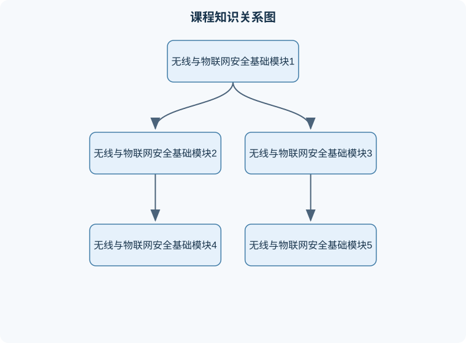

# 无线与物联网安全基础

## 一、课程整体知识框架

### 课程边界与先修知识

《无线与物联网安全基础》研究无线通信与物联网系统中，从射频传输、介质访问、链路接入、身份认证、密钥管理到应用与隐私保护的安全问题。课程重点包括密码学基础、无线信道与调制、多址与介质访问控制、无线局域网安全、蜂窝网络安全、物联网设备与协议安全、侧信道和隐私风险，以及事件响应与取证的基本流程。课程不将一般 Web 应用安全作为主体，也不把特定标准版本的机制无条件推广到其他版本。先修知识包括二进制与计算机网络基础、概率与离散数学入门、基本密码学概念、数字通信基础，以及能够理解网络分层和常见认证流程。





### 1. 课程对象与安全问题边界

无线与物联网安全研究的是：设备、无线链路、网络服务、数据处理平台以及运维人员之间，在开放或半开放通信环境中的机密性、完整性、可用性、身份可信性和隐私保护问题。无线信号通过空气传播，攻击者不必接入物理线路即可监听、干扰或伪造通信；物联网设备数量多、部署分散、计算资源和电池容量有限，因而不能简单地把传统有线网络的安全方案直接移植过来。

安全目标通常包括以下五类：

1. **机密性**：未授权主体不能获得消息的有效内容。加密可以提高机密性，但不能阻止流量存在、通信时间或设备位置等元数据泄露。
2. **完整性**：接收方能够发现消息是否被修改。仅加密不必然提供完整性，例如某些可篡改的流密码使用方式。
3. **身份认证**：通信双方确认对方是谁。认证设备身份、认证用户身份和认证消息来源是不同问题。
4. **可用性**：合法设备能够在合理时间内获得无线信道、网络服务和计算资源。射频干扰、泛洪和电池耗尽攻击会破坏可用性，即使加密算法没有被破解。
5. **可追责性与隐私性**：系统应保留足够的审计证据，同时避免不必要地暴露用户标识、位置和行为模式。

理想模型通常假设密码算法公开、密钥安全、随机数不可预测、协议实现无漏洞；现实系统还必须面对密钥泄露、设备被拆解、固件缺陷、配置错误、时钟不准、无线丢包、协议降级、供应链风险和物理层干扰。因此，安全结论必须说明条件。例如，“攻击者无法从密文恢复明文”只是在密钥保密、算法正确实现、随机数满足要求且未泄露侧信道信息时成立；它不等于“系统不会被攻击”。

### 2. 八个模块之间的逻辑关系

课程将知识组织为八个核心模块。模块之间不是孤立的：密码学提供基本工具，无线网络提供通信环境，物联网系统提供部署对象，身份与密钥管理负责建立信任，安全协议把工具组合成可运行机制，移动通信展示大规模网络的实际折中，最后通过风险分析、检测与响应评价系统是否真正安全。

#### 模块一：无线与物联网安全基本概念

无线网络的安全边界由终端、接入点、无线信道、网关、核心网络、云平台和管理接口共同构成。物联网系统还包括传感器、执行器、嵌入式操作系统、设备身份、数据采集服务和远程升级服务。

需要区分三种攻击面：

- **通信攻击面**：窃听、重放、伪造、会话劫持、路由欺骗、干扰和泛洪。
- **设备攻击面**：默认口令、调试接口、未签名固件、不安全存储、权限过大和物理拆解。
- **服务攻击面**：认证接口、消息代理、应用程序接口、云端权限、日志系统和供应链组件。

威胁建模可按“资产—威胁—脆弱性—影响—控制措施”展开。资产是需要保护的对象，例如门锁控制指令或电表读数；威胁是可能造成损害的行为；脆弱性是系统缺陷；影响是对安全目标的破坏；控制措施是降低概率或影响的技术与管理手段。边界反例是：将“设备在线”误认为“设备安全”。设备可能在线但使用未认证协议，或者完成认证却持续受到射频干扰。

#### 模块二：密码学基础与安全属性

密码系统使用明文 $P$、密文 $C$、密钥 $K$ 和加密、解密算法。对称密码满足

$$
C=E_K(P),\qquad P=D_K(C)
$$

其中 $E_K$ 和 $D_K$ 使用同一把密钥或可由同一秘密直接导出。对称密码速度快，适合传输大量物联网数据，但通信双方需要先安全地共享密钥。

非对称密码使用公钥和私钥。公钥可以公开，私钥必须保密。它适合身份认证、数字签名和密钥协商，但通常计算开销大于对称密码。数字签名的验证关系可抽象为

$$
\sigma=\operatorname{Sign}_{sk}(m),\qquad
\operatorname{Verify}_{pk}(m,\sigma)=\text{真}
$$

其中 $m$ 是消息，$sk$ 是签名私钥，$pk$ 是相应公钥，$\sigma$ 是签名。签名证明的是私钥持有者对消息作出承诺，不等于消息加密。

哈希函数将任意长度消息映射到固定长度摘要：

$$
h=H(m)
$$

哈希函数应满足抗原像、抗第二原像和抗碰撞等性质。若只公布 $H(m)$，接收方可检查消息是否变化，但不能单独证明消息来自某个发送者。消息认证码需要共享密钥：

$$
t=\operatorname{MAC}_K(m)
$$

验证方使用同一密钥重新计算 $t$。常见错误是把哈希摘要当作身份认证，也把加密当作完整性保护。

对称密码可分为分组密码和流密码。分组密码按固定长度处理数据，需要选择工作模式；流密码生成密钥流并与明文按位或按字节组合。若同一密钥流被重复使用，两个密文异或会消除密钥流：

$$
C_1\oplus C_2=(P_1\oplus S)\oplus(P_2\oplus S)=P_1\oplus P_2
$$

这里 $P_1,P_2$ 是两条明文，$S$ 是相同密钥流，$\oplus$ 表示按位异或。该结论要求密钥流完全相同，边界反例是每条消息使用独立、不可预测的随机数或计数器时，不能直接套用该推导；但计数器重复仍会造成严重风险。

AES 等现代分组密码常用于机密性保护。仅采用计数器模式生成密文时，通常还需要认证标签；现代系统更适合使用同时提供机密性和完整性的认证加密机制。DES 的密钥长度和安全裕度已不适合新系统，不能因为“算法名称仍被识别”就认为适合生产部署。

#### 模块三：随机数、密钥管理与身份信任

无线和物联网系统的安全性往往首先取决于密钥管理，而不是算法名称。密钥生命周期包括生成、分发、激活、轮换、备份、撤销、恢复和销毁。设备出厂密钥、设备唯一身份密钥、会话密钥、组播密钥和平台管理密钥应有不同用途，不能把一个长期密钥用于所有协议。

随机数分为真随机数、伪随机数和伪随机函数输出。安全随机数必须具有不可预测性和足够熵。时间戳、设备编号或简单递增计数器不是秘密随机数。若攻击者能够预测临时随机数，就可能恢复会话密钥或伪造认证材料。

密钥协商的核心目标是让双方获得相同秘密，同时不直接在公开信道发送该秘密。以有限域形式的 Diffie–Hellman 为例，公开参数为素数 $p$ 和生成元 $g$，甲选择秘密 $a$，乙选择秘密 $b$，双方分别发送

$$
A=g^a\bmod p,\qquad B=g^b\bmod p
$$

甲计算 $K=B^a\bmod p$，乙计算 $K=A^b\bmod p$。由于

$$
B^a=(g^b)^a=g^{ab}=(g^a)^b=A^b\pmod p
$$

双方得到相同共享值。该协议本身不能确认通信对象身份，若没有证书、预共享信任或签名保护，可能受到中间人攻击。实际系统还应通过密钥派生函数把共享值、会话上下文、双方身份和方向信息导出不同会话密钥，避免不同用途之间发生密钥混用。

#### 模块四：无线局域网安全协议与攻击面

无线局域网需要同时保护数据帧、认证过程和管理过程。安全协议通常包含身份认证、密钥协商、数据加密、完整性校验和重放防护。以基于 AES 的计数器与认证机制为例，计数器或随机数用于生成不同密钥流，认证标签用于发现数据修改，帧序号用于拒绝旧帧。

无线局域网的安全边界不能只看“是否启用加密”。未受保护的管理帧可能被伪造，攻击者可以制造断开连接、漫游诱导或接入点仿冒；物理层干扰和射频泛洪也无法通过加密解决。MAC 地址不是可靠身份，因为地址可以被伪造；隐藏网络名称也不是有效的访问控制。

重放防护的基本逻辑是：发送方为消息附加单调递增序号或唯一随机数，接收方保存接收窗口，拒绝已经使用过或明显过期的值。若设备断电后计数器回退，旧消息可能再次被接受，因此计数器持久化、随机数唯一性和状态恢复是实际设计的一部分。

#### 模块五：物联网体系结构、协议与设备安全

物联网系统可分为感知层、网络层、平台层和应用层。感知层采集温度、位置、压力或状态；网络层负责短距离或广域通信；平台层提供消息转发、设备管理和数据存储；应用层将数据转化为告警、控制和业务流程。

受限设备常见限制包括低功耗处理器、有限内存、间歇性连接和低带宽。因此设计不能只追求强算法，还要考虑握手次数、报文长度、存储开销和故障恢复。轻量化不等于取消认证，而是减少冗余状态、采用合适的会话复用和分层密钥。

安全启动的目标是设备只运行经过授权的固件。典型链条为：启动根验证引导程序，引导程序验证操作系统，操作系统验证应用固件。验证通常依赖数字签名，而不是只比较未加密哈希。安全更新还必须防止回滚，即攻击者不能把设备降级到存在已知漏洞的旧版本。

设备应采用最小权限原则：传感器采集进程不应拥有更新固件或修改网络配置的权限；执行器控制接口应进行命令授权、参数范围检查和重放防护。涉及安全关键动作时，系统还需设置失效安全状态，例如通信中断时进入受控停止，而不是无限重复执行上一次指令。

#### 模块六：移动通信安全与 GSM 体系案例

移动通信系统包含移动台、基站子系统和网络子系统。移动台通常包括终端与用户身份模块；基站子系统负责无线接入；网络子系统负责用户位置、认证、交换和服务管理。

早期 GSM 安全机制包括用户认证、通信加密和用户身份保护。网络向移动台发送随机挑战 $RAND$，用户身份模块根据长期秘密和认证算法计算响应及会话密钥。认证的基本思想是验证“持有秘密的用户”而不是直接在空中传输长期秘密。

但早期体系存在结构性边界：认证主要是网络认证用户，终端对网络的认证能力不足，攻击者可能伪装成网络；早期加密算法和密钥长度有限；身份标识保护并不能阻止所有位置追踪和信令分析；通信内容保护、信令保护和接入控制也不是同一层问题。因此，不能把“完成用户认证”解释为“整个移动通信系统免受主动攻击”。

分析移动通信安全时，应区分算法弱点、协议设计弱点和部署管理弱点。即便算法本身没有直接失效，伪基站、降级协商、信令滥用、号码欺诈和终端恶意软件仍可能造成风险。

#### 模块七：安全分析、监测与事件响应

无线与物联网安全分析应结合资产清单、通信基线、身份日志、设备状态和异常流量。一个异常事件的确认流程包括：发现异常、保留证据、判断影响范围、隔离受影响设备、修复根因、恢复服务和复盘改进。

证据应保留时间、设备标识、接口、消息类型、序号、认证结果和系统状态。日志本身也必须防篡改，并注意不要在日志中保存长期密钥或不必要的个人敏感信息。无线环境中的“无响应”可能由攻击、遮挡、低电量、信道拥塞或设备故障造成，不能仅凭一次丢包认定入侵。

风险可用定性方式表达为威胁可能性与影响的组合。若采用数值评分，应明确评分尺度和权重，不能把主观分数伪装成精确概率。评价控制措施时，应看是否降低了攻击成功概率、缩小了影响范围、提高了发现速度或改善了恢复能力。

#### 模块八：综合应用与职业能力

课程最终要求把密码学、无线协议、设备安全和业务风险结合起来。例如设计智能门锁系统时，不能只回答“使用 AES 加密”，还要说明设备如何注册、用户如何认证、开锁命令如何授权、命令如何防重放、固件如何更新、断网时如何运行、密钥泄露后如何撤销以及日志如何验收。

相关岗位包括无线安全分析、物联网安全研发、嵌入式安全测试、协议测试、设备运维安全、事件响应和安全产品支持。实际产出可能是威胁模型、协议评审报告、设备安全基线、测试记录、漏洞复现报告、修复验证结果或事件时间线。验收标准应可观察，例如“所有控制命令具有认证标签并拒绝重复序号”，而不是“系统安全性较高”。

## 二、章节和模块划分

### 核心知识覆盖清单

本清单根据本课程的章节划分整理，用于检查正文是否覆盖各个核心模块：

- **1. 模块一至模块二：概念、密码与安全属性**。
- **2. 模块三：随机数、密钥协商与密钥生命周期**。
- **3. 模块四：无线局域网与安全协议**。
- **4. 模块五至模块六：物联网设备与移动通信**。
- **5. 实验与项目一：无线协议安全验证**。
- **6. 实验与项目二：物联网设备安全更新验证**。


### 1. 模块一至模块二：概念、密码与安全属性

#### 代表性流程一：无线物联网威胁建模

**输入**：系统拓扑、设备清单、数据流、控制指令、用户角色和部署环境。  
**输出**：资产清单、信任边界、攻击路径、安全控制和残余风险。

**过程**：

1. 列出设备、数据、密钥、服务和控制动作。
2. 标注数据从传感器到网关、平台和应用的流向。
3. 在设备边界、无线链路边界、云服务边界处标注信任变化。
4. 对每条数据流检查机密性、完整性、身份认证和可用性要求。
5. 分析窃听、伪造、重放、篡改、拒绝服务、物理拆解和权限滥用。
6. 为每项风险指定控制措施及验证方法。
7. 记录未解决的残余风险和接受条件。

**不变量**：每个高价值资产至少对应一个威胁和一个可验证控制；每条控制指令都能追溯到授权主体。  
**终止条件**：新增资产、数据流和威胁不会改变风险清单，且每项高风险均有处理结论。  
**适用边界**：该流程适用于设计评审和安全测试规划，不等于已经证明实现不存在漏洞。

#### 例题一：区分机密性与完整性

**题干**：设备把传感器数据使用流密码加密后发送，但没有附加认证标签。攻击者不能直接看到明文，却可以修改密文。该系统是否同时满足机密性和完整性？

**分析**：流密码通常具有 $C=P\oplus S$ 的形式。攻击者将密文改为 $C'=C\oplus \Delta$，解密后得到

$$
P'=C'\oplus S=(C\oplus\Delta)\oplus S=P\oplus\Delta
$$

因此攻击者可能在不知道密钥的情况下对明文实施可控翻转。

**逐步解答**：  
第一步，确认加密隐藏了明文，因而在密钥安全等条件下具有一定机密性。  
第二步，检查是否有 MAC 或认证加密标签。题干说明没有。  
第三步，根据异或推导，密文修改会导致明文发生对应变化。  
**结果验证**：接收端若没有独立校验，只能得到修改后的数据，无法判断其是否被篡改。  
**变式**：若增加认证标签，仍需规定标签验证顺序、失败处理和重放检测；仅增加哈希而不使用密钥，不能防止攻击者修改消息后重新计算哈希。

### 2. 模块三：随机数、密钥协商与密钥生命周期

#### 代表性算法二：基于上下文的会话密钥派生流程

**输入**：已认证的共享秘密 $Z$、会话随机数、双方身份、协议名称和密钥用途。  
**输出**：加密密钥、认证密钥或其他用途明确的会话密钥。

**过程**：

1. 检查 $Z$ 是否来自成功认证的密钥协商，拒绝空值和长度不足的输入。
2. 将协议名称、双方身份、方向标识和会话随机数编码为上下文。
3. 使用经过审计的密钥派生函数从 $Z$ 派生固定长度密钥。
4. 为发送方向和接收方向分别加入不同标签。
5. 将派生出的密钥绑定到会话编号和算法套件。
6. 会话结束、超时或认证失败时销毁临时密钥。

**不变量**：不同方向、不同会话和不同用途不能得到同一逻辑密钥；长期密钥不直接用于大量数据加密。  
**终止条件**：完成密钥确认，或出现认证失败、超时、随机数重复等错误。  
**复杂度**：若输入总长度为 $n$，密钥派生的计算量通常为 $O(n)$，实际耗时还取决于所用哈希或派生函数。  
**边界**：密钥派生不能弥补共享秘密已经泄露、随机数重复或身份认证缺失的问题。

#### 例题二：Diffie–Hellman 共享值计算

**题干**：取公开参数 $p=23$、$g=5$。甲选择秘密 $a=6$，乙选择秘密 $b=15$。计算双方公开值和共享值。

**逐步解答**：

甲发送

$$
A=5^6\bmod23=15625\bmod23=8
$$

乙发送

$$
B=5^{15}\bmod23=19
$$

甲计算

$$
K=B^a\bmod23=19^6\bmod23=2
$$

乙计算

$$
K=A^b\bmod23=8^{15}\bmod23=2
$$

**结果验证**：双方均得到 $K=2$，说明交换计算在数学上成立。  
**边界验证**：该例没有身份认证。若攻击者分别与甲、乙建立两个共享值，甲和乙可能误以为彼此直接通信，因此不能把共享值相等理解为通信对象可信。  
**变式**：若使用较小参数，穷举或离散对数攻击更容易；实际系统必须使用经过审查的参数和协议，而不能照搬教学中的小数值。

#### 例题三：随机数重复的后果

**题干**：两条消息使用同一密钥流 $S$ 加密，得到 $C_1$ 和 $C_2$。证明攻击者可获得两条明文的异或结果。

**解答**：

$$
C_1=P_1\oplus S,\qquad C_2=P_2\oplus S
$$

两式异或：

$$
C_1\oplus C_2
=P_1\oplus S\oplus P_2\oplus S
=P_1\oplus P_2
$$

因为 $S\oplus S=0$，密钥流被消去。  
**结果验证**：攻击者虽然未立即得到任一条明文，但已获得明文之间的关系；若知道其中一条明文的部分内容，可能推导另一条消息的对应部分。  
**变式**：认证加密仍要求 nonce 在同一密钥下唯一；“有认证标签”不能使 nonce 重复变得安全。

### 3. 模块四：无线局域网与安全协议

#### 代表性流程三：无线接入安全检查

**输入**：接入点配置、终端配置、认证日志、加密套件、管理帧策略和网络分区方案。  
**输出**：配置合规表、发现的问题、风险等级和修复验证记录。

**步骤**：

1. 确认是否使用经过审查的现代认证与加密机制，排除明文和不必要的旧模式。
2. 检查管理界面是否与业务网络隔离，默认口令是否已更换。
3. 检查终端与接入点是否验证证书或其他身份材料，避免只依赖网络名称。
4. 检查会话密钥是否按连接和方向区分，nonce 或序号是否具备唯一性。
5. 检查重放保护、管理帧保护和异常断开处理。
6. 在授权测试环境中验证窃听、篡改、旧帧重发和非法接入是否被拒绝。
7. 验证无线不可用时的降级策略和告警机制。

**评价标准**：合法终端可完成认证；修改数据会被拒绝；旧消息不能再次执行；非法终端不能获得业务权限；干扰发生时系统能告警并进入安全降级状态。  
**边界**：加密配置检查不能代替射频覆盖、物理安全、固件审计和云端接口安全测试。

#### 例题四：重放防护判断

**题干**：门锁开门命令包含序号 $100$ 和认证标签。攻击者记录该命令，十分钟后再次发送。若接收端只验证标签，不保存序号状态，是否安全？

**分析与解答**：认证标签能证明命令未被修改，不能证明命令是“新鲜的”。如果接收端重新验证标签后直接执行，重放消息仍会被接受。正确流程应保存已接受的序号或维护滑动窗口：序号 $100$ 首次接受后，再次收到 $100$ 时判定为重复并拒绝。

**结果验证**：测试同一命令两次发送，第一次成功、第二次失败，日志应记录重复序号。  
**变式**：设备断电重启后若序号状态丢失，仍可能接受旧命令，因此需要持久化计数器、单调时间源或设计可恢复的会话状态。

### 4. 模块五至模块六：物联网设备与移动通信

#### 代表性算法四：安全固件更新验证

**输入**：待更新固件、版本号、发布者公钥、数字签名、设备当前版本和兼容性信息。  
**输出**：接受并安装的新固件，或明确的拒绝原因。

**伪代码（Python）**：

```python
def verify_and_stage_update(image, version, signature,
                            publisher_public_key, current_version):
    # image 为待验证固件字节串；版本号采用可比较的整数
    if version <= current_version:
        return False, "拒绝回滚或重复版本"

    if not check_format_and_size(image):
        return False, "固件格式或大小不合法"

    digest = secure_hash(image)
    if not verify_signature(publisher_public_key, digest, signature):
        return False, "签名验证失败"

    if not check_hardware_compatibility(image):
        return False, "硬件不兼容"

    stage_to_inactive_partition(image, version)
    mark_pending_boot(version)
    return True, "已暂存，等待启动自检"
```

**输入约束**：公钥必须来自可信启动根；版本号不能由攻击者任意降低；固件暂存区和活动区应隔离。  
**输出含义**：`True` 只表示通过预验证并暂存，不表示新固件已经完成启动自检。  
**不变量**：未通过签名验证的固件不能进入可执行分区；已安装高版本不能无授权回滚。  
**终止条件**：签名、格式、兼容性和版本检查全部通过，或任一检查失败。  
**复杂度**：哈希和签名验证通常随固件长度 $n$ 增长，数据扫描部分为 $O(n)$；实际性能受嵌入式处理器和密码实现影响。  
**边界**：签名验证不能保证固件没有逻辑漏洞，也不能防止发布者私钥泄露；因此还需密钥撤销、供应链审计和异常恢复机制。

#### 例题五：安全启动与哈希比较

**题干**：设备只把固件哈希值存储在可写配置区。攻击者替换固件后，同时修改配置区中的哈希值。该机制能否阻止恶意固件启动？

**解答**：不能。哈希函数可检测“固件与记录值是否一致”，但若记录值也可被攻击者修改，攻击者可以重新计算恶意固件的哈希并替换记录。安全启动需要把信任根放在攻击者不能任意修改的位置，并验证发布者的数字签名或使用硬件保护的信任锚。

**结果验证**：将合法固件和恶意固件分别计算摘要；若摘要存储区可写，二者均能与被替换后的记录匹配。  
**变式**：即使签名正确，也要检查版本、设备型号、权限和更新来源，避免合法但过旧或不适配的固件被安装。

#### GSM 安全案例分析

分析移动通信案例时，应按照“身份材料—挑战响应—会话密钥—无线加密—网络认证方向—降级与信令风险”的顺序进行。早期系统中，用户身份模块保存长期秘密，网络发送随机挑战，终端计算响应和会话密钥。该机制能减少长期秘密直接暴露，但若网络不能被终端充分认证，攻击者仍可能伪装网络诱导终端接入。

**分析任务**：某终端成功完成用户认证，但连接到一个伪造基站；判断“认证成功”是否等于“通信对象可信”。  
**结论**：不等于。需要明确认证方向。网络认证用户只证明终端持有相应身份秘密，不能自动证明终端连接的网络是真实网络。还需检查加密协商、降级保护、信令完整性和网络侧信任。

### 5. 实验与项目一：无线协议安全验证

#### 实验目标

在隔离、授权的教学网络中验证机密性、完整性、重放防护和配置错误之间的差异，不对公共网络或非授权设备进行测试。

#### 输入数据与环境

准备两个受控终端、一个测试接入点、预先生成的测试消息、已知的序号序列、认证成功和失败日志。测试数据不得包含真实个人信息或生产密钥。

#### 步骤

1. 配置安全无线网络和独立测试网络，记录初始配置。
2. 发送正常消息，确认接收端能验证标签并正确解密。
3. 修改消息内容但保留原标签，记录接收端是否拒绝。
4. 重复发送已经成功处理的消息，检查序号检测。
5. 模拟接入点不可用或信道拥塞，观察告警、重试和降级状态。
6. 恢复网络，确认系统不会因重复重试造成消息重复执行。
7. 导出日志并建立事件时间线。

#### 评价标准

- 合法消息成功率达到测试设计要求；
- 任意被修改消息均被拒绝；
- 重复序号不触发第二次控制动作；
- 认证失败、重放和连接异常具有可区分日志；
- 网络恢复后不会自动接受过期命令；
- 测试过程不影响非测试网络。

#### 排错方法

若合法消息被拒绝，依次检查密钥是否匹配、编码是否一致、序号是否重复、设备时钟是否超出允许范围。若篡改消息仍被接受，检查是否真的验证标签、是否先执行后验证、标签比较是否覆盖完整消息。若重放未被拦截，检查序号状态是否保存、重启后是否回退以及接收窗口是否过宽。

### 6. 实验与项目二：物联网设备安全更新验证

#### 实验目标

验证固件签名、版本控制、回滚阻止、断电恢复和失败日志，不使用真实设备密钥或生产固件。

#### 输入数据

准备一份合法测试固件、一份修改一个字节的篡改固件、一份旧版本固件、对应签名、错误签名和不兼容硬件标识。

#### 步骤

1. 安装当前版本并记录版本号、启动状态和固件摘要。
2. 提交合法高版本固件，观察签名验证、暂存和重启自检。
3. 提交修改后的固件，确认摘要变化并拒绝签名。
4. 提交旧版本固件，确认回滚保护生效。
5. 模拟更新过程中断电，检查活动分区是否仍可启动。
6. 提交硬件型号不匹配的合法签名固件，检查兼容性拒绝逻辑。
7. 检查日志是否记录版本、失败原因和时间，但不泄露私钥或完整敏感凭据。

#### 评价标准

合法固件能够安装并完成自检；篡改固件、错误签名、旧版本和不兼容固件均被拒绝；断电不会使设备进入不可恢复状态；日志能够支持故障定位。

#### 排错方法

若合法更新失败，先检查签名编码、固件摘要计算范围、版本比较规则和公钥来源；若篡改固件通过，检查验证是否针对完整镜像、是否错误地只验证头部；若回滚成功，检查版本状态是否存储在可信区域以及比较是否存在整数溢出或字符串排序错误；若断电后无法启动，检查双分区切换、启动确认标志和恢复镜像是否完整。

## 三、核心概念的详细解释

### 1. 无线与物联网安全的对象、边界与安全属性

无线与物联网安全保护的不是单一设备，而是“终端—无线链路—接入设备—网关—网络服务—云平台—运维接口”组成的系统。终端可能是传感器、智能门锁、可穿戴设备或工业控制器；无线链路可能使用无线局域网、低功耗广域网、短距离通信或蜂窝网络；服务端则负责设备注册、消息转发、数据存储、告警和远程更新。

无线信号通过空气传播，攻击者通常不需要接触网线就可能进行被动监听、主动篡改、重放、伪造、干扰和流量耗尽。物联网设备数量大、分布广、生命周期长，且常受到处理器性能、存储容量、电池寿命和人机交互能力限制。因此，安全设计必须同时考虑密码算法强度、协议状态、设备生命周期、物理暴露和运维能力。

安全目标至少包括：

- **机密性**：未经授权者不能恢复消息有效内容。加密通常保护载荷，但消息长度、发送时间、频率、信号强度和设备位置仍可能泄露行为信息。
- **完整性**：接收者能够检测消息是否被修改。完整性保护通常依靠消息认证码、认证加密或数字签名。
- **身份认证**：确认通信主体的身份或资格。设备认证、用户认证和消息来源认证不能相互替代。
- **新鲜性**：确认消息是当前会话或允许时间范围内产生的，而非旧消息的再次发送。序号、随机数、时间戳和挑战应答均可用于支持新鲜性。
- **可用性**：合法设备能够获得信道、计算资源和服务。射频干扰、无线泛洪、认证请求泛滥、路由耗尽和电池耗尽都可能破坏可用性。
- **隐私性与可追责性**：减少身份、位置、行为轨迹等不必要暴露，同时保留能够支持审计和事件调查的证据。

安全属性之间存在制约关系。增强日志有利于追责，却可能增加隐私泄露；频繁重新认证有利于降低密钥长期暴露风险，却会增加设备能耗和网络负担；强加密能够保护内容，却不能消除射频干扰。因而不能用“启用了加密”概括系统安全。

### 2. 威胁建模与攻击面分析

威胁建模可按“资产—威胁—脆弱性—影响—控制措施”展开。资产是需要保护的对象，例如门锁控制命令、电表读数、设备私钥、固件镜像、用户位置或云端访问令牌。威胁是可能造成损害的行为，脆弱性是使威胁得以实现的缺陷，影响是对机密性、完整性、可用性或隐私性的后果，控制措施则是降低攻击概率或损失的技术和管理方法。

无线与物联网系统的攻击面可分为三类：

1. **通信攻击面**：窃听、流量分析、重放、伪造、会话劫持、路由欺骗、控制帧滥用和射频干扰。
2. **设备攻击面**：默认口令、调试接口未关闭、固件未签名、密钥明文存储、权限过大、输入校验缺失和物理拆解。
3. **服务攻击面**：设备注册接口、消息代理、应用程序接口、云端权限、日志系统、远程升级服务和第三方软件供应链。

分析时应区分攻击者能力。被动监听者只能接收信号；主动攻击者还可以发送、修改或丢弃报文；具有设备物理访问能力的攻击者可能读取闪存、调试接口或电源侧信号；拥有云端权限的攻击者则可能绕过无线链路直接控制大量设备。一个控制措施只有在对应攻击者能力范围内才有意义。例如，链路加密不能防止已经获得云端管理权限的攻击者伪造合法控制命令。

### 3. 密码学工具及其适用边界

对称加密使用共享秘密密钥。设明文为 $P$，密文为 $C$，密钥为 $K$，加密算法为 $E$，解密算法为 $D$，则

$$
C=E_K(P),\qquad P=D_K(C)
$$

其优点是计算效率高，适合传感器数据和持续通信；主要困难是通信双方如何安全获得 $K$，以及如何避免密钥重复使用、泄露和长期不轮换。

非对称密码使用公钥和私钥。公钥可以分发，私钥必须保密，适合数字签名、设备身份认证和密钥协商。数字签名可表示为

$$
\sigma=\operatorname{Sign}_{sk}(m),\qquad
\operatorname{Verify}_{pk}(m,\sigma)=\text{真}
$$

其中 $m$ 是被签名消息，$sk$ 是签名私钥，$pk$ 是对应公钥，$\sigma$ 是签名。签名证明的是“持有私钥的一方曾对该消息签名”，并不自动证明消息内容正确，也不保证发送者本身没有被攻陷。

密码散列函数把任意长度输入映射为固定长度摘要：

$$
h=H(m)
$$

安全散列通常要求抗原像、抗第二原像和抗碰撞。散列不是加密：已知 $h$ 通常不能直接恢复任意长度的 $m$，但若候选明文空间很小，攻击者可以逐个计算摘要进行猜测。直接计算 $H(\text{密码})$ 也不能充分保护低熵口令，应采用专门的口令派生机制和唯一随机盐。

消息认证码可表示为

$$
t=\operatorname{MAC}_K(m)
$$

接收方使用共享密钥重新计算 $t$ 并比较结果。消息认证码提供完整性和来源认证，但不提供公开可验证性，也不提供机密性。认证加密同时处理机密性和完整性，通常输出密文 $C$ 与认证标签 $T$：

$$
(C,T)=\operatorname{Enc}_K(N,A,P)
$$

其中 $N$ 是 nonce 或一次性随机数，$A$ 是附加认证数据，$P$ 是明文。解密时必须先验证标签，只有验证成功才能使用明文。$A$ 不加密，但其完整性受到保护，例如协议版本、设备地址和消息类型。

### 4. 无线链路安全与协议状态

无线局域网安全通常涉及接入认证、密钥协商、数据加密、完整性保护和重放检测。以采用 AES-CCM 类机制的链路保护为例，可把其逻辑过程分为：

1. 双方通过认证和密钥协商建立会话上下文；
2. 由主密钥或长期凭据派生临时会话密钥；
3. 每个数据帧使用唯一的计数器或 nonce；
4. 使用计数器模式保护数据机密性；
5. 使用基于 CBC-MAC 的认证过程保护消息完整性；
6. 接收端检查标签、地址、计数器和协议状态；
7. 已接受的计数器值被保存或推进，以拒绝旧帧。

计数器模式本质上将密钥流与明文异或。若同一密钥下重复使用相同 nonce，则相同密钥流可能造成

$$
C_1\oplus C_2=P_1\oplus P_2
$$

其中 $C_1,C_2$ 是两条密文，$P_1,P_2$ 是对应明文。若一条明文可猜测，另一条明文可能被推断。因此，nonce 唯一性是条件，不是可有可无的实现细节。

链路保护不能解决全部问题。它通常不能阻止射频干扰、信道拥塞、接入点故障和某些控制帧滥用；它也不能防止合法账户被盗后发出合法格式的恶意命令。安全系统必须把链路安全、端到端认证、设备授权、流量限制和异常检测结合起来。

### 5. 密钥管理、设备身份与安全更新

物联网密钥管理包括设备初始身份、密钥注入、注册、协商、轮换、撤销、备份和销毁。设备身份不应仅以可修改的 MAC 地址、设备名称或序列号表示，因为这些字段可能被伪造。更可靠的身份依据包括安全存储中的密钥、证书私钥、可信执行环境或硬件安全模块。

设备注册至少应确认三件事：设备确实持有对应秘密；设备属于允许的型号或租户；设备当前状态满足接入策略。注册成功后，应限制设备权限，例如传感器只能发布指定主题，不能访问管理接口或控制其他设备。

安全更新必须验证：

- 固件签名是否由受信任的签名者生成；
- 固件摘要是否覆盖完整镜像；
- 设备型号和硬件版本是否匹配；
- 版本是否满足防回滚策略；
- 更新过程断电后能否恢复；
- 更新失败是否产生可审计日志；
- 私钥是否只在签名环境中使用。

“签名合法”不等于“固件适合设备”。被签名但型号错误、权限配置错误或包含已知缺陷的固件仍可能造成风险。因此，更新流程还要有版本策略、兼容性检查、分阶段发布和失败回退机制。

### 6. 蜂窝网络安全的历史演进与局限

早期蜂窝系统通常把移动台、基站子系统和网络子系统作为主要组成部分，并通过用户身份模块保存认证相关秘密。以早期系统的抽象流程为例，网络发送随机挑战，移动台和网络利用共享秘密分别计算认证结果与会话密钥，再使用流密码保护语音、数据和信令的一部分。

这种设计体现了三个重要思想：使用模块化身份凭据隔离用户秘密；通过挑战应答避免直接传输长期密钥；使用临时会话密钥降低长期密钥暴露风险。但其局限也很明显：部分系统只提供单向认证，移动台不能充分确认网络真实性；密钥长度和算法设计较早，难以满足现代威胁模型；身份保护机制可能因协议状态、异常降级或主动伪装基站而失效；通信内容和控制信令的保护范围并不相同。

因此，分析蜂窝安全时不能只问“是否加密”，还要问：认证是否双向、密钥是否足够强、是否存在降级、哪些信令受到保护、用户身份何时暴露、网络侧是否可伪造，以及设备是否会自动接受较弱的历史模式。

### 7. 典型算法与安全分析流程

#### 7.1 受保护消息处理流程

**输入**：密文、认证标签、发送方标识、消息类型、序号、会话密钥。  
**输出**：接受并交付的明文，或拒绝事件。  
**过程**：

1. 检查字段长度、编码和消息类型；
2. 检查设备是否处于正确会话状态；
3. 检查序号是否小于等于已接受窗口；
4. 根据会话密钥、序号、地址和消息类型计算认证标签；
5. 使用常数时间比较方法比较标签；
6. 标签正确后解密；
7. 解析明文并进行业务授权；
8. 只有业务验证成功后才更新持久化状态。

不变量是：未通过认证的明文不能触发业务动作；已接受序号不能被再次接受。终止条件是成功验证并交付，或任一检查失败后拒绝。该流程适用于消息认证加密系统，不适用于只有加密而没有完整性保护的机制。

```text
伪代码
function receive(frame, session):
    if not valid_format(frame):
        log("format_error")
        return REJECT

    if frame.session_id != session.id:
        log("wrong_session")
        return REJECT

    if frame.sequence <= session.highest_sequence - session.window:
        log("replay_or_old")
        return REJECT

    expected_tag = MAC(
        session.mac_key,
        frame.header || frame.sequence || frame.ciphertext
    )

    if not constant_time_equal(expected_tag, frame.tag):
        log("auth_failure")
        return REJECT

    plaintext = Decrypt(
        session.enc_key,
        nonce = make_nonce(session.id, frame.sequence),
        ciphertext = frame.ciphertext
    )

    if not valid_business_command(plaintext):
        log("invalid_command")
        return REJECT

    persist_sequence(frame.sequence)
    execute_authorized_action(plaintext)
    return ACCEPT
```

其时间复杂度通常为 $O(n)$，其中 $n$ 是报文长度；空间复杂度为 $O(1)$ 或 $O(w)$，其中 $w$ 是重放检测窗口大小。复杂度不代表安全性，错误的 nonce 管理、状态持久化或授权顺序仍会导致漏洞。

#### 7.2 固件安全更新流程

**输入**：固件镜像、版本号、型号标识、签名、签名者公钥和当前设备状态。  
**输出**：更新成功、保留旧版本，或拒绝更新。  
**过程**：

1. 检查镜像格式和长度；
2. 检查型号、硬件版本和最低引导版本；
3. 计算完整镜像摘要；
4. 使用内置可信公钥验证签名；
5. 比较版本号，拒绝违反防回滚规则的版本；
6. 将镜像写入非活动分区；
7. 校验写入结果；
8. 设置待启动标志并重启；
9. 新系统完成自检后确认启动；
10. 若超时或自检失败，回退到旧分区。

不变量是：活动分区在新镜像完成验证和可启动确认前不能被破坏。终止条件是成功确认新系统，或恢复旧系统并记录失败原因。该流程适用于具备安全启动或可信公钥存储的设备；若攻击者可以替换验证公钥，签名校验将失去意义。

#### 7.3 事件分析流程

输入是无线抓包摘要、设备日志、认证失败记录、时间信息和资产清单；输出是事件时间线、影响范围、初步根因和处置建议。步骤依次为保全证据、校准时间、关联设备标识、区分重放与新发报文、判断是否存在密钥泄露、隔离受影响设备、恢复并验证。排查时不能只看单台设备日志，还要比较网关、云端和邻近设备的时间线。

### 8. 代表性例题

#### 例题一：区分加密、认证与完整性

**题干**：某系统把传感器数据加密后发送，但攻击者修改密文后，接收端仍会解密并执行。该系统缺少什么保护？

**分析**：加密只解决内容隐藏，不保证密文未被修改。  
**解答**：系统缺少完整性保护和消息来源认证，应采用消息认证码或认证加密。若接收端先解密、后验证，仍可能因解析异常造成攻击，因此应在认证成功后再使用明文。  
**验证**：使用相同密钥生成标签，修改密文后重新计算标签无法成功；若标签不变，接收端应拒绝。  
**变式**：若攻击者只能重发原始密文，则完整性标签可能仍然有效，此时还需序号、nonce 或时间窗口防止重放。

#### 例题二：判断 nonce 重用后果

**题干**：同一密钥下，两条消息在计数器模式中使用了相同初始计数器。说明密文关系并指出风险。

**解答**：设密钥流为 $S$，则 $C_1=P_1\oplus S$，$C_2=P_2\oplus S$。异或可得

$$
C_1\oplus C_2=P_1\oplus P_2
$$

攻击者不能仅凭该式必然恢复两条明文，但可利用已知格式、猜测字段和重复结构推断内容；若其中一条明文已知，则另一条可直接恢复。  
**结果验证**：使用两组不同明文和相同密钥流计算，异或结果应等于两条明文异或。  
**变式**：更换密钥可以降低跨会话影响，但不能弥补同一密钥内的 nonce 重用。

#### 例题三：判断重放攻击

**题干**：设备对“关闭阀门”命令进行认证，攻击者截获合法命令并在十分钟后再次发送，标签验证仍然成功。为什么会发生？如何修复？

**解答**：认证标签证明消息由持钥方生成过，但没有证明消息是新的。修复方法是把单调序号、会话随机数或有效时间纳入认证输入，并在设备中保存已接受状态。  
**验证**：第一次序号为 18 的命令成功；再次发送序号 18 应拒绝；序号 19 在认证成功且业务授权通过后才能接受。  
**变式**：设备断电重启后若序号回退到 0，攻击者仍可能重放旧命令，所以状态必须安全持久化，或重新建立不会复用旧 nonce 的会话。

#### 例题四：判断数字签名与加密用途

**题干**：设备收到带有厂商签名的固件。签名验证通过后，是否可以断定固件不会泄露数据？

**解答**：不能。签名验证只说明该镜像与签名内容一致，且签名者私钥对其作过签名；它不保证签名者无误签、固件无逻辑漏洞、权限配置合理或运行环境安全。还需检查型号、版本、漏洞状态、权限和行为。  
**验证**：修改固件任意字节后，摘要改变，原签名应验证失败。  
**变式**：若攻击者替换设备内置公钥，恶意固件也可被“合法”验证，因此公钥存储必须受到保护。

#### 例题五：分析无线网络拒绝服务

**题干**：某无线系统使用强认证和强加密，但现场设备仍频繁离线，抓包显示信道长期繁忙。是否能据此判断密码协议被破解？

**解答**：不能。射频干扰、信道拥塞、物理层噪声和泛洪都可能造成可用性下降，而不要求破解密钥。应测量信道占用、信号噪声比、重传率、认证失败率和邻近频段活动。  
**验证**：在隔离测试环境降低干扰后，若认证成功率恢复而密文和标签始终正常，则更支持可用性攻击或环境问题。  
**变式**：如果只有特定设备受到影响，还需检查天线、供电、固件和设备位置，不能简单归因于外部攻击。

### 9. 受控实验与项目流程

#### 实验一：验证认证、篡改与重放防护

**输入数据**：测试密钥、合法消息、修改后的消息、重复消息、不同序号消息和模拟丢包数据。  
**步骤**：

1. 在隔离无线网络中配置测试设备和网关；
2. 发送合法消息，记录延迟、序号和标签验证结果；
3. 修改密文但保留原标签，观察是否拒绝；
4. 原样重发已接受报文，观察重放检测；
5. 发送合法标签但过期序号的报文；
6. 模拟丢包和乱序，测试接收窗口；
7. 重启设备，检查序号状态是否安全恢复。

**评价标准**：合法消息按设计成功；篡改消息全部拒绝；重复消息不产生第二次业务动作；日志能区分格式错误、认证失败、重放和过期会话；网络恢复后不自动接受旧命令。  
**排错方法**：合法消息失败时依次检查密钥、编码、nonce、序号窗口和时钟；篡改消息通过时，检查接收端是否验证完整报文以及是否在验证前执行操作；重启后重放成功时，检查序号是否只保存在易失内存。

#### 实验二：验证固件签名与防回滚

**输入数据**：合法高版本固件、修改一个字节的固件、错误签名固件、旧版本固件和型号不匹配固件。  
**步骤**：

1. 安装当前版本并记录摘要、版本号和启动状态；
2. 安装合法高版本，检查签名、摘要和启动确认；
3. 提交篡改镜像，观察拒绝原因；
4. 提交旧版本，检查防回滚；
5. 提交型号不匹配但签名合法的镜像；
6. 在写入过程中模拟断电；
7. 检查回退能力、日志完整性和密钥保密性。

**评价标准**：只有满足签名、型号、版本和启动自检条件的镜像能够运行；篡改、错误签名、旧版本和型号错误镜像均拒绝；断电后设备保持可恢复状态。  
**排错方法**：合法更新失败时检查摘要覆盖范围、签名编码、公钥版本和版本比较；篡改镜像通过时检查是否只验证头部；旧版本通过时检查版本状态是否可被回写；断电不可恢复时检查双分区切换和启动确认标志。

## 四、重要定义、公式、定理和推导

### 专业审校补充：关键定义与适用边界

无线与物联网安全必须区分“认证后的保密通信”和“无线可用性”。认证加密通常能够在密钥、nonce、标签验证和权限检查均正确的条件下，检测报文篡改并保护内容机密性；但它不能阻止射频干扰、信道拥塞、物理遮挡、能量耗尽或接入点失效。对窄带链路，可用简化信干噪比判断干扰是否可能破坏接收：$$\mathrm{SINR}=\frac{P_s}{P_i+P_n}$$其中 $P_s$ 为接收信号功率，$P_i$ 为同频干扰功率，$P_n$ 为噪声功率，三者必须先换算为瓦特，不能直接对 dBm 做加减。若调制与编码方案要求阈值为 $\gamma_{\min}$，则只有当 $\mathrm{SINR}\geq\gamma_{\min}$ 时，理想模型下才可能可靠解调。该模型忽略了衰落、隐藏终端、捕获效应、纠错编码和重传策略，因此只能用于初步边界分析，不能直接替代现场射频测试。安全设计还应把可用性作为独立目标：检测到持续干扰时，设备应限速、缓存、切换信道或进入预先定义的安全状态，而不能通过无限重传消耗电池。


### 1. 密码系统的基本关系

对称加密的正确性要求对所有允许的明文 $P$ 和密钥 $K$，满足

$$
D_K(E_K(P))=P
$$

该式只说明解密能够还原明文，不说明算法安全。若密钥空间过小，攻击者可以穷举；若随机数重复，即使算法本身可靠也可能泄露关系；若实现存在侧信道，理论安全性也不能直接转化为工程安全性。

穷举攻击的最坏尝试次数等于密钥空间大小，平均约为其一半。若密钥长度为 $k$ 位，可能密钥数为

$$
2^k
$$

这里的 $k$ 是比特数，不是字节数。若攻击者每秒能测试 $r$ 个候选密钥，平均时间近似为

$$
T_{\text{avg}}=\frac{2^{k-1}}{r}
$$

其中 $T_{\text{avg}}$ 的单位为秒。该估算假设候选密钥等可能、每次验证成本近似相同，且没有更有效的密码分析方法。实际系统还受到口令低熵、密钥派生、硬件并行度和验证样本可得性的影响。

### 2. 散列、认证标签与碰撞概率

散列函数输出长度为 $n$ 位时，理想随机模型下，任意两个固定不同输入产生相同摘要的概率约为

$$
2^{-n}
$$

但生日效应表明，若随机生成约 $2^{n/2}$ 个输入，出现某一对碰撞的概率就可能达到显著水平。因此，不能把“输出为 $n$ 位”简单理解为碰撞安全强度始终为 $n$ 位；针对碰撞搜索的理想复杂度通常接近 $2^{n/2}$。

若认证标签长度为 $t$ 位，攻击者在标签不可预测且验证次数为 $q$ 的理想条件下，随机猜中至少一次的概率近似为

$$
1-\left(1-2^{-t}\right)^q
$$

当 $q2^{-t}$ 很小时，可近似为 $q2^{-t}$。这说明在线接口必须限制失败次数，并且标签长度、设备寿命和可接受风险应一起设计。该公式不适用于标签存在结构性偏差、密钥泄露或比较实现有漏洞的情况。

### 3. 认证加密的验证顺序

认证加密的正确处理是先验证认证标签，再使用明文。若把解密结果直接交给解析器，攻击者可以构造畸形密文触发解析错误、资源消耗或业务副作用。形式化地，只有当

$$
\operatorname{Verify}_K(A,C,T,N)=\text{真}
$$

时，才允许计算并使用

$$
P=\operatorname{Dec}_K(C,N)
$$

其中 $A$ 是附加认证数据，$C$ 是密文，$T$ 是标签，$N$ 是 nonce。若协议把地址或消息类型放在 $A$ 中，攻击者不能在不被发现的情况下把同一条消息转移到另一台设备或另一类业务接口。

### 4. 重放防护的序号条件

设设备已接受的最大序号为 $s_{\max}$，允许乱序窗口大小为 $w$。一种基本接受条件是

$$
s_{\max}-w < s \leq s_{\max}+1
$$

其中 $s$ 是当前报文序号。若 $s\leq s_{\max}-w$，报文过旧，应拒绝；若 $s$ 大于当前最大值，则在认证成功后推进状态；若 $s$ 位于窗口内，还需检查该序号是否已被使用。

该条件并非通用标准格式，而是说明重放窗口的逻辑。无线网络可能丢包和乱序，窗口过小会误拒绝合法报文；窗口过大则增加旧报文被接受的机会。若设备重启后丢失 $s_{\max}$，则必须重新建立会话或从可信存储恢复状态，否则旧报文可能重新有效。

### 5. nonce 唯一性的推导

在计数器模式中，设块密钥产生的密钥流为 $S_i$，第 $i$ 个明文块为 $P_i$，密文为 $C_i$，则

$$
C_i=P_i\oplus S_i
$$

同一密钥和同一 nonce 导致相同的密钥流 $S_i$。对两条消息进行异或：

$$
\begin{aligned}
C_{1,i}\oplus C_{2,i}
&=(P_{1,i}\oplus S_i)\oplus(P_{2,i}\oplus S_i)\\
&=P_{1,i}\oplus P_{2,i}
\end{aligned}
$$

因为 $S_i\oplus S_i=0$。这不是说攻击者必然立即得到明文，而是说加密不再隐藏两条明文之间的关系。若明文包含固定头、已知协议字段或可猜测命令，攻击者就能利用这些信息推导其他部分。

### 6. 密钥派生与密钥分离

设主密钥为 $K_m$，会话标识为 $C$，方向标识为 $d$，用途标签为 $u$，随机数为 $N$，则可抽象地写作

$$
K_{\text{session}}=\operatorname{KDF}(K_m,C,d,u,N)
$$

这里 $\operatorname{KDF}$ 是密钥派生函数。加入用途标签 $u$ 的目的是密钥分离：加密密钥、认证密钥、更新密钥和设备管理密钥不应无区分地复用。加入方向标识 $d$ 可以避免上下行通信使用同一密钥流或相同状态。公式表达的是设计原则，不规定某一种具体派生函数。

### 7. 复杂度与资源边界

对长度为 $n$ 的消息进行一次线性扫描计算摘要或认证标签，时间复杂度通常为 $O(n)$；若重放窗口记录 $w$ 个序号，空间复杂度可能为 $O(w)$。设备功耗还与无线发送次数、处理器频率、密钥协商次数和重传次数有关，不能仅以算法的渐近复杂度评价能耗。

低功耗设备适合减少握手次数、缓存短期会话密钥和采用硬件加速，但不能因此取消身份认证或完整性保护。设备若无法保存持久序号，可通过重新协商会话、使用设备安全计数器或采用不会重复的随机状态补足限制；若随机源质量不足，则不能把随机 nonce 当作可靠的唯一性保证。

### 8. 易错点与边界反例

1. 把加密误认为完整性保护；可篡改密文的模式仍可能被攻击。
2. 把设备认证误认为消息认证；合法设备可能发送过期或越权命令。
3. 把散列误认为加密；摘要通常不能直接解密恢复明文。
4. 把数字签名误认为保密；签名公开可验证，不隐藏消息内容。
5. 认为标签验证成功就一定是新消息；没有序号仍可能重放。
6. 把 MAC 地址当作不可伪造身份；链路地址可能被修改或仿冒。
7. 忽略 nonce 重用；同一密钥下的重复 nonce 会破坏模式安全。
8. 只保护数据帧而忽略管理帧、控制帧和降级路径。
9. 先执行控制命令再验证标签；攻击者可利用验证顺序制造副作用。
10. 只验证固件签名，不检查型号、版本和回滚状态。
11. 认为强加密能防止射频干扰；机密性不等于可用性。
12. 将认证失败全部归因于攻击；密钥不同步、时钟错误和编码差异也会导致失败。
13. 认为设备重启不会影响重放防护；易失序号回退会重新接受旧报文。
14. 认为云端接口不属于物联网安全边界；云端权限被盗可绕过无线保护。
15. 认为随机数“看起来随机”就足够；不可预测性需要可靠熵源或安全伪随机生成机制。
16. 认为签名者可信就等于固件无漏洞；签名只能证明签名关系和完整性。

### 9. 常见笔试问题及解答思路

1. **为什么无线网络比有线网络更容易受到窃听？**  
   因为信号在开放空间传播，攻击者不必接入物理线路即可接收；但是否能恢复内容还取决于加密和密钥保护。

2. **为什么要同时使用加密和认证？**  
   加密保护机密性，认证保护完整性和来源；单独使用加密不能阻止篡改或重放。

3. **nonce 与密钥有什么区别？**  
   密钥是秘密，nonce 通常不要求秘密，但在同一密钥范围内必须满足协议规定的唯一性或不可预测性。

4. **重放攻击为什么不能只靠 MAC 防止？**  
   MAC 只说明消息由持钥方产生过，不能说明它是首次发送；必须认证序号、时间戳或会话随机数。

5. **数字签名为什么适合固件更新？**  
   设备可以用公开验证密钥检查镜像是否由受信任签名者签署且未被修改，同时不需要把签名私钥分发到设备。

6. **为什么设备需要密钥分离？**  
   避免一个用途的密钥泄露后影响所有功能，并减少跨协议、跨方向复用导致的关联攻击。

7. **强认证系统为什么仍会受到拒绝服务？**  
   攻击者不必伪造合法消息，只需干扰信道、制造拥塞、耗尽认证资源或破坏设备供电即可影响可用性。

8. **早期蜂窝系统的单向认证有什么问题？**  
   移动台可能无法确认对端是真实网络，攻击者可模拟网络诱导设备连接、暴露身份或实施降级。

### 10. 常见面试问题及参考回答要点

1. **如何设计物联网设备注册？**  
   参考回答：为每台设备配置不可复制或难以导出的初始身份凭据，通过挑战应答证明持钥，结合型号、租户和生命周期状态授予最小权限。追问时应说明设备被物理拆解、凭据撤销和批量注册滥用的处理。

2. **如何判断一次无线异常是重放还是干扰？**  
   参考回答：比较序号、认证结果、信道占用、重传率和时间线。重放通常出现认证有效但序号过旧的报文；干扰可能表现为载波忙、解调失败和多设备同时离线。追问时应说明日志时间同步和证据保全。

3. **为什么不能只依靠网络隔离保护物联网？**  
   参考回答：隔离降低横向移动风险，但不能防止设备自身被攻陷、合法凭据滥用或无线侧攻击。仍需设备认证、最小权限、固件验证和异常检测。

4. **如何处理设备无法保存大量安全状态的问题？**  
   参考回答：采用短期会话、滑动窗口、可信计数器、重新握手和有限缓存，但必须明确重启、丢包和离线时的状态恢复策略。

5. **固件更新失败时如何避免设备变砖？**  
   参考回答：采用非活动分区写入、完整性验证、启动确认和自动回退；更新前保留可启动旧镜像，更新后通过自检确认。追问时应考虑断电、存储磨损和回滚攻击。

6. **如何评价一个无线安全协议，而不是只看算法名称？**  
   参考回答：检查认证方向、密钥协商、nonce 管理、重放防护、降级路径、错误处理、控制帧保护、密钥轮换和实现边界。

7. **设备日志应该记录哪些安全信息？**  
   参考回答：记录时间、设备标识、会话标识、事件类型、序号范围、失败原因和处置结果，但不记录私钥、完整口令或不必要的个人数据。追问时应说明日志防篡改和时间同步。

8. **设备被确认私钥泄露后怎么办？**  
   参考回答：立即撤销或隔离设备身份，阻断旧凭据，重新注册并下发新密钥，检查其发布和订阅权限，分析历史日志判断影响范围。不能只更换无线密码而忽略云端令牌和固件完整性。

### 11. 岗位任务与验收标准

- **物联网安全研发**：实现安全启动、设备注册、认证加密、密钥轮换和安全更新。产出包括协议实现、测试报告和失败处理说明；验收要求包括篡改、重放、断电、回滚和异常输入测试通过。
- **无线安全分析**：分析抓包、认证日志、信道状态和设备行为，区分窃听风险、重放、伪造、干扰和配置错误。产出是事件时间线、影响范围、证据依据和处置建议；验收要求是结论可复现、证据链完整且不把可用性问题误判为密码破解。
- **嵌入式安全工程**：关闭不必要调试接口，保护密钥存储，实施最小权限和故障安全。产出包括启动链设计、密钥生命周期文档和异常恢复测试；验收要求是设备重启、断电、越界输入和非法固件均不能绕过安全边界。
- **安全运维与响应**：维护设备资产、凭据状态、日志和隔离策略，处理批量认证失败、设备离线和异常控制命令。产出是告警规则、事件报告和恢复记录；验收要求是能快速定位受影响设备，恢复后不会自动接受旧命令。
- **产品或业务安全岗位**：把门锁、电表、车载终端等业务需求转化为安全约束，确定哪些数据需要机密性、哪些命令必须防重放、哪些设备需要撤销。产出是威胁模型、风险接受记录和验收用例；验收要求是每项高影响资产都有对应控制措施、测试方法和责任边界。

## 五、算法、流程和实现思路

### 方法与流程覆盖索引

下列方法或流程应在正文中说明输入、步骤、适用条件、结果检查和边界：

- 1. 无线与物联网安全问题的通用分析流程
- 2. 认证加密与重放防护流程
- 3. 设备身份注册与密钥生命周期流程
- 4. 安全固件更新与启动验证流程
- 5. 密码学算法的选择与实现注意事项
- 6. 实验与项目流程


### 1. 无线与物联网安全问题的通用分析流程

无线与物联网系统的分析对象不是单个加密算法，而是“设备—无线链路—网关—服务端—运维接口”的整体。一个可复用的分析流程如下。

#### 1.1 输入、输出与适用条件

**输入**包括系统拓扑、设备资产清单、通信协议、身份凭据类型、密钥生命周期、固件更新方式、日志样例和威胁假设。威胁假设必须说明攻击者是否能够监听信号、主动发送报文、接触设备、访问云服务或控制合法终端。

**输出**包括资产与信任边界、攻击路径、受到影响的安全属性、控制措施、验证用例和残余风险。该流程适用于家庭物联网、工业传感网络、无线局域网接入系统和蜂窝终端；如果系统包含强实时控制或生命安全功能，还需要增加安全失效和人工接管要求，不能只依据密码验证结果判断系统是否可用。

#### 1.2 分析步骤

1. **识别资产**：区分数据资产、控制资产、身份资产和运行资产。例如，温度读数属于数据资产，阀门开启命令属于控制资产，设备私钥属于身份资产，电池容量和无线信道属于运行资产。
2. **画出信任边界**：标记设备内部、无线信道、接入点、网关、云平台和管理端之间的边界。无线信道通常是不可信传输介质，不能因设备位于同一局域网就默认相互可信。
3. **确定安全属性**：为每类资产分别标注机密性、完整性、认证、新鲜性、可用性和隐私要求。控制命令通常比普通遥测数据更需要完整性和防重放。
4. **列出攻击路径**：例如“窃取设备凭据—伪造身份—发布控制命令”，或“持续占用信道—设备重传—电池耗尽—设备离线”。
5. **选择控制措施**：包括认证加密、密钥轮换、最小权限、安全启动、签名更新、重放检测、速率限制、信道切换和异常告警。
6. **建立验证用例**：每项控制措施都必须对应一个可观察的结果。例如，修改密文后应被拒绝，重复序号不能再次触发执行，旧固件不能覆盖新固件。
7. **检查残余风险**：认证加密无法消除射频干扰，设备密钥保护无法阻止云端管理员滥用权限，日志完整也不等于能够恢复可用性。

### 2. 认证加密与重放防护流程

#### 2.1 基本算法

对物联网消息，通常使用认证加密而不是“先单独加密、再随意拼接校验值”。设明文为 $P$，附加认证数据为 $A$，密钥为 $K$，随机数或唯一数为 $N$，密文为 $C$，认证标签为 $T$：

$$
(C,T)=\operatorname{AEAD\_Enc}(K,N,P,A)
$$

接收端执行：

$$
P=\operatorname{AEAD\_Dec}(K,N,C,A,T)
$$

若标签验证失败，解密结果应被丢弃，不能先执行控制动作再验证标签。$N$ 不一定需要保密，但在同一密钥下必须满足协议要求，尤其要避免不应重复的随机数或计数器重复使用。

重放防护可通过序号 $s$、时间戳或挑战随机数实现。最简单的单调序号规则是：

$$
s_{\text{new}}>s_{\text{last}}
$$

其中 $s_{\text{last}}$ 是接收端已接受的最大序号。该规则适合报文严格有序的场景；无线丢包或多路径传输较多时，可使用滑动窗口，但窗口过大将增加旧消息被接受的风险。

#### 2.2 防御性伪代码

```python
def receive_message(key, packet, state):
    """
    packet: nonce, sequence, ciphertext, aad, tag
    state: last_sequence
    return: plaintext or rejection reason
    """
    nonce = packet["nonce"]
    seq = packet["sequence"]

    # 先进行基本格式和范围检查，避免异常输入耗尽资源
    if not isinstance(seq, int) or seq < 0:
        return "reject: invalid sequence"

    # 严格有序场景下拒绝旧序号；实际系统可替换为滑动窗口
    if seq <= state["last_sequence"]:
        return "reject: replay or out-of-order"

    plaintext = aead_decrypt(
        key=key,
        nonce=nonce,
        ciphertext=packet["ciphertext"],
        aad=packet["aad"],
        tag=packet["tag"]
    )

    # 认证失败时不得返回明文，也不得执行控制动作
    if plaintext is None:
        return "reject: authentication failure"

    # 只有认证成功后才提交序号状态并执行后续业务
    state["last_sequence"] = seq
    return plaintext
```

该伪代码的**不变量**是：业务层只接收通过认证且满足新鲜性检查的消息；被拒绝的消息不能更新序号状态。**终止条件**是格式检查、序号检查或认证解密完成。单条消息处理的密码计算次数为常数，时间复杂度可记为 $O(1)$；但系统整体仍可能受到大量请求造成的资源耗尽，因此还需要接入速率限制、缓存上限和优先级策略。

#### 2.3 常见边界

序号在设备重启后不能无条件归零，否则旧报文可能再次被接受。可行措施包括安全持久化计数器、重新建立会话、使用随机会话标识，或让服务端拒绝旧会话。若采用时间戳，必须处理设备时钟漂移；时间窗口过宽会增加重放机会，过窄则会误拒绝合法但延迟的报文。

### 3. 设备身份注册与密钥生命周期流程

设备注册的目标是把“物理设备”“逻辑身份”和“权限集合”绑定起来。注册流程通常包括出厂身份写入、首次接入、双向认证、会话密钥建立、权限下发、运行中轮换、撤销和报废。

1. 为每台设备分配唯一设备标识，并为其配置初始凭据。不同设备不应共享同一个长期秘密。
2. 设备向注册服务提交身份声明和随机挑战响应，服务端验证其是否持有对应秘密。
3. 服务端确认设备型号、租户、固件版本和生命周期状态，防止未授权设备注册。
4. 双方通过密钥协商建立会话密钥。非对称机制适合初始信任建立，对称密钥适合后续高频数据传输。
5. 服务端只授予设备完成业务所需的最小权限，例如只能发布自身传感器主题，不能修改其他设备策略。
6. 会话密钥按时间、数据量或事件轮换；长期凭据泄露后，应能够撤销并重新注册。
7. 设备报废、丢失或确认被攻陷时，立即停止其凭据和令牌，而不是只修改无线网络密码。

流程的验收标准包括：伪造设备不能注册；设备只能访问授权资源；重新启动不会产生重复身份；撤销后旧凭据无法建立新会话；密钥轮换失败时不会把明文密钥写入日志。

### 4. 安全固件更新与启动验证流程

安全更新必须同时保证来源可信、内容未被修改、版本合法、硬件兼容和失败可恢复。设固件镜像为 $F$，摘要函数为 $H$，签名为 $\sigma$，发布者私钥为 $sk$，公钥为 $pk$：

$$
\sigma=\operatorname{Sign}_{sk}(H(F\parallel v\parallel id))
$$

其中 $v$ 是版本号，$id$ 是设备型号或硬件兼容标识。设备使用公钥验证签名，并重新计算摘要。签名验证通过只说明持有相应私钥的一方签署了该内容，不等于固件一定没有逻辑缺陷，因此还必须进行版本、兼容性和行为测试。

安全更新步骤为：

1. 下载镜像到非活动分区，并限制文件大小和写入速率。
2. 检查格式、型号、版本号和摘要。
3. 使用设备内置的可信公钥验证签名。
4. 检查版本是否低于防回滚阈值；低版本即使签名正确也应拒绝。
5. 标记待启动分区，重启后执行安全启动验证。
6. 启动自检通过后写入确认标志，否则回退到上一可启动版本。
7. 记录版本、结果和失败原因，但不能记录私钥、完整令牌或敏感业务数据。

断电是重要边界。若更新在覆盖唯一可启动镜像时断电，设备可能变砖；双分区或恢复镜像能够降低该风险，但会增加存储成本和更新状态管理复杂度。

### 5. 密码学算法的选择与实现注意事项

#### 5.1 对称密码、非对称密码与哈希

对称密码计算速度快，适合传感器持续上报和控制数据；非对称密码便于初始认证、签名和密钥协商，但计算与存储成本通常更高。哈希函数将任意长度输入映射为固定长度摘要，适合完整性校验、签名对象和密钥派生，但普通哈希不提供身份认证，攻击者可以重新计算被修改消息的摘要。

消息认证码需要共享密钥：

$$
T=\operatorname{MAC}_K(M)
$$

因此，验证者能够判断消息是否由持有 $K$ 的一方生成。数字签名使用私钥生成、公钥验证，适合不需要共享签名秘密的多方验证，但签名长度和验证开销往往更大。

#### 5.2 随机数与密钥派生

安全随机数用于会话随机数、挑战值、密钥和临时密钥。真随机数发生器依赖物理噪声；伪随机数发生器由内部状态生成序列；密码学安全伪随机数发生器要求攻击者即使观察部分输出，也难以预测后续输出。设备若在启动时使用低熵种子，可能产生重复会话随机数，导致密码方案整体失效。

密钥派生函数可抽象为：

$$
K_i=\operatorname{KDF}(K_{\text{master}},\text{context}_i)
$$

其中 $\text{context}_i$ 应区分设备、会话、方向和用途，防止同一密钥同时用于加密、认证或上下行两个方向。

### 6. 实验与项目流程

#### 6.1 实验一：认证、篡改和重放验证

**输入数据**：两个受控测试终端、测试密钥、合法报文、修改后的报文、重复报文、错误标签报文和异常序号报文。

**步骤**：

1. 建立隔离测试网络，记录设备初始状态。
2. 发送合法消息，确认接收端验证标签并完成解密。
3. 只修改密文，保留原标签，观察是否拒绝。
4. 只修改附加认证数据，观察是否拒绝。
5. 重复发送已处理报文，检查是否触发第二次业务动作。
6. 模拟设备重启，检查序号状态和会话恢复策略。
7. 统计认证失败、重放、格式错误和链路中断日志。

**评价标准**：合法报文可正确处理；篡改、错误标签和旧序号均被拒绝；拒绝报文不改变业务状态；日志能够区分认证失败和无线丢包；测试不会影响生产网络。

**排错方法**：合法报文失败时检查密钥、编码、附加数据和序号状态；篡改仍被接受时检查是否真的验证标签、是否只验证部分字段；重放成功时检查接收状态是否持久化、窗口是否过宽以及重启后是否回退。

#### 6.2 实验二：固件签名、回滚与断电恢复

**输入数据**：合法新固件、修改一个字节的固件、旧版本固件、错误签名、型号不匹配但签名合法的固件，以及断电模拟条件。

**步骤**：

1. 安装基线版本并记录摘要、版本和启动状态。
2. 安装合法新版本，检查签名、版本和启动自检。
3. 提交篡改固件，确认摘要变化并拒绝。
4. 提交旧版本，确认防回滚机制拒绝。
5. 提交型号不匹配固件，确认兼容性检查拒绝。
6. 在写入或切换阶段模拟断电，确认设备仍能启动。
7. 检查日志是否记录版本、失败原因和恢复结果。

**评价标准**：合法固件可启动；篡改、错误签名、旧版本和不兼容版本均不能运行；断电后设备可回退或进入受控恢复模式；日志不泄露私钥和敏感令牌。

**排错方法**：检查摘要计算范围、签名编码、版本比较是否按数值而非字符串执行、可信公钥是否被替换、启动确认标志是否原子更新，以及恢复分区是否完整。

## 六、概念之间的关系与对比

### 1. 机密性、完整性、认证和可用性的区别

| 概念 | 要回答的问题 | 典型机制 | 不能解决的问题 |
|---|---|---|---|
| 机密性 | 未授权者能否读懂内容？ | 加密、密钥保护 | 流量特征、位置和发送时间泄露 |
| 完整性 | 内容是否被修改？ | MAC、认证加密、签名 | 信道被持续干扰 |
| 身份认证 | 对方是谁？ | 挑战应答、证书、共享密钥 | 已认证主体的权限滥用 |
| 新鲜性 | 消息是否为当前消息？ | 序号、时间戳、随机挑战 | 设备被完全接管 |
| 可用性 | 合法服务能否及时运行？ | 速率限制、冗余、抗干扰、隔离 | 强射频干扰或物理断电 |
| 隐私性 | 是否暴露不必要的身份和行为？ | 最小化采集、匿名化、访问控制 | 所有侧信道和元数据泄露 |

“加密后就是安全”的说法错误。加密主要解决机密性；如果没有认证，攻击者可能篡改密文、注入命令或实施重放。即使使用认证加密，攻击者仍可干扰信道，使合法设备无法通信。

### 2. 对称密码与非对称密码的关系

对称密码需要共享秘密，速度快，适合数据面；非对称密码使用公钥和私钥，便于身份认证、签名和密钥协商，适合控制面和初始信任建立。实际系统通常采用混合方式：先用非对称机制验证身份并协商会话密钥，再用对称认证加密传输大量数据。

非对称密码并不能替代密钥管理。若设备私钥泄露，攻击者可能冒充设备；若服务端未校验设备授权范围，成功认证的设备仍可能访问不应访问的资源。对称密码也并非“不安全”，其主要难点是密钥分发、轮换和撤销。

### 3. 哈希、消息认证码与数字签名的对比

普通哈希是公开函数，任何人都可以计算：

$$
d=H(M)
$$

因此，攻击者修改 $M$ 后也能生成新的 $d$，不能据此证明消息来源。消息认证码加入共享密钥，适合通信双方共同持有秘密的场景；数字签名使用私钥生成，任意持有公钥者都能验证，更适合固件发布和多方审计。

哈希摘要可用于比较文件是否变化，但不能独立证明文件来源。固件更新必须结合签名、公钥信任根、版本检查和硬件兼容性检查。

### 4. WPA、WPA2与无线链路安全边界

早期无线保护机制在算法和密钥管理方面存在明显局限，不能把“设置了无线密码”理解为完整安全。采用更强的认证加密和密钥协商机制后，能够较好保护数据机密性与完整性，但管理帧、控制帧、关联过程和实现缺陷仍可能暴露攻击面。

无线链路保护主要覆盖链路层通信。它不能自动保护：

- 未加密的应用层数据；
- 网关到云平台之间的服务接口；
- 设备本地调试口和固件；
- 已被攻陷的合法终端；
- 射频干扰、信道拥塞和接入点物理故障；
- 应用层会话劫持和权限滥用。

因此，链路加密、端到端认证和设备安全必须叠加，而不能相互替代。

### 5. 蜂窝网络与局域无线网络的对比

| 维度 | 局域无线网络 | 蜂窝网络 |
|---|---|---|
| 覆盖范围 | 通常较小，依赖接入点 | 由基站和核心网络提供广域覆盖 |
| 身份载体 | 口令、证书、设备凭据 | 用户身份模块及运营网络凭据 |
| 核心风险 | 接入点伪造、局域窃听、管理帧攻击 | 伪基站、身份暴露、降级和漫游信任 |
| 可用性风险 | 射频干扰、接入点故障、认证泛洪 | 覆盖不足、核心网故障、无线拥塞 |
| 安全边界 | 终端、接入点、网关和局域服务 | 移动终端、基站、核心网和运营管理域 |

早期蜂窝系统常强调“用户能够访问网络”，但双向认证不足时，终端未必能确认对端网络真实可信，攻击者可模拟网络诱导终端连接。身份机密性若设计不足，国际移动用户识别信息可能在特定流程中暴露。现代蜂窝系统通过更完善的双向认证、临时标识和更强算法改善了这些问题，但降级、终端实现、信令保护和运营配置仍需单独分析。

### 6. 加密攻击、协议攻击、设备攻击与可用性攻击

- **密码分析攻击**针对算法、密钥长度、随机数或实现泄露；暴力搜索的成本与密钥空间有关，若密钥长度为 $n$ 位，理想穷举平均尝试量约为 $2^{n-1}$，但实际成本还受硬件、口令分布和密钥管理影响。
- **协议攻击**利用认证顺序、状态转换、重放窗口、降级路径或错误处理缺陷，即使底层密码算法本身没有被破解。
- **设备攻击**针对调试接口、固件、存储器、默认口令和物理侧信道。
- **可用性攻击**通过干扰、泛洪、资源耗尽或断电破坏服务，通常不能用加密算法单独解决。

区分攻击类型有助于避免误判。例如，接入点持续离线不一定说明密钥已泄露；认证失败数量增加也不一定是密码被破解，可能是时钟漂移、序号不同步或射频丢包。

### 7. 典型例题与逐步解答

#### 例题一：序号与重放判断

**题干**：接收端当前最大序号为 $105$，严格递增规则下收到序号 $104$、$106$ 和 $106$。哪些报文可以进入认证解密和业务处理？

**分析**：严格递增规则要求新序号大于当前最大值。

**解答**：

1. 序号 $104\le105$，判定为旧报文，拒绝。
2. 序号 $106>105$，可以进行认证解密；认证成功后更新最大序号为 $106$。
3. 第二个序号 $106\le106$，判定为重复，拒绝。

**结果验证**：业务处理前后最大序号只能从 $105$ 变为 $106$，不会因重复报文执行两次。

**变式**：若使用大小为 32 的滑动窗口，则不能只比较一个最大值，还需记录窗口内已接收位图；窗口过大可能扩大重放接受范围。

#### 例题二：密钥空间与穷举成本

**题干**：某密钥为 $k$ 位且每种密钥等可能，理想穷举平均需要尝试多少次？

**解答**：总密钥数为 $2^k$，平均尝试量约为

$$
\frac{2^k+1}{2}\approx 2^{k-1}
$$

该结论假设攻击者能可靠判断候选密钥是否正确、每次尝试成本近似相同，且密钥确实均匀随机。若密钥由短口令派生，实际安全性取决于口令分布和派生函数，不能直接把口令字符数当作等价密钥位数。

**变式**：若设备使用可预测随机数生成会话密钥，即使名义密钥长度很大，攻击者也可能通过缩小候选状态空间降低攻击成本。

#### 例题三：标签验证顺序

**题干**：设备收到控制命令后先解密并执行，再验证认证标签。该流程有什么问题？

**解答**：

1. 攻击者可篡改密文，使解密结果成为危险命令。
2. 即使最终标签验证失败，控制动作已经发生，完整性保护失去意义。
3. 正确流程应是先完成格式检查和标签验证，再把通过认证的明文交给业务层。
4. 对解密失败、标签失败和权限失败应统一采取安全拒绝，并记录足够但不过度泄露的信息。

**结果验证**：任何篡改报文都不能改变执行状态；合法报文只有在标签和权限均通过后才能执行。

**变式**：即使采用认证加密，也要防止解析器在认证前处理长度字段、命令类型或资源标识，避免前置处理造成资源耗尽或状态改变。

#### 例题四：固件签名与回滚

**题干**：旧固件签名正确，但版本低于设备已确认版本。设备是否应安装？

**解答**：不应安装。签名只能证明镜像由可信签名者签署，不能证明版本符合当前生命周期策略。设备应先验证签名，再比较版本号和防回滚计数器。若版本低于安全阈值，应拒绝。

**结果验证**：攻击者即使取得历史合法镜像，也不能利用已修复漏洞重新引入旧版本。

**变式**：若版本号按字符串比较，版本“10”可能被错误判断为低于“9”，因此应使用明确的数值或结构化版本比较规则。

#### 例题五：无线断线的原因判断

**题干**：大量设备同时离线，但没有发现认证失败，如何区分射频干扰、接入点故障和密钥问题？

**解答**：

1. 查看信道占用、误码率、重传率和信号质量；若信道忙且解调失败明显，优先考虑干扰或拥塞。
2. 检查接入点心跳、供电和管理日志；若所有终端同时失去接入点响应，考虑接入点故障。
3. 检查认证失败是否集中出现、配置是否刚发生变化；若能关联到密钥轮换或配置下发，才考虑密钥问题。
4. 对比备用信道或备用接入点，观察故障是否随接入点移动。
5. 不应仅凭“设备离线”断言密码被破解。

**结果验证**：结论应由时间线、链路指标、设备日志和网络侧日志共同支持，而非依赖单一指标。

**变式**：若只有某一型号设备离线，应增加固件兼容性、驱动缺陷和设备电源状态分析。

### 8. 典型笔试问题及解答思路

1. **为什么普通哈希不能提供消息认证？**  
   因为哈希函数公开，攻击者修改消息后可以重新计算摘要；需要密钥认证码或数字签名才能证明来源。

2. **为什么重放攻击不等于篡改攻击？**  
   重放使用历史合法报文，不一定修改内容；防护重点是新鲜性，而非单纯检测内容变化。

3. **认证加密为什么不能阻止射频干扰？**  
   认证加密要求报文能够到达接收端并被处理；干扰可在解密前破坏信号，属于可用性问题。

4. **为什么设备不能共享一个全局密钥？**  
   任意一台设备泄露都会影响全部设备，无法实施单设备撤销和影响隔离。

5. **数字签名与加密有什么区别？**  
   签名主要证明来源和完整性，通常不隐藏内容；加密主要隐藏内容，不能自动证明发送者身份。

6. **为什么密钥协商后还要区分上下行密钥？**  
   防止一方产生的报文被另一方向解释，减少反射、跨方向复用和协议混淆风险。

7. **WPA2或类似链路保护为何仍需要应用层安全？**  
   链路层保护通常只覆盖相邻链路，经过网关、代理或云平台后需要端到端保护和服务端权限控制。

8. **安全更新为什么要防回滚？**  
   合法旧镜像可能仍含有已修复漏洞，攻击者可利用签名有效性绕过简单验证；版本阈值和可信计数器可阻断此路径。

### 9. 典型面试问题及参考答案与追问要点

1. **如何设计物联网设备注册？**  
   参考答案：为每台设备分配唯一初始凭据，通过挑战应答和设备状态校验完成注册，再建立短期会话密钥并授予最小权限。  
   追问要点：说明物理拆解、批量注册滥用、凭据撤销、重新注册和云端令牌清理方案。

2. **如何判断异常是重放还是干扰？**  
   参考答案：检查序号、认证结果、信道占用、重传率、时间线和多设备关联情况。旧序号且标签有效更接近重放；载波忙、解调失败和大范围同时离线更接近干扰。  
   追问要点：说明时钟同步、日志防篡改和误报处理。

3. **为什么不能只依赖网络隔离？**  
   参考答案：隔离能够限制横向移动，但不能阻止设备自身被攻陷、合法凭据滥用、无线侧攻击和固件漏洞。  
   追问要点：补充设备认证、最小权限、安全启动和异常检测。

4. **低功耗设备如何实现密钥轮换？**  
   参考答案：采用短消息会话、分阶段更新、断点恢复和有限缓存，避免每次上报都执行高成本完整握手。  
   追问要点：说明离线设备、重启、丢包、旧密钥过渡期和撤销策略。

5. **如何防止固件更新把设备变砖？**  
   参考答案：采用非活动分区写入、完整验证、启动确认、自动回退和恢复镜像，并测试断电场景。  
   追问要点：说明存储磨损、版本回滚和恢复分区保护。

6. **如何评价无线安全协议？**  
   参考答案：不仅看算法名称，还要检查认证方向、随机数、密钥派生、重放防护、降级路径、错误处理、管理帧保护和实现边界。  
   追问要点：给出一个“算法强但协议顺序错误”的反例。

7. **安全日志记录什么，不能记录什么？**  
   参考答案：记录时间、设备标识、会话标识、事件类型、序号范围、失败原因和处置结果；不记录私钥、完整口令和不必要的个人数据。  
   追问要点：说明时间同步、访问控制、日志完整性和隐私保留期限。

8. **发现设备私钥泄露后先做什么？**  
   参考答案：隔离或撤销设备身份，阻断旧凭据，重新注册并下发新密钥，检查云端权限、历史命令和固件完整性。  
   追问要点：说明如何确定影响范围、避免大规模重注册造成服务不可用，以及如何保留事件证据。

### 10. 易错点与岗位关联

#### 10.1 具体易错点

1. 把加密误认为同时提供认证和防重放。
2. 把哈希摘要误认为数字签名。
3. 把认证成功误认为设备拥有全部业务权限。
4. 把无线丢包、射频干扰误判为密钥破解。
5. 在认证标签验证前执行控制命令。
6. 在同一密钥下重复使用不应重复的随机数。
7. 设备重启后无条件把序号归零。
8. 只保护数据帧，不分析管理帧、控制帧和关联流程。
9. 认为链路层加密能够保护网关到云端的所有通信。
10. 多台设备共享一个长期密钥，导致无法单独撤销。
11. 只验证固件签名，不验证版本、型号和启动状态。
12. 用字符串比较版本号，造成错误的回滚判断。
13. 把认证失败全部归因于攻击，忽略时钟、配置和兼容性问题。
14. 在日志中记录私钥、完整令牌或可恢复口令。
15. 只测试正常网络，不测试断电、丢包、重启和异常输入。
16. 认为算法强度足够就不需要密钥轮换和权限最小化。

#### 10.2 岗位任务、知识使用、产出与验收

- **物联网安全研发**：实现认证加密、序号管理、设备注册和安全更新。使用密码学、协议状态机、嵌入式存储和威胁建模知识。产出为代码、接口文档、测试报告和故障处理说明；验收要求包括篡改、重放、断电、回滚和异常输入均不能绕过安全边界。
- **无线安全分析**：分析抓包、信道指标、认证日志和设备行为，区分窃听、重放、伪造、干扰、接入点故障和配置错误。产出为事件时间线、证据链、影响范围和处置建议；验收要求是结论可复现，且不能把可用性故障误判为密码失效。
- **嵌入式安全工程**：保护启动链、调试接口、密钥存储和故障恢复。产出为启动验证设计、密钥生命周期文档和实验记录；验收要求是非法固件、越界输入、异常重启和断电条件下仍保持安全边界。
- **安全运维与事件响应**：维护设备资产、凭据状态、日志、隔离策略和恢复流程。产出为告警规则、事件报告、撤销记录和恢复验证；验收要求是能够定位受影响设备，撤销旧凭据，并防止恢复后自动接受旧命令。
- **产品与业务安全岗位**：将门锁、电表、工业传感器等业务需求转化为安全属性和验收用例。产出为威胁模型、风险接受记录、权限矩阵和测试场景；验收要求是每个高影响资产都有明确的保护目标、责任边界、测试方法和残余风险说明。

## 七、典型例题和应用场景

### 专业审校补充：综合例题

题干：某低功耗传感器在 2.4 GHz 窄带信道上通信。接收端收到的有用信号功率为 $-80\,\mathrm{dBm}$，接收机噪声功率为 $-100\,\mathrm{dBm}$。当附近出现同频干扰时，干扰功率为 $-90\,\mathrm{dBm}$。当前调制与编码组合在简化分析中要求信干噪比至少为 $10\,\mathrm{dB}$。判断干扰出现前后是否满足该条件，并计算在噪声保持不变时允许的最大干扰功率。分析：功率相加必须使用线性单位。换算关系为 $P(\mathrm{W})=10^{(P_{\mathrm{dBm}}-30)/10}$。有用信号功率为 $10^{-11}\,\mathrm{W}$，噪声功率为 $10^{-13}\,\mathrm{W}$，干扰功率为 $10^{-12}\,\mathrm{W}$。第一步，无干扰时，$\mathrm{SNR}=10^{-11}/10^{-13}=100$，换算为 $20\,\mathrm{dB}$，高于 $10\,\mathrm{dB}$。第二步，有干扰时，$\mathrm{SINR}=10^{-11}/(10^{-12}+10^{-13})=9.09$，换算为 $10\log_{10}(9.09)\approx9.59\,\mathrm{dB}$，低于要求，因而不能依据该简化模型保证可靠解调。第三步，令最大允许干扰功率为 $P_{i,\max}$，由 $P_s/(P_{i,\max}+P_n)\geq10$ 得 $P_{i,\max}\leq10^{-11}/10-10^{-13}=9\times10^{-13}\,\mathrm{W}$。换算为 dBm：$10\log_{10}(9\times10^{-13})+30\approx-90.46\,\mathrm{dBm}$。因此现有 $-90\,\mathrm{dBm}$ 的干扰略超过允许上限。结果验证：将 $9\times10^{-13}\,\mathrm{W}$ 代回，信干噪比为 $10^{-11}/(9\times10^{-13}+10^{-13})=10$，正好达到阈值。变式：若采用编码增益使所需阈值降为 $6\,\mathrm{dB}$，线性阈值为约 $3.98$，允许干扰功率变为 $10^{-11}/3.98-10^{-13}\approx2.41\times10^{-12}\,\mathrm{W}$，约为 $-86.18\,\mathrm{dBm}$。但这不表示编码能消除干扰；实际还需验证误包率、重传次数、电池消耗和衰落影响。


### 典型题型与应用覆盖索引

建议通过下列题型或应用检查概念是否能够迁移：

- 1. 例题一：区分加密、完整性保护与身份认证
- 2. 例题二：认证标签与重放防护
- 3. 例题三：AES、DES与无线安全协议的关系
- 4. 例题四：RSA公钥运算的完整流程
- 5. 例题五：GSM早期移动通信安全分析
- 6. 典型应用场景比较


### 1. 例题一：区分加密、完整性保护与身份认证

#### 题干

某温度传感器向网关发送报文。系统使用对称加密算法将温度值转换为密文，但未附加消息认证码，也没有序号或时间戳。分析该设计能够提供哪些安全属性，并指出至少三种攻击方式。

#### 分析与解答

设明文为 $P$，密钥为 $K$，密文为 $C$，加密和解密分别为 $E$ 与 $D$，则：

$$
C=E_K(P),\qquad P=D_K(C)
$$

如果攻击者不知道 $K$，通常不能直接从 $C$ 恢复 $P$，因此在算法、密钥和随机数使用均正确的前提下，系统可能提供一定程度的机密性。

但是，该设计没有完整性保护。攻击者可以截获密文并修改其中的比特，接收方可能解密出错误的温度值。某些可篡改的加密使用方式还可能使攻击者有目的地改变明文中的特定位。由于没有序号、时间戳或挑战值，攻击者还可以把过去截获的合法密文重新发送，形成重放攻击。若系统仅依据“能够解密”判断报文合法，则攻击者还可能诱导设备或网关误认为报文来自合法发送者。

因此，单独加密最多主要解决机密性，不能自动提供完整性、身份认证和新鲜性。更合理的方案是使用认证加密：

$$
(C,T)=\operatorname{AEAD\_Enc}(K,N,P,A)
$$

其中，$N$ 是随机数或协议要求的唯一数，$A$ 是不加密但需要认证的附加数据，$T$ 是认证标签。接收端必须先验证 $T$，验证失败时丢弃报文，不得执行其中的控制动作；同时还应检查序号或时间窗口。

#### 结果验证

修改密文后，认证标签验证应失败；重复发送已接受的旧序号时，接收端应拒绝；没有合法密钥的设备不能生成可验证的标签。若只测试“能否解密”，无法证明系统具备完整性保护。

#### 变式

若报文内容不敏感但控制命令不能被修改，可使用消息认证机制而非加密，但仍必须解决密钥分发、重放防护和权限控制问题。若控制命令还需要不可否认性，可考虑数字签名，但要评估签名验证的计算、存储和通信开销。

### 2. 例题二：认证标签与重放防护

#### 题干

网关记录设备最近接受的最大序号为 $s_{\text{last}}=105$。收到三个报文：

- 报文甲：序号 $106$，标签正确；
- 报文乙：序号 $104$，标签正确；
- 报文丙：序号 $107$，标签错误。

系统采用“序号必须严格递增，标签必须验证成功”的规则。判断三个报文是否接受，并说明处理顺序。

#### 分析与解答

接收端应先验证报文格式和标签，再检查序号；无论具体实现采用何种顺序，都不能在认证完成前执行控制动作。

1. 报文甲的标签正确，且 $106>105$，因此接受报文甲，并将状态更新为 $s_{\text{last}}=106$。
2. 报文乙的标签正确，但 $104<106$，说明它是旧报文或乱序报文。在严格递增规则下拒绝。
3. 报文丙的序号为 $107$，虽然大于当前状态，但标签错误，不能接受，也不能将最大序号更新为 $107$。否则攻击者可以利用伪造的大序号造成合法设备永久失步。

#### 结果验证

处理完成后，状态应为 $s_{\text{last}}=106$，而不是 $107$。报文乙和报文丙都不能触发控制动作。日志应分别记录“旧序号”和“认证失败”，因为两者的故障原因和后续处置不同。

#### 适用边界与变式

严格递增规则适合报文有序、丢包较少的场景。若无线链路允许乱序，可以设置接收窗口。例如允许序号位于 $(s_{\text{last}}-w,s_{\text{last}}]$ 的报文进行有限判断，其中 $w$ 为窗口宽度；但窗口过大会增加旧报文被接受的可能。若设备重启后序号归零，还必须使用持久化计数器、可信启动状态或重新建立会话，不能简单清空状态。

### 3. 例题三：AES、DES与无线安全协议的关系

#### 题干

某系统声称“使用了AES，所以不会受到任何无线攻击”。请评价该说法，并解释为什么使用AES的无线协议仍可能遭受拒绝服务、会话劫持或配置攻击。

#### 分析与解答

AES是对称分组密码，能够在密钥保密、工作模式正确、随机数或计数器使用符合要求的前提下提供高效的机密性基础。它本身不是完整的无线安全协议，也不负责解决所有安全问题。

无线系统仍可能受到以下攻击：

1. **射频干扰**：攻击者在物理层持续发送干扰信号，使合法信号无法接收。加密无法使接收端在没有信道的情况下通信。
2. **流量泛洪**：攻击者制造大量连接或认证请求，消耗接入点、网关或终端资源。
3. **管理帧和控制帧暴露**：如果部分管理过程未受到完整性保护，攻击者可能伪造解除关联、探测或切换相关消息。
4. **密钥或口令管理缺陷**：AES算法正确，但若所有设备共享一个长期密钥，任一设备泄露都可能扩大影响范围。
5. **协议降级**：设备在无法建立强安全连接时自动退回弱模式，攻击者可以主动诱导降级。
6. **实现漏洞**：认证状态机、随机数、计数器、错误处理和更新机制存在缺陷时，算法强度不能弥补协议漏洞。

#### 结果验证

评价无线安全时，应分别检查机密性、完整性、身份认证、新鲜性、可用性和权限控制。只有证明各层协议和设备实现均满足相应条件，才能作出有限的安全结论。不能由“采用AES”直接推出“系统不可攻击”。

#### 变式

若攻击者不能解密数据，却可以反复发送连接请求使电池耗尽，则这是可用性攻击而不是机密性攻击。防护措施可能包括请求速率限制、休眠策略、接入控制、异常检测和物理层抗干扰设计，而不是更换另一种加密算法。

### 4. 例题四：RSA公钥运算的完整流程

#### 题干

取两个互异素数 $p=5$、$q=11$，构造一个教学用RSA参数。要求给出模数、欧拉函数、可用的公钥指数和私钥指数，并验证对消息 $m=7$ 的加密与解密结果。说明该数值仅用于演示，不能用于实际安全系统。

#### 逐步解答

首先计算模数：

$$
n=pq=5\times 11=55
$$

计算欧拉函数：

$$
\varphi(n)=(p-1)(q-1)=4\times 10=40
$$

选择公钥指数 $e=3$。要求 $\gcd(e,\varphi(n))=1$，而 $\gcd(3,40)=1$，因此可以使用。

私钥指数 $d$ 满足：

$$
ed\equiv 1\pmod{\varphi(n)}
$$

即：

$$
3d\equiv 1\pmod{40}
$$

取 $d=27$，因为 $3\times27=81\equiv1\pmod{40}$。因此公钥为 $(e,n)=(3,55)$，私钥为 $(d,n)=(27,55)$。

加密：

$$
c=m^e\bmod n=7^3\bmod55
$$

由于 $7^3=343$，且 $343\bmod55=13$，所以密文为 $c=13$。

解密：

$$
m'=c^d\bmod n=13^{27}\bmod55
$$

进行模幂运算可得 $m'=7$。因此在该教学参数下，解密恢复原消息。

#### 结果验证与边界

该例验证了RSA运算关系，但参数过小，容易被穷举分解，不能用于真实通信。实际系统还需要安全填充、可靠随机数、密钥保护、证书或其他身份绑定机制。RSA通常适合签名或密钥建立，不适合直接加密大量传感器数据；大量数据通常使用高效的对称会话密钥加密。

#### 变式

若公钥能够被替换，攻击者可能实施中间人攻击。因此“公钥公开”不等于“公钥可信”，还需通过证书、预置公钥、指纹校验或可信注册流程确认公钥归属。

### 5. 例题五：GSM早期移动通信安全分析

#### 题干

某移动通信系统使用用户身份模块保存长期秘密，通过网络发起认证，并使用会话密钥保护语音或数据。分析其安全优势与局限，重点说明单向认证和身份隐私问题。

#### 分析与解答

用户身份模块保存长期秘密，可减少长期密钥直接暴露在终端操作系统中的风险。网络向终端发起挑战，终端根据共享秘密计算响应，网络据此验证用户是否持有相应凭据。认证成功后，双方导出会话密钥，用于后续通信保护。这种设计比明文传输身份和数据更安全。

但如果只有网络认证用户、而用户不认证网络，终端无法确认自己连接的是否是真实网络。攻击者可以伪造网络信号，诱导终端接入，再实施降级、身份探测或流量收集。若永久用户标识在某些场景中直接发送，攻击者还可通过无线监听关联用户身份与位置。即使数据内容得到保护，通信和信令的元数据仍可能泄露。

#### 结果验证

完整评价应区分访问认证、空口保密、身份隐私、网络间信任和可用性。系统可能在“合法用户接入”方面有效，却无法防止伪造网络、拒绝服务、信令分析或射频干扰。不能把“使用SIM”直接等同于端到端安全。

#### 变式

在物联网蜂窝终端中，还要考虑设备长期离线、漫游、凭据撤销、批量注册和低功耗问题。若设备密钥泄露，仅更换无线接入密码通常不够，还需撤销设备身份、检查云端权限并重新建立信任。

### 6. 典型应用场景比较

| 场景 | 主要资产 | 主要威胁 | 关键控制措施 | 现实边界 |
|---|---|---|---|---|
| 智能门锁 | 开锁命令、设备身份、用户权限 | 重放、伪造、离线攻击、物理拆解 | 认证加密、序号、防回滚、最小权限、安全启动 | 无法仅靠链路加密防止机械破坏或断电 |
| 智能电表 | 用电数据、计量结果、远程控制权限 | 窃听、篡改、批量冒用、隐私分析 | 分层密钥、完整性保护、审计、异常检测 | 流量时间和频率仍可能暴露居住行为 |
| 工业传感器 | 过程数据、控制指令、设备可用性 | 重放、干扰、恶意更新、横向移动 | 网络分区、设备认证、签名更新、故障安全 | 强认证不能消除射频干扰和现场物理风险 |
| 可穿戴设备 | 身份、位置、生理或行为数据 | 跟踪、越权读取、配对劫持 | 设备配对认证、最小采集、隐私保护 | 数据加密不能消除元数据泄露 |
| 无线局域网 | 接入凭据、业务流量、终端身份 | 弱口令、钓鱼接入点、管理帧攻击、泛洪 | 双向认证、强会话密钥、网络分区、监测 | 接入点故障和信道拥塞仍可能导致不可用 |

## 八、实验、实践和项目相关知识

### 专业审校补充：实践任务

任务：在隔离射频环境中完成“干扰影响与安全恢复”实验，不得在公共频段直接发射未经许可的干扰信号。输入材料包括两台测试节点、一个网关、测试密钥、固定长度遥测报文、序号、接收灵敏度或误包率记录工具，以及屏蔽箱、衰减器和经合规配置的信号源；若没有射频仪器，可使用离线采样或仿真数据完成同样分析。步骤如下：第一，建立无干扰基线，记录发送包数、接收包数、误包率、平均重传次数、端到端时延和设备电量变化。第二，在屏蔽环境内逐步增加等效同频干扰功率，每个功率档保持相同报文数量和发送间隔，记录信道占用、误包率和重传行为。第三，验证安全协议不因重传而重复执行控制动作：对同一序号报文重复注入，检查认证、序号检查和业务执行日志。第四，模拟持续干扰和网关短时失联，观察设备是否限速、退避、缓存、切换备用信道或进入安全状态。第五，恢复正常信道，检查缓存报文是否按序处理，旧报文是否仍被拒绝，日志是否能区分认证失败、重放、超时和物理层丢包。输出包括功率—误包率曲线、重传与能耗记录、状态机时间线、异常日志样例和改进建议。评价标准：基线数据稳定；干扰增强时误包率和时延变化可解释；认证失败不能改变序号状态或触发动作；持续重传有上限；恢复后不会执行过期命令；所有测试均记录环境和参数。排错时先检查衰减器连接、信道与带宽是否一致，再检查功率单位、时间戳同步和报文计数；若误包率不变，确认干扰是否真正进入接收带宽；若重放成功，检查序号持久化、窗口状态和验证顺序；若电量骤降，检查退避、重传上限和异常日志采样是否造成额外负载。


### 1. 安全报文验证与重放检测实验

#### 实验目标

在隔离测试网络中验证认证加密、消息篡改检测、序号检查和异常日志。实验只使用虚拟设备或专用测试设备，不连接生产网络，不使用真实用户数据和生产密钥。

#### 输入数据与环境

输入包括测试密钥、测试报文、附加认证数据、连续序号 $100$ 至 $105$、一个被修改的密文和一个重复报文。实验环境至少包括发送端、接收端和日志记录端。接收端应维护已接受的最大序号或滑动窗口状态。

#### 操作步骤

1. 发送合法报文，确认接收端验证标签、解密并记录成功事件。
2. 修改密文但保留原标签，确认标签验证失败。
3. 修改附加认证数据，确认即使密文未变，验证仍失败。
4. 重复发送已经接受的序号，确认不会再次触发控制动作。
5. 发送标签正确但序号过旧的报文，确认记录为重放或过期。
6. 发送标签错误且序号较大的报文，确认设备不更新序号状态。
7. 模拟设备重启，检查序号状态恢复或重新建会话机制。
8. 分析日志，建立“发送—接收—验证—拒绝—恢复”的时间线。

#### 评价标准

合法报文应能够正确处理；篡改报文和附加数据变化应被拒绝；重复报文不能产生第二次业务动作；认证失败不应污染序号状态；日志应能区分标签失败、序号过期、格式错误和通信超时。测试结束后，接收端应处于可继续通信的正常状态。

#### 排错方法

若合法报文被拒绝，依次检查密钥、编码、附加数据顺序、随机数、序号状态和标签长度。若篡改报文被接受，检查接收端是否实际验证标签、是否只验证了报文头、是否在验证前执行动作。若重放被接受，检查序号是否持久化、重启后是否归零、窗口是否过宽。若日志无法区分原因，应改进错误分类，但不得记录密钥或完整敏感凭据。

### 2. 固件安全更新项目

#### 项目目标

实现并验证一个受控的固件更新流程，重点测试签名验证、版本检查、硬件型号匹配、断电恢复和回滚阻止。

#### 输入数据

准备以下测试对象：

- 当前版本 $v=3$ 的合法固件；
- 版本 $v=4$ 的合法签名固件；
- 修改一个字节但仍标记为版本 $v=4$ 的篡改固件；
- 版本 $v=2$ 的旧固件；
- 签名错误的固件；
- 硬件型号不匹配但签名正确的固件。

#### 操作步骤

1. 安装当前固件，记录版本、固件摘要、启动状态和设备配置。
2. 提交合法的高版本固件，检查签名、摘要、版本和硬件标识。
3. 将固件写入非活动分区，完成完整性验证后切换启动分区。
4. 在首次启动时执行自检，只有自检成功才写入“启动确认”状态。
5. 提交篡改固件，确认摘要或签名验证失败。
6. 提交旧版本固件，确认版本回滚被拒绝。
7. 提交错误签名和型号不匹配固件，确认分别记录对应失败原因。
8. 在写入或切换阶段模拟断电，确认设备能够启动旧版本或恢复镜像。
9. 检查更新日志，确认记录版本、结果、原因和时间，不泄露私钥。

#### 评价标准

合法高版本能够安装并完成自检；篡改固件、错误签名、旧版本和型号不匹配固件均被拒绝；更新中断不会使设备进入不可恢复状态；恢复后不会自动执行未验证的镜像；日志能够支持故障定位和影响分析。

#### 排错方法

合法镜像失败时，检查签名覆盖范围、摘要计算范围、版本比较、硬件标识编码和公钥来源。篡改镜像通过时，检查是否只验证了文件头、是否验证了错误的摘要、是否把签名校验结果忽略。旧版本能够安装时，检查版本状态是否存储在可信区域，是否存在字符串排序错误或整数溢出。断电后无法启动时，检查分区切换标志、启动确认标志、恢复镜像完整性和电源恢复后的状态机。

### 3. 无线安全事件分析流程

#### 输入、输出与适用条件

输入包括设备资产清单、接入日志、认证失败日志、信道占用或丢包指标、设备时间信息和变更记录。输出包括事件分类、时间线、受影响资产、证据依据、处置措施和残余风险。该流程适用于实验环境和经授权的生产运维，不适合对陌生网络进行扫描或攻击验证。

#### 分析步骤

1. **确认范围**：确定异常设备、异常时间段、涉及的接入点和服务端。
2. **建立基线**：比较正常时段的认证失败率、重传率、上线数量和消息频率。
3. **区分事件类型**：  
   - 标签失败、序号过期集中出现，可能与伪造或重放有关；  
   - 信道忙、解调失败、多设备同时离线，可能与干扰或接入点故障有关；  
   - 单一账号大量成功操作，可能与凭据滥用有关；  
   - 固件摘要变化或启动验证失败，可能与设备篡改有关。
4. **关联日志**：将无线事件、网关事件、云端访问和设备重启记录按统一时间线排列。
5. **控制影响**：隔离可疑设备，撤销或暂停异常凭据，限制高风险命令，保留证据。
6. **恢复验证**：重新注册或更新设备后，确认旧凭据、旧会话和旧命令不能继续使用。
7. **复盘改进**：补充告警规则、日志字段、密钥轮换和恢复演练。

#### 评价标准与排错

事件结论应由多个证据支持，不能只凭单一认证失败日志判断攻击。若多台设备同时离线，应先检查接入点、电源和信道，再判断是否存在攻击。若只有一台设备异常，应检查设备时钟、密钥、固件和本地配置。若日志时间不一致，应先校正时间线并保留原始时间信息，避免错误关联。

### 4. 典型易错点

1. 将保密性误认为完整性。
2. 将哈希摘要误认为数字签名。
3. 认为加密后天然具备防重放能力。
4. 在标签验证前执行控制命令。
5. 认证失败时仍更新序号状态。
6. 同一密钥下错误重复使用随机数或计数器。
7. 设备重启后无条件将序号归零。
8. 多台物联网设备共享一个长期密钥。
9. 只保护数据帧，不分析管理帧和控制帧。
10. 把射频干扰误判为密码算法被破解。
11. 只检查固件签名，不检查版本和硬件型号。
12. 用字符串比较版本号，造成错误回滚判断。
13. 认为链路层保护能够覆盖网关到云端的通信。
14. 在日志中记录私钥、完整口令或长期令牌。
15. 只测试正常联网，不测试断电、丢包、重启和乱序。
16. 认为算法强度足够就不需要密钥撤销和权限最小化。

### 5. 常见笔试问题及解答思路

#### 问题一：为什么认证加密比“只加密”更适合物联网控制命令？

应答要点：控制命令不仅需要机密性，还必须防止篡改和伪造。认证加密同时生成密文和认证标签，接收端验证失败时丢弃消息；但它仍需配合序号、随机数或时间窗口解决重放问题。

#### 问题二：为什么不能用哈希函数直接完成身份认证？

应答要点：公开哈希只能检测偶然变化，攻击者可以重新计算哈希。身份认证需要共享秘密、数字签名或其他可信凭据，使攻击者不能生成合法验证值。

#### 问题三：RSA为什么通常不直接加密大量传感器数据？

应答要点：非对称运算计算和报文开销较大，通常用于身份认证或协商会话密钥；数据主体使用高效的对称认证加密。实际应用还需安全填充和可信公钥绑定。

#### 问题四：WPA2或其他无线链路保护为什么仍不能消除拒绝服务？

应答要点：加密和认证主要保护数据内容及来源，不能保证无线信道始终可用。射频干扰、泛洪、接入点故障和电池耗尽都可以破坏可用性。

#### 问题五：什么是中间人攻击？如何防护？

应答要点：攻击者位于通信双方之间，分别与双方建立连接并转发或修改消息。仅使用未认证的密钥协商不能阻止该攻击；需要证书、预置公钥、数字签名或双方可验证的设备凭据。

#### 问题六：为什么设备身份认证不等于业务授权？

应答要点：认证回答“你是谁”，授权回答“你能做什么”。设备可能身份真实但权限过大，因此应按设备类型、租户、资源和操作设置最小权限。

#### 问题七：安全更新为什么必须防回滚？

应答要点：攻击者可能把设备降级到存在漏洞的旧版本。系统应验证签名、版本单调性、硬件适配性和启动确认状态，同时保护版本状态不被普通固件修改。

#### 问题八：如何区分重放攻击与无线干扰？

应答要点：重放通常能看到认证正确但序号过期或会话状态不匹配；干扰通常表现为载波忙、解调失败、丢包率和重传率升高。应结合抓包、信道指标、设备日志和时间线判断，不能依据单一指标下结论。

### 6. 常见面试问题及参考回答要点

#### 问题一：如何设计物联网设备注册流程？

参考答案：为设备配置唯一初始身份凭据，通过挑战应答证明持钥，再根据设备型号、租户和生命周期状态授予最小权限，最后建立短期会话密钥。深入追问应说明批量注册滥用、设备被拆解、凭据撤销和重新注册流程。

#### 问题二：为什么强加密系统仍可能被攻击？

参考答案：攻击面还包括密钥管理、协议状态机、随机数、固件、管理接口、物理层和云端权限。深入追问应举出“算法正确但重复使用随机数”或“认证前执行命令”的实例。

#### 问题三：设备长期离线时如何完成密钥轮换？

参考答案：使用短期会话密钥、分阶段过渡和有限有效期，设备重新上线后完成新旧密钥切换；高风险命令不能无限期使用旧凭据。深入追问应说明设备重启、丢包和撤销期间的状态处理。

#### 问题四：如何防止更新过程使设备变砖？

参考答案：在非活动分区写入并验证镜像，通过启动确认后再切换为当前版本，同时保留可启动的旧版本或恢复镜像。深入追问应说明断电、存储磨损和回滚攻击。

#### 问题五：安全日志应记录哪些内容？

参考答案：记录时间、设备标识、会话标识、事件类型、序号范围、失败原因和处置结果，不记录私钥、完整口令和不必要的个人数据。深入追问应说明日志访问控制、防篡改、时间同步和保留期限。

#### 问题六：如何处理设备私钥泄露？

参考答案：立即隔离或撤销设备身份，阻断旧凭据，重新注册并下发新密钥，检查云端权限和历史控制记录，再确认设备固件和启动链未被篡改。深入追问应说明如何评估影响范围以及如何避免大规模重注册造成服务中断。

#### 问题七：如何评价一个无线安全协议？

参考答案：检查认证方向、密钥协商、随机数、认证标签、重放防护、降级路径、管理帧保护、错误处理、密钥轮换和恢复机制，而不是只看使用了哪种算法。深入追问应说明协议顺序错误如何抵消强密码算法的优势。

#### 问题八：当大量设备同时离线时，排查顺序是什么？

参考答案：先检查电源、接入点、信道占用、网络变更和服务端可用性，再分析认证失败、固件状态和设备个体差异。深入追问应说明如何通过时间线和多源日志区分接入点故障、射频干扰、批量凭据失效与恶意攻击。

### 7. 岗位任务、产出与验收标准

#### 物联网安全研发

实际任务包括实现设备注册、认证加密、密钥轮换、安全启动和更新回滚保护。需要使用密码学、协议状态机、嵌入式存储和威胁建模知识。主要产出包括协议实现、接口说明、测试代码、异常处理文档和安全评估报告。验收应覆盖报文篡改、重放、断电、重启、旧固件、错误密钥和异常输入。

#### 无线安全分析

实际任务包括分析抓包、认证日志、信道指标和设备行为，区分窃听风险、重放、伪造、干扰、配置错误和接入点故障。产出包括事件时间线、证据链、受影响资产、处置建议和残余风险。验收标准是结论可复现、证据来源明确、时间线一致，并且不把可用性问题误判为密码算法失效。

#### 嵌入式安全工程

实际任务包括保护启动链、关闭不必要的调试接口、设计密钥存储和实现故障安全。产出包括启动验证设计、密钥生命周期文档、异常恢复策略和断电测试记录。验收标准是非法固件、越界输入、异常重启和断电条件下均不能绕过安全边界，恢复过程不能自动执行未验证代码。

#### 安全运维与事件响应

实际任务包括维护设备资产、凭据状态、日志、隔离策略和恢复流程，处理批量认证失败、设备离线、异常控制命令和固件告警。产出包括告警规则、事件报告、撤销记录、恢复验证和复盘改进项。验收标准是能够定位受影响设备，阻断旧凭据和旧命令，并证明恢复后的设备重新建立了可信状态。

#### 产品与业务安全岗位

实际任务是把门锁、电表、工业传感器和可穿戴设备的业务要求转化为安全属性、权限矩阵和测试用例。产出包括资产清单、威胁模型、风险接受记录和验收标准。验收要求是每个高影响资产都有明确的机密性、完整性、可用性或隐私目标，控制措施具有可测试结果，并明确技术控制无法覆盖的物理和运营风险。

## 九、常见错误和易混淆内容

### 重点易错项核对清单

复习和回答问题时应逐项检查以下边界：

- 1. 把机密性、完整性、认证和新鲜性混为一谈
- 2. 把哈希、消息认证码和数字签名混淆
- 3. 把随机数、伪随机数和密钥混为一谈
- 4. 把一次性密码本与普通流密码混淆
- 5. 把替换、置换和隐写术当作现代保密机制
- 6. 把分组密码、流密码、工作模式和算法混为一谈
- 7. 把DES、AES的密钥长度与整体安全性简单等同
- 8. 把RSA、Diffie–Hellman和数字签名视为同一功能
- 9. 把认证加密理解为“先加密再随意拼接校验值”
- 10. 把WPA、WPA2、链路加密和系统安全混淆
- 11. 把“认证成功”误认为“获得全部权限”
- 12. 把GSM安全机制与现代蜂窝安全等同
- 13. 把可用性故障、配置错误和密码攻击混淆
- 14. 把设备更新签名验证与完整更新安全混淆
- 15. 把日志越详细越安全
- 16. 忽略理想模型与现实边界


### 1. 把机密性、完整性、认证和新鲜性混为一谈

加密主要解决未授权主体读取明文的问题，即机密性；它并不自动保证密文没有被修改，也不自动证明报文来自哪个设备。完整性通常依靠消息认证码、认证加密或数字签名实现。身份认证回答“通信主体是谁”，消息认证回答“这条消息是否由持有相应密钥的主体生成并且未被修改”，两者相关但不完全相同。新鲜性则回答“消息是否是当前会话产生的”，需要序号、随机数、时间戳或挑战应答。

例如，攻击者即使无法解密门锁控制报文，也可能原样重放一条“开锁”消息。如果协议没有序号或随机挑战，机密性仍然存在，但完整性语义和新鲜性保护不足。正确判断一个协议时，应分别列出它对机密性、完整性、身份认证、新鲜性、可用性和隐私性的保护，而不能只写“采用了加密，所以安全”。

### 2. 把哈希、消息认证码和数字签名混淆

密码学哈希函数将任意长度输入映射为固定长度摘要。摘要能够用于检测输入变化，但公开摘要不能证明消息来自某个特定发送者，因为任何人都可以重新计算摘要。消息认证码使用共享密钥，例如可抽象为

$$
T=\operatorname{MAC}_K(m)
$$

只有掌握共享密钥的主体才能生成可验证的标签。数字签名则使用私钥生成签名、使用公钥验证，适合需要公开验证或区分签名者的场景，但计算和报文开销通常较大。

“给文件附上哈希值”不能等同于“给文件签名”。如果攻击者能够同时修改文件和公开的哈希值，接收方仍然无法发现篡改。若需要确认发布者身份，应验证数字签名或使用具备密钥保护的认证机制。

### 3. 把随机数、伪随机数和密钥混为一谈

随机数可能用于生成密钥、初始化向量、会话挑战或防止重复。真随机数发生器依赖物理噪声，伪随机数发生器由内部状态和算法产生；密码学伪随机数发生器要求攻击者难以预测后续输出，即使知道部分输出，也不能有效恢复内部状态。

随机数“看起来不重复”不等于满足安全要求。认证加密模式中的随机数或唯一数是否允许重复，取决于具体模式；在某些模式中，同一密钥下重复使用 nonce 会严重破坏机密性和完整性。设备启动时若熵不足，直接用时间、设备编号等可预测值作为密钥材料，也不能视为安全随机。

### 4. 把一次性密码本与普通流密码混淆

一次性密码本要求密钥与明文等长、真正随机、只使用一次，并且安全分发和保管。只要这些条件完全满足，理论上可达到信息论安全；但在物联网中，等长密钥的生成、分发、存储和销毁成本很高。

普通流密码使用较短密钥和密钥流生成算法，安全性依赖算法设计以及 nonce、计数器和密钥的正确使用。重复使用相同密钥流会产生严重问题。例如两个密文满足

$$
C_1=P_1\oplus S,\qquad C_2=P_2\oplus S
$$

则

$$
C_1\oplus C_2=P_1\oplus P_2
$$

密钥流 $S$ 被抵消，攻击者可能利用明文结构推断两个消息。因此，“使用了异或”不能直接说明采用了一次性密码本。

### 5. 把替换、置换和隐写术当作现代保密机制

凯撒密码、单表替换密码和维吉尼亚密码属于经典替换方法；置换密码改变字符位置但不改变字符本身；隐写术把信息隐藏在图像、音频或其他载体中。它们有助于理解频率分析、密钥空间和信息隐藏思想，但不能承担现代物联网通信的主要保密任务。

替换密码的常见弱点是语言统计特征泄露。即使密钥空间表面上较大，重复模式、词频和已知明文也可能帮助攻击者恢复映射。隐写术也不等于加密：隐藏信息被发现后，若没有加密，内容仍可能直接暴露；而加密数据即使被发现，也可以继续保持内容机密性。

### 6. 把分组密码、流密码、工作模式和算法混为一谈

分组密码以固定长度分组处理明文；流密码则生成密钥流并逐位或逐字节处理。AES、DES属于分组密码，CTR、CBC等是工作模式，不是独立的加密算法。AES-CTR将分组密码转换为类似流加密的形式，但CTR本身不自动提供完整性保护，通常应配合认证机制或直接采用认证加密模式。

CBC模式需要正确的初始化向量和填充处理；错误的填充检查可能造成侧信道问题。ECB模式会保留相同明文分组对应相同密文分组的模式，不适合直接加密结构化数据。判断模式是否安全，至少要检查随机数或初始化向量要求、重复使用条件、完整性保护和错误处理，而不能只写“AES安全”。

### 7. 把DES、AES的密钥长度与整体安全性简单等同

DES使用较短的有效密钥长度，面对现代穷举能力已不适合作为新的长期保护方案。三重DES虽然提高了穷举难度，但效率、分组长度和长期适用性仍有限。AES具有多种密钥长度，密钥长度不同会影响穷举空间，但系统安全性还取决于工作模式、密钥管理、随机数、实现和协议。

密钥长度为 $n$ 位时，理想穷举平均需要尝试约 $2^{n-1}$ 个候选密钥，但这是理想模型。若密钥由低熵口令派生，实际搜索空间可能远小于 $2^n$；若密钥泄露在日志、调试接口或固件中，增加算法密钥长度也不能补救。

### 8. 把RSA、Diffie–Hellman和数字签名视为同一功能

RSA可用于加密或签名，但具体安全性取决于正确的填充和协议使用。Diffie–Hellman主要解决双方在公开信道上协商共享秘密的问题，本身不自动认证通信双方，容易受到中间人攻击。若要获得身份认证，需要将密钥协商与证书、数字签名或预共享身份绑定。

RSA签名验证成功说明消息与相应公钥和签名关系成立，但还需要确认公钥确实属于预期设备。没有证书链、指纹校验或可信预置，攻击者可能替换公钥，使验证仍然“成功”却验证了错误主体的签名。

### 9. 把认证加密理解为“先加密再随意拼接校验值”

认证加密应明确认证范围、标签计算顺序、附加认证数据和失败处理。附加认证数据可能包括协议版本、设备标识、方向、序号和消息类型；它们虽然不需要保密，但不能被未检测地修改。接收方必须在标签验证成功后才解析和执行控制内容。

如果程序先解密、解析并执行命令，最后才检查标签，攻击者可能利用解析漏洞或控制逻辑造成影响，即使最终报文被判定为无效。认证失败、序号过旧、格式错误和权限不足也应区分记录，便于排错和事件分析。

### 10. 把WPA、WPA2、链路加密和系统安全混淆

WPA是较早的无线局域网安全改进方案，WPA2通常使用基于AES的CCMP提供数据机密性和完整性。CCMP利用计数器模式处理数据，并结合基于密码块链的消息认证机制形成认证保护。实际安全性还依赖密钥协商、随机数、管理配置和实现质量。

无线链路加密只保护特定链路或通信阶段，不能自动保护网关到云端的应用通信，也不能防止终端本身被攻陷。射频干扰、信道拥塞、数据泛洪、接入点故障和电池耗尽属于可用性问题，通常不会因为启用WPA2而消失。管理帧未充分保护时，还可能受到伪造、解除认证、会话劫持或拒绝服务影响。协议实现漏洞也不能简单归因于AES本身。

### 11. 把“认证成功”误认为“获得全部权限”

认证只说明主体能够证明某种身份或持有某种凭据，不代表它可以执行所有业务操作。物联网系统还需要授权、最小权限、租户隔离和命令级控制。例如，温度传感器可以发布遥测数据，但不应拥有打开阀门或更新固件的权限。

设备认证、用户认证、网关认证和消息来源认证也不能相互替代。一个已经认证的设备可能被入侵，其合法密钥随后被滥用；因此还需要行为监测、密钥轮换、撤销和异常控制策略。

### 12. 把GSM安全机制与现代蜂窝安全等同

GSM系统通常包含移动台、基站子系统和网络子系统。用户身份认证依赖SIM及相关算法，数据和信令加密使用特定的无线密码机制。其设计重点是提供网络接入认证和空中接口保护，但早期体系存在单向认证、密钥长度有限、算法实现依赖和身份隐私保护不足等问题。

单向认证意味着终端能够验证网络或服务端的程度有限，攻击者可能模拟网络诱导终端接入。IMSI等长期身份若在特定流程中暴露，会造成跟踪和隐私风险。蜂窝系统的空中加密也不等于端到端应用加密，短信、信令、核心网和第三方应用仍可能存在不同的安全边界。分析蜂窝安全时，应区分接入安全、链路安全、核心网安全和应用层安全。

### 13. 把可用性故障、配置错误和密码攻击混淆

设备离线不一定是密钥被破解。应先检查供电、信道占用、接入点状态、时间同步、协议版本、证书有效期、服务端连接和设备存储，再根据日志判断是否存在认证失败或恶意流量。大量设备同时离线可能来自射频干扰、接入点故障、批量证书过期或网络配置变更。

相反，认证成功也不代表没有攻击。攻击者可能窃取合法凭据、重放旧命令、滥用权限或通过应用接口控制设备。因此，诊断应同时观察密码学结果、网络指标、设备行为和服务端日志。

### 14. 把设备更新签名验证与完整更新安全混淆

验证固件签名只能说明镜像由相应私钥签署且内容未被修改，还需要验证目标设备型号、版本、依赖关系和回滚策略。若允许旧版本覆盖新版本，攻击者可能利用已知漏洞进行降级攻击。若签名验证只覆盖文件头而不覆盖完整镜像，正文被修改仍可能通过检查。

更新过程还必须考虑断电、存储损坏、启动确认和恢复路径。安全更新的验收不应只测试合法镜像，还应测试篡改镜像、错误签名、旧版本、不匹配型号、更新中断和重启后的状态。

### 15. 把日志越详细越安全

日志应支持审计和事件重建，但记录私钥、完整口令、长期令牌或过多个人位置数据会制造新的泄露风险。安全日志应至少包含时间、设备标识、会话或事件标识、事件类型、结果、失败原因和处置动作，并使用访问控制和防篡改措施保护。

日志时间不一致会导致事件顺序判断错误；没有记录序号、密钥版本或固件版本，则难以判断重放、降级和批量凭据失效。日志也不能取代实时防护，发现攻击后仍需要隔离、撤销、恢复和复盘。

### 16. 忽略理想模型与现实边界

“算法在计算上安全”通常依赖密钥保密、随机数不可预测、协议正确、实现无侧信道和攻击者能力受限等假设。现实设备可能被物理拆解，调试口可能暴露，固件可能存在内存错误，时钟可能漂移，电池可能耗尽，云端权限可能配置过宽。

因此，答案中应明确条件。例如“不能从密文恢复明文”只能在密钥未泄露、模式使用正确、随机数满足要求且没有侧信道泄露时成立；“WPA2能防止重放”也不能扩展为“无线网络不会被拒绝服务”。

## 十、笔试重点、题型和解题方法

### 专业审校补充：笔试题型

1. 物理层定量分析题：给定发射功率、路径损耗、接收噪声和同频干扰的 dBm 数值，要求换算为瓦特并计算 SNR 或 SINR，再判断是否达到调制编码的最低阈值。解题关键是先分别完成 dBm 到瓦特的换算，功率相加后再取对数；不能直接把多个 dBm 数值相加。还应说明该计算假设窄带、平稳信道和已知阈值。常见失分点是把 dBm 当作线性功率、漏加噪声、把 SINR 阈值误当成误包率保证，或忽略衰落和重传对工程结果的影响。2. 低功耗设备抗资源耗尽设计题：给定设备每次发送耗时、重传上限、睡眠周期和电池容量，要求设计异常报文处理状态机，并说明在认证失败、重复序号、持续超时和合法恢复时的动作。解题关键是明确输入为报文、计时器、认证结果和当前会话状态，输出为丢弃、缓存、发送、告警或安全停机；认证失败和重放不能推进业务状态，重传必须有上限和退避。常见失分点是只写“增加加密”、无限重传、在认证前更新序号，或没有定义恢复和终止条件。3. 物联网密钥生命周期论述题：比较设备出厂预置密钥、首次上线建立会话密钥、设备撤销和密钥轮换的安全边界，要求画出设备、网关和后台之间的信任关系。解题关键是区分长期身份密钥、会话密钥和更新签名密钥，说明密钥生成、存储、使用、撤销、恢复和泄露后的影响；还要分析设备离线、批量部署和设备被盗时的处理。常见失分点是把网络密码当作设备身份、认为重新加密即可撤销泄露设备、未绑定设备身份与用途，或没有考虑密钥版本和旧会话失效条件。


### 1. 概念辨析题

#### 题目一：为什么单独加密不能保证消息完整性？

**解题思路：**先写出加密关系

$$
C=E_K(P)
$$

再说明解密成功不代表密文未被修改。攻击者可能改变密文比特，接收端得到错误明文；如果没有认证标签，接收端缺少可靠的篡改检测依据。最后指出改进方案是认证加密或加密与安全消息认证机制组合，并说明必须在认证成功后执行消息。

#### 题目二：哈希函数、MAC和数字签名有什么区别？

**解题思路：**从密钥和验证主体比较。哈希通常无密钥，任何人都能计算；MAC使用共享密钥，适合双方共同信任；数字签名使用私钥生成、公钥验证，适合公开验证和身份绑定。再指出哈希摘要本身不能证明发布者身份。

#### 题目三：Diffie–Hellman为什么需要认证？

**解题思路：**说明密钥协商只能让双方建立某个共享秘密，但不能确认对方是谁。中间人可以分别与两端建立不同密钥并转发消息。因此需要证书、数字签名、预共享密钥或其他身份绑定机制。

#### 题目四：一次性密码本为什么理论安全但实践困难？

**解题思路：**列出三个必要条件：密钥真正随机、长度至少等于明文、密钥只使用一次。再说明大规模物联网部署中密钥分发、存储、同步和销毁成本高，任一条件破坏都可能导致泄露。

### 2. 计算与推导题

#### 题目五：计算穷举搜索的数量级

**题干：**某理想密钥长度为 $n=32$ 位，攻击者每秒测试 $10^9$ 个候选密钥。估算平均需要多久。

**解答：**总候选数为

$$
2^{32}=4\,294\,967\,296
$$

平均测试一半，即

$$
2^{31}=2\,147\,483\,648
$$

个候选。时间为

$$
t=\frac{2^{31}}{10^9}\approx 2.15\text{ s}
$$

因此32位密钥在该理想速率下很快即可穷举。这里假设每个候选都能可靠判定、攻击者知道算法和密文结构，并忽略并行、协议验证和设备响应开销。若密钥来自低熵口令，实际搜索空间可能更小；若需要在线尝试且有速率限制，实际时间则可能更长。

**变式：**若密钥长度为128位，不能简单用同一现实时间线性外推，因为平均试探量约为 $2^{127}$，数量级已远超32位情况；但这仍不代表系统必然安全，密钥泄露和实现漏洞可能绕过穷举。

#### 题目六：判断序号与标签处理结果

**题干：**接收端当前最大序号为105，收到序号106且标签正确、序号104且标签正确、序号107但标签错误的三个报文。采用严格递增规则，分别如何处理？

**解答：**

1. 106大于105且标签正确，接受并更新最大序号为106；
2. 104虽标签正确但已过旧，拒绝且不更新状态；
3. 107标签错误，拒绝且不能更新序号。

最终状态必须是106。不能因为报文具有较大的序号就先更新状态，否则攻击者可以发送伪造的大序号使后续合法消息全部失效。

**结果验证：**只有第一个报文产生业务动作；日志应区分旧序号和标签错误。若协议允许乱序，应改用滑动窗口，但必须说明窗口大小和重启后的持久化策略。

### 3. 协议分析题

#### 题目七：分析认证加密消息的接收顺序

**题干：**接收端先解密并执行控制命令，再验证认证标签。指出问题并给出正确流程。

**解答：**该顺序允许攻击者利用篡改后的明文触发控制动作，认证标签验证已经失去防护意义。正确流程是检查格式和长度、确认会话与密钥版本、验证标签、检查序号或时间窗口、完成权限判断，最后才解析并执行命令。认证失败的报文必须丢弃，不能将其序号状态作为合法进展。

#### 题目八：为什么链路加密不能保护端到端通信？

**解题思路：**画出或文字列出“终端—接入点—网关—云平台”的边界。链路加密只保护某一段链路，网关解密后到云端的通信可能采用另一套协议；若中间节点被攻陷，链路层保护不能阻止其读取或修改已解密数据。因此高价值控制命令仍需端到端认证和权限校验。

### 4. 无线与蜂窝安全综合题

#### 题目九：WPA2能够防止哪些攻击，不能防止哪些攻击？

**参考作答结构：**

- 在密钥协商正确、密钥安全且实现无漏洞时，CCMP可提供数据机密性、完整性和一定的重放防护；
- 不能消除射频干扰、信道拥塞、数据泛洪、接入点故障和电池耗尽；
- 未充分保护的管理帧可能造成解除认证、会话劫持或拒绝服务；
- 终端感染恶意程序、云端权限过大和网关到云端未加密不属于单纯链路加密能够解决的问题；
- 结论必须区分数据保护、身份认证、可用性和端到端安全。

#### 题目十：分析早期蜂窝网络的安全局限

**参考作答结构：**先说明移动台、基站子系统和网络子系统的基本结构，再说明SIM和认证算法用于用户接入认证，空中接口采用专用加密机制保护部分数据和信令。随后分析局限：认证方向不充分，终端可能无法确认网络真实性；长期身份存在暴露和跟踪风险；密钥长度和算法设计受时代限制；空中接口保护不能自动覆盖核心网、应用层和端到端通信；伪基站、降级和主动攻击需要额外防护。

### 5. 实验、项目与故障排查题

#### 题目十一：设计认证加密与重放防护实验

**题干：**设计一个不使用生产数据的测试方案，验证消息篡改、重放和网络恢复行为。

**答题步骤：**

1. 准备测试终端、测试接入点、测试密钥、合法消息和已知序号；
2. 发送合法消息，检查标签验证和业务执行；
3. 修改密文或附加认证数据，确认消息被拒绝；
4. 重发已接受的旧报文，确认序号检测阻止第二次执行；
5. 模拟丢包、延迟、断网和接入点恢复；
6. 检查日志能否区分标签错误、旧序号、超时和服务不可用；
7. 验证恢复后不会自动执行过期命令。

**评价标准：**所有篡改消息和重复消息均不能触发控制动作；合法消息在允许网络条件下能够执行；恢复过程不接受过期命令；日志能够支持事件时间线。若合法消息失败，应依次检查密钥、编码、序号、时钟、密钥版本和权限，而不能立即判断算法失效。

#### 题目十二：设计安全固件更新实验

**答题步骤：**

1. 准备合法高版本镜像、修改一个字节的镜像、错误签名镜像、旧版本镜像和型号不匹配镜像；
2. 记录设备当前版本、启动状态和固件摘要；
3. 提交合法镜像，验证签名、版本、型号和启动确认；
4. 依次提交篡改、错误签名、旧版本和不匹配镜像；
5. 在写入或切换阶段模拟断电；
6. 检查设备是否能从旧镜像或恢复分区启动；
7. 检查日志是否记录版本、失败原因和恢复结果。

**评价标准：**只有符合签名、版本、型号和依赖条件的镜像可以安装；篡改、错误签名、回滚和不匹配镜像必须拒绝；断电后设备仍可启动；恢复过程不得绕过安全启动。若篡改镜像通过，应检查签名覆盖范围、摘要计算范围和验证是否发生在执行之前。

### 6. 面试问题、参考答案与追问要点

#### 问题一：如何为资源受限设备设计安全通信？

**参考答案：**优先采用经过充分分析的认证加密机制，减少重复握手和报文开销；使用短期会话密钥、序号或窗口防重放，并将设备身份、消息类型和方向纳入认证范围。密钥应支持分设备管理、轮换和撤销。

**追问要点：**说明低功耗设备如何保存序号、如何处理重启和离线，以及何时需要使用非对称密码完成注册而不是每次通信都使用数字签名。

#### 问题二：如何判断无线异常是重放、伪造还是干扰？

**参考答案：**联合分析认证标签结果、序号、重传率、信道占用、信号强度、关联状态和多设备时间线。标签正确但序号过旧更接近重放；标签大量错误且出现异常报文可能是伪造或密钥不同步；多个设备同时无法接收、信道持续繁忙则更接近干扰或泛洪。

**追问要点：**说明时间同步误差、日志缺失和攻击者使用合法凭据时如何降低误判。

#### 问题三：设备注册如何防止批量伪造？

**参考答案：**为每台设备配置独立初始身份或硬件保护凭据，通过挑战应答证明持钥，再结合设备型号、租户、生命周期状态和最小权限完成注册。注册接口应限速并记录异常尝试。

**追问要点：**说明设备被拆解、初始凭据泄露、重复注册和批量撤销的处理方案。

#### 问题四：为什么不能只依靠网络隔离？

**参考答案：**网络隔离降低横向移动和暴露面，但不能防止设备自身被攻陷、无线侧攻击、合法凭据滥用、网关错误转发或云端权限配置错误。设备仍需安全启动、固件验证、认证加密、最小权限和行为监测。

**追问要点：**举出隔离网络内部设备被攻陷后伪造控制命令的例子，并说明如何通过命令级权限和重放防护降低风险。

#### 问题五：固件私钥泄露后如何响应？

**参考答案：**先停止使用受影响签名密钥，撤销或隔离相关更新渠道，确认可信的新密钥和信任根，再分析已签署镜像、发布范围和设备版本。必要时通过安全更新替换验证链，并检查设备是否已安装恶意固件。

**追问要点：**说明密钥分层、离线保护、密钥轮换和批量更新失败时的恢复策略。

#### 问题六：如何避免更新导致大规模设备同时失效？

**参考答案：**采用分批发布、灰度验证、设备型号和版本检查、签名验证、双分区或恢复分区，并设置停止发布条件。更新后应检查启动成功率、异常日志和关键业务指标。

**追问要点：**说明断电、网络中断、存储空间不足和旧版本回滚攻击的处理。

#### 问题七：安全日志如何兼顾审计和隐私？

**参考答案：**记录支撑事件重建所需的最小信息，如事件时间、设备标识、会话标识、结果、失败原因、版本和处置动作；对个人身份、位置和内容进行最小化记录，严禁记录私钥和完整认证令牌。日志应有访问控制、防篡改和时间同步机制。

**追问要点：**说明如何处理日志中的设备标识关联风险，以及如何在设备离线时缓存和补传事件。

#### 问题八：面对大量设备同时离线，实际排查顺序是什么？

**参考答案：**先检查供电、接入点、信道占用、网络配置和服务端可用性，再检查证书、密钥版本、时钟和固件状态，最后结合抓包与行为日志判断是否存在攻击。应按时间、区域、型号和网络分组，寻找共同原因。

**追问要点：**说明如何区分射频干扰、批量证书过期、接入点故障、云服务异常和恶意拒绝服务，并说明恢复后如何防止旧命令自动执行。

### 7. 岗位关联型综合问答

#### 无线安全分析岗位

常见任务是分析抓包、信道统计、认证日志和设备上线情况，判断异常来自密码失败、重放、伪造、干扰还是配置变更。需要掌握无线链路边界、认证加密、序号、管理帧、蜂窝接入安全和事件时间线。产出通常包括异常摘要、证据链、影响范围、处置建议和复现条件。验收标准是结论可重复、证据足够区分不同原因，且不把无线可用性问题武断归因于加密算法被破解。

#### 物联网安全研发岗位

常见任务是实现设备注册、密钥派生、认证加密、权限控制、安全启动和固件更新。需要掌握对称密码、哈希、MAC、数字签名、密钥协商、协议状态机和嵌入式资源约束。产出包括代码、接口文档、测试用例、异常处理说明和安全评估报告。验收标准包括篡改、重放、重启、断电、旧固件、错误密钥和越界输入均不能绕过安全边界。

#### 安全运维与事件响应岗位

常见任务是维护设备资产、凭据状态、日志和隔离策略，处理批量认证失败、异常控制命令、固件告警和设备离线。需要掌握威胁建模、日志分析、凭据撤销、恢复流程和隐私最小化。产出包括告警规则、事件报告、隔离记录、恢复验证和复盘改进项。验收标准是能够确定受影响设备和凭据，阻止旧命令继续生效，并证明恢复后的设备重新建立了可信状态。

#### 产品与业务安全岗位

常见任务是把门锁、电表、工业传感器、车载终端等业务需求转化为安全属性、权限矩阵和验收用例。需要判断哪些数据需要机密性，哪些命令必须具备完整性和防重放，哪些设备需要单独撤销，哪些故障必须保持安全状态。产出包括资产清单、威胁模型、风险接受记录和测试标准。验收标准是每个高影响资产均有明确安全目标、控制措施、测试结果、责任边界和残余风险说明。

## 十一、面试重点、追问方向和回答要点

### 专业审校补充：面试追问

1. 问题：物联网设备为什么容易受到侧信道和故障注入攻击？参考回答：无线协议和密码算法的数学安全性，不能自动保护实现。攻击者若能观察功耗、电磁辐射、执行时间或缓存行为，可能从大量运算轨迹推断密钥；若能造成电压异常、时钟扰动或复位，还可能跳过签名校验、改变条件判断或破坏安全启动状态。因此应采用恒定时间实现、敏感操作隔离、故障检测、可信启动链、密钥不可导出存储，并通过重复验证和安全失败状态降低风险。深入追问：资源很少的传感器是否必须使用高强度硬件防护？回答要点：应按攻击者接触能力、设备寿命、资产影响和更新能力分级；不能只看算力。低风险、不可接触设备可采用基础防护，但门锁、车载节点或可提取高价值密钥的设备需要更强的硬件隔离和密钥撤销方案。2. 问题：即使遥测内容已经加密，无线物联网仍可能泄露哪些隐私？参考回答：攻击者仍可观察设备标识、发送时间、包长、方向、频率、信道占用、上线位置和通信关联关系，由此推断人员活动、设备类型、家庭是否有人或工业流程状态。加密保护的是内容，不等于隐藏全部流量特征。缓解措施包括临时标识、最小化广播信息、减少不必要的精确时间和位置字段、流量填充或批量发送，以及在网关和云端进行权限隔离。深入追问：流量填充是否总是最佳方案？回答要点：不是。它会增加能耗、带宽和拥塞，在低功耗网络中可能降低可用性；应先判断隐私风险和攻击者能力，再在临时标识、采样粒度、发送周期、边缘聚合和填充之间权衡，并通过可观测性测试验证是否真正降低推断能力。


### 1. 面试回答的总体组织方法

无线与物联网安全问题通常不能只从“用了哪种加密算法”回答。较完整的回答应按照“资产与安全目标—威胁能力—协议或设备机制—异常边界—验证方法”的顺序展开。

首先明确保护对象。例如，传感器遥测数据主要涉及机密性、完整性和隐私性；门锁、阀门、继电器等控制命令更强调身份认证、完整性、新鲜性和可用性；固件镜像则重点关注来源认证、完整性、版本控制和回滚防护。其次说明攻击者能力：只能监听无线信号的被动攻击者、能够发送和修改报文的主动攻击者、能够接触设备的物理攻击者，以及拥有云端或运维权限的高权限攻击者，所能造成的后果不同。

回答协议问题时，应说明理想模型的条件。例如，认证加密能够在密钥安全、算法正确实现、随机数或 nonce 按要求使用、标签验证顺序正确的条件下提供机密性和完整性；它不能消除射频干扰、设备断电、云端权限滥用或终端被完全控制的风险。回答最后还应提出验证方式，包括篡改测试、重放测试、断电测试、重启测试、密钥撤销测试、日志审计和恢复验证。

### 2. 常见笔试问题及解答思路

#### 问题一：为什么“加密”不等于“安全”？

**解答思路：**加密主要保护机密性，即未授权主体不能从密文恢复明文。若没有认证标签，攻击者可能修改密文；若没有序号、时间戳或挑战值，攻击者可能重放旧报文；若没有身份认证，接收方可能无法判断消息来自哪个设备。即使同时具备机密性和完整性，射频干扰、设备失电、服务端故障和电池耗尽仍可能破坏可用性。

因此，完整安全分析至少应分别讨论机密性、完整性、身份认证、新鲜性、可用性、隐私性和可追责性，而不能用“采用了 AES”作为全部结论。

#### 问题二：哈希、消息认证码和数字签名有什么区别？

**解答思路：**哈希函数将任意长度输入映射为固定长度摘要。公开哈希值只能帮助检测数据变化，不能证明消息由特定发送者产生，因为任何人都可以重新计算摘要。

消息认证码使用共享密钥：

$$
T=\operatorname{MAC}_K(m)
$$

其中，$m$ 是消息，$K$ 是共享密钥，$T$ 是认证标签。只有掌握 $K$ 的主体通常才能生成有效标签，适合通信双方共享秘密的场景，但不适合需要公开验证或区分签名者的场景。

数字签名由私钥生成、由公钥验证，适合固件发布、设备身份和需要第三方验证的场景。它通常比消息认证码具有更大的计算和通信开销，也不能自动提供消息保密性。签名的对象、签名者身份、证书或信任链、版本号和用途都必须明确，否则可能出现跨设备或跨协议复用。

#### 问题三：为什么无线协议必须防重放？

**解答思路：**重放攻击不需要破解密钥。攻击者只需截获一条曾经合法的控制报文，再在以后重新发送。如果命令具有持续效应，例如“开锁”“开启阀门”或“解除告警”，重放可能造成直接损害。

常见防护方式包括单调序号、滑动窗口、时间戳、随机挑战和会话密钥。简单的单调序号规则可表示为：

$$
s_{\text{new}}>s_{\text{last}}
$$

其中，$s_{\text{new}}$ 是当前报文序号，$s_{\text{last}}$ 是已接受的最大序号。该规则适合报文基本有序的场景；无线链路存在丢包和乱序时，可使用有限接收窗口，但窗口越大，旧报文被误接受的风险越高。设备重启、离线恢复和序号持久化是必须补充说明的边界。

#### 问题四：WPA2 或认证加密能否防止所有无线攻击？

**解答思路：**不能。认证加密或链路加密主要保护数据的机密性和完整性，并可结合序号提供重放防护，但不能阻止射频干扰、信道拥塞、数据泛洪、设备断电和接入点故障。若部分管理帧或控制帧没有得到充分保护，攻击者还可能利用关联、解除认证或资源消耗机制影响连接。

此外，链路层保护通常只覆盖某一段链路。数据从终端经接入点、网关到云服务时，后续链路仍需独立认证和加密。不能因为无线链路安全，就认为网关到服务端、服务端到应用程序接口的通信也安全。

#### 问题五：为什么同一密钥下不能随意重复使用 nonce？

**解答思路：**许多认证加密模式要求同一密钥下 nonce 唯一。若重复使用相同密钥流，可能导致密文异或后暴露明文之间的关系：

$$
C_1=P_1\oplus S,\qquad C_2=P_2\oplus S
$$

于是：

$$
C_1\oplus C_2=P_1\oplus P_2
$$

其中，$S$ 是相同密钥流。即使攻击者不能直接恢复 $P_1$ 或 $P_2$，也可能利用协议格式、固定字段和已知明文推断消息内容。实际系统应使用可靠的随机数源、单调计数器或分层会话密钥，并设计断电、回滚和状态恢复机制。仅使用设备编号、当前时间或低熵启动值，不能证明 nonce 满足安全要求。

#### 问题六：如何设计物联网设备注册与权限控制？

**解答思路：**设备注册应为每台设备建立可区分、可撤销的身份，避免整个产品批次共享一个长期密钥。设备通过初始凭据、证书或其他可信根证明持有合法密钥，再由服务端结合设备型号、租户、部署区域和生命周期状态授予最小权限。

注册成功不等于获得所有业务权限。应区分“能否接入网络”“能否发布遥测数据”“能否订阅控制命令”“能否更新固件”和“能否管理其他设备”等权限。设备退役、丢失、物理拆解或密钥泄露后，应能够单独隔离、撤销和重新注册。批量设备还需要防止注册接口被滥用，不能只依赖设备序列号等可预测标识。

#### 问题七：如何防止固件更新导致设备变砖或回滚？

**解答思路：**更新过程至少应验证签名、固件摘要、设备型号、目标版本和依赖关系。固件应先写入非活动区域，验证通过后再切换启动分区；启动后通过自检和启动确认标志证明新版本能够正常运行。若更新中断或启动失败，应自动回退到仍可启动的可信版本。

还要防止攻击者提交旧的、但签名仍然有效的固件。版本控制应使用可信的单调版本状态或防回滚计数器，不能简单用字符串比较版本号。必须测试断电、网络中断、存储空间不足、签名错误、型号不匹配和更新包被修改等情况。

#### 问题八：大量设备同时离线时，排查顺序是什么？

**解答思路：**应先排查共同基础设施，再排查设备个体。第一步检查供电、接入点、无线信道占用、网络配置、网关和服务端可用性；第二步检查证书、密钥版本、设备时钟、固件版本和注册状态；第三步结合抓包、认证日志、重传率和区域分布判断是否存在干扰、泛洪、凭据批量失效或拒绝服务。

区分原因时要利用时间线和分组特征。若同一区域多个设备同时出现载波忙和解调失败，更接近射频或信道问题；若不同区域的设备在密钥轮换后同时认证失败，可能是配置或凭据版本问题；若设备能够接入但控制命令异常，则应继续检查应用层权限、重放状态和云端接口。恢复后必须验证旧命令不会自动执行。

### 3. 常见面试问题及参考答案

#### 问题一：请说明无线与物联网系统的主要攻击面。

**参考答案：**攻击面可分为通信、设备和服务三类。通信攻击面包括窃听、重放、伪造、路由欺骗、管理帧滥用、干扰和泛洪；设备攻击面包括默认口令、调试接口、未签名固件、密钥明文存储、权限过大和输入校验缺失；服务攻击面包括注册接口、消息代理、云端权限、应用程序接口、日志系统和远程更新服务。分析时还要明确攻击者是否具有物理访问、主动发包或云端管理权限。

**深入追问要点：**不要把“设备在线”当作安全状态。设备可能已经在线，但使用了未认证协议、过期固件或过大的云端权限。还应说明不同攻击面之间存在联动，例如设备私钥泄露可能进一步导致云端身份冒用。

#### 问题二：如何判断一次异常是重放、伪造还是射频干扰？

**参考答案：**先比较报文认证结果、序号、时间戳和信道指标。重放通常表现为标签有效但序号过旧、消息内容与历史报文相同；伪造通常表现为标签验证失败、未知身份或权限不匹配；射频干扰则可能表现为载波忙、解调失败、多个设备同时重传和信号质量下降。仅凭设备“离线”不能区分三者。

**深入追问要点：**需要说明时间同步误差、日志缺失、设备缓存补传和攻击者伪造日志等因素。可靠判断应结合抓包、接入点统计、设备本地日志和服务端事件时间线。

#### 问题三：认证加密已经启用，为什么设备仍可能被拒绝服务？

**参考答案：**认证加密保护的是消息内容和来源，不会让无线信道免受干扰。攻击者可以持续占用信道、制造大量连接请求、耗尽接入点或网关的认证资源，甚至攻击设备电源和散热条件。设备反复重传和重新认证还可能导致电池耗尽。

**深入追问要点：**应提出速率限制、连接退避、资源隔离、异常阈值、备用通信路径和人工恢复机制，同时说明这些措施也有边界，不能保证在强物理干扰下维持通信。

#### 问题四：设备资源有限时，如何实现密钥轮换？

**参考答案：**可采用分层密钥结构，用长期身份凭据建立短期会话密钥，再用短期密钥保护日常数据；通过批量分阶段更新减少同时握手的压力。设备应保存必要的状态，明确离线、重启、丢包和旧密钥过渡期的处理规则。高风险命令不能无限期接受旧密钥。

**深入追问要点：**说明设备被盗、密钥泄露和批量撤销时如何处置；还要考虑密钥轮换本身造成的认证风暴和服务不可用。

#### 问题五：设备私钥泄露后，第一步做什么？

**参考答案：**先隔离设备或撤销其身份，阻断使用旧凭据的通信和控制权限；随后重新注册设备、下发新密钥，检查云端令牌、订阅发布权限、固件完整性和历史控制记录。处置过程需要保留日志证据，并评估同批设备是否使用了相同或相关凭据。

**深入追问要点：**不能只修改无线网络密码。还应考虑服务端身份、固件签名密钥、调试接口和设备物理状态，判断攻击者是否可能已经改变启动链或安装恶意固件。

#### 问题六：如何设计安全日志？

**参考答案：**日志应记录事件时间、设备标识、会话标识、事件类型、结果、失败原因、固件版本、序号范围和处置动作。记录内容应遵循最小化原则，不应写入私钥、完整口令或可恢复的长期令牌。日志还需要访问控制、防篡改、时间同步和可靠传输机制。

**深入追问要点：**说明设备离线时的本地缓存和补传策略，以及如何防止日志补传顺序错误。还应区分业务日志、审计日志和调试日志，避免为了排错长期保存大量敏感数据。

#### 问题七：怎样评价一个无线安全协议的实现质量？

**参考答案：**要检查协议状态机、认证方向、密钥协商、随机数或 nonce、认证标签验证顺序、序号和重放窗口、密钥轮换、降级路径、管理帧保护、错误处理和异常恢复。算法名称只是一个组成部分，不能代替协议分析。

**深入追问要点：**举例说明强算法也可能因 nonce 重复、认证前执行命令、旧协议降级或跨协议复用而失效。还应说明测试不能只覆盖正常报文，需要覆盖截断、乱序、重复、超时、重启和资源耗尽。

#### 问题八：如何处理固件供应链风险？

**参考答案：**应建立可信启动根、受保护的签名密钥、可验证的构建和发布流程，对固件进行签名、版本控制、型号绑定和完整性检查。发布前应进行依赖审查、构建产物校验和分批验证；设备侧应拒绝未授权、过期、型号不匹配或签名无效的镜像。

**深入追问要点：**讨论签名密钥泄露、第三方组件漏洞、构建环境被篡改和紧急撤回。即使签名正确，也要确认版本是否允许安装、是否存在已知高风险缺陷，以及更新失败后能否安全恢复。

#### 问题九：如何向业务人员解释“可用性”和“保密性”的冲突？

**参考答案：**安全机制可能增加计算、通信和认证开销，也可能在无法验证身份时拒绝控制命令；但无限制地追求可用性，又可能接受伪造或重放命令。应根据业务后果设定故障策略，例如普通遥测可延迟补传，危险控制命令则宁可进入安全状态，也不能在身份不明时继续执行。

**深入追问要点：**应说明不同设备的安全失效状态不同。阀门、门锁、工业执行器和环境传感器不能直接套用同一恢复策略，必须结合业务影响、人工接管能力和现场条件设计。

### 4. 面试中的边界判断

#### 理想密码学与现实系统

理想模型通常假设算法公开且安全、密钥保密、随机数不可预测、实现无缺陷。现实系统还存在侧信道、物理拆解、错误配置、时钟偏差、日志泄露、固件漏洞、供应链问题和密钥生命周期管理问题。面试中应避免绝对化表述，例如“使用 AES 后就绝对安全”“签名验证成功后固件一定可信”“认证成功后设备一定有权限”。

#### 协议安全与系统安全

协议安全只说明特定消息交换在给定假设下满足某些性质；系统安全还包括设备启动、存储、调试接口、云端权限、应用程序接口、运维流程和恢复能力。一个链路协议即使设计正确，也不能保护被恶意固件控制的终端，也不能解决无线射频干扰。

#### 防御性分析与合规边界

实际工作中应在授权范围内进行抓包、配置审查、漏洞验证和压力测试。验证结果应记录测试环境、设备版本、时间、影响范围和恢复方式，不应对非授权设备进行扫描、干扰或破坏性测试。面试回答既要说明技术原理，也要说明如何控制测试风险和保护真实用户数据。

## 十二、与岗位技能和实际工作的关联

### 1. 无线安全分析岗位

#### 实际任务

无线安全分析人员通常负责分析接入异常、认证失败、设备批量离线、异常流量、可疑控制命令和无线信道质量。工作对象包括抓包记录、接入点日志、设备本地日志、服务端认证记录、信号质量指标、重传率和设备版本信息。

分析时要先建立事件时间线，再按区域、设备型号、接入点、凭据版本和固件版本分组。应区分以下情形：

- 报文认证失败，可能是伪造、密钥不匹配、标签计算错误或设备时钟状态异常；
- 标签正确但序号过旧，可能是重放或设备状态回退；
- 多设备同时出现载波忙、解调失败和重传增加，可能是射频干扰或信道拥塞；
- 设备能接入但不能发布或订阅数据，可能是权限、租户、主题或服务端策略问题；
- 设备更新后批量离线，可能是固件兼容性、启动失败、证书变更或版本回滚控制错误。

#### 使用的知识

需要综合使用无线信道特性、认证加密、序号和重放窗口、密钥生命周期、设备注册、管理帧风险、服务端权限和事件响应知识。不能只看某一个指标，例如信号强度正常并不代表应用层认证成功，认证成功也不代表控制命令获得业务授权。

#### 主要产出与验收标准

产出包括异常事件摘要、资产影响范围、时间线、证据链、可能原因、验证结果、处置建议和残余风险。验收标准包括：

1. 结论能够由抓包、日志和设备状态相互印证；
2. 能区分机密性、完整性、认证和可用性问题；
3. 对重放、伪造和干扰给出不同证据；
4. 不泄露测试数据中的密钥、令牌和个人信息；
5. 恢复后能够验证设备不会自动执行旧命令。

### 2. 物联网安全研发岗位

#### 实际任务

研发人员负责设计和实现设备注册、认证加密、会话建立、密钥派生、权限控制、安全启动、固件更新、日志和故障恢复。开发时应把协议写成明确的状态机，规定每个状态能接收的消息、验证条件、失败动作和超时动作，避免因异常分支不清而产生绕过。

在消息处理上，通常需要完成以下检查顺序：

1. 检查报文格式、长度和版本；
2. 确认设备身份和会话状态；
3. 验证 nonce、序号、时间窗口和消息认证标签；
4. 检查业务权限和命令适用范围；
5. 执行控制动作；
6. 记录结果和必要的审计信息。

不得在认证或权限检查完成前执行控制动作。对于固件更新，还必须验证签名、摘要、版本、设备型号和启动状态。

#### 使用的知识

需要掌握对称密码、认证加密、哈希、消息认证码、数字签名、密钥协商、伪随机数、重放防护、权限最小化、可信启动和安全更新。还要理解资源约束：计算能力、存储空间、电池容量、网络带宽和断电概率都会影响方案。

#### 主要产出与验收标准

产出包括协议设计文档、接口定义、代码、测试用例、威胁模型、密钥生命周期说明和故障恢复文档。验收至少应包含：

- 修改密文或附加认证数据时验证失败；
- 重复报文不能触发第二次动作；
- 认证失败不能改变序号状态；
- 设备重启或断电后不会接受旧会话；
- 旧固件、错误签名和型号不匹配固件均被拒绝；
- 更新中断后仍能启动可信版本；
- 日志不包含私钥、完整令牌和可恢复口令；
- 资源耗尽时设备进入预先定义的安全状态。

### 3. 嵌入式安全工程岗位

#### 实际任务

嵌入式安全工程关注设备启动链、存储保护、调试接口、密钥保存、固件更新和物理暴露。应建立从制造、注册、部署、运行、维护到退役的完整生命周期。

设备启动时，可信根应验证后续启动组件或固件的完整性和来源；调试接口应在生产状态关闭、锁定或受到强认证保护；密钥不能以明文长期存放在普通可读区域。对于物理可接触设备，还要考虑拆解、闪存读取、故障注入和侧信道等风险，但安全结论必须说明实际防护能力和成本边界。

#### 使用的知识

需要使用安全启动、数字签名、密钥分层、硬件信任根、访问控制、故障安全、固件回滚保护和嵌入式资源管理知识。还要理解人体或普通服务器上的安全假设不能直接套用到低功耗设备：设备可能没有可靠时钟、持久化空间有限、掉电频繁且缺少用户界面。

#### 主要产出与验收标准

产出包括启动链设计、密钥存储方案、调试接口配置、更新回退策略、断电测试报告和设备退役流程。验收标准包括：

- 未签名、被篡改或版本过旧的固件不能启动；
- 更新中断后能够恢复到可信版本；
- 调试接口不会绕过启动验证；
- 设备重置不会泄露长期凭据；
- 设备退役后旧身份不能继续接入；
- 物理故障和资源不足不会导致默认进入高风险控制状态。

### 4. 安全运维与事件响应岗位

#### 实际任务

安全运维人员负责设备资产管理、凭据状态管理、日志汇聚、告警规则、隔离策略和恢复验证。事件可能包括设备密钥泄露、异常控制命令、批量认证失败、固件签名异常、设备突然离线、云端权限滥用和可疑无线流量。

一个实用的响应流程包括：

1. **确认事件**：核对告警来源、设备身份、时间线和影响范围；
2. **遏制影响**：隔离设备、撤销凭据、限制主题或接口权限，必要时阻断高风险控制；
3. **保全证据**：保存日志、配置、固件摘要、网络状态和时间同步信息；
4. **根因分析**：判断是密钥、固件、配置、无线信道、云端权限还是供应链问题；
5. **恢复服务**：重新注册、更新固件、恢复安全配置并逐步放行；
6. **验证恢复**：测试认证、序号、权限、日志和旧命令处理；
7. **复盘改进**：修订告警、凭据轮换、更新分批和测试用例。

#### 使用的知识

需要掌握威胁建模、无线异常判断、凭据撤销、固件验证、事件时间线、日志完整性、隐私最小化和恢复策略。特别要避免把所有认证失败都视为攻击，也不能因为恢复上线就认为事件已经结束。

#### 主要产出与验收标准

产出包括事件报告、隔离清单、凭据撤销记录、证据保全记录、恢复验证报告和改进措施。验收标准包括：

- 明确受影响设备、账号、凭据和数据范围；
- 旧凭据或旧会话不能继续控制设备；
- 恢复后设备通过完整性和权限检查；
- 事件日志足以支持后续审计；
- 处置过程不会造成不必要的数据泄露；
- 对无法消除的射频干扰、物理访问和供应链风险给出残余风险说明。

### 5. 产品安全与业务安全岗位

#### 实际任务

产品和业务安全人员需要把业务需求转化为安全目标和可验收条件。例如，智能门锁需要防止非法开锁和命令重放；电表需要保护读数隐私并防止计量数据篡改；工业控制器需要在通信中断或认证失败时进入合理的安全状态；可穿戴设备需要限制位置和行为数据的暴露。

分析时应建立“资产—威胁—影响—控制—验收”对应关系。一个控制命令不能只写“需要加密”，而应明确：谁可以发送、设备如何验证身份、命令如何防重放、失败时是否执行、日志记录什么、离线时如何处理、恢复后如何避免重复执行。

#### 使用的知识

需要综合使用安全目标、威胁建模、无线链路边界、认证加密、设备注册、最小权限、隐私保护、固件更新和事件响应知识。还要识别技术控制与业务流程的边界，例如加密无法解决授权人员误操作，签名无法替代版本兼容测试，网络隔离无法替代设备身份撤销。

#### 主要产出与验收标准

产出包括资产清单、威胁模型、权限矩阵、数据流说明、风险接受记录、测试场景和上线安全门槛。验收标准包括：

1. 每个高影响资产都有明确的机密性、完整性、可用性或隐私目标；
2. 每条高风险控制命令都有身份认证、权限检查和防重放要求；
3. 每类设备都有注册、轮换、撤销、更新和退役流程；
4. 测试覆盖正常、异常、断电、重启、离线、乱序和恢复场景；
5. 日志和隐私要求能够同时满足审计与最小化原则；
6. 对无线干扰、物理拆解、云端权限和供应链问题明确责任边界；
7. 每项无法完全消除的风险都有影响说明、监测方式和应急措施。

### 6. 网络与平台开发岗位

#### 实际任务

网络与平台开发人员通常负责消息代理、设备管理平台、应用程序接口、租户隔离、数据存储和告警服务。即使底层无线链路已经加密，网关到平台、平台到应用和管理端到设备的通信仍需独立进行身份认证和权限控制。

平台设计要避免把设备编号直接当作权限凭据，也不能仅依赖客户端传入的设备标识。应由服务端根据可信身份、租户关系、设备状态和操作权限完成授权。消息主题、接口参数、文件下载、固件发布和管理操作都应进行输入校验和访问控制。

#### 使用的知识

需要掌握端到端信任边界、设备身份、令牌生命周期、最小权限、接口认证、审计日志、数据最小化、固件分发和异常检测。还要理解链路加密与端到端加密的区别：接入点或网关能够看到明文，并不意味着云平台或其他中间组件也应获得全部数据权限。

#### 主要产出与验收标准

产出包括平台接口、权限模型、设备状态服务、固件发布流程、日志字段设计和告警规则。验收标准包括：

- 不同租户的设备和数据不能相互访问；
- 设备只能发布和订阅被授予的资源；
- 过期、撤销或异常设备不能继续使用旧令牌；
- 管理操作具备可审计记录；
- 固件分发按型号、版本和设备状态限制；
- 接口对重复、乱序、越界和未授权请求有明确拒绝行为。

### 7. 岗位通用的安全验收框架

无论从事分析、研发、运维还是产品工作，都可以使用以下验收框架：

1. **身份验收**：未知设备、撤销设备和凭据过期设备不能建立合法会话；
2. **消息验收**：修改、截断、拼接或重放报文不能触发未授权动作；
3. **状态验收**：重启、断电、离线恢复和乱序消息不会导致状态回退或权限绕过；
4. **更新验收**：篡改、错误签名、旧版本和型号不匹配固件均被拒绝；
5. **可用性验收**：资源耗尽、信道拥塞和服务异常时，系统进入明确的安全失效状态；
6. **日志验收**：关键安全事件可定位、可关联、可审计，但不泄露长期秘密；
7. **隐私验收**：只采集实现业务和安全目标所需的数据，并限制访问、保存和关联范围；
8. **恢复验收**：事件处置后重新建立可信身份、密钥、权限和版本状态，旧命令、旧会话和旧凭据不能自动恢复效力。

这个框架的核心不是追求“绝对安全”，而是要求每个安全结论都对应明确的前提、攻击边界、控制措施、验证步骤和残余风险。
