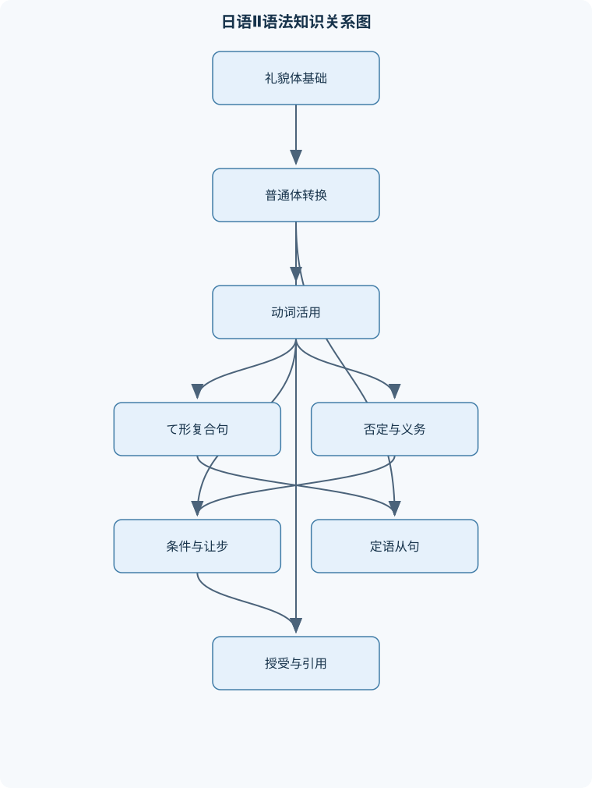
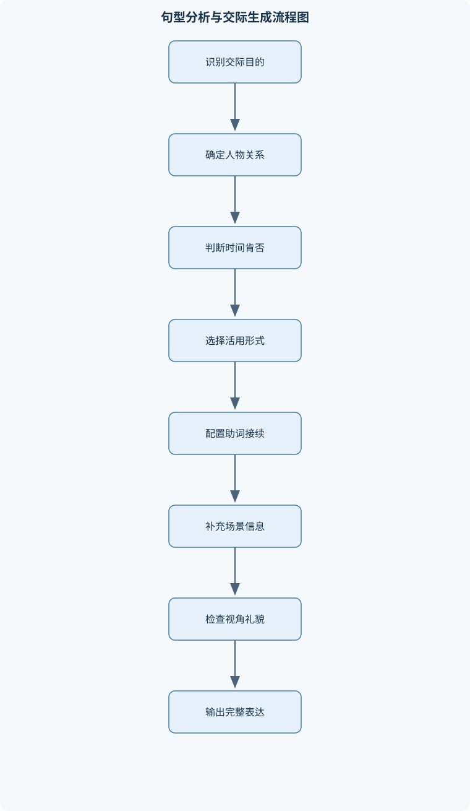

# 日语Ⅱ

## 一、课程整体知识框架

### 课程边界与先修知识

《日语Ⅱ》面向已掌握日语假名、基础词汇、名词句「です／ます」体、基本助词和简单日常会话的学习者。课程重点是从礼貌体扩展到普通体，系统掌握动词、い形容词、な形容词的活用及其连接形式，能够使用原因、条件、先后、许可、禁止、义务、能力、经验、引用、推测、授受和定语从句等结构，完成生活、学习、出行、购物和工作场景中的听说读写任务。课程不覆盖高级敬语体系、复杂书面语、专业商务谈判、古典日语及系统汉字学。先修知识包括平假名与片假名读写、长音促音拗音、基本音调意识、常用助词「は、が、を、に、で、へ、の、と、も、から、まで」、名词谓语句、存在句、数字时间表达和基础礼貌体。





### 1. 课程定位与先修边界

《日语Ⅱ》建立在已经掌握平假名、片假名、长音、促音、拗音、基本音调意识和初级词汇的基础上。学习者应能够使用名词谓语句「です／ます」体，理解「は、が、を、に、で、へ、の、と、も、から、まで」等基本助词，并完成自我介绍、时间表达、存在表达、简单购物和日常问答。

本课程的核心任务不是单纯增加词汇，而是把已经掌握的礼貌体扩展为能够承担复杂句法功能的普通体，并进一步学习普通体如何与其他结构连接。课程中的普通体包括动词辞书形、ない形、た形、ている形，以及名词和な形容词的「だ、だった、ではない、ではなかった」等形式。礼貌体主要以「です／ます」为句末形式，用于正式会话、服务场景和与不熟悉对象交流；普通体则常用于熟人会话、句中从句、引用内容和定语从句。

普通体与礼貌体不是“正确”和“错误”的关系，而是交际对象、句法位置和语体功能不同。例如：

- 「明日行きます。」是礼貌体句末表达。
- 「明日行くと思います。」中，「行く」是普通体，因为它位于「と思います」之前的从句中。
- 「明日行く人」中，「行く」是普通体，因为动词修饰名词时通常不使用「ます」。
- 面向陌生顾客说话时，句末一般应使用礼貌体；与朋友聊天时，普通体更自然，但仍需考虑请求、拒绝和授受关系所带来的礼貌程度。

课程暂不系统处理高级敬语、复杂书面语、专业商务谈判、古典日语和系统汉字学。涉及工作场景时，重点是基础沟通任务，如说明时间、确认地点、接受请求、报告状态、表达困难和转述信息，而不是训练完整的商务文书或谈判语言。

### 2. 形式系统：词类、活用形与连接关系

课程中的动词用以下形式标记：

- $V$：动词；
- $V$辞书形：动词基本形，如「行く、食べる、する、来る」；
- $V$ます形：礼貌体形式，如「行きます、食べます」；
- $V$て形：连接形式，如「書いて、読んで、して」；
- $V$た形：过去普通体，如「行った、食べた、した、来た」；
- $V$ない形：否定普通体，如「行かない、食べない、しない、来ない」。

形容词分为两类：

- $A$い：可按い形容词活用的词，如「高い、暑い、面白い」；
- $A$な：な形容词，如「静か、便利、有名、きれい」。

「きれい」虽然以「い」的音节结尾，但不是い形容词，名词前要说「きれいな町」，不能说「きれいい町」。名词记作$N$，包括人物、地点、物品和抽象概念。

动词活用不能靠把「ます」机械替换掉来完成，必须先判断动词类别。基本判定流程如下：

1. 先检查是否为特殊动词「する、来る」及其复合词；
2. 再判断是否为二类动词，例如「食べる、見る、起きる」；
3. 不能确定时，检查词典形式和实际活用，避免把「帰る、入る、走る」等一类动词误判为二类动词；
4. 对一类动词，根据辞书形最后一个假名确定变化；
5. 最后检查「行く」等特殊项。

一类动词的て形规则如下：

| 辞书形词尾 | て形变化 | 例子 |
|---|---|---|
| う、つ、る | って | 買う→買って；待つ→待って；帰る→帰って |
| ぬ、む、ぶ | んで | 死ぬ→死んで；読む→読んで；遊ぶ→遊んで |
| く | いて | 書く→書いて |
| ぐ | いで | 泳ぐ→泳いで |
| す | して | 話す→話して |

「行く」虽然以「く」结尾，但て形是「行って」，不是「行いて」。这是词汇中的特殊活用项，不能由一般规则直接推出。

一类动词的ない形通常把最后一个假名改为相应的あ段，再接「ない」：

- 書く→書かない；
- 読む→読まない；
- 話す→話さない；
- 待つ→待たない。

以「う」结尾时改为「わ」而不是「う」的あ段形式：

- 買う→買わない；
- 使う→使わない。

二类动词去掉「る」后接目标形式：

- 食べる→食べない、食べて、食べた；
- 見る→見ない、見て、見た。

三类动词必须单独记忆：

- する→しない、して、した；
- 来る（くる）→来ない（こない）、来て（きて）、来た（きた）。

### 3. 句法逻辑：从单句到复句

课程所涉及的复句主要通过接续形式建立逻辑关系。不同形式不能只根据汉语译文互换，因为它们对时间顺序、条件成立方式、说话者态度和主句类型有不同限制。

「て」可以表示动作连续、并列、原因或状态连接：

- 「朝起きて、ご飯を食べて、学校へ行きました。」表示动作按先后发生；
- 「このりんごは安くて、おいしいです。」连接两个性质，可理解为“又便宜又好吃”；
- 「病気で、学校を休みました。」表示原因；
- 「窓が開いています。」中的「ている」表示结果状态，而非动作正在进行。

「てから」明确表示前项完成后再进行后项：「病院へ行ってから、家へ帰りました」。如果只用「て」，也可以表示先后，但时间界限较弱，不能在所有场合替换「てから」。

「前に」前接辞书形，表示“做某事之前”：

- 「寝る前に、歯を磨きます。」
- 「日本へ行く前に、日本語を勉強しました。」

「あとで」前接た形或名词加「の」：

- 「仕事が終わったあとで、買い物します。」
- 「授業のあとで、図書館へ行きます。」

「とき」前的形式根据时间关系选择：

- 「日本へ行くとき」：去日本之前或去日本这一事件发生时；
- 「日本へ行ったとき」：已经到过或已经去了日本之后的某个时间；
- 「日本にいるとき」：处于在日本的状态时。

「たら」由普通体过去形式加「ら」构成，表示假设条件、时间条件或某件事完成后的安排：

- 行く→行ったら；
- 安い→安かったら；
- 静かだ→静かだったら；
- 学生だ→学生だったら。

「雨が降ったら、出かけません。」表示“如果下雨，就不出门”。主句可以是意志、请求、建议或命令，这是「たら」与某些条件形式的重要区别。

「と」表示规律性或自动发生的结果时，主句通常不能随意使用说话者的意志命令：

- 「ここを押すと、機械が止まります。」表示按下后机器会停止；
- 「春になると、暖かくなります。」表示一般规律。

若要表达“如果按下，请离开房间”，主句是请求，不宜直接套用「と」，应根据语境使用「たら」等形式。

### 4. 语义功能的总体链条

本课程的句型可以按照以下语义链条组织：

1. **状态和动作**：判断人物、物品处于何种状态，或正在进行、已经完成、尚未进行何种动作；
2. **时间和顺序**：说明动作发生的先后、起点和完成条件；
3. **条件和让步**：说明某一情况成立时的结果，或即使条件成立结果仍不改变；
4. **限制和义务**：表达不能做、必须做、可以不做；
5. **能力和经验**：表达“能够做过”或“曾经有过某种经历”；
6. **引用和推测**：区分事实、传闻、个人判断和可能性；
7. **授受和视角**：说明谁给谁、谁接受、谁因某行为受益；
8. **场景交际**：将上述形式组合到购物、出行、学习、工作和日常生活中。

同一个汉语意思可能对应不同日语结构。例如“可以回去”可能是许可「帰ってもいいです」，也可能是能力或可能性「帰ることができます」，前者关注规则允许，后者关注是否能够做到，不能仅凭中文译文选择句型。

## 二、章节和模块划分

### 核心知识覆盖清单

本清单用于检查正文是否覆盖本课程的主要知识模块：

- **普通体与三类词活用**：礼貌体与普通体的功能差异、动词辞书形、た形、ない形、て形、一类动词词尾变化、二类动词与三类动词变化、い形容词的否定与过去、な形容词和名词谓语变化、「だ／だった／ではない／ではなかった」、普通体在句中与句末的使用边界。
- **て形及其复合句型**：て形音变规则、一类动词て形的五类变化、「行く」的特殊变化「行って」、动作先后与并列「て」、持续状态「ている」、请求「てください」、许可「てもいい」、禁止「てはいけない」、原因和状态连接中的「て」。
- **否定表达与义务许可**：动词ない形的构成、「ないでください」的禁止请求、「なければなりません」的义务、「なくてもいい」的不必要、形容词与名词的否定形式、双重否定的语义限制、义务、许可、禁止的语气差异、肯定与否定回答的呼应。
- **时间顺序、条件与让步**：「てから」表示先后、「前に」与辞书形连接、「たあとで」与过去形式连接、「とき」前接形式的选择、「たら」的条件和假设、「ても」的让步条件、「なら」的主题或假设用法、条件句中的时态和主句限制。
- **动词定语从句与名词化**：普通体修饰名词、辞书形修饰名词、た形修饰名词、ている形修饰名词、ない形修饰名词、定语从句的主语标记「が」、「ことができる」表示能力、「ことです」表示定义或兴趣、修饰关系中的时态判断。
- **过去经历与动作列举**：过去助动词「た」的形成、「たことがある」表示经历、「たり、たりする」列举代表性动作、「たり、たりです」列举状态、「たら」与过去形式的关系、经历表达中的时间范围、列举句与连续动作句的区别、过去经历的肯定与否定回答。
- **授受表达与视角关系**：「あげる、やる、さしあげる」的给予方向、「くれる、くださる」的给予方向、「もらう、いただく」的领受关系、授受动词的主语与对象、「てあげる」表示为他人做事、「てくれる」表示他人为我方做事、「てもらう」表示接受他人帮助、内外关系与礼貌程度。
- **助词系统与场景表达**：「は」与「が」的主题和主语功能、「に」表示时间点、存在地点和归着点、「で」表示交通工具、手段、材料和动作场所、「へ」表示方向、「を」表示动作对象和经过地点、「と」表示共同动作对象和引用内容、「も」表示追加或同类包含、「しか」与否定搭配表示限定、时间、地点、对象助词的选择。
- **引用、推测与信息转述**：「と思います」表达判断或推测、普通体与「と思います」的连接、「と言いました」转述话语、引用内容中的时态变化、「そうです」的传闻与样态区分、「でしょう」的推测和确认、「と」表示条件结果、直接引用与间接引用、转述时主语和视角的保持。
- **生活场景综合交际**：自我介绍与个人经历、请求、许可和拒绝、购物、点餐和价格询问、地点、交通与路线说明、日程、天气和日常活动、身体状况与请假表达、邀请、建议和共同计划、阅读短文中的信息匹配、听力中的关键词与句末判断。


### 1. 模块一：普通体与三类词活用

本模块先建立礼貌体与普通体的对应关系。动词的基本对应包括：

| 礼貌体 | 普通体 |
|---|---|
| 行きます | 行く |
| 行きました | 行った |
| 行きません | 行かない |
| 行きませんでした | 行かなかった |

这里的对应必须保持时态和肯定、否定意义一致，不能理解为简单删除「ます」。例如「食べませんでした」对应「食べなかった」，而不是「食べない」。

名词和な形容词谓语的普通体形式为：

- 「学生です」→「学生だ」；
- 「学生でした」→「学生だった」；
- 「学生ではありません」→「学生ではない」；
- 「学生ではありませんでした」→「学生ではなかった」；
- 「静かです」→「静かだ」；
- 「静かでした」→「静かだった」。

い形容词的「い」不是独立的句末礼貌标记。礼貌体「暑いです」转为普通体时是「暑い」，而不是删除「い」。其否定、过去和过去否定分别为：

- 暑い→暑くない；
- 暑い→暑かった；
- 暑い→暑くなかった。

「寒くなかったです」的结构是先形成普通体过去否定「寒くなかった」，再用礼貌语气表达。正式会话中更统一的形式是「寒くありませんでした」，但基础会话中两者的语体使用需要根据教材和交际对象区分。

普通体可以位于句末，也可以位于从句内部。句末使用普通体时，要考虑与对方的关系；从句内部使用普通体时，则通常是语法要求。例如「田中さんが来ると思います」中不能把「来る」直接改成「来ますと思います」，因为「と思います」前面的判断内容通常使用普通体。

### 2. 模块二：て形及其复合句型

て形首先承担连接功能。学习者需要从辞书形判断音变，而不能根据ます形末尾机械推导。例如「書きます」的て形是「書いて」，但判断依据是辞书形「書く」的词尾「く」。

主要结构包括：

- 「Vて、Vて」：连续动作或并列动作；
- 「Vている」：进行、结果状态或习惯；
- 「Vてください」：请求对方做某事；
- 「Vてもいいです」：许可；
- 「Vてはいけません」：禁止；
- 「Vてから」：先完成前项，再进行后项。

「Vている」必须结合动词性质和语境解释。持续动作「本を読んでいる」通常表示“正在读书”；瞬间变化动词「窓が開いている」表示窗户处于打开状态；「日本に住んでいる」表示持续状态；「毎朝新聞を読んでいる」还可以表示习惯。将所有「ている」都译为“正在”会造成误解。

「てください」虽然形式上是请求，但语气并不适合所有上下级关系。对朋友可以说「待ってください」，对顾客或上级则应结合更礼貌的表达。基础课程只处理一般礼貌请求，不扩展高级敬语。

### 3. 模块三：否定表达与义务、许可

动词ない形是后续多个句型的基础。否定形式包括：

- 「Vないでください」：请不要做；
- 「Vなければなりません」：必须做；
- 「Vなくてもいいです」：不做也可以、不必做。

三者的逻辑关系不同：

| 形式 | 主要意义 | 例句 |
|---|---|---|
| Vないでください | 请求对方不要做 | ここで写真を撮らないでください。 |
| Vなければなりません | 说话者认为有必要做 | 明日来なければなりません。 |
| Vなくてもいいです | 表示不做不构成问题 | 今日は勉強しなくてもいいです。 |

「てはいけません」通常表达规则、禁止或不允许：「ここでたばこを吸ってはいけません」。与「ないでください」相比，前者更像规定或禁令，后者更像对某人的请求。

形容词和名词的否定不能套用动词规则：

- い形容词：高い→高くない；
- な形容词：便利だ→便利ではない；
- 名词：学生だ→学生ではない。

双重否定需要根据上下文判断范围。例如「行かなくてもいい」不是“不能不去”，而是“不去也可以”；「何も食べない」表示“什么也不吃”。否定词与疑问词、副词的组合会改变句子范围，必须确认否定作用于动作、对象还是整体命题。

### 4. 模块四：时间顺序、条件与让步

本模块将事件组织成时间链和条件链。

#### 4.1 时间顺序

「Vてから」强调前一动作完成后才发生后一动作：「宿題をしてから、テレビを見ます」。它不表示两个动作一定间隔很长，只强调顺序。

「V辞书形＋前に」表示“在做某事以前”：「寝る前に、薬を飲みます」。前项动作尚未完成，因此使用辞书形。

「Vた形＋あとで」表示“做完某事以后”：「映画を見たあとで、食事をしました」。前项被视为已经完成。

#### 4.2 条件和让步

「たら」表示假设或时间条件，前项成立后才进入主句事件。主句可以是请求、命令、意志或建议：

- 「駅に着いたら、電話してください。」
- 「暇だったら、一緒に行きませんか。」
- 「雨が降ったら、出かけません。」

「ても」表示让步，即使前项成立，主句结果仍然成立：

- 「雨が降っても、出かけます。」
- 「高くても、買いません。」
- 「暇でも、行きません。」

「なら」可以承接已知话题，也可以提出假设：「日本へ行くなら、春がいいです」。它不简单等同于「たら」，往往带有“如果谈到这个条件”或“既然是这种情况”的语气。

条件句中的时态必须根据意义选择。若表达“到达以后请打电话”，用「着いたら」；若表达一般规律“春天一到就变暖”，可用「春になると」；若表达“即使到了也不打电话”，用「着いても」。不能只因为中文中都出现“如果”“即使”就随意替换。

### 5. 模块五：动词定语从句与名词化

日语定语从句直接放在名词前，不使用类似汉语“的”的独立词：

- 「昨日買った本」：昨天买的书；
- 「日本語を勉強している学生」：正在学习日语的学生；
- 「何も買わない人」：什么也不买的人；
- 「昨日読んでいた本」：昨天正在读的书。

定语从句中的时态表示修饰事件相对于参照时间的状态：

- 「来る人」：将来要来、通常会来或即将来的人；
- 「来た人」：已经来过的人；
- 「来ている人」：正在来、已经到达并处于某状态，具体意义由动词和语境决定；
- 「来ない人」：不来或不会来的人。

从句内部的主语可以用「が」标记：「図書館で勉強している学生が多いです」。此处第一个「が」若出现在从句内部，标记“学习的学生”；主句中的「が」则标记整体“学生多”这一判断的主语。不能因为主句有「は」就强行把所有从句主语改为「は」。

「こと」可以将动作或事件名词化：

- 「料理を作ることができます」：能够做饭；
- 「私の趣味は本を読むことです」：我的兴趣是读书；
- 「日本語を勉強することが大切です」：学习日语很重要。

「ことができる」突出能力或可能性；「ことです」可以用于定义、兴趣或目标。二者都不是简单的“把动词变成名词”，前接形式和后续谓语决定其功能。

### 6. 模块六：过去经历与动作列举

过去助动词「た」既可单独表示过去事实，也可构成经历和列举句型。

「Vたことがあります」表示曾经有过某种经历，重点是经历本身，不强调具体发生时间：

- 「東京へ行ったことがあります。」
- 「日本料理を食べたことがありますか。」

回答可以是「はい、あります」或「いいえ、ありません」。如果说具体过去时间发生的动作，应使用一般过去式：「去年、東京へ行きました」。不能把「東京へ行くことがあります」当作“去过东京”；该形式通常表示有时会去东京或存在可能发生的情况。

「Vたり、Vたりします」表示列举具有代表性的动作，不表示所有动作，也不一定严格按列出的顺序发生：

- 「休みの日は、掃除したり、洗濯したりします。」
- 「昨日は本を読んだり、音楽を聞いたりしました。」

连续动作则使用「て」：「朝起きて、顔を洗って、出かけました」，强调先后过程。将「たり」理解为连续动作，会混淆“举例列举”和“实际顺序”。

形容词和名词也能使用列举形式：

- 「値段は高かったり、安かったりです。」
- 「操作が簡単だったり、故障が少なかったりします。」

### 7. 模块七：授受表达与视角关系

授受表达必须同时判断给予方向、动作主体、接受者和受益者。

| 动词 | 基本方向 | 例句意义 |
|---|---|---|
| あげる、やる、さしあげる | 我方或某方给他方 | 我给朋友礼物 |
| くれる、くださる | 他方给我方 | 朋友给我礼物 |
| もらう、いただく | 主语从他方获得 | 我从朋友那里得到礼物 |

「てあげる」表示为他人做某事：「友達に本を貸してあげました」。使用时要注意语气，直接对上级说自己“为上级做了某事”可能显得自认为施恩，因此基础课程只在普通关系中使用。

「てくれる」表示他人为我方做事：「友達が料理を作ってくれました」。这里的重点不是物品被给予，而是某个行为给我方带来帮助或好处。

「てもらう」表示主语接受他人的帮助：「私は先生に日本語を教えてもらいました」。与「先生が私に日本語を教えてくれました」相比，事件大致相同，但主语和叙述视角不同。礼貌表达「くださる、いただく」涉及内外关系和尊敬程度，基础阶段主要理解方向和受益关系，不扩展完整敬语体系。

### 8. 模块八：助词系统与场景表达

助词选择应先判断名词在事件中的语义角色，再选择形式，而不能只按中文介词翻译。

| 助词 | 主要功能 | 例句 |
|---|---|---|
| は | 主题、对比 | 私は学生です。 |
| が | 主语、存在对象、从句主语 | 学生が来ました。 |
| を | 动作对象、经过地点 | 本を読みます。道を歩きます。 |
| に | 时间点、存在地点、归着点 | 7時に起きます。学校に行きます。 |
| で | 动作场所、手段、交通工具、材料 | 学校で勉強します。電車で行きます。 |
| へ | 方向 | 日本へ行きます。 |
| と | 共同对象、引用内容 | 友達と行きます。「来る」と言いました。 |
| も | 追加、同类包含 | 私も行きます。 |
| しか | 限定，通常与否定搭配 | 一つしかありません。 |

「に」与「で」是基础阶段的重要区分：「学校にいます」表示存在地点；「学校で勉強します」表示动作发生地点。「電車で学校に行きます」中，电车是交通手段，学校是归着点，因此分别用「で」和「に」。

「を」还可表示经过地点：「公園を歩きます」不是“把公园走掉”，而是“经过或在公园中行走”。「と」在「友達と映画を見ます」中表示共同动作对象，在「明日来ると言いました」中表示引用内容，功能需依据谓语判断。

### 9. 模块九：引用、推测与信息转述

「と思います」表达说话者的判断、意见或不确定推测，前面通常接普通体：

- 「田中さんも来ると思います。」
- 「この店は便利だと思います。」
- 「明日は雨だと思います。」
- 「田中さんは来ないと思います。」

否定形式和名词、な形容词形式也要保持普通体：「便利ではないと思います」「学生だと思います」。这里的「と思います」并不等于事实确认，而是将内容作为说话者当前判断提出。

「と言いました」用于转述话语：

- 「王さんは明日学校を休むと言いました。」
- 「田中さんは『明日来ます』と言いました。」

直接引用保留原话并常使用引号；间接引用把内容作为从句，通常使用普通体。引用内容中的时间和时态要保持原说话者视角。例如“田中说昨天来了”应说「田中さんは昨日来たと言いました」，不能因为主句是过去时就机械把「来た」改成其他形式。

「そうです」有传闻和样态两类基本功能，基础阶段应先区分：

- 传闻：普通体＋そうです，如「明日は雨だそうです」，“听说明天有雨”；
- 样态：动词ます形去掉「ます」或形容词词干＋そうです，如「雨が降りそうです」，“看起来要下雨”。

「でしょう」可表示推测或寻求确认：「明日は晴れるでしょう」「これは田中さんのかばんでしょう」。它的确定程度和语气取决于上下文。

### 10. 模块十：生活场景综合交际

综合模块把句型放入真实任务中。自我介绍需要组合名词谓语、兴趣、经历和能力，例如说明身份、住址、会做什么以及曾经去过哪里。购物和点餐需要使用价格询问、数量、对象助词、许可和请求表达。出行场景需要区分交通工具的「で」、目的地的「に／へ」、经过地点的「を」以及路线先后。

身体状况和请假表达通常包含状态说明、原因和请求：「熱があって、学校を休みたいです」「体調が悪いので、今日は休んでもいいですか」。工作场景中的基础沟通还包括说明任务是否完成、请求帮助、转述安排和确认时间，但不等同于高级商务敬语训练。

听力理解要关注人物、地点、时间、数量、否定词、转折词和句末语气。句末的「ません」「てもいいですか」「と思います」「でしょう」分别可能表示否定、许可询问、判断和推测，不能只捕捉名词而忽略谓语。阅读短文时，应将人物、时间、地点、动作、数量和否定范围逐项对应；原文没有提供的信息不能用常识补足。

### 11. 课程内容的综合工作流程

面对一个新的句子或交际任务，可按以下顺序分析：

1. 判断交际目的，是陈述、请求、许可、禁止、义务、邀请、拒绝、转述还是推测；
2. 判断句子中每个名词的角色，是主题、主语、对象、地点、方向、工具还是共同对象；
3. 判断谓语词类和时间，包括动词、い形容词、な形容词或名词；
4. 根据逻辑关系选择形式：连续用「て」，先后用「てから／前に／あとで」，条件用「たら／と／なら」，让步用「ても」；
5. 若有从句、引用或定语修饰，使用普通体连接；
6. 检查授受表达的方向和受益者；
7. 最后检查礼貌等级、时态、肯定否定和助词是否一致。

例如要表达“如果到了车站，请给我打电话”，先确定这是条件加请求；“到了”是前项完成后成立，因此「着く」变为「着いたら」；“给我打电话”是请求，使用「電話をかけてください」；完整句子为「駅に着いたら、電話をかけてください」。若误写成「駅に着くと、電話をかけてください」，则条件形式与请求主句的搭配不自然；若误写成「駅で着いたら」，则把归着点和动作场所混淆。

## 三、核心概念的详细解释

### 3.1 普通体与礼貌体：句末形式和句中接续

日语中的礼貌体和普通体首先是语体形式，其次才是活用形式。礼貌体以「です／ます」为主要标志，常用于面对不熟悉的人、服务对象、正式场合以及需要保持距离的交流。普通体包括动词的辞书形、ない形、た形、ている形，以及名词和な形容词的「だ、だった、ではない、ではなかった」等形式。普通体并不等于随意或失礼；它是从句、引用句和动词定语从句中通常需要的形式。

例如：

- 句末礼貌表达：「明日、学校へ行きます。」
- 句中普通体：「田中さんは明日学校へ行くと思います。」
- 动词定语：「明日学校へ行く学生」
- 熟人之间的普通体：「明日、学校へ行く。」

「ます」不能被简单地删除后就认为得到了辞书形。需要根据词类和时态进行对应：

| 礼貌体 | 普通体 | 例 |
|---|---|---|
| $V$ます | $V$辞书形 | 行きます→行く |
| $V$ました | $V$た形 | 行きました→行った |
| $V$ません | $V$ない形 | 行きません→行かない |
| $V$ませんでした | $V$なかった | 行きませんでした→行かなかった |
| $V$ています | $V$ている | 読んでいます→読んでいる |
| $V$ていません | $V$ていない | 読んでいません→読んでいない |

名词和な形容词的变化与动词不同：

- 「学生です」→「学生だ」
- 「学生でした」→「学生だった」
- 「学生ではありません」→「学生ではない」
- 「学生ではありませんでした」→「学生ではなかった」
- 「静かです」→「静かだ」
- 「静かでした」→「静かだった」

在从句中，普通体常位于「と思います」「と言いました」以及名词前。例如「田中さんが来ると思います」表示“我认为田中会来”；「田中さんが来る人」并不成立，因为「来る」需要修饰后面的名词，如「田中さんが来る日」是“田中来来的那一天”。普通体的选择由句法位置决定，不能因为整句末尾使用「ます」就把从句也改成「ます」。

### 3.2 动词三类活用与四种基本形式

动词活用的第一步是区分一类、二类和三类动词。二类动词常以「る」结尾，且「る」前多为「え段」或「い段」音，如「食べる、見る、起きる」，但不能仅凭词尾机械判断。「帰る、入る、走る、知る」虽然以「る」结尾，却是一类动词。三类动词主要是「する」及其复合词，以及「来る」。

#### 一类动词的$て$形

一类动词的$て$形由辞书形最后一个假名决定：

| 词尾 | $て$形 | 示例 |
|---|---|---|
| う、つ、る | って | 買う→買って；待つ→待って；帰る→帰って |
| ぬ、む、ぶ | んで | 死ぬ→死んで；読む→読んで；遊ぶ→遊んで |
| く | いて | 書く→書いて |
| ぐ | いで | 泳ぐ→泳いで |
| す | して | 話す→話して |

「行く」是特殊项，$て$形为「行って」，不能写成「行いて」。判断依据是辞书形最后的假名，而不是礼貌体中「行きます」的「き」。

二类动词去掉「る」后接相应形式：

- 食べる→食べて、食べない、食べた；
- 見る→見て、見ない、見た。

三类动词变化不规则：

- する→して、しない、した；
- 来る（くる）→来て（きて）、来ない（こない）、来た（きた）。

#### 一类动词的$ない$形

一类动词一般把最后一个假名改为相应的「あ段」，再接「ない」：

- 書く→書かない；
- 読む→読まない；
- 話す→話さない；
- 待つ→待たない。

以「う」结尾时改成「わ」：

- 買う→買わない；
- 使う→使わない。

「帰る」是一类动词，所以是「帰らない」，不是「帰ない」。三类动词为「する→しない」「来る→こない」。动词分类错误会同时造成$て$形、$ない$形和$た$形错误，因此应先判定类别，再进行活用。

### 3.3 い形容词、な形容词和名词谓语

$A$い是能够按い形容词规则活用的词，如「高い、暑い、おもしろい」。否定时把词尾「い」改为「くない」，过去时改为「かった」：

- 高い→高くない→高かった；
- 高くない→高くなかった。

因此「寒くなかった」不是「寒い」直接接「なかった」，而是先形成「寒くない」，再把其中的「ない」变为过去形式「なかった」。在礼貌体中可说「寒くなかったです」，但普通体形式是「寒くなかった」。

以「い」的音节结尾不一定是い形容词。「きれい、嫌い」属于な形容词，名词前分别说「きれいな町」「嫌いな食べ物」，不能说「きれいい町」。

な形容词和名词的谓语变化相同：

| 功能 | な形容词 | 名词 |
|---|---|---|
| 普通体现在 | 静かだ | 学生だ |
| 普通体过去 | 静かだった | 学生だった |
| 普通体现在否定 | 静かではない | 学生ではない |
| 普通体过去否定 | 静かではなかった | 学生ではなかった |
| 名词前修饰 | 静かな町 | 学生の生活 |

な形容词修饰名词时接「な」，名词修饰名词时通常接「の」。这两种「な／の」不能互换，例如「便利な駅」表示“方便的车站”，「駅の前」表示“车站前面”。

### 3.4 $て$形的复合功能

$て$形本身是连接形式，意义由后续结构和上下文决定。

#### 连续动作、并列和原因

「Vて、Vて」可表示动作按先后发生：

「朝起きて、顔を洗って、学校へ行きました。」

这里的多个「て」连接连续动作，并不表示“正在”。形容词也可以连接：

- い形容词：安い→安くて，如「安くておいしい店」；
- な形容词：静かで，如「静かで便利な町」；
- 名词谓语：学生で，如「彼は学生で、アルバイトもしています」。

「て」还可连接原因或状态，例如「熱があって、学校を休みました」表示“因为发烧，所以请假”。这种原因关系依靠语境判断，不能把所有「て」都翻译成“然后”。

#### $Vている$

「Vている」至少有三种常见解释：

1. 持续动作：「今、本を読んでいます」——现在正在读书；
2. 结果状态：「窓が開いています」——窗户处于开着的状态；
3. 习惯或反复：「毎日日本語を勉強しています」——每天学习日语。

瞬间变化动词常倾向于表示结果状态，如「結婚している」是“已婚”，「知っている」是“知道”，不能机械译成“正在结婚”“正在知道”。判断时要同时考虑动词事件性质和时间副词。

#### 请求、许可与禁止

- 请求：「Vてください」——请做……
- 许可：「Vてもいいです」——可以做……
- 禁止：「Vてはいけません」——不可以做……

「もう帰ってもいいですか」是询问许可，“我现在可以回去吗”；「ここで写真を撮ってはいけません」是禁止。请求形式「Vてください」虽然语法上是请求，但在对上级或陌生对象使用时仍应结合礼貌程度和场景调整，不等同于高级敬语。

### 3.5 否定、义务和不必要表达

动词否定的基础形式是$Vない$。它可以继续接其他结构：

- 「Vないでください」：请不要……
- 「Vなければなりません」：必须……
- 「Vなくてもいいです」：不必……，可以不……

例如：

- 「ここで話さないでください」——请不要在这里说话。
- 「明日も来なければなりません」——明天也必须来。
- 「今日は勉強しなくてもいいです」——今天不学习也可以。

「なければなりません」从形式上包含否定词「ない」，但整体表示义务，不能理解为“不必须”。「なくてもいい」则表示取消必要性，不表示禁止。义务、许可和禁止的核心差别如下：

| 形式 | 核心意义 | 例 |
|---|---|---|
| $Vなければなりません$ | 必须做 | 薬を飲まなければなりません |
| $Vなくてもいい$ | 不做也可以 | 来なくてもいいです |
| $Vてはいけません$ | 不准做 | 入ってはいけません |
| $Vてもいい$ | 可以做 | 入ってもいいです |

回答问题时要保持形式呼应。「ここに座ってもいいですか」可回答「はい、どうぞ」或「いいえ、いけません」；「明日来なければなりませんか」可回答「はい、来なければなりません」或「いいえ、来なくてもいいです」。不能把“否定问题的回答”简单按照汉语“是／不是”机械转换，应明确回答实际动作是否需要发生。

### 3.6 时间顺序、条件和让步

时间关系中，接续形式决定事件的先后：

- 「Vてから」：先完成前项，再做后项；
- 「V辞书形＋前に」：在做前项之前；
- 「Vた形＋あとで」：做完前项之后；
- 「普通体＋とき」：在……的时候。

例如：

- 「病院へ行ってから、家へ帰りました。」
- 「寝る前に、歯を磨きます。」
- 「食べたあとで、薬を飲みます。」
- 「日本へ行くとき、パスポートを持っていきます。」

「とき」前面的时态会影响时间关系。「日本へ行くとき」可理解为“去日本时／去日本之前的相关时段”；「日本へ行ったとき」强调“已经去了日本之后或去日本那次”。因此不能只看中文“……的时候”而忽略前接形式。

「たら」由普通体过去形式加「ら」构成：

- 行く→行ったら；
- 安い→安かったら；
- 静かだ→静かだったら；
- 学生だ→学生だったら。

「雨が降ったら、出かけません」表示“如果下雨，就不出门”。「たら」既可表达假设，也可表示前项完成后再发生后项，因此主句可以是请求、意志或建议：「駅に着いたら、電話してください」。

「ても」表示让步条件：“即使……也……”。「雨が降っても、出かけます」表示即使下雨也出门。请求许可中的「てもいい」不能拆成单独的让步句来理解；「てもいい」整体表示“可以……”。

「と」表示条件结果时，常用于规律性、必然性或自动发生的结果：「春になると、暖かくなります」。主句通常不接说话人的临时意志、请求或命令，所以“如果到车站，请给我打电话”更自然地说「駅に着いたら、電話してください」，而不是「駅に着くと、電話してください」。「なら」可提出话题或根据已知信息作假设：「日本へ行くなら、京都もおすすめです」。

### 3.7 定语从句与名词化

日语的动词定语从句直接放在名词前，不使用相当于汉语“的”的额外词：

- 「昨日買った本」——昨天买的书；
- 「日本語を勉強している学生」——正在学习日语的学生；
- 「何も買わない人」——什么也不买的人；
- 「昨日読んでいた本」——昨天正在读的书。

修饰名词的动词形式必须根据被修饰事件的时间和状态选择。辞书形可表示将来、一般事实或未完成动作；た形表示已完成或过去；ている形表示进行、状态或习惯；ない形表示否定。定语从句中的主语常用「が」标记：

「図書館で勉強している学生が多いです。」

其中「図書館で」是学习这一动作的场所，「勉強している学生」整体是句子的主语，后面的「が」不能理解为“学生正在图书馆”。

「こと」可将动词短语名词化：

- 「料理を作ることができます」——能够做饭；
- 「私の趣味は本を読むことです」——我的兴趣是读书。

「ことができる」突出能力或可能性，前接动词辞书形；「ことです」用于说明兴趣、目标或定义。二者都不是把动词变成过去形式，不能说「料理を作ったことができます」来表达“能够做饭”。

### 3.8 过去经历与动作列举

「Vたことがあります」表示曾经有过某种经历，时间通常不指向某一次刚刚完成的动作：

「東京へ行ったことがありますか。」

肯定回答为「はい、あります」，否定回答为「いいえ、ありません」。若要说明具体过去时间和事件，使用普通的$Vた$形：「去年、東京へ行きました」。若说「東京へ行くことがあります」，通常表示“有时会去东京”，不是“去过东京”。

「たり、たりする」用于列举具有代表性的动作，不表示所有动作，也不一定表示动作发生的先后：

「休みの日は、掃除したり、洗濯したりします。」

这句话表示“休息日会做打扫、洗衣等事情”，不等于只做这两件事，也不强调先打扫后洗衣。与之相对，「掃除して、洗濯しました」更容易理解为连续动作。

形容词和名词也能用「たり」列举状态：

- 「値段は高かったり、安かったりです。」
- 「操作が簡単だったり、故障が少なかったりします。」

### 3.9 授受表达与视角

授受表达必须同时判断给予方向、领受者和说话者视角。

- 「あげる、やる、さしあげる」：主语向他方给予；
- 「くれる、くださる」：他方给予我方或我方一侧的人；
- 「もらう、いただく」：主语从他方领受。

基本例句：

- 「私は友達に本をあげました。」——我给朋友书。
- 「友達が私に本をくれました。」——朋友给我书。
- 「私は友達に本をもらいました。」——我从朋友那里得到书。

「やる」的使用对象和语气受到上下关系、对象身份等限制，基础学习阶段不能把它无条件替换为「あげる」。「さしあげる」「くださる」「いただく」带有更高礼貌程度，实际使用还需结合对方身份和内外关系。

动作授受结构进一步表示“为某人做事”：

- 「友達に料理を作ってあげました。」——我为朋友做了饭；
- 「友達が料理を作ってくれました。」——朋友为我方做了饭；
- 「先生にいろいろ教えていただきました。」——我得到老师的指导。

「てくれる」的重点不是单纯“给”，而是他人的行为使我方受益；「てもらう」则从接受帮助者角度叙述同一事件。主语、助词和视角必须同步改变，不能只替换授受动词。

### 3.10 助词的语义角色

助词选择取决于名词在事件中的角色，而不能只按汉语翻译对应。

| 助词 | 常见功能 | 例句 |
|---|---|---|
| は | 主题、对比 | 私は学生です |
| が | 主语、新信息、从句主语 | 雨が降っています |
| を | 动作对象、经过地点 | 本を読む；道を歩く |
| に | 时间点、存在地点、归着点 | 7時に起きる；学校に行く |
| で | 交通工具、手段、材料、动作场所 | 電車で行く；図書館で勉強する |
| へ | 方向 | 日本へ行く |
| と | 共同对象、引用内容 | 友達と行く；来ると言う |
| も | 追加、同类包含 | 私も行く |
| しか | 限定，通常与否定呼应 | 100円しかない |

「に」和「で」尤其容易混淆。存在句强调“位于某处”，用「に」：「学校にいます」；动作发生地点用「で」：「学校で勉強します」。交通工具用「で」：「電車で学校へ行きます」；学校是归着点，用「に」或方向性更强的「へ」。

「を」除了表示对象，也可表示经过的空间：「公園を歩きます」是“在公园中走过／穿过公园”，而「公園で歩きます」强调动作发生地点，语义焦点不同。「は」和「が」也不能简单互换：前者突出话题或对比，后者常标记新出现的主语或从句主语。

### 3.11 引用、推测和信息转述

「と思います」表示说话者的判断、意见或不完全确定的推测，前面通常接普通体：

- 「田中さんは来ると思います。」
- 「この店は便利だと思います。」
- 「明日は雨ではないと思います。」

从句内部使用普通体，不能说「来ますと思います」。但整句末尾的「と思います」仍然是礼貌体，因为礼貌程度由主句句末决定。

「と言いました」用于转述：

「田中さんは明日来ると言いました。」

引用内容中的时态根据原话意义决定：

- “明天来”→「明日来ると言いました」；
- “昨天来了”→「昨日来たと言いました」；
- “不来”→「来ないと言いました」。

直接引用可以保留原话：「田中さんは『明日来ます』と言いました。」间接引用则把内容置于「と」前，通常使用普通体：「田中さんは明日来ると言いました」。转述时必须保持时间、人物和视角，不能因为转述者是现在说话就擅自改变原话中的「明日」「昨日」。

「そうです」有传闻和样态两种基本用法，但二者接续不同。传闻用普通体加「そうです」，表示“听说……”；样态常接词干或形容词形式，表示“看起来……”。「でしょう」可表示推测，也可用于寻求听者确认：「明日は雨でしょう」可能是“明天大概下雨吧”，具体语气由上下文决定。

### 3.12 生活场景中的综合表达

自我介绍通常组合名词谓语、兴趣、能力和经历：

「私は会社員です。日本語を話すことができます。東京へ行ったことがあります。」

购物和点餐需要同时处理对象、数量、价格和请求：「この靴を見せてください」「いくらですか」「これを一つください」。出行说明则要区分交通工具、方向和归着点：「電車で駅へ行きます」「駅に着いたら、電話してください」。

身体状况和请假常用状态、原因和请求组合：

「熱があって、今日は学校を休みたいです。」
「体調が悪いので、休んでもいいですか。」

其中「て」可以连接状态和结果；「ので」表示原因，但本课程重点仍是基础原因表达。听力和阅读理解不能只抓取名词。应特别识别否定词、数量、时间、转折和句末形式，例如「行きません」「行ってもいいですか」「来ると思います」分别表达否定、许可询问和判断，核心信息都位于谓语和句末。

## 四、重要定义、公式、定理和推导

### 专业审校补充：关键定义与适用边界

「そうです」有两种必须区分的用法：传闻「普通体＋そうです」表示说话人从他人或消息中获得信息，意为“听说……”，例如「明日は雨が降るそうです」；样态「ます形去ます＋そうです」表示根据眼前外观或迹象进行推测，意为“看起来……”，例如「雨が降りそうです」。两者的接续、证据来源和语义不同。动词样态接续为「行きそうです、降りそうです」，い形容词去掉词尾「い」接「そうです」，如「おいしそうです」；な形容词直接接「そうです」，如「元気そうです」。否定样态通常为「おいしくなさそうです、雨が降らなさそうです」。传闻表达不能把「ます形」直接放在「そうです」前面，不能说「雨が降りますそうです」。此外，「いい」的样态形式是「よさそうです」，不是「いそうです」。样态是基于可观察迹象的判断，不能用于已经明确发生的事实；传闻则不表示说话人亲自观察到该迹象。判断时应同时核对信息来源、前接形式和句意。


### 4.1 活用形式的定义与推导规则

本课程所称“活用”是指词语根据时态、肯否、连接方式和句法位置改变形式。日语基础句型中可将推导关系概括为以下规则：

#### 动词形式

设$V$为动词：

$$
Vます \rightarrow V辞書形
$$

$$
Vました \rightarrow Vた形
$$

$$
Vません \rightarrow Vない形
$$

$$
Vませんでした \rightarrow Vなかった
$$

这些不是对表面词尾的机械替换，而是同一个动词在礼貌体和普通体中的功能对应。以「読む」为例：

1. 礼貌现在肯定：「読みます」；
2. 普通现在肯定：「読む」；
3. 礼貌过去肯定：「読みました」；
4. 普通过去肯定：「読んだ」；
5. 礼貌现在否定：「読みません」；
6. 普通现在否定：「読まない」；
7. 礼貌过去否定：「読みませんでした」；
8. 普通过去否定：「読まなかった」。

#### い形容词形式

设$A$い为い形容词：

$$
Aい \rightarrow Aくない
$$

$$
Aい \rightarrow Aかった
$$

$$
Aくない \rightarrow Aくなかった
$$

例如「高い」经过否定和过去变化：

「高い→高くない→高くなかった」。

该规则的适用边界是词汇确实属于い形容词。「きれい」虽然字面以「い」结尾，但属于な形容词，应变为「きれいではない」「きれいだった」，不能变为「きれくない」。

#### な形容词和名词形式

设$A$な为な形容词，$N$为名词：

$$
Aな/N + だ
$$

$$
Aな/N + だった
$$

$$
Aな/N + ではない
$$

$$
Aな/N + ではなかった
$$

例如：

- 「便利だ、便利だった、便利ではない、便利ではなかった」；
- 「学生だ、学生だった、学生ではない、学生ではなかった」。

名词修饰时，$A$な与$N$的接续不同：

$$
Aな + N
$$

$$
N + の + N
$$

所以「静かな部屋」正确，而「静かの部屋」错误；「学校の先生」正确，而「学校な先生」错误。

### 4.2 $て$形音变的推导

一类动词$V$的$て$形由辞书形词尾决定。其规则可写成分类映射：

$$
\{う、つ、る\}\rightarrow って
$$

$$
\{ぬ、む、ぶ\}\rightarrow んで
$$

$$
く\rightarrow いて
$$

$$
ぐ\rightarrow いで
$$

$$
す\rightarrow して
$$

推导步骤是：

1. 取得动词辞书形最后一个假名；
2. 判断该假名所属的词尾组；
3. 保留前面的词干；
4. 将词尾替换为对应的$て$形部分；
5. 检查是否为特殊动词「行く」。

例如「書く」：

1. 最后假名为「く」；
2. 属于「く→いて」；
3. 「書」保留；
4. 得到「書いて」。

例如「読む」：

1. 最后假名为「む」；
2. 属于「ぬ、む、ぶ→んで」；
3. 「読」保留；
4. 得到「読んで」。

「行く」不遵守「く→いて」规则，直接记为「行って」。这个特例说明规则适用于一般一类动词，但词汇层面的不规则项必须单独记忆和核对。

### 4.3 条件形式的定义和适用边界

「たら」的形式推导为：

$$
\text{普通体过去形式}+ら
$$

具体为：

- 动词：行く→行ったら；
- い形容词：安い→安かったら；
- な形容词：静かだ→静かだったら；
- 名词：学生だ→学生だったら。

其基本语义是“以前项成立或完成为条件，后项才成立”。例如：

「駅に着いたら、電話してください。」

推导过程：

1. 交际目的为“条件＋请求”；
2. 前项是「駅に着く」；
3. 前项完成后再执行请求，因此用过去形式「着いた」；
4. 加「ら」得到「着いたら」；
5. 后项“请打电话”用「電話をかけてください」。

「と」条件适合自然、规律或自动结果：

「春になると、暖かくなります。」

「ても」是让步条件：

「雨が降っても、出かけます。」

「なら」常在已有话题或信息基础上提出建议、假设：

「京都へ行くなら、秋がいいです。」

这些形式不能完全互换。尤其是主句含请求、命令、意志时，「たら」通常比「と」自然；「と」强调机械性或规律性结果，不适合任意替代所有“如果”。

### 4.4 $Vている$的事件解释

$Vている$的表面结构是：

$$
Vて形+いる
$$

但语义取决于动词的事件类型：

1. 持续动作：$V$表示可延续的动作，如「読む」→「読んでいる」；
2. 结果状态：$V$表示瞬间变化，如「開く」→「開いている」；
3. 习惯反复：配合「毎日、よく、いつも」等时间副词，如「働いている」。

判断步骤为：

1. 找出$V$的基本事件；
2. 判断事件是持续过程、瞬间变化还是反复行为；
3. 检查句中是否有「今」「毎日」等时间副词；
4. 根据上下文选择“正在……”“处于……状态”或“经常……”。

例如「窓が開いている」通常描述窗户已经处于打开状态；「窓を開けている」则可能表示某人正在开窗或保持窗户打开，主语和他动词也会影响解释。由此可见，不能把$Vている$固定翻译成“正在”。

### 4.5 授受结构的方向判定

授受表达可按受益方向推导：

$$
\text{给予方}\rightarrow\text{接受方}
$$

- 给予方向从我方到他方：选择「あげる」类；
- 给予方向从他方到我方：选择「くれる」类；
- 叙述接受者获得物品或帮助：选择「もらう」类。

动作授受中的对应关系为：

- 「我为他人做事」→$Vてあげる$；
- 「他人为我方做事」→$Vてくれる$；
- 「我接受他人帮助」→$Vてもらう$。

例如“老师教了我日语”有两种视角：

「先生が私に日本語を教えてくれました。」
焦点是老师主动为我方做了有益的事。

「私は先生に日本語を教えてもらいました。」
焦点是我接受了老师的帮助。

两句描述的事件相近，但主语和叙述视角不同。若把「くれる」直接理解成普通的“给”，就会遗漏“受益者是我方”的语义。

### 4.6 定语从句的结构规则

动词定语从句的基本结构为：

$$
\text{普通体动词短语}+N
$$

其中$N$是被修饰的名词，动词短语不使用「ます」。根据时间和状态可分为：

- $V$辞书形+$N$：将要发生、一般性或未完成的动作；
- $V$た形+$N$：已完成或过去的动作；
- $Vている+$N$：正在进行、持续状态或习惯；
- $Vない+$N$：否定动作。

例：

- 「これから読む本」——接下来要读的书；
- 「昨日読んだ本」——昨天读过的书；
- 「今読んでいる本」——现在正在读的书；
- 「まだ読んでいない本」——还没有读的书。

从句主语常用「が」：

「田中さんが作った料理」

这里「田中さんが」是“制作”这一从句内部的主语，「料理」是被修饰名词。不能将主句的主题助词「は」机械地放入所有定语从句中。

### 4.7 时间表达中的形式选择

时间结构的形式可以概括为：

$$
V辞書形+前に
$$

$$
Vた形+あとで
$$

$$
Vて形+から
$$

$$
普通体+とき
$$

「前に」强调后项发生在前项之前，因此前接辞书形：

「寝る前に、歯を磨きます。」

「あとで」强调前项完成后发生后项，因此前接た形：

「仕事が終わったあとで、買い物をします。」

「てから」强调先后顺序，也要求前项先完成：

「朝ご飯を食べてから、学校へ行きます。」

这些形式的差异不是单纯时态变化，而是事件之间的时间关系。若把「寝る前に」误写成「寝た前に」，就把“睡觉之前”错误地变成了不自然的形式；若把“吃完饭后”说成「食べるあとで」，则没有表达前项已完成的意义。

### 4.8 基础句型的条件验证

完整判断一个句型是否正确，应至少检查五项：

1. **词类是否匹配**：动词、い形容词、な形容词和名词不能共用同一活用规则；
2. **接续形式是否正确**：如「前に」接辞书形，「あとで」接た形；
3. **时态是否一致**：过去经历用「たことがあります」，不能用辞书形表示已发生经历；
4. **助词是否对应语义角色**：交通工具用「で」，归着点用「に／へ」；
5. **视角和礼貌程度是否一致**：授受方向、普通体从句和礼貌体句末不能相互冲突。

例如要表达“我坐电车去学校”：

1. 「電車」承担交通工具角色，选「で」；
2. 「学校」承担归着点角色，选「に」或方向助词「へ」；
3. 「行く」是动作谓语；
4. 整句采用礼貌体；
5. 结果为「電車で学校に行きます」或「電車で学校へ行きます」。

若写成「電車に学校で行きます」，则交通工具和动作场所、归着点的助词均发生错位。若要表达“在学校学习”，则应改为「学校で勉強します」，因为学校此时是动作发生地点，而不是归着点。

## 五、算法、流程和实现思路

### 方法与流程覆盖索引

下列方法或流程应在正文中说明输入、步骤、适用条件、结果检查和边界：

- 活用判定流程：输入一个动词辞书形；第一步判断是否为「する、来る」等三类动词；第二步判断是否为二类动词；第三步按一类动词末尾假名确定て形或ない形变化；第四步检查「行く」等特殊项；输出目标活用形。终止条件是完成词类、类别和形式三项核对。适用范围是规则动词，复杂不规则词和词典未收录词需查证。
- 句型填空分析流程：输入一个句子和空格；先确定句子要表达的时间、肯否、礼貌程度和逻辑关系；再观察空格前后的助词或接续词；判断需要辞书形、た形、ない形、て形、普通体或礼貌体；最后进行主语、对象和时态一致性检查。输出符合语义和接续规则的完整句子。
- 助词选择流程：输入含地点、时间、对象或手段信息的句子；先识别名词短语在事件中的语义角色；时间点、存在地点、归着点优先检查「に」；工具、交通、材料和动作场所检查「で」；动作对象检查「を」；共同对象或引用内容检查「と」；再用句意排除重叠候选。
- 听力信息提取流程：输入一段日语对话；第一次定位人物、地点、时间和动作；第二次记录否定、数量、转折和句末语气；第三次依据问题类型区分事实、意图、请求和推测；最后将原句信息与选项逐项比对。若选项只复述部分信息，必须继续核对范围和时态。
- 阅读判断流程：输入一篇短文及判断句；先标记人物、时间、地点、数量和动作；再将判断句拆成主体、谓语、时态、否定和数量；按文中证据逐项匹配；若文本未提供信息，不能仅凭常识判定为相符；输出相符、不相符或信息不足的判断及依据。
- 口语交际生成流程：输入交际目的，如请求、许可、拒绝、邀请或请假；先确定对方关系和礼貌等级；选择核心句型；补充时间、对象、理由或条件；使用适当句末形式；最后检查授受方向、助词和否定形式。适用于生活和基础工作场景，不替代高级敬语或正式商务文书规范。





### 5.1 活用形式判定流程

#### 输入、输出与适用条件

活用判定流程的输入是一个日语词项及目标形式，例如输入「書く」和“ない形”，或输入「食べる」和“て形”。输出是经过类别判断、词尾变化和特殊项检查后的正确形式。该流程适用于《日语Ⅱ》涉及的规则动词、い形容词、な形容词和名词谓语；对于超出课程范围的复杂词汇，不能仅凭词尾机械推断。

判定时必须先确定词类。若输入是动词，继续判断一类、二类或三类；若输入是い形容词，使用词尾「い」的活用；若输入是な形容词或名词，使用「だ／だった／ではない／ではなかった」等形式。一个词的最后一个假名只能作为判断依据之一，不能代替词类判断。例如「帰る」虽然以「る」结尾，却是一类动词；「きれい」虽然以「い」的音节结尾，却是な形容词。

#### 具体步骤

1. **识别词类。**  
   判断输入是动词、い形容词、な形容词还是名词。词类错误会使后续所有接续形式失效。

2. **判断动词类别。**  
   先检查「する」「来る」及其复合词。若不是三类，再判断是否为二类动词；不能确定时，应警惕「帰る、入る、走る、知る」等一类动词。

3. **选择目标活用。**  
   若目标是て形，一类动词按最后假名变音；若目标是ない形，一类动词改为相应あ段后接「ない」；二类动词去掉「る」；三类动词单独记忆。

4. **检查特殊项。**  
   「行く」的て形和た形分别是「行って、行った」，不能套用「く→いて」的普通规则。「来る」的相关形式读音也发生变化：辞书形「くる」、ない形「こない」、て形「きて」、た形「きた」。

5. **检查句法位置。**  
   同一动词在句末、从句、定语从句中的形式可能不同。例如句末礼貌表达使用「行きます」，而「と思います」前通常使用「行く」。

6. **检查时态、肯否和语体。**  
   「行きました」对应「行った」，「行きません」对应「行かない」，「行きませんでした」对应「行かなかった」。不能只删除「ます」或替换一个词尾。

#### 规则伪代码

```text
输入：词项 W，目标形式 F
输出：活用结果 R

如果 W 属于名词或な形容词：
    如果 F = 普通体现在：
        R = W + "だ"
    如果 F = 普通体过去：
        R = W + "だった"
    如果 F = 普通体否定：
        R = W + "ではない"
    如果 F = 普通体过去否定：
        R = W + "ではなかった"

否则如果 W 是い形容词：
    去掉词尾“い”，得到词干 S
    如果 F = 否定：R = S + "くない"
    如果 F = 过去：R = S + "かった"
    如果 F = 过去否定：R = S + "くなかった"

否则如果 W 是动词：
    如果 W = "する" 或 W = "来る"：
        按不规则表生成 R
    否则如果 W 是二类动词：
        去掉“る”
        按 F 接“て／ない／た”等形式
    否则：
        按一类动词辞书形最后假名生成 R
        如果 W = "行く" 且 F = て形或た形：
            将结果改为“行って／行った”

返回 R
```

该流程的终止条件是完成四项核对：词类、动词类别、目标形式、句法位置。流程不依赖网络或外部执行环境，适合用于人工分析、纸笔填空和基础语言处理程序。若把词典检索也纳入系统，词典查询属于外部数据步骤，不能由规则本身保证所有词项的类别。

### 5.2 句型接续与句意分析流程

#### 分析顺序

面对一个含空格的句子，不能先凭中文直译选择词尾。应按以下顺序处理：

1. 先判断句子要表达的功能：连续动作、先后、条件、让步、请求、许可、禁止、义务、能力、经历、引用或推测；
2. 再确认空格前后的接续标志，如「前に」「あとで」「と思います」「ことができます」；
3. 判断空格所需的形式：辞书形、た形、ない形、て形或普通体；
4. 检查主句和从句的时间关系；
5. 检查主语、对象、地点和受益者的助词；
6. 最后确认礼貌等级和肯否形式。

例如「寝る（　）、歯を磨きます」中，后面的「前に」要求前项使用辞书形，因此填「前に」，不能填「寝た前に」。而「仕事が（　）あとで、買い物します」中，前项表示已经完成，使用「終わったあとで」。

#### 形式选择的核心条件

- 「Vて、V」：动作连续或并列，不特别突出前项完成后的时间间隔；
- 「Vてから、V」：明确表示先完成前项，再做后项；
- 「V辞书形前に」：前项尚未发生，后项发生在前；
- 「Vたあとで」：前项完成后发生后项；
- 「Vたら」：前项条件成立后执行后项，主句可以是请求、意志或建议；
- 「Vても」：即使前项成立，后项仍成立；
- 「Vと」：常表示条件成立后自然出现或规律性结果，不适合随意连接请求或意志主句；
- 「Vないでください」：请求对方不要做某事；
- 「Vてはいけません」：规定或禁止某行为；
- 「Vなければなりません」：义务；
- 「Vなくてもいいです」：不做也可以，表示不必要；
- 「Vことができます」：能够或可以做某事；
- 「Vたことがあります」：曾经有过某种经历。

### 5.3 助词选择与交际目的判断流程

#### 输入信息的语义角色

助词选择的关键不是记住中文译法，而是判断名词在事件中的角色。「に」可以表示时间点、存在地点和归着点；「で」可以表示交通工具、手段、材料、动作地点和范围。相同的地点名词因事件角色不同而使用不同助词：

- 「学校に行きます」：学校是归着点；
- 「学校にいます」：学校是存在地点；
- 「学校で勉強します」：学校是动作发生地点。

分析时先给名词标注角色，再选择助词。交通工具用「で」，目的地用「に／へ」，动作对象用「を」，共同动作对象用「と」，引用内容也用「と」，追加或同类包含用「も」，限定用「しか＋否定」。

#### 助词排错步骤

1. 找出句子的主要动作或状态；
2. 问“谁做什么”“在哪里做”“到哪里去”“用什么做”；
3. 将每个名词与一个语义角色对应；
4. 检查助词是否与角色匹配；
5. 检查是否存在时间范围、否定范围或比较对象；
6. 用整句语义验证，而不是只看局部词组。

例如「電車で学校に行きます」中，「電車」是交通工具，「学校」是归着点；若改成「学校で行きます」，则「で」把学校解释为动作场所，不能表达“去学校”的目的地。

### 5.4 代表性例题与逐步解答

#### 例题一：动词て形

**题干：**  
「朝、起きて、朝ご飯を（　）、学校へ行きました。」选择「食べる」的正确形式。

**分析：**  
句中已有「起きて」，后面继续列举连续动作。空格后接「学校へ行きました」，需要用て形连接“吃早饭”和“去学校”。「食べる」是二类动词，去掉「る」后接「て」。

**解答：**  
「食べる」→「食べて」。完整句为：  
「朝、起きて、朝ご飯を食べて、学校へ行きました。」

**结果验证：**  
「食べて」与前面的「起きて」构成连续动作；最后一个谓语「行きました」承担过去和礼貌信息，因此前面的连接形式不需要再重复「ました」。

**变式：**  
若表达“吃完早饭后去学校”，可说「朝ご飯を食べてから、学校へ行きました」，此时「てから」比单独的「て」更突出先后关系。

#### 例题二：否定义务

**题干：**  
将「明日も来ます」改为“明天也必须来”。

**分析：**  
“必须”对应「なければなりません」。该结构前接动词ない形的「ない」部分发生变化。先处理「来る」：其ない形是「こない」，再把「ない」变为「なければ」，得到「こなければなりません」。

**解答：**  
「明日も来なければなりません。」

**结果验证：**  
「来る」不能按普通一类或二类动词变化；「来ない」读作「こない」，「来なければ」读作「こなければ」。不能写成「来らなければなりません」。

**变式：**  
“明天不来也可以”为「明日は来なくてもいいです」，这里表达不必要，不是义务。

#### 例题三：条件与主句限制

**题干：**  
将“如果到了车站，请给我打电话”译成日语。

**分析：**  
“到了车站”是前项条件，且成立后执行请求，因此使用「たら」而不是强调自然结果的「と」。动词「着く」的た形是「着いた」。车站是归着点，使用「駅に」；“打电话”说「電話をかける」，请求形式是「電話をかけてください」。

**解答：**  
「駅に着いたら、電話をかけてください。」

**结果验证：**  
「着いたら」表示“到达这一条件成立后”；「かけてください」表达请求。若说「駅で着いたら」，则把归着点误当作动作地点。

**变式：**  
“如果下雨，就不出门”可说「雨が降ったら、出かけません」。若表达一般规律或自然结果，可以根据语境使用「雨が降ると、道が滑ります」。

#### 例题四：定语从句

**题干：**  
将“正在图书馆学习的学生很多”译成日语。

**分析：**  
“正在学习”使用「勉強している」；“图书馆”是动作发生地点，用「図書館で」；定语从句放在名词「学生」之前，不使用「ます」；“学生很多”中「学生」是主语，使用「が」。

**解答：**  
「図書館で勉強している学生が多いです。」

**结果验证：**  
「勉強している」直接修饰「学生」，没有添加关系代词或「の」。句末「多いです」使用礼貌体，而从句保持普通体，符合句中接续规则。

**变式：**  
“昨天在图书馆学习的学生”是「昨日図書館で勉強した学生」；“没有学习的学生”是「勉強しない学生」或根据时间关系使用「勉強していない学生」。

#### 例题五：授受与视角

**题干：**  
翻译“朋友帮我做了饭”，并说明若改为“我帮朋友做了饭”应如何变化。

**分析：**  
第一句的受益者是我方，朋友是执行动作的人，使用「Vてくれる」。过去礼貌形式为「作ってくれました」。第二句中我方为朋友做事，使用「Vてあげる」，受益者用「友達に」标记。

**解答：**  
「友達が料理を作ってくれました。」  
“我帮朋友做了饭”：  
「私は友達に料理を作ってあげました。」

**结果验证：**  
第一句主语是「友達」，强调他人为我方提供帮助；第二句主语是「私」，强调我方为他人做事。两句不能仅通过替换动词而忽略主语和受益者。

**变式：**  
“我请朋友帮我做饭”可用「私は友達に料理を作ってもらいました」，焦点转为我接受朋友的帮助。

#### 例题六：引用与时态

**题干：**  
将“田中说他明天会来”译成日语。

**分析：**  
引用内容为“明天来”，在「と言いました」前使用普通体辞书形「来る」。引用标志为「と」，转述动词为「言いました」。

**解答：**  
「田中さんは明日来ると言いました。」

**结果验证：**  
「来る」位于引用从句中，不能写成「来ますと言いました」。若引用的是“田中说他昨天来了”，则引用内容为「昨日来た」，完整形式是「田中さんは昨日来たと言いました」。

**变式：**  
“我认为田中明天会来”是「田中さんは明日来ると思います」，「と思います」表示说话者判断或推测，不等同于已确认事实。

### 5.5 听读综合分析流程

#### 听力信息提取

输入是一段生活场景对话，输出是人物、时间、地点、动作、数量、否定和意图等信息。第一遍先确认事件框架，例如谁要去哪里；第二遍重点捕捉「ない」「ません」「しか」「でも」「けど」等否定和转折；第三遍判断句末形式是请求、许可、推测还是陈述。

排错时不能只记录名词。听到「学校」「明日」「電車」并不等于已经知道答案，还要确认谓语是“去”“不去”还是“可以去”，以及时间修饰的是哪一个人物。选项若只复述对话的一部分，必须继续核对否定范围和时态。

#### 阅读判断

输入是一篇短文和判断句，输出应为“相符”“不相符”或“信息不足”。步骤如下：

1. 标出人物和代词所指对象；
2. 标出时间词，如「昨日、今日、明日、午前、午後」；
3. 标出地点、交通方式、数量；
4. 对谓语进行肯否和时态标记；
5. 将判断句拆成主体、动作、时间、地点和数量；
6. 逐项与原文证据对应。

若短文只说“在家看书”，不能由常识推断“没有去商店”；原文没有说明的内容应判断为信息不足，而不能擅自判定相符或不相符。

### 5.6 实验与项目流程

#### 项目一：生活场景句型生成与互评

**输入数据：**  
准备十组基础情境：购物、点餐、请假、路线说明、邀请、请求帮助、询问价格、表达经历、说明能力和转述安排。每组提供人物关系、地点、时间和交际目的。

**实施步骤：**

1. 为每组情境确定礼貌等级；
2. 标记名词的主题、主语、对象、地点、方向和工具角色；
3. 选择核心句型；
4. 形成一轮日语表达；
5. 将其中一个句子改为否定、过去、条件或普通体从句；
6. 由另一位学习者检查助词、活用、时态和授受视角；
7. 根据问题重新录入修订版本。

**评价标准：**

- 交际目的是否明确；
- 句型接续是否正确；
- 普通体和礼貌体位置是否合理；
- 助词是否符合语义角色；
- 条件、经历、授受等结构是否保持视角一致；
- 听者能否准确判断时间、地点和请求内容。

**排错方法：**  
若句子“形式正确但意思不自然”，先检查主句功能和条件类型；若内容能理解但助词混乱，重新标记语义角色；若授受句方向不清，分别写出“谁做事、为谁受益、谁是主语”。

#### 项目二：短文信息匹配与证据标注

**输入数据：**  
准备一篇约数段的生活短文，内容包含人物、日期、交通方式、活动安排、过去经历和一处否定表达，再准备若干判断句或选择题。

**实施步骤：**

1. 第一次阅读只标出人物、地点和时间；
2. 第二次阅读标出谓语的时态、肯否和句末语气；
3. 对每个判断句拆分主体、动作、时间、地点和数量；
4. 在短文中为每个判断项寻找直接证据；
5. 将结果分为相符、不相符、信息不足；
6. 对“不相符”标出冲突位置，对“信息不足”说明缺少哪一项证据；
7. 将一条肯定判断改写为否定或改变时间，再重新判断。

**评价标准：**

- 是否区分事实与推测；
- 是否注意「しか＋否定」的限定范围；
- 是否能区分「たことがあります」和一般过去叙述；
- 是否能识别定语从句修饰的名词；
- 是否避免用常识补足文本信息。

**排错方法：**  
若把“昨天没有去”误判为“没有去过”，检查时间范围；若把“正在学习的学生”理解为“学习过的学生”，检查「ている」与「た」的差异；若把“只有一个”误解为“一个也没有”，重新分析「一つしかありません」中的否定结构。

## 六、概念之间的关系与对比

### 6.1 普通体与礼貌体

| 比较项目 | 普通体 | 礼貌体 |
|---|---|---|
| 主要形式 | 辞书形、ない形、た形、だ等 | です、ます、でした、ません等 |
| 句末使用 | 熟人会话、较随意陈述 | 正式会话、服务场景、陌生关系 |
| 从句使用 | 「と思います」「と言いました」前通常使用 | 一般不直接放在基础从句连接处 |
| 定语使用 | 「昨日買った本」 | 不说「昨日買いました本」 |
| 语义功能 | 也可表达过去、否定和推测 | 主要体现礼貌程度，不单独决定事实真假 |

普通体不等于不礼貌，礼貌体也不等于所有场合都自然。句法位置优先决定从句形式，交际对象则主要决定句末语体。例如「明日来ると思います」同时包含普通体从句和礼貌体主句。

### 6.2 て形、た形与ない形

#### て形和た形

て形与た形在许多动词中具有相同的音变基础：

- 「書く」→「書いて／書いた」；
- 「読む」→「読んで／読んだ」；
- 「食べる」→「食べて／食べた」；
- 「する」→「して／した」。

て形本身通常连接后续结构，如「ている、てください、てもいい、てはいけない、てから」；た形则常表示过去、完成或经验，如「たことがある、たあとで、たら」。二者不能因为都涉及动作时间而互换。「食べてから」表示先吃再做后项，「食べたことがある」表示曾有吃过的经历。

#### て形与「たり」

「Vて、V」通常可理解为动作连接或连续发生：「朝起きて、顔を洗いました」。  
「Vたり、Vたりする」只列举代表性活动，不表示列出的动作一定按顺序全部完成：「休みの日は本を読んだり、音楽を聞いたりします」。把「たり」解释为连续动作，会错误理解句子的完整性。

### 6.3 「たら」「と」「なら」「ても」

| 形式 | 基本意义 | 主句适用范围 | 典型限制 |
|---|---|---|---|
| 「たら」 | 条件成立后 | 陈述、请求、建议、意志均可 | 前项常用过去形式加「ら」 |
| 「と」 | 自然结果、规律性结果 | 客观结果、机械反应 | 一般不接请求、命令、意志 |
| 「なら」 | 以某主题或前提为基础 | 建议、判断、假设 | 常带“既然是……的话”意味 |
| 「ても」 | 即使……也…… | 让步关系 | 后项不因前项成立而改变 |

“到了车站，请打电话”适合「駅に着いたら、電話をかけてください」，因为「たら」可以连接请求。「春になると、暖かくなります」强调自然变化。「日本へ行くなら、京都を見てください」以“去日本”这一前提提出建议。「雨が降っても、出かけます」表示即使下雨也出门。

### 6.4 否定、禁止、义务与许可

#### 四种结构的关系

- 「Vないでください」：请不要做，语气是对对方的请求；
- 「Vてはいけません」：不可以做，语气较强，常表示规定、禁止；
- 「Vなければなりません」：必须做，强调义务；
- 「Vなくてもいいです」：不做也可以，表示没有必要。

例如：

- 「ここで写真を撮らないでください。」请不要在这里拍照；
- 「ここで写真を撮ってはいけません。」这里禁止拍照；
- 「明日、学校へ行かなければなりません。」明天必须去学校；
- 「明日は学校へ行かなくてもいいです。」明天不去学校也可以。

「ないでください」与「てはいけません」都是否定行为，但前者更接近请求，后者更接近规则或禁止。若回答许可问题「ここで写真を撮ってもいいですか」，可以说「はい、いいです」或「いいえ、撮ってはいけません」，不能用「いいえ、撮らなくてもいいです」表达禁止，因为后者只表示“不拍也没关系”。

### 6.5 「ている」的进行、状态与习惯

「Vている」的解释要根据动词事件类型和上下文确定：

- 持续动作：「本を読んでいる」——正在读书；
- 瞬间变化后的状态：「窓が開いている」——窗户处于打开状态；
- 认知或居住状态：「知っている」「住んでいる」——知道、居住；
- 反复习惯：「毎日日本語を勉強している」——每天学习日语。

「窓を開けている」强调某人正在打开或保持打开窗户的动作，「窓が開いている」强调窗户本身处于打开状态。二者的助词和主语不同，不能只根据中文都译成“开着”而混用。

### 6.6 时间结构的前接形式

| 时间结构 | 前接形式 | 示例 | 逻辑重点 |
|---|---|---|---|
| 「前に」 | 辞书形 | 寝る前に歯を磨く | 后项先发生 |
| 「あとで」 | た形 | 食べたあとで出かける | 前项完成后 |
| 「てから」 | て形 | 食べてから出かける | 明确先后顺序 |
| 「とき」 | 根据时间关系选择 | 行くとき、行ったとき | 判断事件相对时间 |

「日本へ行くとき、かばんを買いました」可理解为去日本之前或去日本时买包，具体关系由语境决定；「日本へ行ったとき、写真を撮りました」则表示已经去日本时拍照。若使用「行く前に」，明确表示去之前；使用「行ったあとで」，明确表示去过之后。

### 6.7 经历、过去叙述与条件

「Vたことがあります」把过去事件作为个人经历，重点是“曾经有过”。例如「東京へ行ったことがあります」表示“去过东京”。它不适合说明某一天发生的具体事件；若说“昨天去了东京”，应使用「昨日東京へ行きました」。

「Vたら」虽然也含有た形，但它的核心功能是条件，而不是经历。「東京へ行ったら、写真を撮ります」表示“如果去了东京，就拍照”，并不表示“去过东京”。判断时应看后续结构：接「ことがあります」是经历，接「ら」是条件。

### 6.8 能力、兴趣与定义的名词化

「Vことができます」和「Vことです」都使用「こと」把动作名词化，但功能不同：

- 「料理を作ることができます」：能够做饭，重点是能力或可能性；
- 「私の趣味は料理を作ることです」：我的兴趣是做饭，重点是定义或说明内容。

「こと」不能简单理解为中文的“事情”。前接动词辞书形时，动作被作为一个整体概念处理。否定能力可说「料理を作ることができません」，也可根据语境使用「料理が作れません」，但后者涉及可能形，超出本部分重点。

### 6.9 授受动词的方向与视角

| 形式 | 主语角色 | 受益方向 | 示例 |
|---|---|---|---|
| 「あげる」 | 给予者 | 我方给他方或某方给另一方 | 私は友達に本をあげました |
| 「くれる」 | 给予者 | 他方给我方 | 友達が私に本をくれました |
| 「もらう」 | 领受者 | 我方从他方获得 | 私は友達に本をもらいました |
| 「てあげる」 | 做事者 | 我方为他方做事 | 私は友達に教えてあげました |
| 「てくれる」 | 做事者 | 他方为我方做事 | 友達が教えてくれました |
| 「てもらう」 | 受益者 | 我方接受他人帮助 | 私は友達に教えてもらいました |

「先生が私に教えてくれました」和「私は先生に教えてもらいました」可以描述同一帮助事件，但前者突出老师主动帮助，后者突出我接受帮助。礼貌形式「さしあげる、くださる、いただく」涉及对给予者或领受关系的尊敬表达，本课程只处理基础使用，不扩展到完整敬语体系。

### 6.10 「は」与「が」

「は」主要提示话题或对比范围，「が」常标记主语、新信息或从句内部主语：

- 「私は学生です」：以“我”为话题说明身份；
- 「だれが来ましたか。田中さんが来ました」：回答“谁来”，突出主语；
- 「田中さんが作った料理」：在定语从句中标记制作料理的人；
- 「雨が降っています」：说明正在发生的自然现象。

不能把「は」和「が」简单理解为固定的“主题”和“主语”翻译。定语从句中的主语常使用「が」，而主句中的对比或主题可以使用「は」。例如「私は、田中さんが作った料理を食べました」中，「私」是主句话题，「田中さん」是从句内部主语。

### 6.11 「に」「で」「へ」「を」的场景对比

- 「に」：时间点、存在地点、归着点；  
  「七時に起きます」「部屋にいます」「駅に着きます」。
- 「で」：交通工具、手段、材料、动作场所；  
  「電車で行きます」「学校で勉強します」。
- 「へ」：方向；  
  「日本へ行きます」。
- 「を」：动作对象或经过地点；  
  「本を読みます」「公園を歩きます」。

「駅に行きます」与「駅へ行きます」都可表示去车站，但「へ」方向性更突出。「公園で歩きます」表示在公园这个场所进行走路，基础表达中通常更自然地说「公園を歩きます」，其中「公園」是经过或移动的空间。助词选择必须结合动词意义，不能由地点名词单独决定。

### 6.12 引用、传闻、推测与样态

「と思います」表示说话者的判断或推测，前面通常接普通体：「明日は雨が降ると思います」。  
「と言いました」表示转述话语：「田中さんは明日来ると言いました」。  
「でしょう」可用于推测或向对方寻求确认：「明日は寒いでしょう」。  
传闻「そうです」表示“听说……”，如「田中さんは来るそうです」；样态「そうです」则表示根据外观或即时迹象判断，如「おいしそうです」“看起来很好吃”。

传闻和样态不能混淆。表示“听说田中要来”时，信息来源是他人话语或消息；表示“看起来好吃”时，判断依据是外观。引用内容中的时态必须按照被转述的信息保留：「昨日来たと言いました」表示“说昨天来了”，不能因为主句是过去就把所有从句统一改成过去。

### 6.13 生活场景中的综合选择

在购物、出行、请假和工作沟通中，多个结构往往同时出现。例如：

「体調が悪くて、今日は学校を休みたいです。休んでもいいですか。」

其中「悪くて」连接原因或状态，「学校を休む」中的「学校」是离开的对象，「休みたいです」表示愿望，「てもいいですか」表示许可询问。若改为正式通知，可说「体調が悪いので、今日は学校を休みます」，此时重点从请求许可转为说明原因和决定。

路线说明中可组合交通工具、归着点和条件：

「電車で駅に行って、駅に着いたら、友達に電話してください。」

「電車で」表示交通工具，「駅に行って」连接连续动作，「駅に着いたら」表示条件，「友達に電話してください」中「友達に」表示电话联系的对象。任何一个助词或接续形式改变，都可能使动作角色、时间关系或交际目的发生变化。

## 七、典型例题和应用场景

### 专业审校补充：综合例题

题干：小林看见商店门口排着长队，听同学说这家店今天有特别活动。请分别用样态「そうです」和传闻「そうです」表达：“看起来要排很久”“听说今天有特别活动”，并说明为什么不能混用。
分析：第一句依据眼前排队这一迹象，属于样态推测；“排很久”可用动词「かかる」的样态形式「かかりそうです」。第二句信息来自同学的转述，属于传闻，因此前接普通体「特別なイベントがある」。
逐步解答：第一步，确定“要花费很长时间”是动词「時間がかかる」；第二步，去掉ます形「かかります」的「ます」，得到词干「かかり」；第三步接「そうです」，得到「時間がかかりそうです」。这里的「そう」表示根据排队情况作出的外观判断。第四步，确定“有特别活动”的谓语为な形容词「特別だ」加名词「イベント」，名词存在表达为「イベントがある」；第五步，传闻句使用普通体「ある」加「そうです」，得到「今日は特別なイベントがあるそうです」。完整对话可写为：「今日は人が多いですね。時間がかかりそうです。」「そうですね。今日は特別なイベントがあるそうです。」
结果验证：第一句若改成「時間がかかるそうです」，语义会变为“听说要花时间”，不再明确表示说话人根据现场迹象判断；第二句若写成「特別なイベントがありそうです」，则表示“看起来有特别活动”，证据变成现场迹象。二者并非仅有礼貌形式差异。
变式：把“这蛋糕看起来很好吃，但听说价格很贵”译为「このケーキはおいしそうですが、値段が高いそうです」。其中「おいしそう」是样态，「高いそうです」是传闻；「高そうです」则改为“看起来很贵”。


### 典型题型与应用覆盖索引

建议通过下列题型或应用检查概念是否能够迁移：

- 活用例：将「友達と映画を見る」改为过去否定礼貌表达。先将「見る」变为ない形「見ない」，再变为过去否定「見なかった」，最后接礼貌形式「です」，结果为「友達と映画を見なかったです」。更自然的正式表达是「友達と映画を見ませんでした」。应说明普通体和礼貌体在句末的差异。
- て形例：完成「朝、起きて、朝ご飯を（ ）、学校へ行きました」。动词「食べる」属于二类动词，去「る」接「て」为「食べて」，因此答案是「食べて」。该句中的两个「て」连接连续动作，不表示持续。
- 条件例：将「雨が降る。出かけません」合并为“如果下雨，就不出门”。否定主句为「出かけません」，条件从句「雨が降る」变为过去形「雨が降った」再接「ら」，结果为「雨が降ったら、出かけません」。若表达一般规律，也可根据语境使用「雨が降ると、出かけません」，但「と」更强调条件成立后的自然或规律性结果。
- 定语从句例：翻译“正在图书馆学习的学生很多”。“正在学习”使用「勉強している」，修饰「学生」并置于名词前，结果为「図書館で勉強している学生が多いです」。其中「で」表示动作场所，「が」标记句子主语。
- 授受例：翻译“朋友帮我做了饭”。受益者是我方，给予动作是朋友为我方完成，因此使用「てくれる」；过去礼貌形式为「作ってくれました」，完整句子为「友達が料理を作ってくれました」。若说“我帮朋友做了饭”，则使用「友達に料理を作ってあげました」，视角不同。
- 经历例：回答“你去过东京吗”。「行く」的た形是「行った」，接「ことがあります」形成经历表达：「東京へ行ったことがありますか」。肯定回答为「はい、あります」，否定回答为「いいえ、ありません」。不能说「東京へ行くことがあります」来表达已经经历过。
- 义务例：将「明日も来ます」改为“明天也必须来”。辞书形「来る」的ない形为「こない」，其否定形式「こなければ」接「なりません」，结果为「明日も来なければなりません」。应特别检查「来る」的读音和活用，不能写成「来ない」后直接套用汉语式变化。
- 助词辨析例：在“我坐电车去学校”中，「電車」是交通工具，使用「で」；「学校」是归着点，使用「に」或方向强调较强的「へ」，因此可说「電車で学校に行きます」。不能因为中文“坐车到学校”的“到”而把交通工具误用为「に」。
- 引用例：将“田中说明明天会来”译成日语。被引用内容为“明天来”，使用普通体辞书形「明日来る」，加「と」后接「言いました」，结果为「田中さんは明日来ると言いました」。如果说的是“田中说昨天来了”，则引用内容变为「昨日来た」。
- 综合阅读例：短文写道「昨日は雨でした。私は家で本を読んだり、音楽を聞いたりしました。」问题为“作者昨天去了商店吗”。文中只明确说明天气及在家进行的活动，没有商店行动；若判断句为“作者昨天在家读书或听音乐”，则与「家で」「読んだり」「聞いたりしました」相符。解题必须以文本证据为依据。


### 7.1 普通体、礼貌体与动词活用综合题

#### 例题一：将礼貌体改为普通体

**题干：**将下列句子改为普通体。

1. 毎日、日本語を勉強します。  
2. 昨日、映画を見ました。  
3. 日曜日は働きませんでした。  
4. 田中さんは今、テレビを見ています。

**分析：**

句子的谓语都是动词。改写时不能只删除「ます」，而要根据时态和肯否选择对应的普通体：

- 「ます」对应辞书形；
- 「ました」对应た形；
- 「ません」对应ない形；
- 「ませんでした」对应なかった；
- 「ています」对应「ている」。

**逐步解答：**

1. 「勉強します」的辞书形是「勉強する」，结果为：  
   「毎日、日本語を勉強する。」
2. 「見ました」的た形是「見た」，结果为：  
   「昨日、映画を見た。」
3. 「働きませんでした」的普通体过去否定是「働かなかった」，结果为：  
   「日曜日は働かなかった。」
4. 「見ています」对应「見ている」，结果为：  
   「田中さんは今、テレビを見ている。」

**结果验证：**

需要检查三个方面：一是时态是否保留，二是肯定或否定是否保留，三是「する、見る」等动词的活用是否正确。不能把「働きませんでした」错误写成「働かないた」，也不能把「見ています」写成「見るいる」。

**变式：**

将「この町は静かでした」改为普通体，答案是「この町は静かだった」。名词和な形容词不能套用动词变化；将「高くなかったです」改为普通体，答案是「高くなかった」，其中「高い」先变为「高くない」，再将「ない」变为「なかった」。

### 7.2 て形、连续动作与复合句型

#### 例题二：判断一类动词的て形

**题干：**完成下列句子。

朝、起きて、朝ご飯を（　）、学校へ行きました。  
A. 食べて　B. 食べた　C. 食べない　D. 食べます

**分析：**

句子表示“起床、吃早饭、去学校”三个动作依次发生。前一个动作和后一个动作通过「て」连接，因此空格需要动词て形。「食べる」是二类动词，去掉「る」后接「て」。

**解答：**

「食べる→食べて」，所以选 A：

「朝、起きて、朝ご飯を食べて、学校へ行きました。」

第一个「起きて」和第二个「食べて」都是动作连接，不表示“正在起床”或“正在吃饭”。若要表达进行状态，应使用「起きている」「食べている」，但此处的语义是动作先后。

**变式：**

将「書く、読む、急ぐ、話す、買う、行く」变为て形：

- 書く→書いて；
- 読む→読んで；
- 急ぐ→急いで；
- 話す→話して；
- 買う→買って；
- 行く→行って。

「行く」不能按「く→いて」的一般规则写成「行いて」。这是必须单独检查的特殊项。

### 7.3 时间顺序和条件表达

#### 例题三：选择「前に」「てから」或「あとで」

**题干：**在括号中填入适当形式。

1. 寝る（　）、歯を磨きます。  
2. 朝ご飯を食べ（　）、学校へ行きます。  
3. 仕事が終わった（　）、買い物をします。  
4. 駅に着い（　）、電話をください。

**分析与解答：**

1. 「寝る前に」表示“睡觉之前”。「前に」前接辞书形，答案为「前に」。
2. 「食べてから」表示“吃完以后再……”。「てから」前接て形，答案为「てから」。
3. 「終わったあとで」表示“工作结束以后”。「あとで」前接た形，答案为「あとで」。
4. 「着いたら」表示“如果到了车站／到车站后，请……”。「着く」的た形是「着いた」，加「ら」得到「着いたら」。

**结果验证：**

- 辞书形＋前に：前项尚未发生，后项先发生；
- て形＋から：强调前项完成后进行后项；
- た形＋あとで：强调前项完成后的时间顺序；
- た形＋ら：表示条件、假设或前项完成后的契机。

**边界反例：**

「寝た前に」不表示“睡觉之前”，因为「寝る」在「前に」前应使用辞书形。「仕事が終わるあとで」也不符合本课程所学的基本接续，因为「あとで」强调前项已经完成。若表达一般规律，可用「春になると、暖かくなります」，但「と」后通常接自然发生或规律性结果，不宜随意接请求、命令和说话者意志。

### 7.4 许可、禁止、义务与否定

#### 例题四：根据交际目的选择句型

**题干：**将下列中文译成日语。

1. 请不要告诉别人。  
2. 明天必须来。  
3. 今天不用学习。  
4. 可以拍照吗？  
5. 这里禁止吸烟。

**逐步解答：**

1. “请不要……”是带请求语气的否定：  
   「ほかの人に話さないでください。」
2. “必须……”使用「ない形＋なければなりません」：  
   「明日も来なければなりません。」  
   「来る」的ない形是「こない」，去掉「ない」后接「なければなりません」，所以是「こなければなりません」。
3. “不用……”使用「なくてもいいです」：  
   「今日は勉強しなくてもいいです。」
4. “可以……吗”使用「てもいいですか」：  
   「写真を撮ってもいいですか。」
5. “禁止……”使用「てはいけません」：  
   「ここでたばこを吸ってはいけません。」

**结果验证：**

「てもいいです」表示许可，「てはいけません」表示禁止；「なければなりません」表示义务，「なくてもいいです」表示不必要。四者不能仅凭中文中的“可以”“必须”机械替换，还要判断说话者是在授予许可、提出请求、规定义务，还是说明不必做某事。

**变式：**

回答「ここで写真を撮ってもいいですか」时：

- 允许：「はい、撮ってもいいです。」
- 不允许：「いいえ、撮ってはいけません。」或较委婉地说「すみません、ちょっと……」。

回答「明日来なければなりませんか」时，肯定回答为「はい、来なければなりません」，否定回答不能简单说「いいえ、来ません」，因为问题询问的是义务；若表示不需要来，应说「いいえ、来なくてもいいです」。

### 7.5 定语从句、名词化和能力表达

#### 例题五：理解动词修饰名词

**题干：**翻译下列句子。

1. 昨天买的书很有趣。  
2. 正在图书馆学习的学生很多。  
3. 没有买东西的人也有。  
4. 我会做饭。  
5. 我的兴趣是读书。

**分析与解答：**

动词修饰名词时，普通体短语直接放在名词前，不使用「の」或「ます」。

1. “昨天买的”是过去完成动作，使用「昨日買った」：  
   「昨日買った本はおもしろいです。」
2. “正在图书馆学习的”使用「図書館で勉強している」：  
   「図書館で勉強している学生が多いです。」
3. “没有买东西的”使用「何も買わない」：  
   「何も買わない人もいます。」
4. “会做饭”使用「料理を作ることができます」：  
   「料理を作ることができます。」
5. “兴趣是读书”使用「動词辞书形＋ことです」：  
   「私の趣味は本を読むことです。」

**结果验证：**

「昨日買った本」中，「買った」修饰「本」；「本を昨日買ったです」不构成正确的定语结构。「ことができます」突出能力或可能性，「ことです」突出定义、兴趣或活动名称。两者都将动作名词化，但句法功能不同。

### 7.6 过去经历、列举与条件的辨析

#### 例题六：区分「たことがあります」「たり、たりする」和「たら」

**题干：**判断下列句子表达的意义，并完成翻译。

1. 日本へ行ったことがあります。  
2. 休みの日は、掃除したり、洗濯したりします。  
3. 工場に着いたら、電話をください。

**解答：**

1. 「行ったことがあります」表示曾经有过某种经历，译为“去过日本”。回答「日本へ行ったことがありますか」时，肯定回答为「はい、あります」，否定回答为「いいえ、ありません」。
2. 「掃除したり、洗濯したりします」表示举出具有代表性的活动，译为“休息日会打扫卫生、洗衣服等”。它不一定列出全部活动，也不强调动作严格按列举顺序发生。
3. 「着いたら」表示条件或前项完成后的契机，译为“到了工厂后，请打电话”或“如果到了工厂，请打电话”。

**边界反例：**

「日本へ行くことがあります」通常表示“有时去日本”或“存在去日本的情况”，不能代替“去过日本”。表示经历必须使用「た形＋ことがあります」。「掃除して、洗濯して、出かけました」强调连续动作；「掃除したり、洗濯したりしました」强调代表性列举，二者不能互换。

### 7.7 授受表达的视角分析

#### 例题七：根据受益者选择授受动词

**题干：**翻译：

1. 我借给朋友一本书。  
2. 朋友为我做了饭。  
3. 我接受了老师的指导。  
4. 老师教给了我日语。

**解答：**

1. 给予方向是“我方→朋友”，使用「あげる」：  
   「私は友達に本を貸してあげました。」  
   如果只是陈述普通借出行为，也可说「本を貸しました」；使用「てあげる」会突出“为对方做了这件事”的受益视角。
2. 受益者是我方，朋友为我方做事，使用「てくれる」：  
   「友達が料理を作ってくれました。」
3. 主语是接受帮助的一方，使用「てもらう」：  
   「私は先生にいろいろ教えてもらいました。」
4. 以老师为施事者、我方为受益者，可说：  
   「先生が私に日本語を教えてくれました。」

**深入辨析：**

「先生が教えてくれました」突出老师主动为我方提供帮助；「私は先生に教えてもらいました」突出我方接受帮助。事件可以相近，但主语、助词和叙述视角不同。对长辈或正式对象表达领受时，可使用「いただく」，如「先生に教えていただきました」，但本课程不扩展高级敬语体系。

### 7.8 助词、引用和推测综合题

#### 例题八：场景句子纠错

**题干：**修改下列句子，并说明理由。

1. 電車に学校で行きます。  
2. 田中さんは明日来ますと思います。  
3. 窓を開いています。  
4. 私は東京へ行くことがあります。——题意是“我去过东京”。

**解答：**

1. 应改为「電車で学校に行きます」。  
   「電車」是交通工具，用「で」；「学校」是归着点，用「に」或「へ」。
2. 应改为「田中さんは明日来ると思います」。  
   「と思います」前的引用或判断内容使用普通体，不能使用「来ます」。
3. 若要表示“窗户处于打开状态”，应改为「窓が開いています」。  
   「窓」是状态的主体，用「が」；「窓を開けています」则表示某人正在开窗或使窗户保持打开，主语和动词不同。
4. 应改为「東京へ行ったことがあります」。  
   “去过”是过去经历，使用「行ったことがあります」；「行くことがあります」通常表示有时会去或存在去的情况。

### 7.9 生活、学习、出行和工作中的应用场景

#### 自我介绍与个人经历

可以综合使用名词谓语、兴趣、能力和经历：

「私は大学生です。日本語を勉強しています。料理を作ることができます。日本へ行ったことがあります。」

其中「勉強しています」可表示目前持续学习；「作ることができます」表示能力；「行ったことがあります」表示过去经历。若说话对象不熟悉，句末使用礼貌体；普通体主要出现在「作る」「行った」等名词化结构内部。

#### 购物和点餐

购物时常用价格询问、数量、许可和请求：

「これはいくらですか。」  
「この大きいかばんを見せてください。」  
「カードで払ってもいいですか。」  
「赤いのはありませんか。」

「大きい」修饰「かばん」时使用い形容词原形；「赤いの」中的「の」可代替前文已知的名词。点餐时可说「水を一つお願いします」「これをください」，但数量词应根据物品类别选择，不能把所有物品都机械地使用「一個」。

#### 出行和路线说明

「電車で駅に行って、駅に着いたら、友達に電話してください。」

「電車で」表示交通工具，「駅に行って」连接动作，「駅に着いたら」表示到达后的条件契机，「友達に電話する」中的「に」表示联系对象。若表示经过公园，可说「公園を歩きます」；若表示在公园进行学习，则说「公園で勉強します」。

#### 身体状况与请假

「熱があって、今日は学校を休みたいです。休んでもいいですか。」

「熱があって」连接状态和后项；「休みたいです」表达愿望；「てもいいですか」询问许可。若只是通知决定，可说「体調が悪いので、今日は休みます」。原因表达和许可表达功能不同，不能用一个句型代替另一个。

#### 工作中的基础沟通

在行政、客服、旅游、贸易跟单和现场协助等基础岗位中，常见任务包括确认时间、地点、数量、任务状态和对方请求。例如：

「明日の午後三時に会議があります。」  
「田中さんは資料を作っていると言いました。」  
「この荷物はどこへ送りますか。」  
「確認してから、連絡します。」

这些句子分别涉及时间点、引用转述、方向和先后顺序。验收时应确认人物、动作、时间、地点和是否完成，不能只检查单个词语是否翻译正确。

### 7.10 常见笔试问题与解答思路

1. **为什么「行く」的て形是「行って」？**  
   因为「行く」属于课程中的特殊活用项，不能按一般「く→いて」处理。解答时应指出一般规则与特殊项的区别。

2. **「帰る」的ない形是什么？**  
   「帰る」是一类动词，词尾「る」改为あ段「ら」，再接「ない」，所以是「帰らない」，不是「帰ない」。

3. **「きれい」为什么不是い形容词？**  
   词尾虽然含有「い」的音，但其句法行为是な形容词，名词前用「きれいな」，普通体现在时用「きれいだ」。

4. **「前に」和「あとで」分别接什么形式？**  
   「前に」前接辞书形，如「寝る前に」；「あとで」前接た形，如「寝たあとで」。判断依据是前项是否被视为已完成。

5. **「てもいいです」和「てはいけません」有什么不同？**  
   前者表示许可，后者表示禁止。面对“可以拍照吗”，不能回答「撮ってはいけません」来表示允许。

6. **如何表达“去过东京”？**  
   使用「東京へ行ったことがあります」。其中「行った」是过去普通体，不能使用「行くことがあります」表示既往经历。

7. **「先生が教えてくれました」和「先生に教えてもらいました」有何区别？**  
   前者以老师为主语，突出老师为我方做事；后者以我方为主语，突出我接受老师的帮助。

8. **「学校に勉強します」为什么不自然？**  
   「学校」是动作发生地点，学习使用「で」，应说「学校で勉強します」。「に」用于归着点或存在地点，如「学校に行きます」「学校にいます」。

### 7.11 常见口试或面试问题与回答要点

1. **自己介绍一下。**  
   参考回答：「私は会社員です。日本語を勉強しています。趣味は音楽を聞くことです。」  
   追问要点：若被问“去过日本吗”，应使用「行ったことがあります」；若被问“会做什么”，应使用「ことができます」。

2. **你周末通常做什么？**  
   参考回答：「休みの日は、部屋を掃除したり、映画を見たりします。」  
   追问要点：说明「たり」是代表性列举，不必列出所有活动；若要强调连续动作，应改用「て」连接。

3. **如何请求对方重复说明？**  
   参考回答：「すみません、もう一度言ってください。」  
   追问要点：对陌生对象和工作场景使用礼貌体；不能使用过于直接的普通体「もう一度言って」。

4. **如何询问是否可以拍照？**  
   参考回答：「写真を撮ってもいいですか。」  
   追问要点：得到许可可回答「はい、どうぞ」；拒绝时应使用「すみません、撮ってはいけません」。

5. **如何说明今天不能上课？**  
   参考回答：「体調が悪いので、今日は休みます。」  
   追问要点：若询问许可，改为「休んでもいいですか」；若表达愿望，使用「休みたいです」。

6. **如何说明路线？**  
   参考回答：「電車で駅に行って、駅に着いたら、電話してください。」  
   追问要点：说明「で」是交通工具，「に」是归着点，「たら」是条件或完成后的契机。

7. **如何转述他人的安排？**  
   参考回答：「田中さんは明日来ると言いました。」  
   追问要点：被引用内容使用普通体；若转述“田中说昨天来了”，应为「昨日来たと言いました」。

8. **如何说明自己接受了别人的帮助？**  
   参考回答：「先生に日本語を教えてもらいました。」  
   追问要点：若强调对方主动帮助我方，可改为「先生が日本語を教えてくれました」；两者不能任意交换主语和助词。

## 八、实验、实践和项目相关知识

### 专业审校补充：实践任务

开展“现场观察与信息转述”双人交际任务。输入材料包括四张生活场景卡和四条消息卡。场景卡可写“餐厅门口排队”“天空乌云密布”“孩子面带笑容”“电车站显示延误”；消息卡可写“朋友说车站正在施工”“店员说蛋糕已经卖完”“同学说考试下周举行”“天气预报说晚上降温”。
步骤如下：第一步，每名学习者抽取两张场景卡，不向同伴展示，用日语根据可观察迹象造句，至少使用一次样态「そうです」，例如「店が混んでいそうです」；第二步，抽取一张消息卡，用普通体接传闻「そうです」转述，例如「駅は工事中だそうです」；第三步，同伴根据句子判断信息属于“现场推测”还是“他人转述”，并追问「どうしてそう思いますか」或「誰から聞きましたか」；第四步，双方交换角色；第五步，将四句口头内容整理成六至八句短文，加入「でも」「が」等连接表达。
输出包括：四句口头日语、一段书面转述、每句的标签“样态／传闻”及一句中文释义。评价标准为：样态和传闻各至少两例；接续形式正确；能说明证据来源；动词、い形容词、な形容词的形式无误；句末礼貌体统一；回答追问时不把推测说成确定事实。
排错方法：若「降りますそうです」等把ます形直接接入，先还原辞书形或ます形词干；若无法区分两种「そうです」，在句旁写“眼前迹象”或“他人消息”；若「おいしいそうです」表达外观，应改为「おいしそうです」；若写「きれいそうです」，检查「きれい」是な形容词，样态形式可为「きれいそうです」；若句意是“听说很漂亮”，则应写「きれいだそうです」。


### 8.1 实践一：动词活用与句型接续实验

#### 实验目的

通过一组受控词项，验证学习者能否根据词类、动词类别、时态、肯否和句法位置生成正确形式。该实验不以机械背诵为唯一目标，而是检查活用规则是否能在新句子中稳定使用。

#### 输入数据

准备以下词项：

- 一类动词：書く、読む、買う、帰る、行く；
- 二类动词：食べる、見る、起きる；
- 三类动词：する、来る；
- い形容词：高い、寒い、おもしろい；
- な形容词：静か、便利、きれい；
- 名词：学生、会社員。

每个词项要求生成至少两种形式，例如动词的て形、ない形、た形，形容词的否定和过去，名词或な形容词的普通体变化。

#### 操作步骤

1. 先标记词类；
2. 对动词判断一类、二类或三类；
3. 写出目标活用；
4. 将活用形式放入完整句子；
5. 再把同一内容改成礼貌体或普通体；
6. 用反向检查验证：从生成结果能否恢复原来的时态和肯否。

例如输入「帰る＋ない形」，先判断「帰る」是一类动词，再将词尾「る」改为「ら」，结果为「帰らない」。输入「行く＋て形」时，必须触发特殊项，结果为「行って」。

#### 评价标准

- 词类判断正确；
- 一类、二类、三类动词分类正确；
- 特殊项「行く」「来る」无误；
- 时态和肯否保持一致；
- 句中普通体、句末礼貌体使用位置正确；
- 生成结果能够放入自然句子，而非只有孤立词形。

可将每项按“正确、可理解但不自然、错误”三级记录。若一个词的活用正确，但助词或句型错误，应分开计分，避免把活用问题和句法问题混为一谈。

#### 排错方法

- 将「帰る」误判为二类动词时，重新检查其ます形「帰ります」和已知活用「帰らない」；
- 把「書く」写成「書いて」以外的形式时，检查一类动词词尾表；
- 将「来る」写成规则形式时，分别朗读「くる、こない、きて、きた」；
- 把「きれい」当作い形容词时，放入名词前检查，应为「きれいな部屋」；
- 把「寒くなかった」误写成「寒いなかった」时，先生成否定「寒くない」，再把「ない」变成「なかった」。

### 8.2 实践二：生活场景听说任务——出行与许可

#### 实践目标

完成一次包含交通、路线、时间、条件、请求和许可的短对话，使学习者能够在真实交际中综合使用「で、に、へ、て、たら、てください、てもいいですか」。

#### 输入情境

甲准备乘电车去车站，与乙确认路线：

- 交通工具：电车；
- 目的地：车站；
- 到达后行动：打电话；
- 请求：请对方打电话；
- 许可问题：是否可以在车站拍照。

#### 操作步骤

1. 甲说明出行方式和目的地：  
   「電車で駅に行きます。」
2. 甲或乙补充连续动作：  
   「駅に行って、友達に会います。」
3. 加入条件和请求：  
   「駅に着いたら、電話をかけてください。」
4. 加入许可询问：  
   「駅で写真を撮ってもいいですか。」
5. 另一方分别作出允许和拒绝两种回答；
6. 交换角色，再完成一次不看文字的对话；
7. 最后将对话改写成三至五句书面记录。

#### 评价标准

- 「電車で」是否正确表示交通工具；
- 「駅に行く」「駅に着く」是否使用归着点助词；
- 「駅で写真を撮る」是否使用动作场所的「で」；
- 「着いたら」是否正确表达条件；
- 请求是否使用「てください」；
- 许可与禁止回答是否区分；
- 对话是否包含明确的人物、地点和动作。

#### 排错方法

录音或复述时，若把「で」和「に」混淆，应先标出名词的语义角色：工具、动作场所用「で」，归着点用「に」。若把「着くと、電話をかけてください」作为一般答案，应说明「と」更适合自然结果或规律性结果；本情境是到达后提出请求，优先使用「着いたら」。

### 8.3 实践三：经历、列举和个人信息短文项目

#### 项目任务

写一篇八至十句的日语短文，主题为“我的周末、学习经历和能力”。短文必须包含：

- 一句名词谓语；
- 一句「ています」；
- 一句「たことがあります」；
- 一句「たり、たりします」；
- 一句「ことができます」；
- 一句原因或条件；
- 一句授受表达；
- 一句引用或推测。

#### 生成步骤

1. 先列出事实信息：身份、当前活动、过去经历、周末活动、能力和他人帮助；
2. 给每条信息分配句型；
3. 判断每个动词所需的活用形式；
4. 连接成短文；
5. 检查时间顺序、助词和视角；
6. 与同伴互换文本，进行信息核对。

#### 示例文本

「私は会社員です。今、日本語を勉強しています。去年、日本へ行ったことがあります。休みの日は、本を読んだり、映画を見たりします。簡単な料理を作ることができます。分からない言葉があったら、先生に聞きます。先生はいつも丁寧に教えてくれます。友達は、私の日本語が上手になると思っています。」

#### 评价标准

- 是否至少包含规定的八类结构；
- 普通体是否用于「たことがあります」和引用内容；
- 「先生が教えてくれます」中的主语和受益者是否匹配；
- 「分からない言葉があったら」是否正确表达条件；
- 文章中的经历、当前状态和习惯是否有清晰时间范围；
- 每句话是否能独立传达完整信息。

#### 排错方法

- 把经历写成「日本へ行くことがあります」时，改为「行ったことがあります」；
- 把列举句写成连续动作时，根据意图选择「たり」或「て」；
- 把“老师帮助我”写成「私は先生を教えてくれます」时，应重新判断授受方向：老师是施事者，使用「先生が教えてくれます」；
- 把引用内容写成「上手になりますと思います」时，改为「上手になると思います」。

### 8.4 实践四：阅读与听力信息核对项目

#### 项目目标

训练从短文或对话中提取人物、时间、地点、数量、动作、否定和句末语气，避免仅凭关键词作答。

#### 输入材料类型

材料应包含以下信息中的至少五项：

- 两名人物；
- 一个过去事件；
- 一个当前状态；
- 一个否定表达；
- 一个条件或请求；
- 一个交通或地点信息；
- 一个引用或推测表达。

例如短文可以写成：

「昨日、田中さんは電車で病院へ行きました。病院で先生に相談してから、家へ帰りました。今日は会社へ行かなくてもいいそうです。田中さんは明日は元気になると思っています。」

#### 操作步骤

1. 第一次听或读时，只记录人物、地点和时间；
2. 第二次标记动作、否定和数量；
3. 第三次识别「と思います」「そうです」「てもいい」「なければなりません」等句末和复合形式；
4. 将判断题拆成主体、动作、时态、肯否和地点；
5. 逐项寻找文本证据；
6. 对“文中没有说明”的内容标记为信息不足，不能用常识补足。

#### 评价标准

- 能否区分“去医院”和“从医院回家”的先后；
- 能否识别「行かなくてもいい」是不需要去，而不是“不能去”；
- 能否区分传闻「そうです」与说话者判断「と思います」；
- 能否正确判断助词所表示的地点和方向；
- 判断题是否同时核对主体、时态和否定范围。

#### 排错方法

若选项只重复原文中的某个名词，不能立即判断正确。例如原文出现「病院」，选项说“田中在医院工作”，虽然包含相同名词，但动作和地点关系并不相同。若原文说「病院で相談してから、家へ帰りました」，选项说“田中先回家再去医院”，则先后关系相反，应判为不相符。

### 8.5 面向岗位的综合项目

#### 客服与旅游接待任务

**实际任务：**回答顾客关于地点、价格、路线和许可的问题。  
**使用知识：**「いくらですか」、助词「に／で／へ」、请求「てください」、许可「てもいいですか」、禁止「てはいけません」。  
**产出：**一段三分钟以内的接待对话和一份路线说明。  
**验收标准：**价格、营业地点、交通方式和禁止事项均表达清楚；不能把交通工具的「で」误用为目的地的「に」。

#### 行政与事务协调任务

**实际任务：**确认会议时间，转述同事安排，说明材料是否完成。  
**使用知识：**时间点「に」、引用「と言いました」、普通体从句、过去形式、否定和条件。  
**产出：**一段口头汇报和五句书面确认。  
**验收标准：**人物、时间和动作对应准确；「明日来ると言いました」等引用结构正确；不得把「来ます」直接放在「と思います」或「と言いました」前。

#### 对日贸易或现场协助任务

**实际任务：**确认货物送达地点、到达后的联系和对方请求。  
**使用知识：**交通和手段的「で」、归着点的「に」、条件「たら」、请求「てください」、授受「てもらう／てくれる」。  
**产出：**一份简短的日语确认记录。  
**验收标准：**能明确说明谁把什么送到哪里、谁需要完成什么动作，以及谁接受了帮助；授受表达的主语和受益者不能混淆。

#### 教学助理任务

**实际任务：**说明学习者的学习状态、作业要求和课堂许可。  
**使用知识：**「ています」、义务「なければなりません」、不必要「なくてもいい」、禁止「てはいけません」、定语从句。  
**产出：**课堂通知和一段口头说明。  
**验收标准：**能区分“正在做”“必须做”“不必做”和“禁止做”；定语从句如「日本語を勉強している学生」中，动词短语直接修饰名词，不使用「ます」。

### 8.6 综合句型生成与人工排错流程

#### 输入与输出

输入是一项交际任务，例如“如果到车站，请给我打电话”或“说明朋友为我做了饭”。输出是符合语义、接续、助词、视角和礼貌等级的完整句子。

#### 处理步骤

1. **确定交际目的：**陈述、请求、许可、禁止、义务、经历、转述或推测；
2. **确定事件角色：**人物是主语、主题、对象、工具、地点还是受益者；
3. **确定时间关系：**现在、过去、持续、先后或条件；
4. **选择活用形式：**辞书形、た形、ない形、て形或普通体；
5. **选择句型：**如「たら」「てから」「ことができる」「てくれる」；
6. **检查助词：**逐一确认「に、で、へ、を、と、が、は」；
7. **检查语体：**句末根据对象选择礼貌体，句中从句通常使用普通体；
8. **反向验证：**把日语句子还原成中文，检查是否仍保留原任务的时间、人物、否定和受益关系。

#### 伪代码示例

```text
输入：交际任务 T
输出：日语句子 S

识别 T 的目的：
    如果是请求，选择“Vてください”
    如果是许可询问，选择“Vてもいいですか”
    如果是义务，选择“Vなければなりません”
    如果是经历，选择“Vたことがあります”
    如果是能力，选择“V辞书形ことができます”
    如果是转述，选择“普通体と言いました”
    如果是条件，选择“普通体过去＋ら”

识别每个名词的语义角色：
    交通工具、手段、动作场所 → で
    时间点、存在地点、归着点 → に
    方向 → へ
    动作对象 → を
    共同动作对象或引用内容 → と
    从句内部主语 → が

生成谓语活用：
    检查词类和动词类别
    检查“行く、来る、する”等特殊项

检查：
    时态是否一致
    肯定和否定是否一致
    授受方向是否一致
    句末礼貌程度是否合适

输出完整句子 S
```

该流程的终止条件是完成“目的、角色、形式、助词、语体”五项检查。它适用于本课程的基础生活和工作沟通，不适用于高级敬语、复杂商务文书或专业谈判语境。

## 九、常见错误和易混淆内容

### 重点易错项核对清单

复习和回答问题时应逐项检查以下边界：

- 把「行く」按一般「く」结尾动词变成「行いて」，正确形式是「行って」。
- 把二类动词和一类动词混淆，例如「帰る」是一类动词，ない形是「帰らない」，不是「帰ない」。
- 把「来る」读作或活用为规则形式；辞书形是「くる」，ない形是「こない」，た形是「きた」，ます形是「きます」。
- 以「い」结尾不等于い形容词，「きれい、嫌い、きらい」等需要根据词源和句法判断；「きれい」是な形容词。
- 把「寒くない」的过去否定写成「寒くなかったです」时，应理解为「寒くない」中的「ない」发生过去变化，而不是把「寒い」直接接「なかった」。
- 将「ている」一律翻译为“正在”；「知っている、住んでいる、窓が開いている」常表示状态或结果。
- 混淆「たら」和「たり」：「たら」表示条件，「たり、たりする」表示不完全列举，不能互换。
- 把「てもいいです」误解为“即使……也好”；在请求许可中表示“可以……”，而「ても」本身可表示让步条件。
- 忽略授受表达的视角：「先生が私に教えてくれました」与「私は先生に教えてもらいました」事件相近，但主语、受益视角和句法结构不同。
- 混淆「に」和「で」：存在地点常用「に」，动作发生地点常用「で」；「学校にいます」与「学校で勉強します」不能互换。
- 普通体从句中不应随意使用「です／ます」；例如“我认为田中会来”通常说「田中さんが来ると思います」，而不是「来ますと思います」。
- 「と思います」既可表示说话者判断，也可表示较弱推测；不能把所有含「と思います」的句子理解为已经确认的事实。
- 动词定语从句不使用中文式关系词；「昨日買った本」中「買った」直接放在「本」前面。
- 「しか」通常与否定形式搭配，如「一つしかありません」表示“只有一个”；不能在基础句中任意与肯定谓语搭配。
- 阅读判断不能用生活常识补充文本未给出的信息；人物、时间、数量和否定范围必须逐项核对。


### 9.1 普通体、礼貌体与从句形式混淆

普通体和礼貌体的差异不仅体现在句末，也体现在句中结构。句末面向不熟悉对象、顾客或正式场合时，通常使用「です／ます」；而「と思います」「と言いました」之前，以及动词修饰名词时，通常使用普通体。

例如：

- 「明日、学校へ行きます。」是礼貌体句末。
- 「明日、学校へ行くと思います。」中，「行く」位于「と思います」前，必须使用普通体。
- 「明日学校へ行く学生」中，「行く」修饰「学生」，不能写成「行きます学生」。

常见错误是把整句的礼貌程度机械地扩展到从句中，如误写为「田中さんは来ますと思います」。正确形式是「田中さんは来ると思います」。这并不表示前后语气不一致，而是因为从句和主句承担不同的句法功能。

动词的礼貌体与普通体对应关系必须同时保留时态和肯否：

| 礼貌体 | 普通体 |
|---|---|
| 行きます | 行く |
| 行きました | 行った |
| 行きません | 行かない |
| 行きませんでした | 行かなかった |
| 見ています | 見ている |
| 見ていませんでした | 見ていなかった |

「です／ます」不能通过简单删除得到所有普通体。例如「行きませんでした」不能写成「行きませんでした」去掉「です」后保留原形，而应先判断为过去否定，再变为「行かなかった」。

### 9.2 动词类别判断和特殊活用错误

一类动词的活用依赖辞书形最后一个假名，二类动词通常去掉「る」后接形式，三类动词包括「する」和「来る」。判断错误会同时影响て形、ない形和た形。

#### 易错的一类、二类动词

「食べる、見る、起きる」属于二类动词：

- 食べる→食べて、食べない、食べた；
- 見る→見て、見ない、見た。

但「帰る、入る、走る、知る」是一类动词：

- 帰る→帰って、帰らない、帰った；
- 入る→入って、入らない、入った。

因此「帰る」不能写成「帰ない」，「走る」不能写成「走て」。

#### 「行く」的特殊变化

一类动词中，「行く」的て形和た形属于特殊项：

- 行く→行って；
- 行く→行った。

不能按「く→いて」写成「行いて」。但是「書く→書いて」「聞く→聞いて」仍遵循一般规则。判断时应直接检查词项是否为「行く」，而不是只看词尾。

#### 「来る」的读音和活用

「来る」的辞书形读作「くる」，但其活用发生音变：

- 来る→来ます（きます）；
- 来る→来て（きて）；
- 来る→来ない（こない）；
- 来る→来た（きた）。

「来る」不能按二类动词写成「来ない」并按汉字读音猜测，也不能写成「来てる」来代替本课程要求的规范形式「来ている」。

### 9.3 い形容词、な形容词和名词谓语混淆

以「い」结尾并不一定是い形容词。「高い、暑い、面白い」是い形容词；「きれい、嫌い、有名」中，「きれい、嫌い」属于な形容词。判断的依据是词的活用和句法功能，而不是表面最后一个假名。

#### い形容词的变化

以「高い」为例：

- 现在肯定：高い；
- 现在否定：高くない；
- 过去肯定：高かった；
- 过去否定：高くなかった。

「寒くなかった」不是把「寒い」直接接「なかった」，而是经过两步：

1. 寒い→寒くない；
2. 寒くない→寒くなかった。

礼貌形式可说「寒くないです」「寒くなかったです」，但从句中通常使用普通体「寒くない」「寒くなかった」。

#### な形容词和名词谓语

「静か、有名、きれい」等な形容词，以及名词谓语的普通体形式如下：

- 现在肯定：静かだ／学生だ；
- 过去肯定：静かだった／学生だった；
- 现在否定：静かではない／学生ではない；
- 过去否定：静かではなかった／学生ではなかった。

修饰名词时，な形容词要接「な」：「静かな町」「きれいな部屋」。名词修饰名词则接「の」：「日本の会社」「友達の本」。不能说「きれいい町」，也不能把「学生」当作な形容词使用「学生な人」。

### 9.4 「て形」的功能不能一律理解为“正在”

「て形」本身主要是连接形式，具体意义由后续结构和上下文决定。

1. **连续动作**：「朝起きて、ご飯を食べました。」表示先起床，再吃饭。
2. **持续动作**：「本を読んでいます。」表示正在读书。
3. **请求**：「窓を開けてください。」表示请打开窗户。
4. **许可**：「ここに座ってもいいです。」表示可以坐在这里。
5. **禁止**：「ここで写真を撮ってはいけません。」表示不可以拍照。
6. **原因或状态连接**：「熱があって、学校を休みます。」表示因为发烧而请假。

「ている」也不一定表示正在进行。持续动作动词「読む」可表示“正在读”；瞬间变化动词「開く」在「窓が開いている」中通常表示“窗户处于打开状态”；「住む」在「東京に住んでいる」中表示持续状态。翻译时必须根据动词性质和语境判断。

### 9.5 许可、禁止、义务和不必要表达混淆

四种结构的语义方向不同：

| 句型 | 基本意义 |
|---|---|
| Vてもいいです | 可以做V |
| Vてはいけません | 不可以做V |
| Vなければなりません | 必须做V |
| Vなくてもいいです | 不做V也可以，不必做V |

例如：

- 「ここで写真を撮ってもいいですか。」可以在这里拍照吗？
- 「ここで写真を撮ってはいけません。」不可以在这里拍照。
- 「明日、学校へ行かなければなりません。」明天必须去学校。
- 「今日は勉強しなくてもいいです。」今天不学习也可以。

「ないでください」是请求对方不要做某事，如「ここで話さないでください」。它与「てはいけません」都涉及禁止，但前者更像对对方提出“不做”的请求，后者更像规则、规定或明确禁止。

### 9.6 「たら」「と」「なら」「ても」的区别

#### 「たら」

「たら」由普通体过去形式加「ら」构成：

- 行く→行ったら；
- 安い→安かったら；
- 静かだ→静かだったら；
- 学生だ→学生だったら。

它可表示假设条件，也可表示某动作完成后再发生另一动作：「駅に着いたら、電話してください」。主句可以是请求、意志、建议，因此适合表达生活中的“如果……就请……”。

#### 「と」

「と」表示条件成立后自然发生、规律性或机械性结果：

「このボタンを押すと、機械が止まります。」

主句若是说话人的意志、请求或命令，通常不能直接使用这种规律性条件。例如“到了车站请打电话”用「駅に着いたら、電話してください」更自然，而「駅に着くと、電話してください」接续不当。

#### 「なら」

「なら」常以对方已提出的话题为前提，表示“如果是……的话”或“既然说到……”。例如「東京へ行くなら、秋がいいです」表示“如果要去东京，秋天比较好”。它不等同于所有“如果”。

#### 「ても」

「ても」表示让步条件，即“即使……也……」：

「雨が降っても、出かけます。」

请求许可中的「てもいい」则是「ても」与「いい」结合形成的“可以……”，不能把所有「てもいい」都理解为让步。

### 9.7 时间表达和经历、列举表达混淆

时间结构的接续有明确限制：

- $V$辞书形＋前に：「寝る前に歯を磨きます。」
- $V$た形＋あとで：「仕事が終わったあとで買い物をします。」
- $V$て形＋から：「朝ご飯を食べてから学校へ行きます。」
- 普通体＋とき：「日本へ行くとき、カメラを買いました。」

「たことがあります」表示过去经历，必须使用た形：

「東京へ行ったことがあります。」

「東京へ行くことがあります」通常表示“有时去东京”或“会去东京”，不是“曾经去过东京”。否定经历说「行ったことがありません」，回答问题时可说「はい、あります」「いいえ、ありません」。

「たり、たりする」表示代表性列举，不强调所有动作都列出：

「休みの日は、掃除したり、洗濯したりします。」

它与连续动作「掃除して、洗濯しました」不同。前者是列举习惯或代表活动，后者通常表示按顺序完成的动作。

### 9.8 定语从句、名词化和主语标记错误

动词修饰名词时，普通体短语直接放在名词前，不使用「の」或「ます」：

- 昨日買った本：昨天买的书；
- 日本語を勉強している学生：正在学习日语的学生；
- 何も買わない人：什么也不买的人；
- 昨日読んでいた本：昨天正在读的书。

从句中的主语可用「が」标记：

「田中さんが作った料理」

这里「田中さん」是“制作”这一从句内部的主语，「料理」是被修饰名词。不能把「が」机械改成「は」，因为「は」会引入对比或主题意义。

「こと」可以把动作名词化：

- 「料理を作ることができます」：能够做饭；
- 「私の趣味は本を読むことです」：我的兴趣是读书。

「ことができる」突出能力或可能性，「ことです」突出定义、兴趣或目标，二者不能互换。

### 9.9 授受表达中的方向和视角错误

授受动词必须同时判断给予方向、主语和受益者。

- 「あげる、やる、さしあげる」：主语把东西或帮助给别人；
- 「くれる、くださる」：别人把东西或帮助给我方；
- 「もらう、いただく」：主语从别人那里得到东西或帮助。

动作授受表达如下：

- 我为朋友做饭：「私は友達に料理を作ってあげました。」
- 朋友为我做饭：「友達が料理を作ってくれました。」
- 我接受朋友帮忙：「私は友達に料理を作ってもらいました。」

「先生が私に教えてくれました」的主语是老师，重点是老师为我方提供帮助；「私は先生に教えてもらいました」的主语是我，重点是我接受帮助。两句事件可以相近，但视角和句法不能混用。

### 9.10 助词选择和限定表达错误

#### 「に」和「で」

「に」表示时间点、存在地点和归着点：

- 七時に起きます；
- 学校にいます；
- 駅に着きます。

「で」表示交通工具、手段、材料和动作场所：

- 電車で行きます；
- 箸で食べます；
- 学校で勉強します。

因此“坐电车去学校”是「電車で学校に行きます」，而“在学校学习”是「学校で勉強します」。地点名词本身不能决定助词，必须看它在事件中承担的角色。

#### 「へ」和「に」

「日本へ行きます」强调方向，「日本に行きます」强调到达目的地。两者在表示移动目的地时常可替换，但「へ」不能用于所有「に」的功能，如“七点”只能说「七時に」，不能说「七時へ」。

#### 「しか」

「しか」通常与否定形式搭配：

「水しかありません。」

字面结构是“除了水以外没有”，实际意义是“只有水”。「しか」与数量、范围和对象相结合时，否定谓语的范围必须明确。不能把「しか」随意与肯定谓语搭配来表达“只有”。

### 9.11 引用、传闻、样态和推测错误

「と思います」表示说话者的判断或推测：

「明日は雨が降ると思います。」

「と言いました」表示转述：

「田中さんは明日来ると言いました。」

引用内容一般使用普通体，且原来的时间关系要保留：

- “田中说明天来”：「田中さんは明日来ると言いました。」
- “田中说昨天来了”：「田中さんは昨日来たと言いました。」

「そうです」有两种基础用法：

1. **传闻**：「田中さんは来るそうです。」听说田中要来。
2. **样态**：「この料理はおいしそうです。」这道菜看起来很好吃。

前者信息来自听到的消息，后者根据外观或即时迹象判断。传闻句不能误译为“看起来”，样态句也不能理解为“听说”。

### 9.12 阅读、听力和交际中的综合错误

阅读判断不能凭常识补足原文没有的信息。应分别核对人物、时间、地点、数量、动作、否定和转折。例如文章只说“昨天在家读书”，不能据此判断“昨天没有去商店”，除非文本明确说明没有去。

听力中尤其要注意句末：

- 「行きません」表示否定；
- 「行ってもいいですか」表示许可询问；
- 「行かなければなりません」表示义务；
- 「行くと思います」表示判断或推测；
- 「行くでしょう」表示推测或寻求确认。

交际中还要注意话语目的。身体不适并请求请假可说：「体調が悪くて、今日は休んでもいいですか。」如果只是通知决定，可说：「体調が悪いので、今日は休みます。」前者请求许可，后者说明决定，不能只依靠中文“请假”二字选择句型。

## 十、笔试重点、题型和解题方法

### 专业审校补充：笔试题型

1. 接续辨析与改错题。题目方向：给出「おいしいそうです」「雨が降りますそうです」「田中さんは元気そうです」等句子，要求判断其是样态还是传闻并改正错误。解题关键是先判断信息来源，再选择“词干＋そうです”或“普通体＋そうです”；动词传闻用「降るそうです」，动词样态用「降りそうです」。常见失分点是把两种形式都理解为“好像”，把ます形直接接「そうです」，以及忘记「いい→よさそうです」。

2. 语境翻译题。题目方向：根据两段不同情境翻译同一内容，例如看到乌云说“好像要下雨了”，听朋友说天气预报说“听说要下雨”。解题关键不是只对应中文“好像”，而是判断说话人的依据：前者写「雨が降りそうです」，后者写「雨が降るそうです」。还要检查句中时间、助词和礼貌体。常见失分点是将「降りそう」误写成「降るそう」，或将传闻句写成「降りますそうです」；也可能因忽略情境而两句使用同一形式。

3. 综合短文填空与信息判断题。题目方向：阅读包含天气、购物或出行信息的短文，在空格中选择「そうです、でしょう、と思います、らしい」等表达，并判断说话人是亲自观察、听到消息还是个人推测。解题关键是核对前接形式和证据层级：眼前迹象常用样态「そうです」，转述消息用普通体加传闻「そうです」，个人判断可用「と思います」，带有确认或较强推测可用「でしょう」。常见失分点是只根据中文译文选词，不核对前接形式；把传闻当事实；忽略「そうです」前的时态、否定和形容词类别；以及把「雨が降らなさそうです」误写为「雨が降りないそうです」。


### 10.1 词汇读音题

#### 题型特点

题目给出汉字词，要求从选项中选择正确读音。这类题不仅考单个汉字，也考词语在复合词中的实际读法、长音、促音和拗音。

#### 解题方法

1. 先整体识别词语，不要逐字按中文读音猜测；
2. 注意「来る」在不同形式中的读音变化；
3. 检查长音、促音和「ん」的发音位置；
4. 将读音放回句子，确认词义是否符合语境。

#### 示例

题干：「明日、友達が来ます。」“来ます”的读音是：

A. きます　B. くます　C. こます　D. きました

解答为 A。「来る」的礼貌体是「来ます」，读作「きます」。不能根据辞书形「くる」机械推导成「くます」。

### 10.2 汉字与假名对应题

#### 题型特点

题目给出平假名，要求选择对应汉字和假名，或给出汉字，要求选择正确读法。重点在课程生活词汇、时间、地点、动作和常用形容词。

#### 解题方法

1. 先根据句法判断词类；
2. 再根据语境确定词义；
3. 最后检查活用形式是否完整。

#### 示例

题干：「きょうは学校へ行きません。」“きょう”的汉字是：

A. 今日　B. 昨日　C. 明日　D. 毎日

答案为 A。「今日」表示今天；「昨日」是昨天，「明日」是明天，「毎日」是每天。若题目给出「きょうは学校へ行きませんでした」，应同时判断“今天”和过去否定的句法，而不能只看单词。

### 10.3 活用填空题

#### 题型特点

题目要求将动词、い形容词、な形容词变为指定形式，或根据句型选择辞书形、た形、ない形、て形。

#### 解题步骤

以「明日も来なければなりません」为例：

1. 判断意义为“必须”；
2. 选择「Vなければなりません」；
3. 原动词为「来る」；
4. 先变否定形：「来る→来ない」；
5. 将「ない」改为「なければ」：「来ない→来なければ」；
6. 接「なりません」；
7. 得到「来なければなりません」。

不能写成「来るなければなりません」，也不能将「来る」按规则误写成「来らない」。

### 10.4 助词选择题

#### 题型特点

题目在「は、が、を、に、で、へ、と、も、しか」等助词中选择适当形式。关键不是背译文，而是判断名词在事件中的语义角色。

#### 示例

题干：電車（　）学校（　）行きます。

A. に／で　B. で／に　C. を／へ　D. と／で

答案为 B。

- 「電車」是交通工具，用「で」；
- 「学校」是移动归着点，用「に」。

若句子改为“在学校学习”，则为「学校で勉強します」，因为「学校」转为动作场所。

### 10.5 句型接续题

#### 题型特点

题目考查「前に、あとで、てから、とき、たら、ても」前接形式。

#### 示例

题干：寝る（　）、歯を磨きます。

A. たあとで　B. てから　C. 前に　D. たら

答案为 C：「寝る前に」。因为“刷牙”发生在“睡觉”之前，「前に」前接辞书形。

变式：

- “吃完饭后去学校”：「ご飯を食べてから、学校へ行きます。」
- “工作结束后购物”：「仕事が終わったあとで、買い物をします。」
- “如果下雨就不出门”：「雨が降ったら、出かけません。」

### 10.6 句意相同题

#### 题型特点

题目给出一个句子，要求选择意义相同或最接近的表达。不能只看词汇重复，还要核对时态、否定、受益关系和条件逻辑。

#### 示例

题干：「ここで写真を撮ってはいけません。」与下列哪句意思相近？

A. ここで写真を撮ってもいいです。  
B. ここで写真を撮らないでください。  
C. ここで写真を撮りたいです。  
D. ここで写真を撮ることができます。

答案为 B。两句都表达“不可以拍照／请不要拍照”，但语气侧重点不同：「てはいけません」偏规则或禁止，「ないでください」偏请求不要做。A、D表示许可或可能，C表示愿望。

### 10.7 阅读判断题

#### 题型特点

阅读短文后判断陈述是否与原文相符。文本中常设置时间、地点、数量、否定和人物转换。

#### 解题步骤

1. 标记人物和动作；
2. 标记时间词，如「昨日、明日、毎日、朝」；
3. 圈出否定词，如「ない、ません、ありません」；
4. 对照判断句的主语、谓语、时态和数量；
5. 文中没有的信息只能判为无法由文本确认，不能凭常识判定。

#### 示例

短文：「昨日は雨でした。私は家で本を読んだり、音楽を聞いたりしました。」

判断句：“作者昨天去了商店。”

文本明确说作者在家进行读书和听音乐，但没有直接写“没有去商店”。如果题目只要求判断“是否与文章内容相符”，该信息不能被文本支持，应谨慎处理；若选项写“作者昨天在家读书或听音乐”，则与原文相符。

### 10.8 转述和推测题

#### 题型特点

题目考查「と思います」「と言いました」「そうです」「でしょう」的意义和接续。

#### 示例

题干：田中さんは明日（　）と言いました。

A. 来ます　B. 来る　C. 来た　D. 来ないです

若意义为“田中说明天会来”，答案为 B：「田中さんは明日来ると言いました」。引用内容使用普通体「来る」。若题干改为“田中说明天不来”，则应为「来ないと言いました」。若要表达“听说田中明天来”，则可说「田中さんは明日来るそうです」，这里不是转述某人明确说过的话，而是传闻。

### 10.9 面试与口头问答题

#### 问题一：你为什么学习日语？

**参考答案：**  
「日本語を勉強することが好きです。日本の映画や音楽にも興味があります。また、将来、日本語を使う仕事がしたいです。」

**考查点：**  
「ことです」用于把动作名词化；「興味があります」表达兴趣；「たいです」表达愿望。

**深入追问要点：**  
若被问「日本へ行ったことがありますか」，应使用「はい、あります」或「いいえ、ありません」，不能用「行くことがあります」表达过去经历。

#### 问题二：你会做什么？

**参考答案：**  
「簡単な料理を作ることができます。日本語で短いメールを書くこともできます。」

**考查点：**  
「V辞书形＋ことができます」表示能力；追加内容使用「も」。

**追问要点：**  
若能力有限，可以说「まだ上手ではありませんが、簡単な料理なら作ることができます」。这里「なら」表示限定条件，不是无条件的全面能力。

#### 问题三：你去过日本吗？

**参考答案：**  
「はい、東京へ行ったことがあります。」  
或：「いいえ、まだ行ったことがありません。」

**考查点：**  
经历表达必须使用「たことがあります」；否定形式为「たことがありません」。

**追问要点：**  
被问“什么时候去的”，可用过去时：「去年行きました。」不要回答「去年行ったことがあります」来替代具体一次经历的时间说明。

#### 问题四：可以使用这个房间吗？

**参考答案：**  
「はい、使ってもいいです。」  
若拒绝：「すみません、ここでは使ってはいけません。」

**考查点：**  
许可使用「てもいい」，禁止使用「てはいけない」。礼貌问句为「使ってもいいですか」。

**追问要点：**  
如果只是暂时不能使用，可以说明理由：「今、掃除していますから、まだ使ってはいけません。」不要把“现在不能”误说成永久禁止。

#### 问题五：你必须完成什么任务？

**参考答案：**  
「今日中にこの書類を確認しなければなりません。」

**考查点：**  
义务使用「Vなければなりません」；「書類を確認する」中「書類」是动作对象。

**追问要点：**  
若表达“不需要完成”，使用「確認しなくてもいいです」，不能使用「確認してはいけません」，后者表示禁止确认。

#### 问题六：朋友为你做了什么？

**参考答案：**  
「友達が料理を作ってくれました。」

**考查点：**  
「てくれる」表示他人为我方做有益的事；主语是朋友。

**追问要点：**  
若改为“我请朋友帮我做饭”，应说「私は友達に料理を作ってもらいました」，主语变为接受帮助的“我”。

#### 问题七：如果明天下雨，你怎么办？

**参考答案：**  
「雨が降ったら、家で勉強します。」  
若表达即使下雨也出门：「雨が降っても、出かけます。」

**考查点：**  
「たら」表示假设条件；「ても」表示让步条件。

**追问要点：**  
若主句是自然规律，可用「と」：「雨が降ると、道が混みます。」但请求或意志主句一般优先使用「たら」。

#### 问题八：请说明从车站到公司的路线。

**参考答案：**  
「駅から電車で会社へ行きます。駅に着いたら、右へ曲がってください。」

**考查点：**  
「から」表示起点，「で」表示交通工具，「へ」表示方向，「に着く」表示到达地点，「たら」连接条件或先后。

**追问要点：**  
若说明“在车站等朋友”，应说「駅で友達を待ちます」；不能使用「駅に待ちます」，因为等待是动作，地点用「で」。

### 9.10 岗位关联与实际语言任务

#### 日语客服与客户支持助理

实际任务包括确认客户需求、说明处理时间、请求补充信息和转述处理结果。需要使用「と思います」「と言いました」「てもいいですか」「ないでください」以及时间、对象和地点助词。

典型产出是简短电话记录、问题确认句和处理进度说明。例如：「担当者に確認してから、連絡します。」验收标准包括：客户问题与回答对象一致，时间表达明确，否定范围正确，句末保持礼貌体，不把普通体从句误写成「ます」形。

#### 日语行政与事务协调助理

实际任务包括确认会议时间、说明文件状态、提醒义务和转述安排。需要使用「なければなりません」「なくてもいいです」「たあとで」「と思います」「と言いました」。

产出可以是基础日程说明或口头确认：「会議が終わったあとで、書類を確認します。」验收标准是时间顺序清楚、动作主语明确、文件对象使用「を」、已完成与未完成状态不混淆。

#### 旅游与酒店接待助理

实际任务包括说明交通路线、办理入住、回答许可问题和介绍设施。需要区分交通工具的「で」、目的地的「に／へ」、动作场所的「で」以及请求表达「てください」。

例如：「電車で駅へ行って、駅に着いたら、ホテルに電話してください。」验收标准是路线顺序正确、归着点和动作场所助词准确、对顾客使用礼貌体，不能使用过于随意的普通体句末。

#### 跨境电商运营助理

实际任务包括确认商品数量、说明发货时间、转述客户要求和列举商品特征。需要使用「しか」与否定、「たり、たりする」、定语从句和传闻表达。

例如：「この商品は赤しかありません」「色が多かったり、サイズが選べたりします。」验收标准是数量限定和否定搭配正确，商品信息没有遗漏，定语从句直接置于名词前，如「昨日注文した商品」。

#### 翻译与本地化项目助理

实际任务包括处理短句翻译、确认上下文、区分说话者视角和统一句末语体。需要重点检查普通体从句、引用、授受表达、时态和助词。

验收时应逐项确认：原文人物关系是否保留，过去、现在和推测是否区分，「あげる／くれる／もらう」的受益方向是否准确，定语从句是否符合日语语序。不能只按词语逐字替换。

#### 对日贸易跟单与现场沟通助理

实际任务包括确认数量、交货时间、文件状态和任务完成情况。需要使用「てから」「たら」「なければなりません」「ていません」「と思います」等基础结构。

产出应能清楚说明“谁在什么时候完成什么”，例如：「書類を確認してから、担当者に送ります。」验收标准是数量、时间和对象明确，普通体只出现在从句或引用中，正式沟通的句末使用礼貌体，不将推测误写成确定事实。

#### 日语教育机构教学助理

实际任务包括解释基础活用、纠正学生句子、组织课堂指令和记录学习情况。需要能说明「行く→行って」的特殊变化、「きれい」属于な形容词、「ている」的进行与状态区别。

验收标准不只是给出答案，还要说明错误发生在词类、接续、时态、助词或语体哪一层。例如纠正「帰ない」时，应指出「帰る」是一类动词，ない形为「帰らない」，不能只说“答案错了”。

### 9.11 笔试和面试的统一核验标准

完成任何题目或口头回答后，应进行以下检查：

1. **词类检查：**动词、い形容词、な形容词和名词是否使用了相应活用；
2. **形式检查：**辞书形、た形、ない形和て形是否与句型匹配；
3. **时态检查：**过去、现在、进行、状态和经历是否区分；
4. **逻辑检查：**条件、先后、让步、原因和列举是否符合原意；
5. **角色检查：**主语、对象、地点、交通工具和受益者是否清楚；
6. **助词检查：**「に」「で」「を」「へ」「と」「が」「は」是否表达正确语义角色；
7. **语体检查：**句末是否适合交际对象，从句是否使用普通体；
8. **反译检查：**将答案还原成中文，确认没有遗漏否定、数量、时间或人物视角。

例如，翻译“如果到了车站，请给我打电话”时，先判定为“条件＋请求”，再选择「着いたら」和「電話をかけてください」，最后检查「駅に」是归着点而非动作场所，得到「駅に着いたら、電話をかけてください」。这种按交际目的、语义角色、活用形式和语体逐层核验的方法，适用于基础笔试、口头问答以及生活和工作场景中的综合表达。

## 十一、面试重点、追问方向和回答要点

### 专业审校补充：面试追问

1. 问题：请说明「雨が降りそうです」和「雨が降るそうです」的区别，并各举一个适用情境。
参考回答：前者是样态表达，说话人根据乌云、风等眼前迹象判断“看起来要下雨”；「降る」变为ます形词干「降り」后接「そうです」。后者是传闻表达，表示从天气预报或他人处得知“听说会下雨”；引用内容用普通体「降る」接「そうです」。因此两句的区别在于证据来源和接续形式，而不只是礼貌程度。
深入追问：如果要说“看起来不会下雨”和“听说不会下雨”，怎么回答？要点：分别说「雨が降らなさそうです」和「雨が降らないそうです」，前者是基于迹象的样态否定，后者是对否定消息的转述。

2. 问题：为什么「おいしいそうです」在表达“看起来好吃”时不正确？如何修正？
参考回答：样态「そうです」接い形容词时，要去掉词尾「い」，所以“看起来好吃”是「おいしそうです」。若说「おいしいそうです」，通常会被理解为传闻“听说好吃”，因为「おいしい」是完整普通体。表达传闻时可说「この料理はおいしいそうです」，但在实际转述中更自然地根据语境说明消息来源。
深入追问：如何区分「元気そうです」和「元気だそうです」？要点：「元気そうです」表示看起来有精神，な形容词直接接样态「そうです」；「元気だそうです」表示听说对方很有精神，传闻句保留普通体「だ」。


### 11.1 面试回答的总体组织原则

《日语Ⅱ》的面试重点不只是能否背出句型，而是能否说明句型的**形式、意义、使用条件和语体边界**。回答语法问题时，宜按照“先判断交际目的，再说明接续形式，最后用例句验证”的顺序展开。例如回答「たら」的用法，不能只说“表示如果”，还应说明它由普通体过去形式加「ら」构成，前项成立后主句动作才发生，主句可以是请求、建议、意志或否定表达。

口语回答还要注意普通体与礼貌体的分工。句末面向陌生对象、顾客或正式面试官时，通常使用「です／ます」；但「と思います」「と言いました」前的引用或从句通常使用普通体。例如“我认为田中会来”应说「田中さんが来ると思います」，而不是「田中さんが来ますと思います」。这种形式差异体现的是句法位置和语体功能，不是简单的礼貌程度高低。

回答句型辨析题时，应同时检查五项：词类是否正确，接续形式是否匹配，时态和肯否是否保留，助词是否对应语义角色，授受方向和礼貌等级是否一致。只给出一个孤立答案而不能说明这些条件，容易在追问中暴露出机械记忆的问题。

### 11.2 常见笔试问题及解答思路

#### 笔试题一：普通体改写

**题目：**将「昨日、友達と映画を見ました」改为普通体。

**解答思路：**「見ました」是礼貌体过去肯定，必须对应动词た形。二类动词「見る」去掉「る」接「た」，得到「見た」。答案为：

「昨日、友達と映画を見た。」

验证时要确认“昨天”的过去时间与「た形」一致，不能写成「見る」或「見ない」。若题目是「見ませんでした」，则应改为「見なかった」，不能只删除「です」。

#### 笔试题二：判断一类动词的て形

**题目：**选择正确形式：「駅へ（　）、友達に電話しました。」  
A. 行いて　B. 行って　C. 行んで　D. 行きて

**解答思路：**「行く」虽然以「く」结尾，但属于て形特殊项，形式是「行って」。答案为 B。普通的「書く→書いて」「聞く→聞いて」不能套用于「行く」。错误选项反映了把特殊动词机械归入一般规则的问题。

#### 笔试题三：ない形与义务表达

**题目：**将「明日も来ます」改为“明天也必须来”。

**解答思路：**义务句型为「Vない形＋なければなりません」。先把「来る」变为ない形「来ない」，读音为「こない」；再将「ない」改为「なければ」，得到「来なければなりません」。答案为：

「明日も来なければなりません。」

「来る」是三类动词，不能按照一类或二类规则推导。相应的“不必来”是「来なくてもいいです」，其语义不是禁止，而是不要求完成该动作。

#### 笔试题四：时间顺序表达

**题目：**选择正确形式：「寝る（　）、歯を磨きます。」  
A. 前に　B. たあとで　C. てから　D. たら

**解答思路：**句意是“睡觉之前刷牙”，「前に」前接辞书形，因此答案为 A：「寝る前に、歯を磨きます」。若表达“睡醒后刷牙”，可说「起きてから、歯を磨きます」；若表达“吃完饭后去购物”，可说「ご飯を食べたあとで、買い物をします」。不同形式表达的时间关系不能互换。

#### 笔试题五：条件与让步

**题目：**将“即使下雨，我也要出门”译成日语。

**解答思路：**“即使……也……”是让步条件，使用「ても」。动词「降る」的て形是「降って」，所以答案为：

「雨が降っても、出かけます。」

「雨が降ったら、出かけます」则表示“如果下雨就出门”，是普通条件，逻辑关系完全不同。判断「たら」和「ても」时，关键不是看前项是否为天气，而是看主句是否在前项成立时仍然保持不变。

#### 笔试题六：定语从句

**题目：**翻译“正在图书馆学习的学生很多”。

**解答思路：**“正在学习”使用「勉強している」，动作地点用「で」，定语从句置于名词「学生」前，不使用「ます」。句子为：

「図書館で勉強している学生が多いです。」

其中「図書館で」表示学习行为发生的地点，「学生が」是主句主语。不能写成「勉強しています学生」，因为动词定语从句通常使用普通体。

#### 笔试题七：经历和列举

**题目：**回答“你去过东京吗”，并用「たり、たりする」说出休息日的两项活动。

**解答思路：**经历句型为「Vたことがあります」。答句可为：

「はい、東京へ行ったことがあります。」  
或否定回答：「いいえ、行ったことがありません。」

列举代表性动作时，分别使用た形加「り」，句末接「します」：

「休みの日は、本を読んだり、音楽を聞いたりします。」

「たり、たりする」表示举出若干代表性活动，不必表示全部动作；若要表达连续发生的动作，应使用「て」连接，如「本を読んで、音楽を聞きました」。

#### 笔试题八：授受与视角

**题目：**翻译“朋友帮我做了饭”。

**解答思路：**受益者是“我方”，他人为我方完成有益动作，使用「Vてくれる」。动词「作る」的て形为「作って」，过去礼貌形式为「作ってくれました」：

「友達が料理を作ってくれました。」

若改成“我帮朋友做了饭”，给予方向变为我方对他方，应说「私は友達に料理を作ってあげました」。若强调“我接受朋友的帮助”，可说「私は友達に料理を作ってもらいました」。三个句子事件相近，但主语、视角和受益者表达不同。

### 11.3 面试问题一：为什么要区分普通体和礼貌体？

**参考回答：**普通体和礼貌体既有语体差异，也有句法分工。礼貌体常用于正式会话、服务场景和与不熟悉对象交流；普通体常用于熟人之间，也常作为从句、引用内容和定语从句的形式。例如句末说「明日行きます」，但“我认为明天去”应说「明日行くと思います」。因此普通体不等于不礼貌，礼貌体也不能机械地用于所有句法位置。

**追问方向：**

- 为什么不能说「行きますと思います」？
- 「明日行く人」中的「行く」是什么功能？
- 对顾客直接说普通体句末可能产生什么问题？

回答时应指出「行く」位于引用或从句内部，动词修饰名词时也使用普通体；面向顾客时，主句句末应根据对象使用礼貌体。

### 11.4 面试问题二：请说明一类动词て形的变化规则

**参考回答：**一类动词的て形根据辞书形最后一个假名变化：う、つ、る变为「って」；ぬ、む、ぶ变为「んで」；く变为「いて」；ぐ变为「いで」；す变为「して」。例如「買う→買って」「読む→読んで」「書く→書いて」「泳ぐ→泳いで」「話す→話して」。但「行く」是特殊项，变为「行って」。

**追问方向：**

- 判断依据是辞书形还是ます形？
- 「帰る」属于哪一类？
- 「行いて」为什么错误？

应回答判断依据是辞书形最后一个假名；「帰る」是一类动词，形式为「帰って」；「行く」虽以「く」结尾，但其实际活用是特殊项。

### 11.5 面试问题三：请区分「ている」的三种主要意义

**参考回答：**「Vている」不能一律翻译成“正在”。持续动作动词常表示进行，如「本を読んでいる」是“正在读书”；瞬间变化动词常表示变化完成后的结果状态，如「窓が開いている」是“窗户开着”；反复动作或职业行为可表示习惯，如「毎日働いている」是“每天工作”。具体意义要结合动词类型和时间状语判断。

**追问方向：**

- 「知っている」是正在知道吗？
- 「住んでいる」是否表示瞬间动作？
- 如何判断是进行还是状态？

应说明「知っている」通常表示“知道”的状态，「住んでいる」表示持续居住状态；要结合动词的事件性质、主语和上下文，而不能只依赖中文翻译。

### 11.6 面试问题四：请比较「たら」「と」「なら」和「ても」

**参考回答：**「たら」表示前项条件成立后发生主句动作，前项由普通体过去形式加「ら」构成，如「駅に着いたら、電話してください」。 「と」常表示条件成立后自然发生的结果或规律，如「春になると、暖かくなります」，不适合随意连接主观请求。 「なら」可承接话题或提出假设，如「日本へ行くなら、京都もおすすめです」。 「ても」表示让步，即使前项成立，主句仍然成立，如「雨が降っても、出かけます」。

**追问方向：**

- 为什么“到了车站，请打电话”更适合「着いたら」？
- 「雨が降ったら、出かけません」和「雨が降っても、出かけます」有什么差别？
- 「と」能否与所有请求句搭配？

回答应关注主句性质：请求、意志和建议通常适合「たら」，规律性结果更适合「と」；「ても」强调前项不改变主句结果。

### 11.7 面试问题五：请说明「に」和「で」的区别

**参考回答：**「に」可以表示时间点、存在地点和归着点，如「七時に起きます」「部屋にいます」「駅に着きます」；「で」可以表示交通工具、手段、材料和动作发生地点，如「電車で行きます」「学校で勉強します」。因此“坐电车去学校”是「電車で学校に行きます」，“在学校学习”是「学校で勉強します」。

**追问方向：**

- 「学校に行きます」和「学校で勉強します」为什么不能互换？
- 「公園を歩きます」中的「を」是什么功能？
- 「日本に行く」和「日本へ行く」是否都正确？

应指出「に」表示目的地，「で」表示行为发生地点；「公園を歩く」中的「を」表示经过的空间；「に」和「へ」都可表示方向或归着，但「へ」方向性更突出。

### 11.8 面试问题六：请区分「と思います」「と言いました」「そうです」和「でしょう」

**参考回答：**「と思います」表示说话者的判断或推测，如「明日は雨が降ると思います」；「と言いました」表示转述某人的话，如「田中さんは明日来ると言いました」；传闻「そうです」表示“听说”，如「田中さんは来るそうです」；「でしょう」表示推测或向对方寻求确认，如「明日は寒いでしょう」。传闻和样态「そうです」要区分：前者依据消息，后者依据外观或即时迹象，如「おいしそうです」。

**追问方向：**

- “看起来很好吃”怎么说？
- 引用过去信息时是否要改变时态？
- 「と思います」是不是表示完全确定？

可回答为「おいしそうです」；引用内容的时态按被转述的信息确定，如「昨日来たと言いました」；「と思います」通常保留判断或推测色彩，不等于事实确认。

### 11.9 面试问题七：如何说明授受表达的方向和视角？

**参考回答：**「あげる」类表示我方或某一方给予他方，「くれる」类表示他方给予我方，「もらう」类表示主语从他方获得。接在て形后时，分别表示为他人做事、他人为我方做事、接受他人帮助。例如「私は友達に日本語を教えてあげました」「友達が私に日本語を教えてくれました」「私は友達に日本語を教えてもらいました」。

**追问方向：**

- 为什么「先生が教えてくれました」和「私は教えてもらいました」都可以？
- 对上级使用普通的「あげる」是否总是合适？
- 「もらう」的主语是谁？

应说明两句分别以给予者和接受者为主语，事件视角不同；礼貌和内外关系需要结合对象，正式或对上级的表达不能只按基础句型机械替换；「もらう」的主语是接受帮助的一方。

### 11.10 面试问题八：请现场处理一个基础工作场景

**情境：**同事问你是否已经确认文件，你需要说明“我确认文件后会发送；如果有问题，请告诉我”。

**参考回答：**

「書類を確認してから、送ります。問題があったら、教えてください。」

前句使用「てから」表示先确认、后发送；后句使用「たら」表达条件，并以「てください」提出请求。若需要更正式地说明当前状态，可说「まだ確認していません」；若表达任务义务，可说「今日中に確認しなければなりません」。

**追问方向：**

- 为什么不能说「確認するから、送ります」来表达严格的先后？
- 如果“即使有问题也要发送”，如何表达？
- 如果是请对方帮忙确认，怎么说？

应说明「から」更突出原因或起点，不如「てから」明确前后顺序；让步可用「問題があっても、送ります」；请求对方可说「書類を確認してくれませんか」或根据关系使用更合适的礼貌表达。

### 11.11 综合口语任务的评分与补救

#### 自我介绍与个人经历

回答应至少包含身份、学习或工作情况、兴趣、能力和经历。例如：

「私は事務を勉強している学生です。日本語を勉強しています。簡単な会話をすることができます。日本へ行ったことがあります。」

评价重点是：名词谓语和动词谓语是否区分，「ている」是否表达持续学习，「ことができます」前是否使用辞书形，「たことがあります」前是否使用た形。若把「行くことがあります」当作“去过”，应改为「行ったことがあります」。

#### 请求、许可和拒绝

请求使用「Vてください」，许可询问使用「Vてもいいですか」，禁止使用「Vてはいけません」，礼貌拒绝可说明原因后提出替代方案。例如：

「ここに座ってもいいですか。」  
「すみません、ここに座ってはいけません。」  
「こちらに座ってください。」

不能把「てもいいです」误解成禁止，也不能把「ないでください」误解成一般否定。前者表示许可，后者表示“请不要做某事”。

#### 购物、点餐和路线说明

购物任务要明确商品、数量、价格和限制表达，如「りんごを三つください」「この商品はいくらですか」「一つしかありません」。路线任务要区分交通工具、目的地和经过地点，如「バスで駅に行きます」「公園を通って、学校へ行きます」。评价时重点检查数量词、价格询问和助词角色，不能只看句末是否礼貌。

#### 身体状况与请假

基础表达可以使用「体調が悪いです」「熱があります」「学校を休みたいです」「休んでもいいですか」。说明原因时可说「体調が悪くて、今日は休みたいです」或「熱があるので、休みます」。这里的「て」可连接状态和后项，「ので」突出原因。医学诊断和药物建议不属于本课程基础交际范围，表达重点是说明状况、提出请求和确认安排。

## 十二、与岗位技能和实际工作的关联

### 12.1 日语客服与客户支持助理

#### 实际任务

客服工作常见任务包括确认客户需求、说明商品或服务状态、回答时间和地点问题、接受或拒绝请求、转述处理结果。基础日语中需要综合使用礼貌体句末、普通体从句、原因表达、许可表达、请求表达和引用句。

例如确认客户要求时可说：

「お客様は明日来ると言いました。」  
表示“客户说会明天来”。

说明当前状态时可说：

「担当者は今、別の電話に出ています。」  
其中「出ています」可以表示当前正在接电话或处于接听状态，具体意义由语境决定。

#### 使用的课程知识

- 「Vてください」用于提出明确请求；
- 「Vてもいいですか」用于询问许可；
- 「Vてはいけません」用于说明禁止；
- 「Vないでください」用于礼貌地要求对方不要做某事；
- 「と思います」「と言いました」用于判断和转述；
- 「ている」用于说明进行或状态；
- 「に」「で」「を」用于明确地点、手段和对象。

#### 产出与验收标准

产出可以是简短口头回复、客户留言记录或内部转述。验收标准包括：客户、时间、地点、事项和状态明确；否定范围没有遗漏；请求、许可和禁止没有混淆；面向客户时句末使用合适的礼貌体；转述内容中的普通体连接正确。若客户说“不能在这里拍照”，不能记录成肯定句，也不能把「てもいいですか」误写成禁止。

### 12.2 日语行政与事务协调助理

#### 实际任务

行政事务常涉及确认日程、安排会议、传达文件要求、说明提交顺序、确认任务是否完成以及提醒义务。此类工作特别需要准确表达先后、条件、义务和当前状态。

例如：

「書類を確認してから、担当者に送ります。」  
表示先确认文件，再发送给负责人。

「金曜日までに提出しなければなりません。」  
表示必须在星期五之前提交。

「会議が終わったら、議事録を作ります。」  
表示会议结束后制作会议记录。

#### 使用的课程知识

- 「てから」「前に」「たあとで」表达工作顺序；
- 「たら」表达完成条件；
- 「なければなりません」表达必须履行的任务；
- 「なくてもいい」表达不必完成；
- 「ていません」表达尚未完成或当前未处于某状态；
- 定语从句用于限定文件、人员和事项，如「昨日受け取った書類」。

#### 产出与验收标准

产出包括日程确认、任务清单、口头汇报和简短通知。验收时要确认“谁在何时完成什么”表达清楚；顺序关系不能被原因关系替代；文件名词前的修饰语使用普通体；句末礼貌等级统一。若写「確認するあとで」，应改为「確認したあとで」；若要表示“还没有发送”，应使用「まだ送っていません」，不能只说「送らない」。

### 12.3 日语旅游与酒店接待助理

#### 实际任务

旅游和酒店场景包括确认预订、说明入住地点、告知交通路线、回答开放时间、接受行李寄存请求和说明设施使用规则。工作中需要把地点助词、方向助词、时间表达和许可禁止句型结合起来。

例如路线说明：

「駅からホテルまでバスで行きます。ホテルに着いたら、受付で名前を言ってください。」

其中「から」表示起点，「まで」表示终点范围，「バスで」表示交通工具，「ホテルに着いたら」表示到达条件，「受付で」表示动作地点。

#### 使用的课程知识

- 「に／へ」表示目的地和方向；
- 「で」表示交通工具和动作场所；
- 「を」可表示经过地点；
- 「前に」「てから」说明流程；
- 「てもいいですか」处理许可询问；
- 「てはいけません」说明设施规则；
- 「と」可用于引用客人要求或说明共同动作对象。

#### 产出与验收标准

产出包括路线说明、入住流程说明、设施规则提示和口头问答。验收标准是交通方式、目的地、时间和操作步骤顺序明确；「に」和「で」不能混用；许可与禁止表达方向正确；对客人使用礼貌体。例如“可以在这里拍照吗”应理解为许可询问「ここで写真を撮ってもいいですか」，而不是陈述允许或禁止。

### 12.4 日语跨境电商运营助理

#### 实际任务

跨境电商工作包括核对商品名称、颜色、尺寸、数量、价格、库存和发货时间，还要转述客户反馈并列举商品特点。商品信息经常使用动词定语从句和限定表达。

例如：

「昨日注文した商品は、来週発送すると思います。」  
表示“我认为昨天订购的商品下周会发货”。

「赤いサイズは一つしかありません。」  
表示“红色的尺码只有一个”。

「この商品は軽かったり、使いやすかったりします。」  
表示列举商品的代表性特征。

#### 使用的课程知识

- 定语从句直接修饰名词；
- 「しか」通常与否定搭配表示限定；
- 「たり、たりする」列举代表性动作或状态；
- 「と思います」「そうです」区分判断和传闻；
- 「たら」处理库存或发货条件；
- 「ことができます」说明商品功能或使用能力。

#### 产出与验收标准

产出包括商品说明、客户问题回复、库存记录和发货状态转述。验收标准是商品属性、数量和时间准确；「しか」的数量限制不能漏掉否定；“听说下周发货”和“我认为下周发货”要分别使用传闻或判断表达；修饰商品的动词放在名词前，如「日本で作った商品」，不能使用中文式关系词。

### 12.5 日语翻译与本地化项目助理

#### 实际任务

翻译和本地化工作不仅是词语替换，还要判断人物关系、时态、引用视角、受益方向和语体。基础文本中常见的难点包括「てくれる」「てもらう」、普通体从句、传闻与样态「そうです」以及「は／が」的主题与主语差异。

例如：

「先生が私に教えてくれました。」  
重点是老师为我方提供帮助。

「私は先生に教えてもらいました。」  
重点是我接受了老师的帮助。

两句都可能译为“老师教了我”，但日语原句的视角不同，翻译时应根据上下文决定是否保留“帮我”“我得到帮助”等信息。

#### 使用的课程知识

- 普通体与礼貌体的句法位置；
- 动词定语从句和时态；
- 授受表达的给予方向；
- 引用内容中的时态；
- 「と思います」「と言いました」「そうです」「でしょう」的语气差异；
- 「は」和「が」在主题、主语和从句内部的功能。

#### 产出与验收标准

产出包括短句翻译、术语表、上下文说明和语体统一记录。验收标准是人物关系、时间、肯否、推测程度和受益视角完整；从句中不能把「ます」机械保留；“听说”不能译成确定事实；“看起来”不能译成传闻。若原文有「来なければなりません」，译文必须保留义务意义，不能弱化成一般的“要来”。

### 12.6 对日贸易跟单与现场沟通助理

#### 实际任务

跟单和现场沟通通常围绕订单数量、交货时间、文件状态、生产进度和异常情况展开。即使不涉及高级商务敬语，也必须准确表达条件、先后、义务和未完成状态。

例如：

「部品が届いたら、数量を確認してください。」  
表示部件到达后，请确认数量。

「書類を確認してから、取引先に送ります。」  
表示确认文件后发送给交易方。

「まだ商品を発送していません。」  
表示商品尚未发出。

#### 使用的课程知识

- 数量、时间和对象助词；
- 「たら」和「てから」；
- 「なければなりません」；
- 「ていません」；
- 「と思います」用于不确定判断；
- 「と言いました」用于转述现场人员的说明。

#### 产出与验收标准

产出可以是进度汇报、异常说明、口头确认和简短工作记录。验收标准是明确区分“已完成”“正在进行”“尚未完成”和“推测”；若信息不确定，应使用「と思います」或适合的传闻表达，不能把推测记录成确定事实；数量、时间和收件对象必须与原信息一致。

### 12.7 日本企业现场沟通助理

#### 实际任务

现场沟通包括确认设备状态、说明操作顺序、请求帮助、报告异常和传达禁止事项。例如：

「このボタンを押すと、機械が止まります。」  
表示按下按钮后机器会停止，使用「と」表达条件成立后的结果。

「作業を始める前に、安全を確認してください。」  
表示开始作业前请确认安全。

「ここに入ってはいけません。」  
表示禁止进入此处。

#### 使用的课程知识

- 「と」表示条件与自然或规律结果；
- 「前に」表示操作前置步骤；
- 「てください」提出请求；
- 「てはいけません」说明禁止；
- 「Vないでください」礼貌地要求不要做某事；
- 「ている」说明设备运行或停止状态；
- 「を」表示动作对象或经过地点。

#### 产出与验收标准

产出包括现场口头指令、设备状态说明、异常报告和安全提示。验收标准是动作顺序明确、禁止和请求不混淆、设备状态与动作结果对应、句末礼貌程度适合现场关系。对于安全相关内容，不能只依靠语境猜测；「触らないでください」是“请不要触摸”，而「触ってもいいですか」是“可以触摸吗”，两者交际目的相反。

### 12.8 日语教育机构教学助理

#### 实际任务

教学助理需要示范句型、解释活用、纠正学生错误、组织课堂活动并记录学习困难。此岗位不仅要求说出正确答案，还要求说明错误属于词类、词形、接续、助词、时态还是语体问题。

例如学生把「帰る」的ない形写成「帰ない」，应解释：第一步判断「帰る」是一类动词，第二步将词尾「る」改为相应「あ段」的「ら」，第三步接「ない」，所以是「帰らない」。若只告诉学生“记住答案”，无法迁移到「入る→入らない」「走る→走らない」。

#### 使用的课程知识

- 三类动词和特殊动词活用；
- い形容词与な形容词区分；
- 「ている」的进行、状态和习惯；
- 「たら」「たり」的意义差异；
- 助词选择流程；
- 阅读信息匹配和听力关键词判断。

#### 产出与验收标准

产出包括板书示例、纠错记录、课堂练习反馈和简短口语示范。验收标准是解释有步骤、术语与例句一致、错误归因准确。例如纠正「きれいい町」时，应说明「きれい」是な形容词，名词前接「な」，正确形式是「きれいな町」；纠正「行いて」时，应指出「行く」的特殊て形是「行って」。

### 12.9 跨岗位通用的语言质量验收

无论岗位类型如何，基础日语工作产出都可按以下项目检查：

1. **任务目的明确：**是请求、许可、禁止、说明、邀请、转述还是推测；
2. **人物关系明确：**谁是动作执行者、对象、受益者和信息来源；
3. **时间关系准确：**先后、过去、持续、习惯、条件和经历没有混淆；
4. **词形正确：**辞书形、た形、ない形、て形及形容词活用符合接续要求；
5. **助词准确：**时间点、地点、方向、对象、工具和共同对象角色清楚；
6. **视角一致：**「あげる」「くれる」「もらう」没有改变受益者；
7. **语体合适：**正式工作对话的句末使用礼貌体，从句和引用内容使用普通体；
8. **信息完整：**人物、数量、时间、地点、否定范围和不确定程度没有遗漏。

例如“如果明天到了车站，请给我打电话”应组织为：

「明日、駅に着いたら、電話をかけてください。」

「明日」是时间，「駅に」是归着点，「着いたら」是条件，「電話をかけてください」是请求。若改成「駅で着いたら」，就把归着点误作动作场所；若改成「着くと、電話をかけてください」，则条件形式与请求主句的搭配不够自然。通过目的、角色、活用、助词和语体的逐层验收，可以把《日语Ⅱ》的基础知识转化为生活和实际工作中的可执行沟通能力。
