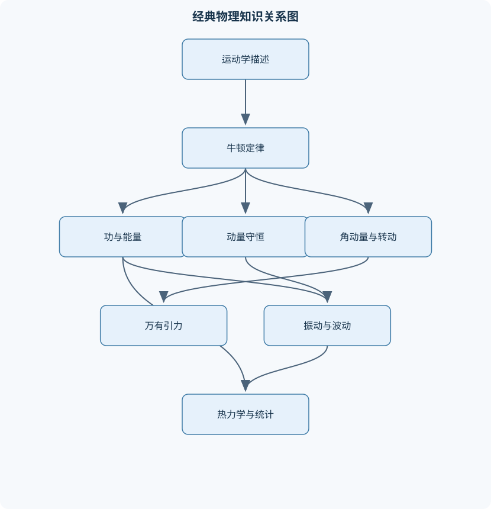
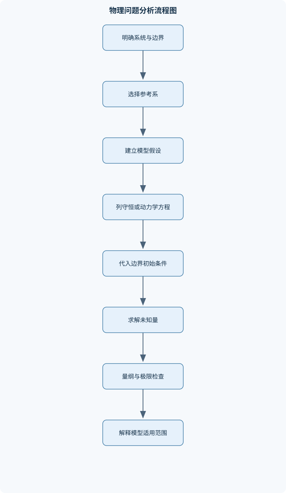

# 普通物理学Ⅰ（H）

## 一、课程整体知识框架

### 课程边界与先修知识

《普通物理学Ⅰ》是一门以经典力学为主线，并延伸至流体、振动、波动、狭义相对论基础、气体动理论和热力学的大学基础物理课程。主要研究质点和刚体的运动规律、相互作用及能量转化，分析理想流体和理想气体的宏观与微观性质，并建立振动与波动的统一描述。课程通常要求学生掌握微积分、向量代数、基本微分方程和高中阶段的力学、热学知识。课程边界包括牛顿力学、动量与角动量、机械能、万有引力、静力学与刚体转动、流体静力学与流体动力学、简谐运动、机械波、狭义相对论基本关系、气体动理论和热力学定律；不系统展开电磁场、量子力学和高等连续介质力学。理想模型包括质点、刚体、理想约束、无黏流体、理想气体和准静态过程，实际问题中需说明摩擦、阻力、形变、耗散、非平衡和测量误差等限制。





### 1. 学科主线与建模边界

《普通物理学Ⅰ》以“状态描述—相互作用—守恒定律—模型修正”为主线。首先用位置、速度和加速度描述运动；再用牛顿定律解释运动变化；随后用功、能量、动量和角动量把复杂运动转化为守恒关系；在此基础上讨论刚体、万有引力、流体、振动、波动以及热学和相对论的基本模型。

课程中的“质点”是忽略物体形状、转动和内部结构的理想化模型，适用于物体尺寸相对于运动尺度很小，或只关心质心运动的情形；“刚体”假设物体内部任意两点距离不变，适用于形变相对运动尺度很小的机械系统。实际物体存在摩擦、空气阻力、弹性形变、黏性、热耗散和测量误差，因此理想模型的结论必须结合条件使用。

物理量应区分标量和矢量。位置矢量为 $\mathbf r$，位移为 $\Delta\mathbf r=\mathbf r_2-\mathbf r_1$，路程是轨迹长度；速度为 $\mathbf v=d\mathbf r/dt$，加速度为 $\mathbf a=d\mathbf v/dt$。长度、时间、质量的国际单位分别为 $\mathrm m$、$\mathrm s$、$\mathrm{kg}$。符号相同但物理意义不同的量必须区分，例如热力学内能记为 $U_{\rm int}$，机械势能记为 $U$，气体绝热指数记为 $\gamma_g$，相对论洛伦兹因子记为 $\gamma$。

### 2. 运动学与参考系

在直角坐标中，$\mathbf r=x\mathbf e_x+y\mathbf e_y+z\mathbf e_z$，因此
$\mathbf v=(\dot x,\dot y,\dot z)$，$\mathbf a=(\ddot x,\ddot y,\ddot z)$。一维恒加速度运动由
$$
\frac{dv}{dt}=a
$$
积分得到
$$
v=v_0+at,\qquad x=x_0+v_0t+\frac12at^2.
$$
再利用 $a=v\,dv/dx$，可得
$$
v^2-v_0^2=2a(x-x_0).
$$
这些式子要求加速度为常量；若 $a$ 随时间、位置或速度变化，必须重新积分，不能直接套用。

曲线运动中，速度方向沿轨道切线。将加速度分解为切向和法向分量：
$$
\mathbf a=a_t\mathbf e_t+a_n\mathbf e_n,\qquad
a_t=\frac{dv}{dt},\qquad a_n=\frac{v^2}{R},
$$
其中 $R$ 为曲率半径。$a_t$改变速率，$a_n$改变速度方向。匀速圆周运动虽速率不变，但因 $a_n=v^2/R$ 不为零，仍有加速度；变速圆周运动还具有切向加速度。角速度为 $\omega=d\theta/dt$，若半径固定，则 $v=R\omega$。

抛体运动在忽略空气阻力、近地面且 $g$ 可视为常量时满足
$$
x=v_0\cos\theta\,t,\qquad
y=y_0+v_0\sin\theta\,t-\frac12gt^2.
$$
水平方向没有加速度，竖直方向加速度为 $-g$。空气阻力显著、发射高度很大或运动时间很长时，轨迹不再是简单抛物线。

相对运动依赖参考系。若参考系 $S'$ 相对 $S$ 以恒速 $\mathbf u$ 平移，则经典低速条件下
$$
\mathbf r=\mathbf r'+\mathbf u t,\qquad
\mathbf v=\mathbf v'+\mathbf u,\qquad
\mathbf a=\mathbf a'.
$$
加速度在伽利略变换下不变，但这一结论不适用于接近光速的运动。

### 3. 牛顿定律与常见力

惯性参考系中，若物体不受合外力，则保持静止或匀速直线运动。牛顿第二定律为
$$
\sum\mathbf F=\frac{d\mathbf p}{dt},
\qquad \mathbf p=m\mathbf v.
$$
质量不变时退化为 $\sum\mathbf F=m\mathbf a$。牛顿第三定律中的作用力和反作用力大小相等、方向相反，但分别作用在两个物体上，不能在同一隔离体受力图中相互抵消。

受力分析的基本步骤是：确定研究对象，选择惯性参考系和坐标轴，画隔离体受力图，列出各方向动力学方程，再加入绳长、接触或几何约束。重力近地面可写为 $m\mathbf g$；支持力垂直接触面，不一定等于重力；轻绳张力沿绳方向。弹簧在小形变线性范围内满足 $\mathbf F=-k\mathbf x$，其中 $k$ 的单位为 $\mathrm{N/m}$。

静摩擦力满足
$$
0\le f_s\le\mu_sN,
$$
其大小由动力学方程决定，只有达到临界滑动时才等于 $\mu_sN$。滑动摩擦力通常写为 $f_k=\mu_kN$，方向反向于接触面的相对滑动。阻力可能与速度成正比或与速度平方成正比；当阻力与驱动力平衡时，物体达到终端速度，此时加速度为零但速度不一定为零。

### 4. 功、能量、动量与质心

恒力做功为
$$
W=\mathbf F\cdot\Delta\mathbf r=F\Delta r\cos\theta.
$$
变力做功必须使用线积分：
$$
W=\int_{\mathbf r_1}^{\mathbf r_2}\mathbf F\cdot d\mathbf r.
$$
由 $\mathbf F=m\mathbf a$ 和 $a=v\,dv/dx$ 可得功—动能定理：
$$
W_{\rm net}=\Delta K,\qquad K=\frac12mv^2.
$$
功率为 $P=dW/dt=\mathbf F\cdot\mathbf v$。

保守力做功只与初末位置有关，可定义势能使
$$
\mathbf F=-\nabla U.
$$
重力势能近地面为 $U_g=mgh$；万有引力势能通常取无穷远为零，即 $U=-GMm/r$。若只有保守力做功，机械能
$$
E=K+U
$$
守恒；若非保守力做功，则
$$
\Delta K+\Delta U=W_{\rm nc}.
$$
势能零点改变只会使 $U$ 整体增加或减少常量，不改变力和可观测的能量差。

冲量为
$$
\mathbf J=\int_{t_1}^{t_2}\mathbf F\,dt=\Delta\mathbf p.
$$
在碰撞时间很短、系统所受外冲量可忽略时，总动量守恒。动量守恒不等于动能守恒：完全弹性碰撞同时守恒动量和动能，非弹性碰撞只在适当条件下守恒动量，粘连碰撞的机械能通常损失最大。

系统质心定义为
$$
\mathbf r_{\rm cm}=\frac{1}{M}\sum_i m_i\mathbf r_i,
$$
连续分布时用积分。由系统内力成对抵消可得
$$
M\mathbf a_{\rm cm}=\sum\mathbf F_{\rm ext}.
$$
内部力可以改变形变、转动和内部动能，但不能单独改变质心的整体运动。

### 5. 角动量、刚体与万有引力

相对于选定参考点，力矩为
$$
\boldsymbol\tau=\mathbf r\times\mathbf F,
$$
角动量为 $\mathbf L=\mathbf r\times\mathbf p$。系统满足
$$
\boldsymbol\tau_{\rm ext}=\frac{d\mathbf L}{dt}.
$$
当外力矩为零时，总角动量守恒。力矩和角动量都依赖参考点，改变参考点后必须重新计算。

刚体绕固定轴转动时，转动惯量为
$$
I=\int r_\perp^2\,dm,
$$
其中 $r_\perp$ 是质量元到转轴的垂直距离。转动定律为
$$
\sum\tau=I\alpha,
$$
转动动能为
$$
K_{\rm rot}=\frac12I\omega^2.
$$
平行轴定理为 $I=I_{\rm cm}+Md^2$。纯滚动还需满足接触点瞬时相对速度为零，即 $v_{\rm cm}=R\omega$；静摩擦不必然做负功，也不必然等于最大静摩擦力。刚体平衡要求合力和合力矩均为零。陀螺进动本质上是外力矩改变角动量方向，基础课程通常进行定性分析。

万有引力定律为
$$
F=\frac{GMm}{r^2}.
$$
球对称天体外部的引力可等效为质量集中于球心。圆轨道中引力提供向心力：
$$
\frac{GMm}{r^2}=\frac{mv^2}{r},
\quad
v=\sqrt{\frac{GM}{r}},
\quad
T=2\pi\sqrt{\frac{r^3}{GM}}.
$$
逃逸速度由总机械能恰好为零得到
$$
v_{\rm esc}=\sqrt{\frac{2GM}{r}}.
$$
椭圆轨道中机械能和角动量守恒，但速度随位置变化；圆轨道公式不能直接代入椭圆轨道任意位置。近地轨道模型忽略大气阻力、天体非球形、第三天体摄动和轨道修正，实际航天计算需加入这些因素。

### 6. 静力学、弹性与流体

质点平衡要求 $\sum\mathbf F=0$，刚体平衡还需 $\sum\boldsymbol\tau=0$。力偶合力为零但力矩不为零，能够产生转动趋势。重心是重力作用线的等效作用点；在均匀重力场中，重心与质心重合。

应力是单位面积上的内力，正应力可写为 $\sigma=F_\perp/A$；应变是相对形变量，如纵向应变 $\varepsilon=\Delta L/L$。在线性弹性范围内，杨氏模量 $Y=\sigma/\varepsilon$。超过弹性限度后会出现塑性形变，胡克定律不再适用。

静止流体中
$$
p=p_0+\rho gh,
$$
压强随深度增加。帕斯卡原理说明封闭流体受到的压强变化能传递到各处；阿基米德浮力大小等于排开流体的重力。稳态不可压缩流动满足连续性方程
$$
A_1v_1=A_2v_2.
$$
对无黏、不可压缩、稳态且沿同一流线流动的流体，伯努利方程为
$$
p+\rho gh+\frac12\rho v^2=\text{常量}.
$$
黏性显著、存在泵或涡轮、流动强烈湍流、管道损失明显时，必须加入能量损失或设备功，不能任意使用理想伯努利方程。

### 7. 振动与机械波

简谐运动由线性回复力产生：
$$
m\ddot x+kx=0,\qquad
\omega=\sqrt{\frac{k}{m}}.
$$
其一般解为
$$
x=A\cos(\omega t+\phi),
$$
$$
v=-A\omega\sin(\omega t+\phi),\qquad
E=\frac12m\omega^2A^2.
$$
初始位移和初始速度共同决定 $A$ 与 $\phi$。单摆在小角度近似下满足 $\omega=\sqrt{g/\ell}$；大振幅时周期不再严格等于 $2\pi\sqrt{\ell/g}$。

阻尼使机械能耗散，受迫振动在驱动频率接近系统固有频率时可能共振。阻尼越小，共振峰通常越尖锐，但实际系统不能忽略材料耗散和空气阻力。机械波是介质中扰动的传播，行波可写为
$$
y(x,t)=A\cos(kx-\omega t+\phi),
$$
其中 $k=2\pi/\lambda$，波速满足 $v_{\rm wave}=f\lambda$。反射、折射和干涉由边界与叠加原理决定。固定端反射发生相位反转；两列反向传播波叠加形成驻波，节点振幅为零，腹部振幅最大。驻波不是持续向单一方向输运能量的行波。

### 8. 狭义相对论、气体动理论与热力学

伽利略变换在低速条件下成立。狭义相对论以相对性原理和真空光速不变为基础。洛伦兹因子为
$$
\gamma=\frac1{\sqrt{1-v^2/c^2}}.
$$
时间膨胀、长度收缩和同时性的相对性均依赖参考系。相对论能量和动量满足
$$
E=\gamma mc^2,\qquad
\mathbf p=\gamma m\mathbf v,
$$
$$
E^2=p^2c^2+m^2c^4.
$$
静能为 $E_0=mc^2$。当 $v\ll c$ 时，结果应退化为经典力学；不能把“相对论质量”与静质量、总能量混为一谈。

理想气体状态方程为
$$
pV=nRT=Nk_BT.
$$
分子碰撞容器壁产生压强，单原子理想气体分子平均平动动能为
$$
\left\langle K_{\rm tr}\right\rangle=\frac32k_BT.
$$
均方根速率为
$$
v_{\rm rms}=\sqrt{\frac{3k_BT}{m}}.
$$
麦克斯韦速率分布给出不同速率分子的统计比例，而不是每个分子的确定速度。平均自由程、碰撞频率、扩散、黏滞和热传导都来自分子随机运动；低密度、分子体积可忽略且分子间作用弱时，理想气体模型才可靠。

热力学第一定律采用“气体对外做功”为正的约定：
$$
\Delta U_{\rm int}=Q-W_{\rm by}.
$$
准静态过程的功为
$$
W_{\rm by}=\int p\,dV.
$$
理想气体内能只由温度决定，而 $Q$ 和 $W_{\rm by}$ 依赖过程路径。等温过程理想气体 $\Delta U_{\rm int}=0$；等容过程功为零；等压过程需同时考虑体积变化；绝热过程满足 $Q=0$，理想气体可得 $pV^{\gamma_g}=\text{常量}$。熵是状态函数，可逆过程满足
$$
dS=\frac{\delta Q_{\rm rev}}{T_{\rm th}},
$$
其中 $T_{\rm th}$ 必须用开尔文。第二定律要求孤立系统总熵不减。卡诺热机效率为
$$
\eta=1-\frac{T_c}{T_h},
$$
实际热机因摩擦、有限温差传热等不可逆因素不能超过该上限；制冷机用性能系数评价，不能直接套用热机效率。

## 二、章节和模块划分

### 核心知识覆盖清单

本清单用于检查正文是否覆盖本课程的主要知识模块：

- **矢量运动学与参考系**：位置、位移与路程、速度和加速度的矢量定义、直角坐标与自然坐标分解、切向加速度与法向加速度、匀变速直线运动、抛体运动、圆周运动与角速度、相对运动和参考系变换。
- **牛顿运动定律与常见力**：惯性参考系与牛顿第一定律、牛顿第二定律的矢量形式、动量变化率与合外力、牛顿第三定律、重力、支持力和张力、静摩擦与滑动摩擦、弹簧力与胡克定律、阻力和终端速度、隔离体受力图与约束条件。
- **功、能量与动量**：恒力和变力做功、功率与动能定理、保守力与势能、机械能守恒条件、非保守力做功与机械能变化、冲量和动量定理、质心运动定理、一维和二维碰撞、质心参考系与恢复系数。
- **角动量与刚体转动**：角位移、角速度和角加速度、转动惯量及其计算、平行轴定理、力矩与转动定律、角动量和角动量守恒、转动动能与滚动约束、刚体平衡条件、转动中的功和功率、陀螺与进动的定性分析。
- **万有引力与轨道运动**：万有引力定律、引力场和引力势能、球对称体外部引力、行星运动的轨道规律、圆轨道速度和周期、逃逸速度、开普勒定律的动力学解释、椭圆轨道中的能量与角动量、近地轨道模型的适用边界。
- **静力学、弹性与流体**：质点和刚体的平衡条件、力偶与静力矩、重心和质心、应力、应变与弹性模量、静止流体压强分布、帕斯卡原理、阿基米德浮力、连续性方程、伯努利方程及其条件、黏性、湍流与理想流体模型限制。
- **振动与机械波**：简谐运动的运动学描述、弹簧振子和单摆、振动的能量交换、阻尼振动、受迫振动与共振、相位和相位差、行波方程、波速、波长和频率、反射、折射与干涉、驻波、节点和腹部。
- **狭义相对论基础**：伽利略变换的适用范围、光速不变原理、洛伦兹变换、同时性的相对性、时间膨胀、长度收缩、相对论速度变换、相对论动量和能量、静能与质能关系、四维时空关系的定性认识。
- **气体动理论与统计描述**：宏观状态量与微观运动、理想气体状态方程、压强的微观解释、温度与分子平均平动动能、麦克斯韦速率分布的物理意义、均方根速率、自由度与能量均分、碰撞频率和平均自由程、扩散、黏滞和热传导的微观图像。
- **热力学定律与循环**：热量、内能和功的符号约定、热力学第一定律、理想气体内能、等温、等压、等容和绝热过程、准静态过程的功、熵变与可逆过程、热力学第二定律、卡诺循环和效率、制冷机与性能系数、不可逆过程和熵增。


### 1. 代表性分析流程与伪代码

#### 受力—动力学流程

输入物体、约束、已知力、质量和初始条件；输出加速度、约束力或运动方程。先选研究系统，再建立坐标轴并画隔离体受力图，随后分解力，列出 $\sum\mathbf F=m\mathbf a$，加入绳长、无滑动或接触约束，最后进行单位、方向和极限检查。静摩擦方向由相对运动趋势决定，不能预先固定。

#### 能量—动量联合流程

若题目只问初末速度、位移或高度，优先使用
$$
\Delta K+\Delta U=W_{\rm nc}.
$$
若涉及碰撞或短时相互作用，先判断外冲量是否可忽略，再使用动量守恒；最后比较碰撞前后动能，判断是否存在耗散。能量法不自动给出时间，动量守恒也不自动保证机械能守恒。

#### 热力学过程流程

在 $p$—$V$ 图上标出初态和终态，识别等温、等压、等容、绝热或组合过程；计算
$$
W_{\rm by}=\int p\,dV,
$$
再由状态方程求温度变化，由第一定律得到 $Q$，并用可逆替代路径求熵变。循环过程必须检查 $\Delta U_{\rm int}=0$，且循环净功等于各阶段功的代数和。

```python
# Python：一维恒力运动的状态计算
# 输入：初始位置 x0、初速度 v0、恒加速度 a、时间 t
# 输出：位置 x、速度 v，并进行量纲和恒加速度关系检查

def constant_acceleration(x0, v0, a, t):
    if t < 0:
        raise ValueError("时间必须为非负量")
    v = v0 + a * t
    x = x0 + v0 * t + 0.5 * a * t**2

    # 独立使用 v^2-v0^2=2a(x-x0) 检查结果
    check_left = v**2 - v0**2
    check_right = 2 * a * (x - x0)
    tolerance = 1e-10 * max(1.0, abs(check_left), abs(check_right))

    if abs(check_left - check_right) > tolerance:
        raise ArithmeticError("恒加速度关系未通过检查")
    return x, v

x, v = constant_acceleration(0.0, 4.0, -2.0, 1.5)
print(f"x={x:.3f} m, v={v:.3f} m/s")
```

该程序只适用于一维恒加速度，不适用于空气阻力、变质量或加速度随时间变化的情形。输入量应使用一致单位，程序输出的位移单位为米、速度单位为米每秒。

### 2. 代表性例题

#### 例题一：二维斜抛

**题干。** 物体以初速度 $20\ \mathrm{m/s}$、仰角 $30^\circ$ 从地面抛出，忽略空气阻力，取 $g=9.8\ \mathrm{m/s^2}$。求飞行时间、射程、最高点高度和最高点速度。

**分析。** 水平和竖直运动相互独立。初速度分量为
$$
v_{0x}=20\cos30^\circ=17.32\ \mathrm{m/s},
\quad
v_{0y}=20\sin30^\circ=10.00\ \mathrm{m/s}.
$$

**解答。** 落地条件 $y=0$ 给出
$$
t_f=\frac{2v_{0y}}g=\frac{20}{9.8}=2.04\ \mathrm s.
$$
射程为
$$
R=v_{0x}t_f=17.32\times2.04=35.35\ \mathrm m.
$$
最高点满足 $v_y=0$，故
$$
t_{\rm top}=\frac{v_{0y}}g=1.02\ \mathrm s,
\quad
h_{\rm max}=\frac{v_{0y}^2}{2g}=5.10\ \mathrm m.
$$
最高点竖直速度为零，水平速度不变，因此速度为 $17.32\ \mathrm{m/s}$，方向水平。

**验证与变式。** 最高点时间应为总飞行时间的一半；若发射点高于落地点，飞行时间不再是 $2v_{0y}/g$，必须解完整二次方程。若考虑空气阻力，水平速度不再保持不变，射程通常减小。

#### 例题二：粗糙斜面连接悬挂物

**题干。** 质量 $m_1$ 的物体在倾角 $\theta$ 的粗糙斜面上，质量 $m_2$ 的物体悬挂，二者由轻绳跨过理想滑轮连接。设 $m_2$ 向下运动，斜面物体向上运动，动摩擦因数为 $\mu_k$。求加速度和张力。

**分析。** 对斜面物体，沿斜面向上为正：
$$
T-m_1g\sin\theta-\mu_km_1g\cos\theta=m_1a.
$$
对悬挂物体，向下为正：
$$
m_2g-T=m_2a.
$$

**解答。** 两式相加消去 $T$：
$$
a=\frac{m_2g-m_1g\sin\theta-\mu_km_1g\cos\theta}{m_1+m_2}.
$$
再由悬挂物方程得到
$$
T=m_2(g-a).
$$
若算得 $a<0$，说明假设的运动方向与实际相反，摩擦方向也必须随之重新判断。

**验证与变式。** 当 $\mu_k=0$ 时退化为光滑斜面；若静止可能发生，不能直接使用动摩擦，应先检验所需静摩擦是否满足 $f_s\le\mu_sN$。若滑轮有转动惯量，两侧张力不再相等，需增加 $\tau=(T_2-T_1)R=I\alpha$。

#### 例题三：一维非弹性碰撞

**题干。** 质量 $m_1=2\ \mathrm{kg}$ 的物体以 $6\ \mathrm{m/s}$ 向右运动，质量 $m_2=1\ \mathrm{kg}$ 的物体静止。碰撞后两物体粘在一起。求共同速度和动能损失。

**解答。** 取向右为正。碰撞时间短且外冲量可忽略，因此
$$
m_1v_1+m_2v_2=(m_1+m_2)v.
$$
代入得
$$
v=\frac{2\times6}{3}=4\ \mathrm{m/s}.
$$
碰撞前动能
$$
K_i=\frac12\times2\times6^2=36\ \mathrm J,
$$
碰撞后动能
$$
K_f=\frac12\times3\times4^2=24\ \mathrm J.
$$
动能损失为 $12\ \mathrm J$，转化为形变、内能和声能等。

**验证与变式。** 总动量碰撞前后均为 $12\ \mathrm{kg\,m/s}$；动能不守恒说明碰撞为非弹性。若给出恢复系数 $e$，则还需加入
$$
e=\frac{v_2'-v_1'}{v_1-v_2}
$$
并联立求两个末速度。

#### 例题四：刚体滚动下斜面

**题干。** 均匀实心圆柱从高度 $h$ 处无滑动滚下斜面。圆柱转动惯量为 $I_{\rm cm}=\frac12mR^2$。求到达底部的速度。

**解答。** 初始静止，且无滑动摩擦不耗散机械能：
$$
mgh=\frac12mv^2+\frac12I_{\rm cm}\omega^2.
$$
使用 $v=R\omega$：
$$
mgh=\frac12mv^2+\frac14mv^2=\frac34mv^2.
$$
因此
$$
v=\sqrt{\frac{4gh}{3}}.
$$
若视为质点下滑，结果为 $\sqrt{2gh}$，速度更大，因为质点没有转动动能。

**验证与变式。** 半径在最终结果中约去，但转动惯量系数会改变速度。若存在滑动摩擦，机械能方程必须加入非保守力功；若斜面很短而静摩擦不足以维持无滑动，应改用滑动模型。

#### 例题五：理想气体等温膨胀

**题干。** $n$ 摩尔理想气体在恒温 $T_{\rm th}$ 下从体积 $V_1$ 缓慢膨胀至 $V_2$。求气体对外做功、内能变化和吸热量。

**解答。** 等温过程满足
$$
p=\frac{nRT_{\rm th}}V.
$$
因此
$$
W_{\rm by}=\int_{V_1}^{V_2}p\,dV
=nRT_{\rm th}\ln\frac{V_2}{V_1}.
$$
理想气体内能只由温度决定，恒温时
$$
\Delta U_{\rm int}=0.
$$
由第一定律
$$
Q=\Delta U_{\rm int}+W_{\rm by}
=nRT_{\rm th}\ln\frac{V_2}{V_1}.
$$

**验证与变式。** 膨胀时 $V_2>V_1$，所以 $W_{\rm by}>0$、$Q>0$。若过程不是准静态，不能简单用体系内部压强进行 $\int p\,dV$；若改为绝热膨胀，$Q=0$，温度会下降。

### 3. 实验与项目流程

#### 实验一：验证简谐运动周期

**输入数据。** 弹簧质量、砝码质量、静态伸长量、振动周期、振幅和测量次数。使用近似无摩擦的弹簧振子，保证振幅较小。

**步骤。**  
1. 测量不同质量下的静态伸长，检验回复力在实验范围内近似线性。  
2. 使物体偏离平衡位置后释放，连续测量多个周期的总时间，取平均周期。  
3. 对每个质量计算 $T^2$，检验
   $$
   T^2=\frac{4\pi^2m}{k}.
   $$
4. 以 $m$ 为横坐标、$T^2$ 为纵坐标作线性拟合，由斜率估计 $k$。  
5. 改变振幅，比较周期是否明显变化。

**评价标准。** 数据应呈近似线性；周期随质量增加而增加；小振幅下同一质量的周期应较稳定。需报告平均值、离散程度、单位和有效数字，并区分随机误差与系统误差。

**排错方法。** 若周期整体偏大，检查计时起止点和弹簧有效长度；若数据不线性，检查振幅过大、弹簧超过线性范围或支架振动；若周期随振幅明显变化，说明小振幅近似可能失效。

#### 实验二：理想流体近似的流量与压强分析

**输入数据。** 管道不同截面积 $A_1,A_2$，单位时间流量，液体密度，两个测压点高度及压强读数。

**步骤。**  
1. 在稳定流动后测量相同时间内通过的体积，得到体积流量。  
2. 计算各截面的平均速度 $v=Q_V/A$。  
3. 检验 $A_1v_1$ 与 $A_2v_2$ 是否近似相等。  
4. 在高度差已知时，比较
   $$
   p_1+\rho gh_1+\frac12\rho v_1^2
   $$
   与
   $$
   p_2+\rho gh_2+\frac12\rho v_2^2.
   $$
5. 记录流量变化时压强差的变化，分析黏性损失。

**评价标准。** 连续性方程的相对偏差应在仪器精度和实验条件允许范围内；伯努利常量若明显沿程下降，说明黏性耗散、管壁摩擦或流动未稳态。报告必须给出测量分辨率、重复测量结果和误差来源。

**排错方法。** 若流量不稳定，等待系统达到稳态；若截面速度计算异常，检查是否把直径误当面积；若伯努利方程偏差随管长增加，优先考虑黏性压降，而不是强行修改密度或压强单位。

## 三、核心概念的详细解释

### 1. 运动描述、参考系与矢量分解

物体的位置必须相对于参考系描述。选定原点、坐标轴和计时方式后，位置矢量 $\mathbf r(t)$ 才有确定意义。位移是初末位置之差，$\Delta\mathbf r=\mathbf r_2-\mathbf r_1$；路程是实际轨迹长度，属于标量。只有在物体沿固定方向运动且不改变运动方向时，位移大小才可能等于路程。平均速度是 $\Delta\mathbf r/\Delta t$，平均速率是路程除以时间，二者不能混用。

瞬时速度和加速度分别定义为
$$
\mathbf v=\frac{d\mathbf r}{dt},\qquad
\mathbf a=\frac{d\mathbf v}{dt}.
$$
速度方向沿轨迹切线，加速度既可能改变速度大小，也可能改变速度方向。在直角坐标中，若
$$
\mathbf r=x\mathbf e_x+y\mathbf e_y+z\mathbf e_z,
$$
则
$$
\mathbf v=\dot x\mathbf e_x+\dot y\mathbf e_y+\dot z\mathbf e_z,\qquad
\mathbf a=\ddot x\mathbf e_x+\ddot y\mathbf e_y+\ddot z\mathbf e_z.
$$
这里 $x,y,z$ 的单位为 $\mathrm m$，$t$ 的单位为 $\mathrm s$，速度单位为 $\mathrm{m\,s^{-1}}$，加速度单位为 $\mathrm{m\,s^{-2}}$。

曲线运动更适合使用自然坐标。切向加速度
$$
a_t=\frac{dv}{dt}
$$
改变速率，法向加速度
$$
a_n=\frac{v^2}{R}
$$
改变速度方向，其中 $R$ 是轨迹的曲率半径。匀速圆周运动中 $a_t=0$，但 $a_n\ne0$，因此“速率不变”不等于“加速度为零”。圆周运动还可用角位置 $\theta$、角速度 $\omega=d\theta/dt$ 和角加速度 $\alpha=d\omega/dt$描述；半径固定时，线速度与角速度满足 $v=R\omega$。

参考系之间的变换必须说明相对运动状态。经典力学中，若 $S'$ 相对惯性系 $S$ 以恒速度 $\mathbf u$ 平移，则
$$
\mathbf r=\mathbf r'+\mathbf u t,\qquad
\mathbf v=\mathbf v'+\mathbf u,\qquad
\mathbf a=\mathbf a'.
$$
这组伽利略变换适用于相对速度远小于光速的情况。接近光速时，时间和空间坐标不能保持绝对不变，必须使用洛伦兹变换。

### 2. 力、惯性与受力分析

牛顿第一定律给出惯性参考系的定义特征：当合外力为零时，物体保持静止或匀速直线运动。牛顿第二定律在质量不变时写为
$$
\sum\mathbf F=m\mathbf a,
$$
更一般地写为
$$
\sum\mathbf F=\frac{d\mathbf p}{dt},\qquad \mathbf p=m\mathbf v.
$$
它说明合外力决定动量的变化率，而不是单独某一个力决定加速度。质量 $m$ 的单位为 $\mathrm{kg}$，力的单位为 $\mathrm N=\mathrm{kg\,m\,s^{-2}}$。

牛顿第三定律描述相互作用：物体 A 对物体 B 的力与 B 对 A 的力大小相等、方向相反，并且作用在不同物体上。因此，这两个力不能在同一个物体的隔离体受力图中相互抵消。建立动力学方程前，应先选定研究对象，画出该对象受到的重力、支持力、张力、摩擦力、弹簧力和阻力等外力，再按坐标方向列方程。

近地面重力通常写为 $\mathbf G=m\mathbf g$，其中 $g$ 约为 $\mathrm{9.8\,m\,s^{-2}}$，方向竖直向下。支持力由接触约束决定，不一定等于重力。静摩擦力满足
$$
0\le f_s\le\mu_sN,
$$
其方向阻碍接触面的相对运动趋势；滑动摩擦力大小通常取
$$
f_k=\mu_kN.
$$
弹簧在形变量处于线性范围内时遵循胡克定律
$$
F_x=-kx,
$$
负号表示回复力方向与位移方向相反。空气阻力或流体阻力通常依赖速度，例如低速时可近似与 $v$ 成正比，高速时常近似与 $v^2$ 成正比；因此阻力模型必须由速度范围和介质条件决定。终端速度是阻力与重力等外力平衡后速度不再增加的状态，不是所有下落运动都具有同一终端速度。

### 3. 功、能量、动量与碰撞

恒力做功为
$$
W=\mathbf F\cdot\Delta\mathbf r=F\Delta r\cos\theta.
$$
变力做功必须沿路径积分：
$$
W=\int_{\mathbf r_1}^{\mathbf r_2}\mathbf F\cdot d\mathbf r.
$$
功率表示做功快慢，
$$
P=\frac{dW}{dt}=\mathbf F\cdot\mathbf v.
$$
由牛顿第二定律可得功—动能定理：
$$
W_{\rm net}=\Delta K,\qquad K=\frac12mv^2.
$$
该定理不要求力恒定，但要求正确计算力沿实际路径的功。

保守力做功只由初末位置决定，可以定义势能 $U$，满足
$$
W_{\rm cons}=-\Delta U.
$$
重力势能在近地面范围内可取 $U_g=mgh$；万有引力势能若将无穷远处取为零，则
$$
U_g=-\frac{GMm}{r}.
$$
机械能为
$$
E=K+U.
$$
只有保守力做功，或非保守力净功为零时，机械能守恒。若摩擦力、空气阻力等非保守力做功，则
$$
\Delta K+\Delta U=W_{\rm nc}.
$$
机械能减少并不表示总能量消失，减少部分通常转化为内能。

冲量定义为
$$
\mathbf J=\int_{t_1}^{t_2}\mathbf F\,dt.
$$
对牛顿第二定律积分可得冲量—动量定理：
$$
\mathbf J=\Delta\mathbf p.
$$
若碰撞时间很短，系统受到的外冲量相对于内部碰撞冲量可以忽略，则系统总动量守恒。动量守恒并不等于动能守恒：完全弹性碰撞同时守恒动量和动能；非弹性碰撞只在外冲量可忽略时守恒动量，机械能则转化为形变能、内能和声能等。

质心位置定义为
$$
\mathbf r_{\rm cm}=\frac{1}{M}\sum_i m_i\mathbf r_i
$$
或连续分布形式
$$
\mathbf r_{\rm cm}=\frac{1}{M}\int\mathbf r\,dm.
$$
对时间求两次导数并使用牛顿定律，可得
$$
M\mathbf a_{\rm cm}=\sum\mathbf F_{\rm ext}.
$$
内部力不能改变质心的整体运动，但可以改变系统内部的相对运动和内部能量。

### 4. 转动、角动量与刚体

刚体转动用角位移、角速度和角加速度描述。绕固定轴转动时，线位移与角位移关系为 $s=R\theta$，线速度为 $v=R\omega$，切向加速度为 $a_t=R\alpha$。转动惯量
$$
I=\int r^2\,dm
$$
反映质量相对于转轴的分布。相同质量和尺寸的物体，因质量分布不同，转动惯量也不同。

力矩定义为
$$
\boldsymbol\tau=\mathbf r\times\mathbf F,
$$
其大小为 $\tau=rF\sin\phi$。绕固定轴转动时，
$$
\sum\tau=I\alpha.
$$
转动动能为
$$
K_{\rm rot}=\frac12I\omega^2.
$$
若刚体既平动又绕质心转动，则总动能可写为质心平动动能与绕质心转动动能之和。平行轴定理为
$$
I=I_{\rm cm}+Md^2,
$$
其中 $d$ 是两条平行轴之间的距离。

相对于选定参考点的角动量为
$$
\mathbf L=\mathbf r\times\mathbf p.
$$
一般情况下满足
$$
\boldsymbol\tau_{\rm ext}=\frac{d\mathbf L}{dt}.
$$
当外力矩为零时，角动量守恒。角动量和力矩都依赖参考点；改变参考点后，位置矢量和力矩必须重新计算。刚体平衡要求平动和转动均不发生变化，因此必须同时满足
$$
\sum\mathbf F=0,\qquad \sum\boldsymbol\tau=0.
$$

无滑动滚动要求接触点相对于接触面的瞬时速度为零，常写为
$$
v_{\rm cm}=R\omega.
$$
它是运动学约束，不自动说明摩擦力一定做负功。理想静摩擦在接触点无相对位移时，可能不改变刚体总机械能，但实际滚动中仍可能存在形变损耗和滚动阻力。

### 5. 万有引力与轨道运动

两个质点之间的万有引力大小为
$$
F=G\frac{Mm}{r^2},
$$
方向沿两质点连线并相互吸引。球对称质量分布在其外部产生的引力，等效于质量集中在球心的质点产生的引力；在球体内部则不能直接套用外部公式。

引力场强可定义为单位质量所受引力，近地面可近似为 $\mathbf g$。取无穷远处势能为零时，
$$
U(r)=-\frac{GMm}{r}.
$$
负号表示束缚态总机械能低于无穷远处。半径为 $r$ 的圆轨道中，引力提供向心力：
$$
\frac{GMm}{r^2}=\frac{mv^2}{r},
$$
因此
$$
v=\sqrt{\frac{GM}{r}},\qquad
T=2\pi\sqrt{\frac{r^3}{GM}}.
$$
逃逸速度由总机械能恰好为零得到：
$$
v_{\rm esc}=\sqrt{\frac{2GM}{r}}.
$$
圆轨道结果不能直接用于椭圆轨道任意位置。椭圆轨道中速度随位置改变，但在理想两体问题中总机械能和相对于中心力中心的角动量守恒。开普勒第三定律
$$
T^2\propto a^3
$$
可由万有引力和椭圆轨道动力学导出，其中 $a$ 是椭圆半长轴。

### 6. 静力学、弹性与流体

质点平衡只需合力为零；刚体平衡还必须满足合力矩为零。力偶由大小相等、方向相反且作用线不重合的两力组成，合力为零但具有非零力矩，因此能够改变刚体转动状态。重心是重力作用的等效作用点；在均匀重力场中，重心与质心重合，重力场变化显著时二者不必重合。

弹性体受力后会形变。应力是单位面积上的内力，正应力可写为 $\sigma=F/A$；应变是相对形变量，如长度应变 $\varepsilon=\Delta L/L$。在线性弹性范围内，杨氏模量满足
$$
Y=\frac{\sigma}{\varepsilon}.
$$
超过弹性极限后，形变可能不可恢复，胡克定律失效。

流体静止时，压强随深度增加而增加：
$$
p=p_0+\rho gh.
$$
帕斯卡原理说明，密闭静止流体所受外加压强能够传递到各处。浸没物体受到的浮力等于排开流体的重力：
$$
F_b=\rho_{\rm fluid}gV_{\rm displaced}.
$$
浮力方向竖直向上，但物体是否上浮还取决于浮力、重力和其他约束力的合力。

稳态不可压缩流体满足连续性方程
$$
A_1v_1=A_2v_2.
$$
对于理想、稳态、不可压缩、无黏流体，沿同一流线有伯努利方程
$$
p+\rho gh+\frac12\rho v^2=\text{常量}.
$$
其中三项分别表示单位体积的压强能、重力势能和动能。存在泵、涡轮、显著黏性损失或强烈湍流时，必须加入相应能量项，不能直接使用理想形式。

### 7. 振动与机械波

简谐运动的回复力与位移成正比且方向相反：
$$
m\frac{d^2x}{dt^2}=-kx,
$$
即
$$
\frac{d^2x}{dt^2}+\omega^2x=0,\qquad
\omega=\sqrt{\frac{k}{m}}.
$$
其一般解为
$$
x=A\cos(\omega t+\phi),
$$
其中 $A$ 为振幅，$\phi$ 为初相位。速度和加速度为
$$
v=-A\omega\sin(\omega t+\phi),
$$
$$
a=-\omega^2x.
$$
总机械能
$$
E=\frac12kA^2=\frac12m\omega^2A^2
$$
在无阻尼理想模型中保持不变。单摆在小角度条件下近似简谐运动，周期为
$$
T=2\pi\sqrt{\frac{l}{g}}.
$$
大振幅时回复力不再严格与位移成正比，上式只能作为近似。

阻尼振动中，机械能因阻力逐渐损失；受迫振动由外部周期驱动，驱动频率接近系统固有频率时可能发生共振。共振峰的高度和宽度取决于阻尼，不能仅由固有频率决定。

机械波是介质中扰动的传播，不等同于介质质点整体随波前进。行波可写为
$$
y(x,t)=A\cos(kx-\omega t+\phi),
$$
其中
$$
k=\frac{2\pi}{\lambda},\qquad
\omega=2\pi f,\qquad
v_{\rm wave}=\frac{\omega}{k}=f\lambda.
$$
波速由介质性质和边界条件决定，频率通常由振源决定。反射波与入射波叠加可形成驻波。固定端反射发生相位反转，自由端反射通常不发生相位反转。驻波节点是振幅恒为零的位置，腹部是振幅最大的区域；驻波是相反方向传播波的叠加，不具有行波那样的单向平均能量输运。

### 8. 狭义相对论、气体动理论与热力学

狭义相对论建立在相对性原理和光速不变原理上。洛伦兹因子为
$$
\gamma=\frac{1}{\sqrt{1-v^2/c^2}},
$$
其中 $c$ 是真空光速。时间膨胀、长度收缩和同时性的相对性均说明时间和空间测量依赖参考系。相对论能量、动量满足
$$
E=\gamma mc^2,\qquad
\mathbf p=\gamma m\mathbf v,
$$
以及
$$
E^2=p^2c^2+m^2c^4.
$$
静止粒子的能量为 $E_0=mc^2$。当 $v\ll c$ 时，洛伦兹因子趋近于 $1$，相对论结果退化为经典近似。

理想气体由大量无规则运动、相互作用可忽略且分子体积相对容器体积很小的粒子组成。其状态方程为
$$
pV=nRT=Nk_BT.
$$
分子碰撞器壁产生宏观压强。对单原子理想气体，分子平均平动动能为
$$
\left\langle K_{\rm trans}\right\rangle=\frac32k_BT_{\rm th}.
$$
温度反映分子无规则运动的平均能量，而不是某个分子的瞬时速度。麦克斯韦速率分布给出不同速率分子的统计比例；均方根速率为
$$
v_{\rm rms}=\sqrt{\frac{3k_BT_{\rm th}}{m_{\rm molecule}}}.
$$
稀薄气体中的扩散、黏滞和热传导都源于分子无规则运动及碰撞，平均自由程受压强、温度和分子有效尺寸影响。

热力学中采用“气体对外做功”为正的约定时，第一定律为
$$
\Delta U_{\rm int}=Q-W_{\rm by}.
$$
内能是状态函数，热量和功是过程量。理想气体内能只由温度决定，因此等温过程中 $\Delta U_{\rm int}=0$，但气体仍可能吸热并对外做功。准静态过程中功为
$$
W_{\rm by}=\int_{V_1}^{V_2}p\,dV.
$$
等容过程功为零；等压过程功为 $p(V_2-V_1)$；绝热过程中 $Q=0$，若气体满足理想气体模型且过程可逆，则
$$
pV^{\gamma_g}=\text{常量}.
$$

熵是状态函数。可逆过程满足
$$
dS=\frac{\delta Q_{\rm rev}}{T_{\rm th}},
$$
其中 $T_{\rm th}$ 必须用开尔文。热力学第二定律表明，孤立系统的总熵不会减少；可逆过程总熵不变，不可逆过程总熵增加。卡诺热机在高温热源温度 $T_h$、低温热源温度 $T_c$ 下的最大效率为
$$
\eta_{\rm C}=1-\frac{T_c}{T_h}.
$$
实际热机存在摩擦、有限温差传热和非平衡过程，效率不能超过卡诺上限。制冷机不以效率衡量，而使用性能系数；其性能受热源温度、压缩功和不可逆损失共同影响。

## 四、重要定义、公式、定理和推导

### 专业审校补充：关键定义与适用边界

受迫阻尼振动中，稳态振幅不等于无阻尼固有频率处必然最大。线性模型为 $m\ddot x+b\dot x+kx=F_0\cos\omega t$，其中 $m$ 的单位为 $\mathrm{kg}$，阻尼系数 $b$ 的单位为 $\mathrm{N\,s\,m^{-1}}$，劲度系数 $k$ 的单位为 $\mathrm{N\,m^{-1}}$，外力幅值为 $F_0$，角频率为 $\omega$。忽略初始条件引起的衰减暂态后，稳态振幅为 $$A(\omega)=\frac{F_0}{\sqrt{(k-m\omega^2)^2+b^2\omega^2}}.$$ 当阻尼较小且 $b^2<2mk$ 时，振幅最大对应的频率为 $$\omega_r=\sqrt{\frac{k}{m}-\frac{b^2}{2m^2}},$$ 而无阻尼固有角频率是 $\omega_0=\sqrt{k/m}$。因此共振峰频率低于 $\omega_0$；只有在阻尼趋于零时二者才重合。该结论要求回复力和阻力均可线性化，且外力为简谐力；大振幅非线性、库仑摩擦和强烈参数变化时不能直接套用。


### 1. 恒加速度运动的推导

一维运动中，若加速度为常量 $a$，由
$$
\frac{dv}{dt}=a
$$
从初始时刻 $t=0$、初速度 $v_0$ 积分，得到
$$
v=v_0+at.
$$
又因为 $v=dx/dt$，代入上式并积分：
$$
x-x_0=\int_0^t(v_0+a\tau)\,d\tau
=v_0t+\frac12at^2.
$$
因此
$$
x=x_0+v_0t+\frac12at^2.
$$
若不希望显式求时间，可使用
$$
a=\frac{dv}{dt}=\frac{dv}{dx}\frac{dx}{dt}=v\frac{dv}{dx},
$$
于是
$$
v\,dv=a\,dx.
$$
积分得
$$
v^2-v_0^2=2a(x-x_0).
$$
三式的共同条件是 $a$ 恒定。若阻力使 $a$ 随速度变化，不能把瞬时加速度直接代入这些恒加速度公式。

### 2. 圆周运动加速度的推导

速度大小为 $v$ 的质点沿曲线运动。相邻时刻速度方向改变一个小角度 $\Delta\theta$，速度矢量变化量的法向大小近似为
$$
|\Delta\mathbf v_n|\approx v\Delta\theta.
$$
由于弧长满足 $\Delta s=R\Delta\theta$，且 $\Delta s/\Delta t\to v$，所以
$$
a_n=\lim_{\Delta t\to0}\frac{|\Delta\mathbf v_n|}{\Delta t}
=v\frac{d\theta}{dt}
=v\frac{v}{R}
=\frac{v^2}{R}.
$$
速率变化产生切向分量
$$
a_t=\frac{dv}{dt}.
$$
故总加速度为
$$
\mathbf a=a_t\mathbf e_t+a_n\mathbf e_n.
$$
匀速圆周运动只有法向加速度；直线运动可视为曲率半径趋于无穷大，此时 $a_n\to0$。

### 3. 功—动能定理

对质点应用牛顿第二定律：
$$
\mathbf F_{\rm net}=m\frac{d\mathbf v}{dt}.
$$
沿位移 $d\mathbf r$ 做功：
$$
dW=\mathbf F_{\rm net}\cdot d\mathbf r
=m\frac{d\mathbf v}{dt}\cdot\mathbf v\,dt
=m\mathbf v\cdot d\mathbf v.
$$
积分得到
$$
W_{\rm net}
=\int_{\mathbf v_1}^{\mathbf v_2}m\mathbf v\cdot d\mathbf v
=\frac12mv_2^2-\frac12mv_1^2
=\Delta K.
$$
该推导适用于经典质点，质量不随时间变化。它不要求合力恒定，也不要求运动是一维运动，但必须使用实际路径上的线积分。

### 4. 质心运动定理

对由多个质点组成的系统，
$$
M\mathbf r_{\rm cm}=\sum_i m_i\mathbf r_i.
$$
若各质点质量不变，二阶求导得
$$
M\mathbf a_{\rm cm}=\sum_i m_i\mathbf a_i.
$$
根据牛顿第二定律，右侧等于所有外力和内部力之和。内部力按牛顿第三定律成对抵消，因此
$$
M\mathbf a_{\rm cm}=\sum\mathbf F_{\rm ext}.
$$
该结论只说明质心的整体运动由外力决定，不表示内部碰撞、爆炸和形变不会改变系统内部动能。

### 5. 角动量定理与转动定律

相对参考点，质点角动量为
$$
\mathbf L=\mathbf r\times\mathbf p.
$$
求导：
$$
\frac{d\mathbf L}{dt}
=\frac{d\mathbf r}{dt}\times\mathbf p+
\mathbf r\times\frac{d\mathbf p}{dt}.
$$
由于 $\mathbf v$ 与 $\mathbf p=m\mathbf v$ 平行，第一项为零，因此
$$
\frac{d\mathbf L}{dt}
=\mathbf r\times\mathbf F
=\boldsymbol\tau.
$$
对系统求和后，内部力矩在满足成对共线的理想条件下相互抵消，得到
$$
\frac{d\mathbf L_{\rm total}}{dt}=\boldsymbol\tau_{\rm ext}.
$$
若外力矩为零，总角动量守恒。刚体绕固定轴且转动惯量不变时，$\mathbf L=I\boldsymbol\omega$，从而
$$
\tau=I\alpha.
$$

### 6. 理想流体方程的推导

不可压缩稳态流动中，单位时间流过任一截面的体积必须相同。截面积为 $A$、平均速度为 $v$ 的截面，体积流量为 $Av$，因此
$$
A_1v_1=A_2v_2.
$$
沿同一流线取一小段流体。理想流体没有黏性耗散，压强力、重力和动能之间满足机械能守恒。单位体积的三种能量分别为
$$
p,\qquad \rho gh,\qquad \frac12\rho v^2.
$$
因此
$$
p+\rho gh+\frac12\rho v^2=\text{常量}.
$$
该式要求稳态、不可压缩、无黏，并且比较点位于同一流线；有泵功、涡轮取能或明显摩擦损失时，右侧不再保持同一常量。

### 7. 简谐运动初值关系

设
$$
x(t)=A\cos(\omega t+\phi).
$$
在 $t=0$ 时，若初始位移为 $x_0$、初始速度为 $v_0$，则
$$
x_0=A\cos\phi,
\qquad
v_0=-A\omega\sin\phi.
$$
两式平方相加可消去相位：
$$
A^2=x_0^2+\frac{v_0^2}{\omega^2}.
$$
相位必须根据 $x_0$ 和 $v_0$ 的符号确定象限，不能只机械使用单值反正切。由
$$
v^2+\omega^2x^2=\omega^2A^2
$$
可得最大速度和最大加速度：
$$
v_{\max}=\omega A,\qquad
a_{\max}=\omega^2A.
$$
这些结果适用于线性回复力模型；非线性振动的周期和能量表达式可能依赖振幅。

### 8. 相对论与经典极限

洛伦兹变换说明两个惯性系之间的时间和空间坐标必须同时变换。其结果可概括为时间膨胀
$$
\Delta t=\gamma\Delta\tau,
$$
长度收缩
$$
L=\frac{L_0}{\gamma},
$$
以及相对论速度变换
$$
u_x=\frac{u_x'+v}{1+\dfrac{u_x'v}{c^2}}.
$$
其中 $\Delta\tau$ 是固有时，$L_0$ 是物体在自身静止系测得的长度。速度远小于 $c$ 时，$\gamma\approx1$，分母中的 $u_x'v/c^2$ 可忽略，速度变换退化为伽利略形式。

### 9. 理想气体与热力学过程

理想气体状态方程为
$$
pV=nRT_{\rm th}.
$$
在物质的量固定时，状态变化满足
$$
\frac{p_1V_1}{T_1}
=\frac{p_2V_2}{T_2}.
$$
温度必须使用开尔文。单原子理想气体的内能可写为
$$
U_{\rm int}=\frac32nRT_{\rm th},
$$
因此
$$
\Delta U_{\rm int}=\frac32nR\Delta T_{\rm th}.
$$
一般理想气体若自由度不同，内能系数也不同，不能无条件使用单原子表达式。

准静态过程中，
$$
W_{\rm by}=\int_{V_1}^{V_2}p\,dV.
$$
配合第一定律
$$
\Delta U_{\rm int}=Q-W_{\rm by},
$$
即可逐过程求出热量。循环结束时系统回到初态，因此
$$
\Delta U_{\rm int,\ cycle}=0,
\qquad
Q_{\rm net}=W_{\rm net}.
$$
可逆热机由两段等温过程和两段绝热过程组成，利用可逆过程的熵关系可得
$$
\frac{Q_h}{T_h}=\frac{|Q_c|}{T_c}.
$$
于是循环净功为
$$
W_{\rm net}=Q_h-|Q_c|,
$$
效率为
$$
\eta=\frac{W_{\rm net}}{Q_h}
=1-\frac{T_c}{T_h}.
$$
该结果是可逆热机的理论上限；任何实际不可逆过程都会产生总熵增，使效率低于这一上限。

## 五、算法、流程和实现思路

### 方法与流程覆盖索引

下列方法或流程应在正文中说明输入、步骤、适用条件、结果检查和边界：

- 受力与动力学分析流程：输入物体、约束、已知力和初始条件；输出加速度、约束力或运动方程；过程为选定研究系统、建立坐标轴、绘制隔离体受力图、分解各力、列出各方向的 ΣF=ma、联立约束方程并检查单位和方向；不变量是同一系统的力学定义和符号约定；终止条件是未知量数量与独立方程数量相等且结果满足约束；适用于经典力学惯性系，通常对含 n 个未知量的线性方程组求解复杂度为 O(n³)。
- 能量法分析流程：输入初末状态、保守力、非保守力和过程约束；输出速度、位移或能量变化；过程为选择势能零点、计算初末动能与势能、判断非保守力功、使用 ΔK+ΔU=W_nc 并代入边界条件；不变量是能量账目平衡；终止条件是所有能量项均已确定并通过量纲检查；适用于不必显式求时间的保守或耗散系统，主要计算复杂度为 O(n)，但复杂几何的势能积分可能提高计算量。
- 碰撞与冲量分析流程：输入碰撞前后质量、速度、外冲量和恢复条件；输出碰撞后速度、损失能量或恢复系数；过程为选取碰撞系统、判断外冲量是否可忽略、按坐标分解动量、列动量方程，必要时加入完全非弹性条件或恢复系数方程，再比较碰撞前后动能；不变量是在外冲量可忽略时系统总动量；终止条件是速度和碰撞类型条件均满足；适用于短时碰撞，n 个方向和约束未知量的方程求解复杂度通常为 O(n³)。
- 刚体转动分析流程：输入转轴、质量分布、外力和滚动条件；输出角加速度、轴承力、摩擦力或角速度；过程为确定转轴、计算或查证 I、列出 Στ=Iα 和平动方程、加入无滑动约束 v_cm=Rω、检查静摩擦是否超过上限；不变量是绕同一参考轴的力矩约定和能量一致性；终止条件是平动、转动和约束方程闭合；适用于刚体和理想刚性约束，离散质量求 I 的计算量为 O(N)。
- 流体问题分析流程：输入流线上的压强、速度、高度、密度和管道截面积；输出未知压强、速度或流量；过程为先判断稳态、不可压缩和无黏条件，使用连续性方程求速度关系，再沿同一流线使用伯努利方程，最后结合边界压强和流量条件；不变量是质量守恒，理想模型下还包括机械能沿流线守恒；终止条件是所有截面变量已确定并满足非负速度和边界条件；适用于低黏、稳态流动，代数求解通常为 O(1)，复杂管网需解线性或非线性方程组。
- 简谐振动初值分析流程：输入质量或等效惯量、回复系数、初始位移和初始速度；输出角频率、振幅、相位和任意时刻状态；过程为写出运动方程、确定 ω、将 t=0 的 x 和 v 代入 x=A cos(ωt+φ) 及 v=−Aω sin(ωt+φ)、求 A 与 φ，并用能量或周期复核；不变量是总机械能；终止条件是初始条件和方程均满足；适用于线性回复力和小振幅近似，解析计算复杂度为 O(1)。
- 波动边界分析流程：输入入射波、传播方向、边界类型和几何长度；输出反射波、驻波表达式、节点腹部和允许频率；过程为确定反射相位变化、写反射波、叠加形成总位移、令振幅因子为零或极大求节点和腹部、再由边界条件确定波长；不变量是线性叠加原理；终止条件是两端边界条件同时满足；适用于线性小振幅波，给定有限个模态时计算复杂度为 O(N)。
- 热力学过程分析流程：输入状态方程、过程路径、初末状态和热容关系；输出 Q、W、ΔU、ΔS 和效率；过程为在 p-V 图上标记状态、确定过程类型、用 W=∫p dV 计算功、用状态方程或内能函数求 ΔU、由第一定律求热量，再用可逆路径计算熵变并检查循环总内能变化为零；不变量是状态函数 ΔU 和 ΔS 只由初末态决定；终止条件是状态方程、能量方程和路径条件全部一致；适用于理想气体和准静态过程，单一路径积分通常为 O(1)，多阶段循环按阶段线性增加。





### 1. 受力与动力学方程的建立流程

#### 输入、输出与适用条件

**输入**包括研究对象、质量、约束关系、已知外力、初始条件和参考系；**输出**为加速度、速度、位移、约束力或运动方程。该流程适用于经典力学中的惯性参考系，物体可近似视为质点或刚体，且约束能够用几何关系或运动学关系表示。

#### 具体过程

1. **选定研究系统。**  
   先明确研究一个物体、多个物体组成的系统，还是包括滑轮、地面、液体在内的更大系统。系统边界不同，内力和外力的划分也不同。两个相互作用的物体之间的作用力和反作用力，如果都属于系统内部力，则不应在系统总动力学方程中重复计入。

2. **选定惯性参考系和坐标轴。**  
   通常选择地面为近似惯性系，并使坐标轴尽可能沿斜面、绳方向、转轴或运动方向。坐标选择不会改变物理结果，但会影响方程的简洁程度。

3. **绘制隔离体受力图。**  
   只画研究对象受到的外力。重力方向竖直向下；支持力垂直接触面；张力沿绳方向；弹簧力指向平衡位置；摩擦力沿接触面，方向由相对运动或相对运动趋势决定。牛顿第三定律的两个力作用在不同物体上，不能同时画在同一个隔离体上。

4. **列出各方向的牛顿方程。**  
   对质量不变的物体使用
   $$
   \sum\mathbf F=m\mathbf a.
   $$
   若某方向没有加速度，仍应列出该方向的平衡方程；“加速度为零”并不表示该方向没有力，而表示合力为零。

5. **加入约束方程。**  
   例如不可伸长绳使同一根绳上的相关物体具有相同加速度大小；无滑动滚动满足
   $$
   v_{\rm cm}=R\omega,\qquad a_{\rm cm}=R\alpha.
   $$
   轻绳、理想滑轮时张力可取相等；滑轮有转动惯量时，应使用
   $$
   \sum\tau=I\alpha,
   $$
   两侧张力通常不相等。

6. **检查摩擦模型和结果边界。**  
   静摩擦满足
   $$
   0\leq f_s\leq\mu_sN,
   $$
   只有达到临界滑动时才取 $f_s=\mu_sN$。滑动摩擦通常取 $f_k=\mu_kN$。若计算出的静摩擦超过 $\mu_sN$，说明“静止”假设不成立，系统必须改用滑动模型。

7. **验证方向、单位和极限。**  
   若预先假定正方向，所得加速度为负并不表示计算错误，而表示实际运动方向与假定方向相反。力的单位应为 $\mathrm N$，加速度单位为 $\mathrm{m\,s^{-2}}$。令摩擦系数趋于零、斜面角趋于零或质量趋于极大，可检查结果是否退化为熟悉的特殊情形。

#### 方程求解与复杂度

若最终得到含 $n$ 个未知量的线性方程组，采用高斯消元的计算量通常为 $O(n^3)$，存储量约为 $O(n^2)$。手算题中，复杂度主要体现为方程数量和未知量数量；工程计算中还需考虑矩阵条件数、测量误差和模型误差。

### 2. 能量法、动量法与角动量法的选择流程

#### 能量法

**输入**为初末状态、保守力、非保守力和过程约束；**输出**通常为速度、位移或能量变化。选择势能零点后，使用
$$
\Delta K+\Delta U=W_{\rm nc},
$$
其中 $W_{\rm nc}$ 是非保守力的总功。若只有保守力做功，机械能
$$
E=K+U
$$
守恒。

能量法不必显式求出时间，特别适合变力运动、轨道运动和沿曲线运动的问题。其步骤为：确定初末状态；写出动能和势能；计算摩擦、阻力等非保守力的功；代入能量方程；检查各项单位均为焦耳。势能零点改变只会使 $U$ 整体加上常数，不改变势能差和速度结果。

#### 动量法

**输入**为碰撞前后速度、质量和外冲量；**输出**为碰撞后速度、冲量或动量变化。由
$$
\sum\mathbf F_{\rm ext}=\frac{d\mathbf p}{dt}
$$
在碰撞时间内积分，得到
$$
\mathbf J_{\rm ext}=\Delta\mathbf p.
$$
若碰撞时间很短且外冲量相对于系统内部冲量可以忽略，则总动量守恒。

完全非弹性碰撞还需加入“碰后共同速度”条件；一般非弹性碰撞不能额外使用动能守恒。恢复系数为
$$
e=\frac{\text{分离相对速率}}{\text{接近相对速率}},
$$
一维情况下可按选定正方向写成速度差的代数关系。动量守恒并不意味着动能守恒，动能损失可转化为形变能、内能和声能。

#### 角动量法

**输入**为参考点或参考轴、外力位置和初始角动量；**输出**为角速度、角冲量或轨道变化。角动量满足
$$
\frac{d\mathbf L}{dt}=\boldsymbol\tau_{\rm ext}.
$$
若所选参考点处合外力矩为零，则角动量守恒。参考点改变后，位置矢量和力矩必须重新计算。对固定轴刚体，若转动惯量不变，
$$
\sum\tau=I\alpha,\qquad K_{\rm rot}=\frac12I\omega^2.
$$

### 3. 刚体转动与滚动问题流程

#### 输入与步骤

输入包括质量分布、转轴、外力、摩擦条件和初始状态。首先确定转轴并计算转动惯量：
$$
I=\int r^2\,dm.
$$
若已知绕质心的转动惯量 $I_{\rm cm}$，平行轴定理为
$$
I=I_{\rm cm}+Md^2,
$$
其中 $d$ 是两平行轴之间的距离。

随后分别列出质心平动方程和绕质心或固定轴的转动方程，再加入滚动约束。对于从静止开始无滑动下滚的刚体，若斜面方向取正，
$$
Mg\sin\theta-f=Ma,
$$
$$
fR=I_{\rm cm}\alpha,
$$
$$
a=R\alpha.
$$
消去 $f$ 和 $\alpha$ 得
$$
a=\frac{g\sin\theta}{1+I_{\rm cm}/(MR^2)}.
$$
该结果表明，转动惯量越大，平动加速度通常越小。无滑动并不自动意味着摩擦力做负功；在理想静摩擦接触点中，接触点瞬时速度为零，静摩擦可以不做功，但它仍可提供产生角加速度所需的力矩。

### 4. 流体问题分析流程

#### 连续性与伯努利方程

**输入**为管道截面积、流速、压强、高度和密度；**输出**为未知流速、压强或体积流量。先判断流动是否稳态、流体是否可视为不可压缩、黏性是否可以忽略。稳态不可压缩流动满足
$$
A_1v_1=A_2v_2.
$$
其中 $A$ 为截面积，$v$ 为截面平均流速，$Av$ 的单位为 $\mathrm{m^3\,s^{-1}}$。

在无泵、无涡轮、无明显黏性损失，且沿同一流线时，伯努利方程为
$$
p+\rho gh+\frac12\rho v^2=\text{常量}.
$$
缩小管径会提高流速，但只有在高度不变且能量损失可忽略时，才可据此判断压强降低。若管道较长、流速较大或黏性显著，应加入沿程损失，不能机械地保持伯努利常量不变。

#### 流体分析伪代码

```text
输入：A1, A2, p1, h1, h2, rho, 流动条件
输出：v2 和 p2

若不是稳态：
    返回“不能直接使用稳态连续性方程”
若流体不可视为不可压缩：
    返回“需要使用质量流率守恒的密度形式”
若黏性损失显著：
    返回“伯努利方程需加入损失项”

由 v1 = 已知流量 / A1
由 A1*v1 = A2*v2 求 v2
由 p1 + rho*g*h1 + rho*v1^2/2
  = p2 + rho*g*h2 + rho*v2^2/2 求 p2
检查 A、v、p 的单位和 p2 是否符合边界条件
返回 v2, p2
```

### 5. 简谐振动和波动边界条件流程

#### 简谐振动初值问题

**输入**为质量 $m$、回复系数、初始位移 $x_0$ 和初始速度 $v_0$；**输出**为角频率、振幅、相位和任意时刻的状态。线性回复力满足
$$
m\ddot x+kx=0,
$$
令
$$
\omega=\sqrt{\frac{k}{m}},
$$
则
$$
x=A\cos(\omega t+\phi),
$$
$$
v=-A\omega\sin(\omega t+\phi).
$$
在 $t=0$ 时，
$$
x_0=A\cos\phi,\qquad v_0=-A\omega\sin\phi.
$$
因此
$$
A=\sqrt{x_0^2+\frac{v_0^2}{\omega^2}}.
$$
相位必须结合 $x_0$ 和 $v_0$ 所在象限确定，不能只使用不带象限判断的反正切。总机械能
$$
E=\frac12kA^2=\frac12m\omega^2A^2
$$
应在无阻尼理想模型中保持不变。

#### 波动边界问题

先写入射波，再依据边界性质确定反射波。固定端反射发生相位反转，若入射波为 $y_i=A\cos(kx-\omega t)$，则反射波必须使固定点位移始终为零。将入射波与反射波叠加后，可得到驻波形式。节点是振幅恒为零的位置，腹部是振幅达到最大的位置；相邻节点间距为 $\lambda/2$。驻波由相向传播的波叠加而成，空间上有固定节点和腹部，不具有单向传播波那样的平均能量输运。

### 6. 热力学过程计算流程

#### 输入、输出与计算顺序

输入为初末状态、过程路径、气体物质的量、状态方程和热容关系；输出为 $Q$、$W_{\rm by}$、$\Delta U_{\rm int}$、$\Delta S$ 以及循环效率。

1. 在 $p$-$V$ 图上标出初态、末态和过程方向。
2. 根据过程类型写出路径关系。等容过程有 $dV=0$，等温过程有 $T_{\rm th}$ 不变，绝热可逆过程满足
   $$
   pV^{\gamma_g}=\text{常量}.
   $$
3. 计算气体对外做功：
   $$
   W_{\rm by}=\int_{V_1}^{V_2}p\,dV.
   $$
4. 对理想气体由内能函数求 $\Delta U_{\rm int}$。内能是状态函数，只由初末状态决定；单原子理想气体有
   $$
   \Delta U_{\rm int}=\frac32nR\Delta T_{\rm th}.
   $$
5. 按约定
   $$
   \Delta U_{\rm int}=Q-W_{\rm by}
   $$
   求热量。
6. 熵变可选取任意连接同样初末态的可逆路径计算。实际不可逆路径不能直接把实际热量除以温度当作熵变。
7. 对循环检查 $\Delta U_{\rm int}=0$，因此
   $$
   Q_{\rm net}=W_{\rm net}.
   $$

### 7. 代表性例题的统一解题示例

#### 例题一：斜抛运动

**题干。** 物体以初速度 $v_0$、仰角 $\theta$ 从高度 $y_0$ 抛出，忽略空气阻力，求飞行时间和最高点。

**分析。** 分解初速度：
$$
v_{0x}=v_0\cos\theta,\qquad v_{0y}=v_0\sin\theta.
$$
水平方向匀速，竖直方向加速度为 $-g$。最高点满足竖直速度为零。

**解答。**
$$
0=v_0\sin\theta-gt_{\rm top},
\qquad
t_{\rm top}=\frac{v_0\sin\theta}{g}.
$$
代回竖直位移：
$$
y_{\rm max}=y_0+\frac{v_0^2\sin^2\theta}{2g}.
$$
若落回地面，令 $y=0$，解
$$
0=y_0+v_0\sin\theta\,t-\frac12gt^2
$$
得到正根作为飞行时间。验证时，最高点竖直速度应为零，最高点速度仍有水平分量 $v_0\cos\theta$。若空气阻力显著，该结果不再成立。

#### 例题二：变力做功

**题干。** 一维力为 $F(x)=kx$，物体从 $x_1$ 移到 $x_2$，求该力做功。

**解答。**
$$
W=\int_{x_1}^{x_2}kx\,dx
=\frac12k(x_2^2-x_1^2).
$$
若该力是回复力，应写成 $F=-kx$，相应功为
$$
W=-\frac12k(x_2^2-x_1^2).
$$
势能差由
$$
U(x_2)-U(x_1)=-W
$$
确定。改变势能零点不会改变势能差、速度和可测量结果。

#### 例题三：二维完全非弹性碰撞

**题干。** 两物体碰撞后粘在一起，碰撞前质量和速度已知，求共同速度和动能损失。

**解答。** 分别沿 $x,y$ 方向使用动量守恒：
$$
m_1v_{1x}+m_2v_{2x}=(m_1+m_2)V_x,
$$
$$
m_1v_{1y}+m_2v_{2y}=(m_1+m_2)V_y.
$$
因此
$$
\mathbf V=\frac{m_1\mathbf v_1+m_2\mathbf v_2}{m_1+m_2}.
$$
碰撞前后动能之差为
$$
\Delta K_{\rm loss}
=\frac12m_1v_1^2+\frac12m_2v_2^2
-\frac12(m_1+m_2)V^2.
$$
结果应满足 $\Delta K_{\rm loss}\ge0$。若算得动能增加，通常是速度分量、质量或正负号代入错误。

#### 例题四：滚动刚体下滑

**题干。** 半径 $R$、质量 $M$、转动惯量 $I$ 的刚体从斜面上无滑动下滚，求质心加速度。

**解答。**
$$
Mg\sin\theta-f=Ma,
$$
$$
fR=I\alpha,
$$
$$
a=R\alpha.
$$
所以
$$
f=\frac{I}{R^2}a,
$$
从而
$$
a=\frac{Mg\sin\theta}{M+I/R^2}
=\frac{g\sin\theta}{1+I/(MR^2)}.
$$
若 $I/(MR^2)$ 越大，平动加速度越小。结果还必须检查所需静摩擦是否满足 $f\le\mu_sN$；若不满足，不能继续使用无滑动条件。

#### 例题五：等温理想气体膨胀

**题干。** 物质的量为 $n$ 的理想气体在恒温 $T_{\rm th}$ 下从 $V_1$ 膨胀到 $V_2$，求功、内能变化和热量。

**解答。** 等温状态下
$$
p=\frac{nRT_{\rm th}}{V}.
$$
因此
$$
W_{\rm by}
=\int_{V_1}^{V_2}\frac{nRT_{\rm th}}{V}\,dV
=nRT_{\rm th}\ln\frac{V_2}{V_1}.
$$
理想气体内能只由温度决定，恒温时
$$
\Delta U_{\rm int}=0.
$$
由第一定律得到
$$
Q=W_{\rm by}.
$$
膨胀时 $V_2>V_1$，功和吸热均为正；压缩时二者均为负，前提是仍采用“气体对外做功为正”的符号约定。

## 六、概念之间的关系与对比

### 1. 运动学量、动力学量与守恒量

运动学只描述“怎样运动”，不追问运动原因。位置、位移、速度和加速度之间由微分关系联系：
$$
\mathbf v=\frac{d\mathbf r}{dt},\qquad
\mathbf a=\frac{d\mathbf v}{dt}.
$$
动力学引入质量和力，说明运动变化的原因：
$$
\sum\mathbf F=\frac{d\mathbf p}{dt}.
$$
守恒定律则把过程两端联系起来。能量方法适合求状态变化，动量方法适合短时相互作用，角动量方法适合转动和中心力问题。三种方法不是互相排斥的替代品，而是针对不同结构选择不同描述。

| 方法 | 基本关系 | 最适合的问题 | 主要限制 |
|---|---|---|---|
| 牛顿定律 | $\sum\mathbf F=m\mathbf a$ | 求加速度、约束力和时间过程 | 需明确受力和运动方程 |
| 能量法 | $\Delta K+\Delta U=W_{\rm nc}$ | 变力、曲线运动、初末状态 | 通常不能直接给出时间 |
| 动量法 | $\mathbf J_{\rm ext}=\Delta\mathbf p$ | 碰撞、爆炸、短时相互作用 | 需检查外冲量 |
| 角动量法 | $\boldsymbol\tau_{\rm ext}=d\mathbf L/dt$ | 转动、中心力和轨道运动 | 力矩依赖参考点 |

### 2. 位移与路程、速度与速率

位移是矢量：
$$
\Delta\mathbf r=\mathbf r_2-\mathbf r_1,
$$
路程是轨迹长度。物体绕圆周一周后位移为零，但路程为圆周长。平均速度由位移除以时间得到，平均速率由路程除以时间得到，因此“返回原点”时平均速度可以为零，而平均速率不为零。

速度是矢量，速率是速度的大小。圆周运动中速率可以保持不变，但速度方向不断变化，所以仍有法向加速度。加速度与速度同向时通常使速率增加，与速度反向时通常使速率减小，垂直于速度时主要改变运动方向。

### 3. 质量、重量与惯性

质量 $m$ 是物体惯性大小的度量，单位为 $\mathrm{kg}$；重量通常指重力大小 $mg$，单位为 $\mathrm N$。在不同天体表面，质量不变而 $g$ 不同，重量随之变化。支持力也不必等于重量：电梯竖直加速、物体在曲面上运动或物体处于斜面上时，支持力应由法向动力学方程求出。

### 4. 内力、外力与第三定律

牛顿第三定律的作用力和反作用力大小相等、方向相反，但作用在不同物体上。系统总动量的变化只由外力决定，内部力可以改变系统内部各部分的速度、形变和内能，却不能单独改变质心运动：
$$
M\mathbf a_{\rm cm}=\sum\mathbf F_{\rm ext}.
$$
因此，爆炸时碎片动能可以增加，但若外冲量可忽略，系统总动量仍保持不变。

### 5. 动量守恒与机械能守恒

动量守恒的条件是系统外冲量为零或可忽略；机械能守恒的条件是非保守力对系统所做净功为零。碰撞问题中，即使地面摩擦可以忽略、动量守恒成立，碰撞物体内部仍可能发生形变和发热，机械能不一定守恒。完全弹性碰撞同时满足动量守恒和动能守恒；完全非弹性碰撞只要求碰后共同运动，动能损失通常最大。

### 6. 保守力、势能与非保守力

保守力做功只由初末位置决定，与路径无关，并可定义势能：
$$
W_{\rm cons}=-\Delta U.
$$
重力、理想弹簧力是常见保守力。摩擦力和空气阻力通常是非保守力，其功依赖路径，并将机械能转化为内能。机械能减少不意味着总能量不守恒，而是说明能量从宏观机械形式转移到其他形式。

### 7. 平动与转动的对应关系

平动和绕固定轴转动具有形式上的对应关系：

| 平动 | 转动 |
|---|---|
| 位移 $x$ | 角位移 $\theta$ |
| 速度 $v$ | 角速度 $\omega$ |
| 加速度 $a$ | 角加速度 $\alpha$ |
| 质量 $m$ | 转动惯量 $I$ |
| 力 $F$ | 力矩 $\tau$ |
| 动量 $p=mv$ | 角动量 $L$ |
| 动能 $mv^2/2$ | 转动动能 $I\omega^2/2$ |

这种对应不是任意替换。转动惯量取决于质量相对于转轴的分布，改变转轴后必须重新计算；力矩还取决于力的作用点和方向。

### 8. 万有引力与近地重力

万有引力为
$$
F=G\frac{Mm}{r^2},
$$
其中 $r$ 是两质点或球对称体质心间距离。近地面且高度变化相对于地球半径很小时，可近似取
$$
g=\frac{GM}{R^2}
$$
为常量，从而使用 $U=mgh$。在较高轨道或椭圆轨道中，$g$ 随距离变化，不能把 $mgh$ 当作全程适用的引力势能。若以无穷远为势能零点，引力势能为
$$
U(r)=-\frac{GMm}{r}.
$$
圆轨道速度、逃逸速度和椭圆轨道能量都必须使用这一距离依赖的模型。

### 9. 静力学与动力学

静力学是动力学在加速度为零时的特殊情形。质点平衡要求
$$
\sum\mathbf F=0,
$$
刚体平衡还要求合力矩为零：
$$
\sum\boldsymbol\tau=0.
$$
只有合力为零而合力矩不为零时，刚体仍会发生转动；只有合力矩为零而合力不为零时，刚体仍会发生平动。因此刚体平衡必须同时检查平动和转动条件。

### 10. 流体静力学与流体动力学

静止流体中压强随深度增加：
$$
p=p_0+\rho gh.
$$
该关系来自竖直方向微元平衡。流体动力学还需考虑速度场和能量传递。连续性方程体现质量守恒，伯努利方程体现理想流动中的机械能守恒。连续性方程通常比伯努利方程适用范围更广；即使存在黏性损失，质量仍然守恒，但理想伯努利常量不再保持。

### 11. 简谐运动、阻尼运动与受迫运动

简谐运动要求回复力与位移成正比且方向相反：
$$
F=-kx.
$$
其周期与振幅无关是线性模型的结果。阻尼运动增加耗散项，机械能随时间减小；受迫振动增加外部周期驱动力，在驱动频率接近系统固有频率时可能产生共振。现实系统中阻尼决定共振峰的高度和宽度，因此无限大的共振振幅只属于无阻尼理想模型。

### 12. 行波与驻波

行波的相位随空间和时间同时变化，具有传播方向和能量传输。驻波由相向行波叠加形成，节点位置固定，振幅随空间变化。驻波中各点可能具有不同相位；相邻节点之间的质点通常同相，而相邻波腹之间相位相反。边界条件决定允许波长和频率，不能只由波速和频率关系 $v_{\rm wave}=f\lambda$ 单独确定。

### 13. 经典变换与洛伦兹变换

伽利略变换假定时间对所有惯性系相同，适用于相对速度远小于 $c$ 的情况。洛伦兹变换保持真空光速不变，引出同时性的相对性、时间膨胀和长度收缩。洛伦兹因子为
$$
\gamma=\frac1{\sqrt{1-v^2/c^2}}.
$$
当 $v\ll c$ 时，$\gamma\approx1$，相对论结果退化为经典结果。时间膨胀中的固有时是同一地点发生的两事件之间的时间；长度收缩中的固有长度是在物体静止系测得的长度，概念不能混用。

### 14. 相对论能量、动量与经典动能

相对论总能量和动量满足
$$
E^2=p^2c^2+m^2c^4,
$$
静止时
$$
E_0=mc^2.
$$
低速展开总能量可写为静能加经典动能的近似形式，但高速情况下不能继续使用 $K=mv^2/2$。判断粒子运动时，应区分静质量、总能量、动量和动能，不宜把“相对论质量”作为替代所有概念的单一量。

### 15. 宏观状态量与微观运动

压强是大量分子碰撞器壁、传递动量的宏观表现；温度反映分子无规则运动的平均能量尺度。理想气体模型忽略分子体积和分子间相互作用，适用于低密度、非低温条件。由微观碰撞模型可得
$$
pV=Nk_BT_{\rm th},
$$
单原子理想气体平均平动动能为
$$
\left\langle K_{\rm trans}\right\rangle=\frac32k_BT_{\rm th}.
$$
温度相同表示平均能量尺度相同，不表示每个分子的速度都相同；速率仍服从分布。

### 16. 热量、功、内能与熵

内能是状态函数，只由状态决定；热量和功是过程量，取决于路径。第一定律
$$
\Delta U_{\rm int}=Q-W_{\rm by}
$$
是能量守恒在热学过程中的表达。等温理想气体的内能变化为零，但功和热量一般不为零。熵也是状态函数，可对可逆路径使用
$$
dS=\frac{\delta Q_{\rm rev}}{T_{\rm th}}.
$$
不可逆过程中系统熵可能增加，孤立系统总熵不减。卡诺效率
$$
\eta=1-\frac{T_c}{T_h}
$$
只适用于可逆热机的理论上限，实际摩擦、有限温差传热和黏性耗散都会使效率降低。

### 17. 常见笔试问题与解答思路

#### 问题一：为什么匀速圆周运动仍有加速度？

速度是矢量，虽速率不变，方向持续变化。速度变化率沿指向圆心方向，故
$$
a_n=\frac{v^2}{R}.
$$

#### 问题二：支持力是否总等于重力？

不是。支持力由接触面的法向动力学方程决定。在斜面上通常为 $mg\cos\theta$，在竖直加速电梯或曲线轨道上还需加入相应加速度项。

#### 问题三：为什么作用力和反作用力不能抵消？

它们作用在不同物体上。只有对同一研究系统列合力时，才能判断某些作用力是否属于内部力并相互抵消。

#### 问题四：什么时候可以使用机械能守恒？

只有保守力做功，或非保守力的总功为零时。存在滑动摩擦时，应写出摩擦力做功造成的机械能变化。

#### 问题五：碰撞中为什么动量守恒而动能不守恒？

碰撞时间短时外冲量可忽略，所以总动量近似守恒；形变和发热会使部分机械能转化为内能，因此动能可以减少。

#### 问题六：伯努利方程为什么不能任意用于真实管流？

它要求稳态、不可压缩、无黏，并且通常沿同一流线使用。黏性损失、泵功、涡轮取功和非稳态会改变机械能账目。

#### 问题七：简谐运动的相位能否直接用反正切求出？

不能只取普通反正切。应同时使用 $x_0=A\cos\phi$ 和 $v_0=-A\omega\sin\phi$ 判断正弦、余弦的符号和相位所在象限。

#### 问题八：理想气体等温膨胀时内能是否增加？

对固定物质的量的理想气体，内能只由温度决定；等温时 $\Delta U_{\rm int}=0$，但气体对外做正功，必须从外界吸收等量热量。

### 18. 面试问题、参考答案与追问要点

#### 面试问题一：如何分析一个带摩擦的连接体系统？

参考答案：先选系统和惯性系，分别画隔离体受力图，确定可能运动方向，列各物体的平动方程，再加入绳长约束和摩擦模型。最后检查静摩擦上限、张力方向和单位。  
深入追问要点：若滑轮有转动惯量，应说明两侧张力不再相等，并增加滑轮转动方程。

#### 面试问题二：如何判断使用能量法还是牛顿定律？

参考答案：若只要求初末速度或位移，且功和势能容易计算，优先使用能量法；若要求时间、瞬时加速度或约束力，通常需要牛顿方程。复杂问题可两种方法交叉验证。  
深入追问要点：能量法不能自动给出路径时间，非保守力还必须计算其功。

#### 面试问题三：如何验证一个轨道计算结果？

参考答案：检查圆轨道是否满足万有引力提供向心力：
$$
\frac{GMm}{r^2}=\frac{mv^2}{r}.
$$
再用
$$
T=\frac{2\pi r}{v}
$$
检查周期，并验证总机械能为负。  
深入追问要点：椭圆轨道不能把圆轨道速度公式用于任意位置；应使用能量和角动量关系。

#### 面试问题四：实验测得的伯努利常量沿管路下降，如何解释？

参考答案：优先考虑黏性摩擦、管壁粗糙、局部涡流、测压误差或流动尚未达到稳态。不能直接把偏差归因于连续性方程失效。  
深入追问要点：质量守恒通常仍成立，下降的是机械能而非质量流率。

#### 面试问题五：如何从弹簧振子实验估计劲度系数？

参考答案：测不同质量下的周期，利用
$$
T^2=\frac{4\pi^2}{k}m
$$
作线性拟合，由斜率求 $k$。应控制振幅较小，重复计时多个周期，并检查数据线性。  
深入追问要点：支架和弹簧自身质量会改变等效质量，阻尼会影响周期和振幅。

#### 面试问题六：如何向非物理专业人员解释熵？

参考答案：熵是描述宏观状态可逆热交换关系和能量分散程度的状态函数。对孤立系统，自发不可逆过程使总熵不减；它不是简单等同于“无序”，也不是热量本身。  
深入追问要点：不可逆实际路径不能直接用 $\delta Q/T$ 计算系统熵变，应选可逆替代路径。

#### 面试问题七：相对论修正何时不可忽略？

参考答案：当速度达到光速的可观比例，或实验精度足以分辨经典近似误差时，应使用洛伦兹因子和相对论能量动量关系。低速工程问题通常可采用经典极限，但必须明确误差边界。  
深入追问要点：时间膨胀和长度收缩依赖参考系，固有时和固有长度分别对应不同的测量条件。

#### 面试问题八：如何排查动力学仿真中结果不合理？

参考答案：依次检查单位、坐标正方向、受力图、约束方程、初始条件、时间步长和守恒量。无耗散模型中能量应近似保持；无外冲量系统中总动量应近似保持。  
深入追问要点：数值误差、模型误差和测量误差必须区分；减小时间步长只能降低部分数值误差，不能修正错误的物理模型。

### 19. 课程知识与岗位任务的联系

#### 机械结构、车辆和机器人动力学

实际任务包括建立机构质心运动模型、计算关节力矩、分析滚动与碰撞、校核结构是否满足静力平衡。使用牛顿定律、能量法、角动量、刚体转动和振动理论。产出通常为动力学方程、仿真参数、载荷曲线和安全裕度；验收标准包括单位一致、边界条件明确、仿真与实验趋势一致，以及极限工况不出现违反约束的结果。

#### 航空航天与轨道任务

实际任务包括估算圆轨道速度、周期、轨道能量和逃逸条件，分析轨道半径变化对速度和周期的影响。使用万有引力、角动量守恒和机械能。产出为轨道参数表、状态转移计算和误差分析；验收时需明确中心天体质量、轨道近似、参考系和模型适用范围，不能把近地匀强重力公式直接用于高椭圆轨道。

#### 流体机械、暖通与能源系统

实际任务包括估算管路流速、压强变化、流量和能量损失。使用连续性方程、伯努利方程及黏性损失的修正思想。产出为流量—压强关系、管径选择和测量报告；验收标准包括稳态假设、密度单位、截面积计算、压强基准和实验误差均有说明。

#### 声学、振动与设备监测

实际任务包括测定固有频率、识别共振风险和判断阻尼变化。使用简谐振动、受迫振动、波速、频率、相位和驻波。产出为频谱、振动参数和异常诊断结论；验收时应区分激励频率与固有频率，说明采样时间、测量分辨率和边界条件。

#### 热能、制冷与新能源系统

实际任务包括计算压缩、膨胀、换热和循环效率，比较理想循环与实际循环差异。使用状态方程、第一定律、熵变、卡诺效率和性能系数。产出为 $p$-$V$ 图、各阶段 $Q$、$W_{\rm by}$、$\Delta U_{\rm int}$、$\Delta S$ 和效率表；验收标准是循环能量账目闭合、温度使用开尔文、符号约定统一，并明确不可逆损失来源。

## 七、典型例题和应用场景

### 专业审校补充：综合例题

题干：质量 $m=1.00\,\mathrm{kg}$ 的物体连接劲度系数 $k=100\,\mathrm{N\,m^{-1}}$ 的弹簧，并受到线性阻力 $-b\dot x$，其中 $b=2.00\,\mathrm{N\,s\,m^{-1}}$。外力为 $F(t)=1.00\cos(9.00t)\,\mathrm N$，求稳定后位移振幅、位移相对于外力的相位差，并判断将驱动角频率调到共振峰时振幅如何变化。忽略暂态响应。

分析：稳态解设为 $x=A\cos(\omega t-\delta)$。代入 $m\ddot x+b\dot x+kx=F_0\cos\omega t$，可得 $A=F_0/\sqrt{(k-m\omega^2)^2+b^2\omega^2}$，并有 $\tan\delta=b\omega/(k-m\omega^2)$。这里 $\delta>0$ 表示位移落后于外力。

逐步解答：驱动角频率为 $\omega=9.00\,\mathrm{rad\,s^{-1}}$。先算 $k-m\omega^2=100-1\times81=19\,\mathrm{N\,m^{-1}}$，再算 $b\omega=2\times9=18\,\mathrm{N\,m^{-1}}$。因此 $$A=\frac{1.00}{\sqrt{19^2+18^2}}=\frac{1}{\sqrt{685}}\approx0.0382\,\mathrm m.$$ 相位差为 $$\delta=\arctan\frac{18}{19}\approx43.5^\circ.$$ 共振峰角频率为 $$\omega_r=\sqrt{\frac{k}{m}-\frac{b^2}{2m^2}}=\sqrt{100-2}=9.90\,\mathrm{rad\,s^{-1}}.$$ 在此频率下，$k-m\omega_r^2=b^2/(2m)=2\,\mathrm{N\,m^{-1}}$，且 $b\omega_r\approx19.8\,\mathrm{N\,m^{-1}}$，所以 $$A_r=\frac{1}{\sqrt{2^2+19.8^2}}\approx0.0495\,\mathrm m.$$ 结果验证：振幅单位为米；当驱动频率接近系统固有频率时振幅由 $0.0382\,\mathrm m$ 增至约 $0.0495\,\mathrm m$，符合共振趋势，但因阻尼存在而有限。

变式：若外力改为 $F(t)=2.00\cos(9t)\,\mathrm N$，其他条件不变，则振幅和相位差分别变为 $0.0764\,\mathrm m$ 和 $43.5^\circ$；线性模型下振幅与外力幅值成正比，不能据此推出任意大振幅下仍保持线性。


### 典型题型与应用覆盖索引

建议通过下列题型或应用检查概念是否能够迁移：

- 二维斜抛与最高点问题：给定初速度大小和方向、发射高度及重力加速度，分解初速度，分别求飞行时间、射程、最高点和最高点速度，并讨论空气阻力忽略的适用条件。
- 带动摩擦的双物体连接系统：一个物体位于粗糙斜面，另一个悬挂，通过轻绳和理想滑轮连接；完整画出两个隔离体受力图，判断运动方向，联立摩擦、张力和加速度方程。
- 变力做功与势能：给定一维力函数 F(x)，求从 x_1 到 x_2 的功、势能差和末速度，并说明势能零点改变不影响可观测结果。
- 二维非弹性碰撞：给定碰撞前两物体质量和速度，碰后粘连或给出恢复系数；用动量分量守恒求速度，再计算动能损失并说明动量守恒不等于动能守恒。
- 刚体滚动下斜面：给定实心圆柱或球的质量、半径和斜面角，使用平动方程、转动方程及无滑动约束求加速度，并与质点下滑结果比较。
- 复合滑轮与转动惯量：绳两端连接不同质量，滑轮具有不可忽略的转动惯量；分别列两物体平动方程和滑轮转动方程，求加速度及两侧张力差。
- 万有引力轨道问题：由轨道半径和中心天体质量求圆轨道速度、周期、机械能和逃逸速度，并说明圆轨道结果不能直接用于椭圆轨道任意位置。
- 浮力与加速容器：物体浸没在液体中，容器具有竖直加速度；在容器参考系或惯性系中列力方程，分析浮力、张力和表观重力的变化。
- 简谐振动初始条件：给定 x(0)、v(0) 和弹簧参数，求振幅、相位、最大速度、最大加速度和任意时刻的机械能。
- 固定端反射与驻波：给定入射波函数和反射墙位置，写出反射波和驻波，求给定区间内的节点、腹部及相邻节点间距。
- 狭义相对论碰撞：一个粒子静止，另一个粒子具有已知动能；用总能量和总动量不变量求碰撞后系统的最大静质量，并比较经典近似和相对论结果。
- 理想气体循环：给定等温膨胀、等压过程和绝热过程组成的循环；逐点求 p、V、T，计算各阶段 Q、W、ΔU、ΔS，并由循环面积和吸热量求效率。


### 1. 二维斜抛：由分量方程确定飞行时间和射程

#### 题干

物体从距地面高度 $h=20\ \mathrm m$ 处以初速度 $v_0=20\ \mathrm{m\,s^{-1}}$、仰角 $\theta=30^\circ$ 抛出。忽略空气阻力，取 $g=9.8\ \mathrm{m\,s^{-2}$，求物体落地时间、水平位移、最高点高度以及落地瞬间速度。

#### 分析与解答

取水平方向为 $x$ 轴正方向，竖直向上为 $y$ 轴正方向，发射点为 $x=0,y=h$。初速度分解为

$$
v_{0x}=v_0\cos\theta=20\cos30^\circ
=10\sqrt3\ \mathrm{m\,s^{-1}},
$$

$$
v_{0y}=v_0\sin\theta=20\sin30^\circ
=10\ \mathrm{m\,s^{-1}}.
$$

水平方向不受力，因此

$$
x(t)=v_{0x}t.
$$

竖直方向加速度为 $-g$，所以

$$
y(t)=h+v_{0y}t-\frac12gt^2.
$$

落地条件为 $y=0$，即

$$
20+10t-4.9t^2=0.
$$

取正根：

$$
t=\frac{10+\sqrt{10^2+4\times4.9\times20}}{9.8}
\approx2.75\ \mathrm s.
$$

因此水平位移为

$$
x=10\sqrt3\times2.75\approx47.6\ \mathrm m.
$$

最高点满足竖直速度为零：

$$
v_y=v_{0y}-gt=0,
\qquad
t_{\rm top}=\frac{v_{0y}}{g}
=\frac{10}{9.8}\approx1.02\ \mathrm s.
$$

最高点相对于发射点的上升高度为

$$
\Delta y_{\rm top}=\frac{v_{0y}^2}{2g}
=\frac{100}{19.6}\approx5.10\ \mathrm m,
$$

故最高点距地面约为

$$
y_{\rm max}=20+5.10=25.10\ \mathrm m.
$$

落地时水平速度仍为 $v_x=10\sqrt3\ \mathrm{m\,s^{-1}}$，竖直速度为

$$
v_y=10-9.8\times2.75\approx-16.95\ \mathrm{m\,s^{-1}}.
$$

落地速度大小为

$$
v=\sqrt{v_x^2+v_y^2}
\approx\sqrt{(17.32)^2+(16.95)^2}
\approx24.2\ \mathrm{m\,s^{-1}}.
$$

#### 结果验证与边界

若把发射高度 $h$ 设为零，所得飞行时间应退化为 $2v_{0y}/g$；若仰角为零，物体不再是通常意义上的斜抛，而是水平抛出。空气阻力较大时，水平方向速度不再保持不变，轨迹也不再是抛物线。高速小球、羽毛或远距离弹道问题不能直接使用这一理想模型。

#### 应用场景

斜抛模型可用于初步分析消防水枪、运动器械、抛射装置和无人机投放路径。工程设计中还需加入空气阻力、风速、发射装置尺寸和安全裕量。

### 2. 粗糙斜面连接体：动力学方程与摩擦方向

#### 题干

质量为 $m_1$ 的物体放在倾角为 $\theta$ 的粗糙斜面上，与质量为 $m_2$ 的悬挂物体通过轻绳和理想滑轮相连。斜面物体与斜面间的动摩擦因数为 $\mu_k$。假设 $m_2$ 下落，求系统加速度和绳张力，并说明如何检验这一运动方向是否自洽。

#### 受力分析

对斜面上的物体，沿斜面向上取正方向。若 $m_2$ 下落，则 $m_1$ 沿斜面向上运动，摩擦力沿斜面向下。斜面方向方程为

$$
T-m_1g\sin\theta-\mu_km_1g\cos\theta=m_1a.
$$

对悬挂物体取竖直向下为正方向：

$$
m_2g-T=m_2a.
$$

两式相加消去张力：

$$
m_2g-m_1g\sin\theta-\mu_km_1g\cos\theta
=(m_1+m_2)a.
$$

因此

$$
a=
\frac{m_2g-m_1g\sin\theta-\mu_km_1g\cos\theta}
{m_1+m_2}.
$$

再由悬挂物体方程得到

$$
T=m_2g-m_2a.
$$

如果计算出的 $a>0$，说明假设的运动方向与结果一致；若 $a<0$，实际运动方向与假设相反，此时摩擦力方向也必须随之改变，不能继续沿用原来的摩擦方程。

#### 静止可能性

若题目没有明确运动状态，应先检验系统能否静止。静止时 $a=0$，悬挂物体要求 $T=m_2g$，斜面物体要求静摩擦力满足

$$
f_s=m_2g-m_1g\sin\theta.
$$

只有当

$$
|f_s|\leq \mu_sm_1g\cos\theta
$$

时，静止假设才成立。静摩擦不是固定等于 $\mu_sN$，而是在允许范围内自动调整。

#### 应用场景

该模型可用于输送带启动、缆车牵引、起重系统、斜坡运输和滑轮测力装置的初步设计。若滑轮转动惯量不可忽略，两侧张力不再相等，还需增加

$$
(T_2-T_1)R=I\alpha
$$

以及绳与轮缘的运动约束。

### 3. 变力做功与势能：一维力场中的速度计算

#### 题干

质点在 $x$ 轴上受到力

$$
F(x)=kx
$$

其中 $k>0$，从 $x_1$ 移动到 $x_2$。求该力所做的功和势能变化。若初速度为 $v_1$，同时没有其他力做功，求末速度。

#### 解答

变力做功不能直接使用 $W=Fs$，而应进行线积分：

$$
W=\int_{x_1}^{x_2}F(x)\,dx
=\int_{x_1}^{x_2}kx\,dx
=\frac{k}{2}(x_2^2-x_1^2).
$$

由功—能定理，

$$
\Delta K=W.
$$

因此

$$
\frac12mv_2^2-\frac12mv_1^2
=\frac{k}{2}(x_2^2-x_1^2),
$$

从而

$$
v_2^2=v_1^2+\frac{k}{m}(x_2^2-x_1^2).
$$

若把该力视为保守力，则势能满足

$$
F(x)=-\frac{dU}{dx}.
$$

因此

$$
\frac{dU}{dx}=-kx,
\qquad
U(x)=-\frac12kx^2+C.
$$

势能差为

$$
\Delta U=U(x_2)-U(x_1)
=-\frac{k}{2}(x_2^2-x_1^2)=-W.
$$

常数 $C$ 由势能零点约定决定，不影响速度和力。需要注意，$F=kx$ 与常见弹簧回复力 $F=-kx$ 的方向不同；后者的势能通常写为 $U=\frac12kx^2+C$，不能因符号相似而混用。

### 4. 碰撞问题：动量守恒不等于动能守恒

#### 题干

质量为 $m_1=2.0\ \mathrm{kg}$ 的小车以 $3.0\ \mathrm{m\,s^{-1}}$ 向右运动，质量为 $m_2=1.0\ \mathrm{kg}$ 的小车以 $1.0\ \mathrm{m\,s^{-1}}$ 向左运动。两车碰撞后粘在一起。求共同速度和碰撞损失的机械能。

#### 解答

取向右为正。碰撞时间很短，若外冲量相对于碰撞内力冲量可以忽略，则系统总动量守恒：

$$
m_1v_1+m_2v_2=(m_1+m_2)v.
$$

代入 $v_1=3.0\ \mathrm{m\,s^{-1}}$、$v_2=-1.0\ \mathrm{m\,s^{-1}}$：

$$
v=\frac{2.0\times3.0+1.0\times(-1.0)}
{3.0+1.0}
=1.25\ \mathrm{m\,s^{-1}}.
$$

碰撞前动能为

$$
K_i=\frac12(2.0)(3.0)^2+\frac12(1.0)(1.0)^2
=9.5\ \mathrm J.
$$

碰撞后动能为

$$
K_f=\frac12(3.0)(1.25)^2
\approx2.34\ \mathrm J.
$$

机械能损失为

$$
\Delta K_{\rm loss}=K_i-K_f\approx7.16\ \mathrm J.
$$

这部分能量转化为形变能、内能、声能等。动量守恒仍然成立，但动能不守恒，说明碰撞是完全非弹性碰撞。

#### 变式

若两车碰撞后分离，不能仅凭动量守恒分别求出两个末速度，还需要恢复系数

$$
e=\frac{\text{分离相对速度}}{\text{接近相对速度}}
$$

或其他独立条件。若 $e=1$，为完全弹性碰撞；若 $e=0$，表示碰撞后无相对分离速度。

### 5. 刚体滚动下斜面：平动、转动和约束的联立

#### 题干

质量为 $M$、半径为 $R$ 的均匀实心圆柱从倾角为 $\theta$ 的斜面上无滑动滚下。求其质心加速度。

#### 解答

沿斜面向下为正。平动方程为

$$
Mg\sin\theta-f=Ma,
$$

其中 $f$ 为静摩擦力。绕质心的转动方程为

$$
fR=I\alpha.
$$

实心圆柱的转动惯量为

$$
I=\frac12MR^2.
$$

无滑动约束给出

$$
a=R\alpha.
$$

于是

$$
fR=\frac12MR^2\frac{a}{R},
\qquad
f=\frac12Ma.
$$

代入平动方程：

$$
Mg\sin\theta-\frac12Ma=Ma.
$$

因此

$$
a=\frac{2}{3}g\sin\theta.
$$

若把圆柱误当作质点，会得到 $a=g\sin\theta$，这忽略了平动能之外的转动能。滚动体的总机械能为

$$
Mgh=\frac12Mv^2+\frac12I\omega^2,
$$

结合 $v=R\omega$ 也可得到同样结果。静摩擦在理想无滑动滚动中未必耗散机械能，因为接触点瞬时速度为零；但实际材料存在形变和微滑动，仍可能产生滚动阻力和能量损失。

### 6. 万有引力与圆轨道：速度、周期和逃逸条件

#### 题干

质量为 $m$ 的卫星绕质量为 $M$ 的中心天体做半径为 $r$ 的圆轨道运动，且 $m\ll M$。求轨道速度、周期和机械能。

#### 解答

万有引力提供向心力：

$$
\frac{GMm}{r^2}=\frac{mv^2}{r}.
$$

约去卫星质量 $m$，得

$$
v=\sqrt{\frac{GM}{r}}.
$$

圆轨道周期为

$$
T=\frac{2\pi r}{v}
=2\pi\sqrt{\frac{r^3}{GM}}.
$$

引力势能零点取在无穷远处：

$$
U=-\frac{GMm}{r}.
$$

圆轨道动能为

$$
K=\frac12mv^2=\frac{GMm}{2r}.
$$

所以机械能为

$$
E=K+U=-\frac{GMm}{2r}.
$$

负机械能表示卫星处于束缚轨道。若从半径 $r$ 处达到逃逸状态，要求总机械能至少为零，逃逸速度为

$$
v_{\rm esc}=\sqrt{\frac{2GM}{r}}.
$$

这些结果假定中心天体近似球对称、没有显著大气阻力、只考虑中心引力，并且圆轨道半径远大于天体表面不规则区域。低空卫星会受到大气阻力，实际轨道还会发生摄动。

### 7. 理想流体：连续性方程与伯努利方程的联合使用

#### 题干

不可压缩液体在水平管道中稳定流动。管道截面积由 $A_1$ 缩小为 $A_2=A_1/4$，入口速度为 $v_1$，求狭窄处速度；若忽略黏性，比较两处压强。

#### 解答

连续性方程来自质量守恒。对不可压缩流体，密度不变，因此

$$
A_1v_1=A_2v_2.
$$

于是

$$
v_2=\frac{A_1}{A_2}v_1=4v_1.
$$

沿同一流线使用伯努利方程：

$$
p_1+\frac12\rho v_1^2+\rho gh_1
=
p_2+\frac12\rho v_2^2+\rho gh_2.
$$

管道水平，$h_1=h_2$，所以

$$
p_2-p_1
=\frac12\rho(v_1^2-v_2^2)
=-\frac{15}{2}\rho v_1^2.
$$

因此狭窄处速度增大、静压降低。该结论要求稳态、不可压缩、无黏、沿同一流线且无泵和涡轮输入输出能量。实际管道中的黏性会使总机械能沿流向下降，不能把理想伯努利方程当作所有管流的精确关系。

### 8. 简谐振动初始条件：振幅、相位与能量

#### 题干

质量为 $m$ 的物体连接劲度系数为 $k$ 的理想弹簧，在平衡位置取 $x=0$。已知 $t=0$ 时位移为 $x_0$、速度为 $v_0$。求振幅和总机械能。

#### 解答

运动方程为

$$
m\ddot x=-kx,
$$

即

$$
\ddot x+\omega^2x=0,
\qquad
\omega=\sqrt{\frac{k}{m}}.
$$

通解写为

$$
x=A\cos(\omega t+\phi),
$$

$$
v=-A\omega\sin(\omega t+\phi).
$$

在 $t=0$ 时，

$$
x_0=A\cos\phi,\qquad
v_0=-A\omega\sin\phi.
$$

平方相加可消去相位：

$$
x_0^2+\frac{v_0^2}{\omega^2}=A^2.
$$

因此

$$
A=\sqrt{x_0^2+\frac{v_0^2}{\omega^2}}.
$$

相位应由

$$
\cos\phi=\frac{x_0}{A},\qquad
\sin\phi=-\frac{v_0}{A\omega}
$$

共同确定，不能只使用一个反正切而忽略象限。总能量为

$$
E=\frac12mv^2+\frac12kx^2
=\frac12kA^2
=\frac12m\omega^2A^2.
$$

该结果要求回复力在振幅范围内近似与位移成正比。大振幅单摆、非线性弹簧或强阻尼系统不能直接使用同一周期和能量表达式。

### 9. 固定端反射与驻波：边界条件决定节点位置

#### 题干

一列沿 $+x$ 方向传播的波为

$$
y_i=A\sin(\omega t-kx).
$$

在 $x=0$ 处遇到固定端。写出反射波和驻波表达式，并确定节点位置。

#### 解答

固定端要求端点位移始终为零，因此反射波发生相位反转。反射波可写为

$$
y_r=-A\sin(\omega t+kx).
$$

两波叠加：

$$
y=y_i+y_r
=A[\sin(\omega t-kx)-\sin(\omega t+kx)].
$$

利用三角恒等式：

$$
y=-2A\cos(\omega t)\sin(kx).
$$

这是驻波形式。振幅随位置变化为

$$
A_{\rm standing}(x)=2A|\sin(kx)|.
$$

节点满足

$$
\sin(kx)=0,
\qquad
kx=n\pi,
$$

所以

$$
x_n=n\frac{\lambda}{2},
\qquad n=0,\pm1,\pm2,\ldots
$$

相邻节点间距离为 $\lambda/2$，节点与相邻腹部的距离为 $\lambda/4$。驻波由相反方向传播的两列同频、同振幅波叠加形成，空间上有固定节点，但不像单向行波那样整体输运能量。实际边界若不是理想固定端，反射系数的大小和相位可能与上述模型不同。

### 10. 热力学循环：状态量、过程量与能量账目

#### 题干

$1.0\ \mathrm{mol}$ 单原子理想气体经历准静态等容升温，温度由 $T_1$ 升至 $T_2$；随后等温膨胀；最后通过某一过程回到初态。说明各阶段如何计算 $Q$、$W_{\rm by}$、$\Delta U_{\rm int}$ 和 $\Delta S$。

#### 分析框架

单原子理想气体内能为

$$
U_{\rm int}=\frac32nRT_{\rm th},
$$

所以任意阶段

$$
\Delta U_{\rm int}=\frac32nR\Delta T_{\rm th}.
$$

第一阶段等容，$dV=0$，因此

$$
W_{\rm by}=\int p\,dV=0.
$$

由第一定律

$$
\Delta U_{\rm int}=Q-W_{\rm by},
$$

得到

$$
Q=\Delta U_{\rm int}
=\frac32nR(T_2-T_1).
$$

等容过程的熵变可由可逆替代路径计算：

$$
\Delta S=nC_V\ln\frac{T_2}{T_1},
\qquad
C_V=\frac32R.
$$

第二阶段等温膨胀时，理想气体内能只取决于温度，因此

$$
\Delta U_{\rm int}=0.
$$

于是

$$
Q=W_{\rm by}.
$$

若体积由 $V_a$ 变为 $V_b$，则

$$
W_{\rm by}=nRT_{\rm th}\ln\frac{V_b}{V_a},
$$

并且

$$
\Delta S=nR\ln\frac{V_b}{V_a}.
$$

最后阶段应根据给定路径计算功，再由

$$
Q=\Delta U_{\rm int}+W_{\rm by}
$$

求热量。循环回到初态时，

$$
\Delta U_{\rm int,cycle}=0,
$$

所以

$$
Q_{\rm net}=W_{\rm net}.
$$

必须注意，内能和熵是状态函数，只由初末状态决定；热量和功依赖具体过程路径。温度代入状态方程、熵公式和卡诺效率时必须使用开尔文，不能使用摄氏温度。

### 11. 相对论速度变换：高速运动中的参考系效应

#### 题干

在参考系 $S'$ 中，粒子沿 $x'$ 轴以速度 $u'=0.80c$ 运动；$S'$ 相对实验室系 $S$ 沿同方向以速度 $v=0.60c$ 运动。求实验室系测得的粒子速度。

#### 解答

不能直接使用 $u=u'+v$，因为速度已接近光速。相对论速度变换为

$$
u=\frac{u'+v}{1+\dfrac{u'v}{c^2}}.
$$

代入：

$$
u=\frac{0.80c+0.60c}{1+0.80\times0.60}
=\frac{1.40}{1.48}c
\approx0.946c.
$$

结果小于 $c$，符合光速不变原理。若采用经典速度相加，会得到 $1.40c$，这是明显违反相对论基本限制的结果。低速条件下 $u'v/c^2$ 很小，公式才近似退化为伽利略变换。

### 12. 气体动理论：温度与分子运动的联系

理想气体状态方程为

$$
pV=Nk_BT_{\rm th}.
$$

在稀薄气体、分子间作用力可忽略、分子体积相对于容器体积很小的条件下，压强可以理解为分子不断撞击器壁所产生的平均动量通量。对单原子理想气体，分子平均平动动能为

$$
\left\langle K_{\rm trans}\right\rangle
=\frac32k_BT_{\rm th}.
$$

因此温度不是单个分子速度的直接标度，而是大量分子平均平动能的宏观表征。分子速率具有分布，不是所有分子都以均方根速率运动。提高温度会使速率分布整体向较高速率方向移动，但仍有低速和高速分子。

气体扩散、黏滞和热传导都可从分子热运动解释。平均自由程受压强、温度和分子有效直径影响；在高压、低温接近液化或分子间作用明显时，理想气体模型会产生系统偏差。

### 13. 典型工程应用的模型选择

| 应用场景 | 首选物理模型 | 主要输出 | 需要警惕的限制 |
|---|---|---|---|
| 机械臂关节运动 | 刚体转动、力矩、角动量 | 角加速度、驱动力矩、关节载荷 | 关节间隙、柔性形变、摩擦和电机控制 |
| 车辆制动与转弯 | 牛顿定律、摩擦、圆周运动 | 制动距离、侧向加速度、轮胎受力 | 路面变化、轮胎非线性、空气阻力和悬架耦合 |
| 卫星轨道初算 | 万有引力、能量、角动量 | 轨道速度、周期、逃逸条件 | 天体非球形、大气阻力和第三体摄动 |
| 管道输运 | 连续性方程、伯努利方程 | 流速、压强、流量 | 黏性损失、湍流、泵功和管件局部损失 |
| 设备振动监测 | 简谐振动、阻尼、共振 | 固有频率、振幅、频谱特征 | 多自由度、非线性、结构连接和外部噪声 |
| 热机与制冷 | 第一定律、熵、循环 | 功、效率、制冷系数 | 不可逆损失、换热温差和工质非理想性 |

## 八、实验、实践和项目相关知识

### 专业审校补充：实践任务

实验任务：测定空气柱共振法得到的声速，并检验驻波相邻共振位置的间隔关系。输入材料包括频率已知的声源或信号发生器、扬声器、带刻度的可变长度管、活塞或水槽、麦克风、示波器或声强记录装置、温度计和直尺。先记录声源频率 $f$ 与空气温度，保持频率不变，缓慢改变有效管长，记录连续多个声强极大位置 $L_1,L_2,\ldots$。对一端封闭的管道，相邻共振长度差应近似满足 $L_{n+1}-L_n=\lambda/2$；若取多组相邻差的平均值 $\Delta L$，则输出声速 $v=2f\Delta L$，单位为 $\mathrm{m\,s^{-1}}$，并报告平均值、离散程度和温度条件。

步骤：一，检查声源频率稳定性和管道端部是否确实封闭；二，从较小管长开始缓慢调节，每次跨过声强峰值时记录峰位，避免只记录一个峰；三，对相邻峰位置作差，绘制共振序号与长度关系，使用直线斜率估计 $\lambda/2$；四，计算 $v$，并把不同峰对得到的结果进行比较；五，改变声源频率重复测量，检验 $\Delta L$ 是否随频率变化而按 $1/f$ 缩放。

输出应包括原始峰位表、长度差、拟合斜率、声速及不确定度估计，并说明端部修正、温度变化和峰值判定对结果的影响。评价标准：峰位应近似等间隔；长度与共振序号应呈线性；不同频率下计算出的声速应在实验不确定度范围内相容；报告必须注明封闭端模型和有效长度假设。排错方法：若峰位不等间隔，检查声源频率漂移、管内反射不足和峰值定位过粗；若所有声速明显偏低或偏高，检查长度零点、端部修正和频率单位；若峰很宽，降低环境噪声并减小调节速度。


### 1. 实验数据处理的一般规范

物理实验的输入不仅包括仪器读数，还包括测量范围、分辨率、环境条件和实验模型。每个结果都应注明数值、单位和有效数字。重复测量用于评估随机波动，改变实验条件并观察系统性变化，有助于识别模型失效。

对于由多个量计算得到的结果，应先保留足够的中间位数，最后统一舍入。若

$$
y=f(x_1,x_2,\ldots),
$$

测量误差可通过重复测量、极差、标准差或一阶误差传播估计。实验报告应区分：

- **随机误差：** 多次测量结果在平均值附近波动；
- **系统误差：** 仪器零点偏移、标定错误、环境温度变化或模型忽略导致的偏差；
- **模型误差：** 把有摩擦系统当作无摩擦系统、把黏性流体当作理想流体等造成的偏差。

实验结论不能只写“结果符合理论”，而应给出拟合关系、偏差大小及偏差是否在测量不确定度范围内。

### 2. 实验一：用斜面和光电计时测定重力加速度

#### 实验目标

通过改变斜面倾角或滑块运动距离，利用动力学模型测定 $g$，并分析摩擦对结果的影响。

#### 输入数据与装置

需要斜面、滑块、光电门或视频测量系统、刻度尺、角度测量装置和质量已知的滑块。若采用近似无摩擦的小车，模型可写为

$$
a=g\sin\theta.
$$

若滑块与斜面存在滑动摩擦，则沿斜面方向有

$$
a=g(\sin\theta-\mu_k\cos\theta),
$$

前提是滑块确实沿斜面向下滑动且摩擦因数可近似保持不变。

#### 操作步骤

1. 测量斜面长度和高度，计算
   $$
   \sin\theta=\frac{h}{L}
   $$
   或直接测量倾角。
2. 让小车从同一位置由静止释放，记录通过两个光电门的时间或速度。
3. 对每个倾角重复测量多次，改变倾角获得多组数据。
4. 若已知位移 $s$ 和从静止开始的时间 $t$，使用
   $$
   s=\frac12at^2
   $$
   求加速度。
5. 以 $a$ 对 $\sin\theta$ 作图。无摩擦模型预言斜率为 $g$、截距接近零；有摩擦时可用
   $$
   a=g\sin\theta-g\mu_k\cos\theta
   $$
   解释截距偏移。
6. 比较不同倾角下的残差，判断恒定摩擦模型是否适用。

#### 评价标准

结果应满足量纲正确，$a$ 随 $\sin\theta$ 总体增加；多次测量的离散程度应与计时分辨率相符。若拟合斜率为 $g_{\rm exp}$，应报告

$$
\frac{|g_{\rm exp}-g_{\rm ref}|}{g_{\rm ref}}
$$

作为相对偏差，但不能只凭偏差大小判断实验优劣，还应说明参考值、仪器不确定度和模型误差。

#### 排错方法

若加速度随倾角不呈近似线性，检查斜面角度测量、释放是否带有初速度、光电门是否与运动方向垂直。若小倾角下小车不能稳定运动，静摩擦或滚动阻力可能占主导；若大倾角下结果偏差增大，可能出现车轮打滑、空气阻力或光电门遮挡时间过短的问题。

### 3. 实验二：弹簧振子的周期与劲度系数

#### 实验目标

检验简谐振动周期关系

$$
T=2\pi\sqrt{\frac{m}{k}},
$$

并由实验数据估计弹簧劲度系数 $k$。

#### 输入数据

输入包括悬挂质量 $m$、静态伸长量、初始位移、多个周期的总时间和测量次数。弹簧应在弹性限度内工作，振幅不能过大，支架应保持稳定。

#### 操作步骤

1. 逐步增加悬挂质量，测量平衡位置变化，检验回复力是否近似满足胡克定律：
   $$
   F=k\Delta x.
   $$
2. 对每个质量施加较小位移后释放，测量 $N$ 个完整周期的总时间 $\Delta t$。
3. 计算
   $$
   T=\frac{\Delta t}{N}.
   $$
   测量多个周期可以减小起停反应时间对单周期结果的相对影响。
4. 计算 $T^2$，建立
   $$
   T^2=\frac{4\pi^2}{k}m.
   $$
5. 以 $m$ 为横坐标、$T^2$ 为纵坐标进行线性拟合，若斜率为 $s$，则
   $$
   k=\frac{4\pi^2}{s}.
   $$
6. 改变初始振幅，检查周期是否近似不变。

#### 评价标准与排错

数据点应近似落在直线附近，且质量增大时周期增加。若周期随振幅显著增加，说明振幅过大或弹簧非线性；若周期整体偏大，检查计时起点、弹簧质量和支架晃动；若截距明显不为零，可能存在附加质量、计时延迟或模型中未计入弹簧自身质量。弹簧自身质量不可忽略时，常可用等效质量模型修正，但修正形式必须与装置结构相符，不能机械套用。

### 4. 实验三：单摆小角度近似的检验

#### 实验目标

检验单摆在小角度条件下的周期关系

$$
T=2\pi\sqrt{\frac{\ell}{g}},
$$

其中 $\ell$ 为悬点到摆球质心的长度。

#### 操作步骤

1. 准确测量摆长 $\ell$，测量点应从悬点量到摆球质心，而不是只量到球面。
2. 将摆球偏离平衡位置一个较小角度后释放，避免附加推力。
3. 测量多个周期总时间，计算周期平均值。
4. 改变摆长，作 $T^2$—$\ell$ 图。理论斜率为
   $$
   \frac{4\pi^2}{g}.
   $$
5. 对同一摆长改变初始角度，比较周期是否变化。

#### 条件和边界

推导中使用了小角度近似

$$
\sin\theta\approx\theta,
$$

其中 $\theta$ 必须用弧度表示。大角度摆动时，周期会随振幅增加，不能继续认为只由摆长和 $g$ 决定。摆线质量、空气阻力、支点摩擦和摆长测量误差都会影响结果。

#### 评价与排错

若 $T^2$ 与 $\ell$ 近似线性，说明小角度模型在实验范围内有效。若短摆长数据偏差明显，优先检查计时分辨率和摆长测量；若大振幅下周期变长，通常不是仪器故障，而是小角度近似失效。若摆动轨迹发生椭圆化，说明释放时带有侧向速度或支点存在空间摆动。

### 5. 实验四：流量、流速与压强的关系

#### 实验目标

检验不可压缩稳态流动的连续性关系，并定性或定量分析伯努利方程在实际管路中的偏差。

#### 输入数据

需要不同截面积的管道、液体密度、体积收集容器、计时装置和压力传感器或液柱压差计。体积流量定义为

$$
Q_V=\frac{\Delta V}{\Delta t},
$$

平均流速为

$$
v=\frac{Q_V}{A}.
$$

#### 操作步骤

1. 调整阀门，使流动达到近似稳态。
2. 在相同时间内收集液体，测量不同截面的体积流量。
3. 分别计算 $A_1v_1$ 和 $A_2v_2$，检验它们是否近似相等。
4. 记录不同截面压强，若管道高度相同，比较
   $$
   p+\frac12\rho v^2
   $$
   是否近似保持不变。
5. 改变流量，观察压强差是否随速度变化。
6. 估计仪器分辨率、流量波动和管壁摩擦造成的偏差。

#### 评价标准

连续性检验的偏差应在流量测量和截面积测量的不确定度范围内。若实际压强沿流向持续降低，说明黏性耗散使机械能损失；此时不能把偏差简单归因于读数错误。对于明显湍流，平均流速仍可用于总体流量计算，但伯努利方程的理想形式需要加入损失项。

#### 排错方法

若流量随时间明显波动，应延长稳态等待时间或检查气泡、阀门和泵的工作状态。若结果相差约一个固定倍数，检查半径与直径是否混淆，因为圆管面积为 $A=\pi d^2/4$。若压力传感器出现负值，先检查零点、取压方向和表压与绝对压强的定义，再判断是否存在真实压强降低。

### 6. 实验五：驻波和共振频率测量

#### 实验目标

观察固定端或边界约束下的驻波，测量波长，并检验频率、波速和波长之间的关系

$$
v_{\rm wave}=f\lambda.
$$

#### 操作步骤

1. 在绳、弹簧或空气柱中建立近似一维波动。
2. 调节驱动频率，使系统出现稳定的节点和腹部。
3. 测量相邻节点间距离 $d$，由
   $$
   \lambda=2d
   $$
   求波长。
4. 记录频率 $f$，计算波速。
5. 改变张力、长度或边界条件，比较共振频率的变化。
6. 对有限长度系统，依据边界条件判断允许波长。例如两端固定的弦满足
   $$
   L=n\frac{\lambda}{2},
   \qquad n=1,2,3,\ldots
   $$

#### 评价标准与排错

稳定驻波应具有位置固定的节点和腹部，且相邻节点间距大致相等。若节点缓慢漂移，可能是驱动频率不稳定、张力变化或反射不足。若相邻节点距离测量误差较大，应测量多个节点间总距离后取平均。驻波的振幅分布不应被误解为波能量在单方向持续传播；实际系统中若存在阻尼，仍可能有外部驱动提供平均功率。

### 7. 项目一：车辆制动距离与路面摩擦建模

#### 项目任务

建立车辆在不同初速度和路面条件下的制动距离模型，比较理想摩擦模型与实际测量数据。

#### 输入数据

车辆质量 $m$、初速度 $v_0$、制动后速度、路面类型、制动距离 $s$ 和坡度。平直路面、车轮未抱死且制动力受轮胎—路面摩擦限制时，可近似使用

$$
f_{\max}=\mu_sN=\mu_smg,
$$

从而得到最大减速度

$$
a\approx-\mu_sg.
$$

由

$$
v^2-v_0^2=2as
$$

在末速度为零时得到

$$
s=\frac{v_0^2}{2\mu_sg}.
$$

#### 项目步骤

1. 选择安全、封闭且可控的测试区域，记录路面湿度、坡度和温度。
2. 对多个初速度重复测试，记录制动距离。
3. 作 $s$ 对 $v_0^2$ 图，检验是否近似线性。
4. 由斜率估计有效摩擦因数。
5. 分析驾驶员反应距离：
   $$
   s_{\rm total}=v_0t_{\rm reaction}+s_{\rm braking}.
   $$
6. 比较干燥、湿滑或不同材料路面的参数变化。

#### 验收标准与排错

数据应显示制动距离大致与初速度平方成正比。若低速数据偏差较大，反应距离、测距误差和制动系统建立压力的时间不可忽略；若高速数据偏离，可能存在空气阻力、轮胎温升、制动防抱死控制或路面不均匀。项目产出应包括模型假设、数据表、拟合图、参数估计、误差分析和适用边界，而不是只给出一个摩擦因数。

### 8. 项目二：简化建筑结构的静力平衡与安全系数

#### 项目任务

用梁、支点和砝码构造简化结构，检验刚体静力平衡条件，并分析载荷位置对支点反力的影响。

#### 输入数据

梁长、梁质量、支点位置、砝码质量与位置以及支点反力。静力平衡要求

$$
\sum\mathbf F=0,
\qquad
\sum\boldsymbol{\tau}=0.
$$

选择某一支点为力矩参考点，可消去该支点反力，减少未知量。

#### 项目步骤

1. 测量梁的长度、质量和重心位置。
2. 将梁放置在两个支点上，逐步改变外加载荷的位置。
3. 画出隔离体受力图，标出重力、支点反力和外加载荷。
4. 对竖直方向列
   $$
   N_1+N_2-Mg-mg=0.
   $$
5. 对一个支点取力矩，求另一支点反力，再求剩余反力。
6. 比较理论值与测力计读数。
7. 当载荷移近端部时，观察支点反力变化及结构倾覆趋势。

#### 评价标准与排错

理论反力之和应等于总重力，理论合力矩应接近零。若两支点读数误差方向相反，可能是零点或支点高度问题；若误差随载荷位置增大，可能存在梁弯曲、支点摩擦或重心位置测量错误。刚体模型只适用于形变相对较小的情形；若梁明显弯曲，应进一步引入应力、应变和弹性模量模型。

### 9. 项目三：理想气体循环的计算与热效率分析

#### 项目任务

建立由等容、等压、等温或绝热阶段组成的理想气体循环模型，计算每一阶段的状态量和能量变化。

#### 输入数据与步骤

输入包括物质的量 $n$、各阶段初末状态、热容关系和过程类型。首先对每个状态使用

$$
pV=nRT_{\rm th}.
$$

然后按过程计算：

- 功：
  $$
  W_{\rm by}=\int p\,dV;
  $$
- 内能变化：对单原子理想气体，
  $$
  \Delta U_{\rm int}=\frac32nR\Delta T_{\rm th};
  $$
- 热量：
  $$
  Q=\Delta U_{\rm int}+W_{\rm by};
  $$
- 熵变：选择连接相同初末态的可逆路径计算。

将各阶段画在 $p$—$V$ 图上，循环净功等于封闭曲线所围面积，且

$$
Q_{\rm net}=W_{\rm net}.
$$

#### 验收标准与排错

循环结束时必须回到初始 $p,V,T_{\rm th}$，并满足

$$
\Delta U_{\rm int,cycle}=0.
$$

若计算出的效率超过 $1$，通常是吸热量符号、放热量绝对值或功的正负约定混乱。若循环总熵变在可逆模型中不为零，应检查各阶段熵变的对数项和温度单位。实际热机存在有限温差传热、摩擦、泄漏和非准静态过程，因此实际效率只能低于相同热源温度下的可逆上限。

### 10. 实践中的模型修正顺序

面对真实装置，不能一开始就同时加入所有复杂因素，否则难以判断每一项影响。合理的分析顺序通常是：

1. 先建立理想模型，明确质点、刚体、无黏流体、理想气体或小振幅等假设；
2. 使用守恒定律得到可检验的基准结果；
3. 逐项加入主要修正，例如摩擦、阻力、转动惯量、黏性、阻尼或热泄漏；
4. 用实验数据比较理想模型和修正模型的残差；
5. 根据残差随速度、温度、载荷、时间或几何尺寸的变化，判断哪种修正最必要；
6. 最终报告结果、单位、有效数字、误差范围和模型适用边界。

例如，管流中若压强损失随管长增加而增加，应优先引入黏性损失；振动中若振幅随时间衰减，应加入阻尼；滚动体加速度低于理想预测，应检查滚动阻力和滑动；轨道计算长期偏差增大，则需考虑非球形引力、空气阻力或第三体摄动。这样的实践流程能把公式计算、实验观测和物理解释统一起来。

## 九、常见错误和易混淆内容

### 重点易错项核对清单

复习和回答问题时应逐项检查以下边界：

- 位移是有方向的矢量，路程是轨迹长度；不能用路程替代位移进入平均速度。
- 速度增大不等于加速度方向沿速度方向；圆周运动中法向加速度始终改变速度方向。
- 牛顿第三定律的两个力作用在不同物体上，不能把作用力和反作用力同时画在同一个物体的受力图中。
- 支持力不总是等于重力；斜面、竖直加速、电梯和曲线运动中必须由法向方向动力学方程求出。
- 静摩擦力不是固定等于 μ_sN，而是满足 0≤f_s≤μ_sN；只有达到临界滑动时才取最大值。
- 张力相等只在轻绳、理想无质量滑轮和无额外摩擦等条件下成立；有转动惯量的滑轮两侧张力通常不同。
- 动量守恒需要检查系统外冲量，机械能守恒还需要检查非保守力做功；二者不能互相替代。
- 力矩和角动量依赖参考点或参考轴；改变参考点后必须重新计算位置矢量和外力矩。
- 无滑动滚动是接触点瞬时相对速度为零，不表示接触点始终没有加速度，也不表示摩擦力必然做负功。
- 伯努利方程不能脱离稳态、不可压缩、无黏和同一流线条件任意使用；有泵、涡轮或明显黏性损失时需加入相应能量项。
- 简谐运动中的相位常数取值具有 2π 等价性；用反正切求相位时必须结合位移和速度所在象限。
- 驻波的节点和腹部是振幅分布，不是所有位置都具有相同的平均能量输运；反射波必须满足边界相位条件。
- 相对论质量、相对论动量和总能量的概念不能混用；优先使用 E²=p²c²+m²c⁴ 和 E=γmc²。
- 摄氏温度不能直接代入气体状态方程、熵公式或卡诺效率，热力学温度必须使用开尔文。
- 理想气体内能只由温度决定，但热量和功依赖过程路径；同一初末态可以有不同 Q 和 W。
- 熵是状态函数，热量不是状态函数；不可逆过程的熵变不能直接用实际路径的 δQ/T 计算，通常需选取可逆替代路径。


### 1. 运动学、参考系与矢量分解中的错误

#### 位移、路程、速度和速率混淆

位移是位置矢量的变化量，
$$
\Delta\mathbf r=\mathbf r_2-\mathbf r_1,
$$
具有方向；路程是实际轨迹长度，是标量。平均速度为 $\Delta\mathbf r/\Delta t$，平均速率为路程除以时间。物体沿圆周运动一周后，位移为零而路程不为零，因此平均速度可以为零而平均速率不为零。

瞬时速度方向沿轨迹切线，瞬时加速度不一定沿速度方向。加速度可分解为
$$
\mathbf a=a_t\mathbf e_t+a_n\mathbf e_n,
\qquad
a_t=\frac{dv}{dt},
\qquad
a_n=\frac{v^2}{R}.
$$
其中 $a_t$ 改变速率，$a_n$ 改变速度方向。匀速圆周运动中 $a_t=0$，但 $a_n\ne0$，所以“速度大小不变”不能推出“加速度为零”。

#### 恒加速度公式的适用边界

$$
v=v_0+at,\qquad
x=x_0+v_0t+\frac12at^2,\qquad
v^2-v_0^2=2a(x-x_0)
$$
要求一维运动中的加速度为常量。若阻力与速度有关、弹簧力随位移变化，或重力随高度明显变化，就不能直接套用这些公式。此时应从
$$
\frac{dv}{dt}=a(t),\qquad
a=v\frac{dv}{dx}
$$
重新积分。

抛体运动的水平、竖直运动可以分别处理，是因为模型假定空气阻力忽略且重力加速度恒定。若空气阻力显著，水平速度不再保持不变；若运动高度与地球半径相比不可忽略，$g$ 也不能视为常量。

#### 参考系变换的适用范围

低速经典力学中，若 $S'$ 相对 $S$ 以速度 $\mathbf u$ 匀速平移，则
$$
\mathbf v=\mathbf v'+\mathbf u,\qquad
\mathbf a=\mathbf a'.
$$
这不是任意参考系之间都成立的变换。接近光速时必须采用洛伦兹变换，时间膨胀、长度收缩和相对论速度变换不能用简单速度相加替代。长度收缩中的 $L_0$ 是物体在自身静止系中的固有长度；时间膨胀中的 $\Delta\tau$ 是同一地点发生两事件的固有时。

### 2. 牛顿定律、受力图与约束力

#### 作用力和反作用力不能在同一物体上抵消

牛顿第三定律的一对力大小相等、方向相反，但分别作用在两个不同物体上。例如地面对物体的支持力与物体对地面的压力不是同一隔离体上的两个力。画受力图时，只画研究对象所受的外力；不能把作用力和反作用力同时画在一个物体上并令其抵消。

牛顿第二定律应写成
$$
\sum\mathbf F=m\mathbf a,
$$
更一般地写成
$$
\sum\mathbf F=\frac{d\mathbf p}{dt}.
$$
合外力为零只说明动量不变，不说明物体没有受到任何力。

#### 支持力不总是等于重力

在水平面上、竖直方向没有加速度且没有其他竖直力时，才可能有 $N=mg$。在斜面上通常为
$$
N=mg\cos\theta,
$$
在电梯或竖直加速系统中则应根据竖直方向方程求 $N$。曲线运动中，支持力还可能参与提供法向加速度，不能预先设定为重力大小。

#### 摩擦力不是总等于 $\mu N$

静摩擦满足
$$
0\le f_s\le\mu_sN,
$$
其大小由维持相对静止所需的动力学条件决定；只有达到临界滑动时才有 $f_s=\mu_sN$。滑动摩擦通常取
$$
f_k=\mu_kN.
$$
摩擦力方向应反向于接触面间的相对运动趋势，而不是机械地反向于物体速度。例如传送带加速物体时，摩擦力可能与物体瞬时速度同向。

#### 绳张力相等需要附加条件

同一根轻绳、绳不可伸长、滑轮无质量且转动无摩擦时，两侧张力才可取相等。若滑轮有转动惯量 $I$，两侧张力差提供转动力矩：
$$
(T_1-T_2)R=I\alpha.
$$
因此不能在有质量滑轮问题中直接令 $T_1=T_2$。

### 3. 功、能量、动量和碰撞中的混淆

#### 动量守恒不等于机械能守恒

系统动量是否守恒取决于外力冲量：
$$
\Delta\mathbf P=\mathbf J_{\rm ext}.
$$
当碰撞时间很短且外冲量可忽略时，总动量近似守恒。机械能是否守恒则取决于非保守力做功和内部耗散。完全非弹性碰撞中物体粘在一起，动量可以守恒，但动能必然减少。

功是力沿位移的线积分：
$$
W=\int_{\mathbf r_1}^{\mathbf r_2}\mathbf F\cdot d\mathbf r.
$$
力垂直于位移时功为零，但该力仍可能改变运动方向，例如匀速圆周运动中的向心力。动能定理
$$
\Delta K=W_{\rm net}
$$
只说明合力功与动能变化的关系，不表示每个力的功都相同。

#### 机械能守恒的条件

机械能
$$
E=K+U
$$
满足
$$
\Delta K+\Delta U=W_{\rm nc},
$$
其中 $W_{\rm nc}$ 是非保守力总功。只有在非保守力不做功，或其净功为零时，机械能才守恒。摩擦力通常使机械能转化为内能，但在某些滚动问题中，静摩擦力对接触点的瞬时功可为零，不能简单说“存在摩擦就一定损失机械能”。

#### 冲量必须说明时间尺度和系统边界

冲量为
$$
\mathbf J=\int_{t_1}^{t_2}\mathbf F\,dt=\Delta\mathbf p.
$$
碰撞问题中，内部作用力很大但成对抵消；外部支持力、重力是否可忽略必须根据碰撞时间和系统尺度判断。若研究系统不包含地面，支持力就是外力，不能直接使用动量守恒。

### 4. 转动、刚体与角动量中的错误

#### 力矩和角动量依赖参考点

力矩定义为
$$
\boldsymbol\tau=\mathbf r\times\mathbf F,
$$
角动量满足
$$
\boldsymbol\tau_{\rm ext}=\frac{d\mathbf L}{dt}.
$$
其中 $\mathbf r$ 必须从所选参考点指向力的作用点。改变参考点后，位置矢量、外力矩和角动量都要重新计算。只有关于同一参考点的合外力矩为零时，才能断言关于该点的角动量守恒。

#### 无滑动滚动不等于没有摩擦或接触点静止

无滑动条件是接触点相对接触面的瞬时速度为零：
$$
v_{\rm cm}=R\omega.
$$
接触点并非始终静止，也不意味着摩擦力必然做负功。若滚动过程中发生滑动，必须改用滑动摩擦模型，不能继续使用无滑动约束。

转动惯量必须根据质量分布计算：
$$
I=\int r^2\,dm.
$$
平行轴定理
$$
I=I_{\rm cm}+Md^2
$$
中的 $I_{\rm cm}$ 必须是过质心且与新转轴平行的转动惯量，不能随意套用。

### 5. 万有引力、流体和振动中的易错点

#### 圆轨道结果不能用于椭圆轨道任意位置

圆轨道速度为
$$
v=\sqrt{\frac{GM}{r}},
$$
周期为
$$
T=2\pi\sqrt{\frac{r^3}{GM}}.
$$
这些公式要求轨道为圆且 $r$ 为固定轨道半径。椭圆轨道中速度随位置变化，机械能和角动量守恒，但不能把瞬时距离直接代入圆轨道速度公式。逃逸速度
$$
v_{\rm esc}=\sqrt{\frac{2GM}{r}}
$$
来自总机械能恰好为零，不是任意轨道速度。

#### 伯努利方程不能无条件使用

理想形式
$$
p+\rho gh+\frac12\rho v^2=\text{常量}
$$
要求稳态、不可压缩、无黏，并沿同一条流线使用。若存在泵、涡轮、明显黏性损失或流动不稳态，应加入相应能量项。连续性方程
$$
A_1v_1=A_2v_2
$$
还要求流体密度不变；可压缩气体流动不能直接使用这一形式。

#### 简谐运动的相位不能只靠反正切确定

简谐运动可写为
$$
x=A\cos(\omega t+\phi),\qquad
v=-A\omega\sin(\omega t+\phi).
$$
已知 $x(0)$ 和 $v(0)$ 时，必须根据位移和速度的符号判断相位所在象限。单独使用 $\tan^{-1}$ 可能得到相差 $\pi$ 的错误结果。总能量
$$
E=\frac12m\omega^2A^2
$$
要求回复力严格满足线性关系；大振幅单摆和非线性弹簧不能无条件套用。

驻波由相向传播的两列波叠加形成，节点是振幅始终为零的位置，腹部是振幅最大的区域。驻波不等同于单向传播的行波，平均能量输运特征也不同。固定端反射会发生相位反转，自由端反射通常不发生相位反转，边界条件决定节点和腹部位置。

### 6. 气体动理论和热力学中的错误

#### 摄氏温度不能直接代入热学公式

状态方程
$$
pV=nRT_{\rm th}
$$
以及卡诺效率
$$
\eta=1-\frac{T_c}{T_h}
$$
中的温度必须使用开尔文。温差在摄氏度和开尔文之间数值相同，但绝对温度不能用摄氏温标代替。

理想气体内能只由温度决定，但热量和功依赖过程路径。第一定律采用“气体对外做功”为正的约定时，
$$
\Delta U_{\rm int}=Q-W_{\rm by}.
$$
若采用“外界对气体做功”为正，公式应整体改写，不能混用符号。

#### 理想气体内能表达式有自由度条件

单原子理想气体有
$$
U_{\rm int}=\frac32nRT_{\rm th}.
$$
双原子或多原子气体的自由度不同，热容和内能系数也不同。在温度范围发生振动自由度激发时，$C_V$ 还可能随温度变化，不能始终使用常数热容。

#### 熵是状态函数，热量不是状态函数

熵变是状态量差。不可逆实际路径上不能直接写
$$
\Delta S=\int\frac{\delta Q}{T}
$$
来计算；应选择连接相同初末状态的可逆路径：
$$
\Delta S=\int\frac{\delta Q_{\rm rev}}{T_{\rm th}}.
$$
孤立系统的总熵不减；可逆过程总熵变为零，不可逆过程总熵增加。实际热机效率不能超过相同热源温度下的卡诺效率。

## 十、笔试重点、题型和解题方法

### 专业审校补充：笔试题型

题型一：受迫阻尼振动的幅频特性。题目方向是给出 $m,b,k,F_0,\omega$，要求推导或计算稳态振幅、相位差和共振峰频率。解题关键是从 $m\ddot x+b\dot x+kx=F_0\cos\omega t$ 出发，明确只求稳态响应，并使用 $A=F_0/\sqrt{(k-m\omega^2)^2+b^2\omega^2}$。常见失分点是把共振频率直接写成 $\sqrt{k/m}$而忽略阻尼，漏写相位差，或把阻尼力误写成与位移成正比。

题型二：热力学循环的能量账目。题目方向是给出 $p$—$V$ 图上的等温、等容、等压或绝热过程，要求求各阶段 $W,Q,\Delta U$、循环效率和熵变。解题关键是先统一采用“系统对外做功为正”的约定，再用 $W=\int p\,dV$、$\Delta U=nC_V\Delta T$ 和 $Q=\Delta U+W$，最后利用循环状态函数性质验证 $\sum\Delta U=0$。常见失分点是把压强单位、温度单位混用，把压强乘体积直接当作任意过程的功，或将可逆绝热关系误用于存在明显热传导的过程。

题型三：相对论能量与动量综合题。题目方向是给定粒子的静质量和动能，求速度、总能量、相对论动量，或判断碰撞后不变量。解题关键是使用 $E=\gamma mc^2$、$K=(\gamma-1)mc^2$、$p=\gamma mv$ 以及 $E^2=p^2c^2+m^2c^4$，先区分静能、动能和总能量，再检查低速极限是否回到 $K\approx mv^2/2$。常见失分点是把 $K$ 当作 $mc^2\gamma$，直接使用经典动量 $mv$，或在不同参考系中混用能量和动量；碰撞题还必须同时检查总四动量守恒，而不能只守恒动能。


### 1. 统一的审题与建模流程

#### 受力与动力学题

输入包括物体、约束、已知力、质量和初始条件；输出为加速度、约束力或运动方程。解题步骤如下：

1. 明确研究对象和参考系；
2. 选择坐标轴与正方向；
3. 绘制隔离体受力图；
4. 将各力分解到坐标轴；
5. 列出
   $$
   \sum F_x=ma_x,\qquad \sum F_y=ma_y;
   $$
6. 加入绳长、无滑动或几何约束；
7. 检查摩擦不等式、单位和方向。

若未知量数量为 $n$，线性方程组通常可用消元法求解，计算量约为 $O(n^3)$。结果出现负号不一定错误，它可能表示实际方向与假设正方向相反。

#### 能量题

先确定初、末状态和势能零点，再写
$$
\Delta K+\Delta U=W_{\rm nc}.
$$
若求速度而不要求时间，优先使用能量法。摩擦、阻力、外部驱动等非保守作用必须单独列出，不能把它们遗漏后再声称机械能守恒。

#### 碰撞题

先确定系统边界，判断外冲量能否忽略，再按坐标方向列动量守恒。完全非弹性碰撞还需使用碰后速度相同的条件；恢复系数为
$$
e=\frac{\text{分离相对速度}}{\text{接近相对速度}},
\qquad 0\le e\le1
$$
时，必须明确一维速度的正负方向。最后比较碰撞前后动能，说明动量守恒并不保证动能守恒。

### 2. 典型笔试问题与解题思路

#### 问题一：为什么匀速圆周运动仍有加速度？

速度是矢量。匀速圆周运动中速率不变，但速度方向持续改变。由自然坐标分解，
$$
a_t=0,\qquad a_n=\frac{v^2}{R},
$$
因此加速度指向圆心。若只根据“速度大小不变”判断加速度为零，就是把标量速率和矢量速度混淆。

#### 问题二：斜面上的支持力如何求？

若物体仅受重力和支持力，且垂直斜面方向无加速度，则
$$
N=mg\cos\theta.
$$
若有外力、绳张力或斜面本身加速，必须沿垂直斜面方向重新列
$$
\sum F_\perp=ma_\perp.
$$
支持力不是由“物体重量”直接规定的，而是约束条件产生的反作用力。

#### 问题三：静摩擦力为什么不能直接写成 $\mu_sN$？

静摩擦力是满足静止约束所需的力，大小可在
$$
0\le f_s\le\mu_sN
$$
范围内变化。只有系统处于临界滑动状态时才达到最大值。解题时应先按静止或无滑动条件列方程，再检查计算所得摩擦力是否超过上限。

#### 问题四：何时使用机械能守恒，何时使用动量守恒？

机械能守恒要求非保守力净功为零；动量守恒要求系统外冲量为零或可忽略。碰撞时间很短时，系统动量常近似守恒，但碰撞形变和发热会使机械能减少。摩擦滑动过程中，机械能通常不守恒，但若外力冲量可忽略，动量仍可能守恒。

#### 问题五：有转动惯量的滑轮为什么两侧张力不相等？

若两侧张力相等，滑轮受到的合力矩为零，便不能产生角加速度。实际有质量滑轮满足
$$
(T_1-T_2)R=I\alpha.
$$
同时还要对两侧物体分别列平动方程，并用绳不可伸长条件联系它们的加速度。

#### 问题六：滚动下滑为什么比质点滑下慢？

滚动体的重力势能同时转化为平动动能和转动动能：
$$
mgh=\frac12Mv_{\rm cm}^2+\frac12I\omega^2.
$$
无滑动时 $\omega=v_{\rm cm}/R$，因此一部分能量进入转动，质心平动速度小于忽略转动的质点模型。若发生滑动，还要考虑摩擦耗散。

#### 问题七：圆轨道速度与逃逸速度有何区别？

圆轨道速度满足向心加速度由引力提供：
$$
\frac{mv^2}{r}=\frac{GMm}{r^2},
\qquad
v_{\rm circ}=\sqrt{\frac{GM}{r}}.
$$
逃逸速度由总机械能恰为零得到：
$$
\frac12mv_{\rm esc}^2-\frac{GMm}{r}=0,
\qquad
v_{\rm esc}=\sqrt{\frac{2GM}{r}}.
$$
因此
$$
v_{\rm esc}=\sqrt2\,v_{\rm circ}.
$$
两者适用的轨道状态不同，不能相互替代。

#### 问题八：伯努利方程的条件是什么？

稳态、不可压缩、无黏流体沿同一流线满足
$$
p+\rho gh+\frac12\rho v^2=\text{常量}.
$$
若有泵、涡轮或管壁摩擦，应加入能量输入或损失项。窄管处速度增大时压强降低是特定条件下的结果，不能推广为“速度大处压强一定小”。

#### 问题九：如何由初始条件确定简谐运动的振幅和相位？

写成
$$
x=A\cos(\omega t+\phi),
\qquad
v=-A\omega\sin(\omega t+\phi).
$$
在 $t=0$ 代入 $x_0,v_0$：
$$
x_0=A\cos\phi,\qquad
v_0=-A\omega\sin\phi.
$$
两式平方相加得
$$
A=\sqrt{x_0^2+\frac{v_0^2}{\omega^2}}.
$$
相位则需根据 $\cos\phi$ 与 $\sin\phi$ 的符号确定象限，不能只使用一个反正切值。

#### 问题十：如何判断热力学过程中的 $Q$、$W_{\rm by}$ 和 $\Delta U_{\rm int}$？

先在 $p$-$V$ 图上确定路径，再计算
$$
W_{\rm by}=\int p\,dV.
$$
理想气体内能变化只由温度变化决定；最后使用
$$
\Delta U_{\rm int}=Q-W_{\rm by}.
$$
等温理想气体有 $\Delta U_{\rm int}=0$；绝热过程有 $Q=0$；循环过程有 $\Delta U_{\rm int}=0$。同一初末态的热量和功可能不同，因为它们不是状态函数。

#### 问题十一：为什么卡诺效率只取决于热源温度？

可逆循环满足系统和热源总熵变为零：
$$
\frac{Q_h}{T_h}=\frac{|Q_c|}{T_c}.
$$
循环净功为
$$
W_{\rm net}=Q_h-|Q_c|,
$$
所以
$$
\eta=\frac{W_{\rm net}}{Q_h}
=1-\frac{T_c}{T_h}.
$$
该结果是可逆热机上限；实际摩擦、有限温差传热和热泄漏会增加总熵，使效率降低。

### 3. 面试与口头答辩中的常见问题

#### 问题一：如何处理一个复杂动力学系统？

参考答案应包括：先界定系统和参考系，再画隔离体受力图，区分内力和外力，列平动、转动方程，最后加入几何约束并检查极限情况。深入追问时，应说明若参考系非惯性，还需加入惯性力；若绳、滑轮或刚体不可理想化，约束方程和张力条件也要相应修改。

#### 问题二：如何验证一个理论模型是否适用于实验？

应比较模型假设与实验条件，包括速度范围、尺度、摩擦、黏性、阻尼、温度和测量精度。先用理想模型给出基准预测，再分析残差是否随速度、时间或载荷系统性变化。若残差具有规律，应引入主要修正，而不是简单删除异常数据。

#### 问题三：如何解释动量守恒而动能不守恒的碰撞？

动量由系统外冲量决定，碰撞时内部作用力成对抵消；动能则可能转化为形变能、内能、声能和热能。因此完全非弹性碰撞可以动量守恒而动能减少。追问时应能写出动能损失
$$
\Delta K=K_{\rm before}-K_{\rm after}\ge0
$$
并说明其物理去向。

#### 问题四：什么时候不能使用伯努利方程？

明显黏性流动、强湍流、非稳态流动、可压缩效应显著、存在泵或涡轮时，不能直接使用无损形式。应采用含损失项的能量方程，或结合实验测得的压降。回答中还应指出同一流线条件，不能把任意两个位置的压强和速度直接代入。

#### 问题五：如何区分阻尼、受迫振动和共振？

阻尼描述系统机械能因耗散而衰减；受迫振动由外部周期驱动维持；共振是驱动频率接近系统特征频率时振幅显著增大的现象。实际最大响应频率受阻尼影响，不一定严格等于无阻尼固有频率。深入追问时，应说明工程设计中既可利用共振进行频率选择，也要避免结构疲劳。

#### 问题六：如何解释理想气体模型的局限？

理想气体忽略分子体积和分子间相互作用，适用于低密度、远离液化区域的气体。高压或低温下，分子间势能和有限体积不可忽略，状态方程、热容和输运性质都可能偏离理想模型。不能把理想气体结论无条件推广到稠密流体。

#### 问题七：如何说明相对论公式的经典极限？

当 $v\ll c$ 时，
$$
\gamma=\frac1{\sqrt{1-v^2/c^2}}\approx1+\frac12\frac{v^2}{c^2}.
$$
于是总能量
$$
E=\gamma mc^2\approx mc^2+\frac12mv^2,
$$
扣除静能后得到经典动能。相对论速度变换中的 $uv/c^2$ 项也可忽略，从而退化为伽利略速度叠加。

#### 问题八：如何进行结果验收？

应检查四类内容：一是量纲和单位；二是符号与方向；三是极限情形，如摩擦趋零、速度趋低、温差趋零；四是物理边界，如摩擦力不能超过上限、效率不能超过一、压强和绝对温度不能为不合理值。工程任务中还要报告假设、输入数据、误差范围、模型残差和可复现实验条件。

### 4. 综合题的分步策略

#### 力学综合题

先判断题目是更适合受力法、能量法还是动量法。若要求时间、张力或支持力，通常需要牛顿方程；若只问初末速度，能量法更直接；若过程很短且涉及碰撞，优先考虑冲量和动量。刚体问题要同时检查转轴、转动惯量和滚动约束，不能只写质点方程。

#### 流体综合题

先用连续性方程建立速度关系，再判断能否使用伯努利方程。输入应包括截面积 $A$、平均流速 $v$、压强 $p$、高度 $h$ 和密度 $\rho$；输出为未知速度、压强或流量。若实际测量中沿程压强持续下降，应把黏性损失作为模型修正，并以压降、流量稳定性和重复测量误差作为验收指标。

#### 热学综合题

先列出各状态的 $p,V,T_{\rm th}$，然后按过程逐段计算 $W_{\rm by}$、$\Delta U_{\rm int}$ 和 $Q$。熵变可选可逆替代路径计算。循环题必须满足
$$
\Delta U_{\rm int,cycle}=0,
\qquad
Q_{\rm net}=W_{\rm net}.
$$
若热机效率超过卡诺上限，首先检查温度是否使用开尔文、放热量是否取绝对值以及功的符号约定是否前后一致。

## 十一、面试重点、追问方向和回答要点

### 专业审校补充：面试追问

问题一：为什么阻尼振动的共振频率不等于无阻尼固有频率？参考回答：线性受迫振动的稳态振幅为 $$A(\omega)=\frac{F_0}{\sqrt{(k-m\omega^2)^2+b^2\omega^2}}.$$ 无阻尼时，分母在 $\omega_0=\sqrt{k/m}$ 附近最小；有阻尼时，阻力项随频率增大而增大，极值条件给出 $$\omega_r=\sqrt{k/m-b^2/(2m^2)}.$$ 因而共振峰向低频移动，且振幅有限。该结论建立在线性回复力、线性阻尼和简谐驱动假设上。深入追问：若阻尼很大怎么办？回答要点是当 $b^2\ge 2mk$ 时，振幅曲线不再出现明显的内部共振峰，不能把“频率等于固有频率时振幅最大”作为普遍结论。

问题二：为什么熵增不能简单理解为“系统总能量增加”？参考回答：熵是状态函数，能量是守恒量；孤立系统内发生不可逆过程时，总能量仍保持不变，但总熵满足 $\Delta S_{\rm total}\ge0$。例如两个不同温度物体直接接触，热量从高温物体传向低温物体，内能在两物体之间重新分配，总能量不变，而由于有限温差传热产生熵。可逆过程满足 $dS=\delta Q_{\rm rev}/T$，不可逆过程则只能用克劳修斯不等式判断。深入追问：为什么热机效率不能达到百分之百？回答要点是热机循环必须向低温热源排出部分热量；可逆情况下效率上限为 $1-T_c/T_h$，实际摩擦、有限温差换热和非准静态过程会产生额外熵，使效率进一步降低。


### 1. 面试回答的统一物理框架

普通物理问题的回答不应只给出公式和数值，而应说明“研究对象—参考系—模型假设—基本定律—方程推导—结果验证—适用边界”这一完整链条。面对力学问题，先明确系统边界和惯性参考系，再选择受力法、能量法、动量法或角动量法；面对流体问题，先判断是否稳态、不可压缩、无黏，再决定能否使用连续性方程和伯努利方程；面对振动与波动问题，要区分局部振动和能量传播；面对热学问题，要区分状态函数与过程量，并统一功和热量的符号约定。

一个合格的回答还应具有量纲意识。例如速度单位为 $\mathrm{m\,s^{-1}}$，加速度单位为 $\mathrm{m\,s^{-2}}$，能量和功单位为 $\mathrm J$，压强单位为 $\mathrm{Pa}$，温度进入状态方程、熵公式和卡诺效率时必须使用开尔文。若模型忽略摩擦、空气阻力、黏性、阻尼或形变，应主动说明这些因素可能造成的偏差，而不能把理想结论描述成任意条件下都成立的事实。

### 2. 经典力学与建模类面试问题

#### 问题一：为什么匀速圆周运动仍然需要合外力？

**参考答案。** 速度是矢量，不仅有大小，还有方向。匀速圆周运动的速率不变，因此切向加速度 $a_t=dv/dt=0$；但速度方向持续改变，存在指向圆心的法向加速度
$$
a_n=\frac{v^2}{R}.
$$
由牛顿第二定律，合外力为
$$
F_{\rm net}=m\frac{v^2}{R},
$$
方向指向圆心。该力不是一种新的基本力，可能由张力、摩擦力、支持力、万有引力或它们的合力提供。

**深入追问要点。** 若速度大小也改变，则还存在切向加速度 $a_t$，合加速度为
$$
\mathbf a=a_t\mathbf e_t+a_n\mathbf e_n.
$$
若突然撤去向心方向的合力，物体不会沿圆周继续运动，而会沿撤力瞬间的切线方向运动。回答时应避免说“向心力与离心力相互抵消”；在惯性系中，通常只有指向圆心的真实合力，离心力是旋转非惯性系中的惯性力。

#### 问题二：如何分析一个带摩擦的连接体系统？

**参考答案。** 首先选定研究对象和正方向，分别画出各物体的隔离体受力图。对斜面物体，将重力分解为沿斜面方向的 $mg\sin\theta$ 和垂直斜面方向的 $mg\cos\theta$；若无其他法向力，支持力为 $N=mg\cos\theta$。静摩擦满足
$$
0\le f_s\le \mu_sN,
$$
滑动摩擦通常取 $f_k=\mu_kN$，方向反向于接触面的相对运动或相对运动趋势，而不是固定反向于物体速度。分别列出各物体的牛顿方程，再加入绳长不变给出的加速度约束。若滑轮具有转动惯量，还必须列出
$$
\tau_{\rm ext}=I\alpha,
$$
此时绳两侧张力一般不相等。

**深入追问要点。** 若先假设物体沿某方向运动，计算得到加速度为负，说明实际运动方向与假设相反；但摩擦力方向也必须随之重新判断。若先假设静止，则要检查维持静止所需的摩擦力是否满足 $f_s\le\mu_sN$。超过最大静摩擦力时，静止假设失效，必须改用滑动模型。

#### 问题三：什么时候优先采用能量法，而不是牛顿方程？

**参考答案。** 当问题只要求初末速度、位移或高度，而不要求详细的时间过程和约束力时，能量法通常更直接。功—动能定理为
$$
\Delta K=W_{\rm net}.
$$
对于保守力，可定义势能 $U$，得到
$$
\Delta K+\Delta U=W_{\rm nc},
$$
其中 $W_{\rm nc}$ 是非保守力的功。若只有保守力做功，机械能 $K+U$ 守恒。能量法尤其适合变力、曲线运动、轨道运动和含摩擦的初末状态比较。

**深入追问要点。** 能量守恒不等于机械能守恒。摩擦力、空气阻力和非弹性形变会使机械能转化为内能，但如果把系统边界扩大到包含热源和形变部分，总能量仍可守恒。势能零点可以任意选择，改变零点只会使势能增加一个常数，不影响势能差和可测速度。

#### 问题四：碰撞中为什么动量可能守恒而动能不守恒？

**参考答案。** 对碰撞系统使用冲量—动量定理：
$$
\Delta\mathbf p=\int\mathbf F_{\rm ext}\,dt.
$$
碰撞时间很短且外冲量相对于内部碰撞冲量可以忽略时，系统总动量近似守恒。动能是否守恒取决于碰撞过程中是否发生不可逆形变、摩擦、声能和内能转化。完全弹性碰撞同时守恒动量和动能；非弹性碰撞只要求在外冲量可忽略时守恒动量；完全非弹性碰撞中物体粘连，动能损失通常最大。

**深入追问要点。** 二维碰撞必须分别列出 $x$、$y$ 方向的动量方程。若给出恢复系数 $e$，还需加入碰撞点法向相对速度关系。计算后应比较碰撞前后的总动能，并确认动能损失非负。若碰撞持续时间较长或受到墙面、驱动器等明显外力，不能直接假设系统动量守恒。

### 3. 刚体、引力与工程动力学类面试问题

#### 问题五：滚动问题中无滑动条件意味着什么？

**参考答案。** 无滑动滚动表示接触点相对于接触面的瞬时速度为零。对半径为 $R$ 的刚体，平动和转动满足
$$
v_{\rm cm}=R\omega,\qquad
a_{\rm cm}=R\alpha
$$
在相应的切向方向上成立。若刚体沿斜面滚下，应同时列出质心平动方程、绕质心的转动方程和无滑动约束。转动惯量 $I$ 越大，更多重力势能进入转动动能，质心平动加速度通常越小。

**深入追问要点。** 静摩擦不一定做负功，也不一定等于 $\mu_sN$。在理想无滑动滚动且接触点没有位移时，静摩擦对接触点的瞬时功率可为零，但它仍可能提供改变角速度所需的力矩。若所需静摩擦超过最大值，就会发生滑动，原有约束失效。实际系统还可能存在滚动阻力、轮胎形变和接触面耗散。

#### 问题六：如何从万有引力定律得到圆轨道速度和逃逸速度？

**参考答案。** 对质量为 $m$、距中心天体质心距离为 $r$ 的圆轨道物体，万有引力提供向心力：
$$
\frac{GMm}{r^2}=\frac{mv^2}{r}.
$$
因此
$$
v_{\rm orb}=\sqrt{\frac{GM}{r}}.
$$
轨道周期为
$$
T=2\pi\sqrt{\frac{r^3}{GM}}.
$$
若取无穷远处引力势能为零，物体从半径 $r$ 处以最小速度逃逸时，总机械能为零：
$$
\frac12mv_{\rm esc}^2-\frac{GMm}{r}=0,
$$
所以
$$
v_{\rm esc}=\sqrt{\frac{2GM}{r}}=\sqrt2\,v_{\rm orb}.
$$

**深入追问要点。** 圆轨道公式不能直接用于椭圆轨道任意位置。椭圆轨道中机械能保持不变，速度随位置改变，角动量也约束径向和切向运动。近地轨道模型还忽略空气阻力、地球非球形引力、第三体摄动和姿态控制误差，长期轨道预报不能只依赖二体圆轨道公式。

#### 问题七：如何判断一个刚体是否处于平衡？

**参考答案。** 刚体静力平衡必须同时满足合力为零和合力矩为零：
$$
\sum\mathbf F=0,\qquad
\sum\boldsymbol\tau_O=0.
$$
其中 $O$ 是选定参考点。合力为零只能保证质心不产生平动加速度，不能排除刚体转动；合力矩为零也不能单独保证质心不平动。计算力矩时必须使用从参考点指向力作用点的位置矢量 $\mathbf r$：
$$
\boldsymbol\tau=\mathbf r\times\mathbf F.
$$
选取合适参考点可以消去某些未知力矩，但改变参考点后必须重新计算各力矩。

**深入追问要点。** 重心是重力作用线的等效作用点，质心由质量分布定义；在均匀重力场中二者重合。结构稳定性还需考虑重力作用线是否落在支撑区域内、材料是否发生弹性或塑性变形，以及连接件能否承受剪力、拉力和弯矩。

### 4. 流体、振动和波动类面试问题

#### 问题八：伯努利方程的条件是什么？现实管路中为什么会失效？

**参考答案。** 对稳态、不可压缩、无黏流体，沿同一条流线可写
$$
p+\rho gh+\frac12\rho v^2=\text{常量}.
$$
它由质量守恒和理想流体机械能守恒共同得到。截面变化时还需使用连续性方程
$$
A_1v_1=A_2v_2.
$$
管道变窄时平均流速增加，静压可能降低，但必须结合高度差和边界条件判断，不能简单说“速度越大压强必然越小”。

**深入追问要点。** 黏性会导致沿程能量损失，泵和涡轮会向流体输入或取出能量，湍流使速度分布和损失更复杂。实际工程中可在伯努利方程中加入泵扬程、涡轮输出和损失水头，或通过实验压降—流量关系校准模型。验收时要检查流量稳定性、压强传感器零点、截面积计算和管壁粗糙度影响。

#### 问题九：简谐振动与阻尼振动如何区分？

**参考答案。** 简谐振动要求回复力与位移成正比且方向相反：
$$
F=-kx,
$$
从而
$$
\ddot x+\omega^2x=0,
\qquad
x=A\cos(\omega t+\phi).
$$
弹簧振子的角频率为 $\omega=\sqrt{k/m}$；小振幅单摆近似下为 $\omega=\sqrt{g/\ell}$。理想简谐振动机械能
$$
E=\frac12m\omega^2A^2
$$
保持不变。若存在与速度相关的阻力，振幅随时间衰减，机械能转化为内能，系统成为阻尼振动。

**深入追问要点。** 受迫振动由外部周期驱动，稳态振幅随驱动频率变化；当驱动频率接近固有频率且阻尼较小时会出现共振。共振并不意味着系统一定发生灾难性破坏，实际振幅取决于阻尼、驱动力、结构强度和频率扫描速度。相位差可用于判断能量输入和设备状态。

#### 问题十：驻波和行波的核心区别是什么？

**参考答案。** 行波可表示为
$$
y(x,t)=A\cos(kx-\omega t+\phi),
$$
波形沿空间传播，具有平均能量输运。两列频率相同、传播方向相反的波叠加后可形成驻波，例如
$$
y(x,t)=2A\sin kx\cos\omega t.
$$
其中 $\sin kx=0$ 的位置为节点，振幅最大的位置为腹部。驻波的空间振幅分布固定，平均能量不表现为整体单向传播。

**深入追问要点。** 固定端反射会发生相位反转，自由端反射通常不发生相位反转。边界条件决定允许波长和固有频率。实验分析中，应区分节点位置、腹部位置和瞬时位移；看到某一时刻的波形不能直接判断平均能量流向。

### 5. 相对论、气体动理论与热力学类面试问题

#### 问题十一：如何解释时间膨胀和长度收缩而不产生概念混乱？

**参考答案。** 狭义相对论建立在相对性原理和真空光速不变原理上。洛伦兹因子为
$$
\gamma=\frac1{\sqrt{1-v^2/c^2}}.
$$
运动钟的时间间隔为
$$
\Delta t=\gamma\Delta\tau,
$$
其中 $\Delta\tau$ 是同一地点发生两事件的固有时；运动物体沿运动方向的长度为
$$
L=\frac{L_0}{\gamma},
$$
其中 $L_0$ 是固有长度。时间间隔和长度都依赖参考系，不能把不同参考系的测量结果直接混为同一个绝对量。

**深入追问要点。** 同时性也具有相对性，两个事件在一个参考系中同时发生，在另一个相对运动参考系中未必同时发生。低速极限下 $\gamma\to1$，洛伦兹变换退化为伽利略变换。相对论能量和动量应优先写为
$$
E^2=p^2c^2+m^2c^4,
$$
不要把相对论质量、静质量和总能量混为一谈。

#### 问题十二：理想气体压强的微观来源是什么？

**参考答案。** 气体分子不断做无规则运动并与容器壁碰撞。分子碰壁时动量发生改变，单位时间内大量碰撞的平均动量变化率形成宏观压力。对稀薄、分子间相互作用可忽略的理想气体，统计平均可得
$$
pV=Nk_BT_{\rm th}=nRT_{\rm th}.
$$
单原子理想气体分子的平均平动动能为
$$
\left\langle K_{\rm trans}\right\rangle=\frac32k_BT_{\rm th}.
$$
温度反映分子无规则运动的平均能量尺度，而不是单个分子的确定速度。

**深入追问要点。** 麦克斯韦速率分布说明不同分子速率不同，均方根速率为
$$
v_{\rm rms}=\sqrt{\frac{3k_BT_{\rm th}}{m_0}},
$$
其中 $m_0$ 是单个分子质量。平均自由程、碰撞频率、扩散、黏滞和热传导都受到数密度、分子尺寸和温度影响。高压、低温或接近相变时，分子有限体积和相互作用不可忽略，理想气体模型会失效。

#### 问题十三：热量、功和内能有什么区别？

**参考答案。** 内能 $U_{\rm int}$ 是系统状态函数，取决于状态；热量 $Q$ 和功 $W_{\rm by}$ 是过程中的能量传递方式，不是状态函数。采用“气体对外做功为正”的约定，热力学第一定律为
$$
\Delta U_{\rm int}=Q-W_{\rm by},
\qquad
W_{\rm by}=\int p\,dV
$$
对准静态过程成立。理想气体的内能只由温度决定，因此同一初末温度下 $\Delta U_{\rm int}$ 相同，但不同路径的 $Q$ 和 $W_{\rm by}$ 可以不同。

**深入追问要点。** 等容过程的功为零；等温理想气体过程的内能变化为零，因此吸收的热量等于对外做功；绝热过程的 $Q=0$，气体膨胀时通常内能下降、温度降低。熵是状态函数，可通过可逆替代路径计算；不可逆实际路径不能直接使用 $\delta Q/T_{\rm th}$ 作为熵变。

#### 问题十四：为什么卡诺效率是上限？

**参考答案。** 可逆卡诺循环由高温等温吸热、绝热膨胀、低温等温放热和绝热压缩组成。可逆过程中总熵变为零，因此
$$
\frac{Q_h}{T_h}=\frac{|Q_c|}{T_c}.
$$
循环净功为
$$
W_{\rm net}=Q_h-|Q_c|,
$$
效率为
$$
\eta=1-\frac{T_c}{T_h}.
$$
任何实际热机都存在有限温差传热、摩擦、泄漏、混合和非准静态过程，产生总熵增，因此效率不能超过相同热源温度下的卡诺效率。

**深入追问要点。** 卡诺效率不是实际机器的直接效率，也不意味着只要提高压缩比就能无限接近一。制冷机应使用性能系数而不是热机效率；制冷量与输入功之比受热源温度和不可逆损失限制。计算循环问题时，必须检查各阶段能量账目和循环内能变化为零。

### 6. 综合追问中的结果验证

面试中若被要求解释“如何确认答案可信”，可从以下方面回答：

1. **量纲检查。** 速度、加速度、能量、压强、熵等量必须具有正确单位。
2. **边界检查。** 令摩擦、阻尼或相对速度趋于零，结果应退化到理想模型；令质量、半径或温差取特殊值时，应符合物理直觉。
3. **守恒检查。** 无外冲量时检查动量；无外力矩时检查角动量；可逆循环检查总熵变；完整能量账目应闭合。
4. **不等式检查。** 速度不能超过相对论允许的光速；静摩擦不能超过 $\mu_sN$；热机效率不能超过一和对应的卡诺上限；压强、绝对温度等应符合模型边界。
5. **实验一致性检查。** 重复测量、残差分布、仪器分辨率和系统误差应与结论相容。若偏差随速度、温度、流量或振幅系统性变化，应优先考虑模型遗漏，而不是简单删除异常数据。

## 十二、与岗位技能和实际工作的关联

### 1. 力学建模与工程仿真岗位

#### 实际任务

机械结构、车辆、机器人和装备研发中，常见任务包括建立连杆、轮系、悬挂、传送机构或执行机构的动力学模型，预测位移、速度、加速度、驱动力、接触力和能量消耗。对于低速、刚体近似成立的系统，可从质点和刚体模型开始；对于转轴、齿轮、飞轮和滚轮，需要计算转动惯量并使用
$$
\tau=I\alpha.
$$
对于滚动机构，还要加入
$$
v_{\rm cm}=R\omega.
$$

#### 使用的知识与产出

需要使用牛顿定律、功—能量定理、动量和角动量守恒、静力平衡、摩擦模型、弹性模型及小振动近似。典型产出包括自由体图、坐标和约束定义、动力学方程、参数表、仿真曲线、极限工况分析和误差说明。若系统含碰撞，应区分短时冲量过程与碰撞后的连续运动；若含柔性部件，应说明刚体模型何时失效。

#### 验收标准

验收应包括：方程维度正确；输入输出单位统一；特殊情形能退化到已知结果；仿真与实验位移、速度或加速度曲线在允许误差内一致；静摩擦、接触力和结构载荷不超过设计边界；模型参数、初始条件和约束关系能够复现计算结果。不能只凭曲线“看起来平滑”判断模型正确，还要检查守恒量、残差和极限工况。

### 2. 轨道与航空航天基础计算

#### 实际任务

轨道任务中的基础计算包括近地圆轨道速度、周期、轨道高度变化、逃逸条件和椭圆轨道速度估计。二体模型以中心天体质量 $M$ 和航天器到质心距离 $r$ 为主要输入，圆轨道结果为
$$
v_{\rm orb}=\sqrt{\frac{GM}{r}},
\qquad
T=2\pi\sqrt{\frac{r^3}{GM}}.
$$
能量和角动量可用于判断轨道类型及近地点、远地点变化趋势。

#### 使用的知识与产出

需要掌握万有引力、引力势能、机械能和角动量。输出可包括轨道速度、周期、总机械能、逃逸速度、状态转换前后速度差的初步估计以及误差预算。若轨道为椭圆，不能把圆轨道速度公式套用到所有位置；应结合轨道机械能和角动量描述速度变化。

#### 验收标准与边界

基础模型的验收应检查半径是否从中心天体质心量起，周期单位是否为秒，速度数量级是否合理，轨道能量是否与束缚或逃逸状态一致。实际任务还必须考虑空气阻力、非球形引力、第三体摄动、太阳辐射压、姿态控制和导航误差。普通物理模型适合初步估算和数量级判断，不足以替代长期高精度轨道预报。

### 3. 流体机械、暖通和能源系统

#### 实际任务

泵、风机、管路、换热设备和暖通系统中，需要根据流量、管径、压强、高程和密度估算流速、压降、泵功率及系统运行点。不可压缩流体的质量守恒可写成
$$
A_1v_1=A_2v_2.
$$
在理想近似下，沿同一流线有
$$
p+\rho gh+\frac12\rho v^2=\text{常量}.
$$
若存在泵、涡轮和沿程损失，则应在能量方程中加入输入、输出和损失项。

#### 使用的知识与产出

需要判断流动是否稳态、流体是否可视为不可压缩、黏性是否重要以及流动是否可能湍流。典型产出包括管网流量平衡、速度和压强分布、泵扬程需求、测点布置方案和压降—流量曲线。实验或现场数据中，压强沿程下降并不一定表示方程错误，而可能是管壁摩擦、局部构件损失和湍流耗散的表现。

#### 验收标准

应核查流量守恒、压强传感器校准、管径和截面积换算、单位一致性以及重复测量稳定性。模型验收可比较预测流量与实测流量、预测压降与实测压降，并报告相对偏差。若偏差随管长、流量或温度增加，应考虑黏性、密度变化和粗糙度影响，而不能继续使用无黏伯努利方程强行解释。

### 4. 声学、振动与设备状态监测

#### 实际任务

设备状态监测常通过位移、速度、加速度、频率、相位和频谱识别转子不平衡、松动、共振、轴承异常或结构疲劳。线性小振动可以用
$$
\ddot x+\omega_0^2x=0
$$
描述；存在阻尼时，振幅随时间衰减；受到周期外力时，响应幅值和相位随驱动频率变化。波动分析还可用于声学传播、反射、驻波和结构模态识别。

#### 使用的知识与产出

需要理解固有频率、阻尼、共振、相位差、行波与驻波、节点与腹部。典型产出包括时域波形、频率响应曲线、固有频率列表、异常频率标记和状态判断报告。若测得的主频接近结构固有频率，应进一步检查驱动力幅值、阻尼和结构安全裕度，而不能仅凭“频率接近”直接判定故障。

#### 验收标准与排错方法

验收应包括传感器安装刚度、采样频率、频率分辨率、时间同步和重复测量一致性。若频谱出现虚假峰值，应检查采样混叠、安装松动、电磁干扰和窗函数影响；若振幅突然升高，应区分真实共振、传感器饱和和测量链路故障。实验中要记录载荷、转速、温度和边界条件，因为固有频率会随结构刚度和质量分布改变。

### 5. 材料、结构与装备测试

#### 实际任务

材料和结构测试涉及拉伸、压缩、弯曲、扭转、疲劳和冲击。应力可理解为单位面积上的内力，正应变描述长度相对变化；在线性弹性范围内，材料参数可用弹性模量等量表征。静力分析要求满足合力和力矩平衡，结构测试还需关注边界约束、载荷位置、局部应力集中和形变是否仍处于小变形范围。

#### 使用的知识与产出

需要使用静力平衡、力矩、重心与质心、弹性变形、功和能量以及不确定度分析。输出包括载荷—位移曲线、应力—应变曲线、弹性区间、残余变形、破坏模式和测试报告。若结果偏离线性，可能意味着材料进入塑性阶段、夹具滑移、局部屈曲或传感器超量程。

#### 验收标准

测试应具有明确的加载速率、边界条件、试样尺寸、仪器量程和重复次数。验收时要检查零点漂移、夹具对中、载荷传感器校准和应变测量位置。报告中必须区分材料本征响应与装夹系统影响，并给出有效数字、误差范围和失效判据。

### 6. 新能源、热能与制冷系统

#### 实际任务

热能和制冷岗位需要分析压缩、膨胀、换热、储热和循环过程，计算热量、功、内能变化、熵变、热机效率或制冷性能系数。对理想气体，先列出各状态的 $p$、$V$、$T_{\rm th}$，再根据过程路径计算
$$
W_{\rm by}=\int p\,dV,
\qquad
\Delta U_{\rm int}=Q-W_{\rm by}.
$$
循环结束时
$$
\Delta U_{\rm int,cycle}=0,
\qquad
Q_{\rm net}=W_{\rm net}.
$$

#### 使用的知识与产出

需要区分等温、等压、等容和绝热过程，理解可逆与不可逆过程，使用熵变判断能量利用的限制。卡诺效率
$$
\eta_{\rm C}=1-\frac{T_c}{T_h}
$$
是相同高低温热源条件下的可逆上限，不是实际设备直接达到的效率。实际产出包括循环状态点、$p$-$V$ 图、各阶段热量和功、效率、熵产及损失来源。

#### 验收标准

必须统一热量和功的符号约定，温度全部使用开尔文，并检查能量账目闭合。实际设备中，换热温差、流动阻力、泄漏、压缩机效率和非准静态过程会造成熵增。若计算出的热机效率超过一或超过卡诺上限，应优先检查温度单位、放热量符号和功的定义；若制冷性能异常，则应检查制冷量边界、输入功统计范围和热损失。

### 7. 科学仪器、传感器与技术支持

#### 实际任务

仪器技术支持需要将机械、流体、振动和热学原理转化为测量方案。例如，根据被测量的频率范围选择加速度传感器，根据压强和流量范围选择测点与量程，根据温度和压力变化判断气体状态。仪器输出并不等于真实物理量，必须建立传感器读数、标定曲线、环境因素和不确定度之间的关系。

#### 使用的知识与产出

需要使用单位换算、量纲分析、力学平衡、波动传播、热传导和误差传播。典型产出包括校准报告、测量不确定度、故障排查记录、传感器安装规范和数据质量判定规则。对于动态测量，还要考虑响应时间、带宽、相位延迟和采样混叠；对于静态测量，要检查零点漂移、温度漂移和机械安装应力。

#### 验收标准

验收应明确量程、分辨率、线性度、重复性、响应时间和允许误差。排错时应按照“被测对象—连接结构—传感器—信号调理—采集软件—数据处理”的顺序逐层隔离问题。若多个传感器同时出现相同偏差，应优先排查环境或系统性标定问题；若单个通道异常，则检查安装、接线、量程和零点。

### 8. 物理教学、实验教学与课程研发

#### 实际任务

基础物理教学岗位需要把抽象规律组织为可验证的概念、推导、实验和应用。例如讲授牛顿第二定律时，应让学习者区分合外力与单个力；讲授能量时，应通过摩擦说明机械能与总能量的区别；讲授热力学时，应把状态方程、第一定律和熵的作用边界分开。

#### 使用的知识与产出

需要设计受力图训练、碰撞实验、刚体滚动实验、流量与压强测量、弹簧振子周期测量、驻波观察、气体状态变化和热机循环分析。课程材料应包含概念定义、公式推导、单位说明、反例、误差来源和现实限制，而不能只罗列结论。实验报告应要求学生给出输入数据、计算步骤、图表、拟合方法、评价标准和排错过程。

#### 验收标准

教学内容的验收包括：符号前后一致；公式有明确适用条件；例题能展示推导而非只给答案；实验能够区分随机误差和系统误差；学生能用极限情况和量纲检查结果。课程研发还应避免把理想模型的结论包装成现实系统的精确规律，并在涉及相对论、气体和热力学时明确经典极限、稀薄气体条件、准静态条件和不可逆损失。

### 9. 跨岗位通用的物理工作方法

无论从事研发、测试、仿真、教学还是技术支持，都可以采用以下工作流程：

1. **定义问题。** 明确输入量、输出量、时间尺度、空间尺度和评价指标。
2. **选择模型。** 判断使用质点、刚体、理想流体、简谐振子、理想气体或热力学循环模型，并列出忽略的因素。
3. **建立方程。** 依据牛顿定律、守恒定律、状态方程或边界条件建立可计算关系。
4. **求解和实现。** 对简单问题可手算或用解析式；复杂问题可使用数值方法，但必须保持单位、边界和初始条件一致。
5. **验证结果。** 检查量纲、守恒量、极限、物理不等式和实验数据。
6. **报告限制。** 说明摩擦、阻力、黏性、阻尼、热损失、测量误差和参数不确定性。
7. **形成可复现产出。** 记录输入数据、假设、方程、计算步骤、版本信息、误差范围和验收结论，使他人能够重现结果。

物理知识在实际岗位中的价值，不只是套用公式，而是把复杂现象转化为边界清楚、可计算、可验证和可修正的模型。理想模型提供基准，实验与工程数据揭示偏差，守恒定律和量纲分析提供基本约束，误差与不确定度则决定结论能够达到的可信程度。
