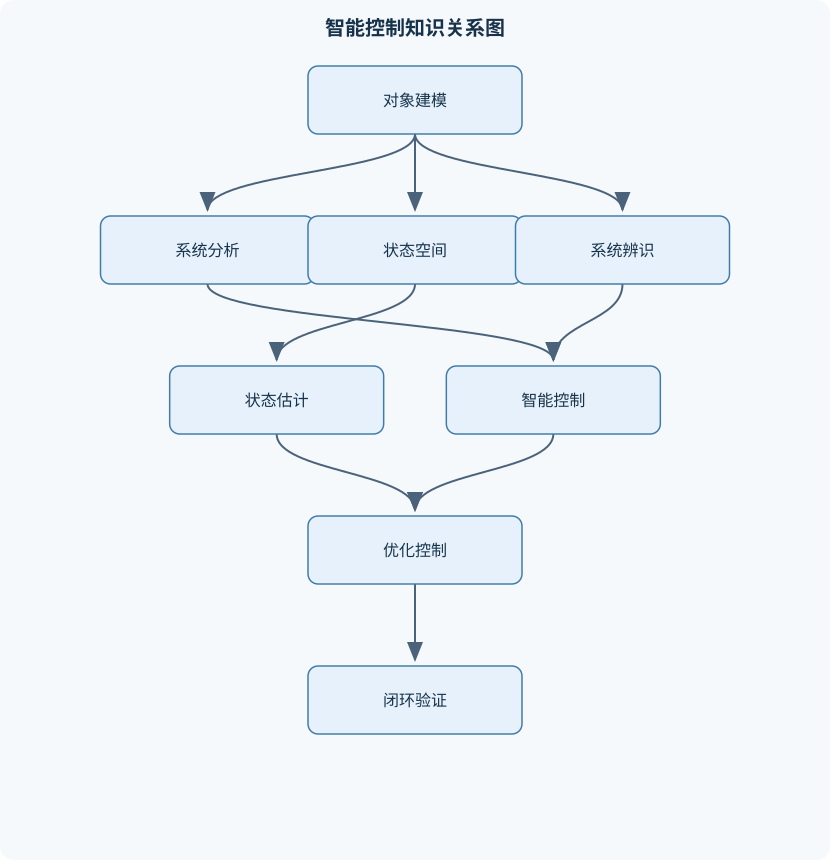
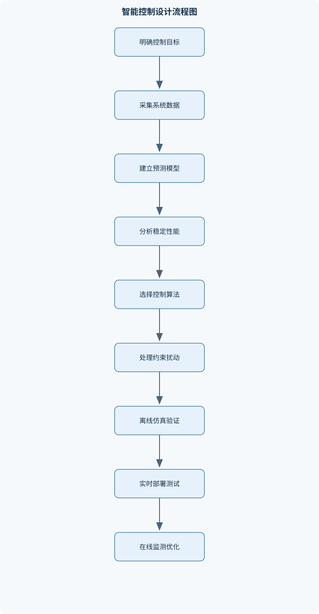

# 智能控制技术及应用

## 一、课程整体知识框架

### 课程边界与先修知识

本课程研究以被控对象模型为基础，综合使用经典控制、现代控制、智能算法与工程实现方法，使系统在不确定性、非线性、扰动和约束条件下实现稳定、快速、准确、鲁棒和具有一定自主适应能力的控制。主要内容覆盖控制系统建模、线性系统分析、状态空间方法、系统辨识、数字控制、反馈与鲁棒性、模糊控制、神经网络控制、优化控制、预测控制、强化学习控制以及典型机电与工业过程应用。课程边界不等同于单纯的人工智能算法课程，也不等同于只研究线性定常系统的经典自动控制课程；重点是将控制理论与数据驱动、知识驱动和优化决策方法结合。先修知识包括高等数学、线性代数、常微分方程、概率统计、信号与系统、自动控制原理和基础编程。学习者应理解矩阵运算、特征值、稳定性、传递函数、频率响应、离散系统和基本数值计算。理想模型通常假设参数已知、采样同步、执行器无饱和、传感器无延迟且噪声满足给定统计模型；实际系统还需考虑模型误差、时延、量化、饱和、死区、摩擦、通信丢包、计算资源和安全约束。





### 1. 课程定位与核心问题

《智能控制技术及应用》研究如何利用被控对象模型、测量数据、经验规则和在线优化，使闭环系统在模型不完备、参数变化、非线性、外部扰动、测量噪声和输入输出约束下，仍能实现稳定、快速、准确且可验证的控制。其研究对象不是单一算法，而是从“对象建模—状态与参数估计—控制律设计—数字实现—闭环验证—工程部署”组成的完整链条。

控制系统通常包含参考输入 $r$、控制输入 $u$、被控对象、测量输出 $y$、外部扰动 $d$ 和测量噪声 $n$。控制器根据参考输入与测量信息产生控制指令，执行器将控制指令转换为物理作用，传感器获取对象状态或输出。理想闭环中，控制器能够实时获得无噪声、无延迟的测量值，执行器不存在饱和和死区，模型参数准确；实际系统则可能存在采样周期有限、通信丢包、量化误差、计算延迟、摩擦、未建模动态和安全边界，因此控制器设计必须同时考虑理论性能和实现条件。

课程边界有两点。第一，它不是单纯的机器学习课程，因为所有数据驱动方法最终都要通过闭环稳定性、约束满足和物理可实现性检验。第二，它不是只处理线性定常模型的经典自动控制课程，因为模糊控制、神经网络、优化控制和强化学习需要处理非线性、时变、约束和不确定性。经典控制提供频域和传递函数工具，现代控制提供状态空间、可控性、可观测性和最优控制工具，智能方法则利用知识、数据或在线决策增强模型适应能力。

### 2. 统一数学描述与性能目标

连续时间线性定常系统可写为

$$
\dot{x}(t)=Ax(t)+Bu(t),\qquad y(t)=Cx(t)+Du(t),
$$

其中，$t$ 的单位通常为秒，$x(t)\in\mathbb{R}^n$ 为状态向量，$u(t)\in\mathbb{R}^m$ 为控制输入，$y(t)\in\mathbb{R}^p$ 为输出；$A\in\mathbb{R}^{n\times n}$、$B\in\mathbb{R}^{n\times m}$、$C\in\mathbb{R}^{p\times n}$、$D\in\mathbb{R}^{p\times m}$。状态不是“所有可测量物理量”的简单集合，而是能够结合当前输入决定未来演化所需的最小信息集合。输出可以是状态的一部分、线性组合或直接含有输入的量。

离散时间模型常写为

$$
x[k+1]=A_d x[k]+B_d u[k],\qquad
y[k]=C_d x[k]+D_d u[k],
$$

其中 $k$ 为采样时刻编号，采样周期为 $T_s$，$t_k=kT_s$。连续域变量用 $s$ 表示，离散域变量用 $z$ 表示。传递函数

$$
G(s)=\frac{Y(s)}{U(s)}
$$

只在零初始条件下表示输入输出关系；它可能隐藏内部状态，因而传递函数稳定并不必然意味着内部实现稳定。

主要性能目标包括稳定性、跟踪误差、超调量、上升时间、调节时间、带宽、控制能量、抗扰能力和鲁棒性。稳定性是基本条件，但稳定不等于性能良好。例如系统输出最终趋于常数，却可能有很大超调、很慢的响应或超出执行器电压范围。工程设计还要明确输入约束 $u_{\min}\leq u\leq u_{\max}$、输入变化率约束 $\Delta u[k]=u[k]-u[k-1]$ 以及状态和输出安全范围。

### 3. 从机理模型到数据模型

机理建模根据质量守恒、能量守恒、电路定律、运动定律或经验物理关系建立方程。例如直流电机可用电气方程和机械方程描述，状态可以取电枢电流与转速，输入取电枢电压，输出取转速。机理模型具有参数和变量的物理含义，便于解释和约束，但建立高精度模型通常需要辨识摩擦、负载和未建模动态。

数据建模直接利用输入输出样本估计模型参数或映射关系。数据模型在复杂非线性对象上较灵活，但受实验设计、传感器噪声、训练数据覆盖范围和分布变化影响。训练误差小不代表闭环控制安全；若训练数据只覆盖低速区间，网络在高速或突加负载时可能输出不可实现的控制量。

线性化是在工作点附近用一阶近似替代非线性模型。若非线性模型为

$$
\dot{x}=f(x,u),\qquad y=h(x,u),
$$

在平衡点 $(x_0,u_0)$ 附近令 $\delta x=x-x_0$、$\delta u=u-u_0$，可得

$$
\delta\dot{x}\approx A\delta x+B\delta u,\qquad
\delta y\approx C\delta x+D\delta u,
$$

其中

$$
A=\left.\frac{\partial f}{\partial x}\right|_{x_0,u_0},\quad
B=\left.\frac{\partial f}{\partial u}\right|_{x_0,u_0}.
$$

该模型只在偏离工作点不大、函数足够光滑且高阶项可忽略时有效。大范围运行、强摩擦、饱和、间隙和模式切换会使单一线性模型失效，需使用分段模型、增益调度、非线性控制或在线辨识。

### 4. 统一的控制方法层次

课程方法可按模型和信息来源分为四层：

1. **经典反馈层**：利用传递函数、根轨迹、频率响应和 PID 调整闭环极点、带宽及稳态误差。
2. **状态空间层**：利用状态反馈、观测器、极点配置和 LQR 处理多变量系统及内部状态。
3. **估计与辨识层**：利用最小二乘、递推最小二乘和卡尔曼滤波获得未知参数或不可直接测量的状态。
4. **智能与优化层**：利用模糊规则、神经网络、模型预测控制、强化学习及鲁棒控制处理非线性、约束、不确定性和复杂决策。

这些层次并非相互替代。实际系统常采用分层结构：底层使用快速电流环或速度环，中层使用状态反馈、MPC 或扰动观测器，上层使用任务规划、强化学习或监督切换。智能算法输出通常还需经过限幅、速率限制、稳定控制器或安全过滤器。

### 5. 关键推导和贯通结论

对于连续线性系统

$$
\dot{x}=Ax+Bu,
$$

由矩阵指数定义，状态响应为

$$
x(t)=e^{At}x(0)+\int_0^t e^{A(t-\tau)}Bu(\tau)\,d\tau.
$$

第一项是初始状态引起的自由响应，第二项是输入引起的受迫响应。若 $A$ 的全部特征值实部小于零，且输入有界，则在适当条件下自由响应衰减；但这不自动保证输出满足约束或跟踪误差为零。

采用状态反馈 $u=-Kx$ 时，

$$
\dot{x}=(A-BK)x.
$$

闭环极点由 $A-BK$ 决定。只有当系统可控，或至少所有不稳定模态可控时，才有可能通过状态反馈实现稳定化；不可控不稳定模态不能由 $K$ 改变。

可控矩阵和可观测矩阵分别为

$$
\mathcal{C}=[B\ AB\ \cdots\ A^{n-1}B],
$$

$$
\mathcal{O}=
\begin{bmatrix}
C\\
CA\\
\vdots\\
CA^{n-1}
\end{bmatrix}.
$$

若 $\operatorname{rank}(\mathcal{C})=n$，系统完全可控；若 $\operatorname{rank}(\mathcal{O})=n$，系统完全可观测。秩条件只说明线性代数意义上的信息和控制通道充分，不表示传感器噪声小、执行器功率足或数值计算条件良好。

连续模型经零阶保持离散化时，

$$
A_d=e^{AT_s},\qquad
B_d=\int_0^{T_s}e^{A\tau}B\,d\tau.
$$

若 $A$ 可逆，可将积分写成 $A^{-1}(A_d-I)B$；但当 $A$ 不可逆时，不能直接使用该形式，应计算矩阵指数积分或采用增广矩阵方法。离散系统渐近稳定的条件是所有闭环极点满足 $|\lambda_i|<1$，不能将连续系统的“极点实部小于零”直接用于数字系统。

### 6. 课程学习结果的工程含义

完成课程知识体系后，应能从对象物理关系或实验数据建立可验证模型；判断模型的状态、输入、输出和扰动含义；分析极点、零点、稳定性、误差和频率特性；设计状态反馈、观测器、PID、LQR、MPC 或智能控制器；将连续控制律转换为差分算法并处理采样、延迟、量化、饱和和抗积分饱和；用独立验证数据检查模型，用扰动、噪声、参数变化和异常工况检查闭环控制器；最终形成可部署的软件、参数表、仿真报告和验收指标。

## 二、章节和模块划分

### 核心知识覆盖清单

本清单用于检查正文是否覆盖本课程的主要知识模块：

- **智能控制系统概论与建模**：智能控制的定义与层次结构、被控对象输入输出与状态变量、机理建模与数据建模的差异、线性化与工作点选择、连续时间与离散时间模型、控制目标与性能指标、扰动噪声与不确定性分类、控制器执行器传感器闭环结构。
- **经典控制基础与系统性能**：传递函数与方块图运算、开环与闭环系统关系、一阶二阶系统动态特性、极点零点与稳定性、稳态误差及误差系数、根轨迹设计思想、频率响应与增益相位裕度、超调量调节时间与带宽。
- **状态空间分析与现代控制**：状态空间方程与矩阵表示、状态转移矩阵、可控性与可观测性、相似变换与标准型、最小实现与模型降阶、状态反馈与极点配置、全维状态观测器、连续系统离散化与采样影响。
- **系统辨识与状态估计**：辨识对象与实验设计、输入信号的持续激励、最小二乘参数辨识、递推最小二乘与遗忘因子、预测误差法、卡尔曼滤波基本思想、观测器误差动力学、噪声协方差与估计权衡。
- **数字控制与实时实现**：采样保持与零阶保持、连续模型离散化方法、差分方程实现、数字PID位置式与增量式、采样周期选择、量化误差与计算延迟、执行器饱和与抗积分饱和、实时控制任务调度。
- **模糊控制与规则推理**：模糊集合与隶属度函数、模糊语言变量、模糊规则库设计、模糊化与解模糊、Mamdani与Sugeno推理、模糊PID结构、规则冲突与覆盖性、模糊控制稳定性与工程边界。
- **神经网络控制与自适应控制**：神经网络逼近非线性、多层感知器结构、反向传播参数更新、神经网络逆模型控制、模型参考自适应控制、直接与间接自适应控制、参数投影与防发散机制、训练数据分布与闭环安全。
- **优化控制与模型预测控制**：性能指标与约束表达、线性二次型调节器、黎卡提方程、有限时域最优控制、滚动时域优化、预测模型与控制序列、输入状态输出约束、可行性递归与终端稳定性。
- **强化学习控制与智能决策**：马尔可夫决策过程、状态动作奖励与策略、价值函数与贝尔曼方程、Q学习与时序差分、策略梯度方法、探索与利用的矛盾、连续动作控制、离线数据安全与约束强化学习。
- **鲁棒控制与综合应用**：参数不确定性与结构不确定性、鲁棒稳定性概念、扰动抑制与灵敏度函数、滑模控制基本思想、反步控制与递推设计、多控制器切换与监督控制、机电系统与过程控制案例、仿真验证实验与现场部署流程。


### 1. 智能控制系统概论与建模

本模块定义智能控制的层次结构：底层是传感器、执行器和实时控制器，中层是状态估计、参数辨识和控制律，上层是规则推理、优化决策或任务规划。输入 $u$ 通过执行器作用于对象，输出 $y$ 经传感器反馈，扰动 $d$ 直接或间接改变对象状态，噪声 $n$ 污染测量值。应区分状态 $x$、输出 $y$ 和测量量；测量量可能只是状态的部分组合，也可能带有噪声和延迟。

建模步骤包括确定边界、选取输入输出、选择状态、列出物理方程、确定参数、选择工作点、线性化或离散化，并用独立数据验证。模型验证关注预测误差和残差相关性，控制验证则关注闭环稳定、跟踪、抗扰、控制峰值和约束满足，二者不能混为一谈。

### 2. 经典控制基础与系统性能

方块图中串联环节相乘、并联环节相加，反馈结构需根据反馈方向合并。一般负反馈闭环传递函数为

$$
T(s)=\frac{G(s)}{1+G(s)H(s)}.
$$

若为单位负反馈，$H(s)=1$。灵敏度函数为

$$
S(s)=\frac{1}{1+G(s)H(s)}.
$$

低频增大环路增益通常有利于减小跟踪误差和低频扰动影响，高频增大增益则可能放大噪声、降低相位裕度。因此抗扰和抗噪声通常对应不同频段，不能简单地在所有频率提高增益。

标准二阶闭环特征方程为

$$
s^2+2\zeta\omega_n s+\omega_n^2=0,
$$

其中 $\omega_n$ 的单位为 $\mathrm{rad/s}$，$\zeta$ 无量纲。欠阻尼时，极点为

$$
s_{1,2}=-\zeta\omega_n\pm j\omega_n\sqrt{1-\zeta^2}.
$$

当 $0<\zeta<1$ 时，超调量近似为

$$
M_p=e^{-\pi\zeta/\sqrt{1-\zeta^2}},
$$

调节时间按百分之二带近似为

$$
t_s\approx \frac{4}{\zeta\omega_n}.
$$

这些公式只适用于主导动态可近似为标准二阶、无显著零点、无饱和和无时延的情况。高阶系统、右半平面零点或强时延存在时，不能仅凭这两个公式保证实际指标。

根轨迹通过改变增益观察闭环极点移动，频率响应则通过增益裕度、相位裕度和带宽评价鲁棒性。极点位于左半平面只保证连续线性模型渐近稳定，不保证输入峰值、噪声放大和非线性工况安全。

### 3. 状态空间分析与现代控制

状态转移矩阵为 $e^{At}$，它描述无输入时状态传播。状态反馈控制律可写为

$$
u=-Kx+u_{\mathrm{ff}},
$$

若状态不能直接测量，则用估计状态 $\hat{x}$：

$$
u=-K\hat{x}+u_{\mathrm{ff}}.
$$

全维观测器为

$$
\dot{\hat{x}}=A\hat{x}+Bu+L(y-C\hat{x}).
$$

令估计误差 $e=x-\hat{x}$，则

$$
\dot{e}=(A-LC)e.
$$

因此观测器极点由 $A-LC$ 决定，与状态反馈的极点配置具有对偶关系。但观测器极点过快会放大测量噪声，导致估计抖动和控制输入尖峰。

模型降阶应保留与任务相关的慢模态或关键频段，并验证降阶前后的稳定性、频率响应和闭环性能。极零约消不能直接当作内部稳定性证明，因为被约消的内部模态仍可能受到初始条件或扰动激发。

### 4. 系统辨识与状态估计

线性参数化模型可写为

$$
y[k]=\varphi^\mathsf{T}[k]\theta+\varepsilon[k],
$$

其中 $\varphi[k]$ 是回归向量，$\theta$ 是未知参数，$\varepsilon[k]$ 是误差。批量最小二乘通过最小化平方误差估计 $\theta$；递推最小二乘适合在线更新。设遗忘因子为 $\lambda\in(0,1]$，典型更新形式为

$$
K[k]=\frac{P[k-1]\varphi[k]}
{\lambda+\varphi^\mathsf{T}[k]P[k-1]\varphi[k]},
$$

$$
\theta[k]=\theta[k-1]+K[k]\bigl(y[k]-\varphi^\mathsf{T}[k]\theta[k-1]\bigr),
$$

$$
P[k]=\lambda^{-1}\left(I-K[k]\varphi^\mathsf{T}[k]\right)P[k-1].
$$

$\lambda$ 接近 $1$ 适合参数缓慢变化；过小会使算法过度追踪噪声。持续激励要求输入在相关频段具有足够变化，恒定输入通常不能辨识多个动态参数。

卡尔曼滤波在离散线性高斯模型下交替执行时间更新和测量更新。过程噪声协方差 $Q$ 越大，表示对模型不确定性信任越低；测量噪声协方差 $R$ 越大，表示对传感器信任越低。$Q$、$R$ 不是任意调节的“滤波强度旋钮”，其维数、单位和统计含义必须与状态方程一致。

### 5. 数字控制与实时实现

零阶保持在一个采样周期内保持控制输入不变。采样周期过大可能造成离散化误差、相位滞后和闭环失稳；过小则增加处理器负担、通信压力和噪声敏感性。数字 PID 可采用位置式或增量式形式。位置式直接计算

$$
u[k]=K_pe[k]+K_iT_s\sum_{i=0}^{k}e[i]
+\frac{K_d}{T_s}\bigl(e[k]-e[k-1]\bigr),
$$

其中 $K_p$、$K_i$、$K_d$ 的单位取决于误差和控制量的物理单位。增量式计算 $\Delta u[k]$，适合避免保存过大的绝对积分量。

执行器饱和时，积分项仍累积会产生积分饱和和恢复过冲。抗积分饱和可采用条件积分或反算反馈，例如根据实际输出与未饱和输出的差值修正积分状态。数值稳定、闭环稳定和执行器不饱和是三个不同概念：算法数值计算不发散，不代表闭环物理响应稳定；闭环稳定也不代表控制输入没有超限。

### 6. 模糊控制与规则推理

模糊控制将误差、误差变化率等连续量映射为语言变量，如“负大、零、正大”。隶属度 $\mu_A(x)\in[0,1]$ 表示 $x$ 属于模糊集合 $A$ 的程度，不是概率。控制流程包括模糊化、规则激活、输出聚合和解模糊。Mamdani 推理通常输出模糊集合，再用重心法获得控制量；Sugeno 推理通常输出常数或输入的线性函数，便于数值计算和优化。

规则库必须具有覆盖性、连续性和冲突处理机制。若相邻规则输出差异过大，输入小变化可能引起控制跳变；若规则覆盖不足，某些输入区域没有有效控制动作。模糊规则的经验合理性不等于稳定性证明，工程上常将模糊控制作为 PID 参数调度器或叠加在有稳定保证的基准控制器上。

### 7. 神经网络控制与自适应控制

多层感知器通过加权和、偏置和非线性激活函数逼近复杂映射。反向传播根据损失函数梯度更新参数，学习率 $\alpha$ 决定每次更新步长。神经网络逆模型控制可先学习对象的近似逆映射，再由期望输出计算控制量；但对象非最小相位、存在时延或逆映射不唯一时，直接求逆可能不稳定。

模型参考自适应控制使对象输出跟踪参考模型。直接自适应控制直接调整控制器参数，间接自适应控制先辨识对象参数再重新设计控制器。在线更新必须设置参数投影、梯度裁剪、死区、更新速率限制和控制量饱和。闭环训练数据若不能覆盖未来工况，网络可能在分布外输入下产生危险动作，因而需要安全层、备用控制器和独立验证。

### 8. 优化控制与模型预测控制

线性二次型调节器的性能指标为

$$
J=\int_0^\infty \left(x^\mathsf{T}Qx+u^\mathsf{T}Ru\right)\,dt,
$$

其中 $Q\succeq0$、$R\succ0$，并且二者的维数必须分别与状态和输入匹配。连续时间代数黎卡提方程为

$$
A^\mathsf{T}P+PA-PBR^{-1}B^\mathsf{T}P+Q=0,
$$

控制增益为

$$
K=R^{-1}B^\mathsf{T}P.
$$

该结论要求系统满足适当的可稳定化、可检测性和权重条件。$Q$、$R$ 的数值受单位缩放影响，不能脱离状态和输入归一化直接解释绝对优先级。

MPC 在有限预测时域内优化未来控制序列，约束可写为

$$
u_{\min}\leq u[k+i]\leq u_{\max},\qquad
y_{\min}\leq y[k+i]\leq y_{\max}.
$$

每次只执行最优序列的首个控制量，下一采样时刻重新获取状态并滚动优化。稳定性不仅取决于每次优化收敛，还取决于终端代价、终端集合、递归可行性和模型误差。约束不匹配时可能无解，需要软约束、备用控制器或可行性恢复机制。

### 9. 强化学习控制与智能决策

强化学习将控制任务表示为马尔可夫决策过程，状态为 $s$，动作​​为 $a$，奖励为 $r$，折扣因子为 $\gamma\in[0,1)$。价值函数衡量长期回报，贝尔曼最优性原理给出 Q 学习更新式：

$$
Q(s,a)\leftarrow Q(s,a)+\alpha
\left[r+\gamma\max_{a'}Q(s',a')-Q(s,a)\right].
$$

其中 $\alpha$ 是学习率。探索与利用存在矛盾：只利用当前最优动作可能陷入局部策略，只探索又会降低任务性能。连续动作通常采用参数化策略、策略梯度或演员—评论家方法。工程控制不能仅以累积奖励判断优劣，还需检查约束违背次数、能耗、峰值控制量、未见扰动下的性能和故障后行为。在线探索必须设置安全动作集；离线数据存在分布偏移时，策略可能选择数据未覆盖的动作。

### 10. 鲁棒控制与综合应用

参数不确定性是参数值变化造成的不确定，结构不确定性则表示未建模动态、时延或高频寄生环节。鲁棒稳定性要求在给定不确定性集合内所有允许模型均保持稳定。灵敏度函数 $S(s)$ 衡量扰动和模型变化对输出的影响，互补灵敏度 $1-S(s)$ 常用于分析噪声和高频动态。

滑模控制通过设计滑模面和趋近律使系统状态到达并保持在滑模面附近，具有较强扰动抑制能力，但符号函数会造成抖振，需要边界层或连续近似。反步控制适用于严格反馈结构，通过递推构造虚拟控制量和 Lyapunov 函数；模型不满足结构条件时不能直接套用。

多控制器切换和监督控制可根据工况、模型残差或性能指标选择控制器，但切换瞬间可能产生控制跳变，需设置滞环、驻留时间和状态平滑。应用案例包括直流电机速度控制、倒立摆、机器人关节控制、温度与液位过程控制。现场部署流程应包括模型验证、仿真、半实物测试、限幅保护、故障注入、分阶段放权和现场验收。

### 11. 代表性算法与流程

#### 11.1 状态空间模型分析流程

**输入**：矩阵 $A,B,C,D$，连续或离散时间标志，采样周期和输入信号。  
**输出**：极点、零点、直流增益、可控性、可观测性和响应指标。  
**过程**：检查矩阵维数；计算特征值和秩；构造阶跃或指定输入响应；提取上升时间、超调量和调节时间；检查单位和输入幅值。  
**不变量**：状态维数、输入维数和输出维数始终一致。  
**终止条件**：所有分析量完成或发现矩阵维数不匹配。  
**适用条件**：有限维线性定常模型；主要矩阵运算复杂度约为 $O(n^3)$。  

#### 11.2 极点配置流程

先验证 $(A,B)$ 可控或至少满足稳定化条件，再指定期望闭环极点，利用数值极点配置算法求 $K$，最后计算 $A-BK$ 的实际极点并与目标比较。若极点误差超过容差，需检查矩阵病态、模型单位、目标极点是否过快以及输入是否会饱和。极点配置不能自动处理硬约束，也不能弥补状态测量噪声和模型误差。

#### 11.3 递推最小二乘流程

每个采样时刻先计算预测误差，再计算增益向量，更新参数和协方差，并检查协方差对称性与半正定性。输入必须具有持续激励；参数维数为 $p$ 时，每步计算复杂度约为 $O(p^2)$。协方差初始化过小会使算法不愿修正，过大则初期对噪声敏感。

#### 11.4 模型预测控制流程

建立预测模型，构造有限时域目标函数和约束，求解二次规划或非线性规划，只施加首个控制量，下一采样时刻重新估计状态并重复。若优化不可行，应记录不可行原因，采用软约束、降级控制或安全停车，而不能直接使用未检查的优化器输出。

```python
# Python：一阶离散对象的带输入限幅滚动控制示例
import numpy as np

a, b = 0.8, 0.4
u_min, u_max = -1.0, 1.0
x = 0.0
reference = 1.0
horizon = 8
gain = 0.7

for k in range(30):
    # 用当前状态预测恒定候选输入下的终端状态
    u_candidate = gain * (reference - x)
    u = float(np.clip(u_candidate, u_min, u_max))

    # 对象更新：x[k+1] = a*x[k] + b*u[k]
    x_next = a * x + b * u

    # 离散系统稳定性要求 |a| < 1；此处 a=0.8
    error = reference - x
    print(f"k={k:02d}, x={x:.4f}, error={error:.4f}, u={u:.4f}")

    x = x_next
```

该代码是具有输入限幅的滚动控制示意，不等同于完整 MPC，因为它没有显式求解带状态约束的多步优化问题。它用于说明采样更新、候选控制、限幅和状态递推之间的关系。

### 12. 代表性例题

#### 例题一：二阶系统由指标求极点

**题干**：某标准二阶系统要求超调量约为 $16\%$，调节时间约为 $2\ \mathrm{s}$，按百分之二标准估计 $\zeta$ 与 $\omega_n$。

**分析**：先由超调量求阻尼比，再由调节时间估计 $\zeta\omega_n$。

**解答**：

$$
0.16=e^{-\pi\zeta/\sqrt{1-\zeta^2}}
$$

取对数并求得 $\zeta\approx0.5$。由

$$
t_s\approx\frac{4}{\zeta\omega_n}
$$

得 $\omega_n\approx4\ \mathrm{rad/s}$。目标特征方程为

$$
s^2+2\zeta\omega_n s+\omega_n^2
=s^2+4s+16.
$$

**验证**：计算所得超调量和调节时间应接近目标。  
**边界**：若实际系统含额外慢极点、明显零点、时延或饱和，标准二阶公式只能作为初始估计。  
**变式**：若要求零超调，可选择临界阻尼或过阻尼，但响应速度和鲁棒性需重新核查。

#### 例题二：连续模型离散化

**题干**：系统为 $\dot{x}=-2x+u$，采样周期 $T_s=0.1\ \mathrm{s}$，求零阶保持离散模型。

**解答**：

$$
A_d=e^{-2T_s}=e^{-0.2}\approx0.8187.
$$

由于 $A=-2$ 可逆，

$$
B_d=\int_0^{0.1}e^{-2\tau}d\tau
=\frac{1-e^{-0.2}}{2}\approx0.0906.
$$

因此

$$
x[k+1]=0.8187x[k]+0.0906u[k].
$$

**验证**：$|A_d|=0.8187<1$，无输入时离散系统稳定。  
**边界**：若 $A$ 为奇异矩阵，不能直接写成 $A^{-1}(A_d-I)B$，必须计算积分。  
**变式**：增大 $T_s$ 会使离散极点进一步靠近零，但采样保持误差和延迟影响可能加重，不能仅根据极点位置选择采样周期。

#### 例题三：可控性与状态反馈

**题干**：给定

$$
A=\begin{bmatrix}0&1\\0&0\end{bmatrix},\quad
B=\begin{bmatrix}0\\1\end{bmatrix},
$$

判断可控性，并说明能否配置任意两个闭环极点。

**解答**：

$$
AB=\begin{bmatrix}1\\0\end{bmatrix},
\qquad
\mathcal C=[B\ AB]
=\begin{bmatrix}0&1\\1&0\end{bmatrix}.
$$

其秩为 $2$，等于状态维数，因此系统完全可控。令 $K=[k_1\ k_2]$，则

$$
A-BK=
\begin{bmatrix}
0&1\\
-k_1&-k_2
\end{bmatrix},
$$

特征多项式为

$$
s^2+k_2s+k_1.
$$

给定目标多项式 $s^2+3s+2$，可得 $k_1=2,k_2=3$。  
**验证**：$A-BK$ 的极点为 $-1,-2$。  
**边界**：若输入受限，过快极点可能要求过大的控制电压，即使数学上可配置，工程上也不可实现。

#### 例题四：递推最小二乘一次更新

**题干**：模型为 $y[k]=\varphi^\mathsf{T}[k]\theta$，初始 $\theta[0]=[0,0]^\mathsf{T}$，$P[0]=I$，$\lambda=1$，当前 $\varphi=[1,2]^\mathsf{T}$、$y=3$，求一次更新结果。

**解答**：

$$
K=\frac{P\varphi}{1+\varphi^\mathsf{T}P\varphi}
=\frac{[1,2]^\mathsf{T}}{1+5}
=\begin{bmatrix}1/6\\1/3\end{bmatrix}.
$$

预测误差为 $3$，所以

$$
\theta[1]=\theta[0]+K\cdot3
=\begin{bmatrix}0.5\\1\end{bmatrix}.
$$

协方差为

$$
P[1]=I-K\varphi^\mathsf{T}
=\begin{bmatrix}
5/6&-1/3\\
-1/3&1/3
\end{bmatrix}.
$$

**验证**：协方差应保持对称且半正定。  
**边界**：单个样本不能保证两个参数都被可靠辨识，必须有持续激励和独立验证数据。  
**变式**：引入 $\lambda<1$ 可跟踪慢变参数，但会增加噪声敏感性。

#### 例题五：含饱和的数字 PID

**题干**：某控制器计算出未限幅输入 $u_c[k]=1.8$，执行器范围为 $[-1,1]$，当前误差为正且积分项继续增加。说明不进行抗饱和会发生什么，并给出处理方法。

**解答**：实际输出为 $u[k]=1$，但积分状态仍按误差累积。对象达到目标附近后，积分项仍可能使控制器保持饱和，造成较大反向超调和长时间恢复，这称为积分饱和。可采用条件积分：当输出饱和且误差方向会使饱和加重时暂停积分；也可采用反算抗饱和，使积分状态根据 $u-u_c$ 修正。

**验证**：比较输出饱和持续时间、超调量、调节时间和积分状态峰值。  
**边界**：抗饱和不能替代执行器容量设计；若所需稳态输入本身超过上限，任何积分策略都无法实现目标。  
**变式**：加入输入速率限制后，还需限制 $\Delta u[k]$，否则虽然幅值不超限，执行器仍可能无法跟随。

### 13. 实验与项目流程

#### 13.1 直流电机速度控制实验

**输入数据**：电枢电压、电流、转速、采样周期、负载变化记录和执行器电压上限。  
**步骤**：  
1. 根据电气和机械方程建立状态空间模型。  
2. 用阶跃电压实验估计时间常数和增益。  
3. 检查可控性与可观测性。  
4. 分别设计 PID、状态反馈和观测器。  
5. 在相同参考信号、采样周期和限幅条件下仿真。  
6. 注入负载扰动、测量噪声和参数偏差。  
7. 使用独立实验数据验证模型和控制器。  

**评价标准**：稳态误差、超调量、调节时间、积分绝对误差、控制峰值、控制能量、饱和持续时间和扰动恢复时间。  
**排错方法**：若矩阵维数错误，检查状态和输入定义；若响应方向相反，检查电压极性和反馈符号；若仿真稳定而实物振荡，检查采样延迟、摩擦、量化和未建模极点；若控制量频繁饱和，重新检查单位、增益和执行器容量。

#### 13.2 约束模型预测控制项目

**输入数据**：离散对象模型、参考轨迹、预测步长、输入上下限、输入变化率限制和输出安全范围。  
**步骤**：  
1. 写出未来状态和输出的预测方程。  
2. 构造跟踪误差、控制增量和终端代价。  
3. 加入硬约束或软约束。  
4. 在每个采样时刻求解优化问题，仅执行首个控制量。  
5. 记录优化状态、求解时间和不可行次数。  
6. 施加阶跃、斜坡、扰动和模型失配。  
7. 与 PID 或 LQR 在统一条件下比较。  

**评价标准**：跟踪误差、约束违背次数、控制峰值、平均求解时间、优化不可行率、扰动恢复时间和终端状态。  
**排错方法**：若优化无解，检查初始状态是否已违反约束、终端条件是否过严、模型单位是否一致；若求解超时，缩短预测步长、降低模型阶数或采用更高效的求解器；若控制动作跳变，检查输入增量权重、测量噪声和状态估计；若仿真良好但现场失败，检查模型失配、延迟和执行器实际限幅。

### 14. 易错点、笔试问题与面试问题

#### 14.1 具体易错点

1. 把状态、输出和测量值当成同一概念。  
2. 把开环稳定误认为闭环性能满足要求。  
3. 不检查可控性就进行极点配置。  
4. 将连续极点条件直接用于离散系统。  
5. 误以为观测器极点越快越好。  
6. 忽略传递函数约消后的内部不稳定模态。  
7. 不区分模型验证和控制验证。  
8. 忽略状态、输入和权重矩阵的物理单位。  
9. 把 LQR 的大权重直接理解为绝对优先级。  
10. 把模糊规则覆盖性当作稳定性证明。  
11. 把神经网络训练误差小当作闭环安全。  
12. 忽略执行器饱和、死区和速率限制。  
13. 把 MPC 优化可行性视为必然成立。  
14. 将强化学习高回报等同于工程最优。  
15. 用过高阶模型直接部署，忽略计算时间和数值病态。  
16. 忽略采样同步、通信延迟和量化误差。  

#### 14.2 典型笔试问题及解答思路

1. **问：连续系统何时渐近稳定？**  
   **思路**：写出闭环特征方程，检查所有极点实部是否小于零，并说明这是线性定常模型条件。

2. **问：如何判断系统可控？**  
   **思路**：构造 $\mathcal C=[B,AB,\ldots,A^{n-1}B]$，计算秩是否为 $n$；再说明不可控不稳定模态不能由状态反馈改变。

3. **问：推导状态响应公式。**  
   **思路**：先求齐次解 $e^{At}x(0)$，再用变参数法得到输入卷积项，并区分初始响应和受迫响应。

4. **问：为什么观测器极点不能任意加快？**  
   **思路**：误差由 $A-LC$ 决定；极点过快会提高增益，使测量噪声进入估计状态并放大控制抖动。

5. **问：说明零阶保持离散化公式。**  
   **思路**：在一个采样周期内令 $u(t)$ 为常数，积分连续状态方程，得到 $A_d=e^{AT_s}$ 和 $B_d$ 的积分表达式。

6. **问：LQR 中 $Q$ 和 $R$ 如何影响控制？**  
   **思路**：增大 $Q$ 通常更重视状态偏差，增大 $R$ 通常更抑制控制能量；必须结合单位归一化和闭环极点验证。

7. **问：积分饱和为何产生？如何抑制？**  
   **思路**：执行器输出被限幅而积分状态继续累积；采用条件积分、反算抗饱和或积分状态重置，并检查稳态目标是否可实现。

8. **问：MPC 为什么只执行最优序列第一项？**  
   **思路**：滚动时域使下一时刻能够使用新测量和新优化结果，从而对模型误差和扰动进行反馈修正。

#### 14.3 典型面试问题与参考回答

1. **问：如何从零开始控制一个陌生对象？**  
   **参考答案**：先明确输入输出、约束和安全边界，再做阶跃或频率实验，建立低阶可验证模型，选择基准控制器，逐步加入估计、优化或智能方法。  
   **追问要点**：如何处理激励不足、执行器限幅、模型与现场不一致。

2. **问：PID、状态反馈和 MPC 如何选择？**  
   **参考答案**：单变量、约束较少且模型简单时 PID 实用；多变量且状态模型可靠时状态反馈或 LQR 合适；约束显著、需要提前处理未来行为时选择 MPC。  
   **追问要点**：计算资源不足时如何降阶、缩短预测时域或设置备用控制器。

3. **问：神经网络控制如何保证安全？**  
   **参考答案**：限制训练数据分布，设置动作限幅和速率限制，采用安全过滤器或基准控制器兜底，并在仿真、半实物和故障注入环境中验证。  
   **追问要点**：如何检测分布外输入和网络参数发散。

4. **问：现场控制器振荡，如何排查？**  
   **参考答案**：先确认反馈符号、单位和采样周期，再检查延迟、滤波器、执行器饱和、传感器噪声、模型失配和控制器极点。  
   **追问要点**：如何区分机械共振、采样延迟和增益过高造成的振荡。

5. **问：MPC 出现不可行怎么办？**  
   **参考答案**：确认状态初值和约束是否一致，采用软约束并对违约设置高代价，配置安全备用控制器，必要时降低任务要求或进入安全停车。  
   **追问要点**：如何证明递归可行性和终端稳定性。

6. **问：如何评价一个控制算法，而不是只看曲线？**  
   **参考答案**：统一参考输入、扰动、采样周期和限幅，比较稳态误差、超调、调节时间、积分误差、控制能量、峰值、约束违背和计算时间。  
   **追问要点**：如何进行统计重复实验和独立工况验证。

7. **问：递推最小二乘参数不收敛的原因是什么？**  
   **参考答案**：可能是输入缺少持续激励、模型结构错误、噪声有偏、遗忘因子不合适或回归向量单位失衡。  
   **追问要点**：如何通过输入设计、残差检验和参数投影改善。

8. **问：强化学习能否直接在线控制真实设备？**  
   **参考答案**：高风险设备通常不应直接进行无约束探索，应先用仿真和离线数据训练，再采用安全动作集、监督控制器和渐进放权。  
   **追问要点**：如何处理仿真到现实的分布偏移和奖励函数遗漏。

### 15. 岗位关联与工程产出

自动控制工程师通常负责对象建模、PID 或状态反馈设计、调试和验收，产出包括控制参数、回路图、仿真报告和现场测试记录，验收关注稳定性、响应时间、稳态误差和限幅行为。运动控制和机器人控制工程师需要处理多变量状态空间模型、轨迹跟踪、观测器、摩擦与执行器约束，产出为控制器代码、轨迹误差报告和实时性能测试。

系统辨识与建模工程师负责实验设计、参数辨识、模型降阶和独立验证，验收标准包括预测误差、残差特性、关键频段拟合和跨工况有效性。模型预测控制工程师负责约束表达、预测模型、优化器和不可行恢复，验收除跟踪性能外，还包括平均与最坏计算时间、约束违背率和故障降级策略。

机器学习控制算法工程师负责数据处理、神经网络或强化学习策略、安全层和分布外检测，产出包括训练模型、验证数据划分、闭环测试报告和版本化参数。测试验证与仿真工程师负责构造扰动、噪声、参数变化、通信延迟、饱和和故障注入场景，验收要求测试可重复、指标可追溯、异常可定位。工业自动化系统集成工程师则需把控制算法接入传感器、执行器、通信网络和实时任务调度系统，重点验收接口时序、报警逻辑、权限边界和安全停车功能。

## 三、核心概念的详细解释

### 1. 智能控制系统的层次结构与基本闭环

智能控制是以被控对象模型、实时测量数据、控制知识和优化决策为基础，使控制系统在不确定性、非线性、扰动和约束条件下实现稳定运行与性能改善的方法集合。它不是将某一种机器学习算法直接接入设备，而是把建模、估计、控制、优化、执行和安全监测组织成闭环。

典型系统由参考输入 $r$、控制器、执行器、被控对象、传感器和反馈通道组成。控制器根据参考输入与测量输出计算控制指令 $u$；执行器把 $u$ 转换为力、转矩、电压、流量、阀门开度等物理作用；对象产生输出 $y$；传感器测得输出或状态，并可能叠加测量噪声 $n$。外部扰动 $d$ 可以作用于对象输入、状态方程或输出方程。常见控制目标包括：

- **稳定性**：在有限输入、有限初始条件和可接受扰动下，状态与输出保持有界，或渐近趋于目标平衡点。
- **跟踪性能**：使误差 $e_r=r-y$ 尽可能小，关注稳态误差、超调量、上升时间和调节时间。
- **抗扰性能**：扰动发生后，输出偏差小、恢复快。
- **鲁棒性**：模型参数变化、未建模动态、时延或噪声存在时，闭环仍不失稳。
- **约束满足**：控制输入、状态、输出及输入变化率不超过安全和物理限制。
- **资源效率**：在达到性能要求的同时减少控制能量、计算量和执行器动作次数。

智能控制通常分为三层。底层是快速闭环层，负责电流、速度、位置或压力等实时控制；中层是状态估计、参数辨识和约束优化层；上层是任务规划、模式切换和运行监督层。强化学习、神经网络或模糊规则可以用于任一层，但越接近执行器，越需要显式的稳定性和安全约束。

### 2. 被控对象、状态与模型

连续时间线性定常模型为

$$
\dot{x}(t)=Ax(t)+Bu(t),\qquad y(t)=Cx(t)+Du(t).
$$

其中 $x(t)\in\mathbb{R}^{n}$ 是状态向量，$u(t)\in\mathbb{R}^{m}$ 是控制输入，$y(t)\in\mathbb{R}^{p}$ 是输出；$A$、$B$、$C$、$D$ 的维数分别为 $n\times n$、$n\times m$、$p\times n$、$p\times m$。如果位置单位为米、速度单位为米每秒、电流单位为安培，则状态向量不同分量可能具有不同单位，矩阵元素也相应具有复合单位。不能把不同物理量未经归一化就直接比较大小。

状态是能够结合当前输入决定系统未来演化所需的最小信息集合。输出不一定等于状态，可以写成状态的线性组合，也可以只测量状态的一部分。例如直流电机的状态可取电枢电流和转速，但传感器可能只测得转速，此时电流是不可直接测量的内部状态，需要由观测器或滤波器估计。

机理模型由运动定律、能量守恒、电路定律、质量守恒等建立，变量含义清晰，便于分析约束和外推；数据模型则通过输入输出样本估计参数或函数映射，适合复杂、难以精确描述的对象。二者可以结合：先用机理模型确定结构，再用数据辨识摩擦系数、负载系数或时变参数。只依靠训练误差评价数据模型是不充分的，还需用独立工况检查预测误差、残差相关性和闭环性能。

对非线性系统

$$
\dot{x}=f(x,u),\qquad y=h(x,u),
$$

在工作点 $(x_0,u_0)$ 附近令 $\delta x=x-x_0$、$\delta u=u-u_0$，一阶泰勒展开得到

$$
\delta\dot{x}\approx
\left.\frac{\partial f}{\partial x}\right|_{x_0,u_0}\delta x+
\left.\frac{\partial f}{\partial u}\right|_{x_0,u_0}\delta u.
$$

这说明线性化模型只描述工作点附近的小扰动行为。若系统存在摩擦切换、饱和、间隙或多个平衡点，远离工作点时线性模型可能失效，不能把线性化结论直接推广到整个状态空间。

### 3. 传递函数、闭环与经典性能指标

在零初始条件下，单输入单输出线性系统可用传递函数表示：

$$
G(s)=\frac{Y(s)}{U(s)}.
$$

传递函数适合分析输入输出关系、极点零点、频率响应和方块图，但可能隐藏内部状态。若极点零点发生代数约消，输入输出表达式看似稳定，内部仍可能存在不稳定模态，因此还必须检查最小实现和内部稳定性。

对于前向通道 $G(s)$、反馈通道 $H(s)$，负反馈闭环传递函数为

$$
T(s)=\frac{Y(s)}{R(s)}
=\frac{G(s)}{1+G(s)H(s)}.
$$

环路增益为 $L(s)=G(s)H(s)$。灵敏度函数和互补灵敏度函数分别为

$$
S(s)=\frac{1}{1+L(s)},\qquad
T(s)=\frac{L(s)}{1+L(s)}.
$$

低频段若 $|L(s)|$ 很大，则 $|S(s)|$ 较小，参考跟踪误差和低频扰动得到抑制；高频段若环路增益下降，则测量噪声通常不应被过度放大。提高低频增益和扩大带宽并非无条件有利，因为相位滞后、未建模高频动态和时延可能降低稳定裕度。

二阶标准模型为

$$
G(s)=\frac{\omega_n^2}
{s^2+2\zeta\omega_n s+\omega_n^2},
$$

其中 $\omega_n$ 的单位为弧度每秒，称自然频率；$\zeta$ 无量纲，称阻尼比。当 $0<\zeta<1$ 时为欠阻尼，单位阶跃响应存在超调；$\zeta=1$ 为临界阻尼；$\zeta>1$ 为过阻尼。常用超调量和调节时间公式只适用于主导动态确实近似该标准二阶模型的情形，不能用于含显著时延、非主导极点或非最小相位零点的任意高阶系统。

根轨迹研究增益变化时闭环极点如何移动；频率响应则研究 $s=j\omega$ 时增益和相位的变化。增益裕度、相位裕度是相对于临界不稳定边界的距离，属于鲁棒性的频域指标，但裕度足够并不等价于所有非线性约束均满足。

### 4. 状态空间、可控性与可观测性

状态空间方法保留内部状态，适合多输入多输出系统、状态反馈、观测器、最优控制和离散实现。连续模型的状态转移矩阵为 $e^{At}$。状态响应包含初始响应和受迫响应：

$$
x(t)=e^{At}x(0)+
\int_{0}^{t}e^{A(t-\tau)}Bu(\tau)\,d\tau.
$$

第一项由初始状态产生，第二项由控制输入在各时刻的作用累积产生。若 $A$ 的特征值实部均小于零，初始响应渐近衰减；但受迫响应仍取决于输入是否有界以及系统是否存在积分环节。

可控矩阵为

$$
\mathcal C=
\begin{bmatrix}
B&AB&A^2B&\cdots&A^{n-1}B
\end{bmatrix}.
$$

若 $\operatorname{rank}(\mathcal C)=n$，则系统完全可控，意味着可以在有限时间内通过输入把状态从一个给定状态驱动到另一个状态。可观测矩阵为

$$
\mathcal O=
\begin{bmatrix}
C\\
CA\\
CA^2\\
\vdots\\
CA^{n-1}
\end{bmatrix}.
$$

若 $\operatorname{rank}(\mathcal O)=n$，则系统完全可观测，意味着可以由有限时间内的输入和输出重构初始状态。可控性关注输入能否影响状态，可观测性关注输出能否反映状态；两者不能因系统维数相同而互相推断。

状态反馈 $u=-Kx$ 使闭环矩阵变为 $A-BK$。极点配置要求相关模态可控；若存在不稳定不可控模态，任何状态反馈都不能改变该模态，因而无法用极点配置实现稳定化。实际系统中，极点过快会导致控制峰值大、噪声敏感和执行器饱和，不能仅追求极点远离虚轴或原点。

### 5. 系统辨识与状态估计

系统辨识利用实验数据估计模型结构或参数。实验设计要使输入覆盖目标运行区域，并具有足够的持续激励；恒定输入只能辨识有限信息，难以区分多个动态参数。数据还应记录采样周期、传感器单位、时间戳、初始条件和执行器限幅状态。

线性参数化模型可写为

$$
y[k]=\varphi^\mathsf{T}[k]\theta+v[k],
$$

其中 $\varphi[k]$ 是回归向量，$\theta$ 是待估参数，$v[k]$ 是误差。批量最小二乘通过最小化残差平方和估计参数；递推最小二乘则逐样本更新，适合在线辨识。遗忘因子 $\lambda$ 通常满足 $0<\lambda\leq1$：接近 $1$ 时历史数据保留较多，适合参数缓慢变化；过小时更重视新数据，但噪声敏感性增大。

卡尔曼滤波针对线性随机模型，在过程噪声协方差与测量噪声协方差给定时，递推计算状态估计及其不确定度。过程噪声协方差增大，表示更不信任模型预测；测量噪声协方差增大，表示更不信任当前测量。卡尔曼滤波的最优性依赖线性、高斯和协方差模型等条件；非线性对象需使用扩展卡尔曼滤波、无迹滤波或粒子滤波，并重新分析近似误差。

### 6. 数字控制与实时实现

数字控制器在离散时刻 $t_k=kT_s$ 读取测量值并计算控制量。零阶保持假设一个采样周期内控制输入保持常值。连续模型经过零阶保持后变为

$$
A_d=e^{AT_s},\qquad
B_d=\int_0^{T_s}e^{A\tau}B\,d\tau.
$$

采样周期过大，会造成动态信息丢失、相位滞后和离散控制性能下降；过小则增加计算负担、通信负荷和噪声影响。采样周期必须结合对象带宽、计算时间、传感器延迟和执行器响应选择。

数字 PID 的位置式形式可表示为

$$
u[k]=K_p e[k]+K_iT_s\sum_{i=0}^{k}e[i]
+\frac{K_d}{T_s}\bigl(e[k]-e[k-1]\bigr),
$$

其中 $K_p$、$K_i$、$K_d$ 分别为比例、积分和微分系数。增量式形式计算 $\Delta u[k]$，便于处理控制增量和减少积分状态直接溢出。执行器饱和时，积分项仍可能继续累积，产生积分饱和；抗饱和方法包括条件积分、积分限幅和基于饱和差值的反算修正。量化、计算延迟、死区、输入变化率限制和丢包都会使理想差分方程与实际控制行为不同。

### 7. 模糊、神经网络与自适应控制

模糊控制用隶属度函数描述“误差较大”“变化较快”等语言概念。隶属度 $\mu_A(x)\in[0,1]$ 不表示概率，而表示元素 $x$ 对模糊集合 $A$ 的符合程度。典型流程为：将误差 $e$ 和误差变化率 $\Delta e$ 模糊化；依据规则库计算规则激活度；聚合输出模糊集合；通过重心法或其他方法解模糊得到控制量。规则必须覆盖实际输入范围，规则之间不能产生严重冲突，输出还应尽量连续。Mamdani 推理的输出通常仍是模糊集合，Sugeno 推理的规则后件常为常数或状态的线性函数，便于数值优化。

多层感知器以网络权重和偏置表示非线性映射。反向传播根据损失函数对参数求梯度，再按学习率 $\alpha$ 更新参数。神经网络可以作为对象模型、逆模型、扰动补偿器或自适应控制器，但小训练误差不代表闭环稳定。训练数据未覆盖的状态区域、传感器异常、输入限幅和在线参数发散都可能导致控制失效。工程上应使用参数投影、梯度裁剪、控制动作限幅、备用控制器和分布外检测等安全机制。

自适应控制根据在线数据调整控制器参数。直接自适应控制直接调整控制律；间接自适应控制先辨识对象参数，再依据估计模型重新设计控制器。模型参考自适应控制使对象输出跟踪参考模型，参数更新必须结合误差动力学和稳定性分析，不能只依据瞬时误差盲目调参。

### 8. 优化控制、预测控制与强化学习

线性二次型调节器以状态偏差和控制能量为代价：

$$
J=\int_0^\infty
\left(x^\mathsf{T}Qx+u^\mathsf{T}Ru\right)\,dt,
$$

其中 $Q\succeq0$、$R\succ0$。$Q$ 越重视某些状态偏差，控制器越倾向于快速压缩这些偏差；$R$ 越大，控制动作越保守。由于状态和输入可能单位不同，权重应结合量纲和归一化尺度解释，不能仅凭数值大小判断绝对优先级。

模型预测控制使用模型预测未来若干步输出，在有限时域内优化控制序列，同时处理输入、输出、状态和控制增量约束。每次只执行最优序列的第一项，下一采样时刻重新测量、估计和优化，这就是滚动时域机制。预测模型误差、优化不可行、终端约束缺失和计算超时都可能破坏性能，因此需要软约束、备用控制律、终端代价或终端集合等机制。

强化学习把控制问题表示为马尔可夫决策过程，由状态、动作、奖励和状态转移构成。策略 $\pi(a|s)$ 给出动作选择规律，价值函数衡量长期累计奖励。折扣因子 $\gamma\in[0,1)$ 越大，越重视长期收益；奖励函数若遗漏能耗、约束或设备寿命，智能体可能通过危险动作获得高回报。探索与利用之间存在冲突，真实设备上不应进行无约束探索，通常需要仿真训练、离线数据、动作安全层和监督控制器共同限制策略。

### 9. 鲁棒控制与典型工程对象

参数不确定性是物理参数在范围内变化，例如惯量、阻尼和增益变化；结构不确定性则表示未建模动态、时延、高频柔性模态或非线性项。鲁棒控制关注整个不确定性集合中的稳定性和性能，而不是只针对一个标称模型。

滑模控制通过设计滑模面并利用切换控制，使系统状态到达并保持在该面附近，具有较强的匹配扰动抑制能力，但理想切换会引起抖振，实际需采用边界层或连续近似。反步控制适用于严格反馈结构的非线性系统，通过递推构造虚拟控制量和李雅普诺夫函数；结构不满足严格反馈条件时不能直接套用。

在直流电机、机器人关节、倒立摆和工业过程控制中，必须同时检查模型单位、状态可测性、执行器峰值、采样周期、传感器噪声和安全边界。仿真曲线正常不等于现场可用，还应进行参数摄动、扰动注入、饱和、延迟、故障和通信丢包测试。

## 四、重要定义、公式、定理和推导

### 专业审校补充：关键定义与适用边界

安全约束控制的关键边界是：闭环性能指标不能替代安全约束，控制器必须先保证状态和输入不越界，再优化跟踪误差或能耗。对离散系统 x[k+1]=f(x[k],u[k])，设允许状态集合为 X、输入集合为 U。若对任意 x∈X 都存在 u∈U，使 f(x,u)仍属于 X，则称 X 对系统具有控制不变性。实际设计中常用安全裕度集合 X_safe⊂X，并在每次控制计算前检查当前状态估计、预测状态和执行器余量。模型预测控制若当前优化问题无可行解，不能简单输出上一次控制量；应依次采用软约束、降低参考指令、切换到经验证的备用控制器或执行安全停车。软约束通常引入 ε≥0，并在目标函数中加入 ρ‖ε‖²，但这只表示允许有限违约，不等于安全约束已经满足。该原理适用于受限MPC、强化学习控制和神经网络补偿；它不能保证任意未知非线性对象的全局安全，前提是模型误差、状态估计误差和计算延迟已纳入裕度设计。


### 1. 连续系统响应与离散化推导

考虑

$$
\dot{x}(t)=Ax(t)+Bu(t).
$$

左乘状态转移矩阵的积分因子，可以得到

$$
x(t)=e^{At}x(0)+
\int_0^t e^{A(t-\tau)}Bu(\tau)\,d\tau.
$$

推导中，$e^{At}$ 是矩阵指数，满足 $\frac{d}{dt}e^{At}=Ae^{At}$；第一项是零输入响应，第二项是零状态响应。若 $u(t)=0$ 且 $A$ 为连续时间稳定矩阵，则 $\lim_{t\to\infty}e^{At}x(0)=0$。若输入不有界，不能仅由 $A$ 稳定推出输出有界。

在一个采样周期 $[kT_s,(k+1)T_s)$ 内采用零阶保持，即 $u(t)=u[k]$。令 $t=(k+1)T_s$，则

$$
x[k+1]
=e^{AT_s}x[k]
+\int_0^{T_s}e^{A\tau}B\,d\tau\,u[k].
$$

因此

$$
A_d=e^{AT_s},\qquad
B_d=\int_0^{T_s}e^{A\tau}B\,d\tau.
$$

若 $A$ 可逆，可以写成

$$
B_d=A^{-1}(A_d-I)B,
$$

但该变形依赖 $A^{-1}$ 存在。若 $A$ 不可逆，必须直接计算积分或使用增广矩阵指数，不能强行套用逆矩阵公式。连续系统稳定要求所有极点实部小于零；离散系统稳定要求所有极点满足 $|\lambda_i|<1$。采样会把连续极点映射为 $z_i=e^{s_iT_s}$，但采样、保持和延迟仍会改变闭环性能。

### 2. 二阶系统指标的推导与边界

闭环特征方程若为

$$
s^2+2\zeta\omega_n s+\omega_n^2=0,
$$

其极点为

$$
s_{1,2}=-\zeta\omega_n
\pm j\omega_n\sqrt{1-\zeta^2},
\qquad 0<\zeta<1.
$$

令 $\sigma=\zeta\omega_n$，则包络线按 $e^{-\sigma t}$ 衰减。单位阶跃响应的峰值超调量为

$$
M_p=\exp\left(
-\frac{\pi\zeta}{\sqrt{1-\zeta^2}}
\right),
$$

调节时间常用近似为

$$
t_s\approx\frac{4}{\zeta\omega_n}
$$

其中 $t_s$ 是按百分之二误差带估计的时间。若采用百分之五误差带，常用系数约为 $3$。这些公式假设系统确实由该标准二阶共轭极点主导，且没有显著零点、纯滞后、饱和或非线性。对高阶系统，应先检查其他极点是否足够快，不能由目标超调量和调节时间直接断言全部系统性能。

### 3. 闭环灵敏度推导

负反馈关系为

$$
Y=G(R-HY).
$$

整理得

$$
(1+GH)Y=GR,
\qquad
\frac{Y}{R}=\frac{G}{1+GH}.
$$

若对象受到输入端扰动 $D$，扰动到输出的通道通常含有

$$
S(s)=\frac{1}{1+G(s)H(s)}.
$$

当低频环路增益很大时，$S$ 较小，低频扰动和模型误差对输出的影响减弱；但由互补关系

$$
S(s)+T(s)=1
$$

可知不可能在所有频段同时使两者都很小。高频增益提高虽然可能加快响应，却会增加噪声传播、未建模动态激励和时延引起的相位损失。因此控制器设计需要在跟踪、抗扰、噪声抑制和稳定裕度之间折中。

### 4. 可控性、可观测性与极点配置

连续系统在输入作用下的状态方向由

$$
B,\ AB,\ A^2B,\ldots,A^{n-1}B
$$

生成，构成可控矩阵

$$
\mathcal C=
\begin{bmatrix}
B&AB&\cdots&A^{n-1}B
\end{bmatrix}.
$$

若其秩为 $n$，所有状态方向都可被输入影响。若秩小于 $n$，存在不可控模态；其中稳定的不可控模态不一定阻止稳定化，但不稳定不可控模态必然阻止通过状态反馈实现闭环稳定。

状态反馈为

$$
u=-Kx.
$$

代入状态方程得

$$
\dot{x}=Ax-BKx=(A-BK)x.
$$

因此闭环极点是矩阵 $A-BK$ 的特征值。只有当系统满足完全可控，或至少满足目标极点对应模态可配置时，才可能通过选择 $K$ 实现指定极点。计算得到 $K$ 后必须重新求取 $A-BK$ 的特征值，并检查控制峰值、噪声敏感性和执行器限幅。

观测器取

$$
\dot{\hat{x}}=A\hat{x}+Bu+L(y-C\hat{x}).
$$

定义估计误差 $e=x-\hat{x}$，则

$$
\dot e
=\dot x-\dot{\hat x}
=(A-LC)e.
$$

所以观测器误差收敛由 $A-LC$ 的极点决定。观测器设计与状态反馈设计具有对偶性：可控性对应可观测性，$A-BK$ 对应 $A-LC$。但观测器极点并非越快越好，极点过快会放大测量噪声并造成控制输入抖动。

### 5. 递推最小二乘推导

对模型

$$
y[k]=\varphi^\mathsf{T}[k]\theta+v[k]
$$

设上一时刻参数估计为 $\hat\theta[k-1]$，预测误差为

$$
\varepsilon[k]
=y[k]-\varphi^\mathsf{T}[k]\hat\theta[k-1].
$$

递推最小二乘可写为

$$
K[k]=
\frac{P[k-1]\varphi[k]}
{\lambda+\varphi^\mathsf{T}[k]P[k-1]\varphi[k]},
$$

$$
\hat\theta[k]
=\hat\theta[k-1]+K[k]\varepsilon[k],
$$

$$
P[k]=\frac{1}{\lambda}
\left(P[k-1]-K[k]\varphi^\mathsf{T}[k]P[k-1]\right).
$$

其中 $P[k]$ 是参数协方差或不确定度矩阵，维数为参数数目 $p$ 的 $p\times p$ 矩阵；$\lambda$ 是遗忘因子。回归向量缺少持续激励时，参数可能不唯一；模型结构错误时，即使参数数值收敛，独立数据预测仍可能失败。实现中应保持 $P$ 对称，必要时使用对称化处理，并检查其半正定性。

### 6. 数字 PID 与抗积分饱和

令误差为

$$
e[k]=r[k]-y[k].
$$

一种增量式 PID 可写为

$$
\Delta u[k]
=K_p(e[k]-e[k-1])
+K_iT_s e[k]
+\frac{K_d}{T_s}
\bigl(e[k]-2e[k-1]+e[k-2]\bigr),
$$

再由

$$
u[k]=u[k-1]+\Delta u[k]
$$

得到控制量。该形式中的第二差分近似误差的一阶变化率变化，微分项对测量噪声敏感，因此实际常在微分通道加入低通滤波。

若未饱和控制量为 $u_c[k]$，实际执行器输出为

$$
u[k]=\operatorname{sat}
\bigl(u_c[k];u_{\min},u_{\max}\bigr).
$$

当 $u_c[k]$ 超出范围且误差仍推动积分项继续累积时，会产生积分饱和。条件积分的基本判据是：只有在未饱和，或误差方向有助于退出饱和时，才更新积分状态。反算抗饱和则依据

$$
\dot I=K_i e+K_{aw}(u-u_c)
$$

修正积分状态，其中 $K_{aw}$ 为抗饱和反馈系数。抗积分饱和只能减轻饱和造成的恢复迟滞，不能消除执行器能力不足导致的稳态跟踪限制。

### 7. LQR 与黎卡提方程

考虑连续系统

$$
\dot{x}=Ax+Bu
$$

和性能指标

$$
J=\int_0^\infty
(x^\mathsf{T}Qx+u^\mathsf{T}Ru)\,dt,
$$

设最优值函数为 $V(x)=x^\mathsf{T}Px$，其中 $P=P^\mathsf{T}\succeq0$。将其代入汉密尔顿—雅可比—贝尔曼方程：

$$
0=\min_u\left[
x^\mathsf{T}Qx+u^\mathsf{T}Ru+
\frac{\partial V}{\partial x}(Ax+Bu)
\right].
$$

由于

$$
\frac{\partial V}{\partial x}=2x^\mathsf{T}P,
$$

对 $u$ 求极值得

$$
u^\ast=-R^{-1}B^\mathsf{T}Px=-Kx,
\qquad
K=R^{-1}B^\mathsf{T}P.
$$

代回可得连续时间代数黎卡提方程：

$$
A^\mathsf{T}P+PA
-PBR^{-1}B^\mathsf{T}P+Q=0.
$$

该结论通常要求 $(A,B)$ 可稳定化、$(Q^{1/2},A)$ 可检测，且 $R$ 对称正定。LQR本身是无约束二次型设计，不能自动保证 $u$ 不超过执行器上下限；部署时必须额外检查峰值控制量，必要时采用约束优化或降低目标要求。

### 8. 贝尔曼方程与 Q 学习更新

离散强化学习中，状态为 $s$，动作是 $a$，即时奖励为 $r$，下一状态为 $s'$。最优动作价值函数满足贝尔曼最优性方程：

$$
Q^\ast(s,a)
=\mathbb E\left[
r+\gamma\max_{a'}Q^\ast(s',a')
\mid s,a
\right].
$$

用一次样本近似期望，定义时序差分误差

$$
\delta=
r+\gamma\max_{a'}Q(s',a')-Q(s,a),
$$

得到 Q 学习更新式

$$
Q(s,a)\leftarrow Q(s,a)+\alpha\delta.
$$

其中 $\alpha$ 是学习率，$\gamma\in[0,1)$ 是折扣因子。该更新依赖有限奖励、合理探索和足够覆盖的数据。奖励稀疏会导致长期信用分配困难；函数逼近会引入泛化误差；动作限幅和安全约束若未写入策略或环境，Q值高并不意味着动作可执行。

### 9. 代表性流程的统一实现框架

```text
输入：对象模型或历史数据、采样周期 Ts、参考轨迹、约束集合
输出：控制器、估计状态、性能指标和安全日志

1. 检查变量单位、矩阵维数、采样时间和输入输出接口；
2. 选择机理模型、辨识模型或两者融合的预测模型；
3. 计算极点、可控性、可观测性和标称响应；
4. 设计状态反馈、PID、模糊、神经网络、LQR或MPC控制器；
5. 若状态不可直接测量，配置观测器、卡尔曼滤波器或其他估计器；
6. 在仿真中注入参数变化、噪声、时延、饱和和扰动；
7. 每个采样时刻执行：
   a. 读取测量值并进行异常检查；
   b. 更新状态或参数估计；
   c. 计算候选控制量；
   d. 施加输入限幅、速率限制和安全监督；
   e. 执行控制量并记录状态、输出、误差和计算时间；
8. 若优化不可行、估计发散或计算超时，则切换备用控制器；
9. 输出跟踪误差、超调量、调节时间、控制能量、约束违背率和最坏计算时间。
```

该流程的不变量是信号维数、单位、采样时序和安全边界保持一致；终止条件可以是仿真时间结束、实验回合结束或系统进入安全停车状态。对于有限维线性模型，特征值和矩阵分解通常主要消耗 $O(n^3)$ 量级计算；神经网络和预测控制的计算量则分别取决于网络连接数、预测时域、约束数量及优化器收敛情况。

## 五、算法、流程和实现思路

### 方法与流程覆盖索引

下列方法或流程应在正文中说明输入、步骤、适用条件、结果检查和边界：

- 状态空间模型分析流程：输入A、B、C、D及连续或离散时间标志；输出极点、零点、直流增益、可控性、可观测性和时间响应指标；过程为检查矩阵维数、计算特征值与秩、构造单位阶跃或给定输入响应、提取上升时间和调节时间；不变量是模型维数与输入输出维数始终一致；终止条件为所有分析量计算完成；适用于有限维线性定常模型，复杂度主要为特征值计算O(n^3)。
- 极点配置流程：输入A、B和期望闭环极点集合；输出反馈增益K；过程为验证(A,B)可控或可配置，形成目标特征多项式，采用数值极点配置方法求K，计算A−BK的实际特征值并比较误差；不变量是每次验证都保持闭环矩阵维数不变；终止条件为极点误差低于设定容差或判定配置失败；适用于模型参数较准确且极点未过度靠近执行器限制的线性系统；一般计算复杂度约为O(n^3)，数值条件差时需避免直接使用病态公式。
- LQR设计流程：输入A、B、Q、R及可选交叉权重N；输出K、黎卡提方程解P和闭环极点；过程为检查Q半正定、R正定及系统可稳定化，求解黎卡提方程，计算K并验证闭环稳定性、控制峰值和状态响应；不变量是代价矩阵维数与状态输入维数匹配；终止条件为黎卡提迭代残差低于容差或数值求解器报告失败；适用于线性模型和二次性能指标，不能自动处理硬约束；典型矩阵运算复杂度为O(n^3)。
- 递推最小二乘流程：输入回归向量φ[k]、观测值y[k]、初始参数θ[0]、协方差P[0]和遗忘因子λ；输出参数估计θ[k]；过程为计算预测误差、增益K[k]，更新θ[k]=θ[k−1]+K[k]误差，再更新P[k]并检查其对称性与正定性；不变量是参数维数固定且协方差应保持半正定；终止条件为达到数据长度或参数变化量低于阈值；适用于线性参数化模型和具有持续激励的数据，复杂度每步约为O(p^2)，p为参数个数。
- 卡尔曼滤波流程：输入离散状态模型、过程噪声协方差Q、测量噪声协方差R和初始状态协方差；输出状态估计及协方差；过程为先进行时间更新，再利用测量残差计算卡尔曼增益，完成测量更新，必要时采用平方根形式改善数值稳定性；不变量是协方差应保持对称半正定；终止条件为处理完全部采样数据或在线运行持续进行；适用于线性高斯模型，非线性系统需改用扩展、无迹或粒子滤波；标准实现每步复杂度约为O(n^3)。
- 模糊控制推理流程：输入误差e及误差变化率Δe；输出控制量u；过程为计算输入隶属度、激活规则、聚合输出模糊集并解模糊；不变量是所有规则输入输出维度和隶属度范围保持一致；终止条件为完成当次采样的全部规则计算；适用于难以精确建模但具有经验规则的非线性对象，必须检查规则覆盖、冲突和输出连续性；若规则数为M，则单次推理通常为O(M)。
- 神经网络在线控制流程：输入状态或误差特征、网络参数、目标控制量和约束；输出控制动作及更新后的参数；过程为前向计算、计算跟踪或预测误差、反向传播更新、执行动作并进行参数投影或梯度裁剪；不变量是参数和控制动作始终满足预设边界；终止条件为达到采样周期或满足训练误差阈值；适用于有足够覆盖性的训练数据和可验证的安全层，不适合未经约束地直接控制高风险对象；每步复杂度与网络连接数成正比。
- 模型预测控制流程：输入预测模型、当前状态估计、参考轨迹、输入和状态约束；输出当前时刻控制量；过程为建立预测方程，构造有限时域目标函数，求解二次规划或非线性规划，只执行最优序列首项，下一采样时刻重新估计状态并重复；不变量是优化变量维度和约束结构固定；终止条件为优化器收敛、达到最大迭代次数或报告不可行；适用于约束显著且模型可用的系统，计算复杂度取决于预测步长、变量规模和求解器。
- 强化学习控制流程：输入状态、动作空间、奖励函数、环境转移或离线数据；输出策略参数或价值函数；过程为采样状态动作转移、计算时序差分误差、更新价值或策略、按照探索策略选择动作并执行安全检查；不变量是每次更新均使用合法状态动作和有限奖励；终止条件为回合结束、性能达到阈值或达到训练步数；适用于模型难以获得但可重复交互的任务，必须设置约束、风险监测和离线验证；表格Q学习复杂度与状态动作数量有关，深度方法复杂度取决于网络规模。





### 1. 统一的智能控制实现流程

智能控制工程不应从“选择一个算法”开始，而应从对象、目标、约束和可获得信息开始。完整流程如下：

1. **明确控制对象和变量**：确定输入 $u$、输出 $y$、参考输入 $r$、扰动 $d$、噪声 $n$，标明每个变量的物理单位、允许范围和采样周期 $T_s$。
2. **建立或选择模型**：根据机理方程建立状态空间模型，或根据实验数据建立辨识模型；对于非线性对象，应说明模型适用的工作区间。
3. **检查模型结构**：验证矩阵维数、极点、零点、可控性、可观测性和输入输出方向是否正确。
4. **确定控制目标**：同时给出稳定性、跟踪误差、超调量、调节时间、控制能量、计算时间和约束违背率等指标。
5. **设计状态与参数估计器**：不能直接测量全部状态时，应使用观测器或卡尔曼滤波器；参数变化明显时，可采用递推最小二乘或在线自适应方法。
6. **设计控制器**：根据模型精度、约束强弱、非线性程度和实时计算能力，在 PID、状态反馈、LQR、模糊控制、神经网络、MPC 或强化学习之间进行选择。
7. **加入安全层和实现约束**：处理执行器饱和、速率限制、死区、传感器异常、通信丢包和计算超时。
8. **进行分层验证**：先验证模型，再验证控制器仿真，随后进行半实物测试，最后进行受限现场测试。
9. **记录可追溯信息**：保存模型版本、控制参数、采样时间、输入输出数据、报警记录和测试工况。

理想模型中的稳定性结论不能自动转化为实际设备的安全结论。例如，连续时间闭环极点全部位于左半平面，只说明连续理想模型渐近稳定；数字实现还可能因采样、保持、量化、延迟或饱和而产生不同结果。

### 2. 状态空间分析与极点配置流程

给定 $A,B,C,D$ 以及连续或离散时间标志，状态空间分析流程的输出包括极点、零点、直流增益、可控性、可观测性和响应指标。

连续系统

$$
\dot{x}=Ax+Bu
$$

的状态响应为

$$
x(t)=e^{At}x(0)+\int_0^t e^{A(t-\tau)}Bu(\tau)\,d\tau.
$$

第一项是由初始状态引起的自由响应，第二项是输入引起的受迫响应。该式要求系统矩阵和输入具有适当维数，输入至少在积分区间内可积。若 $u(t)$ 是阶跃、脉冲或含噪信号，应根据其数学性质解释积分是否存在，不能把所有信号都当作普通连续函数处理。

状态反馈控制律为

$$
u=-Kx,
$$

代入状态方程得到

$$
\dot{x}=(A-BK)x.
$$

因此，闭环极点是矩阵 $A-BK$ 的特征值，而不是开环矩阵 $A$ 的特征值。极点配置的必要条件通常是可控性矩阵

$$
\mathcal C_c=[B,\;AB,\;\ldots,\;A^{n-1}B]
$$

满秩，即 $\operatorname{rank}(\mathcal C_c)=n$。若存在不可控不稳定模态，则状态反馈不能改变该模态，不能通过极点配置实现稳定化。

观测器可写为

$$
\dot{\hat{x}}=A\hat{x}+Bu+L(y-C\hat{x}).
$$

令估计误差 $e=x-\hat{x}$，在无测量噪声且模型准确时有

$$
\dot e=(A-LC)e.
$$

因此，观测器极点由 $A-LC$ 决定。观测器设计需要检查可观测性矩阵

$$
\mathcal C_o=
\begin{bmatrix}
C^\mathsf T&(A^\mathsf T)C^\mathsf T&\cdots&
(A^\mathsf T)^{n-1}C^\mathsf T
\end{bmatrix}^{\mathsf T}
$$

是否满秩。观测器极点并非越快越好；极点过快会使 $L$ 较大，从而放大测量噪声和量化误差。

#### 状态空间分析算法

**输入**：$A,B,C,D$，系统类型，输入信号和性能指标。  
**输出**：极点、可控性、可观测性、响应曲线及其指标。  
**过程**：

1. 检查 $A$ 为 $n\times n$，$B$ 行数为 $n$，$C$ 列数为 $n$，$D$ 的维数与输入输出一致；
2. 计算 $A$ 的特征值，离散系统检查 $|\lambda_i|<1$，连续系统检查 $\operatorname{Re}(\lambda_i)<0$；
3. 构造 $\mathcal C_c$ 和 $\mathcal C_o$，计算秩；
4. 计算单位阶跃或给定输入下的状态、输出响应；
5. 从响应中提取上升时间、峰值、超调量、调节时间和稳态误差；
6. 若设计反馈，计算 $A-BK$ 的实际极点并与目标极点比较；
7. 若设计观测器，计算 $A-LC$ 的实际极点并检查估计误差响应。

**不变量**是矩阵维数和信号单位始终一致；**终止条件**是所有指标计算完成或发现模型结构不合法；有限维稠密矩阵特征值计算的典型复杂度约为 $O(n^3)$。当矩阵病态时，不应直接使用容易放大舍入误差的解析公式，而应采用数值稳定的分解方法。

```python
import numpy as np

def analyze_state_space(A, B, C, D, discrete=False):
    A = np.asarray(A, dtype=float)
    B = np.asarray(B, dtype=float)
    C = np.asarray(C, dtype=float)
    D = np.asarray(D, dtype=float)

    n = A.shape[0]
    if A.shape != (n, n):
        raise ValueError("A必须为方阵")
    if B.shape[0] != n or C.shape[1] != n:
        raise ValueError("状态维数不匹配")

    poles = np.linalg.eigvals(A)

    controllability = np.hstack(
        [np.linalg.matrix_power(A, i) @ B for i in range(n)]
    )
    observability = np.vstack(
        [C @ np.linalg.matrix_power(A, i) for i in range(n)]
    )

    stable = (np.max(np.abs(poles)) < 1) if discrete \
             else np.all(np.real(poles) < 0)

    return {
        "poles": poles,
        "controllability_rank": np.linalg.matrix_rank(controllability),
        "observability_rank": np.linalg.matrix_rank(observability),
        "stable": stable,
        "input_dimension": B.shape[1],
        "output_dimension": C.shape[0],
        "direct_term_shape": D.shape
    }
```

该代码只进行矩阵层面的静态检查，不代替单位阶跃响应、饱和测试和噪声测试。若模型含有不可控或不可观测模态，仍需进一步判断这些模态是否稳定，以及是否属于最小实现之外的冗余状态。

### 3. 连续模型离散化与数字控制流程

采用零阶保持时，连续模型

$$
\dot{x}(t)=Ax(t)+Bu(t)
$$

在采样周期 $T_s$ 下变为

$$
x[k+1]=A_d x[k]+B_d u[k],
$$

其中

$$
A_d=e^{AT_s},\qquad
B_d=\int_0^{T_s}e^{A\tau}B\,d\tau.
$$

该公式假设每个采样区间内 $u(t)=u[k]$ 保持不变。若 $A$ 可逆，有时可写成

$$
B_d=A^{-1}(A_d-I)B,
$$

但当 $A$ 不可逆时不能直接使用这一表达式，必须计算积分或采用增广矩阵指数方法。

采样周期过大时，离散模型无法反映快速动态，且计算延迟相对于系统时间常数变得显著；采样周期过小时，虽然时间分辨率提高，但计算、通信和噪声敏感性增加。采样周期应依据最快重要动态、传感器带宽、执行器响应和实时任务调度共同确定，而不能只按经验固定。

数字 PID 的一种位置式表达为

$$
u[k]=K_p e[k]+K_i T_s\sum_{i=0}^{k}e[i]
+\frac{K_d}{T_s}\big(e[k]-e[k-1]\big).
$$

其中 $K_p$ 的单位取决于输入输出单位比，$K_i$ 的单位还包含时间倒数，$K_d$ 的单位包含时间。微分项直接作用于测量输出时会放大高频噪声，工程中常加入低通滤波。执行器饱和时，积分项仍持续累积会产生积分饱和；抗饱和方法包括条件积分和反算反馈。

一阶离散对象

$$
x[k+1]=a_dx[k]+b_du[k]
$$

在无输入时为 $x[k]=a_d^kx[0]$，所以渐近稳定条件是 $|a_d|<1$。这说明连续系统“极点实部小于零”和离散系统“极点模小于一”是不同判据，不能混用。

### 4. 递推最小二乘与卡尔曼滤波流程

对线性参数化模型

$$
y[k]=\varphi^\mathsf T[k]\theta+v[k],
$$

递推最小二乘使用参数估计 $\hat\theta[k]$、协方差矩阵 $P[k]$ 和遗忘因子 $\lambda$。设预测误差为

$$
\varepsilon[k]=y[k]-\varphi^\mathsf T[k]\hat\theta[k-1],
$$

则典型更新为

$$
K[k]=\frac{P[k-1]\varphi[k]}
{\lambda+\varphi^\mathsf T[k]P[k-1]\varphi[k]},
$$

$$
\hat\theta[k]=\hat\theta[k-1]+K[k]\varepsilon[k],
$$

$$
P[k]=\frac{1}{\lambda}
\left(I-K[k]\varphi^\mathsf T[k]\right)P[k-1].
$$

其中 $\lambda\in(0,1]$。$\lambda$ 接近 $1$ 时更重视长期数据，适合参数缓慢变化；$\lambda$ 较小时适应变化更快，但噪声敏感性和估计波动增大。输入缺少持续激励、模型结构错误或变量尺度差异过大，都可能导致参数不收敛。

卡尔曼滤波针对离散线性随机模型

$$
x[k+1]=A_dx[k]+B_du[k]+w[k],
$$

$$
y[k]=C_dx[k]+v[k],
$$

其中 $w[k]$ 和 $v[k]$ 分别为过程噪声和测量噪声。滤波器先进行时间更新，再利用测量残差进行校正。过程噪声协方差增大时，滤波器更信任测量；测量噪声协方差增大时，更信任模型预测。线性高斯假设不满足时，应考虑扩展卡尔曼滤波、无迹卡尔曼滤波或粒子滤波，但这些方法仍需检验线性化误差、粒子退化和计算资源。

### 5. 模糊、神经网络、优化与强化学习流程

模糊控制的输入通常是误差 $e$ 和误差变化率 $\Delta e$。流程为：计算隶属度 $\mu_A(x)$，激活规则，聚合输出模糊集，再通过重心法或其他方法解模糊得到 $u$。规则必须覆盖可能出现的输入区域，并避免相邻规则输出突变。Mamdani 推理适合表达语言规则，Sugeno 推理的后件常为常数或输入的线性函数，便于数值计算和优化。模糊规则的连续输出不等于闭环稳定，稳定性仍需通过理论分析或充分的边界测试确认。

神经网络控制包括逆模型控制、神经网络补偿、模型参考自适应控制等。在线更新时，必须约束参数范围、梯度大小和控制输出范围。训练误差小只说明训练分布内的拟合能力，不能保证工作区间外或扰动条件下的闭环安全。

线性二次型调节器最小化

$$
J=\int_0^\infty(x^\mathsf TQx+u^\mathsf TRu)\,dt,
$$

其中 $Q\succeq0$，$R\succ0$。代数黎卡提方程求得 $P$ 后，反馈增益为

$$
K=R^{-1}B^\mathsf TP.
$$

LQR适用于线性模型和二次性能指标，不能自动处理硬输入约束。模型预测控制则在每个采样时刻求解有限时域优化问题，只执行最优控制序列的首个元素，下一时刻重新预测和优化。若优化不可行，应采用软约束、备用控制器、参考值调整或安全停车，而不能继续使用无效优化结果。

强化学习把控制问题表示为状态 $s$、动作 $a$、奖励 $r$ 和状态转移。Q学习的一次更新为

$$
Q(s,a)\leftarrow Q(s,a)+\alpha
\left[r+\gamma\max_{a'}Q(s',a')-Q(s,a)\right].
$$

探索有助于发现更优策略，但在真实设备上必须受到动作边界、风险约束和监督控制器限制。离线数据训练还需检查数据覆盖范围，避免策略在未见状态上产生不可验证动作。

### 6. 代表性例题与逐步解答

#### 例题一：连续系统稳定性与反馈极点

**题干**：给定

$$
A=\begin{bmatrix}0&1\\-2&-3\end{bmatrix},
\qquad
B=\begin{bmatrix}0\\1\end{bmatrix},
\qquad
u=-Kx.
$$

判断开环稳定性，并说明反馈设计前应检查什么。

**分析**：开环极点由 $A$ 决定，闭环极点由 $A-BK$ 决定。

**解答**：特征方程为

$$
\det(sI-A)=s^2+3s+2=(s+1)(s+2).
$$

开环极点为 $-1,-2$，均在左半平面，因此开环渐近稳定。可控性矩阵为

$$
\mathcal C_c=[B,AB]
=\begin{bmatrix}0&1\\1&-3\end{bmatrix},
$$

其行列式为 $-1$，满秩，因此可以通过状态反馈配置任意一组满足适当数值条件的闭环极点。

**结果验证**：计算 $A-BK$ 的实际特征值，不能只检查 $K$ 是否得到数值。  
**变式**：若 $B$ 改为零矩阵，则系统不可控，反馈无法改变极点。

#### 例题二：离散化后的稳定性

**题干**：连续一阶系统为 $\dot{x}=-2x+u$，采样周期为 $T_s=0.1\ \mathrm{s}$，采用零阶保持，求 $A_d$ 和 $B_d$。

**解答**：这里 $A=-2$、$B=1$，所以

$$
A_d=e^{-2\times0.1}=e^{-0.2}\approx0.8187.
$$

由于 $A\neq0$，

$$
B_d=A^{-1}(A_d-1)B
=(-0.5)(0.8187-1)\approx0.0906.
$$

离散极点为 $0.8187$，其模小于 $1$，因此离散模型渐近稳定。

**结果验证**：比较连续极点 $-2$ 与离散极点 $e^{-0.2}$，二者满足 $\lambda_d=e^{\lambda_cT_s}$。  
**变式**：若连续系统为积分环节 $A=0$，不能使用 $A^{-1}(A_d-I)B$，应直接计算 $B_d=T_sB$。

#### 例题三：二阶系统指标换算

**题干**：标准二阶系统要求超调量约为 $16.3\%$，求阻尼比。

**分析**：标准二阶系统的超调量关系为

$$
M_p=e^{-\frac{\zeta\pi}{\sqrt{1-\zeta^2}}}.
$$

**解答**：当 $\zeta=0.5$ 时，

$$
M_p=e^{-\frac{0.5\pi}{\sqrt{1-0.25}}}
\approx0.163.
$$

因此超调量约为 $16.3\%$。若还给出调节时间 $T_s$，只有在主导动态可近似为标准二阶系统时，才能使用 $T_s\approx4/(\zeta\omega_n)$。

**结果验证**：若系统存在明显零点、第三个慢极点或时延，不能直接套用该公式。  
**变式**：当 $\zeta\geq1$ 时系统不再是欠阻尼，不能使用该超调量公式。

#### 例题四：递推最小二乘单步更新

**题干**：设 $\varphi[k]=[1,2]^\mathsf T$，$y[k]=5$，$\hat\theta[k-1]=[1,1]^\mathsf T$，$P[k-1]=I$，$\lambda=1$，求一次更新。

**解答**：

预测值为

$$
\hat y[k]=\varphi^\mathsf T\hat\theta=1+2=3,
$$

预测误差为 $\varepsilon=5-3=2$。增益为

$$
K=\frac{I\varphi}{1+\varphi^\mathsf TI\varphi}
=\frac{[1,2]^\mathsf T}{1+1+4}
=\begin{bmatrix}1/6\\1/3\end{bmatrix}.
$$

参数更新为

$$
\hat\theta[k]=
\begin{bmatrix}1\\1\end{bmatrix}
+
\begin{bmatrix}1/6\\1/3\end{bmatrix}2
=
\begin{bmatrix}4/3\\5/3\end{bmatrix}.
$$

**结果验证**：更新后参数沿回归向量方向修正，不能保证一次更新后预测误差为零。  
**变式**：若 $\lambda<1$，协方差更新中的放大项会增强对新数据的适应能力。

#### 例题五：Q学习更新

**题干**：已知 $Q(s,a)=2$，即时奖励 $r=1$，$\gamma=0.9$，下一状态最大 Q 值为 $4$，学习率 $\alpha=0.1$，求更新后的 Q 值。

**解答**：目标值为

$$
1+0.9\times4=4.6.
$$

时序差分误差为

$$
\delta=4.6-2=2.6.
$$

更新结果为

$$
Q_{\text{new}}=2+0.1\times2.6=2.26.
$$

**结果验证**：Q值向目标值方向移动，但不会一次达到目标值。  
**变式**：若下一状态为终止状态，通常不再加入 $\gamma\max Q(s',a')$ 项。

### 7. 实验与项目流程

#### 实验一：含观测器的直流电机速度控制

**输入数据**：电枢电阻、电感、反电动势系数、转矩系数、转动惯量、粘性阻尼、采样周期、目标转速和执行器电压上限。状态可取电枢电流与转速，输出取转速。

**步骤**：

1. 根据电气和机械方程建立 $A,B,C,D$；
2. 检查单位和矩阵维数；
3. 计算可控性和可观测性；
4. 设计状态反馈增益 $K$ 和观测器增益 $L$；
5. 在仿真中加入负载扰动、测量噪声和电压饱和；
6. 比较直接状态反馈、观测器状态反馈和 PID；
7. 记录超调量、调节时间、稳态误差、峰值电压、估计误差和计算时间。

**评价标准**：闭环不发散，稳态误差满足目标，电压不长期饱和，观测误差收敛，噪声未被观测器显著放大。  
**排错方法**：若输出发散，先检查反馈符号和单位；若估计抖动，检查观测器极点是否过快及测量噪声协方差；若控制电压异常，检查状态排列顺序和增益维数。

#### 实验二：约束模型预测控制

**输入数据**：离散对象矩阵 $A_d,B_d,C_d$，参考轨迹，预测步长，输入上下限、输入增量限制和输出安全范围。

**步骤**：

1. 根据当前状态建立未来状态和输出预测方程；
2. 构造跟踪误差、控制增量和终端代价；
3. 将输入、状态和输出约束写成优化约束；
4. 每个采样时刻求解有限时域优化问题；
5. 只执行首个控制量，下一时刻重新估计状态并滚动优化；
6. 注入参考突变、模型参数变化、负载扰动和优化器超时；
7. 记录跟踪误差、约束违背率、控制能量、平均计算时间和最坏计算时间。

**评价标准**：优化问题大部分时间可行，硬约束不被违反，计算时间小于采样周期，异常时能切换备用控制器。  
**排错方法**：若经常不可行，检查初始状态、约束冲突和终端条件；若计算超时，缩短预测步长、降阶或更换求解策略；若输出振荡，检查控制增量权重、模型延迟和状态估计质量。

### 8. 常见易错点

1. 把状态、输出和传感器测量量视为同一概念。
2. 不检查可控性就进行极点配置。
3. 把连续系统左半平面稳定条件用于离散系统。
4. 忽略传递函数约消后可能隐藏的内部不稳定模态。
5. 认为观测器极点越快越好。
6. 将稳定性误认为超调、调节时间和控制能量都满足要求。
7. 混淆模型预测误差与闭环控制误差。
8. 忽略状态、输入和权重矩阵的单位缩放。
9. 把 LQR 当作自动处理输入饱和的控制器。
10. 将模糊规则连续或神经网络拟合准确等同于闭环稳定。
11. 在数字 PID 中忽略采样周期和微分噪声。
12. 执行器饱和时仍让积分项无条件累积。
13. 将遗忘因子过小导致的参数波动误认为快速适应。
14. 把强化学习高奖励等同于工程安全和全局最优。
15. 忽略模型预测控制的优化不可行和计算超时。
16. 只在无噪声、无延迟、无饱和仿真中验证算法。
17. 用训练集误差评价神经网络的闭环泛化能力。
18. 直接将仿真控制器部署到实际设备而不进行接口和安全测试。

### 9. 常见笔试问题与解答思路

1. **问：状态响应由哪两部分组成？**  
   答：$e^{At}x(0)$ 是初始响应，积分项是输入引起的受迫响应。解答时应说明零输入和零状态的区别。

2. **问：极点配置为什么要求可控？**  
   答：不可控模态不受状态反馈影响，因此不能任意改变；若不可控模态不稳定，状态反馈通常无法实现稳定化。

3. **问：连续模型如何按零阶保持离散化？**  
   答：使用 $A_d=e^{AT_s}$ 和 $B_d=\int_0^{T_s}e^{A\tau}B\,d\tau$，并说明 $A^{-1}(A_d-I)B$ 只在 $A$ 可逆时可用。

4. **问：观测器误差方程如何得到？**  
   答：将真实状态方程减去观测器方程，令 $e=x-\hat x$，得到 $\dot e=(A-LC)e$。

5. **问：LQR中的 $Q$ 和 $R$ 如何解释？**  
   答：$Q$ 惩罚状态偏差，$R$ 惩罚控制输入；其数值含义受变量单位和归一化影响，不能脱离尺度比较。

6. **问：PID积分饱和如何产生？**  
   答：控制器要求的输入超过执行器上限时，实际输入被截断，而积分项仍累积误差，解除饱和后会造成严重超调；应采用条件积分或反算抗饱和。

7. **问：递推最小二乘为什么需要持续激励？**  
   答：若回归向量长期缺少方向变化，不同参数组合可能产生相同输出，参数无法被唯一辨识。

8. **问：MPC为什么只执行最优序列的首个控制量？**  
   答：下一采样时刻会获得新测量并重新优化，滚动机制可以修正模型误差和扰动；若一次执行完整序列，则无法及时修正预测偏差。

### 10. 面试问题、参考答案与追问要点

1. **问：如何选择 PID、LQR 和 MPC？**  
   参考答案：单回路、模型简单且约束弱时可优先 PID；状态耦合明显且线性模型可靠时可用 LQR；约束、预测和多变量协调重要时采用 MPC。  
   追问要点：对象模型误差、实时计算能力和备用控制器如何影响选择。

2. **问：如何判断辨识模型是否可用于控制？**  
   参考答案：不能只看拟合误差，还要用独立数据检查残差、关键频段相位和增益、跨工况预测能力及闭环仿真结果。  
   追问要点：模型在闭环中失配时如何增加鲁棒性。

3. **问：观测器设计中为什么不能盲目加快极点？**  
   参考答案：极点过快通常需要较大的观测器增益，测量噪声、量化误差和未建模动态会被放大。  
   追问要点：如何在收敛速度和噪声抑制之间折中。

4. **问：神经网络控制器上线前要验证什么？**  
   参考答案：检查训练数据覆盖、独立验证误差、输入输出边界、分布外检测、闭环扰动响应和安全备用策略。  
   追问要点：如何处理网络输出超出执行器范围的问题。

5. **问：MPC优化不可行时怎么办？**  
   参考答案：先确认约束是否矛盾，再考虑软约束、参考值调整、缩短任务目标、备用控制器或安全停车。不能将上一次控制量无限期视为有效。  
   追问要点：如何证明正常工况下的递归可行性。

6. **问：如何评价控制算法优于基准控制器？**  
   参考答案：固定同一对象、参考输入、扰动、采样周期和限幅，比较误差、超调、调节时间、控制能量、约束违背率和计算时间。  
   追问要点：如何避免只挑选有利工况。

7. **问：强化学习中的奖励函数为什么危险？**  
   参考答案：奖励可能遗漏能耗、动作平滑性、设备寿命和安全边界，策略可能通过非预期方式获取高奖励。  
   追问要点：如何使用约束强化学习、动作屏蔽或监督控制器。

8. **问：现场控制程序如何保证实时性？**  
   参考答案：固定采样任务周期，估计最坏执行时间，限制动态内存和不可预测计算，并设置超时监测、任务降级和安全输出。  
   追问要点：通信丢包、传感器异常和线程优先级冲突如何处理。

### 11. 岗位任务、知识使用与验收产出

自动控制工程师通常负责对象建模、PID 或状态反馈设计、参数整定和现场调试，产出包括模型文件、控制参数、仿真报告和调试记录；验收关注稳态误差、调节时间、超调量、限幅行为和异常恢复。

系统辨识与建模工程师负责实验设计、持续激励输入、最小二乘或预测误差辨识、模型降阶和独立验证，产出包括辨识数据集、参数文件、模型误差报告和适用工况说明；验收关注预测误差、残差特性、关键频段一致性和跨工况有效性。

运动控制与机器人控制工程师需要使用状态空间、离散化、观测器、状态反馈、摩擦补偿和约束处理知识，产出控制器代码、轨迹跟踪结果、峰值控制量和实时性报告；验收还包括位置、速度和姿态误差，以及执行器限幅和急停响应。

模型预测控制工程师负责预测模型、目标函数、约束集合、求解器和不可行恢复机制，产出在线优化程序、参数配置、计算时间统计和安全降级逻辑；验收包括约束违背率、最坏计算时间、跟踪误差和故障工况可恢复性。

机器学习控制算法工程师负责数据处理、网络训练、在线更新、安全层和分布外检测，产出模型参数、训练与验证划分、闭环测试报告和版本记录；验收不仅看预测误差，还要检查未见工况、噪声、时延、饱和和异常输入下的安全性。

测试验证与仿真工程师负责构造参数变化、扰动、噪声、通信延迟、丢包、传感器故障和执行器饱和场景，产出可重复的测试脚本、指标统计和故障定位报告；验收要求测试条件可追溯、结果可复现、异常有明确处置路径。

## 六、概念之间的关系与对比

### 1. 开环、闭环与反馈的关系

开环控制不利用输出修正控制输入，结构简单但无法主动抑制扰动和模型误差。闭环控制利用测量输出形成反馈，典型误差为

$$
e=r-y.
$$

单位负反馈下，前向通道为 $G(s)$ 时，闭环传递函数为

$$
T(s)=\frac{G(s)}{1+G(s)}.
$$

若反馈通道为 $H(s)$，则

$$
T(s)=\frac{G(s)}{1+G(s)H(s)}.
$$

灵敏度函数为

$$
S(s)=\frac{1}{1+G(s)H(s)}.
$$

当环路增益较大时，某些频段的跟踪误差和扰动影响会减小，但高频处若相位滞后严重，可能降低相位裕度并诱发振荡。因此“增大增益”不是普遍有效的性能改善方法。

### 2. 经典控制、现代控制与智能控制

| 比较维度 | 经典控制 | 现代控制 | 智能控制 |
|---|---|---|---|
| 主要表示 | 传递函数、根轨迹、频率响应 | 状态空间、矩阵和状态轨迹 | 模型、数据、规则或策略的组合 |
| 适合对象 | 单输入单输出、线性低阶对象 | 多变量、状态耦合、线性模型 | 非线性、时变、不确定和难建模对象 |
| 主要优势 | 直观、工程整定方便 | 可分析内部状态和多变量结构 | 能利用经验、数据和在线优化 |
| 主要风险 | 隐藏内部状态，难处理约束 | 模型和矩阵维数要求较高 | 稳定性、泛化性和安全性难自动保证 |
| 常见方法 | PID、根轨迹、频域设计 | 极点配置、观测器、LQR | 模糊、神经网络、MPC、强化学习 |

三者不是互相替代关系。经典控制可作为底层基准和备用控制器，现代控制提供状态与矩阵工具，智能方法则在模型不完备、约束复杂或规则经验明显时增强适应能力。

### 3. 机理建模、系统辨识与机器学习建模

机理模型依赖物理规律，参数具有明确单位和意义，外推能力通常较强，但摩擦、滞回、负载等因素可能难以精确描述。系统辨识根据输入输出数据估计预先选定结构的参数，解释性和计算效率通常介于机理模型与黑箱模型之间。机器学习模型直接逼近非线性映射，表达能力强，但依赖数据覆盖范围，分布外行为难以预测。

机理模型适合安全约束和初始控制器设计；辨识模型适合参数校准和在线更新；神经网络适合补偿复杂非线性或构造近似预测器。实际工程中常采用灰箱方法：机理模型保留守恒关系和状态结构，数据模型只学习未建模项。这样既能利用数据，又能降低网络输出违反物理规律的风险。

### 4. 可控性、可观测性与可辨识性的区别

可控性回答“能否通过输入把状态驱动到目标区域”；可观测性回答“能否通过输出和输入重建内部状态”；可辨识性回答“能否根据实验数据唯一确定模型参数”。三者相互独立。

一个系统可能完全可控但不可观测，例如输入能影响所有状态，但传感器只测到与某些状态无关的输出；也可能可观测但参数不可辨识，例如输出信息足够重建状态，却因实验输入缺少持续激励而无法区分不同参数。极点配置主要依赖可控性，观测器设计主要依赖可观测性，递推最小二乘则依赖回归矩阵的激励和模型结构。

### 5. PID、状态反馈、LQR 与 MPC 的对比

PID主要根据误差及其积分、微分进行控制，不要求完整状态模型，适合单回路和低阶对象。状态反馈使用状态向量计算控制输入，能处理状态耦合，但需要状态可测或可估计。LQR在状态反馈基础上优化二次性能指标，能够平衡状态偏差和控制能量，但通常不直接处理硬约束。MPC在有限预测时域内显式处理输入、状态和输出约束，代价是需要在线求解优化问题。

若对象简单、约束少且实时资源有限，PID更容易部署；若模型准确且需要明确闭环极点或状态性能，可用状态反馈；若需要系统化权衡误差与能量，可用LQR；若约束和多变量协调是主要问题，应考虑MPC。MPC并不自动优于PID，模型失配严重或计算资源不足时，复杂优化器可能反而降低可靠性。

### 6. 观测器、卡尔曼滤波与数据驱动估计

确定性观测器根据模型和输出误差构造校正项，极点位置决定估计收敛速度。卡尔曼滤波把状态、过程噪声和测量噪声视为随机变量，根据协方差进行预测和校正，在满足线性高斯条件时具有最小均方误差意义。数据驱动估计器可以利用神经网络从历史数据直接预测状态，但其性能依赖训练分布，且需要处理分布外输入。

观测器强调极点设计，卡尔曼滤波强调噪声统计，神经网络估计器强调数据覆盖。三者可以组合使用，例如先用物理观测器保证基本结构，再用网络补偿未建模误差，但组合后仍需验证估计误差对闭环稳定性的影响。

### 7. 鲁棒控制、自适应控制与强化学习控制

鲁棒控制假设不确定性属于给定范围，目标是在最坏情况下保持稳定和性能；它不一定在线辨识参数。自适应控制根据在线数据调整参数或控制律，能够适应参数变化，但估计误差和持续激励条件会影响稳定性。强化学习直接通过奖励优化策略，适合模型难以获得且可重复交互的任务，但探索过程和奖励设计带来安全风险。

参数变化缓慢且结构已知时，自适应控制较有针对性；不确定性边界可估计且安全要求严格时，鲁棒方法更适合；模型难建且可在安全仿真环境中反复交互时，可考虑强化学习。强化学习不应替代所有稳定性分析，通常需要安全控制器、动作约束和离线验证。

### 8. 模糊控制与神经网络控制

模糊控制把人工经验表示为“若误差为正大且变化率为负小，则控制量为正中”等规则，解释性强，不要求精确数学模型，但规则覆盖和冲突处理依赖设计者。神经网络通过参数化函数逼近对象或控制律，适合高维和复杂非线性，但解释性较弱，需要大量具有代表性的数据。

模糊控制的主要误差来自隶属度函数、规则库和解模糊设计；神经网络的主要误差来自训练数据、网络结构、优化过程和分布外泛化。二者都不能仅凭局部拟合能力证明闭环稳定，必须配合输入限幅、状态监测和安全备用控制。

### 9. 预测控制与强化学习的决策方式

MPC使用显式预测模型，在每个采样时刻求解一个带约束的有限时域优化问题，决策过程可解释，约束可直接写入，但依赖模型和在线计算。强化学习通过价值函数或策略函数选择动作，能够在模型未知时学习长期收益，但奖励延迟、探索和训练分布增加了验证难度。

MPC的“预测—优化—执行首项—重新预测”强调短期滚动修正；强化学习的“状态—动作—奖励—策略更新”强调长期回报。二者可以结合，例如用MPC产生安全数据训练策略，或让强化学习调整MPC权重和模型参数，但必须保持约束和安全监督层独立存在。

### 10. 仿真验证、模型验证与现场验证

模型验证检验模型是否能预测对象行为，重点是独立数据、残差、频域误差和跨工况性能；控制器验证检验闭环是否满足稳定、跟踪、抗扰和约束指标；现场验证还要加入传感器噪声、通信时延、任务调度、执行器死区和故障处理。

三者不能相互替代。模型预测误差小不代表控制器一定稳定，因为闭环会改变系统激励和误差传播；仿真中控制器稳定也不代表现场安全，因为实际系统存在未建模动态、量化和延迟。完整验收应同时检查理论条件、数值实现、异常工况和安全降级。

### 11. 理想模型与现实实现的边界

理想控制模型通常假设参数已知、采样同步、传感器无延迟、输入连续且执行器不饱和。现实系统还存在：

- 采样周期和计算延迟使控制作用滞后；
- 量化和噪声使小误差区域出现抖动；
- 饱和、死区和速率限制使线性控制律不再直接成立；
- 通信丢包和任务调度导致控制更新不规则；
- 摩擦、滞回和未建模高频动态使预测模型失配；
- 传感器故障和异常值可能使估计器发散。

因此，最终控制器应至少包含输入限幅、异常检测、状态估计监测、计算超时处理、备用控制器和安全停车逻辑。理论算法的性能指标必须在这些实现条件下重新评估。

## 七、典型例题和应用场景

### 专业审校补充：综合例题

题干：考虑离散非线性对象 x[k+1]=0.8x[k]+0.2u[k]+0.1x[k]³，采样周期为1 s。要求在初始状态 x[0]=1.0 时，将状态保持在 |x|≤1.2，输入满足 |u|≤1，并尽量使状态靠近零。采用一步预测控制，代价函数为 J=(x[k+1])²+0.1u[k]²。求当前时刻的最优控制量，并验证约束。
分析：由于只预测一步，可把下一状态写成关于 u 的函数。令 a=0.8×1+0.1×1³=0.9，则 x[1]=0.9+0.2u。代价为 J(u)=(0.9+0.2u)²+0.1u²。展开得 J(u)=0.82+0.36u+0.14u²。对 u 求导，J′(u)=0.36+0.28u。令导数为零，得到无约束最优值 u*=−0.36/0.28≈−1.286。
逐步解答：第一步检查输入约束，−1.286小于−1，因此无约束解不可用。第二步将其投影到输入允许区间，得到 u*=−1。第三步计算预测状态：x[1]=0.9+0.2(−1)=0.7。于是 |x[1]|=0.7≤1.2，状态约束满足。代价为 J=(0.7)²+0.1(−1)²=0.59。若取边界另一端 u=1，则 x[1]=1.1，J=1.31，因此 u=−1优于另一端。第四步到下一采样时刻重新测量或估计状态，再重复同一优化过程；不能把一次求得的控制序列长期开环执行。
结果验证：控制量达到下限，说明跟踪目标与输入能力存在冲突；预测状态仍在安全集合内，但未证明后续每一步都可行。若状态估计有误差，应将允许范围收缩，例如按估计误差上界预留安全裕度。
变式：若初始状态改为 x[0]=1.2，则未施加控制时的常数项为0.8×1.2+0.1×1.2³=1.1328。取 u=−1时预测状态为0.9328，仍满足状态约束；若输入下限改为−0.5，则最优可行控制为−0.5，预测状态为1.0328，说明输入限幅变严会降低收敛速度。


### 典型题型与应用覆盖索引

建议通过下列题型或应用检查概念是否能够迁移：

- 直流电机速度控制：从电枢电压、电流和转速建立状态空间模型，给定电机参数后计算A、B、C、D，检查可控性和可观测性，设计状态反馈与观测器，仿真阶跃跟踪并比较未补偿、PID和状态反馈结果；完整解答应逐步列出单位、矩阵维数、闭环极点、峰值控制电压和稳态误差。
- 二阶对象的经典设计：给定传递函数和期望超调量、调节时间，先由超调量求阻尼比，再由调节时间估计自然频率，构造目标特征多项式，使用根轨迹或PID参数完成设计，并核查标准二阶近似是否适用。
- 离散倒立摆状态反馈：由连续模型按给定采样周期离散化，计算离散可控性，配置离散闭环极点，加入状态观测器，比较不同采样周期对稳定裕度、控制峰值和估计误差的影响。
- 递推最小二乘辨识：给出一阶离散对象的输入输出样本、初始参数和协方差，逐步计算预测误差、增益、参数估计与协方差，最后用独立验证数据判断模型是否具有预测能力。
- 含饱和的数字PID：给定比例、积分、微分参数、采样周期和执行器上下限，使用增量式算法计算若干采样时刻的控制量，展示积分累积、饱和检测和反算抗饱和的差异。
- 模糊温度控制：针对温度误差和误差变化率设计三角形隶属度函数及规则表，完成一个输入样本的模糊化、规则激活、聚合和重心解模糊，分析规则稀疏或重叠过大造成的控制不连续。
- 神经网络逆模型控制：用已知非线性对象生成训练样本，划分训练与验证数据，说明网络输入输出、损失函数、参数更新和闭环测试；重点分析训练误差较小但工作区间外控制失效的原因。
- LQR与PID性能比较：对同一线性对象分别设计PID和LQR，统一参考输入、采样时间、执行器限幅和评价指标，计算积分绝对误差、控制能量、超调量和调节时间，解释不同权重Q、R对响应的影响。
- 约束模型预测控制：给定一阶或二阶离散对象、预测步长、控制增量约束和输出约束，列出预测方程和二次目标函数，求解首个控制量，重复滚动优化并检查优化不可行时的处理策略。
- 强化学习摆杆控制：明确状态、动作、奖励和终止条件，展示一次Q值更新或策略梯度更新，比较稀疏奖励与成形奖励，并分析训练策略在未见扰动和执行器限幅下的安全性。


### 1. 例题一：二阶对象的动态指标与控制器设计

#### 题干

某单位负反馈对象的开环传递函数为

$$
G(s)=\frac{K}{s(s+4)},
$$

其中 $K>0$，输入和输出均已完成单位归一化。要求闭环系统对单位阶跃输入的超调量不超过 $10\%$，调节时间不超过 $2\ \mathrm{s}$。采用比例控制器 $C(s)=K_p$，求满足指标的参数范围，并判断比例控制是否一定能满足稳态误差要求。

#### 分析

单位负反馈闭环传递函数为

$$
T(s)=\frac{K_pG(s)}{1+K_pG(s)}
=\frac{K_pK}{s^2+4s+K_pK}.
$$

将分母与标准二阶形式

$$
s^2+2\zeta\omega_n s+\omega_n^2
$$

比较，可得

$$
2\zeta\omega_n=4,\qquad \omega_n^2=K_pK.
$$

因此

$$
\zeta=\frac{2}{\sqrt{K_pK}}.
$$

#### 逐步解答

对于标准二阶欠阻尼系统，阶跃响应超调量近似为

$$
M_p=\exp\left(
-\frac{\pi\zeta}{\sqrt{1-\zeta^2}}
\right).
$$

当 $M_p\leq 0.1$ 时，阻尼比至少约为

$$
\zeta\geq 0.591.
$$

调节时间按百分之二误差带估算为

$$
t_s\approx\frac{4}{\zeta\omega_n}.
$$

由于 $\zeta\omega_n=2$，所以

$$
t_s\approx\frac{4}{2}=2\ \mathrm{s}.
$$

这说明该结构的调节时间近似固定为 $2\ \mathrm{s}$，不能通过继续增加 $K_pK$ 来缩短，因为增加增益会提高 $\omega_n$，但同时降低 $\zeta$，而二者乘积保持不变。

由阻尼比条件

$$
\frac{2}{\sqrt{K_pK}}\geq0.591
$$

得到

$$
K_pK\leq
\left(\frac{2}{0.591}\right)^2
\approx 11.45.
$$

系统稳定的必要条件是 $K_pK>0$。因此比例控制在上述范围内可以满足近似超调和调节时间指标。

但对象含有一个积分环节，开环型别为一型系统。对于单位阶跃输入，理想无饱和条件下稳态误差为零；若参考输入是斜坡信号，稳态误差一般不为零。若执行器发生饱和，线性模型推导的零稳态误差结论也可能失效。

#### 结果验证与变式

应通过闭环极点验证设计结果：

$$
s_{1,2}=-2\pm
\sqrt{4-K_pK}.
$$

当 $K_pK>4$ 时，极点为共轭复数；当 $K_pK$ 接近 $11.45$ 时，阻尼比降低到允许边界，超调量接近 $10\%$。若增加一个积分环节以消除更一般的稳态误差，系统阶次会升高，必须重新检查稳定裕度和相位裕度，不能直接沿用二阶公式。

### 2. 例题二：状态反馈与观测器设计

#### 题干

某离散系统为

$$
x[k+1]=
\begin{bmatrix}
1&0.1\\
0&1
\end{bmatrix}x[k]
+
\begin{bmatrix}
0\\
0.1
\end{bmatrix}u[k],
\qquad
y[k]=
\begin{bmatrix}
1&0
\end{bmatrix}x[k].
$$

要求设计状态反馈

$$
u[k]=-Kx[k]
$$

使闭环极点为 $0.7$ 和 $0.8$。由于只能测量第一个状态，再设计观测器，使观测器极点为 $0.3$ 和 $0.4$。

#### 分析

先构造可控性矩阵：

$$
\mathcal C_c=
\begin{bmatrix}
B_d&A_dB_d
\end{bmatrix}
=
\begin{bmatrix}
0&0.01\\
0.1&0.1
\end{bmatrix}.
$$

其行列式为 $-0.01$，不为零，因此系统可控，可以通过状态反馈配置两个闭环极点。

可观测性矩阵为

$$
\mathcal C_o=
\begin{bmatrix}
C_d\\
C_dA_d
\end{bmatrix}
=
\begin{bmatrix}
1&0\\
1&0.1
\end{bmatrix}.
$$

其行列式为 $0.1$，不为零，因此系统可观测。

#### 逐步解答

设

$$
K=\begin{bmatrix}k_1&k_2\end{bmatrix}.
$$

闭环矩阵为

$$
A_d-B_dK
=
\begin{bmatrix}
1&0.1\\
-0.1k_1&1-0.1k_2
\end{bmatrix}.
$$

其特征多项式为

$$
z^2-\left(2-0.1k_2\right)z+
\left(1-0.1k_2+0.01k_1\right).
$$

期望特征多项式为

$$
(z-0.7)(z-0.8)=z^2-1.5z+0.56.
$$

比较系数得到

$$
2-0.1k_2=1.5,\qquad
1-0.1k_2+0.01k_1=0.56.
$$

因此

$$
k_2=5,\qquad k_1=6.
$$

所以

$$
K=\begin{bmatrix}6&5\end{bmatrix}.
$$

观测器可写为

$$
\hat{x}[k+1]
=A_d\hat{x}[k]+B_du[k]
+L\left(y[k]-C_d\hat{x}[k]\right),
$$

其中

$$
L=\begin{bmatrix}l_1\\l_2\end{bmatrix}.
$$

估计误差满足

$$
e[k+1]=(A_d-LC_d)e[k].
$$

由于状态反馈设计的对偶关系，可对 $(A_d^\mathsf T,C_d^\mathsf T)$ 进行极点配置，得到观测器增益。实际计算中应使用数值极点配置方法，并用

$$
\lambda(A_d-LC_d)
$$

验证结果是否接近期望的 $0.3$ 和 $0.4$。

#### 结果验证与变式

离散系统的稳定条件是全部闭环极点的模小于 $1$。本例中状态反馈极点和观测器极点均在单位圆内。若将观测器极点设置为 $0.01$ 和 $0.02$，估计误差衰减更快，但测量噪声会被显著放大，控制输入可能出现高频抖动。若系统存在执行器饱和，极点配置得到的理论增益还必须通过峰值输入检查。

### 3. 例题三：递推最小二乘辨识一阶离散对象

#### 题干

对象满足

$$
y[k]=a\,y[k-1]+b\,u[k-1]+v[k],
$$

其中 $v[k]$ 为测量噪声。已知初始参数估计为

$$
\hat{\theta}[0]=
\begin{bmatrix}0\\0\end{bmatrix},
$$

初始协方差为 $P[0]=100I$，遗忘因子为 $\lambda=0.98$。要求写出递推最小二乘算法，并说明如何验证辨识结果。

#### 逐步解答

定义参数向量和回归向量：

$$
\theta=
\begin{bmatrix}a\\b\end{bmatrix},
\qquad
\varphi[k]=
\begin{bmatrix}y[k-1]\\u[k-1]\end{bmatrix}.
$$

预测输出为

$$
\hat y[k]=\varphi^\mathsf T[k]\hat\theta[k-1],
$$

预测误差为

$$
\varepsilon[k]=y[k]-\hat y[k].
$$

递推增益为

$$
K[k]=
\frac{P[k-1]\varphi[k]}
{\lambda+\varphi^\mathsf T[k]P[k-1]\varphi[k]}.
$$

参数更新为

$$
\hat\theta[k]=
\hat\theta[k-1]+K[k]\varepsilon[k].
$$

协方差更新为

$$
P[k]=
\frac{1}{\lambda}
\left(I-K[k]\varphi^\mathsf T[k]\right)P[k-1].
$$

每次更新后应检查 $P[k]$ 是否近似对称，并通过对称化

$$
P[k]\leftarrow\frac{P[k]+P^\mathsf T[k]}{2}
$$

减少浮点误差造成的非对称。

#### 结果验证

不能只看训练数据上的参数收敛。应使用独立验证数据，计算预测均方根误差：

$$
\mathrm{RMSE}=
\sqrt{\frac{1}{N}\sum_{k=1}^{N}
\left(y[k]-\hat y[k]\right)^2}.
$$

还应检查残差与过去输入是否存在明显相关性。若输入长期为常值，回归向量缺乏持续激励，$a$ 和 $b$ 可能无法被可靠地区分。若遗忘因子过小，系统能够更快跟踪参数变化，但估计对噪声更敏感；若遗忘因子接近 $1$，估计更平滑，却可能跟不上快速变化的对象。

### 4. 例题四：含饱和的数字 PID 与抗积分饱和

#### 题干

数字 PID 控制器采用位置式算法：

$$
u_c[k]=K_pe[k]+I[k]+K_d
\frac{e[k]-e[k-1]}{T_s},
$$

其中积分项更新为

$$
I[k]=I[k-1]+K_iT_se[k].
$$

执行器限制为 $u_{\min}\leq u[k]\leq u_{\max}$。说明大幅阶跃输入下为何会产生积分饱和，并给出一种反算抗积分饱和方法。

#### 分析与解答

当误差较大时，未限幅控制量 $u_c[k]$ 可能超过执行器能力。实际执行器输出为

$$
u[k]=\operatorname{sat}
\left(u_c[k];u_{\min},u_{\max}\right).
$$

如果积分项仍按未限幅误差持续累积，则 $I[k]$ 会越来越大。即使输出已经接近参考值，积分项仍可能使控制器继续饱和，这种现象称为积分饱和或积分累积。系统离开饱和区后，过大的积分项需要较长时间抵消，导致严重超调和恢复迟缓。

一种反算抗饱和方法为

$$
I[k]=I[k-1]+K_iT_se[k]
+K_{aw}\left(u[k]-u_c[k]\right),
$$

其中 $K_{aw}>0$ 是抗饱和回算增益。饱和时，$u-u_c$ 的符号通常与积分累积方向相反，能够把积分项拉回合理范围。

另一种条件积分方法是在满足“未饱和”或“误差有助于退出饱和”时才更新积分。例如上限饱和时，若 $e[k]<0$，允许积分减小；若 $e[k]>0$，暂时停止积分。条件积分实现简单，但在噪声和边界附近可能出现积分启停切换，需要设置滞环或死区。

#### 结果验证与变式

应比较无抗饱和、反算抗饱和和条件积分三种响应，统一记录超调量、调节时间、最大控制量和积分项峰值。若执行器还存在变化率限制，则仅进行幅值限幅是不够的，必须同时检查

$$
\left|u[k]-u[k-1]\right|\leq\Delta u_{\max}.
$$

### 5. 例题五：约束模型预测控制的一次滚动优化

#### 题干

考虑一阶离散对象

$$
x[k+1]=0.8x[k]+0.2u[k],\qquad y[k]=x[k].
$$

当前状态为 $x[k]=0$，目标值为 $r=1$。预测步长为 $N=2$，控制量约束为 $0\leq u[k+i]\leq1$。目标函数为

$$
J=\sum_{i=1}^{2}
\left(y[k+i]-r\right)^2
+0.1\sum_{i=0}^{1}u^2[k+i].
$$

求给定控制序列 $u_0=u[k]$、$u_1=u[k+1]$ 时的预测方程，并说明滚动优化如何执行。

#### 逐步解答

由模型可得

$$
x[k+1]=0.8x[k]+0.2u_0=0.2u_0.
$$

进一步得到

$$
x[k+2]=0.8x[k+1]+0.2u_1
=0.16u_0+0.2u_1.
$$

因为 $y=x$，所以预测输出为

$$
\begin{bmatrix}
y[k+1]\\
y[k+2]
\end{bmatrix}
=
\begin{bmatrix}
0.2&0\\
0.16&0.2
\end{bmatrix}
\begin{bmatrix}
u_0\\u_1
\end{bmatrix}.
$$

目标函数可写成

$$
J=(0.2u_0-1)^2+
(0.16u_0+0.2u_1-1)^2+
0.1u_0^2+0.1u_1^2,
$$

并满足

$$
0\leq u_0\leq1,\qquad0\leq u_1\leq1.
$$

在当前采样时刻求解该约束二次优化问题，得到最优序列
$(u_0^\ast,u_1^\ast)$，但实际只执行首项 $u[k]=u_0^\ast$。到下一采样时刻重新测量或估计 $x[k+1]$，重新建立预测问题并再次求解。

#### 结果验证与变式

验证时应检查每个预测量和实际输入是否满足约束，记录优化器计算时间和目标函数值。若加入输出约束 $y[k+i]\leq0.9$，可能出现当前状态下无法同时满足跟踪目标和输出约束的情况。此时可使用软约束，引入松弛变量 $\epsilon\geq0$，并在目标函数中加入较大惩罚项；但软约束并不等同于安全地放宽约束，必须明确允许的最大违背量和备用控制策略。

### 6. 典型应用场景比较

| 应用场景 | 主要对象特征 | 合适的方法 | 关键验收指标 |
|---|---|---|---|
| 直流电机速度控制 | 电气与机械动态耦合，存在摩擦、负载扰动和电压限幅 | PID、状态反馈、LQR、观测器、神经网络补偿 | 转速误差、调节时间、电流峰值、抗负载扰动能力 |
| 倒立摆与移动机器人 | 非线性、欠驱动、平衡区域有限 | 状态反馈、LQR、模型预测控制、滑模控制 | 平衡恢复时间、控制峰值、扰动容忍度、实时计算时间 |
| 炉温或过程温度控制 | 时间常数大、纯滞后明显、扰动缓慢 | PID、模糊 PID、MPC、前馈反馈复合控制 | 温度超调、稳态误差、能耗、约束违背率 |
| 机器人关节控制 | 多变量耦合、摩擦和负载变化明显 | 逆动力学、鲁棒控制、神经网络补偿、MPC | 轨迹误差、转矩峰值、跟踪平滑性、重复性 |
| 化工过程控制 | 约束多、变量耦合和时延显著 | 系统辨识、MPC、监督控制、故障检测 | 产量、质量指标、约束保持、异常恢复能力 |
| 智能车辆纵向控制 | 速度、距离和加速度受到安全约束 | MPC、鲁棒控制、强化学习安全策略 | 车间距、加速度舒适性、制动安全、通信延迟下的稳定性 |

## 八、实验、实践和项目相关知识

### 专业审校补充：实践任务

实验任务：实现一个带输入约束和安全状态边界的一步预测控制器，并比较“忽略约束的线性控制”和“带约束控制”的差异。输入材料包括离散对象模型 x[k+1]=0.8x[k]+0.2u[k]+d[k]，初始状态、参考值、输入范围 |u|≤1、状态安全范围 |x|≤1.2，以及一组包含负载扰动和测量噪声的离散序列。实验过程如下：第一步检查模型参数、采样周期、状态和输入单位；第二步分别实现无约束比例控制 u=−Kx、输入限幅控制和一步预测优化控制；第三步在每个采样时刻读取状态估计，计算候选控制量，预测下一状态，检查输入与状态约束，必要时降低参考值或切换到备用安全控制；第四步加入执行器饱和、状态估计偏差和计算延迟，重复相同工况；第五步记录状态轨迹、控制量、约束违约次数、最大绝对状态、恢复时间、累计绝对误差和每步计算时间。输出应包括控制器流程说明、三种控制方法的时域曲线、指标表、约束可行性统计和异常工况处理记录。评价标准：模型和单位无误；所有正常工况下输入约束均满足；安全控制器在设定误差裕度内保持状态不越界；能够解释无约束控制为何在饱和时产生较大偏差；平均计算时间和最坏计算时间均小于采样周期；对扰动、噪声和初始状态变化具有可重复结果。排错时，若状态突然越界，检查预测模型是否遗漏扰动项、约束检查是否发生在限幅之后、状态更新是否使用了旧控制量；若优化器频繁无解，检查初始状态是否已经超出可行域、状态约束是否过紧、参考值是否不可达，并增加软约束或设置安全停车逻辑；若仿真稳定而离散实现发散，检查计算延迟、符号方向和采样周期。


### 1. 实验一：直流电机速度控制与模型验证

#### 实验目标

建立直流电机的状态空间模型，比较 PID、状态反馈和 LQR 三种方法在阶跃跟踪、负载扰动、参数变化和执行器限幅下的性能。实验重点不是只获得一条平滑曲线，而是验证“模型—控制器—数字实现—约束—评价”的完整链条。

#### 输入数据与模型

可选状态为电枢电流 $i(t)$ 和转速 $\omega(t)$，输入为电枢电压 $u(t)$，输出为转速。典型模型为

$$
\begin{aligned}
L\dot i&=-Ri-K_e\omega+u,\\
J\dot\omega&=K_ti-b\omega-\tau_L,
\end{aligned}
$$

其中 $L$ 为电枢电感，单位为亨利；$R$ 为电阻，单位为欧姆；$K_e$ 为反电动势系数；$K_t$ 为转矩系数；$J$ 为转动惯量，单位为 $\mathrm{kg\cdot m^2}$；$b$ 为黏性摩擦系数；$\tau_L$ 为负载转矩，单位为牛米。若采用国际单位制，电机转速应明确使用 $\mathrm{rad/s}$ 或 $\mathrm{r/min}$，两者不能直接混用。

状态方程可写成

$$
\begin{bmatrix}
\dot i\\
\dot\omega
\end{bmatrix}
=
\begin{bmatrix}
-\frac RL&-\frac{K_e}{L}\\
\frac{K_t}{J}&-\frac bJ
\end{bmatrix}
\begin{bmatrix}
i\\\omega
\end{bmatrix}
+
\begin{bmatrix}
\frac1L\\0
\end{bmatrix}u
+
\begin{bmatrix}
0\\-\frac1J
\end{bmatrix}\tau_L.
$$

#### 实验步骤

1. 输入电机参数、初始状态、采样周期 $T_s$ 和电压上下限。
2. 检查 $A$、$B$、$C$ 矩阵的维数、单位和符号。
3. 计算开环极点、可控性和可观测性。
4. 采用零阶保持离散化：
   $$
   A_d=e^{AT_s},\qquad
   B_d=\int_0^{T_s}e^{A\tau}B\,d\tau.
   $$
5. 设计 PID、状态反馈或 LQR。使用 LQR 时选择 $Q\succeq0$、$R\succ0$，并先对电流、转速和电压进行合理归一化。
6. 在无负载阶跃、负载突加、参数增大百分之二十和测量噪声四种工况下仿真。
7. 加入电压限幅和抗积分饱和，再重复实验。
8. 记录转速稳态误差、超调量、调节时间、电流峰值、控制能量和最坏计算时间。

#### 评价标准

至少应包括：

- 稳态误差是否满足目标；
- 超调量和调节时间是否满足约束；
- 负载转矩突变后的最大速度偏差和恢复时间；
- 电压、电流是否超过执行器或电机安全范围；
- 不同参数变化下闭环是否保持稳定；
- 控制算法每个采样周期的计算时间是否小于 $T_s$。

#### 排错方法

若响应方向相反，首先检查电机反电动势项、转矩系数符号和反馈符号；若转速响应正确但电流异常，检查电感、电阻单位以及电流限幅；若离散系统仿真与连续系统差异很大，检查采样周期是否过大、是否误用连续域增益；若 LQR 控制量过大，检查 $Q$、$R$ 的单位缩放和输入约束，而不能简单认为增大反馈增益即可解决。

### 2. 实验二：递推最小二乘与卡尔曼滤波联合估计

#### 实验目标

利用输入输出数据在线辨识一阶离散对象参数，同时使用卡尔曼滤波估计含噪状态，比较固定参数模型、递推参数模型和滤波状态在参数变化、噪声增强时的表现。

#### 输入数据

生成或采集如下数据：

$$
x[k+1]=a[k]x[k]+b[k]u[k]+w[k],
\qquad
y[k]=x[k]+v[k],
$$

其中 $w[k]$ 和 $v[k]$ 分别是过程噪声和测量噪声。输入 $u[k]$ 应包含阶跃、伪随机变化或分段激励，不能整个实验期间保持常值。将数据划分为辨识集和独立验证集，验证集不能参与参数更新。

#### 实验步骤

1. 设定初始参数 $\hat\theta[0]$、协方差 $P[0]$ 和遗忘因子 $\lambda$。
2. 按递推最小二乘公式逐点更新参数。
3. 保存每个采样时刻的参数估计、预测误差和协方差迹。
4. 使用独立验证数据计算 RMSE、最大绝对误差和残差相关性。
5. 设定离散状态模型及过程噪声协方差 $Q$、测量噪声协方差 $R$。
6. 运行卡尔曼滤波：先做时间更新，再根据测量残差做测量更新。
7. 比较原始测量值、滤波估计值和真实仿真状态。
8. 分别改变 $\lambda$、$Q$ 和 $R$，分析参数跟踪速度与噪声敏感性。

#### 评价标准

参数估计不应只要求“接近真实值”，还应检查：

- 独立验证数据上的预测误差；
- 参数变化后重新收敛所需的采样数；
- 协方差矩阵是否保持对称半正定；
- 滤波后噪声方差是否降低；
- 快速参数变化时是否产生明显滞后；
- 估计误差是否被控制器放大。

#### 排错方法

若参数估计长期不变，检查输入是否缺乏持续激励；若参数剧烈振荡，检查遗忘因子是否过小、测量噪声是否过大以及回归向量是否未归一化；若卡尔曼滤波输出明显滞后，可能是 $Q$ 设得过小；若滤波结果过于抖动，可能是 $R$ 设得过小或测量噪声方差估计不足。辨识模型误差较小但闭环效果差时，应检查控制器是否把未辨识的高频动态、延迟或输入饱和忽略了。

### 3. 项目一：约束模型预测控制的温度或液位控制

#### 项目任务

针对具有滞后、输入限幅和输出安全范围的温度或液位对象，建立低阶离散预测模型，设计滚动时域控制器，并实现优化不可行时的备用控制逻辑。

#### 项目输入与输出

输入包括历史输入输出数据、采样周期、参考轨迹、输入上下限、输入变化率约束和输出安全范围。项目输出包括：

- 可复现的预测模型；
- 预测矩阵和目标函数；
- MPC 控制器及参数；
- 约束违背与优化不可行处理逻辑；
- 仿真和半实物测试报告；
- 控制器平均、最大计算时间。

#### 实施步骤

1. 对数据进行时间对齐、异常值检查和单位统一。
2. 使用阶跃响应、最小二乘或预测误差法建立离散模型。
3. 用独立数据验证模型，不得使用训练数据代替验证。
4. 选择预测步长和控制步长，使其覆盖主要对象动态。
5. 构造跟踪误差、控制增量和软约束惩罚项。
6. 加入输入、输入变化率和输出约束。
7. 每个采样周期估计当前状态，求解有限时域优化问题，只执行首个控制量。
8. 当优化不可行、求解超时或传感器异常时，切换到限幅 PID 或安全固定输出。
9. 在参考变化、扰动突加、模型参数变化和通信延迟下测试。

#### 评价标准与排错

评价指标包括稳态误差、超调量、调节时间、控制增量总变差、约束违背率、优化失败率和最坏计算时间。若优化经常不可行，检查初始状态是否位于可行域、约束是否相互矛盾、模型预测是否存在偏差以及软约束惩罚是否过大。若控制动作频繁变化，增加控制增量惩罚或缩短控制自由度；若响应过慢，检查预测步长是否覆盖对象主要时间常数，而不是盲目提高控制增益。

### 4. 项目二：安全强化学习摆杆或移动机器人控制

#### 项目任务

在仿真环境中训练连续或离散动作策略，使摆杆保持直立或移动机器人跟踪目标，同时显式处理动作限幅、状态边界和未知扰动。项目不得直接把未经验证的策略连接到高风险实体设备。

#### 状态、动作与奖励

摆杆系统的状态可包括角度、角速度、位置和速度；动作可以是有限幅力或力矩。奖励函数应同时考虑跟踪误差、动作大小、动作变化率和安全边界，例如

$$
r_k=
-q_1\theta_k^2-q_2\dot\theta_k^2
-q_3u_k^2-q_4\Delta u_k^2,
$$

其中 $q_i\geq0$ 为权重。若状态超过安全范围，应终止回合并给予明确惩罚，但惩罚不宜大到造成数值不稳定。

#### 实施步骤

1. 建立包含摩擦、执行器限幅、测量噪声和参数变化的仿真环境。
2. 明确状态空间、动作空间、奖励、终止条件和采样周期。
3. 先使用传统控制器生成安全基线和离线数据。
4. 训练价值函数或策略函数，记录回合回报、约束违背次数和动作分布。
5. 在未参与训练的初始状态、扰动和参数组合上进行验证。
6. 增加安全动作过滤器，若策略动作超限或预测将越界，则由备用控制器接管。
7. 对策略进行动作平滑、输入变化率限制和异常状态检测。
8. 只有在仿真、半实物和受限测试均通过后，才考虑低风险现场应用。

#### 评价标准与排错

不能只用平均回报评价。还需检查成功率、最坏状态偏差、约束违背次数、动作峰值、策略推理时间和分布外状态下的退化行为。若策略在训练环境中有效、换初始状态后失败，说明训练数据覆盖不足；若奖励很高但动作频繁抖动，说明奖励函数遗漏了动作变化率或执行器寿命；若策略在噪声下失稳，应增加噪声随机化、状态估计和安全监督，而不是单纯延长训练时间。

### 5. 可复现的离散状态反馈仿真代码

下面代码用于验证二维离散系统的状态反馈闭环响应。它只进行数组计算，不连接外部设备、不联网，也不执行文件操作。

```python
import numpy as np

def simulate_state_feedback(A, B, C, D, K, x0, reference, steps):
    """
    离散系统：
        x[k+1] = A x[k] + B u[k]
        y[k]   = C x[k] + D u[k]
        u[k]   = -K x[k] + reference[k]

    参数：
        A, B, C, D : 系统矩阵
        K          : 状态反馈增益
        x0         : 初始状态列向量
        reference  : 长度为 steps 的前馈参考序列
        steps      : 仿真步数

    返回：
        x_hist : 状态序列，形状为 (steps + 1, n)
        u_hist : 控制输入序列，形状为 (steps, m)
        y_hist : 输出序列，形状为 (steps, p)
    """
    A = np.asarray(A, dtype=float)
    B = np.asarray(B, dtype=float)
    C = np.asarray(C, dtype=float)
    D = np.asarray(D, dtype=float)
    K = np.asarray(K, dtype=float)
    x = np.asarray(x0, dtype=float).reshape(-1)

    n = A.shape[0]
    m = B.shape[1]
    p = C.shape[0]

    if A.shape != (n, n):
        raise ValueError("A 必须是方阵")
    if B.shape[0] != n:
        raise ValueError("B 的行数必须等于状态维数")
    if C.shape[1] != n:
        raise ValueError("C 的列数必须等于状态维数")
    if D.shape != (p, m):
        raise ValueError("D 的维数必须与输入输出维数匹配")
    if K.shape != (m, n):
        raise ValueError("K 的维数必须为输入维数乘状态维数")
    if len(reference) != steps:
        raise ValueError("reference 长度必须等于 steps")

    x_hist = np.zeros((steps + 1, n))
    u_hist = np.zeros((steps, m))
    y_hist = np.zeros((steps, p))
    x_hist[0] = x

    for k in range(steps):
        ref = np.asarray(reference[k], dtype=float).reshape(m)
        u = -K @ x + ref
        y = C @ x + D @ u

        u_hist[k] = u
        y_hist[k] = y

        x = A @ x + B @ u
        x_hist[k + 1] = x

    return x_hist, u_hist, y_hist


if __name__ == "__main__":
    A = np.array([[1.0, 0.1],
                  [0.0, 1.0]])
    B = np.array([[0.0],
                  [0.1]])
    C = np.array([[1.0, 0.0]])
    D = np.zeros((1, 1))
    K = np.array([[6.0, 5.0]])

    steps = 50
    reference = [np.array([1.0]) for _ in range(steps)]
    x0 = np.array([0.0, 0.0])

    x_hist, u_hist, y_hist = simulate_state_feedback(
        A, B, C, D, K, x0, reference, steps
    )

    closed_loop_eigenvalues = np.linalg.eigvals(A - B @ K)
    print("闭环极点：", closed_loop_eigenvalues)
    print("末端状态：", x_hist[-1])
    print("末端输出：", y_hist[-1])
    print("最大控制输入绝对值：", np.max(np.abs(u_hist)))
```

代码验证的核心是不变量：每次迭代中状态维数、输入维数和输出维数保持一致，且状态更新使用同一个离散模型。运行后应检查闭环极点是否位于单位圆内，并检查控制输入是否超过实际执行器允许范围。代码没有自动处理饱和、观测器、延迟和噪声，因此若用于更接近工程的实验，必须进一步加入限幅、状态估计、异常检测和备用控制器。

## 九、常见错误和易混淆内容

### 重点易错项核对清单

复习和回答问题时应逐项检查以下边界：

- 把状态变量、输出变量和传感器测量量混为一谈；状态是能够与输入共同决定未来行为的最小信息集合，输出可以只是状态的部分线性或非线性组合。
- 把开环极点稳定误认为闭环性能良好；稳定只说明响应有界并趋于平衡，不能保证超调、速度、稳态误差和控制能量满足要求。
- 不检查可控性就进行极点配置；不可控模态不能通过状态反馈改变，若存在不稳定不可控模态则无法用该方法实现稳定化。
- 直接把连续系统公式用于离散系统；离散系统稳定条件是极点位于单位圆内，数字控制还受到采样、保持、量化和延迟影响。
- 把观测器增益设计得越大越好；观测器极点过快会放大测量噪声，并可能引起控制输入抖动。
- 忽略传递函数约消后的内部不稳定模态；输入输出表达式的极零相消不一定代表内部状态稳定，最小实现和内部稳定性必须分别检查。
- 将LQR权重矩阵的数值大小直接解释为绝对优先级；权重还受状态和输入单位缩放影响，调参前应进行合理归一化。
- 把模糊规则或神经网络的拟合能力等同于闭环稳定性；逼近误差、未覆盖区域和在线更新都可能破坏稳定与安全。
- 只在无约束仿真中验证控制器；执行器饱和、速率限制、死区和传感器噪声会造成积分累积、跟踪偏差甚至失稳。
- 把模型预测控制的优化可行性当作必然成立；初始状态、约束、预测模型和终端条件不匹配时可能无解，需要软约束、备用控制器或可行性恢复机制。
- 将强化学习中的高回报等同于工程最优；奖励函数可能遗漏能耗、约束、寿命和安全风险，训练环境与真实环境之间也存在分布偏移。
- 混淆模型验证与控制验证；模型应使用独立数据检验预测误差，控制器还需在扰动、参数变化、噪声、饱和和异常工况下进行闭环验证。
- 用过高阶模型直接部署；模型阶数增加会提高计算量和辨识难度，降阶时必须评估被保留动态、稳定性和关键频段误差。
- 忽略单位和坐标变换；角度、角速度、电压、电流、位置和归一化变量混用会导致权重、增益和约束数值失真。


### 1. 状态、输出、测量量与估计量混淆

状态 $x$ 是结合当前输入后能够决定系统未来演化的最小信息集合；输出 $y$ 是系统对外提供的观测量；传感器测量量是实际采集到的信号，通常可写成

$$
y_m[k]=y[k]+n[k],
$$

其中 $n[k]$ 为测量噪声。状态不一定全部可测量，测量量也不一定构成完整状态。例如直流电机可将电枢电流和转速作为状态，但现场可能只安装转速传感器，此时电流属于未直接测量状态，需要通过观测器或卡尔曼滤波器估计。

常见错误是把“传感器数量等于状态维数”当作可观测性的充分条件。可观测性取决于 $(A,C)$ 的结构，应检查

$$
\mathcal C_o=
\begin{bmatrix}
C^\mathsf T&(A^\mathsf T)C^\mathsf T&\cdots&
(A^\mathsf T)^{n-1}C^\mathsf T
\end{bmatrix}^{\mathsf T}
$$

是否满秩。即使只有一个传感器，只要不同状态对输出的动态影响足够不同，系统仍可能完全可观测；反之，传感器数量较多也可能存在不可观测模态。

### 2. 开环稳定、闭环稳定与性能良好混淆

开环极点是未接入反馈时的极点，闭环极点是反馈后系统矩阵或闭环特征方程的根。对状态反馈 $u=-Kx$，闭环矩阵为 $A-BK$；对单位负反馈系统，闭环特征方程为

$$
1+G(s)H(s)=0.
$$

开环稳定不代表闭环性能一定良好，开环不稳定也不代表所有反馈设计都失败。稳定只说明在给定模型和条件下响应不发散，不能保证超调量、调节时间、稳态误差、控制峰值和抗扰能力满足要求。设计时至少应同时检查闭环极点、时间响应、控制输入和约束违背情况。

### 3. 连续系统稳定条件与离散系统稳定条件混用

连续系统渐近稳定要求所有极点满足

$$
\operatorname{Re}(\lambda_i)<0.
$$

离散系统渐近稳定要求

$$
|\lambda_i|<1.
$$

不能把“极点实部小于零”直接用于离散模型，也不能把连续域左半平面和离散域单位圆混为一谈。连续模型经零阶保持离散化时，

$$
A_d=e^{AT_s},\qquad
B_d=\int_0^{T_s}e^{A\tau}B\,d\tau.
$$

若 $A$ 可逆，可以写成 $B_d=A^{-1}(A_d-I)B$；若 $A$ 不可逆，则不能强行使用该形式，应直接计算积分或采用矩阵指数增广方法。

### 4. 传递函数与状态空间模型的内部稳定性混淆

传递函数

$$
G(s)=\frac{Y(s)}{U(s)}
$$

是在零初始条件下描述输入输出关系的表达式。若分子分母存在极零相消，传递函数可能看起来没有某个不稳定极点，但被约去的内部模态仍可能存在。因此，传递函数稳定不一定等于某个具体状态空间实现内部稳定。

分析实际系统时，应检查最小实现、状态矩阵特征值和极零相消的来源。尤其在控制器与对象串联后，不能仅通过化简后的输入输出传递函数判断内部状态是否有界。

### 5. 不检查可控性就进行极点配置

状态反馈只能改变可控模态。连续系统的可控性矩阵为

$$
\mathcal C_c=
\begin{bmatrix}
B&AB&\cdots&A^{n-1}B
\end{bmatrix}.
$$

若 $\operatorname{rank}(\mathcal C_c)=n$，系统完全可控，通常可以配置任意给定的闭环极点；若不满秩，则只能配置可控部分。若存在不可控且不稳定的模态，系统不能通过状态反馈稳定化。

实际中还要考虑“理论可控”与“数值可控”的区别。可控性矩阵虽然满秩，但如果条件数很大，极点配置可能对参数误差和舍入误差极其敏感。把闭环极点配置得过快还会导致控制输入峰值过大，进而触发饱和。

### 6. 观测器极点越快越好的误解

观测器误差满足

$$
\dot e=(A-LC)e
$$

或离散形式

$$
e[k+1]=(A_d-L_dC_d)e[k].
$$

将观测器极点配置得比控制器极点更快，通常可使估计误差较快衰减，但并非越快越好。测量噪声经过大观测器增益后会被放大，导致估计抖动和控制输入剧烈变化。若传感器存在量化、延迟或异常值，过快观测器还可能产生数值不稳定。

观测器设计必须在估计速度、噪声放大、计算精度和闭环控制需求之间折中。卡尔曼滤波则通过过程噪声协方差和测量噪声协方差描述这一权衡，而不是简单追求极快极点。

### 7. 二阶系统公式被滥用于高阶系统

标准二阶系统的超调量、峰值时间和调节时间公式建立在

$$
s^2+2\zeta\omega_n s+\omega_n^2
$$

以及欠阻尼、零点影响较小等条件上。例如

$$
M_p=\exp\left(
-\frac{\pi\zeta}{\sqrt{1-\zeta^2}}
\right),
\qquad
t_s\approx\frac{4}{\zeta\omega_n}
$$

通常是百分之二误差带下的近似。高阶系统若存在主导共轭极点，且其余极点足够快、零点没有明显改变响应，才可近似使用这些公式。若有右半平面零点、接近主导极点的额外极点或强非最小相位特性，直接套用公式会产生错误结论。

### 8. 稳态误差结论忽略输入类型和系统型别

稳态误差取决于参考输入类型、扰动作用位置、系统型别以及闭环是否稳定。不能只看到系统含积分环节，就断言对所有输入都无稳态误差。单位阶跃、单位斜坡和更高阶输入对应不同误差常数；执行器饱和、摩擦和死区也会破坏理想线性结论。

计算稳态误差前，应先确认闭环稳定，再根据误差传递函数

$$
E(s)=\frac{R(s)}{1+G(s)H(s)}
$$

求终值。终值定理还要求相关极点条件成立，不能在闭环不稳定或存在不满足条件的极点时机械使用。

### 9. LQR权重矩阵的数值大小被当作绝对优先级

连续时间无限时域LQR性能指标为

$$
J=\int_0^\infty
\left(x^\mathsf TQx+u^\mathsf TRu\right)\,dt.
$$

其中 $Q\succeq0$，$R\succ0$。$Q$ 和 $R$ 的数值不仅表示偏好，还受状态单位和输入单位影响。位置用米还是毫米，电压用伏还是毫伏，都会改变对应变量的数值尺度。因此，不能脱离单位比较不同对角元素。

设计前应进行状态和输入归一化，确认矩阵维数、对称性和正定性。LQR解决的是无约束二次型优化问题，不会自动保证执行器不饱和；必须验证控制峰值，必要时采用约束MPC、参考整形或备用控制策略。

### 10. 把辨识误差小等同于模型正确

最小二乘或递推最小二乘得到的参数可能在训练数据上误差很小，但这不代表模型在其他工作点、其他频段或闭环运行时同样有效。输入缺少持续激励时，部分参数无法被可靠区分；模型结构错误时，参数可能只是对当前数据的补偿。

辨识后应使用独立验证数据检查预测误差、残差均值、残差自相关、输入与残差相关性以及跨工况性能。若残差仍包含明显结构信息，说明模型阶次、延迟、非线性或扰动假设可能不合适。

### 11. 数字PID的位置式、增量式和抗饱和方法混淆

位置式PID直接计算完整控制量，形式可表示为

$$
u[k]=K_p e[k]+K_iT_s\sum_{i=0}^{k}e[i]
+\frac{K_d}{T_s}\bigl(e[k]-e[k-1]\bigr).
$$

增量式PID计算控制增量 $\Delta u[k]=u[k]-u[k-1]$，适合处理控制量连续更新和限幅。两者在无量化、无饱和、数值精确时可以建立对应关系，但在实际系统中，初始化、限幅、积分保存和故障恢复方式不同，不能直接替换。

当执行器饱和时，积分项仍继续累积，会出现积分饱和。常用处理包括条件积分、积分分离和反算抗饱和。抗饱和判断不能只看控制器内部输出，还要比较未限幅控制量与实际执行器输出，并明确饱和方向。

### 12. 模糊规则、神经网络拟合能力与闭环稳定性混淆

模糊控制的隶属度函数和规则库可以表达经验知识，但规则覆盖不足会使某些输入区域没有有效输出，规则冲突会造成输出不连续。隶属度函数重叠过少可能出现控制跳变，重叠过大则可能削弱规则区分能力。

神经网络训练误差较小，只能说明在训练分布上的近似效果较好，不能说明未见区域、分布外状态或闭环扰动下的稳定性。在线更新还可能改变控制律，使原有稳定性分析失效。神经网络控制应配备输入归一化、参数投影、梯度裁剪、动作限幅、分布外检测和安全备用控制器。

### 13. MPC优化可行性被认为必然成立

模型预测控制在每个采样时刻求解有限时域优化问题，只执行最优控制序列的第一个控制量。若当前状态、输入约束、输出约束和预测模型不匹配，优化问题可能无解。即使某一时刻可行，也不代表之后一定递归可行。

工程实现应明确不可行处理机制，例如引入带惩罚的软约束、保留可行备用轨迹、切换到稳定的基础控制器或进入安全模式。若要声称闭环稳定，还需说明终端代价、终端集合、终端控制律或其他稳定性条件。

### 14. 强化学习高回报被误认为工程最优

强化学习中的奖励函数只是设计者规定的目标代理。若奖励只奖励跟踪速度，却未惩罚控制能量、动作变化率、约束违背和安全风险，策略可能通过剧烈动作获得高回报。训练环境中的高回报也不保证真实设备中安全，原因包括模型误差、噪声、时延和分布偏移。

安全强化学习必须明确状态、动作、奖励、终止条件和约束处理方式。部署前应进行离线验证、仿真扰动测试和动作屏蔽，并设置监督控制器或安全过滤器，禁止未经验证的探索动作直接施加到高风险设备。

### 15. 忽略单位、采样周期和坐标变换

控制器增益、LQR权重、约束上下限和辨识参数都依赖单位。角度用弧度或角度制、速度用转每分钟或弧度每秒、位置用米或毫米，都会影响矩阵和增益的数值。采样周期 $T_s$ 改变时，数字PID积分项、微分项、离散模型和预测模型都必须同步更新。

坐标变换也会改变状态和输入的表达。如果使用变换后的状态进行反馈，却仍使用原坐标下的增益，闭环极点和物理意义可能完全不同。所有实验记录应同时保存单位、坐标系、采样周期和归一化方式。

### 16. 模型验证与控制器验证混淆

模型验证关注“模型能否预测对象行为”，控制器验证关注“闭环能否在扰动、噪声和约束下完成任务”。前者通常使用独立数据比较预测输出与实测输出，后者还要检查超调、调节时间、控制峰值、约束违背率和异常恢复。

一个模型可以具有较小预测误差，但由于忽略执行器饱和而导致闭环失稳；一个控制器在标称模型上效果良好，也可能在参数变化或通信延迟下失效。因此，两类验证必须分开设计，并在相同的接口、单位和采样条件下进行。

## 十、笔试重点、题型和解题方法

### 专业审校补充：笔试题型

题型一：递推最小二乘参数更新计算题。给定模型 y[k]=θ₁y[k−1]+θ₂u[k−1]、初始参数向量、协方差矩阵、遗忘因子和一组输入输出数据，要求逐步计算回归向量、预测误差、增益、参数更新及协方差。解题关键是先统一回归向量顺序，再使用 K[k]=P[k−1]φ[k]/(λ+φᵀ[k]P[k−1]φ[k])，随后更新参数和协方差，并检查协方差的对称性。常见失分点是把当前输入误写成上一时刻输入、遗漏遗忘因子、矩阵乘法维数错误，或只给最终参数而不展示每一步预测误差。
题型二：数字PID与抗积分饱和分析题。给定采样周期、误差序列、比例积分微分参数及执行器上下限，要求采用位置式或增量式算法计算若干时刻的控制量，并分析饱和后积分项如何处理。解题关键是明确误差、误差差分和误差累加的初值，先计算未限幅控制量，再执行限幅；反算抗饱和时还要说明积分修正方向和修正条件。常见失分点是混淆位置式与增量式、微分项未除以采样周期、把限幅后的控制量直接当作积分输入，或未区分参考突变造成的微分冲击与测量噪声。
题型三：贝尔曼方程与Q学习更新题。给定当前状态、动作、即时奖励、下一状态的最大Q值、学习率和折扣因子，要求计算一次时序差分目标和Q值更新，并解释探索动作在控制系统中的风险。解题关键是使用目标值 r+γ maxₐ′Q(s′,a′)，再按 Q_new=Q_old+α〔目标值−Q_old〕更新；若下一状态为终止状态，通常不再加入未来价值。常见失分点是奖励符号写反、把学习率和折扣因子混用、终止状态仍累加未来价值，以及忽略动作限幅、状态安全边界和离线数据分布导致的闭环风险。答案还应说明单次Q值更新不等于控制器已经稳定。


### 1. 线性模型响应与稳定性判断题

#### 典型题型

给定 $A,B,C,D$，要求计算系统极点、判断稳定性、写出状态响应或分析阶跃响应。

#### 解题方法

第一步检查矩阵维数：$A$ 必须为 $n\times n$，$B$ 为 $n\times m$，$C$ 为 $p\times n$，$D$ 为 $p\times m$。第二步计算 $A$ 的特征值，连续系统检查实部，离散系统检查模。第三步区分初始响应和受迫响应：

$$
x(t)=e^{At}x(0)+
\int_0^t e^{A(t-\tau)}Bu(\tau)\,d\tau.
$$

若题目要求输出，再代入 $y=Cx+Du$。若输入为阶跃，不要把 $D$ 项遗漏；若初始状态非零，也不能直接只使用传递函数。

#### 结果验证

检查极点与响应是否一致：连续稳定系统的自由响应应衰减，离散稳定系统的状态序列应趋于有限值。若计算得到极点稳定但仿真输出发散，应优先检查符号、矩阵维数、采样模型和数值实现。

### 2. 二阶系统指标计算题

#### 典型题型

给出超调量、调节时间或期望极点，求阻尼比 $\zeta$、自然频率 $\omega_n$ 或控制器参数。

#### 解题方法

先把闭环特征多项式整理为

$$
s^2+2\zeta\omega_n s+\omega_n^2.
$$

对于欠阻尼标准二阶系统，利用

$$
M_p=\exp\left(
-\frac{\pi\zeta}{\sqrt{1-\zeta^2}}
\right)
$$

由超调量求 $\zeta$；再利用百分之二误差带近似式

$$
t_s\approx\frac{4}{\zeta\omega_n}
$$

求 $\omega_n$。最后构造目标特征多项式并与实际闭环特征方程比较系数。

#### 适用边界

必须说明这些公式只适用于标准二阶近似。若系统高阶、含明显零点、存在非最小相位零点或有强时延，应通过根轨迹、频率响应或数值仿真验证，不能只写二阶公式作为最终结论。

### 3. 闭环传递函数、灵敏度函数与抗扰题

#### 典型题型

给定前向通道 $G(s)$ 和反馈通道 $H(s)$，求闭环传递函数、误差传递函数或分析扰动抑制。

#### 解题方法

先明确扰动注入位置。参考输入到输出的闭环传递函数为

$$
T(s)=\frac{G(s)}{1+G(s)H(s)}
$$

仅适用于相应的标准反馈结构。灵敏度函数为

$$
S(s)=\frac{1}{1+G(s)H(s)}.
$$

若扰动在对象输入端，扰动到输出通常含有 $G(s)S(s)$；若噪声在传感器端，噪声到输出的通道形式不同，不能不画信号关系就直接套用。

#### 结果验证

低频环路增益很大时，$S(s)$ 往往较小，适合抑制低频扰动和跟踪低频参考；高频环路增益下降时，噪声放大特性可能改善，但跟踪和抗扰能力减弱。解题时应说明不同频段的性能折中。

### 4. 可控性、可观测性与极点配置题

#### 典型题型

给定 $A,B,C$，判断是否能进行状态反馈极点配置，或判断是否需要观测器。

#### 解题方法

构造

$$
\mathcal C_c=[B,AB,\ldots,A^{n-1}B],
$$

检查其秩是否为 $n$；再构造

$$
\mathcal C_o=
\begin{bmatrix}
C^\mathsf T&(A^\mathsf T)C^\mathsf T&\cdots&
(A^\mathsf T)^{n-1}C^\mathsf T
\end{bmatrix}^{\mathsf T}
$$

并检查秩。满秩表示完全可控或完全可观测。状态反馈极点由 $A-BK$ 决定，观测器极点由 $A-LC$ 决定。

#### 易错点

不要把可控性写成只检查 $B$ 是否满秩，也不要认为可观测性只取决于 $C$ 是否满列秩。对多输入多输出系统，矩阵维数和秩的含义必须结合状态维数判断。

### 5. 连续模型离散化与采样题

#### 典型题型

给出连续模型和采样周期 $T_s$，求 $A_d,B_d$，判断离散稳定性，或分析采样周期变化的影响。

#### 解题方法

零阶保持下使用

$$
A_d=e^{AT_s},\qquad
B_d=\int_0^{T_s}e^{A\tau}B\,d\tau.
$$

如果 $A$ 可逆，可进一步写为

$$
B_d=A^{-1}(A_d-I)B.
$$

但必须先检查 $A$ 是否可逆。采样周期过大可能导致动态信息丢失、延迟占比增大和数字控制性能下降；过小则增加计算和通信负担，并可能使量化噪声、测量噪声和计算抖动更加显著。

#### 结果验证

比较离散极点与连续极点的关系，并仿真阶跃响应。若采用欧拉近似

$$
A_d\approx I+AT_s,\qquad B_d\approx BT_s,
$$

应说明这是近似方法，采样周期较大或系统动态较快时误差可能明显。

### 6. 递推最小二乘计算题

#### 典型题型

给定回归向量 $\varphi[k]$、观测值、初始参数、协方差和遗忘因子，逐步计算参数更新。

#### 解题方法

对线性参数化模型

$$
y[k]=\varphi^\mathsf T[k]\theta+v[k],
$$

先计算预测误差

$$
\varepsilon[k]=y[k]-
\varphi^\mathsf T[k]\hat\theta[k-1].
$$

再计算增益

$$
K[k]=
\frac{P[k-1]\varphi[k]}
{\lambda+\varphi^\mathsf T[k]P[k-1]\varphi[k]},
$$

参数更新为

$$
\hat\theta[k]=\hat\theta[k-1]+K[k]\varepsilon[k],
$$

协方差更新为

$$
P[k]=\frac{1}{\lambda}
\left(I-K[k]\varphi^\mathsf T[k]\right)P[k-1].
$$

其中 $\lambda\in(0,1]$ 是遗忘因子。逐步计算时要保持矩阵对称性，检查分母为正，并说明 $\lambda$ 接近 $1$ 时适合慢变参数，过小会增加噪声敏感性。

### 7. 卡尔曼滤波与观测器比较题

#### 典型题型

比较确定性观测器和卡尔曼滤波器，或给出状态模型、噪声协方差，要求写出预测和更新步骤。

#### 解题方法

离散线性模型可写为

$$
x[k+1]=A_dx[k]+B_du[k]+w[k],
\qquad
y[k]=C_dx[k]+v[k].
$$

先进行时间更新：

$$
\hat x_{k|k-1}=A_d\hat x_{k-1|k-1}+B_du[k-1],
$$

$$
P_{k|k-1}=A_dP_{k-1|k-1}A_d^\mathsf T+Q.
$$

再进行测量更新，计算创新协方差

$$
\Omega_k=C_dP_{k|k-1}C_d^\mathsf T+R,
$$

卡尔曼增益

$$
K_k=P_{k|k-1}C_d^\mathsf T\Omega_k^{-1},
$$

并更新状态和协方差。$Q$ 越大通常表示对模型不确定性重视程度更高，$R$ 越大表示对测量噪声估计更强，二者必须具有正确维数和半正定、正定性质。

### 8. 数字PID与抗积分饱和题

#### 典型题型

给定 $K_p,K_i,K_d,T_s$、误差序列和执行器上下限，计算若干采样时刻的控制量。

#### 解题方法

先明确使用位置式还是增量式。位置式可写为

$$
u_c[k]=K_pe[k]+K_iT_s\sum_{i=0}^{k}e[i]
+\frac{K_d}{T_s}(e[k]-e[k-1]).
$$

再计算实际执行器输出

$$
u[k]=\operatorname{sat}(u_c[k];u_{\min},u_{\max}).
$$

若采用条件积分，应判断未限幅控制量是否超出上限且误差方向是否继续推动饱和；若采用反算抗饱和，还需引入限幅前后差值反馈。题目中若没有给出初始化条件，必须明确假设初始积分项、初始误差和上一时刻输出，否则结果不唯一。

### 9. 模糊控制推理题

#### 典型题型

给定误差 $e$、误差变化率 $\Delta e$、隶属度函数和规则表，求控制量。

#### 解题方法

依次完成四步：计算输入隶属度；根据“如果—那么”规则计算激活强度；聚合所有规则的输出模糊集；采用重心法、最大隶属度法或加权平均法解模糊。若使用Sugeno型规则，后件通常是常数或输入的函数，输出可写为加权平均；不能将Mamdani后件模糊集和Sugeno后件函数混用。

最后检查规则覆盖性、输出是否连续以及边界输入是否有定义。若某个输入点没有任何规则被激活，说明规则库不完整。

### 10. 神经网络控制题

#### 典型题型

要求说明多层感知器训练过程、逆模型控制结构或在线更新机制。

#### 解题方法

先明确网络输入、输出、激活函数、训练数据来源和损失函数。例如逆模型控制可以用当前状态、期望下一状态和历史控制量预测所需控制输入。训练过程包括前向计算、误差计算、反向传播和参数更新：

$$
w\leftarrow w-\alpha
\frac{\partial L}{\partial w}.
$$

解答必须说明数据划分、输入归一化、工作区间和控制动作限幅。若训练误差低而闭环效果差，应从分布偏移、模型逆映射不唯一、延迟未建模、噪声放大和未覆盖状态区域分析，而不能简单归因于学习率。

### 11. LQR设计题

#### 典型题型

给定 $A,B,Q,R$，求反馈增益或分析权重变化对闭环性能的影响。

#### 解题方法

先检查 $(A,B)$ 可稳定化、$Q\succeq0$、$R\succ0$。求解连续时间代数黎卡提方程

$$
A^\mathsf TP+PA-PBR^{-1}B^\mathsf TP+Q=0,
$$

再计算

$$
K=R^{-1}B^\mathsf TP.
$$

验证闭环矩阵 $A-BK$ 的极点，并检查控制峰值、响应速度和状态代价。增大 $Q$ 中某一状态权重通常会更重视该状态偏差，增大 $R$ 通常会抑制控制动作，但实际效果仍受单位缩放、耦合结构和可控性影响。

### 12. MPC与强化学习题

#### MPC解题方法

写出预测模型和未来状态递推关系，明确预测时域、控制时域、参考轨迹、输入约束、状态约束和输出约束，再构造目标函数。求得控制序列后只执行首个控制量，下一采样时刻重新测量和优化。答案应说明优化不可行时的处理策略，以及终端条件对稳定性和递归可行性的作用。

#### 强化学习解题方法

先定义状态 $s$、动作 $a$、奖励 $r$、折扣因子 $\gamma$ 和终止条件。Q学习的一次更新为

$$
Q(s,a)\leftarrow Q(s,a)+\alpha
\left[
r+\gamma\max_{a'}Q(s',a')-Q(s,a)
\right].
$$

若 $s'$ 为终止状态，通常不再加入未来价值项。解答还应讨论探索与利用、安全动作集合、奖励稀疏、函数逼近误差和训练环境与真实对象的差异。

### 13. 面试问题一：如何选择PID、状态反馈、MPC和智能算法？

#### 参考答案

选择依据包括模型精度、对象非线性、约束强弱、状态可测性、实时计算资源和安全要求。单回路、模型简单且约束不强时，PID具有实现简单、可解释和易维护的优势；状态反馈适合状态空间模型较准确、需要多变量动态配置的系统；MPC适合输入、状态和输出约束显著的系统；模糊、神经网络或强化学习适合模型难以精确建立但数据或经验充分的场景，但必须增加安全层和独立验证。

#### 深入追问要点

回答不能只列算法名称，应说明采样周期、计算时间、执行器限幅、备用控制器和验收指标。若算法复杂度超过实时预算，即使理论性能好也不能部署。

### 14. 面试问题二：如何判断一个闭环系统是否稳定？

#### 参考答案

线性定常系统可通过闭环极点判断：连续系统所有极点实部小于零，离散系统所有极点模小于一。状态反馈系统检查 $A-BK$，观测器检查 $A-LC$。对于非线性或带约束系统，不能只看局部线性化极点，还需使用李雅普诺夫分析、输入到状态稳定性、仿真覆盖和实验测试。

#### 深入追问要点

应说明稳定性与性能的区别，并讨论饱和、时延、量化、参数变化和未建模动态。若存在积分器，还需检查抗积分饱和和恢复过程。

### 15. 面试问题三：为什么观测器不能设计得无限快？

#### 参考答案

观测器速度由 $A-LC$ 的极点决定。极点更快可以缩短估计瞬态，但较大的 $L$ 会放大测量噪声、量化误差和传感器异常，造成估计抖动并传递到控制输入。实际设计需要在估计收敛速度和噪声敏感性之间折中，也可以使用卡尔曼滤波器根据过程噪声和测量噪声进行加权。

#### 深入追问要点

应说明观测器速度与控制器速度之间的相对关系、采样周期影响以及传感器延迟对估计误差方程的改变。

### 16. 面试问题四：如何处理执行器饱和？

#### 参考答案

首先对控制指令施加明确的幅值和变化率限制，记录未限幅值与实际输出；对带积分的控制器使用条件积分或反算抗饱和，避免积分项继续累积。对状态反馈、LQR和MPC，应在设计阶段估计控制峰值，必要时采用约束MPC、参考输入整形或切换到备用控制器。

#### 深入追问要点

需要区分输入饱和、速率限制、死区和失效，它们对闭环的影响不同。验收不能只看无饱和仿真，而要注入大幅参考、外部扰动和初始偏差。

### 17. 面试问题五：如何验证辨识模型？

#### 参考答案

先用具有足够激励的实验输入采集数据，再划分辨识数据与独立验证数据。辨识后检查参数是否具有物理合理性、预测误差是否满足要求、残差是否近似白噪声、残差是否仍与输入相关，并在不同工作点和扰动条件下验证。若验证失败，应检查模型阶次、输入延迟、噪声假设、采样同步和传感器异常。

#### 深入追问要点

应说明闭环数据可能存在输入与噪声相关问题，不能将普通最小二乘无条件用于所有闭环辨识任务；还应说明参数不确定性如何传递到控制器设计。

### 18. 面试问题六：MPC优化不可行时怎么办？

#### 参考答案

先检查状态估计、模型、约束单位和参考轨迹是否一致。若约束确实过严，可引入带惩罚的软约束；若当前状态已经偏离可行域，应使用恢复控制、备用稳定控制器或降低参考要求。对安全关键系统，应提前设计不可行监测、降级模式和安全停车逻辑，而不是等待优化器异常后临时处理。

#### 深入追问要点

需要说明递归可行性、终端集合、终端代价和软约束惩罚的作用。还要考虑优化器超时、数值病态和通信中断等非数学故障。

### 19. 面试问题七：神经网络控制如何保证安全？

#### 参考答案

不能把训练误差或验证集误差直接当作闭环安全证明。应限制网络输入工作域和输出动作范围，采用动作屏蔽、安全过滤器、控制屏障或监督控制器；在线更新时使用参数投影和梯度裁剪，并检测分布外状态。部署前应通过仿真、半实物和受限实验测试参数变化、噪声、延迟、饱和和异常工况。

#### 深入追问要点

应回答网络失效、传感器异常、计算超时和版本回滚时的处理方法。对于高风险对象，未经验证的在线探索不能直接施加到真实设备。

### 20. 面试问题八：如何评价一个控制器，而不是只看输出曲线？

#### 参考答案

应在统一的参考输入、扰动、初始状态、采样周期和执行器限制下，计算稳态误差、峰值误差、超调量、调节时间、积分绝对误差、控制能量、输入峰值、约束违背率、计算时间和故障恢复时间。还应使用独立工况检验鲁棒性，并记录随机噪声实验的均值、方差或最坏结果。

#### 深入追问要点

评价指标必须与任务目标和安全要求对应。例如运动控制不能只看位置误差，还要看速度、加速度和力矩限制；工业过程控制还要检查能耗、阀门动作频率和报警次数。

### 21. 岗位任务与知识应用

#### 自动控制工程师和运动控制工程师

实际任务包括建立对象模型、整定PID、设计状态反馈或观测器、处理限幅与摩擦，并完成现场调试。使用的知识包括传递函数、极点、频率响应、状态空间、可控性、可观测性、数字控制和抗积分饱和。主要产出是控制参数、状态估计器、仿真报告、控制代码和现场调试记录。验收标准包括闭环稳定、稳态误差、超调量、调节时间、控制峰值、异常恢复和长时间运行无发散。

#### 系统辨识与建模工程师

实际任务包括实验设计、持续激励输入构造、最小二乘或递推最小二乘辨识、模型降阶和独立验证。产出包括模型文件、参数表、变量单位说明、适用工况、预测误差报告和残差分析。验收应关注跨工况预测能力、关键频段误差、参数物理合理性和模型版本可追溯性，而不能只看训练数据误差。

#### 模型预测控制工程师

实际任务包括建立预测模型、设置输入和状态约束、构造目标函数、选择优化器和设计不可行恢复机制。产出包括预测模型、优化问题定义、实时求解器接口、约束配置和性能报告。验收标准除跟踪误差外，还包括平均与最坏计算时间、优化超时率、约束违背率、递归可行性或恢复策略有效性。

#### 机器学习控制算法工程师

实际任务包括数据清洗、神经网络或强化学习策略训练、动作约束、安全过滤和分布外检测。产出包括训练数据划分、网络结构、模型参数、训练日志、闭环测试报告和回滚版本。验收应覆盖未见工况、参数扰动、噪声、时延、饱和、异常输入和安全降级，不能只提交训练损失曲线。

#### 测试验证与仿真工程师

实际任务包括建立仿真环境、注入扰动和故障、验证采样时序、检查量化与通信延迟，并复现实验结果。产出包括测试用例、自动化测试记录、指标统计、异常定位报告和版本化数据。验收要求测试条件明确、结果可重复、指标可追溯，并能区分模型错误、控制器错误、接口错误和实时调度错误。

#### 嵌入式控制软件与系统集成工程师

实际任务包括将控制算法部署到实时处理器，完成传感器采集、单位转换、任务调度、执行器输出和通信接口。使用的知识包括离散模型、采样保持、量化、延迟、数值稳定性和实时任务调度。产出包括可执行控制模块、接口定义、任务周期配置、故障处理逻辑和现场验收记录。验收应检查实际周期抖动、最大计算时间、输入输出时序、限幅逻辑、看门狗、报警和安全停车功能。

## 十一、面试重点、追问方向和回答要点

### 专业审校补充：面试追问

问题一：为什么模型预测控制在仿真中可行，部署到真实设备后却可能出现优化无解？参考回答：优化可行性依赖当前状态估计、预测模型、输入和状态约束、预测时域以及终端条件。真实设备存在参数偏差、扰动、测量噪声、通信延迟和执行器饱和，实际状态可能落在名义可行域之外；若预测模型没有为这些误差预留裕度，后续状态就可能无法同时满足所有约束。工程上可采用约束收缩、扰动管束、软约束、参考轨迹整形和经验证的备用控制器，并明确软约束的最大允许违约量。深入追问：软约束是否一定能保证安全？回答要点：不能。软约束只是通过松弛变量允许约束违背，必须区分可软化的性能约束和不可软化的硬安全约束；对于碰撞、过流或结构极限等约束，应使用硬约束、独立安全监控或安全停车逻辑。
问题二：滑模控制为什么具有鲁棒性，又为什么容易产生抖振？参考回答：对系统误差定义滑模面，例如 s=ė+λe，其中 e为跟踪误差、λ>0。控制律通常包含使s趋近零的连续项和符号函数项，若不确定性有界且切换增益大于其上界，系统可以在有限时间内到达滑模面；到达后，误差动力学由滑模面决定，对部分匹配扰动具有较强抑制能力。抖振主要来自符号函数的高频切换、采样和执行器带宽有限、未建模高频动态以及传感器噪声。可用饱和函数替代符号函数、设置边界层、采用高阶滑模或降低切换频率，但这会在理想鲁棒性、稳态误差和噪声敏感性之间产生折中。深入追问：增大切换增益是否总能改善性能？回答要点：不能。增益过大可能导致执行器饱和、输入峰值增加、噪声放大和数字实现抖振；设计必须先估计扰动上界，再结合采样周期、输入限幅和实际带宽验证闭环响应。


### 1. 如何定义智能控制？它与经典控制、机器学习控制有何区别

**参考答案：**  
智能控制不是把某个机器学习模型直接接入设备，而是以被控对象模型、实时数据、控制知识和优化决策为基础，在不确定性、非线性、扰动和约束条件下实现可验证的闭环控制。其完整链条包括对象建模、状态或参数估计、控制器设计、数字实现、闭环验证和安全降级。

经典控制主要使用传递函数、根轨迹、频率响应和 PID 等方法，适合低阶、单变量或局部线性对象；现代控制采用状态空间、可控性、可观测性、状态反馈和最优控制处理多变量系统；模糊控制利用经验规则，神经网络利用数据逼近非线性映射，模型预测控制利用预测模型和在线优化处理约束，强化学习则通过试错或离线数据学习策略。

**追问要点：**  
回答时应强调“智能”不等于“无模型”或“只用数据”。即使使用神经网络或强化学习，也必须考虑输入限幅、状态安全范围、采样周期、计算延迟和闭环稳定性。机器学习训练误差小，只能说明拟合能力较好，不能直接证明闭环安全。

### 2. 状态变量、输出变量和传感器测量量有什么区别

**参考答案：**  
连续线性系统可表示为

$$
\dot{x}=Ax+Bu,\qquad y=Cx+Du.
$$

状态 $x\in\mathbb{R}^n$ 是结合当前输入后，能够决定系统未来演化所需的最小信息集合；输出 $y\in\mathbb{R}^p$ 是系统对外提供的信号；传感器测量量通常是带噪声的输出，可写为

$$
y_m=y+n.
$$

状态不一定全部可测。例如电机的电枢电流和转速可以作为状态，但系统可能只安装转速传感器，此时电流需要通过观测器或卡尔曼滤波器估计。

**追问要点：**  
不能用传感器数量简单判断可观测性，应检查

$$
\mathcal C_o=
\begin{bmatrix}
C^\mathsf T&(A^\mathsf T)C^\mathsf T&\cdots&
(A^\mathsf T)^{n-1}C^\mathsf T
\end{bmatrix}^{\mathsf T}
$$

的秩是否为 $n$。一个传感器也可能观测全部状态；多个传感器也可能无法区分某些状态。

### 3. 如何判断一个线性系统是否适合极点配置

**参考答案：**  
状态反馈控制律为

$$
u=-Kx,
$$

代入模型得到

$$
\dot{x}=(A-BK)x.
$$

因此设计目标是通过选择 $K$ 改变 $A-BK$ 的特征值。首先构造可控性矩阵

$$
\mathcal C_c=[B,\;AB,\;\ldots,\;A^{n-1}B].
$$

若 $\operatorname{rank}(\mathcal C_c)=n$，系统完全可控，通常可以配置任意目标极点。若不满秩，只能改变可控模态；若存在不可控且不稳定模态，则不能仅靠状态反馈实现稳定化。

**追问要点：**  
还需说明数值可控性和工程约束。即使矩阵满秩，若条件数很大，极点配置对模型误差会很敏感；极点放置过快还可能造成控制输入峰值过大、噪声放大和执行器饱和。设计后必须验证 $A-BK$ 的实际极点、时域响应和输入范围。

### 4. 为什么观测器极点不能设置得越快越好

**参考答案：**  
全维观测器可写为

$$
\dot{\hat{x}}=A\hat{x}+Bu+L(y-C\hat{x}).
$$

定义估计误差 $e=x-\hat{x}$，在模型准确且无测量噪声时有

$$
\dot e=(A-LC)e.
$$

将 $A-LC$ 的极点设置得更靠左，可以提高理想条件下的估计收敛速度。但实际测量中存在噪声、量化和未建模动态，过大的观测器增益 $L$ 会放大高频噪声，使估计状态抖动，并进一步导致控制输入抖动。

**追问要点：**  
应在估计收敛速度、噪声敏感性和控制器带宽之间折中。卡尔曼滤波通过过程噪声协方差和测量噪声协方差描述这种权衡；不能把观测器极点简单设置为控制器极点的若干倍而不做噪声验证。

### 5. 连续模型如何离散化？采样周期如何选择

**参考答案：**  
对连续模型采用零阶保持时，离散模型为

$$
A_d=e^{AT_s},\qquad
B_d=\int_0^{T_s}e^{A\tau}B\,d\tau.
$$

其中 $T_s$ 是采样周期。若 $A$ 可逆，可以写成

$$
B_d=A^{-1}(A_d-I)B,
$$

但当 $A$ 不可逆时不能直接使用该表达式，应计算积分或采用矩阵指数增广方法。

采样周期应明显快于系统关键动态，同时满足传感器采集、控制计算和通信调度的实时要求。采样过慢会引起离散化误差、相位滞后和闭环性能下降；采样过快则会增加计算负担，并可能放大噪声和量化影响。

**追问要点：**  
应分别检查连续极点、离散极点、计算延迟、保持器影响和执行器响应。离散系统稳定条件是全部闭环极点满足 $|\lambda_i|<1$，不能直接套用连续系统“极点实部小于零”的条件。

### 6. 如何处理数字 PID 中的执行器饱和和积分累积

**参考答案：**  
数字 PID 根据误差 $e[k]=r[k]-y[k]$ 计算控制量。执行器存在上下限时，若控制器内部积分项仍持续累加，就会形成积分饱和；当误差反向后，积分项需要较长时间消退，从而造成严重超调和恢复迟缓。

常见处理方法包括条件积分、积分分离和反算抗饱和。反算方法在执行器实际输出与未限幅控制量之间形成反馈，使积分状态在饱和时回退。实现时要区分未限幅控制量和实际施加量，并同时考虑输入变化率约束、死区和输出方向。

**追问要点：**  
不能只在仿真中观察输出曲线，还要记录积分状态、未限幅控制量、实际控制量和饱和持续时间。位置式 PID 便于直接表达积分项，增量式 PID 对积分累积和数值漂移相对更易控制，但两者都不能自动解决饱和问题。

### 7. 如何比较 PID、LQR 和模型预测控制

**参考答案：**  
PID结构简单、计算量小、工程经验丰富，适合单回路或低阶对象，但处理多变量耦合和显式约束的能力有限。LQR通过最小化

$$
J=\int_0^\infty (x^\mathsf TQx+u^\mathsf TRu)\,dt
$$

在状态偏差和控制能量之间折中，适合线性模型，但标准 LQR 不自动处理输入和状态硬约束。模型预测控制在每个采样时刻预测未来状态，求解有限时域优化问题，只执行最优控制序列的首个量，然后滚动重复，因此能够显式加入输入、状态、输出和控制增量约束，但计算量较大，对模型和求解器可靠性要求更高。

**追问要点：**  
比较算法时应统一参考输入、扰动、采样周期、执行器限幅和初始条件，评价稳态误差、超调量、调节时间、积分误差、控制能量、约束违背率和最坏计算时间，而不能只比较一条理想仿真曲线。

### 8. 模糊控制的优势和稳定性边界是什么

**参考答案：**  
模糊控制把误差、误差变化率等数值变量转换为“负大、负小、零、正小、正大”等语言变量，通过规则库推理得到控制量。一次推理通常包括模糊化、规则激活、输出聚合和解模糊。Mamdani 推理通常输出模糊集合，再通过重心等方法解模糊；Sugeno 推理通常输出常数或线性函数，便于数值计算和优化。

其优势是可以利用人工经验处理难以精确建模的非线性对象；边界在于规则覆盖不足、规则冲突、隶属度函数重叠不合理或输出不连续都可能导致控制抖动。规则逼近能力不等于闭环稳定性，必须通过局部线性分析、李雅普诺夫条件或充分的闭环实验验证稳定范围。

**追问要点：**  
应说明输入变量的量纲和归一化范围，检查边界外输入如何处理，并解释规则库是否覆盖全部工作区间。不能把“规则数量越多”简单等同于控制性能越好。

### 9. 神经网络控制或自适应控制怎样避免在线发散

**参考答案：**  
神经网络可以逼近对象逆模型、未知非线性或控制补偿项，但训练误差小不代表工作区间外仍然有效。在线更新时应设置参数投影、梯度裁剪、学习率上限、输入输出限幅和更新冻结条件；控制输出还应经过安全过滤器或备用控制器检查。

模型参考自适应控制可使对象响应接近参考模型；直接自适应方法直接调整控制器参数，间接自适应方法先估计对象参数再计算控制器。无论哪种方法，都需要持续激励、参数边界和闭环稳定性分析。

**追问要点：**  
当检测到数据分布偏离训练区域、估计误差过大、控制输入接近饱和或在线更新异常时，应停止学习或切换到经过验证的控制器。不能让未经验证的网络直接控制高风险设备。

### 10. 强化学习控制为什么不能只追求高回报

**参考答案：**  
强化学习把控制任务表示为马尔可夫决策过程，包含状态、动作、奖励和状态转移。Q 学习的单步更新为

$$
Q(s,a)\leftarrow Q(s,a)+\alpha
\left[r+\gamma\max_{a'}Q(s',a')-Q(s,a)\right].
$$

高回报只表示策略在给定奖励函数和环境分布下表现较好。如果奖励函数遗漏能耗、执行器寿命、碰撞风险或动作速率，策略可能通过不安全方式获得高回报。仿真环境与真实设备之间还存在模型误差和分布偏移。

**追问要点：**  
安全应用应采用离线数据预训练、仿真验证、动作约束、监督控制器、风险监测和渐进放权。还应测试未见扰动、参数变化、噪声、延迟和执行器限幅，不能让真实设备承担无约束探索成本。

### 11. 模型预测控制出现优化不可行时怎么办

**参考答案：**  
优化不可行可能由初始状态超出可行域、约束过严、预测模型误差、终端条件不匹配或扰动过大引起。首先应记录不可行时刻、状态、参考值、约束余量和求解器状态，区分建模错误、接口错误和确实没有可行控制序列。

工程上可使用软约束和松弛变量，对不同约束设置明确惩罚；也可以降低参考变化速度、缩短控制目标、扩大允许的过渡范围或切换到备用稳定控制器。对于安全边界，不能无条件软化，必须保留硬约束或进入安全停车。

**追问要点：**  
若要声称递归可行性和稳定性，应说明终端代价、终端集合、约束设计和扰动假设。只说明“优化器通常能找到解”不能代替理论和现场验证。

### 12. 如何设计一个可信的控制算法验证流程

**参考答案：**  
验证应分为模型验证、控制器验证、实现验证和现场验证。模型验证使用独立数据检查预测误差、残差相关性、参数物理合理性和跨工况表现；控制器验证在仿真中注入参数变化、噪声、扰动、延迟、饱和和故障；实现验证检查采样周期、计算时间、量化、通信丢包和任务调度；现场验证则采用受限工况、逐步放大任务范围和明确的安全停车条件。

**追问要点：**  
评价指标至少包括稳定性、稳态误差、超调量、调节时间、控制峰值、控制能量、约束违背率、计算超时率和故障恢复时间。必须保存模型版本、控制参数、采样周期、输入输出日志和异常记录，使结果可重复和可追溯。

## 十二、与岗位技能和实际工作的关联

### 1. 自动控制工程师与运动控制工程师

#### 典型任务

自动控制工程师通常负责对象建模、回路结构选择、PID 整定、状态反馈、观测器配置、抗饱和设计和现场调试。运动控制工程师还需处理位置、速度、加速度、力矩之间的层级控制，考虑摩擦、死区、负载变化和轨迹跟踪误差。

#### 课程知识的应用

经典控制用于分析极点、零点、稳态误差、根轨迹、带宽和增益相位裕度；状态空间方法用于多变量模型、状态反馈和观测器；数字控制知识用于采样周期、差分方程、量化和实时调度；鲁棒控制思想用于应对参数变化和扰动。

#### 主要产出与验收

主要产出包括控制框图、对象模型、控制参数表、仿真报告、控制代码和现场调试记录。验收应检查闭环不失稳、稳态误差、超调量、调节时间、控制峰值、输入限幅、长时间运行稳定性以及传感器或执行器异常时的安全行为。

### 2. 机器人控制工程师

#### 典型任务

机器人控制涉及关节位置、速度和力矩控制，常见任务包括轨迹跟踪、状态估计、动力学补偿、碰撞检测和多轴协调。对象通常具有强耦合、非线性、参数变化和执行器约束。

#### 课程知识的应用

状态空间模型用于描述关节状态和耦合动态；反馈线性化、反步控制或滑模控制用于处理非线性；神经网络可用于未知动力学补偿，但必须受到控制器和安全边界约束；模型预测控制可同时处理轨迹、速度、力矩和输入变化率约束。

#### 主要产出与验收

产出包括轨迹控制器、状态估计模块、动力学参数、碰撞或限位保护逻辑及误差报告。验收除轨迹误差外，还应检查关节限位、速度和加速度约束、力矩峰值、计算周期抖动、异常停止距离以及未见负载下的鲁棒性。

### 3. 工业过程控制工程师

#### 典型任务

工业过程控制工程师负责温度、压力、流量、液位、组分和能耗等变量的控制，处理对象慢时变、滞后明显、变量耦合和约束多等问题。

#### 课程知识的应用

系统辨识用于从实验数据估计过程模型；递推最小二乘可跟踪慢变参数，但遗忘因子过小会增加噪声敏感性；卡尔曼滤波用于融合模型预测和传感器测量；MPC用于处理输入、输出和变化率约束；模糊控制适合规则经验较丰富但机理模型不完整的局部场景。

#### 主要产出与验收

产出包括过程模型、变量关联分析、控制器参数、预测控制配置、报警策略和运行报告。验收应检查关键变量偏差、约束违背率、阀门动作频率、能耗、优化器计算时间、传感器故障下的降级行为和不同生产负荷下的适用性。

### 4. 系统辨识与建模工程师

#### 典型任务

系统辨识工程师负责实验设计、输入信号选择、数据清洗、参数估计、模型降阶和独立验证。实验输入应能够激励目标动态，否则参数可能不唯一或估计结果对噪声极其敏感。

#### 课程知识的应用

最小二乘适合线性参数化模型；递推最小二乘适合在线或分段更新，遗忘因子接近 $1$ 适合慢变系统，过小则会增强噪声影响；预测误差法通过模型预测误差优化参数；状态估计方法用于不可直接测量变量的重构。模型降阶时要保留影响闭环性能的主要动态，不能只按阶数压缩。

#### 主要产出与验收

产出包括模型文件、参数表、变量单位、适用工作区间、数据划分、预测误差和残差分析。验收不能只看训练数据误差，还应检查独立验证集、跨工况预测能力、关键频段误差、参数物理合理性和模型版本可追溯性。

### 5. 模型预测控制工程师

#### 典型任务

MPC 工程师负责建立预测模型、定义性能指标、表达输入和状态约束、配置优化器、处理不可行问题并保证实时计算。

#### 课程知识的应用

需要掌握离散状态空间模型、滚动优化、控制序列、终端条件和递归可行性。每个采样时刻求得一串控制量，但只执行首个控制量；下一采样时刻重新获得状态估计并优化。预测模型误差、时延和约束冲突会影响闭环稳定性，因此必须设计软约束、备用控制器或可行性恢复逻辑。

#### 主要产出与验收

产出包括预测模型、目标函数、约束配置、优化器接口、不可行处理模块和实时性能报告。验收标准包括平均与最坏计算时间、求解超时率、约束违背率、跟踪误差、控制增量平滑性和故障降级是否有效。

### 6. 机器学习控制算法工程师

#### 典型任务

机器学习控制工程师负责神经网络控制器、逆模型、模型学习、强化学习策略、安全过滤器和分布外检测。工作重点不是单独提高训练精度，而是保证学习模型在闭环中的可控、可解释和可回退。

#### 课程知识的应用

神经网络可逼近非线性映射，但需要处理训练数据覆盖范围、归一化、过拟合和在线更新发散；强化学习需要明确状态、动作、奖励、终止条件和探索策略；约束强化学习应把安全边界、风险惩罚或动作屏蔽机制写入策略执行流程；模糊规则可以作为先验知识或安全控制器，与数据驱动模型形成互补。

#### 主要产出与验收

产出包括数据集说明、训练和验证划分、网络结构、模型参数、训练日志、闭环测试报告和回滚版本。验收应覆盖训练区间外输入、未见扰动、参数变化、噪声、时延、饱和、异常传感器和安全停车，不得以训练损失或单次高回报作为唯一依据。

### 7. 嵌入式控制软件工程师

#### 典型任务

嵌入式控制软件工程师负责将控制算法转换为确定性实时程序，完成传感器采集、单位换算、状态更新、控制计算、限幅、通信和执行器输出。

#### 课程知识的应用

必须理解连续模型离散化、零阶保持、差分方程、采样周期、量化误差、计算延迟和任务调度。控制代码需要区分测量时刻、计算完成时刻和执行器生效时刻；对于 PID、观测器和 MPC，还要检查数值溢出、矩阵条件和异常输入。

#### 主要产出与验收

产出包括可执行控制模块、接口定义、任务周期配置、运行时监测、看门狗和故障处理逻辑。验收应检查最大计算时间、周期抖动、输入输出时序、单位一致性、限幅和速率限制、通信丢包处理、异常复位和安全停车功能。

### 8. 测试验证与仿真工程师

#### 典型任务

测试验证工程师负责建立仿真环境、编写测试用例、注入参数变化、扰动、噪声、时延、量化、饱和和传感器故障，并定位模型、算法、接口和调度问题。

#### 课程知识的应用

需要能够计算极点、可控性、可观测性、时间响应和频率响应，理解模型验证与控制验证的区别。模型验证关注预测能力；控制验证关注闭环稳定性、性能和约束；实现验证关注采样、计算和接口时序。对于随机噪声和强化学习策略，还要进行多次重复实验并报告统计结果或最坏情况。

#### 主要产出与验收

产出包括测试计划、测试用例、自动化测试记录、性能统计、异常定位报告和版本化数据。验收要求测试条件明确、结果可重复、指标可追溯，并能够回答“在什么模型、什么采样周期、什么约束和什么扰动下得到该结论”。

### 9. 自动化系统集成与工业人工智能应用

#### 典型任务

系统集成工程师负责把传感器、执行器、控制器、通信网络、监控系统和安全逻辑连接起来；工业人工智能工程师则负责将辨识、预测、异常检测和优化决策嵌入实际生产流程。

#### 课程知识的应用

集成工作需要统一输入输出定义、单位、采样周期、时间戳和异常码，处理通信延迟、丢包、数据不同步和权限边界。智能算法应通过接口层与底层稳定控制器连接，不能绕过限幅、联锁和安全停车逻辑直接写入执行器。

#### 主要产出与验收

产出包括系统接口文档、信号字典、控制策略、报警和联锁逻辑、数据记录方案、部署版本及运行维护手册。验收应覆盖正常工况、扰动工况、通信异常、传感器失效、计算超时、人工接管和安全停车。最终标准不是算法在离线数据上的精度，而是系统在规定工况下持续、可追溯、可降级且不突破安全边界地运行。
