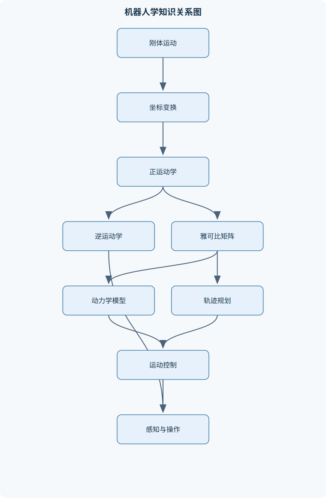
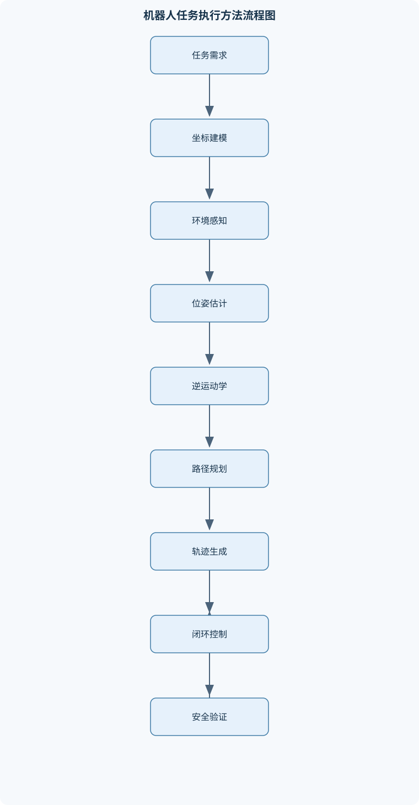

# 机器人学

## 一、课程整体知识框架

### 课程边界与先修知识

机器人学研究机器人机构的几何描述、运动学、动力学、轨迹规划、控制、感知与操作。课程边界覆盖刚体运动与坐标变换、串联机械臂和移动机器人的建模、关节空间与笛卡尔空间运动、雅可比矩阵、奇异性、动力学建模、轨迹生成、位置与速度控制、基础力控制、机器人视觉和典型系统集成。理想模型通常假设连杆为刚体、关节参数准确、执行器无饱和、传感器无噪声；实际系统还必须考虑齿隙、柔性、摩擦、回差、碰撞、测量误差、通信延迟和安全约束。先修知识包括高等数学、线性代数、常微分方程、大学物理、基础程序设计和控制理论；涉及动力学时还需要牛顿力学或分析力学基础。





### 1. 课程对象、研究问题与知识主线

机器人学研究具有感知、计算、运动和操作能力的机电系统。其核心问题不是单独研究机械结构、控制器或传感器，而是建立从“任务描述”到“机器人动作”再到“环境反馈”的闭环：先用坐标系和刚体运动描述机器人及目标，再通过运动学求解关节与末端之间的几何关系，利用动力学解释力和运动的关系，借助轨迹规划生成可执行参考信号，最后由控制器、传感器和执行器共同实现运动。机器人视觉、移动定位和抓取操作则把这一闭环扩展到非结构化环境。

课程的数学主线可概括为：

$$
\text{刚体运动}
\longrightarrow
\text{坐标变换}
\longrightarrow
\text{正、逆运动学}
\longrightarrow
\text{速度与雅可比}
\longrightarrow
\text{动力学}
\longrightarrow
\text{规划与控制}
\longrightarrow
\text{感知和系统集成}.
$$

其中，刚体运动解决“物体在哪里、朝向如何”；运动学解决“关节如何决定末端位姿和速度”；动力学解决“要产生指定运动需要多大力矩”；规划解决“动作按什么路径和时间执行”；控制解决“如何根据误差持续修正动作”；感知解决“机器人如何获得自身状态和环境状态”。这些问题相互依赖，但不能相互替代。例如，正运动学可以计算末端位置，却不能直接给出使末端到达目标所需的关节角；重力补偿可以抵消静态负载，却不是完整的轨迹跟踪控制器。

课程的理想模型通常假设连杆是刚体、关节参数准确、传感器无噪声、执行器没有饱和、通信没有延迟，且碰撞和柔性变形可以忽略。这些假设有助于推导结构清晰的模型，但实际机器人还存在齿隙、回差、摩擦、弹性、装配误差、负载变化、测量噪声、离散采样、计算延迟和安全限制。因此，任何理论结论都必须说明适用边界：理想模型中的稳定性或可达性，并不自动意味着实物系统能够安全、精确地执行。

### 2. 机器人系统组成与结构分类

机器人系统由机构、执行器、传感器、控制器、末端工具和软件任务层组成。机构决定自由度、运动范围和承载能力；执行器提供关节力矩或移动驱动力；传感器测量关节位置、速度、力、视觉信息或惯性状态；控制器根据参考轨迹和反馈计算控制输入；末端工具直接与物体接触，例如夹爪、吸盘、焊枪或装配工具。

串联机器人由多个关节和连杆依次连接，工作空间大、结构直观，常用于搬运、焊接和装配。并联机器人由多个支链共同连接动平台，刚度和速度通常较好，但工作空间和奇异位形分析更复杂。移动机器人依靠轮、履带或腿部机构改变基座位置；柔性机器人需要考虑连杆或驱动部件的弹性变形；协作机器人还必须把碰撞检测、限力和人机共享空间纳入系统设计。移动机械臂同时具有基座运动和机械臂运动，其末端速度不能只由机械臂雅可比描述。

自由度是系统独立运动变量的数量。一个平面刚体最多有两个平移自由度和一个转动自由度，空间刚体最多有三个平移自由度和三个转动自由度；关节约束会减少相对运动自由度。自由度不等于关节数量：闭链约束、被动关节和机械耦合都会使独立变量数量发生变化。工作空间是机器人末端可以到达的位置或位姿集合，任务空间是任务所关心的变量空间，二者在不同任务中可能不一致。例如，点焊任务可能主要要求位置和工具轴方向，而不要求绕工具轴的旋转。

### 3. 刚体位姿和旋转表示

坐标系记为 $\{s\}$、$\{b\}$、$\{c\}$。$T_{sb}$ 表示坐标系 $\{b\}$ 相对于坐标系 $\{s\}$ 的位姿；左下标是参考坐标系，右下标是被描述坐标系。旋转矩阵 $R_{sb}$ 表示 $\{b\}$ 的三个坐标轴在 $\{s\}$ 中的表达，满足

$$
R_{sb}^{T}R_{sb}=I,\qquad \det(R_{sb})=1.
$$

正交性保证坐标轴两两正交且长度为 $1$，行列式为 $1$ 排除了镜像反射。若矩阵满足正交性但行列式为 $-1$，它是反射变换而不是合法的三维旋转。旋转矩阵的列通常是被描述坐标系各轴在参考坐标系中的坐标，因此不能把 $R_{sb}$ 误读为 $\{s\}$ 在 $\{b\}$ 中的姿态；后者是 $R_{bs}=R_{sb}^{T}$。

姿态还可以用欧拉角、滚俯偏角、旋转向量和四元数表示。欧拉角参数少、便于解释，但依赖旋转顺序，并可能出现万向节锁；旋转向量用旋转轴和旋转角表示，适合局部误差描述；四元数避免欧拉角的部分奇异性，插值效率较好，但必须保持单位范数，并且四元数 $q$ 与 $-q$ 表示同一旋转。不能把欧拉角导数直接当作角速度，因为二者之间还存在由当前姿态和旋转顺序决定的映射矩阵。

### 4. 齐次变换与坐标链

刚体位姿写成齐次变换矩阵：

$$
T_{sb}=
\begin{bmatrix}
R_{sb} & p_{sb}\\
0 & 1
\end{bmatrix}\in SE(3),
$$

其中 $p_{sb}\in\mathbb{R}^{3}$ 是 $\{b\}$ 原点在 $\{s\}$ 中的位置，长度单位必须与机器人几何参数一致。点 $q$ 使用齐次坐标 $\bar q=[q^{T},1]^{T}$，方向向量使用 $[v^{T},0]^{T}$。因此，

$$
T_{sb}
\begin{bmatrix}q\\1\end{bmatrix}
=
\begin{bmatrix}R_{sb}q+p_{sb}\\1\end{bmatrix},
\qquad
T_{sb}
\begin{bmatrix}v\\0\end{bmatrix}
=
\begin{bmatrix}R_{sb}v\\0\end{bmatrix}.
$$

这个差别说明平移会影响点的位置，却不会影响自由方向向量。若有连续坐标系 $\{s\}$、$\{b\}$、$\{c\}$，则

$$
T_{sc}=T_{sb}T_{bc}.
$$

下标中的中间坐标系 $\{b\}$ 相消，矩阵乘法顺序也不能交换。变换逆为

$$
T_{sb}^{-1}=T_{bs}
=
\begin{bmatrix}
R_{sb}^{T} & -R_{sb}^{T}p_{sb}\\
0&1
\end{bmatrix}.
$$

其几何意义是先把参考系中的点反向平移，再用逆旋转表达；所以逆变换的平移部分不是简单的 $-p_{sb}$。左乘通常表示在空间参考系中施加变换，右乘通常表示在物体本体坐标系中施加变换，但具体解释必须与下标约定一致。由于三维旋转和平移一般不交换，调换两个变换的次序会改变结果。

### 5. 运动学、速度和雅可比

串联机械臂正运动学把关节变量 $\theta_i$ 映射到末端位姿。转动关节变量通常用弧度，移动关节变量通常用米。采用标准或改进型 Denavit–Hartenberg 参数时，必须依据关节轴、公共法线、连杆长度、连杆扭角和关节偏置的具体建系规则生成变换链。末端工具坐标系还要在法兰坐标系之后增加工具偏置，否则计算出的工具尖端位置会产生系统误差。

乘积指数形式为

$$
T(\theta)
=
e^{[S_1]\theta_1}
e^{[S_2]\theta_2}\cdots
e^{[S_n]\theta_n}M,
$$

其中 $S_i\in\mathbb{R}^{6}$ 是在空间坐标系表达的螺旋轴，$M$ 是零位时的末端位姿，$[S_i]$ 是螺旋轴对应的 $4\times4$ 矩阵表示。转动关节和移动关节分别对应旋转螺旋运动和平移螺旋运动。指数形式适合统一描述不同类型关节，但其螺旋轴必须与所采用的空间坐标系一致。

对正运动学随时间求导，可得到末端扭量与关节速度的关系：

$$
V_s=J_s(\theta)\dot\theta
\quad\text{或}\quad
V_b=J_b(\theta)\dot\theta,
$$

其中 $V=[\omega^{T},v^{T}]^{T}$，$\omega$ 的单位为弧度每秒，$v$ 的单位为米每秒。空间雅可比第 $i$ 列为

$$
J_{s,i}
=
\operatorname{Ad}_{e^{[S_1]\theta_1}\cdots
e^{[S_{i-1}]\theta_{i-1}}}S_i.
$$

只有第 $i$ 个关节之前的变换会改变该关节轴在空间坐标系中的表达。本体雅可比满足

$$
J_b=\operatorname{Ad}_{T_{bs}}J_s.
$$

几何雅可比直接描述角速度和线速度，解析雅可比则描述位置参数及姿态参数的导数；二者不能混用。若 $\operatorname{rank}(J)<\min(6,n)$，机器人处于奇异状态。奇异附近，某些末端方向不可实现，或需要很大的关节速度才能产生有限的末端速度。非方阵雅可比不能只看行列式，应结合秩、奇异值和条件数判断。

虚功关系给出速度映射的对偶力映射：

$$
\tau=J^{T}F,
$$

其中 $F=[f^{T},m^{T}]^{T}$，力 $f$ 的单位为牛顿，力矩 $m$ 的单位为牛顿米，且 $F$ 与 $J$ 必须在一致坐标系、相同扭量排列下表达。该关系来自

$$
\tau^{T}\delta\theta=F^{T}\delta x,
\qquad
\delta x=J\delta\theta.
$$

### 6. 逆运动学与构型分析

逆运动学根据目标末端位姿反求关节变量。一个目标可能有多组解、没有解或存在连续无穷多组解。平面二连杆在目标点位于可达环形区域内时，通常存在肘上和肘下两组构型；目标超出最大伸展距离或小于最小折叠距离时无解。即使数学上有解，也必须继续检查关节限位、连杆碰撞、工具方向、可操作性和路径连续性。

解析法利用几何关系或腕部解耦直接求解，计算快且便于分析多解结构，但依赖机构几何和特殊结构。数值法通过迭代减小位姿误差，常用伪逆、牛顿法和阻尼最小二乘法。阻尼形式可写为

$$
\Delta\theta
=
J^{T}(JJ^{T}+\lambda^{2}I)^{-1}e,
$$

其中 $e$ 是位姿误差，$\lambda>0$ 是阻尼系数。阻尼可以降低奇异附近的速度放大，但会引入跟踪偏差，且不能保证全局收敛。初值、步长、误差定义和姿态表示都会影响结果。沿路径连续求解时，应优先选择与上一时刻构型接近的解，避免在肘上、肘下等分支之间突然切换。

### 7. 动力学、轨迹规划和控制

机器人动力学通常写为

$$
M(\theta)\ddot\theta+
C(\theta,\dot\theta)\dot\theta+
g(\theta)+\tau_f
=
\tau+\tau_{ext}.
$$

$M$ 为惯性矩阵，单位随广义坐标定义而变化；$C\dot\theta$ 为科里奥利和离心等速度相关项；$g$ 为重力项；$\tau_f$ 为摩擦项；$\tau$ 为驱动力矩；$\tau_{ext}$ 为外力映射到关节空间的力矩。拉格朗日法从 $L=K-U$ 出发：

$$
\frac{d}{dt}
\frac{\partial L}{\partial\dot\theta_i}
-
\frac{\partial L}{\partial\theta_i}
=
\tau_i.
$$

理想无耗散模型中，$M$ 对称正定，表示动能对速度的二次型；牛顿—欧拉法通过正向和反向递推求解，串联机器人逆动力学通常可达到随关节数线性增长的计算规模。前向动力学由力矩求加速度，逆动力学由运动状态求力矩。模型参数必须具有物理意义，并且要考虑是否可由实验数据辨识。

轨迹规划必须区分路径和时间参数化。路径只规定几何形状，时间参数化还规定速度、加速度及其约束。三次多项式由起止位置和速度四个边界条件确定，五次多项式由位置、速度、加速度六个边界条件确定；多段轨迹拼接时不仅要检查位置连续，还要检查速度、加速度甚至跃度连续。梯形速度轨迹便于满足速度和加速度限制，限加加速度轨迹能够进一步降低机械冲击。笛卡尔直线插值在关节空间执行时必须反复求逆运动学，否则末端实际路径可能不是直线。

位置控制通常从关节空间比例—微分控制和重力补偿开始。计算力矩控制利用动力学模型抵消惯性、速度耦合和重力，使理想误差近似满足

$$
\ddot e+K_d\dot e+K_pe=0,
$$

但这一结论依赖模型准确、$K_p$ 和 $K_d$ 正定、执行器不饱和且采样和延迟影响可忽略。笛卡尔空间控制通过雅可比或操作空间动力学控制末端位姿；阻抗控制规定力与位移误差之间的动态关系，适合接触任务；导纳控制则根据测得的力计算期望运动，适合外部位置控制环较强的系统。实际实现还需处理速度限幅、力矩饱和、积分抗饱和、离散采样、噪声滤波和急停逻辑。

### 8. 移动机器人、感知与系统集成

差速移动机器人满足无侧滑约束，横向速度不能独立指定，因此不能像全向机器人一样在任意瞬间独立控制平面内三个速度分量。汽车式机器人还受转向角和最小转弯半径限制；全向机器人虽然局部运动能力较强，但对轮组标定、地面平整度和轮胎打滑更敏感。轮速计、惯性测量单元和卫星定位分别提供相对运动、短时姿态变化和绝对位置线索。扩展卡尔曼滤波通过运动模型预测，再利用观测模型雅可比进行校正，适用于模型可微且噪声近似可描述的场景；轮滑、动态障碍物和定位跳变会破坏其基本假设。

视觉系统涉及相机内参、外参、畸变、深度和坐标链。相机内参描述焦距、主点和像素尺度，外参描述相机与机器人或世界坐标系之间的刚体关系。手眼标定常建立 $AX=XB$ 约束，必须使用时间同步、姿态变化充分且几何覆盖良好的多组数据。点云处理还要明确每次坐标变换的方向，漏乘相机外参、法兰到工具变换或夹具偏置都会导致系统性抓取误差。

典型操作闭环包括目标检测、目标姿态估计、抓取候选生成、碰撞检查、轨迹规划、控制执行和结果验证。抓取是否稳定不仅取决于目标位置，还取决于接触位置、摩擦、夹具开口、负载和碰撞风险。视觉伺服直接利用图像或视觉估计误差调节运动，位置伺服则先把视觉结果转换为机器人坐标中的目标位姿。系统集成必须处理传感器时间同步、任务状态机、异常恢复、安全区域、碰撞检测和急停逻辑；有限的仿真或单次成功实验不能替代理论分析和覆盖多种扰动的安全验证。

## 二、章节和模块划分

### 核心知识覆盖清单

本清单用于检查正文是否覆盖本课程的主要知识模块：

- **机器人系统与刚体运动基础**：机器人组成：机构、执行器、传感器、控制器与末端工具、串联、并联、移动、柔性和协作机器人结构、自由度、约束、工作空间与任务空间、刚体位姿、位置向量与姿态表示、旋转矩阵的正交性、行列式和坐标含义、欧拉角、滚俯偏角、旋转向量与四元数、主动旋转、被动坐标变换与旋转顺序、理想刚体模型与实际机械误差的区别。
- **齐次变换与位姿计算**：齐次变换矩阵的分块结构、特殊欧氏群 $SE(3)$ 的定义与群运算、坐标系下标的含义与变换链相消规则、点的齐次坐标表示、向量、坐标系和刚体位姿的变换、变换矩阵求逆及其几何意义、左乘空间变换与右乘本体变换、复合变换的次序、非交换性和单位检查、位姿误差的表示方法。
- **串联机器人正运动学**：标准与改进型 Denavit–Hartenberg 参数、关节轴、连杆坐标系和参数建系规则、从关节变量到末端位姿的变换链、乘积指数公式与螺旋轴表示、转动关节和移动关节的螺旋运动、零位构型与参考位姿、正运动学的数值计算和符号计算、末端工具坐标系与法兰坐标系、正运动学模型的标定与误差传播。
- **逆运动学与构型分析**：逆运动学问题的多解、无解与无限解、平面二连杆和空间机械臂的几何求解、解析逆解中的腕部解耦、基于数值迭代的逆运动学、牛顿法、阻尼最小二乘法和伪逆法、关节限位、碰撞约束和构型筛选、可达工作空间与灵巧工作空间、初值选择、局部收敛和奇异点影响、逆解连续性与路径跟踪中的构型切换。
- **速度运动学与雅可比矩阵**：关节速度与末端线速度、角速度的映射、几何雅可比与解析雅可比、空间雅可比与本体雅可比、螺旋轴列向量的物理意义、空间雅可比的逐列构造、本体雅可比与空间雅可比的伴随变换关系、雅可比转置、伪逆和阻尼伪逆、雅可比秩、奇异性和可操作性、速度、力和关节力矩之间的对偶关系、数值差分验证雅可比。
- **刚体动力学与机器人动力学**：牛顿—欧拉法与递推动力学、拉格朗日方程及广义坐标、机器人动力学标准形式、惯性矩阵、科里奥利项、离心项和重力项、关节摩擦、负载和外力建模、动力学参数的物理意义和可辨识性、前向动力学与逆动力学、能量守恒、功率平衡和被动性、动力学模型的数值稳定性、模型不确定性与在线补偿边界。
- **轨迹规划与时间参数化**：关节空间轨迹与笛卡尔空间轨迹、三次多项式和五次多项式插值、梯形速度和限加加速度轨迹、位置、速度、加速度和跃度连续性、笛卡尔位姿插值与旋转插值、路径与时间参数化的区别、速度、加速度和关节限位约束、避障路径的几何约束、多段轨迹的拼接与边界条件、轨迹跟踪误差和采样周期影响。
- **机器人控制**：关节空间位置控制、比例—微分控制与重力补偿、计算力矩控制、笛卡尔空间位置控制、速度控制和雅可比伪逆控制、操作空间动力学与任务空间控制、阻抗控制和导纳控制、力传感器闭环与接触任务、执行器饱和、抗积分饱和和离散实现、稳定性、跟踪性能与鲁棒性。
- **移动机器人与定位导航**：差速、全向和汽车式移动机器人模型、非完整约束及其对运动规划的影响、轮速计、惯性测量单元和卫星定位、位姿估计与坐标系管理、扩展卡尔曼滤波基本模型、栅格地图、特征地图和占据概率、局部规划、全局规划与避障、路径跟踪控制、定位失败、轮滑和动态障碍物处理、移动机械臂的基座与机械臂协同。
- **机器人感知、操作与系统集成**：相机模型、内参、外参和畸变、手眼标定与坐标系链路、深度感知和点云坐标变换、物体检测、姿态估计和抓取候选生成、抓取稳定性、接触模型和夹具选择、视觉伺服与位置伺服的区别、传感器时间同步与数据融合、任务状态机和异常恢复、安全区域、碰撞检测和急停逻辑、从感知到规划、控制和执行的闭环集成。


### 1. 第一模块：机器人系统与刚体运动基础

本模块建立机构分类、自由度、约束、工作空间、任务空间和刚体位姿的共同语言。教学顺序应先介绍机器人组成及串联、并联、移动、柔性和协作结构，再从二维刚体过渡到三维刚体。重点说明旋转矩阵、欧拉角、旋转向量和四元数的表示差异，并通过主动旋转与被动坐标变换对比，避免把“旋转物体”和“改变坐标表达”混为一谈。模块末尾应明确理想刚体模型与实际机械误差之间的差别，为后续标定、控制和安全分析提供边界。

### 2. 第二模块：齐次变换与位姿计算

本模块围绕 $SE(3)$ 展开。内容包括齐次矩阵的分块结构、点和方向向量的齐次表示、变换链的下标相消规则、矩阵求逆、左乘与右乘以及非交换性。计算训练应要求同时检查旋转块正交性、行列式、平移单位和坐标系方向。位姿误差应区分位置误差、旋转矩阵误差、旋转向量误差和扭量误差，不能把三个欧拉角差值在所有姿态下都当作合理的姿态误差。

### 3. 第三模块：串联机器人正运动学

本模块介绍标准型和改进型 Denavit–Hartenberg 建系规则，说明关节轴、连杆坐标系、零位构型、法兰坐标系和工具坐标系之间的关系。随后比较参数化变换链与乘积指数公式：前者便于工程建模和参数表管理，后者便于螺旋理论和雅可比推导。正运动学计算应包含符号推导、数值代入、旋转正交性检查和工具偏置验证。标定部分说明几何参数误差如何沿变换链传播，不能把标定后的残差简单归因于控制器。

### 4. 第四模块：逆运动学与构型分析

本模块从平面二连杆开始，说明余弦定理、肘上与肘下解、工作空间边界和关节限位筛选，再扩展到空间机械臂和腕部解耦。解析方法突出多解结构，数值方法突出初值、局部收敛、奇异性和停止条件。阻尼最小二乘法适合改善奇异附近的数值稳定性，却不能解决碰撞、全局最优和错误构型选择问题。模块还应区分可达工作空间与灵巧工作空间：前者只要求到达位置或位姿，后者还要求在目标处具备足够方向能力和速度能力。

### 5. 第五模块：速度运动学与雅可比矩阵

本模块从 $V=J\dot\theta$ 出发，分别构造几何雅可比、解析雅可比、空间雅可比和本体雅可比。空间雅可比逐列由前置关节变换螺旋轴，本体雅可比则通过伴随变换表达在末端坐标系中。教学中应使用有限差分验证雅可比：对一个关节施加小扰动，比较正运动学差分与雅可比预测结果，但同时说明有限差分步长过大有截断误差、过小会放大数值误差。奇异性使用秩、奇异值和条件数分析；力映射通过 $\tau=J^TF$ 说明速度与力的对偶关系。

### 6. 第六模块：刚体动力学与机器人动力学

本模块先复习质点和刚体的牛顿力学、动能和势能，再比较拉格朗日法与牛顿—欧拉递推法。重点解释惯性矩阵、速度相关项、重力项、摩擦项、负载和外力的物理意义，说明不同教材对 $C$ 的拆分可能不同，比较公式时必须统一定义。前向动力学、逆动力学、能量守恒和功率平衡用于模型检查；实际系统还要考虑参数不可辨识、柔性、齿隙、摩擦不连续和数值积分稳定性，不能把理想刚体动力学直接当作高精度实物模型。

### 7. 第七模块：轨迹规划与时间参数化

本模块区分关节空间规划、笛卡尔空间规划、路径规划和时间参数化。三次多项式适合只约束位置和速度的点到点运动，五次多项式适合同时约束位置、速度和加速度。梯形速度和限加加速度轨迹用于显式处理速度、加速度和冲击约束。多段轨迹必须检查边界连续性、关节限位、峰值速度、峰值加速度和采样周期影响。避障规划还需把连杆几何、工具几何和环境几何纳入，而不是只检查末端点。

### 8. 第八模块：机器人控制

本模块按由简单到复杂的顺序组织：关节位置控制、比例—微分控制、重力补偿、计算力矩控制、笛卡尔位置控制、雅可比伪逆速度控制、操作空间控制、阻抗控制和导纳控制。每一种控制方法都应说明控制变量、反馈信号、模型依赖、稳定性条件和失效边界。执行器饱和会破坏理想误差方程，积分环节还可能产生积分累积，因此需要限幅和抗积分饱和。离散实现必须考虑采样周期、延迟、微分噪声和滤波相位滞后。

### 9. 第九模块：移动机器人与定位导航

本模块依次介绍差速、全向和汽车式模型，重点分析非完整约束如何影响可行路径。随后讲解轮速计、惯性测量单元、卫星定位、坐标系管理和扩展卡尔曼滤波。地图部分包括栅格地图、特征地图和占据概率；规划部分区分全局规划、局部规划、避障和路径跟踪。实验分析应覆盖轮滑、传感器失效、动态障碍物和定位跳变。移动机械臂还需把基座雅可比与机械臂雅可比组合，协调基座和关节运动。

### 10. 第十模块：机器人感知、操作与系统集成

本模块以“感知—估计—规划—控制—执行—反馈”为主线。内容包括相机模型、内外参、畸变、深度和点云坐标变换，手眼标定，物体检测、姿态估计和抓取候选生成。操作部分分析接触模型、摩擦、夹具选择和抓取稳定性；系统部分关注时间同步、任务状态机、异常恢复、碰撞检测、安全区域和急停逻辑。最终应以视觉引导抓取或移动机械臂任务贯穿各模块，验证坐标链、逆运动学、避障、控制误差和安全策略是否形成闭环。

## 三、核心概念的详细解释

### 1. 机器人系统、自由度与任务空间

机器人系统由机构、执行器、传感器、控制器和末端工具组成。机构决定可实现的运动形式；执行器将电能、液压能或气动能转换为关节力矩或驱动力；传感器测量关节位置、速度、力、惯性状态和环境信息；控制器根据参考轨迹与反馈误差计算控制输入；末端工具完成抓取、焊接、装配或测量等任务。

串联机器人各关节依次连接，运动学建模直观，工作空间通常较大；并联机器人由多个支链共同支撑动平台，具有较高刚度和速度，但闭链约束使逆运动学和奇异性分析更复杂。移动机器人通过轮、履带或腿改变基座位姿；柔性机器人必须考虑连杆、传动带或减速器的弹性；协作机器人还需要将碰撞检测、限力和安全区域纳入控制闭环。

自由度是描述系统独立运动所需的最少变量数。空间刚体最多有三个平移自由度和三个转动自由度，但机械关节、闭链约束和耦合传动会减少独立自由度。关节数量不一定等于机器人自由度。例如，具有被动关节的闭链机构可能有多个关节，却只能实现少数独立运动。

工作空间是末端能够到达的位置或位姿集合；灵巧工作空间则要求末端不仅能到达，还能在一定范围内实现所需方向和速度。任务空间是任务真正关心的变量空间，例如点焊可能只要求末端位置和工具轴方向，而不要求绕工具轴的旋转。任务空间维数小于机器人自由度时，剩余自由度可用于避障、避限位或优化姿态。

### 2. 刚体位姿、旋转与齐次变换

坐标系记为 $\{s\}$、$\{b\}$ 和 $\{c\}$。位姿

$$
T_{sb}=
\begin{bmatrix}
R_{sb}&p_{sb}\\
0&1
\end{bmatrix}
$$

表示坐标系 $\{b\}$ 相对于 $\{s\}$ 的位姿。其中，$R_{sb}\in SO(3)$ 是 $\{b\}$ 的三个轴在 $\{s\}$ 中的表达，$p_{sb}\in\mathbb{R}^3$ 是 $\{b\}$ 原点在 $\{s\}$ 中的位置。位置单位应与几何模型一致，通常为米；旋转矩阵无量纲。

旋转矩阵满足

$$
R_{sb}^{T}R_{sb}=I,\qquad \det(R_{sb})=1.
$$

正交性表示三个坐标轴两两垂直且长度为一，行列式为 $1$ 排除了镜像反射。若数值计算产生的矩阵不满足这些条件，通常说明存在计算误差、参数错误或坐标轴定义不一致。

点 $q$ 的齐次坐标为

$$
\bar q=\begin{bmatrix}q\\1\end{bmatrix},
$$

因此

$$
\bar q_s=T_{sb}\bar q_b=R_{sb}q_b+p_{sb}.
$$

自由方向向量 $v$ 的齐次形式为

$$
\bar v=\begin{bmatrix}v\\0\end{bmatrix},
$$

于是

$$
T_{sb}\bar v=
\begin{bmatrix}
R_{sb}v\\0
\end{bmatrix}.
$$

这说明平移改变点的位置，但不改变自由向量的方向。若把方向向量错误地写成末位为 $1$，会产生虚假的平移效果。

坐标变换满足下标相消规则：

$$
T_{sc}=T_{sb}T_{bc}.
$$

因为

$$
\bar q_s=T_{sb}\bar q_b
=T_{sb}T_{bc}\bar q_c,
$$

所以中间坐标系 $\{b\}$ 被矩阵乘法中的下标消去。变换次序不可交换，一般有

$$
T_{sb}T_{bc}\neq T_{bc}T_{sb}.
$$

其原因是旋转和平移属于非交换运算。左乘通常表示在固定空间坐标系中施加变换，右乘通常表示在物体自身坐标系中施加变换，但必须结合明确的下标定义判断，不能仅凭“左”或“右”机械记忆。

变换矩阵的逆为

$$
T_{sb}^{-1}=T_{bs}
=
\begin{bmatrix}
R_{sb}^{T}&-R_{sb}^{T}p_{sb}\\
0&1
\end{bmatrix}.
$$

逆变换不是简单地把 $p_{sb}$ 改成 $-p_{sb}$。从 $\{s\}$ 返回 $\{b\}$ 时，必须先将位置相对于 $\{s\}$ 原点反向平移，再用 $R_{sb}^{T}$ 将结果表达在 $\{b\}$ 中。

### 3. 姿态参数及其适用边界

欧拉角用三个按规定顺序执行的旋转表示姿态。不同旋转顺序得到的结果不同，例如绕固定轴的 $XYZ$ 顺序与绕自身轴的 $ZYX$ 顺序并不等价。滚俯偏角是常见的一种姿态参数化，但在某些俯仰角附近会出现万向节锁，导致两个旋转自由度局部重合。

旋转向量用单位轴 $\hat u$ 和旋转角 $\phi$ 表示旋转，适合描述单次有限旋转，但在角度接近 $\pi$ 时轴方向可能出现表示不连续。四元数用四个参数表示旋转，并通过单位长度约束消除冗余。四元数避免了欧拉角的局部奇异性，适合插值和连续姿态控制，但存在 $q$ 与 $-q$ 表示同一旋转的问题，插值时应选择符号连续的表示。

不能把欧拉角导数直接当作角速度。若姿态参数为 $\eta$，通常存在姿态映射矩阵 $E(\eta)$，满足

$$
\omega=E(\eta)\dot\eta.
$$

当 $E(\eta)$ 奇异或病态时，即使 $\dot\eta$ 数值有限，实际角速度也可能很大。因此，几何雅可比中的角速度与解析雅可比中的姿态参数速度必须严格区分。

### 4. 串联机器人正运动学

正运动学的输入是关节变量和机器人几何参数，输出是末端位姿。对于转动关节，$\theta_i$ 通常以弧度表示；对于移动关节，$\theta_i$ 表示位移，通常以米表示。给定各节变换后，串联机械臂的末端位姿为

$$
T_{s e}(\theta)
=
T_{s1}(\theta_1)
T_{12}(\theta_2)\cdots
T_{n e}(\theta_n).
$$

标准 Denavit–Hartenberg 参数通常使用连杆长度 $a_i$、连杆扭角 $\alpha_i$、连杆偏距 $d_i$ 和关节角 $\theta_i$。其中一个参数随关节运动变化：转动关节的 $\theta_i$ 是变量，移动关节的 $d_i$ 是变量。改进型参数采用不同的坐标系附着规则，不能把两种表格直接混用。

零位构型是所有关节变量取参考值时的姿态。末端工具坐标系还可能相对于法兰坐标系存在固定偏置，因此实际链路应写为

$$
T_{s,\text{tool}}
=
T_{s,\text{flange}}T_{\text{flange},\text{tool}}.
$$

漏掉工具偏置会造成稳定的系统性定位误差。标定时还应考虑装配误差、连杆长度偏差、关节零位偏差和减速器回差；误差会沿变换链传播，靠近末端的角度误差通常会造成与连杆长度相关的位置误差。

### 5. 乘积指数与螺旋轴

若第 $i$ 个关节的螺旋轴在空间坐标系中的表达为 $S_i\in\mathbb{R}^6$，则末端位姿可以写成

$$
T(\theta)
=
e^{[S_1]\theta_1}
e^{[S_2]\theta_2}
\cdots
e^{[S_n]\theta_n}M,
$$

其中 $M$ 是零位末端位姿，$[S_i]$ 是由螺旋轴构造的 $4\times4$ 矩阵，$e^{[S_i]\theta_i}$ 表示沿该螺旋运动指定参数的刚体变换。转动关节的螺旋轴主要由角速度方向和轴线位置决定，移动关节的角速度分量为零，线速度分量为移动方向。

乘积指数公式要求螺旋轴表达在统一的空间坐标系中，并且变换次序与关节链一致。若把第 $i$ 个轴直接当作零位后固定不变的轴，通常会错误地忽略前置关节对该轴空间表达的改变。

### 6. 逆运动学与构型分析

逆运动学要求由目标位姿反求关节变量。目标可能无解、多解或有无限多解。无解通常来自目标超出工作空间、姿态要求过严或关节限位；多解来自肘上、肘下、腕部翻转等不同构型；冗余机器人在满足同一末端位姿时可能存在连续解集。

以平面二连杆为例，连杆长度为 $l_1,l_2$，目标点为 $(x,y)$。定义

$$
r^2=x^2+y^2.
$$

可达性要求

$$
|l_1-l_2|\le r\le l_1+l_2.
$$

由余弦定理，

$$
\cos\theta_2=
\frac{r^2-l_1^2-l_2^2}{2l_1l_2}.
$$

当右端在 $[-1,1]$ 内时，通常有

$$
\theta_2=\pm\arccos
\left(
\frac{r^2-l_1^2-l_2^2}{2l_1l_2}
\right),
$$

再由

$$
\theta_1=
\operatorname{atan2}(y,x)
-
\operatorname{atan2}
\left(
l_2\sin\theta_2,\,
l_1+l_2\cos\theta_2
\right)
$$

求第一关节角。两种符号对应两种平面构型。求得解后还必须检查角度范围、碰撞、工具姿态和构型连续性。路径跟踪中若每个采样点独立选择逆解，可能在肘上与肘下构型之间突然切换，导致关节跳变。

数值逆运动学以位姿误差 $e$ 和雅可比为基础。阻尼最小二乘更新为

$$
\Delta\theta
=
J^T(JJ^T+\lambda^2I)^{-1}e,
$$

其中 $\lambda>0$ 为阻尼系数。阻尼可抑制奇异位形附近的速度放大，但会使更新方向不再完全满足末端误差下降目标。初值影响局部收敛，不能把局部迭代法当作全局求解器。

### 7. 雅可比、奇异性与力的对偶关系

末端空间速度用扭量表示为

$$
V_s=
\begin{bmatrix}
\omega_s\\
v_s
\end{bmatrix},
$$

其中 $\omega_s$ 的单位为 $\mathrm{rad/s}$，$v_s$ 的单位为 $\mathrm{m/s}$。空间雅可比满足

$$
V_s=J_s(\theta)\dot\theta.
$$

第 $i$ 列表示只有第 $i$ 个关节以单位速度运动时对末端空间扭量的贡献。其构造为

$$
J_{s,i}
=
\operatorname{Ad}_{e^{[S_1]\theta_1}\cdots
e^{[S_{i-1}]\theta_{i-1}}}S_i.
$$

只有第 $i$ 个关节之前的变换影响该关节轴在空间坐标系中的表达。若使用本体雅可比，则

$$
J_b=\operatorname{Ad}_{T_{bs}}J_s.
$$

空间雅可比和本体雅可比描述的是同一运动，但扭量表达坐标系不同，不能混合使用。

奇异性满足

$$
\operatorname{rank}(J)<\min(6,n).
$$

在奇异位形，某些笛卡尔方向无法由关节运动产生；接近奇异位形时，伪逆映射可能要求极大的关节速度，并放大测量噪声。非方阵雅可比不能只看行列式，应使用秩、最小奇异值或条件数判断。

由虚功关系

$$
\tau^T\delta\theta=F^T\delta x,\qquad
\delta x=J\delta\theta,
$$

可得

$$
\tau=J^TF.
$$

这里 $F\in\mathbb{R}^6$ 包括力和力矩，单位分别为牛顿和牛顿·米；$J$ 与 $F$ 必须在同一坐标表达下排列。该关系说明速度映射的转置是力映射，但不意味着在奇异位形下所有末端力都能由有限关节力矩实现。

### 8. 动力学、轨迹规划与控制

机器人动力学常写为

$$
M(\theta)\ddot\theta+
C(\theta,\dot\theta)\dot\theta+
g(\theta)+\tau_f
=
\tau+\tau_{ext}.
$$

$M$ 为惯性矩阵，单位取决于关节变量类型；$g$ 为重力项；$C\dot\theta$ 表示科里奥利和离心相关项；$\tau_f$ 为摩擦项；$\tau_{ext}$ 为外力映射到关节空间的力矩。惯性矩阵在物理可行参数下对称正定。牛顿—欧拉法通过“基座到末端”的速度、加速度递推和“末端到基座”的力、力矩递推计算逆动力学，串联结构的计算量通常随关节数线性增长。拉格朗日法从

$$
L=K-U
$$

和

$$
\frac{d}{dt}
\frac{\partial L}{\partial\dot\theta_i}
-
\frac{\partial L}{\partial\theta_i}
=
\tau_i
$$

推导方程，适合建立符号形式和分析能量性质。

三次轨迹

$$
q(t)=a_0+a_1t+a_2t^2+a_3t^3
$$

可由起止位置和速度四个条件唯一确定；五次轨迹

$$
q(t)=\sum_{k=0}^{5}a_kt^k
$$

可由起止位置、速度和加速度六个条件确定。五次轨迹通常能保证加速度边界连续，但仍需检查速度、加速度和跃度峰值。位置连续并不代表速度连续，多段轨迹拼接时必须显式匹配边界条件。

关节空间规划直接规划 $\theta(t)$，容易满足关节限位；笛卡尔空间规划可控制末端路径，但逆运动学和奇异性会使关节运动复杂。路径描述几何形状，时间参数化描述沿路径如何运动，二者应分开处理。避障规划还需考虑连杆全身，而不能只检查末端点。

关节比例—微分控制可写为

$$
\tau=K_pe+K_d\dot e+g(\theta),
\qquad e=\theta_d-\theta.
$$

计算力矩控制进一步补偿惯性和速度耦合，使理想模型下近似得到

$$
\ddot e+K_d'\dot e+K_p'e=0.
$$

该结论依赖模型准确、增益正定、采样稳定且执行器未饱和。实际系统必须考虑摩擦、延迟、量化、柔性和负载变化。阻抗控制规定力与位移误差之间的动态关系，导纳控制则根据测得的外力生成运动指令；二者不能简单等同。

差速移动机器人满足无侧滑约束。若车体坐标中纵向速度为 $v$、角速度为 $\omega$、轮距为 $b$，左右轮线速度可写为

$$
v_R=v+\frac{b}{2}\omega,\qquad
v_L=v-\frac{b}{2}\omega.
$$

其横向速度不能任意指定，因此不能像全向机器人一样瞬时独立控制平面内两个平移速度和一个角速度。轮滑、轮径误差和地面不平会使轮速计积分漂移，通常需要惯性测量、视觉或卫星定位融合。

### 9. 感知、抓取与系统集成

针孔相机模型可写为

$$
s
\begin{bmatrix}
u\\v\\1
\end{bmatrix}
=
K
\begin{bmatrix}
R_{cb}&p_{cb}
\end{bmatrix}
\begin{bmatrix}
X_b\\1
\end{bmatrix},
$$

其中 $K$ 为内参矩阵，$R_{cb},p_{cb}$ 为外参，$(u,v)$ 为像素坐标，$s$ 为深度尺度。镜头畸变必须在投影或反投影前校正，否则会产生位置系统误差。

手眼标定的核心是求解相机与末端之间的固定变换。眼在手上时，常见约束可整理为

$$
AX=XB.
$$

采集数据应覆盖多个旋转方向和位移方向；只做单一方向运动会导致参数不可充分辨识。标定结果必须用未参与求解的数据验证位置和姿态残差，并检查时间同步。

抓取规划包括目标检测、姿态估计、候选抓取生成、碰撞筛选和夹具选择。抓取稳定性取决于接触位置、摩擦、夹持力、物体质量和质心位置。视觉伺服直接利用图像特征误差闭环，位置伺服则先将视觉结果转换为机器人坐标中的目标位姿，再进行运动控制。深度点云必须明确传感器坐标系、机器人基座坐标系和工具坐标系，漏乘任一变换都会产生整体偏差。

完整系统应由任务状态机组织：感知、目标确认、规划、接近、接触、操作、撤离和异常恢复分别具有进入条件、退出条件和超时条件。碰撞检测应先用包围盒筛选，再对候选几何进行精确距离计算；安全逻辑应独立于普通任务控制器，并能触发限速、停止和急停。传感器时间戳、通信延迟和数据丢失必须纳入闭环分析。

## 四、重要定义、公式、定理和推导

### 专业审校补充：关键定义与适用边界

移动机器人中的非完整约束必须与普通几何约束区分。以理想无侧滑差速车为例，位姿为 $q=[x,y,\theta]^T$，控制量为车体前向速度 $v$ 和角速度 $\omega$，其运动学模型为 $\dot x=v\cos\theta$、$\dot y=v\sin\theta$、$\dot\theta=\omega$。由于车轮不能横向滑动，瞬时侧向速度满足 $-\sin\theta\dot x+\cos\theta\dot y=0$；这是对速度的约束，而不是直接限制位姿所在的几何曲面，因此称为非完整约束。差速车不能瞬时沿车体横向平移，但通过连续改变航向可以到达平面中的一般位姿，这体现了可达性与瞬时可动方向的区别。若轮半径为 $r$、左右轮接地点间距为 $b$，左右轮角速度为 $\omega_R,\omega_L$，则 $v=r(\omega_R+\omega_L)/2$，$\omega=r(\omega_R-\omega_L)/b$。这些关系假设地面平整、车轮纯滚动、轮距准确且没有显著侧滑；实际系统中的打滑、轮径不一致和地面变形会使轮速里程计产生系统误差，必须通过传感器融合或标定修正。


### 1. 齐次变换的逆与复合

由

$$
p_s=R_{sb}p_b+p_{sb}
$$

求 $p_b$：

$$
p_b=R_{sb}^{T}(p_s-p_{sb})
=R_{sb}^{T}p_s-R_{sb}^{T}p_{sb}.
$$

因此

$$
T_{bs}
=
\begin{bmatrix}
R_{sb}^{T}&-R_{sb}^{T}p_{sb}\\
0&1
\end{bmatrix}.
$$

推导表明逆变换必须先反向平移，再用转置旋转表达；直接使用 $-p_{sb}$ 只有在特殊情况下才正确，例如旋转为单位阵。

若

$$
T_{sb}=
\begin{bmatrix}R_{sb}&p_{sb}\\0&1\end{bmatrix},
\quad
T_{bc}=
\begin{bmatrix}R_{bc}&p_{bc}\\0&1\end{bmatrix},
$$

则

$$
T_{sc}=T_{sb}T_{bc}
=
\begin{bmatrix}
R_{sb}R_{bc}&R_{sb}p_{bc}+p_{sb}\\
0&1
\end{bmatrix}.
$$

旋转块先将 $\{c\}$ 中的方向变换到 $\{b\}$，再变换到 $\{s\}$；平移 $p_{bc}$ 也必须先用 $R_{sb}$ 表达在 $\{s\}$ 中。

### 2. 由正运动学推导速度雅可比

设末端位姿为 $T(\theta)$。对时间求导得到刚体速度，但矩阵导数本身不是六维扭量。定义空间速度矩阵

$$
\widehat V_s=\dot T T^{-1},
$$

将其反对称旋转块和线速度块提取后得到

$$
V_s=
\begin{bmatrix}
\omega_s\\v_s
\end{bmatrix}.
$$

由于 $T$ 由多个关节变换相乘，应用乘积求导法则：

$$
\dot T
=
\sum_{i=1}^{n}
e^{[S_1]\theta_1}\cdots
\left([S_i]\dot\theta_i e^{[S_i]\theta_i}\right)
\cdots e^{[S_n]\theta_n}M.
$$

右乘 $T^{-1}$ 并整理，可得

$$
V_s=\sum_{i=1}^{n}J_{s,i}\dot\theta_i
=J_s\dot\theta,
$$

其中

$$
J_{s,i}
=
\operatorname{Ad}_{e^{[S_1]\theta_1}\cdots
e^{[S_{i-1}]\theta_{i-1}}}S_i.
$$

当 $i=1$ 时，前置乘积为空，视为单位矩阵，因此第一列就是 $S_1$。该式也解释了为什么后续关节轴必须经过前置关节变换，而不能始终使用零位轴。

本体速度定义为

$$
\widehat V_b=T^{-1}\dot T,
$$

空间速度和本体速度满足

$$
V_b=\operatorname{Ad}_{T_{bs}}V_s.
$$

因此

$$
J_b=\operatorname{Ad}_{T_{bs}}J_s.
$$

伴随矩阵同时改变角速度和线速度，不能只旋转其中一部分。

### 3. 奇异性与伪逆

若 $J$ 为 $m\times n$ 矩阵，其奇异值分解为

$$
J=U\Sigma V^T.
$$

最小奇异值趋近于零时，某些末端速度方向需要很大的关节速度，条件数

$$
\kappa(J)=\frac{\sigma_{\max}}{\sigma_{\min}}
$$

会变大。对于非方阵或秩亏矩阵，应使用奇异值和秩，而不能使用行列式判断。

最小范数速度解为

$$
\dot\theta=J^+V_d.
$$

当存在冗余自由度时，可写为

$$
\dot\theta
=
J^+V_d+
(I-J^+J)z,
$$

其中 $z$ 是任意零空间速度。因为

$$
J(I-J^+J)=0,
$$

零空间项不改变一阶末端速度，可用于远离关节限位或避障。但在有限步长、强非线性和碰撞约束下，零空间优化仍不能保证全局安全。

阻尼最小二乘法等价于求解

$$
\min_{\Delta\theta}
\left\|J\Delta\theta-e\right\|^2
+\lambda^2\|\Delta\theta\|^2.
$$

对目标函数求导并令其为零：

$$
J^T(J\Delta\theta-e)+\lambda^2\Delta\theta=0,
$$

于是

$$
(J^TJ+\lambda^2I)\Delta\theta=J^Te.
$$

也可写为

$$
\Delta\theta
=
J^T(JJ^T+\lambda^2I)^{-1}e.
$$

阻尼越大，数值越稳定，但末端误差的瞬时消除能力越弱。阻尼系数应结合奇异值、速度上限和任务精度选择。

### 4. 轨迹多项式的系数推导

设三次轨迹持续时间为 $T$：

$$
q(t)=a_0+a_1t+a_2t^2+a_3t^3.
$$

给定

$$
q(0)=q_0,\quad \dot q(0)=v_0,
\quad q(T)=q_f,\quad \dot q(T)=v_f,
$$

前两个条件直接给出

$$
a_0=q_0,\qquad a_1=v_0.
$$

剩余系数满足

$$
\begin{bmatrix}
T^2&T^3\\
2T&3T^2
\end{bmatrix}
\begin{bmatrix}
a_2\\a_3
\end{bmatrix}
=
\begin{bmatrix}
q_f-q_0-v_0T\\
v_f-v_0
\end{bmatrix}.
$$

矩阵行列式为 $T^4$，只要 $T\neq0$ 就有唯一解。若起止速度均为零，则

$$
q(t)=q_0+
(q_f-q_0)
\left[
3\left(\frac{t}{T}\right)^2
-2\left(\frac{t}{T}\right)^3
\right].
$$

五次轨迹增加起止加速度条件：

$$
q(0)=q_0,\ \dot q(0)=v_0,\ \ddot q(0)=a_0,
$$

$$
q(T)=q_f,\ \dot q(T)=v_f,\ \ddot q(T)=a_f.
$$

六个条件构成六阶线性方程组。其优势是可使加速度在段端满足指定值，但不自动保证中间时刻不超过执行器的速度和加速度限制。时间 $T$ 太小会使速度和加速度峰值增大；必要时应延长时间或采用分段时间参数化。

### 5. 拉格朗日动力学与能量性质

广义坐标为 $\theta$，动能和势能分别为 $K(\theta,\dot\theta)$、$U(\theta)$，拉格朗日量为

$$
L=K-U.
$$

对第 $i$ 个广义坐标应用

$$
\frac{d}{dt}
\frac{\partial L}{\partial\dot\theta_i}
-
\frac{\partial L}{\partial\theta_i}
=
\tau_i
$$

可得到

$$
M(\theta)\ddot\theta+
C(\theta,\dot\theta)\dot\theta+
g(\theta)
=
\tau
$$

的标准形式。若无摩擦、无外力且执行器不做功，系统能量

$$
E=K+U
$$

保持不变。若存在摩擦，能量随时间耗散；若存在外力或控制输入，能量变化率等于输入功率与耗散功率之和。

重力补偿控制

$$
\tau=g(\theta)
$$

只能在静止或速度、加速度较小的条件下抵消重力。若 $\dot\theta$ 或 $\ddot\theta$ 不为零，惯性和速度耦合项仍然存在，因此重力补偿不能代替完整动力学控制。

### 6. 代表性算法与伪代码

#### 正运动学和空间雅可比联合计算

**输入：** 关节变量 $\theta$、零位螺旋轴 $S_i$、零位位姿 $M$。  
**输出：** 末端位姿 $T$ 和空间雅可比 $J_s$。  
**不变量：** 当前累计变换只包含已经处理的关节。  
**终止条件：** 完成全部 $n$ 个关节。  
**适用条件：** 串联刚体机器人，关节轴和参数定义在同一约定下。  
**复杂度：** 固定维矩阵运算下为 $O(n)$。

```python
import numpy as np

def skew(w):
    return np.array([
        [0.0, -w[2], w[1]],
        [w[2], 0.0, -w[0]],
        [-w[1], w[0], 0.0]
    ])

def adjoint(T):
    R = T[:3, :3]
    p = T[:3, 3]
    A = np.zeros((6, 6))
    A[:3, :3] = R
    A[3:, :3] = skew(p) @ R
    A[3:, 3:] = R
    return A

def screw_exp(S, theta):
    # 仅示意：S=[w;v]，这里要求旋转关节的 w 非零
    w = S[:3]
    v = S[3:]
    wn = np.linalg.norm(w)
    if wn < 1e-12:
        T = np.eye(4)
        T[:3, 3] = v * theta
        return T

    w = w / wn
    v = v / wn
    W = skew(w)
    R = np.eye(3) + np.sin(theta) * W \
        + (1 - np.cos(theta)) * (W @ W)
    G = np.eye(3) * theta \
        + (1 - np.cos(theta)) * W \
        + (theta - np.sin(theta)) * (W @ W)
    T = np.eye(4)
    T[:3, :3] = R
    T[:3, 3] = G @ v
    return T

def forward_and_space_jacobian(S_list, theta, M):
    n = len(S_list)
    T_current = np.eye(4)
    J = np.zeros((6, n))

    for i in range(n):
        S = np.asarray(S_list[i], dtype=float)
        J[:, i] = adjoint(T_current) @ S
        T_current = T_current @ screw_exp(S, theta[i])

    T = T_current @ M
    return T, J
```

代码中的螺旋轴排列必须与扭量约定一致，即前 3 个分量为角速度、后 3 个分量为线速度。若使用移动关节，还应在指数映射中明确其 $S=[0;v]$ 形式，不能直接套用仅针对转动关节的公式。数值验证时应检查 $R^TR$ 是否接近单位阵、$\det(R)$ 是否接近 $1$，并用有限差分比较雅可比预测速度与正运动学差分速度。

#### 阻尼最小二乘逆运动学流程

1. 输入初始关节变量、目标位姿、正运动学函数、雅可比函数、阻尼系数 $\lambda$、误差阈值和最大迭代次数。
2. 计算当前位姿与目标位姿之间的位置和旋转误差。
3. 计算当前雅可比。
4. 使用阻尼最小二乘式求 $\Delta\theta$。
5. 进行步长限制、关节限位投影和碰撞检查。
6. 更新关节变量并重新计算误差。
7. 当误差低于阈值、步长过小或达到迭代上限时终止。

该方法适合局部求解和接近奇异位形的情形，但不保证找到全局最优解。姿态误差必须使用一致的旋转误差表示，不能把三个欧拉角差直接当作全局有效的旋转向量。

### 7. 典型例题

#### 例题一：二维二连杆正运动学

**题干：** 两连杆长度分别为 $l_1=1\,\mathrm{m}$、$l_2=0.8\,\mathrm{m}$，关节角为 $\theta_1=30^\circ$、$\theta_2=45^\circ$。求末端位置。

**分析：** 第二连杆的绝对方向为 $\theta_1+\theta_2$。

**解答：**

$$
x=l_1\cos\theta_1+l_2\cos(\theta_1+\theta_2),
$$

$$
y=l_1\sin\theta_1+l_2\sin(\theta_1+\theta_2).
$$

代入角度：

$$
x=1\cos30^\circ+0.8\cos75^\circ
\approx0.866+0.207=1.073\,\mathrm{m},
$$

$$
y=1\sin30^\circ+0.8\sin75^\circ
\approx0.500+0.773=1.273\,\mathrm{m}.
$$

末端姿态为

$$
\phi=\theta_1+\theta_2=75^\circ.
$$

**结果验证：** 末端到基座距离约为

$$
\sqrt{1.073^2+1.273^2}\approx1.665\,\mathrm{m},
$$

小于最大伸展长度 $1.8\,\mathrm{m}$，因此位置在工作空间内。

**变式：** 若将 $\theta_2$ 改为 $-45^\circ$，末端位置会改变，体现肘上与肘下构型差异；不能只改变末端姿态而保持位置不变。

#### 例题二：平面二连杆逆运动学

**题干：** $l_1=1\,\mathrm{m}$、$l_2=0.8\,\mathrm{m}$，目标点为 $(x,y)=(1.2,0.4)\,\mathrm{m}$。求可能的关节角。

**分析：**

$$
r^2=1.2^2+0.4^2=1.6.
$$

由余弦定理：

$$
\cos\theta_2
=
\frac{1.6-1^2-0.8^2}{2(1)(0.8)}
=
\frac{-0.04}{1.6}
=-0.025.
$$

因此有两个符号相反的 $\theta_2$。

**解答：**

$$
\theta_2=\pm\arccos(-0.025)
\approx\pm91.43^\circ.
$$

对正角构型：

$$
\theta_1=
\operatorname{atan2}(0.4,1.2)
-\operatorname{atan2}
(0.8\sin91.43^\circ,\,
1+0.8\cos91.43^\circ),
$$

得到约 $\theta_1=-18.4^\circ$。另一构型取 $\theta_2=-91.43^\circ$，并按同一公式重新计算 $\theta_1$。

**结果验证：** 将两组角代回正运动学，均应得到接近 $(1.2,0.4)$ 的位置。若某组超出关节限位，则应剔除，而不是把它当作可执行解。

**变式：** 当目标距离 $r>1.8\,\mathrm{m}$ 或 $r<0.2\,\mathrm{m}$ 时，余弦值超出 $[-1,1]$，目标无几何可行解。

#### 例题三：齐次变换链

**题干：** 已知 $T_{sb}$ 表示基座到机械臂底座，$T_{be}$ 表示底座到法兰，$T_{et}$ 表示法兰到工具。求工具相对基座的位姿。

**解答：**

$$
T_{st}=T_{sb}T_{be}T_{et}.
$$

必须从左到右按坐标系下标相消。若工具点为 $\bar q_t$，则

$$
\bar q_s=T_{sb}T_{be}T_{et}\bar q_t.
$$

**结果验证：** 计算逆变换：

$$
T_{ts}
=
T_{te}T_{eb}T_{bs},
$$

并检查

$$
T_{st}T_{ts}=I.
$$

若结果偏离单位阵，可能是矩阵顺序、坐标方向或旋转块不满足正交性的原因。

**变式：** 若工具安装方向绕法兰自身轴旋转，应右乘工具坐标中的旋转；若绕基座固定轴旋转，则应左乘空间变换。两者通常产生不同结果。

#### 例题四：雅可比奇异性

**题干：** 平面二连杆末端位置雅可比为

$$
J=
\begin{bmatrix}
-l_1\sin\theta_1-l_2\sin(\theta_1+\theta_2)&-l_2\sin(\theta_1+\theta_2)\\
l_1\cos\theta_1+l_2\cos(\theta_1+\theta_2)&l_2\cos(\theta_1+\theta_2)
\end{bmatrix}.
$$

求奇异条件。

**解答：** 计算行列式：

$$
\det J=l_1l_2\sin\theta_2.
$$

因此

$$
\sin\theta_2=0
\quad\Rightarrow\quad
\theta_2=0\ \text{或}\ \pi
$$

时奇异，即两连杆完全伸展或完全折叠。

**结果解释：** 此时两列雅可比线性相关，某一方向的末端速度无法独立产生。若仍使用普通伪逆，可能要求很大的关节速度。

**变式：** 对非方阵雅可比不能使用行列式，应通过最小奇异值判断接近奇异的程度。

#### 例题五：三次轨迹

**题干：** 在 $T=2\,\mathrm{s}$ 内，将单关节从 $q_0=0$ 移动到 $q_f=1\,\mathrm{rad}$，起止速度均为零，求三次轨迹。

**解答：** 使用零速度边界形式：

$$
q(t)=
\frac{3t^2}{T^2}
-\frac{2t^3}{T^3}.
$$

代入 $T=2$：

$$
q(t)=\frac{3}{4}t^2-\frac{1}{4}t^3.
$$

速度和加速度为

$$
\dot q(t)=\frac{3}{2}t-\frac{3}{4}t^2,
$$

$$
\ddot q(t)=\frac{3}{2}-\frac{3}{2}t.
$$

在 $t=0$ 和 $t=2$ 时，位置分别为 $0$ 和 $1\,\mathrm{rad}$，速度均为零。

**结果验证：** 最大速度出现在 $\ddot q=0$ 的 $t=1\,\mathrm{s}$，其值为 $0.75\,\mathrm{rad/s}$。若执行器速度上限低于该值，则必须增大 $T$ 或改用其他时间参数化。

**变式：** 若还要求起止加速度为零，应使用五次多项式，而不是强行使用三次多项式。

### 8. 实验与项目流程

#### 实验一：正运动学与雅可比数值验证

**输入数据：** 机器人连杆几何参数、关节类型、零位螺旋轴、若干组关节角、采样时间步长 $\Delta t$。  
**步骤：**

1. 建立坐标系并明确每个变换的下标。
2. 用正运动学计算末端位姿。
3. 用解析或螺旋轴方法计算雅可比。
4. 对每个关节施加小扰动，使用有限差分估计末端位置和姿态变化。
5. 比较雅可比预测速度与有限差分结果。
6. 逐步减小扰动，观察截断误差和浮点误差的变化。

**评价标准：** 旋转矩阵正交误差、位姿链逆变换误差、雅可比有限差分误差，以及不同构型下的误差稳定性。靠近奇异位形时应额外报告最小奇异值和条件数。

**排错方法：** 若位置误差大，检查变换乘法顺序和长度单位；若姿态误差大，检查角速度排列和旋转误差定义；若只有部分列错误，检查相应关节轴是否经过前置变换；若有限差分结果随步长异常增大，检查姿态差分是否错误地使用欧拉角直接相减。

#### 实验二：视觉引导抓取坐标链验证

**输入数据：** 相机内参、畸变参数、相机到末端变换、末端到基座位姿、目标在相机坐标系中的位姿、工具偏置和多组时间戳数据。  
**步骤：**

1. 对图像点或深度点进行畸变校正。
2. 明确目标位姿是 $T_{co}$ 还是 $T_{oc}$，不得根据符号猜测方向。
3. 按坐标链计算目标相对基座的位姿，例如
   $$
   T_{bo}=T_{be}T_{ec}T_{co}.
   $$
4. 将目标位姿输入逆运动学，筛选关节限位和碰撞可行解。
5. 在不接触物体的情况下执行低速接近。
6. 以独立测量结果或多次重复抓取偏差验证坐标链。
7. 设置目标丢失、位姿跳变、超时和碰撞风险等异常恢复条件。

**评价标准：** 标定残差、目标位姿重复性、末端接近误差、抓取成功条件、碰撞检测漏报率，以及异常情况下能否进入安全状态。评价不能只看一次抓取成功，还应检查不同目标位置和不同姿态。

**排错方法：** 若误差随目标位置呈系统性变化，检查相机内参和畸变；若整体平移偏差稳定，检查工具偏置和外参方向；若误差随机器人姿态改变，检查手眼标定和时间同步；若同一目标估计跳变，检查深度噪声、目标检测匹配和坐标系时间戳；若规划位姿正确但实际抓取偏移，检查法兰到夹具的固定变换及机械回差。

## 五、算法、流程和实现思路

### 方法与流程覆盖索引

下列方法或流程应在正文中说明输入、步骤、适用条件、结果检查和边界：

- 正运动学计算：输入关节变量、机器人几何参数和关节类型；输出末端齐次变换。过程是建立各关节坐标系，生成每节变换，按基座到末端顺序相乘，并检查旋转块的正交性、平移单位和末端位置；终止条件是完成全部关节链；复杂度为 $O(n)$ 次固定维矩阵乘法，适用于串联刚体模型。
- 空间雅可比构造：输入零位螺旋轴 $S_i$、关节变量和关节数 $n$；输出 $6\times n$ 的 $J_s$。先令当前变换为单位矩阵，将每个螺旋轴用当前变换的伴随矩阵变换，再把该列加入雅可比，随后用当前螺旋指数更新变换；不变量是当前变换表示已处理关节对空间坐标的累计作用；复杂度为 $O(n)$ 次伴随变换。
- 阻尼最小二乘逆运动学：输入初始关节角、目标位姿、正运动学函数、雅可比函数、阻尼系数和误差阈值；输出满足误差要求或达到迭代上限的关节角。每次计算位姿误差 $e$，求雅可比，更新 $\Delta\theta=J^T(JJ^T+\lambda^2I)^{-1}e$，执行限位投影并重新计算误差；终止条件为误差小于阈值、步长过小或超过迭代上限；单次主要复杂度取决于雅可比矩阵线性方程求解，适合接近奇异位形但不能保证全局最优。
- 牛顿—欧拉递推动力学：输入关节位置、速度、加速度、连杆质量、质心、惯量和外载荷；输出关节力矩。先从基座向末端递推各连杆角速度、角加速度和质心加速度，再从末端向基座递推力与力矩，最后投影到各关节轴；不变量是每一步满足刚体的力和力矩平衡；串联机器人计算复杂度为 $O(n)$，适合实时逆动力学。
- 五次多项式轨迹生成：输入起止位置、起止速度、起止加速度和持续时间；输出位置、速度、加速度随时间的轨迹。设 $q(t)=a_0+a_1t+\cdots+a_5t^5$，代入六个边界条件形成线性方程组，求解系数并检查峰值是否超过约束；终止条件是边界残差和约束均满足；每个关节独立求解时复杂度为常数级，适合平滑的点到点运动。
- 雅可比伪逆速度控制：输入当前关节角、目标末端速度和雅可比；输出关节速度。计算 $\dot\theta=J^+V_d$，必要时加入零空间项以避开关节限位，再进行速度限幅和积分更新；不变量是当前迭代使用同一时刻的状态和雅可比；终止条件是达到任务时间或末端速度误差足够小；复杂度由矩阵分解决定，适用于局部速度跟踪，不适合单独解决全局路径规划。
- 扩展卡尔曼滤波定位：输入上一时刻状态和协方差、运动模型、控制量及带噪传感器观测；输出当前位姿估计和协方差。先进行非线性状态预测，再计算观测模型雅可比和创新，执行协方差更新及状态校正；不变量是协方差保持对称半正定，终止条件是每个采样周期完成一次更新；复杂度主要由状态维数矩阵运算决定，适用于模型可微、噪声近似可建模的定位问题。
- 手眼标定流程：输入多组机器人末端位姿和相机观测到的标定板位姿；输出相机与末端之间的刚体变换。采集覆盖不同旋转和平移方向的数据，建立 $AX=XB$ 或等价约束，先求旋转再求平移，最后用未参与求解的数据验证残差；终止条件是残差和几何覆盖满足要求；适用前提是坐标系定义、时间同步和标定板观测可靠。
- 碰撞检测流程：输入机器人连杆几何、环境几何和当前或预测轨迹；输出碰撞状态、最小距离或碰撞时刻。先用包围盒快速筛选，再对候选几何进行精确距离计算，沿轨迹采样或使用连续碰撞检测，并在安全距离不足时停止或重新规划；终止条件是完成所有几何对检查或发现不可接受碰撞；复杂度与几何体数量和检测算法有关。
- 控制器验证流程：输入动力学模型、控制器、参考轨迹、采样周期和扰动范围；输出跟踪误差、控制输入、稳定性或安全性指标。先在无噪声理想模型上验证，再加入摩擦、延迟、参数偏差和饱和，比较不同工况并检查极限状态；终止条件是覆盖预设测试集合；该流程适合实验与仿真验证，不能用有限测试替代理论稳定性证明。





### 1. 运动学、雅可比与逆运动学的统一实现流程

机器人运动学实现应以“坐标约定先于公式”为原则。输入包括关节类型、几何参数、零位构型、关节变量 $\theta$ 以及末端工具偏置；输出可以是末端位姿 $T_{sb}$、速度映射矩阵 $J_s$ 或满足目标位姿的关节解。转动关节变量通常用弧度，移动关节变量用米，连杆长度也必须用米，时间单位通常为秒。

正运动学的过程是：首先定义基座、各关节、法兰和工具坐标系；然后依据标准或改进型 Denavit–Hartenberg 参数，或者依据螺旋轴建立每节变换；最后按从基座到末端的顺序相乘：

$$
T_{se}=T_{s1}T_{12}\cdots T_{ne}.
$$

如果采用乘积指数公式，则有

$$
T(\theta)=e^{[S_1]\theta_1}e^{[S_2]\theta_2}\cdots e^{[S_n]\theta_n}M,
$$

其中 $S_i\in\mathbb{R}^6$ 是第 $i$ 个关节在空间坐标系中的螺旋轴，$M$ 是零位时末端相对于基座的位姿。转动关节的 $S_i$ 具有角速度分量，移动关节的角速度分量为零。完成计算后，应检查旋转块是否满足正交性和行列式为 $1$，并检查变换链中的长度单位。

空间雅可比可递推构造。初始化累计变换为单位矩阵，第 $i$ 列计算为

$$
J_{s,i}=
\operatorname{Ad}_{e^{[S_1]\theta_1}\cdots e^{[S_{i-1}]\theta_{i-1}}}S_i.
$$

随后更新累计变换。其不变量是：在处理第 $i$ 列时，累计变换只包含前 $i-1$ 个关节的作用。该算法对串联刚体机构的计算量为 $O(n)$ 次固定维矩阵运算。若要求本体雅可比，则使用

$$
J_b=\operatorname{Ad}_{T_{bs}}J_s.
$$

空间雅可比产生空间坐标系表达的扭量，本体雅可比产生末端坐标系表达的扭量，二者数值通常不同，但描述的是同一物理速度。

逆运动学不能简单理解为“把正运动学公式反解”。目标位姿可能无解、多解或在冗余机器人中有无限多解。数值法的通用过程如下：

1. 输入当前关节角 $\theta_k$、目标位姿 $T_d$、正运动学函数和雅可比函数。
2. 计算位姿误差。位置误差可写为 $p_d-p(\theta_k)$，姿态误差应采用旋转矩阵误差、旋转向量或等价的局部表示。
3. 计算当前雅可比 $J(\theta_k)$。
4. 用伪逆或阻尼最小二乘求关节增量：
   $$
   \Delta\theta
   =
   J^T(JJ^T+\lambda^2I)^{-1}e.
   $$
5. 对更新后的关节角执行限位投影，并进行碰撞和自碰撞检查。
6. 重新计算误差，直到误差低于阈值、步长足够小或达到迭代上限。

阻尼系数 $\lambda>0$ 可减轻奇异位形附近的速度放大，但过大的阻尼会降低收敛精度。数值迭代只保证局部收敛，初值不当时可能收敛到错误构型或直接停滞。

```python
import numpy as np

def damped_ik(theta0, target, fk, jacobian,
              damping=1e-3, tol=1e-5, max_iter=100):
    """
    theta0: 初始关节变量，单位由机器人模型规定
    target: 目标任务空间向量，例如位置与局部姿态误差
    fk: 输入 theta，返回当前任务空间向量
    jacobian: 输入 theta，返回任务空间雅可比
    """
    theta = np.asarray(theta0, dtype=float).copy()

    for _ in range(max_iter):
        current = fk(theta)
        error = target - current

        if np.linalg.norm(error) < tol:
            return theta, True

        J = jacobian(theta)
        A = J @ J.T + damping**2 * np.eye(J.shape[0])
        delta = J.T @ np.linalg.solve(A, error)

        # 示例中的限位投影；实际系统应由每个关节的上下限给出
        theta = theta + delta

    return theta, False
```

代码中的 `fk` 和 `jacobian` 必须采用同一坐标系、同一姿态误差定义和同一单位制。不能用位置误差的米与角度误差的弧度直接相加而不设置尺度；通常需要依据任务精度或特征长度进行加权。

### 2. 轨迹规划、时间参数化和控制实现

路径描述几何形状，时间参数化描述沿路径运动的快慢。二者不能混同。笛卡尔空间直线插值可以保证末端几何路径近似为直线，但将离散笛卡尔点逐点求逆解后再进行关节插值，通常不会保持末端直线。若任务要求末端沿直线接近物体，应在笛卡尔路径层生成参考，再进行连续逆运动学或速度级跟踪。

三次多项式

$$
q(t)=a_0+a_1t+a_2t^2+a_3t^3
$$

使用起止位置和起止速度共四个条件确定系数。五次多项式

$$
q(t)=\sum_{k=0}^{5}a_kt^k
$$

使用起止位置、速度和加速度共六个条件，适用于要求加速度连续的点到点运动。轨迹生成后必须计算速度、加速度和必要时的跃度，并检查关节位置、速度、加速度和力矩约束。即使位置连续，速度仍可能跳变；即使速度连续，加速度也可能跳变。

实际控制器通常按固定采样周期 $\Delta t$ 执行。每个周期需要完成状态读取、轨迹采样、误差计算、控制量计算、限幅和输出。采样周期过大或通信延迟明显时，连续时间稳定性结论不能直接用于离散系统。执行器饱和会使理论控制输入无法实现，积分控制还可能产生积分累积，因此需要抗积分饱和或积分状态复位逻辑。

关节空间比例—微分控制可写为

$$
\tau=K_p(q_d-q)+K_d(\dot q_d-\dot q)+g(q),
$$

其中 $K_p$ 和 $K_d$ 为正定增益矩阵，$g(q)$ 是重力补偿项。计算力矩控制进一步补偿惯性和速度耦合项，使理想模型下的误差近似满足

$$
\ddot e+K_d\dot e+K_pe=0.
$$

该结论依赖动力学模型足够准确、控制输入未饱和、关节反馈可靠且参考信号具有适当光滑性。模型误差、摩擦、柔性和外力存在时，仍需依靠反馈和鲁棒设计保证实际性能。

笛卡尔速度控制使用

$$
\dot\theta=J^+V_d,
$$

其中 $V_d$ 是末端期望扭量。冗余机器人可增加零空间项：

$$
\dot\theta=J^+V_d+
(I-J^+J)\dot\theta_0,
$$

以实现避限位、避障或姿态优化。接近奇异位形时应使用阻尼伪逆并限制关节速度，不能只依赖普通伪逆。

### 3. 移动机器人、视觉和系统集成流程

差速移动机器人常用状态为 $(x,y,\phi)$，控制量为线速度 $v$ 和角速度 $\omega$：

$$
\dot x=v\cos\phi,\qquad
\dot y=v\sin\phi,\qquad
\dot\phi=\omega.
$$

无侧滑约束意味着机器人不能在任意瞬间独立指定横向速度。全向底盘可以直接控制更多平面速度分量，但其运动学、轮速限制和轮胎接触条件仍需单独建模。移动机器人定位流程通常融合轮速计、惯性测量单元和视觉或卫星定位。扩展卡尔曼滤波先用运动模型预测，再根据观测模型计算创新并校正状态；协方差必须保持对称半正定。

视觉引导任务应先建立完整坐标链。例如相机固定在末端时，目标相对基座的位姿可写为

$$
T_{bo}=T_{be}T_{ec}T_{co},
$$

其中 $T_{be}$ 是末端相对基座的位姿，$T_{ec}$ 是相机相对末端的固定外参，$T_{co}$ 是目标相对相机的观测结果。每个变换的方向必须通过下标验证，不能仅凭名称猜测。相机内参和畸变参数用于把图像测量转化为相机坐标中的射线或深度点；手眼标定用于求取末端与相机之间的固定变换。

完整系统应采用任务状态机组织：初始化、传感器自检、目标检测、位姿验证、规划、低速接近、接触或抓取、结果确认、撤离和异常恢复。目标丢失、位姿跳变、碰撞风险、通信超时、关节超限和急停信号必须能够使系统进入已定义的安全状态。感知到规划的输出不应直接无条件执行，而应经过置信度检查、碰撞检测、速度限制和工作空间检查。

### 4. 典型易错点与排错流程

1. 把 $R_{sb}$ 解释为 $\{s\}$ 在 $\{b\}$ 中的姿态。应根据“参考系—被描述系”下标判断。
2. 把 $T_{sb}T_{bc}$ 与 $T_{bc}T_{sb}$ 视为可交换。刚体变换一般不满足交换律。
3. 求逆时只把平移取负。正确结果为 $-R_{sb}^{T}p_{sb}$，因为必须先反向旋转再表达平移。
4. 把方向向量写成齐次末位 $1$。方向向量末位应为 $0$，否则平移会错误地作用于它。
5. 将欧拉角导数直接当作角速度。二者通过依赖旋转顺序和当前姿态的映射矩阵相关。
6. 混用几何雅可比和解析雅可比。前者直接映射到线速度、角速度，后者映射到姿态参数导数。
7. 非方阵雅可比只看行列式。非方阵应检查秩、奇异值和条件数。
8. 把所有雅可比列固定为零位关节轴。后续关节轴会被前置关节变换。
9. 逆运动学只检查位置，不检查姿态、关节限位和碰撞。
10. 在奇异位形附近直接使用伪逆，导致关节速度和噪声被放大。
11. 把重力补偿当成完整动力学控制，忽略惯性、摩擦、速度耦合和外力。
12. 三次轨迹只检查位置边界，不检查速度峰值和加速度峰值。
13. 多段轨迹只拼接位置，不检查连接点的速度和加速度连续性。
14. 角度用度数输入而动力学公式按弧度计算。
15. 视觉链中漏乘工具偏置、法兰到相机的外参或目标姿态变换。
16. 用有限测试替代理论稳定性证明，或只在无噪声仿真中验证控制器。
17. 把差速机器人当作全向机器人规划横向瞬时运动。
18. 忽略时间戳，导致相机观测对应旧的机器人位姿，产生系统性抓取偏差。

排错时应先检查单位和坐标系，再检查单个变换和单个关节，随后检查完整正运动学，最后才检查逆解、规划和控制。对于雅可比，应使用小扰动有限差分验证；对于控制器，应逐步加入摩擦、延迟、噪声、饱和和外力，而不是一次性引入所有复杂因素。

### 5. 常见笔试问题及解答思路

#### 问题一：为什么齐次变换的逆不是简单地把平移取负？

设

$$
T=
\begin{bmatrix}R&p\\0&1\end{bmatrix}.
$$

要求 $TT^{-1}=I$。令逆矩阵平移块为 $x$，则 $Rx+p=0$，所以 $x=-R^Tp$。因此

$$
T^{-1}=
\begin{bmatrix}R^T&-R^Tp\\0&1\end{bmatrix}.
$$

#### 问题二：空间雅可比第 $i$ 列表示什么？

它表示仅令第 $i$ 个关节单位速度、其他关节速度为零时，末端扭量在空间坐标系中的贡献。由于第 $i$ 个关节轴会受到前置关节影响，所以必须用前置变换的伴随矩阵表达。

#### 问题三：几何雅可比和解析雅可比有什么区别？

几何雅可比满足 $V=J_g\dot q$，输出线速度和角速度；解析雅可比满足 $\dot x=J_a\dot q$，输出位置和姿态参数导数。若姿态用欧拉角，$J_a$ 还会受到欧拉角参数化奇异性的影响。

#### 问题四：奇异位形为什么会导致关节速度变大？

若 $J$ 的最小奇异值接近零，则某些末端方向的速度映射几乎不可逆。伪逆中相应奇异值的倒数很大，因此很小的末端速度或测量噪声也可能产生很大的关节速度。

#### 问题五：三次多项式和五次多项式如何选择？

三次多项式满足位置、速度共四个边界条件；五次多项式满足位置、速度、加速度共六个边界条件。若起止加速度需要为零或要求更平滑，应优先采用五次多项式，但仍需检查执行器峰值约束。

#### 问题六：虚功关系如何推出 $\tau=J^TF$？

末端虚位移满足 $\delta x=J\delta q$，虚功相等给出

$$
\tau^T\delta q=F^T\delta x
=F^TJ\delta q.
$$

由于 $\delta q$ 任意，有 $\tau=J^TF$。该推导要求力、雅可比和速度使用一致的坐标表达。

#### 问题七：计算力矩控制的误差方程在什么条件下成立？

控制器抵消了理想模型中的惯性、速度耦合和重力项，并加入正定误差反馈，且执行器没有饱和、模型参数准确、反馈延迟可忽略时，才可得到近似的二阶误差方程。实际模型误差会留下扰动项。

#### 问题八：差速机器人为什么不能横向平移？

车轮纯滚动、无侧滑时，车体横向速度必须为零。它可以通过改变航向和前向速度绕曲线运动，但不能在固定航向下瞬时产生独立横向速度。

### 6. 面试问题、参考答案与深入追问

#### 问题一：如何验证一个机械臂雅可比实现正确？

参考答案：先用解析或螺旋轴方法计算雅可比，再对每个关节施加小扰动，用正运动学有限差分估计末端速度，并比较两者。还要在普通构型和接近奇异构型分别检查误差、奇异值和条件数。

追问要点：姿态不能直接用欧拉角相减；有限差分步长过大有截断误差，过小有浮点误差；必须保持坐标系和速度排列一致。

#### 问题二：逆运动学求解失败时如何定位原因？

参考答案：依次检查目标是否超过工作空间、初值是否合理、位姿误差定义是否正确、雅可比是否正确、是否触发关节限位或碰撞约束，并观察迭代误差和最小奇异值。

追问要点：阻尼可以改善奇异附近数值稳定性，但不能把不可达目标变成可达目标；多初值只能增加找到其他构型的机会，不能保证全局解。

#### 问题三：如何处理轨迹跟踪中的执行器饱和？

参考答案：在规划阶段限制速度、加速度和力矩，在控制器中进行输出限幅，并采用抗积分饱和。若持续饱和，应降低参考轨迹要求或重新分配时间，而不是单纯提高反馈增益。

追问要点：高增益可能加剧噪声、振荡和机械冲击；饱和会破坏连续时间设计中的误差动态。

#### 问题四：视觉抓取有稳定的系统性偏差，如何排查？

参考答案：先区分固定偏差和随姿态变化的偏差。固定偏差通常检查工具偏置和外参方向；随姿态变化的偏差检查手眼标定、关节零位和时间同步；随图像位置变化的偏差检查相机内参和畸变。

追问要点：应使用多位置、多姿态数据验证，不能只用单个标定姿态；还需独立测量抓取结果，区分感知误差和机械执行误差。

#### 问题五：阻抗控制和导纳控制有何区别？

参考答案：阻抗控制根据位置、速度等运动误差产生力或力矩，通常适合具备力矩控制接口的执行器；导纳控制根据测得外力生成位置或速度修正，适合底层位置控制较强、能够测量接触力的系统。

追问要点：两者都必须考虑采样、滤波、接触刚度和稳定性；不能仅凭名称判断适用性。

#### 问题六：移动机械臂的末端速度由哪些部分组成？

参考答案：末端速度同时包含移动底座运动和机械臂关节运动。应建立基座到末端的完整变换，并将底座速度和机械臂关节速度通过组合雅可比映射到同一坐标系。

追问要点：只使用固定基座机械臂雅可比会遗漏底座贡献；导航与操作规划还需处理全局定位误差和局部碰撞约束。

#### 问题七：如何设计机器人抓取系统的异常恢复？

参考答案：为目标丢失、定位置信度不足、规划失败、碰撞风险、通信超时、夹爪未闭合和抓取失败分别定义状态、检测条件和安全动作，例如停止、撤离、重新感知或请求人工介入。

追问要点：异常恢复必须幂等，不能在状态不确定时重复执行可能造成碰撞的动作；急停逻辑应独立于普通任务状态机。

#### 问题八：如何评价控制器，而不是只看一次成功运行？

参考答案：在不同负载、初始误差、轨迹速度、噪声、延迟和摩擦条件下记录位置误差、姿态误差、峰值控制输入、超调、稳态误差和安全事件。仿真验证与实机验证应分阶段进行。

追问要点：有限测试不能代替稳定性证明；评价还应包括约束违反率、异常恢复时间和重复性。

### 7. 实验与项目验收流程

#### 实验一：运动学和雅可比验证

输入为连杆参数、关节类型、若干组关节变量和有限差分步长。先计算正运动学，再构造空间或本体雅可比；随后逐个关节施加正负小扰动，用中心差分估计速度。评价指标包括位姿链逆变换残差、旋转矩阵正交误差、雅可比差分误差和奇异值变化。若位置误差异常，优先检查乘法顺序和长度单位；若姿态误差异常，检查角速度表示和姿态差分方法。

#### 实验二：视觉引导抓取系统

输入为相机内参、畸变参数、手眼外参、工具偏置、机器人状态和目标观测。完成图像校正、目标位姿估计、坐标链计算、逆运动学筛选、碰撞检查和低速接近。评价标准包括标定残差、目标位姿重复性、末端接近误差、抓取成功条件、碰撞检测和异常恢复。若误差随时间变化，优先检查时间同步；若误差随机器人姿态变化，检查手眼标定；若误差随图像位置变化，检查内参和畸变。

### 8. 岗位关联与产出验收

运动学与动力学工程师的实际任务是建立正逆运动学、雅可比和动力学模型，产出模型接口、参数文件和误差验证报告，验收标准包括坐标链一致、数值验证通过、奇异性和关节约束处理正确。

轨迹规划工程师负责生成关节空间或笛卡尔空间轨迹，产出路径、时间参数和约束检查结果，验收标准包括位置、速度、加速度和跃度满足限制，且不存在不可执行的构型切换。

控制算法工程师负责位置、速度、计算力矩、阻抗或导纳控制，产出控制器、离散实现和测试报告，验收标准包括跟踪误差、控制输入、稳定性边界和饱和条件下的安全行为。

移动机器人定位导航工程师负责状态估计、地图、规划和路径跟踪，产出定位模块、地图和导航测试结果，验收标准包括定位误差、动态障碍物处理和无侧滑约束满足情况。

机器人视觉与抓取工程师负责相机标定、目标检测、姿态估计和抓取候选生成，产出坐标变换、抓取位姿和置信度评估，验收标准包括空间误差、重复性、抓取成功判据和目标丢失处理。

系统集成与测试工程师负责把感知、规划、控制、通信和安全逻辑连接起来，产出任务状态机、日志、故障恢复和验收测试，验收标准不是单次动作成功，而是坐标链正确、异常可检测、急停有效、碰撞风险受控且系统能够在限定条件下重复运行。

## 六、概念之间的关系与对比

### 1. 正运动学、逆运动学与速度运动学

正运动学是由关节变量求末端位姿：

$$
\theta\longrightarrow T_{se}.
$$

它通常有唯一的计算结果，但模型参数错误时结果会产生系统性偏差。逆运动学是由目标位姿求关节变量：

$$
T_d\longrightarrow \theta.
$$

它可能无解、多解或有无限多解，并且必须结合关节限位、碰撞和构型连续性筛选。速度运动学是局部微分关系：

$$
V=J(\theta)\dot\theta.
$$

它描述当前构型附近的瞬时变化，不能单独替代全局路径规划。即使速度级控制在当前时刻可行，积分后的关节轨迹也可能越过限位或进入碰撞区域。

### 2. 工作空间、任务空间与构型空间

构型空间以所有关节变量为坐标，适合表达关节限位、碰撞和轨迹连续性；任务空间描述末端位置、姿态或操作任务变量，适合表达直线接近、焊接姿态和抓取方向；工作空间是构型空间映射到任务空间后的可达集合。

可达工作空间只说明某个位姿存在至少一个构型；灵巧工作空间还要求在该区域具有足够的方向能力、速度能力和力传递能力。一个位置可能可达，但如果对应构型接近奇异位形、关节接近限位或碰撞间隙过小，就不一定适合执行任务。

### 3. 几何雅可比、解析雅可比、空间雅可比与本体雅可比

几何雅可比输出线速度和角速度，物理意义直接；解析雅可比输出位置参数和姿态参数导数，便于某些优化和控制任务，但受姿态参数化影响。空间雅可比在固定空间坐标系中表达末端扭量，本体雅可比在末端坐标系中表达同一扭量：

$$
V_s=J_s\dot\theta,\qquad V_b=J_b\dot\theta,
$$

且

$$
J_b=\operatorname{Ad}_{T_{bs}}J_s.
$$

二者不能混合使用。例如，若误差在末端坐标系表示而雅可比却使用空间表达，控制方向和增益解释都会出现错误。

### 4. 运动学、动力学与控制

运动学只描述位置、姿态和速度关系，不涉及质量、惯量和力矩；动力学描述运动与力矩之间的关系：

$$
M(\theta)\ddot\theta+
C(\theta,\dot\theta)\dot\theta+
g(\theta)+\tau_f
=
\tau+\tau_{ext}.
$$

控制器利用动力学和反馈使实际运动接近期望运动。重力补偿只处理 $g(\theta)$，不能自动抵消惯性、科里奥利项、摩擦或外力。计算力矩控制依赖模型，比例—微分控制对模型依赖较弱但可能需要更高反馈增益，阻抗和导纳控制则重点规定机器人与环境接触时的力—位移关系。

### 5. 路径规划、轨迹生成与路径跟踪

路径是几何曲线，轨迹是带有时间参数的路径。避障主要解决几何可行性，时间参数化还要满足速度、加速度、跃度、力矩和执行器带宽约束。关节空间轨迹容易满足关节限位，但末端路径可能不符合直线或姿态要求；笛卡尔空间轨迹便于表达任务几何，但逆运动学、奇异性和关节约束更复杂。

### 6. 位置伺服、视觉伺服与力控制

位置伺服使用关节编码器或末端位姿误差作为主要反馈，适合自由空间运动。视觉伺服直接利用图像特征或视觉估计误差闭环，能够补偿部分标定和定位误差，但受图像延迟、遮挡和深度不确定性影响。力控制使用力传感器或电机电流估计接触力，适合插入、打磨和柔顺装配，但需要处理传感器偏置、接触刚度和控制稳定性。

### 7. 理想模型与真实系统

理想刚体模型假设连杆无变形、关节无间隙、参数准确、传感器无噪声且通信无延迟，适合推导运动学、动力学和稳定性结构。真实系统存在柔性、摩擦、回差、齿隙、负载变化、碰撞和执行器饱和。模型并非无用，而是应作为名义模型，再通过反馈、参数辨识、扰动观测、限幅和安全状态机处理模型误差。理想模型中的“可达”不等于真实机构一定能安全到达。

### 8. 机械臂、移动机器人与移动机械臂

固定基座机械臂的基座位姿通常不变，关节变量决定末端运动；移动机器人具有随时间变化的基座位姿和非完整约束；移动机械臂同时包含两者的自由度。移动机械臂的优势是工作空间大，代价是定位误差、底盘稳定性、全身碰撞和基座—机械臂协同规划更加复杂。固定机械臂中可行的末端轨迹，放到移动平台上未必满足轮式运动约束。

### 9. 视觉位置链与力接触闭环

视觉系统提供目标位姿或图像特征，运动学将其转换为机器人可执行的关节目标，规划和控制负责执行；力传感器则在接触后提供环境反馈。自由空间阶段通常以视觉和位置控制为主，接触阶段需要切换或融合力、位置和阻抗控制。若只使用视觉位置控制进行刚性接触，容易产生冲击；若只使用力控制而没有可靠的目标位姿，也可能无法找到接触位置。

### 10. 算法复杂度与工程可执行性

正运动学、空间雅可比和串联机器人牛顿—欧拉逆动力学通常可按关节数线性递推，适合实时计算；逆运动学迭代的代价取决于迭代次数、雅可比分解和约束检查，不能只看单次矩阵运算；碰撞检测的代价还取决于几何体数量和环境复杂度。复杂度较低不代表系统一定实时，因为通信、感知、日志和安全检查也占用周期。工程验收必须同时检查计算时间、最坏情况延迟、数值稳定性和安全约束。

## 七、典型例题和应用场景

### 专业审校补充：综合例题

题干：一台理想差速移动机器人初始位姿为 $x_0=1.000\,\mathrm{m}$、$y_0=1.000\,\mathrm{m}$、$\theta_0=0$，在 $\Delta t=2.000\,\mathrm{s}$ 内保持车体速度 $v=0.400\,\mathrm{m/s}$、角速度 $\omega=0.500\,\mathrm{rad/s}$。轮半径为 $r=0.100\,\mathrm{m}$，轮距为 $b=0.400\,\mathrm{m}$。求末端位姿以及左右轮角速度。分析：当角速度恒定且非零时，机器人沿半径 $R=v/\omega=0.800\,\mathrm{m}$ 的圆弧运动，航向变化为 $\Delta\theta=\omega\Delta t=1.000\,\mathrm{rad}$。精确积分公式为 $x=x_0+\frac{v}{\omega}[\sin(\theta_0+\Delta\theta)-\sin\theta_0]$，$y=y_0+\frac{v}{\omega}[-\cos(\theta_0+\Delta\theta)+\cos\theta_0]$。逐步计算：$x=1+0.8\sin1\approx1.673\,\mathrm{m}$；$y=1+0.8(1-\cos1)\approx1.184\,\mathrm{m}$；$\theta=1.000\,\mathrm{rad}$。轮速由 $\omega_R=(2v+b\omega)/(2r)$、$\omega_L=(2v-b\omega)/(2r)$ 得到：$\omega_R=(0.800+0.200)/0.200=5.000\,\mathrm{rad/s}$，$\omega_L=(0.800-0.200)/0.200=3.000\,\mathrm{rad/s}$。结果验证：代回得 $v=0.1(5+3)/2=0.400\,\mathrm{m/s}$，$\omega=0.1(5-3)/0.4=0.500\,\mathrm{rad/s}$，与题设一致；圆弧位移方向也应符合机器人先向前、同时左转的几何关系。变式：若 $\omega=0$，上述含 $v/\omega$ 的公式不能直接使用，应取极限或采用直线模型，得到 $x=x_0+v\Delta t\cos\theta_0$、$y=y_0+v\Delta t\sin\theta_0$、$\theta=\theta_0$；本题中变式结果为 $(1.800,1.000,0)$，两轮角速度均为 $v/r=4.000\,\mathrm{rad/s}$。


### 典型题型与应用覆盖索引

建议通过下列题型或应用检查概念是否能够迁移：

- 二维二连杆机械臂正运动学：给定两根连杆长度和两个转角，建立基坐标系与末端坐标系，推导末端位置、姿态和齐次变换，并用具体角度逐项计算。
- 齐次变换左乘与右乘对比：给定一个初始位姿、绕固定坐标轴的旋转和沿某坐标轴的平移，分别计算空间变换与本体变换的结果，解释两种操作顺序和参考坐标系不同导致的末端位置差异。
- 三维位姿链计算：给定基座到关节、关节到法兰、法兰到工具的三个变换，按下标规则求工具坐标系相对基座的位姿，并通过逆变换验证结果。
- 平面二连杆逆运动学：给定目标点坐标和连杆长度，利用余弦定理求肘上与肘下两组解，检查目标点是否超出工作空间，并根据关节限位筛选可行解。
- 空间机械臂雅可比：给定各关节零位螺旋轴和关节角，逐列计算空间雅可比，说明第 $i$ 列只受其前置关节变换影响，并用有限差分验证末端速度。
- 奇异位形分析：对平面二连杆雅可比求行列式，找出完全伸展或折叠构型，说明末端某方向速度不可实现以及伪逆速度放大的原因。
- 三次和五次轨迹比较：给定起止位置及边界速度、加速度，分别求多项式系数，绘制或计算中间时刻的速度与加速度，比较连续性和峰值约束。
- 二连杆逆动力学：给定关节位置、速度、加速度、质量和质心参数，按拉格朗日法求惯性、速度耦合和重力项，并在静止状态验证力矩是否等于重力补偿力矩。
- 关节空间计算力矩控制：给定目标轨迹和动力学模型，构造重力补偿及误差反馈控制律，推导理想误差方程，并分析模型误差与执行器饱和对跟踪性能的影响。
- 视觉引导抓取坐标链：给定相机内参、相机到末端变换、目标在相机中的位姿和夹具偏置，计算目标相对机器人基座的位姿，并列出每个变换的方向和误差检查步骤。


### 1. 例题一：二维二连杆机械臂的正运动学与工作空间

#### 题干

平面二连杆机械臂的连杆长度分别为 $l_1=0.50\,\mathrm{m}$、$l_2=0.30\,\mathrm{m}$，关节角为 $\theta_1=30^\circ$、$\theta_2=45^\circ$。求末端位置、末端姿态，并判断目标点是否可能位于该机械臂的工作空间内。

#### 分析

两个关节均为绕垂直平面轴线的转动关节。角度代入三角函数前应转换为弧度，末端位置由两根连杆方向向量相加得到：

$$
x=l_1\cos\theta_1+l_2\cos(\theta_1+\theta_2),
$$

$$
y=l_1\sin\theta_1+l_2\sin(\theta_1+\theta_2).
$$

末端相对于基座的平面姿态为

$$
\phi=\theta_1+\theta_2.
$$

工作空间的径向距离必须满足

$$
|l_1-l_2|\leq r\leq l_1+l_2,
$$

其中 $r=\sqrt{x^2+y^2}$。内边界对应两连杆反向共线，外边界对应两连杆同向共线。

#### 逐步解答

先将角度转换为弧度：

$$
\theta_1=\frac{\pi}{6},\qquad
\theta_2=\frac{\pi}{4}.
$$

因此

$$
\theta_1+\theta_2=\frac{5\pi}{12}=75^\circ.
$$

末端坐标为

$$
x=0.50\cos30^\circ+0.30\cos75^\circ
\approx0.4330+0.0776
=0.5106\,\mathrm{m},
$$

$$
y=0.50\sin30^\circ+0.30\sin75^\circ
\approx0.2500+0.2898
=0.5398\,\mathrm{m}.
$$

末端姿态为

$$
\phi=75^\circ.
$$

末端到基座的距离约为

$$
r=\sqrt{0.5106^2+0.5398^2}
\approx0.743\,\mathrm{m}.
$$

工作空间径向范围是

$$
0.20\,\mathrm{m}\leq r\leq0.80\,\mathrm{m}.
$$

所以该构型在可达工作空间内。

#### 结果验证与边界

当 $\theta_2=0$ 时，两杆完全伸展，末端距离为 $0.80\,\mathrm{m}$；当 $\theta_2=\pi$ 时，两杆折叠方向相反，末端距离为 $0.20\,\mathrm{m}$。若目标距离大于 $0.80\,\mathrm{m}$或小于 $0.20\,\mathrm{m}$，即使不考虑关节限位，也不存在几何逆解。实际机器人还需检查关节角范围、连杆碰撞和末端姿态要求。

#### 变式

若要求末端到达同一位置但姿态不同，二连杆机构通常不能独立控制位置和姿态；若增加一个腕部转动关节，则可以在不改变末端位置的条件下调节姿态，但必须重新检查腕部关节限位和奇异性。

---

### 2. 例题二：平面二连杆逆运动学的多解分析

#### 题干

仍取 $l_1=0.50\,\mathrm{m}$、$l_2=0.30\,\mathrm{m}$，目标点为

$$
p_d=(0.60,0.20)\,\mathrm{m}.
$$

求可能的关节角，并说明肘上、肘下两种构型的来源。

#### 分析

由余弦定理，

$$
\cos\theta_2=
\frac{x^2+y^2-l_1^2-l_2^2}{2l_1l_2}.
$$

得到 $\theta_2$ 后，再利用目标方向角和三角修正项求 $\theta_1$：

$$
\theta_1=
\operatorname{atan2}(y,x)
-\operatorname{atan2}\left(
l_2\sin\theta_2,\,
l_1+l_2\cos\theta_2
\right).
$$

由于 $\cos\theta_2$ 对应两个符号相反的正弦值，因此通常产生两组解。

#### 逐步解答

目标距离平方为

$$
r^2=0.60^2+0.20^2=0.40\,\mathrm{m^2}.
$$

于是

$$
\cos\theta_2
=
\frac{0.40-0.25-0.09}{2(0.50)(0.30)}
=
\frac{0.06}{0.30}
=0.20.
$$

因此

$$
\theta_2^{(1)}=\arccos(0.20)\approx78.46^\circ,
$$

$$
\theta_2^{(2)}=-78.46^\circ.
$$

目标方向角为

$$
\operatorname{atan2}(0.20,0.60)\approx18.43^\circ.
$$

对于第一组解，

$$
\theta_1^{(1)}
=
18.43^\circ
-
\operatorname{atan2}
(0.30\sin78.46^\circ,\,
0.50+0.30\cos78.46^\circ),
$$

计算得

$$
\theta_1^{(1)}\approx-3.87^\circ.
$$

对于第二组解，

$$
\theta_1^{(2)}
=
18.43^\circ
-
\operatorname{atan2}
(0.30\sin(-78.46^\circ),\,
0.50+0.30\cos78.46^\circ),
$$

得到

$$
\theta_1^{(2)}\approx40.73^\circ.
$$

两组解分别对应肘部位于目标连线两侧的构型。

#### 结果验证

将两组角度重新代入正运动学，均应得到约 $(0.60,0.20)\,\mathrm{m}$。若某一组解超出关节限位，或连杆与环境碰撞，则应删除该解，而不能仅因数学上存在就直接执行。

#### 变式与边界

当 $r=l_1+l_2$ 或 $r=|l_1-l_2|$ 时，两组逆解合并为一组，机械臂处于共线边界；当 $r$ 超出工作空间时，反余弦的输入绝对值大于 $1$，表示无实数解。数值实现中应对输入进行小范围截断或直接报告目标不可达，不能忽略该异常。

---

### 3. 例题三：雅可比、速度映射与奇异性

#### 题干

对于平面二连杆机械臂，推导末端位置雅可比，并判断哪些构型会产生奇异性。

#### 推导

末端位置为

$$
p=
\begin{bmatrix}
l_1\cos\theta_1+l_2\cos(\theta_1+\theta_2)\\
l_1\sin\theta_1+l_2\sin(\theta_1+\theta_2)
\end{bmatrix}.
$$

对关节变量求偏导：

$$
J(\theta)=
\begin{bmatrix}
-l_1\sin\theta_1-l_2\sin(\theta_1+\theta_2)&
-l_2\sin(\theta_1+\theta_2)\\
l_1\cos\theta_1+l_2\cos(\theta_1+\theta_2)&
l_2\cos(\theta_1+\theta_2)
\end{bmatrix}.
$$

速度关系为

$$
\dot p=J(\theta)
\begin{bmatrix}
\dot\theta_1\\
\dot\theta_2
\end{bmatrix}.
$$

该矩阵行数为二维末端速度维数，列数为关节数。其行列式为

$$
\det J=l_1l_2\sin\theta_2.
$$

所以当

$$
\theta_2=0\quad\text{或}\quad\theta_2=\pi
$$

时，雅可比秩下降，机械臂完全伸展或完全折叠，发生位置速度奇异。

#### 物理解释

奇异位形并不一定表示末端位置不连续，而是表示某些笛卡尔方向的瞬时速度无法通过有限关节速度产生。若控制器使用

$$
\dot\theta=J^{-1}\dot p_d
$$

或普通伪逆，接近奇异点时小的末端速度可能对应很大的关节速度。实际系统还会受到电机速度上限、编码器噪声和采样误差影响，因此必须使用阻尼伪逆、速度限幅或重新规划构型。

#### 变式

对于非方阵雅可比，不能仅检查行列式，因为行列式只对方阵有定义。应使用奇异值分解，观察最小奇异值 $\sigma_{\min}$、秩和条件数。若机器人存在冗余自由度，可在零空间中加入避限位或避障速度，但零空间运动不能破坏主任务约束。

---

### 4. 例题四：五次多项式轨迹生成

#### 题干

单个转动关节在 $T=2\,\mathrm{s}$ 内从 $q_0=0\,\mathrm{rad}$ 移动到 $q_f=1\,\mathrm{rad}$，要求起止速度和起止加速度均为零。求五次多项式轨迹。

#### 解题过程

设

$$
q(t)=a_0+a_1t+a_2t^2+a_3t^3+a_4t^4+a_5t^5.
$$

边界条件为

$$
q(0)=0,\quad \dot q(0)=0,\quad \ddot q(0)=0,
$$

$$
q(2)=1,\quad \dot q(2)=0,\quad \ddot q(2)=0.
$$

由初始条件得到

$$
a_0=a_1=a_2=0.
$$

代入末端条件，解得

$$
a_3=\frac{10}{T^3}=\frac{10}{8}=1.25,
$$

$$
a_4=-\frac{15}{T^4}=-\frac{15}{16}=-0.9375,
$$

$$
a_5=\frac{6}{T^5}=\frac{6}{32}=0.1875.
$$

因此

$$
q(t)=1.25t^3-0.9375t^4+0.1875t^5.
$$

速度和加速度为

$$
\dot q(t)=3.75t^2-3.75t^3+0.9375t^4,
$$

$$
\ddot q(t)=7.5t-11.25t^2+3.75t^3.
$$

#### 结果验证

代入 $t=0$ 和 $t=2$，可验证位置、速度、加速度均满足边界条件。若还需要限制跃度，应进一步检查

$$
\dddot q(t)=7.5-22.5t+11.25t^2
$$

的峰值。若速度、加速度或跃度超过执行器约束，应增大运动时间，或使用带限幅的时间参数化，而不能只验证端点条件。

#### 变式

三次多项式只能同时满足起止位置和起止速度四个条件；若要求起止加速度也为零，必须使用五次多项式或其他具有足够自由度的轨迹模型。多段轨迹拼接时，还应检查相邻段在连接点的速度和加速度是否一致。

---

### 5. 例题五：齐次变换与视觉引导抓取

#### 题干

机器人基座为 $\{b\}$，末端法兰为 $\{e\}$，相机为 $\{c\}$，目标物体为 $\{o\}$。已知机器人当前位姿 $T_{be}$、相机固定安装变换 $T_{ec}$ 和视觉测得的目标位姿 $T_{co}$。求目标相对于机器人基座的位姿。

#### 分析与解答

根据下标相消规则，

$$
T_{bo}=T_{be}T_{ec}T_{co}.
$$

右侧三个矩阵的乘法顺序不能改变。若夹具坐标系为 $\{g\}$，且已知夹具相对于法兰的固定变换 $T_{eg}$，则目标相对于夹具的位姿为

$$
T_{go}=T_{ge}T_{ec}T_{co},
$$

其中

$$
T_{ge}=T_{eg}^{-1}.
$$

如果需要让夹具按照预设接近方向到达目标，应在目标位姿后乘以目标到抓取位姿的偏置变换，不能直接把物体坐标系原点当作夹具目标。

#### 结果验证

应进行三类检查：

1. 每个旋转块满足正交性和右手性；
2. 用逆变换验证，例如由 $T_{bo}$ 和 $T_{ob}=T_{bo}^{-1}$ 恢复单位矩阵；
3. 使用独立测量或已知标定板检查位置和姿态残差。

若误差随机器人姿态变化，常见原因是手眼标定错误；若误差始终呈固定平移，常见原因是工具偏置漏乘；若误差随时间变化，需检查相机和机器人时间同步。

---

### 6. 代表性算法与实现流程

#### 6.1 阻尼最小二乘逆运动学

**输入：** 初始关节变量 $\theta_0$、目标任务向量 $x_d$、正运动学函数、雅可比函数、阻尼系数 $\lambda$、误差阈值和迭代上限。  
**输出：** 满足误差要求或达到终止条件的关节变量。

每次迭代计算任务误差

$$
e=x_d-x(\theta_k),
$$

并使用

$$
\Delta\theta
=
J^T(JJ^T+\lambda^2I)^{-1}e.
$$

更新后应执行关节限位投影、速度限幅和碰撞检查。终止条件包括 $\|e\|$ 小于阈值、$\|\Delta\theta\|$ 过小或达到最大迭代次数。该方法在接近奇异位形时比直接伪逆更稳定，但不能保证全局收敛，也不能替代全局路径规划。

#### 6.2 雅可比伪逆速度控制

**输入：** 当前关节变量、期望末端扭量 $V_d$、雅可比矩阵和控制周期 $\Delta t$。  
**输出：** 关节速度及更新后的关节变量。

基本控制律为

$$
\dot\theta=J^+V_d.
$$

若机器人冗余，可增加零空间项：

$$
\dot\theta=J^+V_d+
\left(I-J^+J\right)\dot\theta_0,
$$

其中 $\dot\theta_0$ 可用于远离关节限位或改善操作性。执行前应检查速度和加速度约束。该方法适合局部速度跟踪，不适合单独解决障碍物环境中的全局路径规划。

#### 6.3 控制器验证流程

输入包括动力学模型、控制器、参考轨迹、采样周期、噪声模型、延迟模型和执行器限制。先在理想模型中检查跟踪误差，再逐步加入摩擦、负载变化、参数偏差、通信延迟、传感器噪声和饱和。评价指标包括最大位置误差、稳态误差、超调量、控制输入峰值、计算周期和安全停止时间。有限仿真不能替代理论稳定性证明，也不能证明实物在所有未知环境中都安全。

#### 6.4 完整示例代码：平面二连杆正运动学与雅可比验证

```python
import numpy as np


def fk_and_jacobian(theta, l1=0.5, l2=0.3):
    """
    输入：
        theta: 长度为2的关节角数组，单位为弧度
        l1, l2: 连杆长度，单位为米
    输出：
        position: 末端二维位置，单位为米
        jacobian: 2×2位置雅可比，单位为米/弧度
    """
    t1, t2 = theta
    t12 = t1 + t2

    position = np.array([
        l1 * np.cos(t1) + l2 * np.cos(t12),
        l1 * np.sin(t1) + l2 * np.sin(t12)
    ])

    jacobian = np.array([
        [-l1 * np.sin(t1) - l2 * np.sin(t12),
         -l2 * np.sin(t12)],
        [ l1 * np.cos(t1) + l2 * np.cos(t12),
          l2 * np.cos(t12)]
    ])

    return position, jacobian


def finite_difference_jacobian(theta, step=1e-7):
    """
    用中心差分估计雅可比，仅用于数值验证。
    """
    base_position, _ = fk_and_jacobian(theta)
    numerical = np.zeros((2, 2))

    for i in range(2):
        theta_plus = theta.copy()
        theta_minus = theta.copy()
        theta_plus[i] += step
        theta_minus[i] -= step

        p_plus, _ = fk_and_jacobian(theta_plus)
        p_minus, _ = fk_and_jacobian(theta_minus)

        numerical[:, i] = (p_plus - p_minus) / (2.0 * step)

    return base_position, numerical


theta = np.deg2rad(np.array([30.0, 45.0]))
position, analytic_jacobian = fk_and_jacobian(theta)
_, numerical_jacobian = finite_difference_jacobian(theta)

print("末端位置（米）:", position)
print("解析雅可比:\n", analytic_jacobian)
print("差分雅可比:\n", numerical_jacobian)
print("最大绝对误差:",
      np.max(np.abs(analytic_jacobian - numerical_jacobian)))
```

该程序没有联网、文件写入或其他外部副作用。验证时应改变关节角并比较误差；若差分步长过大，截断误差增加，若步长过小，浮点舍入误差可能占主导。靠近奇异构型时，还应计算雅可比奇异值，而不能只观察差分误差。

---

### 7. 典型应用场景

#### 7.1 工业搬运与码垛

系统通过关节编码器获得机器人状态，使用正运动学计算末端位姿，再由逆运动学生成抓取和放置构型。轨迹规划需同时满足关节限位、速度和加速度约束，控制器则根据位置误差和动力学补偿执行运动。验收指标包括到位误差、节拍、重复性、碰撞保护和异常复位能力。仅验证单次到位是不充分的，还要检查不同负载和不同初始构型。

#### 7.2 视觉引导抓取

相机提供目标在相机坐标系中的位置或姿态，手眼标定把该信息转换到机器人基座坐标系，再由逆运动学和碰撞检测生成抓取动作。目标检测不稳定时，需要设置置信度阈值、连续帧一致性和目标丢失处理。抓取验收应包括位置误差、姿态误差、抓取成功率、目标滑落和异常停止条件。

#### 7.3 装配与插拔任务

自由空间阶段主要使用位置控制；接触阶段需要考虑接触刚度、摩擦和插入力。阻抗控制通过规定力—位移关系使机器人具有可控柔顺性，导纳控制则根据测得外力生成位置或速度修正。若只使用高增益位置控制，可能因模型误差和接触刚度导致冲击；若力传感器存在偏置，必须先完成零点校准和滤波。

#### 7.4 移动机器人导航

差速底盘满足无侧滑约束，通常不能瞬时独立指定平面内的横向速度。全局规划负责从起点到终点寻找无碰撞路径，局部规划根据当前障碍物和速度约束生成短时控制，路径跟踪控制器将几何误差转换为线速度和角速度。轮滑、动态障碍物、定位漂移和地图过期都会使理想规划失效，因此需要重定位、减速和安全停车策略。

#### 7.5 移动机械臂协同作业

末端速度由底盘和机械臂共同贡献，可表示为

$$
V_e=J_{\mathrm{base}}\dot q_{\mathrm{base}}+
J_{\mathrm{arm}}\dot q_{\mathrm{arm}}.
$$

规划时既要满足轮式底盘的非完整约束，又要考虑机械臂奇异性、工作空间、整体碰撞和基座稳定性。实际项目产出通常包括统一坐标系、全身雅可比、任务规划器、控制接口和安全状态机，验收要覆盖静态和动态障碍环境。

---

### 8. 常见笔试问题与解答思路

#### 问题一：为什么齐次变换不能交换相乘顺序？

刚体变换包含旋转和平移，旋转会改变后续平移方向，因此一般满足

$$
T_1T_2\neq T_2T_1.
$$

解答时应结合一个点的齐次坐标说明两种次序产生不同结果，而不是只记忆“矩阵不可交换”。

#### 问题二：正运动学与逆运动学有什么区别？

正运动学由关节变量计算末端位姿，通常沿变换链直接求解；逆运动学由目标位姿求关节变量，可能无解、多解或有无限多解。逆解还必须筛选关节限位、碰撞、奇异性和构型连续性。

#### 问题三：为什么不能直接把欧拉角导数当作角速度？

欧拉角是姿态参数，角速度是刚体的物理运动量，二者通过依赖旋转顺序的映射矩阵联系。该映射可能在某些姿态退化，因此欧拉角导数不等于角速度。

#### 问题四：空间雅可比和本体雅可比有何区别？

二者描述同一末端速度，但扭量表达坐标系不同。空间雅可比在基座或空间坐标系中表达，本体雅可比在末端坐标系中表达，二者通过伴随变换联系：

$$
J_b=\operatorname{Ad}_{T_{bs}}J_s.
$$

#### 问题五：雅可比奇异时会发生什么？

雅可比秩下降，部分末端方向无法由有限关节速度产生；伪逆解可能出现极大关节速度，并放大噪声。非方阵情况下应分析奇异值和条件数，而不是使用行列式。

#### 问题六：重力补偿是否等于动力学控制？

不是。重力补偿只估计静态重力项 $g(\theta)$，不能自动补偿惯性项、速度耦合、摩擦、外力和执行器延迟。高速轨迹跟踪通常还需要速度反馈、加速度前馈或计算力矩控制。

#### 问题七：三次和五次轨迹有什么差别？

三次多项式可满足位置和速度共四个边界条件；五次多项式可满足位置、速度和加速度共六个边界条件。若要求多段运动在连接点具有连续加速度，五次多项式更合适，但仍需检查速度、加速度和跃度峰值。

#### 问题八：差速机器人为什么不能横向平移？

轮子无侧滑约束使车体横向速度受到限制。差速机器人可通过转向和前进改变位置，但不能像全向底盘那样在任意瞬间独立指定纵向、横向和角速度。

---

### 9. 常见面试问题、参考答案与深入追问

#### 问题一：如何处理接近奇异位形的机械臂运动？

参考答案：监测雅可比最小奇异值或条件数，使用阻尼伪逆、关节速度限幅和构型切换，必要时重新规划末端路径。深入追问时应说明阻尼过大将降低跟踪精度，还需结合关节限位、碰撞和执行器能力综合判断。

#### 问题二：视觉抓取误差如何定位？

参考答案：依次检查相机内参、畸变、手眼外参、工具偏置、坐标变换方向、时间同步和机械回差。深入追问可按误差随位置、姿态和时间的变化分类：固定偏差常指外参或工具偏置，随姿态变化的误差常指手眼标定，随时间变化的误差常指同步或目标检测不稳定。

#### 问题三：位置控制与阻抗控制如何选择？

参考答案：自由空间点到点运动可采用位置控制；存在接触、装配或人机交互时，需要通过阻抗或导纳控制限制接触力和等效刚度。深入追问时应区分阻抗控制通过运动产生力响应，导纳控制通过外力产生运动修正，二者对执行器和力传感器配置要求不同。

#### 问题四：如何保证逆运动学解在连续轨迹中不跳变？

参考答案：每个控制周期优先选择与上一时刻关节角距离最小且满足限位、碰撞和奇异性约束的解；数值迭代使用上一时刻解作为初值，并在构型切换前进行路径验证。深入追问时应说明目标位姿穿过奇异区域时，单纯选择最近解也可能失败，需要改变末端路径或使用冗余自由度避开。

#### 问题五：控制器在仿真稳定、实物振荡，如何排查？

参考答案：检查采样周期、通信延迟、执行器饱和、摩擦、齿隙、负载惯量和模型参数；逐步降低增益并加入真实传感器噪声和延迟进行复现。深入追问时应指出理想连续时间稳定性不能直接推出离散、饱和和延迟系统稳定。

#### 问题六：如何设计机器人安全停止逻辑？

参考答案：设置急停、保护停机、限速区域、碰撞检测、关节限位和通信超时状态；异常时切断或限制危险运动，并确保制动过程不引起二次碰撞。深入追问应区分急停的硬件链路和软件异常处理，不能仅依赖普通任务线程中的一个停止标志。

#### 问题七：移动机器人定位漂移如何处理？

参考答案：融合轮速计、惯性测量和视觉或激光观测，在扩展卡尔曼滤波或图优化中建模传感器噪声；检测轮滑和观测异常，并在必要时重定位。深入追问时应说明滤波器不能修复错误坐标系、时间戳错位或系统性外参误差。

#### 问题八：如何验证一个机器人系统集成项目？

参考答案：先验证单模块，再验证坐标链和时间同步，随后进行规划、控制、感知和异常恢复的闭环测试；测试中逐步加入噪声、延迟、负载、遮挡和动态障碍物。验收应包含功能、精度、节拍、可靠性和安全指标，而不是只展示一次成功演示。

---

## 八、实验、实践和项目相关知识

### 专业审校补充：实践任务

开展“差速机器人轮速里程计与外部定位融合”实验。输入材料包括机器人轮半径和轮距、采样周期、左右轮编码器增量、初始位姿、若干已知位置的外部定位观测以及传感器时间戳；长度统一使用米，角度使用弧度，时间使用秒。步骤如下：先由编码器增量计算左右轮位移，再求车体线位移和航向增量；根据差速车圆弧积分模型逐采样更新位姿，角速度接近零时切换到直线极限公式。随后建立状态为 $[x,y,\theta]^T$ 的离散预测模型，把轮速噪声作为过程噪声，把外部定位误差作为观测噪声，实施扩展卡尔曼滤波：先预测状态和协方差，再计算观测残差、创新协方差和卡尔曼增益，完成状态更新；每一步检查协方差是否保持对称半正定。输出应包括纯里程计轨迹、融合轨迹、每个时刻的位置和航向估计、创新序列、最终误差及参数说明。评价标准包括轨迹终点误差、全程均方位置误差、航向误差、观测丢失时的短期稳定性、创新是否出现持续偏置，以及时间戳错位对结果的影响。排错时，轨迹整体旋转偏移优先检查初始航向和角度单位；弧线半径错误检查轮距与轮半径单位；左右转向相反检查编码器符号；滤波轨迹突跳检查观测坐标系、时间同步和角度残差是否进行了归一化；协方差发散则检查过程噪声是否过小、观测模型雅可比是否正确，以及是否把相关噪声误当成独立噪声。


### 1. 实验一：正运动学、雅可比与奇异性验证

#### 实验目标

验证坐标变换链、末端位姿、雅可比解析式和有限差分结果的一致性，并观察奇异位形附近的数值变化。

#### 输入数据

输入机器人几何参数、关节类型、连杆长度、零位构型、若干组关节变量和差分步长。转动变量使用弧度，长度使用米，时间变量使用秒。至少选择一般构型、接近奇异构型和关节限位附近构型。

#### 实验步骤

1. 建立基座、关节、法兰和工具坐标系，写明每个变换的方向。
2. 按坐标链计算末端齐次变换，并检查旋转块的正交性。
3. 根据正运动学推导位置或几何雅可比。
4. 对每个关节施加正负小扰动，用中心差分估计雅可比列。
5. 比较解析雅可比和差分雅可比的最大绝对误差。
6. 计算雅可比奇异值、秩和条件数。
7. 在接近奇异点时加入小末端速度，观察关节速度是否明显增大。

#### 评价标准

应报告位姿链逆变换误差、旋转正交误差、雅可比差分误差、最小奇异值和计算时间。不能只给出一组角度的结果；应说明改变差分步长后，误差为何先减小后可能增大。若模型包含姿态雅可比，还必须区分角速度与欧拉角导数。

#### 排错方法

若末端位置整体错误，检查变换乘法顺序和长度单位；若仅某一列雅可比错误，检查对应关节轴是否经过前置变换；若姿态误差异常，检查旋转误差定义；若靠近奇异点时结果发散，检查是否直接使用矩阵逆，以及是否缺少阻尼和速度限幅。

---

### 2. 实验二：轨迹规划与关节控制验证

#### 实验目标

比较三次、五次多项式和梯形速度轨迹在边界连续性、峰值速度、峰值加速度和跟踪误差方面的差异。

#### 输入数据

输入起止关节位置、起止速度和加速度、运动时间、采样周期、关节速度上限、加速度上限以及控制器参数。若使用动力学补偿，还需输入质量、质心和惯量参数。

#### 实验步骤

1. 生成三次和五次多项式轨迹。
2. 计算每个采样时刻的位置、速度和加速度。
3. 检查轨迹是否超出关节位置、速度和加速度限制。
4. 使用比例—微分控制器进行离散仿真。
5. 逐步加入重力、摩擦、执行器饱和、传感器噪声和通信延迟。
6. 比较无补偿、重力补偿和计算力矩控制的跟踪效果。
7. 记录最大误差、均方误差、控制输入峰值、超调量和达到稳态的时间。

#### 评价标准

轨迹必须满足边界条件和约束；控制器不得产生持续振荡或超出执行器能力的输入；在加入规定范围内的噪声和参数偏差后，跟踪误差仍应处于任务允许范围。理论稳定性分析不能由有限次仿真完全替代，仿真也不能证明真实机构不存在碰撞风险。

#### 排错方法

若端点满足但中间超速，应延长时间或重新时间参数化；若位置连续但速度出现跳变，检查多段轨迹连接条件；若仿真稳定而实物振荡，检查采样、延迟、齿隙、摩擦和负载模型；若控制输入突然饱和，应降低参考速度、加入抗饱和逻辑或重新设计增益。

---

### 3. 实验三：手眼标定与视觉引导抓取项目

#### 项目目标

建立相机、机器人末端、基座和目标物体之间的坐标链，实现从目标观测到安全接近和抓取的闭环。

#### 输入数据

输入相机内参、畸变参数、多组机器人末端位姿、标定板观测、相机与末端的安装关系、工具偏置、目标检测结果以及同步时间戳。

#### 实施步骤

1. 完成相机内参和畸变标定。
2. 采集覆盖多种旋转和平移方向的机器人—标定板数据。
3. 建立手眼方程，例如
   $$
   AX=XB,
   $$
   其中 $X$ 为待求的相机—末端刚体变换。
4. 先求旋转部分，再求平移部分，并用未参与求解的数据验证残差。
5. 建立
   $$
   T_{bo}=T_{be}T_{ec}T_{co}
   $$
   的目标位姿转换链。
6. 将抓取候选位姿输入逆运动学，执行关节限位、碰撞和可达性筛选。
7. 采用低速接近、预抓取姿态、夹具闭合和抓取后抬升流程。
8. 设置目标丢失、视觉跳变、通信超时、力异常和碰撞风险的恢复状态。

#### 评价标准

应评价标定残差、目标位姿重复性、末端接近误差、抓取成功率、目标滑落率、异常恢复时间和安全停止是否有效。实验应覆盖不同目标位置、不同姿态、部分遮挡和光照变化，不能仅在单一位置展示成功抓取。

#### 排错方法

整体固定平移偏差通常应检查工具偏置和法兰—夹具变换；随机器人姿态变化的误差应检查手眼标定；目标姿态随机跳变应检查视觉匹配、深度噪声和时间同步；目标坐标正确但夹具方向错误，应检查坐标轴方向、旋转矩阵含义以及是否误将 $T_{co}$ 与 $T_{oc}$ 混用。

---

### 4. 实验四：移动机械臂定位、导航与协同操作

#### 项目目标

实现移动底盘、机械臂、定位、地图和操作任务的统一坐标管理，验证非完整约束和全身运动规划。

#### 输入数据

输入底盘几何参数、轮速计、惯性测量数据、视觉或激光观测、地图、机械臂关节状态、目标位置和障碍物信息。

#### 实施步骤

1. 定义世界坐标系、地图坐标系、底盘坐标系、机械臂基座坐标系和末端坐标系。
2. 建立差速或全向底盘运动模型。
3. 使用轮速计和惯性测量进行状态预测，并用环境观测校正。
4. 生成全局路径，再由局部规划器处理动态障碍物。
5. 将底盘速度和机械臂关节速度统一到末端速度任务中。
6. 检查底盘非完整约束、机械臂奇异性、整体碰撞和基座稳定性。
7. 在目标附近切换到低速定位和操作模式。
8. 对定位失败、轮滑、动态障碍物和通信中断设置安全状态。

#### 评价标准

评价内容包括定位误差、路径偏差、避障距离、到达时间、末端操作误差、底盘与机械臂协同平滑性以及异常停车可靠性。若底盘存在轮滑，应报告定位漂移，而不能只使用理想里程计结果。

---

### 5. 项目成果与岗位任务对应

#### 5.1 机器人运动学与动力学工程师

实际任务包括建立正逆运动学模型、计算雅可比、推导或辨识动力学参数、实现逆动力学和重力补偿。主要知识包括 $SE(3)$、螺旋理论、雅可比、拉格朗日法、牛顿—欧拉法和参数辨识。产出包括模型接口、验证报告和误差分析；验收标准通常包括位姿误差、速度映射误差、力矩预测误差和实时计算时间。

#### 5.2 轨迹规划与控制工程师

实际任务包括生成关节空间和笛卡尔空间轨迹，处理速度、加速度、跃度、碰撞和关节限位，并实现位置、速度、阻抗或计算力矩控制。产出包括规划器、控制器、仿真测试和实机日志；验收应包含跟踪误差、控制输入峰值、节拍、异常恢复和不同负载下的鲁棒性。

#### 5.3 移动机器人定位与导航工程师

实际任务包括传感器融合、地图构建、全局和局部规划、路径跟踪以及动态障碍物处理。需要理解非完整约束、坐标系管理、扩展卡尔曼滤波和碰撞检测。产出包括定位模块、地图或规划模块、测试场景和失败案例报告；验收标准包括定位误差、重定位能力、避障距离、路径完成率和安全停车性能。

#### 5.4 机器人视觉与三维感知工程师

实际任务包括相机标定、深度处理、目标检测、姿态估计、点云变换和抓取候选生成。需要理解相机内外参、畸变、坐标链、手眼标定和误差传播。产出包括感知接口、标定结果、目标位姿和置信度；验收标准包括检测准确性、位姿误差、遮挡条件下的稳定性、时间延迟和异常输出处理。

#### 5.5 机器人系统集成与测试工程师

实际任务是把感知、规划、控制、执行器和安全逻辑组织成任务状态机。产出包括系统接口文档、时间同步方案、状态转移逻辑、碰撞检测、急停和故障恢复测试。验收不能只验证主流程，还要覆盖传感器失效、通信中断、目标丢失、关节超限、动态障碍物和急停后的安全状态。

## 九、常见错误和易混淆内容

### 重点易错项核对清单

复习和回答问题时应逐项检查以下边界：

- 把 $R_{sb}$ 误认为坐标系 $\{s\}$ 在 $\{b\}$ 中的姿态；必须依据下标定义确认参考系和被描述系。
- 齐次变换相乘顺序不能交换；机械臂变换链中任意调换两个非交换变换都会改变结果。
- 把点向量和方向向量都使用齐次坐标末位 $1$，会错误地让平移作用于方向向量。
- 混淆左乘和右乘：左乘通常表示在空间坐标系中施加变换，右乘通常表示在本体坐标系中施加变换，具体结论依赖下标约定。
- 直接把欧拉角导数当作角速度；欧拉角存在顺序依赖、坐标奇异性和局部映射矩阵。
- 将几何雅可比与解析雅可比混用，导致姿态速度维度或控制增益解释错误。
- 只检查雅可比行列式而不检查秩；非方阵雅可比应使用奇异值、秩或条件数分析。
- 在逆运动学迭代中忽略关节限位、碰撞和构型连续性，可能得到数学可行但物理不可执行的解。
- 使用伪逆接近奇异位形时不做阻尼或速度限幅，可能产生极大的关节速度。
- 把空间雅可比列向量全部固定为零位螺旋轴，忽略前置关节对后续关节轴表达的影响。
- 把动力学中的科里奥利项、离心项和摩擦项混为一项而不说明模型定义，导致不同公式之间无法直接比较。
- 将静态重力补偿当作完整动力学控制，忽略惯性、速度耦合、摩擦和外力。
- 轨迹位置连续不代表速度和加速度连续；拼接多段轨迹时必须检查相邻段边界条件。
- 用笛卡尔直线插值的离散点直接驱动关节，可能造成末端路径偏离直线或关节速度超限。
- 忽略角度单位、长度单位和时间单位的一致性；例如将角度制输入直接代入三角函数或动力学公式。
- 视觉坐标链中漏乘工具偏置、相机外参或标定板变换，会造成系统性抓取误差。


### 1. 坐标系、位姿与齐次变换的方向错误

#### 1.1 混淆 $T_{sb}$ 的下标含义

按照本课程约定，$T_{sb}$ 表示坐标系 $\{b\}$ 相对于坐标系 $\{s\}$ 的位姿，旋转块 $R_{sb}$ 表示 $\{b\}$ 的坐标轴在 $\{s\}$ 中的表达，平移块 $p_{sb}$ 表示 $\{b\}$ 原点在 $\{s\}$ 中的位置。它不是“坐标系 $\{s\}$ 在 $\{b\}$ 中的位姿”。

若点 $q$ 在 $\{b\}$ 中的坐标为 $q_b$，则

$$
\bar q_s=T_{sb}\bar q_b
=
\begin{bmatrix}
R_{sb}q_b+p_{sb}\\
1
\end{bmatrix}.
$$

判断变换方向时，最可靠的方法是检查点的坐标表达式，而不是凭记忆判断下标。

#### 1.2 错误交换变换乘法顺序

坐标链应遵守下标相消规则：

$$
T_{sc}=T_{sb}T_{bc}.
$$

矩阵乘法一般不可交换。即使两个变换分别表示同一个旋转和平移，改变乘法顺序也会改变最终位置。验证变换链时，可任选一个点 $\bar q_c$，分别计算

$$
\bar q_s=T_{sb}T_{bc}\bar q_c
$$

和错误顺序的结果；如果中间坐标系下标无法相消，或者两者数值不同，就说明乘法顺序不能调换。

#### 1.3 把变换矩阵的逆写成简单取负

齐次变换

$$
T_{sb}=
\begin{bmatrix}
R_{sb}&p_{sb}\\
0&1
\end{bmatrix}
$$

的逆为

$$
T_{bs}=T_{sb}^{-1}
=
\begin{bmatrix}
R_{sb}^{T}&-R_{sb}^{T}p_{sb}\\
0&1
\end{bmatrix}.
$$

平移部分不是简单的 $-p_{sb}$，因为反向变换要先在旋转后的坐标方向中抵消原平移，再执行反向旋转。直接写成 $[R^T,-p]$ 只有在特殊情况下才可能碰巧正确。

#### 1.4 混淆点和自由向量的齐次坐标

点使用

$$
\bar q=
\begin{bmatrix}
q\\1
\end{bmatrix},
$$

自由方向向量使用

$$
\bar v=
\begin{bmatrix}
v\\0
\end{bmatrix}.
$$

因此，变换对点的作用是 $R q+p$，对自由向量的作用只有 $R v$。若把力方向、速度方向或轴向量的末位误写成 $1$，就会让平移错误地影响方向。

### 2. 旋转表示与角速度的混淆

#### 2.1 把旋转矩阵当作任意三维矩阵

旋转矩阵必须满足

$$
R^TR=I,\qquad \det(R)=1.
$$

仅满足正交性而行列式为 $-1$ 的矩阵表示镜像反射，不是合法的刚体旋转。数值计算中，由于浮点误差，矩阵可能只近似满足这些条件，但误差过大通常意味着坐标轴顺序、角度单位或乘法方向有误。

#### 2.2 混淆主动旋转和被动坐标变换

主动旋转是旋转物体或向量，坐标系本身不动；被动变换是物体不动但更换坐标系。两者使用的矩阵可能互为转置。若题目没有明确约定，应通过“旋转谁、表达在哪个坐标系中”来确定含义，而不能只看旋转符号。

欧拉角还依赖旋转顺序。例如先绕 $x$ 轴再绕 $z$ 轴，与先绕 $z$ 轴再绕 $x$ 轴通常得到不同姿态。欧拉角导数也不是角速度本身，二者之间需要经过由当前姿态决定的映射矩阵；在某些角度处还会出现参数奇异。

#### 2.3 误把姿态参数差直接当作角速度

若姿态用欧拉角 $\eta$ 描述，通常有

$$
\omega=E(\eta)\dot\eta,
$$

其中 $E(\eta)$ 由旋转顺序决定。只有在特殊局部近似或采用合适的旋转向量表示时，姿态参数变化才可能近似等于角速度。控制器中直接对欧拉角做差并把结果填入雅可比的角速度部分，可能造成维度虽正确但物理含义错误。

### 3. 正运动学、逆运动学与建模参数错误

#### 3.1 混淆标准型和改进型 Denavit–Hartenberg 参数

标准型与改进型 Denavit–Hartenberg 参数的坐标系附着规则不同，不能混用同一组变换公式。建立模型时必须明确：

1. 每个关节轴的方向；
2. 坐标原点位于哪条轴线上；
3. 参数代表绕哪一坐标轴的旋转或沿哪一坐标轴的平移；
4. 零位角和实际编码器零位之间的偏置。

如果正运动学在零位时就与实物法兰姿态不一致，优先检查坐标系定义、关节零位和工具偏置，而不是先修改控制增益。

#### 3.2 认为逆运动学总有唯一解

逆运动学可能无解、多解或有无限多解。平面二连杆的目标距离必须满足

$$
|l_1-l_2|\leq \sqrt{x^2+y^2}\leq l_1+l_2.
$$

满足距离条件也不代表一定可执行，因为还要检查关节限位、碰撞、末端姿态和速度约束。肘上与肘下构型通常对应两个解析解；路径跟踪时如果在相邻时刻随意选择不同分支，机器人可能发生突然构型切换。

#### 3.3 将局部数值逆解当作全局最优解

牛顿法、伪逆法和阻尼最小二乘法依赖初值，只保证局部意义上的收敛。迭代可能停在局部极小点、关节限位边界或奇异附近。阻尼最小二乘更新

$$
\Delta\theta
=
J^T(JJ^T+\lambda^2I)^{-1}e
$$

可以降低奇异附近的数值放大，但不能保证避障、全局最短或满足所有约束。实际流程必须设置误差阈值、步长阈值、最大迭代次数、限位投影和碰撞检查。

#### 3.4 忽略工具坐标系和法兰坐标系的区别

末端法兰位姿不是工具尖端位姿。若工具坐标系相对法兰存在固定变换 $T_{ft}$，则

$$
T_{st}=T_{sf}T_{ft}.
$$

抓取、焊接或测量任务中漏乘工具偏置，会产生稳定而明显的系统误差。若误差随机器人姿态变化，通常还应检查工具变换方向是否写反。

### 4. 雅可比、奇异性和力速度对偶关系的错误

#### 4.1 把空间雅可比列向量全部当作零位轴

空间雅可比第 $i$ 列为

$$
J_{s,i}
=
\operatorname{Ad}_{e^{[S_1]\theta_1}\cdots e^{[S_{i-1}]\theta_{i-1}}}S_i.
$$

第 $i$ 个关节轴必须经过其前置关节的变换。只有零位构型或特殊情况下，当前轴才可能与零位螺旋轴相同。忽略前置变换会使速度预测、力矩映射和奇异性判断同时错误。

#### 4.2 混用几何雅可比和解析雅可比

几何雅可比满足

$$
V=
\begin{bmatrix}
\omega\\v
\end{bmatrix}
=J_g\dot\theta,
$$

其姿态部分是角速度；解析雅可比通常满足

$$
\dot x=J_a\dot\theta,
$$

其中 $\dot x$ 的姿态分量可能是欧拉角速度。两者的后几行不能直接互换。若控制器误把欧拉角误差配给几何雅可比，必须说明采用了何种姿态误差定义，否则控制增益没有清晰的物理解释。

#### 4.3 只对方阵雅可比检查行列式

机器人雅可比可能是 $6\times n$ 的非方阵，不能只看行列式。应使用秩、奇异值和条件数：

$$
\operatorname{rank}(J)<\min(6,n)
$$

表示秩亏；最小奇异值接近零表示接近奇异位形。奇异附近，某些末端方向不可实现，或要求极大的关节速度。直接使用伪逆还可能放大编码器噪声和位姿估计误差。

#### 4.4 忽略雅可比的坐标系

若 $V_s=J_s\dot\theta$，则 $J_s$ 的扭量必须在空间坐标系表达；若 $V_b=J_b\dot\theta$，则 $J_b$ 必须与本体坐标系下的速度匹配。二者关系为

$$
J_b=\operatorname{Ad}_{T_{bs}}J_s.
$$

力矩映射同样要求坐标一致：

$$
\tau=J^TF.
$$

不能用空间雅可比直接乘本体坐标系的力，也不能把线力和力矩的排列顺序随意交换。

### 5. 动力学、控制与能量概念的错误

#### 5.1 把重力补偿当作完整动力学控制

动力学模型可写为

$$
M(\theta)\ddot\theta
+C(\theta,\dot\theta)\dot\theta
+g(\theta)+\tau_f
=
\tau+\tau_{ext}.
$$

静止时主要需要抵消 $g(\theta)$，但运动过程中还存在惯性项、速度耦合项、摩擦、负载变化和外力。重力补偿不能替代轨迹反馈，也不能保证高速运动跟踪。

#### 5.2 混淆科里奥利项、离心项和整个速度相关项

不同教材可能把速度相关项写成 $C(\theta,\dot\theta)\dot\theta$，也可能拆成科里奥利项和离心项。比较两个动力学表达式时，应先确认 $C$ 的定义，而不能只比较符号名称。关键能量性质通常要求采用一致的参数化，使

$$
\dot M-2C
$$

具有相应的斜对称性质。

#### 5.3 直接声称计算力矩控制必然稳定

典型控制律可写为

$$
\tau
=
M(\theta)\left(\ddot\theta_d+K_d\dot e+K_pe\right)
+C(\theta,\dot\theta)\dot\theta
+g(\theta),
$$

其中 $e=\theta_d-\theta$。在模型准确、增益正定、执行器未饱和且反馈及时的理想条件下，误差动力学可化为

$$
\ddot e+K_d\dot e+K_pe=0.
$$

实际系统中的参数偏差、摩擦、通信延迟、饱和和碰撞会破坏这一理想推导。稳定性结论必须说明假设和安全边界。

#### 5.4 忽视执行器饱和和离散实现

理论控制输入可能超过电机最大电流、速度或力矩。饱和会造成跟踪误差增大，积分控制还可能产生积分累积，因此需要限幅、抗积分饱和和安全降级。离散控制中，采样周期、计算延迟和零阶保持都会影响实际闭环，不应直接把连续时间公式原样用于控制器。

### 6. 轨迹规划和移动机器人中的典型错误

#### 6.1 只保证位置连续，不检查速度和加速度连续

三次多项式通常满足位置和速度边界条件，五次多项式可同时满足位置、速度和加速度边界条件。多段轨迹拼接时，仅有位置连续并不代表速度、加速度连续。速度跳变会引起冲击，加速度跳变会增加机械振动和执行器负担。

#### 6.2 把路径和时间参数化混为一谈

路径描述几何形状，时间参数化描述沿路径如何运动。同一条路径可以采用不同速度曲线。规划时必须分别检查几何避障约束和速度、加速度、跃度约束。笛卡尔空间直线插值还需要实时求逆运动学，否则离散关节点插值可能使末端实际路径偏离直线。

#### 6.3 把差速底盘当作全向底盘

差速机器人通常满足无侧滑约束，横向速度不能在任意时刻独立指定。若规划器直接给出任意 $(v_x,v_y,\omega)$，真实底盘无法执行。汽车式机器人还具有转向角和曲率约束。移动机器人规划必须把非完整约束纳入状态空间和控制器。

#### 6.4 忽视定位漂移、轮滑和动态障碍物

轮速计提供相对运动，轮滑会使积分位姿产生累积误差；惯性测量单元短期响应快但存在漂移；卫星定位可能受遮挡和多路径影响。扩展卡尔曼滤波依赖可用的运动模型、观测模型和近似噪声假设，不能自动修复错误坐标系或错误时间戳。动态障碍物还要求局部规划器持续更新，而不是只对静态地图规划一次。

### 7. 感知、抓取与系统集成中的典型错误

#### 7.1 漏掉相机内参、畸变和外参方向

像素坐标不能直接当作机器人坐标。相机模型至少涉及内参、畸变和相机与机器人之间的外参。手眼标定常写为 $AX=XB$，但矩阵含义依赖坐标系定义。外参方向写反时，抓取误差可能整体偏移，也可能随机器人姿态变化。

#### 7.2 忽视时间同步

如果相机观测的是时刻 $t_1$ 的目标，而机器人位姿使用时刻 $t_2$ 的状态，运动中的目标或机械臂会产生时空错配。视觉、关节、力传感器和底盘数据必须带有一致时间戳，并估计通信延迟。仅提高图像分辨率不能解决时间不同步问题。

#### 7.3 只生成抓取位姿，不检查接触稳定性

抓取候选必须同时考虑物体几何、夹具开口、接触法向、摩擦条件、负载、碰撞和释放空间。视觉上可到达的位姿未必具有足够的接触稳定性。吸盘还需考虑表面平整度和密封条件，夹爪则需检查夹持力、摩擦和物体重心。

#### 7.4 把视觉伺服和位置伺服混为一谈

位置伺服通常先估计目标位姿，再将其转换为机器人位置或关节目标；视觉伺服则直接利用图像特征误差闭环控制。视觉伺服可减少显式三维位姿误差，但受图像特征可观测性、遮挡、延迟和局部收敛影响。二者可以组合，但不能把一个系统的稳定性结论直接套到另一个系统。

#### 7.5 缺少异常恢复和安全逻辑

完整系统必须处理目标丢失、定位跳变、关节超限、碰撞风险、通信中断、传感器失效和急停。安全状态应明确，例如停止运动、释放驱动、保持制动或退回安全区域。急停不是普通的任务状态切换，必须独立于高层规划，并在执行器层面具有可靠优先级。

## 十、笔试重点、题型和解题方法

### 专业审校补充：笔试题型

题型一：给定差速机器人初始位姿、左右轮位移和采样时间，要求推导并数值计算单步或多步位姿更新。解题关键是先由左右轮位移求车体线位移和航向增量，再区分非零转角的圆弧积分与零转角的直线极限，最后统一角度单位并验证轮速反算。常见失分点是把左右轮平均位移直接当作世界坐标系的 $x$ 位移，忽略当前航向；把轮距误写成半轮距；在航向跨越 $\pi$ 时不做角度归一化；或只给数值而不说明纯滚动、无侧滑假设。题型二：给定移动机器人状态模型、控制输入和观测模型，要求写出扩展卡尔曼滤波的一次预测与更新，或分析噪声参数变化的影响。解题关键是明确状态、输入、过程噪声、观测噪声及各自坐标系，计算状态转移雅可比和观测雅可比，依次完成先验状态、先验协方差、创新、创新协方差、卡尔曼增益和后验协方差。常见失分点是把观测残差写成预测减观测却仍使用相反符号的增益公式；遗漏航向角周期归一化；将编码器噪声直接当作位置观测噪声；或认为滤波可以消除系统性轮径误差。题型三：给定二维栅格地图、起点终点和障碍物，要求比较全局路径规划与局部避障，并说明路径不可执行的原因。解题关键是先确定栅格分辨率和占据判定，再用代价搜索获得全局路径，随后结合机器人外接半径或安全距离进行障碍膨胀，并由局部规划器依据当前速度、加速度和传感器范围生成可执行速度。常见失分点是把几何最短路径当作可直接执行的轨迹，忽略非完整约束、转弯半径、动态障碍物、定位误差和安全膨胀；只报告是否到达，不检查碰撞距离、路径偏差和规划失败后的停车或恢复行为。


### 1. 坐标变换计算题

#### 典型题型

给定 $T_{sb}$ 和 $T_{bc}$，求 $T_{sc}$、点坐标变换或逆变换。

#### 解题方法

先写清楚每个矩阵的下标，再按

$$
T_{sc}=T_{sb}T_{bc}
$$

相乘。若要求逆变换，使用

$$
T_{sb}^{-1}
=
\begin{bmatrix}
R_{sb}^T&-R_{sb}^Tp_{sb}\\
0&1
\end{bmatrix}.
$$

结果验证包括：旋转块是否正交、行列式是否为 $1$、长度单位是否一致，以及正反变换相乘是否得到单位矩阵。

### 2. 平面二连杆正逆运动学题

#### 典型题型

给定两根连杆长度和关节角，求末端位置；或给定目标位置，求肘上、肘下关节解并判断可达性。

#### 解题方法

正运动学使用

$$
x=l_1\cos\theta_1+l_2\cos(\theta_1+\theta_2),
$$

$$
y=l_1\sin\theta_1+l_2\sin(\theta_1+\theta_2).
$$

逆运动学先检查

$$
|l_1-l_2|\leq r\leq l_1+l_2,
\qquad r=\sqrt{x^2+y^2},
$$

再由余弦定理求 $\theta_2$，利用目标方向角求 $\theta_1$。最后代回正运动学验证，并检查角度范围。若只得到一组解而题目未给构型约束，通常是不完整的。

### 3. 乘积指数和螺旋轴题

#### 典型题型

给定零位末端位姿 $M$ 和关节螺旋轴 $S_i$，写出正运动学公式或解释某一列雅可比。

#### 解题方法

首先区分转动关节和移动关节。转动关节的螺旋轴包含角速度分量，移动关节的角速度分量为零。正运动学为

$$
T(\theta)
=
e^{[S_1]\theta_1}\cdots e^{[S_n]\theta_n}M.
$$

空间雅可比第 $i$ 列为前置指数的伴随变换作用于 $S_i$。解题时要说明：第 $i$ 个关节本身的变量不改变该列关节轴的瞬时方向，但前面关节的运动会改变它在空间坐标中的表达。

### 4. 雅可比构造与速度验证题

#### 典型题型

给定机械臂构型，求 $J_s$ 或 $J_b$，并计算末端线速度、角速度。

#### 解题方法

先确定速度表达在哪个坐标系，再使用

$$
V_s=J_s\dot\theta
\quad\text{或}\quad
V_b=J_b\dot\theta.
$$

对于几何法，可根据每个关节轴的方向和关节轴上一点构造列向量。转动关节的线速度部分通常与“关节轴方向和末端到轴上点的位置差”的叉乘有关，移动关节的角速度部分为零。最后可用有限差分验证：

$$
\frac{x(\theta+\varepsilon e_i)-x(\theta)}{\varepsilon}
$$

应接近雅可比第 $i$ 列对应的局部速度，但姿态部分不能直接用欧拉角差代替角速度。

### 5. 奇异性和可操作性分析题

#### 典型题型

求某机械臂的奇异构型，解释奇异时末端运动或关节速度的变化。

#### 解题方法

方阵雅可比可求行列式；非方阵应求秩、奇异值或最小奇异值。平面二连杆在完全伸展或完全折叠时，两个关节轴对末端速度的贡献可能线性相关，雅可比秩下降。奇异附近，某些末端方向无法实现，或者为实现有限末端速度需要很大的关节速度。解答不能只写“行列式为零”，还应指出具体不可实现的运动方向和工程后果。

### 6. 虚功、力矩映射题

#### 典型题型

已知末端力，求关节力矩；或证明 $\tau=J^TF$。

#### 解题方法

从虚功关系出发：

$$
\delta W
=
\tau^T\delta\theta
=
F^T\delta x,
$$

又因为

$$
\delta x=J\delta\theta,
$$

所以

$$
\tau^T\delta\theta
=
F^TJ\delta\theta
=
(J^TF)^T\delta\theta.
$$

由于任意 $\delta\theta$ 都成立，得到

$$
\tau=J^TF.
$$

必须说明 $F$ 与 $J$ 使用相同坐标系，且扭量排列一致。若 $F$ 包含力和力矩，单位分别为牛顿和牛顿·米，不能把二者无量纲地混在同一标量误差中。

### 7. 拉格朗日动力学推导题

#### 典型题型

由动能和势能推导机器人动力学，或解释惯性矩阵、重力项和速度耦合项的来源。

#### 解题方法

选取广义坐标 $\theta$，构造

$$
L(\theta,\dot\theta)=K(\theta,\dot\theta)-U(\theta),
$$

再使用

$$
\frac{d}{dt}
\frac{\partial L}{\partial\dot\theta_i}
-
\frac{\partial L}{\partial\theta_i}
=
\tau_i.
$$

整理后得到

$$
M(\theta)\ddot\theta
+
C(\theta,\dot\theta)\dot\theta
+
g(\theta)
=
\tau
$$

的理想形式；若考虑摩擦、外力和负载，应加入相应项。静止验证时令 $\dot\theta=0$、$\ddot\theta=0$，检查所需力矩是否等于重力补偿力矩。不能用静态结果代替动态验证。

### 8. 三次、五次多项式轨迹题

#### 典型题型

给定起止位置、速度和加速度边界，求轨迹系数并检查峰值约束。

#### 解题方法

三次多项式

$$
q(t)=a_0+a_1t+a_2t^2+a_3t^3
$$

有四个系数，适合四个位置、速度边界条件。五次多项式

$$
q(t)=\sum_{k=0}^{5}a_kt^k
$$

有六个系数，可同时满足位置、速度和加速度边界条件。先写出 $q(t)$、$\dot q(t)$、$\ddot q(t)$，再代入 $t=0$ 和 $t=T$ 的边界条件形成线性方程组。求解后必须检查中间时刻的最大速度和加速度，不能只检查端点。

### 9. 计算力矩和位置控制题

#### 典型题型

给定期望轨迹和动力学模型，设计重力补偿、比例—微分或计算力矩控制器，并分析误差方程。

#### 解题方法

关节空间比例—微分控制可写为

$$
\tau=K_pe+K_d\dot e+g(\theta),
$$

其中 $K_p$、$K_d$ 应为正定或逐关节取正的增益矩阵。计算力矩控制进一步补偿惯性和速度耦合项，使理想误差接近二阶线性系统。解题时必须写明误差定义、反馈方向、模型假设和执行器约束。若题目要求讨论现实限制，应说明摩擦、参数误差、延迟、饱和和外力会使理想误差方程不再精确成立。

### 10. 移动机器人定位与扩展卡尔曼滤波题

#### 典型题型

给定运动模型和观测模型，说明扩展卡尔曼滤波的预测、线性化和校正过程。

#### 解题方法

先进行非线性状态预测：

$$
\hat x_{k|k-1}=f(\hat x_{k-1|k-1},u_k),
$$

再用运动模型雅可比更新协方差。得到观测 $z_k$ 后，计算创新

$$
r_k=z_k-h(\hat x_{k|k-1}),
$$

使用观测模型雅可比和噪声协方差求卡尔曼增益，完成状态和协方差校正。答题时要指出扩展卡尔曼滤波依赖局部线性化，初值过差、模型不准确、噪声非高斯或观测严重异常时可能失效。

### 11. 视觉坐标链与手眼标定题

#### 典型题型

给定机器人基座到末端、末端到相机、相机到目标的变换，求目标在基座坐标系中的位姿。

#### 解题方法

先检查每个矩阵的方向，例如若有 $T_{be}$、$T_{ec}$ 和 $T_{co}$，则

$$
T_{bo}=T_{be}T_{ec}T_{co}.
$$

每次乘法都要检查相邻下标是否相消。若给的是反方向矩阵，应先求逆。标定验证不能只看求解残差，还应使用未参与求解的数据检查目标位姿误差，并确认采样时刻同步、运动姿态覆盖充分。

### 12. 笔试综合题的统一检查清单

综合题通常同时涉及坐标变换、逆运动学、雅可比、轨迹和控制。解题顺序应为：

1. 写出坐标系、变量、单位和正方向；
2. 明确目标是位姿、速度、力还是轨迹；
3. 先建立正运动学和坐标链；
4. 再求逆运动学或雅可比；
5. 检查奇异性、关节限位和可达性；
6. 生成满足边界条件的轨迹；
7. 选择与任务相符的控制器；
8. 最后讨论噪声、延迟、饱和、碰撞和模型误差。

若只得到形式公式而没有检查边界条件、单位和物理可执行性，通常不能算完整解答。

### 13. 面试问题一：如何验证一个机器人正运动学模型？

#### 参考答案

先明确所有坐标系、零位和工具坐标系，再通过多组关节角计算末端位姿。验证内容包括旋转块正交性、零位姿态、逆变换一致性、与独立测量或仿真结果的差异。对实物还应使用标定数据检查位置和姿态残差，并区分模型误差、传感器误差和机械回差。

#### 深入追问要点

若只有末端位置误差而姿态正确，应检查长度参数和工具平移；若误差随姿态变化，应检查关节轴方向、零位偏置和标定参数；若误差具有重复方向性，应进一步考虑机械装配误差和柔性变形。

### 14. 面试问题二：逆运动学在奇异位形附近如何处理？

#### 参考答案

可采用阻尼最小二乘、奇异值监测、关节速度限幅、路径重规划和冗余零空间优化。阻尼降低伪逆对小奇异值的放大，但会引入任务误差，因此阻尼大小应根据最小奇异值、速度约束和任务精度动态调整。

#### 深入追问要点

不能只增加阻尼而忽略碰撞和构型连续性；如果目标路径必须穿过奇异区域，还需改变末端任务约束、降低速度或重新设计机构姿态。

### 15. 面试问题三：空间雅可比和本体雅可比有什么区别？

#### 参考答案

二者描述同一末端扭量，但表达坐标系不同。空间雅可比产生空间坐标系表达的速度，本体雅可比产生末端坐标系表达的速度，二者满足

$$
J_b=\operatorname{Ad}_{T_{bs}}J_s.
$$

使用哪一个取决于控制误差、力传感器数据和任务坐标的表达方式。

#### 深入追问要点

若力传感器输出在传感器坐标系，必须先通过外参转换到与雅可比一致的坐标系；不能只转换位置而忽略力矩和扭量的伴随变换。

### 16. 面试问题四：为什么不能只用位置误差设计三维姿态控制？

#### 参考答案

位置误差只描述平移，不包含末端方向。若任务需要工具轴对准、插孔或焊缝跟踪，还必须定义姿态误差。姿态误差可用旋转矩阵误差、旋转向量或四元数局部误差表示，但需避免欧拉角奇异和角速度映射错误。

#### 深入追问要点

姿态误差应限制在局部有效范围内；大角度差分时，旋转向量的分支和四元数符号连续性需要特别处理。

### 17. 面试问题五：如何区分重力补偿、位置控制和计算力矩控制？

#### 参考答案

重力补偿只估计并抵消静态重力项；位置控制利用位置和速度误差提供反馈；计算力矩控制则进一步利用惯性、速度耦合和重力模型进行动力学补偿，使理想误差方程接近线性二阶系统。三者的模型依赖和抗扰能力不同。

#### 深入追问要点

模型不准确时，计算力矩控制可能出现补偿误差，因此通常仍需反馈、摩擦补偿、鲁棒项或自适应方法；执行器饱和时必须重新分析稳定性和跟踪性能。

### 18. 面试问题六：如何设计一条可执行的机械臂轨迹？

#### 参考答案

先确定任务空间还是关节空间规划，再考虑可达性、关节限位、碰撞、速度、加速度和跃度约束。对点到点运动可使用三次或五次多项式；对连续路径应先规划几何路径，再进行时间参数化。轨迹生成后需要通过逆运动学、碰撞检测和峰值约束检查。

#### 深入追问要点

笛卡尔直线轨迹的每个采样点都可能对应多个逆解，应选择构型连续的解；若某段接近奇异位形，应降低速度、改变姿态或改变路径。

### 19. 面试问题七：差速移动机器人为什么不能横向平移？

#### 参考答案

理想无侧滑差速模型要求轮子滚动方向与接触点速度相容，横向速度受到非完整约束。因此机器人不能像全向底盘那样在任意时刻独立指定前向、横向和角速度。它可以通过连续转弯在较长时间内改变位置，但不能瞬时侧移。

#### 深入追问要点

若地面湿滑、轮胎打滑或负载改变，运动模型会产生系统误差；定位系统应融合惯性、视觉或其他观测，规划器也应考虑最小转弯半径和轮速限制。

### 20. 面试问题八：如何处理视觉引导抓取中的坐标误差？

#### 参考答案

先验证相机内参、畸变和深度质量，再确认手眼外参、工具偏置和各变换方向。随后检查时间同步、目标位姿估计重复性和机器人正运动学误差。接近目标时采用低速运动，并设置目标丢失、位姿跳变、碰撞距离不足和超时等异常条件。

#### 深入追问要点

若误差随目标位置变化，优先检查相机模型和深度标定；若误差随机器人姿态变化，检查手眼标定和机械臂模型；若静态抓取准确、运动中偏差增大，则应分析时间延迟和运动补偿。

### 21. 面试问题九：如何验证控制器在现实系统中的安全性？

#### 参考答案

应先在理想模型上验证基本功能，再逐步加入参数偏差、摩擦、传感器噪声、采样延迟、通信丢包、负载变化和执行器饱和。测试内容包括跟踪误差、控制输入、关节限位、碰撞距离、急停响应和异常恢复。有限测试不能替代理论稳定性证明，但可以暴露实现缺陷和安全边界。

#### 深入追问要点

必须测试最坏情况而非只测试平均性能；急停逻辑应独立于普通轨迹控制，并验证急停后机械臂是否保持或进入预设安全状态。

### 22. 面试问题十：机器人系统集成最容易出现什么问题？

#### 参考答案

常见问题包括坐标系方向不一致、单位混用、时间戳不同步、感知和控制接口延迟未建模、工具偏置漏乘、异常状态没有恢复路径，以及安全逻辑依赖高层软件。系统集成时应建立统一的坐标和时间约定，明确每个模块的输入、输出、频率、延迟和失效状态。

#### 深入追问要点

验收应覆盖感知、规划、控制和执行的闭环，而不是分别测试每个模块。对于移动机械臂，还需同时检查底盘非完整约束、机械臂奇异性、基座稳定性和全身碰撞。

### 23. 岗位关联与知识应用

#### 23.1 运动学与动力学工程师

实际任务包括建立正逆运动学、雅可比和动力学模型，完成参数标定、重力补偿和逆动力学计算。主要使用刚体变换、螺旋轴、雅可比、拉格朗日法和牛顿—欧拉法。产出包括模型接口、验证数据和误差报告，验收标准包括位姿误差、速度映射误差、力矩预测误差及实时计算时间。

#### 23.2 轨迹规划与控制工程师

实际任务包括生成关节空间或笛卡尔空间轨迹，处理限位、避障、速度和加速度约束，并实现位置、速度、阻抗或计算力矩控制。产出包括规划器、控制器、仿真与实机测试报告。验收应包含跟踪误差、控制输入峰值、节拍、负载变化下的鲁棒性和异常降级行为。

#### 23.3 移动机器人定位与导航工程师

实际任务包括里程计融合、地图构建、定位、全局和局部规划、路径跟踪及动态避障。需要使用非完整约束、坐标系管理、扩展卡尔曼滤波和碰撞检测。验收指标包括定位误差、重定位能力、路径偏差、避障距离、任务完成率和安全停车响应。

#### 23.4 机器人视觉与抓取工程师

实际任务包括相机标定、目标检测、姿态估计、点云变换、抓取候选生成和视觉伺服。需要使用相机模型、手眼标定、齐次变换、误差传播和接触模型。产出包括感知接口、目标位姿、置信度和抓取策略，验收标准包括位姿误差、遮挡条件下的稳定性、时间延迟、抓取成功条件和异常输出处理。

#### 23.5 系统集成与测试工程师

实际任务是把感知、规划、控制、执行器、碰撞检测和安全逻辑组织为可恢复的任务状态机。产出包括接口文档、状态转移逻辑、时间同步方案、碰撞检测模块和测试报告。验收不能只覆盖正常流程，还必须覆盖目标丢失、通信中断、关节超限、动态障碍物、传感器失效和急停后的安全状态。

## 十一、面试重点、追问方向和回答要点

### 专业审校补充：面试追问

问题一：为什么差速机器人不能横向平移，却仍可能到达平面中的一般目标位姿？参考回答：无侧滑条件限制的是瞬时速度，车体侧向速度必须为零，因此某一时刻不能直接沿横向运动；但通过连续改变左右轮速度，可以改变航向，再沿新的前向方向运动，多个可行运动段组合后能够实现位置和姿态的连续变化。应区分“瞬时可动方向”和“长期可达集合”，不能把非完整约束误说成机器人只能沿一条固定直线运动。深入追问：轮胎发生侧滑时模型如何处理？回答要点：理想运动学模型不再完全成立，可把侧滑视为未建模速度或过程噪声；若侧滑具有明显偏置，应引入侧滑参数、轮径不一致参数或使用外部定位、惯性测量和视觉进行估计，不能仅靠增大滤波噪声消除系统误差。问题二：轮速里程计和外部定位如何在系统中分工？参考回答：轮速里程计具有高频、短期平滑的优点，适合提供连续运动预测，但误差会随时间累积；外部定位能提供绝对或相对校正，但可能低频、延迟、间歇失效或受遮挡影响。常用分层或滤波结构以轮速作为预测、外部观测作为校正，同时必须处理时间戳、坐标系、观测协方差和异常值。深入追问：若外部定位突然跳变，如何避免机器人立即产生危险控制动作？回答要点：先检查创新大小和协方差一致性，采用门限检验拒绝明显异常观测；控制器不应直接跟随单次定位跳变，而应通过状态估计和速度、加速度限幅平滑过渡，并在定位失效持续时进入降速、停止或重新定位状态。


### 1. 面试回答的统一组织方法

机器人学问题通常同时包含定义、数学关系、工程约束和验证方法。回答时应先说明所采用的坐标系、变量单位和模型假设，再给出公式或算法，最后说明边界条件与实际系统中的修正。只给出“用雅可比求速度”“用 PID 控制”而不说明速度表达在哪个坐标系、控制对象是什么、是否考虑奇异性和饱和，通常不能构成完整回答。

涉及坐标变换时，应明确下标方向。例如

$$
T_{sb}=
\begin{bmatrix}
R_{sb}&p_{sb}\\
0&1
\end{bmatrix}
$$

表示坐标系 $\{b\}$ 相对于坐标系 $\{s\}$ 的位姿，点坐标满足 $\bar q_s=T_{sb}\bar q_b$。涉及速度时，应区分空间扭量 $V_s$ 和本体扭量 $V_b$；涉及姿态参数时，应说明欧拉角导数不等于角速度。涉及控制和动力学时，应说明理想模型结论依赖于模型准确、增益合适、采样稳定且执行器未饱和。

### 2. 常见笔试问题及解答思路

#### 2.1 解释齐次变换的结构和逆矩阵

**问题：** 给定

$$
T_{sb}=
\begin{bmatrix}
R_{sb}&p_{sb}\\
0&1
\end{bmatrix},
$$

求其逆矩阵，并说明平移项为什么不是 $-p_{sb}$。

**解答思路：** 逆变换必须先抵消原来的平移，再将坐标表达从 $\{s\}$ 转回 $\{b\}$。由

$$
q_s=R_{sb}q_b+p_{sb}
$$

可得

$$
q_b=R_{sb}^{T}(q_s-p_{sb})
=R_{sb}^{T}q_s-R_{sb}^{T}p_{sb}.
$$

因此

$$
T_{bs}=T_{sb}^{-1}
=
\begin{bmatrix}
R_{sb}^{T}&-R_{sb}^{T}p_{sb}\\
0&1
\end{bmatrix}.
$$

只有在 $R_{sb}=I$ 或平移向量恰好沿旋转不改变的方向时，平移项才可能与 $-p_{sb}$ 相同。

#### 2.2 推导串联机械臂的速度关系

**问题：** 为什么末端速度可写为 $V_s=J_s(\theta)\dot\theta$？

**解答思路：** 末端位姿由正运动学函数决定：

$$
T(\theta)=f(\theta).
$$

对时间求导后，位姿变化率是各关节变量变化率的线性组合。对于旋转和平移统一表示的刚体速度，使用扭量表示：

$$
V_s=J_s(\theta)\dot\theta.
$$

空间雅可比第 $i$ 列表示第 $i$ 个关节以单位速度运动、其他关节瞬时静止时对末端空间扭量的贡献：

$$
J_{s,i}
=
\operatorname{Ad}_{e^{[S_1]\theta_1}\cdots
e^{[S_{i-1}]\theta_{i-1}}}S_i.
$$

第 $i$ 列只受前置关节影响，因为后置关节不会改变第 $i$ 个关节轴在空间坐标系中的当前表达。

#### 2.3 如何判断雅可比奇异性

**问题：** 非方阵雅可比没有普通行列式时，如何判断奇异？

**解答思路：** 使用矩阵秩、奇异值或条件数。若

$$
\operatorname{rank}(J)<\min(6,n),
$$

则存在不可实现的任务空间方向，称为奇异或秩亏。奇异值分解

$$
J=U\Sigma V^T
$$

中的最小奇异值接近零，说明某些方向的速度映射能力很弱。接近奇异位形时，伪逆

$$
J^+=V\Sigma^+U^T
$$

可能放大测量噪声，使关节速度过大。因此工程控制中常采用阻尼伪逆、速度限幅、构型切换或重新规划。

#### 2.4 比较几何雅可比和解析雅可比

**问题：** 为什么不能直接把欧拉角导数和角速度混用？

**解答思路：** 几何雅可比直接映射关节速度到线速度和角速度：

$$
\begin{bmatrix}
v\\
\omega
\end{bmatrix}
=J_g\dot\theta.
$$

解析雅可比映射到位置和姿态参数导数：

$$
\begin{bmatrix}
\dot p\\
\dot\eta
\end{bmatrix}
=J_a\dot\theta.
$$

二者的线速度部分可能相同，但姿态部分需要通过姿态参数与角速度之间的映射矩阵转换。欧拉角具有顺序依赖和参数奇异性，因此在姿态控制中必须明确使用哪一种雅可比。

#### 2.5 说明动力学方程中各项的物理意义

**问题：** 解释

$$
M(\theta)\ddot\theta+C(\theta,\dot\theta)\dot\theta+g(\theta)+\tau_f
=\tau+\tau_{ext}.
$$

**解答思路：** $M(\theta)$ 是惯性矩阵，反映关节加速度产生的惯性力矩；$C(\theta,\dot\theta)\dot\theta$ 表示科里奥利和离心等速度相关项；$g(\theta)$ 是维持当前姿态所需的重力项；$\tau_f$ 表示摩擦、齿隙等耗散或非理想效应；$\tau$ 是执行器输入力矩；$\tau_{ext}$ 是末端外力通过雅可比转化得到的关节力矩。不同教材可能把速度相关项合并或拆分，但必须说明定义，不能仅比较符号形式。

#### 2.6 解释计算力矩控制的误差推导

**问题：** 计算力矩控制为什么能够把非线性动力学转化为近似线性误差系统？

**解答思路：** 设期望轨迹为 $\theta_d$，误差定义为

$$
e=\theta_d-\theta.
$$

控制律可写成

$$
\tau=M(\theta)\bigl(\ddot\theta_d+K_d\dot e+K_pe\bigr)
+C(\theta,\dot\theta)\dot\theta
+g(\theta).
$$

在模型准确、摩擦可忽略、执行器未饱和的条件下，代入动力学方程后得到

$$
\ddot e+K_d\dot e+K_pe=0.
$$

当 $K_p$、$K_d$ 为正定矩阵时，理想连续系统具有稳定的误差动力学。实际系统中的参数偏差、摩擦、延迟和饱和会使该结论只能作为设计基准，不能直接视为实机稳定性保证。

#### 2.7 比较三次和五次多项式轨迹

**问题：** 什么时候使用三次多项式，什么时候使用五次多项式？

**解答思路：** 三次多项式

$$
q(t)=a_0+a_1t+a_2t^2+a_3t^3
$$

只有四个系数，适合指定起止位置和速度共四个边界条件。五次多项式

$$
q(t)=\sum_{k=0}^{5}a_kt^k
$$

有六个系数，适合同时指定起止位置、速度和加速度。若多段轨迹要求加速度连续，通常需要五次多项式或其他具有更高连续性的时间参数化。无论选哪一种，都必须检查峰值速度、峰值加速度、跃度以及关节限位。

#### 2.8 解释差速移动机器人的非完整约束

**问题：** 差速机器人为什么不能像全向机器人一样任意平移？

**解答思路：** 设机器人位姿为 $(x,y,\phi)$，线速度为 $v$，角速度为 $\omega$，则

$$
\dot x=v\cos\phi,\qquad
\dot y=v\sin\phi,\qquad
\dot\phi=\omega.
$$

无侧滑条件要求机器人横向速度为零：

$$
-\sin\phi\,\dot x+\cos\phi\,\dot y=0.
$$

因此机器人不能在保持当前朝向不变时立即产生任意横向速度，规划必须生成满足该约束的可执行轨迹。轮滑、地面不平和轮径误差会进一步破坏理想运动模型。

### 3. 常见面试问题、参考答案与深入追问

#### 3.1 如何排查机器人末端位置整体偏差？

**参考答案：** 首先确认长度单位、角度单位和零位定义；然后用已知关节角检查正运动学，验证每个变换的下标和乘法顺序。若误差随机器人姿态变化，重点检查关节零偏、连杆参数和标定误差；若误差近似固定，重点检查基座、法兰和工具坐标系的固定偏置。还应通过独立测量验证末端工具尖端，而不能只比较法兰位置。

**深入追问要点：** 要区分系统性误差和随机误差。多组姿态下都沿同一方向偏移，通常是外参或工具偏置问题；误差随姿态变化，可能是几何参数、柔性变形或回差问题。

#### 3.2 逆运动学为什么会有多解、无解或无限解？

**参考答案：** 正运动学将关节空间映射到任务空间，该映射通常不是一一对应。平面二连杆的同一目标点可能存在肘上和肘下两组解；目标超出工作空间时无解；冗余机器人在任务约束少于自由度时可能有无限多解。工程上还必须加入关节限位、碰撞约束、奇异性、构型连续性和工具姿态要求。

**深入追问要点：** 路径跟踪不能在每个采样点独立选择任意逆解，否则可能发生构型跳变。应优先选择与上一时刻解距离较小且满足安全约束的构型。

#### 3.3 阻尼最小二乘法如何处理奇异位形？

**参考答案：** 采用

$$
\Delta\theta
=
J^T(JJ^T+\lambda^2I)^{-1}e.
$$

当最小奇异值接近零时，阻尼项 $\lambda^2I$ 防止矩阵求逆数值爆炸，使关节增量保持有限。阻尼过小，仍可能放大噪声；阻尼过大，虽然稳定但会降低目标跟踪精度。因此阻尼可根据最小奇异值、任务误差和速度限制自适应调整。

**深入追问要点：** 阻尼不能创造物理上不存在的运动方向。它只是以较小的任务误差换取有界的关节运动，不能替代重新规划或改变机器人构型。

#### 3.4 如何验证雅可比实现正确？

**参考答案：** 在同一坐标系和同一扭量排列下，比较解析雅可比与有限差分结果。对第 $i$ 个关节施加小扰动 $\delta\theta_i$，用正运动学计算位姿变化，再除以扰动量，与雅可比第 $i$ 列比较。应使用多个构型、多个扰动尺度，并同时检查位置和姿态误差。

**深入追问要点：** 扰动过大时截断误差明显，过小时浮点误差和姿态差分噪声明显；应观察误差随扰动尺度的变化，而不是只用一个步长。

#### 3.5 重力补偿是否等于完整控制？

**参考答案：** 不是。重力补偿只估计并抵消 $g(\theta)$，主要改善静态保持性能。动态运动还受到惯性矩阵、速度耦合、摩擦、外力、延迟和执行器饱和影响。完整的位置控制至少需要反馈误差项；高速或高精度运动还可能需要惯性和速度项补偿。

**深入追问要点：** 重力模型误差会造成稳态偏差，尤其在负载变化或工具更换后。应通过负载识别、在线估计或反馈控制弥补模型不足。

#### 3.6 阻抗控制和导纳控制有什么区别？

**参考答案：** 阻抗控制规定运动误差与交互力之间的动态关系，典型形式是

$$
M_d\ddot e+D_d\dot e+K_de=F_{ext}.
$$

它通常适合机器人能够直接调节力矩或关节动力学的场景。导纳控制则根据测得的外力计算期望运动，再由位置控制器执行，适合位置控制接口较强、力传感器可用的系统。二者都需要考虑接触刚度、传感器噪声、采样延迟和安全力限值。

**深入追问要点：** 柔顺不等于无条件安全。过低刚度会导致定位误差和姿态漂移，过高刚度在刚性接触中可能产生冲击，参数需结合任务和环境确定。

#### 3.7 视觉伺服与位置伺服有何区别？

**参考答案：** 位置伺服先由视觉估计目标位姿，再转换为机器人基座或末端参考位姿，控制器跟踪这个参考；视觉伺服则直接利用图像特征误差闭环生成运动指令。位置伺服依赖准确的相机标定和坐标链，视觉伺服能够直接利用图像反馈，但存在图像雅可比、遮挡、视野丢失和延迟问题。

**深入追问要点：** 视觉闭环频率通常低于关节控制频率，因此常采用分层结构：底层高频位置或速度控制，外层视觉周期性更新参考或速度修正。

#### 3.8 手眼标定应如何设计数据采集？

**参考答案：** 采集多组机器人末端位姿和相机观测到的标定板位姿，要求旋转和平移变化充分覆盖，不应只沿单一方向移动。根据坐标系定义建立 $AX=XB$ 或等价约束，先求旋转，再求平移，最后用未参与求解的数据验证残差。必须保证机器人位姿与图像数据时间同步。

**深入追问要点：** 旋转变化不足会导致标定问题退化；标定残差小不一定代表抓取准确，还应检查工具偏置、相机畸变、深度误差和实际重复定位精度。

#### 3.9 移动机械臂如何进行全身协同规划？

**参考答案：** 末端速度由底盘和机械臂共同贡献，可写成

$$
V_e=J_b^{\mathrm{base}}v_{\mathrm{base}}+
J^{\mathrm{arm}}\dot\theta.
$$

规划时既要满足机械臂关节限位和奇异性，也要满足底盘非完整约束、轮速限制、基座稳定性和全身碰撞约束。可先规划底盘到操作区域，再规划机械臂；对于复杂任务，则需要统一的全身优化或分层协调。

**深入追问要点：** 底盘定位误差可能传递到末端；靠近目标时应降低底盘速度，并用机械臂或视觉伺服完成精定位。

#### 3.10 如何设计机器人异常恢复流程？

**参考答案：** 先定义故障类型和安全等级，例如目标丢失、关节超限、碰撞风险、通信中断、力传感器异常和定位发散。任务状态机应明确每种故障的检测条件、动作、超时时间和恢复入口。高风险故障应立即停止或进入安全姿态，低风险故障可重试、重新感知或切换备用策略。

**深入追问要点：** 异常恢复不能只依赖单一高层进程；急停、限位和碰撞保护应有独立的底层安全链路，并验证断电、通信丢失和传感器冻结等极端情况。

### 4. 面试中的典型反例

#### 4.1 “雅可比可逆，所以一定能到达目标”

错误原因是把局部速度映射等同于全局可达性。雅可比满秩只说明当前构型附近存在局部速度解，不代表目标位姿可达，也不代表路径中不会遇到关节限位、障碍物或奇异位形。

#### 4.2 “模型误差可以完全由 PID 消除”

反馈能减小部分模型误差造成的跟踪偏差，但不能保证在饱和、延迟、摩擦突变和接触冲击下仍保持理想性能。高增益可能提高响应速度，也可能放大噪声、激发柔性振动或导致执行器饱和。

#### 4.3 “视觉识别到目标后直接调用逆运动学”

识别结果仍需经过畸变修正、相机坐标到机器人坐标的变换、工具偏置补偿、时间同步和置信度检查。逆运动学输出还要经过限位、碰撞、奇异性和路径连续性筛选。

## 十二、与岗位技能和实际工作的关联

### 1. 机器人运动学与动力学工程师

#### 实际任务

该岗位通常负责建立机器人正运动学、逆运动学、雅可比和动力学模型，完成零位标定、工具坐标标定、负载参数辨识、重力补偿和逆动力学计算。工作对象可能是串联机械臂、并联机构或移动机械臂，因此需要根据机构类型选择变换链、螺旋轴或闭链约束模型。

#### 使用的课程知识

核心知识包括 $SE(3)$、齐次变换、标准与改进型 Denavit–Hartenberg 参数、乘积指数公式、空间和本体雅可比、奇异性、牛顿—欧拉法、拉格朗日法以及虚功关系。动力学方程

$$
M(\theta)\ddot\theta+C(\theta,\dot\theta)\dot\theta+g(\theta)+\tau_f
=\tau+\tau_{ext}
$$

不仅用于计算力矩，也用于分析负载变化、能耗、执行器选型和控制器前馈补偿。

#### 主要产出与验收

产出通常包括模型库、运动学接口、动力学接口、参数文件、标定程序和误差报告。验收应检查多组姿态下的末端位置误差、旋转误差、雅可比有限差分误差、重力力矩误差、逆动力学实时性及异常输入处理。若模型用于实机控制，还必须报告参数不确定性、摩擦和柔性影响。

### 2. 轨迹规划工程师

#### 实际任务

轨迹规划工程师负责把任务目标转化为满足关节位置、速度、加速度、跃度、碰撞和节拍约束的轨迹。典型工作包括点到点运动、笛卡尔直线运动、多段轨迹拼接、避障路径规划和路径的时间参数化。

#### 使用的课程知识

需要区分路径与时间参数化：路径描述几何形状，时间参数化决定机器人沿路径何时到达各点。三次多项式适合位置和速度边界，五次多项式适合进一步约束加速度；梯形速度和限加加速度轨迹适合处理执行器约束。笛卡尔路径必须通过逆运动学连续映射到关节空间，不能只对离散点独立求逆。

#### 主要产出与验收

产出包括轨迹生成器、约束检查器、避障接口和轨迹可视化或日志工具。验收标准包括路径误差、速度和加速度峰值、跃度、关节限位距离、最小碰撞距离、轨迹连续性、规划耗时和不同初始构型下的稳定性。

### 3. 机器人控制算法工程师

#### 实际任务

该岗位负责关节位置控制、速度控制、计算力矩控制、笛卡尔空间控制、阻抗控制、导纳控制和接触任务控制。需要把参考轨迹、状态估计、动力学模型和安全约束组织成实时闭环。

#### 使用的课程知识

基础位置控制可以采用比例—微分反馈和重力补偿；模型较准确时可加入惯性和速度耦合补偿。笛卡尔速度控制使用

$$
\dot\theta=J^+V_d
$$

或阻尼伪逆，并处理奇异性和零空间任务。接触任务需要理解力与关节力矩的对偶关系：

$$
\tau=J^TF.
$$

实际实现还必须考虑离散采样、滤波、通信延迟、执行器饱和、抗积分饱和和限幅。

#### 主要产出与验收

产出包括控制器代码、参数配置、仿真模型、实机测试脚本和稳定性或性能报告。验收指标包括稳态误差、峰值误差、超调、控制输入、响应时间、噪声敏感性、负载变化下的性能和接触任务中的力峰值。

### 4. 移动机器人定位与导航工程师

#### 实际任务

工作内容包括轮速计、惯性测量单元、卫星定位或激光传感器的数据融合，地图构建、定位、全局规划、局部规划、动态避障和路径跟踪。对于差速或汽车式机器人，还要保证生成路径满足非完整约束。

#### 使用的课程知识

需要掌握差速、全向和汽车式运动模型，理解轮滑与里程计漂移的来源，使用扩展卡尔曼滤波或其他状态估计方法融合多源传感器。地图可以采用栅格或特征表示，规划需要区分全局路径和局部避障。移动机械臂任务还要把底盘位姿误差传递到末端坐标链中。

#### 主要产出与验收

产出包括状态估计器、地图模块、规划器、路径跟踪控制器和故障处理策略。验收标准包括定位误差、重定位时间、路径偏差、避障距离、动态障碍物处理能力、轮滑情况下的退化性能和安全停车可靠性。

### 5. 机器人视觉与三维感知工程师

#### 实际任务

该岗位负责相机标定、畸变校正、深度处理、点云坐标变换、目标检测、目标姿态估计和抓取候选生成。视觉结果必须转化为机器人能够使用的坐标、置信度和时间戳，而不仅是图像中的像素框。

#### 使用的课程知识

相机模型涉及内参、外参和畸变；手眼标定解决相机与末端或基座之间的刚体变换；点云需要通过齐次变换在相机、末端和基座坐标系之间转换。视觉引导抓取中，典型坐标链可写为

$$
T_{bo}=T_{be}T_{ec}T_{co},
$$

其中每个变换方向都必须通过下标检查。目标姿态还需结合夹具偏置、接近方向、碰撞和逆运动学可行性。

#### 主要产出与验收

产出包括标定文件、目标位姿接口、点云处理模块、抓取候选和置信度评估。验收应覆盖位姿误差、重复性、遮挡、反光、深度缺失、检测延迟、时间同步和目标丢失处理，而不能只用单次成功抓取作为依据。

### 6. 机器人抓取与操作算法工程师

#### 实际任务

工作内容包括夹具选择、抓取点生成、接近路径规划、接触检测、抓取稳定性判断和物体放置。抓取策略必须结合物体几何、质量分布、摩擦、接触位置、夹具行程和执行器力能力。

#### 使用的课程知识

需要使用末端位姿变换、雅可比、接触模型、摩擦锥和力控制。若物体受到外力 $F$，其对应的关节力矩可近似通过

$$
\tau=J^TF
$$

计算，但前提是力与雅可比使用一致的坐标系和扭量排列。自由空间接近阶段可采用位置控制，接触和插入阶段则应采用阻抗、导纳或混合力位控制。

#### 主要产出与验收

产出包括抓取候选生成器、夹具参数、接触状态机和失败恢复逻辑。验收应检查抓取成功率、滑落率、接触冲击、物体损伤、姿态误差、不同表面摩擦条件下的鲁棒性以及夹具异常时的安全处理。

### 7. 机器人系统集成工程师

#### 实际任务

系统集成工程师负责连接感知、定位、规划、控制、执行器、工具和安全模块，建立任务状态机和异常恢复流程。实际困难往往不是单个算法错误，而是坐标系、时间戳、单位、接口频率和故障状态不一致。

#### 使用的课程知识

需要综合使用坐标链、轨迹规划、控制器接口、传感器融合、碰撞检测、任务状态机和急停逻辑。系统应明确每个模块的输入、输出、更新周期、延迟、有效标志和失效行为。正常流程通常包括初始化、感知、规划、接近、接触、操作、确认和退出；每个状态都应有超时、重试或安全退出条件。

#### 主要产出与验收

产出包括接口文档、状态机、部署配置、故障码、日志系统和联调报告。验收必须覆盖目标丢失、通信中断、传感器冻结、关节超限、碰撞风险、急停、恢复启动和断电等异常情形。主流程成功而异常状态失控，不能视为系统集成完成。

### 8. 自动化设备与工业机器人调试工程师

#### 实际任务

该岗位负责机器人安装、零点校准、工具坐标设置、工艺轨迹调试、节拍优化和现场故障排查。调试时需要在精度、速度、振动、工艺质量和安全之间权衡。

#### 使用的课程知识

重点使用正逆运动学、工具坐标变换、轨迹时间参数化、关节限位、碰撞检测和位置控制。若轨迹在仿真中可行但现场发生碰撞，应检查模型与实物的安装偏差、工具长度、工件定位误差和柔性变形，而不能只修改目标点。

#### 主要产出与验收

产出包括机器人程序、标定记录、工艺参数和故障排查报告。验收包括节拍、重复定位精度、工艺位置误差、碰撞保护、急停响应、换型后的重新标定时间和连续运行稳定性。

### 9. 协作机器人安全与应用工程师

#### 实际任务

工作内容包括人机共享空间设计、速度和力限制、碰撞检测、安全区域划分、工具风险分析和应用验证。协作任务不能只依靠软件限速，还需考虑末端工具尖角、夹持物体质量、接触方向和环境可逃逸性。

#### 使用的课程知识

需要综合掌握动力学、外力映射、阻抗控制、碰撞检测、速度限制、状态机和急停逻辑。应根据末端速度、惯性、工具质量和接触环境评估风险，并在控制器、机械结构和外围安全装置多个层面设置约束。

#### 主要产出与验收

产出包括风险分析、速度和力参数、保护区域、碰撞测试方案和异常恢复流程。验收应包括不同方向的接触测试、工具更换后的风险变化、传感器失效、急停和恢复后的行为，不能只验证空载低速运行。

### 10. 机器人仿真与数字孪生工程师

#### 实际任务

该岗位建立机构、传感器、环境、动力学和控制器的仿真模型，用于轨迹验证、碰撞检查、控制器调参和故障复现。仿真模型既要保持计算效率，也要反映关键的现实限制。

#### 使用的课程知识

需要使用正逆运动学、雅可比、动力学、轨迹规划、碰撞检测和控制器验证流程。理想仿真可先验证逻辑正确性，再逐步加入摩擦、齿隙、柔性、噪声、延迟、参数偏差和执行器饱和。仿真中的稳定不代表实机必然稳定，模型验证必须包含实测数据对比。

#### 主要产出与验收

产出包括仿真模型、场景文件、参数标定结果、测试脚本和仿真—实机差异报告。验收应检查末端轨迹、关节响应、力矩预测、碰撞时刻、计算周期和扰动下的结果一致性。

### 11. 嵌入式运动控制工程师

#### 实际任务

该岗位负责实时采样、编码器读取、速度估计、控制律执行、通信接口、限幅、故障检测和底层安全保护。机器人控制算法必须转化为具有固定周期和确定延迟的离散程序。

#### 使用的课程知识

需要理解连续控制器离散化、采样周期、速度滤波、位置和速度单位、雅可比计算、动力学补偿以及执行器饱和。离散实现中，控制周期不稳定或通信延迟变化会降低相位裕度，甚至使连续时间下稳定的控制器失稳。

#### 主要产出与验收

产出包括实时控制任务、驱动接口、限位和急停逻辑、数据记录模块。验收标准包括周期抖动、最坏情况延迟、传感器异常处理、速度和力矩限幅、通信丢包行为以及断电或急停后的安全状态。

### 12. 机器人测试验证与可靠性工程师

#### 实际任务

测试验证工程师负责建立从单元测试、仿真测试到实机测试的验证体系，覆盖正常工况、边界工况和故障工况。测试对象包括运动学模型、轨迹规划器、控制器、感知模块、碰撞检测和系统状态机。

#### 使用的课程知识

需要使用数值差分验证雅可比、位姿链闭环验证、动力学能量或功率检查、轨迹约束检查、定位误差分析、视觉标定残差分析和安全状态测试。测试应将理想模型与实际限制分开，逐步加入噪声、延迟、摩擦、参数偏差、负载变化和动态障碍物。

#### 主要产出与验收

产出包括测试用例、自动化测试脚本、指标定义、故障复现记录和回归测试报告。验收应明确误差阈值、计算时间、最小安全距离、最大允许力矩、任务完成率和异常恢复时间。有限数量的测试不能证明数学意义上的绝对安全，但系统必须能够说明测试覆盖范围、已知失效边界和降级策略。
