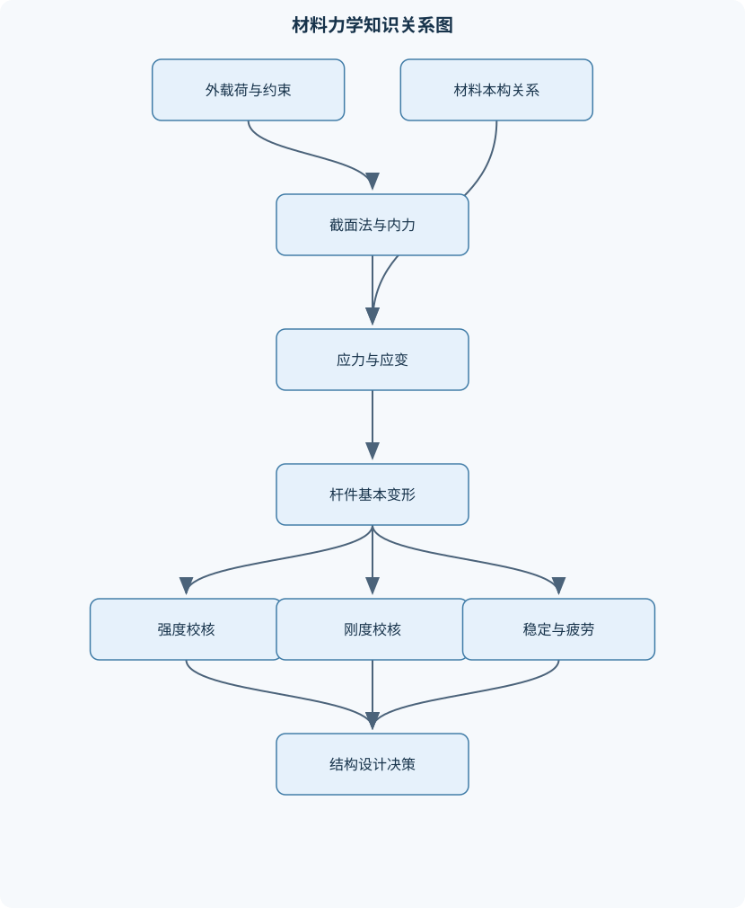
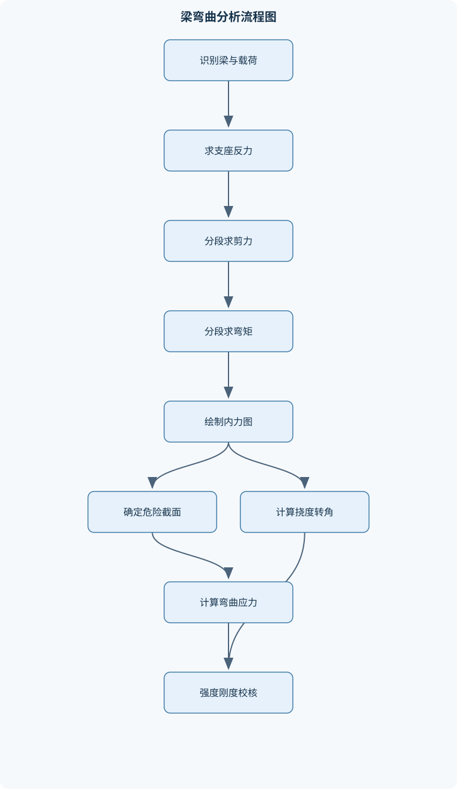

# 材料力学

## 一、课程整体知识框架

### 课程边界与先修知识

材料力学研究杆件、梁、轴、压杆及常见薄壁构件在外载荷、温度、冲击和交变载荷作用下的应力、变形、强度、刚度与稳定性。课程以小变形、连续介质、均匀连续材料和经典杆件理论为主要基础，覆盖静定与超静定结构、组合变形、应力状态分析、强度理论、疲劳、动载荷、能量法及塑性分析。先修知识包括高等数学中的微积分与常微分方程、线性代数、普通物理、理论力学中的受力分析与平衡方程，以及工程制图和基本材料知识。材料力学不等同于结构动力学、弹性力学、断裂力学或有限元分析；对于厚板、复杂三维应力场、大变形、显著塑性流动和强非线性问题，需要采用相应的高级理论或数值方法。





### 1. 研究对象、基本任务与理论边界

材料力学研究杆件、梁、轴、压杆以及部分薄壁构件在外载荷、温度变化、冲击和交变载荷作用下的内力、应力、变形、强度、刚度和稳定性。其核心问题是：构件在规定工作条件下是否具有足够的承载能力，变形是否不超过允许范围，是否会发生失稳、疲劳破坏或塑性失效。

课程通常建立在连续介质、材料均匀、材料各向同性、小变形和线弹性等理想化假设上。连续介质假设把材料视为无间隙、可连续分布的介质；均匀性表示材料参数在研究区域内不随位置变化；各向同性表示同一点沿不同方向的力学性质相同；小变形假设允许用未变形几何尺寸建立平衡方程；线弹性假设要求应力与应变保持线性关系，并且卸载后基本恢复原状。

这些假设不是任何情况下都成立。复合材料、木材和轧制材料可能具有明显各向异性；橡胶、大挠度梁和屈曲后构件不满足小变形线性模型；厚板、复杂连接和孔洞邻域存在显著三维应力；裂纹尖端需要断裂力学；复杂几何、接触、材料非线性和大变形问题通常需要弹性力学、塑性力学或数值分析方法。

### 2. 统一的受力、变形与失效描述

外力包括集中力 $F$、分布载荷 $q(x)$、集中力偶、扭矩 $T$、温度作用以及冲击和惯性作用。单位应保持一致：$F$通常用N或kN，$q(x)$用N/m，弯矩 $M$ 和扭矩 $T$ 用N·m。截面法把杆件假想截开，截面上出现的相互作用称为内力。轴力记为 $N$，剪力记为 $Q$，弯矩记为 $M$，其正负号必须与所采用的受力图和内力图约定一致。

应力描述单位面积上的内力。正应力 $\sigma$ 垂直于截面，切应力 $\tau$ 平行于截面，单位通常为Pa或MPa。应变描述单位长度的变形，正应变为 $\varepsilon$，切应变为 $\gamma$，二者均无量纲。线弹性各向同性材料满足胡克定律，弹性模量为 $E$，切变模量为 $G$，泊松比为 $\nu$，并有

$$
G=\frac{E}{2(1+\nu)}.
$$

强度校核关注应力是否超过材料或设计准则允许的范围；刚度校核关注位移、转角或扭转角；稳定校核关注平衡状态是否会因微小扰动而失去承载能力；疲劳校核关注交变应力下裂纹萌生和扩展。许用应力 $[\sigma]$、$[\tau]$不能简单理解为某个强度参数除以固定常数，还应考虑载荷不确定性、材料离散性、制造缺陷、环境、表面质量和失效后果。

### 3. 从截面几何到构件响应的逻辑链

截面面积 $A$、惯性矩 $I$、极惯性矩 $I_p$、抗弯截面系数 $W$ 和抗扭截面系数 $W_t$是几何性质，不是材料强度参数。面积决定轴向刚度的一部分；惯性矩反映截面对弯曲的抗拒能力；极惯性矩主要用于圆轴扭转；截面系数把内力直接转换为边缘应力。它们量纲分别为 $m^2$、$m^4$、$m^4$、$m^3$和 $m^3$。

形心由面积一阶矩确定。组合截面可分割为若干标准图形，对孔洞采用负面积。平行移轴定理为

$$
I=I_c+A d^2,
$$

其中 $I_c$是对自身形心轴的惯性矩，$A$是面积，$d$是两平行轴间距离。存在惯性积时，需要通过坐标变换寻找主惯性轴；主轴上的惯性积为零。若截面发生旋转或轴线选择不一致，直接套用单轴弯曲公式会得到错误结果。

#### 3.1 轴向、扭转和弯曲

均匀直杆受到轴向力且远离载荷作用区时，截面法和平衡方程给出

$$
\sigma=\frac{N}{A}.
$$

该式隐含截面应力近似均匀的条件。对长度为 $L$、材料和截面均匀的直杆，轴向变形为

$$
\delta=\frac{NL}{EA}.
$$

变截面或分段材料杆应写成

$$
\delta=\int \frac{N(x)}{E(x)A(x)}\,\mathrm dx.
$$

载荷作用点、孔洞、缺口和截面突变附近会出现应力集中，名义应力公式只反映平均或远场水平，不能直接代表孔边局部最大应力。

圆轴扭转时，横截面在经典模型中保持平面并绕轴线转动，半径方向的切应变随半径增加。由几何关系和扭矩平衡得到

$$
\tau=\frac{Tr}{I_p},\qquad
\varphi=\frac{TL}{GI_p},
$$

其中 $r$为到轴心的距离，$\varphi$为扭转角。最大切应力出现在外表面。上述关系适用于圆轴或满足相应扭转理论的截面；非圆截面自由扭转会产生翘曲，不能盲目使用圆轴公式。薄壁杆常用剪流描述剪切传递，开口和闭口截面的分布规律不同。圆柱螺旋弹簧还需同时考虑钢丝的扭转和曲率修正。

梁弯曲时，支座反力先由整体平衡求出，再用截面法确定剪力和弯矩。对均布载荷 $q(x)$，梁微元平衡给出

$$
\frac{\mathrm dM}{\mathrm dx}=Q,\qquad
\frac{\mathrm dQ}{\mathrm dx}=-q(x),
$$

具体符号取决于内力正号约定。集中力使剪力图发生跳变，集中力偶使弯矩图发生跳变。弯矩图的极值通常出现在剪力为零、边界或内力发生突变的位置，不能只凭图形直觉判断。

纯弯曲平面假设认为变形前为平面的截面变形后仍为平面，并且梁轴线附近的纵向纤维发生不同程度伸缩。由曲率和轴向应变关系可得

$$
\sigma=-\frac{My}{I}.
$$

中性轴上正应力为零，远离中性轴处应力绝对值更大。剪力显著时还应计算弯曲切应力。矩形或工字形截面常用

$$
\tau=\frac{QS}{Ib},
$$

其中 $S$为考察点一侧面积对中性轴的静矩，$b$为该处截面宽度。薄壁工字梁中，腹板可能控制切应力，而翼缘边缘通常控制弯曲正应力。

### 4. 变形、应力状态与组合受力

梁的挠度记为 $v$，转角记为 $\theta$。在小挠度、Euler–Bernoulli梁模型下，

$$
EI\,v''(x)=M(x),
$$

正负号随挠度和弯矩约定改变。积分法需要在每个区段引入积分常数，并用边界条件、支点条件和连续条件确定；叠加法要求材料、几何、边界和变形关系均为线性。单位载荷法和卡氏定理可将目标位移转化为内力乘积积分，单位载荷方向必须与目标位移方向一致。

单向、二向和三向应力状态的区别在于某点独立应力分量的数量和分布。平面应力并不等于平面应变：薄板表面常可近似取厚度方向应力为零，而长厚结构受约束时可能更接近平面应变。通过应力变换可求斜截面正应力、切应力、主应力和最大切应力。莫尔圆中，圆心代表平均正应力，半径代表最大切应力，圆与正应力轴的交点给出主应力。主应力按代数大小规律排列为 $\sigma_1\geq\sigma_2\geq\sigma_3$。

组合变形中必须先在同一坐标系下叠加轴力、双向弯矩、剪力和扭矩引起的应力分量，再进行主应力或等效应力计算。偏心轴向力可分解为轴向力与弯矩，截面上正应力一般为线性分布。若整个截面只受压，偏心力作用线必须位于截面核心内；若超出核心，截面部分区域会出现拉应力。弯扭组合轴表面常同时存在弯曲正应力和扭转切应力，不能分别校核后就认为整体安全。

四种常用强度理论各有适用边界：最大拉应力理论适合对拉压强度差异明显的脆性材料；最大切应力理论适合延性材料的初始屈服估计；最大拉应变理论考虑泊松效应但应用较少；畸变能理论通常用于延性材料的多轴屈服判断。含裂纹构件的失效不能只用名义应力强度理论判断，还需考虑裂纹尖端应力强度、裂纹尺寸、材料断裂韧性和裂纹扩展条件。

### 5. 稳定、动载荷、疲劳与塑性

压杆稳定不是“应力超过强度”这一单一问题，而是平衡形态的稳定性问题。理想细长压杆受轴向压力 $P$时，微小弯曲扰动可能不断放大。由挠曲平衡方程和端部边界条件得到

$$
P_{cr}=\frac{\pi^2EI}{L_e^2},
\qquad
\sigma_{cr}=\frac{P_{cr}}{A},
$$

其中 $L_e$为有效长度。柔度为

$$
\lambda=\frac{L_e}{i},
\qquad
i=\sqrt{\frac{I}{A}}.
$$

不同端部约束对应不同有效长度；应分别检查两个主惯性方向，最小临界力控制稳定性。欧拉公式要求理想直杆、轴向受压、弹性小变形、初始缺陷可忽略且柔度足够大。短柱常由屈服或压溃控制，中长柱需要过渡经验关系，不能在欧拉公式适用范围外直接使用。

应变能密度是单位体积储存的弹性能。轴向、扭转和弯曲构件分别可写成相应内力平方与刚度的积分。卡氏定理利用总应变能对外力求偏导得到相应位移；力法则解除多余约束建立基本静定系，利用变形协调方程求多余约束力。相当系统必须满足：解除多余约束后结构静定，恢复约束后原结构位移条件重新成立。

达朗贝尔原理把惯性力加入受力图，将动力学问题转化为形式上的平衡问题。冲击分析常假定忽略冲击物变形、冲击前后机械能守恒、构件服从线弹性。跌落重物的重力势能转化为构件变形能，冲击应力通常高于同样载荷下的静应力；若冲击物自身变形、接触耗能或塑性变形显著，理想冲击系数会失真。

交变应力用最大应力 $\sigma_{\max}$和最小应力 $\sigma_{\min}$描述，平均应力、应力幅和应力比为

$$
\sigma_m=\frac{\sigma_{\max}+\sigma_{\min}}{2},
\qquad
\sigma_a=\frac{\sigma_{\max}-\sigma_{\min}}{2},
\qquad
R=\frac{\sigma_{\min}}{\sigma_{\max}}.
$$

对称循环满足 $\sigma_m=0$、$R=-1$；脉动循环通常以零为一端，应力比取决于具体符号约定。疲劳破坏往往从表面缺陷、缺口或材料夹杂处萌生，经稳定扩展后形成瞬断区。疲劳寿命受应力幅、平均应力、表面状态、尺寸、缺口、残余应力、环境和载荷谱影响。应力—寿命曲线适合相应的高周疲劳问题，裂纹已经存在时应采用裂纹扩展分析。线性累积损伤只是工程近似，不能替代完整载荷序列下的试验或断裂评估。

理想弹塑性材料达到屈服后应力近似保持不变，弯曲截面先在最外层屈服，塑性区逐渐向内发展，形成塑性铰后可产生较大转角。首次屈服弯矩和塑性弯矩不同，后者对应截面全塑性发展。塑性分析适用于满足塑性发展条件的极限承载问题，不能替代弹性阶段的变形和局部应力校核。

## 二、章节和模块划分

### 核心知识覆盖清单

本清单用于检查正文是否覆盖本课程的主要知识模块：

- **绪论与基本概念**：材料力学的任务与研究对象、变形固体的连续性假设、均匀性与各向同性假设、小变形与线弹性假设、外力与载荷分类、内力与截面法、应力与应变定义、杆件基本变形形式、圣维南原理及适用边界、失效模式与安全因数。
- **截面几何性质与轴向载荷**：截面静矩与形心、截面惯性矩、惯性积与主惯性轴、平行移轴定理、组合截面几何性质、轴向拉伸与压缩、轴力图与应力分布、斜截面应力、轴向变形与刚度、温度应力与装配应力、应力集中与局部效应。
- **材料力学性能与强度计算**：低碳钢拉伸全过程、比例极限与屈服强度、抗拉强度与颈缩、伸长率与断面收缩率、脆性材料与塑性材料、压缩试验的力学特征、许用应力法、安全因数的确定原则、应力集中因数、剪切与挤压实用计算、失效判据与强度条件。
- **扭转与剪切**：外力偶矩与扭矩图、纯剪切应力状态、切应力互等定理、圆轴扭转的平面假设、圆轴扭转应力、扭转角与扭转刚度、极惯性矩与抗扭截面系数、非圆截面自由扭转、薄壁杆剪流、圆柱螺旋弹簧应力与变形、扭转强度与刚度校核。
- **弯曲内力与弯曲应力**：梁的简化模型、支座与约束反力、剪力与弯矩正负号、剪力方程与弯矩方程、载荷集度与内力关系、剪力图与弯矩图、平面弯曲与纯弯曲、弯曲正应力公式、弯曲切应力公式、中性层与中性轴、等强度梁与截面优化、平面曲杆弯曲内力。
- **弯曲变形与梁的刚度**：挠度与转角、挠曲线微分方程、弯曲刚度、积分法求梁变形、边界条件与连续条件、叠加法、单位载荷法、简单超静定梁、梁的刚度校核、提高弯曲刚度的措施、变截面梁的基本处理。
- **应力应变分析与强度理论**：单向应力状态、二向应力状态、三向应力状态、斜截面应力变换、主应力与主平面、莫尔应力圆、平面应变状态、广义胡克定律、体积应变与畸变能、最大拉应力理论、最大切应力理论、最大拉应变理论、畸变能理论、莫尔强度理论、含裂纹构件的断裂准则。
- **组合变形与偏心受力**：叠加原理的线弹性条件、轴向力与弯矩组合、拉弯与压弯构件、偏心拉伸与偏心压缩、截面核心定义、截面核心的几何判定、弯曲与扭转组合、弯曲与剪切组合、空间组合变形、危险点应力状态、组合变形强度校核。
- **压杆稳定**：稳定与失稳概念、理想细长压杆模型、两端铰支压杆临界力、不同端部约束的有效长度、欧拉临界力公式、柔度与临界应力、欧拉公式适用范围、短柱与中长柱、经验公式的使用边界、稳定安全因数、压杆稳定校核、提高稳定性的结构措施、纵横弯曲概念。
- **能量法、超静定与动载荷**：应变能与应变能密度、轴向载荷应变能、扭转应变能、弯曲应变能、卡氏定理、功的互等定理、位移互等定理、力法与基本静定系、相当系统与多余约束、变形协调方程、达朗贝尔原理、冲击载荷基本假设、冲击应力与冲击变形。
- **交变应力、疲劳与塑性分析**：循环应力与应力谱、平均应力与应力幅、应力比与循环特征、对称循环与脉动循环、疲劳破坏机理、疲劳断口的裂纹源与瞬断区、疲劳极限与疲劳寿命、影响疲劳强度的因素、应力寿命曲线、线性累积损伤思想、理想弹塑性材料、塑性区与塑性铰、极限载荷与塑性分析。


### 1. 绪论、假设与截面几何性质

本模块先建立“外力—内力—应力—应变—变形—失效”的概念链。学习截面法时，应先画整体受力图求支反力，再隔离一侧列平衡方程。每个隔离体都必须满足力和力矩平衡，这是内力求解过程中的不变量。

截面几何性质计算流程如下：输入基本图形尺寸、孔洞位置和参考坐标；分割组合截面；计算各部分面积和形心；用面积一阶矩求总形心；用平行移轴定理累计惯性矩；计算惯性积并求主惯性轴；统一单位后复核。若孔洞被当作正面积，形心和惯性矩都会偏离真实值。

### 2. 轴向载荷、材料性能与实用强度

轴向杆分析包括轴力图、正应力、斜截面应力、轴向变形、温度应力和装配应力。温度自由膨胀量为 $\alpha\Delta T L$，其中 $\alpha$为线膨胀系数，单位为 $1/\mathrm K$。若两端完全约束，热膨胀不能自由发生，约束反力通过变形协调产生温度应力；若杆可自由伸长，则理想情况下不产生轴向热应力。

低碳钢拉伸通常经历弹性阶段、屈服阶段、强化阶段和颈缩断裂阶段。比例极限对应应力—应变曲线保持正比的范围；屈服强度反映明显塑性变形开始；抗拉强度是工程应力曲线的最大值。伸长率和断面收缩率反映塑性。脆性材料通常塑性变形小、断裂突然，而塑性材料在断裂前可产生明显屈服和颈缩。许用应力法根据失效模式、材料性能和安全因数建立设计限制。剪切和挤压计算多用于销、螺栓、键和连接件，但孔边局部应力可能明显高于名义值。

### 3. 扭转、剪切与梁内力

圆轴扭转模块应先由外力偶平衡求各段扭矩，再绘制扭矩图，最后分别进行强度和刚度校核。传递功率时，若功率为 $P$、转速为 $n$，应先统一单位，再由功率与角速度关系求扭矩。轴径可能由最大切应力控制，也可能由扭转角控制，二者不能只做一种校核。

梁内力分析要处理简支、悬臂、固支和多跨等支座。流程是求支反力、按载荷变化点分段、写出 $Q(x)$与 $M(x)$、检查集中力和集中力偶的跳变、利用 $M'=Q$和 $Q'=-q$复核。梁弯曲应力模块进一步计算中性轴、弯曲正应力和弯曲切应力，并讨论等强度梁。等强度梁沿长度改变截面，使危险位置的最大应力接近一致，可减少材料浪费，但还需考虑制造、局部屈曲和连接要求。平面曲杆由于曲率显著，正应力分布可能不再服从直梁的线性公式。

### 4. 梁变形、应力状态与强度理论

梁变形模块以 $EI v''=M(x)$为核心。积分法适合区段较少的梁；叠加法适合载荷可分解且结构线性的情况；单位载荷法适合求某一位置的挠度或转角。每个区段都要满足边界和连续条件，不能只利用一个端点条件确定所有常数。

应力状态分析从应力张量出发，处理斜截面、主应力、主平面、最大切应力和莫尔圆。平面应力问题中，厚度方向应力近似为零；平面应变问题中，厚度方向应变近似为零，二者的广义胡克定律不同。体积应变反映体积变化，畸变能反映形状改变，是畸变能强度理论的基础。

### 5. 组合变形、偏心受力与压杆稳定

组合变形先分别求轴力、弯矩、扭矩和剪力产生的应力，再在同一坐标系中叠加。偏心压缩可表示为轴向压应力与弯曲应力之和。若偏心距超过截面核心范围，部分区域出现拉应力；对不允许受拉的砌体、接触支承和某些基础构件，这一判断尤其重要。

压杆稳定应先确定可能的失稳平面，再计算两个主方向的回转半径、柔度和有效长度。理想欧拉杆的临界力随 $EI$增大而增大，随有效长度平方增大而急剧降低。实际压杆存在初弯曲、偏心、残余应力和材料非均匀性，因此工程设计通常需要稳定系数或适用范围明确的经验关系。

### 6. 能量法、超静定、动载荷、疲劳与塑性

超静定结构不能只依靠平衡方程求解。力法流程是判断超静定次数、解除多余约束、建立基本静定系、求实际载荷和单位多余力造成的位移、列变形协调方程、求多余力并叠加。温度、支座沉降和制造误差也可作为变形或初始应变输入。

疲劳评估流程是读取应力时间历程，提取循环最大值和最小值，计算 $\sigma_m$、$\sigma_a$和 $R$，修正缺口、表面、尺寸与环境影响，选择应力—寿命或应变—寿命模型，最后与设计寿命比较。塑性分析则从首次屈服开始，追踪塑性区扩展、塑性铰形成和极限载荷；必须同时说明弹性阶段的变形和残余变形是否满足要求。

### 7. 代表性计算流程与伪代码

#### 7.1 静定梁剪力图和弯矩图

**输入：**梁长、支座位置、集中力、集中力偶和分布载荷。  
**输出：**支反力、各区段 $Q(x)$和 $M(x)$、剪力图、弯矩图及极值。  
**过程：**按载荷变化点分段，整体平衡求反力，截面法求内力，再以微分关系和边界条件复核。  
**适用条件：**平面梁、静力平衡、小变形不影响载荷几何关系。  
**终止条件：**所有区段、边界和跳变点均已检查。

```python
# 仅进行平面静定梁的离散内力计算，不读写文件
def simply_supported_beam(L, point_loads, uniform_load=0.0, samples=1000):
    """
    L: 梁长，单位 m
    point_loads: [(x, F)]，F向下为正，单位 N
    uniform_load: 全跨均布载荷，单位 N/m
    返回：左支反力、右支反力、离散位置、剪力、弯矩
    """
    if L <= 0:
        raise ValueError("梁长必须为正")
    for x, F in point_loads:
        if not (0 <= x <= L):
            raise ValueError("集中力位置必须在梁范围内")

    total_force = uniform_load * L + sum(F for _, F in point_loads)
    moment_about_left = uniform_load * L * (L / 2)
    moment_about_left += sum(F * x for x, F in point_loads)

    right_reaction = moment_about_left / L
    left_reaction = total_force - right_reaction

    xs = [i * L / samples for i in range(samples + 1)]
    shear = []
    moment = []

    for x in xs:
        q_part = uniform_load * x
        p_part = sum(F for xp, F in point_loads if xp <= x)
        v = left_reaction - q_part - p_part

        m = left_reaction * x - uniform_load * x * x / 2
        m -= sum(F * (x - xp) for xp, F in point_loads if xp <= x)

        shear.append(v)
        moment.append(m)

    return left_reaction, right_reaction, xs, shear, moment
```

程序中的不变量是每个截面左侧隔离体满足平衡；排错时应检查两端弯矩是否满足支座条件、剪力跳变是否等于集中力、弯矩跳变是否等于集中力偶，并用数值积分检查 $M'=Q$、$Q'=-q$。

#### 7.2 圆轴扭转校核

输入各段扭矩、长度、直径、$G$、许用切应力和许用扭转角；对每段求 $I_p$，计算最大切应力和扭转角；分别比较强度和刚度。若轴径有台阶，应特别检查台阶圆角处的应力集中，名义扭转公式不能完全代表局部最大应力。

#### 7.3 组合变形危险点校核

输入 $N$、双向弯矩、$T$、$Q$和截面几何性质。先求同一坐标系下的正应力和切应力，找出所有边缘候选危险点，再用应力变换求主应力或等效应力，最后选择与材料和失效模式相符的强度理论。若存在明显塑性、接触开闭或大变形，线弹性叠加不再适用。

### 8. 典型例题

#### 例题一：阶梯拉杆的应力与伸长

**题干：**两段同轴拉杆承受轴力 $N=20\,\mathrm{kN}$。第一段 $L_1=0.5\,\mathrm m$、$A_1=200\,\mathrm{mm^2}$；第二段 $L_2=0.8\,\mathrm m$、$A_2=400\,\mathrm{mm^2}$；材料弹性模量均为 $E=200\,\mathrm{GPa}$。求各段应力和总伸长。

**分析：**串联杆各段轴力相同，但应力和变形不同。

**解答：**

$$
\sigma_1=\frac{20000}{200\times10^{-6}}=100\,\mathrm{MPa},
$$

$$
\sigma_2=\frac{20000}{400\times10^{-6}}=50\,\mathrm{MPa}.
$$

各段伸长为

$$
\delta_1=\frac{NL_1}{EA_1}=0.25\,\mathrm{mm},
\qquad
\delta_2=\frac{NL_2}{EA_2}=0.20\,\mathrm{mm}.
$$

因此

$$
\delta=0.45\,\mathrm{mm}.
$$

**验证：**面积较小的第一段应力较大；总伸长为各段伸长之和。若把全长和最小面积直接代入，会高估第二段变形。

**变式：**若两段弹性模量不同，应使用 $\delta=\sum NL_i/(E_iA_i)$；若一端固定另一端受热，还需加入自由热伸长和约束协调条件。

#### 例题二：简支梁均布载荷

**题干：**跨度 $L=4\,\mathrm m$的简支梁承受全跨均布载荷 $q=5\,\mathrm{kN/m}$。求支反力和最大弯矩。

**分析：**均布载荷合力为 $qL$，作用于跨中。

**解答：**

由对称性，

$$
R_A=R_B=\frac{qL}{2}=10\,\mathrm{kN}.
$$

任意截面 $x$处

$$
Q(x)=R_A-qx,
$$

$$
M(x)=R_Ax-\frac{qx^2}{2}.
$$

最大弯矩处满足 $Q(x)=0$，故 $x=L/2=2\,\mathrm m$。于是

$$
M_{\max}=\frac{qL^2}{8}=10\,\mathrm{kN\cdot m}.
$$

**验证：**两端弯矩为零；剪力从正值连续下降到负值；最大弯矩位于剪力变号处。

**变式：**加入集中力偶后，弯矩图在作用点跳变，但剪力图不跳变；加入集中力后，剪力图跳变而弯矩保持连续。

#### 例题三：弯扭组合圆轴

**题干：**某圆轴危险截面同时承受弯矩 $M$和扭矩 $T$。轴表面弯曲正应力为 $\sigma$，扭转切应力为 $\tau$。说明如何求主应力和最大切应力。

**分析：**轴表面可视为二向应力状态，正应力为 $\sigma$，切应力为 $\tau$，另一正应力近似为零。

**解答：**

主应力为

$$
\sigma_{1,2}
=\frac{\sigma}{2}\pm
\sqrt{\left(\frac{\sigma}{2}\right)^2+\tau^2}.
$$

最大切应力为

$$
\tau_{\max}
=\sqrt{\left(\frac{\sigma}{2}\right)^2+\tau^2}.
$$

延性材料可采用最大切应力理论或畸变能理论；脆性材料则应关注最大主拉应力及拉压不对称性。

**验证：**当 $T=0$时，主应力退化为 $\sigma$和0；当 $M=0$时，主应力为 $\pm\tau$。

**变式：**若同时存在轴力，应先把轴向正应力加入 $\sigma$，不能把轴力和弯曲应力分开进行强度判定。

#### 例题四：偏心压缩与截面核心

**题干：**矩形截面柱受压力 $P$，作用线偏离截面形心距离 $e$。求截面正应力的表达式，并判断何时出现拉应力。

**分析：**偏心压力等效为形心处压力 $P$与弯矩 $M=Pe$。

**解答：**

截面上任一点正应力可写为

$$
\sigma=\frac{P}{A}\pm\frac{My}{I}.
$$

对宽度为 $b$、高度为 $h$的矩形截面，边缘最大、最小应力为

$$
\sigma_{\max,\min}
=\frac{P}{A}\pm\frac{6Pe}{bh^2}.
$$

不出现拉应力的条件为

$$
e\leq\frac{h}{6}.
$$

这一区域是关于相应弯曲轴的截面核心范围。

**验证：**当 $e=0$时应力均匀；当 $e=h/6$时最小边缘应力恰为零；超过该值则一侧出现拉应力。

**变式：**双向偏心时需同时考虑两个弯矩，截面核心由单向条件扩展为二维区域。

#### 例题五：两端铰支细长压杆

**题干：**两端铰支压杆长度为 $L$，截面惯性矩为 $I$，弹性模量为 $E$。求临界压力并说明增加长度的影响。

**分析：**两端铰支的有效长度 $L_e=L$。

**解答：**

$$
P_{cr}=\frac{\pi^2EI}{L^2}.
$$

若长度增加为原来的两倍，则

$$
P_{cr}'=\frac{\pi^2EI}{(2L)^2}
=\frac14P_{cr}.
$$

因此压杆稳定承载力对长度非常敏感。

**验证：**临界力随 $E$和 $I$增大而增大，随 $L^2$增大而降低。若杆较短，欧拉公式可能高估实际承载力，必须转用适合短柱或中长柱的关系。

**变式：**一端固定一端自由时有效长度显著增大，临界压力降低；不同端部条件必须通过有效长度统一处理。

### 9. 实验与工程项目流程

#### 9.1 金属拉伸实验

**输入数据：**试样原始直径、标距、逐级载荷、伸长量、断后直径和标距。  
**步骤：**测量初始尺寸；逐级加载记录载荷—伸长数据；绘制工程应力—应变曲线；确定比例极限、屈服强度、抗拉强度；断裂后测量伸长率和断面收缩率。  
**评价标准：**数据曲线应具有合理的弹性段和塑性发展趋势；弹性段斜率可用于估计 $E$；强度和塑性指标的单位、定义和测量基准必须一致。  
**排错方法：**若弹性段不近似直线，检查夹具滑移、引伸计安装和零点；若应力异常偏低，检查面积单位是否将 $\mathrm{mm^2}$误当作 $\mathrm m^2$；若断裂位置靠近夹具，应谨慎评价延性指标。  
**边界：**实验得到的是特定试样、温度和加载速率下的性能，不能直接代表所有尺寸和环境下的设计强度。

#### 9.2 悬臂梁挠度验证项目

**输入数据：**梁长、截面尺寸、弹性模量、端部载荷、位移计读数。  
**步骤：**测量截面并计算 $I$；在弹性范围内逐级加载；记录自由端挠度；用积分法或单位载荷法计算理论值；比较实验与理论结果。  
**评价标准：**载荷—挠度关系应近似线性；实验值与理论值的偏差应结合支座间隙、加载点偏差、材料实际 $E$和剪切变形解释，而不能只给出百分比。  
**排错方法：**若初始读数不为零，先校零；若曲线有明显滞回，检查夹具松动或材料进入塑性；若梁较短而误差偏大，应考虑剪切变形，因为Euler–Bernoulli模型忽略了它。  
**工程产出：**包括截面计算表、载荷—挠度曲线、理论与实验对比、误差来源和是否满足刚度要求的结论。

### 10. 易错点、笔试问题与面试问题

#### 10.1 具体易错点

1. 把外力和内力混为一谈；内力必须通过截面法和隔离体平衡确定。  
2. 在孔洞、缺口和载荷作用点附近直接使用 $\sigma=N/A$。  
3. 混淆 $I$、$I_p$和 $W$，忽略三者量纲与用途不同。  
4. 未统一N、mm、MPa和m、kN、Pa的单位体系。  
5. 将弯矩图斜率关系写错，未用微元平衡复核。  
6. 忽略集中力和集中力偶造成的内力图跳变。  
7. 纯弯曲公式中没有检查剪力是否显著。  
8. 把平面应力误认为平面应变。  
9. 组合变形时未把应力分量转换到同一坐标系。  
10. 认为许用应力等于强度除以固定安全因数。  
11. 在短柱或中长柱范围内直接套用欧拉公式。  
12. 梁变形积分时漏掉边界条件或区段连续条件。  
13. 用叠加原理处理明显塑性、接触开闭或大变形。  
14. 疲劳分析只看最大应力，忽略平均应力和应力幅。  
15. 把塑性铰误认为普通几何铰。  
16. 冲击问题中直接使用静载公式而不进行能量分析。

#### 10.2 常见笔试问题及解答思路

1. **为什么轴向杆有 $\sigma=N/A$？**  
   从截面法和平衡出发，再说明需要远离载荷作用区且应力分布近似均匀。

2. **圣维南原理说明什么？**  
   局部载荷形式对远离载荷区的应力分布影响减弱，但不能据此忽略载荷作用区、孔边和缺口处的局部峰值。

3. **推导圆轴扭转公式。**  
   先用平面截面转动建立 $\gamma=r\varphi/L$，再用 $\tau=G\gamma$，最后对截面积分扭矩得到 $\tau=Tr/I_p$。

4. **如何判断弯矩最大位置？**  
   先求剪力函数，内部极值通常满足 $Q=0$，同时检查边界和集中力偶位置。

5. **平面应力和平面应变有何区别？**  
   前者规定某些应力分量近似为零，后者规定某些应变分量近似为零；二者广义胡克定律不能混用。

6. **四种强度理论如何选择？**  
   依据材料延性、脆性、拉压强度差异和载荷状态选择；延性多用最大切应力或畸变能，脆性更关注最大主应力。

7. **欧拉公式为什么不适合短柱？**  
   欧拉公式以弹性弯曲失稳为基础，短柱往往先达到材料屈服或压溃，临界机制不同。

8. **冲击应力为什么大于静应力？**  
   冲击物的势能或动能在短时间内转化为构件弹性变形能，峰值变形和应力高于相同载荷缓慢施加的静态情况。

#### 10.3 常见面试问题及参考回答要点

1. **如何校核一根受弯梁？**  
   先求支反力和内力图，再进行弯曲正应力、切应力和挠度校核，最后检查局部屈曲、连接和疲劳；验收应包括危险截面、最大变形位置和单位一致性。

2. **有限元结果如何用材料力学复核？**  
   用平衡反力、名义应力、弯矩图、截面惯性矩和变形数量级进行独立估算；若有限元峰值只出现在尖角，应判断是否为网格或理想尖角奇异性。

3. **孔洞附近为什么不能用平均应力？**  
   几何不连续改变力流，使孔边出现应力集中；静强度需考虑局部峰值，疲劳还需重点关注孔边裂纹萌生。

4. **如何处理超静定温度杆？**  
   用整体平衡和总变形协调联立求解；自由热伸长是 $\alpha\Delta T L$，约束反力产生的机械变形必须抵消不允许的总伸长。

5. **压杆设计最先检查什么？**  
   检查端部约束、最小惯性方向、初始偏心和柔度，再决定使用欧拉、经验或材料强度模型。

6. **弯曲与扭转同时存在时怎样判断危险点？**  
   在同一截面和坐标系中合成正应力、切应力，求主应力或等效应力，再依据材料失效模式校核，不能分别通过就直接判定整体通过。

7. **疲劳设计中平均应力有什么作用？**  
   相同应力幅下，拉伸平均应力通常会降低疲劳承载能力；还需结合表面、尺寸、缺口和环境修正，不能只比较最大应力。

8. **什么时候需要超出材料力学的经典模型？**  
   出现厚板三维应力、大变形、显著塑性、裂纹、接触非线性、复合材料各向异性或复杂动力响应时，应采用弹性力学、塑性力学、断裂力学、结构动力学或数值方法。

### 11. 岗位任务与课程知识的对应

机械结构设计工程师通常需要根据载荷谱完成轴、梁、支架和连接件的强度、刚度和疲劳校核，产出计算书、危险截面清单和设计尺寸，验收标准是载荷路径明确、边界条件合理、强度与刚度均满足设计要求。

车辆、轨道和航空结构分析人员需要处理弯曲、组合变形、稳定和交变载荷，产出内力包络、应力云图解释、疲劳寿命或安全因数；验收不仅看最大应力，还要检查工况覆盖、失效模式和试验相关性。

材料测试与失效分析人员需要进行拉伸、压缩、疲劳和断口分析，产出应力—应变曲线、材料性能指标、裂纹源判断和失效报告；验收标准包括试样尺寸、加载记录、单位、重复性和断口证据链完整。

有限元前处理与结果校核人员需要建立合理约束、材料参数和网格，并使用材料力学公式进行数量级复核。最终产出应包括模型假设、网格独立性说明、反力平衡、关键截面理论计算和结论边界，不能只提交彩色云图。

## 三、核心概念的详细解释

### 3.1 材料力学的研究对象、基本假设与理论边界

材料力学研究杆件、梁、轴、压杆以及部分薄壁构件在外力、温度、冲击和交变载荷作用下的内力、应力、变形、强度、刚度与稳定性。杆件通常具有一个显著的长度方向，横截面尺寸相对于长度较小，因此可以用轴线和截面性质简化三维实体问题。

连续介质假设把材料视为连续分布的介质，不单独考虑原子间空隙；均匀性假设认为材料参数在研究区域内不随位置变化；各向同性假设认为同一点沿不同方向的力学性质相同；小变形假设允许使用变形前的几何尺寸建立平衡方程；线弹性假设要求应力与应变成正比，卸载后变形基本恢复。上述假设共同构成经典材料力学模型的基础。

这些假设具有明确边界。复合材料、木材和轧制材料可能显著各向异性；橡胶、泡沫材料和明显屈服后的金属不满足线弹性；大挠度梁、屈曲后压杆不满足小变形几何关系；裂纹尖端存在强烈应力集中和非均匀三维应力场，不能仅用名义应力描述；厚板、复杂连接、接触开闭和局部屈曲问题通常需要弹性力学、塑性力学、断裂力学或数值方法。

### 3.2 外力、内力、截面法与圣维南原理

外力是结构外部施加的作用，包括集中力 $F$、分布载荷 $q(x)$、集中力偶、扭矩 $T$、温度作用和冲击惯性作用。$F$的单位为N或kN，$q(x)$的单位为N/m，弯矩 $M$和扭矩 $T$的单位为N·m。

内力不是独立施加在构件上的外部载荷，而是将构件假想截开后，截面一侧材料对另一侧材料的相互作用。截面上的合力和合力矩可分解为轴力 $N$、剪力 $Q$、弯矩 $M$和扭矩 $T$。求内力时必须先画隔离体，列出平衡方程，再由截面法确定内力方向和大小。若截面两侧分别取为隔离体，同一截面上的内力大小相等、方向相反，这是作用与反作用关系，并不意味着“一个外力对应两个内力”。

圣维南原理指出：对于静力等效但分布形式不同的载荷，在远离载荷作用区域处，局部应力分布的差异会迅速减弱，构件的合力、合力矩相同即可近似采用相同的名义应力结果。该原理支持使用 $\sigma=N/A$ 等平均或名义公式，但不适用于载荷作用点、孔洞边缘、焊趾、截面突变、裂纹尖端和接触区等局部区域。局部最大应力仍可能由应力集中控制。

### 3.3 应力、应变与基本变形形式

正应力 $\sigma$ 垂直于考察截面，切应力 $\tau$ 平行于考察截面，单位通常为Pa或MPa。正应变 $\varepsilon$表示长度相对变化，切应变 $\gamma$表示直角改变的角度量，二者均为无量纲量。

杆件的基本变形包括轴向拉伸或压缩、剪切、扭转和弯曲。轴向变形主要由轴力 $N$产生；扭转主要由扭矩 $T$产生；弯曲主要由弯矩 $M$产生；剪切变形主要由剪力 $Q$产生。实际构件常同时承受多种内力，必须先分别求出各应力分量，再在同一坐标系中合成并进行应力状态分析。

各向同性线弹性材料的弹性模量为 $E$，切变模量为 $G$，泊松比为 $\nu$，满足

$$
G=\frac{E}{2(1+\nu)}.
$$

该关系仅适用于各向同性线弹性材料。对于各向异性材料，不能只用两个独立弹性常数描述全部方向的应力—应变关系。

### 3.4 截面几何性质与结构承载能力

截面面积 $A$的单位为 $\mathrm{m^2}$，决定轴向刚度 $EA$的一部分；截面惯性矩 $I$的单位为 $\mathrm{m^4}$，反映截面对某一弯曲轴的抗弯能力；极惯性矩 $I_p$的单位为 $\mathrm{m^4}$，主要用于圆轴扭转；抗弯截面系数 $W$和抗扭截面系数 $W_t$的单位为 $\mathrm{m^3}$，用于将弯矩或扭矩换算为边缘应力。这些量是几何性质，不是材料强度参数。

对面积元 $\mathrm dA$，关于坐标轴的静矩和惯性矩分别为

$$
S_x=\int_A y\,\mathrm dA,\qquad
I_x=\int_A y^2\,\mathrm dA.
$$

形心满足静矩为零。组合截面可以分割为若干标准图形，孔洞按负面积处理。平行移轴定理为

$$
I_x=I_{xc}+A d^2,
$$

其中 $I_{xc}$是对自身形心轴的惯性矩，$d$是两平行轴间的距离。惯性积为

$$
I_{xy}=\int_A xy\,\mathrm dA.
$$

当坐标轴旋转到主惯性轴时，惯性积为零。若截面不对称或弯曲方向不沿主轴，弯曲可能是双向弯曲，不能直接套用单轴弯曲公式。

### 3.5 材料性能、强度、刚度与失效

低碳钢拉伸试验通常经历弹性阶段、屈服阶段、强化阶段和颈缩断裂阶段。比例极限是应力与应变仍保持正比的最高应力；屈服强度表示材料开始产生明显塑性变形的应力指标；抗拉强度是工程应力—应变曲线上的最大工程应力。颈缩后，试样局部截面迅速减小，最终断裂。伸长率反映断裂后的塑性变形能力，断面收缩率反映断口处截面积的缩减程度。

塑性材料在断裂前通常有明显塑性变形和颈缩；脆性材料在断裂前塑性变形较小，断裂较突然。压缩试验中，塑性材料可能持续鼓胀而不出现清晰断裂，脆性材料则可能沿斜面或弱面破坏。因此拉伸强度、压缩强度、屈服强度、疲劳极限和断裂强度不能互相替代。

强度校核判断应力是否满足许用值，刚度校核判断位移、转角或扭转角是否满足限制，稳定校核判断平衡状态能否抵抗微小扰动。许用应力 $[\sigma]$、$[\tau]$应根据材料性能、载荷性质、环境、制造缺陷和失效后果确定，不能简单地用某个强度参数除以固定常数。

应力集中是几何突变或边界条件突变导致局部应力显著高于名义应力的现象。应力集中因数可定义为

$$
K_t=\frac{\sigma_{\max}}{\sigma_{\mathrm{nom}}},
$$

其中 $\sigma_{\mathrm{nom}}$为按无缺口或平均截面计算的名义应力。圆孔、键槽、台阶、螺纹根部和焊趾均可能引起应力集中。静载下延性材料可通过局部塑性变形缓和峰值，但疲劳载荷下局部反复塑性会显著促进裂纹萌生。

### 3.6 温度、装配、剪切与挤压效应

均匀直杆自由升温时，热应变为

$$
\varepsilon_T=\alpha\Delta T,
$$

其中 $\alpha$为线膨胀系数，单位为 $\mathrm{K^{-1}}$，$\Delta T$为温度变化。自由伸长为 $\delta_T=\alpha\Delta T L$。若杆件两端完全约束，热伸长被限制，线弹性条件下会产生温度应力

$$
\sigma_T=-E\alpha\Delta T.
$$

负号表示升温受压；降温受约束时则可能产生拉应力。部分约束、分段材料和非均匀温度场不能直接使用该完整约束公式，必须结合平衡与变形协调求解。

连接件中还应检查剪切和挤压。剪切实用计算常写为 $\tau=V/A_s$，挤压应力常按接触投影面积计算。实际接触压力可能不均匀，孔边间隙、螺栓弯曲和局部塑性会使简单平均公式失效，因此该类公式主要适用于初步设计和局部应力不显著的情形。

### 3.7 扭转、弯曲与梁的内力关系

圆轴扭转时，截面半径保持直线且截面近似保持平面，圆截面之间的相对转动沿轴线连续。扭转切应力为

$$
\tau(r)=\frac{Tr}{I_p},
$$

最大切应力出现在外表面。若轴长为 $L$，则扭转角为

$$
\varphi=\frac{TL}{GI_p}.
$$

圆截面有 $I_p=\pi d^4/32$。上述公式不适用于任意非圆截面；非圆截面自由扭转会发生翘曲，应采用相应的扭转常数或薄壁杆剪流理论。

梁的横截面在弯曲后仍近似保持平面，这是 Euler-Bernoulli 梁的平面假设。纯弯曲时，弯曲正应力为

$$
\sigma=-\frac{My}{I}.
$$

$y$为考察点到中性轴的距离。中性轴上正应力为零，应力沿截面高度线性变化。该公式在剪力显著、梁很短很深或截面局部应力集中时需要与剪切理论配合使用。

梁微元平衡给出

$$
\frac{\mathrm dM}{\mathrm dx}=Q,\qquad
\frac{\mathrm dQ}{\mathrm dx}=-q(x),
$$

但符号随内力正号约定变化，必须由所用受力图复核。集中力使剪力图发生跳变，集中力偶使弯矩图发生跳变。弯矩极值通常出现在剪力为零的位置、端点或内力跳变点。

弯曲切应力可写成

$$
\tau=\frac{QS}{Ib},
$$

其中 $S$为考察点一侧面积对中性轴的静矩，$b$为该高度处承受剪力的局部宽度。工字梁中，腹板通常承担较大剪力，翼缘主要承担弯曲正应力，但具体控制位置仍需根据截面尺寸和载荷比较。

### 3.8 梁变形、组合变形与截面核心

小挠度 Euler-Bernoulli 梁的近似挠曲线方程为

$$
EI\,v''(x)=M(x),
$$

其中 $v(x)$为挠度，$v'(x)$为转角，$EI$为弯曲刚度。积分法需要使用支座边界条件、区段连续条件和载荷突变处的内力关系。叠加法仅适用于线性材料、小变形和边界条件不随载荷改变的情形。

轴力与弯矩组合时，截面正应力可写为

$$
\sigma=\frac{N}{A}-\frac{M_y z}{I_y}+\frac{M_z y}{I_z},
$$

符号取决于坐标和弯矩约定。偏心受压中，轴力产生平均压应力，弯矩使截面应力线性变化。若截面某处出现拉应力，说明偏心效应超过了轴向压缩的均匀作用。

截面核心是使整个截面保持受压、而不出现拉应力的偏心压力作用点区域。其边界可通过令截面最外缘应力等于零确定。截面核心只适用于特定截面和受力方向，不能把它理解成材料强度范围。

### 3.9 应力状态、强度理论与稳定性

单向应力状态只有一个主应力非零；二向应力状态可由平面内三个独立应力分量描述；三向应力状态三个主应力均可能非零。平面应力不等于平面应变：平面应力表示某些应力分量近似为零，平面应变表示某些应变分量近似为零，二者适用条件不同。

应力变换可以求得任意斜截面上的正应力和切应力。主应力是切应力为零的截面上的正应力；最大切应力由最大、最小主应力之差决定。莫尔圆的圆心和半径分别反映平均正应力和应力变化幅度，圆与正应力轴交点为主应力，半径为该平面内最大切应力。

常用强度理论包括最大拉应力理论、最大拉应变理论、最大切应力理论和畸变能理论。最大拉应力理论更适合脆性材料的断裂倾向判断；最大切应力理论和畸变能理论常用于延性材料屈服校核，但它们仍需结合材料、载荷和失效模式选择。裂纹尖端的断裂问题不能仅凭这些宏观屈服理论判断，还需考虑裂纹扩展准则。

压杆稳定是平衡状态对微小扰动的敏感性问题。理想细长压杆的欧拉临界力为

$$
P_{cr}=\frac{\pi^2EI}{L_e^2},
$$

其中 $L_e$为有效长度。柔度为

$$
\lambda=\frac{L_e}{i},\qquad i=\sqrt{\frac{I}{A}}.
$$

欧拉公式要求杆件初始笔直、轴向受压、端部约束理想、材料线弹性、小挠度且柔度足够大。短柱通常由屈服或压溃控制，中长柱需要采用过渡经验关系；将欧拉公式直接用于短粗柱会高估承载能力。

### 3.10 能量法、冲击、疲劳与塑性

线弹性构件的应变能为外力作用过程中储存在构件内部的变形能。轴向、扭转和弯曲应变能分别可写成

$$
U_N=\int\frac{N^2}{2EA}\,\mathrm dx,
$$

$$
U_T=\int\frac{T^2}{2GI_p}\,\mathrm dx,
$$

$$
U_M=\int\frac{M^2}{2EI}\,\mathrm dx.
$$

卡氏定理指出，在载荷逐渐施加且材料线弹性时，某一外力方向上的位移等于应变能对该力的偏导数。单位载荷法则在目标位置沿目标方向施加单位力或单位力偶，通过内力乘积积分求位移。两种方法均要求内力表达式、积分区间和符号约定一致。

达朗贝尔原理把动力学问题转化为形式上的静力平衡：在受力图中加入惯性力 $-m\mathbf a$，使动载荷系统满足平衡方程。它适用于可用质点或刚体动力学描述、惯性参数明确的问题；它并不自动解决材料非线性、接触冲击或波传播问题。

理想冲击计算通常假设不计冲击物变形、冲击前后系统机械能守恒、构件服从线弹性，且冲击过程可用集中质量和等效刚度表示。若重物质量为 $m$、跌落高度为 $h$、构件静载位移为 $\delta_s$，能量方程可形成关于最大位移 $\delta_{\max}$的二次关系。冲击系数取决于 $h/\delta_s$，不能直接套用静载应力。忽略冲击物变形、阻尼和局部塑性会使结果偏离真实响应。

交变应力参数为

$$
\sigma_m=\frac{\sigma_{\max}+\sigma_{\min}}{2},\qquad
\sigma_a=\frac{\sigma_{\max}-\sigma_{\min}}{2},
$$

$$
R=\frac{\sigma_{\min}}{\sigma_{\max}}.
$$

对称循环满足 $\sigma_m=0$、$R=-1$；脉动循环通常指应力在零与某一极值之间变化，具体符号取决于拉压方向约定。疲劳寿命不仅由最大应力决定，还受应力幅、平均应力、缺口、表面质量、尺寸、残余应力和环境影响。疲劳断口通常可见裂纹逐步扩展区和最终瞬断区，前者反映循环扩展过程，后者反映剩余截面不足后的快速断裂。

理想弹塑性材料在达到屈服后应力近似保持不变而继续产生塑性应变。梁截面从最外缘向内逐渐形成塑性区；当截面形成贯通塑性区并具有有限转动能力时，称为塑性铰。塑性铰不是普通支座铰，其弯矩约等于塑性弯矩且存在塑性转动。塑性分析用于求极限载荷和破坏机构，不能替代弹性阶段的正常强度与刚度校核。

## 四、重要定义、公式、定理和推导

### 专业审校补充：关键定义与适用边界

延性材料在复杂应力状态下不能只比较某一个正应力，应采用强度理论将多轴应力折算为等效指标。对各向同性、均匀、线弹性且无明显缺口局部塑性区的材料，若主应力为 $\sigma_1\geq\sigma_2\geq\sigma_3$，最大切应力理论的指标为 $\tau_{\max}=(\sigma_1-\sigma_3)/2$，屈服条件可写为 $\sigma_1-\sigma_3\geq\sigma_s$，其中 $\sigma_s$ 为单向拉伸屈服强度。畸变能理论的等效应力为 $\sigma_{\mathrm{v}}=\sqrt{[(\sigma_1-\sigma_2)^2+(\sigma_2-\sigma_3)^2+(\sigma_3-\sigma_1)^2]/2}$，当 $\sigma_{\mathrm{v}}\geq\sigma_s$ 时认为达到屈服。平面应力状态下应补充 $\sigma_3=0$，不能把最大正应力理论、最大切应力理论和畸变能理论混用。上述判据主要适用于延性金属的静载初始屈服；脆性材料、疲劳断裂、裂纹尖端和显著塑性流动应采用相应的断裂、疲劳或弹塑性分析。


### 4.1 轴向杆、圆轴和梁的基本推导

#### 轴向拉压杆

取均匀直杆任意横截面一侧为隔离体。若外载荷沿杆轴方向，截面法得到轴力 $N$。在远离载荷作用区且截面应力近似均匀时，

$$
\int_A \sigma\,\mathrm dA=N
\quad\Longrightarrow\quad
\sigma=\frac{N}{A}.
$$

线弹性胡克定律给出 $\varepsilon=\sigma/E$。又因为轴向变形满足 $\varepsilon=\mathrm du/\mathrm dx$，故

$$
\frac{\mathrm du}{\mathrm dx}=\frac{N(x)}{E(x)A(x)}.
$$

沿杆长积分得到

$$
\delta=u(L)-u(0)
=\int_0^L\frac{N(x)}{E(x)A(x)}\,\mathrm dx.
$$

当 $N$、$E$、$A$均为常量时，

$$
\delta=\frac{NL}{EA}.
$$

若存在温度变形，则总应变应写成机械应变与热应变之和；若两端完全约束，变形协调条件为总伸长为零，从而产生约束反力和温度应力。

#### 圆轴扭转

距离轴线 $r$处的圆周线因截面相对转动而产生剪应变。若两截面间扭转角为 $\varphi$，轴长为 $L$，则

$$
\gamma(r)=\frac{r\varphi}{L}.
$$

由 $\tau=G\gamma$ 得

$$
\tau(r)=G\frac{r\varphi}{L}.
$$

截面扭矩为

$$
T=\int_A \tau r\,\mathrm dA
=\frac{G\varphi}{L}\int_A r^2\,\mathrm dA
=\frac{G\varphi}{L}I_p.
$$

因此

$$
\tau=\frac{Tr}{I_p},\qquad
\varphi=\frac{TL}{GI_p}.
$$

该推导依赖圆截面扭转时截面不发生显著翘曲。非圆截面不能无条件使用 $I_p$代替扭转常数。

#### 纯弯曲正应力

梁弯曲时，平面假设认为变形前为平面的横截面变形后仍近似为平面。距中性层 $y$处的纵向纤维应变与曲率 $\kappa$满足

$$
\varepsilon_x=-\kappa y.
$$

由胡克定律，

$$
\sigma_x=-E\kappa y.
$$

对中性轴取弯矩：

$$
M=\int_A \sigma_x y\,\mathrm dA
=-E\kappa\int_A y^2\,\mathrm dA
=-E\kappa I.
$$

于是得到

$$
\sigma_x=-\frac{My}{I},\qquad
\kappa=\frac{M}{EI}.
$$

该式适用于小变形、线弹性、截面变化缓慢且局部应力集中不显著的梁。若剪力很大，还应计算 $\tau=QS/(Ib)$；若梁很深或挠度较大，则需要考虑剪切变形或几何非线性。

### 4.2 梁内力图与变形计算流程

输入为梁的几何尺寸、支座类型、集中力、集中力偶、分布载荷 $q(x)$、材料 $E$和截面惯性矩 $I$；输出为支反力、$Q(x)$、$M(x)$、挠度 $v(x)$和转角 $\theta(x)$。

计算过程如下：

1. 画出整体受力图，列整体平衡方程，求支反力。
2. 按集中力、集中力偶、分布载荷端点和截面变化位置分段。
3. 在每一段内用截面法求 $Q(x)$和 $M(x)$。
4. 用 $M'(x)=Q(x)$、$Q'(x)=-q(x)$检查内力方程。
5. 建立 $EI v''(x)=M(x)$并逐段积分。
6. 使用支座边界条件、挠度连续条件和转角连续条件确定积分常数。
7. 检查端点内力、集中力跳变、集中力偶跳变及量纲。

不变量是每个隔离体必须满足平衡，且同一位置左右内力的跳变必须与外载荷相符。若梁发生明显剪切变形、局部屈曲或大挠度，该流程的 Euler-Bernoulli 假设不再充分。

### 4.3 代表性算法与伪代码

#### 静定梁内力与强度校核算法

输入：梁几何、支座、集中力、集中力偶、分布载荷、截面 $A$和 $I$、材料许用值。  
输出：支反力、内力图、最大应力、危险截面和校核结论。  
不变量：每个隔离体满足平衡方程。  
终止条件：全部区段和所有候选危险点均完成强度、刚度或稳定性检查。  
适用条件：静力平衡、小变形、梁模型成立。

```python
# Python：平面静定梁的分段内力计算框架
# 约定：所有长度用 m，力用 N，弯矩用 N*m

def check_segment(x, loads, reactions):
    """输入区段位置、载荷列表和支反力，返回该截面的 Q、M"""
    Q = 0.0
    M = 0.0
    for load in loads:
        if load["x"] <= x:
            Q += load.get("force", 0.0)
            M += load.get("force", 0.0) * (x - load["x"])
            M += load.get("couple", 0.0)
    for reaction in reactions:
        if reaction["x"] <= x:
            Q += reaction.get("force", 0.0)
            M += reaction.get("force", 0.0) * (x - reaction["x"])
    return Q, M

def bending_stress(M, y, I):
    """返回弯曲正应力，单位 Pa"""
    return -M * y / I
```

实际计算前必须明确力的正负号、集中力偶方向、支座反力和分布载荷的积分表达式。代码框架只能执行已正确建立的力学模型，不能替代受力图和边界条件判断。

#### 超静定力法流程

输入为结构几何、材料刚度、外载荷和约束。输出为多余约束力、全部内力和位移。过程为：

1. 判断超静定次数。
2. 解除多余约束，建立基本静定系。
3. 计算外载荷在基本静定系中引起的目标位移 $\delta_0$。
4. 在多余约束方向施加单位力，求单位力引起的柔度系数 $f_{ij}$。
5. 建立协调方程，例如单个多余力 $X$满足
   $$
   \delta_0+f_{11}X=0.
   $$
6. 求出 $X$，再叠加得到原结构内力和位移。
7. 检查原约束处的位移是否恢复为规定值，并检查整体平衡。

该方法适用于线弹性、小变形和约束关系不发生改变的结构。若存在塑性、接触开闭或间隙，协调方程必须分阶段建立。

### 4.4 典型例题

#### 例题一：阶梯变截面拉杆

**题干**：一根拉杆由两段串联组成。第一段长度 $L_1=0.6\,\mathrm m$、面积 $A_1=400\,\mathrm{mm^2}$；第二段长度 $L_2=0.4\,\mathrm m$、面积 $A_2=200\,\mathrm{mm^2}$。材料弹性模量 $E=200\,\mathrm{GPa}$，轴向拉力 $N=20\,\mathrm{kN}$。求各段应力和总伸长。

**分析**：串联杆各段轴力相同，危险应力出现在面积较小的第二段；变形应分别计算后相加。

**解答**：

$$
\sigma_1=\frac{20\times10^3}{400\times10^{-6}}
=50\,\mathrm{MPa},
$$

$$
\sigma_2=\frac{20\times10^3}{200\times10^{-6}}
=100\,\mathrm{MPa}.
$$

总伸长为

$$
\delta
=\frac{NL_1}{EA_1}+\frac{NL_2}{EA_2}
$$

$$
=\frac{20\times10^3\times0.6}{200\times10^9\times400\times10^{-6}}
+\frac{20\times10^3\times0.4}{200\times10^9\times200\times10^{-6}}
=0.0004\,\mathrm m.
$$

因此总伸长为 $0.40\,\mathrm{mm}$，第二段为危险段。

**结果验证**：单位为 $\mathrm N/(\mathrm{N/m^2}\cdot\mathrm{m^2})=\mathrm m$；面积减半时应力加倍，符合 $\sigma=N/A$。

**变式**：若两段材料不同，应改为 $\delta=\sum N L_i/(E_iA_i)$；若中间有外力，必须先重新作轴力图，不能继续假定各段轴力相同。

#### 例题二：圆轴扭转

**题干**：实心圆轴直径 $d=40\,\mathrm{mm}$，长度 $L=1.2\,\mathrm m$，传递扭矩 $T=800\,\mathrm{N\cdot m}$，切变模量 $G=80\,\mathrm{GPa}$。求最大切应力和扭转角。

**解答**：

$$
I_p=\frac{\pi d^4}{32}
=\frac{\pi(0.04)^4}{32}
\approx2.513\times10^{-7}\,\mathrm{m^4}.
$$

最大切应力在外表面 $r=d/2=0.02\,\mathrm m$：

$$
\tau_{\max}=\frac{Tr}{I_p}
=\frac{800\times0.02}{2.513\times10^{-7}}
\approx63.7\,\mathrm{MPa}.
$$

扭转角为

$$
\varphi=\frac{TL}{GI_p}
=\frac{800\times1.2}{80\times10^9\times2.513\times10^{-7}}
\approx0.0477\,\mathrm{rad}.
$$

**结果验证**：直径增加会使 $I_p$按 $d^4$增加，因而扭转应力和扭转角都会显著下降。若轴为薄壁非圆截面，不能直接使用该实心圆轴公式。

**变式**：若给定许用切应力和许用扭转角，应分别求出强度所需直径和刚度所需直径，取较大者作为控制尺寸。

#### 例题三：简支梁集中力

**题干**：跨度 $L=4\,\mathrm m$的简支梁中点受集中力 $F=10\,\mathrm{kN}$。求支反力和最大弯矩。

**解答**：结构和载荷关于中点对称，因此

$$
R_A=R_B=\frac{F}{2}=5\,\mathrm{kN}.
$$

左半跨任意截面 $0\le x\le2\,\mathrm m$：

$$
Q(x)=R_A=5\,\mathrm{kN},
$$

$$
M(x)=R_Ax=5x\,\mathrm{kN\cdot m}.
$$

右半跨剪力为 $-5\,\mathrm{kN}$，弯矩从中点向右端线性下降。中点处剪力发生跳变并改变符号，因此弯矩达到最大值：

$$
M_{\max}=R_A\frac L2
=5\times2
=10\,\mathrm{kN\cdot m}.
$$

**结果验证**：两端弯矩为零；集中力处弯矩连续而剪力跳变，符合微元平衡关系。

**变式**：若中点改为集中力偶，剪力图不发生跳变，而弯矩图在力偶位置发生跳变。

#### 例题四：二向应力状态

**题干**：某点应力分量为 $\sigma_x=80\,\mathrm{MPa}$、$\sigma_y=20\,\mathrm{MPa}$、$\tau_{xy}=30\,\mathrm{MPa}$。求主应力和最大切应力。

**解答**：莫尔圆圆心为

$$
\sigma_m=\frac{\sigma_x+\sigma_y}{2}=50\,\mathrm{MPa}.
$$

半径为

$$
R=\sqrt{\left(\frac{\sigma_x-\sigma_y}{2}\right)^2+\tau_{xy}^2}
=\sqrt{30^2+30^2}
\approx42.43\,\mathrm{MPa}.
$$

主应力为

$$
\sigma_1=\sigma_m+R\approx92.43\,\mathrm{MPa},
$$

$$
\sigma_2=\sigma_m-R\approx7.57\,\mathrm{MPa}.
$$

在平面应力条件下，面内最大切应力为 $42.43\,\mathrm{MPa}$。若考虑三维应力状态，还需将 $\sigma_3=0$与上述主应力比较后确定全空间最大切应力。

**结果验证**：主应力之和为 $\sigma_x+\sigma_y$，满足应力张量迹不变量。主方向满足

$$
\tan 2\theta=\frac{2\tau_{xy}}{\sigma_x-\sigma_y}.
$$

**变式**：若 $\sigma_y=0$，仍不能直接把问题称为单向应力状态，因为 $\tau_{xy}$不为零，斜截面上仍有显著切应力。

#### 例题五：偏心压缩

**题干**：矩形截面柱宽 $b=100\,\mathrm{mm}$、高度 $h=200\,\mathrm{mm}$，承受轴向压力 $N=60\,\mathrm{kN}$，作用线沿高度方向偏心 $e=30\,\mathrm{mm}$。求截面边缘最大、最小正应力，并判断是否出现拉应力。

**解答**：截面面积

$$
A=bh=100\times200=20000\,\mathrm{mm^2}.
$$

平均压应力为

$$
\frac{N}{A}=3\,\mathrm{MPa}.
$$

偏心弯矩为

$$
M=Ne=60\times10^3\times0.03=1800\,\mathrm{N\cdot m}.
$$

关于水平中性轴的惯性矩为

$$
I=\frac{bh^3}{12}
=\frac{0.1\times0.2^3}{12}
=6.667\times10^{-5}\,\mathrm{m^4}.
$$

边缘 $y=h/2=0.1\,\mathrm m$处的弯曲应力为

$$
\sigma_b=\frac{My}{I}
=\frac{1800\times0.1}{6.667\times10^{-5}}
\approx2.7\,\mathrm{MPa}.
$$

因此一侧为

$$
\sigma_{\max}=3+2.7=5.7\,\mathrm{MPa}
$$

的压应力，另一侧为

$$
\sigma_{\min}=3-2.7=0.3\,\mathrm{MPa}
$$

的压应力，未出现拉应力。

判断条件也可写为 $e\le h/6$。本题 $h/6=33.3\,\mathrm{mm}$，而 $e=30\,\mathrm{mm}$，故压力作用线仍在截面核心内。

**变式**：若 $e>h/6$，截面一侧将出现拉应力；若材料不允许受拉，应重新设计截面或改变受力路径。

### 4.5 实验与工程项目流程

#### 拉伸试验与材料性能识别

**输入数据**：试样原始长度 $L_0$、原始截面积 $A_0$、加载力 $F$、伸长量 $\Delta L$和断后尺寸。  
**步骤**：

1. 检查试样尺寸、标距、表面缺陷和试验机零点。
2. 逐步加载，记录 $F$—$\Delta L$数据。
3. 换算工程应力 $\sigma=F/A_0$和工程应变 $\varepsilon=\Delta L/L_0$。
4. 识别线性段、屈服段、强化段、颈缩段和断裂点。
5. 测量断后标距和断口面积，计算伸长率与断面收缩率。
6. 对曲线进行单位、量纲和重复性检查。

**评价标准**：曲线应与材料的塑性或脆性特征相符；弹性段斜率应为弹性模量数量级；最大工程应力、屈服指标和断后塑性指标的定义应明确。  
**排错方法**：若初始曲线不通过原点，应检查夹具间隙和位移零点；若应力异常偏大，应检查面积单位是否由 $\mathrm{mm^2}$正确换算为 $\mathrm{m^2}$；若出现多次突跳，应检查加载控制、试样夹持和屈服阶段的记录分辨率。

#### 梁弯曲变形验证项目

**输入数据**：梁长 $L$、截面尺寸、材料 $E$、载荷 $F$、支座条件、测得挠度。  
**步骤**：

1. 测量截面尺寸，计算 $I$并记录误差范围。
2. 检查支座是否允许规定的转动和水平位移。
3. 分级加载，记录加载点或自由端挠度。
4. 用 $EIv''=M(x)$计算理论挠度。
5. 比较理论值与实验值，计算相对误差。
6. 在卸载后检查残余变形，以判断是否超出线弹性范围。

**评价标准**：载荷—挠度关系在线弹性范围内应近似线性；理论与实验差异应结合支座摩擦、截面尺寸误差、剪切变形和仪器分辨率解释，不能只给出误差数值。  
**排错方法**：若挠度数量级错误，优先检查 $I$的单位；若曲线不线性，应检查载荷是否过大、梁是否发生局部屈曲或支座是否滑移；若两端边界条件不满足，应先修正实验装置而不是修改材料参数。

### 4.6 常见判定边界

强度、刚度和稳定性是不同判定。最大应力未超许用值，不代表挠度一定合格；挠度较小，也不代表压杆不会失稳。静载校核不能替代疲劳校核，疲劳寿命不能直接替代裂纹扩展分析，弹性极限载荷不能直接等同于塑性极限载荷。

使用叠加原理必须满足线性材料、小变形和边界条件不改变；使用欧拉公式必须满足细长压杆和弹性条件；使用 $\sigma=N/A$必须远离载荷作用区且应力分布近似均匀；使用纯弯曲公式必须检查剪力和局部应力集中；使用冲击能量法必须明确是否忽略冲击物变形、阻尼和塑性耗能。每一个公式的适用条件都是计算结论的一部分，不能只写公式而省略模型边界。

## 五、算法、流程和实现思路

### 方法与流程覆盖索引

下列方法或流程应在正文中说明输入、步骤、适用条件、结果检查和边界：

- 静定杆件内力与强度分析：输入为结构几何、支座、外载荷、截面和材料参数；输出为支反力、轴力或内力图、最大应力及安全判定；过程为画受力图、列整体平衡、用截面法求内力、计算应力、检查强度条件；不变量是每个隔离体满足平衡；终止条件是所有危险截面完成校核；适用于静力平衡且小变形的杆件；复杂度对手算通常随分段数线性增加。
- 梁剪力图与弯矩图流程：输入为支座类型、集中力、集中力偶和分布载荷；输出为支反力、剪力图、弯矩图及极值；过程为求支反力、按载荷变化点分段、写$Q(x)$和$M(x)$、利用$M'=Q$与$Q'=-q$复核、检查边界和跳变；不变量是各截面左右内力与邻域平衡一致；终止条件是所有区段和突变点均标明；适用于平面梁模型。
- 截面几何性质计算：输入为基本图形尺寸、孔洞位置和坐标轴；输出为形心、静矩、惯性矩、惯性积和主惯性轴；过程为分割组合截面、计算各部分面积和形心、应用平行移轴定理、求惯性积、令坐标变换后的惯性积为零求主轴；不变量是面积一阶矩和二阶矩按同一参考轴累计；终止条件是目标轴和单位统一；适用于可分解为标准图形的平面截面。
- 圆轴扭转校核：输入为扭矩图、轴长、截面尺寸、$G$、许用切应力和许用扭转角；输出为最大切应力、扭转角及强度和刚度判定；过程为求各段内扭矩、计算$I_p$或相应扭转常数、计算$\tau$和$\varphi$、分别与许用值比较；不变量是每段扭矩由截面一侧外力偶平衡确定；终止条件是每段均通过两类校核；适用于圆轴和线弹性小变形条件。
- 梁弯曲变形分析：输入为$M(x)$、$E$、$I$和边界条件；输出为挠度、转角和最大变形；过程为建立$EI v''=M(x)$、积分并引入积分常数、代入边界或连续条件、求目标位置、用量纲和极限情况复核；不变量是同一区段内方程与边界条件相容；终止条件是所有常数确定且位移连续；适用于小挠度 Euler-Bernoulli 梁。
- 应力状态分析：输入为某点的应力分量和考察截面方向；输出为斜截面正应力、切应力、主应力、最大切应力及主方向；过程为建立应力张量、使用解析变换或莫尔圆、按代数大小规律排序、检查应力不变量；不变量包括应力张量迹和特征值集合；终止条件是目标方向和极值均求得；适用于连续介质局部应力分析。
- 组合变形危险点校核：输入为轴力、双向弯矩、扭矩、剪力、截面几何性质和材料许用值；输出为危险点应力状态、主应力或等效应力及安全因数；过程为分别求各基本载荷应力、按线弹性叠加合成、确定极值点、进行应力变换、选择适合材料的强度理论并校核；不变量是同一坐标系和同一截面上的应力分量必须一致；终止条件是全部候选危险点比较完成；不适用于显著塑性或强接触非线性。
- 超静定力法：输入为结构几何、材料刚度、外载荷和约束；输出为多余约束力、全部内力和位移；过程为判断超静定次数、解除多余约束建立基本静定系、求载荷和单位多余力引起的位移、列变形协调方程、解多余力并叠加；不变量是解除约束后的基本系统静定且相容条件恢复原约束位移；终止条件是独立协调方程数量等于多余约束数；适用于线弹性小变形结构。
- 压杆稳定校核：输入为杆长、端部约束、截面$A$和$I$、材料$E$、轴向压力及稳定安全系数；输出为柔度、临界力、稳定安全因数和设计判定；过程为确定失稳平面、计算最小回转半径、确定有效长度、判断细长或中长范围、选用欧拉或经验关系、比较工作压力和临界压力；不变量是最不利屈曲方向控制稳定性；终止条件是所有主惯性方向和相应边界条件完成比较；欧拉公式不适用于短柱塑性压溃。
- 疲劳评估流程：输入为应力时间历程、材料疲劳数据、表面状态、尺寸、缺口和环境信息；输出为循环参数、疲劳寿命或疲劳安全判定；过程为提取应力最大值和最小值、计算平均应力与应力幅、修正缺口和表面影响、选用合适的S-N或应变寿命关系、进行累积损伤评估；不变量是循环计数和应力符号约定一致；终止条件是达到设计寿命或损伤指标超过允许值；适用于高周或低周疲劳的相应模型，不能替代裂纹扩展分析。





### 5.1 静定杆件与梁的统一分析流程

材料力学计算应先确定模型边界，再进行内力、应力、变形和失效判定。统一输入包括结构几何、支座与约束、外载荷、截面参数、材料参数和许用指标；统一输出包括支反力、内力图、危险截面应力、位移或转角，以及强度、刚度和稳定性结论。

#### 5.1.1 静定杆件内力与强度算法

**输入**：杆件长度和截面 $A$，支座条件，集中力 $F$、分布载荷 $q(x)$或力偶，材料的 $E$、许用正应力 $[\sigma]$。  
**输出**：支反力、轴力函数 $N(x)$、正应力 $\sigma(x)$、位移 $\delta(x)$和安全判定。

**步骤**如下：

1. 画整体受力图，标明所有外力、力偶、支座反力和坐标方向。
2. 对整体列平衡方程。平面问题通常使用
   $$\sum F_x=0,\qquad \sum F_y=0,\qquad \sum M_O=0.$$
3. 在载荷变化点、截面突变点和支座附近分段，用截面法求 $N(x)$、$Q(x)$、$M(x)$或 $T(x)$。
4. 对轴向拉压构件，若截面远离载荷作用区且应力可视为均匀，则
   $$\sigma(x)=\frac{N(x)}{A(x)}.$$
5. 线弹性轴向变形按
   $$\delta=\int_0^L\frac{N(x)}{E(x)A(x)}\,\mathrm dx$$
   计算；均匀杆才可简化为 $\delta=NL/(EA)$。
6. 比较最大工作应力与许用应力，即检查
   $$|\sigma_{\max}|\leq [\sigma].$$

平衡方程是每个隔离体必须满足的不变量。终止条件是所有分段和危险截面均完成强度与刚度校核。该流程适用于静力平衡、小变形和材料关系明确的杆件；载荷作用点、孔洞边缘和焊接接头附近不能直接用均匀应力公式代替局部分析。

#### 5.1.2 梁剪力图与弯矩图算法

梁的计算先求支反力，再按集中力、集中力偶和分布载荷的位置分段。采用同一套正负号约定后，应利用微元平衡复核：

$$
\frac{\mathrm dM}{\mathrm dx}=Q,\qquad
\frac{\mathrm dQ}{\mathrm dx}=-q(x).
$$

集中力会使剪力图发生跳变，跳变量的大小和方向由力的正负决定；集中力偶会使弯矩图发生跳变，但不直接造成剪力图跳变；均布载荷使剪力图呈线性变化、弯矩图呈二次变化。简支梁端部若无外加力偶，通常弯矩为零；自由端若无集中力和力偶，剪力与弯矩应满足相应边界条件。

弯曲正应力采用

$$
\sigma=-\frac{My}{I},
$$

其中 $y$为考察点到中性轴的有符号距离，$I$为关于弯曲轴的截面惯性矩，单位为 $\mathrm m^4$。若截面上还存在显著剪力，应同时检查弯曲切应力：

$$
\tau=\frac{QS}{Ib},
$$

其中 $S$是考察点一侧面积对中性轴的静矩，$b$是该处沿剪力方向的截面宽度。工字形截面中，弯曲正应力通常在翼缘边缘较大，而剪应力往往在腹板中部较大，不能只检查一个位置。

### 5.2 截面几何性质的计算流程

对于可分解为矩形、圆形、三角形等基本图形的组合截面，可采用组合截面法。**输入**为各分块面积、形心坐标、关于自身形心轴的惯性矩及参考坐标轴；**输出**为总形心、静矩、惯性矩、惯性积和主惯性轴。

1. 统一长度单位，避免将毫米和米混合。
2. 对实体取正面积，对孔洞取负面积。
3. 计算总面积和形心：
   $$\bar x=\frac{\sum A_i x_i}{\sum A_i},\qquad
   \bar y=\frac{\sum A_i y_i}{\sum A_i}.$$
4. 将每一分块的自身惯性矩移至总形心轴：
   $$I_x=\sum\left(I_{xci}+A_i d_{yi}^2\right).$$
5. 若截面不对称，继续计算惯性积 $I_{xy}$，并通过坐标变换寻找主惯性轴。
6. 检查结果：形心应位于合理区域；孔洞增大时总面积和相应惯性矩应减小；惯性矩单位必须为 $\mathrm m^4$。

若弯曲轴不是主惯性轴，单独使用 $\sigma=-My/I$可能遗漏耦合弯曲效应。对于具有斜对称轴或偏心载荷的截面，应先进行惯性矩变换，再确定中性轴和应力分布。

### 5.3 圆轴扭转校核流程

**输入**为轴段长度、扭矩、截面尺寸、$G$、许用切应力 $[\tau]$和许用扭转角；**输出**为扭矩图、最大切应力、扭转角和强度及刚度结论。

1. 由外力偶平衡求每一轴段的内部扭矩 $T(x)$。
2. 对实心圆轴，计算
   $$I_p=\frac{\pi d^4}{32},\qquad
   \tau_{\max}=\frac{Tc}{I_p}=\frac{16T}{\pi d^3},$$
   其中 $d$为直径、$c=d/2$。
3. 对空心圆轴，使用
   $$I_p=\frac{\pi(D^4-d^4)}{32}.$$
4. 计算扭转角：
   $$\varphi=\int_0^L\frac{T(x)}{G I_p(x)}\,\mathrm dx.$$
5. 分别检查
   $$\tau_{\max}\leq[\tau],\qquad |\varphi|\leq[\varphi].$$

圆轴公式依赖横截面在扭转后仍保持近似平面且半径线保持直线的假设。非圆截面会发生翘曲，不能直接以几何极惯性矩替代相应扭转常数。截面突变处还需考虑应力集中，理论平均切应力可能明显低于局部峰值。

### 5.4 梁挠度的积分法与单位载荷法

对于 Euler–Bernoulli 梁，忽略剪切变形并假设截面转动后仍保持平面，有近似方程

$$
EI\,v''(x)=M(x),
$$

其中 $v(x)$为挠度，$E$为弹性模量，$I$为截面惯性矩。积分法步骤为：先求 $M(x)$，再积分得到转角 $v'(x)$和挠度 $v(x)$，最后利用支座边界条件、分段连续条件确定积分常数。简支端通常满足 $v=0$；固定端满足 $v=0$且 $v'=0$；内部分段界面在无集中位移和转角释放时应满足挠度与转角连续。

单位载荷法适用于求某一点某一方向的位移。若真实载荷产生内力 $M(x)$，在目标点沿目标方向施加单位力产生虚拟内力 $m(x)$，则

$$
\delta=\int_0^L\frac{M(x)m(x)}{EI}\,\mathrm dx.
$$

若目标量为转角，则施加单位力偶。轴向、扭转和弯曲共同存在时，应将相应能量项分别相加。积分区间必须覆盖所有分段，内力正负号必须一致；单位载荷方向错误会导致位移符号错误。

### 5.5 超静定结构与温度应力流程

超静定结构中，平衡方程数量不足以独立求出全部约束反力，必须加入变形协调条件。力法步骤如下：

1. 判断超静定次数。
2. 解除一个或多个多余约束，建立基本静定系。
3. 将原载荷作用下的目标位移记为 $\delta_0$。
4. 在解除处施加单位多余力，求单位柔度系数 $f$。
5. 写协调方程。例如原约束处位移为零时，
   $$\delta_0+Xf=0,$$
   得
   $$X=-\frac{\delta_0}{f}.$$
6. 叠加原载荷和多余力的内力，完成强度与刚度校核。

温度杆是典型例子。自由热伸长为 $\alpha\Delta T L$，其中 $\alpha$为线膨胀系数，$\Delta T$为温升。若两端完全约束，则总伸长为零，机械压缩变形必须抵消自由热伸长，由此产生压应力。温度应力不是由温度本身直接“施加”在截面上，而是由温度变形受到约束引起；完全自由膨胀时理想模型中不产生轴向温度应力。

### 5.6 压杆稳定和疲劳评估流程

压杆稳定计算首先确定可能的屈曲平面。回转半径为

$$
i=\sqrt{\frac IA},
$$

柔度为

$$
\lambda=\frac{L_e}{i},
$$

其中 $L_e$为有效长度。细长压杆的欧拉临界力为

$$
P_{cr}=\frac{\pi^2EI}{L_e^2}.
$$

不同端部约束通过有效长度反映。实际计算应分别检查两个主惯性方向，取临界力较小者作为控制结果。欧拉公式要求理想直杆、轴向受压、弹性小变形、边界约束明确且柔度足够大；短柱通常由屈服或压溃控制，中长柱应采用适用的经验关系，不能把欧拉结果外推到塑性范围。

疲劳评估以应力时间历程为输入，提取

$$
\sigma_m=\frac{\sigma_{\max}+\sigma_{\min}}2,\qquad
\sigma_a=\frac{\sigma_{\max}-\sigma_{\min}}2,\qquad
R=\frac{\sigma_{\min}}{\sigma_{\max}}.
$$

对称循环满足 $\sigma_m=0$且 $R=-1$；脉动循环通常在应力不反号的条件下变化，具体 $R$值取决于载荷形式。随后应考虑缺口、表面状态、尺寸、环境和平均应力影响，选用应力—寿命或应变—寿命关系。复杂变幅载荷还需先进行循环计数，再进行累积损伤评估。疲劳分析不能代替裂纹扩展分析，已有宏观裂纹时应转入断裂力学模型。

### 5.7 组合变形和应力状态分析代码示例

下面的 Python 示例只进行二维应力变换，不涉及文件操作或联网。输入应力单位必须统一，例如全部使用 MPa；角度输入为度，程序内部转换为弧度。

```python
import math

def stress_transform(sigma_x, sigma_y, tau_xy, angle_deg):
    """
    输入:
        sigma_x, sigma_y: x、y方向正应力，单位 MPa
        tau_xy: xy方向切应力，单位 MPa
        angle_deg: 从 x 轴转到 x' 轴的角度，单位 degree
    输出:
        sigma_xp: x'面正应力，单位 MPa
        tau_xpyp: x'面切应力，单位 MPa
        sigma_yp: y'面正应力，单位 MPa
        principal: 主应力 (sigma_1, sigma_2)，单位 MPa
        tau_max: 平面内最大切应力，单位 MPa
    """
    theta = math.radians(angle_deg)
    c = math.cos(2 * theta)
    s = math.sin(2 * theta)

    center = (sigma_x + sigma_y) / 2
    half_diff = (sigma_x - sigma_y) / 2

    sigma_xp = center + half_diff * c + tau_xy * s
    sigma_yp = center - half_diff * c - tau_xy * s
    tau_xpyp = -half_diff * s + tau_xy * c

    radius = math.sqrt(half_diff**2 + tau_xy**2)
    sigma_1 = center + radius
    sigma_2 = center - radius

    return {
        "sigma_xp": sigma_xp,
        "tau_xpyp": tau_xpyp,
        "sigma_yp": sigma_yp,
        "principal": (sigma_1, sigma_2),
        "tau_max": radius
    }

result = stress_transform(80.0, -20.0, 30.0, 25.0)
for key, value in result.items():
    print(key, value)
```

程序的不变量包括应力张量迹不变，即 $\sigma_x+\sigma_y=\sigma_{x'}+\sigma_{y'}$；主应力之和等于原应力分量之和；莫尔圆半径等于平面内最大切应力。若程序结果不满足这些关系，应优先检查角度正负号、切应力约定和单位。

### 5.8 代表性例题

#### 例题一：阶梯拉杆的应力与伸长

**题干**：一根拉杆由两段组成，第一段长度 $L_1$、面积 $A_1$，第二段长度 $L_2$、面积 $A_2$，两段材料弹性模量均为 $E$，端部承受轴向拉力 $F$。求各段应力和总伸长。

**分析**：无中间横向载荷时，两段轴力均为 $N=F$。应力由各段面积决定，变形应分段相加。

**解答**：

$$
\sigma_1=\frac{F}{A_1},\qquad
\sigma_2=\frac{F}{A_2},
$$

$$
\delta=\frac{FL_1}{EA_1}+\frac{FL_2}{EA_2}.
$$

若 $A_2<A_1$，则第二段应力较大，通常也是强度危险段；但总伸长不一定主要由第二段贡献，还要比较 $L_i/A_i$。

**验证**：每段变形单位为
$$\frac{\mathrm N\cdot\mathrm m}{\mathrm{Pa}\cdot\mathrm m^2}=\mathrm m.$$
若将两段长度、面积和材料相同，结果退化为 $\delta=F(L_1+L_2)/(EA)$。

**变式**：若两段材料不同，应改为
$$\delta=\frac{FL_1}{E_1A_1}+\frac{FL_2}{E_2A_2}.$$

#### 例题二：简支梁集中力作用下的最大弯矩

**题干**：跨度为 $L$的简支梁中点承受集中力 $F$。求支反力和最大弯矩。

**分析**：结构关于中点对称，两个支座竖向反力相等。中点左侧剪力为 $F/2$，右侧为 $-F/2$。

**解答**：

$$
R_A=R_B=\frac F2.
$$

左半段弯矩为
$$
M(x)=\frac F2x,\qquad 0\leq x\leq \frac L2.
$$

右半段对称，因此中点处最大：

$$
M_{\max}=M\left(\frac L2\right)=\frac{FL}{4}.
$$

**验证**：端部弯矩为零；弯矩图关于中点对称；剪力在集中力处发生跳变，跳变量为 $F$。

**变式**：若中点改为集中力偶 $M_0$，弯矩图在力偶作用处发生跳变，不能继续使用 $M_{\max}=FL/4$。

#### 例题三：圆轴按强度和刚度确定直径

**题干**：实心圆轴传递扭矩 $T$，长度为 $L$，材料切变模量为 $G$。许用切应力为 $[\tau]$，许用扭转角为 $[\varphi]$。分别求强度和刚度所需直径。

**分析**：强度控制最大表面切应力，刚度控制总扭转角。

**解答**：

强度条件
$$
\frac{16T}{\pi d^3}\leq[\tau]
$$
给出
$$
d\geq\left(\frac{16T}{\pi[\tau]}\right)^{1/3}.
$$

刚度条件由
$$
\varphi=\frac{TL}{GI_p}
=\frac{32TL}{\pi Gd^4}\leq[\varphi]
$$
给出
$$
d\geq\left(\frac{32TL}{\pi G[\varphi]}\right)^{1/4}.
$$

取两者较大值作为理论最小直径，再结合标准尺寸、键槽和应力集中修正。

**验证**：直径增大时强度裕度按 $d^3$增加，刚度裕度按 $d^4$增加；若计算结果显示直径越大扭转角越大，说明公式代入或单位有误。

**变式**：若轴为空心轴，应同时考虑外径、内径和制造壁厚限制，不能只由材料用量判断优劣。

#### 例题四：偏心压缩柱的截面应力

**题干**：矩形截面柱承受轴向压力 $P$，压力作用线相对截面形心偏心 $e$，弯曲发生在截面宽度方向。求截面正应力分布。

**分析**：偏心压力等效为形心处轴向力 $P$与弯矩 $M=Pe$的组合。

**解答**：

轴向平均压应力为
$$
\sigma_N=-\frac PA.
$$

弯曲应力为
$$
\sigma_M=-\frac{My}{I}.
$$

因此
$$
\sigma(y)=-\frac PA-\frac{Pey}{I}.
$$

边缘处分别取 $y=+c$和 $y=-c$，得到两个极值。若某一边出现 $\sigma>0$，说明该边已由受压转为受拉。

截面核心是使全截面保持同号压应力的偏心作用区域。以一个方向弯曲为例，要求
$$
\frac PA\geq\frac{Pc}{I}e,
$$
从而
$$
e\leq\frac{I}{Ac}.
$$

**验证**：当 $e=0$时应力应均匀；当 $e$增大时两边应力差增大；若载荷作用点在截面核心内，不应出现拉应力。

**变式**：双向偏心时必须同时加入两个弯矩，并使用二维截面几何性质确定应力极值。

#### 例题五：两端约束杆的温度应力

**题干**：均匀直杆两端固定，温度升高 $\Delta T$，材料线膨胀系数为 $\alpha$，弹性模量为 $E$。求温度应力。

**分析**：自由热伸长为 $\alpha\Delta T L$，但两端固定使总伸长为零，因此产生机械压缩应变。

**解答**：

总应变满足
$$
\varepsilon_{\text{总}}
=\varepsilon_{\text{机械}}+\varepsilon_{\text{热}}=0.
$$

其中
$$
\varepsilon_{\text{热}}=\alpha\Delta T,
\qquad
\varepsilon_{\text{机械}}=\frac{\sigma}{E}.
$$

于是
$$
\frac{\sigma}{E}+\alpha\Delta T=0,
$$

得到
$$
\sigma=-E\alpha\Delta T.
$$

负号表示压应力。若两端不是完全固定，而是存在支座间隙、柔性连接或滑移，则约束程度降低，实际温度应力小于上述理想结果。

### 5.9 实验与项目流程

#### 5.9.1 梁弯曲挠度实验

**输入数据**：梁的长度、宽度、高度、材料弹性模量、支座位置、加载点和分级载荷；测量值包括各级载荷下的挠度和卸载后的残余变形。

**步骤**：

1. 测量截面尺寸，计算矩形截面惯性矩
   $$I=\frac{bh^3}{12}.$$
2. 检查支座是否符合简支或悬臂边界。
3. 分级加载，记录载荷—挠度数据。
4. 依据理论弯矩建立 $EI v''=M(x)$并求理论挠度。
5. 比较实验值与理论值，计算相对误差。
6. 卸载并检查残余挠度。

**评价标准**：在线弹性范围内，载荷—挠度关系应近似线性；误差应结合支座摩擦、截面尺寸误差、剪切变形和仪器分辨率分析，不能只报告一个误差百分数。

**排错方法**：若误差数量级异常，先检查 $I$的长度单位是否统一；若曲线明显非线性，检查载荷是否过大或支座是否滑移；若理论挠度方向相反，检查弯矩和挠度正负号。

#### 5.9.2 圆轴扭转实验

**输入数据**：轴的直径、长度、材料 $G$、施加扭矩及测得的扭转角。

**步骤**：

1. 校准扭矩传感器和角位移测量装置。
2. 分级施加扭矩，记录每一级的扭转角。
3. 绘制 $T-\varphi$关系，在线弹性区用
   $$T=\frac{GI_p}{L}\varphi$$
   拟合扭转刚度。
4. 由截面尺寸计算 $I_p$，反算实验 $G$。
5. 与材料参数比较，并检查卸载后的残余扭转角。

**评价标准**：弹性阶段应近似线性，卸载后残余变形应较小；若出现非线性，应说明材料屈服、夹具间隙或局部应力集中等可能原因。

**排错方法**：若反算的 $G$相差数量级，检查扭转角是否误把度作为弧度、长度单位是否一致、实心轴与空心轴公式是否混用。

## 六、概念之间的关系与对比

### 6.1 十二个以上典型易错点及纠正

1. **把外力和内力混为一谈**：外力来自结构外部，内力由截面法截开后产生，必须通过隔离体平衡确定。
2. **认为一个截面只有一个内力方向**：同一截面两侧隔离体上的内力方向相反，这是作用与反作用，不是两个独立外力。
3. **不加条件地使用 $\sigma=N/A$**：孔洞、载荷作用点、截面突变处存在应力集中，名义应力不能代表局部最大应力。
4. **混淆 $I$、$I_p$和 $W$**：$I$和 $I_p$单位为 $\mathrm m^4$，$W$单位为 $\mathrm m^3$，用途分别对应弯曲、扭转几何性质和边缘应力换算。
5. **把弯矩图和剪力图的跳变规律写反**：集中力使 $Q$跳变，集中力偶使 $M$跳变。
6. **把纯弯曲公式用于剪力显著区域**：纯弯曲正应力不能替代腹板或薄壁区域的剪应力校核。
7. **将平面应力和纯平面应变混为一谈**：平面应力是某些应力分量近似为零，平面应变是某些应变分量近似为零，物理条件不同。
8. **组合变形时坐标系不一致**：轴力、弯矩和扭矩产生的应力必须转换到同一截面坐标系后才能叠加。
9. **将许用应力理解为强度参数除以固定数**：安全因数还要反映载荷不确定性、环境、缺陷和失效后果。
10. **在短柱上使用欧拉公式**：欧拉公式描述弹性屈曲，短柱常由屈服或压溃控制。
11. **只用一个端点条件求梁积分常数**：每个区段需要足够的边界条件和连续条件。
12. **在塑性和接触非线性问题中使用线性叠加**：叠加原理建立在线性材料、线性几何和边界不改变的基础上。
13. **疲劳只看最大应力**：疲劳寿命还受应力幅、平均应力、缺口、表面状态、尺寸和环境影响。
14. **把疲劳极限等同于屈服强度**：屈服对应单调加载下塑性变形，疲劳极限对应特定循环条件下的寿命特征。
15. **把塑性铰当作普通铰支座**：普通铰是几何或连接约束，塑性铰是弯矩达到塑性弯矩后形成的局部塑性转动区。
16. **冲击问题直接套静载公式**：冲击能量、冲击高度、构件刚度和冲击物变形都会改变峰值应力。
17. **忽略拉伸试验中的颈缩**：颈缩后工程应力可能下降，但局部真实应力仍可能继续升高。
18. **把应力集中因数用于任意区域**：应力集中因数与几何形状、载荷类型、名义应力定义有关，不能跨构型直接照搬。

### 6.2 典型笔试问题及解答思路

#### 问题一：材料力学的基本假设是什么？梁和圆轴还增加了什么假设？

答题应先写连续性、均匀性、各向同性、小变形和线弹性。梁弯曲通常采用平面截面假设，即变形前为平面的截面变形后仍近似为平面，并据此得到轴向应变沿截面高度线性分布。圆轴扭转采用半径线保持直线、横截面绕轴线相对转动的假设。应补充边界：大变形、非均匀材料、非圆截面翘曲和显著塑性时需修正模型。

#### 问题二：如何解释圣维南原理？

答题应指出静力等效载荷在远离作用区后产生近似相同的整体应力结果，原因是局部自平衡应力随距离衰减。随后说明孔边、缺口、焊趾、接触区和裂纹尖端属于原理不能直接覆盖的区域。

#### 问题三：如何由平衡和本构关系推导轴向变形？

先由截面法求 $N(x)$，再用
$$\sigma=N/A,\qquad \varepsilon=\sigma/E.$$
轴向微段满足
$$\mathrm du=\varepsilon\,\mathrm dx=\frac{N(x)}{E(x)A(x)}\mathrm dx,$$
积分得
$$u=\int N(x)/[E(x)A(x)]\,\mathrm dx.$$
均匀杆才化为 $NL/(EA)$。

#### 问题四：为什么集中力和集中力偶对内力图的影响不同？

由
$$M'=Q,\qquad Q'=-q$$
可知集中力是剪力的突变源，因此使 $Q$跳变；集中力偶直接改变截面力矩平衡，因此使 $M$跳变。集中力偶不产生剪力跳变，除非其作用位置同时存在其他力。

#### 问题五：四种常用强度理论如何选择？

最大拉应力理论和最大拉应变理论更适合对脆性材料进行初步判断；最大切应力理论和畸变能理论主要用于延性材料屈服分析。材料力学中不能脱离材料性质和载荷状态选择理论。脆性材料对最大主拉应力敏感，延性金属通常对剪切屈服或畸变能更敏感。

#### 问题六：为什么压杆端部条件会影响临界力？

压杆微小挠曲方程的边界条件决定允许的屈曲波形和有效长度。欧拉公式
$$P_{cr}=\pi^2EI/L_e^2$$
表明临界力与有效长度平方成反比。端部约束越强，有效长度通常越小，临界力越大；但实际连接的转动刚度、初始弯曲和偏心会使理想结果降低。

#### 问题七：平面应力和三向应力状态有何关系？

平面应力只表示某些应力分量可忽略，并不意味着材料点只受一个方向作用。斜截面上仍可能出现正应力和切应力。三向应力状态需用完整应力张量描述，主应力为其特征值。薄板表面常近似平面应力，厚壁容器、接触区和裂纹尖端则可能具有显著三向性。

#### 问题八：如何说明疲劳断裂的形成过程？

交变应力使局部缺陷、表面划痕或应力集中处发生微观循环塑性变形，裂纹逐渐萌生并稳定扩展，最后剩余截面不足以承受载荷而发生瞬断。断口中具有相对平滑的疲劳扩展区和粗糙的瞬断区；二者面积比例与载荷水平、构件尺寸和裂纹扩展过程有关。

### 6.3 典型面试问题、参考答案与追问要点

#### 面试问题一：如何校核一根受弯梁？

参考答案：先确认载荷和支座，求支反力、剪力图和弯矩图；由截面几何性质求形心和惯性矩；检查弯曲正应力、剪应力和挠度，必要时检查局部屈曲、疲劳和应力集中。  
深入追问：若最大弯矩处不是最大等效应力，应检查剪力、扭矩、孔洞、焊缝或截面突变是否控制。

#### 面试问题二：有限元得到应力峰值后如何判断是否可信？

参考答案：检查反力平衡、边界条件、网格独立性、材料单位和载荷路径，并用梁、轴或板的理论公式做数量级复核。尖角处的理论奇异峰值不能直接作为设计应力。  
深入追问：应比较远离奇异点的结构应力、平均应力或采用合理圆角后的结果，而不是盲目追逐网格越细越大的峰值。

#### 面试问题三：强度满足但刚度不满足怎么办？

参考答案：说明最大应力未超过许用值，但位移、转角或振动相关指标超限。可增大截面惯性矩、缩短跨度、增加支撑或改变载荷路径，而不是只提高材料强度。  
深入追问：提高高度通常比等量增加宽度更有效，因为矩形截面 $I=bh^3/12$对高度是三次方关系。

#### 面试问题四：如何判断压杆是强度问题还是稳定问题？

参考答案：先求细长比 $\lambda=L_e/i$，再依据适用范围选择短柱、中长柱或细长柱模型。短柱通常检查压应力和屈服，细长柱检查欧拉临界力，中长柱采用过渡经验关系。  
深入追问：还要检查初始弯曲、偏心、残余应力和两个主惯性方向。

#### 面试问题五：温度升高一定会产生温度应力吗？

参考答案：不一定。自由膨胀时主要产生位移而不产生理想轴向应力；当膨胀受到约束时，协调条件产生机械应变和温度应力。  
深入追问：部分约束应采用约束刚度模型，不能直接套用完全固定杆的 $\sigma=-E\alpha\Delta T$。

#### 面试问题六：为什么疲劳分析不能只看最大应力？

参考答案：疲劳损伤与应力幅、平均应力、循环次数、缺口、表面粗糙度、尺寸、腐蚀和残余应力有关。相同最大应力下，不同应力比可能对应不同寿命。  
深入追问：变幅载荷还需进行循环计数和累积损伤评价，存在裂纹时应改用裂纹扩展方法。

#### 面试问题七：单位载荷法的关键是什么？

参考答案：在目标位移或转角方向施加单位虚拟载荷，求真实体系内力 $M(x)$和虚拟体系内力 $m(x)$，再计算
$$\delta=\int M m/(EI)\,\mathrm dx.$$
真实载荷和虚拟载荷的边界条件必须相容。  
深入追问：若目标是扭转角或轴向位移，应加入相应的 $Tt/(GI_p)$或 $Nn/(EA)$能量项。

#### 面试问题八：遇到截面突变如何处理？

参考答案：先用名义内力公式求整体响应，再通过应力集中因数、局部三维分析或试验评估峰值应力；疲劳设计中还要重点检查缺口根部和表面质量。  
深入追问：不能把应力集中因数与安全因数混为一谈，前者是几何局部放大效应，后者是设计不确定性和失效后果的综合裕度。

### 6.4 岗位任务、知识使用与验收标准

#### 机械结构设计工程师

实际任务包括轴、梁、支架和连接件的尺寸设计、强度刚度校核及工况组合。使用轴向、弯曲、扭转、组合变形、疲劳和稳定知识，产出计算书、危险截面清单、设计尺寸和载荷包络。验收标准包括单位统一、载荷路径闭合、边界条件可解释、强度与刚度均满足要求，并对孔洞和截面突变作局部说明。

#### 车辆与航空结构分析工程师

实际任务包括轻量化梁、框架和薄壁构件的弯曲、屈曲及交变载荷分析。使用截面惯性矩、组合变形、稳定、应力状态和疲劳知识，产出工况包络、应力结果解释和寿命评估。验收时不仅看最大应力，还要检查工况覆盖、失效模式、局部屈曲风险和理论计算与试验的相关性。

#### 材料测试与失效分析工程师

实际任务包括拉伸、压缩、扭转和疲劳试验，以及断口和裂纹源判断。使用应力—应变关系、屈服与断裂、疲劳参数、应力集中和断裂边界知识，产出试验曲线、材料性能指标和失效报告。验收标准是试样尺寸和加载记录完整、单位明确、数据可重复、断口证据与载荷历史相互吻合。

#### 有限元前处理与结果校核工程师

实际任务包括建立约束、材料和网格，检查模型反力与理论解。使用截面法、梁理论、组合变形、应力变换和能量法，产出模型假设、网格独立性记录、反力平衡检查和关键截面理论复核。验收不能只提交彩色云图，必须说明应力峰值是否为真实结构响应、网格奇异性或边界局部效应。

## 七、典型例题和应用场景

### 专业审校补充：综合例题

题干：一端封闭的薄壁圆筒内压容器，内径 $d=200\,\mathrm{mm}$，壁厚 $t=4\,\mathrm{mm}$，内压 $p=3.0\,\mathrm{MPa}$。材料为各向同性延性金属，单向拉伸屈服强度为 $\sigma_s=160\,\mathrm{MPa}$，取安全因数 $n=2$。忽略自重、局部封头效应和焊缝削弱，判断筒壁是否满足最大切应力理论与畸变能理论的静强度要求。分析：$d/t=50$，可将其视为薄壁圆筒；封闭端部使内压产生轴向合力，因此筒壁存在环向和轴向膜应力。薄壁公式要求应力在壁厚方向近似均匀，不能用于接管、封头过渡和焊趾附近的局部峰值。逐步解答：环向应力为 $\sigma_\theta=pd/(2t)=3.0\times200/(2\times4)=75\,\mathrm{MPa}$；轴向应力为 $\sigma_z=pd/(4t)=37.5\,\mathrm{MPa}$；径向应力相对于前两者较小，在膜应力模型中取 $\sigma_r\approx0$。因此主应力可近似取 $\sigma_1=75\,\mathrm{MPa}$、$\sigma_2=37.5\,\mathrm{MPa}$、$\sigma_3=0$。许用屈服应力为 $[\sigma_s]=\sigma_s/n=80\,\mathrm{MPa}$。最大切应力指标为 $\tau_{\max}=(75-0)/2=37.5\,\mathrm{MPa}$，单向拉伸屈服对应的许用最大切应力为 $[\tau]=[\sigma_s]/2=40\,\mathrm{MPa}$，故满足最大切应力理论。畸变能等效应力为 $\sigma_{\mathrm v}=\sqrt{75^2-75\times37.5+37.5^2}=65.0\,\mathrm{MPa}$，小于 $80\,\mathrm{MPa}$，故也满足畸变能理论。结果验证：环向应力应为轴向应力的两倍，计算结果符合封闭薄壁圆筒的平衡关系；所有应力单位均为 $\mathrm{MPa}$。变式：若壁厚减为 $3\,\mathrm{mm}$，则 $\sigma_\theta=100\,\mathrm{MPa}$、$\sigma_z=50\,\mathrm{MPa}$，畸变能等效应力为约 $86.6\,\mathrm{MPa}$，大于 $80\,\mathrm{MPa}$，按畸变能理论不满足静强度要求。此时不能仅靠增大许用应力解释，应优先增加壁厚、降低内压或重新分析局部结构。


### 典型题型与应用覆盖索引

建议通过下列题型或应用检查概念是否能够迁移：

- 阶梯变截面拉杆：给定多段长度、面积、弹性模量和轴向载荷，完整求轴力图、各段正应力、总伸长及危险截面强度。
- 带孔板的应力集中：比较名义应力与孔边局部最大应力，说明应力集中因数、圣维南原理和孔边疲劳风险。
- 圆轴传递功率：由转速和功率求扭矩，绘制扭矩图，按强度和扭转刚度分别确定轴径，并讨论截面突变影响。
- 简支梁多种载荷：同时含集中力、集中力偶和均布载荷，求支反力、剪力图、弯矩图及最大弯矩位置。
- 工字形梁弯曲校核：计算截面形心和惯性矩，求最大弯曲正应力与腹板切应力，判断翼缘和腹板的控制条件。
- 悬臂梁端部位移：用积分法和单位载荷法分别求自由端挠度，比较两种方法的边界条件和内力表达式。
- 二向应力状态变换：给定$\sigma_x$、$\sigma_y$、$\tau_{xy}$，求主应力、主方向、最大切应力并用莫尔圆复核。
- 偏心压缩柱：给定轴向力和偏心距，求截面正应力分布，确定是否出现拉应力，并用截面核心解释结果。
- 弯扭组合轴：求轴表面弯曲正应力和扭转切应力，建立应力圆，分别用最大切应力理论和畸变能理论校核。
- 超静定温度杆：两端约束的多段杆受温升，利用平衡方程和变形协调方程求约束反力及温度应力。
- 两端约束压杆：比较不同端部条件下有效长度、欧拉临界力和稳定安全因数，说明边界条件对稳定性的影响。
- 冲击载荷下的直杆：给定重物跌落高度和杆的轴向刚度，按能量法求冲击应力，并说明忽略冲击物变形的误差来源。


### 7.1 静定杆件、组合截面与应力集中

#### 例题一：阶梯变截面拉杆的强度与变形

**题干**：一根轴向拉杆由两段同材料杆组成。第一段长度 $L_1=0.8\,\mathrm m$、截面面积 $A_1=400\,\mathrm{mm^2}$；第二段长度 $L_2=1.2\,\mathrm m$、截面面积 $A_2=250\,\mathrm{mm^2}$。杆端承受轴向拉力 $F=20\,\mathrm{kN}$，材料弹性模量 $E=200\,\mathrm{GPa}$，许用正应力为 $[\sigma]=120\,\mathrm{MPa}$。求各段应力、总伸长，并判断强度是否满足。

**分析**：两段杆串联，且中间没有横向外力，因此各段轴力相同，均为 $N=F$。由于截面不同，应力不同；轴向变形应按分段相加，而不能用总长度和某一个面积直接计算。

**逐步解答**：

第一段正应力为

$$
\sigma_1=\frac{N}{A_1}
=\frac{20\times10^3}{400\times10^{-6}}
=50\,\mathrm{MPa}.
$$

第二段正应力为

$$
\sigma_2=\frac{N}{A_2}
=\frac{20\times10^3}{250\times10^{-6}}
=80\,\mathrm{MPa}.
$$

两段轴向变形分别为

$$
\delta_1=\frac{NL_1}{EA_1}
=\frac{20\times10^3\times0.8}
{200\times10^9\times400\times10^{-6}}
=0.20\,\mathrm{mm},
$$

$$
\delta_2=\frac{NL_2}{EA_2}
=\frac{20\times10^3\times1.2}
{200\times10^9\times250\times10^{-6}}
=0.48\,\mathrm{mm}.
$$

因此总伸长为

$$
\delta=\delta_1+\delta_2=0.68\,\mathrm{mm}.
$$

**结果验证**：面积较小的第二段应力较大，且其变形也较大，符合 $\sigma=N/A$和$\delta=NL/(EA)$的变化规律。最大应力为 $80\,\mathrm{MPa}<120\,\mathrm{MPa}$，强度满足。

**变式**：若两段材料弹性模量分别为 $E_1$和 $E_2$，应改写为

$$
\delta=\frac{NL_1}{E_1A_1}+\frac{NL_2}{E_2A_2}.
$$

若杆端附近存在孔洞或突然缩颈，计算出的应力只是名义应力，孔边局部最大应力还需乘以相应的应力集中因数。应力集中不改变远离缺口处的整体轴力，但会使局部应力和疲劳风险显著增加。

#### 截面几何性质的计算要点

组合截面计算时，应先统一长度单位，再把实体部分作为正面积、孔洞作为负面积。总形心由

$$
\bar x=\frac{\sum A_i x_i}{\sum A_i},\qquad
\bar y=\frac{\sum A_i y_i}{\sum A_i}
$$

确定。关于形心轴的惯性矩可用平行移轴定理：

$$
I=\sum\left(I_{ci}+A_i d_i^2\right).
$$

其中 $I_{ci}$是第 $i$个分块关于自身形心轴的惯性矩，$A_i$为其面积，$d_i$为该分块形心轴与总形心轴的距离。惯性矩单位为 $\mathrm{m^4}$，不能与截面系数 $W$混淆。对绕某轴弯曲的构件，边缘应力为 $\sigma_{\max}=M/W$；$W$的单位为 $\mathrm{m^3}$。

### 7.2 圆轴扭转与功率传递

#### 例题二：由功率和转速确定圆轴直径

**题干**：某实心圆轴以 $n=600\,\mathrm{r/min}$传递功率 $P=15\,\mathrm{kW}$。轴的许用切应力为 $[\tau]=40\,\mathrm{MPa}$，许用扭转角为 $[\varphi]=1.5^\circ/\mathrm m$，切变模量为 $G=80\,\mathrm{GPa}$。不计应力集中，按强度和刚度分别确定轴径。

**分析**：功率、角速度和扭矩的关系为 $P=T\omega$，其中 $\omega=2\pi n/60$，$n$用每分钟转数表示。实心圆轴的极惯性矩为

$$
I_p=\frac{\pi d^4}{32},
$$

抗扭截面系数为

$$
W_t=\frac{I_p}{d/2}=\frac{\pi d^3}{16}.
$$

**逐步解答**：

角速度为

$$
\omega=\frac{2\pi n}{60}
=\frac{2\pi\times600}{60}
=20\pi\,\mathrm{rad/s}.
$$

扭矩为

$$
T=\frac{P}{\omega}
=\frac{15\times10^3}{20\pi}
\approx238.7\,\mathrm{N\cdot m}.
$$

强度条件为

$$
\tau_{\max}=\frac{T}{W_t}
=\frac{16T}{\pi d^3}\leq[\tau].
$$

因此

$$
d\geq
\left(\frac{16T}{\pi[\tau]}\right)^{1/3}
\approx31.2\,\mathrm{mm}.
$$

刚度条件按单位长度扭转角计算：

$$
\frac{\varphi}{L}=\frac{T}{GI_p}
=\frac{32T}{\pi Gd^4}.
$$

先将 $1.5^\circ$换算为弧度：

$$
1.5^\circ=\frac{1.5\pi}{180}\approx0.02618\,\mathrm{rad}.
$$

于是

$$
d\geq
\left(\frac{32T}{\pi G(0.02618)}\right)^{1/4}
\approx34.8\,\mathrm{mm}.
$$

实际选取直径时，应满足强度和刚度两项要求，故刚度控制，至少取不小于约 $35\,\mathrm{mm}$的规格尺寸，并进一步考虑键槽、轴肩和疲劳影响。

**结果验证**：刚度控制的直径大于强度控制的直径，说明该轴在给定工况下更容易因扭转变形过大而不满足要求。若轴存在阶梯、键槽或圆角半径较小的轴肩，不能直接采用均匀圆轴公式判断局部疲劳强度。

### 7.3 梁的内力、应力和变形

#### 例题三：简支梁承受均布载荷和集中力偶

**题干**：跨度为 $L$的简支梁，受到全跨均布载荷 $q$，并在距左支座 $a$处受到集中力偶 $M_0$。求支反力、弯矩变化规律及最大弯矩的判定方法。

**分析**：集中力偶不产生合力，因此不会使剪力图发生跳变，但会使弯矩图在作用点产生大小为 $M_0$的跳变。计算时必须统一力偶正负号。

**逐步解答**：

设左、右支座反力分别为 $R_A$和 $R_B$。整体平衡给出

$$
R_A+R_B=qL,
$$

对左支座取矩，得到

$$
R_BL-\frac{qL^2}{2}\pm M_0=0.
$$

因此

$$
R_B=\frac{qL}{2}\mp\frac{M_0}{L},\qquad
R_A=\frac{qL}{2}\pm\frac{M_0}{L}.
$$

在集中力偶左侧，剪力为

$$
Q(x)=R_A-qx,\qquad 0<x<a,
$$

弯矩为

$$
M(x)=R_Ax-\frac{qx^2}{2}.
$$

在集中力偶右侧，剪力表达式不变，但弯矩应加入力偶造成的跳变量：

$$
M(x)=R_Ax-\frac{qx^2}{2}\mp M_0,\qquad a<x<L.
$$

弯矩的极值通常出现在剪力为零的位置、边界位置或集中力偶作用点两侧。因而应分别求解 $Q(x)=0$，并比较这些位置的弯矩值。

**结果验证**：若 $M_0=0$，结果退化为全跨均布载荷简支梁；梁端若无外加力偶，应满足端弯矩为零。集中力偶处弯矩图跳变而剪力图连续，这是判断图形是否正确的重要依据。

**变式**：若均布载荷只作用于部分区段，应按载荷起止点分段；若加入集中力，剪力图在集中力处跳变，弯矩图保持连续但斜率发生改变。

#### 例题四：悬臂梁自由端挠度的单位载荷法

**题干**：长度为 $L$的等截面悬臂梁自由端受竖向集中力 $F$，弹性模量为 $E$，截面惯性矩为 $I$。求自由端挠度。

**分析**：在自由端目标位移方向施加单位力。真实载荷体系的弯矩和单位载荷体系的弯矩分别为

$$
M(x)=F(L-x),\qquad m(x)=L-x,
$$

其中 $x$从固定端起算。

**逐步解答**：

单位载荷法给出

$$
\delta_F=\int_0^L\frac{M(x)m(x)}{EI}\,\mathrm dx.
$$

代入内力表达式：

$$
\delta_F
=\frac{F}{EI}\int_0^L(L-x)^2\,\mathrm dx
=\frac{F}{EI}\cdot\frac{L^3}{3}.
$$

因此

$$
\boxed{\delta_F=\frac{FL^3}{3EI}}.
$$

**结果验证**：挠度与 $F$和 $L^3$成正比，与 $E$和 $I$成反比。若梁长度加倍，挠度增加到原来的八倍，说明跨度对弯曲刚度影响很大。量纲检查为

$$
\frac{\mathrm N\cdot\mathrm m^3}
{\mathrm{N/m^2}\cdot\mathrm m^4}
=\mathrm m.
$$

**变式**：若需要固定端转角，应在固定端施加单位力偶；若梁为变截面梁，则积分中应使用 $I(x)$，不能将 $I$提出积分号外。若梁较厚、跨度较短，剪切变形可能不可忽略，Euler-Bernoulli梁公式会低估总挠度。

### 7.4 应力状态、组合变形与强度理论

#### 例题五：弯扭组合轴的危险点校核

**题干**：圆轴某截面承受弯矩 $M=600\,\mathrm{N\cdot m}$和扭矩 $T=800\,\mathrm{N\cdot m}$，轴径为 $d=40\,\mathrm{mm}$。求轴表面危险点的弯曲正应力、扭转切应力，并分别用最大切应力理论和畸变能理论计算等效应力。

**逐步解答**：

圆轴抗弯截面系数和抗扭截面系数分别为

$$
W=\frac{\pi d^3}{32},\qquad
W_t=\frac{\pi d^3}{16}.
$$

因此

$$
\sigma=\frac{M}{W}
=\frac{32M}{\pi d^3}
\approx95.5\,\mathrm{MPa},
$$

$$
\tau=\frac{T}{W_t}
=\frac{16T}{\pi d^3}
\approx63.7\,\mathrm{MPa}.
$$

该点为平面应力状态，主应力为

$$
\sigma_{1,2}
=\frac{\sigma}{2}
\pm\sqrt{\left(\frac{\sigma}{2}\right)^2+\tau^2}.
$$

代入可得约

$$
\sigma_1\approx127.5\,\mathrm{MPa},\qquad
\sigma_2\approx-32.0\,\mathrm{MPa}.
$$

最大切应力为

$$
\tau_{\max}
=\sqrt{\left(\frac{\sigma}{2}\right)^2+\tau^2}
\approx79.8\,\mathrm{MPa}.
$$

最大切应力理论的等效应力可写为

$$
\sigma_{\mathrm{eq,T}}=2\tau_{\max}
\approx159.6\,\mathrm{MPa}.
$$

畸变能理论的等效应力为

$$
\sigma_{\mathrm{eq,v}}
=\sqrt{\sigma^2+3\tau^2}
\approx151.5\,\mathrm{MPa}.
$$

**结果验证**：当 $T=0$时，结果应退化为单向弯曲；当 $M=0$时，等效应力应分别退化为纯剪切状态的相应表达式。延性金属通常采用最大切应力理论或畸变能理论，脆性材料则更重视最大拉应力及断裂风险。强度理论不是材料常数，必须结合材料塑性、载荷状态和失效模式选取。

### 7.5 偏心受压、压杆稳定与截面核心

偏心压力 $N$作用于截面形心外，若偏心距为 $e$，则可分解为形心处轴力 $N$与弯矩 $M=Ne$。单向偏心时，截面正应力为

$$
\sigma=\frac{N}{A}\pm\frac{My}{I}.
$$

若截面边缘应力仍全部为压应力，则不出现拉应力；若某边缘应力变为负值，则该区域进入受拉状态。截面核心是这样一个区域：压力作用线位于该区域内时，截面上不出现拉应力。矩形截面的核心沿两个方向的边界分别位于形心两侧距离为相应边长的 $1/6$处。

对细长压杆，首先计算有效长度 $L_e$和回转半径

$$
i=\sqrt{\frac IA},\qquad
\lambda=\frac{L_e}{i}.
$$

理想细长压杆的欧拉临界力为

$$
P_{\mathrm{cr}}=\frac{\pi^2EI}{L_e^2}.
$$

两端铰支、两端固定、一端固定一端自由等边界条件对应不同有效长度。稳定性应分别检查两个主惯性方向，最小惯性矩方向通常控制失稳。欧拉公式要求构件足够细长、轴向受压、材料处于线弹性、小变形且初始缺陷可忽略；短柱受压时通常由屈服或压溃控制，不能套用欧拉公式。

### 7.6 动载荷、疲劳与塑性分析的典型流程

#### 冲击载荷

对重物从高度 $h$落下并冲击线弹性杆的理想问题，可忽略冲击物变形、阻尼和塑性耗能，并利用机械能守恒。若静载作用下杆端位移为 $\delta_s$，冲击最大位移可表示为

$$
\delta_{\max}
=\delta_s\left(1+\sqrt{1+\frac{2h}{\delta_s}}\right).
$$

相应冲击应力与静载应力具有相同的放大系数。该模型在冲击物质量较大、构件线性弹性且接触过程可简化时适用；若冲击物明显变形或存在缓冲层，应把冲击物和接触系统的柔度纳入模型。

#### 疲劳评估

从应力时间历程中提取 $\sigma_{\max}$和$\sigma_{\min}$，计算

$$
\sigma_m=\frac{\sigma_{\max}+\sigma_{\min}}{2},
$$

$$
\sigma_a=\frac{\sigma_{\max}-\sigma_{\min}}{2},
$$

$$
R=\frac{\sigma_{\min}}{\sigma_{\max}}.
$$

对称循环满足 $\sigma_m=0$、$R=-1$；脉动循环通常指应力在零与某一极值之间变化，其应力比随具体拉伸或压缩方向而定。疲劳寿命还受缺口、表面粗糙度、尺寸、腐蚀、残余应力和平均应力影响。疲劳断口一般可区分裂纹逐步扩展形成的区域和最终瞬断区域；若构件已有明显裂纹，应采用裂纹扩展或断裂力学方法，而不能只依靠名义应力—寿命曲线。

#### 理想弹塑性梁

弹性阶段弯矩增加时，截面边缘首先达到屈服。继续加载后，塑性区从边缘向截面内部扩展；当整个截面形成塑性区时，弯矩达到塑性弯矩，局部区域可形成塑性铰。首次屈服弯矩与弹性截面系数有关，塑性弯矩与塑性截面模量有关。塑性分析用于判断极限承载力和塑性机构形成条件，不能替代使用阶段的弹性应力、刚度和疲劳校核。

### 7.7 材料力学计算算法与可复核实现

#### 梁的分段内力与校核流程

**输入**：梁长、支座位置、集中力、集中力偶、分布载荷 $q(x)$、截面 $I$、材料参数和许用应力。  
**输出**：支反力、$Q(x)$、$M(x)$、最大弯矩、弯曲应力和校核结果。

**过程**：

1. 建立整体受力图并求支反力。
2. 按载荷突变点分段。
3. 对每一段建立截面法方程。
4. 用 $\mathrm dM/\mathrm dx=Q$和$\mathrm dQ/\mathrm dx=-q(x)$复核。
5. 检查集中力造成的剪力跳变和集中力偶造成的弯矩跳变。
6. 求所有候选极值点的应力并比较。

不变量是每个隔离体满足平衡；终止条件是所有分段端点、突变点和剪力为零点均完成检查。该流程适用于平面梁、小变形和静力载荷，不能直接处理接触开闭、明显塑性或大变形问题。

```python
# 计算简支梁均布载荷下的剪力、弯矩和最大弯曲应力
# 单位：长度 m，力 N，弹性问题中的应力 Pa

import numpy as np

L = 2.0
q = 1000.0
I = 8.0e-8
c = 0.04

# 全跨均布载荷的简支反力
RA = q * L / 2.0
RB = q * L / 2.0

x = np.linspace(0.0, L, 1001)
Q = RA - q * x
M = RA * x - q * x**2 / 2.0

index = np.argmax(np.abs(M))
x_max = x[index]
M_max = abs(M[index])
sigma_max = M_max * c / I

print("左支反力 =", RA, "N")
print("右支反力 =", RB, "N")
print("最大弯矩位置 =", x_max, "m")
print("最大弯矩 =", M_max, "N·m")
print("最大弯曲正应力 =", sigma_max, "Pa")
```

代码的输入是梁的几何和载荷参数，输出为支反力、最大弯矩位置及边缘弯曲应力。可用端点条件 $M(0)=M(L)=0$、对称性 $M(L/2)$为最大值以及反力平衡 $R_A+R_B=qL$进行复核。若输出数量级异常，应优先检查长度单位、惯性矩单位和载荷集度单位。

## 八、实验、实践和项目相关知识

### 专业审校补充：实践任务

开展“薄壁圆筒内压下应变与应力验证”实验。输入材料包括薄壁金属圆筒、可调低压源、压力传感器、环向和轴向应变片、应变采集系统、几何测量工具及安全泄压装置；圆筒应采用允许在实验压力下工作的完整试件，不得使用有裂纹、严重腐蚀或封堵不可靠的容器。步骤如下：先测量筒体外径、壁厚、有效长度并记录仪器分辨率；检查接头、泄压装置和传感器零点；在无压状态完成应变片零点校准；分级升压，每级稳定后记录内压、环向应变和轴向应变，达到规定上限后分级卸压；将压力换算为理论膜应力 $\sigma_\theta=pd/(2t)$、$\sigma_z=pd/(4t)$，并用 $\sigma=E\varepsilon$ 将线弹性应变换算为实验应力。输出包括压力—应变曲线、压力—应力曲线、环向与轴向应变比、理论与实验的相对差异，以及卸压后的残余应变判断。评价标准：低压弹性段曲线应近似线性；封闭圆筒的环向应变和应力通常约为轴向的两倍；加载与卸载应基本重合且无明显残余变形；报告必须说明薄壁、封闭端、均匀材料和忽略局部效应等假设。若环向应变异常偏小，检查应变片方向、桥路接线和灵敏系数；若轴向应变接近零，检查端部是否真正传递内压推力；若曲线出现突跳，检查泄漏、压力脉动和粘贴质量；若理论值与实验值均偏大，优先复核壁厚单位、压力单位以及内径和中径的取值。


### 8.1 金属拉伸实验：材料本构与强度指标

#### 实验目的与输入数据

实验输入包括标准试样的原始标距 $L_0$、原始截面积 $A_0$、材料类型、加载速率、载荷 $F$和伸长量 $\Delta L$。实验输出为工程应力—应变曲线、弹性模量、屈服强度、抗拉强度、断后伸长率和断面收缩率。

工程应力和工程应变分别为

$$
\sigma=\frac{F}{A_0},\qquad
\varepsilon=\frac{\Delta L}{L_0}.
$$

断后伸长率为

$$
\delta=\frac{L_f-L_0}{L_0}\times100\%,
$$

断面收缩率为

$$
\psi=\frac{A_0-A_f}{A_0}\times100\%.
$$

#### 实验步骤

1. 测量试样直径或宽度、厚度和标距，记录初始尺寸。
2. 将试样同轴装夹，避免夹持偏心。
3. 施加小载荷检查夹具间隙和引伸计零点。
4. 按规定速率连续加载，记录载荷和伸长。
5. 在屈服阶段增加数据采样，观察屈服平台或非线性变化。
6. 试样断裂后测量断后标距和最小断面尺寸。
7. 将载荷和伸长换算为应力和应变，绘制曲线。

#### 评价标准与排错方法

弹性阶段的应力—应变关系应近似线性；若曲线初始段明显弯曲，可能是夹具间隙、试样未对中或引伸计安装不当。峰值载荷对应工程抗拉强度，颈缩后工程应力可能下降，但局部真实应力仍可能继续增加。塑性材料通常出现明显塑性变形和颈缩，脆性材料则可能在较小塑性变形下断裂。

若测得弹性模量远低于合理数量级，应检查伸长量是否包含夹具变形；若屈服点波动异常，应检查加载速率、数据采样和试样表面缺陷；若断裂位置靠近夹具，应判断试样是否因装夹损伤而失效。实验数据不能只报一个强度数值，必须同时说明试样尺寸、曲线阶段和失效位置。

### 8.2 梁弯曲实验：内力、应变与挠度的相互验证

#### 实验目的与装置

实验对象可为简支梁或悬臂梁，输入包括梁长、截面宽度和高度、材料弹性模量、支座位置、载荷大小以及百分表或位移传感器读数。实验同时测量梁的挠度和表面应变，用于验证

$$
\sigma=-\frac{My}{I}
$$

和

$$
EI v''(x)=M(x)
$$

的适用性。

#### 实验步骤

1. 测量梁的宽度、高度和跨距，计算截面惯性矩；矩形截面关于中性轴的惯性矩为
   $$
   I=\frac{bh^3}{12}.
   $$
2. 检查支座是否能够提供规定的转动和水平移动。
3. 在加载点分级施加集中力，每级保持足够时间使读数稳定。
4. 记录载荷、测点挠度和应变片读数。
5. 依据静力平衡求支反力，绘制剪力图和弯矩图。
6. 计算理论应力和挠度，并与实验值比较。
7. 卸载后检查残余挠度，判断是否进入塑性阶段。

#### 评价标准

在弹性范围内，载荷—挠度和载荷—应变关系应近似线性。相对误差可按

$$
e=\frac{|y_{\mathrm{exp}}-y_{\mathrm{th}}|}
{|y_{\mathrm{th}}|}\times100\%
$$

计算，但误差必须结合仪器分辨率、支座摩擦、截面尺寸误差、剪切变形和加载偏心解释。对于跨度较小或截面较高的梁，剪切挠度可能不可忽略；此时仅用弯曲挠度计算理论值会系统性低估总挠度。

#### 排错方法

若挠度方向与理论相反，应检查载荷方向和传感器正负号；若挠度数量级相差很大，应首先检查 $I$是否误将 $\mathrm{mm^4}$当作$\mathrm{m^4}$；若应变分布不呈线性，可能存在截面局部效应、应变片粘贴问题或载荷作用点距端部过近。靠近集中载荷处的局部应变不能简单等同于远离载荷区的名义弯曲应变。

### 8.3 圆轴扭转实验与截面优化项目

#### 项目任务

设计一根传递给定功率的圆轴，使其同时满足强度、刚度和质量要求。输入包括功率、转速、轴长、材料 $G$、许用切应力、许用扭转角、轴肩尺寸和制造约束；输出包括轴径、扭矩图、最大切应力、扭转角、质量估算及设计说明。

#### 项目步骤

1. 由 $P=T\omega$求设计扭矩，并根据不同工况建立扭矩包络。
2. 按轴段位置求内部扭矩，绘制扭矩图。
3. 对实心轴计算
   $$
   \tau_{\max}=\frac{16T}{\pi d^3},\qquad
   \varphi=\frac{32TL}{\pi Gd^4}.
   $$
4. 分别由强度和刚度条件求所需直径。
5. 比较两类约束，确定控制条件。
6. 检查轴肩、键槽和孔等截面突变对局部应力和疲劳的影响。
7. 选取制造可行的标准尺寸，并重新进行校核。

#### 评价标准

设计应同时通过强度和刚度校核，且单位和边界条件完整。若为了减重采用空心轴，应比较外径、内径、极惯性矩、抗扭截面系数和质量，而不能只比较截面积。若项目要求交变转动，还必须加入疲劳分析，检查平均应力、应力幅、表面质量和缺口影响。

#### 常见排错

把功率单位从千瓦换算为瓦时出错，会使扭矩相差三个数量级；把转速直接当作角速度使用，会漏掉 $2\pi/60$；把截面惯性矩 $I$用于扭转而不是极惯性矩 $I_p$，会导致刚度计算错误；轴肩处若没有圆角，局部应力集中可能使均匀圆轴计算失去代表性。

### 8.4 压杆稳定实验与支座边界识别

#### 实验目的

通过改变压杆端部约束，比较有效长度、柔度和临界载荷的关系，验证

$$
P_{\mathrm{cr}}=\frac{\pi^2EI}{L_e^2}
$$

中边界条件的作用。实验输入包括杆长、截面尺寸、材料弹性模量、端部装置和逐级压力；输出包括侧向挠曲形态、临界载荷和稳定安全因数。

#### 实验步骤

1. 测量压杆长度、截面面积和两个主惯性矩。
2. 分别安装两端铰支、两端固定或一端固定一端自由等端部装置。
3. 保持轴向加载，避免明显偏心。
4. 分级增加压力，记录横向位移和载荷。
5. 当侧向位移快速增加时，记录临界载荷。
6. 改变端部约束重复实验，比较不同有效长度下的临界值。
7. 卸载后检查是否存在残余弯曲，以区分弹性失稳和塑性损伤。

#### 评价与排错

临界载荷对有效长度的平方反比关系是主要评价依据。若实验值明显低于理想欧拉值，可能由初始弯曲、加载偏心、端部间隙、残余应力或材料非均匀造成。若压杆较短，失效可能是压溃或屈服而非欧拉失稳；此时不能用“实验偏差”掩盖模型不适用。还应检查两个主惯性方向，因为最小惯性矩方向对应较小的临界载荷。

### 8.5 综合结构校核项目：支架的静强度、刚度、疲劳与试验相关性

#### 项目背景与输入

设计一个承受静载和交变载荷的悬臂支架。输入包括三维几何、连接方式、集中力、分布载荷、温度变化、载荷循环范围、材料 $E$、$G$、屈服强度、疲劳数据和许用位移。输出包括受力简图、支反力、危险截面应力状态、位移、稳定性判断、疲劳寿命估算和验证试验方案。

#### 分析流程

1. 先用整体平衡确定支座反力和主要载荷路径。
2. 对支架根部截面进行截面法分析，得到 $N$、$Q$、$M$和$T$。
3. 分别计算轴向、弯曲、剪切和扭转应力，并转换到同一坐标系。
4. 对危险点进行主应力和最大切应力分析，依据材料性质选择强度理论。
5. 用单位载荷法或积分法计算关键点位移。
6. 若存在细长受压构件，计算柔度并进行稳定校核。
7. 对交变载荷提取 $\sigma_{\max}$、$\sigma_{\min}$、$\sigma_m$和$\sigma_a$，再考虑缺口、表面和尺寸修正。
8. 在危险截面布置应变片和位移传感器，进行分级静载与循环载荷试验。
9. 比较理论、数值和试验结果，记录模型边界和误差来源。

#### 验收标准

验收不能只看最大应力。应同时满足强度、刚度、稳定性和疲劳要求；载荷工况应覆盖静载、冲击可能性、温度约束和交变载荷；连接处、孔边、焊趾和截面突变处应单独识别。实验中应检查反力平衡、应变线性、卸载残余变形和循环后裂纹迹象。有限元结果若在尖角或完全固定边界处出现理论奇异峰值，不能直接作为材料真实应力，应结合圆角、网格收敛和名义应力进行解释。

### 8.6 结果记录与工程判定

材料力学实验和项目报告至少应包含：模型假设、几何尺寸、载荷及单位、材料参数、边界条件、计算过程、危险截面、理论公式的适用条件、实验或数值结果、误差解释和最终判定。对于“不满足”的结论，应进一步说明是强度、刚度、稳定还是疲劳控制，并提出改变截面尺寸、支承条件、材料、圆角、载荷路径或制造工艺的具体方向。

理想模型给出的结果是工程判断的基础，不是对真实构件局部行为的无条件替代。载荷作用区、孔洞边缘、接触区、裂纹尖端、厚板三维应力区和显著塑性区必须明确标注为经典杆件公式的边界。

## 九、常见错误和易混淆内容

### 重点易错项核对清单

复习和回答问题时应逐项检查以下边界：

- 把外力与内力混为一谈；内力是截开构件后由另一部分作用在隔离体上的相互作用力，方向应由平衡方程确定。
- 直接把$\sigma=N/A$用于载荷作用点附近、孔洞边缘或截面突变处；这些区域可能存在明显应力集中。
- 混淆截面惯性矩$I$、极惯性矩$I_p$和抗弯截面系数$W$；三者量纲不同、用途不同。
- 把弯矩图斜率关系写错；在固定符号约定下应通过梁微元平衡验证$M'$与$Q$、$Q'$与$q$的符号。
- 将纯弯曲公式用于剪力显著的截面而不检查弯曲切应力；腹板薄、剪力大时切应力可能控制设计。
- 认为平面应力状态就是平面应变状态；前者描述应力分量缺失，后者描述应变分量缺失，适用条件不同。
- 在组合变形中分别计算应力却没有把所有分量转换到同一坐标系，导致主应力和等效应力错误。
- 把许用应力简单理解为材料强度除以固定常数；安全因数应考虑载荷不确定性、材料离散性、环境和失效模式。
- 在欧拉公式适用范围外使用细长压杆结果；短柱通常受材料屈服或压溃控制，中长柱需要过渡经验关系。
- 把梁变形积分常数只由一个端点条件确定；每个区段需要足够的边界条件和连续条件。
- 用叠加原理处理明显塑性、接触开闭、大变形或材料非线性问题；叠加原理的基础是线性关系。
- 疲劳分析只看最大应力而忽略平均应力、应力幅、缺口、表面质量、尺寸和环境影响。
- 冲击问题中随意使用静载公式；冲击应考虑动能、变形能和理想化假设，冲击物与构件的变形是否忽略会改变结果。
- 将屈服强度、抗拉强度、疲劳极限和断裂强度当作同一参数；它们对应不同载荷过程和失效机制。
- 塑性铰不是普通铰支座；塑性铰是在弯矩达到塑性弯矩后具有有限转动能力的局部塑性区。
- 剪力图和弯矩图中忽略集中力、集中力偶造成的跳变，或在边界处未检查内力条件。


### 9.1 基本假设、模型边界与内外力

#### 9.1.1 将外力、支反力和内力混为一谈

外力是结构外部施加的作用，包括集中力、分布载荷、力偶、温度作用所引起的约束作用以及冲击惯性作用。支反力是约束对构件的作用，也属于外力。内力则是在构件内部假想截开后，截面一侧材料对另一侧材料的作用，通常分解为轴力 $N$、剪力 $Q$、弯矩 $M$ 和扭矩 $T$。

截面两侧分别取隔离体时，同一截面上的内力大小相等、方向相反，这是作用与反作用关系；不能因此认为“一个外力产生两个独立内力”。内力方向不是预先固定的，应由所采用的正负号约定和隔离体平衡方程确定。计算时应先画受力图，再列整体平衡方程，最后用截面法求内力。

#### 9.1.2 把材料力学模型当成真实构件的无条件描述

连续介质、均匀性、各向同性、小变形和线弹性是假设，而不是所有材料和构件都具备的性质。复合材料、木材和轧制材料可能具有各向异性；橡胶、泡沫和明显屈服后的金属通常不满足线弹性；大挠度梁和屈曲后压杆不能继续使用小变形几何关系。

经典杆件公式还要求构件几何和受力满足相应条件。厚板、短粗梁、接触区、裂纹尖端、孔洞边缘和焊趾附近可能存在显著三维应力或应力集中，不能仅凭梁理论的名义应力作出局部安全结论。

#### 9.1.3 误用圣维南原理

圣维南原理说明，静力等效的不同载荷分布在远离载荷作用区后，其应力差异会显著减小。因此，$\sigma=N/A$、梁的名义弯曲应力等公式适合用于远离载荷输入区的整体响应分析。

该原理不意味着载荷作用点处的应力一定均匀。集中力作用区、孔洞边缘、截面突变、接触边缘和裂纹尖端的局部应力可能远大于名义值。应力集中因数通常定义为

$$
K_t=\frac{\sigma_{\max}}{\sigma_{\mathrm{nom}}},
$$

其中 $\sigma_{\max}$ 是局部最大应力，$\sigma_{\mathrm{nom}}$ 是按无缺口或平均分布计算的名义应力。$K_t$ 是几何局部效应参数，不是安全因数。

### 9.2 截面几何性质的混淆

#### 9.2.1 混淆 $I$、$I_p$、$W$ 和 $A$

截面面积 $A$ 的单位为 $\mathrm{m^2}$，用于轴向应力和轴向刚度；截面惯性矩 $I$ 的单位为 $\mathrm{m^4}$，用于弯曲；极惯性矩 $I_p$ 的单位为 $\mathrm{m^4}$，主要用于圆轴扭转；抗弯截面系数 $W$ 的单位为 $\mathrm{m^3}$，用于弯曲边缘应力。

弯曲正应力为

$$
\sigma=-\frac{My}{I},
$$

在最外缘可写成

$$
|\sigma_{\max}|=\frac{|M|}{W},\qquad W=\frac{I}{y_{\max}}.
$$

圆轴扭转中，实心圆截面有

$$
I_p=\frac{\pi d^4}{32},
$$

而扭转最大切应力为

$$
\tau_{\max}=\frac{T R}{I_p}=\frac{T}{W_t}.
$$

因此，不能用 $I$ 代替 $I_p$，也不能用 $W$ 代替 $I$。量纲检查是发现此类错误的有效方法。

#### 9.2.2 平行移轴定理漏掉平移项

组合截面的惯性矩应写成

$$
I=\sum_i\left(I_{ci}+A_i d_i^2\right),
$$

其中 $I_{ci}$ 是第 $i$ 个分块关于自身形心轴的惯性矩，$A_i$ 是分块面积，$d_i$ 是分块形心轴与总形心轴的距离。只有当分块自身形心轴与目标轴重合时，才可以不写 $A_i d_i^2$。

孔洞应作为负面积处理，但其惯性矩也应作为负项计入。若先求错形心，再进行平行移轴，后续惯性矩、弯曲应力和挠度都会同时出错。

### 9.3 轴向、扭转和剪切计算中的错误

#### 9.3.1 直接套用 $\sigma=N/A$

公式

$$
\sigma=\frac{N}{A}
$$

要求截面远离载荷作用区，且应力分布可以近似均匀。对于阶梯杆，应按各段面积分别计算；对于孔洞、偏心受力或局部接触，应进行应力分布分析。若构件存在弯矩，截面应力不能只写成 $N/A$，还应叠加弯曲项。

轴向变形也不能总写成 $NL/(EA)$。变截面、变材料或轴力沿长度变化时，应使用

$$
\delta=\int_0^L\frac{N(x)}{E(x)A(x)}\,\mathrm dx.
$$

#### 9.3.2 把扭转公式用于任意截面

圆轴扭转公式

$$
\tau=\frac{Tr}{I_p},\qquad
\varphi=\frac{TL}{GI_p}
$$

建立在圆截面扭转、线弹性、小变形和相应平面假设基础上。非圆截面自由扭转时，截面翘曲和剪应力分布与圆轴不同，不能简单使用 $I_p$ 代替扭转常数。薄壁闭口和开口截面还需要根据剪流和截面形状分析。

#### 9.3.3 忽略切应力互等关系

在微小正方体上，若某一面存在切应力 $\tau_{xy}$，则为满足力矩平衡，垂直于该面的另一组面上必须存在大小相等的切应力。这就是切应力互等定理。它并不是说所有截面上的切应力都相等，而是说同一点相互垂直的两个面上的互补切应力成对出现。

### 9.4 梁内力图与弯曲计算错误

#### 9.4.1 忽略集中力和集中力偶造成的跳变

在固定符号约定下，梁微元平衡给出

$$
\frac{\mathrm dM}{\mathrm dx}=Q,\qquad
\frac{\mathrm dQ}{\mathrm dx}=-q(x).
$$

集中力使剪力图发生跳变，集中力偶使弯矩图发生跳变。均布载荷使剪力图呈线性变化、弯矩图呈二次变化。画图后应检查：支座反力是否平衡，剪力图跳变量是否等于集中力，弯矩图跳变量是否等于集中力偶，弯矩极值是否通常位于 $Q=0$ 的位置或边界处。

#### 9.4.2 将纯弯曲公式用于剪力显著的区域

纯弯曲公式

$$
\sigma=-\frac{My}{I}
$$

描述弯曲正应力，不能代替剪力引起的切应力。剪力显著时，应补充计算

$$
\tau=\frac{QS}{Ib},
$$

其中 $S$ 是考察点一侧面积对中性轴的静矩，$b$ 是该处截面宽度。工字梁中，翼缘外缘通常控制弯曲正应力，腹板中部可能控制切应力；二者应分别校核。

#### 9.4.3 弯矩正负号和挠度正负号混用

梁的挠曲线方程常写为

$$
EI\,v''(x)=M(x),
$$

但具体正负号取决于弯矩和挠度的约定。如果更换坐标正方向或挠度正方向，方程可能写成 $EI\,v''=-M$。不能只记公式形式而不检查约定。积分法中，每个分段都必须设置积分常数；连续梁还需要使用位移连续和转角连续条件。

### 9.5 应力状态、强度理论和组合变形

#### 9.5.1 将平面应力和零应力混淆

平面应力状态表示某一方向的应力分量可以忽略，例如薄板表面附近常近似为 $\sigma_z=\tau_{xz}=\tau_{yz}=0$；它不表示该方向没有应变。由于泊松效应，平面应力状态下仍可能有非零 $\varepsilon_z$。

平面应变状态则表示某些应变分量为零，常见于足够长构件的中部或受约束区域；其对应应力分量未必为零。二者分别是应力条件和应变条件，不能互换。

#### 9.5.2 莫尔圆方向角翻倍

二向应力状态下，莫尔圆横坐标表示正应力，纵坐标表示切应力；圆心为

$$
C=\frac{\sigma_x+\sigma_y}{2},
$$

半径为

$$
R=\sqrt{\left(\frac{\sigma_x-\sigma_y}{2}\right)^2+\tau_{xy}^2}.
$$

主应力为

$$
\sigma_{1,2}=C\pm R,
$$

最大切应力为 $\tau_{\max}=R$。物理截面旋转角为 $\theta$ 时，莫尔圆上的转角为 $2\theta$。若只按同样角度转动莫尔圆，会得到错误的主方向。

#### 9.5.3 四种强度理论适用范围混乱

最大拉应力理论主要用于脆性材料，认为最大主拉应力达到材料单向拉伸强度时可能发生破坏；最大切应力理论和畸变能理论主要用于延性材料的屈服判断；最大拉应变理论和莫尔强度理论常用于特定材料及拉压强度不对称情况。

强度理论不是任意替换的计算公式。延性金属通常需要关注屈服，脆性材料则更容易由最大主应力或拉压强度差异控制。存在裂纹时，裂纹尖端应采用断裂力学准则，不能把名义应力强度理论当作完整断裂判据。

#### 9.5.4 组合变形时应力没有统一到同一坐标系

弯扭组合轴表面可能同时存在弯曲正应力和扭转切应力。应先写出同一点的应力分量，再进行主应力或等效应力计算。不能把不同位置的最大弯曲应力和最大扭转应力直接相加，也不能把轴向力、弯矩和扭矩分别校核后就认为组合安全。

### 9.6 温度、超静定、稳定和动载荷错误

#### 9.6.1 认为温度变化必然产生温度应力

均匀杆自由升温时可以自由伸长，理想情况下不产生轴向温度应力。两端完全约束时，热膨胀受到限制，若线膨胀系数为 $\alpha$，温升为 $\Delta T$，完全约束且线弹性时可得

$$
\sigma_T=-E\alpha\Delta T.
$$

负号表示压应力。部分约束时必须结合结构刚度和变形协调方程，不能直接套用完全约束结果。多段杆还应分别考虑各段的 $E$、$A$ 和 $\alpha$。

#### 9.6.2 只列平衡方程求解超静定结构

超静定结构的未知反力数多于独立平衡方程数，必须增加变形协调方程。力法中先解除多余约束，得到基本静定系；再求外载荷和单位多余力产生的位移，最后使原约束处的位移满足规定条件。

若解除约束处原本不允许位移，则协调方程应为

$$
\delta_P+\sum_j f_{ij}X_j=0,
$$

其中 $X_j$ 为多余约束力，$\delta_P$ 为外载荷引起的位移，$f_{ij}$ 为单位多余力引起的柔度系数。只写平衡而不写协调，所得结果通常不唯一。

#### 9.6.3 在短柱上使用欧拉公式

欧拉临界力

$$
P_{cr}=\frac{\pi^2EI}{L_e^2}
$$

适用于理想细长压杆、轴向受压、材料处于线弹性范围、小挠度和理想端部约束。柔度为

$$
\lambda=\frac{L_e}{i},\qquad i=\sqrt{\frac IA}.
$$

短柱常由压溃或屈服控制，中长柱处于弹性屈曲与材料屈服之间，应采用相应经验关系。稳定计算还应分别检查两个主惯性方向，最小回转半径对应的方向通常更危险。

#### 9.6.4 把冲击载荷当作静载荷

冲击问题不能只把冲击物重量代入静载公式。经典冲击能量法常作如下理想化：忽略冲击物变形和能量损失，冲击前后系统机械能守恒，构件保持线弹性，小变形关系成立。若重物质量为 $m$、跌落高度为 $h$，构件在冲击点的静位移为 $\delta_s$，则冲击最大位移通常由重力势能与构件弹性变形能平衡求得。冲击物自身变形、阻尼、接触时间和塑性耗能被忽略时，结果可能偏保守或偏离实际。

### 9.7 疲劳和塑性分析中的错误

#### 9.7.1 只看最大应力而忽略应力幅

交变应力参数为

$$
\sigma_m=\frac{\sigma_{\max}+\sigma_{\min}}{2},
\qquad
\sigma_a=\frac{\sigma_{\max}-\sigma_{\min}}{2},
\qquad
R=\frac{\sigma_{\min}}{\sigma_{\max}}.
$$

$\sigma_m$ 是平均应力，$\sigma_a$ 是应力幅，$R$ 是应力比。对称循环满足 $\sigma_m=0$、$R=-1$；脉动循环通常以零为一个应力端点，具体符号取决于载荷方向约定。疲劳寿命还受缺口、表面、尺寸、环境、残余应力和载荷谱影响，不能只用 $\sigma_{\max}$ 判断。

#### 9.7.2 将塑性铰当成普通铰支座

普通铰支座是结构约束形式，通常不传递弯矩；塑性铰则是截面弯矩达到塑性弯矩后形成的局部塑性区，仍可能传递接近塑性弯矩的弯矩，并允许较大的转动。塑性分析必须先满足材料模型、截面塑性发展和结构机制条件，不能用塑性极限载荷替代弹性阶段的强度校核。

### 9.8 单位、数量级和结果验证

#### 9.8.1 混用毫米、米、牛顿和千牛

若长度用 $\mathrm{mm}$、力用 $\mathrm N$，应力可得到 $\mathrm{N/mm^2}$，即 $\mathrm{MPa}$；若长度用 $\mathrm m$，面积应使用 $\mathrm{m^2}$，惯性矩使用 $\mathrm{m^4}$，力矩使用 $\mathrm{N\cdot m}$。不能把 $\mathrm{mm^4}$ 的惯性矩直接与 $\mathrm{m^4}$ 的公式混用。

#### 9.8.2 缺少数量级和极限情况检查

计算后应检查单位、数量级、符号和极限情况。例如，截面面积增大时轴向应力应减小；支撑条件变强通常会使梁挠度降低；有效长度减半时欧拉临界力理论上增加四倍；扭转角应随 $T$ 和 $L$ 增大、随 $G$ 和 $I_p$ 增大而减小。若结果违反这些基本趋势，应优先检查单位、边界条件和公式适用范围。

## 十、笔试重点、题型和解题方法

### 专业审校补充：笔试题型

题型一：薄壁压力容器的膜应力与强度理论。题目可给出封闭薄壁圆筒或球壳的内压、直径、壁厚和材料屈服强度，要求推导或计算环向应力、轴向应力、主应力及等效应力，并作强度判定。解题关键是先判断薄壁条件和端部是否封闭，再依据整体平衡列出 $\sigma_\theta=pd/(2t)$、$\sigma_z=pd/(4t)$，最后统一采用最大切应力理论或畸变能理论。常见失分点是把开口圆筒误当作封闭圆筒、漏掉轴向应力、将直径和半径混用、忽略应力单位，或把许用应力与屈服强度直接等同。

题型二：卡氏定理求超静定结构位移或约束反力。题目可给出带弹簧支承的杆系、组合梁或连续杆，要求先选取基本静定系，再利用应变能 $U$ 和 $\partial U/\partial P=\delta$ 建立协调方程。解题关键是明确广义力、对应位移和各段内力表达式；弯曲、轴向和扭转应变能必须使用一致单位并按区段积分。常见失分点是把外力位移与支座反力位移对应错误、漏写某一段应变能、把载荷变化后的内力误当作常量，以及没有用边界条件或量纲检查结果。

题型三：压杆稳定与强度的联合判定。题目可给出压杆长度、截面惯性矩、弹性模量、端部约束和轴向压力，要求计算有效长度、柔度、欧拉临界力并判断欧拉公式是否适用。解题关键是先求最小惯性矩方向的回转半径 $i=\sqrt{I/A}$，再求柔度 $\lambda=\mu L/i$，其中 $\mu L$ 为有效长度；仅在细长、线弹性、理想直杆和理想端部条件下使用 $P_{\mathrm{cr}}=\pi^2EI/(\mu L)^2$。常见失分点是选错屈曲方向、混淆长度系数与有效长度、将欧拉临界力当作允许工作载荷，以及在短柱或中长柱范围内无条件套用欧拉公式。


### 10.1 统一解题框架

材料力学计算题不应从公式表直接寻找一个表达式，而应按“模型—内力—应力—变形—判定—复核”顺序进行。

1. **建立模型**：明确构件类型、受力形式、支座条件、材料关系和几何简化。
2. **统一单位**：确定长度、力、力矩、应力和惯性矩的单位体系。
3. **求外部反力**：画整体受力图并列平衡方程。
4. **求截面内力**：在载荷变化点、截面突变点和约束处合理分段。
5. **确定危险位置**：比较最大轴力、弯矩、扭矩、切应力或局部应力。
6. **进行强度、刚度和稳定校核**：三类判定不能互相替代。
7. **结果复核**：检查单位、边界条件、内力图跳变、数量级和极限趋势。

### 10.2 典型笔试问题及解题思路

#### 问题一：解释材料力学的基本假设，并说明其边界

**解题思路**：依次说明连续性、均匀性、各向同性、小变形和线弹性。然后分别指出复合材料、大挠度、塑性流动、裂纹尖端和厚板三维应力等不适用情形。

**参考结论**：基本假设使三维连续体问题能够简化为杆件、梁和轴的计算模型，但每个公式必须连同适用条件使用。不能只写“材料均匀连续、各向同性”而不说明模型失效边界。

#### 问题二：推导阶梯杆的轴向变形

**题干形式**：杆由若干段组成，各段长度 $L_i$、面积 $A_i$、弹性模量 $E_i$，轴向力相同为 $N$，求总伸长。

**逐步方法**：

第 $i$ 段变形为

$$
\delta_i=\frac{NL_i}{E_iA_i}.
$$

各段串联时总伸长为

$$
\delta=\sum_i\delta_i
=\sum_i\frac{NL_i}{E_iA_i}.
$$

若轴力沿杆长变化，则改写为

$$
\delta=\int\frac{N(x)}{E(x)A(x)}\,\mathrm dx.
$$

**易错点**：不能用总长度除以某一段面积；不能漏掉材料弹性模量；拉伸和压缩的变形符号应与轴力约定一致。

#### 问题三：画含集中力、集中力偶和均布载荷的梁内力图

**解题步骤**：

1. 画整体受力图并求支反力。
2. 按集中力、集中力偶、分布载荷起止点分段。
3. 在各段写 $Q(x)$ 和 $M(x)$。
4. 用
   $$M'(x)=Q(x),\qquad Q'(x)=-q(x)$$
   检查斜率关系。
5. 检查集中力造成的剪力跳变和集中力偶造成的弯矩跳变。
6. 在边界和 $Q=0$ 处检查弯矩极值。

**判分要点**：反力正确、分段完整、跳变方向正确、边界条件满足、最大弯矩位置判断有依据。只画出大致曲线而没有载荷关系和边界复核，不能认为过程完整。

#### 问题四：组合截面的形心和惯性矩计算

**解题步骤**：

1. 将截面分解为标准图形，孔洞取负面积。
2. 计算总面积
   $$A=\sum_i A_i.$$
3. 计算形心
   $$\bar x=\frac{\sum_i A_i x_i}{\sum_i A_i},\qquad
   \bar y=\frac{\sum_i A_i y_i}{\sum_i A_i}.$$
4. 对每个分块使用平行移轴定理。
5. 求关于目标轴的总惯性矩。
6. 若存在惯性积，进一步求主惯性轴。

**结果验证**：形心应位于合理的几何区域；去掉孔洞后总面积应小于外轮廓面积；截面沿高度方向增大时，关于水平轴的惯性矩通常显著增大。

#### 问题五：二向应力状态求主应力和最大切应力

**已知**：$\sigma_x$、$\sigma_y$、$\tau_{xy}$。

**解题步骤**：

先求莫尔圆圆心和半径：

$$
C=\frac{\sigma_x+\sigma_y}{2},
$$

$$
R=\sqrt{\left(\frac{\sigma_x-\sigma_y}{2}\right)^2+\tau_{xy}^2}.
$$

主应力为

$$
\sigma_1=C+R,\qquad \sigma_2=C-R.
$$

平面内最大切应力为

$$
\tau_{\max}=R.
$$

主方向满足

$$
\tan 2\theta_p=\frac{2\tau_{xy}}{\sigma_x-\sigma_y}.
$$

**复核方法**：主应力和应力张量迹应满足

$$
\sigma_1+\sigma_2=\sigma_x+\sigma_y.
$$

若计算得到的主应力之和不满足该关系，通常是符号、角度或切应力方向处理错误。

#### 问题六：偏心压缩和截面核心

偏心力 $N$ 作用于距形心的偏心距 $e$ 时，构件同时承受轴力和弯矩：

$$
M=Ne.
$$

若只考虑一个弯曲方向，截面任一点正应力可写为

$$
\sigma=\frac{N}{A}\pm\frac{My}{I}.
$$

当最小应力仍不小于零时，截面全域受压；当某处应力变为负值时，该处出现拉应力。截面核心是这样一个区域：轴向压力的作用线位于该区域内时，截面上不出现拉应力。

**解题重点**：先确定形心和惯性矩，再计算轴向平均应力与弯曲应力的代数叠加；不能只比较 $N/A$ 与 $M/I$ 的数值而忽略应力符号。

#### 问题七：欧拉压杆稳定校核

**解题步骤**：

1. 根据端部约束确定有效长度 $L_e$。
2. 计算两个主惯性方向的回转半径
   $$i=\sqrt{\frac IA}.$$
3. 计算柔度
   $$\lambda=\frac{L_e}{i}.$$
4. 判断是否属于细长压杆。
5. 对适用的细长杆使用
   $$P_{cr}=\frac{\pi^2EI}{L_e^2}.$$
6. 将工作压力与临界力除以稳定安全系数后的允许值比较。

**易错点**：有效长度不是实际长度的固定替代值；端部约束越弱，有效长度越大，临界力越低；应检查最小惯性矩方向。短柱不应套用欧拉公式。

#### 问题八：冲击载荷下的直杆

**解题思路**：先求构件在相同外力下的静变形，再通过能量守恒建立最大动态变形。若忽略冲击物变形、阻尼和塑性耗能，重物释放的势能转化为构件弹性应变能和冲击过程中的外力功。

构件的轴向刚度为

$$
k=\frac{EA}{L},
$$

静载变形为

$$
\delta_s=\frac{P}{k}.
$$

对于理想线弹性模型，最大冲击变形通常由二次能量方程求得，冲击应力再由最大变形对应的轴力或应力计算。解题中必须明确跌落高度、重物重量、构件刚度以及是否考虑冲击物变形；不能直接把静应力乘以一个未经推导的固定倍数。

### 10.3 常见概念题的完整回答要点

#### 10.3.1 低碳钢拉伸曲线中的主要阶段

典型低碳钢拉伸过程包括弹性阶段、屈服阶段、强化阶段和颈缩断裂阶段。比例极限是应力与应变保持正比的最高应力；屈服强度反映明显塑性变形开始的条件；抗拉强度是工程应力达到的最大值，颈缩通常在其后出现。伸长率反映断裂后的塑性变形能力，断面收缩率反映断口处截面积的缩减程度。

比例极限、屈服强度、抗拉强度和疲劳极限分别对应不同的加载过程，不能相互替代。脆性材料通常没有明显屈服平台，破坏前塑性变形较小；塑性材料断裂前可发生明显塑性伸长和颈缩。

#### 10.3.2 什么是等强度梁

等强度梁是沿长度方向合理改变截面，使各危险截面的最大弯曲正应力大致相等。根据

$$
\sigma_{\max}(x)=\frac{M(x)}{W(x)},
$$

若希望应力保持近似不变，应使

$$
W(x)\propto M(x).
$$

这种设计能够减少材料浪费，但实际截面还必须满足刚度、局部稳定、制造和连接要求，因此不能只按强度等值设计。

#### 10.3.3 达朗贝尔原理及适用范围

达朗贝尔原理把动力学问题转化为形式上的平衡问题，在运动方程中加入惯性力。对质量为 $m$、加速度为 $a$ 的质点，可把惯性力视为 $-ma$，于是形式上满足

$$
\sum F-ma=0.
$$

该方法适用于分析具有明确质量和加速度的动力问题，但惯性力是计算中的等效项，不是额外真实外力。若构件存在显著振动模态、波传播或大变形，不能仅用简单集中质量模型代替结构动力学分析。

#### 10.3.4 疲劳断裂的原因和断口区域

疲劳破坏通常由循环应力引起，裂纹可能从表面缺口、孔洞、划痕、夹杂物或应力集中处萌生。裂纹在循环载荷作用下逐步扩展，剩余承载截面减小到不足以承受瞬时载荷时发生快速断裂。

疲劳断口常可观察到裂纹逐步扩展形成的区域和最终瞬断区域。前者反映裂纹在多次循环中的扩展过程，后者是剩余截面突然失稳断裂形成的区域。断口形貌需结合载荷历史、材料组织和裂纹源位置判断，不能仅凭颜色或单一宏观特征下结论。

### 10.4 面试问题、参考答案与深入追问

#### 面试问题一：为什么梁截面高度对抗弯有显著影响？

**参考答案**：矩形截面关于水平形心轴的惯性矩为

$$
I=\frac{bh^3}{12}.
$$

高度 $h$ 以三次方进入惯性矩，增大高度通常比等量增加宽度更有效。弯曲应力与 $I$ 或 $W$ 有关，挠度与 $1/(EI)$ 有关，因此提高截面高度可同时改善强度和刚度。

**深入追问要点**：还应考虑局部屈曲、制造空间、连接方式和截面方向；截面转动九十度后，惯性矩可能显著改变。

#### 面试问题二：最大应力满足许用值，为什么仍可能不能使用？

**参考答案**：构件还可能发生刚度不足、压杆失稳、疲劳破坏、局部屈曲、接触失效或裂纹扩展。强度、刚度、稳定和疲劳是不同的失效判据。

**深入追问要点**：应根据载荷性质和失效后果确定校核组合，不能只提交一个最大应力数值。

#### 面试问题三：温度变化什么时候产生温度应力？

**参考答案**：自由膨胀主要产生位移；当膨胀受到完全或部分约束时，机械变形与热变形不能完全协调，才产生温度应力。

**深入追问要点**：完全约束和部分约束的结果不同；多材料连接还需要考虑不同热膨胀系数和界面协调。

#### 面试问题四：如何区分压杆强度失效和稳定失效？

**参考答案**：先根据有效长度、截面回转半径和柔度判断杆件属于短柱、中长柱还是细长柱。短柱通常由压应力达到屈服或压溃控制；细长柱对微小弯曲扰动敏感，通常由屈曲控制；中长柱需考虑材料屈服与弹性屈曲的过渡。

**深入追问要点**：应检查初始弯曲、载荷偏心、残余应力和两个主惯性方向，实际压杆的临界承载力通常低于理想欧拉值。

#### 面试问题五：为什么疲劳分析不能只采用最大应力？

**参考答案**：疲劳与应力幅、平均应力、应力比、循环次数、表面质量、缺口、尺寸和环境有关。两个工况可以具有相同最大应力，但由于应力幅和平均应力不同，疲劳寿命可能明显不同。

**深入追问要点**：变幅载荷需要循环计数和累积损伤分析；已有裂纹时应改用裂纹扩展或断裂判据。

#### 面试问题六：单位载荷法的物理含义是什么？

**参考答案**：在目标位移或转角的位置和方向施加单位虚拟载荷，利用真实载荷与单位载荷产生的内力乘积积分求位移。梁弯曲位移常写为

$$
\delta=\int_0^L\frac{M(x)m(x)}{EI}\,\mathrm dx.
$$

**深入追问要点**：真实载荷和虚拟载荷必须使用同一结构边界条件；目标是轴向位移、扭转角或剪切位移时，应加入相应能量项。

#### 面试问题七：有限元结果出现尖锐应力峰值时如何判断是否可信？

**参考答案**：先检查该峰值是否位于尖角、点载荷、刚性约束边缘、接触边缘或几何奇异点。随后检查网格加密后峰值是否持续增大、反力是否平衡，并用材料力学的名义应力和整体变形进行数量级复核。

**深入追问要点**：奇异点峰值不能直接作为设计应力；应采用合理圆角、结构热点应力、远场应力或局部细化模型进行评价。

#### 面试问题八：设计中如何处理孔洞和截面突变？

**参考答案**：先用整体内力和名义应力完成构件级计算，再依据几何形状、圆角半径、孔径和载荷类型评估应力集中。静强度、疲劳和断裂风险的处理方式不同，疲劳设计尤其需要关注缺口根部和表面质量。

**深入追问要点**：应力集中因数 $K_t$ 不等于疲劳缺口因数；材料对缺口的敏感程度、尺寸效应和表面状态会影响实际疲劳强度。

### 10.5 岗位关联与答案验收标准

#### 机械结构设计与装备设计

实际任务包括轴、梁、支架、机架、连接件和传动构件的尺寸设计。需要使用截面几何性质、轴向、弯曲、扭转、组合变形、疲劳和稳定知识。主要产出包括载荷路径说明、计算书、危险截面清单、强度与刚度校核表以及设计尺寸。

验收时应检查：载荷单位统一；支座和连接边界可解释；支反力和内力平衡；强度、刚度和稳定分别校核；孔洞、焊趾和截面突变有局部说明；结论中标明材料、载荷谱和公式适用范围。

#### 车辆、轨道和航空结构分析

实际任务包括框架、薄壁梁、支撑件和连接区域的静强度、屈曲与疲劳评估。需要使用梁理论、组合变形、应力状态、压杆稳定、交变应力和疲劳寿命方法。产出包括工况包络、关键截面应力、位移结果、失效模式判断和试验对比报告。

验收不能只看最大应力。还应确认工况是否覆盖起动、制动、冲击、振动和温度变化，边界是否符合真实连接，局部屈曲和疲劳缺口是否被遗漏，理论模型与试验结果的差异是否有合理解释。

#### 材料测试与失效分析

实际任务包括拉伸、压缩、扭转和疲劳试验，以及断口、裂纹源和失效模式分析。需要使用应力—应变关系、屈服与断裂、循环应力参数、应力集中和断裂边界知识。产出包括载荷—位移曲线、应力—应变曲线、材料性能指标、疲劳寿命数据和失效分析报告。

验收标准包括试样尺寸和材料状态记录完整，加载速率和载荷历史明确，正应力、切应力、应变和循环参数定义一致，试验重复性可解释，裂纹源判断有断口和几何证据支持。

#### 有限元前处理与结果校核

实际任务包括几何简化、材料参数输入、约束设置、网格划分和理论结果复核。需要使用截面法、梁弯曲、组合变形、能量法、应力集中和稳定性知识。产出包括模型假设、边界条件说明、网格独立性记录、反力平衡表、关键截面手算结果和有限元结果解释。

验收标准是模型反力与外载荷平衡，位移边界符合实际连接，材料和单位一致，关键结果可由材料力学公式进行数量级复核，奇异点和局部峰值被正确识别。彩色应力云图本身不是完整的工程结论。

## 十一、面试重点、追问方向和回答要点

### 专业审校补充：面试追问

问题一：为什么压杆的承载能力不能只按平均压应力 $\sigma=P/A$ 判断？参考回答：平均压应力只反映截面轴向受压的强度效应。细长压杆即使平均应力尚未达到材料屈服强度，也可能因微小初弯曲、加载偏心或扰动产生侧向变形；侧向变形又会增大弯矩，形成二阶效应，最终发生失稳。因此应先识别端部约束和最弱惯性轴，计算柔度并判断适用的稳定理论，再同时检查材料强度、整体稳定和局部屈曲。深入追问：实际压杆存在初始缺陷时如何处理？回答要点：不能继续把构件视为完全理想直杆，应考虑初弯曲、残余应力、加载偏心和端部间隙，可采用规范允许的缺陷折减、二阶分析或试验校核；欧拉临界力仍可作为理想模型的基准，而不是无条件的设计承载力。

问题二：为什么应变片测得的局部应变不能总是直接代入 $\sigma=E\varepsilon$？参考回答：该关系要求材料处于线弹性、小变形状态，并且测点处应变主要由所研究方向的正应力产生。若测点靠近孔洞、集中载荷、焊趾或接触边缘，局部应力梯度很大，应变片的有限栅长会产生空间平均；若存在二向或三向应力，还必须使用广义胡克定律，而不是单轴关系。若材料已屈服，$E\varepsilon$ 也不再代表真实应力。深入追问：在平面应力状态下如何由应变求应力？回答要点：应测得同一点的两个正应变和剪应变，先确认材料的 $E$ 和泊松比 $\nu$，再使用平面应力广义胡克定律求 $\sigma_x$、$\sigma_y$ 和 $\tau_{xy}$；随后可计算主应力并检查应变片方向、零点漂移和边界局部效应。


### 11.1 面试回答的统一分析框架

材料力学问题不应只回答一个公式或一个结论。较完整的回答应依次说明：研究对象和受力模型、基本假设、内力求解方法、应力或变形关系、校核指标、适用边界以及可能的工程修正。

例如，回答“如何校核一根受弯梁”时，应先明确梁的支承、载荷和截面，求支反力及剪力图、弯矩图，再根据

$$
\sigma=-\frac{My}{I}
$$

求弯曲正应力，并在剪力显著时检查

$$
\tau=\frac{QS}{Ib}.
$$

若需要判断变形，则建立

$$
EI\,v''(x)=M(x),
$$

根据边界条件求挠度和转角。最后分别比较弯曲应力、剪应力和位移与相应许用值。若梁存在孔洞、焊缝、截面突变或疲劳载荷，还必须说明名义应力公式不能直接代表局部峰值应力。

回答中的符号必须保持一致。$M$为弯矩，单位为$\mathrm{N\cdot m}$；$Q$为剪力，单位为N；$I$为截面惯性矩，单位为$\mathrm{m^4}$；$E$为弹性模量，单位为Pa；$v$为挠度，单位为m。若使用毫米、牛顿和兆帕组成的单位体系，也必须保证长度、面积、惯性矩和力矩的换算彼此一致。

### 11.2 常见笔试问题及解答思路

#### 11.2.1 材料力学的基本假设是什么？梁弯曲和圆轴扭转还增加哪些假设？

材料力学通常采用连续介质、均匀性、各向同性、小变形和线弹性假设。连续介质假设忽略材料微观间隙；均匀性假设认为材料参数不随位置变化；各向同性假设认为同一点各方向力学性质相同；小变形假设允许用初始几何尺寸建立平衡；线弹性假设要求应力与应变保持线性关系。

梁的经典弯曲理论通常还采用平面截面假设：变形前为平面的横截面，变形后仍保持平面，并且在纯弯曲条件下近似保持与梁轴线垂直。由此可得纵向应变沿截面高度线性分布，结合胡克定律得到

$$
\sigma=-\frac{My}{I}.
$$

该理论适用于细长梁、小挠度和剪切变形相对较小的情况。短粗梁、厚梁或剪力很大时，剪切变形不能忽略。

圆轴扭转的经典理论假定圆截面变形后仍为平面并保持圆形，半径近似保持直线，截面之间仅发生相对转动。由此得到

$$
\tau=\frac{Tr}{I_p},\qquad
\varphi=\frac{TL}{GI_p}.
$$

这里$T$为扭矩，$r$为考察点到轴心的距离，$I_p$为极惯性矩，$\varphi$为扭转角。该公式不能无条件用于任意非圆截面；非圆截面自由扭转可能发生翘曲，应采用相应的扭转常数或薄壁杆理论。

#### 11.2.2 什么是圣维南原理？为什么孔边和载荷作用点不能直接套用名义应力公式？

圣维南原理说明：若两种载荷在整体上静力等效，即合力和合力矩相同，则在远离载荷作用区域处，它们造成的应力差异会显著减小。因此，远离端部和局部载荷区时，可以采用轴力、弯矩或扭矩对应的名义应力公式。

但孔洞边缘、焊趾、圆角、截面突变、接触区和裂纹尖端存在明显的应力集中。局部最大应力可表示为

$$
\sigma_{\max}=K_t\sigma_{\mathrm{nom}},
$$

其中$K_t$为应力集中因数，$\sigma_{\mathrm{nom}}$为名义应力。$\sigma=N/A$只反映远离局部扰动区域的平均或名义应力，不能描述孔边最大应力。疲劳载荷下，缺口还可能促进裂纹萌生，即使名义应力低于静强度许用值，也不能据此排除疲劳失效。

#### 11.2.3 低碳钢拉伸曲线中比例极限、屈服强度和抗拉强度有什么区别？

比例极限是应力与应变仍保持严格正比的最高应力；超过比例极限后，曲线可能仍具有弹性，但不再严格线性。屈服强度表示材料开始出现明显塑性变形的应力水平。具有明显屈服平台的材料可区分上屈服点和下屈服点；没有明显屈服点的材料常采用规定塑性应变对应的应力。

抗拉强度是工程应力达到最大值时的应力。对于塑性金属，达到抗拉强度后通常出现颈缩，试样的局部截面迅速减小，最终断裂。伸长率反映断裂后的塑性变形能力，断面收缩率反映断裂处截面积减少程度。塑性材料与脆性材料的区别不能只看抗拉强度，还应结合断裂前塑性变形、断口形貌和吸收能量判断。

#### 11.2.4 如何区分强度、刚度和稳定性问题？

强度关注应力或内力是否超过材料允许承载能力；刚度关注位移、挠度、转角或扭转角是否超限；稳定性关注平衡状态是否会因微小扰动而失去承载能力。

例如，梁的最大弯曲应力满足许用值，但挠度可能过大，这是刚度不满足；压杆平均压应力尚未达到屈服强度，却可能因弯曲失稳而失效，这是稳定问题。设计时应分别校核三者，不能用一个安全因数替代所有判据。

#### 11.2.5 四种常用强度理论怎样选择？

最大拉应力理论主要以最大主应力控制破坏，适合脆性材料的脆性断裂倾向分析。最大拉应变理论以最大主应变控制，适用边界与材料性质及应力状态有关。最大切应力理论以最大切应力控制，常用于延性材料的屈服判断。畸变能理论以等效应力或畸变能达到相应极限控制屈服，也主要适用于延性材料。

对于平面应力状态$(\sigma_x,\sigma_y,\tau_{xy})$，先求主应力：

$$
\sigma_{1,2}
=\frac{\sigma_x+\sigma_y}{2}
\pm
\sqrt{
\left(\frac{\sigma_x-\sigma_y}{2}\right)^2+\tau_{xy}^2
}.
$$

再根据材料的延性、脆性、载荷状态和设计准则选择强度理论。不能看到一个复杂应力状态就机械使用某一种理论，也不能将屈服强度、抗拉强度和疲劳极限视为同一材料参数。

#### 11.2.6 为什么温度变化有时只产生变形，有时产生应力？

均匀杆自由膨胀时，热应变为

$$
\varepsilon_T=\alpha\Delta T,
$$

其中$\alpha$为线膨胀系数，单位为$\mathrm{K^{-1}}$，$\Delta T$为温度变化。若构件能够自由伸长，理想情况下机械应变为零，因此不产生轴向温度应力，只产生位移。

若两端完全固定，总变形必须为零，则机械应变与热应变相互抵消：

$$
\varepsilon_{\mathrm{mech}}+\alpha\Delta T=0.
$$

在线弹性条件下，

$$
\sigma=E\varepsilon_{\mathrm{mech}}
=-E\alpha\Delta T.
$$

升温时受到完全约束通常产生压应力，降温时通常产生拉应力。若支撑具有有限刚度或仅部分约束，约束反力和温度应力会小于完全固定结果，必须建立变形协调关系，不能直接套用完全约束公式。

#### 11.2.7 欧拉压杆公式的推导依据和适用边界是什么？

理想细长压杆受到轴向压力$P$后发生微小侧向弯曲。对弯曲后的杆件建立平衡关系，可得到近似微分方程

$$
EI\,v''(x)+P\,v(x)=0.
$$

结合两端约束的边界条件，只有某些特定压力值能产生非零侧向变形，最小值即临界压力：

$$
P_{cr}=\frac{\pi^2EI}{L_e^2}.
$$

其中$L_e$为有效长度，取决于端部约束；$E$为弹性模量，$I$应取失稳方向对应的最小惯性矩。欧拉公式要求杆件足够细长、轴向受压、初始缺陷和偏心可以忽略、材料处于线弹性范围且侧向变形较小。

短柱通常由材料屈服或压溃控制，中长柱处于弹性屈曲与材料强度之间的过渡范围，不能直接使用欧拉公式。实际设计还应考虑初始弯曲、残余应力、连接偏心和稳定安全因数。

#### 11.2.8 疲劳破坏为什么会发生？应力幅和平均应力如何计算？

疲劳破坏是在低于静强度极限的交变应力作用下，经过大量循环后发生的裂纹萌生、稳定扩展和最终断裂。局部缺口、表面粗糙度、腐蚀、残余应力、尺寸效应和焊接缺陷都会增加疲劳风险。

对最大应力$\sigma_{\max}$和最小应力$\sigma_{\min}$，平均应力和应力幅分别为

$$
\sigma_m=\frac{\sigma_{\max}+\sigma_{\min}}{2},
\qquad
\sigma_a=\frac{\sigma_{\max}-\sigma_{\min}}{2}.
$$

应力比为

$$
R=\frac{\sigma_{\min}}{\sigma_{\max}}.
$$

对称循环满足$\sigma_m=0$，通常有$R=-1$；脉动循环若应力在零与正最大值之间变化，则通常有$R=0$。疲劳评估不能只看最大应力，还要结合循环次数、平均应力、应力谱、表面状态和缺口效应。存在宏观裂纹时，应转入裂纹扩展或断裂力学分析。

### 11.3 常见面试问题、参考答案与深入追问

#### 面试问题一：为什么内力可以有不同方向，而外力在受力图中通常只画一个方向？

参考答案：内力是截开构件后截面一侧对另一侧的作用。取左段隔离体和右段隔离体时，同一截面上的内力方向相反，分别满足各自隔离体的平衡。外力是外部环境对构件的实际作用，方向由施加载荷和约束确定。内力方向可以先按正号约定假设，求解后由结果正负判断实际方向。

深入追问要点：不能把截面两侧的相反内力误认为两个独立外力；截面内力分量包括$N$、$Q$、$M$和$T$，具体是否出现取决于载荷和截面取向。

#### 面试问题二：弯曲梁中为什么要同时检查翼缘和腹板？

参考答案：弯曲正应力通常在远离中性轴的翼缘边缘较大，因为

$$
\sigma=-\frac{My}{I}.
$$

剪应力通常在中性轴附近、腹板等有效宽度较小的区域较大，因为

$$
\tau=\frac{QS}{Ib}.
$$

因此，翼缘可能控制弯曲强度，腹板可能控制剪切强度或局部屈曲。不能只因为某一处正应力较小，就认为整个截面安全。

深入追问要点：工字形截面还要关注腹板剪切屈曲、翼缘局部屈曲、连接处应力集中及载荷输入区域的局部承压。

#### 面试问题三：如果最大应力合格但位移超限，应如何修改结构？

参考答案：应优先提高结构弯曲刚度$EI$，例如增大截面惯性矩、提高截面高度、缩短跨度、增加支撑或改变载荷路径。对于矩形截面，

$$
I=\frac{bh^3}{12},
$$

提高高度通常比等量增加宽度更有效。若存在剪切变形、连接变形或支座柔度，也应纳入总位移评估。

深入追问要点：不能只提高材料强度，因为在$E$基本不变时，材料屈服强度增加未必能明显降低弹性挠度。

#### 面试问题四：如何判断压杆的最危险屈曲方向？

参考答案：分别计算两个主惯性方向的惯性矩和回转半径。回转半径为

$$
i=\sqrt{\frac{I}{A}},
$$

柔度为

$$
\lambda=\frac{L_e}{i}.
$$

柔度较大的方向抗屈曲能力较弱，通常控制稳定性。若两个方向端部约束不同，还必须分别确定有效长度$L_e$后比较临界压力。

深入追问要点：实际构件的初始弯曲、偏心受压和连接刚度会使理论临界载荷降低；不能只根据截面外观判断稳定方向。

#### 面试问题五：叠加原理什么时候不能使用？

参考答案：叠加原理依赖材料关系、几何关系和边界条件的线性。当材料发生显著塑性、构件发生大变形、接触面出现开闭、支座状态改变、间隙被消除或存在强烈几何非线性时，不能直接叠加各载荷单独作用的结果。

深入追问要点：线弹性组合变形中，可以先分别求轴力、弯矩和扭矩产生的应力，再在同一坐标系合成；但屈服后的塑性应力重分布不能按弹性结果简单相加。

#### 面试问题六：如何解释有限元结果中的局部应力峰值？

参考答案：先判断峰值是否位于真实缺口、圆角、焊趾、接触边缘，还是位于理想尖角、点约束和点载荷造成的应力奇异位置。随后进行网格加密、反力平衡检查，并用材料力学公式对远离局部区域的名义应力、位移或内力进行数量级复核。

深入追问要点：网格加密后峰值持续升高，可能是数学奇异性，不能直接将其作为设计应力；真实结构应通过圆角、接触宽度、焊趾模型或局部试验进行评估。

#### 面试问题七：单位载荷法的物理含义是什么？

参考答案：单位载荷法利用线弹性系统的能量关系，在目标位移方向施加一个单位虚拟力或单位力偶。若真实弯矩为$M(x)$、单位载荷产生的弯矩为$m(x)$，则弯曲位移为

$$
\delta=\int_0^L\frac{M(x)m(x)}{EI}\,\mathrm dx.
$$

轴向、扭转和剪切变形可分别加入相应的能量项。虚拟载荷方向必须与目标位移方向一致，内力表达式和正负号也必须在同一坐标约定下建立。

深入追问要点：单位载荷法适用于线弹性、小变形结构；塑性铰形成、接触开闭和明显非线性状态下不能直接使用经典形式。

#### 面试问题八：圆轴由功率和转速传递扭矩时，如何进行设计？

参考答案：若输入功率为$P$、角速度为$\omega$，则传递扭矩为

$$
T=\frac{P}{\omega}.
$$

若使用转速$n$，应先将其转换为角速度，且功率和时间单位必须一致。求得扭矩图后，对各轴段分别计算

$$
\tau_{\max}=\frac{TR}{I_p}
$$

并校核扭转角

$$
\varphi=\int\frac{T(x)}{G I_p(x)}\,\mathrm dx.
$$

深入追问要点：轴径不能只按强度确定，还要考虑刚度、键槽、台阶、圆角和疲劳应力集中；实际传动轴还可能同时受弯曲，应进行弯扭组合校核。

### 11.4 代表性工程分析流程

#### 11.4.1 静定梁强度与刚度校核流程

**输入**：梁的几何尺寸、支座、集中力$F$、分布载荷$q(x)$、截面$A$和$I$、材料$E$及许用值。  
**输出**：支反力、剪力图、弯矩图、最大应力、挠度和判定结果。

**过程**：

1. 画整体受力图，明确坐标和正负号。
2. 列整体平衡方程求支反力。
3. 按集中力、力偶、分布载荷和截面变化点分段。
4. 写出各段$Q(x)$与$M(x)$。
5. 使用
   $$
   \frac{\mathrm dM}{\mathrm dx}=Q,\qquad
   \frac{\mathrm dQ}{\mathrm dx}=-q(x)
   $$
   进行复核。
6. 计算弯曲正应力和必要的剪应力。
7. 用积分法、叠加法或单位载荷法求挠度。
8. 检查支座边界、弯矩极值位置、单位和量纲。
9. 分别给出强度控制、刚度控制和局部效应控制结论。

**不变量**：每个隔离体满足平衡，内力图的斜率关系与载荷一致。  
**终止条件**：所有区段、边界点和候选危险截面均已完成校核。  
**复杂度**：对按载荷变化点分段的手算问题，计算量通常随分段数近似线性增加。  
**边界**：该流程适用于平面梁、小变形和线弹性条件；厚板、短粗梁、大挠度和局部接触问题需采用更高阶模型。

#### 11.4.2 组合变形危险点校核流程

**输入**：轴力$N$、双向弯矩、剪力$Q$、扭矩$T$、截面几何性质、材料参数和许用值。  
**输出**：危险点应力分量、主应力、最大切应力、等效应力及安全判定。

1. 在同一截面建立统一坐标系。
2. 分别求轴向正应力、两个方向弯曲正应力、弯曲切应力和扭转切应力。
3. 在每个候选危险点叠加应力分量。
4. 建立应力张量，求主应力或最大切应力。
5. 根据材料延性、脆性和载荷特征选择强度理论。
6. 检查截面边缘、孔洞、圆角、焊缝和连接区。
7. 比较所有候选点，确定控制位置。
8. 说明名义应力、局部峰值和疲劳修正之间的区别。

**关键不变量**：所有应力分量必须在同一坐标系、同一截面和同一载荷状态下合成。  
**适用边界**：显著塑性、接触非线性、大变形和裂纹尖端问题不能采用简单线弹性叠加。

#### 11.4.3 疲劳评估流程

**输入**：应力时间历程、最大和最小应力、材料疲劳数据、表面状态、尺寸、缺口、环境和目标寿命。  
**输出**：$\sigma_m$、$\sigma_a$、$R$、循环次数、损伤指标和寿命结论。

1. 明确应力是名义应力、局部弹性应力还是试验测得的实际应力。
2. 从载荷记录中提取应力循环，保持拉、压符号约定一致。
3. 计算
   $$
   \sigma_m=\frac{\sigma_{\max}+\sigma_{\min}}{2},\qquad
   \sigma_a=\frac{\sigma_{\max}-\sigma_{\min}}{2}.
   $$
4. 根据缺口、表面、尺寸和环境修正疲劳强度。
5. 选择应力—寿命或应变—寿命关系。
6. 对变幅载荷进行循环计数和累积损伤评估。
7. 若已存在可观裂纹，则改用裂纹扩展模型。
8. 比较设计寿命与预测寿命，并说明数据和模型的不确定性。

常见排错方法包括：检查应力单位是否统一；确认应力幅不是误写成最大应力；核对$R$的分母是否为$\sigma_{\max}$；检查平均应力修正是否与材料和载荷类型一致；确认疲劳数据与表面状态、热处理状态和环境相匹配。

### 11.5 典型追问中的边界判断

当被追问“某公式是否总是成立”时，不能只回答“成立”或“不成立”，而应给出三个层次：公式来源、成立条件和失效边界。例如$\sigma=N/A$来源于截面法和平衡，但要求载荷远离作用区、截面应力近似均匀且不存在显著应力集中；欧拉公式来源于弹性小挠曲稳定方程，但要求细长压杆和线弹性；冲击能量法依赖机械能守恒和理想弹性变形，若存在阻尼、塑性耗能或冲击物变形，结果需要修正。

当被追问“如何提高安全性”时，应先判断控制失效模式。强度不足可增加截面系数、改善材料或降低载荷；刚度不足应提高$EI$、$EA$或$GI_p$；稳定不足应缩短有效长度、增加侧向支撑、提高弱轴惯性矩；疲劳不足应降低应力幅、改善圆角和表面、减少缺口、控制残余应力并优化载荷谱。不同失效模式不能用同一种结构修改措施替代。

## 十二、与岗位技能和实际工作的关联

### 12.1 机械结构设计工程师

实际任务包括传动轴、支架、连杆、机架、法兰和连接件的尺寸设计。设计人员需要从载荷路径出发，先求轴力、剪力、弯矩和扭矩，再进行轴向、弯曲、扭转、组合变形、刚度和疲劳校核。

典型产出包括设计计算书、危险截面清单、截面尺寸、材料和热处理要求、圆角或缺口处理方案。验收标准包括：载荷与支反力平衡；内力图连续性和跳变位置正确；单位统一；强度、刚度、稳定和疲劳判据分别满足；孔洞、键槽、焊缝和台阶等局部区域具有明确处理方法；计算结论与图纸尺寸和材料状态一致。

常见工作错误是只按静强度确定轴径，忽略扭转角、弯扭组合和疲劳；或只检查梁最大弯矩处，忽略连接处和截面突变处的应力集中。工程设计还应考虑制造工艺、装配误差、腐蚀和维护条件。

### 12.2 车辆、轨道与航空结构工程师

车辆和航空结构常受到弯曲、扭转、冲击、振动和交变载荷共同作用。除静强度外，还要分析稳定、疲劳和轻量化之间的平衡。薄壁梁和框架的截面设计需要比较面积、惯性矩、扭转刚度和局部屈曲风险。

实际产出包括载荷工况表、内力包络、组合应力结果、疲劳寿命评估、稳定性分析和试验对比报告。验收不能只看最大应力云图，还要检查起动、制动、转弯、着陆、冲击、振动和温度等工况是否覆盖，边界条件是否符合真实连接，局部屈曲和缺口疲劳是否被遗漏。

在这类岗位中，材料力学还用于判断模型合理性。例如有限元显示梁中部弯曲应力数量级异常时，应先用$M/W$进行手算；若约束附近出现极高峰值，应判断其是实体结构真实应力、几何应力集中还是理想点约束造成的奇异性。

### 12.3 压力容器与管道设计工程师

管道和容器构件通常同时承受内压、轴向力、弯矩、扭矩、温度和支座约束作用。材料力学中的轴向应力、弯曲应力、组合变形、应力集中和温度应力是局部设计与支撑设计的基础。

实际任务包括管道支架受力分析、法兰和接管局部载荷评估、热膨胀约束分析及设备连接处的应力校核。产出应包括载荷组合、支反力、位移、危险截面应力、柔性分析结果和局部结构修改建议。验收标准包括温度工况和机械工况分开说明，固定支座与滑动支座的约束方向明确，热膨胀位移和约束反力相互协调。

完全固定温度杆公式不能直接代替复杂管系分析，因为实际支撑具有有限刚度，管道还会发生弯曲和空间变形。必要时应将支撑刚度、摩擦、间隙和局部柔性纳入模型。

### 12.4 材料测试与失效分析工程师

材料测试岗位需要把试验数据转换为可用于设计的材料参数。拉伸试验中，应根据原始截面积和标距计算工程应力、工程应变，并识别比例阶段、屈服阶段、强化阶段、颈缩和断裂。疲劳试验中，需要记录应力幅、平均应力、应力比和循环次数，区分材料本体因素与表面、缺口和环境因素。

失效分析不应只根据断口颜色或单张照片下结论。应结合载荷历史、裂纹源位置、扩展方向、断口区域、材料组织、制造缺陷和应力集中位置建立证据链。疲劳断口通常可区分裂纹萌生与稳定扩展区域、最终瞬断区域，但具体形貌会受载荷谱、材料、环境和断裂方式影响。

产出包括应力—应变曲线、材料性能表、疲劳寿命数据、断口分析和失效报告。验收标准是试样尺寸、材料状态、加载速率、环境、循环参数和数据处理方法完整；结论应区分屈服、塑性断裂、脆性断裂、疲劳和裂纹扩展，不能把抗拉强度、屈服强度和疲劳极限混为一谈。

### 12.5 疲劳与可靠性工程师

疲劳工程师需要把复杂载荷时间历程转化为可分析的应力谱。首先要明确载荷到应力的传递关系，再提取$\sigma_{\max}$、$\sigma_{\min}$、$\sigma_m$、$\sigma_a$和$R$，随后考虑表面质量、尺寸、缺口、平均应力和环境修正。

实际产出包括危险部位识别、应力谱、循环计数结果、寿命预测、累积损伤和检修周期建议。验收标准包括载荷谱来源清晰，循环计数规则一致，材料疲劳数据与实际材料状态相符，缺口和表面修正有依据，预测寿命与目标寿命比较明确。

若构件已经存在可检测裂纹，不能继续只用名义应力—寿命方法判断，而要考虑裂纹尺寸、应力强度和裂纹扩展。疲劳安全因数也不能简单等于静强度安全因数，因为疲劳破坏取决于循环次数和裂纹演化。

### 12.6 有限元前处理与结果校核工程师

有限元模型建立前，必须明确理想化层级：是杆系、梁系、壳体还是实体模型；载荷是集中输入还是分布输入；支座是否允许转动、滑移或热膨胀；材料是否线弹性、各向同性和均匀。

材料力学知识用于模型的三类校核。第一是整体平衡：支反力合力和合力矩应与外载荷平衡。第二是数量级校核：梁挠度、轴向变形、扭转角和名义应力可用解析公式估算。第三是局部解释：判断峰值应力是实际缺口效应、接触效应还是网格和约束奇异性。

完整产出应包括模型假设、材料参数、边界条件、网格独立性、反力平衡、关键截面手算、结果云图和结论边界。验收标准不是云图颜色是否均匀，而是模型能否解释真实载荷路径，结果能否通过独立的材料力学计算进行复核，局部峰值是否经过适当的几何和失效模式判断。

### 12.7 制造工艺与质量工程师

制造过程会改变材料力学模型中的几何和材料参数。孔洞、缺口、焊缝、倒角、键槽、残余应力、表面粗糙度和装配偏心都会影响应力集中、疲劳强度和稳定性。工艺工程师需要判断设计中的圆角、壁厚、焊缝尺寸和加工误差是否会改变承载能力。

实际产出包括工艺风险清单、关键尺寸控制要求、缺陷判定、残余应力或变形评估以及质量改进报告。验收标准包括关键受力尺寸可测量、缺口和圆角满足设计要求、材料和热处理状态符合设计输入、焊接或加工缺陷不会使局部应力超过允许范围。

例如，理论上均匀受拉的板件若加工出尖锐孔角，局部应力集中可能远大于名义值；轴类零件若台阶圆角过小，疲劳裂纹可能从圆角处萌生。因此，制造质量不仅影响外观，也直接影响强度、疲劳和寿命。

### 12.8 机械产品试验工程师与技术研发人员

产品试验需要把理论模型、试验装置和数据处理对应起来。梁的弯曲试验可通过分级加载记录挠度，验证$EI\,v''=M(x)$；轴的扭转试验可记录扭矩—扭转角关系，验证扭转刚度$GI_p/L$；压杆试验可改变端部约束和长度，观察临界载荷变化；疲劳试验可建立应力—寿命关系。

试验流程应包括：明确输入载荷和边界；检查试件尺寸、材料和初始缺陷；校准传感器；分级加载并记录位移、应变或断裂循环数；检查卸载后的残余变形；将实验结果与理论值比较；对误差来源进行分类。误差可能来自支座摩擦、夹具柔度、截面尺寸误差、剪切变形、材料离散性、仪器分辨率和加载偏心。

验收标准是理论和实验的差异具有可解释性，而不是简单追求数值完全相同。若梁挠度曲线明显非线性，应检查是否发生屈服、局部屈曲、支座滑移或仪器零点漂移；若压杆临界载荷明显偏低，应检查初始弯曲、加载偏心和端部约束，而不能直接否定欧拉模型。
