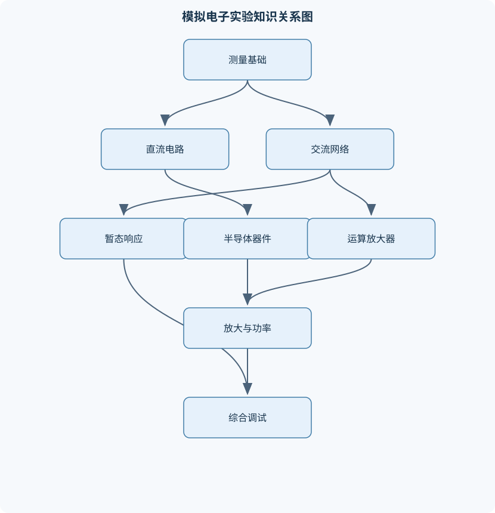
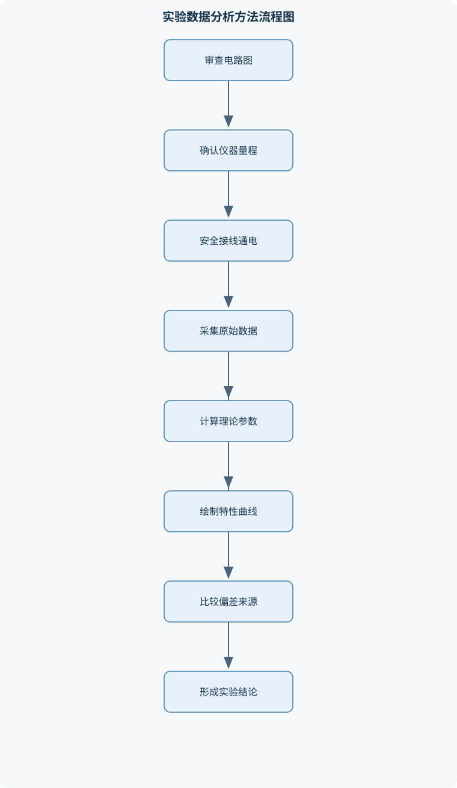

# 模电实验

## 一、课程整体知识框架

### 课程边界与先修知识

本课程面向电路与模拟电子技术实验，覆盖从直流电路测量、交流一端口网络和暂态响应，到二极管、双极型晶体管、集成运算放大器、共射放大器、整流滤波、调谐网络、波形发生器和音频功率放大器的实验分析、搭建、调试与结果评价。先修知识包括基尔霍夫电流定律和电压定律、欧姆定律、节点电压与回路电流分析、戴维南与诺顿等效、电容和电感的基本关系、正弦稳态相量、复阻抗、半导体二极管与晶体管基本原理、负反馈和理想运算放大器模型。课程强调理想模型与实际器件的区别，要求掌握直流稳态、正弦稳态和暂态测量方法，能够使用直流电源、函数发生器、数字万用表、示波器和电子负载完成安全接线、波形观察、参数提取、误差分析与实验报告。课程不覆盖集成电路版图、半导体工艺、复杂射频电路和完整数字系统设计。





### 1. 课程对象、实验主线与能力边界

《模电实验》以“模型—接线—测量—参数提取—误差解释—故障定位”为主线，研究直流电路、交流无源网络、暂态电路以及典型模拟电子器件和系统。实验对象从电阻、电容、电感等无源元件开始，逐步扩展到二极管、双极型晶体管、集成运算放大器和音频功率放大器。每个实验都应同时回答三个问题：理论模型预言什么；仪器实际测到了什么；两者为什么存在差异。

课程使用的主要电量包括电压、电流、阻抗、频率、增益和时间常数。$V$或$U$表示电压，单位为伏特（V）；$I$表示电流，单位为安培（A）；$R$表示电阻，单位为欧姆（$\Omega$）；$C$表示电容，单位为法拉（F）；$L$表示电感，单位为亨利（H）。正弦稳态中，$f$为频率，单位为赫兹（Hz），$\omega=2\pi f$为角频率，单位为rad/s；复阻抗为$Z$，单位为$\Omega$，电阻、电感和电容的阻抗分别为

$$
Z_R=R,\qquad Z_L=j\omega L,\qquad Z_C=\frac{1}{j\omega C}.
$$

电压增益定义为$A_v=V_O/V_I$，分贝表示为$20\log_{10}|A_v|$。正弦信号的有效值、峰值和峰峰值分别记为$U_{rms}$、$U_m$和$U_{pp}$，理想正弦波满足

$$
U_{rms}=\frac{U_m}{\sqrt{2}}=\frac{U_{pp}}{2\sqrt{2}}.
$$

这个关系只适用于无明显直流偏置、波形接近正弦的信号。对方波、三角波或含削顶失真的波形，不能直接套用正弦波换算式。

课程的先修基础包括欧姆定律、基尔霍夫电流定律（KCL）、基尔霍夫电压定律（KVL）、节点电压法、回路电流法、戴维南与诺顿等效、电容和电感的伏安关系、正弦稳态相量与复阻抗、二极管和晶体管的基本工作原理、负反馈及理想运算放大器模型。课程不延伸到集成电路版图、半导体制造工艺、复杂射频电路和完整数字系统设计。

### 2. 理想模型与实际测量的统一认识

理想模型用于建立可计算、可检验的预言。例如，理想电压源内阻为零，理想电流源内阻为无穷大，理想电压表内阻无穷大，理想电流表内阻为零，理想运算放大器输入电流为零且开环增益无穷大。实验中这些条件都只能近似成立。

直流电源在限流状态下，输出电压可能低于设定值；电源、导线和接插件都存在内阻。电压表接入后相当于在被测节点间并联一个有限电阻，电流表接入后相当于在支路中串入一个小电阻。因此，仪表不仅“观察”电路，也可能改变电路。判断测量质量时，必须比较被测网络等效电阻与仪表内阻，而不能只看仪表显示位数。

测量结果应区分示值、误差和不确定度。多次重复测量的离散程度可用于估计A类不确定度；仪器准确度、分辨率、校准信息和量程指标可用于估计B类不确定度。二者不能因为都写成“误差”而简单重复相加。直接测量给出电压、电流或电阻的仪表示值，间接测量则通过公式由其他量计算，例如利用$R=V/I$求电阻，或利用$P=U_{rms}^2/R_L$求负载功率。间接测量还应考虑各输入量的不确定度传播。

### 3. 电路守恒定律与测量闭合

KCL来自节点处电荷守恒。若规定流入节点的电流为正、流出节点的电流为负，则在没有电荷持续积累的集中参数模型中，

$$
\sum_k I_k=0.
$$

KVL来自闭合回路的能量守恒。在低频、集中参数模型成立时，沿任一闭合回路取定电压参考方向，有

$$
\sum_k U_k=0.
$$

验证KCL时，应先统一各支路参考方向，再比较带符号的代数和；只比较电流绝对值可能把实际流向相反的支路误判为正确。验证KVL时，应明确电源电压的升高方向和电阻压降方向。高频下导线和元件的分布参数、寄生电容及电磁辐射可能使简单的集中参数回路模型失效。

### 4. 从直流到交流和暂态的参数观

直流稳态中，理想电容相当于开路，理想电感相当于短路；但在通电、断电和信号突变过程中，电容电压不能瞬间跳变，电感电流不能瞬间跳变。RC电路的时间常数为

$$
\tau=RC,
$$

RL电路的时间常数为

$$
\tau=\frac{L}{R}.
$$

一阶RC电路的统一响应形式为

$$
u_C(t)=U_f+(U_0-U_f)e^{-t/(RC)},
$$

其中$U_0$是切换瞬间的初始电压，$U_f$是最终稳态电压。经过一个时间常数，电容完成总变化量的约$63.2\%$；放电时电压降至初值的约$36.8\%$。这一结论只适用于线性、单时间常数、阶跃边沿相对足够快的条件。若信号源输出电阻、仪器输入电阻或负载不能忽略，应将它们纳入等效电阻。

### 5. 实验安全与数据质量

通电前必须断电核对电源极性、公共端、元件方向和反馈路径。电压表并联接入，电流表串联接入；电流表直接并接电源可能造成过流。测量电阻和电容时通常应先断电并释放电容储能。示波器探头地夹通常与保护地相连，多通道地夹若夹在不同电位节点，可能通过仪器地线造成短路。

直流电源应先设置合适的限压和限流值，初次通电从较低电压或较大限流开始。函数发生器的幅值可能按峰峰值、峰值或有效值显示，且“高阻负载”与“终端负载”设置会导致实际电压不同。示波器应根据波形幅度选择探头衰减、垂直量程和时基，避免因带宽、采样率或触发设置不当而误判波形。

---

## 二、章节和模块划分

### 核心知识覆盖清单

本清单用于检查正文是否覆盖本课程的主要知识模块：

- **实验测量基础与仪器安全**：直流电源的限压限流、数字万用表电压电流电阻测量、示波器探头与接地、函数发生器幅值与偏置、量程、分辨率与准确度、直接测量与间接测量、有效值峰值与峰峰值、测量结果与不确定度、面包板接线与故障排查。
- **直流电路与基尔霍夫定律验证**：欧姆定律实验验证、基尔霍夫电流定律、基尔霍夫电压定律、串并联电阻测量、节点电压测量、支路电流测量、电源内阻与端电压、电流表接入影响、电压表接入影响、测量数据闭合检验。
- **一端口网络与等效参数测量**：无源一端口等效电阻、含源一端口戴维南等效、诺顿等效模型、开路电压测量、短路电流测量、外特性曲线、负载线与最大功率、仪表内阻修正、电压三角形法、参数拟合与残差分析。
- **交流无源网络与调谐电路**：正弦稳态相量、电阻电抗与复阻抗、RC和RL幅频特性、串联RLC谐振、谐振频率测量、品质因数与带宽、电感内阻模型、电压放大与电压三角形、相位差测量、调谐功率与负载影响。
- **一阶暂态与波形观测**：电容充放电规律、RC时间常数、阶跃响应、零输入响应、零状态响应、初始条件连续性、示波器游标测时、指数曲线拟合、截止时间与稳态判据、时间常数误差来源。
- **二极管、整流与滤波**：二极管伏安特性、正向导通与反向截止、静态电阻与动态电阻、半波整流、全波整流、桥式整流、滤波电容充放电、纹波电压、整流输出平均值、反向耐压与浪涌电流。
- **双极型晶体管特性与共射放大**：NPN和PNP极性识别、晶体管输入特性、晶体管输出特性、截止区放大区饱和区、静态工作点、电流放大系数、共射电压放大、输入电阻与输出电阻、最大不失真输出、频率响应与相位反转。
- **集成运算放大器基本运算电路**：理想运放线性模型、虚短与虚断条件、反相比例放大、同相比例放大、反相加法器、差分减法器、积分电路、输出饱和与摆幅、输入失调与偏置电流、负反馈稳定性。
- **波形发生与模拟信号处理**：正弦波振荡条件、RC移相振荡器、滞回比较器、方波发生器、三角波发生器、积分器波形变换、振荡频率测量、起振与稳态振幅、波形失真分析、频率和占空比调节。
- **音频功率放大与综合调试**：前置电压放大级、音调控制网络、功率放大级、负载匹配、甲类乙类与互补推挽、交越失真、最大不失真功率、热稳定与散热、焊接布局与接地、系统级指标测量。


### 1. 实验测量基础与仪器安全

本模块建立所有后续实验的操作和评价标准。数字万用表测电压时并联于被测节点，测电流时串联于被测支路，测电阻时应断电。量程影响分辨率和过载风险，准确度通常与读数项和量程项同时有关，因此不能片面追求最大显示位数。

示波器用于观察瞬时波形、周期、峰峰值、直流偏置、相位差和失真。探头的输入电容会影响高阻节点和快速边沿；探头地线过长会引入寄生电感和振铃。函数发生器的输出应明确波形、频率、幅度和直流偏置。电子负载用于模拟规定的负载电流或电阻，测试功率器件时还必须检查散热。

### 2. 直流电路与基尔霍夫定律验证

欧姆定律为

$$
U=IR.
$$

在电阻值稳定、温升不显著的范围内，电压与电流成正比。若电阻过热，阻值可能变化，$U$-$I$曲线将不再严格线性。串联电阻电流相同，并联电阻电压相同；实际测量中，电流表内阻会改变串联支路，电压表内阻会给并联网络增加额外支路。

直流实验应测量电源端电压、各支路电压和电流，并用KCL、KVL分别进行闭合检验。电源内阻可由不同负载下的端电压变化估计。若电源等效为理想电压源$V_S$串联内阻$r_s$，负载电流为$I$时端电压近似为

$$
V=V_S-Ir_s.
$$

该式只适用于电源工作在线性输出区，限流、过热保护或开关控制介入后不能继续使用。

### 3. 一端口网络与等效参数测量

一端口网络只通过一对端子与外部连接。线性含源一端口可用戴维南模型表示为理想电压源$V_{th}$串联电阻$R_{th}$，其端口外特性为

$$
V=V_{th}-IR_{th}.
$$

开路时$I=0$，因此$V_{oc}=V_{th}$。若允许安全短接且被测网络具备足够的短路承受能力，则

$$
R_{th}=\frac{V_{oc}}{I_{sc}}.
$$

对高能量电源或不确定短路能力的网络，不应直接测短路电流，而应接入两个或多个已知负载，根据$V=V_{th}-IR_{th}$进行线性拟合。若负载为$R_L$，负载功率为

$$
P_L=\frac{V_{th}^2R_L}{(R_{th}+R_L)^2}.
$$

对纯电阻线性网络，令$R_L=R_{th}$可得到最大功率，但此时效率只有50%，所以“最大功率”不等于“最大效率”。非线性负载、频率选择性网络和受控限流电源不能直接套用这一结论。

### 4. 交流无源网络与调谐电路

正弦稳态下，电阻、电感和电容用复阻抗表示。RC、RL网络的幅频特性来自不同频率下电抗变化；相频特性反映输出相对于输入的时间关系。测量幅频特性时应保持源电压稳定，并记录输入和输出，而不能只记录函数发生器设定值。

串联RLC电路阻抗为

$$
Z=R+j\left(\omega L-\frac{1}{\omega C}\right).
$$

谐振条件为电感电抗和电容电抗大小相等：

$$
\omega_0L=\frac{1}{\omega_0C},
\qquad
\omega_0=\frac{1}{\sqrt{LC}},
\qquad
f_0=\frac{1}{2\pi\sqrt{LC}}.
$$

谐振时总阻抗的虚部为零，电流最大，电阻两端电压与源电压同相。理想串联模型的品质因数为

$$
Q=\frac{\omega_0L}{R}
=\frac{1}{\omega_0CR},
$$

半功率带宽满足

$$
\Delta\omega=\frac{R}{L},
\qquad
Q=\frac{\omega_0}{\Delta\omega}.
$$

实际电感具有内阻，内阻应计入总串联电阻；电感和电容两端的局部电压可能大于源电压，必须检查元件耐压和示波器量程。

### 5. 一阶暂态与波形观测

暂态实验通过阶跃、方波或开关动作观察电容充放电。零输入响应指输入置零而由初始储能引起的响应；零状态响应指初始储能为零而由外部输入引起的响应。线性系统的总响应等于两者之和。

提取时间常数有两种常用方法。第一种是在波形上读取达到终值变化量$63.2\%$的时刻。第二种将

$$
\ln|u_C(t)-U_f|
$$

对$t$作图，理想情况下斜率为$-1/\tau$。拟合方法可以减小单点读数影响，但若存在多个时间常数、终值估计错误、示波器带宽不足或阶跃边沿不够快，线性关系会出现系统偏差。

### 6. 二极管、整流与滤波

理想二极管正向导通时压降为零，反向截止时电流为零；实际二极管具有非线性伏安特性，正向电流随电压呈快速增长，反向还存在漏电和击穿区域。静态电阻为

$$
R_D=\frac{V_D}{I_D},
$$

动态电阻为工作点附近的局部斜率倒数：

$$
r_d=\frac{\mathrm d V_D}{\mathrm d I_D}
\approx\frac{\Delta V_D}{\Delta I_D}.
$$

二者不能混用。伏安测试应串联限流电阻，逐步改变电压并记录二极管电压和电阻上的电压，再由$I=V_R/R$计算电流。

半波整流每个周期有一次主要充电机会，全波整流每个周期有两次，桥式整流还需考虑导通路径中的二极管压降。滤波电容在波峰附近充电，在两个波峰之间经负载放电。小纹波近似下，

$$
\Delta V\approx\frac{I_L}{f_rC},
$$

其中$I_L$为负载电流，$f_r$为纹波频率。该式要求纹波较小且放电近似线性；负载变化大、二极管内阻明显或电容过小时，实测波形会偏离近似结果。还应检查二极管反向耐压、开机浪涌电流和电解电容极性。

### 7. 双极型晶体管特性与共射放大

NPN和PNP晶体管的电流方向、电压极性和偏置方向不同，不能仅凭外形判断极性，应结合器件标识和测试结果。晶体管常见工作区包括截止区、放大区和饱和区。放大区中，集电极电流近似满足

$$
I_C\approx\beta I_B,
$$

其中$\beta=I_C/I_B$，但$\beta$随电流、温度和器件批次变化，不应视为固定常数。饱和区中，集射电压较低，增加基极电流不再按比例增加集电极电流；截止区中基极电流和集电极电流均较小。

共射放大器应先确定静态工作点$Q$。若静态点过近截止边界，输入负半周可能使晶体管截止；若过近饱和边界，另一半周可能使晶体管饱和，输出波形出现削顶。中频小信号、发射极交流旁路且晶体管处于放大区时，可近似写为

$$
A_v\approx-g_m(R_C\parallel R_L\parallel r_o),
\qquad
g_m=\frac{I_C}{V_T}.
$$

负号表示共射输出相对输入反相。未旁路的发射极电阻会降低增益，却能提高偏置稳定性。接入负载后，增益和最大输出摆幅都会改变。

### 8. 集成运算放大器基本运算电路

理想运放在线性负反馈且未饱和时满足“虚断”和“虚短”：输入端电流近似为零，两输入端电压近似相等。反相放大器由KCL得到

$$
V_O=-\frac{R_F}{R_1}V_I,
$$

同相放大器为

$$
V_O=\left(1+\frac{R_F}{R_1}\right)V_I.
$$

反相加法器满足

$$
V_O=-R_F\left(\frac{V_{S1}}{R_1}+\frac{V_{S2}}{R_2}\right).
$$

差分减法器只有在电阻比严格匹配时，才可写成

$$
V_O=\frac{R_F}{R_2}(V_{S2}-V_{S1}).
$$

电阻比误差会把共模信号转换为输出误差。实际运放受有限开环增益、增益带宽积、输入失调电压$V_{OS}$、输入偏置电流、输入共模范围和输出摆幅限制。实际输出高、低限幅电压记为$V_{OH}$和$V_{OL}$，通常不等于电源轨。若反馈断路或输入过大，输出会饱和，此时不能继续使用虚短条件。

积分器满足

$$
V_O(t)=V_O(t_0)-\frac{1}{RC}\int_{t_0}^{t}V_I(\xi)\,\mathrm d\xi.
$$

实际积分器常在反馈电容并联大电阻，以限制直流漂移和长期饱和。输入方波可产生近似三角波，但要求信号周期、有效积分时间常数、运放带宽和输出摆幅均合适。

### 9. 波形发生与模拟信号处理

正弦振荡器需要满足起振和稳态条件：起振时环路增益幅值应略大于1，稳态时通过非线性限制或自动增益控制使环路增益回到接近1，且总相移为$0^\circ$或$360^\circ$。RC移相振荡器的实际频率受电阻、电容误差、运放带宽和负载影响。

滞回比较器利用正反馈形成两个不同的翻转阈值，可提高抗噪声能力。方波发生器通常由比较器和积分器组成，积分器将方波转换为三角波；改变阈值、反馈比例、$R$或$C$可以调节频率和占空比。波形评价不仅要看频率，还要检查幅值稳定性、直流偏置、对称性、边沿、谐波和削顶失真。

### 10. 音频功率放大与系统级调试

音频功率放大器通常包括前置电压放大级、音调控制网络和功率输出级。前置级提高电压幅度，音调网络改变不同频率的增益，功率级向负载提供较大的电流和功率。甲类导通角大、线性较好但静态功耗高；乙类互补推挽效率较高，但过零附近可能产生交越失真；实际电路常通过偏置使其接近甲乙类工作。

负载功率为

$$
P_L=\frac{U_{L,rms}^2}{R_L}.
$$

最大不失真功率必须同时满足输出削顶、器件电流、器件电压、热耗散、限流保护和散热条件。开路输出电压不能直接用于计算带载功率。系统调试还应检查焊接布局、电源退耦、信号地和功率地，避免长地线、共阻抗耦合和寄生反馈导致自激。

### 11. 代表性实验流程与算法

#### 流程一：安全测量与KCL/KVL闭合检验

**输入**：电路图、元件参数、预期电压电流范围和仪器。  
**输出**：各节点电压、支路电流、闭合误差及测量不确定度。

1. 断电检查电源极性、公共端和面包板连接。
2. 估算最大可能电流，设置直流电源限压、限流。
3. 电压表并联，电流表串联，电阻测量前断电。
4. 通电后先测电源端电压，再测各支路。
5. 用带符号的读数检验$\sum I_k=0$和$\sum U_k=0$。
6. 若闭合误差超过预设评价标准，依次检查量程、公共端、接线、仪表内阻和电源限流状态。

终止条件是读数稳定、无过载、元件无异常发热且闭合误差在实验允许范围内。该流程适用于低频集中参数电路，不适用于高频分布参数网络。

#### 流程二：一端口参数提取

**输入**：两组或多组负载电压电流。  
**输出**：$V_{th}$、$R_{th}$及外特性预测。

对每组数据建立

$$
V_i=V_{th}-I_iR_{th}.
$$

两组数据可联立求解；多组数据则以$V$为因变量、$I$为自变量作线性拟合。拟合斜率为$-R_{th}$，截距为$V_{th}$。应查看残差是否随机分布；若残差随电流呈系统弯曲，说明网络可能非线性、进入限流或测量范围不合适。两点法计算量为$O(1)$，含$n$组数据的逐点拟合计算量通常为$O(n)$。

#### 流程三：交流幅频和暂态参数测量

```text
输入：被测网络、频率范围或阶跃波形、示波器、信号源
输出：幅频/相频数据，或时间常数 tau

先在小信号下确认波形未削顶
如果进行扫频：
    固定信号源幅值
    从低频到高频逐点记录输入、输出和相位差
    计算 Av = Vo / Vi
    找到峰值或中频基准
    读取幅值降至峰值/sqrt(2)的频率
如果进行 RC 暂态：
    读取初始值 U0 和终值 Uf
    计算目标值 Utarget = U0 + 0.632*(Uf-U0)
    读取波形达到目标值的时刻，得到 tau
    用 ln(abs(uC-Uf)) 对时间作线性拟合复核
检查：触发稳定、阶跃边沿远快于 tau、仪器带宽足够
```

评价时应区分理论频率和实测频率，说明信号源内阻、探头电容、元件容差和负载对结果的影响。

### 12. 代表性例题

#### 例题一：并联电阻与KCL

**题干**：$12\text{ V}$电源接两个并联电阻$R_1=2\text{ k}\Omega$、$R_2=4\text{ k}\Omega$。求两支路电流和总电流。

**分析与解答**：并联支路电压均为$12\text{ V}$，所以

$$
I_1=\frac{12}{2000}=6\text{ mA},
\qquad
I_2=\frac{12}{4000}=3\text{ mA}.
$$

由KCL，

$$
I_S=I_1+I_2=9\text{ mA}.
$$

总等效电阻为

$$
R_{eq}=\frac{12}{9\text{ mA}}=1.333\text{ k}\Omega.
$$

**验证**：$I_SR_{eq}=12\text{ V}$，单位和数量级一致。若实测总电流只有$8.5\text{ mA}$，应考虑电源内阻、表内阻和电阻容差，而不能立即判定KCL失效。

**变式**：若电压表内阻为$1\text{ M}\Omega$，其并联支路电流约为$12\ \mu\text{A}$，相对$9\text{ mA}$较小；若被测网络为数百千欧，该影响就不能忽略。

#### 例题二：戴维南参数与负载功率

**题干**：某一端口接入$R_{L1}=1\text{ k}\Omega$时测得$V_1=4\text{ V}$、$I_1=4\text{ mA}$；接入$R_{L2}=3\text{ k}\Omega$时测得$V_2=6\text{ V}$、$I_2=2\text{ mA}$。求$V_{th}$和$R_{th}$。

**解答**：

$$
V_1=V_{th}-I_1R_{th},
\qquad
V_2=V_{th}-I_2R_{th}.
$$

相减得

$$
V_2-V_1=(I_1-I_2)R_{th},
$$

因此

$$
R_{th}=\frac{6-4}{4\text{ mA}-2\text{ mA}}
=1\text{ k}\Omega.
$$

代入第一组数据：

$$
V_{th}=4\text{ V}+4\text{ mA}\times1\text{ k}\Omega=8\text{ V}.
$$

若$R_L=1\text{ k}\Omega=R_{th}$，负载功率为

$$
P_L=\frac{8^2\times1\text{ k}\Omega}{(1\text{ k}\Omega+1\text{ k}\Omega)^2}
=4\text{ mW}.
$$

**验证**：预测$R_L=2\text{ k}\Omega$时，$V=8\times2/(1+2)=5.33\text{ V}$。若实测偏差较大，应检查端口电流测量和负载实际阻值。

**变式**：若端口含二极管，外特性可能弯曲，此时两点求出的参数只是在该工作区附近的等效值。

#### 例题三：串联RLC谐振

**题干**：$L=10\text{ mH}$，$C=0.1\ \mu\text{F}$，串联总电阻为$10\Omega$。求谐振频率、品质因数和带宽。

**解答**：

$$
f_0=\frac{1}{2\pi\sqrt{LC}}
=\frac{1}{2\pi\sqrt{10^{-2}\times10^{-7}}}
\approx5.03\text{ kHz}.
$$

角频率约为$\omega_0=31.6\times10^3\text{ rad/s}$。品质因数为

$$
Q=\frac{\omega_0L}{R}
=\frac{31.6\times10^3\times10^{-2}}{10}
\approx31.6.
$$

带宽角频率为

$$
\Delta\omega=\frac{R}{L}=1000\text{ rad/s},
$$

对应频率带宽约为

$$
\Delta f=\frac{\Delta\omega}{2\pi}\approx159\text{ Hz}.
$$

**验证**：扫频时谐振附近电流最大，电阻两端电压与源电压相位差接近零。若实测谐振频率偏低，可能是实际电感量偏大或寄生电容存在；若带宽变宽，可能是电感内阻和接线电阻增大。

**变式**：接入负载后，总损耗电阻增加，$Q$降低、带宽增大，峰值响应减小。

#### 例题四：RC充电时间常数

**题干**：电容初始电压为$0$，最终电压为$5\text{ V}$。示波器显示电压达到$3.16\text{ V}$的时刻为$2.0\text{ ms}$。求时间常数；若$R=10\text{ k}\Omega$，求电容。

**解答**：$3.16\text{ V}=0.632\times5\text{ V}$，因此该时刻就是一个时间常数，

$$
\tau=2.0\text{ ms}.
$$

由$\tau=RC$，

$$
C=\frac{\tau}{R}
=\frac{2.0\times10^{-3}}{10\times10^3}
=0.20\ \mu\text{F}.
$$

**验证**：约$5\tau=10\text{ ms}$时，电压应接近终值的$99.3\%$。若阶跃边沿本身为数毫秒，读取的时间将包含信号源上升时间，不能直接认为是电路时间常数。

**变式**：若电容初始电压为$1\text{ V}$、终值为$5\text{ V}$，目标电压应为$1+0.632(5-1)=3.528\text{ V}$，不能仍使用$3.16\text{ V}$。

#### 例题五：运放反相加法器

**题干**：反相加法器中$R_F=10\text{ k}\Omega$，$R_1=10\text{ k}\Omega$，$R_2=20\text{ k}\Omega$，输入分别为$V_{S1}=0.2\text{ V}$和$V_{S2}=0.4\text{ V}$。求输出。

**解答**：在线性负反馈且输入端工作范围正常时，反相端为虚地，输入电流分别为

$$
I_1=\frac{0.2}{10\text{ k}\Omega}=20\ \mu\text{A},
\qquad
I_2=\frac{0.4}{20\text{ k}\Omega}=20\ \mu\text{A}.
$$

反馈电流为$40\ \mu\text{A}$，所以

$$
V_O=-R_F(I_1+I_2)
=-10\text{ k}\Omega\times40\ \mu\text{A}
=-0.4\text{ V}.
$$

**验证**：代入公式

$$
V_O=-10\text{ k}\Omega
\left(\frac{0.2}{10\text{ k}\Omega}
+\frac{0.4}{20\text{ k}\Omega}\right)
=-0.4\text{ V}.
$$

若电源为$\pm5\text{ V}$，该结果通常不会饱和；若输入各增加十倍，理论输出为$-4\text{ V}$，仍需检查实际输出摆幅和负载。

**变式**：反馈电阻断路时，输出可能迅速贴近某一电源轨，此时虚短失效，不能继续用理想公式计算。

### 13. 实验项目、评价标准与排错

#### 项目一：RC暂态参数提取

**输入数据**：电阻标称值、待测电容、阶跃信号幅值、示波器时间轴和电容电压波形。  
**步骤**：

1. 断电检查电阻、电容和示波器地线。
2. 设置信号源输出低频方波，使半周期明显大于预计时间常数。
3. 观察电容电压充放电曲线，记录初始值和终值。
4. 用$63.2\%$法读取$\tau$，再用指数拟合复核。
5. 由$C=\tau/R$反算电容并与标称值比较。

**评价标准**：波形应稳定、充放电方向正确，拟合残差不应呈明显系统弯曲；应报告信号源内阻、探头输入电阻和阶跃边沿的影响。  
**排错方法**：若波形不动，检查电容是否接反、短路或信号源未输出；若波形直接跳变，检查电容是否被旁路；若充放电不对称，检查电容漏电、直流偏置和开关接触电阻。

#### 项目二：共射放大器最大不失真输出

**输入数据**：晶体管型号、$V_{CC}$、偏置电阻、集电极电阻、负载电阻、输入正弦波和示波器。  
**步骤**：

1. 断电核对晶体管引脚和电源极性。
2. 通电后测量$V_{BE}$、$V_{CE}$、$I_B$和$I_C$。
3. 判断晶体管处于截止、放大还是饱和区。
4. 施加小幅正弦输入，测量中频增益和相位。
5. 逐步增大输入，记录开始削顶的输出幅值。
6. 分别判断截止削顶和饱和削顶，并记录负载接入前后的差异。

**评价标准**：静态工作点应位于具有足够摆幅余量的放大区；输出应保持反相且无明显削顶；应报告增益、输入输出幅度、频率、负载和失真起始点。  
**排错方法**：零输入时输出贴近电源轨，优先检查反馈路径、偏置电阻和晶体管引脚；增益过低，检查负载、发射极旁路和信号源幅值；波形一侧削顶，检查静态工作点是否偏向截止或饱和。

### 14. 具体易错点

1. 把电流表直接并到电源两端，可能造成过流。
2. 带电测量电阻，使万用表读数错误并可能损坏仪表。
3. 忽略示波器地夹与保护地的连接，造成节点短路。
4. 将函数发生器的峰峰值误认为峰值或有效值。
5. 将任意非正弦波的万用表交流读数当作真实有效值。
6. 只比较KCL、KVL中的绝对值，不保留参考方向和极性。
7. 未考虑电源内阻、限流状态和接线压降。
8. 对高能量端口直接短接测$I_{sc}$。
9. 将$R_L=R_{th}$误认为效率最大。
10. 将二极管固定开启电压当作完整伏安模型。
11. 将二极管静态电阻$V/I$和动态电阻$\mathrm dV/\mathrm dI$混为一谈。
12. 把晶体管$\beta$当作与电流、温度无关的常数。
13. 未检查共射放大器的静态工作点就直接增大输入。
14. 在运放饱和后继续使用虚短条件。
15. 认为运放输入无电流就可以无限增大输出负载。
16. 积分器出现漂移时只怀疑电容，而忽略输入失调、偏置电流和直流分量。
17. 测量截止频率时没有保持输入幅值和中频基准一致。
18. 以开路输出电压计算音频负载功率。
19. 只看输出峰值，不检查器件电流、热耗散和削顶。
20. 用仿真模型的精确数值替代实际器件的实测参数。

### 15. 常见笔试问题及解答思路

#### 问题一：为什么电压表并联、电流表串联？

电压表测两点电势差，应并联；其内阻应尽量大以减小分流。电流表测支路电流，应串联；其内阻应尽量小以减小压降。接法错误时，电流表可能形成近似短路。

#### 问题二：如何由开路电压和短路电流求戴维南电阻？

在线性一端口模型成立且短路安全时，$V_{th}=V_{oc}$，$R_{th}=V_{oc}/I_{sc}$。若不能短路，应使用两组负载数据拟合，不能为了公式方便而牺牲安全性。

#### 问题三：为什么谐振时电感和电容两端电压可能很大？

谐振时电抗电压方向相反但幅值可能较大，二者在回路中相互抵消，而电阻压降与源电压相符。因此局部元件电压可超过源电压，受$Q$和电流放大影响。

#### 问题四：为什么电容电压不能突变？

若电容电压瞬间变化，则$I=C\,\mathrm du/\mathrm dt$需要无限大电流。实际电路存在寄生电阻和有限带宽，因此波形会在有限时间内变化。

#### 问题五：晶体管共射放大器为什么反相？

输入增大使集电极电流增大，集电极电阻压降增大，集电极电压降低，因此输出电压变化方向与输入相反。

#### 问题六：运放输出饱和后为什么虚短失效？

虚短依赖深度负反馈和线性工作。输出达到$V_{OH}$或$V_{OL}$后，运放不能再按线性增益调节输出，两个输入端电压可以明显不相等。

#### 问题七：全波整流比半波整流的纹波频率高在哪里？

输入频率为$f$时，半波每周期主要充电一次，纹波频率约为$f$；全波每周期有两次充电机会，纹波频率约为$2f$。在相同负载、电容和纹波要求下，全波滤波更容易降低纹波。

#### 问题八：最大功率传输为什么不等于最大效率？

$R_L=R_{th}$时负载功率最大，但内阻上也消耗同样功率，效率为50%。若追求高效率，应使负载电阻大于内阻，但负载功率不再最大。

### 16. 常见面试问题及回答要点

#### 问题一：接手一个无输出的模拟电路，你如何排查？

先确认电源和地，再检查器件方向、静态工作点、输入信号、反馈路径和负载。每次只改变一个变量，并用已知正常节点作对照。深入追问时应说明：不能在不清楚电流路径时直接短接节点或更换电流量程。

#### 问题二：示波器测量高频节点时波形异常，你如何判断是电路问题还是测量问题？

先缩短地线、确认探头衰减和带宽，再用低电容探头或缓冲级复测；比较不同接地点和不同通道结果。若改变探头连接后波形显著变化，说明探头寄生参数或接地方式正在影响电路。

#### 问题三：运放输出总是贴近正电源轨，原因有哪些？

可能是反馈断路、输入极性接反、输入共模范围超限、输出负载过重、直流失调累积或器件损坏。应先测静态输入和反馈节点，再施加小信号，不能直接增大输入幅度。

#### 问题四：如何判断共射放大器的削顶属于截止还是饱和？

观察输出静态位置和输入输出波形对应关系。晶体管截止时集电极电流趋小、集电极电压向电源侧移动；饱和时集电极电压降到较低范围。改变偏置点后，削顶方向随之改变，可辅助判断。

#### 问题五：如何评价一个整流滤波电源？

测量空载和带载输出电压、纹波峰峰值、负载调整率、启动浪涌和温升。还要检查二极管反向耐压、电容耐压和异常发热，而不能只报告直流平均值。

#### 问题六：为什么理论增益与实测增益不一致？

可能来自电阻容差、晶体管$\beta$变化、负载效应、运放有限增益带宽、信号源内阻、探头负载和频率响应。回答时应区分模型误差、参数误差和接线测量误差。

#### 问题七：如何设计一个稳定的方波—三角波发生器？

用滞回比较器确定方波阈值，用积分器完成波形变换，再根据$R$、$C$和阈值比例确定频率。应检查积分器直流漂移、运放输出摆幅、比较器翻转速度和占空比对称性。

#### 问题八：音频功放为什么会发热或出现交越失真？

发热可能来自静态电流过大、负载过低、输出削顶或散热不足；交越失真通常与互补推挽过零附近偏置不足有关。应通过静态电流、输出波形、负载功率和散热器温升共同判断，不能只看声音大小。

### 17. 岗位关联与实验产出

模拟电子工程师和电路设计工程师需要根据指标选择拓扑、计算偏置和增益，并通过示波器、万用表和负载测试验证输出摆幅、带宽、失真和稳定性。产出通常包括原理图、参数表、测试波形和设计裕量，验收标准是功能正确、关键指标在规定范围内且异常工况不损坏器件。

电子硬件测试工程师和仪器仪表测试工程师需要编写测试步骤，校核仪器量程、接地和不确定度，形成可重复的测试记录。产出包括测试原始数据、校准状态、误差分析和判定结论，验收重点是数据可追溯、接线安全、重复测量一致且结论有依据。

电源研发工程师需要分析整流、滤波、负载调整率、纹波、浪涌和热稳定性。验收不能只看空载电压，还应包括额定负载、动态负载、短时过载、温升和保护动作。

音频电子工程师需要处理前置放大、音调网络、功率输出、负载匹配和交越失真。主要产出包括频率响应、最大不失真功率、总谐波或波形失真观察、热测试和带载试听结果。

自动化设备调试工程师、嵌入式硬件工程师和维修与失效分析工程师则更强调故障隔离、静态工作点检查、信号链路追踪和替换验证。合格的故障报告应包含现象、复现条件、测量节点、排除过程、根因判断、修复措施和修复后的复测结果，而不能只写“重新接线后正常”。

## 三、核心概念的详细解释

### 1. 测量系统、仪器安全与实验数据

模电实验中的测量对象不是孤立的电压或电流，而是“被测电路—仪器—接线—环境”组成的整体。直流电源提供能量，函数发生器提供随时间变化的激励，数字万用表适合测量稳定的直流电压、电流、电阻和部分交流有效值，示波器适合观察瞬时波形、周期、幅值、相位差、削顶和振荡。

#### 1.1 量程、分辨率、准确度与不确定度

量程是仪器允许测量的最大范围；分辨率是显示能够区分的最小变化；准确度反映示值与真值之间可能存在的偏差范围。显示位数多并不意味着准确度一定高。例如，仪器可以显示毫伏级变化，但若输入端受噪声、温漂或校准误差影响，最后几位并不具有相同的可信程度。

直接测量是由仪表直接给出被测量，例如电压表直接显示电压；间接测量是由多个测量量通过关系式计算目标量，例如由电压和电流计算电阻：

$$
R=\frac{V}{I}.
$$

若$V$和$I$相互独立，且标准不确定度分别为$u(V)$和$u(I)$，则一阶近似下

$$
u^2(R)\approx
\left(\frac{\partial R}{\partial V}u(V)\right)^2+
\left(\frac{\partial R}{\partial I}u(I)\right)^2
=
\left(\frac{u(V)}{I}\right)^2+
\left(\frac{V\,u(I)}{I^2}\right)^2.
$$

该传播关系要求函数在测量范围内可微，且输入量的相关性可以忽略；若电压和电流由同一系统产生并存在明显相关性，还应加入协方差项。

电压表应并联接入，输入电阻越大，对原电路影响越小；电流表应串联接入，内阻越小，对支路电流影响越小。电阻或电容测量前应断电并释放储能，不能把万用表的电阻档直接接到带电节点。示波器探头的地夹通常与保护地相连，多通道地夹接在不同电位节点可能形成短路。函数发生器的幅值可能按峰峰值、峰值或有效值显示，接入不同负载后实际幅值也可能改变，必须确认仪器设置的幅值定义和负载条件。

### 2. 直流电路、KCL与KVL

欧姆定律在电阻近似恒定、温度变化不大且器件处于线性范围时成立：

$$
V=IR.
$$

实际电阻的阻值会随温度变化，电阻功率为

$$
P=VI=I^2R=\frac{V^2}{R}.
$$

若实际功率长期超过额定功率，电阻会升温、阻值漂移甚至损坏，因此仅由电压和电阻计算电流还不够，还必须检查功率。

#### 2.1 基尔霍夫电流定律

KCL来自节点电荷守恒。对没有持续积累电荷的集中参数节点，规定流入为正、流出为负，有

$$
\sum_k I_k=0.
$$

例如，若电源支路电流$I_S$流入节点，两个电阻支路电流$I_1$、$I_2$流出节点，则

$$
I_S-I_1-I_2=0,
\qquad I_S=I_1+I_2.
$$

计算中电流方向只是参考方向。若结果为负，表示实际电流方向与假定方向相反。验证实验数据时必须使用带符号的电流，不能只比较绝对值。

#### 2.2 基尔霍夫电压定律

在集中参数、低频条件下，沿任意闭合回路，电压升和电压降的代数和为零：

$$
\sum_k U_k=0.
$$

例如电源$V_S$驱动串联电阻$R_1$和$R_2$时，若电阻压降方向与电流方向一致，则

$$
V_S-I R_1-I R_2=0.
$$

KVL在高频分布参数效应显著时不能简单理解为理想导线上的电压代数和，因为导线寄生电感、寄生电容和电磁耦合会影响测量结果。普通低频实验中，若接线较短、参考地一致，集中参数模型通常足够。

#### 2.3 电源内阻与仪表影响

实际电源可近似为理想电压源$V_S$串联内阻$R_S$。接入负载$R_L$后：

$$
I=\frac{V_S}{R_S+R_L},
\qquad
V_L=IR_L=\frac{V_SR_L}{R_S+R_L}.
$$

负载减小时，电流增大，端电压下降；若电源进入限流状态，端电压可能进一步低于设定值。电压表内阻$R_V$接在负载两端后，等效负载变为

$$
R_L'=R_L\parallel R_V.
$$

当$R_V$远大于$R_L$时影响较小；当被测电阻很大或量程导致输入电阻较低时，电压表分流会造成明显偏差。电流表内阻$R_A$会串入支路，使实际支路电阻变为$R+R_A$，从而减小支路电流。

### 3. 一端口网络、戴维南等效与诺顿等效

一端口网络是只有一对外接端子的电路。对线性含源网络，可以用戴维南等效电路表示为理想电压源$V_{th}$串联电阻$R_{th}$。端口电流$I$取流出等效源的方向时：

$$
V=V_{th}-IR_{th}.
$$

开路时$I=0$，因此

$$
V_{th}=V_{oc}.
$$

若端口短路且短路电流为$I_{sc}$，则$V=0$，有

$$
R_{th}=\frac{V_{oc}}{I_{sc}}.
$$

短路测量必须确认电源和被测网络具有足够的限流能力。对于不能安全短路的网络，可接入两个或多个已知负载，利用端口关系$V=V_{th}-IR_{th}$进行直线拟合。拟合截距给出$V_{th}$，斜率为$-R_{th}$；残差若呈系统性弯曲，说明网络可能非线性，或测量范围超出线性模型。

诺顿等效电路由电流源$I_N$并联电阻$R_N$组成。两种等效之间满足

$$
R_N=R_{th},
\qquad
I_N=\frac{V_{th}}{R_{th}}.
$$

负载为纯电阻$R_L$时，戴维南模型输出功率为

$$
P_L=I^2R_L
=\frac{V_{th}^2R_L}{(R_{th}+R_L)^2}.
$$

对$R_L$求极值，令导数为零可得

$$
R_L=R_{th}.
$$

该条件给出最大功率传输，而不是最大效率。此时效率仅为$50\%$。若负载为非线性器件、含电抗或网络具有明显频率选择性，不能直接套用纯电阻最大功率结论。

### 4. 交流无源网络、相量与调谐

正弦稳态下，电阻、电感和电容分别具有如下阻抗：

$$
Z_R=R,\qquad Z_L=j\omega L,\qquad
Z_C=\frac{1}{j\omega C},
$$

其中$j^2=-1$，$\omega=2\pi f$，$f$的单位为Hz，$\omega$的单位为rad/s。复阻抗的实部表示电阻性部分，虚部表示电抗性部分。测量交流电压时，必须区分峰值、峰峰值和有效值。理想正弦波满足

$$
U_{rms}=\frac{U_m}{\sqrt{2}}
=\frac{U_{pp}}{2\sqrt{2}}.
$$

该关系不适用于任意方波、三角波或严重削顶的波形。

RC和RL网络的幅频特性来自电抗随频率变化。电容在低频时阻抗较大、高频时阻抗较小；电感在低频时阻抗较小、高频时阻抗较大。因此，串联RC或RL分压电路可以表现出低通或高通特性，具体取决于输出取自哪个元件。

串联RLC电路阻抗为

$$
Z=R+j\left(\omega L-\frac{1}{\omega C}\right).
$$

谐振时总电抗为零：

$$
\omega_0L=\frac{1}{\omega_0C},
\qquad
\omega_0=\frac{1}{\sqrt{LC}},
\qquad
f_0=\frac{1}{2\pi\sqrt{LC}}.
$$

谐振处串联电路电流最大，源电压与电阻电压同相。理想模型中半功率带宽为

$$
\Delta\omega=\frac{R}{L},
$$

品质因数为

$$
Q=\frac{\omega_0}{\Delta\omega}
=\frac{\omega_0L}{R}
=\frac{1}{\omega_0CR}.
$$

实际电感有内阻$R_L'$，应将它并入串联电阻，实际品质因数降低。谐振时电感和电容两端电压可能远大于源电压，因此必须检查元件耐压和示波器输入范围。负载接入后会改变等效电阻，导致峰值降低、带宽增大、品质因数下降。

### 5. 一阶暂态与示波器波形

电容的基本关系为

$$
i_C=C\frac{\mathrm du_C}{\mathrm dt}.
$$

电感的基本关系为

$$
u_L=L\frac{\mathrm di_L}{\mathrm dt}.
$$

理想电容电压不能瞬间突变，理想电感电流不能瞬间突变；若假设突变，则需要无限大的电流或电压。RC电路的时间常数为

$$
\tau=RC,
$$

RL电路的时间常数为

$$
\tau=\frac{L}{R}.
$$

若电容初始电压为$U_0$，最终稳定电压为$U_f$，一阶RC响应为

$$
u_C(t)=U_f+(U_0-U_f)e^{-t/\tau}.
$$

充电时，电压经过一个时间常数达到总变化量的$63.2\%$；放电时剩余初始变化量约为$36.8\%$。但“达到稳态”不是一个绝对时刻，工程上常以$4\tau$或$5\tau$作为近似稳定判据，分别对应约$98.2\%$和$99.3\%$的最终变化量。

零输入响应由初始储能单独产生，零状态响应由外加激励和零初始条件产生，实际响应是二者之和。示波器测量时间常数时，应先确定初值、终值和阶跃发生时刻，再读取达到

$$
u_{\tau}=U_0+0.632(U_f-U_0)
$$

的时间。若输入阶跃边沿时间与$\tau$同量级，测到的是信号源和电路共同响应，不能直接把读取值当作电路时间常数。

### 6. 二极管、整流与滤波

理想二极管正向导通时电压为零、反向截止时电流为零。实际二极管的电流与电压通常呈指数关系，可用近似形式表示为

$$
I=I_S\left(e^{V_D/(nV_T)}-1\right),
$$

其中$I_S$为反向饱和电流，$n$为与器件结构有关的因子，$V_T$为热电压。该式说明二极管不存在适用于全部电流范围的固定“开启电压”。

工作点处的静态电阻和动态电阻不同：

$$
R_{\text{static}}=\frac{V_D}{I_D},
\qquad
r_d=\frac{\mathrm dV_D}{\mathrm dI_D}.
$$

静态电阻是原点到工作点连线的斜率倒数，动态电阻是伏安曲线在工作点的局部斜率倒数。二极管电流受限流电阻、温度和电源内阻共同影响，实验中不得直接把二极管接到低内阻电源两端。

半波整流每个周期只有一个半周向负载供电，纹波频率约为输入频率$f$；全波或桥式整流每个周期两个半周均提供同向电流，纹波频率约为$2f$。滤波电容在输入电压峰值附近充电，在两次峰值之间通过负载放电。小纹波条件下：

$$
\Delta V\approx\frac{I_L}{f_rC},
$$

其中$I_L$为负载电流，$f_r$为整流后的纹波频率。全波整流的$f_r$约为输入频率的两倍，因此在相同$C$和$I_L$下纹波通常较小。实际输出还受到二极管正向压降、变压器内阻、滤波电容漏电、启动浪涌和负载变化影响。桥式整流每个导通路径通常包含两个二极管压降，并且二极管反向耐压和电容耐压必须留有裕量。

### 7. 双极型晶体管与共射放大

以NPN晶体管为例，基极—发射极结正向偏置、基极—集电极结反向偏置时处于放大区，近似满足

$$
I_C\approx\beta I_B.
$$

这里$\beta=I_C/I_B$是共射电流增益，但它会随集电极电流、温度和器件批次变化，不能作为严格常数。截止区中$I_B$和$I_C$均很小；饱和区中基极—集电极结也可能正向偏置，$I_C$不再由$\beta I_B$可靠决定，且$V_{CE}$较低。

共射放大器具有电压放大和相位反转特性。中频小信号模型下，若发射极交流旁路，可近似写为

$$
A_v\approx-g_m(R_C\parallel R_L\parallel r_o),
$$

其中

$$
g_m=\frac{I_C}{V_T}.
$$

若发射极电阻未被旁路，交流负反馈会降低增益，但提高偏置稳定性、扩大线性范围。接入负载后，集电极等效负载由$R_C$变为$R_C\parallel R_L$，电压增益和最大输出摆幅都会改变。

静态工作点由$V_{CEQ}$、$I_{CQ}$等量描述。工作点太接近截止，输入信号的一个方向容易使晶体管截止；太接近饱和，另一个方向容易使晶体管饱和。截止和饱和都会产生削顶失真。判断削顶方向时，应同步观察基极输入、集电极电压和集电极电流，不能只看输出波形单独判断。

### 8. 集成运算放大器基本电路

理想运放具有无限开环增益、无限输入电阻、零输出电阻和无限带宽。在负反馈、线性工作且未饱和时，可使用：

$$
i_+\approx i_-\approx0,
\qquad
V_+\approx V_-.
$$

前者称为虚断，后者称为虚短。虚短不是物理短路，也不能在输出饱和、反馈断路或正反馈条件下使用。

反相比例电路中，若反相端节点为虚地，KCL给出

$$
\frac{V_I}{R_1}+\frac{V_O}{R_F}=0,
$$

因此

$$
V_O=-\frac{R_F}{R_1}V_I.
$$

同相比例电路满足

$$
V_O=\left(1+\frac{R_F}{R_1}\right)V_I.
$$

反相加法器满足

$$
V_O=-R_F\left(\frac{V_{S1}}{R_1}
+\frac{V_{S2}}{R_2}\right).
$$

差分减法器只有在电阻比匹配时，才能近似满足

$$
V_O=\frac{R_F}{R_2}(V_{S2}-V_{S1}).
$$

电阻比误差会把共模输入转换成输出误差，因此减法器对电阻匹配比普通反相放大器更敏感。

积分器满足

$$
V_O(t)=V_O(t_0)-\frac{1}{RC}
\int_{t_0}^{t}V_I(\xi)\,\mathrm d\xi.
$$

输入为恒定正电压时，输出按负斜率变化；输入为方波时，输出近似三角波。实际积分器常在反馈电容并联一个大电阻，用于限制直流漂移，避免失调电压、输入偏置电流和电容漏电使输出逐渐饱和。

运放输出不能无限接近电源轨，实际有$V_{OH}$和$V_{OL}$限制；输入共模范围、输出驱动电流、增益带宽积、转换速率和负载也会限制波形。输出贴近电源轨时，虚短条件失效，继续按理想公式计算会得到错误结论。

### 9. 波形发生器、音频功放与系统调试

正弦振荡器需要满足起振和稳态条件。在线性近似下，环路增益的幅值应在起振初期略大于1，稳态时通过非线性限制回到接近1；环路总相移应为$0$或$2\pi$的整数倍。RC移相振荡器利用电阻电容网络提供频率选择和相移，实际频率会受到运放带宽、元件误差和负载影响。

滞回比较器具有两个不同的翻转阈值，可避免输入在阈值附近受噪声影响而反复翻转。比较器输出方波后，经积分器可产生三角波。方波的幅值、频率和占空比决定三角波的斜率和峰峰值；实际电路还受到积分电容初始电压、运放饱和、输出限流和直流偏置影响。

音频功放通常由前置电压放大级、音调控制网络和功率输出级构成。甲类放大器静态导通角大、线性较好但静态功耗较高；乙类互补推挽静态功耗较低，但过零附近可能出现交越失真；适当加入偏置可形成甲乙类工作方式，减小交越失真。负载功率为

$$
P_L=\frac{U_{L,rms}^2}{R_L}.
$$

若输出为理想正弦波，峰值电流为

$$
I_m=\frac{U_m}{R_L}.
$$

最大不失真功率还必须同时满足输出电压摆幅、峰值电流、器件安全工作区、散热和负载匹配条件。开路输出电压不能代替带载电压，功率必须根据负载两端的实际有效值计算。

## 四、重要定义、公式、定理和推导

### 专业审校补充：关键定义与适用边界

集成运算放大器的“虚短、虚断”只适用于负反馈线性工作区，不能作为无条件规律。设开环增益为A，差模输入电压为u_d=u_+-u_-，则输出满足u_o=A u_d；当输出未饱和且闭环负反馈有效时，A很大使u_d≈0，才可近似得到u_+≈u_-，输入端电流近似为零。若反馈断路、极性变为正反馈、输入共模电压超出允许范围、输出接近电源轨，或输入变化速度超过转换速率，虚短近似均可能失效。实际闭环增益还受增益带宽积限制：对反相放大器，闭环带宽近似为GBW/(1+R_F/R_1)，其中GBW单位为Hz，R_F和R_1为反馈及输入电阻。大信号下还必须满足|du_o/dt|不超过转换速率SR，且输出峰值不超过实际摆幅。因而实验判定“增益正确”至少要同时检查静态输出、波形削顶、频率响应和相位变化；低频小信号结果不能外推到高频或大信号条件。


### 1. 直流与一端口实验流程

**输入：**电路图、待测范围、仪器参数和安全限制。  
**输出：**电压、电流、电阻、功率、等效参数及不确定度。  
**过程：**

1. 断电检查元件方向、电源正负端、公共端和面包板内部连接。
2. 预估被测量大小，选择较大量程；电压表并联，电流表串联。
3. 通电后观察电源是否限流、元件是否异常发热，确认读数稳定。
4. 记录示值、量程、分辨率、接线方式和测量条件。
5. 用KCL、KVL或功率关系进行闭合检验。
6. 重新检查极性、量程和仪表内阻影响，最后报告结果。

**终止条件：**读数稳定、无过载、无异常发热，且电路满足基本守恒关系。  
**适用边界：**电阻等效、仪表输入可近似为线性阻抗时较为可靠；自动量程切换、非线性器件或快速变化信号不能只按静态电阻处理。

### 2. 交流扫频与暂态参数提取流程

交流测量时先在中间频率确认输入、输出均为未削顶正弦波，再逐点改变频率，记录$U_I$、$U_O$和相位差。归一化幅频响应：

$$
G(f)=\frac{|V_O(f)|}{|V_I(f)|}.
$$

若以中频增益$G_{\max}$为基准，截止频率满足

$$
G(f_c)=\frac{G_{\max}}{\sqrt{2}},
$$

等价于下降$3\,\mathrm{dB}$。谐振电路应记录峰值频率、两侧半功率频率和带宽。频点应覆盖特征频率两侧，不能只在峰值附近取点。

RC暂态可采用两种方法。第一种是在波形上读取达到$63.2\%$变化量的时刻；第二种将数据变换为

$$
\ln|u_C(t)-U_f|=\ln|U_0-U_f|-\frac{t}{\tau},
$$

对左侧量与$t$作直线拟合，斜率为$-1/\tau$。后一方法适合数据点较多且终值估计可靠的情况，但接近终值时噪声会被对数变换放大。

### 3. 二极管与晶体管特性测量流程

二极管实验中，在电源与二极管之间串入限流电阻，逐步改变电源电压，记录二极管电压$V_D$和限流电阻电压$V_R$。电流由

$$
I_D=\frac{V_R}{R}
$$

求得。对相邻点可估计动态电阻：

$$
r_d\approx\frac{\Delta V_D}{\Delta I_D}.
$$

实验必须限制正向电流和反向电压，并注意器件温升，因为温度变化会使伏安曲线移动。

晶体管实验先在固定$V_{CE}$下扫描$V_{BE}$，得到输入特性；再在多个固定$I_B$下扫描$V_{CE}$，得到输出特性。根据$I_B$近似为零、$I_C$随$I_B$近似成比例以及低$V_{CE}$高电流分别识别截止区、放大区和饱和区。工作点处：

$$
\beta=\frac{I_C}{I_B}.
$$

若改变工作点后$\beta$明显变化，应将其视为器件参数的工作点依赖，而不是测量必然错误。

### 4. 运放电路调试流程

**输入：**目标运算关系、电阻电容参数、供电电压和输入波形。  
**输出：**未饱和、稳定且满足误差要求的输出波形。  
**步骤：**

1. 断电核对芯片供电脚、地线、输入端、输出端和反馈路径。
2. 确认反馈为负反馈，检查反馈电阻是否开路、错接或接触不良。
3. 通电后先测静态输出，输入置零，避免一开始就施加大信号。
4. 施加小幅输入，同时用示波器观察输入、输出和必要的反馈节点。
5. 逐步增大输入，检查增益、相位、削顶、振铃和自激。
6. 若输出贴近电源轨，依次检查反馈断路、输入共模范围、输出负载、供电和器件损坏。
7. 修复后重新测量静态点、增益、带宽和最大不失真输出。

### 5. 代表性例题

#### 例题一：并联电阻与KCL

**题干：**电源端电压为$10.0\,\mathrm V$，两个并联电阻分别为$R_1=1.0\,\mathrm{k\Omega}$和$R_2=2.0\,\mathrm{k\Omega}$。忽略电源内阻，求两支路电流和总电流。

**分析与解答：**

由欧姆定律：

$$
I_1=\frac{10.0}{1.0\times10^3}
=10.0\,\mathrm{mA},
$$

$$
I_2=\frac{10.0}{2.0\times10^3}
=5.0\,\mathrm{mA}.
$$

KCL给出：

$$
I_S=I_1+I_2=15.0\,\mathrm{mA}.
$$

总等效电阻为

$$
R_{\mathrm{eq}}=\frac{10.0}{15.0\,\mathrm{mA}}
=666.7\,\Omega.
$$

验证总功率：

$$
P_S=V I_S=10.0\times15.0\,\mathrm{mA}
=150\,\mathrm{mW},
$$

两电阻功率之和为$100\,\mathrm{mW}+50\,\mathrm{mW}=150\,\mathrm{mW}$，满足功率闭合。若电流表串入电源支路，其内阻使端电压略降，实测总电流可能小于理论值。

**变式：**若电流表内阻为$10\,\Omega$，则总支路电阻变为$666.7+10\,\Omega$，电流约为$14.8\,\mathrm{mA}$，说明仪表内阻在低阻电路中不可忽略。

#### 例题二：戴维南参数与负载功率

**题干：**某含源一端口接入$R_{L1}=1.0\,\mathrm{k\Omega}$时测得$V_1=4.0\,\mathrm V$、$I_1=4.0\,\mathrm{mA}$；接入$R_{L2}=3.0\,\mathrm{k\Omega}$时测得$V_2=6.0\,\mathrm V$、$I_2=2.0\,\mathrm{mA}$。求$V_{th}$和$R_{th}$，并预测$R_L=2.0\,\mathrm{k\Omega}$时的端电压。

**解答：**

端口外特性为

$$
V=V_{th}-IR_{th}.
$$

代入两组数据：

$$
4.0=V_{th}-4.0\,\mathrm{mA}\,R_{th},
$$

$$
6.0=V_{th}-2.0\,\mathrm{mA}\,R_{th}.
$$

两式相减：

$$
2.0=2.0\,\mathrm{mA}\,R_{th},
\qquad R_{th}=1.0\,\mathrm{k\Omega}.
$$

代回得

$$
V_{th}=6.0+2.0\,\mathrm{mA}\times1.0\,\mathrm{k\Omega}
=8.0\,\mathrm V.
$$

当$R_L=2.0\,\mathrm{k\Omega}$时：

$$
V_L=\frac{V_{th}R_L}{R_{th}+R_L}
=\frac{8.0\times2.0}{1.0+2.0}
=5.33\,\mathrm V.
$$

负载功率为

$$
P_L=\frac{5.33^2}{2.0\,\mathrm{k\Omega}}
\approx14.2\,\mathrm{mW}.
$$

第三组实测数据若偏离预测值，应检查负载电阻误差、电源内阻变化及端口是否仍在线性范围内。

#### 例题三：串联RLC谐振

**题干：**串联RLC电路中$L=10\,\mathrm{mH}$、$C=0.10\,\mu\mathrm F$、总串联电阻为$20\,\Omega$。求理论谐振频率、品质因数和带宽。

**解答：**

$$
f_0=\frac{1}{2\pi\sqrt{LC}}
=\frac{1}{2\pi\sqrt{10\times10^{-3}\times0.10\times10^{-6}}}
\approx5.03\,\mathrm{kHz}.
$$

谐振角频率为

$$
\omega_0=2\pi f_0\approx3.16\times10^4\,\mathrm{rad/s}.
$$

品质因数：

$$
Q=\frac{\omega_0L}{R}
=\frac{3.16\times10^4\times10\times10^{-3}}{20}
\approx15.8.
$$

带宽：

$$
\Delta\omega=\frac{R}{L}
=\frac{20}{10\times10^{-3}}
=2000\,\mathrm{rad/s},
$$

换算为频率带宽：

$$
\Delta f=\frac{\Delta\omega}{2\pi}
\approx318\,\mathrm{Hz}.
$$

若电感内阻未计入$20\,\Omega$，实际总电阻更大，实测$Q$会降低、带宽会增大。扫频时应保持输入有效值稳定，并以功率下降到峰值一半或电压下降到峰值的$1/\sqrt2$作为半功率判据。

#### 例题四：RC暂态与电容反算

**题干：**电容初始电压为零，接入阶跃电压后最终电压为$5.0\,\mathrm V$。示波器显示电容电压达到$3.16\,\mathrm V$的时刻为$2.0\,\mathrm{ms}$，串联电阻为$10\,\mathrm{k\Omega}$。求时间常数和电容。

**解答：**

因为

$$
3.16\approx0.632\times5.0,
$$

该时刻近似为一个时间常数：

$$
\tau\approx2.0\,\mathrm{ms}.
$$

由$\tau=RC$：

$$
C=\frac{\tau}{R}
=\frac{2.0\times10^{-3}}{10\times10^3}
=0.20\,\mu\mathrm F.
$$

终值验证：在$t=5\tau=10\,\mathrm{ms}$时，

$$
u_C=5.0(1-e^{-5})\approx4.97\,\mathrm V,
$$

已达到终值的约$99.3\%$。若信号源边沿本身为$1\,\mathrm{ms}$，则它不再远小于$\tau$，示波器测到的是信号源边沿和RC共同作用的结果，需进行边沿修正或改用更快的阶跃源。

#### 例题五：运放反相加法器与饱和判断

**题干：**反相加法器中$R_F=10\,\mathrm{k\Omega}$，$R_1=10\,\mathrm{k\Omega}$，$R_2=20\,\mathrm{k\Omega}$。输入分别为$V_{S1}=0.5\,\mathrm V$和$V_{S2}=1.0\,\mathrm V$。求输出。若运放实际线性输出范围约为$\pm12\,\mathrm V$，判断是否饱和。

**解答：**

$$
V_O=-R_F\left(\frac{V_{S1}}{R_1}
+\frac{V_{S2}}{R_2}\right)
$$

$$
=-10\,\mathrm{k\Omega}
\left(\frac{0.5}{10\,\mathrm{k\Omega}}
+\frac{1.0}{20\,\mathrm{k\Omega}}\right)
=-1.0\,\mathrm V.
$$

输出幅值为$1.0\,\mathrm V$，低于$\pm12\,\mathrm V$，不会因该输入组合饱和。若两个输入均为峰值正弦，应按最不利时刻的代数和估计峰值，而不能分别计算两个输出幅值后简单取较小者。若输入含直流偏置，直流项也会推动输出靠近限幅。

### 6. 实验项目：一端口与交流网络综合测量

**输入数据：**含源一端口、若干已知负载、函数发生器、示波器、万用表和扫频范围。  
**步骤：**

1. 断电确认端口极性、负载功率和仪器接地。
2. 测量开路电压；若不允许短路，则选择两到五个不同负载。
3. 对每个负载记录端电压和电流，计算负载功率。
4. 作$V$—$I$关系，拟合$V=V_{th}-IR_{th}$。
5. 检查拟合残差，比较两点法和多点拟合结果。
6. 在交流部分保持信号源幅值不变，逐点扫描频率，记录输入、输出、相位差。
7. 寻找峰值频率和两侧$-3\,\mathrm{dB}$频率，计算带宽和$Q$。

**评价标准：**接线安全；端口数据符合近似线性关系；残差没有明显系统性弯曲；谐振频率、带宽和相位趋势与模型一致；报告区分源电压、负载电压、峰值和有效值。

**排错方法：**若一端口曲线不直，先检查电源是否限流、负载是否过热、仪表公共端是否接错；若谐振峰值异常，检查电感内阻、探头负载、扫描步长和示波器带宽；若相位跳变，确认通道极性和触发稳定性。

### 7. 实验项目：共射放大与运放信号链调试

**输入数据：**晶体管或运放电路、供电电压、输入正弦波、规定电阻电容和负载。  
**步骤：**

1. 断电核对晶体管引脚、二极管方向、运放供电脚和地线。
2. 通电后不加交流信号，测量晶体管$V_{BE}$、$V_{CE}$、$I_B$、$I_C$或运放静态输出。
3. 小幅输入下测量电压增益、相位反转和输出波形。
4. 逐步提高输入幅度，记录开始削顶的输入幅值。
5. 改变频率，测量中频增益和高低频截止点。
6. 接入规定负载，重复测量增益、摆幅和功率。
7. 将理论、仿真趋势和实测数据比较，说明负载、器件参数、带宽和测量接地的影响。

**评价标准：**静态工作点位于预期工作区；中频波形无明显削顶；共射输出相对输入反相；运放在线性区满足目标运算关系；带载输出功率由实际负载有效值计算；异常发热和自激被排除。

**排错方法：**输出贴近电源轨时先查反馈和静态偏置，不要立即增大输入；共射输出一侧削顶时检查工作点是否靠近截止或饱和；高频振铃时检查面包板布线、旁路电容、探头接地和负载；积分器漂移时检查输入直流分量、失调、偏置电流和反馈并联电阻。

### 8. 完整数据处理示例代码

下面代码只处理已经记录在程序中的测量数据，用于拟合一端口外特性并计算负载功率，不进行联网、文件操作或硬件控制。

```python
import math

# 电压单位：V；电流单位：A；负载电阻单位：ohm
voltage = [7.02, 6.01, 5.02, 4.03]
current = [0.00098, 0.00199, 0.00298, 0.00397]
load_resistance = [7000, 3000, 1700, 1000]

# 最小二乘拟合 V = intercept + slope * I
n = len(current)
mean_i = sum(current) / n
mean_v = sum(voltage) / n

denominator = sum((i - mean_i) ** 2 for i in current)
if denominator == 0:
    raise ValueError("电流数据不能全部相同")

slope = sum(
    (i - mean_i) * (v - mean_v)
    for i, v in zip(current, voltage)
) / denominator
intercept = mean_v - slope * mean_i

# 戴维南参数：slope = -R_th，intercept = V_th
v_th = intercept
r_th = -slope

print(f"V_th = {v_th:.4f} V")
print(f"R_th = {r_th:.2f} ohm")

# 计算拟合残差和负载功率
residuals = []
for v, i, r_load in zip(voltage, current, load_resistance):
    v_fit = v_th - r_th * i
    residual = v - v_fit
    power = v * i
    residuals.append(residual)
    print(
        f"V_meas={v:.4f} V, "
        f"V_fit={v_fit:.4f} V, "
        f"residual={residual:.5f} V, "
        f"P_load={power * 1000:.3f} mW"
    )

rmse = math.sqrt(sum(e * e for e in residuals) / n)
print(f"RMSE = {rmse:.6f} V")
```

程序的输入是同长度的电压、电流和负载数据，输出是$V_{th}$、$R_{th}$、各点残差、负载功率及均方根残差。其核心不变量是每个电压值必须与同一负载条件下的电流和电阻配对；若错配，拟合结果虽能计算出来，但物理意义错误。线性拟合数据量为$n$时，计算量为$O(n)$。残差较大并不自动说明公式错误，应结合仪器不确定度、负载误差、限流状态和网络非线性判断。

### 9. 典型误差与结果判定

测量结果应区分随机波动、系统偏差和模型近似误差。随机误差可通过重复测量的离散程度估计；系统偏差可能来自仪器校准、探头负载、接线电阻和电源内阻；模型误差则来自把实际二极管当固定压降、把晶体管$\beta$当常数或把运放当无限带宽器件。

结果报告至少应包含测量条件、单位、有效数字、计算式、理论值、实测值、相对偏差及偏差解释。相对偏差可写为

$$
\delta=\frac{x_{\mathrm{meas}}-x_{\mathrm{ref}}}{x_{\mathrm{ref}}}\times100\%.
$$

当参考值本身含有明显不确定度时，不能把相对偏差简单解释为仪器误差。若KCL或KVL闭合不良，应先检查符号约定和测量节点，再检查仪表内阻、导线压降和电源工作状态。若运放输出饱和，不能继续使用虚短推导；若晶体管进入截止或饱和，不能继续使用中频小信号增益公式；若RLC负载或电感内阻不可忽略，不能直接使用理想无损模型的品质因数。

## 五、算法、流程和实现思路

### 方法与流程覆盖索引

下列方法或流程应在正文中说明输入、步骤、适用条件、结果检查和边界：

- 直流测量与安全接线流程：输入为电路图、被测量范围和仪器；输出为电压、电流、电阻及不确定度。过程为先断电核对极性和公共端，再估计量程，电压表并联、电流表串联、电阻测量前断电；通电后从较大量程开始，逐步缩小量程，记录显示值、量程和分辨率；最后检查功率限制、极性和KCL/KVL闭合关系。终止条件是读数稳定且无过载、异常发热或接线错误。
- 仪表内阻修正流程：输入为仪表输入电阻、被测网络等效参数和未接表理论值；输出为接入仪表后的修正值。先将电压表等效为并联电阻、安培表等效为串联电阻，再重新计算网络；比较修正前后结果，给出相对影响。适用条件是仪表可用线性电阻近似，不能忽略自动量程、频率响应和非线性负载时的动态影响。
- 一端口参数提取流程：输入为开路电压、短路电流或两组负载电压电流；输出为$V_{th}$、$R_{th}$和外特性。先测量开路端电压；若安全且允许短路，再测短路电流并计算$R_{th}=V_{oc}/I_{sc}$；否则接入两个已知负载，利用$V=V_{th}-IR_{th}$作线性拟合；检查拟合残差和功率限制。两点法复杂度为$O(1)$，多点最小二乘法为$O(n)$。
- 交流幅频与相频测量流程：输入为被测网络、频率范围和固定源电压；输出为幅频曲线、相频曲线、截止频率或谐振参数。先在中频确认波形不失真，再按对数或关键区间扫频；每个频点记录源电压、输出电压和相位差；归一化幅值，寻找峰值或$-3\,\mathrm{dB}$点；用相邻数据插值估计特征频率。终止条件是覆盖特征点两侧且读数稳定。
- RC暂态参数提取流程：输入为阶跃响应时间序列；输出为时间常数和稳态值。先确定初始值$U_0$与终值$U_f$，计算目标电压$U_0+0.632(U_f-U_0)$，在波形上读取对应时刻；也可对$\ln|u_C-U_f|$与$t$作线性拟合，斜率为$-1/\tau$；检查初始条件和采样带宽。适用条件是一阶线性系统且阶跃边沿远快于电路时间常数。
- 二极管伏安曲线流程：输入为逐级变化的电源或串联限流电阻；输出为$I$-$V$曲线和动态电阻。逐步改变电压，记录二极管两端电压和限流电阻电流；用$I=V_R/R$换算电流；绘制正向和反向曲线，在相邻工作点用$\Delta V/\Delta I$估计动态电阻；过程中限制最大电流和反向电压。
- 晶体管工作区判定流程：输入为固定$V_{CE}$下的输入数据和固定$I_B$下的输出数据；输出为输入、输出特性及工作区边界。先扫描$V_{BE}$得到$I_B$，再对多个$I_B$扫描$V_{CE}$得到$I_C$；根据$I_B\approx0$、$I_C\approx\beta I_B$和低$V_{CE}$高电流分别判定截止、放大和饱和；计算$\beta=I_C/I_B$并比较不同工作点；若波形削顶，回到静态偏置检查。
- 运放电路调试流程：输入为目标运算关系和电阻、电容参数；输出为稳定且不饱和的输出波形。断电检查芯片电源脚、地线、反馈路径和输入极性；通电先测静态输出，再施加小幅输入；逐步增大输入并用示波器同时观察输入输出；比较实测增益、相位和理论值；若输出贴近电源轨，依次检查反馈断路、输入共模范围、输出负载和器件损坏。
- 实验数据不确定度分析流程：输入为多次测量值、仪器规格和分辨率；输出为测量结果及合成不确定度。多次独立测量用平均值和标准差评估A类不确定度，仪器准确度、分辨率和校准信息用于B类估计；按灵敏度系数传播并合成；最后按有效数字规则报告。不能将随机波动、系统偏差和分辨率简单重复相加。
- 模拟电路故障定位流程：输入为无输出、输出饱和、波形失真或自激现象；输出为故障类别和修复步骤。按电源、地、器件方向、静态工作点、信号源、反馈网络、负载和测试接地顺序逐项隔离；每一步只改变一个变量并记录结果；用已知正常节点作为对照；当故障消失后复测全部指标。适用条件是允许断电检查，禁止在不确定电流路径时直接更换量程或短接节点。





### 1. 实验测量与安全接线总流程

#### 1.1 输入、输出与基本过程

该流程的输入是电路图、待测量类型、预计电压或电流范围、仪器参数和安全限制；输出是经过核验的电压、电流、电阻、波形参数、功率及不确定度。操作顺序不能仅按“接好线后读数”进行，而应包括以下步骤：

1. **识别测量对象和参考点。** 明确被测电压的两端、支路电流方向以及示波器参考地。电压表并联，电流表串联，电阻和电容测量前必须断电。
2. **估计量程。** 不确定被测量大小时，先选较大量程，再逐步缩小。电流档接入前要确认表笔插孔，避免把电流表直接并接到电源两端。
3. **断电检查。** 按电源正端、地线、元件极性、反馈路径、负载和仪器公共端逐项检查。电解电容、二极管、晶体管和运放电源脚都具有方向性，不能只依据元件外形接线。
4. **低风险通电。** 直流电源先设置较低电压和合适限流值，通电后先观察电源是否进入限流、元件是否异常发热，再接入较大信号。
5. **先测直流、后测交流。** 先测节点静态电压和工作电流，再施加函数发生器信号。若静态输出已贴近电源轨，不应直接增大输入幅度。
6. **记录条件。** 同时记录量程、分辨率、信号频率、幅值定义、负载电阻、探头衰减比和接地方式。只记录屏幕读数而不记录条件，无法复现实验。
7. **闭合检查。** 直流电路检查KCL和KVL；交流网络检查幅值、相位和频率条件；放大器检查静态工作点、增益、削顶方向和负载功率。
8. **断电复核。** 改接电路、替换元件或测量电阻前断电并释放电容储能。

示波器探头地夹通常与保护地相连，多通道地夹不能随意夹在不同电位节点，否则可能把两个节点短接。函数发生器的幅值可能按峰值、峰峰值或有效值显示，并且可能以某一负载作为默认条件，因此必须核对仪器设置。

#### 1.2 直流测量与不确定度处理

电阻的直接测量应在断电状态下进行。若采用电压、电流间接测量，则

$$
R=\frac{V}{I}.
$$

若电压和电流的不确定度分别为$u(V)$和$u(I)$，且二者近似独立，则

$$
u^2(R)\approx
\left(\frac{u(V)}{I}\right)^2+
\left(\frac{V}{I^2}u(I)\right)^2.
$$

电压表的输入电阻$R_V$会与被测网络并联，电流表内阻$R_A$会串入支路。若被测电阻为$R_x$，电压表实际测量的并联等效值为

$$
R_{\mathrm{meas}}=\frac{R_xR_V}{R_x+R_V}.
$$

当$R_V\gg R_x$时，负载效应较小；当二者数量级接近时，不能把示值直接当作$R_x$。电流测量也同理：若原支路电阻为$R_x$，接入电流表后电流变为

$$
I=\frac{V_S}{R_x+R_A+R_S},
$$

其中$R_S$为电源内阻和导线等效电阻。

### 2. 一端口参数提取流程

#### 2.1 两点拟合方法

对线性含源一端口，端口电压和端口电流满足

$$
V=V_{th}-IR_{th}.
$$

输入为$n$组负载条件下的$(I_k,V_k)$，输出为戴维南电压$V_{th}$、戴维南电阻$R_{th}$、残差和负载功率。流程如下：

1. 选择多个安全的负载电阻，避免直接短路高能量电源。
2. 对每个负载测量端电压$V_k$和负载电流$I_k$。
3. 作$V$—$I$图，理论上应接近直线。
4. 直线截距为$V_{th}$，斜率为$-R_{th}$。
5. 计算残差
   $$
   e_k=V_k-(V_{th}-I_kR_{th}).
   $$
6. 检查残差是否与仪器不确定度、负载变化和限流状态相容。

两点法计算量为$O(1)$；多点线性拟合计算量为$O(n)$。若一端口含二极管、晶体管等明显非线性器件，直线拟合只能描述局部工作区，不能宣称得到全范围的固定戴维南参数。

#### 2.2 可复现的拟合代码

```python
import math

def fit_thevenin(current, voltage):
    """
    输入：
        current：端口电流列表，单位 A
        voltage：端口电压列表，单位 V
    输出：
        V_th：戴维南等效电压，单位 V
        R_th：戴维南等效电阻，单位 ohm
        residuals：各测量点的电压残差，单位 V
    """
    if len(current) != len(voltage) or len(current) < 2:
        raise ValueError("电压和电流数据长度必须相同，且至少有两组")

    n = len(current)
    mean_i = sum(current) / n
    mean_v = sum(voltage) / n

    denominator = sum((i - mean_i) ** 2 for i in current)
    if denominator == 0:
        raise ValueError("电流数据不能全部相同")

    slope = sum(
        (i - mean_i) * (v - mean_v)
        for i, v in zip(current, voltage)
    ) / denominator

    intercept = mean_v - slope * mean_i
    v_th = intercept
    r_th = -slope

    residuals = [
        v - (v_th - r_th * i)
        for i, v in zip(current, voltage)
    ]

    return v_th, r_th, residuals


current = [0.0, 0.0020, 0.0040]
voltage = [5.00, 4.60, 4.19]

v_th, r_th, residuals = fit_thevenin(current, voltage)
rmse = math.sqrt(sum(e * e for e in residuals) / len(residuals))

print(f"V_th = {v_th:.3f} V")
print(f"R_th = {r_th:.1f} ohm")
print(f"RMSE = {rmse:.6f} V")
```

程序的不变量是每个电压值必须与同一负载条件下的电流值配对。若数据错位，程序仍可能输出数值，但参数没有物理意义。残差较大时，应检查电源是否限流、负载是否误接、仪表量程是否改变以及电路是否进入非线性区。

### 3. 交流网络和暂态参数提取

#### 3.1 幅频、相频和谐振测量

输入为被测网络、频率范围和固定的源信号；输出为幅频曲线、相频曲线、截止频率、谐振频率和品质因数。过程如下：

1. 在中间频率处确认输出不削顶，记录源电压作为基准。
2. 由低到高扫描频率；特征点附近缩小步长。
3. 每个频点记录$f$、$U_I$、$U_O$和相位差$\varphi$。
4. 计算
   $$
   A_v=\frac{U_O}{U_I},\qquad
   A_{v,\mathrm{dB}}=20\log_{10}|A_v|.
   $$
5. 截止频率按幅值下降到通带幅值的$1/\sqrt{2}$，即下降约$3.01\,\mathrm{dB}$确定。
6. 串联RLC中，若测得两个半功率频率$f_1$和$f_2$，则带宽为
   $$
   \Delta f=f_2-f_1,
   \qquad Q\approx\frac{f_0}{\Delta f}.
   $$

相位差可用双通道示波器测量时间差$\Delta t$，对周期$T$的正弦信号有

$$
\varphi=360^\circ\frac{\Delta t}{T}.
$$

该式要求两通道频率相同且波形接近正弦。对削顶、含大量谐波或触发不稳定的波形，游标读出的相位可能不代表基波相位。

#### 3.2 RC暂态参数提取

一阶RC电路的电容电压为

$$
u_C(t)=U_f+(U_0-U_f)e^{-t/\tau},
\qquad \tau=RC.
$$

$U_0$是切换瞬间的初始电压，$U_f$是最终稳态值。充电时，$t=\tau$处达到总变化量的$63.2\%$；放电时，剩余量降为初值的约$36.8\%$。

测量过程为：

1. 使电容达到规定初始状态。
2. 施加阶跃信号，触发示波器并记录时间轴。
3. 读取$U_0$和$U_f$。
4. 计算目标电压
   $$
   U_\tau=U_0+0.632(U_f-U_0).
   $$
5. 在波形上读取达到$U_\tau$的时间。
6. 由$\tau$反算未知电容或电阻。

若阶跃上升时间与$\tau$同数量级，输入并非理想阶跃，直接读取63.2%时刻会产生偏差。若波形末端仍未达到稳定值、探头负载明显或电容漏电不可忽略，也不能简单使用理想公式。

### 4. 器件特性和放大器调试流程

#### 4.1 二极管和晶体管测试

二极管伏安实验应串联限流电阻，逐步改变电源电压，记录二极管电压和电流。若限流电阻电压为$V_R$，则

$$
I=\frac{V_R}{R}.
$$

某工作点的静态电阻为

$$
R_{\mathrm{dc}}=\frac{V_D}{I_D},
$$

相邻点估计的动态电阻为

$$
r_d\approx\frac{\Delta V_D}{\Delta I_D}.
$$

静态电阻是从原点到工作点的割线斜率倒数，动态电阻是工作点附近曲线切线斜率倒数，二者通常不相等。

晶体管测试先测输入特性，再在若干$I_B$下扫描$V_{CE}$得到输出特性。工作区判断为：

- 截止区：$I_B$近似为零，$I_C$很小；
- 放大区：$I_C$随$I_B$变化，近似满足$I_C=\beta I_B$，且$V_{CE}$仍有足够余量；
- 饱和区：$V_{CE}$较低，继续增加基极驱动不能按比例增加$I_C$。

共射放大器应先测静态$V_{CEQ}$、$I_{CQ}$，再逐步增大输入幅度。若输出一侧削顶，降低输入后观察集电极静态电压和削顶方向：向低电压方向削顶通常接近饱和，向高电压方向削顶通常接近截止。

#### 4.2 运放电路调试

运放调试输入为目标传输关系和元件参数，输出为不饱和、稳定且符合理论增益的波形。顺序如下：

1. 断电核对电源脚、地线、输入脚、输出脚和反馈电阻。
2. 检查反馈通路是否闭合，输入端是否误接到正反馈。
3. 通电后测零输入输出。
4. 施加小幅输入，确认输出极性和增益。
5. 同时观察输入与输出，逐步增大幅度。
6. 检查输出摆幅、输入共模范围、负载电流和温升。
7. 若输出贴近电源轨，先停止增加输入，依次检查反馈断路、供电、输入极性、负载过重和器件损坏。

在线性负反馈且未饱和时，才可近似使用虚短和虚断。积分器的实际输出还受输入失调、偏置电流、电容漏电、并联泄放电阻和有限带宽影响。

### 5. 代表性例题

#### 例题一：KCL验证

**题干：** 电源节点向$R_1$和$R_2$两支路供电，实测$I_S=7.8\,\mathrm{mA}$、$I_1=5.0\,\mathrm{mA}$、$I_2=2.7\,\mathrm{mA}$。判断KCL闭合情况。

**分析：** 规定电源电流流入节点，两个支路电流流出节点，则残差为

$$
e_I=I_S-I_1-I_2.
$$

**解答：**

$$
e_I=7.8-5.0-2.7=0.1\,\mathrm{mA}.
$$

相对残差以电源电流为基准：

$$
\frac{0.1}{7.8}\times100\%\approx1.28\%.
$$

若仪表分辨率、接触电阻和电源波动对应的误差量级大于该残差，则可认为实验上基本闭合。若把三个电流的绝对值直接相加，会错误得到$15.5\,\mathrm{mA}$。

**变式：** 若$I_1$按相反方向定义，则KCL应写成$I_S-I_1+I_2=0$，不能因为读数为正就改变原先的参考方向。

#### 例题二：戴维南参数

**题干：** 某一端口接入$R_{L1}=1\,\mathrm{k\Omega}$时测得$V_1=4.0\,\mathrm{V}$，接入$R_{L2}=3\,\mathrm{k\Omega}$时测得$V_2=6.0\,\mathrm{V}$。求$V_{th}$和$R_{th}$。

**分析：** 负载电流为$I=V/R_L$，代入$V=V_{th}-IR_{th}$。

**解答：**

第一组：

$$
I_1=\frac{4.0}{1000}=4.0\,\mathrm{mA}.
$$

第二组：

$$
I_2=\frac{6.0}{3000}=2.0\,\mathrm{mA}.
$$

联立：

$$
4.0=V_{th}-0.004R_{th},
$$

$$
6.0=V_{th}-0.002R_{th}.
$$

两式相减得

$$
-2.0=-0.002R_{th},
\qquad R_{th}=1.0\,\mathrm{k\Omega}.
$$

代回得

$$
V_{th}=4.0+0.004\times1000=8.0\,\mathrm{V}.
$$

验证第三个负载$R_L=1\,\mathrm{k\Omega}$时：

$$
V_L=V_{th}\frac{R_L}{R_{th}+R_L}
=8.0\times\frac{1}{2}=4.0\,\mathrm{V},
$$

与第一组数据一致。

**变式：** 若端口含二极管，$V$—$I$关系弯曲，则两点提取的$R_{th}$只在该工作范围内有效。

#### 例题三：串联RLC谐振

**题干：** $L=10\,\mathrm{mH}$，$C=0.1\,\mu\mathrm{F}$，串联等效电阻$R=20\,\Omega$。求理论谐振频率、品质因数和带宽。

**解答：**

$$
f_0=\frac{1}{2\pi\sqrt{LC}}
=\frac{1}{2\pi\sqrt{10\times10^{-3}\times0.1\times10^{-6}}}
\approx5.03\,\mathrm{kHz}.
$$

角频率为$\omega_0=2\pi f_0$。品质因数：

$$
Q=\frac{\omega_0L}{R}
\approx\frac{2\pi\times5033\times0.01}{20}
\approx15.8.
$$

带宽：

$$
\Delta f=\frac{R}{2\pi L}
=\frac{20}{2\pi\times0.01}
\approx318\,\mathrm{Hz}.
$$

**验证：** $f_0/\Delta f\approx5033/318\approx15.8$，与$Q$一致。

**边界：** 若电感内阻为$8\,\Omega$，总电阻应至少改为$28\,\Omega$；若信号源内阻和负载也参与串联，实际带宽还会进一步变化。

#### 例题四：RC暂态

**题干：** 电容初始电压为$0$，最终电压为$5\,\mathrm{V}$。示波器显示电容电压达到$3.16\,\mathrm{V}$的时刻为$2.0\,\mathrm{ms}$。求$\tau$；若$R=10\,\mathrm{k\Omega}$，求$C$。

**解答：**

目标值为

$$
0+0.632(5-0)=3.16\,\mathrm{V},
$$

因此

$$
\tau=2.0\,\mathrm{ms}.
$$

由$\tau=RC$：

$$
C=\frac{\tau}{R}
=\frac{2.0\times10^{-3}}{10\times10^3}
=0.2\,\mu\mathrm{F}.
$$

**验证：** $t=5\tau$时理论上已达到最终变化量的约$99.3\%$。若示波器在$2\,\mathrm{ms}$前沿尚未稳定，或阶跃上升时间不可忽略，结果会偏离。

#### 例题五：反相加法器

**题干：** 反相加法器中$R_1=R_2=10\,\mathrm{k\Omega}$，反馈电阻$R_F=20\,\mathrm{k\Omega}$，输入为$V_{S1}=0.2\,\mathrm{V}$、$V_{S2}=0.1\,\mathrm{V}$。求输出。

**解答：** 在线性负反馈且反相端近似虚地时，反相端KCL为

$$
\frac{V_{S1}}{R_1}+\frac{V_{S2}}{R_2}
+\frac{V_O}{R_F}=0.
$$

所以

$$
V_O=-R_F\left(\frac{V_{S1}}{R_1}+\frac{V_{S2}}{R_2}\right)
=-20\,\mathrm{k\Omega}
\left(\frac{0.2}{10\,\mathrm{k\Omega}}+
\frac{0.1}{10\,\mathrm{k\Omega}}\right)
=-0.6\,\mathrm{V}.
$$

**验证：** 输出应相对输入反相，且幅度未超过实际输出摆幅时理论关系才成立。

**变式：** 若两个输入均含直流偏置，输出可能因直流项累积而饱和；积分器尤其需要并联大电阻或采用交流耦合限制漂移。

### 6. 实验项目与评价标准

#### 6.1 一端口等效参数实验

**输入数据：** 含源一端口、多个安全负载、电压表、电流表或示波器。  
**步骤：**

1. 断电确认端口极性和负载功率。
2. 测开路电压；若不能安全短路，不测短路电流。
3. 接入至少两种负载，记录$V$、$I$和$R_L$。
4. 拟合$V=V_{th}-IR_{th}$。
5. 用另一负载验证预测值。

**评价标准：** 数据点应近似线性；拟合残差应与仪器和接触误差相称；预测负载电压应与实测值一致；报告中必须说明短路测量是否安全、仪表内阻是否可能影响结果。

**排错方法：** 若斜率为正，检查电流参考方向；若端电压突然降低，检查电源限流；若不同负载下数据不稳定，检查接触电阻和负载功率；若曲线明显弯曲，考虑一端口非线性。

#### 6.2 共射放大器最大不失真输出实验

**输入数据：** 晶体管共射电路、偏置网络、函数发生器、示波器和可变负载。  
**步骤：**

1. 无输入时测$V_{BEQ}$、$V_{CEQ}$和集电极电流。
2. 施加小幅正弦信号，确认输出反相。
3. 逐步增大输入，记录输出峰峰值、静态位置和削顶方向。
4. 以刚出现明显削顶前的幅度作为最大不失真范围。
5. 改变负载，重新测量增益、削顶幅度和输出功率。

**评价标准：** 静态点处于放大区；输出波形无明显削顶；接入负载后仍不超出器件电流和功耗限制；报告应区分小信号增益、最大不失真输出和负载功率。

**排错方法：** 无输出先查电源和晶体管引脚；输出单侧削顶检查静态工作点；增益远低于理论值检查负载和发射极旁路；波形高频振铃检查布线、探头接地和寄生反馈。

## 六、概念之间的关系与对比

### 1. 理想模型与实际器件

| 对象 | 理想模型 | 实际限制 | 实验判断 |
|---|---|---|---|
| 电压源 | 内阻为零，端电压恒定 | 有内阻、限流和压降 | 比较空载与带载电压 |
| 电流表 | 内阻为零 | 有串联内阻和量程误差 | 判断接入前后支路变化 |
| 电压表 | 内阻无穷大 | 输入电阻有限 | 比较被测电阻与表内阻 |
| 二极管 | 导通压降固定或理想开关 | 指数伏安、温度敏感、反向漏电 | 用伏安曲线而非单一压降描述 |
| 晶体管 | $\beta$固定、线性放大 | $\beta$随电流、温度和批次变化 | 在具体工作点提取$\beta$ |
| 运放 | 无限增益、无限带宽、虚短虚断 | 有失调、偏置电流、摆幅和稳定性限制 | 先测静态和饱和边界 |
| 电感 | 纯电感，阻抗为$j\omega L$ | 有线圈电阻、寄生电容和磁芯损耗 | 将内阻并入总电阻分析 |

理想模型的作用是建立可检验的近似关系，而不是替代测量。实验中出现偏差时，应先判断是参数偏差、仪器负载、模型边界还是接线故障，不能把所有差异都归咎于“实验误差”。

### 2. KCL、KVL与节点电压、回路电流法

KCL约束节点电流，KVL约束闭合回路电压。节点电压法以参考节点为基准，直接对未知节点列KCL；回路电流法则为每个独立回路设定电流并列KVL。二者不是不同物理规律，而是对同一守恒关系的不同组织方式。

测量验证时，KCL适合检查并联分流和晶体管集电极节点；KVL适合检查串联电阻压降、电源内阻和放大器供电回路。若用示波器测多个节点，必须保证参考地一致；若参考地不一致，即使数学上满足KVL，实际接线也可能已被探头地夹短路。

### 3. 戴维南模型、诺顿模型与最大功率

戴维南模型为电压源$V_{th}$串联$R_{th}$，诺顿模型为电流源$I_N$并联$R_N$。在线性一端口条件下：

$$
R_N=R_{th},\qquad I_N=\frac{V_{th}}{R_{th}}.
$$

戴维南形式便于计算负载端电压；诺顿形式便于分析并联支路和电流分配。对于纯电阻负载：

$$
P_L=\frac{V_{th}^2R_L}{(R_{th}+R_L)^2}.
$$

令$R_L=R_{th}$时负载功率最大，但此时效率只有约$50\%$。因此“最大功率传输”不等于“最高效率”。对于含电抗网络，应使用共轭匹配条件；对于非线性负载，不能直接套用固定$R_L=R_{th}$结论。

### 4. 静态电阻与动态电阻

二极管的静态电阻

$$
R_{\mathrm{dc}}=\frac{V_D}{I_D}
$$

反映工作点到原点的平均关系；动态电阻

$$
r_d=\frac{\mathrm dV_D}{\mathrm dI_D}
$$

反映工作点附近的小信号变化。大信号整流分析更关注平均值、峰值和反向耐压，小信号放大分析则更关注动态电阻。把$0.7\,\mathrm{V}$当作所有电流下的固定二极管电压，会无法解释温度变化、低电流区和动态响应。

### 5. 直流稳态、正弦稳态与暂态

直流稳态研究电容开路、电感短路等长期状态；正弦稳态使用相量和复阻抗；暂态研究开关变化后的时间演化。三者不能混用：

- 直流稳态适合求静态工作点和偏置；
- 正弦稳态适合求幅频、相频、谐振和交流增益；
- 暂态适合求初始条件、时间常数、充放电和阶跃响应。

电容电压不能瞬间突变，电感电流不能瞬间突变。若计算结果违反这一连续性，通常是初始条件或开关前后等效电路判断错误。

### 6. 增益、线性范围与最大不失真输出

小信号电压增益描述工作点附近的局部斜率：

$$
A_v=\frac{V_O}{V_I}.
$$

它不等于任意输入幅度下的输出比例。输入过大时，晶体管会进入截止或饱和，运放会进入输出限幅，功率放大器会出现削顶和交越失真。最大不失真输出必须同时考虑静态工作点、供电电压、负载、器件电流和热耗散。

### 7. 运放负反馈与正反馈

负反馈把输出变化的一部分反送到反相输入，能够降低增益、扩大线性范围并改善参数稳定性；正反馈则使输出向某一状态加速变化，适合滞回比较器和振荡器。虚短只适用于线性负反馈且输出未饱和的状态，不能用于正反馈比较器，也不能用于已经贴近电源轨的运放。

反相放大器满足

$$
V_O=-\frac{R_F}{R_1}V_I,
$$

同相放大器满足

$$
V_O=\left(1+\frac{R_F}{R_1}\right)V_I.
$$

实际增益还受运放开环增益、增益带宽积、输入共模范围、输出摆幅、负载电流和相位裕度限制。运放输入电流近似为零，不代表输出端不需要提供电流。

### 8. 整流滤波与调谐网络

整流电路把交流变成单向脉动电压，滤波电容在波峰附近充电，在两个波峰之间通过负载放电。小纹波近似下：

$$
\Delta V\approx\frac{I_L}{f_rC}.
$$

全波整流的纹波频率通常是输入频率的两倍，半波整流的纹波频率等于输入频率，因此相同$C$和负载电流下，全波滤波纹波通常较小。但大电容会增加启动浪涌，二极管和变压器内阻也会造成峰值充电电流。

RLC调谐依靠电感和电容的电抗抵消：

$$
\omega_0L=\frac{1}{\omega_0C}.
$$

谐振时串联电路总阻抗的虚部为零，但电感和电容两端电压仍可能远大于源电压，必须检查元件耐压和探头量程。

### 9. 波形发生器和功率放大器

滞回比较器利用正反馈设置上、下翻转阈值；积分器把方波转换为三角波。积分器输出斜率与$V_I/(RC)$有关，若输入方波存在直流分量，输出会持续漂移并最终饱和。实际积分器常并联大电阻限制直流增益，以牺牲低频理想积分特性换取稳定性。

功率放大器的前置级主要提供电压增益，功率级主要提供负载所需电流。甲类导通角大、线性较好但静态功耗高；乙类互补推挽效率较高，但过零附近可能出现交越失真；适当偏置可形成近似甲乙类工作。输出功率为

$$
P_L=\frac{U_{L,rms}^2}{R_L}.
$$

必须使用带载电压，不能用开路输出电压代替。最大功率还受削顶、限流、器件功耗、散热和负载匹配共同限制。

### 10. 典型易错点与纠正

1. 把电压表串联、电流表并联；纠正为电压表并联、电流表串联。
2. 带电测量电阻或电容；纠正为断电、放电后测量。
3. 只比较KCL或KVL的绝对值；纠正为先规定参考方向并进行代数求和。
4. 把电源设定电压当作带载端电压；应检查限流和内阻压降。
5. 把函数发生器显示的峰峰值当作有效值；应核对波形和显示定义。
6. 把任意波形都使用$U_{rms}=U_{pp}/(2\sqrt2)$；该式只适用于理想正弦波。
7. 将示波器地夹接到非公共地节点；应统一参考地或采用隔离测量方案。
8. 把二极管固定开启电压当作完整伏安模型；应区分静态和动态电阻。
9. 把晶体管$\beta$视为常数；应在具体$I_C$、温度和工作区下测量。
10. 在晶体管截止或饱和时继续使用小信号增益公式；应先确认放大区。
11. 接入负载后仍使用空载增益和摆幅；应重新计算$R_C\parallel R_L$及最大输出。
12. 输出饱和后继续使用运放虚短；饱和状态不满足线性负反馈条件。
13. 认为运放输入无电流就可以忽略输出负载；输出端仍受电流和功耗限制。
14. 积分器漂移时只更换电容；还应检查输入直流分量、失调电压、偏置电流和漏电。
15. 用谐振频率公式忽略电感内阻；内阻会降低$Q$并增大带宽。
16. 用空载电压计算功率放大器功率；必须测量带载有效值。
17. 只观察波形不记录频率、量程和负载；缺少条件的数据不能复核。
18. 把仿真参数直接当成实测器件参数；模型只能验证趋势，不能替代实物测量。

### 11. 常见笔试问题及解答思路

#### 问题一：为什么电压表应并联而电流表应串联？

电压定义为两点间电势差，测量必须跨接在被测元件两端；电流是通过支路的电荷流率，测量仪表必须让该支路电流流经表内。电压表内阻应尽量大，电流表内阻应尽量小，否则都会改变原电路。

#### 问题二：何时可用$R_L=R_{th}$判断最大功率？

仅在线性戴维南网络、纯电阻负载和直流或已等效为电阻的条件下成立。它最大化的是负载功率，不是效率；若负载含电抗，应考虑频率和共轭匹配。

#### 问题三：串联RLC为什么在谐振时电流最大？

总阻抗为

$$
Z=R+j\left(\omega L-\frac{1}{\omega C}\right).
$$

谐振时虚部为零，阻抗模最小为$R$，在源电压固定时电流$|I|=|V_S|/|Z|$最大。

#### 问题四：为什么电容电压不能瞬间突变？

由

$$
i_C=C\frac{\mathrm du_C}{\mathrm dt}
$$

可知，若电压在零时间内发生有限跳变，理论上需要无限大电流。有限电路通常不能提供无限电流，因此电容电压保持连续；实际寄生参数会使过渡很快但仍非理想瞬变。

#### 问题五：为什么二极管的静态电阻和动态电阻不同？

静态电阻是$V/I$，反映工作点整体比例；动态电阻是$\mathrm dV/\mathrm dI$，反映局部变化。非线性伏安曲线的割线和切线斜率不同，因此二者不能混用。

#### 问题六：共射放大器为什么反相？

输入增大使基极电流和集电极电流增大，集电极电阻上的压降增大，集电极电压降低，因此输出相对输入相位反转约$180^\circ$，但具体相位还会受耦合电容、旁路电容和频率影响。

#### 问题七：运放什么时候不能使用虚短？

正反馈、开环状态、输出饱和、输入共模范围超限、供电异常或频率超过稳定工作范围时，不能假定$V_+=V_-$。虚断也只是有限输入偏置电流下的近似。

#### 问题八：为什么整流滤波电容越大不一定越好？

电容增大通常减小纹波，但会增加启动和每个峰值附近的充电浪涌，使二极管、变压器和电源内阻承受更大电流；同时还要满足电容耐压、体积、漏电和动态响应要求。

### 12. 常见面试问题、参考答案与追问要点

#### 面试问题一：如何定位一个“无输出”的模拟电路？

**参考答案：** 按电源、地、输入信号、静态工作点、信号通路、反馈和负载顺序测量，使用已知正常节点逐级比较。每次只改变一个变量，并在修复后复测全部指标。  
**追问要点：** 若电源正常但运放输出饱和，应检查反馈断路、输入共模范围、偏置和负载，而不是直接更换芯片。

#### 面试问题二：示波器测量时最容易造成什么故障？

**参考答案：** 探头地夹可能与保护地相连，把非公共地节点短接。应先确定电路参考地，必要时使用差分探头或隔离测量。  
**追问要点：** 多通道地夹不能分别夹在两个不同电位点；测量高侧节点前要确认仪器接地结构。

#### 面试问题三：如何判断放大器削顶是截止还是饱和？

**参考答案：** 观察静态输出位置、输入输出对应关系和削顶方向。晶体管截止时电流趋小、集电极电压向电源侧移动；饱和时集电极电压向低端移动。  
**追问要点：** 接入负载后负载线改变，原先按空载判断的摆幅边界需要重新测量。

#### 面试问题四：理论增益与实测增益相差较大，应如何分析？

**参考答案：** 依次检查电阻实际值、信号源内阻、负载、晶体管工作区、运放带宽、探头衰减和接线错误，再区分参数误差、测量负载和模型边界。  
**追问要点：** 不能只用更高位数仪表解决问题；若输出已削顶，增益计算本身就不再适用。

#### 面试问题五：如何验证一个整流滤波电源？

**参考答案：** 测空载和额定带载输出、纹波峰峰值、启动浪涌、二极管反向耐压和温升。  
**追问要点：** 应区分直流平均值与纹波，检查负载变化时的调整率，并确认电容耐压留有裕量。

#### 面试问题六：如何设计方波—三角波发生器？

**参考答案：** 采用滞回比较器产生具有阈值的方波，再用积分器进行波形变换；由阈值比例、$R$和$C$确定频率，并检查积分器漂移、输出摆幅和占空比。  
**追问要点：** 若三角波不对称，应检查比较器正负阈值、输入直流偏置、积分电容漏电和运放饱和。

#### 面试问题七：功率放大器发热严重可能是什么原因？

**参考答案：** 可能是静态电流过大、负载阻值过低、输出长期削顶、器件功耗超限或散热不足。应测静态电流、带载波形、负载电压和散热器温升。  
**追问要点：** 乙类互补推挽静态功耗较低但有交越失真，甲乙类通过偏置减小失真但会增加静态功耗。

#### 面试问题八：如何确保实验数据可追溯？

**参考答案：** 记录电路版本、元件实际值、仪器型号和量程、探头衰减、信号频率和幅值定义、负载条件、原始读数及计算过程。  
**追问要点：** 结果验收不仅看数值是否接近理论，还要检查单位、有效数字、不确定度、异常点处理和复测一致性。

### 13. 岗位关联、任务产出与验收标准

#### 13.1 模拟电子与电路设计岗位

实际任务包括选择放大拓扑、计算偏置、确定反馈电阻和验证带宽、摆幅、负载能力。使用的知识包括KCL、KVL、戴维南等效、晶体管工作区、运放反馈、频率响应和热限制。主要产出是原理图、参数计算表、仿真与实测波形、误差分析和设计裕量。验收标准是静态点正确、功能稳定、关键指标在规定范围内，且在额定负载和输入变化下不损坏。

#### 13.2 硬件测试与仪器测试岗位

实际任务包括编写接线步骤、选择量程、建立测试边界、测量幅频和暂态参数并评估不确定度。主要产出是原始数据表、测试条件、校准或量程记录、计算脚本、判定结论和异常说明。验收标准是数据可追溯、接线安全、重复测量一致、误差来源分类合理，不能只给出一个没有条件的最终数值。

#### 13.3 电源研发与可靠性岗位

实际任务包括验证整流滤波、纹波、负载调整率、浪涌、反向耐压和温升。使用二极管导通模型、RC滤波近似、电源内阻、功率和热分析。产出包括空载与带载测试记录、纹波波形、启动电流、温升曲线和保护动作结论。验收必须覆盖额定负载、输入变化和持续工作条件，不能仅凭空载电压判断合格。

#### 13.4 音频电子与功率放大岗位

实际任务包括前置放大、音调控制、功率级匹配、最大不失真功率和交越失真检查。使用增益、负载功率、互补推挽、散热和频率响应知识。产出包括带载输出波形、有效值电压、功率、频率响应、失真观察和热测试记录。验收标准应同时满足音频波形质量、负载功率、器件电流、温升和长期稳定性。

#### 13.5 调试、维修与失效分析岗位

实际任务是从异常现象追踪到电源、地、器件方向、静态点、信号链、反馈和负载。产出应包含故障现象、复现条件、测量节点、排除过程、根因判断、修复措施及修复后复测结果。验收标准是故障能够稳定复现和消除，修复后的关键指标恢复，且不能以“重新接线后正常”替代根因分析。

## 七、典型例题和应用场景

### 专业审校补充：综合例题

题干：用理想运放构成对称滞回比较器和反相积分器。比较器输出饱和电压取±12 V，非反相端接由输出经R_1=20 kΩ和接地电阻R_2=10 kΩ构成的分压，反相端接积分器输出。积分器输入电阻R=100 kΩ，电容C=10 nF，假设运放在线性区时输出变化率不受限。求比较器的上下转换阈值、三角波峰峰值及振荡频率。
分析：分压点电压随比较器输出改变，故滞回阈值为βu_o，其中β=R_2/(R_1+R_2)=10/(20+10)=1/3。比较器输出为+12 V时，阈值为+4 V；输出为−12 V时，阈值为−4 V。积分器反相输入近似为虚地，输入端电压等于比较器输出，因此电容电压变化率满足du_C/dt=−u_i/(RC)。
逐步解答：当比较器输出为+12 V时，积分器输出以斜率−12/(100000×10×10^−9)=−12000 V/s下降；当积分器输出从+4 V下降到−4 V，变化量为8 V，所需时间t_1=8/12000=0.667 ms。到达−4 V后比较器翻转为−12 V，积分器斜率变为+12000 V/s，从−4 V上升到+4 V同样需要0.667 ms。因此周期T=2t_1=1.333 ms，振荡频率f=1/T≈750 Hz。三角波输出在−4 V与+4 V之间变化，峰峰值U_pp=8 V。比较器输出为±12 V，理想情况下占空比为50%。
结果验证：积分器半周期满足Δu=|u_i|t/(RC)，代入12 V、0.667 ms、100 kΩ和10 nF，得到Δu=8 V，与阈值间变化量一致；一个周期包括两个相同半周期，故频率计算自洽。实际测量时，运放输出摆幅可能小于±12 V，输入失调和电阻误差会造成阈值不对称；若运放转换速率小于12000 V/s，三角波斜率将受限并出现失真。
变式：若R_2改为5 kΩ而R_1仍为20 kΩ，且比较器饱和电压不变，则β=0.2，阈值变为±2.4 V，三角波峰峰值为4.8 V；由于阈值变化量按比例缩小，频率变为原来的4/8=0.6倍，即450 Hz。该结论建立在积分器参数和输出饱和电压不变的假设上。


### 典型题型与应用覆盖索引

建议通过下列题型或应用检查概念是否能够迁移：

- 直流测量与KCL例题：给定电源电压、两个并联电阻和实测支路电流，计算理论总电流并比较测量值。完整解答应先用$V=IR$求各支路电流，再用$I_S=I_1+I_2$求总电流，计算相对偏差，并讨论电流表内阻和电源内阻对结果的影响。
- 含源一端口例题：给定两组负载测得的端电压和负载电流，利用$V=V_{th}-IR_{th}$求戴维南参数，再预测第三个负载的端电压。解答应列出联立方程、单位换算、残差检验和负载功率。
- 串联RLC调谐例题：给定$L$、$C$和电阻，计算理论谐振频率、品质因数和半功率带宽，并根据扫描数据估计实测值。解答应区分源电压、元件电压和有效值，说明电感内阻造成的偏差。
- RC暂态例题：电容初始电压为零，阶跃输入经过电阻充电，给定示波器波形上的终值和63.2%电压时刻，求时间常数并反算电容。解答应说明初始条件、终值、单位和阶跃边沿有限时的修正限制。
- 二极管伏安特性例题：给定若干二极管电压、电流数据，绘制正向伏安曲线，计算某工作点的静态电阻和动态电阻。解答应明确静态电阻为$V/I$，动态电阻为局部斜率倒数，不能把二者混为一谈。
- 晶体管共射放大例题：给定$V_{CC}$、$R_C$、静态$V_{CEQ}$和$V_{BEQ}$，计算静态电流，判断工作区，并估计最大不失真输出幅度。解答应同时检查截止方向和饱和方向，接入负载后使用$R_C\parallel R_L$重新计算。
- 运放反相加法例题：给定两个输入波形、$R_1$、$R_2$和$R_F$，推导任意时刻的输出，判断输出是否会超过实际摆幅。解答应先用虚地和KCL推导，再按最大输入组合估算饱和风险。
- 运放积分器例题：给定方波幅值、频率、$R$和$C$，求输出三角波斜率和峰峰值，并比较$T\ll RC$、$T\approx RC$和$T\gg RC$三种情况。解答应说明实际积分器的并联电阻、初始输出和运放带宽限制。
- 整流滤波例题：给定负载电流、滤波电容和全波整流频率，估算纹波电压并比较不同电容的效果。解答应使用小纹波近似，同时指出二极管压降、变压器内阻和负载变化会造成实际值偏离。
- 音频功率放大例题：给定负载电阻和最大不失真正弦波输出，计算有效值电压、输出功率和峰值电流，并判断器件是否可能因电流或热耗散超限。解答应区分开路输出与带载输出，不能以开路电压直接代替负载功率。


### 1. 直流并联电路的测量与KCL验证

#### 题干

直流电源电压为$V_S=12.0\ \mathrm{V}$，两个电阻并联，$R_1=2.00\ \mathrm{k\Omega}$，$R_2=3.00\ \mathrm{k\Omega}$。忽略电源内阻和仪表负载，求两个支路电流及总电流。若实测$I_1=5.95\ \mathrm{mA}$、$I_2=3.96\ \mathrm{mA}$、$I_S=9.84\ \mathrm{mA}$，判断KCL验证结果。

#### 分析与解答

并联支路两端电压相同，因此

$$
I_1=\frac{V_S}{R_1}
=\frac{12.0}{2.00\times10^3}
=6.00\ \mathrm{mA},
$$

$$
I_2=\frac{V_S}{R_2}
=\frac{12.0}{3.00\times10^3}
=4.00\ \mathrm{mA}.
$$

由KCL，电源总电流为

$$
I_S=I_1+I_2=10.00\ \mathrm{mA}.
$$

实测支路电流之和为

$$
I_1+I_2=5.95+3.96=9.91\ \mathrm{mA}.
$$

因此KCL代数不闭合量为

$$
\Delta I=I_S-I_1-I_2
=9.84-5.95-3.96
=-0.07\ \mathrm{mA}.
$$

以理论总电流为基准，闭合偏差约为$0.70\%$。该偏差可能来自电阻容差、电流表内阻、电源内阻、读数分辨率和接线接触电阻。若电流表串错位置或电流方向记录为正负号不一致，偏差可能远大于上述数值。验证KCL时必须使用带符号的电流，而不是只比较绝对值。

#### 变式

若电压表输入电阻为$10\ \mathrm{M\Omega}$，并联测量$R_2$两端电压时，电压表相当于与$R_2$并联，使等效电阻变为

$$
R_2'=\frac{R_2R_V}{R_2+R_V}.
$$

由于$R_V$远大于$R_2$，影响较小；若被测电阻为$20\ \mathrm{M\Omega}$，则电压表负载效应不可忽略，测量值不能直接视为未接表时的电压。

### 2. 含源一端口的戴维南参数提取

#### 题干

某线性含源一端口接入两个不同负载时，测得：

$$
(R_{L1},I_1,V_1)=(1.00\ \mathrm{k\Omega},2.00\ \mathrm{mA},2.00\ \mathrm{V}),
$$

$$
(R_{L2},I_2,V_2)=(3.00\ \mathrm{k\Omega},1.00\ \mathrm{mA},3.00\ \mathrm{V}).
$$

求戴维南等效电压$V_{th}$和电阻$R_{th}$，并预测接入$R_L=2.00\ \mathrm{k\Omega}$时的端电压和负载功率。

#### 逐步解答

端口外特性为

$$
V=V_{th}-IR_{th}.
$$

代入两组数据：

$$
2.00=V_{th}-0.002R_{th},
$$

$$
3.00=V_{th}-0.001R_{th}.
$$

第二式减第一式得

$$
1.00=0.001R_{th},
$$

所以

$$
R_{th}=1.00\ \mathrm{k\Omega}.
$$

代回第二式：

$$
3.00=V_{th}-(1.00\ \mathrm{mA})(1.00\ \mathrm{k\Omega}),
$$

$$
V_{th}=4.00\ \mathrm{V}.
$$

对$R_L=2.00\ \mathrm{k\Omega}$，

$$
I_L=\frac{V_{th}}{R_{th}+R_L}
=\frac{4.00}{1.00+2.00}\ \mathrm{mA}
=1.333\ \mathrm{mA},
$$

$$
V_L=I_LR_L=2.667\ \mathrm{V}.
$$

负载功率为

$$
P_L=\frac{V_L^2}{R_L}
=\frac{(2.667)^2}{2000}
\approx3.56\ \mathrm{mW}.
$$

若选择$R_L=R_{th}=1.00\ \mathrm{k\Omega}$，负载功率达到最大值：

$$
P_{L,\max}=\frac{V_{th}^2}{4R_{th}}
=4.00\ \mathrm{mW}.
$$

这里的最大功率条件只适用于线性网络和纯电阻负载；它不表示效率最大，最大功率传输时效率只有约$50\%$。

#### 结果验证

将预测值代入外特性：

$$
V_{th}-I_LR_{th}
=4.00-(1.333\ \mathrm{mA})(1.00\ \mathrm{k\Omega})
\approx2.667\ \mathrm{V},
$$

与计算的$V_L$一致。实验中若使用多组负载，应作$V$—$I$拟合，并检查残差是否随机分布。若负载较重时电源进入限流，外特性可能不再是直线，此时不能继续使用同一戴维南参数描述全部工作范围。

### 3. 串联RLC调谐网络

#### 题干

串联RLC电路参数为$L=10\ \mathrm{mH}$、$C=0.10\ \mu\mathrm{F}$、总串联电阻$R=20\ \Omega$。求理论谐振频率、品质因数和半功率带宽。

#### 解答

串联RLC阻抗为

$$
Z=R+j\left(\omega L-\frac{1}{\omega C}\right).
$$

谐振时电感电抗与电容电抗相等：

$$
\omega_0L=\frac{1}{\omega_0C},
$$

所以

$$
f_0=\frac{1}{2\pi\sqrt{LC}}.
$$

代入参数：

$$
LC=10\times10^{-3}\times0.10\times10^{-6}
=1.0\times10^{-9},
$$

$$
f_0\approx\frac{1}{2\pi\sqrt{1.0\times10^{-9}}}
\approx5.03\ \mathrm{kHz}.
$$

品质因数为

$$
Q=\frac{\omega_0L}{R}.
$$

由$\omega_0=2\pi f_0\approx3.16\times10^4\ \mathrm{rad/s}$，得

$$
Q\approx\frac{(3.16\times10^4)(10\times10^{-3})}{20}
\approx15.8.
$$

半功率角频率带宽为

$$
\Delta\omega=\frac{R}{L}
=\frac{20}{10\times10^{-3}}
=2000\ \mathrm{rad/s},
$$

换算为频率带宽：

$$
\Delta f=\frac{\Delta\omega}{2\pi}
\approx318\ \mathrm{Hz}.
$$

#### 实验判据与边界

扫频时，串联电流或电阻两端电压在$f_0$附近达到最大。半功率点对应电流下降到谐振电流的$1/\sqrt{2}$，而不是下降到一半。若用输出电压幅值判断$-3\ \mathrm{dB}$点，应以中频或峰值幅度为基准。

实际电感具有内阻$R_L$，因此总电阻应写成外接电阻与电感内阻之和；内阻增大将使$Q$降低、带宽增大。探头接在电感或电容两端时，元件端电压可能大于信号源电压，必须检查示波器量程和元件耐压。

### 4. RC暂态参数提取

#### 题干

一个$R=10.0\ \mathrm{k\Omega}$的电阻给$C$充电，阶跃输入为$5.00\ \mathrm{V}$，电容初始电压为$0$。示波器显示电容电压达到$3.16\ \mathrm{V}$的时刻为$t=1.00\ \mathrm{ms}$。求时间常数和电容值。

#### 解答

充电方程为

$$
u_C(t)=U_f+(U_0-U_f)e^{-t/\tau}.
$$

这里$U_f=5.00\ \mathrm{V}$、$U_0=0$，因此

$$
u_C(t)=5.00(1-e^{-t/\tau}).
$$

当$t=\tau$时，

$$
u_C(\tau)=5.00(1-e^{-1})
\approx3.16\ \mathrm{V}.
$$

因此

$$
\tau=1.00\ \mathrm{ms}.
$$

由$\tau=RC$，

$$
C=\frac{\tau}{R}
=\frac{1.00\times10^{-3}}{10.0\times10^3}
=100\ \mathrm{nF}.
$$

#### 结果验证与变式

理论上，$t=2\tau$、$3\tau$、$5\tau$时分别达到终值变化量的约$86.5\%$、$95.0\%$和$99.3\%$。因此“达到稳态”必须给出判据，不能笼统地认为波形已经不变。

若阶跃源的上升时间与$\tau$同量级，示波器读到的响应是信号源边沿与RC响应的共同结果，直接用$63.2\%$法会产生偏差。若输入存在初始直流偏置，必须使用实际测得的$U_0$和$U_f$，不能默认初值为零。

### 5. 二极管、晶体管和运放的综合判断

#### 二极管静态电阻与动态电阻

某二极管工作点为$V_D=0.72\ \mathrm{V}$、$I_D=10\ \mathrm{mA}$，相邻两点为$(0.70\ \mathrm{V},8\ \mathrm{mA})$和$(0.74\ \mathrm{V},12\ \mathrm{mA})$。静态电阻为

$$
R_{\mathrm{static}}=\frac{V_D}{I_D}
=\frac{0.72}{0.010}=72\ \Omega.
$$

动态电阻由局部斜率倒数估计：

$$
r_d\approx\frac{\Delta V_D}{\Delta I_D}
=\frac{0.74-0.70}{0.012-0.008}
=10\ \Omega.
$$

二者含义不同。静态电阻描述从原点到工作点的平均比值，动态电阻描述工作点附近小信号变化。不能用固定的“$0.7\ \mathrm{V}$导通压降”代替完整伏安关系。

#### 共射放大器工作点

若$V_{CC}=12\ \mathrm{V}$、$R_C=2.0\ \mathrm{k\Omega}$，静态测得$V_{CEQ}=6.0\ \mathrm{V}$，忽略发射极电阻压降，则

$$
I_{CQ}\approx\frac{V_{CC}-V_{CEQ}}{R_C}
=\frac{12-6}{2000}
=3.0\ \mathrm{mA}.
$$

该工作点位于截止与饱和之间，具有较好的电压摆幅余量。若接入$R_L=2.0\ \mathrm{k\Omega}$，交流集电极负载近似为

$$
R_C\parallel R_L=1.0\ \mathrm{k\Omega},
$$

增益和最大输出摆幅都会改变。若输出上削顶，通常说明晶体管趋于截止；若输出下削顶，通常说明晶体管趋于饱和，但最终仍应结合静态电压和集电极波形判定。

#### 运放反相加法器

反相加法器满足

$$
V_O=-R_F\left(\frac{V_{S1}}{R_1}+\frac{V_{S2}}{R_2}\right).
$$

取$R_F=R_1=R_2=10\ \mathrm{k\Omega}$、$V_{S1}=0.20\ \mathrm{V}$、$V_{S2}=-0.10\ \mathrm{V}$，则

$$
V_O=-(0.20-0.10)=-0.10\ \mathrm{V}.
$$

该推导依赖线性负反馈、输入端近似无电流和反相端虚地。若理论输出超过实际$V_{OH}$或$V_{OL}$，输出将饱和，虚短条件不再成立。判断饱和风险时，应按各输入信号可能同时达到的最大组合计算输出峰值，而不是只代入某一时刻的平均值。

### 6. 常见笔试问题及解答思路

#### 问题一：为什么电流表必须串联？

电流表内阻应尽量小。若把电流表并联到电源或低阻元件两端，相当于形成近似短路，电流可能超过表内保险丝或电源限流值。解答时应同时说明接入方式、内阻模型和损坏风险。

#### 问题二：戴维南等效电阻如何测量？

先测开路电压$V_{oc}$；若短路安全，可测$I_{sc}$并计算

$$
R_{th}=\frac{V_{oc}}{I_{sc}}.
$$

若不能短路，则接入两个或多个已知负载，由$V=V_{th}-IR_{th}$拟合。含有非线性器件时，只能在指定工作点附近使用小信号等效参数。

#### 问题三：谐振时为什么电感和电容端电压可能很大？

串联谐振时总阻抗的虚部抵消，电路电流较大；电感和电容的电抗电压分别为$I\omega L$和$I/(\omega C)$，可能是源电压的$Q$倍。理想模型下这种电压升高不违反KVL，因为两者相位相反。

#### 问题四：为什么RC电容电压不能突变？

电容电流满足

$$
i_C=C\frac{\mathrm du_C}{\mathrm dt}.
$$

若电容电压瞬间改变，需要无限大电流。实际电路存在有限源阻抗和寄生参数，因此正常实验中电容电压连续；只有理想化的冲激电流模型才允许瞬时转移电荷。

#### 问题五：如何区别二极管的静态电阻和动态电阻？

静态电阻为$V/I$，动态电阻为工作点附近$\mathrm dV/\mathrm dI$或$\Delta V/\Delta I$。前者依赖原点到工作点的整体关系，后者只反映局部小信号特性。

#### 问题六：虚短和虚断何时失效？

虚断来自运放输入阻抗很大，通常在线性工作区仍可近似使用；虚短要求存在有效负反馈且输出未饱和。开环、正反馈、反馈断路、输入共模超限或输出达到摆幅边界时，不能令$V_+=V_-$。

#### 问题七：共射放大器为什么反相？

输入电压增大使基极电流和集电极电流增大，集电极电阻压降增大，集电极电压降低，因此输出相对于输入发生约$180^\circ$相位反转。若观察不到反相，应先检查示波器地、输入输出节点和晶体管引脚。

#### 问题八：最大不失真功率如何确定？

逐渐增加输入正弦幅度，同时观察负载端波形。第一次出现明显削顶、交越失真或保护动作时，取失真前的最大有效值电压$U_{L,rms}$，再计算

$$
P_L=\frac{U_{L,rms}^2}{R_L}.
$$

不能用开路电压代替带载电压，也不能只依据小信号增益推算功率。

### 7. 常见面试问题及参考回答要点

#### 问题一：接通电源后运放输出贴近正电源轨，如何排查？

先断电检查电源脚、地线、反馈电阻和输入极性；通电后测量两个输入端和输出端直流电压，再用很小的输入信号观察反馈是否有效。深入追问时应说明可能原因包括反馈断路、输入共模范围超限、输出负载过重、失调电压和器件损坏，不能只回答“增大反馈”。

#### 问题二：示波器测量模拟电路时最危险的接线错误是什么？

探头地夹通常连接保护地，把它接到非参考节点可能使该节点直接接地，造成短路。多通道地夹不能随意分别夹在不同电位。回答还应提到差分测量、隔离条件和探头衰减设置。

#### 问题三：如何判断整流滤波电路的纹波是否正常？

在稳定负载下测直流平均值和纹波峰峰值，比较半波与全波的纹波频率，并检查电容容量、负载电流、二极管压降和变压器内阻。全波整流的纹波频率通常为输入交流频率的两倍；电容增大可减小纹波，但会增加启动浪涌。

#### 问题四：为什么仿真增益比实测值大？

仿真可能使用理想信号源、理想电阻和未建模的探头、负载、晶体管参数离散性及电源内阻。应比较仿真与实测的静态工作点、输入输出阻抗和频率条件，不能只比较某一个频点的增益。

#### 问题五：积分器输出逐渐漂移并最终饱和，原因是什么？

输入直流分量、运放输入失调、偏置电流、电容漏电和初始条件都会被积分。实际积分器常在电容并联大电阻，限制低频增益和漂移；还应检查信号源偏置是否为零。

#### 问题六：如何调试一个不起振的RC移相振荡器？

先确认放大级静态工作点，再测反馈网络的相移和幅值，检查环路增益是否足够、相位条件是否满足以及输出是否被限幅。深入追问时应区分起振条件和稳态振幅：起振需要环路增益略大于一，稳态时非线性会把增益压回接近一。

#### 问题七：音频功放有声音但严重发热，如何处理？

先断开信号或接入假负载，测静态电流和输出直流偏置，再检查负载电阻是否过低、是否有高频自激、散热器是否可靠以及输出波形是否削顶。发热不一定由音频功率造成，也可能来自静态偏置过大或寄生振荡。

#### 问题八：怎样写一份可信的实验故障报告？

应包含现象、复现条件、测试仪器和接地方式、关键节点测量值、假设与排除步骤、根因、修复措施及复测结果。深入追问时应强调每次只改变一个变量，并保留修复前后的数据，避免只写“重新接线后恢复正常”。

### 8. 典型应用场景与岗位任务

#### 模拟电路设计与硬件测试

在模拟电路设计中，需要依据输入范围、增益、带宽、负载和电源条件选择共射、运放或推挽拓扑，计算静态工作点和输出摆幅，再通过示波器和负载验证。主要产出包括原理图、参数计算、频率响应、最大不失真输出和误差分析；验收标准是功能正确、关键指标满足要求，并保留足够的电压、电流和热裕量。

硬件测试工程师需要制定可重复的测试流程，明确电源限流、仪器量程、探头接地、输入信号定义和判定阈值。产出包括原始数据、波形记录、测量不确定度和测试结论；验收重点是数据可追溯、测试条件完整、重复测量结果一致。

#### 电源、仪器和自动化设备调试

电源研发需要测试整流输出、纹波、负载调整率、启动浪涌、二极管反向耐压和温升。不能只测空载电压；必须在规定负载下观察输出稳定性和保护动作。

仪器仪表和自动化设备调试需要根据异常波形定位电源、地、信号源、反馈、负载和接插件问题。有效产出是包含测量节点、排除过程和复测数据的故障报告，验收标准是故障可复现、根因有证据、修复后关键指标恢复。

#### 音频电子与维修失效分析

音频电子系统通常由前置电压放大、音调控制、功率放大和扬声器负载组成。调试时应分别测量各级增益、频率响应、直流工作点、最大不失真功率、交越失真和温升，避免把系统问题归因于某一级。

维修与失效分析应区分器件损坏、接线错误、供电异常、负载过重和热失控。合格的最终记录应说明故障现象、测试方法、根因判断、替换或修复措施以及修复后的复测结果。

## 八、实验、实践和项目相关知识

### 专业审校补充：实践任务

任务：搭建并评价一个“滞回比较器—积分器”方波/三角波发生器，重点验证阈值、频率和波形幅度之间的关系。
输入材料：双电源运放或满足输入输出范围要求的运放、R_1=20 kΩ、R_2=10 kΩ、积分电阻R=100 kΩ、电容C=10 nF、面包板、双路直流电源、示波器、万用表和连接导线。输入材料还包括电路图、器件标称值及电源电压限制。通电前应确认运放电源脚、公共端、反馈路径和电容极性；示波器各通道地夹应连接同一公共参考点。
步骤：1. 断电测量R_1、R_2、R和C，记录实测值。2. 先单独检查比较器正反馈网络，输入端暂不接积分器，测量输出高、低电平，并由分压计算理论阈值。3. 接入积分器，使用示波器同时观察比较器输出和积分器输出，测量周期、频率、三角波峰峰值、比较器占空比及直流中心。4. 将R_2替换为5 kΩ，重复测量，比较阈值、峰峰值和频率的变化。5. 在小幅外部扰动下观察起振和稳态恢复，记录是否存在输出贴轨、波形倾斜不对称或明显抖动。
输出：原始测量表、两组电阻配置下的阈值和频率计算、示波器波形、理论值与实测值对照、相对偏差及误差解释。频率应由完整周期测量，不应只用半周期读数。
评价标准：接线和供电无短路；比较器输出极性正确；理论阈值与实测阈值的偏差能结合电阻误差、输出摆幅和输入失调解释；频率计算使用实测R、C和实际饱和电压；波形应能显示稳定翻转和近似线性积分；报告应区分理想模型误差与测量误差。不得以“波形出现”作为唯一合格依据。
排错方法：若不起振，先断电检查积分器反馈电容、比较器正反馈和运放供电；若输出长期贴在某一电源轨，检查比较器输入是否超过共模范围、积分器电容是否开路及反馈极性；若三角波变为弯曲或尖峰，检查运放带宽、转换速率、积分电容接触和示波器探头补偿；若频率明显偏低，复测电容、确认示波器时间基准，并检查输出饱和电压是否远小于理论值；若占空比不为50%，检查上下阈值是否不对称、运放输出高低电平是否不同及电阻实际误差。


### 1. 直流电路与一端口综合实验

#### 实验目标

通过同一组电路完成电阻测量、节点电压测量、支路电流测量、KCL和KVL闭合检验，并进一步提取含源一端口的戴维南参数。实验重点不是获得某一个数值，而是判断仪器接入是否改变了被测电路，以及理论模型能否解释全部测量数据。

#### 输入数据与设备

输入包括电路图、直流电源设定值、待测电阻标称值、多个安全负载和仪器规格。设备包括直流电源、数字万用表、示波器或直流电压表、电流表及面包板。电源应先设置限流，负载功率应低于电阻额定功率，禁止对不确定短路能力的电源直接短接。

#### 操作步骤

1. 断电识别电阻阻值和极性，确认面包板电源槽是否贯通。
2. 用万用表电阻档测量元件，测量前确认电容已经放电。
3. 接入电源和并联支路，电压表并联、电流表串联。
4. 通电后先测电源端电压和各节点电压，再测各支路电流。
5. 采用不同负载重复测量端电压和负载电流。
6. 用
   $$
   I_S-\sum I_k
   $$
   检验KCL，用回路电压代数和检验KVL。
7. 作$V$—$I$数据表，计算$V_{th}$、$R_{th}$并预测另一负载的端电压。
8. 断电后拆线，检查元件是否发热或变色。

#### 评价标准

应至少报告理论值、实测值、相对偏差、KCL闭合量、KVL闭合量和不确定度来源。若偏差超过预期，应先检查电流表内阻、导线接触、电源限流状态和符号约定。多点拟合时，若残差随电流呈明显单调变化，可能说明电源内阻或器件非线性未纳入模型；若残差随机且量级接近仪器不确定度，则线性模型基本合理。

#### 排错方法

无读数时依次检查电源输出、公共端、仪器插孔和面包板断点；读数异常大时检查电流表是否误并联；电压正确而电流偏小，检查电流表内阻、负载阻值和接触电阻；电源进入限流时，应立即减小负载电流并重新核对接线。每次只改变一个变量，避免同时换表、换线和换元件导致无法判断原因。

### 2. 交流网络与RC暂态实验

#### 实验输入与步骤

交流实验输入为正弦信号源、RC、RL或串联RLC网络、频率扫描范围和固定输入幅度；暂态实验输入为阶跃信号、已知或待测的$R$、$C$以及示波器时间基准。

交流测量步骤如下：

1. 低频或中频下确认输入输出波形无削顶。
2. 固定信号源幅值，逐点改变频率。
3. 每个频点记录$U_I$、$U_O$、频率和相位差。
4. 计算
   $$
   A_v=\frac{U_O}{U_I},
   \qquad
   A_{v,\mathrm{dB}}=20\log_{10}|A_v|.
   $$
5. 以峰值、有效值或峰峰值中的同一种量进行比值计算。
6. 对RLC网络寻找峰值频率和两侧$-3\ \mathrm{dB}$频率，估计带宽与$Q$。

暂态测量步骤如下：

1. 选择远小于预期$\tau$的阶跃边沿。
2. 示波器同时观察输入和电容电压，确认触发稳定。
3. 读取初始值$U_0$和终值$U_f$。
4. 读取达到
   $$
   U_0+0.632(U_f-U_0)
   $$
   的时刻，得到$\tau$。
5. 用$\tau=RC$反算未知元件。
6. 必要时对
   $$
   \ln|u_C-U_f|
   $$
   与$t$作直线拟合，斜率理论上为$-1/\tau$。

#### 评价标准与误差判断

频率响应应覆盖特征频率两侧，且输入幅值不能随扫频明显变化。相位差测量应统一两个通道的时间零点，使用周期和水平时间差计算：

$$
\varphi=360^\circ\frac{\Delta t}{T}.
$$

若相位随频率变化异常，先检查探头补偿、通道延迟和接地方式。暂态实验中，若阶跃边沿与$\tau$同量级，需说明理想阶跃假设失效；若终值漂移，检查电源偏置、仪器耦合方式和电容漏电。

### 3. 半导体器件与放大器综合调试项目

#### 项目任务

搭建“二极管整流滤波—晶体管共射放大—运放信号处理”的分级模拟链路，要求分别完成器件特性测量、静态工作点设置、增益测量和失真判断。项目输入包括电源电压、信号幅度、负载电阻和目标增益；输出包括伏安曲线、静态参数、频率响应、最大不失真输出和故障记录。

#### 阶段一：二极管整流与滤波

采用串联限流电阻改变输入，逐点记录二极管两端电压和电阻压降。由

$$
I_D=\frac{V_R}{R}
$$

计算二极管电流，分别绘制正向和反向特性。在整流电路中观察半波、全波或桥式输出，再接入滤波电容，测量直流平均值和纹波峰峰值。

小纹波近似下，

$$
\Delta V\approx\frac{I_L}{f_rC},
$$

其中$I_L$为负载电流，$f_r$为纹波频率。半波整流时$f_r$等于输入频率，全波整流时理想情况下$f_r$约为输入频率的两倍。该公式假设电容在相邻峰值间近似线性放电，纹波较小；负载很重、二极管压降显著或电容过小时，实际值会偏离。

评价时应同时检查二极管反向耐压、电容耐压和启动浪涌。纹波减小不代表电路一定合格，若二极管过热或电容反向接入，仍可能发生损坏。

#### 阶段二：晶体管共射放大

先不加交流信号，测量$V_{BE}$、$V_{CE}$、$I_B$和$I_C$，依据工作区判断：

- 截止区：$I_B$和$I_C$均很小；
- 放大区：近似满足$I_C\approx\beta I_B$；
- 饱和区：$V_{CE}$较低，集电极电流不再按$\beta I_B$增加。

在放大区内计算

$$
\beta=\frac{I_C}{I_B},
$$

但必须注明$\beta$随电流、温度和器件批次变化，不能把一个工作点的$\beta$用于全部范围。

加小幅正弦信号，逐渐增大输入，记录输出增益和削顶方向。中频、发射极交流旁路且晶体管处于放大区时，可用

$$
A_v\approx-g_m(R_C\parallel R_L\parallel r_o)
$$

估计电压增益。实际测量还受信号源内阻、晶体管参数、旁路电容和负载影响。若去掉旁路电容，发射极负反馈增强，增益降低但静态稳定性通常提高。

#### 阶段三：运放运算电路

断电检查电源脚、输入脚、反馈路径和地线，通电后先测零输入输出。搭建反相、同相、加法或积分电路时，先用小幅输入验证极性，再提高幅度。

反相电路：

$$
V_O=-\frac{R_F}{R_1}V_I.
$$

同相电路：

$$
V_O=\left(1+\frac{R_F}{R_1}\right)V_I.
$$

积分电路：

$$
V_O(t)=V_O(t_0)-\frac{1}{RC}\int_{t_0}^{t}V_I(\xi)\,\mathrm d\xi.
$$

实际积分器应考虑输入直流分量、$V_{OS}$、输入偏置电流和电容漏电。若方波输入为对称幅值$V_m$、周期为$T$，且工作在有效积分范围内，三角波输出每半周期的电压变化量近似为

$$
\Delta V_O=\frac{V_mT}{2RC}.
$$

当$T$不远小于$RC$、运放带宽不足或输出接近$V_{OH}$、$V_{OL}$时，三角波会出现弯曲、削顶或不对称。

### 4. 波形发生器与音频功率放大实践

#### 波形发生器调试

方波—三角波发生器通常由滞回比较器和积分器组成。比较器的正负阈值由电阻比确定，积分器把方波转换为斜率近似恒定的三角波。调试顺序为：

1. 单独验证比较器翻转阈值；
2. 单独验证积分器方向和斜率；
3. 连接反馈环路，降低输入或限制供电；
4. 测量振荡频率、占空比、方波幅度和三角波峰峰值；
5. 观察起振、稳态振幅和波形失真。

若不起振，检查环路相位、比较器阈值和积分器反馈；若输出贴近电源轨，检查直流漂移和反馈断路；若占空比不对称，检查正负阈值、电阻匹配和运放输出摆幅。

#### 音频功率放大测试

音频功放的测试对象包括前置放大级、音调控制网络、功率放大级和负载。应使用规定负载或等效假负载，不宜直接用不确定阻抗的扬声器作为唯一测试对象。

测试步骤为：

1. 无输入时测量输出直流电压和静态电流；
2. 接入小幅正弦信号，测量中频增益；
3. 扫频得到低频和高频响应；
4. 逐步提高输入，记录首次削顶或明显交越失真的输出；
5. 测量负载端有效值电压并计算
   $$
   P_L=\frac{U_{L,rms}^2}{R_L};
   $$
6. 记录器件温升、散热器状态和电源电流；
7. 改变负载后重复测量，比较负载效应。

甲类放大器静态电流较大，线性较好但效率较低；乙类互补推挽效率较高，但过零附近可能出现交越失真；实际电路常通过适当偏置形成接近甲乙类的工作状态。若功率增加时波形先削顶，主要受电源电压和输出摆幅限制；若静态无信号也明显发热，应优先检查偏置和自激，而不是继续增大输入。

### 5. 数据处理与实验报告验收

实验报告应把理论模型、测量条件、原始数据、计算过程、波形特征和误差解释联系起来。对于每一个关键结论，至少说明：

1. 测量量是什么，单位是什么；
2. 使用了哪一个公式，公式的适用条件是什么；
3. 实测值与理论值相差多少；
4. 偏差属于随机波动、系统影响还是模型近似；
5. 是否存在超量程、饱和、削顶、限流或接地问题；
6. 结论能否推广到其他频率、负载或工作区。

数据评价不能只看有效数字。若示波器带宽不足，波形峰值和边沿会被低估；若函数发生器幅值定义与记录方式不一致，增益计算会产生系统偏差；若运放已经饱和，继续使用理想运放公式得到的“理论误差”没有物理意义。合格的实验结果应同时具有数值一致性、物理可解释性和接线条件可追溯性。

## 九、常见错误和易混淆内容

### 重点易错项核对清单

复习和回答问题时应逐项检查以下边界：

- 电压表应并联、电流表应串联；把电流表直接并到电源两端可能造成过流。
- 电阻、电容测量通常必须断电；带电测量电阻会使读数错误并可能损坏仪表。
- 示波器探头地夹通常与保护地相连，多通道地夹不能随意夹在不同电位节点，否则可能短路电路。
- 数字万用表显示的交流有效值依赖频率范围和波形条件，不能把任意非正弦波读数都视为真实有效值。
- 理想电源的输出电阻为零只是模型；限流状态、内阻和接线压降会改变端电压。
- KCL和KVL验证应使用带符号的电流、电压，不能只比较各读数的绝对值。
- 开路电压与短路电流测量必须考虑被测电源的短路能力，不能对高能量电源直接短接。
- 最大功率传输的$R_L=R_{th}$只适用于线性戴维南电阻网络和纯电阻负载，不等于效率最大。
- 谐振时电感和电容端电压可能远大于源电压，必须检查元件耐压和示波器量程。
- 把二极管的固定开启电压当成完整伏安模型，会忽略动态电阻、温度和电流影响。
- 晶体管的$\beta$不是常数；使用某一工作点的$\beta$预测另一电流范围会产生明显误差。
- 共射放大器输出相对输入通常反相；接入负载后增益、静态点和最大摆幅都会变化。
- 运放虚短只在线性负反馈且未饱和时成立；输出饱和后不能继续使用$V_+=V_-$。
- 运放输入端近似无电流不代表输出端无电流，负载过重会造成输出幅度下降和失真。
- 积分器出现输出漂移、饱和或三角波倾斜不对称，可能来自输入直流分量、失调电压、偏置电流或电容漏电。
- 测量截止频率时应保持中频输出基准不变，并以幅值降至中频幅值的$1/\sqrt{2}$作为$-3\,\mathrm{dB}$判据。


### 1. 仪器接线、量程与接地错误

#### 1.1 电压表、电流表和电阻档的接法

电压表应并联在被测元件或节点两端，电流表应串联在被测支路中。把电流表误并联在电源两端时，由于电流表内阻很小，可能形成近似短路，导致电源进入限流、熔断器动作或仪表损坏。电流表换挡、插拔表笔和改变接线前，应先断电。

电阻档通过仪表内部电源向被测元件施加测试信号，因此不能带电测量电阻。带电测量不仅会使读数受到外部电源影响，还可能使仪表内部电路承受超出允许范围的电压。测量电容时也应先断电并释放储能；大容量电容即使电源已经关闭，仍可能保持危险电压。

测量电阻时，手指同时接触电阻两端会把人体电阻并入被测电阻，特别是在测量高阻值元件时会造成明显偏差。若电阻仍接在复杂电路中，旁路元件也会与其形成并联或串联通路，因此应尽可能拆下一端，或根据电路结构计算接入影响。

#### 1.2 示波器地夹和函数发生器公共端

普通示波器探头地夹通常与保护地相连。地夹不是“任意参考点”，而是把被测节点强制连接到示波器公共地。若把两个通道的地夹分别夹在不同电位节点，可能通过示波器内部公共地将两点短接。正确方法是先确认电路公共地，再用探头尖端测量其他节点；若被测电路没有与仪器保护地兼容的参考点，应采用差分测量方法或隔离测量设备。

函数发生器的信号地通常也与保护地相连。将函数发生器接入浮地电路时，应先判断其公共端是否会改变原电路拓扑。示波器显示的波形可能是“探头尖端相对于公共地”的电压，而不是任意两点之间的差分电压。测量共射放大器输入、输出相位时，输入和输出必须具有共同且安全的参考地。

#### 1.3 量程、幅值定义和有效值

不确定被测电压或电流大小时，应从较大量程开始，再逐步缩小。量程越小，通常分辨率越高，但超量程风险也越大。函数发生器的幅值可能按峰值、峰峰值或有效值设定，还可能默认负载为$50\ \Omega$。若实际接入高阻输入，端电压可能与仪器设定值不同，必须确认幅值定义和负载选项。

只有理想正弦波才满足

$$
U_{rms}=\frac{U_m}{\sqrt{2}}
=\frac{U_{pp}}{2\sqrt{2}}.
$$

对于方波、三角波、含直流偏置的信号或削顶波形，不能直接使用正弦波换算式。示波器的峰峰值适合观察波形上下限，万用表的交流档通常给出某种条件下的有效值，二者并不等价。

### 2. 直流电路与守恒定律的混淆

#### 2.1 KCL中的符号和参考方向

KCL不是“所有电流绝对值相加相等”，而是带符号的代数和为零：

$$
\sum_k I_k=0.
$$

假定流入节点的电流为正、流出的电流为负，则实验中应计算

$$
I_{\mathrm{in}}-I_1-I_2=0.
$$

若某支路实际方向与预先假定方向相反，计算结果应为负值。把负号改成正号再进行KCL比较，会掩盖接线错误或方向判断错误。

KCL的验证还要注意测量位置。电源总电流应在分流节点之前测量，支路电流应在各自支路内测量；若电流表接在错误位置，得到的数值可能并不属于同一组节点关系。电源限流、导线压降和电流表内阻也会造成总电流与支路电流之和不完全相等。

#### 2.2 KVL中的电压极性

KVL要求沿闭合回路统一规定电压参考方向：

$$
\sum_k U_k=0.
$$

电源从负端走向正端是电压升，电阻沿电流方向是电压降。若只把电压表读数的绝对值相加，可能错误地得到“电源电压等于所有元件电压之和”，却无法判断极性是否正确。测量前应在电路图上标出电压正负端和回路方向，再将实测值带入代数式。

KCL和KVL适用于集中参数模型。普通低频实验中，导线寄生参数通常可以忽略；当频率升高、导线较长或信号边沿很快时，寄生电感、电容和公共阻抗会造成波形振铃、地弹噪声和相位误差，此时简单的理想导线模型不再充分。

#### 2.3 理想电源与实际电源

理想电压源的内阻为零，负载变化时端电压不变；实际电源可近似为理想电压源串联内阻$R_S$。接入负载$R_L$后，

$$
V_L=V_S\frac{R_L}{R_S+R_L}.
$$

当电源进入限流状态时，端电压会低于设定值，继续按照理想电源计算会导致电流、功率和KVL结果出现系统偏差。实验中应同时记录设定电压、实际端电压和电源输出电流，不能只记录旋钮或显示屏上的设定值。

### 3. 一端口、戴维南等效和最大功率的误用

含源线性一端口的戴维南模型为理想电压源$V_{th}$串联$R_{th}$，端口外特性为

$$
V=V_{th}-IR_{th}.
$$

开路时$I=0$，因此$V_{oc}=V_{th}$；若短路条件安全且模型线性，则

$$
I_{sc}=\frac{V_{th}}{R_{th}},
\qquad
R_{th}=\frac{V_{oc}}{I_{sc}}.
$$

不能把“测量开路电压”理解为端口没有任何测量负载。电压表内阻有限，实际测得的是电压表接入后的端电压。也不能对具有较大能量的电源直接短路测量$I_{sc}$，应使用多个安全负载，通过$V$—$I$外特性拟合参数。

对纯电阻线性网络，负载功率为

$$
P_L=\frac{V_{th}^2R_L}{(R_{th}+R_L)^2}.
$$

令$R_L=R_{th}$可获得最大负载功率，但此时效率只有约$50\%$。因此“最大功率传输”不等于“效率最大”。该结论也不能直接推广到非线性负载、含频率选择性的网络或受电压电流限制的实际电源。

### 4. 交流网络、相位和谐振的错误判断

#### 4.1 阻抗不能只看电阻部分

正弦稳态下，电感和电容会引入相位差：

$$
Z_R=R,\qquad
Z_L=j\omega L,\qquad
Z_C=\frac{1}{j\omega C}.
$$

串联RLC的阻抗为

$$
Z=R+j\left(\omega L-\frac{1}{\omega C}\right).
$$

不能把电感和电容当作普通电阻直接相加。电阻消耗平均功率，理想电感和电容主要交换储能；示波器测得的元件电压可能很大，但不代表元件消耗了同样大的平均功率。

#### 4.2 谐振、峰值和相位的区别

串联RLC谐振条件为

$$
\omega_0L=\frac{1}{\omega_0C},
\qquad
f_0=\frac{1}{2\pi\sqrt{LC}}.
$$

谐振时总阻抗的虚部为零，电路电流最大，源电压与电流同相。不能仅凭“某个元件电压最大”判断谐振，因为电感内阻、信号源内阻和负载都会改变峰值位置。品质因数和带宽的关系

$$
Q=\frac{\omega_0}{\Delta\omega}
$$

要求明确半功率点和测量对象。测量幅频特性时，半功率点对应幅值降为峰值的$1/\sqrt{2}$，即下降约$3\ \mathrm{dB}$，不是下降$3\%$。

### 5. 一阶暂态中的时间常数误区

RC电路的电容电压满足

$$
u_C(t)=U_f+(U_0-U_f)e^{-t/(RC)}.
$$

时间常数为

$$
\tau=RC.
$$

经过一个$\tau$，电压完成总变化量的约$63.2\%$；经过约$5\tau$，才通常可认为接近终值。$63.2\%$不是“经过一个时间常数电压一定等于终值的$63.2\%$”，而是相对于初始值到终值的变化量而言。若$U_0\neq0$或终值不为零，应使用完整公式，不能简单从零开始套用。

电容电压不能突变，电感电流不能突变。若示波器观察到电容电压在理想阶跃瞬间跳变，应检查测量节点、探头接地、阶跃边沿、寄生通道和仪器带宽。实际函数发生器的上升时间有限，只有当阶跃边沿远快于$\tau$时，才可以近似为理想阶跃。

### 6. 二极管、晶体管和运放的模型边界

#### 6.1 二极管不是固定压降元件

实际二极管的正向电流随电压呈强非线性变化，固定的“开启电压”只能用于某些范围内的粗略估算。静态电阻为

$$
R_{\mathrm{dc}}=\frac{V_D}{I_D},
$$

动态电阻为工作点附近的局部斜率倒数：

$$
r_d=\frac{\mathrm dV_D}{\mathrm dI_D}
\approx\frac{\Delta V_D}{\Delta I_D}.
$$

二者不能混淆。反向截止也不是电流绝对为零；存在反向漏电流，反向电压过高还会进入击穿。整流电路中应检查反向耐压、启动浪涌和滤波电容充电电流。

#### 6.2 晶体管$\beta$不是常数

在放大区可近似使用

$$
I_C\approx\beta I_B,
$$

但$\beta$随集电极电流、温度和器件批次变化。不能用一个工作点测得的$\beta$精确预测所有电流范围。判断工作区时，应综合$V_{BE}$、$I_B$、$I_C$和$V_{CE}$：截止区基极电流近似为零，放大区有近似比例关系，饱和区则表现为集电极电压较低且增大$I_B$不再按比例增加$I_C$。

共射放大器通常产生相位反转。若静态工作点偏向截止侧，输出的一侧容易出现截止削顶；若偏向饱和侧，另一侧容易出现饱和削顶。接入负载后，等效集电极负载改变，增益、静态点和最大不失真输出幅度都可能变化。

#### 6.3 运放“虚短”和“虚断”的适用条件

理想运放输入电流为零、开环增益无限大。在线性负反馈且输出未饱和时，才可近似使用

$$
I_+\approx I_-\approx0,\qquad V_+\approx V_-.
$$

“虚短”不是两个输入端真实短接，“虚断”也不意味着输出端没有电流。反相放大器、同相放大器、加法器和积分器的公式都依赖负反馈闭合、输入共模范围正常、输出负载不过重和频率处于适用范围。

若输出贴近$V_{OH}$或$V_{OL}$，应停止使用虚短条件，检查反馈断路、输入极性、信号过大、输入共模范围、输出负载和器件损坏。积分器输出漂移或饱和，可能来自输入直流分量、输入失调电压、偏置电流、电容漏电和反馈电阻缺失。实际积分器常在电容并联大电阻，以限制低频增益和直流漂移。

### 7. 整流滤波和功率放大的混淆

整流后的滤波电容在波峰附近充电，在两个波峰之间通过负载放电。小纹波条件下，

$$
\Delta V\approx\frac{I_L}{f_rC},
$$

其中$I_L$为负载电流，$C$为滤波电容，$f_r$为纹波频率。半波整流的纹波频率约为输入频率，全波整流的纹波频率约为输入频率的两倍。电容增大通常可减小纹波，但会增加启动浪涌和二极管峰值电流。

功率放大器的负载功率应使用负载端有效值：

$$
P_L=\frac{U_{L,rms}^2}{R_L}.
$$

不能用开路输出电压计算带载功率，也不能只由小信号电压增益判断最大功率。最大不失真输出同时受电源电压、输出电流、晶体管安全工作区、交越失真、限流、散热和负载阻值限制。乙类互补推挽在过零附近可能产生交越失真；静态偏置不足时，增大输入幅度并不能消除该问题。

### 8. 仿真、实验与参数模型的边界

仿真使用的是器件模型，不是实物本身。仿真中的二极管、晶体管和运放参数可能与实际器件的$\beta$、失调电压、带宽、输出摆幅和温度特性不同。仿真可以检验趋势、估计工作点和发现明显接线错误，但不能替代实测的接触电阻、探头负载、噪声、温升和器件离散性。

实验中出现理论与实测不一致时，应按“电源与地—器件方向—静态工作点—信号源—反馈—负载—测量接地”的顺序排查。每次只改变一个变量，并记录改变前后的现象。故障消失后还应复测全部关键指标，不能把“波形恢复”直接等同于“电路已符合设计要求”。

## 十、笔试重点、题型和解题方法

### 专业审校补充：笔试题型

题型一：实际运放闭环带宽与转换速率判定。题目方向：给定反相放大器的R_1、R_F、输入正弦波频率、幅值、GBW和SR，判断闭环增益能否成立，并求输出是否会因带宽或转换速率失真。解题关键：先用低频闭环增益−R_F/R_1求理想输出，再用噪声增益1+R_F/R_1估算闭环带宽GBW/(1+R_F/R_1)；对正弦输出还需满足SR≥2πfU_{o,peak}。常见失分点：把信号增益而非噪声增益用于带宽估算；把峰值、峰峰值和有效值混用；只检查幅值不检查转换速率；忽略输出摆幅限制。
题型二：滞回比较器与积分器波形综合计算。题目方向：给定比较器饱和电压、分压电阻、积分器R和C，求上下阈值、三角波峰峰值、周期和频率，并判断电阻改变后的趋势。解题关键：先求β=R_2/(R_1+R_2)，阈值为±βU_sat；再由积分器斜率|du_o/dt|=U_sat/(RC)计算半周期t=2βU_satRC/U_sat=2βRC，周期为4βRC，频率为1/(4βRC)。常见失分点：漏掉一个半周期；把积分器输入和输出极性写反后又错误改变频率；把比较器输出幅值误当三角波峰峰值；未说明对称电源、理想饱和电压和线性积分假设。
题型三：整流滤波输出的工作状态与纹波分析。题目方向：给定全波整流频率、负载电阻、滤波电容和整流峰值，估算直流输出、纹波峰峰值，并解释增大负载或减小电容后的变化。解题关键：在小纹波、二极管导通时间较短且电容放电近似恒流时，纹波峰峰值约为ΔV≈I_L/(f_r C)，其中f_r为纹波频率；全波整流时f_r为输入频率的两倍。先扣除整流路径上的二极管压降估算电容充电峰值，再用I_L≈V_DC/R_L求纹波。常见失分点：半波和全波纹波频率混淆；把交流有效值直接当峰值；忽略二极管压降、变压器内阻和电容等效串联电阻；在纹波很大时仍无条件使用小纹波近似。


### 1. 基础测量与KCL、KVL题

#### 题型一：仪表接入与测量影响

**典型问题：** 为什么电压表应并联、电流表应串联？电压表内阻有限时会产生什么影响？

**解题思路：** 先写出理想仪表模型，再替换为实际模型。电压表可等效为输入电阻$R_V$，与被测网络并联；电流表可等效为内阻$R_A$，与被测支路串联。若被测电阻为$R_x$，电压表接入后的等效值为

$$
R_{\mathrm{meas}}=\frac{R_xR_V}{R_x+R_V}.
$$

当$R_V\gg R_x$时，影响较小；若$R_x$与$R_V$同数量级，则必须修正。答题时还应说明测电阻必须断电，不能只写“电压表并联、电流表串联”。

#### 题型二：KCL和KVL验证

**典型问题：** 已知电源电流和两个支路电流，判断KCL是否成立；已知回路各元件电压，判断KVL是否成立。

**解题步骤：**

1. 规定所有电流和电压的参考方向；
2. 用带符号的量写出守恒方程；
3. 计算代数闭合误差；
4. 用理论值或测量不确定度判断偏差是否合理；
5. 讨论电源内阻、仪表内阻、接线压降和读数分辨率。

例如节点中电源电流流入、支路电流流出，则

$$
\Delta I=I_S-I_1-I_2.
$$

不能把三个电流的绝对值直接相加后与电源电流比较。

### 2. 一端口等效和负载线题

#### 题型三：由两组负载数据求戴维南参数

**典型问题：** 已知两组$(V,I)$数据，求$V_{th}$和$R_{th}$，再预测新负载的端电压。

**解题步骤：**

由

$$
V=V_{th}-IR_{th}
$$

列出两组方程，联立求解。若数据为$(V_1,I_1)$和$(V_2,I_2)$，则

$$
R_{th}=\frac{V_2-V_1}{I_1-I_2},
$$

随后由

$$
V_{th}=V_1+I_1R_{th}
$$

求开路等效电压。接入$R_L$后，

$$
I_L=\frac{V_{th}}{R_{th}+R_L},
\qquad
V_L=I_LR_L.
$$

最后检查$V_L$是否位于开路电压和零之间，负载功率是否满足

$$
P_L=I_L^2R_L.
$$

若多组数据不共线，应讨论网络非线性、仪器负载、限流或数据错配，而不能机械地使用两点法。

#### 题型四：最大功率和效率

**典型问题：** 证明纯电阻戴维南网络在$R_L=R_{th}$时负载功率最大，并说明此时效率。

将

$$
P_L=\frac{V_{th}^2R_L}{(R_{th}+R_L)^2}
$$

对$R_L$求导并令导数为零，可得

$$
R_L=R_{th}.
$$

此时负载功率为

$$
P_{L,\max}=\frac{V_{th}^2}{4R_{th}}.
$$

电源内部电阻消耗的功率等于负载功率，因此效率为约$50\%$。该结论的边界是线性、纯电阻和稳态条件；若题目含有电抗元件、非线性负载或器件电流限制，应重新建立模型。

### 3. 交流、谐振和频率响应题

#### 题型五：串联RLC谐振参数

**典型问题：** 给定$L$、$C$和串联电阻，求谐振频率、品质因数和带宽。

先求

$$
f_0=\frac{1}{2\pi\sqrt{LC}}.
$$

若总串联电阻为$R$，则

$$
Q=\frac{\omega_0L}{R},
\qquad
\Delta\omega=\frac{R}{L},
\qquad
Q=\frac{\omega_0}{\Delta\omega}.
$$

实际计算时必须把电感内阻计入$R$。若电感标称值为$L$但内阻为$r_L$，总损耗电阻至少应包含$r_L$以及信号源、导线和负载的等效电阻。测量中以峰值最大或相位过零寻找谐振点时，应记录扫频步长和输出基准，避免把幅值变化误认为频率变化。

#### 题型六：截止频率和分贝

**典型问题：** 中频增益为$A_{v0}$，求$-3\ \mathrm{dB}$截止条件。

由

$$
20\log_{10}\left|\frac{A_v}{A_{v0}}\right|=-3
$$

可得

$$
\left|\frac{A_v}{A_{v0}}\right|\approx\frac{1}{\sqrt{2}}.
$$

因此截止频率不是输出下降到一半的频率，而是幅值下降到中频幅值约$70.7\%$的频率。若题目给的是功率，功率降为一半才对应$-3\ \mathrm{dB}$；若题目给的是电压幅值，则必须使用$20\log_{10}$。

### 4. 暂态和波形题

#### 题型七：RC充放电与时间常数

**典型问题：** 电容初始电压为$U_0$，最终电压为$U_f$，求任意时刻电压，并由示波器数据反算$C$。

完整表达式为

$$
u_C(t)=U_f+(U_0-U_f)e^{-t/(RC)}.
$$

若在$t=\tau$时测得电容电压完成总变化量的$63.2\%$，则

$$
\tau=RC,\qquad C=\frac{\tau}{R}.
$$

解题时要注明$R$是电容从自身端口看到的等效电阻，而不是任意一个电阻。若电路含有多个电阻或信号源内阻，应先求戴维南等效电阻。变式题若给出放电时间，可使用

$$
u_C(t)=U_0e^{-t/(RC)}.
$$

### 5. 二极管、整流滤波和晶体管题

#### 题型八：二极管静态电阻与动态电阻

**典型问题：** 给定二极管某工作点的$V_D$和$I_D$，求静态电阻；给定相邻两点，求动态电阻。

静态电阻为

$$
R_{\mathrm{dc}}=\frac{V_D}{I_D},
$$

动态电阻近似为

$$
r_d\approx\frac{V_{D2}-V_{D1}}{I_{D2}-I_{D1}}.
$$

前者描述从原点到工作点的平均斜率，后者描述工作点附近的小信号斜率。若题目问整流输出平均值、纹波或反向耐压，则不能只使用二极管的正向压降模型，还要考虑整流拓扑、负载、滤波电容和二极管反向应力。

#### 题型九：晶体管静态工作点和最大摆幅

**典型问题：** 已知$V_{CC}$、$R_C$和静态$V_{CEQ}$，求$ I_{CQ}$并判断最大不失真输出。

若忽略发射极电阻，集电极电流近似为

$$
I_{CQ}=\frac{V_{CC}-V_{CEQ}}{R_C}.
$$

最大不失真摆幅应同时检查截止和饱和边界。向截止方向，集电极电流不能低于零；向饱和方向，$V_{CE}$不能继续下降到正常放大区之外。若接入负载，应把交流负载改为

$$
R_C'=R_C\parallel R_L
$$

并重新估算增益和摆幅。不能只用空载时的$R_C$计算带载结果。

### 6. 运放、波形发生器和功率放大题

#### 题型十：反相、同相和加法器

**典型问题：** 推导反相加法器输出，并判断是否饱和。

在线性负反馈条件下，反相端为虚地。由KCL：

$$
\frac{V_{S1}}{R_1}+\frac{V_{S2}}{R_2}
+\frac{V_O}{R_F}=0.
$$

因此

$$
V_O=-R_F\left(\frac{V_{S1}}{R_1}
+\frac{V_{S2}}{R_2}\right).
$$

推导后不能立即结束，还要把输入信号的最大组合代入，检查$V_O$是否超过实际输出摆幅$V_{OH}$和$V_{OL}$。若超过，理论线性关系只在未饱和区成立，实际波形会削顶。

#### 题型十一：积分器和方波—三角波变换

理想积分器满足

$$
V_O(t)=V_O(t_0)-\frac{1}{RC}
\int_{t_0}^{t}V_I(\xi)\,\mathrm d\xi.
$$

若输入为幅值为$V_m$的对称方波，积分器输出斜率大小为

$$
\left|\frac{\mathrm dV_O}{\mathrm dt}\right|
=\frac{V_m}{RC}.
$$

当方波半周期为$T/2$时，输出三角波峰峰值近似为

$$
V_{Opp}\approx\frac{V_mT}{2RC}
=\frac{V_m}{2fRC}.
$$

该式要求输入直流平均值接近零、运放未饱和、频率处于积分器有效范围。若$T\gg RC$，输出容易漂移或饱和；若$T$过小，运放带宽和转换速率会限制波形。并联反馈电阻会使低频响应偏离理想积分。

#### 题型十二：功率放大和最大输出功率

**典型问题：** 已知负载$R_L$和最大不失真正弦波输出峰值$U_m$，求负载功率和峰值电流。

正弦波有效值为

$$
U_{L,rms}=\frac{U_m}{\sqrt{2}},
$$

所以

$$
P_L=\frac{U_m^2}{2R_L},
\qquad
I_m=\frac{U_m}{R_L}.
$$

验算时应分别比较电源电压、器件最大电流、散热能力和波形是否削顶。若输出电压是在开路条件下测得，不能直接代入带载功率公式，必须使用负载端实际电压。

### 7. 代表性故障分析题

#### 故障一：运放零输入时输出贴近正电源轨

可能原因包括反馈断路、输入极性接反、同相端和反相端接错、输出负载过重、输入共模范围超限、器件损坏或电源脚接错。排查顺序应为：先断电检查芯片方向和电源脚，再测反馈电阻两端连通性；通电后测两个输入端和输出端直流电压；最后施加小信号观察是否恢复线性。不能直接依据虚短判断两个输入端电压相等，因为输出已经饱和。

#### 故障二：共射放大器输出一侧削顶

先测静态$V_{CEQ}$和$I_C$，判断工作点偏向截止还是饱和；再减小输入幅度，确认削顶是否消失。若改变基极偏置后削顶方向发生变化，说明主要是静态点位置不合适。若无输入时集电极电压异常，应检查晶体管引脚、偏置电阻和电源连接，而不是首先更换耦合电容。

#### 故障三：整流滤波电源纹波过大

应先区分负载电流过大、滤波电容容量不足、电容漏电或极性接反、二极管损坏、整流频率错误和接线接触不良。可在空载和额定负载下分别测量直流值与纹波峰峰值；若负载增加后纹波按近似$\Delta V\approx I_L/(f_rC)$显著增加，说明滤波储能不足或负载过重。若电容明显发热或鼓胀，应立即断电，不应继续提高输入电压。

### 8. 常见口试或面试问题及回答要点

#### 问题一：为什么示波器比万用表更适合观察暂态？

示波器记录瞬时电压随时间的变化，能够测量上升时间、时间常数、削顶、振铃和相位差；万用表通常给出稳定直流值或一定条件下的交流有效值，不能完整显示波形。追问时应说明示波器带宽、采样率、探头衰减和接地方式会影响暂态测量。

#### 问题二：为什么电容电压不能突变？

由电容关系

$$
i_C=C\frac{\mathrm du_C}{\mathrm dt}
$$

可知，若电压在零时间内发生有限跳变，则需要无限大电流。实际电路中电源内阻、导线电阻和器件寄生参数限制了电流，因此电容电压连续变化。追问可进一步讨论理想电流源、开关瞬态和寄生电感。

#### 问题三：虚短在什么情况下失效？

当没有负反馈、反馈极性错误、运放饱和、输入共模范围超限、频率超过有效带宽或输出负载过重时，不能使用$V_+\approx V_-$。回答不仅要说“运放不是理想器件”，还要指出虚短是线性负反馈条件下的近似结论。

#### 问题四：为什么晶体管要设置静态工作点？

静态工作点决定输入信号正负摆幅在截止和饱和之间的余量。工作点过低会导致截止削顶，过高会导致饱和削顶；合理偏置可在给定电源和负载条件下获得较大的不失真输出。追问时应说明温度和$\beta$变化会使工作点漂移，因此常使用发射极电阻等负反馈提高稳定性。

#### 问题五：为什么全波整流比半波整流纹波频率高？

半波整流每个输入周期只有一个波峰给电容充电，纹波频率约为$f$；全波整流正、负半周都产生充电波峰，纹波频率约为$2f$。在相同负载和电容下，全波整流的两次充电间隔更短，因此通常纹波更小，但二极管反向应力和变压器绕组条件仍需单独分析。

#### 问题六：如何判断音频功放的发热来自负载过重还是偏置异常？

先测无信号静态电流和温升，再接入规定负载测量输出波形和电源电流。无信号即明显发热，多与静态偏置过大、自激或器件损坏有关；只有大信号或低阻负载时发热，可能与输出电流、削顶和散热能力有关。追问时应说明热问题必须结合时间、散热器和器件安全工作区评价。

#### 问题七：测量交流增益时为什么要同时记录输入和输出？

增益是

$$
A_v=\frac{V_O}{V_I},
$$

不能用函数发生器设定值代替电路输入端实际电压。信号源内阻、输入网络和探头负载会使实际$V_I$与设定值不同。还应记录频率、幅值定义、相位和负载，才能判断增益变化是电路频响还是测量条件变化。

#### 问题八：实验数据偏离理论值时如何定位原因？

先确认单位、符号、公式适用条件和原始数据是否正确；再检查电源状态、器件方向、仪表量程、接地和负载；随后考虑电阻容差、晶体管$\beta$、运放失调、内阻、寄生参数和温升。有效的回答应给出可执行的对照实验，例如空载与带载比较、改变输入幅度、改变频率、交换已知正常器件，而不是笼统归因于“实验误差”。

### 9. 岗位任务与考核产出关联

模拟电子工程师和电路设计工程师常需根据电源、负载、增益、带宽和不失真摆幅选择拓扑并完成偏置计算。实验课程中的戴维南等效、交流阻抗、晶体管工作区、运放反馈和功率限制直接用于形成原理图、参数表和设计裕量。验收应包括静态工作点、频率响应、最大不失真输出、负载功率和异常条件下的稳定性。

电子硬件测试工程师和仪器仪表测试工程师需要设计可复现的测量流程，选择量程，确认接地，记录仪器状态并分析不确定度。合格产出包括测试步骤、原始数据、波形、计算表、误差来源和判定结论；验收重点是接线安全、条件完整、结果可重复和结论可追溯。

电源研发工程师重点关注整流、滤波、纹波、负载调整率、浪涌、二极管反向耐压和热稳定性。测试不能只测空载直流电压，还应覆盖额定负载、动态负载、启动过程和温升。音频电子工程师则重点关注前置放大、音调网络、功率级、负载匹配、交越失真和最大不失真功率，产出应包含频率响应、带载波形、输出功率和热测试记录。

自动化设备调试、嵌入式硬件、维修和失效分析岗位强调按信号链追踪故障。规范报告应记录异常现象、复现条件、测量节点、排除步骤、根因判断、修复措施和复测结果。仅写“重新接线后正常”不能证明已经完成故障定位，因为它没有说明原故障的物理原因和修复后的指标是否恢复。

## 十一、面试重点、追问方向和回答要点

### 专业审校补充：面试追问

问题一：为什么模拟电路实验中要在运放电源脚附近配置去耦电容？参考回答：运放输出电流变化会通过电源引线和电源内阻产生瞬态压降，外部导线还具有寄生电感。去耦电容可在高频瞬态时提供局部电流，降低电源脚电压波动，减少反馈路径中的电源耦合和自激风险。它不能弥补错误供电、反馈断路或超出输出能力的问题，电容位置、接地回路和容量范围都影响效果。深入追问：加了电容仍自激应如何判断？要点是先用示波器观察电源脚和输出端，区分电源纹波、反馈振铃和外部信号耦合；检查探头接地、负载电容、反馈线长度、运放稳定性条件及供电电流能力，不能只继续增大电容。
问题二：怎样从共射放大器的波形判断失真来源？参考回答：输入正弦波正常而输出一侧被压平，通常表示静态工作点偏向截止或饱和，需结合输出直流电平和集电极电压判断是哪一侧余量不足；若波形在过零附近出现台阶或缺口，更接近推挽功放的交越失真；若高频出现幅度下降和相位滞后，可能是结电容、负载电容或仪器带宽造成。应先测静态工作点，再改变输入幅度和频率分别验证，不能仅凭“削顶”直接认定晶体管损坏。深入追问：接入负载后为什么失真可能提前出现？要点是负载使集电极等效电阻和输出摆幅改变，所需输出电流增大，同时信号源、晶体管和电源内阻造成额外压降；应重新计算或测量带载静态点、最大输出摆幅和功耗，并区分电压限幅、电流限流与热漂移。


### 1. 如何设计一次安全、可复现的模拟电路实验？

#### 参考答案

应按照“确认目标—建立模型—估计范围—断电接线—低风险通电—静态检查—施加小信号—逐步扩大—记录条件—结果复核”的顺序进行。

首先明确要测量的量，例如直流节点电压、支路电流、RC时间常数、二极管动态电阻、共射电压增益或功率放大器最大不失真输出。然后根据理论模型估计量级和边界，选择合适量程。接线前应核对电源极性、二极管和电解电容方向、晶体管引脚、运放电源脚、反馈路径和公共地。

电压表应并联，电流表应串联；电阻和电容测量前必须断电，且电容需要释放储能。示波器探头地夹通常与保护地相连，不能把不同电位节点的地夹随意连接。直流电源应先设置较低电压和合理限流值，通电后先观察是否限流、是否异常发热，再施加函数发生器信号。

测量记录不能只写示值，还应记录量程、信号频率、幅值定义、负载、电源状态、探头衰减比和接地方式。最后使用KCL、KVL、负载关系、波形对称性或理论参数进行闭合检验。

#### 深入追问与回答要点

- **如果刚通电就进入限流，先做什么？**  
  立即降低电源输出或断电，检查电源正负端是否短接、芯片方向是否正确、二极管和电解电容是否反接、面包板电源轨是否断裂或误连，不能直接提高限流值。
- **为什么不能只依赖示波器自动测量？**  
  自动测量可能受到直流偏置、噪声、削顶、带宽限制和测量门限影响。应同时观察原始波形、时间尺度、垂直尺度和参考地。
- **怎样保证结果可复现？**  
  固定电源、输入幅值、频率、负载、仪器设置和接线方式，并对关键节点进行重复测量。

### 2. 如何用实验验证KCL和KVL？测量不闭合时怎样判断原因？

#### 参考答案

KCL来自节点电荷守恒。在集中参数模型下，规定流入节点为正、流出节点为负，有

$$
\sum_k I_k=0.
$$

测量电源总电流和各支路电流时，应保证它们属于同一个分流节点，并统一参考方向。例如：

$$
I_S-I_1-I_2=0.
$$

KVL来自回路能量守恒，在低频集中参数模型下，沿闭合回路有

$$
\sum_k U_k=0.
$$

验证时要在电路图上标出电源电压升和元件电压降，不能只比较电压绝对值。

若KCL不闭合，应依次检查电流表位置、表笔插孔、参考方向、是否漏测支路、电源是否限流、接触电阻和仪表内阻。若KVL不闭合，应检查电压极性、测量参考点、公共地、导线压降和电源端电压是否等于设定值。若频率较高或边沿很快，还应考虑寄生电容、寄生电感和探头接地造成的影响。

#### 深入追问与回答要点

- **电流测量为什么会改变电路？**  
  电流表有非零内阻，串入支路后会增加总电阻并改变电流；电压表也有有限输入电阻，会对被测节点形成并联负载。
- **高频时KVL是否失效？**  
  基本守恒规律并未失效，但简单的集中参数等效模型可能不再充分，需要考虑分布参数、电磁耦合和寄生元件。
- **电流方向算出负值是否说明实验错误？**  
  不一定。负值表示实际方向与设定参考方向相反，只有在接线方向、读数符号和公式使用不一致时才是错误。

### 3. 如何从测量数据提取戴维南等效参数，并判断模型是否可靠？

#### 参考答案

线性含源一端口可表示为戴维南模型，其端口外特性为

$$
V=V_{th}-IR_{th}.
$$

可以测量开路电压得到$V_{th}$，再在允许且安全时测量短路电流$I_{sc}$，计算

$$
R_{th}=\frac{V_{th}}{I_{sc}}.
$$

对于短路电流可能过大的电源，不应直接短接端口，而应接入两个或多个已知负载，测得$(I_k,V_k)$，通过直线拟合得到截距$V_{th}$和斜率$-R_{th}$。随后用第三个负载进行预测验证：

$$
V_L=V_{th}\frac{R_L}{R_{th}+R_L}.
$$

模型可靠性应通过拟合残差、不同负载下的预测误差和功率限制判断。如果一端口包含二极管、晶体管非线性工作区，或电源处于限流状态，$V$—$I$关系可能不是直线，不能强行使用单一$R_{th}$解释全部数据。

#### 深入追问与回答要点

- **最大功率传输条件是什么？**  
  对线性戴维南网络和纯电阻负载，负载功率
  $$
  P_L=\frac{V_{th}^2R_L}{(R_{th}+R_L)^2}
  $$
  在$R_L=R_{th}$时最大。但最大功率不等于最高效率，此时效率只有理想情况下的一半。
- **为什么不能随意测短路电流？**  
  短路可能使电源限流、器件过热或损坏。应先估计短路电流，并确认被测端口的能量和保护能力。
- **如何区分模型错误和测量误差？**  
  若残差随机且量级接近测量不确定度，可能主要是测量误差；若残差随电流呈系统性弯曲，则可能存在非线性、限流或功率自热。

### 4. 如何解释串联RLC谐振和实际测量中的偏差？

#### 参考答案

串联RLC的阻抗为

$$
Z=R+j\left(\omega L-\frac{1}{\omega C}\right).
$$

谐振条件是感抗与容抗相等：

$$
\omega_0L=\frac{1}{\omega_0C},
$$

因此

$$
\omega_0=\frac{1}{\sqrt{LC}},
\qquad
f_0=\frac{1}{2\pi\sqrt{LC}}.
$$

在谐振处，电抗相互抵消，总阻抗主要由电阻决定，串联电路电流达到较大值，电阻两端电压与源电压近似同相。理想模型下，品质因数为

$$
Q=\frac{\omega_0L}{R}
=\frac{1}{\omega_0CR},
$$

半功率带宽满足

$$
\Delta\omega=\frac{R}{L}.
$$

实际电感具有内阻，导线、信号源和仪器也会引入串联电阻，使总$R$增大、$Q$降低、带宽变宽。负载接入后还会改变网络等效阻抗和谐振特性。测量时应区分源电压、元件电压和负载电压，不能把电感端电压或电容端电压直接当成电源电压。

#### 深入追问与回答要点

- **谐振时电感和电容两端电压为什么可能大于源电压？**  
  二者的电抗电压相位相反但幅值可能较大，能量在电感和电容之间交换，源电压主要补偿电阻损耗。
- **如何测量相位差？**  
  使用示波器同时观察输入和输出，利用时间差$\Delta t$与周期$T$计算
  $$
  \varphi=360^\circ\frac{\Delta t}{T}.
  $$
  必须保证两通道参考地安全且波形没有明显失真。
- **为什么扫描频率时不能随意改变源幅值？**  
  若源幅值变化，输出变化同时包含频率响应和激励变化，无法得到可靠的幅频曲线。

### 5. 如何提取RC暂态时间常数，并说明实测偏差来源？

#### 参考答案

一阶RC电路的电容电压满足

$$
u_C(t)=U_f+(U_0-U_f)e^{-t/\tau},
\qquad \tau=RC.
$$

其中$U_0$是初始电压，$U_f$是最终稳态电压，$\tau$的单位为秒。充电经过一个时间常数时，完成总变化量的约$63.2\%$；放电时电压降至初始值的约$36.8\%$。

实验中应先确定$U_0$和$U_f$，再计算目标电压

$$
U_{63.2\%}=U_0+0.632(U_f-U_0),
$$

从示波器游标读取达到该电压的时间。也可以对

$$
\ln|u_C-U_f|
$$

与$t$作线性拟合，斜率理论上为$-1/\tau$。

偏差来源包括电阻和电容容差、示波器探头输入电阻、函数发生器输出电阻、阶跃边沿不够快、电容漏电、初始电压未充分释放以及面包板寄生参数。若阶跃边沿与$\tau$同量级，不能直接把起始时刻视为理想瞬时阶跃。

#### 深入追问与回答要点

- **为什么电容电压不能瞬间跳变？**  
  电容满足$i=C\,\mathrm du/\mathrm dt$。若电压在有限电流下瞬间改变，需要无限大电流，因此实际电路中电容电压保持连续。
- **怎样判断已经达到稳态？**  
  对一阶RC电路，经过约$5\tau$后剩余变化量约小于$1\%$；这是工程近似，不是绝对数学终点。
- **积分器输出为什么会漂移或饱和？**  
  输入直流分量、运放失调电压、输入偏置电流、电容漏电和初始输出都会被积分。实际积分器常在电容旁并联大电阻以限制低频漂移。

### 6. 如何分析二极管整流滤波电路？

#### 参考答案

二极管正向电流随正向电压快速增加，反向时电流较小但并非绝对为零。静态电阻定义为

$$
R_{\mathrm{static}}=\frac{V_D}{I_D},
$$

工作点附近的动态电阻为

$$
r_d=\frac{\mathrm dV_D}{\mathrm dI_D},
$$

二者不能混淆。

半波整流只利用输入的一个半周期，全波或桥式整流利用两个半周期，因此全波整流的纹波频率约为输入频率的两倍。滤波电容在波峰附近充电，在相邻波峰之间通过负载放电。小纹波条件下，

$$
\Delta V\approx\frac{I_L}{f_rC},
$$

其中$I_L$是负载电流，$f_r$是纹波频率。增大$C$通常可减小纹波，但会增加启动浪涌电流；二极管还需承受反向电压和脉冲电流。

#### 深入追问与回答要点

- **固定的“二极管导通压降”模型有什么局限？**  
  它只能在一定电流和温度范围内近似估算，不能描述动态电阻、温度变化、反向漏电和高频效应。
- **为什么空载输出可能偏高？**  
  滤波电容几乎按峰值充电，负载放电很小，因此输出接近整流峰值减去二极管压降，而不是额定负载下的平均值。
- **如何判断纹波异常增大？**  
  检查滤波电容容量、极性、漏电和耐压，确认负载电流是否增加，并检查整流二极管是否损坏或某一支路未导通。

### 7. 如何判断双极型晶体管工作区并调试共射放大器？

#### 参考答案

以NPN晶体管为例，截止区中基极电流和集电极电流都很小；放大区中近似满足

$$
I_C\approx\beta I_B,
$$

且集射电压保持在足够高的范围；饱和区中集射电压较低，集电极电流不再由$\beta I_B$线性决定。$\beta=I_C/I_B$会随工作电流、温度和器件批次变化，不能视为固定常数。

共射放大器的静态工作点应位于截止和饱和之间，使输入信号正负摆幅具有足够余量。中频、小信号、发射极交流旁路且晶体管处于放大区时，可近似写为

$$
A_v\approx-g_m(R_C\parallel R_L\parallel r_o),
$$

其中$g_m=I_C/V_T$，负号表示输出与输入反相。若输入过大，晶体管一侧可能截止，另一侧可能饱和，输出波形出现不对称削顶。

#### 深入追问与回答要点

- **如何区别截止削顶和饱和削顶？**  
  观察集电极静态电压和输入输出对应关系。截止时集电极电流趋近于零、集电极电压向电源侧移动；饱和时集射电压降到较低范围。
- **接入负载后为什么增益下降？**  
  负载与集电极等效电阻并联，输出电阻负载效应增强；同时负载可能改变静态点和最大摆幅。
- **为什么发射极电阻能提高稳定性但降低增益？**  
  发射极电阻引入局部负反馈，使电流变化引起反向控制，减小温度和$\beta$变化的影响；但交流增益也会受到退化作用而下降。

### 8. 理想运放模型和实际运放有哪些区别？

#### 参考答案

理想运放具有无限开环增益、无限输入电阻、零输出电阻、无限带宽和零输入失调。在线性负反馈且未饱和时，可近似使用：

$$
i_+\approx i_-\approx0,
\qquad
V_+\approx V_-.
$$

前者称为虚断，后者称为虚短。反相比例电路满足

$$
V_O=-\frac{R_F}{R_1}V_I,
$$

同相比例电路满足

$$
V_O=\left(1+\frac{R_F}{R_1}\right)V_I.
$$

实际运放受输入共模范围、输出摆幅、有限增益带宽积、转换速率、输入失调电压$V_{OS}$、偏置电流和负载能力限制。若输出贴近$V_{OH}$或$V_{OL}$，则电路已可能饱和，不能继续使用虚短关系。

#### 深入追问与回答要点

- **零输入时输出为什么可能不为零？**  
  输入失调电压、偏置电流、反馈电阻不匹配、输入端悬空、反馈断路或芯片供电异常都可能造成输出偏置。
- **运放输出为正电源附近的固定值，如何调试？**  
  先测电源脚和静态输出，再检查反馈电阻是否接在正确节点、输入极性是否接反、负载是否过重、输入共模范围是否超限以及芯片是否损坏。
- **为什么运放输入近似不取电流，却不能说输出不取电流？**  
  输入端高阻只说明输入电流很小，输出端仍需向反馈网络和负载提供电流；负载过重会导致幅度下降、限流或失真。

### 9. 如何设计和调试方波、三角波及正弦波发生器？

#### 参考答案

方波—三角波发生器通常由滞回比较器和积分器组成。滞回比较器根据输入超过上、下阈值翻转输出，形成具有抗噪声能力的方波；积分器对方波进行积分，输出近似三角波。理想积分器满足

$$
V_O(t)=V_O(t_0)-\frac{1}{RC}
\int_{t_0}^{t}V_I(\xi)\,\mathrm d\xi.
$$

因此方波幅值、积分器的$R$和$C$以及比较器阈值共同决定三角波的斜率、峰峰值和振荡频率。实际电路还受运放带宽、转换速率、输出摆幅、失调电压和电容漏电影响。

RC移相振荡器必须满足起振条件和相位条件。起振阶段需要环路增益略大于一，稳态后非线性或幅度控制使环路增益回到接近一；若增益太小不能起振，太大则会削顶失真。

#### 深入追问与回答要点

- **振荡器为什么可能不起振？**  
  环路增益不足、相位条件不满足、器件初始噪声过小、反馈极性错误或运放带宽不足。
- **为什么方波正常而三角波逐渐漂移？**  
  积分器对直流分量也进行积分，比较器输出不对称、运放失调或电阻电容不匹配都会导致漂移。
- **如何调节频率而尽量不改变波形幅度？**  
  优先改变积分时间常数$RC$或比较器阈值比例，并重新检查输出摆幅和占空比；不能仅通过增大输入幅度补偿频率变化。

### 10. 如何评价音频功率放大器的性能？

#### 参考答案

评价音频功率放大器不能只听声音或只测空载电压，应在规定负载$R_L$下测量输入、输出、频率响应、最大不失真输出、静态电流和温升。负载功率为

$$
P_L=\frac{U_{L,rms}^2}{R_L}.
$$

若输出为理想正弦波，峰值电压为$U_m=\sqrt2U_{L,rms}$，峰值负载电流为

$$
I_m=\frac{U_m}{R_L}.
$$

但最大输出功率还受电源电压、器件电压电流额定值、散热、限流和削顶条件约束。甲类放大器静态电流较大、线性较好但效率较低；乙类互补推挽效率较高，但过零附近容易出现交越失真；实际电路通常通过偏置形成接近甲乙类的工作状态。

#### 深入追问与回答要点

- **如何确定最大不失真功率？**  
  逐步增大输入，观察负载端波形，记录首次出现削顶、明显交越失真或限流的位置，再用该时刻的有效值计算功率。
- **为什么开路输出电压不能直接用于计算功率？**  
  功率必须由带载负载两端的有效值电压计算。接入负载后，输出级内阻、限流和电源压降都会改变输出电压。
- **功放发热如何排查？**  
  先测无信号静态电流，再测带载工作电流、波形和温升；检查负载是否过低、是否自激、是否长期削顶以及散热器和导热界面是否正常。

## 十二、与岗位技能和实际工作的关联

### 1. 模拟电子工程师与电路设计工程师

#### 实际任务

这类岗位需要根据电源电压、输入范围、负载、增益、带宽、输出摆幅和功耗要求选择电路拓扑，并完成偏置、反馈、滤波、保护和接口设计。课程中的直流工作点、戴维南等效、交流阻抗、RLC谐振、二极管模型、晶体管共射放大和运放反馈，直接对应前期方案分析和样机调试。

例如，设计共射放大器时，需要根据$V_{CC}$、$R_C$、负载和目标静态$V_{CEQ}$确定工作区；设计运放电路时，需要检查闭环增益、输入共模范围、输出摆幅、带宽和负载电流；设计调谐网络时，需要考虑电感内阻和负载对$Q$值及带宽的影响。

#### 典型产出与验收标准

产出包括原理图、参数计算表、器件清单、仿真或实测波形、增益和带宽数据、功耗估算及设计余量。验收时应至少检查：

- 静态工作点处于规定范围；
- 输入输出关系与理论极性一致；
- 增益、带宽和相位满足指标；
- 最大输入下无异常削顶或自激；
- 负载变化后电路仍能稳定工作；
- 电阻、电容、晶体管和运放的电压、电流、功耗不超额定值。

### 2. 电子硬件测试工程师与仪器仪表测试工程师

#### 实际任务

岗位核心是把技术指标转化为可重复的测试步骤，并保证测量条件、接线方式和数据处理方法一致。需要熟练使用直流电源、函数发生器、数字万用表、示波器、电子负载和频率扫描设备，正确处理量程、分辨率、准确度、探头负载和接地问题。

测试直流电源时，应测空载和带载端电压、限流动作、负载调整率和纹波；测试放大器时，应测增益、频率响应、相位、最大不失真输出和静态电流；测试整流滤波模块时，应测输出平均值、纹波、浪涌和温升。

#### 典型产出与验收标准

产出包括测试方案、接线图、仪器状态记录、原始数据、波形截图、数据处理表、不确定度分析和最终判定。合格测试应满足：

- 每个数据点均有明确测试条件；
- 量程、负载、频率、幅值定义和探头设置可追溯；
- 关键数据有重复测量或对照测量；
- 测量结果保留与不确定度相称的有效数字；
- 异常数据没有被随意删除，而是说明原因和处理方法；
- 测试结论能够区分器件故障、接线错误、仪器影响和模型偏差。

### 3. 电源研发工程师

#### 实际任务

电源岗位会处理整流、滤波、稳压、负载变化、启动过程、浪涌和热稳定性。课程中的二极管正反向特性、半波和全波整流、桥式整流、滤波电容放电和纹波计算，是分析低压直流电源的基础。

在小纹波条件下，可以使用

$$
\Delta V\approx\frac{I_L}{f_rC}
$$

估算纹波。其中$I_L$为负载电流，$f_r$为纹波频率，$C$为滤波电容。实际设计还必须增加二极管压降、变压器或电源内阻、电容等效串联电阻、启动浪涌以及负载突变的影响。

#### 典型产出与验收标准

产出包括整流滤波原理图、器件耐压和电流选型、空载与带载数据、纹波波形、启动电流、温升和保护测试记录。验收不能只看空载电压，还应包括：

- 额定负载下输出电压和纹波合格；
- 二极管反向耐压有足够裕量；
- 滤波电容耐压高于可能出现的峰值电压；
- 启动浪涌不会导致器件损坏或保护误动作；
- 长时间带载后温升处于允许范围；
- 负载变化时输出不会出现不可接受的跌落或振荡。

### 4. 嵌入式硬件工程师

#### 实际任务

嵌入式硬件虽然通常包含处理器、接口和电源管理，但模拟前端仍决定传感器信号、音频信号和电源监测信号能否被可靠采集。需要分析信号源内阻、输入保护、滤波、放大、偏置和模数转换范围。

课程中的运放同相和反相电路、加法器、差分减法器、积分器、RC暂态和一阶频率响应，可用于设计传感器调理、偏置转换、抗混叠滤波和电流检测前端。调试时不能只看软件采样值，还应使用示波器确认模拟输入端的幅度、偏置、噪声和瞬态。

#### 典型产出与验收标准

产出包括模拟前端原理图、输入输出范围计算、关键节点波形、噪声和带宽测试、接口电平说明及异常工况记录。验收标准包括：

- 输入信号在正常和极限范围内不使运放饱和；
- 运放输入共模范围和输出摆幅满足要求；
- 滤波器截止频率与采样频率关系合理；
- 上电、断电和输入过压时不会损坏器件；
- 实测波形与模数转换结果在允许误差内一致；
- 模拟地、电源地和数字高速信号之间的耦合受到控制。

### 5. 音频电子工程师

#### 实际任务

音频岗位涉及前置放大、音调控制、音量调节、功率放大、扬声器或假负载匹配，以及噪声、失真、频率响应和热稳定性。需要区分小信号电压增益与带载功率增益，不能以开路输出电压替代负载功率。

测试音频放大器时，应在规定负载下输入正弦波，记录不同频率的输入和输出有效值，得到频率响应；再逐渐增大输入，记录首次出现削顶或交越失真的输出。负载功率为

$$
P_L=\frac{U_{L,rms}^2}{R_L}.
$$

若波形为正弦波，还可根据有效值、峰值和峰峰值进行相互校验，但削顶或严重失真后不能继续使用理想正弦换算关系。

#### 典型产出与验收标准

产出包括频率响应曲线、增益、最大不失真功率、带载波形、静态电流、温升和故障记录。验收重点是：

- 额定负载下输出功率满足指标；
- 低频和高频响应没有异常振荡或过度衰减；
- 过零处交越失真在允许范围内；
- 无信号时静态电流和温升正常；
- 长时间工作时散热稳定；
- 更换规定负载后不会出现过流、削顶或自激。

### 6. 自动化设备调试工程师

#### 实际任务

自动化设备常包含传感器接口、执行器驱动、继电器线圈、模拟量输入输出和电源模块。调试工程师需要根据故障现象沿信号链逐点测量，判断问题出在电源、接地、信号源、放大级、驱动级还是负载。

课程提供的故障定位顺序可概括为：先电源和地，再器件方向和静态工作点，然后检查输入信号、反馈路径、输出负载和测试接地。对于“无输出”，要区分输入没有到达、放大器饱和、反馈断路、输出限流和负载短路；对于“周期性振荡”，要检查电源去耦、长线耦合、反馈相位和示波器接地。

#### 典型产出与验收标准

产出包括故障复现条件、测量点表、波形记录、故障树、根因判断、修复措施和复测结果。合格报告应说明：

- 故障在什么输入、负载和温度条件下出现；
- 哪些节点已测量，测得什么数值；
- 每一步排除了哪些可能原因；
- 修复后哪些指标恢复；
- 是否存在潜在的再次失效风险。

不能只写“重新接线后正常”，因为这不能说明故障原因，也不能证明修复后的性能满足要求。

### 7. 质量与可靠性工程师

#### 实际任务

质量与可靠性岗位需要判断器件和电路是否在规定条件下稳定工作，并分析批次差异、温升、负载变化、老化和测量一致性。课程中的不确定度、器件容差、晶体管$\beta$变化、二极管温度影响、运放失调和功率放大器热稳定性，均可用于建立测试边界。

对模拟电路，不能只验证一个典型样品。应选择具有代表性的电阻、电容、二极管、晶体管和运放，比较不同器件、不同温度、不同电源和不同负载下的输出变化。对于功率电路，还应关注热稳态而非刚通电时的瞬时读数。

#### 典型产出与验收标准

产出包括可靠性测试计划、样品和仪器记录、极限条件数据、失效模式分析、偏差趋势和改进建议。验收标准包括：

- 测试条件和判据预先定义；
- 结果能够区分随机波动与系统偏差；
- 极限测试不会无控制地损坏设备；
- 失效现象可复现或有充分证据支撑；
- 改进措施能够通过复测验证，而不是只依赖经验判断。

### 8. 维修与失效分析工程师

#### 实际任务

维修和失效分析需要将“无输出、输出饱和、波形削顶、纹波过大、异常发热、自激振荡”等现象转换为可验证的故障假设。应先进行外观、供电和短路检查，再进行静态电压和电流测量，随后沿信号路径逐点比较输入与输出，最后实施器件替换或局部隔离。

例如，运放输出贴近正电源轨，可能是反馈断路、输入极性错误、输入共模超限、输出负载过重、失调累积或芯片损坏；不能仅凭一个现象直接判定器件损坏。整流输出纹波过大，可能来自滤波电容容量下降、负载过重、二极管某支路失效或接地回路异常，也需要通过波形和静态参数逐项排查。

#### 典型产出与验收标准

失效分析报告应包含故障现象、复现条件、初始假设、测量证据、排除过程、根因、修复措施和修复后验证。验收时要确认：

- 故障现象能够稳定复现；
- 根因与测量证据相互支持；
- 修复后静态工作点、波形、增益、纹波或功率恢复；
- 更换器件不是唯一结论，还应说明原器件为什么失效；
- 已检查由同一根因引起的潜在连带损伤。

### 9. 课程能力与岗位通用验收框架

无论岗位名称如何变化，模拟电子工作通常都可以用以下五类结果验收：

1. **功能正确。** 电路能够完成放大、整流、滤波、调谐、运算、振荡或功率输出功能。
2. **参数达标。** 增益、带宽、谐振频率、时间常数、纹波、输出功率和失真等指标达到要求。
3. **工作安全。** 器件电压、电流、功耗、温升、反向耐压和浪涌不超过允许范围。
4. **测量可信。** 仪器接线正确，条件完整，数据具有单位、有效数字和不确定度说明。
5. **问题可定位。** 出现异常时能够通过电源、地、工作点、信号链、反馈和负载逐级隔离，而不是依赖盲目换件。

这五类标准把实验中的理论推导、仪器操作、波形观察、误差分析和故障排查统一到实际工程流程中。实验中能够正确解释理想模型与实际器件差异，通常也意味着能够在岗位工作中更可靠地完成电路设计、测试、调试和质量判断。
