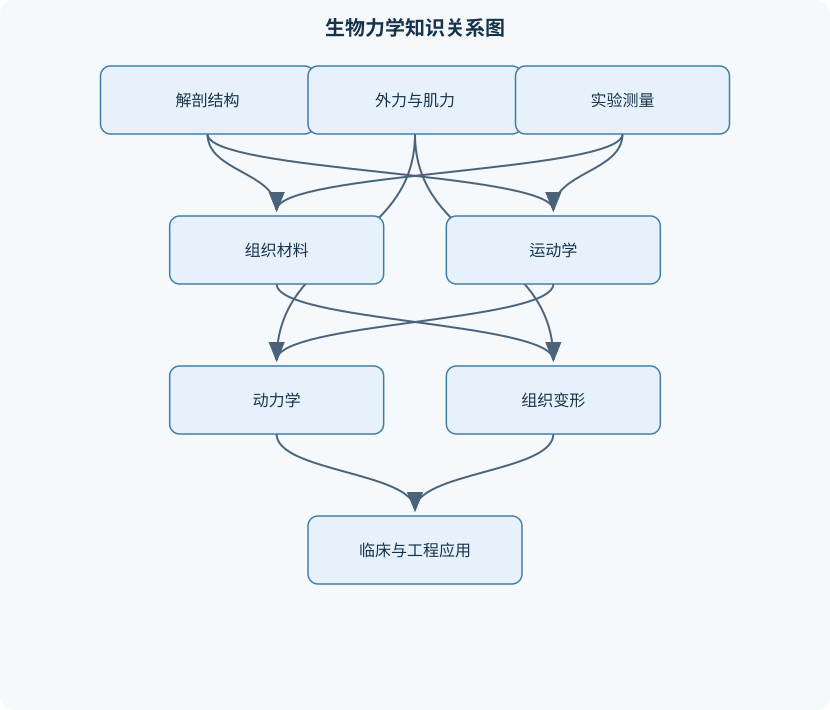
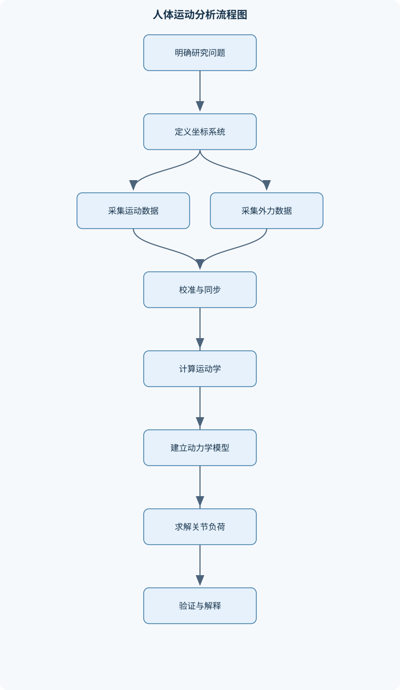

# 生物力学

## 一、课程整体知识框架

### 课程边界与先修知识

生物力学研究生物体及其组成结构在力、运动、变形和流动作用下的机械行为，覆盖人体与动物的运动系统、软组织、骨骼、关节、肌肉、血液及呼吸系统等对象。课程重点包括生物体结构与功能的力学联系、运动学与动力学建模、组织本构关系、实验测量、数值分析和临床及工程应用。先修知识包括高等数学、普通物理、基础力学、线性代数、基础生物学、人体解剖学与生理学。理想模型通常假设材料连续、参数均匀、边界条件明确且测量无误差；真实生物系统还具有各向异性、黏弹性、非线性、主动收缩、个体差异、组织重塑和测量扰动等限制。





### 1. 研究对象、核心问题与知识链条

生物力学研究生物体及其组成结构在力、运动、变形和流动作用下的机械行为。研究对象既包括整个人体或动物，也包括肢段、关节、骨骼肌、肌腱、韧带、软骨、骨、皮肤、血液和气道等局部结构。其基本问题不是单纯计算“受了多大的力”，而是解释结构形态、材料性质、神经肌肉活动、外部环境与功能表现之间的因果联系。

课程知识可组织为一条由基础到应用的链条：

$$
\text{解剖与生理结构}
\rightarrow
\text{运动学}
\rightarrow
\text{受力与动力学}
\rightarrow
\text{应力—应变与本构}
\rightarrow
\text{组织和器官响应}
\rightarrow
\text{实验测量}
\rightarrow
\text{数值建模}
\rightarrow
\text{临床与工程应用}.
$$

其中，解剖学回答“结构在哪里、如何连接”；运动学回答“结构如何运动”；动力学回答“运动由哪些力和力矩产生”；材料力学回答“结构在载荷下如何变形和失效”；实验与数值方法回答“如何测量、估计和验证”；应用部分则将结果用于运动分析、康复、植入物设计、人体工效学和损伤风险评估。

### 2. 多尺度结构与功能联系

生物系统具有层级结构。细胞组成组织，组织构成器官，器官通过解剖连接和生理调控形成系统，多个系统共同完成运动、支撑、循环和呼吸等功能。组织不是器官的同义词：组织是具有相近来源、结构和功能特征的细胞及细胞外基质集合；器官通常由多种组织组成；体腔则是身体内部的解剖空间，不能作为组织或器官的同一级概念。

人体和多数动物的基本组织可分为上皮组织、结缔组织、肌肉组织和神经组织。上皮组织覆盖体表、衬覆体腔和管腔，主要承担屏障、分泌和交换功能；结缔组织包括骨、软骨、肌腱、韧带、脂肪和血液等，细胞外基质比例和组成差异较大，因而承担支撑、连接、储能、传力或运输功能；肌肉组织通过主动收缩产生力和运动；神经组织负责信号传递与调控。结构与功能的机械联系表现为：骨的矿化和几何形状提高承载能力，肌腱的胶原纤维排列有利于沿主要方向传递拉力，软骨和椎间盘的含水基质有利于承受压缩并分散接触载荷。

解剖学方向必须与力学坐标系区分。人体解剖姿势通常以直立、上肢下垂、掌心向前作为方向参照；矢状面将身体分为左、右部分，额状面将身体分为前、后部分，横断面将身体分为上、下部分。这些平面用于描述位置和运动方向，并不自动等同于组织的材料主方向。组织内部的胶原纤维方向、骨小梁方向或肌纤维方向需要另行定义局部材料坐标系。

### 3. 理想模型与真实生物系统

生物力学建模通常先建立理想模型，再逐步加入现实因素。理想模型可能假设结构连续、材料均匀、参数恒定、边界条件已知、测量无误差，并将人体肢段近似为刚体。该处理有利于建立可解析的方程，例如平衡方程、能量方程或线性有限元方程，但其结论只在假设成立或误差可接受时有效。

真实生物系统往往具有各向异性、非均匀性、黏弹性、非线性、预应变和有限变形；肌肉还具有主动收缩，血液和气道流动具有脉动性，关节存在接触、摩擦、润滑和软组织约束。个体年龄、性别、体重、训练状态、疾病、损伤和组织重塑都会改变参数。因而模型输出应区分“由方程直接得到的力学量”和“依赖参数、边界条件及验证结果的生理解释”。

### 4. 统一符号、单位与建模边界

位置矢量记为 $\mathbf r$，位移为 $\Delta\mathbf r$，速度为 $\mathbf v=d\mathbf r/dt$，加速度为 $\mathbf a=d\mathbf v/dt$。通常长度使用米，时间使用秒。质量记为 $m$，力记为 $\mathbf F$，重力加速度记为 $\mathbf g$，牛顿第二定律为

$$
\sum \mathbf F=m\mathbf a.
$$

力矩记为

$$
\mathbf M=\mathbf r\times\mathbf F,
$$

其中 $\mathbf r$ 是从参考点或转轴指向力作用点的位置矢量，力矩单位为牛·米。角位置、角速度和角加速度分别记为 $\theta$、$\boldsymbol\omega$ 和 $\boldsymbol\alpha$；平面转动中有 $\omega=d\theta/dt$、$\alpha=d\omega/dt$。角度计算时必须明确使用度还是弧度，微积分推导通常使用弧度。

应力记为 $\boldsymbol\sigma$，应变记为 $\boldsymbol\varepsilon$。在单轴小变形条件下，

$$
\sigma=\frac{F}{A},\qquad
\varepsilon=\frac{\Delta L}{L_0},
$$

其中 $A$ 为受力面积，单位为平方米，$L_0$ 为初始长度，应力单位为帕，应变无量纲。剪应力可写为 $\tau=F_t/A$。这些定义适用于截面受力较均匀的近似情形；在接触边缘、孔洞附近、裂纹尖端或复杂三维载荷下，应力通常随位置变化，不能用单一平均值代表局部峰值。

各向同性线弹性材料的杨氏模量为 $E$，剪切模量为 $G$，泊松比为 $\nu$，三者满足

$$
G=\frac{E}{2(1+\nu)}.
$$

该关系要求材料服从三维各向同性线弹性假设。骨、肌腱、韧带和软骨通常不能在所有方向和所有应变范围内满足这一假设。

### 5. 从运动描述到功能解释

人体运动分析首先需要选择参考系。实验室坐标系通常固定于地面，身体坐标系随人体或肢段运动，关节局部坐标系用于定义关节角度和旋转轴。坐标原点、轴方向、单位和正方向必须明确；如果混用不同坐标系而不进行变换，会导致位置、速度、力矩符号和关节角度解释错误。

刚体分段模型将人体近似为由多个刚性肢段和关节连接而成的系统。每个肢段具有质量、质心、惯量和姿态，关节则通过转动或平动自由度描述相邻肢段的相对运动。运动学提供位置、位移、速度和加速度；动力学进一步结合质量、惯量、重力、肌肉力、接触力和外部载荷，求解运动原因及关节负荷。

静态或准静态分析使用

$$
\sum\mathbf F=0,\qquad \sum\mathbf M=0.
$$

明显加速时则必须使用 $\sum\mathbf F=m\mathbf a$ 及相应的转动方程。将快速起跳、落地或摆臂直接当作静态问题，会漏掉惯性力和冲击载荷。压力中心、重心和质心也必须区分：重心是重力作用线的等效位置，质心由质量分布决定，压力中心是接触面上合力作用点，三者在特定静止条件下可能接近，但一般并不相同。

## 二、章节和模块划分

### 核心知识覆盖清单

本清单用于检查正文是否覆盖本课程的主要知识模块：

- **生物力学对象与解剖学基础**：生物力学的研究对象与尺度、组织、器官与系统的层级结构、上皮、结缔、肌肉和神经组织、骨骼肌、骨和软骨的功能分工、人体解剖姿势与方向术语、矢状面、额状面和横断面、体腔、关节腔与组织膜、结构形态与机械功能的联系。
- **质点与刚体运动学**：位置、位移、速度和加速度、平移、转动与平面复合运动、角位移、角速度和角加速度、刚体旋转矩阵与坐标变换、关节运动自由度、相对运动与参考系选择、人体分段模型、运动捕捉数据的时间同步与滤波。
- **静力学与人体平衡**：力、力矩和力偶、受力图与自由体图、平衡方程、重心、质心与压力中心、支撑面与静态稳定性、杠杆分类与机械优势、关节反力和肌肉力估计、人体姿势与外载荷平衡。
- **动力学与冲击载荷**：牛顿运动定律、线动量与角动量、冲量—动量定理、功、能量和功率、转动惯量与角动量守恒、碰撞、接触和恢复系数、冲击峰值与载荷传递、人体运动中的能量分配。
- **应力、应变与材料本构**：正应力、剪应力和应力张量、线应变、剪应变和应变张量、主应力与主应变、胡克定律与弹性模量、泊松比、剪切模量和体积模量、各向同性与各向异性、屈服、断裂与疲劳、有限变形下的应变描述。
- **生物组织力学**：骨组织的层级结构与力学性能、皮肤、肌腱和韧带的拉伸特性、软骨与椎间盘的压缩行为、胶原纤维取向与组织各向异性、黏弹性、蠕变与应力松弛、超弹性与有限元本构模型、组织重塑与适应性变化、损伤、修复和退化的力学机制。
- **肌肉力学与肌骨系统**：肌节、肌动蛋白与肌球蛋白、神经肌肉接头与钙离子释放、滑动肌丝模型、等长、向心和离心收缩、力—长度关系、力—速度关系、肌肉力矩与力臂、肌骨系统的静态与动态协调。
- **关节与人体运动分析**：滑膜关节结构与润滑、关节接触力与接触应力、关节稳定性与活动范围、步态周期与时空参数、地面反作用力、逆动力学分析、关节负荷与运动损伤、假肢、矫形器与运动辅助。
- **生物流体力学**：流体压力、密度和黏度、连续性方程、伯努利方程及其适用条件、牛顿流体与非牛顿流体、层流、湍流与雷诺数、血管内流动与脉动血流、气道阻力与呼吸力学、血流剪切应力与血管壁响应。
- **实验测量与数据处理**：力传感器与力平台、位移、速度和加速度测量、表面肌电与肌肉激活、应变计与数字图像相关、超声、影像与组织形变测量、标定、采样频率与混叠、滤波、基线校正与信号同步、误差传播、重复性与有效性。
- **数值建模与工程应用**：多刚体动力学模型、有限元模型的几何与网格、材料参数、载荷和边界条件、正问题与逆问题、灵敏度分析与参数识别、模型验证与实验对照、运动损伤风险评估、生物材料和植入物设计。


### 第一章 生物力学对象与解剖学基础

本章建立后续力学分析所需的结构语言。内容包括组织、器官、系统、体腔、关节腔和组织膜的层级关系，以及上皮、结缔、肌肉和神经组织的基本功能。重点分析骨骼、骨骼肌、软骨、肌腱和韧带的功能分工：骨主要承受压缩、弯曲和扭转载荷，肌肉主动产力，肌腱将肌肉力传递到骨，韧带限制关节异常运动，软骨降低接触摩擦并分散压缩载荷。

人体解剖姿势、方向术语和三类主要解剖平面构成运动描述的空间基础。人体资料不能不加区别地直接用于其他动物；不同物种的骨骼形态、关节方向、肌肉附着点和负重方式可能不同，建模时必须重新确定解剖坐标与力学边界。

### 第二章 质点与刚体运动学

本章研究不涉及力原因的运动几何。位置为 $\mathbf r$，位移为 $\Delta\mathbf r=\mathbf r_2-\mathbf r_1$，速度和加速度分别为

$$
\mathbf v=\frac{d\mathbf r}{dt},\qquad
\mathbf a=\frac{d\mathbf v}{dt}.
$$

若一维运动加速度为常量 $a$，初始位置和速度分别为 $x_0$、$v_0$，则积分得到

$$
v=v_0+at,
$$

$$
x=x_0+v_0t+\frac{1}{2}at^2,
$$

消去时间可得

$$
v^2=v_0^2+2a(x-x_0).
$$

这些关系要求加速度在所研究时间段内恒定，方向约定保持一致；对于步态或落地这种加速度快速变化的运动，应使用时间序列积分或数值微分，不能强行套用恒加速度公式。

刚体运动由平移和转动组成。平面刚体中，点 $P$ 相对于参考点 $O$ 的速度为

$$
\mathbf v_P=\mathbf v_O+\boldsymbol\omega\times\mathbf r_{P/O}.
$$

第一项表示参考点的平移，第二项表示绕参考点的转动。若只保留其中一项，就会错误地描述同时存在平移和转动的肢段。旋转矩阵用于在不同坐标系之间变换向量，但必须保持矩阵正交性和轴方向定义一致。运动捕捉数据还需要处理时间同步、缺失点、噪声和滤波；位置数据求导会放大高频噪声，因此速度和加速度的峰值必须结合滤波参数解释。

### 第三章 静力学与人体平衡

本章从受力图和自由体图出发，分析人体姿势和外载荷下的平衡。力是矢量合量，力矩是力对参考点产生的转动效应。对隔离出的刚体，平衡条件为

$$
\sum\mathbf F=0,\qquad \sum\mathbf M=0.
$$

分析步骤是确定研究对象、标出重力、肌肉力、关节反力、接触力和外部载荷，选择坐标系，分别列水平、竖直方向的力平衡，并对适当参考点取矩。对关节取矩时，若肌肉力与力臂垂直，则

$$
M_j=F_mr_m.
$$

一般情况下应使用力的垂直分量或叉乘形式，不能默认垂直。

机械优势定义为

$$
MA=\frac{F_{\mathrm{out}}}{F_{\mathrm{in}}}.
$$

力臂增大通常有利于产生较大的输出力矩，但可能减少运动范围或改变速度关系，因此不能仅依据肌肉截面积判断关节功能。静态稳定性还与支撑面、重心投影和压力中心有关；当重心投影接近支撑边界时，小扰动更容易引起失衡。关节反力不能因“关节处没有主动运动”而被忽略，肌肉力与外载荷的合力仍可能产生较大的接触力。

### 第四章 动力学与冲击载荷

本章研究运动状态变化与力的关系。线动量为 $\mathbf p=m\mathbf v$，冲量—动量定理为

$$
\mathbf J=\int_{t_1}^{t_2}\mathbf F\,dt
=\Delta\mathbf p.
$$

当动量变化相同，延长接触时间通常可降低平均冲击力；但局部接触刚度、组织阻尼和力的空间分布仍可能造成较高峰值应力，因此平均冲击力不能代替局部组织损伤评价。

功—能定理为

$$
W_{\mathrm{net}}=\Delta T,
$$

其中 $T$ 为动能。人体起跳中，肌肉和地面反作用力对质心做正功；着地过程中，肌肉、软组织和鞋面可能做负功并耗散机械能。功率为

$$
P=\frac{dW}{dt},
$$

用于描述能量传递速率。转动问题还需考虑转动惯量和角动量；改变肢段质量分布会改变摆动难度，即使总质量不变，转动惯量也可能变化。碰撞分析需要区分接触时间、恢复系数、峰值力和能量耗散，不能只用速度变化判断组织载荷。

### 第五章 应力、应变与材料本构

本章描述材料内部的受力和变形。应力包括正应力和剪应力，完整三维状态应使用应力张量表示；应变也包括轴向、剪切和体积变化。主应力和主应变是使剪切分量在特定方向上消失的特殊量，常用于分析复杂受力下的最大拉压状态。

小变形、单轴、线弹性条件下有

$$
\sigma=E\varepsilon.
$$

该关系只适用于应变较小、材料处于弹性范围且应力与应变近似线性的阶段。超过屈服后，卸载可能不能恢复原形；继续加载还可能发生断裂。疲劳则与循环载荷次数、应力幅、平均应力、缺陷和环境有关，不能由一次静态拉伸强度直接推断。

有限变形组织需区分工程应变与真实应变。工程应变使用初始长度，真实应变则根据当前长度的连续变化定义；大变形、压缩和组织重排时，工程应变可能严重失真。各向同性模型只在材料各方向性质相同的近似下适用，胶原纤维取向明显的组织通常需要各向异性本构关系。

### 第六章 生物组织力学

骨具有皮质骨和松质骨等层级结构，孔隙率、矿化程度、骨小梁方向和加载速率都会影响力学性能。皮肤、肌腱和韧带通常表现为胶原纤维主导的拉伸各向异性；软骨和椎间盘含有大量水分及基质，压缩响应与流体迁移、渗透和时间有关。

黏弹性表现为蠕变和应力松弛。固定应变下应力随时间下降称为应力松弛；固定应力下应变随时间增加称为蠕变。单指数模型可写成一般形式

$$
\sigma(t)=\sigma_{\infty}
+\bigl(\sigma_0-\sigma_{\infty}\bigr)e^{-t/\tau},
$$

其中 $\sigma_0$ 为初始应力，$\sigma_{\infty}$ 为长期应力，$\tau$ 为时间常数。该模型要求加载条件和温度基本稳定，且只能近似单一主导时间尺度；多阶段松弛、组织损伤或流体排出过程通常需要多个时间尺度。

组织重塑使材料性质随长期机械环境变化。持续过载可能引起微损伤和退化，适度机械刺激可能促进适应性改变，但相关性不能直接证明因果性。损伤、修复和退化还受到炎症、血供、年龄和代谢等因素影响，不能仅凭有限元高应力点做出临床结论。

### 第七章 肌肉力学与肌骨系统

骨骼肌的收缩基础是肌节内肌动蛋白和肌球蛋白相互作用。神经肌肉接头释放神经递质，引发动作电位；动作电位促使肌浆网释放钙离子，钙离子调节肌丝相互作用，ATP为交叉桥循环和复位过程提供能量。滑动肌丝模型主要解释肌节层面的收缩机制，不等同于整块肌肉—肌腱复合体的全部外部力学行为。

肌肉收缩可分为等长、向心和离心。等长收缩产生力但肌肉长度近似不变；向心收缩时肌肉主动缩短；离心收缩时肌肉在产生力的同时被拉长。力—长度关系反映肌节重叠程度和被动组织张力，力—速度关系通常表明向心缩短速度增加时可输出主动 力下降，而离心状态的力学响应具有不同规律。

关节力矩由多个肌肉共同贡献：

$$
M_j=\sum_i r_iF_i,
$$

其中 $r_i$ 为第 $i$ 条肌肉的有效力臂，$F_i$ 为其力。由于多个肌肉可能产生相同净力矩，逆向求解单条肌肉力通常是欠定问题，需要引入肌电、最大肌力、共同收缩约束或优化目标。肌肉力臂还随关节角度变化，不能在全部运动范围内视为常量。

### 第八章 关节与人体运动分析

滑膜关节包括关节面、软骨、关节囊、滑液和韧带等结构。关节软骨通过承受压缩、降低摩擦和扩大接触面积保护骨端；滑液润滑效果受速度、载荷和间隙影响。接触力与接触面积共同决定接触应力，接触面积缩小可能使平均压力升高，即使合力不变。

步态分析关注步态周期、支撑相、摆动相、步长、步频、步速和双支撑时间等时空参数。地面反作用力是地面对人体的外部力，结合运动捕捉和人体分段参数可进行逆动力学分析。逆动力学通常从远端向近端递推：先使用足部质量、惯量和地面反作用力求踝关节净力和净力矩，再继续求膝、髋等近端关节量。

关节负荷与运动损伤之间的关系受重复次数、组织耐受、恢复时间、技术动作和个体差异影响。假肢和矫形器设计需同时考虑力传递、舒适性、稳定性、活动范围、质量分布和使用环境，不能只以降低某一关节峰值力为唯一目标。

### 第九章 生物流体力学

流体基本参数包括密度 $\rho$、压力 $p$、动力黏度 $\mu$ 和流速 $\mathbf u$。不可压缩稳态流动满足连续性关系

$$
Q=Au,
$$

其中 $Q$ 为体积流量，$A$ 为截面积，$u$ 为截面平均速度。该式要求流体密度近似不变且截面上的速度已用平均值表示；脉动、分支、泄漏和明显可压缩效应会改变直接适用性。

理想、稳态、不可压缩且无黏性流体沿同一流线满足伯努利关系：

$$
p+\frac{1}{2}\rho u^2+\rho gz=\text{常量}.
$$

真实血流存在黏性损失、血管弹性、脉动和分支，不能直接把理想伯努利方程当作完整血流模型。血液在不同剪切速率下可能表现出非牛顿特性；气道流动也会受管径变化、黏液、分叉和组织顺应性影响。

雷诺数为

$$
Re=\frac{\rho uD}{\mu},
$$

用于比较惯性效应与黏性效应，其中 $D$ 为特征长度。流态判断还依赖管道形状、入口条件、粗糙度和是否脉动，不能机械地使用单一临界值。血流剪切应力可影响血管内皮反应和血管壁重塑，但局部剪切分布需结合速度场和血管几何分析。

### 第十章 实验测量与数据处理

实验测量覆盖力、位移、速度、加速度、肌肉激活和组织形变。力传感器与力平台用于测量外部力和压力分布；位移与运动捕捉系统用于获得肢段位置；表面肌电反映部分肌肉电活动，但不能直接等同于肌肉力；应变计和数字图像相关方法用于测量局部变形；超声和医学影像可估计组织形态、位移和形变。

采样频率 $f_s$ 与采样间隔满足

$$
\Delta t=\frac{1}{f_s}.
$$

若信号最高有效频率超过奈奎斯特频率，可能发生混叠。滤波截止频率应根据信号频带、采样率、滤波器类型、相位要求和峰值保真度确定。滤波可减少噪声，却可能削弱冲击峰值或引入相位延迟；求导会进一步放大高频误差。

实验流程应包括传感器标定、零点校正、单位检查、时间同步、基线校正、异常值判定、重复性评价和有效性验证。独立随机误差可通过重复测量估计，但系统误差不能仅靠增加重复次数消除，必须通过标定、对照实验、改进装置或替代测量方法处理。

### 第十一章 数值建模与工程应用

多刚体动力学模型适合描述肢段运动、关节约束和外力作用；有限元模型适合描述连续组织的位移、应变、应力、接触和局部变形。有限元建模需要定义几何、网格、材料本构、载荷和边界条件。在线性小变形静力问题中，虚功原理可建立

$$
\mathbf K\mathbf u=\mathbf f,
$$

其中 $\mathbf K$ 为刚度矩阵，$\mathbf u$ 为节点位移，$\mathbf f$ 为外载荷。该方程依赖线性材料、小变形和已正确施加的约束；大变形、接触、材料非线性和主动收缩需要非线性求解。

正问题是在参数和载荷已知时预测响应；逆问题则根据观测运动、力或形变反推材料参数、肌肉力或边界载荷。逆问题通常存在不唯一性，对噪声敏感，需要正则化、先验约束或额外实验。灵敏度分析用于判断输出对材料参数、几何尺寸和边界条件的依赖程度。

模型验证应包括网格收敛、边界敏感性、参数合理性和实验对照。有限元中的高应力点可能由尖角、接触边缘、网格过粗或边界约束造成，不能未经验证直接解释为损伤位置。工程应用包括运动损伤风险评估、生物材料设计、骨科植入物、假肢矫形器、康复设备、人体工效学和医疗器械研发。可靠产出不仅是计算结果，还应包括输入参数、单位、假设、误差、验证指标和适用边界。

## 三、核心概念的详细解释

### 1. 生物力学对象、层级结构与解剖学参照

生物力学研究生物体及其组成结构在力、运动、变形和流动作用下的机械响应。研究尺度可从肌节、胶原纤维和细胞外基质，扩展到骨、软骨、肌肉、肌腱、韧带、关节、血管、气道、肢段以及整个人体或动物。不同尺度之间存在传力和变形的层级关系：细胞外基质的排列影响组织的本构性质，组织的几何和材料性质决定器官的整体响应，器官之间的连接又决定系统层面的运动和负荷分配。

上皮组织主要形成体表、体腔和管腔的覆盖层，机械功能包括屏障、密封和选择性通透；结缔组织包括骨、软骨、肌腱、韧带、脂肪和血液等，细胞外基质比例较高，常承担支撑、连接、传力、储能或运输功能；肌肉组织通过主动收缩产生力；神经组织负责信号传递和调节。组织、器官和体腔不是同一层级概念：组织是细胞及其基质的集合，器官通常由多种组织组成，体腔是解剖空间。

骨具有较高的抗压和抗弯能力，并通过几何形状和骨小梁方向提高承载效率；软骨和椎间盘含有大量水分及基质，可分散接触压力并表现出时间依赖的压缩响应；肌腱和韧带主要依靠沿长度方向排列的胶原纤维传递拉力，但肌腱偏重于肌肉—骨之间的力传递，韧带则主要限制关节过度运动并提供被动稳定；骨骼肌产生主动拉力，骨骼和关节提供传力与运动约束。结构形态不能脱离功能解释，例如骨骼截面、肌腱走向和关节曲率都会改变力臂、接触应力及运动范围。

解剖姿势和力学坐标系必须分开定义。矢状面将身体分为左、右部分，额状面将身体分为前、后部分，横断面将身体分为上、下部分。它们用于空间定位和描述运动方向，并不自动等同于组织的材料主方向。骨小梁、胶原纤维和肌纤维方向应通过局部材料坐标系单独表示。人体资料不能未经区分地用于其他动物，因为动物的骨骼比例、关节结构、运动方式和组织参数可能不同。

### 2. 运动学：从位置到刚体运动

位置矢量记为 $\mathbf r$，位移记为 $\Delta\mathbf r$，速度和加速度分别为

$$
\mathbf v=\frac{d\mathbf r}{dt},\qquad
\mathbf a=\frac{d\mathbf v}{dt}=\frac{d^2\mathbf r}{dt^2}.
$$

其中长度通常以米为单位，时间以秒为单位，速度单位为 $\mathrm{m/s}$，加速度单位为 $\mathrm{m/s^2}$。位移是终点位置与起点位置之差，不等同于运动路径长度。参考系改变时，位置、速度和加速度的分量可能改变，但必须在同一坐标变换规则下解释。

一维恒加速度运动的推导如下。由 $a=dv/dt$，若 $a$ 为常量，则积分得

$$
v=v_0+at.
$$

再由 $v=dx/dt$ 积分，并使用初始条件 $x(0)=x_0$，得

$$
x=x_0+v_0t+\frac{1}{2}at^2.
$$

消去时间可得

$$
v^2=v_0^2+2a(x-x_0).
$$

这些式子要求加速度在所讨论时间段内恒定，且方向约定不变。步态、落地和快速变向通常不满足恒加速度条件，不能把上述公式用于整段运动后再解释局部峰值。

平面刚体运动由平移和转动组成。设刚体上的参考点为 $O$，点 $P$ 相对 $O$ 的位置矢量为 $\mathbf r_{P/O}$，则

$$
\mathbf v_P=\mathbf v_O+\boldsymbol\omega\times\mathbf r_{P/O}.
$$

第一项表示参考点的平移速度，第二项表示点 $P$ 绕参考点的转动速度。若只保留第二项，就等于错误地假设参考点不动。平面运动中角速度垂直于运动平面，角位移常用弧度表示，$\omega=d\theta/dt$，$\alpha=d\omega/dt$。

人体分段模型通常把大腿、小腿、足、前臂等近似为刚体，用关节角描述相邻分段的相对转动。刚体近似适合估计肢段整体运动，但不能直接给出肌肉、肌腱或软骨的局部变形。运动捕捉数据还需处理标记点脱落、软组织伪影、时间不同步和求导放大噪声等问题。

### 3. 静力学、动力学与人体平衡

力是具有大小和方向的矢量，力矩定义为

$$
\mathbf M=\mathbf r\times\mathbf F,
$$

其中 $\mathbf r$ 从参考点或转轴指向力作用点，力矩单位为牛·米。力矩的大小为

$$
M=rF\sin\phi,
$$

$\phi$ 是位置矢量与力之间的夹角。只有垂直于力的力臂才产生最大力矩；沿位置矢量方向的力不产生关于该点的力矩。

静态或准静态条件下，刚体满足

$$
\sum\mathbf F=\mathbf 0,\qquad
\sum\mathbf M_O=\mathbf 0.
$$

动态条件下则为

$$
\sum\mathbf F=m\mathbf a,
$$

并且关于固定轴或质心的转动方程为

$$
\sum M=I\alpha,
$$

其中 $I$ 为转动惯量，单位为 $\mathrm{kg\cdot m^2}$。若人体姿势变化很慢、加速度相对于重力效应可忽略，才可使用静力平衡方程；快速起跳、跑步和碰撞必须保留惯性项。

建立人体受力分析时，应先明确研究对象，画出自由体图，标出重力、外部接触力、肌肉力、关节反力和约束力，再列平衡或动力学方程。重心是质量分布的加权位置；压力中心是合接触力作用线与支撑面交点，二者通常不相同。静态稳定性取决于重心投影是否落在支撑面内以及外部扰动和关节控制能力。支撑面边界附近，较小的外部扰动也可能造成失衡。

机械优势定义为

$$
MA=\frac{F_{\mathrm{out}}}{F_{\mathrm{in}}}.
$$

对关节而言，若肌肉力垂直于肌肉力臂，

$$
M_j=F_mr_m.
$$

力臂增大时，在相同外部力矩下所需肌肉力降低，但关节角度变化也可能减少运动范围或改变速度，因此不能只依据肌肉截面积判断运动能力。

### 4. 冲量、功、能量与冲击

线动量为

$$
\mathbf p=m\mathbf v,
$$

力对时间的积分为冲量：

$$
\mathbf J=\int_{t_1}^{t_2}\mathbf F\,dt
=\Delta\mathbf p.
$$

若质量不变，冲量等于动量变化。对于相同的动量变化，延长接触时间通常可以降低平均力，但不能保证降低所有局部峰值应力，因为峰值还取决于接触面积、材料刚度、载荷波形和组织几何。

机械功为

$$
W=\int \mathbf F\cdot d\mathbf r,
$$

动能为

$$
T=\frac12mv^2,
$$

重力势能可写为

$$
V=mgz.
$$

净功—能定理为

$$
W_{\mathrm{net}}=\Delta T.
$$

正功增加机械能，负功通常表示肌肉或材料吸收并耗散机械能。起跳阶段肌肉主要产生正功，着地缓冲阶段肌肉和软组织可以产生负功。功率为

$$
P=\frac{dW}{dt},
$$

单位为瓦特。局部功率峰值可能受到滤波和求导噪声影响，不能只凭单个尖峰判断整体运动能力。

### 5. 应力、应变和组织本构

法向应力和剪应力的简单定义分别为

$$
\sigma=\frac{F_n}{A},\qquad
\tau=\frac{F_t}{A},
$$

其中 $F_n$ 为垂直于截面的力，$F_t$ 为切向力，$A$ 为受力面积，单位均为帕斯卡。应力是单位面积上的内力，压力是法向应力的特定情形，不能把压力、力和应力混用。

小变形轴向应变为

$$
\varepsilon=\frac{\Delta L}{L_0},
$$

其中 $L_0$ 为初始长度，$\Delta L$ 为长度变化。剪应变记为 $\gamma$，均为无量纲量。在线性、均匀、各向同性和小变形条件下，单轴胡克定律为

$$
\sigma=E\varepsilon,
$$

$E$ 为杨氏模量，单位为帕。各向同性线弹性材料还满足

$$
G=\frac{E}{2(1+\nu)},
$$

其中 $G$ 为剪切模量，$\nu$ 为泊松比。体积模量 $K$ 描述静水压力引起的体积变化。近似不可压缩材料的泊松比接近 $0.5$，此时直接使用位移型线性有限元可能出现数值锁死，需要合适的混合形式或近似处理。

生物组织通常不是理想线弹性材料。骨在一定范围内可近似线弹性，但具有各向异性、非均匀性和疲劳损伤；肌腱、韧带和皮肤常呈现胶原纤维控制的非线性拉伸曲线；软骨、椎间盘和血管具有黏弹性、含水性和时间依赖性。有限变形时，工程应变可能不能准确描述变形，应使用基于变形梯度的应变度量，并明确参考构形和当前构形。

### 6. 黏弹性、重塑与损伤

黏弹性材料同时表现出弹性储能和黏性耗散。应力松弛是在应变突然达到固定值后，应力随时间下降；蠕变是在应力保持不变时，应变随时间增加。一个简单的单指数应力松弛形式为

$$
\sigma(t)=\sigma_\infty+
\left(\sigma_0-\sigma_\infty\right)e^{-t/\tau},
$$

其中 $\sigma_0$ 为初始应力，$\sigma_\infty$ 为长期应力，$\tau$ 为时间常数。$\tau$ 越大，松弛越慢。该模型只适合近似单一主导时间尺度的情形，不能充分描述具有多级微结构、温度敏感性和复杂加载历史的组织。

组织还会因长期机械环境发生重塑。骨在负荷、活动水平和损伤修复变化下可能调整骨量和骨小梁方向；肌腱和韧带的胶原排列、软骨基质和肌肉体积也可能随训练、制动、损伤或退化改变。重塑是因果链中的长期反馈，不应把一次瞬时力学测量直接解释为长期结构改变。

### 7. 肌肉力学与肌骨系统

肌肉收缩的基本单位是肌节。神经冲动到达神经肌肉接头后释放乙酰胆碱，引起肌膜去极化，动作电位沿膜和横小管传播，肌浆网释放钙离子。钙离子与肌钙蛋白结合，使原肌球蛋白移动，肌球蛋白头部与肌动蛋白形成交联并消耗三磷酸腺苷，产生肌丝相对滑动。钙离子被重新摄取后，交联减少，肌肉松弛。

等长收缩时肌肉长度近似不变但产生力；向心收缩时肌肉在产生外部力矩的同时缩短；离心收缩时肌肉在受力下被拉长，常可产生较大的外部制动力矩。肌肉力受肌肉长度、收缩速度、激活程度和疲劳影响。力—长度关系反映肌节重叠程度，力—速度关系通常表现为缩短速度增加时可输出力下降，而离心阶段的力学行为不能用简单线性外推得到。

多个肌肉共同作用时，关节净力矩为

$$
M_j=\sum_i r_iF_i,
$$

但一个关节净力矩通常对应多组肌肉力，因为肌肉数目多于独立平衡方程数目。因此，逆动力学得到的是净关节力矩，不是单条肌肉力；肌电也只是激活信息，不能直接等同于肌肉力。

### 8. 关节、步态与生物流体

滑膜关节由关节面、软骨、关节囊、滑液和韧带等结构共同组成。关节稳定性来自骨性形态、韧带和关节囊约束、肌肉主动控制以及关节接触力。接触应力不仅取决于合力，还取决于接触面积和压力分布。步态分析常关注步态周期、步长、步频、支撑时间、摆动时间、初始接触和离地事件。地面反作用力是人体与地面相互作用的外力，结合运动学和人体分段参数可用于逆动力学。

流体参数包括密度 $\rho$、压力 $p$、动力黏度 $\mu$ 和流速 $\mathbf u$。不可压缩管流的连续性关系为

$$
Q=Au,
$$

其中 $Q$ 为体积流量，$A$ 为截面积，$u$ 为截面平均速度。理想、稳态、不可压缩、无黏性且沿同一流线的流动满足

$$
p+\frac12\rho u^2+\rho gz=\text{常量}.
$$

血液流动通常具有黏性、脉动、血管壁变形和分支，气道也存在分叉、黏液和管径变化，因此伯努利方程只能在检查假设后作局部近似。雷诺数为

$$
Re=\frac{\rho uD}{\mu},
$$

用于比较惯性效应和黏性效应；流态临界范围还依赖几何、入口条件、粗糙度和脉动性质。流体对血管壁的剪切作用可能影响内皮响应和重塑，但局部剪切应力必须依据速度梯度和壁面条件计算，不能只由平均流速判断。

### 9. 测量、建模与验证的核心联系

力平台、力传感器、运动捕捉、加速度计、表面肌电、应变计、数字图像相关、超声和医学影像分别测量外力、位移、加速度、电活动、局部应变或组织形态。不同仪器测量的物理量不同，必须经过标定、单位换算和时间同步后才能联合分析。

采样频率为 $f_s$，采样间隔为

$$
\Delta t=\frac1{f_s}.
$$

有效信号最高频率必须低于奈奎斯特频率 $f_s/2$，否则会发生混叠。滤波能降低噪声，但可能改变峰值、相位和事件时间；由位置数据求速度和加速度会放大高频噪声。系统误差不能通过简单增加重复次数消除，必须依靠标定、对照测量或改进实验设计。

多刚体模型适合分析肢段整体运动和关节力；有限元模型适合分析连续组织的局部应力、应变、接触和大变形。正问题是由已知参数预测响应，逆问题则由观测结果反推载荷、材料参数或肌肉力。逆问题通常不唯一且对噪声敏感，需要正则化、先验约束或更多独立测量。有限元结果必须经过网格收敛、边界敏感性和实验对照，不能把未验证的高应力点直接解释为损伤位置。

## 四、重要定义、公式、定理和推导

### 专业审校补充：关键定义与适用边界

血管壁切应力是流体力学与组织力学的耦合边界量，定义为流体在血管壁切向作用的单位面积力，常记为 τ_w，单位为 Pa。对于半径为 R、长度为 L、黏度为 μ、压降为 Δp 的圆管内稳态、不可压、充分发展、牛顿层流，壁面切应力可由速度梯度表示为 τ_w=μ|du/dr|_{r=R}=ΔpR/(2L)，其中 u 为轴向速度，r 为径向坐标。该关系不适用于入口段、明显分叉、强脉动、血管壁显著运动或非牛顿效应占主导的情形。脉动血流中，壁面切应力随时间变化，除瞬时平均值外，还可关注振荡方向和时间积分；仅用平均流量或单一雷诺数不能完整描述内皮细胞所受机械刺激。血液在小血管中的表观黏度还受管径、红细胞比容和细胞变形影响，因此不能无条件套用恒定黏度的泊肃叶模型。


### 1. 代表性算法与流程

#### 二维人体静力平衡分析

**输入：**人体分段几何、各段质量和重心、外力、关节角度、力臂及支撑条件。  
**输出：**肌肉力、关节反力和支撑反力，或明确指出方程欠定。

过程如下：

1. 统一长度、力和角度单位，建立原点、轴方向和正方向。
2. 隔离研究对象，绘制自由体图，标出重力、外部接触力、肌肉力和关节反力。
3. 对平面问题列出水平和竖直方向的力平衡。
4. 对关节或其他方便的参考点列力矩平衡，消去部分未知反力。
5. 逐段检查符号、力矩方向和单位。
6. 若未知量多于独立方程，必须加入肌肉力上限、激活约束或优化目标，不能任意给出唯一答案。

其不变量是每个隔离刚体的力和力矩平衡。适用于准静态姿势，不适用于明显加速运动。若用线性方程组直接求解，含 $n$ 个未知量时一般求解复杂度约为 $O(n^3)$。

#### 逆动力学分析

**输入：**各分段质量、质心位置、转动惯量、运动学轨迹、外力和接触条件。  
**输出：**关节净力和净力矩。

先由位置计算速度和加速度，再依据牛顿—欧拉方程从远端向近端递推。每个刚体都必须同时满足平动力学和转动力学，不能只使用角度而忽略线性加速度。若含 $n$ 个串联刚体，每个时间点递推通常为 $O(n)$，但整体误差受运动捕捉噪声、人体参数和滤波方式影响。

#### 肌肉力分配

给定目标关节力矩 $M_j$ 和第 $i$ 条肌肉的力臂 $r_i$，建立

$$
\sum_i r_iF_i=M_j,
\qquad
0\leq F_i\leq F_{i,\max}.
$$

由于通常存在多个可行解，需要选择目标函数，例如最小平方激活、最小疲劳或最小总肌肉力。约束残差、肌肉力上下界和生理合理性是评价标准。若无可行解，可能是目标力矩过大、力臂符号错误、肌肉最大力设置过低或遗漏了拮抗肌和外部力矩。

#### 一维拉伸数据处理

**输入：**力—位移序列、初始长度 $L_0$ 和初始截面积 $A_0$。  
**输出：**工程应力—应变曲线、弹性模量、峰值强度和断裂应变。

逐点计算

$$
\sigma_{\mathrm{eng}}=\frac{F}{A_0},
\qquad
\varepsilon_{\mathrm{eng}}=\frac{L-L_0}{L_0}.
$$

在线性区用回归斜率估计 $E$，不能用整条非线性曲线的平均斜率代替。若变形很大，应考虑当前截面积和真实应变；夹具滑移、试样打滑和零点漂移会造成假应变。

#### 有限元建模流程

输入几何、网格、材料本构、边界条件和载荷，输出位移、应力、应变及接触反力。流程为几何重建、网格划分、材料指定、边界施加、方程组装、求解、网格收敛和实验对照。线性小变形静力模型满足

$$
\mathbf K\mathbf u=\mathbf f,
$$

其中 $\mathbf K$ 为刚度矩阵，$\mathbf u$ 为节点位移，$\mathbf f$ 为外载荷。大变形、接触、材料非线性和主动肌肉力需要非线性迭代；若残差不收敛，不能只报告“最大应力”，而应报告未收敛状态和可能原因。

### 2. 数据处理代码示例

下面代码仅演示对一维位置序列进行单位检查、简单滑动平均和中心差分。它不连接外部设备，也不执行文件操作。

```python
import numpy as np

def kinematics_from_position(position_m, sampling_hz, window=5):
    """
    position_m: 一维位置数组，单位 m
    sampling_hz: 采样频率，单位 Hz
    window: 奇数长度的滑动平均窗口
    return: 平滑位置、速度和加速度
    """
    position_m = np.asarray(position_m, dtype=float)

    if position_m.ndim != 1 or len(position_m) < 5:
        raise ValueError("位置数据必须是一维且至少包含5个样本")
    if sampling_hz <= 0:
        raise ValueError("采样频率必须为正")
    if window < 3 or window % 2 == 0:
        raise ValueError("窗口长度必须是大于等于3的奇数")

    # 边界采用边缘值填充，避免输出长度改变
    pad = window // 2
    padded = np.pad(position_m, (pad, pad), mode="edge")
    kernel = np.ones(window) / window
    position_smooth = np.convolve(padded, kernel, mode="valid")

    dt = 1.0 / sampling_hz
    velocity = np.gradient(position_smooth, dt)
    acceleration = np.gradient(velocity, dt)

    return position_smooth, velocity, acceleration
```

不变量包括采样时间顺序、长度单位为米和采样频率为正。该方法适合初步离线处理，不适合直接处理包含冲击尖峰、严重缺失值或非均匀采样的数据。滑动平均会削弱高频峰值，实际研究应比较不同窗口并报告参数。

### 3. 典型例题

#### 例题一：小腿静力平衡

**题干：**足底受到竖直向上的外力 $400\ \mathrm{N}$，小腿和足段总重力为 $120\ \mathrm{N}$，跟腱对踝关节的力臂为 $0.04\ \mathrm{m}$，外力关于踝关节的力臂为 $0.20\ \mathrm{m}$。假设姿势静止且跟腱力垂直于力臂，求跟腱力的近似值。

**分析：**对踝关节取矩可消除踝关节反力。竖直外力和重力产生相反方向的力矩。

**解答：**

外部合力矩大小为

$$
M_{\mathrm{ext}}=400\times0.20-120\times d_g,
$$

其中 $d_g$ 是重心到踝关节的水平力臂。若题目未给出重力力臂，不能把重力矩精确纳入，只能先求忽略重力矩时的近似值：

$$
M_{\mathrm{ext}}\approx400\times0.20=80\ \mathrm{N\cdot m}.
$$

因此

$$
F_m=\frac{M_{\mathrm{ext}}}{0.04}
=2000\ \mathrm{N}.
$$

再由竖直方向平衡求踝关节反力。若跟腱向上拉，反力需抵消各竖直力的合力，具体符号取决于受力图方向。

**结果验证：**$2000\ \mathrm{N}\times0.04\ \mathrm{m}=80\ \mathrm{N\cdot m}$，量纲正确。  
**变式：**若重心力臂为 $0.10\ \mathrm{m}$，重力矩为 $12\ \mathrm{N\cdot m}$，跟腱力将变为 $(80-12)/0.04=1700\ \mathrm{N}$，说明忽略重力矩可能造成显著误差。

#### 例题二：肘关节负重

**题干：**前臂水平伸展，手中负载为 $100\ \mathrm{N}$，负载到肘关节的距离为 $0.30\ \mathrm{m}$；肱二头肌力臂为 $0.04\ \mathrm{m}$。忽略前臂自重，求静止时肱二头肌力。

**解答：**

负载产生的外部力矩为

$$
M_{\mathrm{load}}=100\times0.30=30\ \mathrm{N\cdot m}.
$$

平衡要求肱二头肌产生反向力矩，因此

$$
F_m=\frac{30}{0.04}=750\ \mathrm{N}.
$$

**结果验证：**肌肉力是外部负载的 $7.5$ 倍，但力矩相等，说明关节系统中肌肉力可能远大于手中物体的重量。  
**变式：**若肘角改变导致力臂增至 $0.06\ \mathrm{m}$，所需肌肉力降为 $500\ \mathrm{N}$，但肌肉收缩方向和运动范围也会随角度改变。

#### 例题三：冲击平均力

**题干：**质量为 $70\ \mathrm{kg}$ 的人体以竖直向下 $3\ \mathrm{m/s}$ 的速度着地，接触时间为 $0.15\ \mathrm{s}$，着地后速度近似为零。求地面对人体的平均合力，并估算平均地面反作用力。

**解答：**

人体动量变化为

$$
\Delta p=m(0-(-3))=70\times3=210\ \mathrm{kg\cdot m/s}.
$$

平均合力满足

$$
F_{\mathrm{net,avg}}=\frac{\Delta p}{\Delta t}
=\frac{210}{0.15}=1400\ \mathrm{N}.
$$

取向上为正，地面反作用力还需抵消重力：

$$
F_{\mathrm{GRF,avg}}-mg=1400,
$$

因此

$$
F_{\mathrm{GRF,avg}}=1400+70\times9.81
\approx2087\ \mathrm{N}.
$$

**结果验证：**平均地面反作用力大于体重，符合着地减速的物理过程。  
**变式：**若屈膝使接触时间增加到 $0.30\ \mathrm{s}$，平均合力降为 $700\ \mathrm{N}$，但局部接触应力是否下降还取决于接触面积和载荷分布。

#### 例题四：骨试样拉伸

**题干：**骨试样初始长度为 $50\ \mathrm{mm}$，初始截面积为 $20\ \mathrm{mm^2}$。某测量点的拉力为 $1000\ \mathrm{N}$，长度变为 $50.5\ \mathrm{mm}$。求工程应力和工程应变。

**解答：**

应力计算时统一使用国际单位制：

$$
A_0=20\ \mathrm{mm^2}=20\times10^{-6}\ \mathrm{m^2},
$$

因此

$$
\sigma_{\mathrm{eng}}
=\frac{1000}{20\times10^{-6}}
=50\times10^6\ \mathrm{Pa}
=50\ \mathrm{MPa}.
$$

应变为

$$
\varepsilon_{\mathrm{eng}}
=\frac{50.5-50}{50}
=0.01.
$$

即工程应变为 $1\%$。

**结果验证：**应变无量纲，应力单位为帕。  
**变式：**若试样发生大变形，截面积明显减小，则工程应力不能代表当前截面的真实应力，需要使用变形后的面积和相应真实应变。

#### 例题五：管道连续性与雷诺数

**题干：**血管截面积为 $4\ \mathrm{mm^2}$，截面平均流速为 $0.25\ \mathrm{m/s}$。血液密度为 $1060\ \mathrm{kg/m^3}$，动力黏度为 $0.004\ \mathrm{Pa\cdot s}$，特征直径为 $2\ \mathrm{mm}$。求流量和雷诺数。

**解答：**

截面积换算为

$$
A=4\times10^{-6}\ \mathrm{m^2}.
$$

流量为

$$
Q=Au
=4\times10^{-6}\times0.25
=1.0\times10^{-6}\ \mathrm{m^3/s}.
$$

雷诺数为

$$
Re=\frac{\rho uD}{\mu}
=\frac{1060\times0.25\times0.002}{0.004}
=132.5.
$$

该数值表明黏性效应在此条件下不可忽略，但不能仅凭一个数值替代对脉动、入口段和血管分支的判断。

**结果验证：**流量单位为 $\mathrm{m^3/s}$，雷诺数无量纲。  
**变式：**若血管直径减半而流量保持不变，平均速度会增加，且雷诺数的变化不能只由直径直接判断，必须重新计算截面积和速度。

### 4. 实验与项目工作流程

#### 实验一：力平台与运动捕捉联合测量垂直跳

**输入数据：**力平台三维地面反作用力、人体质心或标记点位置、采样频率、体质量和时间戳。  
**步骤：**

1. 对力平台进行零点校正和静态标定，确认静止时竖直力接近体重。
2. 检查力平台与运动捕捉系统的采样频率、触发时刻和时间戳。
3. 根据竖直地面反作用力和阈值识别起跳、腾空和着地事件。
4. 对位置和力信号分别检查噪声，再选择滤波方法；不能先滤波后随意改变事件时间。
5. 由净力计算质心加速度：
   $$
   a_{\mathrm{COM}}=\frac{F_{\mathrm{GRF}}-mg}{m}.
   $$
6. 对加速度积分得到速度和位移，并用起跳前静止状态作为初始条件。
7. 计算起跳阶段机械功、峰值力和平均功率，并与视频或重复试次核对。

**评价标准：**时间轴无明显错位，静止阶段力接近体重，积分后速度和位移符合运动过程，重复试次的主要峰值和事件顺序具有一致性。  
**排错方法：**若积分后出现持续漂移，检查基线、重力扣除和滤波；若峰值时间错位，检查触发同步；若力峰异常尖锐，检查传感器饱和、脚底滑移和采样率；若运动学峰值明显变化，比较不同滤波截止频率。

#### 实验二：组织或材料拉伸及黏弹性应力松弛

**输入数据：**试样初始长度、截面积、力—位移序列、加载速度、固定应变阶段的时间—力序列和温度条件。  
**步骤：**

1. 测量试样几何尺寸并记录材料方向；纤维组织必须说明加载方向。
2. 进行传感器零点校正，检查夹具滑移和试样是否与夹具同轴。
3. 将力—位移转换为工程应力—应变；大变形时另行计算真实量。
4. 在小应变近似线性区回归杨氏模量，不使用峰值段斜率代替弹性模量。
5. 固定应变并记录应力随时间变化，拟合单指数模型。
6. 比较不同加载速度或不同保持时间下的响应，分析黏弹性和温度影响。

**评价标准：**几何尺寸和单位可追溯，零点稳定，试样未发生夹具滑脱，重复试次曲线形状基本一致；模型拟合应报告残差，而不是只报告时间常数。  
**排错方法：**应变突然跳变通常提示夹具滑移或初始间隙；应力出现不合理负值应检查零点和力方向；单指数拟合残差呈系统性波动，说明存在多个时间尺度或加载历史影响，不能强行解释为单一黏弹性过程。

### 5. 典型易错点与结果审查

1. 把组织、器官和体腔当作同一层级概念。  
2. 把解剖学平面直接当作材料主方向。  
3. 只列肌肉力矩而忽略关节反力和合力平衡。  
4. 把力矩大小直接等同于肌肉力大小。  
5. 在快速运动中使用 $\sum\mathbf F=0$ 的静态方程。  
6. 混淆力、压力、正应力和剪应力。  
7. 认为所有组织均匀、各向同性且满足线性弹性。  
8. 用单一杨氏模量描述所有加载速度下的黏弹性组织。  
9. 把肌电信号直接当作肌肉力。  
10. 把逆动力学的净关节力矩当作单条肌肉力。  
11. 直接套用无黏伯努利方程分析脉动血流。  
12. 忽略采样定理和求导对高频噪声的放大。  
13. 将重复性好误认为测量有效，忽略系统误差。  
14. 把有限元中的高应力点直接解释为损伤位置。  
15. 混用毫米与米、牛顿与千牛顿、角度与弧度。  
16. 未说明坐标正方向就解释力矩正负号。  
17. 用人体参数直接替代动物参数。  
18. 把相关性结果表述为单一因素导致损伤的因果结论。

## 五、算法、流程和实现思路

### 方法与流程覆盖索引

下列方法或流程应在正文中说明输入、步骤、适用条件、结果检查和边界：

- 二维人体静力平衡分析：输入为人体分段几何、质量、重心位置、外力和关节角度；输出为肌肉力、关节反力和支撑反力。过程是建立坐标系、绘制自由体图、列出水平力和竖直力平衡、对关节取矩并逐段求解；不变量是每个已隔离刚体的力矩和力平衡方程；终止条件是所有未知量均被求出或明确标记为欠定；适用于准静态姿势，不适用于明显加速运动；线性方程组直接求解复杂度通常为 $O(n^3)$。
- 运动捕捉数据处理流程：输入为标记点三维坐标和采样频率；输出为平滑的位置、速度、加速度及关节角度。过程是检查缺失值、统一坐标系、剔除明显异常点、选择不过度削弱峰值的滤波器、由差分或拟合求导、进行时间同步和单位检查；不变量是时间戳顺序、坐标变换规则和点间解剖约束；终止条件是残差、缺失率和运动范围检查通过；适用于离线实验分析，不能替代原始信号质量控制；逐点滤波复杂度通常为 $O(N)$。
- 逆动力学分析：输入为各刚体的质量惯量、运动学轨迹、外部力和接触条件；输出为关节净力和净力矩。过程是计算位置、速度和加速度，依据牛顿—欧拉方程从远端向近端递推，加入重力、惯性力和外部反力；不变量是每个刚体的力和力矩守恒；终止条件是递推到目标关节或整个肢体链；适用于刚体分段近似和外力可测情形；每个时间点对含 $n$ 个分段的串联链通常为 $O(n)$。
- 静态优化肌肉力分配：输入为目标关节力矩、肌肉力臂、最大肌力和约束条件；输出为一组满足关节力矩的肌肉力。过程是建立 $\sum_i r_iF_i=M_j$，加入 $0\leq F_i\leq F_{i,max}$，再以最小平方、最小疲劳或最小激活等目标求解；不变量是力矩平衡和肌肉力上下界；终止条件是约束残差低于预设容差或判定无可行解；适用于准静态或低速动作，结果依赖目标函数；二次规划内点法的复杂度取决于变量数和约束数，不能简单等同于单次线性求解。
- 一维材料拉伸数据分析：输入为力—位移序列和试样初始长度、截面积；输出为应力—应变曲线、弹性模量、极限强度和断裂应变。过程是零点校正、换算工程应力和工程应变、识别线性区、回归求斜率、记录峰值并检查夹具滑移；不变量是单位换算和试样几何定义；终止条件是完整记录到卸载或断裂且质量控制通过；适用于小变形或工程评价，有限变形组织应使用真实应力和真实应变；数据遍历复杂度为 $O(N)$。
- 有限元生物组织建模流程：输入为几何、网格、材料本构、边界条件和载荷；输出为位移、应变、应力和接触反力。过程是建立几何、划分网格、指定材料、施加约束与载荷、组装方程、求解、检查网格和边界敏感性、与实验结果验证；不变量是节点自由度编号、材料单位和边界条件一致性；终止条件是非线性迭代残差和能量误差满足容差，或达到最大迭代次数并报告未收敛；适用于结构响应预测，不能将未验证参数直接解释为临床结论；线性稀疏求解复杂度依赖网格结构，通常显著低于稠密矩阵的 $O(n^3)$，但不能给出与问题规模无关的固定阶数。
- 步态事件识别流程：输入为足底压力、地面反作用力或足部运动信号；输出为初始接触、足底全接触、离地和步态周期参数。过程是去除传感器漂移、依据阈值或速度变化检测候选事件、合并过近事件、用视频或力平台进行抽样核对；不变量是事件时间顺序和步态周期的正时长；终止条件是遍历完整记录并完成异常步筛除；适用于稳定步行，跑步、拖步和辅助器具行走需要重新设定判据；单通道扫描复杂度为 $O(N)$。
- 生物流体量纲与流动状态判断：输入为密度、黏度、平均速度、特征长度和流道几何；输出为雷诺数、流量估计及模型适用性判断。过程是统一单位、计算 $Re=\rho uD/\mu$、检查是否稳态和不可压缩、评估入口段、脉动和分支影响；不变量是量纲一致性和特征长度定义；终止条件是完成假设清单和适用性结论；适用于初步判断流态，不可替代脉动血流的数值或实验验证；计算复杂度为 $O(1)$。
- 实验测量不确定度评估：输入为重复测量值、仪器分辨率、标定信息和模型公式；输出为均值、随机不确定度、系统误差来源和合成不确定度。过程是检查异常值依据、计算重复性、量化仪器误差、对输入变量做灵敏度分析并合成误差；不变量是测量单位、样本定义和误差来源分类；终止条件是所有主要误差源均已列出并给出合理处理；适用于实验报告和模型验证，不能用统计重复性掩盖系统偏差；对固定数量输入量的误差合成通常为 $O(k)$。





### 1. 二维人体静力平衡分析流程

二维人体静力分析适用于站立、保持姿势或低速搬运等加速度可以忽略的情形。若人体某一分段的线加速度和角加速度均足够小，可将其近似为刚体，并使用

$$
\sum \mathbf F=\mathbf 0,\qquad
\sum \mathbf M_O=\mathbf 0.
$$

其中，$\mathbf F$ 为力，$\mathbf M_O$ 为关于参考点 $O$ 的力矩，力的单位为牛顿，力矩单位为牛·米。若动作中存在明显加速，则必须改用动力学方程，不能继续使用静力平衡。

**输入：**人体分段几何、各段质量及重心位置、外部载荷、足底或支撑面反力、关节角度和肌肉力臂。  
**输出：**肌肉力、关节反力、支撑反力及其力矩。  
**过程：**

1. 建立坐标系，明确原点、水平轴和竖直轴的正方向，统一长度单位。
2. 将人体划分为足、小腿、大腿、躯干和上肢等刚体分段。
3. 对目标分段绘制自由体图，标出重力、外力、肌肉力、关节反力和接触力。
4. 对每个分段列出水平和竖直方向的合力平衡方程。
5. 选取关节中心或其他方便的参考点列力矩平衡方程。
6. 按远端到近端逐段求解，或者将所有未知量组成线性方程组后统一求解。
7. 检查每个分段的合力和合力矩残差，并检查力的方向和数量级。

例如，若前臂保持水平，肘关节为参考点，肱二头肌力为 $F_m$，其力臂为 $r_m$，外部负载为 $F_L$，负载力臂为 $r_L$，忽略前臂质量时，肘关节力矩平衡为

$$
F_m r_m-F_Lr_L=0.
$$

因此

$$
F_m=F_L\frac{r_L}{r_m}.
$$

若 $F_L=100\ \mathrm{N}$，$r_L=0.30\ \mathrm{m}$，$r_m=0.04\ \mathrm{m}$，则

$$
F_m=100\times\frac{0.30}{0.04}=750\ \mathrm{N}.
$$

肌肉力大于手中负载，并不矛盾，因为肌肉的内力臂远小于外部负载的力臂。再由竖直方向平衡可得肘关节反力；若向上为正，则

$$
R_y+F_m-F_L=0,
$$

所以 $R_y=F_L-F_m=-650\ \mathrm{N}$，负号表示实际方向向下。该结果验证了只列力矩平衡而不列合力平衡会遗漏关节反力。

**不变量：**每个被隔离刚体的力平衡和力矩平衡必须同时成立。  
**终止条件：**所有未知量均已求出，或者通过秩分析明确说明方程欠定。  
**适用边界：**准静态姿势、刚体分段、外力已知或可测。快速起跳、跑步和碰撞过程必须加入惯性项。含多个肌肉且未知肌肉数超过独立方程数时，不能得到唯一肌肉力，需要优化或额外实验约束。若有 $n$ 个未知量，直接求解稠密线性方程组的计算复杂度通常为 $O(n^3)$。

### 2. 运动捕捉与动力学数据处理流程

运动捕捉数据通常包括标记点三维坐标、采样频率和时间戳。处理目标是由位置获得关节角度、速度、加速度，并与力平台、肌电等信号同步。

**输入：**标记点坐标 $\mathbf r(t)$、采样频率 $f_s$、实验室坐标系定义和解剖标记信息。  
**输出：**平滑位置、关节角度、速度、加速度和步态事件。  
**过程：**

1. 检查时间戳是否单调递增，计算采样间隔 $\Delta t=1/f_s$。
2. 检查缺失点、跳点、遮挡和明显超出人体活动范围的坐标。
3. 统一实验室坐标系和身体局部坐标系，禁止直接混用坐标分量。
4. 对缺失值进行有限范围内的插值；长时间缺失不能用简单插值掩盖。
5. 依据目标信号频带选择滤波方法和截止频率。
6. 由滤波后的位置计算关节角度，并通过差分或多项式拟合求速度、加速度。
7. 将运动信号与力平台或肌电按照触发信号、时间戳或已知事件同步。
8. 检查关节活动范围、左右侧一致性、残差和步态事件顺序。

位置数据求导会放大高频噪声，因此“先求导后滤波”通常会产生较大误差。若采样频率为 $1000\ \mathrm{Hz}$，采样间隔为

$$
\Delta t=\frac{1}{1000}=0.001\ \mathrm{s}.
$$

使用中心差分估计速度时，中间时刻可写为

$$
v_i\approx\frac{x_{i+1}-x_{i-1}}{2\Delta t}.
$$

该近似要求采样时间间隔基本均匀。边界点不能直接使用对称差分，应采用单边差分或拟合方法。滤波器若产生相位延迟，力平台信号和运动信号的峰值时间会错位；离线分析可使用零相位处理，但这不适用于实时控制。

**不变量：**时间顺序、坐标变换规则、单位和解剖点间的几何约束必须保持一致。  
**终止条件：**缺失率、残差、关节活动范围和同步误差均通过预设质量检查。  
**复杂度：**对长度为 $N$ 的时间序列进行逐点扫描、异常标记和常规滤波，通常为 $O(N)$；但复杂模型拟合和多体优化的复杂度取决于参数数目。

#### 运动捕捉数据处理伪代码

```python
# Python 风格伪代码：仅处理已加载的离线数据，不进行文件或网络操作
def process_motion(markers, fs, cutoff):
    # markers: shape = [N, marker_count, 3]
    # fs: 采样频率，单位 Hz
    # cutoff: 滤波截止频率，单位 Hz

    assert fs > 2 * cutoff
    dt = 1.0 / fs

    quality = check_missing_and_outliers(markers)
    markers = interpolate_short_gaps(markers, quality)
    markers = transform_to_body_coordinates(markers)
    markers_filtered = low_pass_filter(markers, cutoff, fs)

    velocity = central_difference(markers_filtered, dt)
    acceleration = central_difference(velocity, dt)

    joint_angles = calculate_joint_angles(markers_filtered)
    events = detect_gait_events(markers_filtered, velocity)

    assert timestamps_are_monotonic(markers_filtered)
    assert units_are_consistent()
    return markers_filtered, velocity, acceleration, joint_angles, events
```

该伪代码不能替代质量控制。`interpolate_short_gaps` 必须限制可插值的缺失长度；否则长时间遮挡会制造不存在的运动轨迹。`low_pass_filter` 的截止频率也不能固定套用，应根据动作频率、采样率和峰值保真要求确定。

### 3. 逆动力学分析流程

逆动力学根据已测运动和外部力，反推出关节净力和净力矩。它不直接给出单条肌肉力，因为关节净力矩通常由多条肌肉、韧带、被动组织和接触力共同产生。

**输入：**各分段质量、质心位置、转动惯量，关节运动轨迹，地面反作用力和其他外部力。  
**输出：**关节净力、净力矩以及必要时的关节接触反力。  
**过程：**

1. 根据标记点建立各刚体的位姿。
2. 对位姿进行时间同步、滤波和单位检查。
3. 计算各段质心加速度和角加速度。
4. 对远端分段列出牛顿—欧拉方程。
5. 将远端关节反力和力矩作为相邻近端分段的已知外力。
6. 从远端向近端递推，直到获得目标关节的净力和净力矩。
7. 检查递推结果对滤波参数、分段质量和地面反作用力的敏感性。

平面刚体的动力学方程可写为

$$
\sum \mathbf F=m\mathbf a_G,
$$

$$
\sum M_G=I_G\alpha,
$$

其中 $G$ 为质心，$I_G$ 为绕质心的转动惯量，$\alpha$ 为角加速度。若把运动学数据中的噪声误认为加速度，惯性项会出现不合理峰值。因此逆动力学结果必须同时报告滤波方法和参数。

**适用条件：**分段可近似为刚体，外部力已测或可合理估计，关节连接关系明确。  
**主要限制：**软组织振动、足底滑移、接触面分布、肌肉共同收缩和分段参数误差会影响结果。每个时间点对含 $n$ 个串联分段的链条进行递推，通常为 $O(n)$。

### 4. 多肌肉力分配与静态优化

逆动力学只能得到关节净力矩。例如膝关节目标伸展力矩为 $M_j$ 时，多个伸肌和屈肌可能以不同组合共同产生该力矩。设第 $i$ 条肌肉的力为 $F_i$、力臂为 $r_i$，则

$$
\sum_{i=1}^{m}r_iF_i=M_j.
$$

若肌肉力必须为拉力，并且不超过最大肌力，则有

$$
0\leq F_i\leq F_{i,\max}.
$$

当肌肉数量 $m$ 大于独立平衡方程数量时，问题欠定。可以加入最小平方激活、最小疲劳或最小代谢等目标。例如最小平方激活模型可写成

$$
\min_{F_i}\sum_{i=1}^{m}\left(\frac{F_i}{F_{i,\max}}\right)^2
$$

并满足力矩平衡及上下界约束。不同目标函数会产生不同肌肉力分配，因此优化输出不是唯一的生理真值，而是“在给定假设下的一组可行解”。

**终止条件：**约束残差小于容差，所有肌肉力满足上下界；若无可行解，应报告目标力矩、力臂或最大肌力设置之间不相容。  
**适用边界：**准静态或低速动作。快速运动需要加入肌肉激活动力学、力—长度和力—速度关系。

### 5. 材料拉伸数据分析流程

**输入：**力—位移序列、试样初始长度 $L_0$、初始截面积 $A_0$。  
**输出：**工程应力—应变曲线、杨氏模量、峰值强度、断裂应变和必要时的真实应力—应变曲线。

工程应变和工程应力分别为

$$
\varepsilon=\frac{\Delta L}{L_0},\qquad
\sigma=\frac{F}{A_0}.
$$

其中 $\varepsilon$ 无量纲，$\sigma$ 的单位为帕。杨氏模量应在线性弹性区通过回归斜率获得：

$$
E=\frac{\Delta\sigma}{\Delta\varepsilon}.
$$

**步骤：**

1. 对力和位移传感器进行零点校正。
2. 检查夹具滑移、试样偏心和初始间隙。
3. 根据初始几何尺寸换算工程应力和工程应变。
4. 用预先定义的线性区进行回归，而非任意挑选看起来平直的区间。
5. 记录峰值应力、断裂应变和卸载过程。
6. 对大变形软组织，计算真实应力和真实应变，并说明采用的定义。
7. 比较不同加载速度下的曲线，识别黏弹性和速率依赖性。

若载荷方向与胶原纤维方向不同，测得的表观刚度不能直接视为组织本征各向同性模量。骨、肌腱和韧带的参数还会受到取样位置、含水量、温度、预处理和加载历史影响。

### 6. 有限元生物组织建模流程

有限元模型将连续组织离散为有限数量的单元。线性小变形静力问题可由虚功原理建立

$$
\mathbf K\mathbf u=\mathbf f,
$$

其中 $\mathbf K$ 为刚度矩阵，$\mathbf u$ 为节点位移，$\mathbf f$ 为外载荷。若材料非线性、大变形或接触显著，刚度矩阵会随变形和材料状态变化，需采用增量迭代求解。

**输入：**几何、网格、材料本构、边界条件、载荷和接触定义。  
**输出：**位移、应变、应力、接触压力和反力。  
**过程：**

1. 从影像或实验几何建立结构模型，明确几何重建误差。
2. 根据应力梯度和接触区域划分网格。
3. 指定各向同性、各向异性、超弹性或黏弹性材料模型。
4. 施加位移约束、外力、压力和接触条件。
5. 求解并检查残差、能量平衡和收敛步数。
6. 进行网格收敛和边界敏感性分析。
7. 与实验位移、整体力—位移曲线或接触压力进行对照。
8. 仅在验证通过后讨论局部应力和潜在损伤风险。

网格加密后，整体位移和反力应趋于稳定；若最大应力持续随网格加密而增大，可能存在几何尖角或接触奇异性，此时不能把该点作为可靠的组织损伤预测。有限元求解通常利用稀疏矩阵，复杂度取决于自由度数量、网格结构和非线性迭代次数，不能简单指定为固定阶数。

### 7. 生物流体量纲与流动状态判断

**输入：**密度 $\rho$、动力黏度 $\mu$、平均速度 $u$、特征长度 $D$ 和流道几何。  
**输出：**雷诺数、流量估计、流态判断和模型适用性结论。

雷诺数为

$$
Re=\frac{\rho uD}{\mu}.
$$

它反映惯性效应与黏性效应的相对大小。不可压缩流体通过截面的体积流量为

$$
Q=Au,
$$

其中 $A$ 为截面积，$u$ 为截面平均速度。若管道直径减小而流量保持不变，平均速度会增大；但血管弹性、脉动、分支和非牛顿性会使简单管道关系产生偏差。

理想伯努利方程

$$
p+\frac{1}{2}\rho u^2+\rho gz=\text{常量}
$$

只适用于稳态、不可压缩、无黏性并沿同一流线的理想流动。真实血液存在黏性损失和脉动，气道还可能出现管径变化、塌陷和分叉，因此伯努利方程只能作局部近似或量级估算，不能替代完整血流或呼吸流动模型。

### 8. 实验不确定度评估流程

若输出量 $y$ 由多个测量量 $x_1,x_2,\ldots,x_k$ 决定，即

$$
y=f(x_1,x_2,\ldots,x_k),
$$

在输入误差较小且彼此独立时，可用一阶误差传播近似：

$$
u_y^2\approx
\sum_{i=1}^{k}
\left(\frac{\partial f}{\partial x_i}\right)^2u_{x_i}^2.
$$

其中 $u_{x_i}$ 为第 $i$ 个输入量的不确定度。该式只处理随机不确定度的近似传播；系统误差不能靠增加重复次数消除。

**步骤：**

1. 区分随机误差、仪器分辨率、标定偏差、同步误差和模型误差。
2. 计算重复测量的均值和离散程度。
3. 依据标定结果估计仪器误差。
4. 对输出公式进行灵敏度分析。
5. 合成主要独立误差，并单独报告未量化的系统误差来源。
6. 以重复实验、已知标准、替代传感器或对照实验验证结果。

**评价标准：**单位统一、误差来源完整、合成过程可追溯、系统误差没有被虚假的重复性掩盖。若多个输入量相关，不能直接使用独立误差公式，应说明协方差或采用重复整套实验估计总变异。

### 9. 代表性综合例题

#### 例题一：站立时踝关节静力分析

**题干：**足底受到竖直向上的支撑力 $600\ \mathrm{N}$，其作用线距踝关节水平距离 $0.08\ \mathrm{m}$；跟腱力臂为 $0.04\ \mathrm{m}$，忽略足部质量，求跟腱力和踝关节反力。

**分析：**足部近似静止，因此合力和合力矩均为零。对踝关节取矩可消除关节反力。

**解答：**

$$
F_T(0.04)=600(0.08),
$$

$$
F_T=1200\ \mathrm{N}.
$$

竖直方向平衡为

$$
R_y+F_T-600=0,
$$

所以

$$
R_y=-600\ \mathrm{N}.
$$

负号表示关节反力方向向下。

**结果验证：**力矩为 $1200\times0.04-600\times0.08=0$；合力为 $-600+1200-600=0$。  
**变式：**若足部质量为 $40\ \mathrm{N}$，应把足部重力及其作用点加入自由体图，跟腱力和关节反力都会改变。

#### 例题二：举重时肘关节力矩

**题干：**前臂水平，手中负载为 $80\ \mathrm{N}$，负载距肘关节 $0.30\ \mathrm{m}$，前臂重力为 $20\ \mathrm{N}$，重心距肘关节 $0.15\ \mathrm{m}$，肱二头肌力臂为 $0.04\ \mathrm{m}$。求维持静止所需的肌肉力矩和肌肉力。

**解答：**

外部屈曲力矩为

$$
M_{\text{out}}=80\times0.30+20\times0.15=27\ \mathrm{N\cdot m}.
$$

肌肉力为

$$
F_m=\frac{27}{0.04}=675\ \mathrm{N}.
$$

**验证：**肌肉力矩 $675\times0.04=27\ \mathrm{N\cdot m}$，与外部力矩相等。  
**变式：**若肘角改变导致力臂变为 $0.06\ \mathrm{m}$，在其他条件不变时肌肉力降为 $450\ \mathrm{N}$，说明力臂随关节角度变化会显著影响肌肉负荷。

#### 例题三：冲击缓冲与接触时间

**题干：**质量为 $70\ \mathrm{kg}$ 的人体以 $3\ \mathrm{m/s}$ 的竖直速度落地，停止时间分别为 $0.05\ \mathrm{s}$ 和 $0.20\ \mathrm{s}$。忽略水平速度，求平均合外力并比较两种着地方式。

**解答：**动量变化量大小为

$$
\Delta p=m\Delta v=70\times3=210\ \mathrm{N\cdot s}.
$$

平均合外力大小为

$$
F_{\mathrm{avg}}=\frac{\Delta p}{\Delta t}.
$$

因此，短接触时间时

$$
F_{\mathrm{avg}}=\frac{210}{0.05}=4200\ \mathrm{N},
$$

长接触时间时

$$
F_{\mathrm{avg}}=\frac{210}{0.20}=1050\ \mathrm{N}.
$$

**结果验证：**两种情况的冲量均为 $210\ \mathrm{N\cdot s}$。  
**边界：**该结果是平均合外力，不是地面反力峰值，也不能直接代表软骨或骨局部应力。屈膝可能延长接触时间，但组织变形、肌肉主动制动和接触面积变化也会影响局部峰值。

#### 例题四：骨试样拉伸

**题干：**试样初始长度为 $50\ \mathrm{mm}$，初始截面积为 $20\ \mathrm{mm^2}$。在线性区内，力增加 $100\ \mathrm{N}$，长度增加 $0.10\ \mathrm{mm}$。求工程应力增量、工程应变增量和杨氏模量。

**解答：**

先统一单位：

$$
A_0=20\times10^{-6}\ \mathrm{m^2},\qquad
L_0=0.05\ \mathrm{m},\qquad
\Delta L=1.0\times10^{-4}\ \mathrm{m}.
$$

工程应力增量为

$$
\Delta\sigma=\frac{100}{20\times10^{-6}}
=5.0\times10^6\ \mathrm{Pa}.
$$

工程应变增量为

$$
\Delta\varepsilon=\frac{1.0\times10^{-4}}{0.05}
=0.002.
$$

因此

$$
E=\frac{5.0\times10^6}{0.002}
=2.5\times10^9\ \mathrm{Pa}.
$$

**验证：**应力单位为帕，应变无量纲，模量单位为帕。  
**变式：**若试样发生大变形或截面积明显变化，工程应力不能代表当前截面应力，需要使用真实应力并说明横向变形的测量方式。

#### 例题五：管道流量和雷诺数

**题干：**某圆管直径为 $4\ \mathrm{mm}$，截面平均速度为 $0.20\ \mathrm{m/s}$，流体密度为 $1050\ \mathrm{kg/m^3}$，动力黏度为 $0.004\ \mathrm{Pa\cdot s}$。求流量和雷诺数。

**解答：**圆管截面积为

$$
A=\frac{\pi D^2}{4}
=\frac{\pi(0.004)^2}{4}
\approx1.257\times10^{-5}\ \mathrm{m^2}.
$$

流量为

$$
Q=Au
=1.257\times10^{-5}\times0.20
\approx2.51\times10^{-6}\ \mathrm{m^3/s}.
$$

雷诺数为

$$
Re=\frac{\rho uD}{\mu}
=\frac{1050\times0.20\times0.004}{0.004}
=210.
$$

**结果验证：**流量单位为 $\mathrm{m^3/s}$，雷诺数无量纲。  
**边界：**仅凭该数值不能完全决定真实血流状态，因为血流具有脉动性，血管有弹性，且血液的有效黏度会随剪切速率变化。  
**变式：**若直径减半而流量保持不变，平均速度将增加到原来的四倍，雷诺数也会随特征长度和速度共同变化。

## 六、概念之间的关系与对比

### 1. 运动学、动力学、材料力学与流体力学的关系

| 分析层次 | 核心问题 | 主要变量 | 典型方程 | 典型适用对象 |
|---|---|---|---|---|
| 运动学 | 结构如何运动 | $\mathbf r,\mathbf v,\mathbf a,\theta,\boldsymbol\omega$ | $\mathbf v=d\mathbf r/dt$ | 肢段、关节、步态 |
| 动力学 | 什么力导致运动 | $\mathbf F,\mathbf M,m,I$ | $\sum\mathbf F=m\mathbf a$ | 人体分段、碰撞、起跳 |
| 材料力学 | 结构如何变形和承载 | $\boldsymbol\sigma,\boldsymbol\varepsilon,E$ | $\sigma=E\varepsilon$ | 骨、肌腱、韧带 |
| 流体力学 | 流体如何运动并与壁面作用 | $p,\rho,\mu,\mathbf u,Q$ | $Q=Au$、质量守恒 | 血液、气道 |
| 实验与数值 | 如何测量和预测 | 传感器量、节点自由度、参数 | $\mathbf K\mathbf u=\mathbf f$ | 组织、植入物、运动系统 |

运动学不涉及力的原因解释，动力学必须以运动学轨迹和加速度为输入；材料力学描述局部应力和应变，不能直接替代整个人体的刚体动力学。有限元可以把材料本构和边界载荷联系起来，但其结果仍依赖实验测得的几何、载荷和材料参数。

### 2. 力、应力、压力与力矩的区别

力是作用于物体的合量，单位为牛顿；应力是单位面积上的内力，单位为帕；压力通常指法向应力或流体单位面积上的法向作用；力矩描述力使物体绕参考点转动的趋势，单位为牛·米。

$$
\mathbf M_O=\mathbf r\times\mathbf F.
$$

同一个力作用点不同，力矩可能完全不同；同一力矩也可以由不同大小的力和力臂组合产生。因而不能把“关节力矩大”直接等同于“某条肌肉力大”。此外，应力还包括剪切分量，压力不能代表组织内部全部应力状态。

### 3. 静力学与动力学的边界

静力学使用

$$
\sum\mathbf F=\mathbf0,\qquad
\sum\mathbf M=\mathbf0.
$$

动力学使用

$$
\sum\mathbf F=m\mathbf a,\qquad
\sum M=I\alpha.
$$

当动作速度低、姿势保持时间较长且加速度相对较小，静力模型可以估算肌肉力和关节反力。步态摆动、起跳、落地和碰撞时，加速度项不可忽略。一个姿势在某一瞬间“看起来不动”，并不保证整个动作过程可按静力学处理；必须根据研究时间尺度和惯性项相对大小判断。

### 4. 刚体模型与连续体模型

| 特征 | 刚体分段模型 | 连续体或有限元模型 |
|---|---|---|
| 主要假设 | 分段内部不发生显著变形 | 结构可发生空间分布变形 |
| 主要输出 | 位置、角度、关节力和净力矩 | 位移场、应变场、应力场 |
| 优点 | 参数较少，适合人体整体运动 | 能描述接触、局部应力和复杂几何 |
| 局限 | 不能解释软组织局部变形 | 参数、网格、边界条件和收敛要求高 |
| 典型应用 | 步态、举重、逆动力学 | 骨折风险、软骨接触、植入物设计 |

刚体模型适合回答“关节净力矩是多少”，有限元模型更适合回答“某区域应力如何分布”。用刚体模型不能直接得到软骨内部应力；用有限元模型也不能自动得到真实肌肉力，除非主动收缩和外部载荷被合理建模。

### 5. 工程应力—应变与真实应力—应变

工程应力使用初始面积 $A_0$，工程应变使用初始长度 $L_0$。它们便于材料试验比较，但在大变形、颈缩或软组织伸长明显时会产生较大偏差。真实应力使用当前面积，真实应变基于瞬时长度变化。两者的区别不是“一个正确、一个错误”，而是适用范围不同：小变形和工程评价常用工程量，有限变形本构建模通常需要与变形描述一致的真实量。

### 6. 线弹性、黏弹性、超弹性与主动材料

线弹性材料满足近似关系

$$
\sigma=E\varepsilon,
$$

要求应变较小、材料处于弹性范围、加载历史影响可以忽略。黏弹性材料同时具有弹簧样的瞬时响应和黏性流动，表现为蠕变和应力松弛。超弹性模型适合描述大变形且主要依赖当前变形状态的材料，但并不自动包含时间依赖。肌肉是主动材料，其应力不仅由被动变形产生，还与神经激活、肌纤维长度、收缩速度和疲劳状态有关。

因此，使用单一杨氏模量描述肌腱、软骨或肌肉的全部行为通常是不充分的。加载速度、温度、含水量、预应变和组织方向都会改变表观刚度。

### 7. 各向同性与各向异性

各向同性表示材料在不同方向上的力学性质相同；各向异性表示性质随方向变化。骨小梁、肌腱胶原纤维、韧带和肌肉通常具有明显方向性。解剖矢状面、额状面和横断面只是空间定位平面，不能自动替代材料主方向。若纤维方向与加载方向不一致，沿某一轴测得的模量不能直接推广到其他方向。

### 8. 肌肉力、肌电与关节力矩的关系

肌肉力通过力臂产生关节力矩：

$$
M_j=\sum_i r_iF_i.
$$

肌电信号反映运动单位的电活动，不能直接等同于肌肉力。肌肉力还受肌肉长度、收缩速度、肌腱顺应性、共同收缩、疲劳和电极位置影响。逆动力学得到的是关节净力矩，不是单条肌肉的力；肌电可以作为额外约束或激活指标，但不能单独消除多肌肉力分配的不唯一性。

### 9. 向心、等长与离心收缩

| 收缩类型 | 肌肉长度变化 | 外部运动表现 | 力学特征 |
|---|---|---|---|
| 等长收缩 | 近似不变 | 关节角度近似不变 | 产生力但外部机械功接近零 |
| 向心收缩 | 肌肉缩短 | 肌肉产生的力矩方向推动运动 | 通常产生正功 |
| 离心收缩 | 肌肉被拉长 | 肌肉抵抗外部运动 | 通常吸收机械能，产生负功 |

“机械功接近零”不等于“没有能量消耗”；等长收缩仍有代谢消耗和内部能量转化。离心收缩的负功表示机械能被肌肉—肌腱系统吸收或耗散，不代表肌肉没有产生力。

### 10. 功、功率、冲量与峰值载荷

机械功为力沿位移的积分，功率为单位时间内做功：

$$
W=\int\mathbf F\cdot d\mathbf r,\qquad
P=\frac{dW}{dt}.
$$

冲量为力对时间的积分：

$$
\mathbf J=\int\mathbf F\,dt=\Delta\mathbf p.
$$

相同动量变化下，延长接触时间通常会降低平均冲击力，但不必然降低局部峰值应力。峰值还受接触面积、加载速率、组织阻尼、几何尖角和力传递路径影响。因此不能只用平均地面反作用力评价损伤风险。

### 11. 关节活动范围、稳定性与负荷

关节活动范围描述允许运动的角度区间；稳定性描述在外力和运动扰动下维持合理相对位置的能力。活动范围大不一定稳定性高，稳定性也不等于关节完全不动。骨形态、关节面几何、韧带、肌肉共同收缩、关节接触和神经控制共同决定功能表现。假肢、矫形器和运动辅助装置需要在活动范围、稳定性、力传递和舒适性之间折中。

### 12. 连续性方程与伯努利方程

连续性方程主要表达质量守恒；在不可压缩且无泄漏时，才可简化为

$$
Q=Au.
$$

伯努利方程表达理想流体沿流线的机械能守恒。连续性方程和伯努利方程不是同一概念：前者约束质量流量，后者涉及压力、速度和重力势能。血液脉动、黏性、分支和血管弹性使伯努利方程的直接使用受到限制；即使连续性关系仍可作局部近似，也不能据此忽略压力损失和壁面响应。

### 13. 正问题与逆问题

正问题是在几何、材料、载荷和边界条件已知时预测运动或变形，例如有限元预测骨在压缩载荷下的位移。逆问题则根据观测到的运动、力或形变反推材料参数、肌肉力或边界条件。逆问题常存在多组参数产生相近输出，且对测量噪声敏感，因此需要正则化、先验约束、灵敏度分析和独立实验验证。

逆动力学和肌肉力分配的区别正体现了这一点：逆动力学可由运动和外力得到净关节力矩，但从净力矩反推多条肌肉力通常是不唯一的。

### 14. 模型验证、校准与有效性

校准是使测量系统或模型参数与已知输入相符；验证是检验模型能否再现独立实验或目标现象。网格收敛只说明离散误差趋于稳定，不代表材料参数和边界条件正确；实验拟合很好也不代表模型具有普遍生理意义。可靠模型应同时检查：

- 输入几何和材料参数是否有明确单位；
- 载荷、约束和接触是否符合实验条件；
- 网格加密后关键输出是否稳定；
- 对参数和边界条件是否敏感；
- 是否与独立的位移、力或压力测量一致；
- 误差是否来自测量、模型、数值离散或参数识别。

有限元高应力点、运动学高加速度峰值和肌电高振幅都不能脱离测量质量和模型假设直接解释为损伤、肌肉力或因果机制。

## 七、典型例题和应用场景

### 专业审校补充：综合例题

题干：某肌腱—肌肉复合体跨过踝关节。肌纤维沿自身方向产生 800 N 主动力，肌纤维与肌腱长轴夹角为 30°；肌腱力臂为 0.045 m，外部阻力对踝关节的力矩为 28 N·m。忽略被动组织力、肌腱质量和动态惯性，求肌腱轴向力、肌肉主动分量产生的踝关节力矩，并判断能否平衡外部阻力矩。分析：肌纤维力不能全部传给肌腱，若忽略肌腱摩擦和横向支撑，沿肌腱方向的传力分量为 F_t=F_f cosα；踝关节力矩再由肌腱力乘以力臂得到。逐步解答：1. 将角度换算为弧度或直接使用三角函数，cos30°≈0.866。2. 肌腱轴向力为 F_t=800×0.866=692.8 N。3. 肌腱产生的关节力矩为 M_t=F_t r=692.8×0.045=31.18 N·m。4. 与外部阻力矩比较，净力矩为 31.18−28=3.18 N·m；若方向相反，则仍有约 3.18 N·m 的剩余伸展或跖屈趋势，不能称为完全平衡。结果验证：F_t 的单位为 N，乘以 m 后为 N·m；当 α=0° 时，F_t 应等于 800 N，说明夹角增大时有效传力下降。该计算还隐含肌纤维处于给定力值、力臂与角度已知且系统准静态的假设。变式：若夹角增至 45°，则 F_t=800cos45°≈565.7 N，关节力矩约为 25.46 N·m，低于 28 N·m，需考虑共同收缩、被动力或改变姿势后才能平衡；这也说明不能只依据肌纤维总力判断关节输出。


### 典型题型与应用覆盖索引

建议通过下列题型或应用检查概念是否能够迁移：

- 站立人体小腿静力学：给定足底外力、人体分段质量、重心位置和踝关节几何，绘制自由体图，先列合力平衡，再对踝关节取矩，求跟腱力和踝关节反力，并分析力臂改变对结果的影响。
- 举重时肘关节力矩：给定前臂质量、外载荷、各力作用点和肘关节角度，分别计算重力矩、负载力矩和肱二头肌力矩，讨论肌肉力远大于外载荷的原因。
- 垂直跳跃功率：由质心位移和地面反作用力数据计算净功、起跳阶段平均功率及机械能变化，区分正功、负功和测量噪声造成的局部峰值。
- 骨骼试样拉伸：给定初始长度、截面积和力—位移数据，换算应力—应变，在线性区回归杨氏模量，识别屈服或断裂前后的响应，并说明工程应力与真实应力的区别。
- 肌腱黏弹性应力松弛：给定突然施加的固定应变和随时间下降的应力，使用单指数模型估计瞬时模量、长期模量和时间常数，判断该模型对多阶段松弛数据的局限。
- 膝关节逆动力学：给定步态中的关节角度、角速度、角加速度、地面反作用力和人体分段参数，按远端到近端递推膝关节净力和净力矩，并分析滤波截止频率对峰值的影响。
- 多肌肉力分配：给定膝关节目标力矩、四条肌肉的力臂和最大肌力，建立带上下界的优化问题，比较最小平方激活与最小疲劳目标得到的不同肌肉力组合。
- 管道流量与压降：给定血管直径、长度、压力差、黏度和密度，先用连续性方程和雷诺数判断流动特征，再在适用条件下估算流量，说明脉动、分叉和非牛顿性造成的偏差。
- 冲击缓冲分析：给定落地前速度、人体质量和接触时间，利用冲量—动量定理估算平均冲击力，比较屈膝与直腿着地的接触时间和载荷变化，并指出平均力不能代表局部组织峰值应力。
- 有限元模型验证：给定骨或软组织的几何、材料参数、加载实验和位移测量，完成网格收敛、边界敏感性和实验对照，报告模型误差来源，而不是只比较单个最大应力值。


### 1. 站立状态下的小腿—踝关节静力分析

**题干：**某人单脚站立，足底对地面的竖直支持力为 $600\ \mathrm{N}$。以踝关节为参考点，地面支持力作用线到踝关节的水平距离为 $0.08\ \mathrm{m}$，跟腱力臂为 $0.04\ \mathrm{m}$。忽略小腿和足部重量，求维持静止所需的跟腱力及踝关节竖直反力。

**分析：**该问题研究的是准静态平衡。人体虽处于真实生理状态，但若加速度和角加速度近似为零，可以对足部或小腿分别列出

$$
\sum \mathbf F=\mathbf 0,\qquad \sum \mathbf M_O=\mathbf 0.
$$

取逆时针为正，以踝关节为取矩点，踝关节反力的力矩为零。地面支持力和跟腱力方向相反，二者共同抵消外部力矩。

**逐步解答：**

1. 对踝关节列力矩平衡：

$$
F_T r_T=F_G r_G,
$$

其中 $F_T$ 为跟腱力，$r_T=0.04\ \mathrm{m}$ 为跟腱力臂，$F_G=600\ \mathrm{N}$ 为地面支持力，$r_G=0.08\ \mathrm{m}$ 为其力臂。

2. 求跟腱力：

$$
F_T=600\times\frac{0.08}{0.04}=1200\ \mathrm{N}.
$$

3. 取竖直向上为正，列竖直方向合力平衡：

$$
R_A+F_T-F_G=0,
$$

其中 $R_A$ 为踝关节反力。因此

$$
R_A=F_G-F_T=600-1200=-600\ \mathrm{N}.
$$

负号说明踝关节反力实际方向向下，大小为 $600\ \mathrm{N}$。

**结果验证：**将 $F_T=1200\ \mathrm{N}$ 和 $R_A=-600\ \mathrm{N}$ 代回，竖直合力为 $-600+1200-600=0$；力矩为 $1200\times0.04-600\times0.08=0$，满足平衡。

**变式：**若跟腱力臂增大到 $0.06\ \mathrm{m}$，则所需跟腱力降为

$$
F_T=600\times\frac{0.08}{0.06}=800\ \mathrm{N}.
$$

这说明力臂变化会改变肌肉或肌腱的力需求，但不能据此断定关节负荷一定按同样比例下降，因为关节反力、接触面积和其他肌肉共同收缩也会变化。

### 2. 举重时的肘关节力矩

**题干：**前臂保持水平，手中负载为 $80\ \mathrm{N}$，负载到肘关节的水平距离为 $0.30\ \mathrm{m}$。前臂重力为 $20\ \mathrm{N}$，其重心到肘关节距离为 $0.15\ \mathrm{m}$。肱二头肌力臂为 $0.04\ \mathrm{m}$，且肌肉力垂直于前臂。求肱二头肌力矩和肌肉力。

**分析：**外部负载和前臂重力均使前臂产生顺时针力矩，肱二头肌提供逆时针力矩。以肘关节为取矩点，可以消除肘关节反力。力矩的基本关系为

$$
M=rF\sin\phi.
$$

本题中各力均与力臂垂直，故 $\sin\phi=1$。

**逐步解答：**

1. 负载产生的力矩：

$$
M_L=80\times0.30=24\ \mathrm{N\cdot m}.
$$

2. 前臂重力产生的力矩：

$$
M_F=20\times0.15=3\ \mathrm{N\cdot m}.
$$

3. 肱二头肌需要抵消的总外力矩：

$$
M_m=M_L+M_F=27\ \mathrm{N\cdot m}.
$$

4. 由 $M_m=F_mr_m$ 得：

$$
F_m=\frac{27}{0.04}=675\ \mathrm{N}.
$$

**结果验证：**肌肉力矩为 $675\times0.04=27\ \mathrm{N\cdot m}$，与外部力矩相等。肌肉力明显大于手中负载，是因为肌肉内力臂很短。

**变式：**若前臂与水平面形成角度，负载力矩应使用负载力到肘关节的垂直距离，而不是简单使用前臂长度。若肌肉力不再垂直于前臂，则必须保留 $\sin\phi$，不能直接使用 $M=F r$。

### 3. 冲击缓冲与冲量—动量关系

**题干：**人体质量为 $70\ \mathrm{kg}$，落地前竖直向下速度为 $3\ \mathrm{m/s}$，落地后速度近似为零。比较接触时间分别为 $0.10\ \mathrm{s}$ 和 $0.25\ \mathrm{s}$ 时的平均合力大小。忽略落地期间重力变化对平均值的影响。

**分析：**冲量—动量定理为

$$
\mathbf J=\int \mathbf F\,dt=\Delta\mathbf p.
$$

若使用平均合力 $\overline{\mathbf F}$ 近似，则

$$
\overline{\mathbf F}\Delta t=m(v_2-v_1).
$$

取竖直向上为正，$v_1=-3\ \mathrm{m/s}$，$v_2=0$。

**逐步解答：**

1. 动量变化量：

$$
\Delta p=70(0-(-3))=210\ \mathrm{N\cdot s}.
$$

2. 当接触时间为 $0.10\ \mathrm{s}$ 时：

$$
\overline F=\frac{210}{0.10}=2100\ \mathrm{N}.
$$

3. 当接触时间为 $0.25\ \mathrm{s}$ 时：

$$
\overline F=\frac{210}{0.25}=840\ \mathrm{N}.
$$

若要计算地面对人体的平均支持力，还应考虑重力项；上述结果表示使动量改变所需的平均净力。

**结果验证：**两种情况的平均力与接触时间相乘均为 $210\ \mathrm{N\cdot s}$，符合动量变化要求。

**变式与边界：**屈膝、软垫或增加缓冲距离通常可以延长接触时间并降低平均峰值，但不保证局部骨、软骨或韧带的最大应力同步下降。真实冲击力是随时间变化的曲线，峰值取决于刚度、接触面积、姿势和组织变形，而不是只由平均力决定。

### 4. 骨或肌腱试样的应力—应变分析

**题干：**某试样初始长度为 $50\ \mathrm{mm}$，截面积为 $20\ \mathrm{mm^2}$。在拉力 $100\ \mathrm{N}$ 时，长度增加 $0.25\ \mathrm{mm}$。求工程应力、工程应变和割线弹性模量。

**分析：**小变形工程量定义为

$$
\sigma=\frac{F}{A},\qquad \varepsilon=\frac{\Delta L}{L_0}.
$$

计算前必须统一单位。$20\ \mathrm{mm^2}=20\times10^{-6}\ \mathrm{m^2}$，$50\ \mathrm{mm}=0.05\ \mathrm{m}$，$0.25\ \mathrm{mm}=0.00025\ \mathrm{m}$。

**逐步解答：**

1. 工程应力：

$$
\sigma=\frac{100}{20\times10^{-6}}
=5.0\times10^6\ \mathrm{Pa}
=5.0\ \mathrm{MPa}.
$$

2. 工程应变：

$$
\varepsilon=\frac{0.00025}{0.05}=0.005.
$$

应变无量纲，也可表示为 $0.5\%$。

3. 割线模量：

$$
E_{\mathrm{sec}}=\frac{\sigma}{\varepsilon}
=\frac{5.0\times10^6}{0.005}
=1.0\times10^9\ \mathrm{Pa}
=1.0\ \mathrm{GPa}.
$$

**结果验证：**由 $E\varepsilon$ 反算应力，得到 $1.0\times10^9\times0.005=5.0\times10^6\ \mathrm{Pa}$，与原应力一致。

**变式与边界：**若试样发生明显有限变形，工程应力使用初始面积可能产生较大误差；应根据实验目的考虑当前截面积、真实应变和材料的非线性本构。对肌腱、韧带等组织，曲线初始段可能受胶原纤维逐步拉直影响，不能把任意两点斜率都称为杨氏模量。

### 5. 血管流量、平均速度与雷诺数

**题干：**一段近似圆形血管内径为 $4\ \mathrm{mm}$，截面平均流速为 $0.20\ \mathrm{m/s}$。血液密度取 $\rho=1060\ \mathrm{kg/m^3}$，动力黏度取 $\mu=0.004\ \mathrm{Pa\cdot s}$。求体积流量和雷诺数，并说明理想模型的局限。

**逐步解答：**

1. 血管半径为

$$
r=\frac{D}{2}=0.002\ \mathrm{m}.
$$

2. 截面积为

$$
A=\pi r^2
=\pi(0.002)^2
\approx1.257\times10^{-5}\ \mathrm{m^2}.
$$

3. 由连续性关系 $Q=Au$：

$$
Q=1.257\times10^{-5}\times0.20
\approx2.51\times10^{-6}\ \mathrm{m^3/s}.
$$

换算为毫升每秒，约为 $2.51\ \mathrm{mL/s}$。

4. 雷诺数为

$$
Re=\frac{\rho uD}{\mu}
=\frac{1060\times0.20\times0.004}{0.004}
=212.
$$

**结果解释：**该数值反映惯性效应相对于黏性效应的量级。流态判定不能脱离血管形状、入口条件、脉动、分支和壁面运动；不能仅依据某个固定临界值宣布血流一定为层流或湍流。

**变式：**若血管直径减半而流量保持不变，则截面积减为原来的四分之一，平均速度增加为原来的四倍。这说明狭窄血管中速度、压力损失和局部剪切应力可能显著改变，但实际血管还具有弹性、脉动和非牛顿效应。

### 6. 步态逆动力学的应用场景

步态分析通常将人体下肢划分为足、小腿和大腿等刚体分段，联合运动捕捉和地面反作用力，计算关节净力与净力矩。对每个分段使用牛顿—欧拉方程：

$$
\sum\mathbf F=m\mathbf a,
$$

$$
\sum\mathbf M_C=\mathbf I_C\boldsymbol\alpha+
\boldsymbol\omega\times(\mathbf I_C\boldsymbol\omega),
$$

其中 $C$ 为质心，$\mathbf I_C$ 为相对于质心的转动惯量张量，$\boldsymbol\omega$ 和 $\boldsymbol\alpha$ 分别为角速度和角加速度。二维低速模型可简化为标量方程，但快速跑步、跳跃和转向必须保留惯性项。

逆动力学得到的是关节净力和净力矩，不是单条肌肉力。由于多条肌肉可以产生相同的净关节力矩，若要估计股四头肌、腘绳肌或腓肠肌的个体力，还需要肌肉几何、肌电、最大肌力、力—长度关系或优化约束。该方法可用于比较不同鞋底、矫形器或康复训练条件下的膝关节负荷，但必须报告滤波、分段参数和地面接触条件。

### 7. 组织模型与有限元应用场景

有限元适用于骨、软骨、椎间盘、肌腱、植入物和接触结构的连续体响应分析。在线性小变形条件下，离散方程为

$$
\mathbf K\mathbf u=\mathbf f.
$$

其中 $\mathbf K$ 是刚度矩阵，$\mathbf u$ 是节点位移向量，$\mathbf f$ 是外载荷向量。若软组织发生大变形、接触状态改变或材料呈现超弹性、黏弹性，则需要非线性方程和迭代求解。

应用中应区分：

- **正问题：**几何、材料、边界条件和载荷已知，预测位移、应变和应力。
- **逆问题：**根据实验位移、力或影像形变反推材料参数、边界载荷或肌肉力。
- **验证问题：**将模型预测与独立实验数据比较，检验模型是否能重现实测趋势和关键量。

有限元中的最大应力不一定等于真实损伤位置。尖角、接触边缘、网格畸变、过度约束和材料参数不合理都可能造成局部高值。可靠的工程产出应包括网格收敛、边界敏感性、参数来源、实验对照、误差指标及适用范围。

## 八、实验、实践和项目相关知识

### 专业审校补充：实践任务

任务：设计一次“肌肉激活—关节力矩”联合测量实验，用于检验表面肌电能否作为肌肉力变化的辅助指标。输入材料包括受试者一侧前臂、可调阻力的等长肘屈曲装置、力或力矩传感器、表面肌电系统、关节角度测量装置、同步触发信号、皮肤清洁材料和记录表。步骤：先规定坐标方向，标定力矩传感器并记录零点；固定肘关节角度，测量前臂长度和传感器力臂；在低、中、高三个安全且可重复的等长用力水平下，同步采集肘关节力矩、肱二头肌和肱三头肌肌电及角度信号，每个水平重复多次并安排足够休息；对肌电进行去直流、带通处理和整流，计算规定时间窗内的均方根值，对力矩信号进行基线校正；将肌电幅值与净关节力矩分别作图，比较不同角度或不同受试者的关系。输出应包括原始与处理后信号、每次试验的峰值和平均值、肌电—力矩关系图、重复性指标、同步误差说明及局限性。评价标准：单位、采样率、滤波参数、肌电电极位置和角度均记录完整；力矩零点漂移受控；重复试次趋势一致；报告不能把肌电直接等同于肌肉力，必须讨论共同收缩、肌肉长度、疲劳和皮下组织的影响。排错：若肌电突然饱和，检查电极接触、放大器量程和运动伪迹；若力矩与肌电时间错位，检查触发线和设备延迟；若同一力矩下肌电逐渐升高，优先考虑疲劳或电极移动，不应立即解释为力矩传递效率改变；若左右方向符号相反，检查坐标约定而不是简单取绝对值。


### 1. 实验一：力平台—运动捕捉联合步态分析

#### 实验目标与输入数据

目标是测量步行过程中的足底外力和下肢运动，计算步态时空参数、关节角度、关节净力矩，并分析数据处理选择对结果的影响。

输入包括：

- 三维标记点坐标及采样频率；
- 力平台三方向力和力矩；
- 受试者质量、身高和下肢分段参数；
- 实验室坐标系、身体坐标系和关节局部坐标系定义；
- 同步触发信号或时间戳。

力平台通常输出牛顿和牛·米，运动捕捉位置可为米或毫米。分析前必须统一为国际单位制，特别要检查毫米与米的换算。

#### 操作步骤

1. **设备标定。**完成相机空间标定和力平台零点校正，记录标定残差。
2. **建立坐标系。**明确实验室原点、竖直方向、前进方向和左右方向；建立髋、膝、踝等局部坐标系。
3. **采集静态姿势。**用于识别解剖标记和估计肢段长度，不应直接把静态坐标当作动态关节中心。
4. **采集步行试次。**要求受试者以规定速度通过力平台，记录完整步态周期。
5. **检查原始数据。**查找遮挡、标记点跳变、力平台饱和、脚未完整接触平台和同步丢失。
6. **处理运动学数据。**对位置进行合理滤波，再计算关节角度、速度和加速度。直接对含噪位置求二阶导数会明显放大噪声。
7. **处理力数据。**进行零点和基线校正，确认力方向与坐标正方向一致。
8. **同步信号。**将地面反作用力、标记点和肌电信号对齐。若存在相位延迟，必须记录补偿方法。
9. **识别步态事件。**可利用竖直地面反作用力阈值、足部速度变化或足底压力识别初始接触和离地。
10. **进行逆动力学。**从足段开始，按远端到近端递推各关节净力和净力矩。
11. **结果复核。**检查步态周期时长、足部接触顺序、关节活动范围和力矩曲线是否符合运动过程。

#### 评价标准

- 坐标系、单位和时间戳定义完整；
- 原始信号和处理后信号均被保存；
- 缺失点、异常点和滤波参数有记录；
- 步态事件时序合理，步态周期为正且不存在明显重叠；
- 逆动力学残差在可接受范围内；
- 改变合理滤波参数后，主要结论不应发生无法解释的反转；
- 结果报告同时给出均值、个体试次差异和主要不确定度来源。

#### 常见排错方法

若关节角度出现不连续跳变，首先检查欧拉角定义、标记点交换和坐标轴方向，而不是立即提高滤波强度。若关节力矩出现不合理尖峰，应检查地面反作用力与运动学信号是否同步、加速度求导是否放大噪声以及力平台是否发生饱和。若双脚支撑期被识别为单脚支撑，应检查阈值、平台边界和足部遮挡。若左右肢体结果符号相反，应确认左右坐标系是否镜像一致，不能简单取绝对值掩盖方向错误。

### 2. 实验二：骨、肌腱或韧带试样的拉伸与应力松弛

#### 实验目标与输入数据

实验用于测量材料的拉伸曲线、弹性区斜率、极限强度、断裂应变和时间依赖行为。输入包括试样初始长度 $L_0$、初始截面积 $A_0$、纤维方向、力—位移序列、加载速度、保持时间和温度。

对于人体或动物组织，必须注明物种、取材部位、纤维方向、保存状态和测试温度。不同物种、年龄和部位的组织参数不能直接混用。

#### 操作步骤

1. 测量试样初始长度和截面尺寸，并记录测量误差。
2. 将试样沿主要纤维方向安装，保证夹具轴线与试样轴线尽量重合。
3. 进行传感器零点校正，施加很小预载以消除松弛，但要记录预载大小。
4. 以规定速度加载，连续记录力和位移。
5. 若进行应力松弛实验，先达到目标应变，再保持应变近似不变，记录应力随时间的变化。
6. 将力和位移换算为工程应力、工程应变：

$$
\sigma_\mathrm{eng}=\frac{F}{A_0},
\qquad
\varepsilon_\mathrm{eng}=\frac{L-L_0}{L_0}.
$$

7. 在加载曲线上识别初始非线性区、近似线性区、屈服或损伤阶段；不得将整个曲线强行拟合为单一线性材料。
8. 对保持阶段可尝试单指数模型：

$$
\sigma(t)=\sigma_\infty+
\left(\sigma_0-\sigma_\infty\right)e^{-t/\tau},
$$

其中 $\sigma_0$ 为初始应力，$\sigma_\infty$ 为长期应力，$\tau$ 为时间常数。该模型只是在单一主导时间尺度下的近似。
9. 检查卸载曲线、滞回面积和重复试次差异，分析能量耗散与黏弹性。
10. 若试样断裂，记录断裂位置；夹具附近断裂可能提示应力集中或安装问题。

#### 评价标准

- 几何尺寸、纤维方向、加载速度和温度记录完整；
- 力—位移曲线无明显夹具滑移和零点漂移；
- 重复试次的曲线形状和关键参数具有可解释的一致性；
- 弹性模量的拟合区间明确，不能只报告软件自动给出的斜率；
- 应力松弛模型报告拟合残差和适用边界；
- 若存在明显多阶段松弛，应说明单指数模型不足，而不是只保留一个看似精确的时间常数。

#### 常见排错方法

曲线起始段突然跳变，常由夹具间隙、预载不足或滑移造成；曲线出现周期性噪声，需检查驱动装置振动和采样同步；应力随保持时间上升而不是下降，可能是位移控制不稳定或温度变化；不同试样差异极大时，应先检查组织方向、含水状态和尺寸测量，再讨论材料本身的个体差异。

### 3. 项目一：人体动作的多刚体动力学与肌肉力估计

#### 项目输入与目标

输入为运动捕捉轨迹、外部力、分段质量和惯量、关节几何、肌肉力臂以及可选的表面肌电。项目输出包括关节净力矩、肌肉力估计、关节接触力和对参数敏感性的分析。

#### 实施流程

1. 建立人体分段模型并定义关节自由度。
2. 对标记点进行缺失检查、坐标统一、滤波和时间同步。
3. 由分段质心轨迹计算速度和加速度。
4. 使用牛顿—欧拉方程进行逆动力学递推。
5. 建立肌肉力矩约束：

$$
\sum_i r_iF_i=M_j,
$$

其中 $r_i$ 为第 $i$ 条肌肉的有效力臂，$F_i$ 为肌肉力，$M_j$ 为目标关节净力矩。
6. 若未知肌肉数多于独立方程数，加入

$$
0\leq F_i\leq F_{i,\max}
$$

以及最小激活、最小疲劳或最小平方等优化目标。
7. 比较不同目标函数产生的肌肉力组合，说明结果不是唯一生理真值。
8. 进行灵敏度分析，改变力臂、分段质量、滤波截止频率和地面反作用力，观察输出变化。
9. 用肌电、超声或独立力测量进行趋势验证，而不是要求所有信号逐点完全相同。

#### 验收标准

- 运动学与动力学时间轴一致；
- 每个刚体的力和力矩残差通过预设容差；
- 肌肉力满足非负性和最大力约束；
- 优化问题若无可行解，报告冲突的约束，而不是输出负肌肉力；
- 不同参数组合下的主要结论具有稳定性；
- 报告明确区分“测量量”“模型估计量”和“假设得到的解释”。

### 4. 项目二：有限元组织或植入物模型验证

#### 项目输入与目标

输入为医学影像重建几何、网格、材料本构、接触关系、边界条件和实验载荷。输出为位移、应变、应力、接触力及与实验测量的误差。

#### 实施流程

1. 从影像或实验几何建立结构模型，清理不合理尖角和非生理性孔洞。
2. 划分多个网格密度，避免只使用单一粗网格。
3. 为骨、软骨、肌腱或植入物指定与物种、部位、方向和测试条件相符的材料参数。
4. 定义载荷和约束，避免将大面积完全固定误认为真实关节支撑。
5. 选择线性、小变形或非线性有限元 formulation，并说明选择理由。
6. 进行网格收敛分析，比较位移、反力和关键区域应力，而不只比较一个最大值。
7. 进行边界敏感性分析，改变接触、摩擦和约束位置。
8. 与实验中的位移、力—位移曲线或应变场比较。
9. 报告模型误差、参数不确定度和不能由模型回答的问题。

#### 验收标准与排错方法

模型至少应满足：载荷和反力平衡；单位一致；迭代残差达到设定容差或明确报告未收敛；网格加密后关键输出趋于稳定；实验对照中的整体趋势和主要量级能够解释。若出现刚体位移，通常表示约束不足；若出现极端高应力，检查尖角、接触边缘和网格质量；若整体位移远大于实验值，检查材料刚度、约束和载荷单位；若模型收敛但实验趋势相反，应优先检查边界条件和材料方向，而不是仅提高求解器精度。

### 5. 数据处理算法：静态平衡与信号质量控制示例

下面代码实现一个不依赖外部文件或联网操作的二维静力矩计算，可用于检查负载、力臂和肌肉力的基本关系。

```python
# Python 3
# 功能：计算二维准静态关节平衡中的肌肉力和关节竖直反力
# 单位：力为 N，力臂为 m，力矩为 N·m

def static_joint_balance(load_force, load_arm, segment_weight,
                         weight_arm, muscle_arm):
    """
    假设：
    1. 前臂保持水平；
    2. 负载、前臂重力和肌肉力均与前臂垂直；
    3. 负载和前臂重力产生顺时针力矩；
    4. 肌肉力产生逆时针力矩；
    5. 不考虑水平力。

    返回：
    muscle_force: 肌肉力，N
    joint_reaction_y: 关节竖直反力，N
    external_moment: 外部顺时针力矩，N·m
    residual_moment: 力矩平衡残差，N·m
    """

    if load_force < 0 or segment_weight < 0:
        raise ValueError("力的大小不能为负")
    if load_arm <= 0 or weight_arm < 0 or muscle_arm <= 0:
        raise ValueError("力臂必须满足物理意义上的正值")

    external_moment = load_force * load_arm + segment_weight * weight_arm
    muscle_force = external_moment / muscle_arm

    # 取竖直向上为正：关节反力 + 肌肉力 - 外部向下力 = 0
    joint_reaction_y = load_force + segment_weight - muscle_force

    residual_moment = muscle_force * muscle_arm - external_moment

    return muscle_force, joint_reaction_y, external_moment, residual_moment


result = static_joint_balance(
    load_force=80.0,
    load_arm=0.30,
    segment_weight=20.0,
    weight_arm=0.15,
    muscle_arm=0.04
)

print("肌肉力：{:.2f} N".format(result[0]))
print("关节竖直反力：{:.2f} N".format(result[1]))
print("外部力矩：{:.2f} N·m".format(result[2]))
print("力矩残差：{:.6f} N·m".format(result[3]))
```

该程序的输入、输出和单位均明确，核心不变量是力矩平衡。若残差不接近零，应检查力臂单位、方向约定或公式实现。它只适用于准静态、二维、力线与力臂垂直等条件；若力与前臂不垂直，应将力矩改为 $M=rF\sin\phi$；若运动存在明显加速度，还要加入惯性力矩和分段加速度项。

## 九、常见错误和易混淆内容

### 重点易错项核对清单

复习和回答问题时应逐项检查以下边界：

- 把组织类型、器官和体腔混为同一层级；组织是细胞及细胞外基质的组织形式，器官由多种组织构成，体腔是解剖空间。
- 把解剖学平面当成材料受力方向；矢状面、额状面和横断面描述空间定位，不能直接替代组织局部材料坐标系。
- 忽略自由体图中的关节反力；只计算肌肉力矩而不列合力平衡，通常无法得到正确的关节接触力。
- 把力矩大小等同于肌肉力大小；力矩还取决于力臂和作用方向，肌肉力臂会随关节角度变化。
- 将静力学方程直接用于快速运动；加速度明显时必须加入惯性项，不能使用 $\sum\mathbf F=0$ 的准静态假设。
- 把应力、力和压力混用；力是合量，压力是法向应力的特定形式，应力还包括剪切分量。
- 认为生物组织都满足线性、各向同性和小变形假设；软组织常具有非线性、黏弹性、预应变和纤维取向。
- 用单一杨氏模量描述所有加载速度；黏弹性组织的表观刚度会随加载速率、温度、含水量和加载历史变化。
- 把肌肉电信号直接当作肌肉力；肌电与力之间受肌肉长度、收缩速度、疲劳、电极位置和共同收缩影响。
- 认为滑动肌丝模型等同于整块肌肉的全部力学行为；该模型主要解释肌节收缩机制，不能单独确定肌肉—肌腱复合体的外部力。
- 把逆动力学得到的关节净力矩当作单条肌肉力；多个肌肉组合可以产生相同净力矩，肌肉力分配需要额外约束或优化目标。
- 直接套用伯努利方程分析血流；血液具有黏性，血流通常脉动，血管有弹性和分支，必须检查模型假设。
- 忽略采样定理和求导放大噪声；速度、加速度由位置数据求导时会显著放大高频噪声，滤波也可能改变峰值和相位。
- 把有限元高应力点直接解释为组织损伤；结果可能受网格、接触、边界条件、材料参数和几何重建误差影响。
- 用相关性替代因果性；某运动参数与损伤指标同时变化，不等于该参数单独导致损伤。
- 忽略单位和坐标方向；毫米与米、牛顿与千牛顿、角度与弧度及左右肢体坐标混用会造成数量级或符号错误。


### 1. 解剖层级、方向术语与材料坐标的混淆

组织、器官和体腔不属于同一层级。组织是具有相近结构和功能的细胞及细胞外基质集合；器官通常由多种组织共同构成；体腔则是身体内部的解剖空间。将“关节腔”当作一种组织，或将“骨”简单等同于单一材料，都会导致解剖模型和力学模型的层级错误。骨由骨细胞、矿化基质、骨髓及血管等组成，其宏观力学性质还受皮质骨、松质骨和几何形状影响。

矢状面、额状面和横断面用于描述人体空间位置，不能直接替代组织的材料主方向。例如，股骨的骨小梁方向、肌腱的胶原纤维方向和肌肉纤维方向，均可能与人体解剖平面不重合。进行各向异性本构建模时，应明确实验室坐标系、身体坐标系、关节局部坐标系和材料坐标系，并给出坐标变换。若同一问题中将毫米、米或角度、弧度混用，结果可能出现数量级错误。

人体参数也不能未经区分地用于其他动物。不同动物的骨骼比例、关节活动范围、足部接触方式、肌肉附着位置和体重分布均可能不同。即使某个力学方程形式相同，参数和边界条件也必须重新确定。

### 2. 运动学量与动力学量的混淆

位移是位置变化，路径长度是运动轨迹的总长度，二者只有在直线且不改变方向时才可能相等。速度是位移对时间的导数，加速度是速度对时间的导数。把速度峰值当成加速度峰值，或把角速度直接当作角位移，均属于量纲错误。

平动和转动必须区分。刚体上点 $P$ 的速度为

$$
\mathbf v_P=\mathbf v_O+\boldsymbol\omega\times\mathbf r_{P/O},
$$

其中第一项是参考点 $O$ 的平移速度，第二项是点 $P$ 相对于 $O$ 的转动速度。若只使用第二项，就隐含假定参考点不动；若直接对不同坐标系中的坐标求导而不进行坐标变换，则速度和加速度的方向可能错误。

恒加速度公式

$$
v=v_0+at,\qquad
x=x_0+v_0t+\frac{1}{2}at^2
$$

只适用于加速度在所研究时间段内近似恒定的情况。步态、跑步和碰撞过程中加速度通常随时间变化，不能用一个平均加速度代替整个运动并据此解释局部冲击峰值。

### 3. 力、压力、应力、力矩和功的混淆

力是作用于物体的矢量合量，单位为牛顿；压力是单位面积上的法向作用，单位为帕；一般应力还包括剪应力。对于均匀轴向受力的小变形试样，工程正应力为

$$
\sigma=\frac{F}{A_0},
$$

其中 $A_0$ 是初始截面积。它不是整个组织内部每一点的真实应力。若试样发生明显变细，使用初始面积得到的是工程应力，而不是当前面积定义下的真实应力。

力矩为

$$
\mathbf M=\mathbf r\times\mathbf F,
$$

其大小为 $M=rF\sin\phi$。力矩不仅取决于力的大小，还取决于作用点到参考点的位置和作用方向。把关节力矩直接等同于肌肉力，忽略肌肉力臂，是人体静力分析中的典型错误。若多个肌肉共同产生同一净关节力矩，则

$$
M_j=\sum_i r_iF_i
$$

通常只有一个方程，却有多个未知肌肉力，不能得到唯一解。

功和力也不能混为一谈。机械功为力沿位移方向的积分，功率为单位时间内做功的速率。肌肉在离心收缩时可能产生负功，即吸收机械能；负功并不表示肌肉没有受力，而表示机械能从运动系统转化为热、组织耗散或其他形式。

### 4. 静力学、动力学与冲击载荷的边界

静态或准静态模型使用

$$
\sum\mathbf F=\mathbf 0,\qquad
\sum\mathbf M=\mathbf 0.
$$

这要求线加速度和角加速度可以忽略。若人体正在起跳、加速摆腿或快速改变方向，则应使用牛顿—欧拉方程。只列力矩平衡而不列合力平衡，通常无法正确求出关节反力。

冲击问题应优先使用冲量—动量关系：

$$
\mathbf J=\int_{t_1}^{t_2}\mathbf F(t)\,dt
=\Delta\mathbf p.
$$

在动量变化相同的情况下，增大接触时间通常可以降低平均力，但不保证降低局部峰值应力。鞋底、软组织、骨骼和接触界面的刚度不同，可能导致相同平均力下出现不同的局部应力和应变分布。因此，不能只用平均地面反作用力判断组织损伤风险。

### 5. 材料本构关系的适用边界

小变形、各向同性、线弹性材料的一维关系为

$$
\sigma=E\varepsilon,
$$

其中 $E$ 为杨氏模量，$\varepsilon$ 为无量纲应变。该式只在弹性范围和小应变条件下成立。超过屈服范围后，卸载不一定回到原始形状；发生断裂后，线性模型更不能描述损伤演化。

各向同性线弹性材料满足

$$
G=\frac{E}{2(1+\nu)},
$$

其中 $G$ 为剪切模量，$\nu$ 为泊松比。该关系不适用于任意各向异性组织。软组织、肌腱和韧带通常具有胶原纤维取向、非线性、预应变和黏弹性。皮肤和肌腱的应力—应变曲线常包含低刚度的纤维展开区、纤维逐渐拉直区和高刚度区，用一个恒定杨氏模量概括全部曲线会丢失重要信息。

蠕变是恒定应力下应变随时间增加；应力松弛是恒定应变下应力随时间下降。二者都依赖加载历史、温度、含水量和加载速率。若用单指数模型拟合多阶段松弛数据，残差出现持续的系统性变化，说明模型时间尺度不足，不能把拟合参数解释为组织唯一的生理常数。

### 6. 肌肉收缩、肌电和肌肉力的混淆

神经肌肉接头释放乙酰胆碱，引起肌膜去极化，动作电位沿肌膜和横小管传播，促使肌浆网释放钙离子；钙离子与肌钙蛋白结合后，肌动蛋白和肌球蛋白相互作用，产生肌丝滑动。这个过程解释了肌节层面的主动收缩，但不等同于整块肌肉—肌腱复合体的外部力学行为。

等长收缩时肌肉长度近似不变；向心收缩时肌肉缩短并产生正功；离心收缩时肌肉在受力状态下被拉长，可能吸收机械能。肌肉力受肌肉长度、收缩速度、激活程度、疲劳和共同收缩影响。表面肌电主要反映部分肌肉的电活动，受到电极位置、皮下组织、串扰和信号处理方法影响，不能直接换算成肌肉力。

力—长度关系和力—速度关系也不能脱离收缩状态解释。相同肌肉激活水平在不同长度和速度下可能产生不同力；肌腱的弹性伸长还会使肌纤维长度与肌肉整体长度不相同。

### 7. 关节、步态和逆动力学中的错误

关节净力矩不是单块肌肉的力矩，而是所有主动肌、拮抗肌、被动组织和外部作用共同形成的合成结果。逆动力学通常得到关节净力和净力矩，不能直接告诉我们每条肌肉分别承受多大力。若需要估计肌肉力，必须增加肌肉力上限、肌电、优化目标、肌肉生理横截面积或其他约束。

步态事件必须明确判据。初始接触、足底全接触、离地等事件可能依据力平台阈值、足底压力、足部速度或视频判定。跑步、拖步、使用助行器或足底传感器漂移时，稳定步行的阈值不能直接套用。

关节接触应力还取决于接触面积和压力分布。即使关节合力相同，接触面积不同也会改变局部压力。有限元中接触边缘的高应力点可能是网格、尖角、摩擦或边界条件造成的数值特征，不能直接作为损伤位置。

### 8. 生物流体力学中的模型误用

连续性关系

$$
Q=Au
$$

要求 $u$ 是截面平均速度，并且需要明确流体是否近似不可压缩以及是否存在分支、泄漏和明显蓄积。管径减小并不意味着所有局部速度都能简单按面积比增加，因为血管具有弹性、流动具有脉动性，且真实速度分布通常不均匀。

理想伯努利方程

$$
p+\frac{1}{2}\rho u^2+\rho gz=\text{常量}
$$

假设稳态、不可压缩、无黏性，并沿同一流线使用。血液存在黏性损失，血管会变形，血流具有脉动和分支，因此不能直接用理想伯努利方程完整描述循环系统。雷诺数

$$
Re=\frac{\rho uD}{\mu}
$$

只能初步比较惯性和黏性效应，临界流态还取决于几何形状、入口条件、粗糙度和脉动特征。血液的非牛顿性在低剪切速率下更明显，不能在所有血管和工况中使用同一个恒定黏度。

### 9. 测量、信号处理和数值模型的错误

采样频率 $f_s$ 与采样间隔满足 $\Delta t=1/f_s$。若信号中存在高于奈奎斯特频率 $f_s/2$ 的成分，可能发生混叠。提高采样频率并不能自动消除传感器噪声；滤波也不能弥补错误采样造成的混叠。

位置数据求导会放大高频噪声，因此加速度曲线常比位置曲线更不稳定。滤波截止频率过低会削弱真实冲击峰值，过高则保留大量噪声；有相位延迟的滤波器还会改变力与运动的时间关系。时间同步错误会使力平台、运动捕捉和肌电信号之间出现虚假的先后关系。

重复测量只能帮助估计随机误差，不能消除系统误差。传感器未标定、力平台安装松动、摄像机镜头畸变和坐标变换错误，均可能产生稳定但错误的结果。

有限元模型的高应力不一定表示真实损伤。应检查网格收敛、边界敏感性、材料参数、接触设置、几何重建和载荷施加方式。模型越复杂也不必然越准确；若参数不可测、边界不明确且没有实验验证，复杂模型可能只是增加了不可辨识性。

## 十、笔试重点、题型和解题方法

### 专业审校补充：笔试题型

题型一：给定肌纤维力、羽状角、肌腱力臂和外部负载，求肌腱传力与关节力矩。解题关键是先取沿肌腱方向的投影，再乘以垂直力臂，并明确力矩正负号。常见失分点是把肌纤维总力直接当成肌腱力、漏写 cosα、混淆力臂与肌肉长度，或只平衡力矩而不检查剩余合力。题型二：给出圆管压降、半径、长度和黏度，判断能否使用充分发展层流模型并求壁面切应力。解题关键是先检查不可压、稳态、牛顿流体、圆管和入口效应可忽略等假设，再使用 τ_w=ΔpR/(2L)。常见失分点是把压力除以面积当成壁面切应力、半径误写成直径、忽略单位换算，或以雷诺数一个数值替代全部适用性判断。题型三：给定有限元模拟与实验位移数据，要求区分参数校准、验证和敏感性分析。解题关键是说明校准使用哪些数据、验证必须使用独立数据，并比较整体误差、局部峰值和边界条件敏感性。常见失分点是只报告最大应力、用同一组数据既拟合又宣称验证、忽略网格收敛，或把模型与实验不一致简单归因于测量噪声。


### 1. 静力平衡与关节反力题

**常见题型：**给定人体分段质量、重心位置、外部载荷、肌肉力臂和关节几何，求肌肉力矩、肌肉力或关节反力。

**解题方法：**

1. 先规定坐标正方向和转矩正方向。
2. 隔离一个刚体并绘制自由体图。
3. 将重力作用点放在分段重心，将关节反力分解为坐标分量。
4. 对方便的关节点取矩，消去未知关节反力。
5. 再列水平和竖直方向的合力平衡。
6. 检查力矩单位是否为 $\mathrm{N\cdot m}$，反力符号是否与图示方向一致。

若肌肉力与力臂垂直，则 $M=F_mr_m$；若不垂直，必须使用 $M=r_mF_m\sin\phi$。只求出肌肉力而没有验证合力平衡，答案是不完整的。

### 2. 运动学推导题

**常见题型：**由位置函数求速度、加速度，或由初始位置、初始速度和恒加速度求末位置及速度。

应先写出

$$
\mathbf v=\frac{d\mathbf r}{dt},\qquad
\mathbf a=\frac{d^2\mathbf r}{dt^2}.
$$

若加速度恒定，才能使用

$$
v=v_0+at,\qquad
x=x_0+v_0t+\frac12at^2.
$$

解题时必须说明初始条件、正方向和单位。例如竖直向上取正时，重力加速度应写成 $a=-g$；若把 $g$ 直接写成正值而不说明方向，容易造成符号错误。若位置数据来自实验，应同时讨论差分求导对噪声的放大。

### 3. 冲量、功和能量题

**常见题型：**分析起跳、落地、碰撞或摆动中平均冲击力、机械功、动能变化和功率。

冲量题使用

$$
\mathbf J=\int \mathbf F\,dt=\Delta\mathbf p.
$$

若只求平均力，可近似写为

$$
\mathbf F_{\mathrm{avg}}\Delta t=\Delta\mathbf p,
$$

但必须说明接触力是否可用平均值代表。接触时间延长通常降低平均力，却不代表峰值应力、局部组织应变或冲击能量必然降低。

功—能题使用

$$
W_{\mathrm{net}}=\Delta T.
$$

应区分外部正功、负功、重力势能变化和组织耗散。若问功率，则

$$
P=\frac{dW}{dt},
$$

平均功率可用一段时间内的总功除以持续时间，但不能将平均功率与瞬时峰值功率混同。

### 4. 应力—应变和材料参数题

**常见题型：**由力—位移数据求工程应力、工程应变和杨氏模量，或比较正应力、剪应力、泊松效应。

基本换算为

$$
\sigma=\frac{F}{A_0},\qquad
\varepsilon=\frac{\Delta L}{L_0}.
$$

在线性区用应力—应变曲线斜率估计 $E$。若试样发生大变形，应说明工程应力和真实应力的区别；若材料有明显纤维方向，应说明各向异性，不能只用一个标量模量描述全部方向。

对于各向同性线弹性材料，可使用

$$
G=\frac{E}{2(1+\nu)}.
$$

但题目若涉及纤维组织、骨小梁或复合软组织，应先判断各向同性假设是否成立。

### 5. 黏弹性蠕变和应力松弛题

**常见题型：**给定固定应变下的应力衰减数据，估计瞬时模量、长期模量和时间常数，或解释加载速率对组织刚度的影响。

单指数应力松弛模型可写为

$$
\sigma(t)=\sigma_{\infty}
+\left(\sigma_0-\sigma_{\infty}\right)e^{-t/\tau},
$$

其中 $\sigma_0$ 为初始应力，$\sigma_{\infty}$ 为长期应力，$\tau$ 为时间常数，单位为秒。$t=\tau$ 时，指数项为 $e^{-1}$，表示初始衰减部分已完成约 $63.2\%$。

解题时应说明固定的是应变而非应力，并判断数据是否具有单一时间尺度。若残差有明显系统趋势，应指出单指数模型不足，而不能机械报告一个时间常数。

### 6. 肌肉力和力矩分配题

**常见题型：**根据目标关节力矩、肌肉力臂和最大肌力，求多个肌肉的可能力分配。

首先建立

$$
\sum_i r_iF_i=M_j,
$$

并加入

$$
0\leq F_i\leq F_{i,\max}.
$$

若未知肌肉数多于独立平衡方程数，问题是欠定的。此时必须指定最小平方激活、最小疲劳、最小肌肉应力或其他目标函数。不同目标函数可能得到不同但都满足力矩平衡的解，因此不能把某一种优化结果当作唯一生理真值。

还要检查肌肉力方向、力臂正负号和肌肉是否具有相反作用。仅凭肌肉横截面积判断关节功能，忽略力臂和关节角度，是常见错误。

### 7. 步态和逆动力学题

**常见题型：**给定关节角度、角速度、角加速度、地面反作用力和分段参数，求关节净力和净力矩。

解题步骤通常为：

1. 统一运动捕捉和力平台的坐标系及时间轴。
2. 由位置求关节角度、速度和加速度。
3. 根据人体分段质量、重心和转动惯量建立刚体模型。
4. 从远端向近端递推各段的力和力矩。
5. 加入重力、惯性力、外部接触力和相邻关节反力。
6. 检查递推结果对滤波截止频率、时间同步和分段参数的敏感性。

逆动力学输出的是净关节量，不是单条肌肉力。若加速度由噪声较大的位置数据二次求导得到，峰值可能主要反映信号处理误差。

### 8. 生物流体力学题

**常见题型：**给定管径、流速、密度和黏度，判断流态并估计流量。

先统一单位，计算

$$
Q=Au,\qquad
Re=\frac{\rho uD}{\mu}.
$$

其中 $u$ 是截面平均速度，$D$ 是特征长度。随后检查是否满足不可压缩、稳态、圆管、牛顿流体和无分支等条件。只有在这些条件近似满足时，才能使用相应的理想化流动关系。

伯努利方程的每一项均具有单位 $\mathrm{Pa}$：压力项为 $p$，动能项为 $\frac12\rho u^2$，重力势能项为 $\rho gz$。血液脉动、黏性损失和血管弹性存在时，应明确说明理想公式只能作为初步估算。

### 9. 实验误差与信号处理题

**常见题型：**分析采样频率、混叠、滤波、误差传播、重复性和有效性。

若采样频率为 $f_s$，采样间隔为

$$
\Delta t=\frac1{f_s}.
$$

有效信号最高频率必须低于奈奎斯特频率 $f_s/2$，并应在采样前使用合理的抗混叠措施。滤波截止频率不能凭经验固定，应结合信号频带、峰值保真度、相位要求和采样率确定。

若输出量 $y=f(x_1,\ldots,x_k)$，独立随机不确定度可用一阶近似表示为

$$
u_y^2\approx\sum_{i=1}^{k}
\left(\frac{\partial f}{\partial x_i}\right)^2u_{x_i}^2.
$$

该式假设变量之间近似独立且误差较小。系统误差不能靠增加重复次数消除，必须通过标定、对照、改进装置或更换测量方法处理。

### 10. 有限元和数值建模题

**常见题型：**说明有限元建模流程、解释 $\mathbf K\mathbf u=\mathbf f$ 中各量含义，或判断模型验证是否充分。

标准流程为：建立几何、划分网格、赋予材料本构、施加载荷和边界条件、求解、检查收敛、进行网格与边界敏感性分析，并与实验结果对照。在线性小变形静力问题中，

$$
\mathbf K\mathbf u=\mathbf f
$$

其中 $\mathbf K$ 为刚度矩阵，$\mathbf u$ 为节点位移，$\mathbf f$ 为节点外载荷。大变形、接触、材料非线性和主动收缩会使方程变为非线性问题。

网格加密不等于模型一定正确。若几何、材料参数或边界条件错误，网格收敛只能说明错误模型的数值解趋于稳定。评价模型时应同时报告位移、反力、应变或场分布的实验对照，而不是只比较一个最大应力值。

### 11. 面试问题与参考回答

#### 问题一：为什么人体静力分析中肌肉力可能远大于外部负载？

**参考回答：**关节力矩由力与力臂共同决定。若肌肉内力臂很短，而外部负载距离关节较远，则平衡条件 $F_mr_m=F_Lr_L$ 要求肌肉力大于外部负载。还需通过合力平衡计算关节反力，不能只报告肌肉力矩。

**深入追问要点：**说明肌肉力臂随关节角度变化；多个肌肉共同收缩时力分配不唯一；动态动作还要加入惯性项。

#### 问题二：如何判断运动捕捉数据是否可以用于逆动力学？

**参考回答：**应检查坐标系和单位、标记点缺失、时间戳、力平台同步、滤波处理、关节角度连续性、分段质量和重心参数，以及由运动学重建的力学残差。若加速度峰值对滤波参数极度敏感，说明数据还不能直接用于稳定的逆动力学结论。

**深入追问要点：**区分随机噪声、系统误差和模型误差；说明滤波会影响相位和峰值；讨论不同步对关节力矩的影响。

#### 问题三：肌电能否直接替代肌肉力测量？

**参考回答：**不能。肌电反映神经电活动的某些特征，而肌肉力还受肌肉长度、收缩速度、疲劳、肌腱顺应性、共同收缩和电极串扰影响。肌电可作为肌肉激活约束或辅助证据，但需要结合动力学模型和其他测量。

**深入追问要点：**说明表面肌电对深层肌和邻近肌不敏感；讨论归一化方法；解释激活与力之间并非固定比例。

#### 问题四：为什么不能直接使用伯努利方程分析所有血流？

**参考回答：**理想伯努利方程假设稳态、不可压缩、无黏性并沿同一流线使用。血流具有黏性、脉动性和分支，血管壁还会变形，故必须考虑能量损失、顺应性和时间变化。伯努利关系只能在明确适用范围内作初步估算。

**深入追问要点：**讨论雷诺数、入口段、局部狭窄和非牛顿黏度；说明压力传感器测得的是局部压力，不一定等同于总能量变化。

#### 问题五：如何评价一个有限元生物组织模型是否可信？

**参考回答：**首先检查几何、材料参数、边界条件和单位；然后进行网格收敛和边界敏感性分析，再与独立实验数据比较位移、反力、应变或接触压力。模型还应报告参数来源、假设、残差和适用边界。高应力点不能未经验证直接解释为损伤。

**深入追问要点：**区分验证与确认；讨论逆问题参数的可辨识性；说明接触、各向异性和大变形会增加非线性。

#### 问题六：怎样选择滤波截止频率？

**参考回答：**应根据目标信号的有效频带、采样频率、噪声频谱、峰值保真度和相位要求选择，不能只使用固定经验值。应比较滤波前后波形、峰值、事件时间和频谱，并通过已知输入或重复实验检查是否过度平滑。

**深入追问要点：**说明求导放大高频噪声；区分零相位离线滤波和实时因果滤波；讨论截止频率改变对逆动力学结果的影响。

#### 问题七：逆动力学为什么不能唯一确定肌肉力？

**参考回答：**逆动力学通常提供关节净力矩，而同一净力矩可以由多个肌肉以不同组合产生。未知肌肉数往往超过独立平衡方程数，因此问题欠定。需要加入优化目标、生理力上限、肌电、肌肉几何和共同收缩等额外约束。

**深入追问要点：**比较最小激活、最小疲劳和最小肌肉应力目标；说明不同目标会产生不同结果；讨论结果应进行敏感性分析。

#### 问题八：如何区分模型误差和测量误差？

**参考回答：**测量误差来自传感器、采样、同步、标定和信号处理；模型误差来自刚体近似、材料本构、边界条件、几何重建和参数简化。可通过重复测量估计随机误差，通过标定和对照处理系统误差，再用参数敏感性和替代模型分析模型误差。

**深入追问要点：**说明重复性不等于有效性；讨论误差传播；指出模型与实验不一致时不能立即归咎于噪声。

#### 问题九：怎样设计一个组织拉伸实验？

**参考回答：**先明确组织方向、试样几何、加载速率、温度和含水条件，再进行仪器标定、零点校正和夹具对中。采集力—位移数据，换算应力—应变曲线，在合适区间估计模量，并检查滑移、局部损伤和重复性。若研究黏弹性，还应设计蠕变或应力松弛阶段。

**深入追问要点：**说明工程应力与真实应力的选择；讨论纤维取向和预应变；解释单指数模型的局限。

#### 问题十：生物力学模型如何用于损伤风险评估？

**参考回答：**应先定义损伤相关输出，例如关节接触压力、组织应变、冲击载荷或累积循环负荷，再建立经过实验验证的模型，分析参数和边界条件敏感性。结果应表述为在特定任务和假设下的风险指标，而不是直接断言某一因素必然导致损伤。

**深入追问要点：**区分相关性与因果性；说明个体差异和组织重塑；讨论模型预测不能替代临床诊断或真实损伤观察。

### 12. 岗位关联与成果验收

#### 生物力学工程师、有限元分析工程师

实际任务包括建立骨、软组织或植入物几何模型，选择本构关系，施加载荷和边界条件，完成网格收敛与实验对照。主要使用应力—应变、本构模型、接触力学、有限元和误差分析知识。产出应包括模型文件、材料参数表、载荷与约束说明、网格敏感性结果、实验对照和适用边界。验收标准不是“软件成功运行”，而是单位一致、残差满足要求、关键输出对网格和边界变化具有可解释性，并能说明未验证部分。

#### 运动科学与体能分析师、步态与运动实验技术员

实际任务包括采集运动捕捉、力平台、足底压力和肌电数据，识别步态事件，计算关节角度、地面反作用力和功率。使用运动学、动力学、信号处理、坐标变换和实验误差知识。产出应包含原始数据质量记录、同步方案、滤波参数、事件判据、指标计算表和异常试次说明。验收应检查时间轴、单位、缺失率、重复试次一致性及关键事件人工抽样核对结果。

#### 康复工程师、假肢矫形器设计工程师

实际任务包括分析患者或使用者的步态、关节负荷和支具受力，依据运动范围、力矩需求和舒适性调整结构。使用关节运动学、静力平衡、逆动力学、接触压力和人体测量知识。产出包括需求分析、结构参数、负荷工况、试戴或试用测试及调整记录。验收不仅看机械强度，还应检查活动范围、接触压力、稳定性、对称性和不同任务下的功能表现。

#### 医疗器械研发工程师、骨科植入物工程师

实际任务包括评估植入物载荷、界面接触、疲劳风险和材料匹配，建立实验或数值验证方案。使用材料力学、疲劳、接触、有限元、实验设计和不确定度分析知识。产出应包括设计输入、载荷谱、材料和几何假设、仿真结果、台架实验对照及失效模式分析。验收标准应覆盖强度、刚度、疲劳或循环稳定性、边界敏感性和结果可追溯性，不能只提交单个最大应力值。

#### 生物医学信号分析师、研究人员

实际任务包括处理力、位移、加速度、肌电、超声或影像数据，并建立运动、组织或流体模型。使用采样理论、滤波、误差传播、参数识别、统计比较和模型验证知识。产出应包含原始数据版本、预处理流程、参数选择依据、质量控制、统计或拟合残差及可复现的分析脚本。验收应重点检查处理过程是否改变了主要峰值和时间关系，模型结论是否超出数据支持范围，以及随机误差与系统误差是否被分别说明。

## 十一、面试重点、追问方向和回答要点

### 专业审校补充：面试追问

问题一：羽状肌中，为什么肌纤维产生的力不能直接等同于肌腱力？参考回答：肌纤维力沿纤维方向传递，若肌腱近似沿其长轴承载，则轴向传力约为 F_t=F_f cosα；羽状角增大时，轴向分量下降，但同一肌肉的纤维数量、有效横截面积和纤维长度也可能改变，因此不能只用一个余弦因子评价肌肉功能。实际还要考虑肌腱顺应性、被动力、力—长度关系、收缩速度和腱膜结构。深入追问：为什么关节角度变化会同时影响力和力矩？回答要点：角度改变会改变肌纤维长度、羽状角、肌腱长度及力臂，因而肌肉输出和力矩臂均变化，不能假设其中一个固定不变。问题二：如何判断有限元生物力学模型是否可信？参考回答：应分别检查几何重建、材料本构、载荷与边界条件、网格收敛、数值残差和实验对照；模型验证应使用独立于参数拟合的数据，并报告误差、敏感参数和适用范围。数值收敛只说明方程被求解到相应容差，不等于生理真实性。深入追问：若实验位移吻合但局部应力差异很大，如何解释？回答要点：位移可能对材料参数不敏感，而局部应力高度依赖网格、接触边界、材料各向异性和载荷施加区域；应检查网格收敛与边界敏感性，避免仅凭局部最大应力作损伤结论。


### 1. 如何说明生物力学的研究对象与基本分析链条

**参考答案：**  
生物力学研究生物体及其组成结构在力、运动、变形和流动作用下的机械行为，研究对象包括整个人体或动物、肢段、骨骼肌、肌腱、韧带、骨、软骨、关节、血管和气道等。其核心分析链条通常是：先依据解剖结构确定研究对象和尺度，再用运动学描述位置、速度和加速度，用动力学分析外力、惯性力、力矩和能量，随后用应力—应变和本构关系描述组织变形，最后通过实验测量和数值模型进行验证，并将结果用于临床、运动或工程决策。

理想模型可以把肢段视为刚体、把材料视为连续介质，并假设边界条件和参数已知；真实生物系统还具有各向异性、非线性、黏弹性、主动收缩、预应变、组织重塑和个体差异。因此，回答问题时不能只给出公式，还要说明公式的假设和适用边界。

**深入追问：为什么不能直接把人体看作一组刚体？**  
刚体模型适合描述肢段整体运动和关节净力，但不能反映骨、软骨、肌腱或肌肉内部的应力分布，也不能处理软组织接触、材料非线性和局部形变。实际分析中通常采用分层模型：大尺度运动使用多刚体动力学，局部组织响应使用连续介质或有限元模型，二者通过关节载荷、接触力或位移边界进行耦合。

**进一步追问：人体和动物模型能否直接互换？**  
不能。虽然牛顿定律、应力定义和守恒方程具有通用形式，但动物的骨骼比例、关节形状、肌肉附着位置、步态模式、体重分布和组织参数可能不同。使用动物数据时必须说明物种、尺度、运动任务和外推假设。

### 2. 如何推导和解释刚体运动学关系

**参考答案：**  
位置矢量记为 $\mathbf r$，速度和加速度分别为

$$
\mathbf v=\frac{d\mathbf r}{dt},\qquad
\mathbf a=\frac{d\mathbf v}{dt}.
$$

对于平面刚体，若参考点为 $O$，刚体上另一点为 $P$，则

$$
\mathbf v_P=\mathbf v_O+\boldsymbol\omega\times\mathbf r_{P/O}.
$$

其中，$\mathbf v_O$ 是参考点平移速度，$\boldsymbol\omega$ 是刚体角速度，$\mathbf r_{P/O}$ 是从 $O$ 指向 $P$ 的位置矢量。该式由位置关系 $\mathbf r_P=\mathbf r_O+\mathbf r_{P/O}$ 对时间求导得到。求导时，$\mathbf r_{P/O}$ 在惯性坐标系中会因刚体转动而变化，其变化率就是 $\boldsymbol\omega\times\mathbf r_{P/O}$。

**深入追问：为什么参考系选择会影响速度和加速度？**  
速度和加速度是对时间的导数，坐标系若发生平移或旋转，坐标分量会改变。实验室坐标系适合描述整体运动，身体坐标系适合描述肢段方向，关节局部坐标系适合定义屈曲、伸展、内外旋等角度。若不进行旋转矩阵或其他明确的坐标变换，直接混用不同坐标系会导致方向和符号错误。

**进一步追问：运动捕捉数据为什么不能直接差分两次？**  
位置测量包含噪声，一次差分会放大高频误差，二次差分对噪声更加敏感。因此，应先检查缺失值和异常点，统一坐标与单位，选择符合信号频带的滤波或拟合方法，再计算速度和加速度。滤波截止频率不能任意设定，因为过度滤波会削弱冲击峰值，滤波器相位延迟还会改变事件发生时间。

### 3. 如何进行人体静力学分析并解释关节反力

**参考答案：**  
准静态分析的基本方程为

$$
\sum\mathbf F=\mathbf 0,\qquad
\sum\mathbf M_O=\mathbf 0.
$$

分析步骤是先建立坐标系，再隔离目标肢段并绘制自由体图，标出重力、外部载荷、肌肉力、关节反力和支撑力，然后分别列水平、竖直方向的合力平衡和关于参考点的力矩平衡。以关节中心取矩可以消除关节反力的力矩，从而先求肌肉力；再利用合力平衡求关节反力。

若肌肉力与力臂垂直，关节力矩为

$$
M_j=F_mr_m.
$$

若方向不垂直，应使用

$$
M_j=r_mF_m\sin\phi.
$$

肌肉力较大而外部负载较小并不矛盾，因为肌肉内力臂通常较短。肌肉力越大，关节反力也可能越大，所以降低外部力矩不一定等于降低关节接触负荷。

**深入追问：静力方程何时失效？**  
当肢段存在明显线加速度或角加速度时，必须使用动力学方程：

$$
\sum\mathbf F=m\mathbf a,\qquad
\sum\mathbf M_O=\mathbf I_O\boldsymbol\alpha+\cdots.
$$

跑步、跳跃、快速摆臂和碰撞均不能简单视为静态。若采用准静态近似，应说明动作速度、时间尺度和惯性项相对于外力或肌肉力的大小。

**进一步追问：为什么关节净力矩不能直接给出单条肌肉力？**  
因为同一关节通常有多条肌肉共同作用，且不同肌肉可能具有相同或相反的力臂。方程

$$
\sum_i r_iF_i=M_j
$$

往往只有一个力矩约束，却包含多个未知的 $F_i$，因此属于欠定逆问题。需要加入肌肉最大力、激活范围、协同收缩、肌电、最小激活、最小疲劳或其他生理约束。不同目标函数可能得到不同但都满足净力矩平衡的肌肉力组合。

### 4. 如何解释冲量、功和能量在人体运动中的作用

**参考答案：**  
冲量—动量定理为

$$
\mathbf J=\int\mathbf F\,dt=\Delta\mathbf p,
$$

其中 $\mathbf J$ 为冲量，单位为牛·秒，$\mathbf p=m\mathbf v$ 为线动量。若动量变化相同，延长接触时间通常可以降低平均冲击力，但不必然降低局部组织峰值应力，因为力的时间分布、接触面积、材料波传播和关节姿态也会影响局部载荷。

功—能定理为

$$
W_{\mathrm{net}}=\Delta T,
$$

其中 $T$ 为动能。人体起跳时，肌肉和地面反作用力对质心做正功，机械能增加；着地时，肌肉和软组织进行负功，吸收部分机械能；摆动肢段中还存在近端到远端的能量传递。功率为

$$
P=\frac{dW}{dt},
$$

可反映能量转换的时间速率，但测量噪声和数值积分、微分误差会影响结果。

**深入追问：屈膝着地为什么可能降低冲击？**  
屈膝通常会增加身体质心减速所经历的位移和接触时间，降低平均减速度和平均冲击力。同时，肌肉进行离心收缩，吸收部分机械能。但屈膝幅度过大可能改变关节力臂和关节接触力，不能仅根据接触时间断定所有组织负荷均下降。

### 5. 如何解释骨、软组织和生物材料的本构差异

**参考答案：**  
应力描述单位面积上的内力，正应力和剪应力分别反映法向和切向作用。小变形轴向应变为

$$
\varepsilon=\frac{\Delta L}{L_0},
$$

线弹性材料满足

$$
\sigma=E\varepsilon,
$$

其中 $E$ 为杨氏模量，单位为帕。该关系只适用于应变较小、材料处于弹性范围且响应近似线性的情形。

骨通常具有明显的层级结构、方向性和部位差异；肌腱、韧带和皮肤受胶原纤维取向影响，拉伸时常表现出非线性和各向异性；软骨和椎间盘含水基质较多，压缩响应具有黏弹性。黏弹性表现为蠕变和应力松弛：固定应力时应变随时间增加，固定应变时应力随时间下降。单指数模型只能描述有限的时间尺度，不能代表所有组织的完整行为。

**深入追问：为什么不能用一个杨氏模量描述软组织？**  
软组织的表观刚度会随加载方向、应变水平、加载速率、温度、含水量、预应变和加载历史变化。若发生大变形，还需要使用有限应变描述和超弹性或黏弹性本构模型。参数必须对应具体组织、方向、实验条件和模型形式。

**进一步追问：有限元中的最大应力是否就是损伤位置？**  
不一定。最大应力可能由尖角、接触边缘、网格过粗、材料参数不合理或边界约束过强造成。应检查网格收敛、几何重建、接触定义、材料模型和实验数据，并结合应变、能量、接触压力和损伤判据综合判断。

### 6. 如何回答肌肉收缩与肌骨系统问题

**参考答案：**  
神经信号到达神经肌肉接头后，释放乙酰胆碱，引起肌纤维膜去极化，动作电位沿膜和横管系统传播，促使肌浆网释放钙离子。钙离子与肌钙蛋白结合，使调节蛋白位置改变，肌动蛋白和肌球蛋白之间形成交联并发生滑动，ATP为交联循环和钙离子回收提供能量。

等长收缩时肌肉长度近似不变但产生力；向心收缩时肌肉缩短并做正功；离心收缩时肌肉在受力条件下被拉长，通常可吸收机械能。肌肉力受肌肉长度、收缩速度、激活程度、疲劳和并行肌肉作用影响。肌肉对关节的作用取决于力臂，力臂又随关节角度和肌腱走向变化。

**深入追问：滑动肌丝模型能否直接预测整块肌肉的关节力？**  
不能。滑动肌丝模型主要解释肌节层面的收缩机制。整块肌肉力还受肌纤维长度、羽状角、肌腱顺应性、激活程度、收缩速度、肌肉—肌腱连接和关节力臂影响。表面肌电能够反映部分电活动，但不能直接等同于肌肉力。

### 7. 如何分析步态、关节和运动损伤问题

**参考答案：**  
步态分析应结合时空参数、足部运动、地面反作用力、关节角度、关节净力矩和肌肉活动。步态周期通常依据初始接触和离地事件划分；初始接触可由力平台、足底压力、足部速度或视频共同确定。单一阈值不适用于所有任务，跑步、拖步、穿戴辅助器具时需要重新评价事件判据。

逆动力学以分段质量、转动惯量、运动学轨迹和外部力为输入，从远端到近端递推，求得关节净力和净力矩。它不能直接给出单条肌肉力，也不能单独证明某种步态导致损伤。损伤风险评价需要考虑峰值、累积负荷、负荷速率、组织耐受性、动作重复性、个体差异和既往损伤。

**深入追问：滤波会不会影响步态结论？**  
会。低截止频率可能削弱地面反作用力峰值和冲击阶段，过高截止频率则会保留噪声；因果滤波可能造成相位延迟，非因果零相位滤波虽能减少相位偏移，但不适用于需要实时控制的场景。应报告采样率、滤波器类型、截止频率和是否进行相位补偿，并进行敏感性分析。

### 8. 如何判断伯努利方程和雷诺数是否适用于生物流体

**参考答案：**  
不可压缩质量守恒在理想条件下给出

$$
Q=Au,
$$

其中 $Q$ 为体积流量，$A$ 为截面积，$u$ 为截面平均速度。理想伯努利方程为

$$
p+\frac{1}{2}\rho u^2+\rho gz=\text{常量},
$$

它要求稳态、不可压缩、无黏性，并沿同一流线使用。真实血流通常具有黏性、脉动、血管弹性和分支，直接套用理想方程可能产生较大偏差。

雷诺数为

$$
Re=\frac{\rho uD}{\mu},
$$

用于比较惯性效应和黏性效应，其中 $\rho$ 单位为 $\mathrm{kg/m^3}$，$u$ 为 $\mathrm{m/s}$，$D$ 为特征长度，$\mu$ 为动力黏度，单位为 $\mathrm{Pa\cdot s}$。流态判断还依赖管道形状、入口条件、粗糙度和脉动性，不能机械套用单一临界值。

**深入追问：血管内径减小时会发生什么？**  
若流量保持不变，连续性关系要求平均速度增大；但实际血管具有弹性，压力、流量、顺应性和黏性损失相互耦合，不能只用刚性管道公式推断。分支、局部狭窄、非牛顿性和脉动也会改变速度场与壁面剪切应力。

### 9. 如何设计实验并评价测量可信度

**参考答案：**  
实验流程应从问题和输出量开始，明确被测对象、坐标系、单位、采样频率、传感器量程和标定方法。力平台适合测量外部力，运动捕捉用于位置和姿态，表面肌电反映电活动，应变计和数字图像相关用于变形测量，超声和影像用于组织结构、位移或形变评估。不同信号必须进行时间同步，不能把不同设备的采样起点直接视为同一时刻。

采样频率应满足目标信号带宽和采样定理；滤波要兼顾噪声抑制、峰值保真和相位要求。误差评价要区分随机误差和系统误差。重复测量可以估计随机误差，但不能消除零点漂移、标定偏差、安装误差或模型性偏差。

**深入追问：如果重复性很好但结果仍不可信，原因是什么？**  
可能存在稳定的系统误差，例如传感器未标定、安装方向错误、力平台受邻近结构影响、坐标变换有偏差或试样截面积测量错误。应通过标准件标定、已知载荷对照、替代仪器、改变安装方式或与独立测量方法比较来检查有效性。

### 10. 如何解释有限元模型的验证与逆问题

**参考答案：**  
有限元正问题是在几何、材料参数、边界条件和载荷已知时预测位移、应变、应力和接触反力。线性小变形静力问题通常写为

$$
\mathbf K\mathbf u=\mathbf f,
$$

其中 $\mathbf K$ 为刚度矩阵，$\mathbf u$ 为节点位移，$\mathbf f$ 为外载荷。若存在大变形、材料非线性、接触或主动收缩，就需要非线性求解。

逆问题则根据观测位移、力、形变或运动反推材料参数、肌肉力或边界载荷，通常存在不唯一性，并且对噪声敏感。验证应包括网格收敛、边界敏感性、参数合理性和实验对照。不能只比较一个最大值，应比较位移场、力—位移曲线、应变分布、接触压力或时间序列等多种指标。

**深入追问：模型和实验不一致时先检查什么？**  
先检查单位、坐标方向、几何尺寸、材料参数和载荷施加方式；再检查边界条件、接触、网格质量和实验测量误差；最后才考虑本构模型是否不足。若调整参数后只改善某一工况，却破坏其他工况，说明模型可能过拟合，不能将调参结果直接解释为真实组织属性。

## 十二、与岗位技能和实际工作的关联

### 1. 生物力学工程师

#### 实际任务

生物力学工程师通常负责建立人体或动物运动模型，分析外载荷、关节力、肌肉力、接触压力和能量变化，也可能参与实验方案设计、数据处理和工程产品评价。典型任务包括评估某动作的关节负荷、比较不同运动技术、分析支撑面或外部设备对人体的影响，以及将运动捕捉、力平台和肌电数据整合为可解释的力学指标。

#### 使用的课程知识

需要综合使用解剖学层级、人体分段模型、刚体运动学、静力学、动力学、关节力矩、逆动力学、肌肉力分配、滤波和误差分析。若研究局部组织，还需使用应力—应变、本构关系和有限元知识。

#### 主要产出与验收标准

产出包括坐标系定义、分段参数表、运动学和动力学处理流程、关节负荷报告、模型文件及验证数据。验收时应检查单位、坐标方向、时间同步、平衡残差、滤波敏感性、缺失数据处理和实验对照。报告必须区分直接测量量、模型估计量和依赖假设的推断量。

### 2. 运动科学与体能分析师

#### 实际任务

该岗位分析步态、跑步、跳跃、变向、举重和落地等动作，识别初始接触、离地、支撑期和摆动期，评价地面反作用力、关节角度、功率、冲击载荷和动作对称性，并为训练调整或运动表现评价提供依据。

#### 使用的课程知识

主要使用运动学、动力学、功—能定理、冲量—动量定理、步态事件识别、力平台和运动捕捉数据处理。分析时还要考虑采样频率、滤波、求导噪声和任务特异性。例如，跑步与步行的事件判据、接触时间和负荷速率不能直接使用同一阈值。

#### 主要产出与验收标准

产出可以包括步态周期参数、峰值地面反作用力、关节角度曲线、机械功和功率、左右侧差异及动作阶段报告。验收标准包括事件顺序合理、步态周期为正、滤波参数可追溯、异常步处理规则明确，并且结论不把相关关系夸大为单一动作导致损伤的因果关系。

### 3. 康复工程师与运动损伤评估人员

#### 实际任务

康复工程师需要评估患者或使用者的步态、关节活动范围、负重能力、肌肉协调和辅助器具效果。运动损伤评估则关注过度使用、冲击、接触压力、肌肉共同收缩和重复负荷。实际工作中应将生物力学指标与个体功能、疼痛、既往损伤和任务环境结合，而不能只依据单个峰值做结论。

#### 使用的课程知识

需要使用关节运动学、地面反作用力、关节净力矩、肌电解释、接触力和组织负荷知识。肌电只能作为激活信息，不能直接当作肌肉力；逆动力学得到的是净关节力矩，若要讨论单条肌肉，需要额外的肌肉模型或优化约束。

#### 主要产出与验收标准

产出包括动作前后对照、左右侧比较、辅助器具调整参数、负荷变化报告和重复测试结果。验收应关注测量条件是否一致、变化是否超过测量误差、结果是否具有任务特异性，以及是否明确说明人体数据不适用于不同动物或不同人群的直接外推。

### 4. 假肢与矫形器设计工程师

#### 实际任务

该岗位设计或评价假肢、矫形器、足踝辅助装置和关节支具，需要处理人体—器械界面的接触、载荷传递、活动范围、稳定性、舒适性和能量回收。设计过程可能包括静态承载、步态测试、疲劳循环、不同地面和不同速度下的功能验证。

#### 使用的课程知识

需要掌握人体解剖与关节自由度、杠杆和力矩、接触应力、材料黏弹性、结构刚度、运动捕捉、力平台和有限元分析。器械改变了人体原有的边界条件，可能降低某一处负荷，却把载荷转移到邻近关节或软组织，因此必须进行全链条分析。

#### 主要产出与验收标准

产出包括结构设计、材料和几何参数、界面压力、运动范围、步态变化及耐久性测试报告。验收不能只看装置强度，还要检查佩戴后关节力矩、左右对称性、接触压力峰值、稳定性、活动限制和长期循环可靠性。

### 5. 医疗器械研发工程师与骨科植入物工程师

#### 实际任务

工作内容包括骨科植入物、关节假体、固定器械、支架和组织替代材料的结构设计与验证。需要分析载荷路径、接触与摩擦、材料匹配、界面刚度、循环载荷和潜在失效模式。对于骨—植入物系统，还要考虑几何重建误差、固定方式、骨组织非均匀性和个体差异。

#### 使用的课程知识

主要使用应力、应变、主应力、疲劳、各向异性、有限元、接触分析、网格收敛和实验验证。金属或高分子植入物的材料参数不能直接替代骨或软骨的参数；不同材料间的刚度差异还可能引起载荷转移和局部应力集中。

#### 主要产出与验收标准

产出包括设计输入、载荷工况、材料模型、有限元结果、网格和边界敏感性分析、台架实验对照及风险分析。验收标准应包含强度、刚度、循环稳定性、接触状态、结果重复性和模型验证。任何高应力区域都必须结合网格、几何尖角和边界条件检查，不能仅凭云图颜色认定为临床损伤位置。

### 6. 有限元分析工程师

#### 实际任务

有限元分析工程师负责从医学影像、实验几何或设计模型建立网格，定义材料本构、接触、载荷和约束，进行线性或非线性求解，并与实验数据比较。生物组织模型常涉及大变形、各向异性、黏弹性、预应变和接触，问题复杂度通常高于普通线性结构分析。

#### 使用的课程知识

需要掌握连续介质力学、有限变形、材料本构、有限元离散、边界条件、非线性迭代、网格收敛和参数识别。对软组织不能简单套用线弹性；对关节接触不能用过强的固定约束代替真实接触；对实验反推材料参数时要意识到逆问题的不唯一性。

#### 主要产出与验收标准

产出包括几何和网格质量报告、材料参数表、载荷和约束清单、收敛曲线、位移应变应力结果及实验对照。验收应包括网格收敛、时间步或迭代残差、边界敏感性、参数来源和适用条件。若模型未收敛或实验对照失败，应明确报告，而不能只保留看起来合理的结果。

### 7. 人体工效学工程师

#### 实际任务

人体工效学工程师分析工作姿势、搬运、推拉、重复操作、座椅与工具设计等问题，目标是降低肌肉骨骼系统负担，提高操作安全性和效率。实际对象可能包括工位、手柄、工具、显示设备和工作流程。

#### 使用的课程知识

需要使用人体姿势与参考系、重心和压力中心、力矩、机械优势、关节反力、肌肉力估计和疲劳相关指标。搬运分析不能只看外部负载质量，还要考虑负载距离、躯干姿势、支撑面、动作速度和持续时间。相同质量的物体，因力臂不同可能产生显著不同的腰部或上肢力矩。

#### 主要产出与验收标准

产出包括工作姿势评价、关节力矩估计、操作空间设计、工具尺寸建议和改进前后对照。验收标准包括姿势定义清楚、负载和力臂可追溯、动态动作没有错误地套用静态方程，并且建议能够在真实工作环境中通过重复测量验证。

### 8. 步态与运动实验技术员

#### 实际任务

实验技术员负责受试者准备、标记点放置、力平台和运动捕捉系统标定、同步触发、数据采集、异常记录和初步质量控制。技术操作直接影响后续动力学结果，例如标记点位置误差会改变肢段方向和关节角度，力平台标定误差会影响关节力和力矩。

#### 使用的课程知识

需要掌握解剖标志定位、实验室和身体坐标系、传感器量程、采样定理、信号同步、基线校正、滤波和缺失数据处理。采集时应记录设备状态、受试者任务、鞋具、速度、失败试次和外部干扰，而不能只保存最终曲线。

#### 主要产出与验收标准

产出包括原始数据、标定文件、试次记录、同步信息、质量控制表和异常说明。验收应检查时间戳、坐标系、单位、传感器饱和、标记点缺失、力平台漂移和重复试次一致性。原始数据必须保留，处理后的数据应能追溯到具体滤波和剔除规则。

### 9. 生物医学信号分析师

#### 实际任务

该岗位处理表面肌电、力、位移、加速度、压力、超声或影像序列，提取激活时序、峰值、均方根、频域特征、应变和运动事件，并将多个信号进行同步分析。

#### 使用的课程知识

需要掌握采样频率、混叠、滤波、基线校正、归一化、信号同步、求导和误差传播。表面肌电受电极位置、皮下组织、串扰、疲劳和动作状态影响；其结果应解释为电活动测量，而不是直接的肌肉力测量。影像测量还需要考虑空间分辨率、帧率、组织边界识别和配准误差。

#### 主要产出与验收标准

产出包括预处理脚本、信号质量报告、特征指标、同步后的时间序列和不确定度说明。验收标准包括滤波参数有依据、处理没有改变关键事件顺序、异常值判定规则预先明确，并且报告随机误差和系统误差的区别。若不同设备的时间基准不一致，必须先完成同步校正再进行相关或因果分析。

### 10. 生物医学研究人员

#### 实际任务

研究人员需要提出可检验的生物力学问题，设计实验或计算模型，收集数据，建立统计或力学关系，并对结果进行验证和解释。研究对象可能从细胞外基质、骨和软组织延伸到关节、血管、气道和整体运动系统。

#### 使用的课程知识

需要贯通解剖、生理、运动学、动力学、材料本构、生物流体、实验测量和数值建模。研究设计必须明确研究尺度、输入变量、输出指标、控制条件和可证伪的假设。例如研究血流时，应说明是否采用稳态、不可压缩、牛顿流体或刚性血管假设；研究组织时，应说明加载方向、速率和温度。

#### 主要产出与验收标准

产出包括研究方案、实验数据、模型文件、参数识别结果、误差分析、验证报告和可复现的处理流程。验收标准不是结果是否符合预期，而是问题定义清晰、方法与假设匹配、数据质量可检查、模型与实验有独立对照、结论没有超出证据范围。对相关性结果应避免直接使用“导致”或“证明机制”等因果表述，除非研究设计确实支持因果推断。
