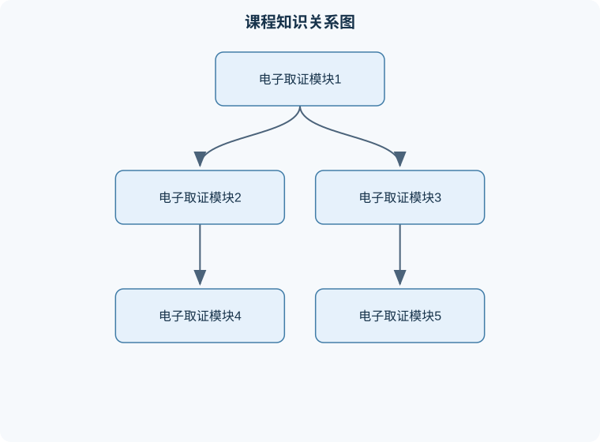

# 电子取证

## 一、课程整体知识框架

### 课程边界与先修知识

电子取证研究计算机、移动终端、存储介质、网络通信、应用系统及云端服务中数字证据的发现、固定、采集、解析、验证、关联、报告与展示。课程边界包括取证科学方法、证据属性与保全、磁盘与文件系统、操作系统痕迹、浏览器与应用数据、移动设备、网络与日志、数据逆向工程、隐写与反取证、事件响应协同及技术报告编写；不等同于渗透测试、恶意代码开发或单纯网络安全运维。先修知识包括二进制与十六进制表示、计算机组成原理、操作系统、文件系统、网络协议、数据库基础、脚本编程和信息安全基本概念。涉及实际案件时，还必须结合适用法律、授权范围、组织制度和证据规则；教材中的技术流程不能替代法律意见。





### 1. 学科对象、目标与基本边界

电子取证是对电子设备、信息系统、网络服务及其产生的数据进行发现、保全、获取、验证、分析、解释和报告的技术与工作过程。其对象不只是“被删除的文件”，还包括文件系统元数据、操作系统日志、应用数据库、浏览器记录、通信记录、设备状态、云端同步痕迹、存储介质未分配空间以及与事件有关的时间线信息。

电子取证的核心问题可以归纳为四个方面：

1. **发生了什么**：识别文件创建、修改、删除、传输、登录、执行等事件。
2. **何时发生**：统一并解释设备时间、服务器时间、时区、夏令时、时间同步误差和时间戳精度。
3. **由谁或由什么设备完成**：分析账户、设备标识、网络地址、认证记录和行为关联，但不能仅凭单一标识断定真实操作者。
4. **证据是否可信**：证明数据来源、获取过程、保存状态、处理步骤和结论之间具有可复核的逻辑联系。

电子取证与普通数据恢复不同。数据恢复主要关注“能否找回内容”，而电子取证还必须回答数据是否原始、获取时是否改变了证据、分析结论能否重复验证、推断是否超出数据支持范围。电子取证也不同于网络安全监控：监控通常强调实时发现和阻断，取证强调事后或同步地固定事实、保留上下文并形成可审查记录。

电子取证的适用边界包括：

- 需要明确授权或合法依据，不能通过绕过访问控制、猜测密码或植入程序任意获取他人数据。
- 取证人员应尽量使用只读方式或经过验证的写保护设备，不能为了“方便查看”直接修改原始介质。
- 加密、远程擦除、硬件安全模块、云端分片存储和应用端到端加密可能使某些数据无法取得。无法取得不等于数据不存在，也不能用推测内容替代原始证据。
- 文件时间、文件名、账户名和网络地址都是线索，不是自动等同于行为主体的证明。
- 工具输出是分析结果，不是天然正确的事实。需要检查工具版本、解析规则、时区设置、数据库完整性和异常记录。

### 2. 八个核心模块的递进关系

#### 模块一：电子取证基本概念与证据属性

本模块建立“电子数据—电子证据—取证结论”的区分。电子数据是以数字形式存储或传输的信息；电子证据是与待证明事实有关、能够被依法或按组织规则提交并接受审查的电子数据及其关联记录；取证结论则是基于证据和方法形成的有限判断。

证据属性通常从相关性、真实性、完整性、可解释性和可重复性考察。相关性表示数据与问题存在逻辑联系；真实性表示数据确实来自所称设备、账户或系统；完整性表示从获取到分析的过程中未发生未记录的改变；可解释性要求非技术人员能够理解证据来源、处理方法和结论限制；可重复性要求其他分析人员在相同材料和条件下能够得到一致或可解释的结果。

常用完整性校验是密码学哈希。设文件字节序列为 $D$，哈希函数为 $H$，则摘要为：

$$
h=H(D)
$$

其中 $h$ 是固定长度的二进制或十六进制表示，长度单位通常为 bit；$D$ 的大小可用 byte 表示。若获取前后的摘要相同，只能说明在给定哈希算法和计算范围内未检测到变化，不能证明文件内容“绝对真实”，也不能排除获取前已经被篡改、哈希算法实现错误或计算对象不完整。若摘要不同，则说明数据或计算过程至少有一处发生变化，但必须进一步检查文件、挂载方式、解压过程、换行转换和工具错误。

#### 模块二：取证原理、工作流程与质量控制

规范流程通常包括准备、识别、保全、获取、检验、分析、解释、报告和复核。准备阶段确认授权范围、目标设备、时间窗口、人员分工、记录表和安全环境；识别阶段确定可能含有相关数据的设备、账户、日志和云端资源；保全阶段防止断电、同步、远程擦除、自动清理或系统写入造成证据变化。

获取阶段应记录设备型号、序列号或其他可核对标识、系统状态、网络状态、屏幕状态、存储介质容量、工具名称和版本、开始及结束时间、操作者以及异常情况。对存储介质进行镜像时，镜像应包含必要的元数据，并对原始介质和镜像分别计算摘要。对在线设备进行获取时，必须说明在线状态带来的变化风险，因为内存、连接状态、日志和应用缓存可能在操作期间变化。

保全的核心不是“永不接触设备”，而是控制接触造成的变化并完整记录变化。断电可能导致易失性数据丢失；保持联网可能导致远程删除或同步；直接解锁设备可能更新访问时间和应用数据库。因此，处置方案应根据案件目标在风险之间作出可解释的选择。

#### 模块三：计算机与存储介质取证

计算机取证关注磁盘分区、文件系统、操作系统、用户账户、事件日志、浏览器、邮件、即时通信、外接存储和未分配空间。文件系统通常同时保存数据内容和描述数据的元数据。文件名、路径、大小、权限、所有者、创建时间、修改时间、访问时间等字段可用于构建时间线，但不同文件系统和操作系统对时间字段定义可能不同。

磁盘镜像可抽象为连续扇区序列。若扇区编号为 $i$，扇区大小为 $s$ byte，则第 $i$ 个扇区的字节偏移通常为：

$$
o=i\times s
$$

这里 $i$ 从 $0$ 开始计数，$s$ 必须与实际介质的逻辑扇区大小一致。该关系只适用于未考虑复杂映射的线性访问；固态硬盘的磨损均衡、坏块替换、加密控制器和虚拟磁盘层可能使逻辑地址不能直接等同于物理芯片位置。

文件删除通常意味着目录项或索引标记被移除，而不必然立即清除数据块。因此，未分配空间可能保留文件片段。但文件恢复存在边界：新数据覆盖、固态硬盘垃圾回收、TRIM、加密密钥丢失、文件碎片化和数据库页面复用都可能使恢复结果不完整。恢复出的片段必须检查文件头、内部结构、上下文和来源位置，不能因文件扩展名正确就认定内容完整。

#### 模块四：移动设备取证

移动设备取证涉及电话簿、日历、通话记录、短信、邮件、聊天记录、照片、录音、浏览历史、账户信息、应用数据库、定位记录和外部闪存等。不同系统版本、制造商、应用版本、锁定状态和备份策略会导致可获取数据范围不同。

移动设备获取通常分为：

- **手动获取**：拍摄屏幕、记录设备状态和人工查看内容。优点是实施门槛低，缺点是覆盖范围有限、易遗漏隐藏字段，且屏幕内容未必包含原始元数据。
- **逻辑获取**：通过系统授权接口、备份接口或应用导出功能获取可访问的文件和记录。通常对设备侵入性较低，但可能无法取得已删除数据、受保护区域和完整文件系统。
- **文件系统获取**：取得较完整的目录结构、数据库、配置和应用数据，可能需要更高权限或专门接口。
- **物理获取**：针对存储介质或底层地址空间进行读取，理论上覆盖范围较大，但可能受硬件加密、密钥保护、芯片损坏和数据映射影响。
- **芯片级方法**：在必要且授权的条件下对存储芯片进行读取或分析，风险高、设备可能损坏，且读取结果不一定等同于用户可见文件。

移动设备最重要的现场风险包括电量耗尽、自动同步、远程擦除、网络连接变化和解锁失败次数触发保护。取证人员应先记录屏幕、网络、时间、锁定状态和外接卡状态，再依据风险选择隔离网络、保持供电或执行关机。不能把“拔掉网络”当成所有场景下的安全方案，因为某些设备的隔离操作本身可能引发状态变化。

#### 模块五：网络、服务器与云环境取证

网络取证对象包括防火墙和代理日志、DNS记录、认证日志、流量元数据、邮件头、服务器访问日志、终端检测记录和云服务审计日志。网络地址、端口和时间戳需要结合地址分配、代理转发、负载均衡、网络地址转换和多用户共享情况分析。一个公网地址只能说明某一时段存在网络出口关联，不能单独证明具体用户或设备实施了行为。

服务器日志分析需要先统一时间基准。若日志时间为本地时间，标准时间偏移为 $\Delta t$，则转换到统一时间基准可表示为：

$$
t_{\mathrm{std}}=t_{\mathrm{local}}-\Delta t
$$

其中 $\Delta t$ 的正负方向必须根据具体时区约定确定，不能机械套用。若服务器时间漂移为 $\epsilon$，两个事件的时间差小于或接近 $|\epsilon|$ 时，只能认为事件顺序不确定或存在重叠窗口。日志缺失、轮转、采样和缓存会使“没有记录”不等于“没有发生”。

云取证还要考虑租户隔离、服务提供方保存期限、区域差异、账户共享、同步延迟、版本历史和删除策略。云端文件的本地缓存、同步客户端日志和服务端审计记录可能互相矛盾，应优先分析其生成机制和时间关系，而不是简单选择看起来更完整的一份。

#### 模块六：数据库、应用与日志分析

应用数据常以 SQLite、键值存储、JSON、二进制协议或专用数据库形式存在。分析时应同时检查主表、索引、触发器、日志页、空闲页、关联文件、备份文件和应用配置。数据库中的删除标志、时间字段、用户标识和消息状态可能由应用逻辑产生，不能脱离应用版本解释。

时间线构建可将事件表示为四元组：

$$
e=(t,s,a,c)
$$

其中 $t$ 为统一后的时间，$s$ 为事件来源，$a$ 为动作，$c$ 为上下文。时间线排序只能提供候选顺序；若多个来源的时钟误差和记录延迟未知，应使用时间区间而非虚假的精确时刻。例如，若事件时间记录为 $t$，已知误差范围为 $[-\delta_1,\delta_2]$，则较稳妥的表示为：

$$
[t-\delta_1,\ t+\delta_2]
$$

该区间不能解决来源本身不可信、设备被人为调整时间或记录由第三方代写等问题。

#### 模块七：恶意代码、入侵与事件响应取证

恶意代码取证关注初始入口、持久化机制、执行链、权限变化、横向移动、数据访问、外传和清理行为。分析应区分事实、关联和推断：例如“某进程在某时刻读取某文件”是记录事实；“该进程可能用于收集数据”是基于行为的解释；“某人员实施攻击”则需要身份、权限和操作链等更多证据。

事件响应强调先控制影响，再保留证据。处置顺序不能脱离现场风险：对正在外传的数据，隔离可能优先；对高度易失的内存证据，先采集内存可能优先；对存在远程擦除风险的移动设备，网络隔离和电源策略必须综合判断。响应记录应包含发现时间、采取措施、影响范围、证据编号、责任人、系统变化和恢复依据。

#### 模块八：证据分析、报告与岗位应用

报告应区分原始数据、处理结果、分析判断和限制条件。一个合格结论应说明：证据来源是什么、采用了什么方法、得到什么观察结果、该结果支持何种解释、还存在什么替代解释，以及结论的适用范围。

分析人员通常承担镜像校验、时间线构建、数据库解析、恶意样本行为分析和报告复核；取证研发人员负责解析器、采集工具、证据容器、校验机制和自动化流水线；安全运营人员负责告警研判、事件分级、隔离处置和证据交接；业务或合规岗位负责确定调查范围、保存要求、风险影响和整改验收。不同岗位共同使用证据保全、日志分析、数据验证和报告表达知识，但产出不同：技术人员产出可复核数据和分析记录，业务人员产出范围判断、风险结论和整改闭环。

## 二、章节和模块划分

### 核心知识覆盖清单

本清单根据本课程的章节划分整理，用于检查正文是否覆盖各个核心模块：

- **1. 代表性取证流程一：证据接收、镜像校验与链路记录**。
- **2. 代表性取证流程二：时间线构建与冲突分析**。
- **3. 代表性取证流程三：移动设备获取决策**。
- **4. 代表性伪代码：只读证据文件的分块哈希**。
- **5. 典型例题**。
- **6. 实验与项目**。
- **7. 具体易错点与修正原则**。
- **8. 常见笔试问题及解答思路**。
- **9. 典型面试问题、参考答案与深入追问**。
- **10. 岗位关联与验收标准**。


### 1. 代表性取证流程一：证据接收、镜像校验与链路记录

**输入**：授权范围、原始设备或存储介质、采集记录表、只读接口或写保护设备。  
**输出**：证据编号、采集镜像、原始数据摘要、镜像摘要、操作日志和异常说明。

**过程**：

1. 为每件设备分配唯一证据编号，记录外观、型号、序列号、状态、连接线和封存情况。
2. 记录开始时间、操作者、环境和工具版本。
3. 按只读方式获取数据；若无法只读，应记录原因、预期变化和实际变化。
4. 对原始数据和镜像按同一算法计算摘要。
5. 比较摘要并保存计算过程；不一致时停止后续结论，先排查读取范围、分区选择和传输错误。
6. 在工作副本上分析，保留原始镜像不被覆盖。
7. 每次复制、转换、解压、解析和导出都生成操作记录。

**不变量**：原始证据编号不变；原始镜像只读保存；任何派生文件都能追溯到来源和处理步骤。  
**终止条件**：目标范围已获取、摘要验证通过、异常已说明、记录完整。  
**复杂度**：对大小为 $n$ byte 的数据进行一次完整哈希，时间复杂度为 $O(n)$，额外内存通常为 $O(1)$ 到 $O(b)$，其中 $b$ 为哈希算法的内部块处理空间。  
**适用条件**：适用于文件、磁盘镜像、导出数据库和取证容器；不适合把截图、人工抄录等无法完全覆盖原始数据的材料当作完整镜像。

### 2. 代表性取证流程二：时间线构建与冲突分析

**输入**：多来源事件记录、原始时间戳、时区信息、时钟偏差估计。  
**输出**：统一时间线、事件来源、时间区间、冲突说明和可信度判断。

步骤为：提取各来源时间字段；记录原始值而不直接覆盖；确认时区和夏令时规则；换算到统一基准；为每条记录添加来源和误差范围；按照时间排序；对相同时间段的事件进行关联；检查日志轮转、同步延迟和设备时间异常。

时间线的基本原则是“先保留原值，再生成标准值”。例如，一个设备显示本地时间 $10{:}00$，设备相对标准时间快 $5$ 分钟，则换算值为 $09{:}55$；若快慢方向不明，则不能擅自换算，应保留原值并标注不确定性。时间排序只能证明记录顺序，不一定证明动作发生顺序，因为日志写入可能延迟。

### 3. 代表性取证流程三：移动设备获取决策

先判断设备是否开机、是否解锁、是否联网、是否正在同步、是否有远程擦除风险、是否存在电量不足和锁定计数风险。再确定目标是用户可见内容、应用数据库、文件系统还是底层存储。若目标仅为屏幕可见信息，可采用人工记录并拍照；若需应用数据库，应优先选择逻辑或文件系统获取；若需分析删除痕迹，才考虑更底层的方法。

该流程的关键不是“层级越深越好”，而是以最小侵入方式获得足以回答问题的数据。物理获取可能范围更大，但加密设备中取得的底层数据未必能够解密；手动获取操作简单，但不能证明设备中不存在未显示内容。

### 4. 代表性伪代码：只读证据文件的分块哈希

```python
# Python 3
from hashlib import sha256
from pathlib import Path

def hash_readonly_file(path: str, block_size: int = 1024 * 1024) -> str:
    """
    输入：本地证据文件路径、分块大小（byte）
    输出：文件的 SHA-256 十六进制摘要
    说明：只读取文件，不修改文件内容
    """
    if block_size <= 0:
        raise ValueError("block_size 必须为正整数")

    digest = sha256()
    with Path(path).open("rb") as stream:
        while True:
            block = stream.read(block_size)
            if block == b"":
                break
            digest.update(block)
    return digest.hexdigest()
```

算法不变量是：循环开始前，`digest` 始终等于已读取前缀的摘要状态；读取到空字节块时到达文件末尾并终止。输入文件大小为 $n$ byte、分块大小为 $b$ byte 时，读取次数约为 $\lceil n/b\rceil$，时间复杂度为 $O(n)$，额外空间为 $O(b)$。该程序只能验证当前读取到的文件内容，不能证明文件获取过程没有发生改变，也不能替代写保护和证据链记录。

### 5. 典型例题

#### 例题一：哈希验证

**题干**：原始镜像和工作副本大小均为 $20$ GB。获取后摘要一致。能否直接证明工作副本与原始设备完全相同？

**分析**：摘要一致支持“在同一算法、同一数据范围和正确实现下，两份数据未检测出差异”，但不覆盖获取前的真实性和工具是否正确。

**解答**：应继续检查镜像大小、分区表、读取范围、采集日志、工具版本和哈希算法；报告中表述为“校验范围内摘要一致”，不能写成“绝对证明未被篡改”。

**结果验证**：重新对工作副本计算摘要并与记录比对；若不一致，说明副本或记录发生变化。

**变式**：若摘要不同，不能立即断定原始证据被改动，也可能是副本传输不完整或计算范围不同。

#### 例题二：时间换算

**题干**：服务器日志记录本地时间 14:20，已知服务器比统一标准时间快 8 小时。换算时间是多少？

**分析与解答**：因为本地时间比标准时间快 8 小时，所以

$$
t_{\mathrm{std}}=14{:}20-08{:}00=06{:}20
$$

结果为标准时间 06:20。若日志同时存在夏令时设置、服务器时间漂移或跨日情况，应在报告中说明。

**结果验证**：检查同一时段的认证服务器、网络设备和文件时间，确认换算方向。

**变式**：若只知道“时间可能误差正负 3 分钟”，则应表示为 06:17 至 06:23，而不是写成精确的 06:20。

#### 例题三：删除文件恢复

**题干**：恢复工具找到一个扩展名为 `.jpg` 的文件片段，是否可以认定用户曾保存该完整照片？

**分析**：扩展名可能被修改，片段可能来自缓存、缩略图或其他文件；恢复结果也可能缺少尾部数据。

**解答**：检查文件头和尾、JPEG结构、尺寸信息、连续性、所在扇区、关联目录项、缩略图数据库和创建时间。只有在来源、结构和内容均相互支持时，才能谨慎表述为“发现与该照片相关的文件片段”。

**结果验证**：尝试只读打开、结构校验，并与应用数据库或缩略图记录交叉验证。

**变式**：固态硬盘执行垃圾回收后未发现片段，不能据此断言用户从未保存照片。

#### 例题四：公网地址归因

**题干**：日志显示公网地址 $203.0.113.10$ 在 09:00 访问了服务器，能否证明某员工实施了操作？

**分析**：公网地址可能对应网络地址转换、共享办公网络、代理或动态分配。

**解答**：还需结合地址分配日志、认证账户、终端标识、代理日志、设备时间和操作内容。若仅有公网地址，结论只能是“该出口在该时间产生访问”，不能归因到具体个人。

**结果验证**：检查多个独立日志源是否形成一致链条。

**变式**：若多个账户共用同一终端，应进一步分析会话、认证强度和操作连续性，仍不能忽略账户共享风险。

#### 例题五：移动设备获取方式

**题干**：设备已解锁，调查目标是聊天记录和应用数据库，但设备正在联网同步。应如何处理？

**分析**：联网可能造成新消息同步、旧消息删除或远程擦除；立即关机又可能丢失解锁状态和易失性信息。

**解答**：先拍照记录屏幕、时间、网络、锁定状态和电量；依据授权和现场风险实施网络隔离，同时保持稳定供电；选择低侵入的逻辑或文件系统获取，记录同步可能带来的变化；获取后校验并在报告中标明在线状态。

**结果验证**：比较获取前后消息数量、数据库时间和系统日志，识别是否发生同步。

**变式**：若存在远程擦除风险，应优先控制网络；若存在内存证据丢失风险，则需说明为何先采集易失性数据。

### 6. 实验与项目

#### 实验一：磁盘镜像完整性与文件时间线

**输入数据**：一组合法制作的镜像副本、文件系统元数据、系统日志样本和已知时区。  
**步骤**：计算原始副本和工作副本摘要；提取文件创建、修改、访问时间；统一时区；按时间排序；将文件事件与日志事件关联；人为修改一份副本后重新计算摘要。

**评价标准**：摘要计算可复现；时间换算方向正确；原始值和标准值同时保留；修改后的摘要能够被发现；报告区分观察事实和推断。  
**排错方法**：若摘要不一致，检查读取范围、文件是否被自动挂载、分区偏移和副本路径；若时间错位，检查时区、夏令时和设备时钟；若文件数量异常，检查是否只分析了一个分区。

#### 实验二：移动设备应用数据分析

**输入数据**：授权的测试移动设备、模拟联系人、短信、通话、照片、浏览和聊天数据，以及设备状态记录。  
**步骤**：记录设备型号、系统版本、电量、网络和时间；分别执行手动记录与逻辑获取；提取应用数据库及其关联文件；解析消息字段、账户标识和时间戳；比较屏幕内容与数据库内容；输出限制说明。

**评价标准**：不改变测试数据；每条记录可追溯到数据库表、文件或屏幕位置；时间字段含义明确；对删除、缓存和同步状态作出边界说明；报告能够被另一名分析人员复核。  
**排错方法**：数据库打不开时检查是否为加密数据库、是否缺少密钥文件、应用版本是否匹配；记录数量不一致时检查分页、软删除、同步延迟和时区；解析器结果异常时回看原始字段，不直接接受自动分类。

### 7. 具体易错点与修正原则

1. 把电子数据、电子证据和取证结论混为一谈；应分别说明对象、证明资格和分析判断。
2. 认为哈希一致就证明内容绝对真实；哈希只能验证特定范围内的变化。
3. 直接在原始介质上打开文件；应使用写保护和工作副本。
4. 把文件扩展名当作文件类型；应检查文件头和内部结构。
5. 看到删除标记就认为数据已永久消失；应考虑未分配空间、TRIM和加密。
6. 把创建时间当作真实行为时间；时间字段可能由复制、解压或系统操作产生。
7. 忽略时区和夏令时；所有跨设备时间线必须记录转换规则。
8. 用公网地址直接指认个人；还需账户、设备和网络分配证据。
9. 将工具解析结果视为原始事实；必须回看原始数据库和字段。
10. 为获取更多数据而盲目使用高侵入方法；方法选择应与调查目标匹配。
11. 忽视移动设备电量和远程擦除风险；现场应先记录状态并制定电源、网络策略。
12. 将“未发现记录”写成“未发生行为”；应说明日志覆盖范围和保存条件。
13. 忽略应用版本；同一字段在不同版本中可能含义不同。
14. 只保存最终报告，不保存中间结果；应保留脚本、参数、导出文件和操作日志。
15. 以截图替代完整获取；截图只能证明屏幕显示内容，不能覆盖隐藏数据和元数据。
16. 以多个相互依赖的副本作为独立证据；独立性应根据生成机制判断。

### 8. 常见笔试问题及解答思路

1. **问：逻辑获取与物理获取有何区别？**  
   **答题思路**：比较访问层级、覆盖范围、侵入性、删除数据恢复能力和加密影响；指出物理获取不必然能解密。

2. **问：为什么要计算哈希？**  
   **答题思路**：说明摘要用于完整性校验和链路记录；补充哈希碰撞、算法实现和计算范围限制。

3. **问：文件删除后为何可能恢复？**  
   **答题思路**：解释目录索引与数据块分离；再说明覆盖、垃圾回收、碎片化和加密造成的边界。

4. **问：如何构建跨设备时间线？**  
   **答题思路**：保留原始时间、确认时区、估计时钟误差、统一基准、注明来源并处理冲突。

5. **问：公网IP能否证明攻击者身份？**  
   **答题思路**：不能；结合地址分配、NAT、代理、账户、终端和认证日志进行关联。

6. **问：移动设备现场为何不能简单关机？**  
   **答题思路**：关机可能丢失解锁状态和易失性数据；同时联网又有同步和远程擦除风险，应根据目标权衡。

7. **问：证据链应记录哪些内容？**  
   **答题思路**：证据编号、交接人员、时间、状态、存放位置、操作、工具、摘要和异常。

8. **问：如何评价自动化取证工具？**  
   **答题思路**：验证输入覆盖、解析规则、版本、已知样本、错误处理、可重复性和人工复核机制。

### 9. 典型面试问题、参考答案与深入追问

1. **问题：发现原始镜像与工作副本摘要不一致怎么办？**  
   **参考答案**：停止基于副本的结论，保留两份数据，检查读取范围、分区、传输、工具和计算参数，并重新制作或解释副本。  
   **追问要点**：能否继续分析？可以在明确差异来源、重新验证并隔离受影响结论后进行。

2. **问题：设备已经解锁但正在联网，你如何处理？**  
   **参考答案**：先记录现场状态和屏幕信息，再根据远程擦除、同步和易失数据风险制定隔离及供电方案。  
   **追问要点**：为什么不马上拔卡？因为操作可能改变状态，应记录决策依据并选择风险较小的方法。

3. **问题：工具显示某账户删除了文件，你是否直接下结论？**  
   **参考答案**：不直接下结论，需核对日志来源、账户共享、时间同步、权限继承和文件系统元数据。  
   **追问要点**：如何提高可信度？使用独立日志、认证记录和设备状态进行交叉验证。

4. **问题：如何处理解析器无法识别的新应用数据库？**  
   **参考答案**：保留原始数据库，识别文件格式和表结构，确认版本，采用只读方式解析，并对字段含义进行实验验证。  
   **追问要点**：不能确认字段含义时怎么办？报告原始字段和观察结果，不把猜测写成事实。

5. **问题：什么是最小侵入原则？**  
   **参考答案**：在满足调查目标的前提下，选择对原始设备、数据和状态改变最少的方法。  
   **追问要点**：最小侵入是否永远优先？不是；若存在远程擦除或易失数据丢失，应权衡保全风险。

6. **问题：日志缺失能否证明系统没有被访问？**  
   **参考答案**：不能。需检查日志级别、轮转周期、存储空间、服务异常、代理层和其他独立来源。  
   **追问要点**：应如何写报告？写明“在现有日志覆盖范围内未发现记录”，并列出限制。

7. **问题：你如何保证报告可复核？**  
   **参考答案**：保存原始数据摘要、工具版本、参数、脚本、操作日志、导出结果和异常说明，并让结论逐项对应证据。  
   **追问要点**：自动化脚本出错怎么办？保留错误输出，使用已知样本回归测试并人工抽查关键结果。

8. **问题：取证分析人员与事件响应人员的职责有什么区别？**  
   **参考答案**：取证分析人员重点保全、解析和解释证据；事件响应人员重点发现、分级、隔离、恢复和降低影响，两者需要共享时间线和证据链。  
   **追问要点**：发生冲突时如何处理？由授权负责人依据业务影响、证据易失性和安全风险作出记录化决策。

### 10. 岗位关联与验收标准

#### 取证分析岗位

实际任务包括制作或验证镜像、解析文件系统和应用数据库、构建时间线、识别删除痕迹、编写分析报告。使用的知识包括证据属性、哈希校验、文件系统、移动设备获取、日志关联和报告边界。产出包括工作副本、分析表、时间线、异常记录和结论报告。验收标准是来源可追溯、摘要一致、过程可复核、结论不过度推断。

#### 取证工具研发岗位

实际任务包括实现分块读取、摘要计算、文件系统解析、数据库字段映射、报告导出和错误处理。使用的知识包括数据结构、编码、时间格式、证据链和测试方法。产出包括程序、测试样本、版本说明、日志和回归测试结果。验收标准是不会修改输入、异常可记录、结果可重复、已知样本解析正确，并对不支持格式明确报错。

#### 安全运营与事件响应岗位

实际任务包括告警研判、主机隔离、日志保存、攻击链梳理、影响范围判断和恢复验证。使用的知识包括网络日志、账户认证、恶意代码行为、时间线和证据保全。产出包括事件记录、隔离清单、影响评估、处置时间线和整改验证报告。验收标准是处置动作有授权和记录，关键证据未被覆盖，风险已降低，恢复后的系统能够通过日志、配置和业务测试验证。

#### 业务、合规与审计岗位

实际任务包括确定调查问题、划定数据范围、协调保存、审查报告和跟踪整改。使用的知识包括证据相关性、数据最小化、保密边界、证据链和结论限制。产出包括调查范围、证据接收记录、风险结论和整改验收表。验收标准是范围明确、访问有授权、结论与证据相匹配、敏感数据得到控制，且整改能够通过客观记录和复测结果证明。

## 三、核心概念的详细解释

### 1. 电子取证对象、证据与结论

电子取证处理的是具有数字表示形式、能够被信息系统存储或传输的数据及其环境信息。对象可以是计算机磁盘、移动终端、存储卡、智能设备、服务器、网络设备、云服务账户、应用数据库、系统日志、浏览器缓存、通信记录、照片及其元数据，也可以是设备运行状态、账户权限和网络连接关系。

应区分三个层次：

1. **电子数据**：设备或系统中实际存在的数字信息，例如一条短信数据库记录、一个图片文件、一项登录日志。
2. **电子证据**：与待证明事实具有相关性，并且能够说明来源、获取过程、完整性和解释方法的电子数据及其关联记录。
3. **取证结论**：分析人员根据证据、工具、方法和逻辑推理形成的判断，例如“某账户在某时间段从某设备完成认证”，而不是简单地说“某人实施了操作”。

电子数据不因“能打开”就自动具有证据资格。若没有记录来源、获取时间、设备标识、操作人员、工具版本和校验结果，数据虽然可能有分析价值，但其可审查性较弱。反之，完整记录获取过程也不意味着数据必然证明某一事实，仍要检查相关性和替代解释。

### 2. 相关性、真实性、完整性与可解释性

**相关性**是数据与调查问题之间存在可说明的逻辑联系。例如，调查某个账户是否在特定时段登录系统，认证日志、设备标识和网络连接记录具有较高相关性；与该账户无关的音乐文件，即使确实来自目标设备，也不一定相关。

**真实性**关注数据是否确实来自所声称的设备、账户或系统。真实性不能仅由文件名或账户名证明。需要综合设备序列号、用户标识、系统配置、日志来源、数据库结构、应用签名信息以及与其他独立记录的一致性。

**完整性**关注数据在发现、保全、获取、传输、存储和分析过程中是否发生了未记录的改变。完整性通常通过原始数据只读保存、写保护、操作日志和密码学哈希共同保障。哈希值相同只能说明在相同算法、相同输入范围和相同实现条件下未检测到变化，不能证明数据从未在更早时间被篡改。

**可解释性**要求分析人员能够说明数据如何产生、字段代表什么、时间采用什么时区、工具如何解析以及结论有哪些限制。数据库中的整数时间值不能脱离字段定义直接解释为北京时间；应用缓存中的定位信息也不能直接等同于用户实际所在位置。

### 3. 取证工作流程与证据链

电子取证通常包括准备、识别、保全、获取、检验、分析、解释、报告和复核。

#### 3.1 准备与识别

准备阶段应明确授权范围、调查问题、时间范围、设备清单、人员分工、数据保密要求和安全环境。调查问题越具体，后续筛选越容易。例如“查找所有数据”通常缺乏可操作边界，而“分析某账户在某时间段的异常登录及相关终端”可以直接转化为数据范围。

识别阶段需要列出潜在数据源，包括：

- 主机磁盘、外接存储和备份介质；
- 移动终端、存储卡、配套账户和同步服务；
- 网络设备、身份认证系统、邮件系统和应用服务器；
- 浏览器历史、应用数据库、系统日志和临时文件；
- 纸面记录中指向的设备编号、账户和时间线索。

识别不是立即复制所有数据，而是判断哪些数据源可能回答调查问题，并评估其易失性和被覆盖风险。

#### 3.2 保全与获取

保全的目标是减少数据变化。移动设备尤其需要关注电量、网络同步、远程擦除、自动清理、锁屏状态和后台应用写入。采取何种动作取决于设备当前状态和授权范围：断电可能丢失易失数据，保持联网又可能触发同步或远程擦除，因此应先记录屏幕、网络、电量、时间、锁定状态和运行应用，再依据风险作出决定。

获取方式可分为：

- **手工或屏幕记录**：通过设备界面查看并记录内容，适合快速固定屏幕状态，但覆盖范围小，容易遗漏元数据，复核能力有限。
- **逻辑获取**：通过操作系统或应用提供的接口导出可访问的文件、数据库、联系人、通话记录、短信和媒体信息。通常破坏性较小，但可能无法取得已删除数据、未分配空间或受权限保护的数据。
- **文件系统获取**：获取更完整的目录、文件和元数据，能够分析应用沙箱、权限和数据库关系，但受到系统版本、权限、加密和厂商实现差异的影响。
- **物理获取**：获取存储介质层面的数据，理论上能够包含文件系统未引用区域和部分已删除内容，但可能需要更高权限、专用设备或拆解操作，并不保证能够解密或重建有效文件。
- **芯片级获取**：直接处理存储芯片内容，适用于其他方式无法获取且具备相应条件的场景。其风险包括拆解损坏、数据重建困难、加密密钥缺失和证据链复杂化。

“物理获取一定优于逻辑获取”是错误的。物理镜像可能得到更多原始字节，但若设备使用强加密，未掌握密钥时得到的仍可能只是不可解释的数据。逻辑获取虽然范围较窄，却可能保留应用已经完成解析的结构化信息，更适合回答特定业务问题。

### 4. 移动设备取证的特殊性

移动设备中的数据通常由操作系统、应用、云同步和外部存储共同形成。常见对象包括联系人、日历、通话记录、短信、即时通信记录、电子邮件、浏览历史、照片、录音、音乐、账户信息、应用缓存、通知记录和设备配置。

移动设备的证据解释具有以下限制：

1. 应用版本升级可能改变数据库结构、字段含义和缓存策略。
2. 同一账号可能在多个设备登录，设备中出现的账号不等于当前操作者身份。
3. 云端同步可能使数据在设备本地消失，但在其他终端或服务端仍有副本。
4. 外部存储卡可能保存照片、录音和应用导出文件，但其时间戳、目录结构和挂载方式需要单独核验。
5. 加密、锁屏、硬件安全模块和密钥派生机制可能限制物理层分析。
6. 系统时间不准确时，所有基于时间的推理都可能偏移。

移动取证应优先记录设备型号、系统版本、序列号或其他可核对标识、网络状态、电量、屏幕状态、锁定状态、存储容量和外部存储情况。对设备进行任何解锁、连接、导出或配置改变，都应记录动作、时间、人员和结果。

### 5. 时间线与事件关联

时间线分析是把不同来源的事件按统一时间基准排列，再判断事件之间的先后关系和因果可能性。常见时间来源包括文件创建时间、修改时间、访问时间、系统启动时间、应用数据库时间、服务器日志时间、消息时间和网络认证时间。

时间线不能只按数字排序。分析时必须确认：

- 时间戳的单位是秒、毫秒、微秒还是其他单位；
- 起算点是协调世界时、设备本地时间还是应用自定义纪元；
- 是否包含时区偏移；
- 设备时钟是否准确；
- 时间戳精度是否足以支持结论；
- 不同系统是否存在同步延迟；
- 日志写入时间与事件实际发生时间是否相同。

例如，应用在本地记录消息接收时间，服务器记录消息发送时间，网络日志记录连接建立时间，三者可能因传输和缓存产生差异。应使用“时间区间”和“可能顺序”表达不确定性，而不是把每个时间值当作绝对事实。

### 6. 工具、解析器与验证

工具输出不是原始事实，而是工具对数据进行读取、解码、关联和展示后的结果。验证工具结果至少包括：

1. 用独立工具或手工方式复核关键字段；
2. 检查数据库文件是否损坏、是否存在多个副本；
3. 对时区、编码、时间单位和删除标志进行测试；
4. 记录工具名称、版本、配置、插件和解析规则；
5. 对已知样本进行回归测试；
6. 对工具无法识别或异常解析的内容保留原始字节和错误信息。

当工具显示“用户删除了某文件”时，应确认该结论是由文件系统删除标志、数据库状态、回收站记录还是应用自己的标记推导出的。不同来源的“删除”含义可能不同：文件可能仅从目录中移除，内容仍存在于未分配空间；应用可能只隐藏记录；云端同步也可能在稍后重新生成本地副本。

### 7. 证据关联与行为归因

账户名、IP地址、设备标识、SIM卡标识和网络地址都属于关联线索，而非单独的身份结论。真实归因需要多个独立证据相互支持，例如：

- 账户认证成功记录；
- 设备指纹或硬件标识；
- 与目标设备匹配的应用数据库；
- 同一时间段的网络连接；
- 操作后的文件或业务状态变化；
- 设备持有、登录凭据和现场记录。

即使多项证据一致，也应使用与证据强度相匹配的表述。例如可以说“该账户在该设备上完成了认证并发生了相关操作”，但若无法排除凭据被他人使用，就不能直接说“某特定自然人亲自完成操作”。

### 8. 代表性分析流程：移动终端证据处理

#### 8.1 输入、输出与适用条件

**输入**包括目标移动设备、授权文件、调查问题、时间范围、可用凭据或合法获取条件，以及必要的记录表。

**输出**包括设备信息表、获取记录、原始镜像或导出数据、哈希记录、解析结果、时间线、异常清单和分析报告。

**适用条件**是获取行为具有授权依据，设备和数据范围已界定，分析人员能够使用不会无意修改原始数据的方法。无法使用写保护或无法避免系统同步时，应明确记录风险和实际变化。

#### 8.2 过程

1. 记录设备外观、型号、序列号、屏幕状态、网络、电量、时间和连接状态。
2. 识别易失数据风险，判断是否可能发生远程擦除、同步或自动清理。
3. 选择手工、逻辑、文件系统或物理方式，并说明选择理由。
4. 对获取对象进行只读保存，或者使用经过验证的写保护措施。
5. 对原始输出计算摘要，并记录算法、输入范围和计算时间。
6. 使用解析工具提取文件、数据库、日志和媒体元数据。
7. 对关键结果进行独立验证，标记无法解析、时间异常和来源不明的数据。
8. 根据调查问题建立时间线，区分事实、推断和未确定事项。
9. 编写报告，说明方法、证据来源、结果、限制和复核信息。

#### 8.3 不变量与终止条件

流程中的不变量包括：原始数据不被分析工具直接修改；每个复制品都能追溯到来源；每一项关键结论都能定位到具体数据和处理步骤；异常不会被静默忽略。

当原始数据已安全保存、摘要已记录、关键范围完成解析、异常已登记并且报告可由另一名分析人员复核时，流程可以终止。若设备仍在同步、镜像不完整或关键数据源尚未确认，则不能仅因“工具已经生成报告”而视为完成。

#### 8.4 复杂度与现实限制

对大小为 $n$ 字节的数据进行一次顺序哈希，理论时间复杂度为 $O(n)$，额外空间通常为 $O(1)$，因为可以分块读取而不必把全部文件载入内存。实际耗时还受到存储介质速度、接口、加密解密、数据库解析和错误重试影响。复杂度只能描述算法规模关系，不能代替对设备兼容性和证据完整性的判断。

### 9. 代表性分析流程：时间线构建

输入是多个来源的事件集合。每个事件至少包含事件时间、时间来源、事件类型、对象标识和可信度说明。流程如下：

1. 读取原始时间值及其字段定义。
2. 将时间转换到统一时间基准，同时保留原始值和原始时区。
3. 按统一时间排序。
4. 合并同一对象的相关事件，例如登录、文件创建和网络连接。
5. 标注来源冲突、时钟偏移和时间精度。
6. 用事件链解释可能的先后关系。
7. 对无法确定的部分使用时间区间或多种假设，而不是强行给出单一时间。

输入事件数为 $m$ 时，基于比较排序的时间排序复杂度通常为 $O(m\log m)$；若时间值已映射到有限整数桶，也可以使用近似线性方法，但必须处理精度、时区和异常值问题。

### 10. 代表性分析流程：证据哈希与完整性复核

输入为待保护的数据对象集合 $D_1,D_2,\ldots,D_k$。对每个对象计算摘要：

$$
h_i=H(D_i),\qquad i=1,2,\ldots,k
$$

其中 $H$ 是选定的密码学哈希函数，$D_i$ 的大小单位为 byte，$h_i$ 是固定长度的摘要。获取完成后再次计算 $h_i'$。若对所有对象均满足：

$$
h_i'=h_i
$$

则说明在相同输入边界和算法条件下，复核时未检测到变化。若存在 $h_i'\ne h_i$，应暂停结论输出，检查复制中断、文件路径变化、容器解包、换行转换、权限错误、读取错误以及计算对象是否一致。

哈希验证不能证明“内容真实”或“数据没有在获取前被篡改”。它只回答一个较窄的问题：两次计算所处理的字节序列是否一致。真实性还需要来源记录、设备关联和独立证据支持。

### 11. 可复核的哈希计算示例

以下代码只读取指定文件，不联网、不修改文件，也不执行外部命令。它按块读取以降低内存占用，并输出文件大小和摘要。

```python
from pathlib import Path
import hashlib
import sys


def sha256_file(file_path: str, block_size: int = 1024 * 1024) -> tuple[int, str]:
    """
    输入：
        file_path: 文件路径
        block_size: 每次读取的字节数，必须为正整数
    输出：
        (文件总字节数, SHA-256 十六进制摘要)
    """
    if block_size <= 0:
        raise ValueError("block_size 必须为正整数")

    path = Path(file_path)
    if not path.is_file():
        raise FileNotFoundError(f"不是可读取的普通文件: {file_path}")

    digest = hashlib.sha256()
    total_size = 0

    with path.open("rb") as stream:
        while True:
            block = stream.read(block_size)
            if not block:
                break
            digest.update(block)
            total_size += len(block)

    return total_size, digest.hexdigest()


def main() -> None:
    if len(sys.argv) != 2:
        raise SystemExit("用法：python hash_file.py 文件路径")

    size, digest = sha256_file(sys.argv[1])
    print(f"size_bytes={size}")
    print(f"sha256={digest}")


if __name__ == "__main__":
    main()
```

算法输入是一个可读取文件和正整数块大小，输出为字节数和摘要。循环终止条件是读取结果为空；不变量是已经读取的全部字节都已按原顺序送入哈希对象。若文件大小为 $n$ 字节，时间复杂度为 $O(n)$，额外空间复杂度为 $O(b)$，其中 $b$ 是块大小。该程序不能判断文件是否来自目标设备，也不能解析文件格式，只能完成字节级摘要计算。

### 12. 实验与项目一：移动设备数据获取质量验证

#### 12.1 目的与输入数据

目的不是“尽可能提取更多数据”，而是比较不同获取方式对数据范围、完整性、可解释性和复核能力的影响。

输入数据包括一部用于实验的移动设备或仿真设备、已知联系人、通话、短信、照片和浏览记录，设备型号与系统版本记录表，合法授权说明，以及至少两种获取方式的工具环境。实验不得使用无授权的真实个人数据。

#### 12.2 步骤

1. 在实验设备中写入一组已知测试数据，并记录创建时间、内容和预期位置。
2. 记录设备型号、系统版本、时区、网络状态和电量。
3. 分别进行屏幕记录、逻辑获取和可行的文件系统获取。
4. 对每种输出计算摘要，保存工具版本、参数、错误信息和完成时间。
5. 比较三种方式得到的联系人、通话、消息、媒体及元数据。
6. 对已知测试数据逐项核对，区分“成功提取”“部分提取”“未提取”和“错误解析”。
7. 改变设备时区或系统时间后重复测试，观察时间线变化。
8. 编写差异报告，说明每种方法的能力边界。

#### 12.3 评价标准

- 设备信息和操作过程记录完整；
- 原始输出可追溯，摘要复核一致；
- 已知数据的提取结果与预期逐项对应；
- 对未提取数据说明原因，而不是默认为不存在；
- 时间字段保留原始值、统一值和时区说明；
- 报告能区分直接观察、工具解析和分析推断。

#### 12.4 排错方法

若数据数量不一致，先检查获取范围、应用权限、账号状态、数据库是否加密和是否存在多个副本。若时间相差固定小时数，优先检查时区和夏令时设置；若相差不固定，检查设备时钟、同步延迟和字段含义。若摘要不一致，检查是否对同一文件、同一容器和同一字节范围计算，不能先假定工具或存储介质损坏。

### 13. 实验与项目二：跨来源事件时间线分析

#### 13.1 输入数据

准备三类脱敏实验数据：

- 设备日志：记录启动、应用运行和文件变化；
- 应用数据库：记录消息、登录或文件操作；
- 网络或服务器日志：记录认证、连接和服务端事件。

每条记录应包含原始时间、时间单位、时区或起算点、事件类型、对象标识和来源名称。

#### 13.2 步骤

1. 读取各来源的字段说明，确认时间单位和纪元。
2. 为每条记录保留原始时间，不直接覆盖。
3. 统一转换到同一时间基准，并记录转换规则。
4. 对事件排序，建立对象、账户和设备之间的关联。
5. 标记时间冲突、缺失、重复和精度不足。
6. 形成至少两种解释假设，例如“设备时间快五分钟”和“服务器写入存在延迟”。
7. 用独立字段或已知实验动作验证哪种假设更合理。
8. 输出事实时间线和限制说明。

#### 13.3 评价标准

时间线必须能够从每项结论回溯到原始记录；统一时间计算正确；同一事件的多个来源能够被关联；冲突不得被删除；报告中的“发生”“可能发生”和“无法判断”应有明确区分。

#### 13.4 排错方法

若排序结果明显异常，检查秒与毫秒混用；若全部事件整体偏移，检查时区和纪元；若只有单条记录异常，检查字段损坏、日志轮转和应用特殊格式；若同一事件有多个时间，分别标注产生时间、接收时间、写入时间和显示时间，不能任意选择一个作为“真实时间”。

## 四、重要定义、公式、定理和推导

### 专业审校补充：关键定义与适用边界

电子取证中的“证据来源可追溯性”不是单纯记录哈希值，而是能够从最终结论反向重建数据来源、获取动作、转换过程和分析依据。应区分四个层次：原始对象或原始服务记录、经验证的镜像或导出副本、解析后的结构化结果、报告中的事实与推断。每次转换都应记录输入标识、输出标识、工具及版本、参数、时间、操作者、错误信息和摘要；解析结果不能替代原始数据。哈希主要支持对象在指定范围内未检测到变化，不能证明字段含义正确、时间准确、账户由特定人员使用，也不能证明解析器没有误读。若云服务仅提供分页接口、筛选后的导出或动态查询结果，还必须记录查询条件、分页游标、返回总量、权限范围和服务端时间，否则“未发现记录”只能解释为“在本次查询范围内未返回”，不能推导为相关活动绝对不存在。该原则适用于磁盘镜像、移动端备份、数据库导出、网络流量和云端审计记录。


### 1. 哈希完整性判定的条件与边界

设原始对象为字节序列 $D$，获取后复制品为 $D'$，哈希函数为 $H$。若：

$$
H(D)=H(D')
$$

则在以下前提下，可以把它作为“复制过程中未检测到字节变化”的证据：

1. 两次计算使用同一种明确的哈希算法；
2. 两次计算覆盖同一完整对象；
3. 输入没有被自动解压、转码、换行转换或重新封装；
4. 哈希程序实现正确；
5. 计算结果记录没有被错误抄写。

推导过程是：

1. 第一次计算得到 $h=H(D)$；
2. 复制得到 $D'$；
3. 对复制品计算 $h'=H(D')$；
4. 比较 $h$ 与 $h'$；
5. 若不相等，则必然说明输入字节序列或计算过程至少存在差异；
6. 若相等，则只能说明在哈希函数碰撞未被实际发现的前提下，两次输入被判定为一致。

这里的“必然”需要谨慎理解：哈希函数理论上可能存在碰撞，因此摘要相同不是数学意义上的绝对同一证明。工程上使用具有足够抗碰撞能力的密码学哈希，并结合原始介质封存、操作记录和独立复核降低风险。哈希不适用于证明用户身份、事件时间或文件内容含义。

### 2. 分块读取的空间复杂度推导

设文件大小为 $n$ 字节，读取块大小为 $b$ 字节。若一次性读取文件，数据缓冲区至少需要 $O(n)$ 空间。若每次只读取一个块并立即更新哈希状态，则缓冲区最多保存 $b$ 字节，哈希状态大小为固定常数，因此额外空间为：

$$
S(n)=O(b)+O(1)=O(b)
$$

当 $b$ 取固定值时，可写作 $O(1)$。总读取次数约为：

$$
q=\left\lceil \frac{n}{b}\right\rceil
$$

每个字节只被读取并处理一次，所以总时间复杂度为 $O(n)$。增大 $b$ 可以减少读取调用次数，但会占用更多内存；实际最优值还受存储介质和操作系统缓存影响。该推导只描述顺序读取和摘要计算，不包括文件系统解析、解密、坏块重试和人工复核时间。

### 3. 时间戳转换公式

设应用记录的原始数值为 $t_r$，其单位换算因子为 $u$，例如以毫秒记录时 $u=1000$；设原始时间以某个纪元 $E$ 起算；设备相对于统一时间基准的时区偏移为 $\Delta$，单位为秒。若原始值代表自纪元起算的时间，则统一时间可表示为：

$$
t_u=E+\frac{t_r}{u}-\Delta
$$

其中：

- $t_r$ 是原始时间数值；
- $u$ 是每秒对应的原始单位数；
- $E$ 是纪元对应的统一时间；
- $\Delta$ 是本地时间相对统一时间的偏移；
- $t_u$ 是转换后的统一时间，单位为秒或可进一步格式化为日期时间。

该式只有在字段确实采用“自某纪元累计时间”的条件下适用。若字段是字符串、相对时间、服务器生成时间、单调时钟或应用自定义编码，则不能直接套用。

**例题一：时间单位判断**

题干：某应用记录时间值为 $1\,700\,000\,000\,000$，分析人员认为它表示自统一时间纪元起算的秒数。这个判断是否合理？

分析：常见秒级时间值通常约为十亿数量级，而该值为万亿数量级，更可能是毫秒。

解答：

1. 若按秒解释，数值对应的年份将远超通常设备记录范围。
2. 若按毫秒解释，先计算 $1\,700\,000\,000\,000/1000=1\,700\,000\,000$ 秒。
3. 该结果处于现代设备常见时间范围。
4. 还需查看字段定义、同库其他记录和已知事件验证。

结果验证：不能仅凭数量级最终确定单位；应将转换结果与设备日志、服务器日志或实验写入时间比较。

变式：若所有记录都比服务器时间早三小时，优先检查时区偏移，而不是把单位从毫秒改成秒。

### 4. 证据关联的条件推理

设事件 $A$ 表示“某设备在指定时间完成了某操作”，证据集合为 $E=\{E_1,E_2,\ldots,E_k\}$。分析人员不能因为单个证据 $E_1$ 出现就直接推出 $A$，而应考察：

1. $E_1$ 是否来自目标设备；
2. $E_1$ 是否能证明操作发生，而不只是账户存在；
3. 是否存在其他设备、共享账户、自动同步或伪造日志等替代解释；
4. 其他独立证据是否与 $E_1$ 在时间、对象和操作结果上相互支持。

可用条件逻辑表达：

$$
E_1\land E_2\land \cdots \land E_k \Rightarrow A
$$

但这个箭头不是无条件的数学定理，而是依赖证据来源可靠、证据之间相对独立、调查范围明确且替代解释已被检验的分析结论。若多个证据都复制自同一个错误源，它们数量增加并不会自动增加独立证明力。

**例题二：账户归因**

题干：某手机中发现一个账户名，服务器日志显示该账户在调查时间登录，能否据此认定设备持有人实施了操作？

解答：

1. 账户名只能证明账户标识出现在设备或日志中。
2. 服务器日志可以支持“该账户发生过登录”，但还需确认登录设备是否为目标手机。
3. 设备指纹、认证令牌、网络记录和操作结果可以增强设备关联。
4. 即使确认目标手机使用该账户，也要排除凭据被他人使用、自动登录和远程控制。
5. 因此较稳妥的结论是“该账户在该设备或关联环境中完成了相关认证并发生了操作”，不能仅凭账户名断定具体自然人。

变式：若设备被现场控制、账户认证需要本机生物特征且服务器日志与设备日志一致，归因强度增加，但仍应说明认证机制和证据限制。

### 5. 获取方式选择题

题干：调查目标是确认某应用在特定日期发送过哪些消息。设备处于解锁状态，应用可正常打开，但没有条件取得物理镜像。应如何选择方法？

分析：问题聚焦于应用结构化数据，逻辑或文件系统获取可能已经足够；物理镜像并非必需。

逐步解答：

1. 先记录设备状态和应用版本。
2. 判断应用数据库、导出功能和系统权限是否可访问。
3. 采用逻辑或文件系统方式获取应用数据。
4. 保存原始数据库、关联附件和应用配置。
5. 对消息记录、发送状态、时间字段和账户标识进行解析。
6. 用屏幕界面或第二种解析方式复核关键消息。
7. 对删除消息、端到端加密和云同步数据单独说明未覆盖范围。

结果验证：若数据库中存在消息记录且与应用界面、服务器日志相互支持，可以形成较强结论；若仅有通知缓存，不能把通知内容等同于完整发送记录。

变式：若设备锁定且应用数据加密，逻辑获取失败，不应通过猜测密码或绕过控制继续操作；应记录失败原因并评估其他合法数据源。

### 6. 时间线综合题

题干：设备日志显示应用在 10:00:05 启动；应用数据库显示消息写入时间 10:00:08；服务器记录认证时间 10:00:04；设备系统时钟经校准发现快 2 分钟。如何解释？

解答：

1. 设备日志和应用数据库使用设备本地时间，先减去 2 分钟。
2. 设备启动时间统一后为 09:58:05。
3. 消息写入时间统一后为 09:58:08。
4. 服务器时间若已采用统一时间基准，则认证发生在 10:00:04。
5. 表面上服务器认证晚于设备应用写入，可能存在日志写入延迟、服务器与设备时间基准不同或字段并非同一事件。
6. 不能直接说消息在认证之前发送。
7. 应进一步检查应用是否在启动时加载历史消息、服务器时间同步状态和消息发送字段定义。

结果验证：只有在确认各时间字段语义相同、时钟校准可靠且日志延迟可忽略时，才能构造严格先后顺序。否则应报告多个可能解释。

### 7. 易错点与纠正方法

1. **把数据恢复等同于电子取证**：恢复关注找回内容，取证还要证明来源、完整性和过程。
2. **把哈希相同解释为内容绝对真实**：哈希只能验证特定范围内的字节一致性。
3. **只保存解析报告，不保存原始数据**：报告无法代替原始证据和原始摘要。
4. **直接在原始介质上打开文件**：系统可能更新访问时间、缩略图、索引或日志。
5. **认为物理获取一定优于逻辑获取**：加密和密钥缺失可能使物理数据无法解释。
6. **把文件名当作文件内容证明**：文件名可以被修改，必须检查内容、元数据和来源。
7. **忽略时区**：固定小时偏移通常来自时区或夏令时，但仍需验证。
8. **混淆秒、毫秒和微秒**：应根据字段定义和已知时间测试。
9. **把账户名当作自然人身份**：账户可能共享、被盗用或自动登录。
10. **把 IP 地址当作设备或人的唯一标识**：可能存在代理、网络地址转换、共享网络和动态分配。
11. **忽略应用版本**：同一字段在不同版本中可能含义不同。
12. **把缓存当作正式记录**：缓存可能不完整、过期或由预加载产生。
13. **把“未发现”写成“不存在”**：工具未提取、数据已加密和数据确实不存在是不同结论。
14. **删除异常记录**：异常、解析失败和时间冲突本身也是质量控制信息。
15. **只依赖单一工具**：关键结果应通过独立方法或原始数据库复核。
16. **忽略自动同步和远程擦除**：移动设备连接网络后可能发生不可逆变化。
17. **未记录分析环境**：工具版本、时区和插件变化可能造成结果不可重复。
18. **过度推断因果关系**：事件先后不等于因果，相关也不等于操作者身份。

### 8. 典型笔试问题及解答思路

#### 问题一：电子数据、电子证据和取证结论有何区别？

解答思路：先定义数据是客观数字信息，证据是经过来源、相关性、完整性和可审查性支持的数据，结论是基于证据和方法形成的判断。说明三者不能互相替代。

#### 问题二：为什么哈希值相同不能证明文件绝对真实？

解答思路：说明哈希只比较特定输入范围内的字节一致性；不能证明获取前未被篡改，不能证明来源正确，也存在理论碰撞和计算对象错误的可能。

#### 问题三：逻辑获取与物理获取的主要区别是什么？

解答思路：从获取层次、权限要求、数据范围、删除数据能力、加密影响和风险六方面比较，并强调物理方式并非总是更适合调查问题。

#### 问题四：为什么移动设备取证特别关注电量和网络状态？

解答思路：电量不足可能导致设备关机并丢失易失数据；网络连接可能触发同步、远程擦除或日志变化。应先记录现场状态，再依据风险和授权选择保全措施。

#### 问题五：如何处理设备时间不准确的问题？

解答思路：保存原始时间，确认时区、时间单位、校准记录和服务器时间；计算偏移后统一时间；对不确定性使用区间或假设，不直接删除异常记录。

#### 问题六：工具输出为什么必须验证？

解答思路：工具可能存在版本差异、解析规则错误、数据库损坏、时区配置错误和字段误读。验证方式包括独立工具、原始数据库查询、已知样本和人工抽查。

#### 问题七：什么是证据链？

解答思路：证据链是从发现、封存、交接、获取、复制、分析到报告的可追溯记录，证明谁在什么时间以什么方法处理了什么对象，以及对象在处理中是否发生变化。

#### 问题八：如何区分“未发现数据”和“数据不存在”？

解答思路：列出未发现的可能原因，包括搜索范围不足、工具不支持、数据加密、已删除、云端保存、缓存清理和解析失败。报告应使用限定性语言并说明检索边界。

### 9. 典型面试问题及参考回答要点

#### 问题一：发现目标手机正在联网，你会立即拔卡或关机吗？

参考回答：不会机械执行。先记录屏幕、电量、网络、锁定状态和时间，评估远程擦除、同步和易失数据风险，再依据授权和保全方案选择隔离网络、保持供电或关机。所有动作均应记录。

深入追问要点：说明断电可能损失易失数据，联网可能造成远程变化；强调设备状态和调查目标决定方案。

#### 问题二：两个工具对同一短信的时间解析不同，如何处理？

参考回答：保留两个工具的原始输出，检查数据库字段、时间单位、时区、应用版本和工具配置；用原始数值和已知实验数据验证；在原因明确前不选取“看起来合理”的结果。

深入追问要点：说明应记录工具版本，必要时直接查询数据库并保留解析失败信息。

#### 问题三：只找到一个账户登录记录，能否认定某人操作？

参考回答：不能。登录记录支持账户认证事件，不能单独证明具体自然人。还需结合设备、认证因素、网络、操作结果和持有关系，并排除共享账户、凭据泄露和自动登录。

深入追问要点：区分账户归因、设备归因和人员归因三个层次。

#### 问题四：原始镜像哈希与报告中的哈希不一致，你怎么做？

参考回答：停止使用该报告作为结论依据，核对哈希算法、计算对象、路径、容器解包、压缩和复制过程；重新从原始介质和独立副本计算，并记录差异。如果无法解释，应保留异常并降低结论强度。

深入追问要点：不能通过修改报告或重新命名文件“解决”不一致。

#### 问题五：如何保证工具不会修改证据？

参考回答：对原始介质使用写保护或只读方式，使用经验证的工作副本，记录工具和环境；在已知样本上检测是否改变文件、时间戳、日志和数据库。无法保证时要明确风险。

深入追问要点：只读挂载并不自动保证所有设备和驱动都不会写入，仍需验证。

#### 问题六：发现一张照片的定位信息，能否认定设备在该地点？

参考回答：定位元数据可以支持照片生成或保存时的地点线索，但要确认元数据来源、是否可修改、设备定位精度、拍摄时间和文件是否经过编辑。不能单独证明设备持续在该地或用户本人在该地。

深入追问要点：结合基站、网络、其他照片、应用记录和时间线进行交叉验证。

#### 问题七：如何处理加密设备？

参考回答：先识别加密层次、设备状态、合法凭据和可获取的明文范围，不尝试未经授权的绕过；保存设备状态和失败记录，评估备份、同步服务、应用导出和其他独立数据源。

深入追问要点：物理镜像得到密文不等于取得可解释证据，密钥管理是关键限制。

#### 问题八：报告中如何表达不确定性？

参考回答：分别列出直接观察事实、工具解析结果、分析推断和未解决问题；使用“支持”“与……一致”“不能排除”“无法确定”等分级表述，并说明替代解释和数据缺口。

深入追问要点：不确定性不是报告缺陷，隐瞒不确定性才会降低可审查性。

### 10. 岗位任务、知识使用与验收标准

#### 10.1 电子取证分析岗位

实际任务包括设备识别、数据获取、数据库解析、时间线构建、账户与设备关联、异常检查和报告编写。需要使用证据属性、移动设备获取方式、哈希完整性、时间戳转换和行为归因知识。

主要产出包括原始数据清单、获取记录、摘要表、解析结果、时间线、异常说明和结论报告。验收标准是每项关键结论都能定位到具体来源；原始数据和复制品可区分；时间、时区和工具版本记录完整；报告不过度推断。

#### 10.2 取证工具研发岗位

实际任务包括实现分块读取、摘要计算、文件系统解析、应用数据库解析、时间转换、异常处理和报告导出。需要使用数据结构、编码、数据库、时间格式、复杂度、日志和测试方法。

产出包括程序、测试样本、字段说明、错误日志、版本说明和回归测试结果。验收标准是输入数据不会被修改，异常能够显式报告，已知样本结果正确，重复运行结果一致，对不支持格式能够明确拒绝而不是生成误导性结果。

#### 10.3 事件响应岗位

实际任务包括告警研判、设备隔离、日志保全、攻击或异常操作时间线构建、影响范围判断和恢复验证。需要使用易失数据保全、日志关联、账户归因、时间校准和证据链知识。

产出包括事件记录、隔离动作清单、关键日志副本、影响评估、处置时间线和复盘报告。验收标准是每个处置动作有授权和时间记录，关键证据未被无记录覆盖，影响范围有数据支持，恢复结果能够通过日志、配置和业务测试验证。

#### 10.4 取证质量与合规岗位

实际任务包括审查调查范围、检查证据交接、复核哈希和工具记录、抽查分析结论、控制敏感数据访问和跟踪整改。需要使用相关性、最小化原则、证据链、完整性和可解释性知识。

产出包括质量检查表、异常整改记录、访问记录、复核意见和验收报告。验收标准是范围明确、访问受控、原始数据与工作副本区分清楚、关键结论可重复验证、限制条件完整披露。

## 五、算法、流程和实现思路

### 方法与流程覆盖索引

下列方法或流程应在正文中说明输入、步骤、适用条件、结果检查和边界：

- 1. 移动终端电子取证的总体流程
- 2. 移动数据的分层获取流程
- 3. 证据副本与哈希校验算法
- 4. 时间线构建与事件关联流程
- 5. 代表性例题
- 6. 实验与项目流程


### 1. 移动终端电子取证的总体流程

移动终端取证的输入是已获得合法授权的设备、账户或相关服务数据，输出是可复核的证据副本、分析记录、事件时间线和结论报告。流程不能简单理解为“连接数据线后导出文件”，而应当同时处理设备状态、数据易失性、同步风险、访问权限、存储结构和完整性验证。

#### 1.1 输入、输出与基本约束

输入通常包括：

- 目标移动终端及其外部存储卡、配套数据线和充电设备；
- 与设备有关的账户、备份、云同步或运营系统记录；
- 调查问题、时间范围和授权边界；
- 取证工作站、写保护或隔离设备、存储空间和记录表；
- 已知的设备型号、系统版本、锁定状态和电量信息。

输出至少应包括：

1. 设备接收记录；
2. 原始数据或原始数据的可验证副本；
3. 每个副本的哈希摘要；
4. 获取过程日志，包括时间、人员、工具、版本、参数和异常；
5. 解析后的工作数据及其来源映射；
6. 事件时间线、关联分析和结论限制；
7. 复核所需的样本、配置和报告附件。

基本约束是“不因获取而改变证据”。移动设备在开机、联网、解锁、插入数据线和运行应用时，可能发生日志写入、消息同步、缓存更新、系统时间校正、远程擦除或电量变化。因此，操作前必须记录屏幕状态、锁定状态、网络连接、电量、系统时间、设备型号和外观标识。

#### 1.2 保全决策流程

保全决策可按以下顺序进行：

1. **确认授权与目标**：明确允许检查的设备、账户、数据类型和时间范围。
2. **观察并记录现状**：不先点击应用或解锁，记录屏幕显示、通知、时间、电量和连接状态。
3. **评估易失性**：判断设备是否已开机、是否联网、是否存在远程擦除或自动同步风险。
4. **选择隔离方式**：在不破坏关键状态的前提下，采用经验证的网络隔离措施；不能将“开启飞行模式”视为对所有通信的绝对阻断，因为设备可能通过其他接口或预设任务继续产生变化。
5. **决定是否保持供电**：断电可能导致内存中的解密状态丢失，持续供电又可能引发同步或自动清理，必须依据现场风险和授权选择。
6. **固定当前状态**：必要时记录屏幕内容、设备状态和可见通知，之后再进行逻辑获取或其他获取。
7. **建立证据链**：为设备、存储卡、线缆、包装和工作副本分别编号，记录交接人员、时间和操作。

保全的目标不是让设备“完全不变化”，而是使不可避免的变化被识别、记录和解释。若设备在接收前已经处于开机联网状态，应记录这一事实，不能事后声称设备保持了绝对静态。

### 2. 移动数据的分层获取流程

#### 2.1 屏幕记录与人工检查

屏幕记录适合固定解锁后即时可见的信息，例如设备名称、通知、账户状态、时间显示和正在运行的应用。其优点是流程简单、对工具依赖较少；缺点是覆盖范围有限，不能完整获取隐藏文件、数据库结构、元数据和已删除空间。

人工检查时应遵循“最少操作”原则：

- 每个操作前说明目的；
- 记录进入的界面、点击路径和显示结果；
- 不主动发送消息、删除通知、修改设置或打开可能改变数据的功能；
- 对重要内容同时记录显示时间、设备时间和系统时区；
- 使用连续编号的照片或截图，并将其与设备编号关联。

屏幕上显示的内容是当前应用解释后的结果，不一定等同于数据库中的原始记录。例如，聊天应用可能只显示已同步内容，删除的消息、缓存片段和附件元数据可能仍存在于其他数据源。

#### 2.2 逻辑获取

逻辑获取通过操作系统、应用接口、备份机制或设备管理接口导出系统允许访问的数据。典型对象包括联系人、通话记录、短信、日历、照片、浏览历史、应用数据和部分系统日志。

逻辑获取的特点是：

- 依赖设备状态、权限、系统版本和应用接口；
- 通常只能获得文件系统或应用层可访问内容；
- 可能保留较好的字段解释和应用上下文；
- 一般不能覆盖所有物理存储空间，也不能保证取得已删除数据；
- 需要明确导出是原始字节副本、结构化导出文件，还是工具重新组织后的报告。

逻辑获取前应记录工具版本、驱动状态、设备识别信息和授权方式。获取后对导出目录和单个关键文件分别计算哈希，并保存工具生成的日志。若工具报告“成功”，仍应检查文件数量、大小、时间范围、数据库能否打开、附件是否缺失以及导出内容是否与设备界面一致。

#### 2.3 物理获取与替代方法

物理获取面向存储介质中的更完整字节范围，包括文件系统已分配空间、未分配空间、残留数据和某些低层元数据。它可能需要更高权限、专用接口或硬件方法，操作风险也更高。不能把“取得了一个完整镜像”直接等同于“取得了所有原始信息”，因为加密、磨损均衡、闪存控制器、密钥保护和安全启动可能限制可解释范围。

替代方法包括：

- 从系统备份或应用备份中恢复可用数据；
- 从配套服务器、云同步服务或身份认证系统获取独立记录；
- 读取外部存储卡，并单独保护和校验；
- 结合运营商、邮件系统、业务服务器等外部日志进行交叉验证；
- 对无法解密或无法导出的区域明确记录“未取得”及原因，不以推测内容替代。

### 3. 证据副本与哈希校验算法

#### 3.1 分块哈希流程

对于大型镜像，直接一次性读入内存不现实，应采用分块读取。设输入数据为字节序列 $D$，分成大小为 $b$ byte 的连续块 $D_1,D_2,\ldots,D_n$，哈希函数为 $H$。实际实现通常将所有块按原始顺序输入哈希状态，最终得到：

$$
h=H(D_1\Vert D_2\Vert\cdots\Vert D_n)
$$

其中 $\Vert$ 表示按顺序拼接，$h$ 是摘要值。分块只改变读取方式，不得改变字节顺序、字节内容或输入边界。若每个块分别计算摘要再简单拼接，所得结果通常不等于整个文件的摘要。

**输入**：待读取的证据文件或镜像、块大小 $b$。  
**输出**：完整文件的哈希摘要、文件大小、读取错误记录。  
**不变量**：已经送入哈希状态的数据顺序与原文件完全一致；读取失败的区间不得被静默跳过。  
**终止条件**：文件指针到达文件末尾，或发生无法恢复的读取错误。  
**适用条件**：文件能够以只读方式稳定读取，哈希算法和实现已固定。  
**复杂度**：时间复杂度为 $O(N)$，其中 $N$ 是文件字节数；额外空间复杂度为 $O(b)$。

```python
from pathlib import Path
import hashlib

def hash_file(path: str, block_size: int = 1024 * 1024) -> tuple[str, int]:
    """
    以只读、分块方式计算文件摘要。
    返回值为（十六进制摘要，读取的总字节数）。
    """
    if block_size <= 0:
        raise ValueError("block_size 必须为正整数")

    digest = hashlib.sha256()
    total = 0

    with Path(path).open("rb") as stream:
        while True:
            block = stream.read(block_size)
            if block == b"":
                break
            digest.update(block)
            total += len(block)

    return digest.hexdigest(), total
```

该程序只能证明计算时读取到的文件内容与之后再次计算的内容是否一致，不能证明文件在获取前没有被篡改，也不能替代证据链、写保护和来源证明。实际工作中还应记录算法名称、程序版本、执行时间、文件路径、文件大小和异常信息。

#### 3.2 哈希结果的判读

- 获取副本与复核副本摘要相同：在相同算法和相同字节范围内未发现变化。
- 摘要不同：至少有数据内容、文件范围、读取方式或计算过程不一致，应检查文件大小、分块边界、传输错误、自动解压、换行转换和工具参数。
- 摘要相同但结论不一致：可能是解析器版本、时区设置、数据库解释或筛选条件不同；哈希一致不代表分析过程一致。
- 仅对导出报告计算摘要：只能验证报告文件未变化，不能自动证明报告所引用的原始数据真实完整。

### 4. 时间线构建与事件关联流程

时间线分析的输入是多个数据源中的事件记录，输出是统一时间轴上的事件序列及其不确定性说明。每条记录至少应保留原始时间值、原始时区或时间语义、转换后的标准时间、数据源、事件类型、对象标识和可信度说明。

#### 4.1 时间归一化

设原始时间为 $t_r$，时区偏移为 $\Delta$，则在不考虑夏令时变化且偏移定义明确时，可表示为：

$$
t_u=t_r-\Delta
$$

其中 $t_u$ 是统一参考时间，$t_r$ 和 $t_u$ 必须使用同一时间单位，通常为秒或毫秒；$\Delta$ 的单位也必须相同。若原始值是从某个纪元起算的整数，则还必须确认纪元、精度和是否包含时区偏移。

该公式不能机械套用。数据库中的整数可能表示本地时间、协调世界时、应用自定义纪元或设备启动后的相对时间；夏令时、设备时钟漂移、网络校时和日志延迟都会影响解释。正确流程是先确认字段定义，再转换；不能因为两个时间格式相似就假设含义相同。

#### 4.2 事件关联

两个事件在时间上接近，不等于具有因果关系。关联分析应同时考虑：

- 时间差是否处于设备和日志系统的误差范围；
- 账户、设备、网络地址或应用对象是否相同；
- 是否存在独立数据源支持；
- 事件是否可能由自动任务、后台同步或系统维护产生；
- 是否存在替代解释。

例如，登录日志显示某账户在 10:00 登录，照片元数据显示 10:01 修改，并不能单独证明该账户用户修改了照片。还需要检查设备使用状态、应用日志、锁屏状态、其他账户和自动同步任务。

### 5. 代表性例题

#### 例题一：逻辑获取与物理获取的选择

**题干**：某移动设备处于开机锁屏状态，调查问题是确认过去一周是否从该设备登录某应用，并分析该应用产生的访问时间。应优先采用哪类获取方式？

**分析**：问题关注应用层登录记录和时间信息，不一定要求恢复物理删除数据。首先应减少联网和同步风险，记录设备状态，再在授权范围内选择逻辑获取或应用级备份。若逻辑获取不能取得关键数据库，才评估其他方法。

**逐步解答**：

1. 固定设备外观、锁屏状态、电量、网络和系统时间。
2. 评估设备是否可能因联网而继续同步或远程擦除。
3. 采用经过验证的隔离方式。
4. 在不改变关键状态的前提下进行逻辑获取。
5. 检查应用数据库、认证记录、设备标识和时间字段。
6. 对无法取得的字段说明原因，不把“无记录”解释为“从未登录”。

**结果验证**：导出的记录应能与数据库结构、应用界面或独立服务器日志相互印证；获取副本摘要应在复核时一致。

**变式**：若调查问题改为“恢复已删除的应用消息及其残留片段”，逻辑获取可能不足，应评估物理获取、备份和服务器端记录，并明确加密、垃圾回收和闪存磨损均衡造成的边界。

#### 例题二：哈希不一致的定位

**题干**：同一证据副本在初次计算时摘要为 $h_1$，复核时为 $h_2$，且 $h_1\ne h_2$。如何处理？

**分析**：哈希不一致只能证明两次参与计算的字节序列或计算过程存在差异，不能立即断定证据被篡改。

**逐步解答**：

1. 比较两次文件大小和文件系统元数据。
2. 检查是否对同一路径、同一文件还是不同导出目录计算。
3. 确认算法名称、程序版本、读取权限和命令参数。
4. 检查文件是否在挂载、解压、传输或打开过程中被修改。
5. 对原始介质重新以只读方式获取，并同时计算摘要。
6. 将所有差异和重新获取结果写入异常记录。

**结果验证**：若重新获取的原始镜像与原始记录一致，应说明复核对象错误或传输过程异常；若原始介质内容已经变化，应保留两次摘要并分析变化时间和原因，不能覆盖旧记录。

**变式**：若文件大小相同但摘要不同，可能发生等长字节变化；若摘要相同但解析结果不同，应转查解析器、时区、编码和筛选条件。

#### 例题三：时间字段的解释

**题干**：数据库字段值为 `1710000000`，分析人员直接将其转换为本地时间并称为用户操作时间。该做法是否充分？

**分析**：不足。必须确认整数单位是秒还是毫秒、纪元是什么、字段代表创建时间还是同步时间、是否使用协调世界时，以及应用是否存在时间修正。

**逐步解答**：

1. 查看数据库模式、应用版本和相关字段命名。
2. 与已知时间的系统日志、消息显示时间或服务器记录比较。
3. 分别按秒、毫秒和可能的纪元解释，检查是否落在合理范围。
4. 确认设备时区、夏令时和网络校时记录。
5. 在报告中同时保留原始整数和转换结果。
6. 将“数据库记录产生时间”“应用显示时间”和“用户实际操作时间”分开表述。

**结果验证**：转换结果应与至少一个独立时间源一致，并披露精度和误差。即便时间一致，也不能单凭时间字段证明真实操作者。

**变式**：若设备时间比标准时间快 8 分钟，应在时间线中保留设备原始时间，并说明校正依据，不应静默改写原始字段。

#### 例题四：账户与行为主体的推断

**题干**：设备中保存了某账户的登录令牌，且日志显示该账户在调查时间段访问过系统，能否直接认定账户所有人操作设备？

**分析**：不能。令牌可能被共享、复制、自动刷新或由后台服务使用；设备也可能由多人使用。

**逐步解答**：

1. 确认令牌的生成时间、失效时间和使用来源。
2. 比较登录设备标识、网络地址、认证方式和地理信息。
3. 检查是否存在自动同步、后台任务和多用户配置。
4. 结合屏幕解锁记录、应用前台记录、输入痕迹和其他独立证据。
5. 将结论限定为“该账户或关联设备发生了某事件”，除非有充分证据支持更强结论。

**结果验证**：至少需要多个相互独立的数据源形成一致链条，并明确仍然存在的替代解释。

**变式**：若使用了多因素认证且有设备本地生物识别记录，可增强关联性，但仍不自动等同于特定自然人，因为设备可能被他人代用。

#### 例题五：外部存储卡的处理

**题干**：手机照片一部分存储在内部存储，一部分存储在外部存储卡。取证时只导出手机相册，是否足够？

**分析**：不够。相册应用可能显示索引或缩略图，而原始照片、删除残留、目录结构和文件系统元数据可能位于存储卡。

**逐步解答**：

1. 记录存储卡品牌、容量、序列标识和插入状态。
2. 在写保护或只读条件下获取完整介质副本。
3. 计算副本摘要并保存原始介质。
4. 解析照片文件、目录、文件系统时间和缩略图数据库。
5. 将存储卡内容与手机相册索引进行比对。
6. 对重复文件、缩略图和编辑后副本标注来源，避免把同一照片重复计数。

**结果验证**：照片数量、文件大小、哈希和元数据应能解释手机界面与存储卡内容之间的差异。

**变式**：若存储卡被加密或发生文件系统损坏，应记录未能读取的范围，不以相册中可见内容推断卡中全部数据。

### 6. 实验与项目流程

#### 实验一：移动设备逻辑获取结果的完整性验证

**输入数据**：一台经授权的测试设备、包含联系人、通话记录、照片和应用测试数据的账户、标准化时间范围、取证工作站和空白存储介质。

**步骤**：

1. 记录设备型号、系统版本、设备时间、时区、电量、网络状态和锁屏状态。
2. 在隔离条件下完成逻辑导出。
3. 保存原始导出目录，不在其中直接编辑。
4. 复制一份作为工作副本。
5. 对原始导出目录中的每个文件和整体归档文件计算摘要。
6. 在工作副本中解析联系人、通话记录和照片元数据。
7. 删除或修改工作副本中的测试记录，确认原始副本摘要不变。
8. 由第二名分析人员按照记录重新计算摘要并复核关键字段。

**评价标准**：

- 设备和过程记录完整；
- 原始副本与复核摘要一致；
- 工作副本修改不影响原始副本；
- 已知测试数据全部或按工具能力正确导出；
- 缺失字段、时间语义和工具限制均被标注；
- 第二名人员能够在相同输入下复现主要结果。

**排错方法**：

- 导出失败：检查驱动、授权、锁屏状态和接口连接，但不得反复尝试导致设备状态变化而不记录。
- 文件数量异常：比较设备界面、导出日志和目录结构，检查是否遗漏附件或隐藏目录。
- 时间不一致：检查时区、夏令时、设备校时和应用时间字段定义。
- 摘要不一致：比较工作副本和原始副本路径、归档方式、传输过程及计算算法。

#### 实验二：多源时间线与替代解释分析

**输入数据**：设备应用日志、系统登录日志、照片元数据、网络认证记录和一组已知设备时间偏移条件。

**步骤**：

1. 保留每条记录的原始时间和来源。
2. 识别各数据源的时间单位、纪元、时区和精度。
3. 统一转换为约定参考时间，同时保留原始值。
4. 按事件类型排序，建立登录、应用启动、文件修改和网络访问时间线。
5. 标记时间差小于设备误差范围的事件组。
6. 为每个事件组列出至少一种自动任务或后台同步的替代解释。
7. 使用独立数据源验证或削弱各解释。
8. 形成“已确认事实、合理推断、未确定事项”三层结论。

**评价标准**：

- 没有直接覆盖原始时间字段；
- 每次转换都有单位和时区依据；
- 事件关联同时使用时间、对象和来源信息；
- 结论强度与证据强度相匹配；
- 自动任务、日志延迟和设备时钟误差均被考虑。

**排错方法**：

- 事件顺序反常：检查不同系统的时区和日志写入延迟；
- 同一事件出现多个时间：区分发生时间、记录时间、同步时间和显示时间；
- 时间线出现大规模空白：检查日志轮转、应用卸载、设备断电和数据源范围；
- 多源记录冲突：不强行平均时间，应保留冲突并查找更可靠的独立基准。

## 六、概念之间的关系与对比

### 1. 数据、证据、事实与结论

电子数据是客观存在的数字表示，电子证据是经过来源、相关性和完整性审查、能够用于证明问题的数据及关联记录，事实是对事件状态的描述，结论则是分析人员从证据推导出的判断。四者不能混为一谈。

例如，某数据库中存在一条登录记录，这是电子数据；若能够证明数据库来自指定设备且获取过程完整，它可以成为电子证据；“该账户在某时刻完成认证”是对记录内容的事实描述；“某自然人实施了相关操作”则是更强的结论，需要额外的身份关联证据。最后一个结论不能仅由用户名或网络地址推出。

### 2. 取证与数据恢复

| 比较维度 | 电子取证 | 数据恢复 |
|---|---|---|
| 核心目标 | 发现、保全、解释并证明与事件有关的事实 | 找回可读或可用的数据 |
| 关注对象 | 数据内容、元数据、来源、过程、上下文和证据链 | 文件内容、存储位置和可恢复性 |
| 操作要求 | 尽量不改变原始介质，过程可记录、可复核 | 有时允许修复文件系统或重建目录 |
| 结果形式 | 原始副本、分析记录、时间线和限定性结论 | 恢复文件或恢复率说明 |
| 关键风险 | 证据污染、过度推断、来源不明 | 覆盖原数据、恢复文件损坏或不完整 |

数据恢复可以是取证的一部分，但恢复成功不等于取证结论成立。一个恢复出的文件可能缺少创建时间、来源和完整性信息；一个未恢复出的文件也不能证明它从未存在。

### 3. 逻辑获取、物理获取与屏幕记录

| 方法 | 主要层次 | 优点 | 局限 | 适用问题 |
|---|---|---|---|---|
| 屏幕记录 | 用户界面层 | 快速固定可见状态，设备依赖较低 | 范围小，元数据和隐藏数据不足 | 当前状态、通知、账户显示 |
| 逻辑获取 | 操作系统或应用层 | 字段结构较清楚，风险相对可控 | 依赖权限，通常不能覆盖删除空间 | 联系人、消息、应用数据库 |
| 物理获取 | 存储介质字节层 | 可能取得更完整存储范围和残留 | 受加密、权限、硬件和闪存机制限制 | 低层分析、文件系统和残留数据 |
| 外部数据获取 | 服务器、备份、云端或网络系统 | 可提供独立交叉验证 | 账户授权、保留周期和同步差异限制 | 登录、同步、通信和业务活动 |

这几种方法不是简单的“低级到高级”排列。物理获取不一定比逻辑获取更能解释应用字段；逻辑获取中的服务器时间和消息状态有时比原始数据库片段更接近调查问题。方法选择应由问题、风险、授权和数据可解释性共同决定。

### 4. 原始证据、镜像副本与工作副本

原始证据是现场取得的设备或介质；镜像副本是对原始数据按约定方式复制形成的字节或结构化副本；工作副本是供分析人员检索、解析和标注的副本。三者的关系是“来源—保全副本—分析副本”，不能把工作副本反向当作原始证据。

原始证据应限制访问并记录保管环境。镜像副本应保存获取参数和摘要。工作副本允许建立索引、解析数据库和生成标注，但任何修改都必须可追踪。若工具需要重建索引、解压归档或转换编码，应在工作副本上操作，并保留转换前文件。

### 5. 完整性、真实性与可重复性

完整性回答“数据在过程中是否发生未记录的变化”；真实性回答“数据是否确实来自所声称的来源”；可重复性回答“其他人员能否使用相同材料和方法得到相同或可解释结果”。三者互相支持但不能互相替代。

哈希可以支持完整性校验，但不能单独证明来源真实性。设备序列号可以支持来源关联，但不能单独证明文件未被修改。复核人员能够重复解析某数据库，说明方法具有可重复性，但如果数据库来源不明，重复分析仍不能增强其真实性。

### 6. 时间戳、时间线与因果关系

时间戳是数据中的时间记录，时间线是将多个事件按统一规则组织后的结构，因果关系则要求存在更强的机制和证据支持。时间上的先后只能提供必要线索，不能自动推出因果。

例如，应用启动先于文件修改，只能说明两个记录在当前时间解释下具有先后顺序；文件修改可能由用户操作、自动同步、缩略图生成或系统维护造成。要主张因果，需要结合应用前台状态、输入记录、任务配置、网络连接和独立日志。

### 7. 文件时间、数据库时间与服务器时间

文件系统时间通常描述文件系统对象的创建、修改、访问或元数据变化；数据库时间可能描述记录插入、应用事件或同步状态；服务器时间通常由远程系统记录认证、请求或业务处理时间。它们的来源、精度和可信度不同。

比较三类时间前必须确认：

- 是否使用同一时区；
- 是否存在设备时钟漂移；
- 时间表示的是事件发生、记录写入还是同步完成；
- 日志是否存在缓存和延迟；
- 是否发生过系统恢复、备份还原或时间校正。

不能把“文件修改时间”等同于“用户修改文件的时间”，也不能把服务器日志的接收时间等同于客户端发起请求的精确时间。

### 8. 常见易错点

1. 把电子取证等同于数据恢复，忽略来源、完整性和可复核性。
2. 认为工具显示“成功”就证明所有数据已获取。
3. 只计算工作报告哈希，不保存原始副本和获取日志。
4. 将哈希一致解释为数据绝对真实。
5. 对原始设备直接打开、搜索或修改文件。
6. 未记录设备联网状态就进行长时间操作。
7. 把断电视为绝对安全，忽略内存解密状态可能丢失。
8. 把飞行模式视为对所有无线通信的绝对阻断。
9. 直接把整数时间值转换为本地时间，不确认单位和纪元。
10. 把文件创建时间当作用户创建文件的时间。
11. 把账户名、网络地址或令牌直接等同于真实操作者。
12. 把同一时间段内的两个事件直接认定为因果关系。
13. 忽略外部存储卡、备份、云端和服务器记录。
14. 把缩略图、缓存和原图混为同一证据对象。
15. 将“没有导出记录”表述为“没有发生行为”。
16. 处理数据库时只看应用界面，不检查原始字段、删除标记和关联表。
17. 在不同工具之间比较结果时忽略版本、时区和解析规则差异。
18. 报告中只写确定结论，不披露加密、日志轮转、数据缺失和工具限制。

### 9. 常见笔试问题及解答思路

#### 问题一：为什么哈希值相同不能证明证据绝对真实？

**解答思路**：哈希相同只能说明在指定算法、指定输入范围和计算实现下，两次数据未检测到差异。它不能证明获取前未被篡改，也不能证明来源正确、算法实现无误或输入范围没有遗漏。完整性还需结合来源记录、写保护、操作日志和独立验证。

#### 问题二：逻辑获取和物理获取的主要区别是什么？

**解答思路**：逻辑获取面向系统或应用可访问的数据，结构解释较好但覆盖范围受权限和接口限制；物理获取面向存储介质字节范围，可能包含未分配空间和残留数据，但受加密、硬件、权限和闪存机制限制。两者是互补关系，不是简单的优劣关系。

#### 问题三：为什么电子取证需要工作副本？

**解答思路**：原始证据需要尽量少访问并保持稳定，分析过程中的索引、解压、数据库解析和标注可能改变文件或产生附加文件，因此应在工作副本上进行。工作副本的来源、摘要和处理步骤必须可追溯。

#### 问题四：如何判断一个时间戳是否可直接使用？

**解答思路**：确认字段含义、单位、纪元、时区、夏令时、精度、设备时钟和写入机制，再与独立时间源交叉验证。转换时保留原始值，不将记录时间自动等同于用户行为时间。

#### 问题五：为什么账户登录记录不能单独证明特定人员操作？

**解答思路**：账户可能共享，令牌可能被复制，设备可能被代用，后台任务也可能自动访问。需要结合设备标识、认证因素、前台应用状态、解锁记录、网络来源和其他独立证据，并将结论限定在证据能够支持的范围内。

#### 问题六：移动设备保全为什么特别关注电量和同步？

**解答思路**：断电可能丢失内存中的解密状态、运行状态或易失数据；持续联网可能触发同步、远程擦除、消息接收和日志写入。因此应先记录现状，再根据风险和授权选择供电、隔离和获取方案。

#### 问题七：恢复出一个已删除文件后，能否证明该文件曾由某人删除？

**解答思路**：恢复文件只能说明存储空间中存在可恢复内容或残留。要证明删除行为，还需要删除日志、文件系统元数据、账户和设备使用记录等证据；即使能证明删除，也不能自动证明具体人员实施了删除。

#### 问题八：多个数据源时间冲突时应如何处理？

**解答思路**：保留各自原始时间，检查时区、单位、设备漂移、日志延迟和事件语义；寻找独立基准，分析冲突原因，不能简单取平均或选择“看起来合理”的时间。报告应明确冲突和对结论的影响。

### 10. 常见面试问题及参考答案

#### 问题一：如果设备已经联网，你会先做什么？

**参考答案**：先记录设备外观、屏幕、时间、电量、网络和锁定状态，确认授权范围和远程擦除风险；之后根据现场条件采取经验证的隔离措施，并记录隔离动作及其时间。不会在未记录状态的情况下直接操作。  
**深入追问要点**：解释断电与持续供电的权衡，说明为什么隔离不是绝对阻止所有变化，并说明如何把不可避免的变化纳入报告。

#### 问题二：工具导出报告显示成功，但数据量明显偏少，你如何处理？

**参考答案**：不接受“成功”作为充分结论。比较设备界面、导出日志、目录结构、数据库表、附件数量和时间范围，检查权限、锁定状态、版本兼容性和是否只导出了索引。必要时采用其他合法数据源交叉验证。  
**深入追问要点**：说明如何记录缺失数据，为什么“未导出”不能写成“设备中不存在”。

#### 问题三：你如何保证工作不会污染原始证据？

**参考答案**：尽量使用写保护或只读方式，先制作并校验副本，再在工作副本中解析和标注；所有访问、工具、参数、异常和摘要都记录。  
**深入追问要点**：说明如果设备无法使用写保护怎么办，如何记录不可避免的系统写入，以及如何验证工具确实以只读方式工作。

#### 问题四：你发现应用时间与服务器时间相差十分钟，如何解释？

**参考答案**：先判断两者记录的是不同事件，检查设备时钟、时区、网络校时、日志缓存和服务器接收延迟；保留原始时间，建立校正依据后再进行比较。  
**深入追问要点**：说明不能直接把差值全部归因于设备误差，也不能在没有依据时静默修正。

#### 问题五：如何证明解析器没有误读数据库字段？

**参考答案**：检查数据库模式、字段类型、应用版本和关联表，使用已知测试数据验证解析结果，并与应用界面或独立日志进行交叉检查；保留解析器版本和异常日志。  
**深入追问要点**：说明删除标记、时间编码、字符集、数据库损坏和版本变化可能导致的误读。

#### 问题六：一张照片的元数据能否证明拍摄者就在定位地点？

**参考答案**：不能单独证明。元数据可能被编辑、复制或继承，定位值也可能来自设备定位、应用同步或手工设置。应结合原始文件、设备状态、定位来源、网络记录和其他时间线证据。  
**深入追问要点**：区分拍摄时间、文件生成时间、导入时间和编辑时间，并说明每个字段的证据强度。

#### 问题七：你如何向非技术人员解释哈希？

**参考答案**：可以把哈希理解为对特定字节内容生成的固定长度摘要。相同内容在同一算法下通常得到相同摘要，内容发生变化时摘要通常会变化；但摘要不能告诉我们内容是否真实来源，也不能解释内容代表什么。  
**深入追问要点**：说明算法、输入范围和计算记录必须明确，不能把哈希当作数字签名或来源证明。

#### 问题八：调查结论证据不足时你会怎么写报告？

**参考答案**：区分已确认事实、基于证据的合理推断和无法确认事项，明确数据缺失、工具限制、时间误差和替代解释。不为了满足委托方预期而提高结论强度。  
**深入追问要点**：说明如何给出进一步取证所需的数据源，以及如何保护未被调查问题覆盖的敏感数据。

### 11. 岗位任务、知识应用与验收标准

#### 11.1 移动取证分析岗位

实际任务包括设备接收、状态记录、逻辑或物理获取、应用数据库解析、时间线构建和报告编写。使用的知识包括移动设备存储结构、证据保全、哈希校验、时间语义、账户关联和不确定性表达。

主要产出是设备接收记录、获取日志、镜像或导出副本、解析结果、时间线和分析报告。验收标准包括：设备标识可核对，过程记录连续，原始副本与摘要一致，关键字段能够回溯到源文件，结论不过度推断，复核人员可以复现主要结果。

#### 11.2 取证工具研发岗位

实际任务包括实现分块哈希、文件系统读取、数据库解析、时间转换、报告导出和异常处理。需要掌握字节序、编码、数据库结构、时间单位、只读访问和测试设计。

产出包括程序、接口说明、测试样本、已知答案、错误日志和版本记录。验收标准包括：输入文件不被修改；大文件处理不会因内存不足而失败；读取错误不会被静默忽略；时间转换保留原始值；对不支持的格式明确报错；同一输入在相同版本和参数下结果一致。

#### 11.3 事件响应与安全分析岗位

实际任务包括发现易失数据、隔离设备、保存日志、确定影响范围、构建攻击或操作时间线，并协调取证人员完成证据保全。使用的知识包括日志来源、认证机制、网络连接、系统状态、应用行为和证据链。

产出包括事件处置时间线、隔离记录、受影响设备清单、证据保全记录和恢复验证报告。验收标准是每个处置动作有授权和时间记录，关键数据未被无记录覆盖，影响范围有数据依据，恢复后能够通过日志、配置和业务测试证明系统状态。

#### 11.4 合规、审计与业务调查岗位

实际任务包括确定调查问题、划定数据范围、控制敏感数据访问、审查技术报告和跟踪整改。使用的知识包括相关性、数据最小化、授权边界、证据链、结论强度和替代解释。

产出包括调查范围说明、数据访问审批、证据接收记录、风险结论和整改验收表。验收标准是调查范围明确，收集的数据与问题相关，访问和交接可追溯，技术结论能够被非技术人员理解，整改措施能够通过客观记录和复测结果验证。

## 七、典型例题和应用场景

### 专业审校补充：综合例题

题干：某组织调查一个云端账户是否在统一时间2025年3月8日10:00至10:30删除过文件。取得的材料有：云审计导出记录A显示10:12:04执行DeleteObject，资源为report.docx，账户为u17，请求标识为r501；本地代理日志B显示10:12:06向同一服务发出删除请求，账户为u17，请求标识为r501；应用数据库C显示10:12:04.800将文件状态改为deleted；服务商导出说明时间为UTC，应用数据库使用东八区，且导出接口每页最多100条。分析并给出结论。
分析：不能先把三条记录直接拼成一个事实链，应分别确认时间基准、请求标识、对象标识、查询完整性和账户归因边界。先统一时间，再进行事件关联。
逐步解答：第一步，转换数据库C的时间。10:12:04.800为东八区时间，减去8小时后为UTC前一日的02:12:04.800；它与审计记录A的10:12:04 UTC不在同一时刻，说明至少存在字段解释错误、日期抄录错误、应用记录并非本地时间，或审计记录时间并非事件发生时间，不能直接视为相互印证。第二步，检查A与B。二者请求标识均为r501，资源名称一致，且B比A晚2秒，可能表示本地发起时间与服务端接收或记录时间不同，但必须确认字段定义；请求标识相同只能支持同一请求链路的关联，不能证明由某自然人操作。第三步，核对导出完整性。记录分页总量、每页范围、是否存在筛选条件、导出开始和结束时间、失败页及权限限制；若缺少某页，不能据此判断没有其他删除事件。第四步，验证文件对象。比较版本标识、对象大小、内容摘要、存储桶或目录标识，防止同名文件被错误合并。第五步，形成结论：现有A和B支持“账户u17对应的请求r501在服务端记录中触发了report.docx的删除事件，本地代理在相近时间记录了同一请求”；C因时区或字段定义未解决，暂不能作为独立时间印证；材料不足以单独证明具体人员执行了操作，也不足以证明该时间段只有这一条删除事件。
结果验证：重新取得原始导出，保存分页清单和摘要；确认审计字段的时间语义、应用数据库时区和请求标识生成规则；用另一条已知测试事件验证转换方法。变式：若B中的请求标识为空，但设备标识、网络会话和文件版本一致，只能形成较弱的关联，报告中应降低结论强度，避免把时间接近写成同一操作的确定证明。


### 典型题型与应用覆盖索引

建议通过下列题型或应用检查概念是否能够迁移：

- 1. 例题一：哈希校验与完整性判断
- 2. 例题二：移动终端逻辑获取与物理获取
- 3. 例题三：时间线排序与时区换算
- 4. 例题四：日志关联与账户归因
- 5. 例题五：数据库删除记录与恢复结论
- 6. 典型应用场景与处理重点
- 7. 具体易错点
- 8. 典型笔试问题及解答思路
- 9. 典型面试问题、参考答案与追问要点


### 1. 例题一：哈希校验与完整性判断

#### 题干

某取证人员从存储介质制作工作副本。原始介质指定数据范围的哈希值为 `A91F...37C2`，工作副本计算得到相同哈希值。分析过程中，人员将工作副本中的一个日志文件复制到另一目录后重新计算该日志文件的哈希值，结果也相同。问：

1. 能否据此认定原始介质从未被篡改？
2. 能否认定分析人员的所有操作都没有改变工作副本？
3. 若重新计算原始介质时哈希值变为 `B204...8D11`，应如何处理？

#### 分析与解答

第一步，明确哈希比较的对象。设指定数据范围为字节序列 $D$，哈希函数为 $H$，摘要为：

$$
h=H(D)
$$

原始介质和工作副本的摘要相同，说明在同一哈希算法、同一数据范围和计算结果可靠的前提下，二者在摘要层面未检测到差异。

第二步，判断结论边界。摘要相同不能证明原始介质从未在更早时间被篡改，因为篡改可能发生在取证前；也不能排除计算对象遗漏、工具实现错误、挂载方式改变读取结果等问题。因此，正确结论是：“获取时记录的指定范围与工作副本在该哈希算法下保持一致”，而不是“数据绝对真实”。

第三步，分析复制文件的影响。复制文件通常只产生新的副本，不改变源文件内容。如果源文件所在文件系统因访问而更新访问时间，或者分析工具写入索引、缩略图、缓存，则仍可能改变工作副本中的其他数据。因此，不能仅凭某个日志文件哈希不变，就断定整个工作副本未改变。

第四步，处理摘要不一致。应停止继续分析，保存当前状态，记录重新计算的时间、工具、参数和异常，分别核对介质连接、写保护状态、计算范围、分区识别、文件系统挂载方式、存储设备故障和工具版本。必要时从原始介质重新制作副本并比较多个独立摘要。若差异无法解释，工作副本不能直接作为完整复制品使用。

#### 结果验证与变式

验证包括：确认哈希算法名称和版本；核对输入路径、分区起止位置和字节长度；检查日志中是否记录了读取错误；对同一副本重复计算；使用另一套经过验证的工具交叉计算。

变式：若两个摘要只在文件复制后不同，可能是目标文件被压缩、换行转换、编码转换或元数据改变，不能直接说明原始内容发生变化，应比较原始字节序列而非文本显示结果。

### 2. 例题二：移动终端逻辑获取与物理获取

#### 题干

调查人员需要分析一部已解锁、仍处于联网状态的移动终端，目标是确定某账户在指定日期是否发送过聊天消息，并判断是否存在已删除附件。现有条件包括设备本体、外部存储卡和取证工作站。问应如何设计获取方案？

#### 分析与逐步解答

第一步，固定现场状态。记录设备型号、序列号或设备标识、屏幕状态、锁定状态、电量、系统时间、时区、网络连接、通知内容及外部存储卡状态。不得直接打开聊天应用并删除通知或改变设置。

第二步，评估变化风险。联网设备可能继续同步新消息、触发远程擦除、更新应用数据库或清理缓存。断电又可能丢失当前解锁状态和易失数据。因此，应依据授权和风险选择经验证的隔离方法，并记录隔离前后的网络状态。不能把“开启飞行模式”当然视为所有通信均已阻断。

第三步，进行逻辑获取。逻辑获取通常通过操作系统、备份接口、应用导出机制或设备管理接口获取可访问的联系人、通话记录、消息、照片、应用数据和部分日志。其优点是风险相对可控、结果较易解释；限制是受系统权限、应用接口、设备状态和加密策略影响，可能无法获得未分配空间和部分已删除数据。

第四步，处理外部存储卡。使用写保护或经过验证的只读方式制作镜像，记录容量、分区和文件系统信息，计算原始介质与副本摘要。外部存储卡中可能存在照片、录音、缓存和已删除文件片段，但恢复结果必须结合文件系统元数据和内容完整性判断。

第五步，分析消息与附件。先确认数据库来源、应用版本、字段含义和时间单位，再区分消息正文、附件路径、缩略图、缓存和同步状态。若只发现缩略图或残留文件片段，只能说明曾存在相关数据痕迹，不能自动还原完整附件，更不能仅凭设备中的账户名认定实际操作者。

#### 结果验证与变式

验证方法包括：检查获取前后设备状态记录；对副本计算摘要；将消息数据库记录与应用导出结果、系统日志、外部存储卡文件及云端同步记录相互比对；检查数据库是否存在未提交事务、损坏页或时间字段异常。

变式：设备处于锁定状态且无法合法解锁时，应先保全设备状态，不能通过猜测密码、绕过访问控制或植入程序获取数据。可分析已合法获得的备份、配套服务器日志和外部存储卡，并明确说明设备本体数据未取得。

### 3. 例题三：时间线排序与时区换算

#### 题干

某系统记录三条事件：

- 日志甲：2025年4月10日 09:20，标注为本地时间；
- 日志乙：2025年4月10日 01:25，标注为协调世界时；
- 日志丙：2025年4月10日 09:18，来源设备时区设置为 UTC+8，但设备时钟可能快了3分钟。

调查范围要求统一为 UTC+8。问如何排序，并说明哪些结论不能直接得出。

#### 逐步解答

第一步，将日志乙转换为 UTC+8：

$$
01{:}25+8\text{小时}=09{:}25
$$

日志乙对应本地时间 09:25。

第二步，处理日志甲。若其“本地时间”确实采用 UTC+8，则为09:20；但必须核对系统时区和日志格式，不能只依据字段名称。

第三步，处理日志丙。设备显示09:18，设备时钟可能快3分钟，真实时间的估计值约为09:15。这里的“约”表示存在误差范围，不能把修正后的时间当成精确事实。

第四步，按记录时间排序：在假设日志甲确为 UTC+8、设备误差判断可靠的前提下，日志丙约09:15，日志甲09:20，日志乙09:25。

#### 结果验证与边界

应进一步核对时间同步日志、服务器接收时间、文件系统时间、网络设备时间和其他独立设备记录。设备时间与服务器时间不一致时，应保留原始时间和修正时间，记录偏差来源与计算过程。

不能直接得出“账户所有者在09:20亲自操作”这一结论。时间线只能说明某设备、账户或系统在相应时间产生了记录；账户共享、恶意程序代操作、自动同步和日志延迟都可能提供替代解释。

变式：若日志甲没有时区字段，则只能保留其原始显示值，不能擅自按 UTC+8 换算。若日志乙记录的是服务器接收时间而不是事件发生时间，则它只能约束“服务器收到记录”的时间。

### 4. 例题四：日志关联与账户归因

#### 题干

某应用日志显示账户 `user01` 从地址 `203.0.113.10` 登录；网络地址分配记录显示该地址在相应时段分配给终端标识 `T-17`；终端日志显示浏览器曾访问管理页面。问能否认定某名员工实施了违规操作？

#### 分析与解答

可以建立如下关联链：

1. 应用系统记录了 `user01` 的认证事件；
2. 网络地址分配记录把该地址与终端标识 `T-17` 关联；
3. 终端日志表明 `T-17` 产生了相关访问行为；
4. 若时间、会话标识、端口和请求路径一致，则可增强同一事件链的可信度。

但上述证据最多支持“账户 `user01` 在某时段经终端 `T-17` 或其网络环境访问了相关服务”。不能仅凭账户名、网络地址或终端标识认定某名员工亲自操作。还应检查多因素认证记录、会话令牌、远程桌面、代理服务器、共享账户、恶意软件、自动化脚本和设备实际使用人记录。

#### 结果验证与变式

验证内容包括：确认网络地址是否为共享地址或经过地址转换；核对认证成功与失败记录；检查会话建立和注销时间；比较终端本地时钟与服务器时间；分析同一账户是否在其他设备同时登录；检查浏览器是否由人工交互产生，还是由脚本、计划任务或恶意程序产生。

变式：若只有一条应用日志而没有终端或网络关联记录，只能认定服务器产生了该条记录，不能进一步证明访问设备和实际操作者。

### 5. 例题五：数据库删除记录与恢复结论

#### 题干

从应用数据库中发现一个已删除消息的文本片段，同时在数据库日志中发现对应记录的删除操作，但附件文件已经不存在。问报告中应如何表述？

#### 解答

首先判断数据库来源和完整性，检查数据库文件、预写日志、日志序列号、页结构和工具解析结果是否一致。其次确认文本片段是否完整、是否跨页、是否可能属于旧版本记录或其他消息。再次检查附件路径、缩略图、缓存、备份和外部存储卡。

若文本片段能够由数据库结构和多个独立字段相互印证，可表述为：“在某应用数据库及其残留页中发现与该消息相关的文本数据，记录状态显示其后曾发生删除或清理操作。”不能表述为“完整消息已恢复”，因为附件缺失、时间字段可能被重用、数据库残留内容也可能不再具有完整上下文。

结果验证包括：用独立工具读取同一数据库；检查摘要；保留原始页偏移和记录标识；确认文本编码；比较应用显示结果与底层数据库结果。

变式：若只有孤立的字符串，没有记录标识、页结构或上下文，应降低结论强度，表述为“发现疑似相关字符串”，不得直接认定其为某条消息正文。

### 6. 典型应用场景与处理重点

#### 6.1 移动终端调查

移动终端可包含日历、通讯录、通话记录、短信、聊天记录、邮件、浏览历史、照片、录音、账户信息、应用缓存和外部存储卡数据。处理重点是设备状态记录、断电与联网风险、逻辑与物理获取边界、应用数据库解析、云端同步及加密限制。

#### 6.2 企业内部事件响应

企业事件中，取证与处置可能并行进行。隔离受感染主机可以降低继续破坏风险，但隔离、关机、重启和杀毒操作也可能改变易失数据。合理做法是先根据授权记录关键状态，再选择保全和遏制措施；报告中同时区分“事件响应动作”和“原始证据获取动作”。

#### 6.3 网络入侵与账户滥用调查

应关联身份认证日志、网络设备日志、代理记录、应用访问日志、终端事件、文件访问记录和配置变更记录。分析重点不是寻找单个“决定性日志”，而是构造时间、主体、设备、动作和结果之间的证据链，并对日志缺失、时间偏差和共享地址作限制说明。

#### 6.4 云服务和远程协作平台

云端数据通常分布于账户、服务端日志、同步客户端、备份和第三方集成中。需要明确数据由谁保存、导出的时间范围、时间字段含义、服务端与客户端的差异及权限边界。客户端显示内容不等于云端完整数据，云端导出结果也不必然包含已过期、已删除或端到端加密内容。

### 7. 具体易错点

1. 把“文件能打开”当成真实性证明；打开只能说明当前工具能够解释部分内容。  
2. 把哈希相同理解为数据绝对真实；哈希只能支持指定范围内的变化检测。  
3. 只保存分析报告，不保存原始数据、副本摘要和过程日志。  
4. 直接在原始介质上打开、排序或修复文件，导致元数据或日志变化。  
5. 把逻辑获取当成完整获取；逻辑方式可能遗漏未分配空间、隐藏分区和部分应用数据。  
6. 把物理获取当成一定能恢复所有删除内容；加密、覆盖、垃圾回收和硬件控制器可能使恢复失败。  
7. 未记录设备联网、锁定、电量和通知状态，就直接操作移动终端。  
8. 将设备显示时间、服务器时间和 UTC 时间混合排序。  
9. 忽略设备时钟漂移，却把时间线精确到秒并作强因果判断。  
10. 把账户名、IP 地址或设备编号直接等同于自然人。  
11. 将数据库残留字符串当成完整记录，忽略编码、页重用和上下文缺失。  
12. 把缓存、缩略图和同步副本当成原始文件。  
13. 只依赖单一工具输出，不检查工具版本、解析规则和异常日志。  
14. 把工具“不支持”误写为“数据不存在”。  
15. 为了获得更多数据而绕过访问控制、猜测密码或修改设备安全设置。  
16. 报告只写结论，不说明输入、方法、时间基准、限制和替代解释。

### 8. 典型笔试问题及解答思路

#### 问题一：电子数据、电子证据和取证结论有何区别？

答题应按层次说明：电子数据是数字信息本身；电子证据是与待证明事实相关并具有来源、完整性和可审查记录的数据；取证结论是根据证据和方法形成的有限判断。不能把工具输出直接等同于结论。

#### 问题二：为什么哈希不能单独证明真实性？

应说明哈希比较只能检测指定输入范围在计算前后的摘要是否一致，不能证明数据在获取前未被修改，也不能保证输入范围完整、工具实现无误或数据来源真实。真实性还需要来源记录、设备标识、证据链和交叉印证。

#### 问题三：逻辑获取与物理获取的差异是什么？

逻辑获取面向操作系统或应用可访问的数据，通常风险较低、解释较直接，但受权限和接口限制；物理获取面向更底层的存储内容，可能发现未分配空间和残留数据，但技术要求、加密影响和解释难度更高。两者不是简单的优劣关系。

#### 问题四：为什么移动终端取证要重点记录网络和电量？

联网可能触发同步、远程擦除和后台写入；断电可能丢失解密状态和易失数据。网络与电量决定保全风险，因此必须先记录现状，再依据授权和风险选择隔离或供电策略。

#### 问题五：如何构建电子证据链？

从发现开始为设备和数据源编号，记录接收、封存、交接、获取、存储、分析和输出全过程；原始数据只读保存，工作副本单独编号并计算摘要；每项处理记录人员、时间、工具、版本、参数和异常。

#### 问题六：时间线分析为什么不能只按文件修改时间排序？

文件时间可能受复制、解压、时区转换、系统校时、应用写入和用户手工修改影响。应同时分析创建、修改、访问、日志接收、数据库事务、认证和网络连接时间，并保留原始时间、统一时间和误差说明。

#### 问题七：恢复出删除文件是否等于证明文件曾被特定人员使用？

不等于。恢复只能说明存储介质中存在可解释的内容残留。还需要使用记录、账户关联、访问日志、时间线和其他独立证据，才能讨论谁在何时以何种方式接触或操作。

#### 问题八：遇到工具无法解析的文件应如何处理？

先保存原始文件和摘要，记录工具名称、版本、错误信息和解析范围；再检查文件格式、编码、压缩、加密、损坏和分片情况；可使用独立工具或人工结构分析进行验证。报告中应写“当前工具未能解析”，不能写成“文件不存在”或“内容为空”。

### 9. 典型面试问题、参考答案与追问要点

#### 问题一：如果现场发现设备已联网，你先做什么？

参考答案：先记录屏幕、锁定状态、时间、电量、网络和通知，不急于打开应用；评估同步和远程擦除风险，在授权范围内采取隔离措施，并记录隔离动作及可能造成的变化。

追问要点：不能机械地立即关机或拔电，应讨论易失数据、解密状态、远程擦除和现场授权之间的权衡。

#### 问题二：原始介质哈希与副本不一致，如何排查？

参考答案：停止使用该副本，保存状态；核对写保护、读取范围、分区偏移、介质故障、工具版本和计算参数；重新获取并用独立工具复算，记录所有异常。

追问要点：应区分“数据变化”和“计算对象不同”，不能只重复点击哈希按钮。

#### 问题三：账户日志显示某人登录，你是否认为就是该人操作？

参考答案：不能直接认定。账户可能共享、被盗用或由自动化程序使用。应结合多因素认证、终端标识、会话记录、网络地址、操作内容、设备使用记录和恶意程序分析。

追问要点：回答中要明确“账户行为”“设备行为”“自然人行为”三个层次。

#### 问题四：为什么不能在原始磁盘上直接运行恢复软件？

参考答案：软件可能写入日志、索引、临时文件或改变访问时间，也可能因错误操作修改文件系统。应制作只读副本，在工作副本上分析，并以摘要和日志证明副本关系。

追问要点：即使软件声称只读，也要检查操作系统挂载方式和工具实际行为。

#### 问题五：发现一条孤立聊天文本，你会如何写报告？

参考答案：说明来源、偏移、编码、摘要和解析方法，使用“疑似相关字符串”或“发现与某记录相关的残留文本”等审慎表述；只有在结构、时间、记录标识和独立数据均支持时，才提高结论强度。

追问要点：关注数据库页重用、缓存、编码错误和上下文缺失。

#### 问题六：如何验证一个取证工具的可靠性？

参考答案：使用已知结果样本测试正常文件、删除文件、损坏文件、不同编码、不同时间格式和大文件；比较不同版本或独立工具输出；检查异常处理、输入只读性、日志完整性和重复运行一致性。

追问要点：工具验证不是一次成功测试，而是覆盖正常、边界和失败路径的过程。

#### 问题七：调查范围很大但时间有限，你如何确定优先级？

参考答案：依据授权范围、数据易失性、覆盖风险、与调查问题的相关性和获取成本排序。先保全易失且高相关的数据，再处理长期稳定的数据；任何缩小范围都要记录理由和遗漏风险。

追问要点：不能以“工具能分析什么”代替调查问题，也不能为了效率扩大无关数据收集范围。

#### 问题八：报告中最重要的质量标准是什么？

参考答案：来源可追溯、过程可复核、数据完整性有证明、时间和字段解释清楚、结论与证据匹配、限制和替代解释充分披露。报告应让未参与操作的复核人员能够重建主要分析路径。

追问要点：强调结论强度分级，避免把相关性写成因果性，把设备行为写成人员行为。

## 八、实验、实践和项目相关知识

### 专业审校补充：实践任务

任务：完成一次“云审计记录—本地代理日志—应用数据库”三源关联实验。输入材料包括一组脱敏的云审计JSON或表格记录、一份本地代理日志、一份应用数据库导出表、字段说明、已知的时区设置、分页导出说明、各文件摘要和一张包含部分真实事件顺序的验证表。材料应同时包含正常删除、失败删除、同名文件、重复请求、跨时区记录、缺失分页和请求时间与服务端时间不同等情形。
步骤：1. 为每份输入建立编号，记录文件大小、摘要、获取时间、字段说明和授权范围。2. 不修改原始输入，在副本上读取记录；保留原始时间字符串、原始时区和原始字段名。3. 将时间统一到UTC，但另列转换后的时间，并写明转换规则。4. 以请求标识、账户标识、设备标识、资源标识和版本标识逐级关联，不得只按时间相近匹配。5. 检查分页总量、页码或游标连续性、筛选条件、空页、失败页和重复记录。6. 对每条关联结果标注“强关联、弱关联或无法关联”，并写出支持证据和替代解释。7. 对删除成功、删除失败、重复请求和缺失记录分别形成事件表。8. 编写报告，区分直接观察事实、分析推断、未覆盖范围和账户归因限制。
输出：原始材料登记表、时间转换表、关联事件表、分页完整性检查表、异常清单、结论报告和可复核的处理日志。评价标准：原始字段无丢失；时间转换可重算；至少同时使用两个独立关联条件；缺失分页不被写成“无事件”；失败操作与成功操作区分；每项结论可回溯到记录编号；报告明确账户行为不等于自然人行为。排错方法：时间错位时先核对字段定义、时区和夏令时，不直接调整时间；关联数量异常时检查重复请求、重试机制和分页游标；记录缺失时检查权限、筛选窗口、服务端保留期限和导出失败页；解析报错时保留原始行，检查编码、转义、嵌套字段和截断情况；摘要变化时检查是否覆盖了同一字节范围及是否误将格式化输出作为原始数据。


### 1. 实验一：证据副本制作与完整性验证

#### 实验目标

验证从介质或测试数据集中制作工作副本、计算哈希、记录证据链和检查副本一致性的完整流程。实验只使用授权的教学样本，不处理真实个人隐私数据。

#### 输入数据与环境

输入包括一个已知容量的磁盘镜像或文件集合、设备编号、调查问题、取证工作站、只读存储空间和记录表。样本应同时包含普通文件、中文文件名、不同时间属性、空文件、较大文件和一个可识别的损坏文件，以检验正常与异常路径。

#### 实验步骤

1. 为样本、原始数据、工作副本和报告建立唯一编号。  
2. 记录样本容量、文件系统或目录结构、获取时间、操作人员和工具版本。  
3. 以只读方式读取样本，计算整体摘要；若使用分块读取，还应记录块大小、块序号和失败块。  
4. 制作工作副本，不在原始数据上进行修复、排序或解压。  
5. 对原始数据和副本计算相同算法的摘要并比较。  
6. 在副本上创建索引、提取元数据和生成报告。  
7. 重新计算副本摘要，比较分析前后是否发生变化。  
8. 人为制造一个受控副本变化，例如修改测试文件内容，然后重新计算摘要，观察差异是否被发现。  
9. 对损坏文件记录读取错误，不得把读取失败当成空文件。

#### 评价标准

合格标准包括：原始数据未被写入；副本与原始数据摘要一致；每次计算的算法、范围和时间可追溯；受控变化能导致摘要变化；损坏文件被明确记录；报告区分原始数据、工作副本和解析结果。

#### 排错方法

若摘要不一致，先检查数据范围、分区偏移、路径、字节长度和写保护，再检查介质故障、读取错误、缓存和工具版本。若副本分析后摘要变化，检查是否生成索引、缩略图、临时文件或数据库日志。若大文件读取失败，应检查分块算法、整数溢出、磁盘剩余空间和错误重试逻辑。

### 2. 实验二：移动终端数据分层获取与时间线重建

#### 实验目标

在授权的测试终端或模拟数据集中，比较屏幕记录、逻辑获取和外部存储卡分析的差异，理解移动设备联网、同步、时间误差和应用数据库之间的关系。

#### 输入数据与评价材料

输入包括测试移动终端、外部存储卡或其镜像、预先生成的消息和照片样本、系统日志、应用导出数据以及一份已知事件时间表。测试数据应明确哪些内容由人工操作产生，哪些内容由自动同步产生，以便对分析结果进行验证。

#### 实验步骤

1. 记录终端型号、系统版本、锁定状态、电量、网络状态、系统时间和时区。  
2. 只进行最少量的屏幕观察，固定设备名称、通知、账户状态和可见时间。  
3. 在授权范围内进行逻辑获取，记录接口、权限、工具版本和获取时段。  
4. 对外部存储卡制作只读副本，提取照片、录音、缓存、缩略图和文件系统时间。  
5. 解析应用数据库，保留原始字段、转换后的时间和时区说明。  
6. 将消息记录、文件时间、系统日志、同步记录和已知事件表统一到同一时间基准。  
7. 对每项事件标注来源、可靠程度和可能的替代解释。  
8. 删除或缺失一项测试数据，观察时间线能否识别证据缺口，禁止用推测内容补齐缺口。

#### 评价标准

评价维度包括：设备状态记录是否完整；逻辑获取与外部存储卡副本是否可验证；原始时间与统一时间是否同时保留；人工操作与自动同步是否区分；消息正文、附件、缩略图和缓存是否分层说明；每个结论是否有至少一个可复核来源；无法确定的内容是否明确标注边界。

#### 排错方法

若时间线顺序异常，先检查时间单位是秒、毫秒还是其他格式，再检查时区、夏令时、设备时钟偏差和服务器接收延迟。若应用显示内容与数据库不一致，应检查数据库事务、同步状态、缓存版本和应用解析规则。若外部存储卡中只发现缩略图，应检查原图是否存于内部存储、云端或已被覆盖，不能直接判定原图从未存在。

### 3. 项目一：企业异常登录事件取证

#### 项目输入与目标

输入包括身份认证日志、网络地址分配记录、代理日志、应用访问日志、终端事件日志和调查授权说明。目标是判断异常登录的时间范围、涉及账户、终端、访问资源和可能影响，不要求在缺乏证据时强行确定自然人身份。

#### 实施步骤

1. 明确调查问题、时间窗口、账户范围和敏感数据范围。  
2. 对各日志源编号并记录采集时间、来源系统、时间基准、保留策略和摘要。  
3. 统一日志格式，保留原始字段，另建标准化字段，避免覆盖原始值。  
4. 按认证事件、网络连接、终端会话、应用操作和文件访问建立关联键。  
5. 识别时间偏差、日志延迟、地址共享、代理转发和日志缺失。  
6. 构建事件时间线，区分“已记录事实”“合理推断”和“尚不能判断”。  
7. 检查账户是否存在并发登录、异常地理位置、异常设备和权限变更。  
8. 输出影响范围、证据依据、未解决问题和后续保全需求。

#### 评价标准

项目成果应包含证据目录、摘要表、时间线、关联关系、异常说明、结论分级和限制条件。验收重点是每项关键结论都能回溯到具体日志记录；时间换算可复算；未把 IP 地址或账户直接等同于人员；日志缺口、共享账户和自动化访问均被讨论。

#### 排错方法

若关联不上日志，检查字段命名、时间精度、地址转换、会话标识和采集窗口；若同一事件出现多个时间，区分事件发生时间、客户端记录时间和服务器接收时间；若工具自动合并记录，回看原始日志并关闭未经验证的自动归并规则。

### 4. 项目二：移动终端应用数据分析工具的测试

#### 项目输入与目标

输入为授权生成的应用数据库、附件目录、缩略图、预写日志、不同编码文本、删除记录样本和损坏数据库。目标是开发或验证一个只读分析程序，输出结构化记录、原始字段、统一时间、来源位置和错误信息。

#### 代表性伪代码：只读数据库记录提取

```python
# Python 伪代码：仅读取授权的测试数据库，不修改输入文件
def extract_records(database_path):
    records = []
    errors = []

    try:
        db = open_database_read_only(database_path)
    except Exception as exc:
        return {"records": [], "errors": [str(exc)]}

    try:
        for row in db.query("SELECT id, body, event_time, attachment_path FROM messages"):
            raw_time = row["event_time"]
            try:
                normalized_time = convert_time(
                    raw_time,
                    unit="milliseconds",
                    timezone="UTC"
                )
            except Exception as exc:
                normalized_time = None
                errors.append({
                    "row_id": row["id"],
                    "type": "time_conversion",
                    "detail": str(exc)
                })

            records.append({
                "row_id": row["id"],
                "body": row["body"],
                "raw_time": raw_time,
                "normalized_time": normalized_time,
                "attachment_path": row["attachment_path"],
                "source": database_path
            })
    except Exception as exc:
        errors.append({"type": "query", "detail": str(exc)})
    finally:
        db.close()

    return {"records": records, "errors": errors}
```

#### 输入、输出与不变量

输入是只读打开的数据库路径；输出包括记录列表和错误列表。程序的不变量是：不修改输入文件；每条输出记录保留原始时间值；时间转换失败时保留记录并记录错误，而不是静默丢弃；每条记录能够追溯到数据库路径和记录标识。

#### 终止条件、适用条件与复杂度

查询完成或发生可记录的读取错误时终止。该流程适用于结构已知、授权明确且数据库能够被只读打开的测试场景，不适用于需要破解加密、绕过访问控制或直接修复原始数据库的场景。若有 $n$ 条记录，顺序扫描的时间复杂度通常为 $O(n)$；不计索引和数据库内部实现时，额外输出空间约为 $O(n)$，若采用流式写出则可降低内存占用。

#### 测试与验收

测试至少包括正常数据库、空数据库、缺失字段、非法时间值、中文文本、超长附件路径、损坏数据库和重复执行。验收标准是已知记录全部提取；原始字段与转换字段同时保留；错误记录包含行标识和错误类型；两次执行结果一致；输入文件摘要在执行前后不变。若数据库结构未知，程序应输出结构不支持或字段缺失，而不是猜测字段含义后生成确定性结论。

### 5. 项目成果与岗位对应

#### 取证分析岗位

实际任务是筛选数据源、制作时间线、关联账户与设备、解释应用记录和编写报告。使用的知识包括证据属性、文件系统、数据库、日志、时间换算和结论边界。产出为证据目录、分析工作簿、时间线、图表数据和正式报告。验收标准是证据来源清楚、摘要一致、关键结论可复核、限制充分披露。

#### 取证工具研发岗位

实际任务是实现只读解析、分块摘要、文件系统访问、数据库字段映射和报告导出。使用的知识包括数据结构、编码、异常处理、时间单位、哈希和测试工程。产出为程序、测试样本、已知答案、版本记录和错误日志。验收标准是输入不被修改、结果可重复、异常不被静默忽略、边界样本通过测试。

#### 安全运营与事件响应岗位

实际任务是保存易失数据、隔离设备、固定日志、识别攻击路径和验证恢复状态。使用的知识包括系统日志、认证、网络连接、恶意代码行为、时间线和证据链。产出为事件记录、隔离清单、影响评估和恢复验证报告。验收标准是处置动作有授权，关键证据未被无记录覆盖，影响范围有数据支撑，恢复结果能够通过日志和业务测试确认。

#### 合规、审计与业务调查岗位

实际任务是确定调查范围、审核数据使用、控制敏感信息访问、复核技术结论和跟踪整改。使用的知识包括相关性、最小化收集、授权边界、证据链和结论强度。产出为范围说明、访问记录、风险结论和整改验收表。验收标准是收集内容与问题相关，访问和交接可追溯，技术结论能够被非技术人员理解，整改可以通过客观记录与复测结果证明。

## 九、常见错误和易混淆内容

### 重点易错项核对清单

复习和回答问题时应逐项检查以下边界：

- 1. 把数据恢复等同于电子取证
- 2. 把哈希值相同理解为证据绝对真实
- 3. 混淆原始证据、工作副本和分析结果
- 4. 认为“只读挂载”必然不会改变数据
- 5. 将文件时间直接当作真实行为时间
- 6. 将账户名、网络地址或设备标识等同于真实操作者
- 7. 混淆逻辑获取、文件系统获取和物理获取
- 8. 认为删除操作等于数据立即消失
- 9. 忽视移动设备的供电和同步风险
- 10. 直接相信工具自动解析结果
- 11. 忽视编码、时区和字节序
- 12. 证据链记录不完整
- 13. 把共现关系当作因果关系
- 14. 忽略负面结果的解释边界


### 1. 把数据恢复等同于电子取证

数据恢复关注的是能否找回文件内容，电子取证则还要证明数据来源、获取过程、完整性、分析方法和结论边界。恢复出一个文件，只能说明某些字节仍可读取，不能自动证明该文件由特定人员创建，也不能证明文件没有被修改。

例如，从未分配空间中恢复出一张图片，至少还要检查文件头、文件尾、簇边界、文件系统元数据、缩略图、应用数据库和其他设备记录。如果图片内容不完整，或者只有零散数据片段，就不能把它当作完整原图引用。正确表述应区分“发现文件片段”“恢复出可显示图像”和“确认某账户在某时刻发送了该图片”等不同强度的结论。

### 2. 把哈希值相同理解为证据绝对真实

设数据字节序列为 $D$，哈希函数为 $H$，摘要为 $h=H(D)$。两个摘要相同，表示在相同算法、相同输入范围和计算过程可靠的前提下，未检测到差异。它不能证明数据在获取前没有被篡改，也不能证明哈希计算涵盖了全部相关数据。

常见错误包括只计算导出的文件而没有记录原始设备范围，只比较文件名和大小而未比较字节内容，以及在复制、解压、转换编码后把新文件的哈希值当作原始数据的哈希值。若摘要不一致，应检查分区起止位置、读取错误、写保护、压缩解压、换行转换、时间变化和工具参数，不能直接认定“证据被人为破坏”。

### 3. 混淆原始证据、工作副本和分析结果

原始介质是获取对象本身或其最初固定的数字状态；工作副本是供分析使用的复制品；分析结果是从工作副本中提取、筛选、转换或解释后的数据。三者不能混为一谈。

分析人员可以在工作副本上建立索引、导出数据库和生成时间线，但不得把这些派生文件当成原始证据。报告中应同时保留原始字段、转换字段和转换规则。例如，数据库中的整数时间值经过时区转换后生成可读时间，应保留原始整数、采用的时间基准、时区以及转换结果。

### 4. 认为“只读挂载”必然不会改变数据

只读挂载能够降低写入风险，但不等于所有环境下都绝对不会产生变化。操作系统可能写入访问记录、设备识别信息或缓存，某些工具也可能创建索引和缩略图。若取证工作站未正确启用写保护，或者工具以读写方式打开数据库，原始介质仍可能被修改。

规范做法是优先使用经过验证的硬件或软件写保护，先记录介质状态，再进行获取，并在获取前后计算摘要、检查系统日志和记录异常。若只能在特殊条件下直接访问原始介质，必须说明风险、限制和采取的补救措施。

### 5. 将文件时间直接当作真实行为时间

文件系统时间可能包括创建时间、修改时间、访问时间、元数据改变时间等。应用还可能在导入、同步、解压或数据库重建时重新生成时间。设备本地时间错误、时区设置、夏令时、服务器时间和网络延迟也会造成差异。

分析时应同时保存原始时间值、时间字段含义、时区、时间精度和转换方法。若设备显示的是本地时间，而服务器日志采用协调世界时，不能直接按字符串排序。只有在确认时间基准和事件来源后，才能把多个记录放入同一时间线。时间一致也不等于因果关系成立；两个事件同时发生，可能只是共同受到系统任务或同步机制影响。

### 6. 将账户名、网络地址或设备标识等同于真实操作者

账户可能被多人共用、盗用、自动程序调用或在远程设备上登录；网络地址可能对应共享出口、代理、虚拟专用网络或移动网络；设备标识也可能被复制、重置或由应用错误记录。因此，单一标识只能支持“该账户、地址或设备参与了某次活动”，不能直接推出“某自然人实施了该行为”。

更可靠的关联需要结合认证日志、设备指纹、登录时间、地理或网络位置、应用行为、输入痕迹、其他独立设备记录以及排除替代解释。报告应区分“账户发生操作”“设备执行操作”和“某人员实施操作”。

### 7. 混淆逻辑获取、文件系统获取和物理获取

逻辑获取通常通过系统或应用提供的接口获取可访问数据，范围受权限、备份机制和应用接口限制；文件系统获取可以看到更多目录、元数据和应用数据库，但仍可能受加密和权限影响；物理获取针对存储介质的更底层数据，可能包括未分配空间和部分已删除残留，但技术风险、设备兼容性和数据解释难度更高。

获取层级越深，并不意味着结论一定越可靠。若操作破坏设备状态、触发远程擦除或无法证明读取过程，物理方法获得的数据可能反而缺乏可复核性。应根据调查问题、设备状态、授权范围和风险选择方法，而不是盲目追求“最底层”。

### 8. 认为删除操作等于数据立即消失

删除文件可能只改变目录项、索引或数据库状态，实际内容仍可能保留在未分配空间、日志、缩略图、缓存、备份或同步服务中。但也不能反向认为所有删除数据都能恢复。固态存储的垃圾回收、加密密钥销毁、应用安全删除、数据库压缩和空间重用都可能使内容无法恢复。

恢复结果必须说明来源和完整程度。若仅恢复到文件片段，应标记为片段；若数据库记录显示“已删除”，但附件内容不存在，应分别报告记录状态和附件状态，不能用缩略图替代原始附件。

### 9. 忽视移动设备的供电和同步风险

移动设备可能因断电丢失解锁状态、内存中的密钥或未写入存储的数据；保持联网又可能触发消息同步、远程擦除、应用更新和缓存清理。没有适用于所有设备的绝对处置动作。

正确流程是先记录屏幕、锁定状态、电量、网络、时间、通知和运行应用，再评估变化风险。隔离网络时不能假设某一种设置能阻断所有接口；决定断电、保持供电或采取其他措施时，应记录理由和预期影响。不可避免的变化应在报告中披露，而不是隐去。

### 10. 直接相信工具自动解析结果

取证工具可能因版本、解析规则、数据库结构、系统时区或应用更新而产生不同结果。工具显示的“删除”“发送”“位置”或“用户”字段，可能是工具对多个底层字段的推断，而不是设备中直接存在的原文。

复核时应查看原始数据库、日志、字段定义和工具处理日志。对关键结论应使用独立方法交叉验证，例如同时检查应用数据库、系统日志、网络记录和备份数据。若工具无法解析某格式，应明确标记为不支持或解析失败，不应通过猜测字段含义填补空白。

### 11. 忽视编码、时区和字节序

文本可能采用不同字符编码，数据库整数也可能采用不同字节序。把二进制数据直接按文本打开，或者把一个应用的时间格式套用于另一个应用，可能产生乱码、错误时间甚至看似合理的虚假结果。

处理时应保留原始字节，记录编码识别依据，并对转换前后内容进行抽样核对。时间转换应明确时间单位，例如秒、毫秒或微秒；若时间值为 $t$，而单位未知，则不能仅凭数值大小确定其含义。时间范围异常、日期落在设备启用前或转换后出现远未来时间，都是需要排错的信号。

### 12. 证据链记录不完整

证据链不仅是“谁拿过设备”的名单，还应包括发现、封存、运输、接收、获取、存储、分析、导出和报告复核等环节。缺少设备标识、交接时间、操作人员、工具版本、参数或异常记录，会降低可追溯性。

每次交接应记录对象编号、外观和封存状态、交出人与接收人、时间、地点或工作环境以及目的。工作副本和分析导出物也应有编号和摘要。若发生重新获取、文件转换或工具升级，应说明原因、影响范围和验证结果。

### 13. 把共现关系当作因果关系

在同一时间线中出现“登录—下载—删除”三个事件，不代表前者必然导致后者。系统同步、自动备份、定时任务或多个设备同时操作，都可能产生相似记录。

因果判断应检查事件顺序、触发条件、主体关联和替代解释。对于只能证明共现的数据，应使用“同时出现”“与……相符”等审慎表达，避免使用“因此必然”“证明由……导致”等超过证据支持范围的措辞。

### 14. 忽略负面结果的解释边界

未发现某条日志，不等于该事件从未发生。日志可能被覆盖、未启用、存储在其他设备、因权限不足无法获取，或者应用采用端到端加密。正确结论应说明检索范围、数据源、时间窗口和检测能力。

例如，“在已获取的应用数据库和指定时间范围内未发现该消息记录”比“该消息从未发送”更准确。负面结论必须依赖充分的覆盖范围，否则只能表示当前数据中没有发现。

## 十、笔试重点、题型和解题方法

### 专业审校补充：笔试题型

题型一为证据链设计题：给出一次云端审计导出和本地日志，要求设计从获取、固定、导出、校验到报告展示的流程。解题关键是先确定授权范围和调查问题，再记录查询条件、分页状态、服务端时间、权限、工具版本和摘要，并将原始导出、工作副本、解析结果分层保存。还要说明重复获取或独立工具复核的方法。常见失分点是只写“下载后计算哈希”，遗漏动态查询的结果范围、分页缺口、服务端字段含义和访问日志；把云端原始记录与分析软件生成的表格混为一物。
题型二为文件系统与删除恢复判断题：给出目录项、文件系统元数据、日志区和未分配空间中的残留片段，要求判断能否证明文件曾存在、能否恢复完整内容以及哪些结论不能作出。解题关键是区分目录项、数据区、文件系统日志、应用索引和缓存的证明对象，检查残留片段是否具有完整文件头、长度、链式块关系、内容摘要和上下文，并说明覆盖、碎片化、加密和日志重用的影响。常见失分点是把“发现文件名”写成“恢复了文件内容”，把未分配空间中的字符串直接归因于用户行为，或忽略文件系统日志可能只反映元数据变化而非完整文件操作。
题型三为日志关联与结论分级题：给出多个来源的账户、设备、网络地址、时间和请求标识，要求建立时间线并判断某账户是否执行了指定操作。解题关键是统一时间基准，检查时钟偏差和字段语义，按照请求标识、资源版本、设备会话等强关联条件匹配，再分别写出确定事实、合理推断和无法确定事项。常见失分点是仅凭时间相近或网络地址相同完成归因；把账户行为等同于自然人行为；没有区分服务端接收时间、客户端发起时间和数据库写入时间；忽略自动同步、重试请求、共享出口和代理造成的替代解释。


### 1. 概念辨析题：电子数据、电子证据与取证结论

**题目：**说明电子数据、电子证据和取证结论的区别。

**解题思路：**按“对象—证明资格—推理结果”三层回答。电子数据是数字形式的信息；电子证据是与待证明事实相关且来源、完整性和处理过程能够说明的数据；取证结论是分析人员基于证据和方法作出的有限判断。

**易失分点：**把“能打开的文件”直接称为电子证据，或把“某账户有登录记录”直接写成“某人实施了操作”。答案应补充相关性、真实性、完整性、可解释性和结论边界。

### 2. 简答题：为什么哈希值相同不能证明数据绝对真实

**题目：**某副本与原始介质的哈希值相同，能否证明原始介质未被篡改？说明理由。

**参考答案：**不能。哈希相同只能说明在指定算法、指定输入范围和计算过程可靠的前提下，比较时未检测到差异。它不能证明获取前没有发生篡改，也不能排除输入范围遗漏、工具错误或原始数据本身已经不真实。

**解题步骤：**

1. 写出 $h=H(D)$，说明哈希比较的是字节序列；
2. 明确相同摘要支持的是“复制或传输过程未检测到变化”；
3. 补充获取前真实性、计算范围和工具可靠性问题；
4. 给出验证措施：写保护、过程记录、重复计算和独立工具交叉验证。

### 3. 流程题：移动终端现场保全

**题目：**一部已解锁且联网的移动终端被发现，如何进行初步保全？

**参考答案要点：**

1. 确认授权和调查目标；
2. 记录设备外观、型号、标识、屏幕、锁定状态、电量、网络、时间、时区和通知；
3. 评估断电、联网、同步和远程擦除风险；
4. 选择经过验证的隔离和供电方案；
5. 尽量减少点击、解锁和应用交互；
6. 记录每个操作及其理由；
7. 制作逻辑或更深层次的副本，并验证摘要；
8. 将原始对象、工作副本和分析导出物分开管理。

**常见变式：**如果设备即将没电，不能机械地回答“立即断电”或“立即联网充电”，而应说明保持解锁状态、易失数据和同步风险之间的权衡。

### 4. 比较题：逻辑获取与物理获取

**题目：**比较逻辑获取和物理获取的特点及适用范围。

**答题框架：**

| 比较方面 | 逻辑获取 | 物理获取 |
|---|---|---|
| 数据来源 | 系统、应用或备份接口 | 存储介质更底层的数据 |
| 优点 | 风险相对可控，结果较易解释 | 可能获得未分配空间和部分残留 |
| 局限 | 受权限、接口和应用限制 | 技术风险高，可能受加密和硬件影响 |
| 适用问题 | 当前账户数据、消息、联系人、应用记录 | 已删除残留、底层结构和介质状态 |
| 主要验证 | 接口日志、导出记录、摘要 | 读取范围、设备状态、镜像摘要和错误记录 |

**结论：**获取方式应由调查问题、设备状态和授权范围决定，不能认为越底层越好。

### 5. 时间线计算题：统一时区和时间单位

**题目：**某应用记录时间值为 $1\,700\,000\,000$，字段说明为自某时间基准起的秒数；设备显示时区为东八区。应如何处理？

**解题方法：**

1. 先确认单位为秒，而不是毫秒或微秒；
2. 确认时间基准；
3. 将数值转换为基准时刻对应的协调时间；
4. 根据设备或事件记录的时区转换为本地时间；
5. 在结果中保留原始值、基准、时区和转换后的时间；
6. 与其他日志的时间基准统一后再排序。

**验证方法：**检查转换结果是否落在设备使用期间、调查时间窗口和应用版本存在期间。若结果落在未来或设备尚未启用之前，应优先检查单位、字段解释和时区，而不是直接接受结果。

### 6. 综合题：删除文件的证据价值

**题目：**在外部存储卡未分配空间中恢复出一张不完整图片，同时应用数据库存在一条带有附件名称的删除记录。能否认定用户发送了该图片？

**参考答案：**不能仅凭现有材料作确定认定。现有证据可以支持：应用数据库存在相关删除记录，未分配空间中存在与附件名称或内容可能相关的图片片段。还需检查数据库字段含义、消息发送状态、附件哈希或内容关联、文件片段完整性、其他终端或服务器记录以及时间线一致性。

**结论分级：**

- 若只有图片片段：支持“发现图片残留”；
- 若数据库记录显示发送成功且附件标识与图片内容对应：可增强“应用记录显示该账户发送过附件”的判断；
- 若还存在独立服务器或接收端记录：可进一步验证传输事实；
- 仍不能仅凭账户记录断定实际自然人操作者。

### 7. 错误诊断题：副本摘要不一致

**题目：**原始介质和工作副本第一次哈希相同，第二次计算时副本摘要改变，应如何排查？

**答题步骤：**

1. 停止继续修改工作副本；
2. 保存当前状态和日志；
3. 检查是否启用了写保护；
4. 检查操作系统、工具或杀毒程序是否写入缓存、索引或缩略图；
5. 核对哈希算法、分区范围、起止偏移和读取长度；
6. 检查存储介质故障和读取错误；
7. 使用独立工具重复计算；
8. 从原始介质重新制作副本并比较；
9. 若差异无法解释，不将该副本作为完整可靠副本使用。

**得分关键：**不仅要写“重新计算哈希”，还要说明停止操作、保留异常现场和检查输入范围。

### 8. 报告写作题：如何表达不确定结论

**题目：**将“某人于某时删除了文件”改写为证据支持程度适当的表述。

**参考答案示例：**“在编号为某设备的文件系统记录中，发现目标文件的删除标记时间为某时间；该设备当时与某账户关联。现有数据支持该设备或账户在该时间附近发生了删除相关操作，但由于缺少能够唯一识别实际操作者的独立证据，不能仅凭该记录认定由特定自然人完成删除。”

**写作原则：**区分事实、推断和限制；说明数据来源；避免把账户、设备和人员直接等同；使用“支持”“与……一致”“未发现”“不能排除”等强度适当的表述。

### 9. 面试题：你如何保证取证过程不改变原始证据？

**参考答案：**首先确认授权和调查范围，记录原始设备状态；其次使用写保护或经验证的只读方式，原始介质与工作副本分离；然后记录工具、版本、参数和异常，并在获取前后计算哈希；最后只在工作副本上分析，对关键结果进行复核。

**深入追问要点：**如果移动设备已开机联网，应说明断电可能丢失解锁状态和易失数据，联网可能触发同步或远程擦除，需要根据风险选择并记录理由，而不是给出脱离现场条件的绝对答案。

### 10. 面试题：哈希值相同能证明什么，不能证明什么？

**参考答案：**能证明在指定算法、输入范围和计算条件下，两次计算未检测到字节差异；不能证明数据在获取前未被篡改，也不能证明计算范围完整或工具绝对正确。

**深入追问要点：**应提出原始值和工作副本值分别记录、重复计算、独立工具验证、保存算法和参数，并检查分区范围及读取错误。

### 11. 面试题：如何分析一条登录日志？

**参考答案：**先确认日志来源、字段含义、时间基准和完整性，再提取账户、设备、网络地址、认证结果、会话标识和时间。随后与设备日志、应用记录、网络记录和其他认证因素关联，最后评估共享账户、代理、自动任务和日志伪造等替代解释。

**深入追问要点：**不能只凭网络地址确认人员身份；要说明“日志证明了什么”和“没有证明什么”，并保留原始字段与规范化字段。

### 12. 面试题：工具解析结果与原始数据库不一致怎么办？

**参考答案：**停止把工具结果当作最终结论，记录工具名称、版本、解析规则和错误信息；检查数据库结构、字段类型、时区、编码和应用版本；使用数据库原始查询或另一种工具交叉验证；若仍不能解释，应在报告中披露差异和限制。

**深入追问要点：**不能为了使结果一致而修改原始数据库，也不能选择性删除与工具结果冲突的记录。

### 13. 面试题：如何处理已删除文件？

**参考答案：**先判断删除记录来源，再分析文件系统元数据、未分配空间、日志、缓存、缩略图和备份。对恢复内容检查完整性、来源和关联关系，并区分完整文件、片段和仅有索引记录。

**深入追问要点：**应说明固态存储垃圾回收、加密密钥销毁和空间重用可能导致不可恢复；“未恢复到”不能写成“从未存在”。

### 14. 面试题：遇到加密设备无法解锁怎么办？

**参考答案：**确认授权、设备状态、加密类型和可用的合法凭据；记录已采取的尝试及其风险；优先寻找备份、同步服务、配套终端、服务器日志和密钥托管记录。在没有可靠依据时，不猜测密码、不绕过访问控制，也不以推断替代原始数据。

**深入追问要点：**无法取得某数据时，应明确数据源、尝试范围和技术限制，并调整结论强度，而不是宣称数据不存在。

### 15. 面试题：如何建立电子证据时间线？

**参考答案：**收集不同来源的原始时间字段，标注事件类型、数据源、时间单位、时区、精度和可信程度；统一时间基准后排序，再检查事件之间的关联和冲突。对于冲突记录，应保留各自原值并分析设备时钟偏差、同步延迟、日志写入时间和应用行为。

**深入追问要点：**时间线是组织证据的工具，不等于自动生成因果链；同一时间发生的事件需要独立证据支持其因果关系。

### 16. 面试题：报告中如何说明局限性？

**参考答案：**列明未获取的数据源、权限限制、设备状态、工具不支持的格式、时间精度、解析失败、可能发生的同步或覆盖，以及这些因素对结论的具体影响。限制性说明应与结论逐项对应，而不是在报告末尾笼统写一句“结果仅供参考”。

**深入追问要点：**好的限制说明不会削弱所有结论，而是准确划定哪些结论仍然成立、哪些只能作为线索、哪些无法判断。

### 17. 面试题：取证分析岗位的交付物和验收标准是什么？

**参考答案：**实际任务包括数据源识别、证据保全、镜像或逻辑副本验证、数据库和日志分析、时间线构建、关联判断及报告编写。交付物包括证据目录、哈希记录、操作日志、分析工作簿、时间线和正式报告。验收标准是来源可追溯、原始数据与工作副本分离、关键结果可复核、结论不过度推断、限制条件完整。

**深入追问要点：**应能够从报告结论回溯到具体数据源、字段、时间转换和分析步骤，而不是只展示工具生成的截图。

### 18. 面试题：取证工具研发岗位如何验证程序可靠性？

**参考答案：**建立包含正常、边界、损坏和未知格式的测试样本，并为样本保留已知答案；测试分块读取、哈希、数据库解析、时间转换、编码处理和异常日志；验证输入不被修改、重复执行结果一致、错误不被静默忽略。

**深入追问要点：**大文件应采用流式或分块处理，避免一次性读入内存；未知字段应保留原始值并标记不确定性，不能为了输出完整表格而猜测字段含义。

### 19. 岗位关联：事件响应与安全运营

事件响应岗位的实际任务包括发现易失数据、隔离主机或账户、保存日志、判断影响范围、梳理攻击或异常操作时间线，并在处置后验证恢复状态。需要运用证据保全、日志分析、账户认证、网络连接、时间线和完整性校验知识。

主要产出包括事件记录、隔离清单、受影响资产清单、关键证据副本、处置时间线和恢复验证报告。验收标准是每项处置动作有授权和时间记录，关键日志没有被无记录覆盖，影响范围能够由数据支持，恢复后的系统能够通过日志、配置检查和业务测试验证。

### 20. 岗位关联：取证工具研发与测试

工具研发人员需要实现只读访问、分块哈希、文件系统解析、数据库字段映射、时间转换、报告导出和异常处理。除编程能力外，还必须理解证据链、原始字段保留、时区和编码边界。

交付物包括程序、接口说明、测试数据、已知答案、版本记录、错误日志和回归测试结果。验收标准包括：程序不修改输入；大文件不会因内存占用而失效；读取错误能够被记录；不支持的格式明确报错；同一输入在相同版本和参数下产生一致结果；输出结果可以追溯到原始字节或原始数据库记录。

### 21. 岗位关联：合规、审计与业务调查

该类岗位负责明确调查问题、限定数据范围、审查访问授权、控制敏感信息、复核技术结论和跟踪整改。需要运用相关性、最小化收集、证据链、结论强度和替代解释分析。

交付物包括调查范围说明、数据访问和交接记录、证据目录、风险结论、整改措施及验收表。验收标准是收集的数据与调查问题直接相关，访问过程可追溯，技术结论能够被非技术人员理解，敏感数据得到适当控制，整改结果能够通过客观记录、配置检查或复测结果证明。

## 十一、面试重点、追问方向和回答要点

### 专业审校补充：面试追问

问题一：云端接口只返回当前查询范围内的记录，如何证明“没有发现某类事件”？参考回答：不能把未返回记录直接表述为事件不存在。应记录授权范围、查询语句或筛选条件、开始和结束时间、服务端时区、分页总量、游标连续性、权限、保留期限、导出失败情况和服务商对字段的定义；必要时使用独立日志、对象版本记录、应用日志和网络侧记录交叉验证。最终只能表述为“在指定账户、时间范围、权限和接口返回范围内未发现该事件”。深入追问：如果某一分页失败但接口显示总量不变，回答要点是保留失败证据，不能跳过该页继续下结论；应重新获取、核对游标和记录数量，并在报告中披露缺口。
问题二：如何判断解析工具把数据库记录解释正确，而不是只验证输出文件哈希？参考回答：应建立已知答案样本，覆盖正常记录、空值、异常编码、跨时区时间、事务回滚、删除残留、重复主键和损坏页；将工具输出与原始字节、数据库页结构、独立解析方法或人工计算结果比较，记录工具版本、参数、错误和边界行为，并重复运行检查一致性。哈希只能证明输出文件未被改变，不能证明解析规则正确。深入追问：若两个工具结果不同，回答要点是回到原始字段和数据库结构，比较时间语义、空值处理、字符编码、事务状态和错误恢复策略；不能用“多数工具相同”替代对差异原因的解释。


### 1. 电子取证基本概念的常见考法

#### 1.1 如何区分电子数据、电子证据和取证结论

电子数据是以数字形式存在于设备、系统或网络中的信息，例如日志、照片、聊天记录、数据库记录和文件元数据。电子证据是在具体调查问题中具有关联性，并且能够说明来源、获取过程、完整性和解释方法的电子数据及其附属记录。取证结论是分析人员根据证据和方法形成的判断，例如“某账户在某时间段从某设备完成认证”。

回答时应强调：三者不能混为一谈。发现一个文件，只能说明存在相应字节或记录；证明该文件来自某设备，需要设备来源和获取过程；进一步认定由某人实施某行为，还需要账户、设备、认证、时间和其他独立证据共同支持。

**追问方向：**如果一个聊天截图内容清晰，能否直接作为完整证据？  
**回答要点：**截图可以固定屏幕当时显示的内容，但通常缺少原始数据库、消息标识、发送状态、时区、设备来源和上下文。应结合原始设备、应用数据库、服务器记录、附件元数据和获取记录进行验证。截图与原始数据不一致时，不能简单以截图替代原始记录。

#### 1.2 相关性、真实性、完整性和可解释性有何区别

相关性回答“数据是否与调查问题有关”；真实性回答“数据是否确实来自所声称的设备、账户或系统”；完整性回答“数据在获取、保存和分析过程中是否发生未记录的改变”；可解释性回答“分析人员能否说明字段含义、处理方法、时间基准和结论限制”。

例如，一部设备中的音乐文件可能是真实存在的，但与调查的异常登录问题没有相关性；一条认证日志可能与问题高度相关，但若无法证明日志来源或采集过程，真实性和可审查性仍然不足。

### 2. 典型笔试问题及解答思路

#### 问题一：哈希值相同能否证明数据绝对真实

**解答思路：**设数据字节序列为 $D$，哈希函数为 $H$，摘要为：

$$
h=H(D)
$$

若原始介质指定范围和工作副本的摘要相同，说明在相同算法、相同输入范围和计算可靠的前提下，二者未检测出差异。该结论不能证明数据在获取前未被篡改，也不能证明全部相关数据都被纳入计算。若摘要不同，应检查读取范围、写保护、分区定位、工具参数、介质故障和压缩或编码转换，而不能立即认定人为破坏。

#### 问题二：逻辑获取与物理获取有什么区别

**解答思路：**逻辑获取通过操作系统、应用接口、备份机制或设备管理接口获得系统允许访问的数据，通常包括联系人、短信、通话记录、照片、应用数据库和部分日志。物理获取关注存储介质更底层的字节或存储空间，理论上可能包含未分配空间、文件系统残留和部分已删除数据，但通常受设备加密、安全启动、权限和硬件结构限制。

二者不是简单的“低级方法一定更好”。逻辑获取更易解释、风险相对可控；物理获取可能覆盖更广，但获取难度、设备破坏风险和解释复杂度更高。选择应由调查问题、设备状态、授权范围和数据易失性决定。

#### 问题三：为什么不能直接把文件修改时间当作行为发生时间

**解答思路：**文件时间可能由创建、修改、访问、元数据变化、同步、解压或应用导入过程产生。设备时钟错误、时区设置、服务器时间和时间精度也会造成偏差。分析时应保留原始时间值、字段含义、时区、精度和转换方法，并与系统日志、应用数据库、网络认证记录相互印证。

时间上的先后关系只能支持时序判断，不能单独证明因果关系。例如，文件修改时间晚于登录时间，只能说明记录上存在这种顺序，不能自动证明登录者修改了该文件。

#### 问题四：为什么账户名或网络地址不能直接等同于行为人

**解答思路：**账户可能共用、被盗用或由自动程序调用；网络地址可能对应共享出口、代理、移动网络或虚拟专用网络；设备标识也可能被重置、复制或错误记录。因此，单一标识只能证明某账户、地址或设备参与了活动，不能直接证明某自然人实施了行为。

需要结合认证方式、设备指纹、登录时间、会话记录、操作内容、终端状态和其他独立数据，分析是否存在共用、代操作、自动化或盗用等替代解释。

#### 问题五：如何处理移动终端仍开机且联网的情况

**解答思路：**先记录屏幕状态、设备型号、锁定状态、电量、网络连接、系统时间、时区、通知和外部存储卡状态。随后评估同步、远程擦除、自动清理和断电丢失解密状态的风险。不能未经评估就断电，也不能直接打开应用、删除通知或改变设置。

应依据授权和现场条件选择隔离、保持供电、屏幕记录、逻辑获取或其他获取方式，并详细记录每个操作及其可能影响。保全的目标不是假定设备完全静止，而是控制并解释不可避免的变化。

#### 问题六：数据库中整数时间值如何解释

**解答思路：**不能看到整数就直接转换为本地时间。应先确认字段含义、时间基准、单位、起算点、时区和精度。例如，某字段可能以秒、毫秒或微秒保存，也可能采用应用自定义起算点。设原始值为 $t_r$，单位换算系数为 $u$，起算时间为 $t_0$，则实际时间的形式可能为：

$$
t=t_0+u t_r
$$

其中 $u$ 必须根据数据库定义确定，不能凭数值大小猜测。转换后应保留 $t_r$、$t_0$、$u$、时区和结果 $t$，并与其他已知时间事件交叉验证。

#### 问题七：电子取证报告应包含哪些内容

**解答思路：**报告至少应说明调查目的和范围、授权依据或接收条件、设备和数据源、获取时间、设备标识、工具及版本、获取方式、哈希摘要、证据交接、分析方法、关键发现、时间基准、异常情况、结论、限制和复核信息。

报告不能只列出工具生成的结果。每个重要结论都应能追溯到具体数据源、字段、文件、日志或截图，并说明是否存在其他合理解释。对无法获取的数据，应说明受设备加密、权限、覆盖、同步或损坏等因素影响，而不能用推测填补空白。

#### 问题八：发现摘要不一致时应该如何处理

**解答思路：**停止继续修改或覆盖相关对象，保存当前状态，记录计算时间、工具、参数和错误信息。随后核对输入范围、分区起止位置、设备连接、写保护、介质健康状态、工具版本和是否发生解压、编码转换或挂载写入。必要时重新制作工作副本，并使用独立工具交叉计算。

摘要不一致可能由真实数据变化、读取错误、范围不一致或处理方式改变造成。调查人员应先排除技术原因，再判断证据状态；不得仅凭摘要差异断定存在人为篡改。

### 3. 典型面试问题、参考答案与深入追问

#### 面试问题一：你会如何开展一项电子取证任务

**参考答案：**先明确调查问题、授权边界、时间范围和数据最小化要求；再识别设备、账户、日志和云端数据源，评估易失性和同步风险；之后进行现场记录、保全和获取，制作工作副本并计算摘要；分析阶段保留原始字段，统一时间基准，建立时间线并进行交叉验证；最后编写包含方法、证据链、结论和限制的报告，并由另一名人员复核。

**深入追问要点：**若现场是联网移动终端，应说明断电、供电、隔离和远程擦除之间的权衡；若工具不支持某格式，应明确记录限制，而不是使用未经验证的转换工具替代。

#### 面试问题二：如何证明工作副本没有被修改

**参考答案：**在制作副本后计算其哈希摘要，分析过程中对工作副本采用只读方式或建立新的分析副本，同时记录访问工具、参数和日志。分析结束后再次计算摘要，并核对前后结果。如果摘要不一致，应停止使用该副本作为完整依据，调查写入、挂载、工具缓存、分区范围和介质错误。

**深入追问要点：**哈希只能支持指定输入范围在特定算法下未检测到差异，不能证明数据在获取前绝对真实，也不能替代写保护、交接记录和操作日志。

#### 面试问题三：时间线中有两个互相矛盾的时间，如何处理

**参考答案：**先分类记录来源，例如设备本地日志、服务器日志、应用数据库和文件系统元数据；分别确认时间基准、时区、精度、同步机制和生成条件；保留原始值，必要时统一转换为同一时间标准；再分析时间偏移是否稳定，使用独立事件进行校准。无法消除矛盾时，应在报告中保留两种可能解释，并降低结论强度。

**深入追问要点：**不能为了让时间线“整齐”而任意调整时间；应区分记录时间、传输时间、处理时间和行为推定时间。

#### 面试问题四：如何分析已删除文件或未分配空间中的内容

**参考答案：**先判断文件系统是否仍保留目录项、簇映射、文件大小和时间信息，再检查文件头、文件尾、数据连续性、簇边界和内容完整性。对于碎片化或覆盖严重的文件，只能报告已恢复的片段、可识别内容和不确定部分。需要结合缩略图、应用数据库、备份、云同步和其他设备记录进行关联。

**深入追问要点：**“能够打开”不等于“恢复完整”；文件片段也不自动证明生成者、发送者或行为时间。

#### 面试问题五：工具解析结果与原始数据库不一致怎么办

**参考答案：**先确认工具版本、解析规则、数据库结构、字段映射、时区和数据过滤条件；再手工核对原始数据库中的记录、关联表、删除标记、重复记录和事务日志。若工具存在解析错误，应保留工具输出作为待解释结果，改用经过验证的解析方法或直接读取原始字段，并在报告中记录差异。

**深入追问要点：**工具输出不是事实本身。对于未知版本数据库或新字段，应避免根据字段名称猜测含义，并通过已知样本、结构分析和交叉记录验证。

#### 面试问题六：调查人员要求“尽快复制全部数据”，你如何回应

**参考答案：**先确认授权范围、数据分类、时间窗口和保存风险。盲目复制全部数据可能扩大敏感信息暴露范围，也可能改变易失数据或覆盖关键证据。应优先固定易失、易覆盖且与问题高度相关的数据，制定分层获取方案，并记录未获取数据的原因和风险。

**深入追问要点：**效率不能替代证据链和最小化原则；对邮件、云服务和个人设备，应特别说明跨账户、跨主体和隐私边界。

#### 面试问题七：如何判断某账户是否由某人操作

**参考答案：**不能仅凭账户名、网络地址或单条日志作出判断。应综合认证方式、设备标识、登录时间、会话持续时间、操作内容、终端状态、地理或网络位置、输入模式和其他独立记录，并分析账户共用、凭证泄露、自动化程序和远程控制等替代解释。结论应表述为证据支持的强度，例如“该账户在某设备上完成了操作”，而不是无条件认定自然人身份。

**深入追问要点：**身份归因通常是多源关联问题，技术证据能够支持的结论可能低于调查人员希望得到的结论。

#### 面试问题八：报告中如何表达不确定性

**参考答案：**把观察事实、分析推断和最终结论分层表达。对直接观察到的数据使用确定性描述；对经过关联和推理得到的结论，说明依据和推理链；对无法排除的替代解释，明确列出；对未获取、损坏、加密或时间不可靠的数据，说明影响范围。

**深入追问要点：**不确定性不是报告缺陷，而是科学、可审查的表达。应避免“肯定是”“绝不可能”等超出数据支持范围的措辞。

### 4. 综合情景题的回答结构

#### 情景：企业发现员工账户在夜间从异常网络位置登录，并且移动终端中存在相关聊天记录

回答可按“问题—数据源—保全—分析—结论”展开：

1. **问题定义**：确认调查的是异常登录、账户使用、消息发送，还是信息泄露，避免把多个问题混为一项。
2. **数据源识别**：包括认证日志、终端系统日志、应用数据库、网络设备日志、云端同步记录、设备状态和外部存储。
3. **保全措施**：保存易失日志，控制终端联网和同步风险，记录设备状态、账户状态、时间和授权。
4. **时间统一**：记录各系统时间基准、时区和精度，保留原始时间值。
5. **交叉验证**：比较认证成功、设备连接、应用操作、消息数据库、附件哈希和服务器记录。
6. **归因边界**：可以判断某账户或设备发生了活动，但是否由特定人员操作，需要更多独立证据。
7. **报告输出**：说明事实、推断、限制、未获取内容和整改建议，避免把异常现象直接写成攻击者身份结论。

## 十二、与岗位技能和实际工作的关联

### 1. 电子取证分析岗位

#### 1.1 典型工作任务

电子取证分析人员负责接收设备和数据，建立证据目录，制作或验证工作副本，提取文件系统、数据库、日志、浏览器记录、通信记录和应用痕迹，建立事件时间线，并将技术发现转化为可审查报告。

移动终端任务还包括记录设备型号、系统版本、锁定状态、电量、网络连接、外部存储卡和云端同步情况。分析人员必须区分屏幕可见内容、逻辑获取内容、文件系统内容和物理存储内容，不能把某一层获取结果声称为设备全部数据。

#### 1.2 所需知识与工具能力

需要掌握电子证据属性、证据链、哈希校验、文件系统、数据库、日志结构、编码、时间格式、移动终端获取方式和报告写作。工具使用能力不只包括点击操作，还包括验证工具版本、检查解析规则、保留原始字段、识别错误输出和进行交叉验证。

例如，应用数据库中某字段经转换后显示为本地时间，分析人员应同时保存原始整数、字段定义、时间基准、时区和转换结果。只有这样，复核人员才能判断时间线是否因转换错误而产生偏差。

#### 1.3 主要产出与验收标准

主要产出包括：

- 证据接收和交接记录；
- 设备和数据源清单；
- 原始数据或工作副本的摘要记录；
- 文件、数据库和日志分析结果；
- 事件时间线及其来源映射；
- 关键发现、替代解释和限制说明；
- 正式技术报告和复核材料。

验收标准是：证据来源可追溯，原始数据与工作副本区分清楚，关键摘要一致，时间转换有依据，结论能够追溯到具体记录，报告没有超出证据支持范围的身份或因果判断。

### 2. 事件响应与安全运营岗位

#### 2.1 典型工作任务

事件响应人员通常在系统仍然运行时处理告警，需要判断是否隔离主机、保存内存和网络连接状态、收集认证日志、固定恶意文件、保存云端和服务器记录，并评估事件影响范围。

与静态取证相比，事件响应更强调速度和风险控制，但速度不能成为无记录处置的理由。隔离、重启、杀死进程、删除恶意文件或恢复备份都可能改变证据，必须在授权范围内进行，并记录动作、时间、执行人和预期影响。

#### 2.2 所需知识与工具能力

需要掌握日志来源、认证机制、网络连接、进程行为、文件系统、恶意代码痕迹、时间线、主机隔离和恢复验证。还要理解“告警时间”“日志记录时间”“发现时间”和“实际行为时间”可能不同。

对多个系统的时间线进行关联时，应先统一时间基准，再比较登录、进程启动、文件创建、网络连接、权限变化和数据传输等事件。若某系统日志缺失，应使用其他独立数据源补充，但必须明确补充数据不能完全替代原日志。

#### 2.3 主要产出与验收标准

主要产出包括事件登记、影响设备清单、隔离记录、证据保全记录、攻击或操作时间线、影响评估、处置报告和恢复验证结果。

验收标准包括：

- 每项处置动作具有授权和完整时间记录；
- 关键日志、内存状态或文件未被无记录覆盖；
- 影响范围由多个数据源支持；
- 处置没有误删或改变待分析文件；
- 恢复后的系统通过日志、配置、漏洞修复和业务测试验证；
- 对无法确认的攻击路径保留不确定性说明。

### 3. 取证工具研发岗位

#### 3.1 典型工作任务

工具研发人员需要实现大文件分块读取、哈希计算、只读文件系统访问、数据库解析、日志规范化、时间转换、文件类型识别、报告导出和异常处理。移动终端相关工具还可能涉及备份结构、应用数据库、外部存储卡和多种编码格式。

分块处理时，设输入数据总长度为 $N$ byte，块大小为 $B$ byte，理论读取次数约为：

$$
k=\left\lceil\frac{N}{B}\right\rceil
$$

其中 $\lceil\cdot\rceil$ 表示向上取整。若每个字节只被读取一次，摘要计算的时间复杂度通常为 $O(N)$；额外内存主要由块缓冲区和算法状态决定，约为 $O(B)$，但具体实现仍需考虑工具内部缓存。块大小不是越大越好，过大可能增加内存占用，过小则可能增加调用开销。

#### 3.2 研发质量要求

程序必须保持输入只读，不应为了生成索引、缩略图或中间文件而修改原始数据。对损坏文件、缺失字段、非法编码、异常时间值和不支持格式，应输出明确错误并记录位置、类型和处理方式。

测试应覆盖正常样本、空文件、超大文件、文件碎片、不同编码、无效时间、损坏数据库、重复记录和权限不足。已知样本应提供预期结果，用于回归测试。工具输出还应保留原始字段和解析字段，避免只输出人类可读形式而丢失审计依据。

#### 3.3 主要产出与验收标准

产出包括程序、接口说明、版本记录、测试样本、已知答案、错误日志、性能记录和使用限制说明。

验收标准包括：

- 输入数据摘要在处理前后保持一致；
- 大文件不会因一次性载入内存而失败；
- 同一输入、同一版本和同一参数产生一致结果；
- 读取错误不会被静默忽略；
- 不支持的格式明确报错；
- 数据库字段映射可追溯；
- 时间转换保留原始值、转换规则和结果；
- 报告导出不改变原始证据。

### 4. 数据安全、合规与审计岗位

#### 4.1 典型工作任务

该类岗位负责确定调查问题、审核授权范围、控制敏感数据访问、协调设备和账户保存、审查取证报告、评估数据泄露风险以及跟踪整改措施。

实际工作中常需处理个人通信、照片、联系人、凭证、位置信息和企业机密。调查范围应遵循与问题相关、必要且可解释的原则。无关数据不应因为技术上“能够导出”就全部纳入分析。

#### 4.2 所需知识与工作方法

需要理解相关性、真实性、完整性、可解释性、证据链、访问控制、最小化收集和结论边界。审查报告时，应重点检查：

- 调查问题是否清楚；
- 数据源与结论是否匹配；
- 设备和账户是否完成身份核对；
- 时间是否统一；
- 哈希和交接记录是否完整；
- 工具版本和解析限制是否披露；
- 是否把账户、地址或设备直接等同于个人；
- 是否存在未说明的替代解释。

#### 4.3 主要产出与验收标准

主要产出包括调查范围说明、授权和访问记录、数据接收记录、证据目录、风险判断、报告复核意见和整改验收表。

验收标准是：访问人员、时间、目的和范围可追溯；数据收集与调查问题直接相关；敏感信息得到分级控制；技术结论能够被业务和管理人员理解；整改措施具有责任人、完成条件和客观验证方式。例如，不能只写“已加强安全”，而应通过认证日志、配置检查、权限复核或模拟测试证明整改确实生效。

### 5. 业务调查和内部审查岗位

#### 5.1 典型工作任务

业务调查人员常需要判断某项操作是否发生、数据是否外传、账户是否被滥用、审批是否绕过或系统记录是否被修改。其工作重点不是单纯恢复文件，而是把业务问题转化为可验证的电子证据问题。

例如，“是否有人泄露客户数据”可拆分为：哪些数据被访问、访问发生在何时、使用了什么账户和设备、是否产生导出或传输记录、接收端是否存在对应文件、是否有自动同步或备份行为，以及是否存在其他可解释原因。

#### 5.2 所需知识与工作方法

需要掌握业务流程、账户权限、审批记录、数据库、邮件和文件共享记录，同时理解技术记录的局限。分析时应区分：

- 访问过文件；
- 打开过文件；
- 复制或导出文件；
- 通过网络传输文件；
- 由特定人员完成上述行为。

这些事实的证明要求不同，不能由单条访问日志直接推出完整泄露链条。

#### 5.3 主要产出与验收标准

产出包括调查问题清单、证据范围、时间线、访问和导出记录、风险分析、结论和整改计划。验收标准是每个结论都有对应证据和推理过程，重要替代解释已经检查，无法确认的部分明确列出，敏感数据没有被无关扩散。

### 6. 跨岗位通用的实际工作能力

#### 6.1 结构化表达能力

电子取证岗位需要把复杂技术过程写成可复核的结构：先说明事实，再说明方法，然后说明证据，最后说明结论和限制。推荐使用“数据源—处理动作—观察结果—推理关系—结论强度”的表达顺序。

例如，不应直接写“某人删除了文件”，而应写明：某设备文件系统中发现该文件的目录项或残留片段；相关数据库记录显示某时间发生删除标记；设备和账户记录在同一时间存在活动；但现有数据不能单独证明实际操作者身份。这样的表述既保留调查价值，也避免过度断言。

#### 6.2 复核与排错能力

发现异常时，先验证输入、范围、工具、版本、参数、时间基准和输出，再作事实判断。对哈希不一致、数据库字段异常、时间线冲突、文件无法打开和账户归因问题，都应优先排除技术解释，再考虑恶意行为或人为篡改。

#### 6.3 安全边界意识

电子取证必须在授权和记录基础上进行。不能通过猜测密码、绕过访问控制、植入程序或未经许可访问关联账户来“补充证据”。无法获取的数据应说明原因；加密、损坏、远程擦除和权限不足可能造成证据缺口，但不能用推测内容替代原始数据。

#### 6.4 结果验收的共同标准

无论从事分析、研发、响应还是审计，成果都应满足以下共同条件：

1. 数据来源和处理过程可追溯；
2. 原始数据、工作副本和派生结果明确区分；
3. 关键完整性摘要可复核；
4. 时间字段和时区解释明确；
5. 工具输出经过验证，异常没有被静默忽略；
6. 结论与证据强度相匹配；
7. 重要替代解释已经分析；
8. 敏感数据访问符合授权和最小化要求；
9. 其他人员能够依据记录重复主要步骤；
10. 报告明确说明不能证明的内容。

电子取证岗位的核心价值不在于“找到最多数据”，而在于以可审查、可重复、风险受控的方式，把数字痕迹转化为能够支持实际决策的事实、推理和有限结论。
