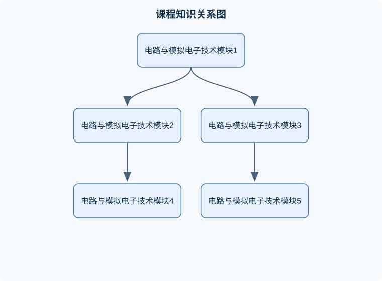

# 电路与模拟电子技术

## 一、课程整体知识框架

### 课程边界与先修知识

本课程研究集中参数电路的基本规律、常用分析方法以及模拟电子电路的工作原理、性能分析、设计方法和工程限制。电路部分包括电压、电流、功率、基尔霍夫定律、等效变换、节点电压法、网孔电流法、叠加定理、戴维南与诺顿等效、正弦稳态分析、相量、阻抗、频率响应和动态电路基础。模拟电子技术部分包括半导体二极管、双极型晶体管、场效应晶体管、基本放大电路、差分放大、集成运算放大器、负反馈、功率放大、直流稳压与整流滤波、正弦波和非正弦波信号发生电路。课程重点是从器件模型到电路模型，再由直流工作点、小信号参数、频率特性和反馈结构分析电路性能。先修知识包括高中或大学基础物理中的电场与电势、简单微积分、复数运算、线性代数基础和基本实验测量知识。理想电路模型适用于工作在线性或分段线性区域、元件参数稳定且寄生效应可以忽略的条件；实际电路还必须考虑器件离散性、温度、噪声、供电范围、功耗、负载效应、失真、稳定性和安全边界。





### 1. 课程对象、研究范围与基本任务

《电路与模拟电子技术》研究电能与信号在电路中的传输、变换、控制和利用，内容由“电路模型—基本定律—网络分析—动态与交流—半导体器件—放大电路—反馈与集成运算—功率与综合应用”逐层展开。电路部分重点回答“已知元件和激励，如何求电压、电流、功率及响应”；模拟电子技术部分重点回答“如何利用非线性器件和放大器件对电信号进行整流、放大、运算、振荡、稳压和功率驱动”。

课程中的电路不是对真实装置的完整复制，而是对真实物理系统的理想化模型。导线通常被视为电阻为零的连接，电阻、电容、电感和半导体器件分别用集中参数模型描述。当电路尺寸远小于信号波长、器件内部分布效应可以忽略时，集中参数模型有效；当频率很高、导线较长或寄生参数不可忽略时，应改用传输线、分布参数或含寄生元件的模型。

电路分析的基本输入包括独立电压源、独立电流源、受控源和初始状态；基本输出包括节点电压、支路电流、端口电压、功率以及随时间或频率变化的响应。约定电流方向和电压参考方向只是分析符号的选择，不决定真实电流的物理方向。若计算结果为负，表示实际方向与假设方向相反，而不是计算必然错误。

### 2. 统一变量、单位与符号约定

电压用 $u$ 或 $v$ 表示，单位为伏特 $\mathrm{V}$；电流用 $i$ 表示，单位为安培 $\mathrm{A}$；电阻用 $R$ 表示，单位为欧姆 $\Omega$；电导用 $G$ 表示，单位为西门子 $\mathrm{S}$，且 $G=1/R$。功率用 $p$ 表示，单位为瓦特 $\mathrm{W}$；电荷用 $q$ 表示，单位为库仑 $\mathrm{C}$；时间用 $t$ 表示，单位为秒 $\mathrm{s}$；角频率用 $\omega$ 表示，单位为弧度每秒 $\mathrm{rad/s}$。

电容用 $C$ 表示，单位为法拉 $\mathrm{F}$，其电压与电流关系为

$$
i_C(t)=C\frac{\mathrm{d}u_C(t)}{\mathrm{d}t}.
$$

电感用 $L$ 表示，单位为亨利 $\mathrm{H}$，其电压与电流关系为

$$
u_L(t)=L\frac{\mathrm{d}i_L(t)}{\mathrm{d}t}.
$$

上述关系要求采用一致的参考方向：电流进入元件电压正端时，采用被动符号约定。此时元件吸收功率为

$$
p(t)=u(t)i(t).
$$

若 $p>0$，元件在该时刻吸收能量；若 $p<0$，元件向外部提供能量。不能仅凭“电压为正”或“电流为正”判断元件是电源还是负载，必须先说明参考方向。

### 3. 基本定律与网络分析逻辑

#### 3.1 欧姆定律、基尔霍夫定律与功率守恒

线性电阻满足欧姆定律：

$$
u=Ri.
$$

该关系只适用于电阻值在工作范围内近似不随电压、电流、温度和频率变化的情形。白炽灯、二极管和晶体管通常不能在全部工作范围内用一个固定电阻表示；对它们使用欧姆定律时，应明确是静态电阻、动态电阻还是局部线性化结果。

基尔霍夫电流定律来自电荷守恒。对任一节点，规定流入为正、流出为负，则

$$
\sum_k i_k=0.
$$

基尔霍夫电压定律来自能量守恒。沿任一闭合回路规定统一的绕行方向，所有元件电压升降的代数和为零：

$$
\sum_k u_k=0.
$$

这两个定律适用于集中参数电路。若电路存在明显的电磁辐射、分布参数效应或高频寄生耦合，简单的集中参数回路方程可能不再充分。

功率守恒可由所有支路的功率代数和表示：

$$
\sum_k p_k=0.
$$

该式既是理论结论，也是结果验证工具。若电阻消耗功率为正而所有独立源也计算为正吸收功率，通常说明参考方向或符号处理存在问题。

#### 3.2 节点法、网孔法与等效变换

节点法以节点电压为未知量。选定参考节点后，对每个非参考节点列基尔霍夫电流方程。例如，一个节点通过电阻 $R_1$、$R_2$ 分别连接到电压已知的节点 $u_1$、$u_2$，并通过电阻 $R_3$ 接地，则节点电压 $u$ 满足

$$
\frac{u-u_1}{R_1}+\frac{u-u_2}{R_2}+\frac{u}{R_3}=0.
$$

节点法适合节点数少、并联支路多的电路。若存在理想电压源直接连接两个非参考节点，需要建立超节点，并在节点方程之外增加电压源约束。

网孔法以平面电路的网孔电流为未知量，沿各网孔统一方向列电压方程。两个网孔共用电阻 $R$ 时，共用支路电压应写成 $R(I_1-I_2)$ 或 $R(I_2-I_1)$，取决于所选支路方向。网孔法适合平面电路且网孔数较少的情况；非平面网络或受控源较多时，节点法通常更直接。

线性电路可使用叠加定理：多个独立源共同作用时，任一线性响应等于每个独立源单独作用所得响应的代数和。处理单个电压源时，将其他独立电压源置零，即短路；处理单个电流源时，将其他独立电流源置零，即开路。受控源不能随意置零，因为受控源的数值由电路变量决定。叠加定理适用于电压、电流等线性响应，不可直接对功率叠加。

戴维南等效和诺顿等效用于端口分析。对线性二端网络，可等效为戴维南电压源 $U_{\mathrm{th}}$ 串联电阻 $R_{\mathrm{th}}$，也可等效为诺顿电流源 $I_{\mathrm{N}}$ 并联电阻 $R_{\mathrm{N}}$，二者满足

$$
R_{\mathrm{th}}=R_{\mathrm{N}},\qquad
U_{\mathrm{th}}=I_{\mathrm{N}}R_{\mathrm{th}}.
$$

若端口网络含受控源，不能简单地把所有源置零后直接看入端口求等效电阻，通常需要在端口接入测试电压 $u_{\mathrm{x}}$ 或测试电流 $i_{\mathrm{x}}$，再用

$$
R_{\mathrm{th}}=\frac{u_{\mathrm{x}}}{i_{\mathrm{x}}}
$$

求得。若网络含独立源和受控源，必须保留受控源。

### 4. 动态响应与正弦稳态

电容和电感具有储能特性，因此含有它们的电路不仅由当前激励决定，还与初始状态有关。电容储能为

$$
w_C=\frac{1}{2}Cu_C^2,
$$

电感储能为

$$
w_L=\frac{1}{2}Li_L^2.
$$

在理想电路中，电容电压不能瞬间突变，电感电流不能瞬间突变。该结论的前提是电流、电压没有出现无限大冲激；含有理想冲激源或特殊切换模型时，需要用广义函数重新分析。

一阶 $RC$ 电路的自然响应通常具有形式

$$
x(t)=x(\infty)+[x(0^+)-x(\infty)]e^{-t/\tau},
$$

其中 $\tau=RC$ 为时间常数，$x(0^+)$ 表示切换后瞬间的状态，$x(\infty)$ 表示经过足够长时间后的稳态值。对于 $RL$ 电路，时间常数为

$$
\tau=\frac{L}{R_{\mathrm{eq}}},
$$

其中 $R_{\mathrm{eq}}$ 是从电感端口看入、将独立源置零后得到的等效电阻。时间常数公式只适用于能够化为一阶储能系统的电路；含两个以上独立储能元件且不能约化时，响应可能是二阶或更高阶形式。

正弦稳态分析使用相量，将微分关系转化为代数关系。角频率为 $\omega$ 时，电阻、电感和电容的阻抗分别为

$$
Z_R=R,\qquad Z_L=j\omega L,\qquad Z_C=\frac{1}{j\omega C},
$$

其中 $j^2=-1$。阻抗单位为欧姆，$j$ 表示相位关系而不是新的物理量。相量法只适用于线性、时不变电路的正弦稳态；对开关瞬态、强非线性器件或非正弦周期信号，应采用暂态分析、傅里叶分解或数值仿真。

### 5. 半导体器件与模拟放大

#### 5.1 二极管的非线性导电

二极管具有单向导电特性。其正向电流随正向电压增加而快速增大，反向电压较小时电流很小，超过击穿条件后反向电流显著增加。工程分析常用三种模型：理想模型、恒压降模型和小信号模型。

理想模型中，正向导通时电压为零，反向截止时电流为零；恒压降模型用一个近似固定的正向压降表示导通状态；小信号模型只描述某个静态工作点附近的微小变化，不能代表整个伏安特性。二极管整流、限幅、钳位和稳压电路的分析，本质上都是先判断导通状态，再在对应模型下列方程，最后检查假设是否成立。

#### 5.2 晶体管工作区与放大原理

双极型晶体管常用集电极电流 $i_C$、基极电流 $i_B$ 和发射极电流 $i_E$ 描述，满足

$$
i_E=i_C+i_B.
$$

在共射放大电路的放大区，常用近似关系 $i_C\approx \beta i_B$，其中 $\beta$ 为电流放大系数。该近似受器件离散性、温度和工作点影响，不能把 $\beta$ 当作精确常数。晶体管截止区、放大区和饱和区对应不同的端口关系；若输出波形出现削顶，通常说明工作点接近截止或饱和边界。

场效应晶体管主要由栅极电压控制漏极电流，栅极静态电流通常较小，输入电阻较高。无论采用双极型还是场效应型器件，放大电路都必须先建立合适的静态工作点，再分析小信号增益。静态工作点决定器件是否处于可线性放大的区域，小信号参数决定该点附近的增益、输入电阻和输出电阻。

### 6. 运算放大器、反馈与频率特性

理想运算放大器通常假设开环增益无限大、输入电阻无限大、输出电阻为零、频带无限宽且输入失调为零。在负反馈正常工作且输出未饱和时，常用两个近似：

$$
i_+=i_-=0,\qquad u_+\approx u_-.
$$

第二个关系不是运算放大器的独立定律，而是由高开环增益和负反馈共同产生的近似。若电路为正反馈、输入差分电压过大、输出达到电源轨或频率超过有效带宽，则不能使用“虚短”结论。

负反馈能够降低增益对器件参数变化的敏感性，改善线性度，扩大带宽，但会降低闭环增益并可能引入稳定性问题。设开环增益为 $A$，反馈系数为 $F$，负反馈闭环增益为

$$
A_f=\frac{A}{1+AF}.
$$

当环路增益 $AF$ 足够大且系统稳定时，闭环增益主要由反馈网络决定；当相位延迟使环路在某一频率附近满足正反馈条件时，可能产生振荡。因而“反馈越强越好”并不成立，必须同时检查相位裕度、带宽和输出摆幅。

### 7. 功率、稳定性与工程约束

模拟电路不仅要满足电压增益，还要满足负载能力、效率、噪声、失真、热稳定和安全工作区。小信号放大器关注电压增益、输入电阻、输出电阻和频率响应；功率放大器还必须考虑输出功率、静态功耗、效率和散热。稳压电源则需要分析整流、滤波、调整和负载变化，不能只依据空载输出电压判断性能。

理想模型有助于建立清晰方程，但真实电路还存在电阻容差、晶体管参数离散、温度漂移、寄生电容、接地阻抗、电源纹波和测量仪器负载。工程结论应说明模型假设、工作频率、输入幅度、负载范围和器件工作区。一个在低频小信号条件下成立的结论，不能直接推广到大信号、高频或瞬态状态。

## 二、章节和模块划分

### 核心知识覆盖清单

本清单根据本课程的章节划分整理，用于检查正文是否覆盖各个核心模块：

- **1. 模块一：电路与模拟电子技术基本概念**。
- **2. 模块二：直流电阻电路与基本定理**。
- **3. 模块三：动态电路与正弦稳态**。
- **4. 模块四：半导体基础与二极管电路**。
- **5. 模块五：晶体管放大与偏置**。
- **6. 模块六：运算放大器与模拟运算电路**。
- **7. 模块七：反馈、频率响应与信号完整性**。
- **8. 模块八：功率放大、直流稳压与综合应用**。
- **9. 代表性问题分析流程**。


### 1. 模块一：电路与模拟电子技术基本概念

本模块建立课程统一语言。内容包括电路元件、支路、节点、回路、端口、参考节点、独立源、受控源、输入量、输出量、负载和工作点。重点区分理想电压源与理想电流源：理想电压源强制端电压不变，允许电流由外部电路决定；理想电流源强制支路电流不变，允许端电压由外部电路决定。理想源若被短路或开路，可能导致无限电流或无限电压，这属于模型边界而非真实器件行为。

本模块还介绍元件伏安特性和功率计算。电阻将电能转化为热能，电容和电感分别以电场和磁场形式储能，独立源向电路提供能量，受控源表示电路内部某个变量对另一端口的控制。学习中的第一个完整分析流程是：画出电路模型，标注参考方向，选择节点法或网孔法，列写方程，求解未知量，再用功率守恒和极限情况检查结果。

### 2. 模块二：直流电阻电路与基本定理

本模块处理不含储能元件的直流电路。串联电阻电流相同，等效电阻为

$$
R_{\mathrm{eq}}=R_1+R_2+\cdots+R_n.
$$

并联电阻电压相同，等效电导为各支路电导之和：

$$
G_{\mathrm{eq}}=G_1+G_2+\cdots+G_n.
$$

两个电阻并联时，

$$
R_{\mathrm{eq}}=\frac{R_1R_2}{R_1+R_2}.
$$

串并联公式只适用于能够明确识别为同一支路串联或同一对节点并联的元件。两个元件之间若存在第三条支路，就不能仅凭图形位置认定为串联；若两元件两端节点不完全相同，也不能认定为并联。

本模块系统使用节点法、网孔法、叠加定理、戴维南定理和诺顿定理。典型应用包括分压、分流、负载变化和最大功率传输。对戴维南等效电路，负载 $R_L$ 接入后，负载电流为

$$
i_L=\frac{U_{\mathrm{th}}}{R_{\mathrm{th}}+R_L},
$$

负载功率为

$$
P_L=i_L^2R_L
=\frac{U_{\mathrm{th}}^2R_L}{(R_{\mathrm{th}}+R_L)^2}.
$$

对正的 $R_{\mathrm{th}}$，令 $R_L$ 变化可得最大功率条件 $R_L=R_{\mathrm{th}}$。该结论只针对线性戴维南电路、纯电阻负载和稳态平均功率；含反应性元件、非线性负载或受限电源时，最大功率条件需要重新推导。

### 3. 模块三：动态电路与正弦稳态

本模块从电阻电路扩展到含电容、电感的电路，内容包括换路定律、一阶零输入响应、一阶零状态响应、完全响应、时间常数和二阶电路的基本特征。分析换路问题时，首先确定切换前的稳态或初始条件，再利用电容电压和电感电流的连续性确定 $0^+$ 状态，随后求新的稳态值和等效电阻，最后写出指数响应。

典型的一阶响应分析可归纳为：

1. 明确开关在 $t<0$ 和 $t>0$ 的连接状态；
2. 求 $u_C(0^-)$ 或 $i_L(0^-)$；
3. 根据连续性写出 $u_C(0^+)=u_C(0^-)$ 或 $i_L(0^+)=i_L(0^-)$；
4. 求 $t\to\infty$ 时的最终值；
5. 从储能元件端口看入求 $R_{\mathrm{eq}}$，得到时间常数；
6. 代入指数响应并检查初值、终值和单位。

正弦稳态部分使用阻抗和导纳分析串联、并联、谐振、功率因数和频率响应。串联 $RLC$ 电路阻抗为

$$
Z=R+j\left(\omega L-\frac{1}{\omega C}\right).
$$

当

$$
\omega L=\frac{1}{\omega C}
$$

时，电抗相互抵消，得到谐振角频率

$$
\omega_0=\frac{1}{\sqrt{LC}}.
$$

该公式适用于理想串联 $RLC$ 模型；实际电路的电阻、损耗、寄生参数和源内阻会改变品质因数、带宽和谐振峰值。

### 4. 模块四：半导体基础与二极管电路

本模块介绍本征半导体、掺杂、载流子、$P$ 型和 $N$ 型区域、$PN$ 结以及势垒区。二极管电路分析的核心不是直接套用固定压降，而是判断二极管的可能状态。对每个二极管可先假设导通或截止，利用该状态的等效模型求解，然后检查导通时电流方向和截止时反向电压是否符合假设。

整流电路将交流输入转换为单向脉动电压；滤波电容利用储能减小输出纹波；限幅电路限制信号幅度；钳位电路改变信号的直流电平；稳压二极管在规定反向工作区内近似保持端电压稳定。稳压设计必须检查工作电流、输入变化、负载变化和功耗，不能把击穿区简单理解为“任何反向电压下都能稳压”。

### 5. 模块五：晶体管放大与偏置

本模块涵盖双极型晶体管和场效应晶体管的结构、端口特性、工作区、直流偏置、小信号模型、共射极或共源极放大、射极或源极退化、共集电极或源极跟随器以及多级放大。

分析晶体管放大电路应分为直流和交流两步。直流分析时，输入交流信号置零，电容按开路处理，求得各端电压、电流并判断工作区；交流小信号分析时，在静态工作点附近线性化，电源端通常视为交流地，耦合电容和旁路电容在满足频率条件时近似短路，再求电压增益、输入电阻和输出电阻。

偏置电路的目标是使晶体管在输入信号正、负摆动时都保持在放大区，避免截止和饱和造成严重失真。实际设计中还要考虑温度变化和器件参数变化。若电路仅依赖固定基极电流或栅极电压，工作点可能对器件离散性敏感；引入发射极或源极电阻、负反馈和分压偏置，通常有助于改善稳定性，但会改变增益和摆幅。

### 6. 模块六：运算放大器与模拟运算电路

本模块以理想运算放大器为起点，分析反相放大器、同相放大器、加法器、差分放大器、积分器、微分器、比较器和有源滤波器。

反相放大器在负反馈正常工作时，若输入电阻为 $R_1$、反馈电阻为 $R_f$，则

$$
u_o=-\frac{R_f}{R_1}u_i.
$$

推导步骤是：由于同相端接地，虚短给出反相端电压近似为零；输入端和反馈支路电流分别为 $u_i/R_1$ 和 $-u_o/R_f$；由于输入端电流近似为零，两者代数和为零，从而得到增益关系。该结果要求运算放大器未饱和、频率在有效带宽内、输入共模电压合适且反馈确实为负反馈。

同相放大器的理想闭环增益为

$$
A_v=1+\frac{R_f}{R_1}.
$$

比较器则通常工作在开环或正反馈状态，不能使用虚短；输出会根据输入差分电压的正负趋向某个饱和电平。积分器和微分器对频率和噪声敏感，实际电路通常需要加入电阻、电容或限幅环节以避免直流漂移和高频噪声无限放大。

### 7. 模块七：反馈、频率响应与信号完整性

本模块分析开环增益、反馈网络、闭环增益、带宽、失真、噪声和稳定性。反馈类型可按对输入端和输出端的取样、混合方式区分，不同结构会改变输入电阻和输出电阻。闭环系统不能只看低频增益，还要观察幅频特性和相频特性。

低频端的衰减通常与耦合电容、旁路电容和输入输出电阻形成的高通网络有关；高频端的衰减通常与器件结电容、布线寄生电容和米勒效应有关。多级放大器的总电压增益在各级线性且级间负载已正确考虑时，可近似为各级增益的乘积；用分贝表示时则为各级分贝增益之和：

$$
A_{\mathrm{dB}}=20\log_{10}|A_v|.
$$

分贝公式只适用于幅值比，功率比通常使用 $10\log_{10}(P_2/P_1)$。不能混用幅值比和功率比的系数。

### 8. 模块八：功率放大、直流稳压与综合应用

本模块将前面知识用于完整模拟系统。功率放大部分关注负载电压、电流、输出功率、效率、交越失真、热耗散和安全工作区；稳压电源部分关注变压、整流、滤波、基准、误差放大、串联调整和保护；综合应用则包括传感器信号调理、音频放大、光电检测、温度测量和简单控制接口。

实际系统的分析流程应包括：确定输入信号范围和频率范围；确定负载和供电条件；选择器件模型；建立直流工作点；进行小信号或大信号分析；检查最大电压、电流、功耗和温升；再通过仿真或实测验证。验收不能只看某一个输出电压，还应检查增益误差、带宽、波形失真、纹波、噪声、负载变化和长期稳定性。

### 9. 代表性问题分析流程

#### 9.1 线性电路方程流程

输入为电路拓扑、元件参数、源值和待求量；输出为节点电压、支路电流及功率。流程如下：

1. 统一单位并标注参考节点；
2. 为未知支路电流或节点电压规定方向；
3. 依据元件关系和基尔霍夫定律列方程；
4. 检查方程数量是否与独立未知量数量相等；
5. 求解后代入原方程验证；
6. 计算功率并检查能量守恒。

其不变量是每个已列节点的电流代数和为零、每个闭合回路的电压代数和为零。若使用矩阵求解，设未知节点电压向量为 $\boldsymbol{u}$，电导矩阵为 $\boldsymbol{G}$，注入电流向量为 $\boldsymbol{b}$，则可写为

$$
\boldsymbol{G}\boldsymbol{u}=\boldsymbol{b}.
$$

只有在线性元件和确定的独立方程下，该线性方程形式才直接成立。

#### 9.2 非线性二极管工作点流程

输入为二极管电路、源值和负载；输出为二极管状态、工作电压和工作电流。先假设二极管截止，将其视为开路并求反向电压；若反向条件成立，假设有效。若不成立，再假设二极管导通，采用理想、恒压降或指数模型求解，并检查正向电流是否符合导通方向。若两种假设均不满足，说明模型、极性或电路连接存在问题，不能强行选择一个结果。

#### 9.3 放大电路直流—交流分解流程

输入为放大器拓扑、器件参数、偏置源和信号频率；输出为静态工作点、增益、输入输出电阻及失真边界。先进行直流分析，确定晶体管工作区；再在该工作点建立小信号模型；然后求交流增益和频率响应；最后检查信号摆幅是否使器件离开放大区。该流程不能跳过工作区判断，否则可能在截止或饱和状态下错误使用线性增益公式。

#### 9.4 用伪代码表示的通用分析流程

```text
输入：电路拓扑 T，元件参数 P，独立源 S，待求量集合 Q
输出：节点电压、支路电流、功率及一致性检查结果

1. 统一所有参数的单位
2. 选定参考节点，给其电压赋值为 0
3. 为其余节点建立未知电压变量
4. 若电路为线性电路：
      根据元件关系和基尔霍夫电流定律建立方程组
      求解方程组
   否则：
      假设各非线性器件状态
      在对应模型下建立方程
      求解并检查每个状态假设
      保留满足状态条件的解
5. 根据节点电压计算各支路电流
6. 计算每个元件功率 p = u × i
7. 检查：
      每个节点电流代数和是否接近 0
      每个回路电压代数和是否接近 0
      所有元件功率代数和是否接近 0
      是否违反器件电压、电流和工作区边界
8. 输出结果及采用的模型、假设和误差范围
终止条件：所有未知量已求出，且方程、状态和边界检查均通过
```

该流程适合低频集中参数电路的手算、程序化建模和实验数据复核，不适合直接处理强电磁辐射、复杂分布参数网络或未经模型化的器件内部物理过程。

## 三、核心概念的详细解释

### 1. 电路模型、参考方向与端口思想

电路分析的对象是由电源、负载、导线和电子器件构成的网络。真实元件具有分布电阻、寄生电容、寄生电感、温度漂移和非线性特性，课程中先用集中参数模型近似描述。集中参数模型要求电路尺寸相对于信号传播波长足够小，使同一支路上电压和电流可以视为由一个时间变量描述。低频、小尺寸电路通常满足这一条件；当频率升高、连线较长或边沿很快时，必须考虑传输线效应、地弹噪声和寄生参数。

节点是若干支路的公共连接点；支路是连接两个节点并包含一个或多个元件的路径；回路是从某节点出发又回到该节点的闭合路径。参考节点电压定义为零，其他节点电压均表示相对于该参考节点的电势差。电流箭头和电压正负号是人为规定的参考方向，不是对实际方向的预先判断。计算出负电流，表示真实电流与假定方向相反。

端口是电路与外部连接的两个端子。对线性二端网络，端口特性可用端口电压、电流关系描述。若外部负载只关心端口行为，可以使用戴维南等效或诺顿等效，而不必保留内部全部细节。等效的前提是：对外部端口而言，电压—电流关系相同；等效电路不代表内部功率、内部电流和瞬态状态也完全相同。

### 2. 电阻、电容、电感与能量

电阻的理想模型满足

$$
u=Ri,
$$

其中 $u$ 的单位为伏特，$i$ 的单位为安培，$R$ 的单位为欧姆。电阻吸收的功率为

$$
p=ui=Ri^2=\frac{u^2}{R}.
$$

当 $R>0$ 时，功率非负，说明理想电阻只能吸收能量并将其转化为热。电阻串联时电流相同，等效电阻为

$$
R_{\mathrm{eq}}=\sum_{k=1}^{n}R_k.
$$

并联时电压相同，等效电阻满足

$$
\frac{1}{R_{\mathrm{eq}}}=\sum_{k=1}^{n}\frac{1}{R_k}.
$$

这些公式要求元件连接关系确实为串联或并联。两个元件之间若存在第三条支路连接，就不能仅凭图形上的相邻位置判断为串联；两个元件若不共享同一对节点，也不能判断为并联。

电容描述电荷储存能力，基本关系为

$$
q=Cu_C,\qquad i_C=C\frac{\mathrm{d}u_C}{\mathrm{d}t},
$$

其中 $q$ 的单位为库仑，$C$ 的单位为法拉，$u_C$ 为电容电压。电容储能为

$$
w_C=\frac{1}{2}Cu_C^2.
$$

理想电容两端电压不能发生瞬时跳变，因为若在有限时间内使电压突变，就需要无限大的电流。该结论的边界是理想模型；真实电容存在等效串联电阻、漏电流和击穿电压，快速脉冲下电压仍可能出现有限幅度的突变。

电感描述磁场储能能力，基本关系为

$$
u_L=L\frac{\mathrm{d}i_L}{\mathrm{d}t},
$$

其中 $L$ 的单位为亨利。电感储能为

$$
w_L=\frac{1}{2}Li_L^2.
$$

理想电感电流不能瞬时改变，否则需要无限大的电压。实际电感存在绕组电阻、磁芯损耗和饱和效应，因此大电流下不能继续使用恒定电感值。

### 3. 基尔霍夫定律、节点法与回路法

基尔霍夫电流定律来自电荷守恒。对任一节点，流入电流代数和等于流出电流代数和：

$$
\sum_k i_k=0.
$$

基尔霍夫电压定律来自能量守恒。沿任意闭合回路，所有电压升和电压降的代数和为零：

$$
\sum_k u_k=0.
$$

节点电压法以节点电压为未知量。选参考节点后，对每个非参考节点列写电流方程。例如节点 $a$ 通过电阻 $R_1$ 接到电压为 $U_s$ 的节点，通过电阻 $R_2$ 接地，若节点电压为 $u_a$，则

$$
\frac{u_a-U_s}{R_1}+\frac{u_a}{R_2}=0.
$$

整理得

$$
u_a=U_s\frac{R_2}{R_1+R_2}.
$$

节点法适合节点数少、支路较多的电路。含电压源的两个非参考节点之间可使用超节点，将超节点边界的电流方程与电压源约束联立。

回路电流法以各独立回路电流为未知量。相邻回路共享电阻时，共享电阻电流等于两个回路电流的代数差。回路法适合独立回路数少的平面电路，但对非平面网络或受控源较多的网络，节点法通常更直接。

### 4. 叠加、戴维南等效与诺顿等效

在线性电路中，多个独立源同时作用时，任一响应等于各独立源单独作用所产生响应的代数和。计算某个独立源单独作用时，其他独立电压源置零，即用短路代替；独立电流源置零，即用开路代替。受控源不能随意置零，因为受控源的数值由电路变量决定。叠加定理只适用于电压、电流等线性响应，不能直接对功率叠加，因为功率与电压、电流通常是平方关系。

从任意线性二端网络端口看进去，可等效为一个戴维南电压源 $U_{\mathrm{th}}$ 串联一个电阻 $R_{\mathrm{th}}$。其中 $U_{\mathrm{th}}$ 是端口开路电压；当独立源置零且受控源处理正确时，从端口看入的等效电阻为 $R_{\mathrm{th}}$。若网络含受控源，不能只靠“关闭所有源后测电阻”得到结果，必须使用测试电压源或测试电流源。

诺顿等效由电流源 $I_{\mathrm{N}}$ 与电阻 $R_{\mathrm{N}}$ 并联构成，且

$$
R_{\mathrm{N}}=R_{\mathrm{th}},\qquad
U_{\mathrm{th}}=I_{\mathrm{N}}R_{\mathrm{N}}.
$$

若负载为 $R_L$，戴维南等效下负载电流为

$$
I_L=\frac{U_{\mathrm{th}}}{R_{\mathrm{th}}+R_L}.
$$

负载获得最大功率的条件为

$$
R_L=R_{\mathrm{th}},
$$

此时最大负载功率为

$$
P_{L,\max}=\frac{U_{\mathrm{th}}^2}{4R_{\mathrm{th}}}.
$$

该结论只针对电阻性负载和线性电阻网络；若考虑效率、负载限制或交流复阻抗，最优条件需要相应修正。

### 5. 一阶动态电路与正弦稳态

直流电阻电路达到稳态后，电容相当于开路，电感相当于短路，但这只是理想直流稳态结论，不能用于刚接通的瞬间。对于电阻、电容组成的一阶电路，时间常数为

$$
\tau=R_{\mathrm{eq}}C.
$$

若初始电压为 $u_C(0^+)$，最终稳态电压为 $u_C(\infty)$，则

$$
u_C(t)=u_C(\infty)+\left[u_C(0^+)-u_C(\infty)\right]e^{-t/\tau}.
$$

电感电流的一阶响应具有同样形式：

$$
i_L(t)=i_L(\infty)+\left[i_L(0^+)-i_L(\infty)\right]e^{-t/\tau},
$$

其中 $\tau=L/R_{\mathrm{eq}}$，$R_{\mathrm{eq}}$ 是从电感端口看入的等效电阻。电容电压和电感电流的连续性分别为

$$
u_C(0^+)=u_C(0^-),\qquad i_L(0^+)=i_L(0^-).
$$

正弦稳态分析使用相量。若

$$
u(t)=U_{\mathrm{m}}\cos(\omega t+\varphi),
$$

则其有效值为 $U=U_{\mathrm{m}}/\sqrt{2}$，角频率为 $\omega=2\pi f$。电阻、电感和电容的阻抗分别为

$$
Z_R=R,\qquad Z_L=j\omega L,\qquad Z_C=\frac{1}{j\omega C},
$$

其中 $j^2=-1$。阻抗是复数，不能把电抗的代数值直接当作电阻使用。交流有功功率为

$$
P=UI\cos\varphi,
$$

其中 $U$、$I$ 为有效值，$\varphi$ 为电压与电流的相位差。视在功率为 $S=UI$，无功功率为 $Q=UI\sin\varphi$。只有在正弦稳态且采用有效值时，上述功率关系才可直接使用。

### 6. 半导体二极管与整流电路

二极管具有明显的单向导电特性。正向偏置时，阳极电势高于阴极，电流可显著增加；反向偏置时，电流通常很小，超过击穿区域后可能急剧增大。二极管不能在全部工作范围内用一个固定电阻表示。

分析二极管电路时，常用三种模型。理想模型把正向导通压降取为零、反向截止电流取为零；恒压降模型把导通时压降近似为某一常数；指数模型更接近物理特性，可表示为

$$
i_D=I_S\left(e^{u_D/(nU_T)}-1\right),
$$

其中 $I_S$ 为反向饱和电流，$n$ 为理想因子，$U_T$ 为热电压。参数随温度变化，不能把该式当作所有器件和温度下的固定经验式。

半波整流只保留输入波形的一个半周；全波整流利用两个半周，输出平均值和纹波性能通常优于半波整流。滤波电容在输入峰值附近充电，在输入电压下降时通过负载放电，因此负载越大、放电时间越长，纹波越明显。实际整流电路还必须检查二极管反向耐压、峰值电流、变压器内阻和电容浪涌电流。

### 7. 晶体管、场效应管与放大电路

双极型晶体管具有基极、集电极和发射极。以共射电路为例，晶体管在放大区时，集电极电流近似受基极电流控制，可写为

$$
i_C\approx \beta i_B,
$$

其中 $\beta$ 为共射电流放大系数。该关系不是无条件定律；在截止区，集电极电流接近零；在饱和区，继续增大基极驱动也不能保持线性比例。

场效应管由栅极电压控制沟道电流，栅极输入电流理想情况下接近零，因此具有较高输入电阻。实际器件存在栅漏电流、结电容和跨导变化。晶体管的直流分析用于确定静态工作点，交流小信号分析则是在工作点附近进行局部线性化。若输入信号幅值过大，瞬时工作点进入截止、饱和或击穿区，小信号增益不再适用。

共射放大电路通常具有反相电压增益；共集电路电压增益接近一，但输入电阻较高、输出电阻较低，常用于缓冲；共基电路输入电阻较低，适合某些高频或阻抗变换场合。评价放大电路不能只看电压增益，还要检查输入电阻、输出电阻、带宽、最大不失真摆幅、噪声和功耗。

### 8. 运算放大器、反馈、振荡与稳压

理想运算放大器具有无限大的开环电压增益、无限大的输入电阻和零输出电阻。在负反馈、输出未饱和且工作在线性范围时，常用“虚短”和“虚断”：

$$
u_+\approx u_-,\qquad i_+\approx i_-\approx0.
$$

“虚短”不表示两个输入端真实短路；“虚断”不表示输入端电压不存在。若输出达到电源轨、输入共模范围不满足或反馈为正反馈，就不能使用这些近似。

反相放大器中，若输入电阻为 $R_1$、反馈电阻为 $R_f$，则理想闭环增益为

$$
A_v=\frac{u_o}{u_i}=-\frac{R_f}{R_1}.
$$

同相放大器中，闭环增益为

$$
A_v=1+\frac{R_f}{R_1}.
$$

反馈可以降低增益对器件参数变化的敏感性、扩展带宽、降低非线性失真，但会改变输入电阻、输出电阻和稳定性。若反馈环路总相移和增益满足振荡条件，电路可能产生自激振荡。实际设计必须检查相位裕度、负载电容和电源去耦，不能只依据低频增益判断稳定性。

稳压电路通过负反馈调节串联或并联器件，使输出电压对输入变化和负载变化不敏感。稳压器必须满足输入输出压差、最大电流、功耗、热阻和稳定电容等条件。线性稳压器的功耗近似为

$$
P_D\approx (U_i-U_o)I_o,
$$

若功耗过大，即使输出电压正确，器件也可能因结温过高而失效。

### 9. 问题分析算法与实现流程

#### 9.1 线性电路节点分析算法

**输入：**电路拓扑、元件参数、独立源、受控源和待求支路。  
**输出：**节点电压、支路电流、元件功率及一致性检查结果。

1. 将所有数值统一为伏特、安培、欧姆、法拉、亨利等单位。
2. 选定参考节点并标记其电压为零。
3. 为其他节点建立未知电压变量。
4. 根据欧姆定律、受控源关系和基尔霍夫电流定律列方程。
5. 求解方程组，若矩阵奇异，则检查节点是否悬空、方程是否重复或电路是否缺少参考。
6. 根据节点电压计算支路电流和功率。
7. 验证节点电流和、回路电压和及总功率和是否接近零。
8. 检查每个器件的额定电压、电流、功耗和工作区。

线性网络可写成

$$
\boldsymbol{G}\boldsymbol{u}=\boldsymbol{b},
$$

其中 $\boldsymbol{G}$ 是电导矩阵，$\boldsymbol{u}$ 是节点电压向量，$\boldsymbol{b}$ 是等效注入电流向量。该形式只适用于已经线性化或本身为线性的模型。

#### 9.2 二极管状态假设流程

先假设二极管截止，将二极管替换为开路，求出其两端电压；若反向电压满足截止条件，则保留该解。若不满足，则假设二极管导通，根据理想模型或恒压降模型替换为短路或电压源，求出电流；若电流方向与导通方向一致，则该解成立。若两个假设都不成立，应检查极性、模型、参数和电路连接，不能任意选择结果。

#### 9.3 放大电路分析流程

先短路交流源、开路电容或按直流等效条件求静态工作点；再判断晶体管处于截止、放大、饱和或其他工作区；随后在静态工作点附近建立小信号模型；计算中频增益、输入电阻和输出电阻；最后分析低频耦合电容、高频结电容、负载效应和最大不失真摆幅。若输入信号导致工作点离开线性区，应改用大信号分析。

#### 9.4 可执行的数值检查代码

```python
import numpy as np

def check_resistive_network(G, b, branch_data, tolerance=1e-9):
    """
    G: 节点电导矩阵，单位 S
    b: 节点注入电流向量，单位 A
    branch_data: [(node_a, node_b, resistance_ohm), ...]
                 节点编号从 0 开始，-1 表示参考节点
    返回：节点电压、支路电流、支路功率和残差
    """
    G = np.asarray(G, dtype=float)
    b = np.asarray(b, dtype=float)

    if G.shape[0] != G.shape[1] or G.shape[0] != b.size:
        raise ValueError("矩阵维度与注入电流向量不一致")

    try:
        node_voltage = np.linalg.solve(G, b)
    except np.linalg.LinAlgError as exc:
        raise ValueError("方程组无唯一解，请检查参考节点或电路连接") from exc

    currents = []
    powers = []
    for node_a, node_b, resistance in branch_data:
        if resistance <= 0:
            raise ValueError("该示例只接受正电阻")
        va = 0.0 if node_a == -1 else node_voltage[node_a]
        vb = 0.0 if node_b == -1 else node_voltage[node_b]
        current_a_to_b = (va - vb) / resistance
        currents.append(current_a_to_b)
        powers.append((va - vb) * current_a_to_b)

    residual = G @ node_voltage - b
    if np.max(np.abs(residual)) > tolerance:
        raise ArithmeticError("节点方程残差超过容许范围")

    return node_voltage, np.array(currents), np.array(powers), residual
```

该代码只处理已建立好的线性电阻节点方程，不自动识别拓扑，也不适合直接处理二极管、晶体管、磁滞元件或高频分布参数网络。输入矩阵可解、节点残差足够小是终止和验收条件。

### 10. 代表性例题

#### 例题一：串并联电阻与功率

**题干：**电压源为 $12\ \mathrm{V}$，先串联 $R_1=2\ \Omega$，再接并联支路 $R_2=6\ \Omega$ 和 $R_3=3\ \Omega$。求总电流、各支路电流和 $R_3$ 功率。

**分析：**先求并联等效电阻，再与 $R_1$ 串联。

**解答：**

$$
R_{23}=\frac{6\times3}{6+3}=2\ \Omega,
$$

$$
R_{\mathrm{eq}}=2+2=4\ \Omega,
\qquad I=\frac{12}{4}=3\ \mathrm{A}.
$$

串联电阻 $R_1$ 压降为 $6\ \mathrm{V}$，并联支路电压也为 $6\ \mathrm{V}$。因此

$$
I_2=\frac{6}{6}=1\ \mathrm{A},\qquad
I_3=\frac{6}{3}=2\ \mathrm{A}.
$$

$$
P_3=U_3I_3=6\times2=12\ \mathrm{W}.
$$

**结果验证：**$I_2+I_3=3\ \mathrm{A}$，与总电流一致；总功率为 $12\times3=36\ \mathrm{W}$，各电阻功率之和为 $18+6+12=36\ \mathrm{W}$。

**变式：**若 $R_3$ 断路，则 $R_{23}=6\ \Omega$，总电流降为 $1.5\ \mathrm{A}$，不能继续使用原来的并联分流结果。

#### 例题二：节点电压法

**题干：**节点 $a$ 通过 $R_1=2\ \mathrm{k}\Omega$ 接到 $10\ \mathrm{V}$ 电源，通过 $R_2=3\ \mathrm{k}\Omega$ 接地。求节点电压和两支路电流。

**解答：**

$$
\frac{u_a-10}{2\,\mathrm{k}\Omega}+\frac{u_a}{3\,\mathrm{k}\Omega}=0.
$$

乘以 $6\,\mathrm{k}\Omega$ 得

$$
3(u_a-10)+2u_a=0,
$$

所以

$$
u_a=6\ \mathrm{V}.
$$

从电源流向节点的电流为

$$
I_1=\frac{10-6}{2\,\mathrm{k}\Omega}=2\ \mathrm{mA},
$$

流向地的电流为

$$
I_2=\frac{6}{3\,\mathrm{k}\Omega}=2\ \mathrm{mA}.
$$

**结果验证：**节点电流代数和为零；节点电压介于 $0$ 和 $10\ \mathrm{V}$ 之间，符合无源分压网络边界。

**变式：**若 $R_2$ 接入负载后变为 $1\ \mathrm{k}\Omega$，节点电压变为

$$
u_a=10\frac{1}{2+1}=3.33\ \mathrm{V},
$$

说明负载会改变原分压电路输出。

#### 例题三：戴维南等效与最大功率

**题干：**某线性网络端口的开路电压为 $U_{\mathrm{th}}=12\ \mathrm{V}$，等效电阻为 $R_{\mathrm{th}}=4\ \Omega$。接入 $R_L=4\ \Omega$，求负载电流、负载电压和功率，并说明最大功率条件。

**解答：**

$$
I_L=\frac{12}{4+4}=1.5\ \mathrm{A},
$$

$$
U_L=I_LR_L=1.5\times4=6\ \mathrm{V},
$$

$$
P_L=I_L^2R_L=1.5^2\times4=9\ \mathrm{W}.
$$

由于 $R_L=R_{\mathrm{th}}$，满足最大功率传输条件，且

$$
P_{L,\max}=\frac{12^2}{4\times4}=9\ \mathrm{W}.
$$

**结果验证：**负载电压为开路电压的一半，符合串联分压关系。此时源内阻也消耗 $9\ \mathrm{W}$，理想最大功率传输效率为 $50\%$。

**变式：**若要求提高效率而非最大功率，通常应取 $R_L>R_{\mathrm{th}}$，但负载功率会低于最大值。

#### 例题四：RC 充电

**题干：**$R=10\ \mathrm{k}\Omega$、$C=100\ \mu\mathrm{F}$ 的串联 RC 电路接入 $5\ \mathrm{V}$ 直流源，电容初始未充电。求时间常数以及 $t=\tau$ 时的电容电压。

**解答：**

$$
\tau=RC=10\,000\times100\times10^{-6}=1\ \mathrm{s}.
$$

初始电压为 $0$，最终电压为 $5\ \mathrm{V}$，因此

$$
u_C(t)=5(1-e^{-t}).
$$

当 $t=\tau=1\ \mathrm{s}$ 时，

$$
u_C(\tau)=5(1-e^{-1})\approx3.16\ \mathrm{V}.
$$

**结果验证：**电容电压从 $0$ 单调接近 $5\ \mathrm{V}$，且不超过最终值；$t=0$ 时为零，满足初始条件。

**变式：**若电容初始带有 $2\ \mathrm{V}$，则

$$
u_C(t)=5+(2-5)e^{-t}=5-3e^{-t}.
$$

#### 例题五：反相运算放大器

**题干：**理想反相运算放大器中，$R_1=10\ \mathrm{k}\Omega$，$R_f=100\ \mathrm{k}\Omega$，输入电压为 $0.2\ \mathrm{V}$。求输出电压，并说明电源为 $\pm5\ \mathrm{V}$ 时是否会饱和。

**解答：**在线性负反馈和虚短、虚断成立时，

$$
u_o=-\frac{R_f}{R_1}u_i
=-\frac{100}{10}\times0.2=-2\ \mathrm{V}.
$$

$-2\ \mathrm{V}$ 位于 $\pm5\ \mathrm{V}$ 电源范围内，理想情况下不会因幅值达到电源轨而饱和。

**结果验证：**输出与输入反相，增益绝对值为 $10$；若输入改为 $0.8\ \mathrm{V}$，理想计算得到 $-8\ \mathrm{V}$，超出电源范围，实际输出会被限制在负电源轨附近，不能继续使用线性公式。

**变式：**若反馈电阻断开，负反馈消失，运算放大器可能进入开环饱和，虚短条件失效。

### 11. 实验与项目流程

#### 实验一：验证 RC 暂态响应

**输入数据：**电阻 $10\ \mathrm{k}\Omega$、电容 $100\ \mu\mathrm{F}$、直流阶跃源 $5\ \mathrm{V}$，示波器或数据采集设备，测量时间至少覆盖 $5\tau$。

**步骤：**

1. 检查电容极性、额定电压和接线，电源关闭时完成连接。
2. 先测量输入阶跃波形，确认上升时间明显小于理论时间常数。
3. 同时观察电容两端电压，记录 $t=0$、$\tau$、$2\tau$、$3\tau$、$5\tau$ 附近的数值。
4. 用
   $$
   u_C(t)=U_f+(U_0-U_f)e^{-t/\tau}
   $$
   拟合测量曲线，计算实测时间常数。
5. 反复充放电，比较初始电压和最终电压是否稳定。

**评价标准：**初始电压和最终电压符合连接条件；实测时间常数与 $RC$ 理论值的相对误差应结合电阻、电容容差和仪器输入电阻解释；波形应近似指数变化，不能出现明显异常振铃。

**排错方法：**若最终电压偏低，检查电容漏电、负载和示波器输入电阻；若时间常数偏小，检查并联负载或电容实际容量；若波形极性相反，检查电容极性和示波器地线；若出现尖峰，检查开关触点、接地和导线寄生电感。

#### 项目二：设计并验收一个小信号放大模块

**输入数据：**毫伏级正弦输入、规定的负载电阻、双电源或单电源、晶体管或运算放大器、输入耦合电容、反馈电阻。

**步骤：**

1. 根据目标增益、输入电阻和负载要求确定拓扑。
2. 先做直流分析，确认晶体管工作点或运算放大器输出静态点位于可用范围。
3. 计算中频增益，并估算耦合电容造成的低频截止。
4. 以小幅输入信号测试中频增益和相位。
5. 增大输入幅度，记录开始出现削顶或明显失真的临界值。
6. 改变负载和电源电压，观察增益、输出摆幅和功耗变化。
7. 对输入端、输出端和电源端分别检查噪声、纹波和异常振荡。

**评价标准：**中频增益误差、带宽、最大不失真输出、输入输出电阻和静态功耗均应符合设计指标；输出波形不能有超出器件允许范围的削顶、交越失真或持续振荡；长时间运行时温升应在器件允许范围内。

**排错方法：**无输出时先测静态工作点，再检查输入耦合电容和接地；增益过低时检查反馈电阻、负载效应和器件是否进入截止；波形削顶时减小输入或调整静态点；高频振荡时检查电源去耦、反馈走线、负载电容和相位裕度。

## 四、重要定义、公式、定理和推导

### 专业审校补充：关键定义与适用边界

负反馈的关键边界在于：反馈并不等于“增益一定变大”，而是将输出的一部分按极性返回输入端，改变闭环增益、带宽、失真、噪声和稳定性。设放大器开环增益为 A，反馈系数为 β，且反馈为负反馈，则闭环增益为 A_f=A/(1+Aβ)，其中 A、β 可以是随频率变化的复数，环路增益 T=Aβ。若 |T|≫1 且相位裕度足够，A_f 主要由反馈网络决定，通常对器件参数变化不敏感；但当 1+Aβ 接近零时，闭环增益会出现峰化甚至自激。只有在输入输出量的取样方式、比较方式和反馈极性确定后，才能正确判断是电压反馈还是电流反馈、串联混合还是并联混合。理想低频公式不能直接用于高频电路，因为晶体管结电容、运算放大器有限增益带宽积、负载电容和布线寄生会引入额外极点。工程上应同时检查直流工作点、闭环增益、相位裕度、输出摆幅、负载范围和瞬态响应。


### 1. 基本定义与守恒关系

**电压：**单位电荷从一点移动到另一点时能量变化的代数量，单位为伏特。  
**电流：**单位时间内通过截面的电荷量，定义为

$$
i=\frac{\mathrm{d}q}{\mathrm{d}t}.
$$

**功率：**能量变化率，在被动符号约定下为

$$
p=ui.
$$

**电阻：**电压与电流之比，线性电阻满足 $R=u/i$，但非线性器件的比值可能随工作点变化。  
**动态电阻：**器件伏安曲线在某一工作点的局部斜率倒数：

$$
r_d=\frac{\mathrm{d}u}{\mathrm{d}i}.
$$

静态电阻 $u/i$ 与动态电阻不应混淆。

### 2. 分压、分流公式的推导

两个串联电阻 $R_1$、$R_2$ 接在电压 $U$ 两端。串联支路电流相同，由欧姆定律得

$$
I=\frac{U}{R_1+R_2}.
$$

$R_2$ 两端电压为

$$
U_2=IR_2=\frac{R_2}{R_1+R_2}U.
$$

这就是分压公式。若输出端接入负载 $R_L$，实际下方电阻变为 $R_2\parallel R_L$，所以空载分压值不能直接作为带载输出。

并联电路两端电压相同。两支路电流为

$$
I_1=\frac{U}{R_1},\qquad I_2=\frac{U}{R_2}.
$$

由 $I=I_1+I_2$ 得

$$
I=U\left(\frac{1}{R_1}+\frac{1}{R_2}\right),
$$

因此

$$
R_{\mathrm{eq}}=\frac{U}{I}
=\frac{R_1R_2}{R_1+R_2}.
$$

若某支路电阻趋于无穷大，该支路电流趋于零；若某支路电阻趋于零，并联等效电阻趋于零，这两个极限可用于检查计算结果。

### 3. 戴维南定理的推导逻辑

对于线性二端网络，端口电压是端口电流的线性函数。设端口开路时电流为零，端口电压为 $U_{\mathrm{th}}$；当端口短路时，端口电流为 $I_{\mathrm{sc}}$。于是端口关系可以写为

$$
u=u_{\mathrm{th}}-R_{\mathrm{th}}i.
$$

令 $u=0$，得到

$$
R_{\mathrm{th}}=\frac{U_{\mathrm{th}}}{I_{\mathrm{sc}}}.
$$

因此该网络等效为电压源 $U_{\mathrm{th}}$ 串联电阻 $R_{\mathrm{th}}$。该推导要求端口关系是线性的；若网络含二极管或晶体管，则只能在某一工作点附近进行小信号等效，不能把一个全范围的非线性网络直接化为固定戴维南源。

### 4. 最大功率传输定理的推导

戴维南等效电路接入负载 $R_L$ 时，

$$
P_L=I_L^2R_L
=\left(\frac{U_{\mathrm{th}}}{R_{\mathrm{th}}+R_L}\right)^2R_L.
$$

令 $x=R_L/R_{\mathrm{th}}$，除去与 $x$ 无关的常数后，功率函数为

$$
f(x)=\frac{x}{(1+x)^2}.
$$

求导：

$$
f'(x)=\frac{1-x}{(1+x)^3}.
$$

当 $x=1$ 时导数为零，且函数由增转减，因此

$$
R_L=R_{\mathrm{th}}
$$

时负载功率最大。若电路设计目标是电池续航、稳压或功率效率，最大功率并不一定是最优目标，因为此时内阻消耗的功率与负载功率相等，效率只有 $50\%$。

### 5. 一阶电路通解的推导

以串联 RC 充电为例，电阻电流为

$$
i_R=\frac{U_s-u_C}{R},
$$

电容电流为

$$
i_C=C\frac{\mathrm{d}u_C}{\mathrm{d}t}.
$$

串联电流相同，因此

$$
C\frac{\mathrm{d}u_C}{\mathrm{d}t}
=\frac{U_s-u_C}{R}.
$$

整理为

$$
\frac{\mathrm{d}u_C}{\mathrm{d}t}
+\frac{1}{RC}u_C=\frac{U_s}{RC}.
$$

其解为

$$
u_C(t)=U_s+\left[u_C(0)-U_s\right]e^{-t/(RC)}.
$$

若电源在 $t=0$ 后不是恒定值，则不能直接把 $U_s$ 当作最终值，应先求该激励下的稳态响应。若电容存在初始电压，必须保留 $u_C(0^-)$；忽略初始条件会导致瞬态幅值错误。

### 6. 交流阻抗与相位关系

正弦稳态下，微分运算可用乘以 $j\omega$ 表示。由

$$
i_C=C\frac{\mathrm{d}u_C}{\mathrm{d}t}
$$

可得相量关系

$$
\underline{I}_C=j\omega C\underline{U}_C,
$$

所以

$$
Z_C=\frac{\underline{U}_C}{\underline{I}_C}
=\frac{1}{j\omega C}.
$$

由

$$
u_L=L\frac{\mathrm{d}i_L}{\mathrm{d}t}
$$

可得

$$
Z_L=j\omega L.
$$

电容阻抗的幅值随频率升高而降低，电感阻抗的幅值随频率升高而升高。低频时电容趋向开路、高频时趋向短路只是理想极限，实际器件在高频还会受到寄生电感和损耗影响。

### 7. 负反馈增益公式的推导

设放大器开环增益为 $A$，反馈网络将输出的 $\beta u_o$ 返回输入端，外部输入为 $u_i$。负反馈误差信号为

$$
u_e=u_i-\beta u_o.
$$

又因为

$$
u_o=Au_e=A(u_i-\beta u_o),
$$

整理得

$$
u_o(1+A\beta)=Au_i.
$$

所以闭环增益为

$$
A_f=\frac{u_o}{u_i}
=\frac{A}{1+A\beta}.
$$

当 $|A\beta|\gg1$ 且反馈为负反馈时，

$$
A_f\approx\frac{1}{\beta}.
$$

这说明闭环增益主要由反馈网络决定。但若反馈环路在某些频率处相位接近 $180^\circ$，$A\beta$ 的符号和相位会改变，原有负反馈可能转化为正反馈，电路出现振荡。因此不能仅用直流或中频增益判断稳定性。

### 8. 常见易错点及纠正

1. 把电压源置零误认为开路；正确做法是短路独立电压源。
2. 把电流源置零误认为短路；正确做法是开路独立电流源。
3. 将受控源和独立源一样置零；受控源必须保留控制关系。
4. 未选参考节点就直接写节点电压；节点电压必须相对于明确参考点。
5. 把图上相邻元件当作串联；应检查中间节点是否还有其他支路。
6. 把共享两个节点的元件误判为串联；共享两端通常是并联关系。
7. 把负电流当作错误；负号只表示实际方向与参考方向相反。
8. 用功率叠加代替电压、电流叠加；功率一般是非线性量。
9. 对二极管任意套用固定压降，而不检查导通电流和反向条件。
10. 在晶体管截止或饱和时继续使用放大区公式。
11. 在运算放大器输出饱和时使用虚短假设。
12. 忽略电容初始电压和电感初始电流。
13. 把电容稳态等效为开路用于刚接通瞬间。
14. 将有效值与峰值混用，导致交流功率差一个 $\sqrt{2}$ 或 $2$ 的因子。
15. 只计算增益，不检查输入信号是否使输出超出电源范围。
16. 只验证节点方程，不验证功率守恒和器件额定值。
17. 把理想模型结论用于高频、强非线性或高温场景而不修正。
18. 忽略测量仪器输入电阻，误把带载测量结果当作空载理论值。

### 9. 典型笔试问题与解答思路

#### 问题一：为什么基尔霍夫电流定律成立？

**解答思路：**节点不能持续积累电荷时，单位时间流入电荷量等于流出电荷量，电流代数和为零。若节点存在显著寄生电容，则可把电荷积累项写入动态方程，不能机械地认为每一瞬间外部支路电流已经相等。

#### 问题二：为什么节点电压法通常比回路法更方便？

**解答思路：**节点法未知量是节点电压，通常数量等于非参考节点数；多个并联支路可直接用电压表示电流。含电压源时需要超节点。最终应根据未知量数量和源类型选择方法，而不是固定使用一种方法。

#### 问题三：戴维南等效电阻如何处理受控源？

**解答思路：**受控源不能关闭。应在端口接入测试电压 $u_t$ 或测试电流 $i_t$，求出另一变量，再用

$$
R_{\mathrm{th}}=\frac{u_t}{i_t}.
$$

同时保留所有受控关系。

#### 问题四：为什么电容电压不能突变？

**解答思路：**由

$$
i_C=C\frac{\mathrm{d}u_C}{\mathrm{d}t}
$$

可知有限电流下电压变化率有限。若电压瞬时改变，则需要冲激电流；实际电路可能存在寄生通路，因此应结合模型边界判断。

#### 问题五：最大功率传输是否意味着最高效率？

**解答思路：**不是。最大功率条件是 $R_L=R_{\mathrm{th}}$，此时内阻与负载消耗相同功率，效率为 $50\%$。若目标是高效率，通常需要较大的负载电阻，但负载获得的功率会下降。

#### 问题六：二极管为什么不能直接使用欧姆定律？

**解答思路：**二极管伏安关系是非线性的，$u/i$ 会随工作点变化。只能在指定工作点定义静态电阻，或用微分斜率定义动态电阻；若采用恒压降模型，必须说明该模型的近似范围。

#### 问题七：运算放大器何时不能使用虚短？

**解答思路：**虚短需要负反馈、线性工作和有限输出范围。开环、正反馈、输出饱和、输入共模范围超限或供电不足时，两个输入端电压不一定近似相等。

#### 问题八：为什么放大器要先进行直流分析？

**解答思路：**小信号参数和线性增益依赖静态工作点。若器件处于截止或饱和区，使用放大区小信号模型会得到形式正确但物理错误的结果。必须先确认工作区，再进行交流分析。

### 10. 面试问题、参考答案与追问要点

#### 问题一：如何判断一项电路计算结果是否可信？

**参考答案：**检查单位、极性、数量级、节点电流和、回路电压和、总功率和，并检查器件额定值和工作区。  
**追问要点：**若功率不守恒，应先统一功率正负号约定，再检查源方向、受控源方程和支路电流方向。

#### 问题二：如何设计一个分压偏置网络？

**参考答案：**先按目标静态电压选择上下分压电阻，再考虑偏置电流、输入电阻和负载效应，最后用带载模型校核。  
**追问要点：**分压电阻过大时功耗小但抗干扰能力弱、受漏电流影响大；过小时稳定性较好但静态功耗增加。

#### 问题三：为什么实测放大器增益低于理论值？

**参考答案：**可能由晶体管参数离散、负载效应、源内阻、反馈网络误差、输出摆幅限制、频率响应和测量仪器负载引起。  
**追问要点：**应先测静态工作点，再分离输入衰减、放大器本体增益和输出负载三部分误差。

#### 问题四：如何避免运算放大器电路振荡？

**参考答案：**缩短反馈路径、做好电源去耦、选择适合负载的器件、限制容性负载影响，并检查环路增益和相位裕度。  
**追问要点：**若输出只在接入长线或大电容负载后振荡，应优先分析输出极点和反馈相位，而不是简单更换反馈电阻。

#### 问题五：整流滤波电路中如何降低纹波？

**参考答案：**增大滤波电容、提高整流频率、减小负载电流或增加后级滤波，但必须检查浪涌电流、二极管峰值电流和稳压器功耗。  
**追问要点：**单纯增大电容可能使充电电流集中在峰值附近，导致变压器和二极管过热。

#### 问题六：如何区分电容故障和电阻故障？

**参考答案：**断电后先进行外观和阻值检查，再在规定条件下测量电容充放电曲线、漏电和等效串联电阻。电容短路表现为电源过流，开路表现为无法建立预期电压。  
**追问要点：**高压或大容量电容测量前必须放电，不能用普通万用表直接替代额定测试流程。

#### 问题七：模拟电路中的地为什么重要？

**参考答案：**地既是电压参考，也是回流路径。公共阻抗上的电流会造成地电位变化，形成串扰和噪声。应区分信号地、功率地和保护地的功能，并合理布线。  
**追问要点：**大电流回路和小信号回路共用细长地线时，功率脉动会调制小信号参考点。

#### 问题八：如何解释仿真结果与实测结果不一致？

**参考答案：**先确认模型、元件参数、初始条件、边界条件和测量位置一致，再分析寄生参数、器件温度、仪器输入阻抗、探头接地和装配误差。  
**追问要点：**仿真波形过于理想时，应逐步加入串联电阻、结电容、负载和噪声，而不是直接修改理论公式以迎合结果。

### 11. 与相关岗位的任务关联

#### 电路分析与测试岗位

实际任务包括读取原理图、建立节点和回路方程、测量电压电流、定位短路与开路故障。使用的知识包括基尔霍夫定律、戴维南等效、功率验证、仪器负载和误差分析。产出通常是测试记录、故障定位报告和修改建议。验收标准包括测量数据可重复、单位和极性完整、故障定位能被独立复核。

#### 模拟电路研发岗位

实际任务包括设计偏置网络、放大器、滤波器、整流稳压和接口电路。使用的知识包括器件工作区、小信号模型、反馈稳定性、频率响应、热设计和负载效应。产出包括原理图、参数计算、仿真结果、样机测试数据和设计说明。验收标准不仅是标称增益正确，还要满足带宽、失真、噪声、功耗、温升和极端输入条件。

#### 硬件测试与质量岗位

实际任务包括制定测试项目、确认额定边界、进行输入输出扫描、记录失效模式并分析批次差异。使用的知识包括器件容差、功率裕量、瞬态响应、可靠性边界和测量不确定度。产出包括测试规范、原始数据、异常分析和验收结论。验收应明确测试条件、判定阈值、仪器精度和重复测试规则，不能只给出“正常”或“异常”的笼统结论。

#### 技术支持与应用工程岗位

实际任务包括根据客户系统的电源、传感器和负载条件选择接口电路，解释信号失真、地环路、输入输出阻抗和过压保护问题。使用的知识包括端口等效、运算放大器限制、滤波和稳压原理。产出包括连接方案、参数表、故障排查流程和应用说明。验收标准是方案在实际负载、供电范围和环境条件下可重复工作，并能说明不适用的边界。

## 五、算法、流程和实现思路

### 方法与流程覆盖索引

下列方法或流程应在正文中说明输入、步骤、适用条件、结果检查和边界：

- 1. 线性电路的统一分析流程
- 2. 戴维南—诺顿等效与负载分析流程
- 3. 非线性器件的状态假设与验证
- 4. 放大电路的直流—交流分解流程
- 5. 一阶动态电路与频域计算流程
- 6. 实验与项目实现流程


### 1. 线性电路的统一分析流程

#### 1.1 输入、输出与适用条件

该流程的输入是电路拓扑、元件参数、独立源、受控源、参考方向和待求量；输出是节点电压、支路电流、元件功率以及方程一致性检查结果。它适用于由线性电阻、电容、电感、线性受控源构成的集中参数电路。若含有二极管、晶体管等非线性器件，则必须先确定工作状态或进行分段线性化，不能直接把整个电路当作一个固定系数的线性方程组。

分析步骤如下：

1. 将所有参数统一为一致单位，例如电阻用 $\Omega$、电压用 $\mathrm{V}$、电流用 $\mathrm{A}$、电容用 $\mathrm{F}$。
2. 选择参考节点，并令其电压为 $0$。
3. 对其余节点定义节点电压，对支路电流规定参考方向。
4. 根据电阻关系 $i=(u_1-u_2)/R$、电容关系 $i_C=C\,\mathrm{d}u_C/\mathrm{d}t$ 和电感关系 $u_L=L\,\mathrm{d}i_L/\mathrm{d}t$ 建立元件方程。
5. 对未知节点列写基尔霍夫电流方程，或选择独立回路列写基尔霍夫电压方程。
6. 求解未知量，并将结果代回原方程。
7. 计算功率，检查节点电流代数和、回路电压代数和以及所有元件功率代数和是否满足要求。

对直流稳态电阻电路，设一个节点通过电阻 $R_1$ 接到电压源节点 $U_s$，通过电阻 $R_2$ 接地，节点电压为 $u$，则节点电流方程为

$$
\frac{u-U_s}{R_1}+\frac{u}{R_2}=0.
$$

整理得

$$
u=\frac{R_2}{R_1+R_2}U_s.
$$

该结果要求 $R_1$、$R_2$ 为有限且非零的线性电阻，电压源节点电位确实为 $U_s$，且没有额外支路接入节点。若负载并接在 $R_2$ 两端，应先将负载与 $R_2$ 合并，否则所得电压会偏大。

#### 1.2 节点电压法的伪代码

```text
输入：节点集合 N，支路集合 B，元件参数 P，独立源 S
输出：节点电压 U，支路电流 I，元件功率 W，检查结果 C

1. 统一 P 和 S 的单位
2. 选择参考节点 n0，并设置 U[n0] = 0
3. 对每个非参考节点建立未知电压变量 U[n]
4. 对每条支路：
      根据两端节点电压和元件模型写出支路电流表达式
5. 对每个非参考节点：
      令流出电流代数和为 0，形成方程组
6. 若所有方程为线性方程：
      求解 G·U = b
   否则：
      假设非线性器件状态
      在该状态模型下求解
      检查所得电压、电流是否满足状态条件
7. 根据 U 计算每条支路的 I
8. 按被动符号约定计算 W = u × i
9. 检查：
      每个节点的电流代数和是否为 0
      每个独立回路的电压代数和是否为 0
      所有元件功率代数和是否为 0
10. 输出 U、I、W 以及采用的模型和边界条件

终止条件：全部未知量求出，且方程、器件状态和功率检查均通过。
```

在数值计算中，“等于零”通常应理解为绝对误差小于给定容差。容差应与电路量级、测量精度和数值运算精度相适应，不能把极小的舍入误差误判为电路不满足定律。

### 2. 戴维南—诺顿等效与负载分析流程

#### 2.1 等效参数的求取

对于一个线性二端网络，若外部只连接负载，则可以用端口电压—电流关系等效为戴维南电路或诺顿电路。戴维南等效由开路电压 $U_{\mathrm{th}}$ 和等效电阻 $R_{\mathrm{th}}$ 构成；诺顿等效由短路电流 $I_{\mathrm{N}}$ 和等效电阻 $R_{\mathrm{N}}$ 构成。两者满足

$$
R_{\mathrm{N}}=R_{\mathrm{th}},\qquad
I_{\mathrm{N}}=\frac{U_{\mathrm{th}}}{R_{\mathrm{th}}}.
$$

求取戴维南等效的步骤是：

1. 从端口移除负载。
2. 求端口开路电压 $U_{\mathrm{oc}}$，并令 $U_{\mathrm{th}}=U_{\mathrm{oc}}$。
3. 关闭独立源：独立电压源替换为短路，独立电流源替换为开路。
4. 从端口看入电路，求得 $R_{\mathrm{th}}$。
5. 若电路含受控源，不能简单关闭所有源后只看电阻，必须保留受控源，并在端口施加测试电压或测试电流，利用
   $$
   R_{\mathrm{th}}=\frac{U_{\mathrm{test}}}{I_{\mathrm{test}}}
   $$
   求等效电阻。

连接负载 $R_L$ 后，负载电流和负载电压分别为

$$
I_L=\frac{U_{\mathrm{th}}}{R_{\mathrm{th}}+R_L},
\qquad
U_L=\frac{R_L}{R_{\mathrm{th}}+R_L}U_{\mathrm{th}}.
$$

这些公式只反映线性二端网络在给定工作范围内的端口关系。若负载改变导致原网络中的器件进入饱和、击穿或温升显著变化，原先求得的等效参数就不能无条件沿用。

#### 2.2 典型例题一：分压器带负载

**题干：**理想电压源 $U_s=12\ \mathrm{V}$，串联电阻 $R_1=2\ \mathrm{k\Omega}$ 和 $R_2=4\ \mathrm{k\Omega}$，负载 $R_L=4\ \mathrm{k\Omega}$ 并接在 $R_2$ 两端，求负载电压。

**分析：**负载与 $R_2$ 并联，不能直接使用没有负载时的分压公式。先求并联等效电阻：

$$
R_{2L}=\frac{R_2R_L}{R_2+R_L}
=\frac{4\times4}{4+4}\ \mathrm{k\Omega}
=2\ \mathrm{k\Omega}.
$$

**逐步解答：**电路变为 $R_1$ 与 $R_{2L}$ 串联，因此

$$
U_L=U_s\frac{R_{2L}}{R_1+R_{2L}}
=12\times\frac{2}{2+2}
=6\ \mathrm{V}.
$$

**结果验证：**总电流为

$$
I=\frac{12}{2\ \mathrm{k\Omega}+2\ \mathrm{k\Omega}}
=3\ \mathrm{mA}.
$$

并联支路两端电压为 $3\ \mathrm{mA}\times2\ \mathrm{k\Omega}=6\ \mathrm{V}$，与负载电压一致。变式是将负载改为 $40\ \mathrm{k\Omega}$，此时负载影响较小，但仍应先计算并联等效值，不能把“较大”当作“无限大”。

### 3. 非线性器件的状态假设与验证

#### 3.1 二极管分段分析流程

二极管分析的输入包括电路连接、正负极性、电源、限流电阻和负载；输出包括二极管状态、端电压和电流。基本流程如下：

1. 假设二极管截止，将其替换为开路。
2. 求出二极管两端电压。
3. 若阳极电位不高于阴极电位，截止假设通常成立；若出现明显正向偏置，则截止假设不成立。
4. 假设二极管导通。理想模型令正向压降为零；恒压降模型令其正向压降为给定近似值；指数模型则使用器件的非线性伏安关系。
5. 求导通电流，检查其方向是否为正向导通方向。
6. 只有满足假设条件的解才可接受。

#### 3.2 典型例题二：二极管导通判断

**题干：**一个 $5\ \mathrm{V}$ 电源通过 $1\ \mathrm{k\Omega}$ 电阻连接二极管，二极管阴极接地。分别用理想模型和恒压降模型估算电流。

**分析：**电源使阳极相对阴极为正，二极管有正向偏置，应检验导通假设。

**逐步解答：**理想二极管导通时压降为 $0$，因此

$$
I_D=\frac{5\ \mathrm{V}}{1\ \mathrm{k\Omega}}=5\ \mathrm{mA}.
$$

若采用恒压降模型，设正向压降近似为 $0.7\ \mathrm{V}$，则

$$
I_D=\frac{5-0.7}{1\ \mathrm{k\Omega}}
=4.3\ \mathrm{mA}.
$$

**结果验证：**两种模型所得电流均为正，符合正向导通假设。恒压降模型并非器件的精确物理定律，只适用于工作范围有限、允许近似的估算。若电源电压接近正向压降，模型误差会显著增大；若二极管反向连接，则应重新进行截止判断。

### 4. 放大电路的直流—交流分解流程

#### 4.1 分析顺序与不变量

晶体管放大电路必须先进行直流分析，再进行交流小信号分析。直流分析时，电容在稳态下通常视为开路，交流信号源的直流分量按实际连接处理；由此求得晶体管的静态工作点，包括基极、集电极和发射极电压电流，并判断晶体管处于截止区、放大区还是饱和区。

只有在工作点位于所需放大区域且小信号扰动足够小时，才能使用小信号参数。设输入小信号为 $\Delta u_i$，输出小信号为 $\Delta u_o$，电压增益为

$$
A_u=\frac{\Delta u_o}{\Delta u_i}.
$$

这里的增益是工作点附近的局部斜率，不代表大信号下所有输入幅度都能按同一比例放大。若输入幅度使晶体管进入截止或饱和，输出将出现削顶，增益和波形都会发生变化。

#### 4.2 典型例题三：共射放大器的边界判断

**题干：**某共射放大器静态集电极电压为 $6\ \mathrm{V}$，电源为 $12\ \mathrm{V}$。若允许输出在 $1\ \mathrm{V}$ 至 $11\ \mathrm{V}$ 之间近似线性摆动，输入信号经过电路的电压增益绝对值为 $20$，求输入峰值的理想上限。

**分析：**从静态点 $6\ \mathrm{V}$ 到下限和上限的距离分别为 $5\ \mathrm{V}$，因此输出峰值不应超过 $5\ \mathrm{V}$。

**逐步解答：**

$$
|\Delta u_o|_{\max}=5\ \mathrm{V}.
$$

由

$$
|\Delta u_o|=|A_u||\Delta u_i|
$$

得

$$
|\Delta u_i|_{\max}
=\frac{5}{20}
=0.25\ \mathrm{V}.
$$

**结果验证：**当输入峰值为 $0.25\ \mathrm{V}$ 时，输出峰值为 $5\ \mathrm{V}$，刚好达到规定边界。实际设计还应留出电源波动、器件离散性和温升裕量，因此可用输入幅度应小于该理论上限。变式是静态点改为 $2\ \mathrm{V}$，此时向下摆幅只有 $1\ \mathrm{V}$，输出不对称，允许输入峰值应按较小摆幅确定。

### 5. 一阶动态电路与频域计算流程

#### 5.1 时间常数与稳态检查

对于串联 $RC$ 电路，时间常数为

$$
\tau=RC,
$$

其中 $R$ 的单位为 $\Omega$，$C$ 的单位为 $\mathrm{F}$，所以 $\tau$ 的单位为秒。若电容初始电压为 $u_C(0^+)$，最终稳态电压为 $u_C(\infty)$，则一阶响应可写为

$$
u_C(t)=u_C(\infty)+
\left[u_C(0^+)-u_C(\infty)\right]e^{-t/\tau},
\qquad t\ge 0.
$$

该表达式要求电路在切换后可化为单一一阶储能状态。求解时应先确定初始值和最终值，再求等效电阻；不能直接把电源内阻、负载和开关后的连接关系忽略。

#### 5.2 典型例题四：RC 充电

**题干：**电源 $U_s=10\ \mathrm{V}$ 通过 $R=10\ \mathrm{k\Omega}$ 给 $C=100\ \mu\mathrm{F}$ 的电容充电，初始电压为零，求时间常数以及 $t=\tau$ 时的电容电压。

**逐步解答：**

$$
\tau=RC
=10\times10^3\times100\times10^{-6}
=1\ \mathrm{s}.
$$

最终电压为 $10\ \mathrm{V}$，所以

$$
u_C(t)=10\left(1-e^{-t}\right)\ \mathrm{V}.
$$

当 $t=\tau=1\ \mathrm{s}$ 时，

$$
u_C(\tau)=10(1-e^{-1})
\approx 6.32\ \mathrm{V}.
$$

**结果验证：**在 $t=0$ 时，$u_C(0)=0$；当 $t\to\infty$ 时，$u_C(t)\to10\ \mathrm{V}$，满足电容电压连续和最终稳态条件。若把电阻改为并联负载的一部分，应先求电容端看到的戴维南等效电阻，再计算新的时间常数。

#### 5.3 典型例题五：正弦稳态阻抗

**题干：**频率为 $f=1\ \mathrm{kHz}$ 的正弦源接入串联电路，其中 $R=1\ \mathrm{k\Omega}$、$C=100\ \mathrm{nF}$，求电容容抗的绝对值，并判断该电路在该频率下更偏向电阻性还是容性。

**逐步解答：**角频率为

$$
\omega=2\pi f=2\pi\times1000\ \mathrm{rad/s}.
$$

电容阻抗为

$$
Z_C=\frac{1}{j\omega C},
$$

其容抗绝对值为

$$
|X_C|=\frac{1}{\omega C}
=\frac{1}{2\pi\times1000\times100\times10^{-9}}
\approx1.59\ \mathrm{k\Omega}.
$$

由于 $|X_C|$ 大于 $R$，串联阻抗的虚部影响明显，电路不能近似看成纯电阻。**结果验证：**当频率升高时，$|X_C|$ 减小，电容对交流的阻碍减弱；当频率趋近零时，电容趋向开路。该结论不适用于电容的高频寄生电感已经不可忽略的情况。

### 6. 实验与项目实现流程

#### 6.1 实验一：验证戴维南等效

**输入数据：**一个由电源、电阻构成的线性二端网络，负载电阻至少取两个不同数值；所需仪表包括直流电压表、电流表或万用表。

**步骤：**

1. 断开负载，测量端口开路电压 $U_{\mathrm{oc}}$。
2. 按理论电路计算 $U_{\mathrm{th}}$。
3. 在断电状态下测量或计算端口等效电阻 $R_{\mathrm{th}}$；若不能直接测量，应依据电路结构求取。
4. 用 $U_{\mathrm{th}}$ 串联 $R_{\mathrm{th}}$ 搭建等效电路。
5. 分别接入两个负载，测量负载电压和电流，并与原网络比较。

**评价标准：**在仪表精度、元件容差和接线误差允许范围内，原网络与等效网络的负载电压、电流应基本一致；报告必须注明测量位置、极性、负载值和误差计算方式。

**排错方法：**若开路电压不一致，检查参考地和端口极性；若开路电压一致但带载误差大，优先检查 $R_{\mathrm{th}}$、负载连接和电压表输入电阻；若不同负载下误差方向相反，应检查接触电阻或电阻实际值。

#### 6.2 实验二：测量一阶低通电路频率响应

**输入数据：**电阻 $R$、电容 $C$、正弦信号源、示波器和待测频率范围。理论截止角频率为

$$
\omega_c=\frac{1}{RC},
$$

截止频率为

$$
f_c=\frac{1}{2\pi RC}.
$$

**步骤：**

1. 按串联电阻、并联电容的低通结构接线。
2. 保持输入幅值不变，从低于 $f_c$ 的频率开始逐步增加频率。
3. 记录输入幅值、输出幅值和相位差。
4. 计算幅值比 $|A_u|=|u_o/u_i|$，寻找输出幅值下降到低频值的 $1/\sqrt{2}$ 附近的频率。
5. 将实测截止频率与理论值比较，并说明误差来源。

**评价标准：**低频段输出应近似跟随输入，高频段输出应衰减；截止频率应与理论值在元件容差、信号源内阻和仪表误差允许范围内相符。

**排错方法：**若全频段输出几乎不变，检查电容是否接错或短路；若输出幅值异常大，检查示波器探头接地和量程；若截止频率明显偏低，检查电容实际值、信号源内阻及面包板寄生参数。

## 六、概念之间的关系与对比

### 1. 理想模型、实际器件与分析层次

#### 1.1 电阻、电容和电感的差异

| 对象 | 理想关系 | 主要储能或耗能特征 | 直流稳态表现 | 主要边界 |
|---|---|---|---|---|
| 电阻 | $u=Ri$ | 持续耗能，$p=Ri^2$ | 保持有限电流关系 | 阻值受温度、电流和频率影响 |
| 电容 | $i=C\,\mathrm{d}u/\mathrm{d}t$ | 储存电场能量 | 稳态时近似开路 | 漏电、击穿、等效串联电阻 |
| 电感 | $u=L\,\mathrm{d}i/\mathrm{d}t$ | 储存磁场能量 | 稳态时近似短路，绕组电阻不可忽略 | 磁饱和、绕组电阻、寄生电容 |

电阻直接联系电压与电流，电容联系电流与电压变化率，电感联系电压与电流变化率。因此，电阻电路通常由代数方程描述，而含电容或电感的电路包含微分方程和初始条件。不能因为电容在直流稳态时等效开路，就把它在所有过渡过程中都当作开路；同样，不能因为电感稳态近似短路，就忽略它对电流变化的限制。

#### 1.2 静态电阻与动态电阻

对非线性器件，静态电阻通常定义为

$$
R_{\mathrm{dc}}=\frac{U}{I},
$$

而动态电阻描述工作点附近的局部变化：

$$
r_d=\frac{\mathrm{d}U}{\mathrm{d}I}.
$$

二者只有在直线伏安特性或特定近似条件下才相同。二极管在不同工作点的静态电阻和动态电阻可能差别很大。用固定电阻替代二极管进行大范围分析，会掩盖截止、导通和反向击穿之间的状态变化。

### 2. 节点法、回路法与等效法的关系

#### 2.1 三种方法的适用比较

| 方法 | 主要未知量 | 方程来源 | 适合情形 | 常见限制 |
|---|---|---|---|---|
| 节点电压法 | 节点电压 | 基尔霍夫电流定律 | 节点少、支路多的网络 | 理想电压源跨接两个非参考节点时需建立超节点 |
| 回路电流法 | 独立回路电流 | 基尔霍夫电压定律 | 平面电路且回路少 | 非平面网络或电流源支路处理较复杂 |
| 戴维南/诺顿等效 | 端口等效参数 | 端口电压—电流关系 | 反复改变负载的二端网络 | 只保证端口等效，不保证内部状态相同 |

三种方法并不互相矛盾。节点法和回路法是直接列方程，等效法是先压缩网络再求端口响应。若只求一个节点电压，节点法通常较直接；若只关心某个负载在多种阻值下的响应，戴维南等效能减少重复计算；若电路具有清晰的少量独立回路，回路法可能更简洁。

#### 2.2 典型易错点

1. 把图上相邻的两个电阻直接判为串联，忽略中间节点可能接有第三条支路。
2. 把共享两个节点误读为串联；并联的必要条件是两端连接到同一对节点。
3. 关闭独立电压源时使用开路，正确做法是短路。
4. 关闭独立电流源时使用短路，正确做法是开路。
5. 求含受控源网络的等效电阻时错误地关闭受控源。
6. 将负载接入后仍使用原来的空载分压结果。
7. 未规定电流方向就直接判断负号含义。
8. 用功率公式 $P=U^2/R$ 处理理想电压源，忽略电流和参考方向。
9. 将电容的“电压不能突变”误解为电容电压永远不变。
10. 将电感的“电流不能突变”误解为电感在任何频率下都是短路。
11. 在晶体管未确定工作区前直接使用小信号增益。
12. 只检查输出幅值，不检查晶体管是否进入截止或饱和。
13. 将运算放大器的虚短理解为两个输入端实际导线短接。
14. 忽略运算放大器输入共模范围、输出摆幅和输出电流限制。
15. 认为负反馈一定稳定，未检查相位裕度和额外极点。
16. 将仿真中的理想地、理想电源和理想运放结果直接等同于实物结果。
17. 示波器探头接地夹接到非公共参考点，造成短路或波形失真。
18. 用交流有效值和峰值混算，导致功率、增益或限幅结果错误。

### 3. 交流分析、瞬态分析与直流分析的区别

直流稳态分析关注时间不变的工作点；瞬态分析关注开关、输入变化或初始储能引起的时间响应；正弦稳态分析关注固定频率下的幅值和相位。三者的输入条件不同，使用的模型也不同。

对电容而言，直流稳态时 $\mathrm{d}u_C/\mathrm{d}t=0$，所以电流为零；但在瞬态过程中，只要电压变化，就有电流。对电感而言，直流稳态时 $\mathrm{d}i_L/\mathrm{d}t=0$，理想电感电压为零；但在瞬态过程中，电流变化需要电压。正弦稳态下则使用阻抗：

$$
Z_R=R,\qquad
Z_C=\frac{1}{j\omega C},\qquad
Z_L=j\omega L.
$$

阻抗是复数，实部体现电阻性影响，虚部体现储能元件造成的相位关系。不能把阻抗的模直接当作电阻用于所有功率计算，因为交流功率还涉及电压电流相位差。

### 4. 半导体器件、放大器与反馈的层次关系

#### 4.1 二极管与晶体管

二极管主要利用单向导电特性实现整流、限幅、钳位、检波和保护。其工作状态通常按截止、正向导通和反向击穿区分。晶体管则利用输入端变化控制输出端电流，可在线性工作区实现放大，也可在截止与饱和之间实现开关。

二极管分析重点是判断电流方向和端电压是否满足状态条件；晶体管分析还必须确定静态工作点、增益、输入输出阻抗、频率响应和最大摆幅。二者都不能脱离工作区使用单一线性公式。

#### 4.2 开环、负反馈与正反馈

开环放大器的输出主要由器件本身的增益决定，对参数、温度和负载变化较敏感。引入负反馈后，部分输出信号经反馈网络返回输入端并抵消输入变化，通常可以降低增益对器件参数的敏感性、扩大带宽、改善线性和改变输入输出阻抗，但会牺牲一部分开环增益，并可能因相位延迟导致振荡。

正反馈增强输入变化，适合振荡器、滞回比较器等需要双稳态或周期振荡的电路；若在普通放大器中误用正反馈，可能造成自激。反馈方向不能只根据“有反馈线”判断，必须分析反馈信号返回输入端后的极性和相位。

### 5. 运算放大器近似与真实限制

#### 5.1 理想近似的条件

在线性负反馈、输入电压未超出共模范围、输出未饱和且环路增益足够大时，运算放大器可近似满足：

$$
i_+=i_-=0,\qquad u_+\approx u_-.
$$

第一式来自理想输入电阻无限大，第二式来自负反馈迫使差模输入电压接近零。虚短并不表示输入端有实际导线连接；若没有负反馈或输出已经饱和，不能使用虚短条件。

#### 5.2 典型例题六：反相放大器

**题干：**理想运算放大器构成反相电路，输入电阻 $R_1=10\ \mathrm{k\Omega}$，反馈电阻 $R_f=100\ \mathrm{k\Omega}$，输入电压为 $0.2\ \mathrm{V}$，求输出电压。

**分析：**非反相端接地，负反馈成立，因此反相端近似为虚地，输入电流近似全部流过反馈电阻。

**逐步解答：**

$$
A_u=-\frac{R_f}{R_1}
=-\frac{100}{10}
=-10.
$$

因此

$$
u_o=A_uu_i=-10\times0.2=-2\ \mathrm{V}.
$$

**结果验证：**输入电流为 $0.2\ \mathrm{V}/10\ \mathrm{k\Omega}=20\ \mu\mathrm{A}$，反馈电阻上的电压为 $20\ \mu\mathrm{A}\times100\ \mathrm{k\Omega}=2\ \mathrm{V}$，输出极性与输入相反。若供电只能使输出在 $\pm1.5\ \mathrm{V}$ 内摆动，则实际输出会饱和在边界附近，不能再使用 $-10$ 的线性增益结果。

### 6. 放大器、滤波器、稳压和功率电路的功能对比

| 电路类型 | 主要功能 | 关键指标 | 主要失效或边界 |
|---|---|---|---|
| 电压放大器 | 提高信号电压幅值 | 增益、带宽、输入输出阻抗、失真 | 截止、饱和、噪声和频率滚降 |
| 有源滤波器 | 选择或抑制频率成分 | 截止频率、通带增益、阻带衰减、相位 | 运放带宽、元件误差和稳定性 |
| 整流滤波电路 | 将交流变为脉动直流并降低纹波 | 平均值、纹波、负载能力 | 二极管压降、峰值电流和电容放电 |
| 稳压电路 | 抑制输入或负载变化造成的输出波动 | 线性调整率、负载调整率、压差、功耗 | 热耗散、限流、瞬态响应 |
| 功率放大器 | 向低阻负载提供较大功率 | 输出功率、效率、失真、温升 | 器件安全工作区和散热 |
| 振荡器 | 无外部周期输入时产生周期信号 | 频率、幅值、启动条件、稳定度 | 起振失败、幅值漂移和波形失真 |

这些电路可能组合在同一系统中，但功能边界不能混淆。例如，滤波器可以降低纹波，却不能自动保证负载变化时输出电压恒定；稳压器可以抑制输入和负载变化，却不能替代大功率散热结构；电压放大器提高幅值，也不一定能向低阻负载提供足够电流。

### 7. 从原理推导到实物验收的统一逻辑

电路设计通常按“指标分解—模型选择—工作点计算—小信号或大信号分析—边界检查—仿真—实测”的顺序进行。指标分解把系统要求转化为增益、带宽、输入范围、输出摆幅、负载电流、纹波、噪声和功耗；模型选择决定计算结果适用于何种频率、温度和工作区；边界检查则确认器件电压、电流、功率和温升没有超过安全范围。

理论结果通过验收必须满足三层一致性：第一，方程一致性，即基尔霍夫定律和元件关系成立；第二，模型一致性，即计算所用的器件工作区与实际工作区相符；第三，工程一致性，即在元件容差、供电变化、负载变化、寄生参数和测量误差下仍满足指标。只满足第一层而忽略后两层，通常只能说明公式计算正确，不能说明电路设计可用。

## 七、典型例题和应用场景

### 专业审校补充：综合例题

题干：采用增强型NMOS构成共源放大器。电源V_DD=12 V，漏极电阻R_D=3 kΩ，源极电阻R_S=1 kΩ，栅极由分压网络固定为V_G=3 V，晶体管参数为V_GS(th)=1 V、k=2 mA/V²。忽略沟道长度调制，求静态工作点，并在源极交流旁路充分、负载R_L=3 kΩ时估算中频电压增益。采用模型I_D=(k/2)(V_GS−V_GS(th))²。

分析：先由直流条件求I_D，再检查是否满足饱和区条件V_DS≥V_GS−V_GS(th)。小信号分析只能在工作点确实位于放大区且输入信号足够小的条件下进行。

逐步解答：源极电压为V_S=I_D R_S，故V_GS=V_G−V_S=3−1000I_D。令I_D以mA计，则V_S=I_D V，代入器件方程得I_D=(2/2)(3−I_D−1)²=(2−I_D)²。展开得I_D²−5I_D+4=0，所以候选解为I_D=1 mA或4 mA。对于I_D=4 mA，V_GS=−1 V，低于阈值，不符合导通假设，应舍去；因此I_D=1 mA。于是V_S=1 V，V_GS=2 V，V_DS=12−I_D(R_D+R_S)=12−4=8 V，过驱动电压V_OV=V_GS−V_GS(th)=1 V，满足V_DS≥V_OV，故处于饱和区。

小信号跨导g_m=kV_OV=2 mS。源极旁路后，交流源极近似接地；漏极等效负载为R_D∥R_L=3 kΩ∥3 kΩ=1.5 kΩ。因此中频电压增益A_v≈−g_m(R_D∥R_L)=−0.002×1500=−3。负号表示输出与输入反相。

结果验证：静态漏极电压为V_D=12−1 mA×3 kΩ=9 V，且V_D−V_S=8 V，与V_DS一致；静态功耗近似P_D=V_DS I_D=8 mW，低于由模型计算出的工作点功耗。若输入峰值使栅源电压摆动过大，瞬时工作点可能进入截止或三极管区，此时−3的线性增益不再适用。

变式：若源极旁路电容失效，中频交流下R_S不再被旁路，忽略沟道长度调制时增益近似为A_v≈−g_m(R_D∥R_L)/(1+g_mR_S)，结果约为−1.0；这说明源极负反馈降低增益，但通常有利于稳定性和线性度。


### 典型题型与应用覆盖索引

建议通过下列题型或应用检查概念是否能够迁移：

- 1. 直流电阻网络的节点电压分析
- 2. 含电容电路的时间响应
- 3. 二极管整流电路的工作状态判断
- 4. 共射放大电路的静态工作点与小信号增益
- 5. 反相运算放大器的增益与饱和边界
- 6. 典型应用场景的选择与边界


### 1. 直流电阻网络的节点电压分析

#### 题干

直流电压源 $U_s=12\ \mathrm{V}$ 通过电阻 $R_1=2\ \mathrm{k\Omega}$ 接到节点 $a$，节点 $a$ 通过 $R_2=4\ \mathrm{k\Omega}$ 接地。另有负载电阻 $R_L=4\ \mathrm{k\Omega}$ 与 $R_2$ 并联。求节点电压 $u_a$、$R_2$ 中的电流、负载电流以及电源提供的电流。

#### 分析

$R_2$ 与 $R_L$ 连接在同一对节点之间，因此二者并联，不能把 $R_1$、$R_2$、$R_L$ 当作三个串联电阻。先求并联等效电阻：

$$
R_p=R_2\parallel R_L
=\frac{R_2R_L}{R_2+R_L}
=\frac{4\times4}{4+4}\ \mathrm{k\Omega}
=2\ \mathrm{k\Omega}.
$$

电路随后变为 $R_1$ 与 $R_p$ 串联。

#### 逐步解答

节点电压由分压关系得到：

$$
u_a=\frac{R_p}{R_1+R_p}U_s
=\frac{2}{2+2}\times12
=6\ \mathrm{V}.
$$

$R_2$ 中的电流为

$$
i_{R_2}=\frac{u_a}{R_2}
=\frac{6}{4\ \mathrm{k\Omega}}
=1.5\ \mathrm{mA}.
$$

负载电流为

$$
i_L=\frac{u_a}{R_L}
=\frac{6}{4\ \mathrm{k\Omega}}
=1.5\ \mathrm{mA}.
$$

电源提供的总电流为

$$
i_s=i_{R_2}+i_L=3\ \mathrm{mA}.
$$

也可由总串联电阻验证：

$$
i_s=\frac{U_s}{R_1+R_p}
=\frac{12}{4\ \mathrm{k\Omega}}
=3\ \mathrm{mA}.
$$

#### 结果验证与变式

节点电流满足 $i_s=i_{R_2}+i_L$，说明基尔霍夫电流定律成立。电阻消耗功率为

$$
P_{R_1}=i_s^2R_1=18\ \mathrm{mW},
$$

$$
P_{R_2}=P_L=\frac{u_a^2}{4\ \mathrm{k\Omega}}=9\ \mathrm{mW}.
$$

总消耗功率为 $36\ \mathrm{mW}$，而电源输出功率为 $12\ \mathrm{V}\times3\ \mathrm{mA}=36\ \mathrm{mW}$。

若去掉负载 $R_L$，则节点电压变为

$$
u_a=\frac{4}{2+4}\times12=8\ \mathrm{V}.
$$

这说明测量仪表或后级电路接入后会产生负载效应，原来的空载分压值一般不能直接作为带载输出值。

### 2. 含电容电路的时间响应

#### 题干

一个串联 $RC$ 电路由直流电源 $U_s=10\ \mathrm{V}$、电阻 $R=10\ \mathrm{k\Omega}$ 和电容 $C=100\ \mu\mathrm{F}$ 组成。开关在 $t=0$ 闭合，电容初始电压为零。求电容电压达到 $6.32\ \mathrm{V}$ 所需的时间，并说明电阻和电容在初始、稳态时的状态。

#### 分析

对直流阶跃输入，电容充电电压为

$$
u_C(t)=U_s\left(1-e^{-t/\tau}\right),
$$

其中时间常数为

$$
\tau=RC.
$$

$R$ 的单位为 $\Omega$，$C$ 的单位为 $\mathrm{F}$，所以 $\tau$ 的单位为秒。

#### 逐步解答

先计算时间常数：

$$
\tau=10\ \mathrm{k\Omega}\times100\ \mu\mathrm{F}
=10^4\times100\times10^{-6}
=1\ \mathrm{s}.
$$

令 $u_C(t)=6.32\ \mathrm{V}$：

$$
6.32=10\left(1-e^{-t}\right).
$$

因此

$$
e^{-t}=1-0.632=0.368.
$$

由于 $e^{-1}\approx0.368$，所以

$$
t\approx1\ \mathrm{s}=\tau.
$$

#### 结果验证与边界

在 $t=0^+$ 时，理想电容电压不能突变，因此 $u_C(0^+)=0$，电容相当于初始瞬间的电压约束；电阻电流最大：

$$
i(0^+)=\frac{U_s}{R}=1\ \mathrm{mA}.
$$

在 $t\rightarrow\infty$ 时，电容电流趋于零，电容电压趋近 $10\ \mathrm{V}$，串联电阻电流趋近零。实际电容具有漏电流、等效串联电阻和额定电压限制，因此“最终达到精确的 $10\ \mathrm{V}$”只是理想模型结论。

变式是放电过程。若电容初始带电 $U_0$，通过电阻放电，则

$$
u_C(t)=U_0e^{-t/(RC)}.
$$

### 3. 二极管整流电路的工作状态判断

#### 题干

一个正弦电压源经串联电阻接入硅二极管，二极管后接负载电阻。输入峰值为 $8\ \mathrm{V}$，负载电阻为 $1\ \mathrm{k\Omega}$。采用恒压降模型，正向导通压降取 $0.7\ \mathrm{V}$。求输入正半周峰值时的负载电流，并判断输入为负半周时二极管的状态。

#### 分析

二极管是非线性器件，不能先验地把它当作固定电阻。应先作状态假设，再检查假设是否成立。

正半周时，若阳极电位高于阴极电位，二极管可能导通。采用恒压降模型，导通时二极管两端电压近似为 $0.7\ \mathrm{V}$。

#### 逐步解答

输入峰值为 $8\ \mathrm{V}$，负载获得的近似电压为

$$
u_L=8-0.7=7.3\ \mathrm{V}.
$$

因此负载电流为

$$
i_L=\frac{u_L}{R_L}
=\frac{7.3}{1\ \mathrm{k\Omega}}
=7.3\ \mathrm{mA}.
$$

若输入电阻不可忽略，应将其计入分母。例如串联电阻为 $R_s$ 时：

$$
i_L=\frac{U_{\mathrm{in}}-0.7}{R_s+R_L},
$$

前提是 $U_{\mathrm{in}}>0.7\ \mathrm{V}$ 且电流方向满足二极管导通条件。

负半周时，二极管阳极电位低于阴极电位，二极管截止，理想模型下负载电流近似为零。

#### 结果验证与变式

导通假设要求计算所得电流为正；若算得负值，则说明二极管极性或状态假设不成立。真实二极管的正向压降随电流、温度和器件型号变化，恒压降模型适合手算和工作区初判，不适合精确预测小信号、温度漂移或反向恢复过程。

### 4. 共射放大电路的静态工作点与小信号增益

#### 题干

某共射放大电路的集电极电源为 $U_{CC}=12\ \mathrm{V}$，集电极电阻为 $R_C=2\ \mathrm{k\Omega}$，静态集电极电流为 $I_{CQ}=2\ \mathrm{mA}$。忽略晶体管饱和压降，求静态集电极电压，并判断该工作点是否具有较大的对称输出摆幅余量。

#### 分析

直流工作点必须先于交流增益分析。集电极电阻上的直流压降为 $I_{CQ}R_C$，所以

$$
U_{CQ}=U_{CC}-I_{CQ}R_C.
$$

#### 逐步解答

$$
I_{CQ}R_C
=2\ \mathrm{mA}\times2\ \mathrm{k\Omega}
=4\ \mathrm{V}.
$$

因此

$$
U_{CQ}=12-4=8\ \mathrm{V}.
$$

从静态点向截止方向移动，集电极电压最多接近 $12\ \mathrm{V}$，上摆幅约为 $4\ \mathrm{V}$；向饱和方向移动，若忽略饱和压降，下摆幅约为 $8\ \mathrm{V}$。两侧余量不相等，因此该静态点并非最大对称摆幅工作点。

若要在忽略饱和压降的理想条件下获得近似对称摆幅，通常希望静态集电极电压位于电源电压中部附近，即约为 $6\ \mathrm{V}$。对应静态电流约为

$$
I_{CQ}\approx\frac{12-6}{2\ \mathrm{k\Omega}}
=3\ \mathrm{mA}.
$$

#### 结果验证与边界

上述判断只适用于晶体管确实工作在放大区、负载线近似线性且信号频率未使寄生电容显著影响增益的情况。若输入信号过大，晶体管可能进入截止或饱和，此时小信号增益不能继续外推，输出波形会削顶失真。

### 5. 反相运算放大器的增益与饱和边界

#### 题干

理想运算放大器构成反相放大器，输入电阻 $R_1=10\ \mathrm{k\Omega}$，反馈电阻 $R_f=100\ \mathrm{k\Omega}$，输入信号为 $u_i=0.2\ \mathrm{V}$。运放输出允许范围为 $\pm2.5\ \mathrm{V}$。求理想线性输出，并判断实际输出是否饱和。

#### 分析

负反馈正常、运放未饱和且输入端电流近似为零时，有“虚短”和“虚断”：

$$
u_+\approx u_-,\qquad i_+\approx i_-\approx0.
$$

非反相端接地，所以反相端近似为零电位。输入电流主要流过 $R_1$，再经 $R_f$ 流回输出端。

#### 逐步解答

闭环电压增益为

$$
A_u=-\frac{R_f}{R_1}
=-\frac{100}{10}
=-10.
$$

理想线性输出为

$$
u_o=A_uu_i=-10\times0.2=-2.0\ \mathrm{V}.
$$

由于 $|-2.0\ \mathrm{V}|<2.5\ \mathrm{V}$，输出未达到给定饱和边界，实际输出在理想近似下可取约 $-2.0\ \mathrm{V}$。

#### 结果验证与变式

输入电流为

$$
i_1=\frac{0.2\ \mathrm{V}}{10\ \mathrm{k\Omega}}
=20\ \mu\mathrm{A}.
$$

反馈电阻上的电压幅值为

$$
20\ \mu\mathrm{A}\times100\ \mathrm{k\Omega}=2.0\ \mathrm{V},
$$

与输出幅值一致。若输入改为 $0.4\ \mathrm{V}$，理论输出为 $-4.0\ \mathrm{V}$，超出允许范围，实际输出将接近负饱和值，不再满足 $u_o=-10u_i$。现实运放还受输入共模范围、增益带宽积、输出电流和转换速率限制。

### 6. 典型应用场景的选择与边界

#### 6.1 传感器信号调理

传感器通常输出幅值小、源阻抗较高且可能夹杂工频干扰。前端电路需要考虑输入阻抗、偏置电流、共模范围、滤波带宽和噪声。电压放大器用于提高幅值，低通滤波器用于抑制高频噪声，差分放大器用于降低共模干扰。验收时不能只测静态增益，还应检查输入范围、频率响应、零点漂移和负载变化。

#### 6.2 直流稳压与电源接口

整流、滤波和稳压电路常用于将交流或波动直流转换为稳定电源。滤波电容越大，通常越能降低低频纹波，但启动冲击电流、二极管峰值电流和放电风险也可能增加。线性稳压器的功耗近似为

$$
P_D\approx(U_{\mathrm{in}}-U_{\mathrm{out}})I_L,
$$

其中 $I_L$ 为负载电流。该功耗会转化为热，必须结合封装、散热条件和环境温度检查，不能只依据输出电压判断设计是否安全。

#### 6.3 音频和低频功率驱动

功率放大器需要向低阻负载提供较大的电流和功率。设计时应同时考虑电压摆幅、电流能力、效率、交越失真、热稳定性和短路保护。小信号电压增益公式不能直接推出负载功率，因为输出功率还取决于负载阻抗和允许摆幅。

#### 6.4 相关技术岗位中的实际任务

电路分析岗位通常需要从原理图建立节点方程、计算工作点、核对功率并定位开路或短路故障；模拟电路研发岗位需要完成偏置、放大、滤波、稳压和接口设计，并提交计算、仿真和实测数据；硬件测试岗位需要制定输入范围、负载变化、温升、纹波、噪声和失真测试项目；应用工程岗位则需要根据供电、传感器和负载条件选择合适的接口方案。对应产出包括原理图、计算表、测试记录、异常分析和验收报告，验收标准应明确电压电流误差、带宽、失真、功耗、温升及边界条件。

## 八、实验、实践和项目相关知识

### 专业审校补充：实践任务

任务：测量共源NMOS放大器的静态工作点、增益和源极旁路对频率响应的影响。输入材料包括双电源或单电源直流电源、NMOS器件、分压偏置电阻、R_D和R_S、电容、示波器、信号源、万用表以及额定值合适的面包板元件。先依据器件数据和供电条件核对最大漏极电流、功耗与栅极电压范围。

步骤：1. 断电连接分压偏置、漏极电阻和源极电阻，检查电源极性、公共地和器件引脚。2. 通电但不加交流输入，测量V_G、V_S、V_D，计算I_D≈V_S/R_S和V_DS=V_D−V_S，并依据截止、三极管区或饱和区条件判断工作区。3. 加入小幅正弦输入，先选中频点，测量输入输出峰峰值和相位，计算A_v=v_o/v_i。4. 分别短接或移除源极旁路电容，在低频到高频逐点扫频，记录增益和相位。5. 改变负载电阻，重复中频测量，观察负载效应。6. 输入幅度逐渐增大，记录输出开始压缩或削顶的条件。

输出应包括原理图、直流工作点表、增益—频率数据、相位数据、波形截图和理论与实测误差分析。评价标准是：工作点计算与实测极性一致；输入输出幅值、相位和单位记录完整；扫频结果能说明源极负反馈及寄生参数的影响；增大输入后能识别截止或饱和造成的非线性；器件功耗和电压未超过额定边界。

排错时，输出恒接近电源端先查漏极回路、栅极偏置和公共地；增益远低于计算值时检查信号源内阻、负载、源极电容是否接触良好及器件引脚；波形高频振荡时检查示波器地线、面包板寄生和电源旁路；静态电流异常大时立即断电，核对栅极偏置、器件方向和是否误把漏极与源极接反。


### 1. 实验一：直流网络定律与负载效应验证

#### 1.1 实验目标

验证欧姆定律、基尔霍夫电流定律和功率守恒，观察负载接入对分压输出的影响，并比较理论计算、仿真结果和实测数据。

#### 1.2 输入数据与器材条件

可选用直流电源 $U_s=12\ \mathrm{V}$、$R_1=2\ \mathrm{k\Omega}$、$R_2=4\ \mathrm{k\Omega}$、$R_L=4\ \mathrm{k\Omega}$。器材包括数字万用表、面包板、连接导线和具有合适量程的直流电源。电阻功耗应事先估算，避免使用超过额定功率的器件。

实验前分别计算空载和带载两种情况。空载时：

$$
u_{a0}=\frac{R_2}{R_1+R_2}U_s=8\ \mathrm{V}.
$$

带载时，$R_2$ 与 $R_L$ 并联，理论值为

$$
u_a=6\ \mathrm{V}.
$$

#### 1.3 实验步骤

1. 关闭电源，按原理图连接电阻网络，并确认电源正负端没有短路。
2. 先不接 $R_L$，通电测量电源电压、$R_1$ 两端电压和节点输出电压。
3. 断电后接入 $R_L$，重新通电，测量带载输出电压。
4. 将万用表改为电流档时，必须把表串入支路，不能并联在电源两端。
5. 根据实测电压和标称电阻计算各支路电流及功率。
6. 比较空载、带载的理论值和实测值，计算相对误差：

$$
\varepsilon=\frac{|x_{\mathrm{meas}}-x_{\mathrm{theory}}|}
{|x_{\mathrm{theory}}|}\times100\%.
$$

#### 1.4 评价标准

实验记录应包含接线条件、仪表量程、实测电源电压、各节点电压、支路电流和功率。评价时重点检查：

- 节点电流代数和是否在测量误差范围内接近零；
- 电源输出功率与电阻总耗散功率是否基本一致；
- 带载输出是否低于空载输出；
- 计算中单位是否统一；
- 电流表是否正确串联且未造成短路。

若使用普通万用表测量电压，仪表输入电阻通常较高但并非无限大；在高阻分压网络中，电压表本身会成为并联负载，因此实测值可能与理想计算值有偏差。

#### 1.5 排错方法

若输出电压为零，首先检查电源是否开启、地线是否接通以及是否存在电源短路。若输出远高于理论值，检查负载是否漏接或电阻阻值是否读错。若某支路电流异常大，立即断电，检查电流表是否误并联。若功率守恒不成立，优先核对电流方向、功率正负号和测量位置，而不是直接修改理论公式。

### 2. 实验二：RC 充放电与时间常数测量

#### 2.1 实验目标

测量电容充放电波形，验证时间常数 $\tau=RC$，观察电容电压连续性，并分析示波器输入阻抗、元件容差和初始条件对结果的影响。

#### 2.2 输入数据

选用 $R=10\ \mathrm{k\Omega}$、$C=100\ \mu\mathrm{F}$、直流阶跃电压 $U_s=5\ \mathrm{V}$。理论时间常数为

$$
\tau=RC=1\ \mathrm{s}.
$$

充电达到最终值的 $63.2\%$ 时，理论时间为 $t=\tau$；达到约 $95\%$ 时，时间约为 $3\tau$；达到约 $99.3\%$ 时，时间约为 $5\tau$。这些比例来自指数模型，并非硬性截断时间。

#### 2.3 实验步骤

1. 检查电解电容极性和额定电压，确认电源电压不超过电容额定值。
2. 将电阻和电容串联，电容两端接示波器探头，探头地夹接电路公共参考点。
3. 使用方波或开关产生低频阶跃，确保一个周期足够长，使电容基本完成充放电。
4. 记录充电波形，读取电压达到 $0.632U_s$ 时的时间。
5. 改变电阻或电容中的一个参数，重复测量，比较时间常数是否按比例变化。
6. 断电后通过合适电阻放电，不要直接用导线短接大容量电容。

#### 2.4 评价标准与数据处理

至少记录电阻、电容实测值、输入电压、初始电压、终止电压和时间常数。可用多个电压点拟合：

$$
\ln\left(1-\frac{u_C(t)}{U_s}\right)=-\frac{t}{RC}.
$$

若以 $t$ 为横坐标、左侧对数项为纵坐标，理想情况下应近似直线，斜率为 $-1/(RC)$。评价时比较拟合所得 $RC$ 与由实测 $R$、$C$ 直接计算的值，而不应只读取单个交点。

#### 2.5 排错方法

若波形起始电压不为零，检查电容是否残留电荷及示波器触发设置。若充电速度明显比理论快，检查电阻是否接错量程、示波器探头是否使用了不同衰减档位。若波形顶部缓慢漂移，可能存在电容漏电、电源输出阻抗或测量仪器负载。若波形出现尖峰或振铃，应考虑开关抖动、导线寄生电感和接地线过长。

### 3. 算法一：二极管电路的分段工作状态分析

#### 3.1 输入、输出与适用条件

输入为电路拓扑、电源值、电阻参数、二极管极性和采用的器件模型；输出为二极管截止或导通状态、各支路电压电流和状态检查结果。该方法适合由少量二极管构成、可采用理想模型或恒压降模型的低频电路。对于反向恢复、击穿、温度效应明显的场景，需要使用更精确的器件模型。

#### 3.2 分析过程

1. 假设二极管截止，将其视为开路。
2. 在截止假设下求二极管两端电压。
3. 若阳极相对阴极未达到正向导通条件，则保留截止状态。
4. 若截止条件不成立，改为假设导通。
5. 在导通模型下，理想二极管取 $u_D=0$；恒压降模型取 $u_D\approx U_D$。
6. 求出正向电流并检查其是否为非负值。
7. 只有满足状态条件的解才是有效解。

不变量是每个假设都必须经过电压、电流方向检查；不能因为计算方便而忽略状态边界。

### 4. 算法二：放大电路的直流—交流两阶段分析

#### 4.1 输入与输出

输入包括电源电压、偏置电阻、晶体管或运放参数、信号幅值、负载和频率；输出包括静态工作点、小信号增益、输入输出阻抗、频率响应和失真边界。

#### 4.2 分析过程

1. 将交流信号置零，仅保留直流源，求晶体管的 $I_C$、$V_{CE}$ 等工作点。
2. 判断晶体管是否处于截止、放大或饱和区；若工作点不在放大区，不能直接使用小信号增益。
3. 在静态工作点附近建立小信号模型。
4. 根据电阻网络和负载求中频增益。
5. 引入耦合电容、旁路电容和结电容，分析低频及高频截止。
6. 检查最大输入信号下的输出摆幅，确认不会进入截止或饱和。
7. 对温度、电源变化和负载变化进行边界复核。

终止条件是工作区、增益、频率响应和安全边界均已检查。该流程适用于小信号线性化成立的模拟放大电路，不适合直接描述大幅度削顶波形或强非线性开关过程。

### 5. 综合项目：小型传感器信号调理模块

#### 5.1 项目任务

设计一个由传感器输入、滤波、运算放大和直流输出接口组成的小型信号调理模块。假设传感器输出范围为 $0\sim100\ \mathrm{mV}$，有效信号频率低于 $100\ \mathrm{Hz}$，后级需要 $0\sim2\ \mathrm{V}$ 的电压范围。设计目标包括：输入不被明显加载，通带增益约为 $20$，高频噪声受到抑制，输出不饱和。

#### 5.2 项目步骤

1. 明确输入源阻抗、供电范围、允许的输出摆幅和后级输入阻抗。
2. 选择高输入阻抗的放大结构，计算所需增益：

$$
A_u=\frac{2\ \mathrm{V}}{0.1\ \mathrm{V}}=20.
$$

3. 根据有效频率范围设计低通滤波器，截止频率应高于有效信号最高频率，同时为噪声抑制留出过渡带。
4. 检查运算放大器的输入共模范围、输出摆幅、增益带宽积和输入失调。
5. 进行直流工作点仿真和交流频率响应分析。
6. 制作样机，依次测量零输入输出、满量程输出、频率响应、负载变化和电源变化。
7. 对实测误差、噪声和失真进行记录，必要时修改阻值、电容值或级间接口。

#### 5.3 评价标准

项目验收至少应包括：

- 输入 $0\ \mathrm{mV}$、中间值和满量程时，输出是否处于规定范围；
- 通带增益误差是否满足设计指标；
- $100\ \mathrm{Hz}$ 内的幅频响应是否符合要求；
- 输入端接入信号源后，传感器输出是否因加载明显变化；
- 输出带载后是否发生明显幅值下降；
- 电源变化、温升和长时间工作时是否稳定；
- 原理图、计算书、实测数据和误差分析是否一致。

#### 5.4 常见故障定位

输出始终接近电源正端或负端，通常应先检查反馈回路是否开路、输入共模范围是否超限以及运放电源极性。输出有高频振荡时，检查反馈线长度、旁路电容、负载电容和接地回路。输出噪声随手靠近电路而增大，可能是输入端悬空、屏蔽不良或地回路过大。增益偏低时，应核对反馈电阻实际值、信号源输出阻抗和负载是否改变了闭环比例。

### 6. 项目文档与工程验收

一个完整的电路实践项目不应只提交最终波形，还应保存需求、假设、元件参数、计算过程、原理图、测试条件和异常记录。理论值与实测值不一致时，应把偏差分为模型误差、元件容差、仪器误差、接线误差和环境影响，而不是笼统地归结为“实验误差”。对于涉及功率、温升和长期工作的电路，还应记录器件表面温度、负载变化和持续运行时间。只有当功能指标、边界条件、安全裕量和测试可重复性同时满足时，才能认为设计完成。

## 九、常见错误和易混淆内容

### 重点易错项核对清单

复习和回答问题时应逐项检查以下边界：

- 1. 参考方向、实际方向与电压极性的混淆
- 2. 串联、并联和“看起来相邻”的误判
- 3. 欧姆定律适用范围的误用
- 4. 节点电压法中的电压差方向错误
- 5. 回路电压符号和电源极性的混淆
- 6. 理想电压源和理想电流源的错误处理
- 7. 电容、电感在直流稳态和暂态中的混淆
- 8. 初值和终值条件的遗漏
- 9. 正弦稳态中有效值、峰值和相量的混淆
- 10. 二极管状态判断的循环矛盾
- 11. 晶体管工作区与小信号模型的混淆
- 12. 运算放大器“虚短、虚断”的边界
- 13. 反馈极性、增益和稳定性的混淆
- 14. 滤波器截止频率和增益定义的混淆
- 15. 功率守恒、效率和负载效应的遗漏
- 16. 接地、仪器安全和测量边界


### 1. 参考方向、实际方向与电压极性的混淆

电流箭头和电压正负号首先是计算中的参考约定，不是对实际物理方向的预判。若某支路假定电流从节点 $a$ 流向节点 $b$，计算得到 $i=-2\ \mathrm{mA}$，正确解释是实际电流为 $2\ \mathrm{mA}$，方向由节点 $b$ 流向节点 $a$。不能因为结果为负就重新修改方程中的符号；只有在重新定义参考方向时，才需要同步修改全部相关项。

功率符号必须结合被动符号约定判断。若电流流入电压正端，则 $p=ui$ 表示元件吸收的功率；若 $p<0$，说明该元件在当前参考方向下向外部提供能量。电压为正或电流为正本身不能说明元件是电源还是负载。

### 2. 串联、并联和“看起来相邻”的误判

元件串联的条件是：两元件连接的公共节点没有其他支路接入，因此流过两者的电流必然相同。元件并联的条件是：两元件分别连接在同一对节点之间，因此两端电压必然相同。仅凭元件在图上左右排列、上下排列或彼此靠近，不能判断其串并联关系。

例如，两个电阻中间的节点若又接出一条支路，则它们不再是严格串联；两个元件若只共享一个节点而不是两个相同节点，则不能视为并联。错误合并会导致等效电阻、分压和功率全部错误。

### 3. 欧姆定律适用范围的误用

$u=Ri$ 适用于电阻值在工作范围内近似恒定的线性电阻。二极管、晶体管、白炽灯和压敏器件的伏安特性通常是非线性的，不能用一个固定 $R$ 描述全部工作区。对非线性器件，可以定义静态电阻

$$
R_{\mathrm{dc}}=\frac{u}{i},
$$

也可以定义工作点附近的动态电阻

$$
r_d=\frac{\mathrm{d}u}{\mathrm{d}i}.
$$

二者物理含义不同。静态电阻描述原点到工作点的割线关系，动态电阻描述工作点附近的小变化关系，不能混用。

### 4. 节点电压法中的电压差方向错误

若电阻 $R$ 连接在节点 $a$ 和节点 $b$ 之间，并规定电流由 $a$ 流向 $b$，则

$$
i_{ab}=\frac{u_a-u_b}{R}.
$$

不能写成 $u_b-u_a$ 后仍声称电流方向为 $a$ 到 $b$。当某节点接地时，电阻电流应写成节点电压除以电阻，例如从节点 $a$ 流向地的电流为 $u_a/R$，而不是随意写成 $R/u_a$。

列节点方程时，必须在同一节点上统一采用“流入为正”或“流出为正”。不同方程可以采用不同整体约定，但同一个方程中的各项必须保持一致。

### 5. 回路电压符号和电源极性的混淆

沿回路行走经过电阻时，若行走方向与假设电流方向相同，电压变化通常记为电压降 $-iR$；若方向相反，则记为电压升 $+iR$。经过电压源时，从负端到正端是电压升，从正端到负端是电压降。列写基尔霍夫电压方程时，不能只看电源符号的“正负”，必须结合实际绕行方向和端子极性。

回路方程列出后，应检查每个闭合回路的电压代数和是否为零。若方程求出的电流再代回后不满足该条件，通常是某个电阻压降方向或电源极性写反。

### 6. 理想电压源和理想电流源的错误处理

理想电压源两端电压已知，但其电流一般不能单独由电压源关系确定；理想电流源支路电流已知，但其两端电压一般需要由外部电路求出。不能把理想电压源直接当作短路，也不能把理想电流源直接当作开路。

在节点电压法中，两个非参考节点之间若连接理想电压源，不能分别对这两个节点写普通电阻形式的电流项，而应建立超节点，并补充电压约束，例如

$$
u_a-u_b=U_s.
$$

在求戴维南等效电阻时，独立电压源置零应替换为短路，独立电流源置零应替换为开路；受控源不能随意关闭，通常需要保留并施加测试源求等效电阻。

### 7. 电容、电感在直流稳态和暂态中的混淆

理想电容满足

$$
i_C=C\frac{\mathrm{d}u_C}{\mathrm{d}t}.
$$

在直流稳态中，电容电压不再变化，故电流为零，电容等效为开路；但在开关刚动作的瞬间，电容电压不能突变，因此初始状态必须保留。理想电感满足

$$
u_L=L\frac{\mathrm{d}i_L}{\mathrm{d}t}.
$$

在直流稳态中，电感电流不再变化，电压为零，理想电感可视为短路；但电感电流不能瞬时突变。

“电容开路、电感短路”只适用于直流稳态，不能直接用于刚接通电源的瞬间，也不能用于任意交流频率。交流稳态下应使用阻抗：

$$
Z_C=\frac{1}{j\omega C},\qquad Z_L=j\omega L,
$$

其中 $\omega$ 是角频率，单位为 $\mathrm{rad/s}$，$j$ 满足 $j^2=-1$。

### 8. 初值和终值条件的遗漏

一阶 $RC$ 或 $RL$ 电路的暂态响应通常写成

$$
x(t)=x(\infty)+[x(0^+)-x(\infty)]e^{-t/\tau}.
$$

其中 $x(0^+)$ 是开关动作后的初值，$x(\infty)$ 是最终稳态值，$\tau$ 是从储能元件端口看到的等效电阻与储能参数确定的时间常数。电容电压满足 $u_C(0^+)=u_C(0^-)$，电感电流满足 $i_L(0^+)=i_L(0^-)$。

常见错误是直接把电源电压当作电容最终电压，或者把电阻 $R$ 与电容 $C$ 相乘作为时间常数，却忽略了电容端口看到的等效电阻可能不是电路中唯一的电阻。含受控源时，求时间常数还必须正确计算等效电阻。

### 9. 正弦稳态中有效值、峰值和相量的混淆

若正弦电压为

$$
u(t)=U_{\mathrm{m}}\cos(\omega t+\varphi),
$$

则 $U_{\mathrm{m}}$ 是峰值；对于正弦信号，其有效值为

$$
U=\frac{U_{\mathrm{m}}}{\sqrt{2}}.
$$

功率计算使用有效值时，应写成

$$
P=UI\cos\varphi,
$$

其中 $\varphi$ 是电压与电流的相位差。若题目给的是峰值，不能直接代入有效值功率公式。相量法只适用于线性电路的正弦稳态分析，不能直接用于含明显非线性器件的任意大信号暂态过程。

### 10. 二极管状态判断的循环矛盾

二极管分析常先作状态假设，再检验假设。假设截止时将其视为开路，求出二极管两端电压；若满足反向偏置条件，截止假设成立。假设导通时采用理想模型、恒压降模型或指数模型，求出电流；若所得电流为负或不满足正向条件，导通假设不成立。

不能先看到二极管符号就默认导通，也不能无条件使用固定 $0.7\ \mathrm{V}$。恒压降模型只是一种近似，适用范围取决于电流、温度和器件类型。若要求精确工作点，应使用器件的非线性伏安关系或实验参数。

### 11. 晶体管工作区与小信号模型的混淆

晶体管小信号模型是在静态工作点附近对非线性关系进行局部线性化。使用小信号增益前，必须先求直流工作点并判断晶体管处于放大区。若输入幅值过大，晶体管可能进入截止或饱和，输出波形会削顶，此时不能继续使用原来的线性增益。

直流分析和交流小信号分析的处理方式不同：直流分析通常将耦合电容、旁路电容视为开路；中频交流分析中，若电容阻抗相对较小，才可近似视为短路。把直流等效电路和交流等效电路混用，是计算偏置和增益错误的主要原因之一。

### 12. 运算放大器“虚短、虚断”的边界

理想运算放大器在负反馈、线性工作且输出未饱和时，常用

$$
i_+=i_-=0,\qquad u_+\approx u_-.
$$

“虚断”表示输入电流近似为零，不表示输入端电压一定为零；“虚短”表示两输入端电压近似相等，不表示两端有实际导线连接。若电路处于正反馈、无反馈、输出饱和或输入共模范围超限，不能使用虚短条件。

反相放大器的理想闭环增益为

$$
A_u=-\frac{R_f}{R_1},
$$

但实际增益还受运算放大器开环增益、增益带宽积、输入失调、输出摆幅和负载能力影响。若计算出的输出电压超出供电允许范围，实际输出应优先按饱和边界分析。

### 13. 反馈极性、增益和稳定性的混淆

负反馈能够在一定条件下稳定增益、扩展带宽并降低非线性失真，但反馈网络中的相位延迟可能使原本的负反馈在某些频率变成等效正反馈，从而产生振荡。判断反馈极性不能只看信号线是否“回到输入端”，而应判断反馈信号与输入误差信号的相位关系。

增加反馈量不一定始终改善电路。若相位裕度不足，增大闭环带宽或接入容性负载可能造成过冲、振铃甚至持续振荡。因此必须结合频率响应、负载和补偿网络检查稳定性。

### 14. 滤波器截止频率和增益定义的混淆

一阶低通网络的截止角频率为

$$
\omega_c=\frac{1}{RC},
$$

截止频率为

$$
f_c=\frac{1}{2\pi RC}.
$$

截止点通常指幅值下降到通带幅值的 $1/\sqrt{2}$，相应功率下降为一半，约为 $-3\ \mathrm{dB}$。不能把 $\omega_c$ 和 $f_c$ 当作同一个数，也不能把电压幅值下降一半误认为标准截止点。

滤波器的通带增益、截止频率、阻带衰减和相位响应是不同指标。一个滤波器即使截止频率正确，也可能因运放带宽、元件容差或负载效应导致通带增益不正确。

### 15. 功率守恒、效率和负载效应的遗漏

对所有元件采用一致的被动符号约定时，应满足

$$
\sum_k p_k=0.
$$

功率守恒检查不能只比较电源功率和某一个电阻功率，还要包含全部电阻、负载、受控源和储能元件的瞬时功率。电容和电感在暂态过程中可以吸收或释放能量，不能把它们始终当作耗能元件。

测量分压电路时，电压表具有有限输入电阻，会与被测电阻形成并联，从而改变节点电压。示波器探头、信号源输出电阻和后级输入电阻同样会产生负载效应。空载输出、带载输出和仪表接入后的输出不能混为一谈。

### 16. 接地、仪器安全和测量边界

普通台式示波器的探头地夹通常与仪器保护地相连。若把地夹夹到非地节点，可能造成短路或改变被测电路。测量前应确认电路参考地、仪器地和电源地的关系，必要时使用差分测量方式。

万用表电流档通常要求电流流经仪表内部，不能像电压档一样直接并接在电源两端。电容测量前应确认其已放电；功率电路测量前应检查额定电压、电流和探头绝缘边界。测量值异常时，应先排除接线和量程错误，再讨论电路理论。

## 十、笔试重点、题型和解题方法

### 专业审校补充：笔试题型

题型一：含受控源的戴维南等效与负载功率。题目可给出含电压控制电压源或电流控制电流源的线性二端网络，要求求端口的开路电压、等效电阻，并计算接入负载后的功率。解题关键是保留受控源，不能像独立源那样简单置零；当网络含受控源且无法直接串并联化简时，应在端口施加测试电压或测试电流，用R_th=u_test/i_test求等效电阻。常见失分点是把受控源错误关闭、端口极性混乱，以及把最大功率条件误用于复数阻抗而不说明共轭匹配条件。

题型二：运算放大器非理想条件下的闭环分析。题目可要求分析反相或同相放大器在有限增益带宽积、输出摆幅和输入共模范围约束下的增益、带宽和失真边界。解题关键是先用理想负反馈关系求近似闭环增益，再检查输入差模电压、输出幅度、供电范围和增益带宽积；单极点近似下，闭环带宽约等于单位增益带宽除以噪声增益。常见失分点是把“虚短”当作无条件成立、忽略反馈断开时输出饱和、把信号增益而非噪声增益用于带宽估算，以及未区分峰值、峰峰值和有效值。

题型三：桥式整流加电容滤波的纹波与器件应力。题目可给出交流变压器次级有效值、频率、滤波电容和负载电流，要求估算直流输出、纹波峰峰值和二极管反向电压。解题关键是先确定桥式全波的纹波频率为输入频率的两倍，再用近似关系ΔV≈I_L/(f_r C)估算纹波，并从次级峰值扣除导通路径上的二极管压降估算电容峰值充电电压。常见失分点是把半波频率用于全波电路、忽略两个二极管压降、把电容平均电压直接当作峰值电压，以及只算输出电压而不检查浪涌电流、二极管峰值电流和电容额定电压。


### 1. 典型笔试问题及解题思路

#### 问题一：求复杂电阻网络中的节点电压和支路电流

**题型：**给定多个电阻、独立源和若干节点，要求求出某节点电压、各支路电流和功率。

**解题方法：**

1. 标出参考节点并统一电压、电流方向。
2. 先判断能否进行合法串并联化简。
3. 不能化简时使用节点电压法或回路电流法。
4. 每个电阻电流均按“两端电压差除以电阻”计算。
5. 解出节点电压后，再计算支路电流和功率。
6. 用节点电流定律和功率守恒验证。

若题目含电流源，节点法通常较直接；若电路具有少量独立回路且电压源较多，回路法可能更简洁。最终结果出现负号并不一定错误，但必须在答案中解释实际方向。

#### 问题二：用戴维南等效分析负载变化

**题型：**要求求出端口的 $U_{\mathrm{th}}$、$R_{\mathrm{th}}$，再计算接入负载 $R_L$ 后的电流和端电压。

**解题方法：**

1. 移除负载，求端口开路电压 $U_{\mathrm{th}}$。
2. 将独立电压源置零为短路、独立电流源置零为开路。
3. 若有受控源，保留受控源并在端口施加测试电压或测试电流。
4. 求端口等效电阻 $R_{\mathrm{th}}$。
5. 接入负载后使用

$$
i_L=\frac{U_{\mathrm{th}}}{R_{\mathrm{th}}+R_L},
\qquad
u_L=i_LR_L.
$$

若题目要求最大功率传输，在纯电阻网络中应比较 $R_L$ 与 $R_{\mathrm{th}}$；但最大功率不等于最高效率，负载匹配时负载功率最大，而理想电阻源模型下效率仅为约一半。

#### 问题三：判断二极管工作状态并求输出

**题型：**给定二极管方向、输入源和限流电阻，判断二极管导通或截止，求输出电压和电流。

**解题方法：**

1. 明确二极管阳极、阴极和电压参考方向。
2. 假设截止，将二极管视为开路，求其两端电压。
3. 若反向偏置条件成立，保留截止结果。
4. 若不成立，改假设导通，采用题目指定的理想模型或恒压降模型。
5. 检查所得导通电流方向和数值是否合理。
6. 检查反向电压、正向电流和功耗是否超过模型边界。

整流题还要区分半波、全波、桥式整流以及是否接滤波电容。接入电容后，输出峰值、放电时间和纹波都会发生变化，不能继续使用无滤波整流的平均值公式。

#### 问题四：求 $RC$ 或 $RL$ 暂态响应

**题型：**开关动作后，求电容电压、电感电流、时间常数或达到指定值的时间。

**解题方法：**

1. 分析 $t<0$ 的稳态，求 $u_C(0^-)$ 或 $i_L(0^-)$。
2. 使用连续性条件：

$$
u_C(0^+)=u_C(0^-),\qquad i_L(0^+)=i_L(0^-).
$$

3. 重新分析 $t\to\infty$ 的稳态，求终值。
4. 求储能元件端口看到的等效电阻，再得到时间常数。
5. 写成

$$
x(t)=x(\infty)+[x(0^+)-x(\infty)]e^{-t/\tau}.
$$

6. 代入指定时间或指定值求解。
7. 检查 $t=0^+$ 和 $t\to\infty$ 两个边界。

若最终值与初始值相同，说明没有暂态变化；若计算得到电容电压瞬时跳变或电感电流瞬时跳变，应检查初始条件和开关模型。

#### 问题五：求正弦稳态电路的相量和功率

**题型：**给定正弦源、$RLC$ 参数和频率，求阻抗、相位、电流以及有功功率。

**解题方法：**

1. 将频率 $f$ 转换为角频率 $\omega=2\pi f$。
2. 写出各元件阻抗：

$$
Z_R=R,\qquad Z_L=j\omega L,\qquad Z_C=\frac{1}{j\omega C}.
$$

3. 按电路连接关系进行阻抗串并联运算。
4. 用相量欧姆定律求电流。
5. 根据电压和电流相位差求有功功率、无功功率或视在功率。
6. 区分峰值相量和有效值相量。
7. 将相量结果转换回时域时，补充幅值和相位。

相量法只针对线性正弦稳态。若输入为方波、脉冲或含明显非线性器件，应采用傅里叶分解、分段分析或时域方法。

#### 问题六：求共射放大电路的静态工作点和小信号增益

**题型：**给出晶体管偏置电阻、电源、集电极电阻和发射极电阻，要求判断工作区并求电压增益。

**解题方法：**

1. 先进行直流分析，耦合电容和旁路电容按开路处理。
2. 求基极、发射极和集电极电压，计算 $I_B$、$I_C$、$I_E$。
3. 求 $V_{CE}$，判断截止、放大或饱和。
4. 确认处于放大区后，再建立小信号模型。
5. 按题目是否旁路发射极电阻，选择相应增益公式。
6. 把负载、信号源内阻和晶体管输出电阻纳入模型。
7. 检查最大输入信号是否使输出超出截止或饱和边界。

直流工作点正确并不自动意味着交流增益计算正确；交流等效电路中的电容状态和负载必须重新判断。

#### 问题七：求理想运算放大器电路的输出

**题型：**包括反相、同相、加法、差分、积分或微分电路。

**解题方法：**

1. 判断是否存在负反馈以及输出是否在线性范围内。
2. 在适用时使用 $i_+=i_-=0$ 和 $u_+\approx u_-$。
3. 对反相端或同相端列写节点电流方程。
4. 解出输出与输入的关系。
5. 检查输出电压是否超过供电范围，输入共模电压是否合适。
6. 对积分器、微分器检查频率范围和实际稳定性。

例如反相加法器满足

$$
u_o=-R_f\left(\frac{u_1}{R_1}+\frac{u_2}{R_2}\right),
$$

前提是运算放大器理想化条件成立，反相端处于虚地，且反馈回路没有饱和。若输入包含直流分量，理想积分器可能持续漂移并最终饱和，实际电路通常需要并联限幅或泄放电阻。

#### 问题八：分析反馈、频率响应或振荡条件

**题型：**给出放大器开环增益和反馈网络，要求判断反馈类型、闭环增益、带宽变化或振荡可能性。

**解题方法：**

1. 找出前向通道和反馈通道。
2. 判断反馈信号与输入信号在输入端的相位关系。
3. 对负反馈，在线性近似下使用闭环关系

$$
A_f=\frac{A}{1+A\beta},
$$

其中 $A$ 是开环增益，$\beta$ 是反馈系数。
4. 检查 $A\beta$ 的幅值和相位随频率的变化。
5. 若某频率处总相移达到正反馈条件且环路增益满足起振条件，应考虑振荡。
6. 结合增益带宽积、极点、零点和负载电容判断稳定性。

不能只根据低频闭环增益判断高频稳定性。频率升高后，器件寄生参数和相移可能改变反馈性质。

### 2. 综合解题的结果验证方法

#### 2.1 量纲检查

每个加法项必须具有相同单位。例如电压方程中不能直接将电压与电阻相加；时间常数 $RC$ 的单位为

$$
\Omega\cdot\mathrm{F}=\mathrm{s},
$$

因此 $RC$ 可以作为时间量，而 $R/C$ 不能作为一阶电路时间常数。

#### 2.2 极限情况检查

将某个电阻取极大或极小值，检查结果是否符合物理直觉。例如分压电路中，负载电阻趋于无穷大时应接近空载电压；负载电阻趋于零时，端电压应趋近于零而电流增大。若公式在这些边界下给出相反趋势，通常存在串并联判断或代数符号错误。

#### 2.3 功率和能量检查

直流稳态电阻网络应满足电源输出功率等于电阻和负载吸收功率之和。暂态电路中，还应考虑电容和电感储能变化：

$$
w_C=\frac{1}{2}Cu_C^2,\qquad
w_L=\frac{1}{2}Li_L^2.
$$

若计算结果显示无源电阻持续产生功率，或所有电源都吸收功率而没有元件供能，应检查功率参考方向。

#### 2.4 工作区和额定边界检查

模拟电子电路中，计算出电压增益后，还必须检查晶体管是否截止或饱和、二极管电流是否合理、运算放大器是否输出饱和、功率器件是否超过电流和温升边界。超过边界时，线性模型的计算结果只能作为理想预测，不能作为实际输出结论。

### 3. 面试问题、参考答案和深入追问

#### 面试问题一：为什么节点电压法通常比回路电流法更通用？

**参考答案：**节点电压法直接以相对参考节点的电压为未知量，根据基尔霍夫电流定律建立方程。电路节点较少时，未知量数量少；含电流源时也较容易列式。回路法以独立回路电流为未知量，含电压源的平面电路往往较方便，但遇到电流源或非平面拓扑时处理更复杂。  
**深入追问要点：**节点电压法遇到两个非参考节点之间的理想电压源时，需要使用超节点并增加电压约束；两种方法都必须保证独立方程数量与未知量数量匹配。

#### 面试问题二：如何判断一个二极管是导通还是截止？

**参考答案：**先依据极性和电路条件作状态假设，再用该状态模型求解，最后检查所得电压和电流是否满足假设。截止时近似开路，导通时可根据精度要求采用理想模型、恒压降模型或指数模型。  
**深入追问要点：**若采用恒压降模型，必须说明这是近似模型；温度变化、工作电流和器件型号会影响正向压降，不能把一个固定数值当作普适定律。

#### 面试问题三：为什么放大电路必须先进行直流分析？

**参考答案：**晶体管的交流小信号参数取决于静态工作点。只有先确认器件位于放大区，局部线性化模型和增益公式才有意义。若工作点接近截止或饱和，大信号输入会很快引起削顶失真。  
**深入追问要点：**直流分析中耦合电容按开路处理，交流中频分析则根据阻抗决定是否近似短路；两种等效电路不能混用。

#### 面试问题四：实际运算放大器与理想模型有哪些主要差异？

**参考答案：**实际运算放大器具有有限开环增益、有限增益带宽积、非零输入偏置电流、输入失调电压、有限共模范围、有限输出摆幅和输出电流能力。高频或大信号条件下，理想虚短、虚断只能近似成立。  
**深入追问要点：**当闭环增益提高时，带宽通常下降；当负载含较大电容时，可能引入额外极点并造成振荡，需检查稳定性和补偿条件。

#### 面试问题五：如何区分负反馈和正反馈？

**参考答案：**不能只看反馈线的连接位置，而应判断反馈信号回到输入端后是减小误差信号还是增大误差信号。减小误差是负反馈，通常有利于稳定增益和降低失真；增大误差是正反馈，可能用于振荡、迟滞和比较功能。  
**深入追问要点：**反馈极性随频率可能发生变化。即使低频为负反馈，高频相移也可能使环路接近正反馈，因此需要观察相位裕度和环路增益。

#### 面试问题六：仿真结果与实测结果不一致时，如何排查？

**参考答案：**先核对原理图、元件数值、供电极性、输入信号幅值、频率、负载和测量节点；再检查模型是否包含器件内阻、寄生电容、温度、仪器输入阻抗和探头接地影响。应通过逐项加入非理想因素定位偏差来源。  
**深入追问要点：**如果实测波形出现振铃，应检查布线寄生电感、负载电容、反馈回路面积和电源旁路，而不是简单修改理想公式。

#### 面试问题七：如何判断一个滤波器设计是否合格？

**参考答案：**应同时检查通带增益、截止频率、阻带衰减、相位响应、输入输出阻抗、元件容差和负载变化。测试时需要进行频率扫描，并记录输入和输出幅值、相位以及波形失真。  
**深入追问要点：**一阶滤波器的理论截止频率只在理想无负载条件下成立；运算放大器带宽、后级负载和电容实际误差都会造成截止频率偏移。

#### 面试问题八：如何设计一个可靠的电源整流与稳压电路？

**参考答案：**先根据负载电压、电流和纹波要求确定整流形式、滤波电容和稳压结构，再检查二极管反向电压、峰值充电电流、稳压器压差、功耗和散热。应在输入变化、负载变化和温升条件下测量输出。  
**深入追问要点：**滤波电容过大可能降低纹波，却增加启动冲击电流；线性稳压器的功耗近似为输入输出电压差乘以负载电流，不能只看输出电压是否稳定。

### 4. 与岗位任务的关联

#### 电路分析与硬件测试岗位

实际任务包括阅读原理图、建立节点方程、测量电源和信号节点、定位开路、短路、虚焊和接地异常。主要使用基尔霍夫定律、戴维南等效、功率验证、仪器负载效应和误差分析。产出包括测试记录、故障树、波形截图说明、异常定位报告和复测结论。验收标准是测试条件完整、参考地和极性明确、数据可重复，且故障定位能够由另一名工程人员独立复核。

#### 模拟电路研发岗位

实际任务包括设计偏置网络、放大器、滤波器、整流稳压模块和传感器接口。主要使用半导体器件工作区、小信号模型、反馈理论、频率响应、噪声、失真、功耗和热设计。产出包括原理图、参数计算、仿真文件、样机测试数据、边界分析和设计变更记录。验收标准不仅是标称增益正确，还应满足输入范围、输出摆幅、带宽、失真、噪声、温升和负载变化要求。

#### 电源与功率电子岗位

实际任务包括设计整流、滤波、稳压、限流、保护和功率驱动电路。主要使用二极管整流规律、电容纹波分析、功率守恒、器件安全工作区、散热和瞬态响应知识。产出包括电源规格书、器件选型表、效率和温升测试报告、保护策略及异常工况记录。验收标准应覆盖空载、额定负载、过载、输入变化、启动和关断过程，不能只检测一个稳定工作点。

#### 嵌入式硬件与接口岗位

实际任务包括为传感器、模数转换器、通信接口和执行器设计模拟前端与电源接口。主要使用输入输出阻抗、滤波、运算放大器、保护电路、参考地和信号完整性知识。产出包括接口原理图、时序和幅值约束、抗干扰方案、测试程序配合说明及接口验收记录。验收标准是信号在规定频率、幅值、负载和环境条件下不失真，保护电路动作不会造成不可接受的后级损坏。

#### 技术支持与应用工程岗位

实际任务包括根据客户的输入源、供电条件、负载和安装环境提供电路连接方案，解释信号衰减、地环路、噪声、过压和带载异常。主要使用端口等效、负载效应、滤波、稳压、运算放大器边界和测量方法。产出包括应用电路、参数计算、连接注意事项、故障排查流程和现场验证报告。验收标准是方案在客户实际负载和供电范围内可重复工作，并明确说明额定条件、禁止接法和失效边界。

## 十一、面试重点、追问方向和回答要点

### 专业审校补充：面试追问

问题一：为什么一个看似负反馈的放大器仍可能振荡？参考回答：闭环稳定性取决于环路增益T=Aβ的幅值和相位。随着频率升高，放大器内部极点、晶体管结电容、负载电容和布线寄生会使相位滞后；当相位接近−180°且环路增益仍不小于1时，原本的负反馈可能等效为正反馈，电路产生峰化、过冲或持续振荡。因此不能只看低频闭环增益，还要检查增益交越频率处的相位裕度，并考虑实际负载和电源去耦。深入追问：怎样改进稳定性？回答要点是降低高频环路增益、补偿主导极点、限制容性负载影响、缩短反馈回路、合理布置旁路电容，并通过阶跃响应或频率响应验证，而不是盲目增大反馈电阻。

问题二：为什么MOSFET共源级中加入源极电阻后，增益通常下降但工作点更可靠？参考回答：漏极电流增加会使源极电压升高，从而降低V_GS，这构成局部负反馈。小信号下，未旁路源极电阻时，增益近似为−g_mR_L'/(1+g_mR_S)，分母增大使增益下降；但器件跨导、阈值电压或温度变化引起的电流变化会被抑制，静态工作点和线性度通常改善。若源极电阻被旁路，交流增益可提高，但旁路电容在低频下阻抗变大，增益会随频率下降。深入追问：为什么不能只依据公式判断设计合格？回答要点是还必须检查MOSFET工作区、漏极功耗、输入信号摆幅、输出削顶、旁路电容的实际阻抗、负载效应和器件参数离散性。


### 1. 面试中的统一答题框架

电路与模拟电子技术问题不宜只报出公式或结论。较完整的回答应按“定义或模型—适用条件—列式过程—结果验证—工程边界”的顺序展开。面对一个陌生电路，先说明参考地、电压极性和电流方向，再判断电路属于直流稳态、暂态、正弦稳态、小信号还是大信号问题；随后选择节点法、回路法、等效变换、器件分段模型或频域分析方法。

计算完成后，至少进行一种独立验证：将结果代回基尔霍夫电流定律或电压定律，检查功率守恒，检查量纲和数量级，或检查器件工作区与额定边界。例如，求得晶体管集电极电流后，不能立即代入小信号增益，还要确认晶体管没有截止或饱和；求得运算放大器输出后，要检查输出摆幅是否超出供电范围。

### 2. 常见笔试问题及解答思路

#### 题目一：为什么电流为负不一定表示计算错误？

设某支路规定电流方向由节点 $a$ 流向节点 $b$，计算得到 $i=-2\ \mathrm{mA}$。负号表示实际电流方向由 $b$ 流向 $a$，大小为 $2\ \mathrm{mA}$。参考方向是分析约定，不是对实际方向的预先断言。只有当结果同时违反元件模型、节点方程、器件工作区或功率约束时，才需要怀疑列式或模型。

#### 题目二：什么时候可以把两个电阻合并为串联或并联？

两个电阻串联的必要条件是公共节点没有其他支路接入，因此两者电流相同；两个电阻并联的必要条件是连接在同一对节点之间，因此两端电压相同。仅凭图形上相邻不能判断。若公共节点接入第三条支路，串联关系失效；若两个元件只共享一个节点，并不构成并联。

#### 题目三：推导分压公式，并说明带载时为什么会变化。

电源 $U_s$ 经 $R_1$、$R_2$ 串联接地，流过两电阻的电流为

$$
i=\frac{U_s}{R_1+R_2}.
$$

取 $R_2$ 两端为输出，则

$$
u_o=iR_2=\frac{R_2}{R_1+R_2}U_s.
$$

若负载 $R_L$ 并接在输出端，实际下臂电阻变为

$$
R_2'=R_2\parallel R_L
=\frac{R_2R_L}{R_2+R_L},
$$

因此

$$
u_o=\frac{R_2'}{R_1+R_2'}U_s.
$$

由于 $R_2'<R_2$，带载输出通常低于空载输出。若要求负载影响小，应使分压网络电流明显大于负载电流，或采用缓冲器提高输入阻抗。

#### 题目四：电容和电感为什么具有“连续性”？

对电容，

$$
i_C=C\frac{\mathrm{d}u_C}{\mathrm{d}t}.
$$

若有限时间内 $u_C$ 发生有限跳变，则其导数会趋于无穷大，需要无限大电流。因此理想电容电压不能瞬时改变。对电感，

$$
u_L=L\frac{\mathrm{d}i_L}{\mathrm{d}t},
$$

同理可知理想电感电流不能瞬时改变。该结论依赖理想集中参数模型；实际电容存在串联电阻和寄生电感，实际电感存在绕组电阻、漏磁和磁芯饱和，因此只能在额定频率、电流和电压范围内近似成立。

#### 题目五：如何列含电压源节点的节点方程？

若理想电压源连接两个非参考节点，不能把电压源直接写成某个电阻电流项。应将这两个节点及电压源看作超节点，对超节点边界列写基尔霍夫电流定律，并补充电压约束。例如电压源正端连接节点 $a$、负端连接节点 $b$，则有

$$
u_a-u_b=U_s.
$$

若电压源一端接参考地，则相应节点电压可直接由电源给出。理想电流源则相反：其支路电流已知，但两端电压要由外部网络求得。

#### 题目六：如何求一个线性二端网络的戴维南等效？

先移去负载，求端口开路电压 $U_{\mathrm{th}}$；再求等效电阻 $R_{\mathrm{th}}$。若网络只含独立源，独立电压源置零等效为短路，独立电流源置零等效为开路，然后从端口看入求电阻。若存在受控源，不能直接关闭受控源，应保留受控源并在端口施加测试电压或测试电流，通过

$$
R_{\mathrm{th}}=\frac{U_{\mathrm{test}}}{I_{\mathrm{test}}}
$$

求取。最后接回负载 $R_L$，负载电流为

$$
i_L=\frac{U_{\mathrm{th}}}{R_{\mathrm{th}}+R_L}.
$$

#### 题目七：二极管电路为什么要验证“导通”和“截止”假设？

二极管是非线性器件，电路方程取决于其状态。假设截止时，把二极管视为开路，先求其两端反向电压；若确实为反向偏置，则假设成立。假设导通时，可采用理想模型、恒压降模型或指数模型，求出正向电流后再检查电流方向和端电压是否符合导通条件。若两种假设都不满足，应检查极性、模型和接线，而不能仅凭题目外观强行选取一个状态。

#### 题目八：为什么放大电路必须先做直流分析？

晶体管的小信号参数取决于静态工作点。先做直流分析可以确定基极、集电极和发射极电压电流，并判断器件处于截止区、放大区还是饱和区。只有在工作点位于放大区且输入扰动足够小的条件下，才能用小信号模型求增益、输入电阻和输出电阻。若信号幅度过大，器件可能在截止与饱和之间切换，输出出现削顶，此时线性增益公式只能描述局部小范围，不能描述完整波形。

### 3. 常见面试问题、参考答案和深入追问

#### 问题一：你通常如何分析一个陌生电路？

**参考答案：**先识别电源、地、节点、支路、负载和待求量，统一单位并标注参考方向；然后判断是直流、暂态、交流稳态还是非线性工作点问题。线性电路优先采用节点法或戴维南等效，含电容电感时补充初始条件，含二极管和晶体管时先判断工作状态。求解后检查基尔霍夫定律、功率守恒、数量级和器件边界。

**深入追问要点：**如果电路含多个电源，不应凭直觉判断电流方向；如果存在理想电压源连接两个未知节点，应使用超节点；如果高频下连线长度不可忽略，应说明集中参数模型的边界。

#### 问题二：节点法和回路法如何选择？

**参考答案：**节点法以节点电压为未知量，适合节点数较少、含多个电流源或需要直接得到节点电压的电路；回路法以回路电流为未知量，适合平面电路且独立回路数较少、串联支路较多的情况。两者都基于基尔霍夫定律，选择目标是减少未知量和降低列式错误。

**深入追问要点：**节点法遇到跨两个未知节点的电压源需要超节点；回路法遇到电流源跨两个回路时需要超回路或增加约束。不能只根据电路图大小选择方法，还应考虑方程的稀疏性和待求量。

#### 问题三：怎样判断一个计算结果是否可信？

**参考答案：**先检查单位和数量级，再将节点电压和支路电流代回原方程；随后检查电阻功率是否非负、电源输出功率与负载消耗是否匹配，并核对器件额定电压、电流和功耗。若涉及交流量，还要确认使用的是峰值、有效值还是相量，不能混用。

**深入追问要点：**功率检查必须结合参考方向；负电流不一定错误；仿真中的极小残差可能只是数值容差，不能误判为物理不守恒。

#### 问题四：运算放大器的“虚短”和“虚断”有什么条件？

**参考答案：**理想运算放大器输入电阻无限大，所以输入电流近似为零，称为虚断；在负反馈、线性工作且输出未饱和时，差模输入电压接近零，称为虚短，即 $u_+\approx u_-$。虚短不是实际导线连接，虚断也不代表输入端与电路完全没有电场作用。

**深入追问要点：**比较器通常处于开环或强正反馈状态，不能直接使用虚短；输入共模范围、输出摆幅、增益带宽积、转换速率和输入失调也会限制理想公式。

#### 问题五：放大器输出削顶的原因有哪些？

**参考答案：**常见原因包括输入信号过大、静态工作点偏置不合适、供电电压不足、晶体管进入截止或饱和、运算放大器输出电流能力不足以及负载过重。排查时应先测直流工作点，再逐步减小输入幅度，观察削顶位置是否改变，并检查负载和供电。

**深入追问要点：**上下削顶不对称可能说明静态工作点偏移或正负摆幅能力不同；输出功率增大还会带来温升和安全工作区问题，不能只看瞬时波形。

#### 问题六：滤波器的截止频率是否就是“信号完全不能通过”的频率？

**参考答案：**不是。以一阶低通为例，截止频率通常定义为幅值降至通带幅值的 $1/\sqrt{2}$，对应功率下降约一半。截止频率之后仍有信号通过，只是幅值逐渐衰减。滤波器还具有相位变化，不能只观察幅频曲线。

**深入追问要点：**实际截止频率受元件容差、源阻抗、负载和运放带宽影响；高阶滤波器的过渡带更陡，但阶数增加也可能增加相位变化、稳定性和实现复杂度。

#### 问题七：仿真和实测差异很大时，你如何排查？

**参考答案：**先确认原理图、元件值、供电极性、参考地和测量位置一致，再检查仪器输入阻抗、探头接地方式、信号源幅值定义和负载条件。随后考虑器件容差、温度、寄生电容、电感、串联电阻、模型参数和布局布线。排查应一次只改变一个主要因素，并保留原始数据。

**深入追问要点：**示波器探头长地线可能引入振铃；电源去耦不足可能造成振荡；仿真模型过于理想时，应逐步加入寄生参数，而不是直接修改理论公式。

#### 问题八：如何设计一个可靠的稳压或电源模块？

**参考答案：**先确定输入范围、输出电压、电流、纹波和瞬态指标，再选择整流、滤波、稳压和保护结构。计算最大功耗与温升，检查器件耐压、耐流、压差、限流和安全工作区。测试时覆盖空载、额定负载、过载、输入变化、启动、关断和短时异常条件。

**深入追问要点：**线性稳压器的功耗近似为

$$
P_{\mathrm{loss}}\approx (U_{\mathrm{in}}-U_{\mathrm{out}})I_{\mathrm{out}},
$$

因此输入输出压差大时必须重点考虑散热；电容滤波虽能降低纹波，但会增加整流二极管峰值电流和启动冲击。

### 4. 典型易错点与纠正方法

#### 易错点一：把负电流当作错误

应回到参考方向解释负号，不要在结果出来后随意改动方程。

#### 易错点二：把电压为正等同于元件吸收功率

功率正负必须依据电压、电流参考方向和被动符号约定判断。

#### 易错点三：忽略负载效应

分压器、传感器接口和滤波器的输出值会受到后级输入阻抗影响，空载公式不能直接用于带载场景。

#### 易错点四：把电容在直流稳态下永远视为短路

理想电容在直流稳态、漏电流忽略且初始过程已结束时相当于开路；在刚接通、纹波或高频条件下不能这样处理。

#### 易错点五：把电感在直流稳态下永远视为开路

理想电感在直流稳态时相当于短路，但通电瞬间限制电流变化；实际电感还存在绕组电阻和饱和。

#### 易错点六：把二极管固定看成 $0.7\ \mathrm{V}$ 压降

恒压降只是近似模型，适用范围与电流、温度和器件类型有关；低电流、高频或精密电路中应采用更合适的模型。

#### 易错点七：未判断晶体管工作区就使用小信号增益

小信号模型是工作点附近的局部线性化模型，截止或饱和状态下不能直接套用放大区公式。

#### 易错点八：在无负反馈时使用运算放大器虚短

虚短依赖负反馈和线性工作条件。比较器、正反馈电路或输出饱和时，两个输入端电压可能明显不同。

#### 易错点九：忽略运算放大器输出摆幅和输出电流

理论计算得到的输出值若超过供电轨附近可实现范围，实际输出会饱和；负载过重时还会出现幅值下降和失真。

#### 易错点十：把峰值、有效值和峰峰值混用

正弦电压的峰峰值为 $2U_{\mathrm{m}}$，有效值为 $U_{\mathrm{m}}/\sqrt{2}$。交流功率计算还要确认电压和电流的相位关系。

#### 易错点十一：只检查标称参数，不检查容差和温度

电阻、电容、晶体管参数会随制造偏差、温度和频率变化。设计应分析最坏情况或至少检查关键参数变化对输出的影响。

#### 易错点十二：把仿真波形当作最终验收依据

仿真只能验证所采用模型下的结果。实物还会受到寄生参数、布局、接地、测量仪器和环境温度影响，必须通过实测与边界测试确认。

## 十二、与岗位技能和实际工作的关联

### 1. 电路分析与硬件测试岗位

#### 实际任务

电路分析与硬件测试人员通常需要阅读原理图和接线图，确认电源、地、信号路径及关键测试点；按照测试条件测量节点电压、支路电流、纹波、频率响应和功耗；当输出异常时，区分开路、短路、接反、负载过重、器件损坏和工作点偏移。

#### 使用的课程知识

核心知识包括参考方向、节点电压法、基尔霍夫定律、戴维南等效、分压与负载效应、功率守恒、仪表输入阻抗以及交流测量中的有效值和相位。若测试模拟放大器，还需结合静态工作点、小信号增益、带宽、削顶和噪声分析。

#### 产出与验收标准

产出通常包括测试计划、测试点定义、原始数据、波形记录、异常定位报告和复测结论。验收时应明确电源电压、负载、输入信号幅值、频率、仪器型号或精度、参考地和环境条件。测量结果应有单位、极性和误差范围，故障定位应能由另一名人员依据同样条件复现。

### 2. 模拟电路研发岗位

#### 实际任务

模拟电路研发人员需要根据系统指标设计偏置网络、放大器、滤波器、整流器、稳压器、保护接口和驱动级。设计过程包括确定增益、输入输出阻抗、带宽、输出摆幅和负载能力，选择器件模型，计算静态工作点，进行频率响应分析，并通过仿真和样机测试迭代。

#### 使用的课程知识

设计放大器时，需要利用晶体管工作区和小信号模型确定增益及输入输出电阻；设计滤波器时，需要考虑截止频率、通带增益、阻带衰减和相位；设计电源时，需要计算整流峰值电流、滤波纹波、稳压压差和功耗；设计反馈系统时，需要检查反馈极性、稳定性和频率补偿。

#### 产出与验收标准

产出包括原理图、参数计算书、器件选型说明、仿真结果、布局约束、样机测试报告和设计变更记录。验收不能只检查标称增益，还应检查输入范围、输出摆幅、带宽、失真、噪声、温升、供电变化、负载变化和器件容差。对于功率或电源电路，还要检查启动、关断、过载和异常输入条件。

### 3. 电源与功率电子岗位

#### 实际任务

岗位任务包括设计或验证整流、滤波、稳压、限流、过压保护、欠压保护和功率驱动电路。需要估算器件损耗，选择耐压和耐流裕量，设计散热路径，检查启动冲击和负载瞬态，并分析异常条件下的器件应力。

#### 使用的课程知识

电阻功耗、二极管单向导电、整流波形、电容储能、纹波、稳压原理、反馈控制和安全工作区是主要基础。对于线性稳压器，可用近似关系

$$
P_{\mathrm{loss}}\approx (U_{\mathrm{in}}-U_{\mathrm{out}})I_{\mathrm{out}}
$$

估算器件发热；但该式未包含开关损耗、静态电流和动态损耗，不能作为所有电源拓扑的完整功耗模型。

#### 产出与验收标准

产出包括电源规格书、器件应力计算、效率测试、温升记录、保护动作波形和异常工况报告。验收应覆盖空载、轻载、额定负载、过载、输入电压上下限、启动和关断过程。不能只在一个额定工作点测得输出正常，就判定电源设计合格。

### 4. 嵌入式硬件与传感器接口岗位

#### 实际任务

嵌入式硬件人员需要连接传感器、模数转换器、执行器和通信接口，设计信号调理、滤波、保护、参考电压和电源去耦。现场问题可能表现为采样值漂移、满量程误差、周期性噪声、输出饱和或不同模块相互干扰。

#### 使用的课程知识

输入输出阻抗决定传感器是否被加载；有源滤波器和无源滤波器决定噪声带宽；运算放大器的输入共模范围和输出摆幅决定接口能否覆盖规定信号区间；接地与公共阻抗决定地噪声和串扰；保护电阻、钳位器件和限流结构决定异常输入下的安全性。

#### 产出与验收标准

产出包括接口原理图、信号范围表、滤波参数、保护策略、采样误差分析和测试程序配合说明。验收应在最小、典型和最大输入下测量输出，并改变信号源阻抗、负载、电源和频率，确认电路不会因带载或频率变化而超出指标。对低电平信号还应记录噪声均方根值、零点漂移和屏蔽接地方式。

### 5. 技术支持与应用工程岗位

#### 实际任务

技术支持和应用工程人员需要根据客户的供电、信号源、负载、线缆和安装环境提出连接方案，解释输出幅值不足、信号畸变、地环路、过压和接口不兼容等问题，并指导现场测量和修改。

#### 使用的课程知识

端口等效可用于判断前级是否能驱动后级；负载效应用于解释接入设备后电压下降；滤波理论用于分析噪声与信号频率的关系；运算放大器边界用于解释输入范围和输出饱和；功率和热分析用于判断供电模块是否能够长期带载。

#### 产出与验收标准

产出包括应用电路、连接说明、参数表、故障树、现场测试记录和风险提示。验收标准是方案在客户实际负载、供电范围、信号频率和环境条件下可重复工作，并清楚列出禁止接法、允许的最大电压电流、参考地要求和保护边界。面对仿真与现场结果不一致时，应给出可验证的排查步骤，而不是仅用“现场条件复杂”作笼统解释。

### 6. 质量、可靠性与失效分析岗位

#### 实际任务

质量和可靠性人员需要制定输入输出边界、环境应力和长期运行测试，分析批次差异、早期失效、温升异常、器件击穿和参数漂移。对于模拟电路，失效往往不是完全断路，还可能表现为增益变化、噪声升高、截止频率偏移或工作点漂移。

#### 使用的课程知识

器件额定电压、电流和功耗，电容电感的瞬态特性，半导体温度敏感性，反馈稳定性，测量不确定度和最坏情况分析均会直接用到。验收时应区分功能通过、参数通过和可靠性通过三种结论，不能用一次短时通电正常代替长期可靠性判断。

#### 产出与验收标准

产出包括测试规范、失效模式记录、根因分析、纠正措施和回归测试报告。验收应有明确的测试条件、样品状态、判定阈值、测量精度、持续时间和重复次数。对异常结果，应保留原始波形、供电和温度记录，并说明是设计问题、装配问题、器件偏差还是测试方法问题。
