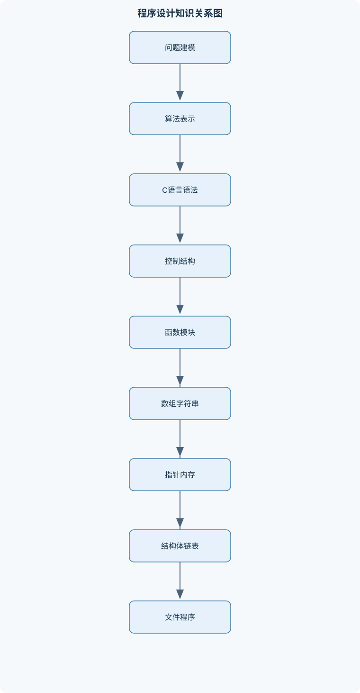
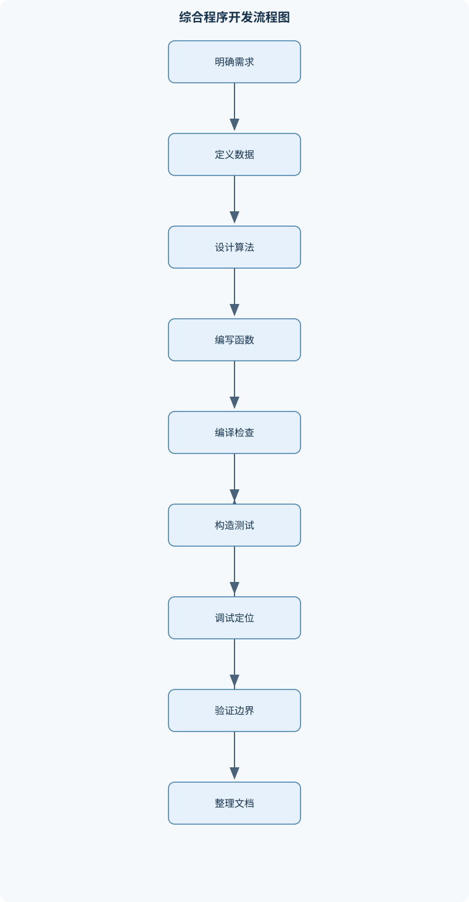

# 程序设计基础

## 一、课程整体知识框架

### 课程边界与先修知识

面向零基础或仅具少量计算机使用经验的学习者，系统讲授以C语言为载体的程序设计基础。内容边界包括问题抽象、算法表示、C语言基本语法、数据类型与表达式、顺序与选择结构、循环结构、函数与程序模块化、一维与多维数组、字符串、指针、结构体、动态内存、单向链表、文件输入输出、递归、排序查找、调试与复杂度分析。先修知识为基本数学运算、代数式读写和文件目录等基本计算机操作；不以面向对象、并发、网络、图形界面、操作系统内部机制和大型软件工程为主要教学内容。课程中的C语言特性应以所选编译器支持的C标准为前提，涉及字符编码、整数宽度、指针大小和文件换行行为时，必须区分语言规则与具体实现。





### 1. 课程目标、边界与基本思维

《程序设计基础》以 C 语言为载体，建立“问题抽象—算法设计—程序实现—测试调试—复杂度评价”的完整知识链。课程面向零基础或只有少量计算机使用经验的学习者，先修要求是能够进行基本数学运算、读写代数式，并能完成文件和目录等基本操作。

程序设计不是把自然语言逐句翻译成代码，而是先明确输入、输出、状态和约束，再选择能够终止的计算步骤。一个问题的程序模型通常包括：

1. **输入**：数据来源、数据类型、数据规模和合法范围；
2. **处理**：状态如何变化，条件何时判断，循环何时结束；
3. **输出**：结果的含义、格式和异常情况；
4. **边界**：空输入、最小值、最大值、重复值、非法输入和资源不足。

算法是解决问题的有限、明确、可执行步骤；程序是用某种编程语言表达并交给计算机执行的算法。相同算法可以用 C、其他语言或伪代码表示，而同一段 C 代码也可能因输入条件不同表现出不同执行路径。自然语言适合描述目标和约束，伪代码适合描述逻辑，流程图适合表示顺序、分支和循环，C 语言则提供可执行实现。

### 2. 从源文件到运行结果

C 程序通常由源文件、头文件和库接口组成。源文件中的预处理指令以 `#` 开头，例如 `#include <stdio.h>` 用于引入标准输入输出函数的声明。预处理不是普通的运行时语句，它发生在编译前，主要完成文件包含、宏展开等文本层面的处理。

一个最小的程序可以写成：

```c
#include <stdio.h>

int main(void) {
    printf("Hello, C\n");
    return 0;
}
```

`main` 是程序执行的入口函数。`int` 表示函数返回整数状态，通常约定返回 `0` 表示正常结束，非零值表示某种异常或失败；具体状态含义也可能由运行环境解释。`return 0;` 结束 `main` 的执行并把状态交给调用环境。

编译过程可分为预处理、编译、汇编和链接等阶段。预处理展开头文件和宏；编译器检查语法、类型并生成较低层表示；汇编阶段生成目标文件；链接器把目标文件与库实现组合成可执行程序。源代码能通过语法检查并不代表运行正确，例如数组越界、空指针解引用和逻辑条件错误可能在编译后仍然存在。

注释用于解释设计意图、前置条件和不明显的约束，不应重复代码本身。缩进应体现控制结构层次；变量名应表达含义，如 `count`、`total` 比 `x1` 更容易审查。函数应尽量完成单一职责，避免一个函数同时负责输入、复杂计算、文件写入和错误恢复。

### 3. 数据、表达式和类型转换

C 语言中的对象具有类型、值、存储位置和生命周期。整数变量通常用 `int` 表示，浮点变量通常用 `float` 或 `double` 表示，字符常量写作 `'c'`，字符串常量写作 `"abc"`。具体整数宽度、浮点精度、字符编码和指针大小由实现决定，不能仅凭类型名称假定固定字节数。

变量声明描述名称和类型，初始化在创建时提供初始值，赋值则把新的值存入已有对象。例如：

```c
int count = 0;
count = count + 1;
```

未初始化的自动变量不应直接读取，因为其值不具有可依赖的确定含义。`const` 用于表达不应通过该名称修改的对象或数据。

算术运算包括 `+`、`-`、`*`、`/` 和 `%`。当两个操作数均为整数时，`/` 执行整数除法，结果向零截断。例如：

$$
7 / 3 = 2,\qquad -7 / 3 = -2
$$

这里的 `7`、`3` 和结果 `2` 都是整数，不能把结果理解为四舍五入。若需要平均值，应在除法前把至少一个操作数转换为浮点类型：

```c
double average = (double)sum / count;
```

当 `count` 为零时，上式仍然不合法，因此类型转换不能替代除零检查。隐式类型转换会根据运算符和操作数类型自动发生；显式转换使用 `(type)`，但显式转换可能导致精度损失、截断或范围溢出，必须说明适用条件。

关系运算产生真假结果，常见运算符为 `<`、`<=`、`>`、`>=`、`==` 和 `!=`。`=` 是赋值，不是相等比较。逻辑运算 `&&`、`||` 和 `!` 具有短路求值特性：在 `A && B` 中，若 `A` 已为假，通常不再计算 `B`；在 `A || B` 中，若 `A` 已为真，通常不再计算 `B`。短路可以避免在指针为空时解引用，例如：

```c
if (p != NULL && *p > 0) {
    /* 只有p非空时才读取*p */
}
```

运算符优先级决定分组，结合性决定同一层级的组合方向，但不能用记忆优先级替代括号。表达式中多次修改同一变量并依赖求值顺序，可能产生未定义或不可移植行为，应拆成多个语句。例如，不应把 `i++ + ++i` 当作具有固定结果的表达式。

### 4. 控制结构和算法状态

顺序结构按书写顺序执行。选择结构根据条件决定路径：

```c
if (score < 0) {
    status = -1;
} else if (score <= 100) {
    status = 0;
} else {
    status = 1;
}
```

条件应覆盖合法输入的全部区间，并明确端点归属。若条件是“负数、零、正数”，可以写成 `x < 0`、`x == 0` 和 `x > 0`，它们互斥且覆盖所有整数。若改写为 `x <= 0` 和 `x >= 0`，零就可能同时满足两个条件，必须重新设计分支。

`switch` 适合根据一个整数、字符或枚举值选择离散分支。`case` 标签匹配后若没有 `break`，执行会继续进入后续分支，这称为贯穿执行。故意贯穿时必须明确注释；非故意遗漏 `break` 会造成错误结果。条件表达式 `condition ? value1 : value2` 适合表示简单的二选一，不应嵌套成难以阅读的复杂分支。

循环结构用于反复执行。`while` 先判断条件，可能一次也不执行；`do-while` 先执行一次，再判断条件；`for` 通常用于初始化、条件检查和更新步骤明确的循环。循环必须有可达的终止条件，且每轮执行应使状态向终止方向推进。

循环不变量是每轮开始或结束时始终成立的事实。例如统计数组前缀时，不变量可以是“已经处理的前 `i` 个元素中，正数计数和总和均正确”。循环结束时，若 `i == n`，不变量就能推出整个数组的统计结果。`break` 立即结束当前循环，`continue` 跳过本轮剩余语句并进入下一轮；使用它们时要检查更新语句是否仍会执行，否则可能造成死循环。

### 5. 函数、数组与字符串

函数声明给出接口，函数定义给出实现，调用时由实参提供值。C 语言普通参数按值传递，函数内部修改形参本身不会直接改变调用者变量。若要修改调用者对象，应传入其地址：

```c
void swap_int(int *a, int *b) {
    int t = *a;
    *a = *b;
    *b = t;
}
```

局部变量通常具有块作用域，函数返回后其自动存储期对象不再有效。不能返回局部数组或局部变量的地址。全局变量具有更长的存储期，但会增加模块之间的隐式依赖；静态存储期和文件作用域应根据接口设计谨慎使用。函数应明确输入、输出、可能修改的对象以及错误状态，尽量减少副作用。

一维数组 `a` 有固定数量的同类型元素，合法下标为 `0` 到 `n - 1`。`a[n]` 越界，不是最后一个元素。数组初始化时应保证容量足够；访问前必须维护长度信息。数组适合连续存储、随机访问和线性扫描，但在中间插入或删除元素时，需要移动后续元素。

数组作为函数参数时通常调整为指向首元素的指针，因此函数不能仅凭形参中的 `sizeof` 得到调用者数组长度，必须额外传入 `n`。在仍保持数组类型的上下文中，`sizeof(a)` 得到整个数组占用的字节数，而 `sizeof(p)` 得到指针本身的大小，二者不是同一概念。

字符串是以 `'\0'` 结尾的字符数组。字符串长度不包含结束符，因此容量至少应为“可见字符数加一”。字符 `'0'` 是数字字符，`'\0'` 是数值为零的结束标记，二者不能混淆。字符串复制、连接和输入都必须检查目标容量。使用 `fgets` 读取一行时，应处理可能保留在数组中的换行符；混用数字输入和行输入时，还要注意输入缓冲区中的换行字符。

二维数组 `int a[r][c]` 按行连续存储。`a[i]` 表示第 `i` 行，`a[i][j]` 表示第 `i` 行第 `j` 列，合法范围为 $0\le i<r$、$0\le j<c$。有：

$$
a[i][j] = *(*(a+i)+j)
$$

其中 `a+i` 移动的是一整行，步长取决于每行包含的元素数量，而不是一个 `int` 的字节数。

### 6. 指针、结构体和动态数据

若 `p` 指向对象 `x`，则 `p` 保存 `x` 的地址，`*p` 表示对象本身，`&x` 表示对象地址。指针加减的步长由所指对象类型决定：若 `p` 是 `int *`，`p + 1` 指向下一个 `int` 对象的位置；它不是简单地增加一个字节。只有指向有效对象、数组元素或数组末端位置的指针才能进行相应运算，只有指向有效对象的指针才能安全解引用。

数组名在多数表达式中转换为指向首元素的指针，但数组名本身不是可赋值指针。对于二维数组，数组名转换后的类型与“指向一行的指针”有关，不能误认为是 `char *` 或 `char **`。指针数组和数组指针分别表示“元素为指针的数组”和“指向数组的指针”，声明时括号会改变含义。字符指针可以指向字符数组，也可以指向字符串常量；字符串常量不应通过可写指针修改。

空指针表示不指向可访问对象，可以比较和传递，但不能解引用。野指针是未初始化或已失效的指针；释放内存后仍保存的地址属于悬空指针。`const` 可以限制通过某个指针修改数据，但不自动保证所有别名都不可修改。

结构体把多个可能不同类型的成员组合成一个对象。结构体变量用 `s.member` 访问，结构体指针用 `p->member` 访问，且：

$$
p\mathbin{\to}member = (*p).member
$$

结构体赋值会复制各成员的值；若成员是指针，只复制地址，不复制其指向的对象，这可能产生浅复制和共享数据。结构体数组适合表示一组记录，如学生、日期或文件记录。枚举用于表示有限的命名状态，`typedef` 只建立类型别名，不会创建新的运行时对象。

动态内存由 `malloc`、`calloc`、`realloc` 和 `free` 管理。申请成功后，调用者负责在不再使用时释放；申请失败必须检查返回值。每个动态对象应明确“谁申请、谁使用、谁释放”的责任。重复释放、释放后继续访问、丢失唯一指针都会造成内存错误。

单向链表结点通常包含数据域和 `next` 指针。插入时先建立新结点并设置链接，再更新前驱或头指针；删除时必须先保存后继、更新链路，再释放结点。释放后不得继续访问该结点。没有尾指针时尾插需要遍历，单次操作为 $O(n)$；维护尾指针后可降为 $O(1)$，但删除尾结点仍需定位其前驱。

### 7. 文件、递归、经典算法与质量控制

文件流用 `FILE *fp` 表示。打开文件后必须检查返回值，读写完成后必须关闭。文本文件按字符和格式处理，二进制文件按字节表示对象数据；结构体直接写入二进制文件时会受到填充、字节序、类型宽度和实现差异影响，不宜把它当作跨平台通用格式。文件模式中的读、写、追加和更新具有不同语义，覆盖写入和追加写入不能混淆。

文件读取应区分“成功读到记录”“遇到文件结束”和“发生读取错误”。不能只用 `feof` 判断下一次读取是否成功，而应先检查读取函数返回值。每条记录还要验证字段数量、范围和长度。缓冲区、关闭文件失败、空文件和文件不存在都属于应处理的边界情况。

递归函数必须有基例，且每次调用都使问题规模向基例靠近。例如十进制正整数转换为二进制时，反复令

$$
n_{\text{next}}=\left\lfloor \frac{n}{2}\right\rfloor
$$

并记录 $n\bmod 2$，直到商为零；余数从低位到高位产生，因此输出时需要逆序。递归使代码结构接近数学定义，但会使用调用栈；规模很大时，迭代通常更节省栈空间。

线性查找适用于无序数组，最坏需要比较 $n$ 次，时间复杂度为 $O(n)$。二分查找要求数组按非降序排列，并维护目标可能存在的闭区间 `[left, right]`；每轮排除约一半元素，时间复杂度为 $O(\log n)$。插入排序维护有序前缀，适合小规模或近乎有序数据，最坏时间复杂度为 $O(n^2)$、额外空间复杂度为 $O(1)$。选择排序始终进行约 $O(n^2)$ 次比较，交换次数较少但通常不稳定。冒泡排序通过相邻交换逐步移动较大元素；若只交换严格逆序的元素，可以保持相等元素的相对顺序。

复杂度中的 $n$ 表示输入规模，$O$ 表示渐进上界。分析时不能只数循环层数，还要考虑循环内部的字符串扫描、链表遍历和递归分支。测试应覆盖正常值、最小值、最大值、空数据、重复数据、非法输入和资源失败。调试器可用于观察变量、断点、调用栈和内存状态，但调试器不能证明所有输入都正确。

## 二、章节和模块划分

### 核心知识覆盖清单

本清单用于检查正文是否覆盖本课程的主要知识模块：

- **程序设计方法与C程序结构**：问题分析与输入输出建模、算法与程序的区别、自然语言与伪代码、流程图中的顺序分支循环、源文件、预处理与编译、函数main与返回状态、头文件与标准库接口、编译链接运行过程、注释、缩进与命名规范。
- **基本数据类型与表达式**：整型、浮点型与字符型、有符号与无符号整数、常量、变量与标识符、变量声明、初始化与赋值、算术、关系和逻辑运算、自增自减与复合赋值、运算符优先级和结合性、隐式类型转换与显式强制转换、整数除法与浮点除法、输入输出格式控制。
- **选择结构与分支算法**：if语句的条件求值、if-else与嵌套分支、多条件分支设计、switch与case语句、break在分支中的作用、条件表达式运算符、范围判断与边界条件、字符分类与大小写转换、分支覆盖与测试数据设计。
- **循环结构与迭代设计**：while循环、do-while循环、for循环的初始化条件更新、计数循环与条件循环、循环嵌套、break与continue、循环不变量、输入结束标志、累加、计数与极值统计、穷举法与复杂度估计。
- **函数与程序模块化**：函数声明、定义与调用、形参与实参、值传递机制、返回值与返回类型、局部变量与作用域、全局变量与静态存储期、数组参数与指针参数、递归函数的基例与递推、头文件与接口设计、模块划分和副作用控制。
- **数组与字符串处理**：一维数组声明与下标、数组初始化与越界边界、线性扫描与统计、插入、删除和移动元素、二维数组的行列布局、数组作为函数参数、字符数组与字符串结束符、字符串输入输出、字符串复制连接比较、回文、过滤和模式查找。
- **指针与内存模型**：地址、对象和值、指针声明与解引用、取地址运算符、指针加减与元素步长、数组名的表达式转换规则、数组指针与指针数组、多级指针、字符指针与字符串常量、空指针与野指针、const与指针类型、指针作为函数参数。
- **结构体、枚举与动态数据**：结构体类型定义、结构体成员访问、结构体数组、结构体指针与箭头运算符、typedef类型别名、枚举类型、动态内存分配与释放、堆对象生命周期、单向链表结点、链表插入删除遍历与合并。
- **文件与持久化数据**：文件指针与文件打开、文本文件与二进制文件、顺序读写流程、格式化文件输入输出、文件结束状态、打开失败与错误处理、追加覆盖和读写模式、结构体记录的文件存储、缓冲与关闭文件、文件数据的边界验证。
- **经典算法、递归与综合程序设计**：线性查找与二分查找、选择排序与插入排序、冒泡排序及稳定性、排序关键字与交换、递归求数列与进制转换、递归与迭代的比较、时间复杂度和空间复杂度、测试用例与边界覆盖、调试器观察变量和调用栈、分层设计综合项目。


### 1. 模块一至三：程序结构、数据表达式与选择

#### 1.1 问题建模和 C 程序结构

本模块先用“输入—处理—输出”描述问题，再用伪代码或流程图表示顺序、分支和循环，最后转换为 C 程序。重点不是记忆语法，而是把每条语句对应到一个明确的状态变化。程序结构包括头文件、函数声明、`main`、局部变量、语句块、返回状态和注释规范。

#### 1.2 基本类型、运算和格式控制

通过整数、浮点数和字符建立类型意识。输入输出函数中的格式说明必须与对象类型匹配；格式错误可能导致错误读取或未定义行为。表达式分析应依次检查括号、优先级、结合性、类型转换和副作用。例如：

```c
int a = 7;
int b = 2;
double x = a / b;
double y = (double)a / b;
```

`x` 为 `3.0`，因为除法先按整数执行；`y` 为 `3.5`，因为转换发生在除法之前。若把 `a / b` 写成 `a * 1.0 / b`，也会使运算进入浮点语境，但应注意中间值和溢出边界。

#### 1.3 条件分支和测试覆盖

分支设计应先划分互斥区间，再决定书写顺序。测试数据至少包括每个分支的一般值和边界值。字符分类不能把字符 `'1'` 直接当整数 `1` 使用；大小写转换也应先判断字符是否处于对应字母范围，不能对任意编码值盲目加减。

### 2. 模块四至六：循环、函数、数组和字符串

#### 2.1 循环统计与穷举

循环应明确初始化、循环条件、状态更新和终止标志。输入结束标志不能计入统计。例如统计若干整数直到输入 `-1`，则应先判断是否为结束标志，再更新正数、负数、零的计数。若有效数据个数为零，平均值不能计算，应输出“无有效数据”或返回错误状态。

穷举法适合候选范围有限、判定条件明确的问题。应先估计候选数量和单次检查成本；两层循环常见复杂度为 $O(n^2)$，但若每次内部还进行字符串扫描，实际复杂度可能更高。

#### 2.2 函数接口和模块化

函数接口至少应说明参数含义、合法范围、返回值和副作用。数组参数必须同时传入长度；指针参数必须说明是否允许为空、是否可修改对象以及对象生命周期由谁负责。递归函数应明确基例和规模递减关系，避免递归深度不可控。

#### 2.3 数组、矩阵和字符串

数组扫描可用于求和、计数、极值和查找。插入元素时，应从后向前移动，防止尚未复制的数据被覆盖；删除元素时，应从删除位置向前移动。二维矩阵的主对角线条件是 $i=j$，副对角线条件是 $i+j=n-1$。若方阵阶数 $n$ 为奇数，两条对角线共享中心元素；若要求“所有对角线元素只计一次”，应在累加副对角线时排除中心位置。

### 3. 模块七至九：指针、结构体、动态内存和链表

#### 3.1 指针与数组关系

`a[i]` 与 `*(a+i)` 等价，但前提是指针运算处于合法数组范围内。对二维数组，`a+i` 移动一整行；把二维数组强行当作 `char **` 会破坏类型和地址布局。指针参数能够使函数修改调用者对象，也能返回动态对象，但必须避免返回局部对象地址。

#### 3.2 结构体记录与动态对象

日期、学生和文件记录都适合用结构体表示。日期计算时，应先验证月份和日期范围，再根据闰年规则确定二月天数：

$$
\text{leap}(y)=(y\bmod 400=0)\lor
\big((y\bmod 4=0)\land(y\bmod 100\ne0)\big)
$$

该规则仅适用于采用公历闰年规则的日期表示，并不适用于所有历法。计算年内第几天时，先累加前置月份天数，再加当前日；闰年且月份大于二月时额外加一天。

#### 3.3 单向链表

链表操作必须区分空链表、头结点、中间结点和尾结点。尾插若没有尾指针需要从头遍历；删除头结点必须更新头指针，删除其他结点必须让前驱跳过被删结点。若生成筛选链表，应明确是复用原结点还是申请新结点：复用结点节省内存但会改变原链表，新建结点则需要处理申请失败和最终释放。

### 4. 模块十：文件和持久化数据

文本文件适合保存可读记录，格式化读取便于字段解析，但必须验证每条记录。写文件前应确定是覆盖还是追加；统计文件时应先检查打开状态，再逐条读取，成功解析后更新结果，遇到格式错误时决定跳过、停止或报告错误。空文件的平均值没有定义，不能直接进行除法。

结构体记录写入文件时，文本格式便于跨实现读取；二进制格式效率较高，但可能依赖结构体布局和类型表示。文件关闭不仅释放资源，也使缓冲数据得到刷新；关闭失败应根据程序可靠性要求处理。

### 5. 模块十一：经典算法与综合设计

#### 5.1 顺序查找

**输入**：数组 `a`、长度 `n`、目标 `key`。  
**输出**：一个匹配下标，或 `-1`。  
**过程**：从 `i = 0` 开始逐项比较，匹配立即返回，否则令 `i++`。  
**不变量**：已扫描区间内没有目标。  
**终止**：找到目标或 `i == n`。  
**适用条件**：数组可以无序。  
**复杂度**：最好 $O(1)$，最坏 $O(n)$，额外空间 $O(1)$。

#### 5.2 二分查找

**前提**：数组按非降序排列，且支持随机访问。  
设置 `left = 0`、`right = n - 1`。若 `left <= right`，取中点并比较。若中间值小于目标，令 `left = mid + 1`；若大于目标，令 `right = mid - 1`；相等则返回。其不变量是：目标若存在，必在闭区间 `[left, right]` 内。区间为空时返回 `-1`。时间复杂度为 $O(\log n)$，额外空间为 $O(1)$。

#### 5.3 插入排序

```c
#include <stddef.h>

void insertion_sort(int a[], size_t n) {
    for (size_t i = 1; i < n; ++i) {
        int key = a[i];
        size_t j = i;

        while (j > 0 && a[j - 1] > key) {
            a[j] = a[j - 1];
            --j;
        }
        a[j] = key;
    }
}
```

每轮开始时，前缀 `a[0..i-1]` 已按非降序排列。保存 `key` 后，从后向前移动大于 `key` 的元素，再写入空位。由于只移动严格大于 `key` 的元素，相等元素保持相对顺序，因而具有稳定性。最好时间复杂度为 $O(n)$，最坏为 $O(n^2)$，额外空间为 $O(1)$。数组为空或只有一个元素时，循环不执行，结果已经有序。

#### 5.4 链表按值删除流程

输入头指针 `head` 和目标值 `key`。若链表为空，直接返回空指针；若头结点匹配，保存其后继，释放旧头并返回新头；否则使用 `prev` 和 `cur` 遍历，找到匹配结点后令 `prev->next = cur->next`，再释放 `cur`。若遍历到空指针仍未找到，则链表保持不变。时间复杂度为 $O(n)$，额外空间为 $O(1)$。删除前必须保存必要链接，释放后不能再访问 `cur`。

### 6. 代表性例题

#### 例题一：整数除法和平均值

**题干**：输入总分 `sum = 7`、人数 `count = 2`，分别计算整数平均值和真实平均值。

**分析**：两个整数直接相除会执行整数除法；要得到小数，必须在除法前转换。

**逐步解答**：

```c
int integer_average = sum / count;
double real_average = (double)sum / count;
```

`integer_average` 为 `3`，`real_average` 为 `3.5`。若 `count == 0`，两种写法都不能执行，必须先判断。

**结果验证**：$7=3\times2+1$，整数除法余数被舍弃；浮点计算保留真实比例。

**变式**：若 `sum` 可能超过 `int` 范围，应扩大累加类型或在输入时进行范围检查；不能仅在最后一步转换来避免前面已经发生的溢出。

#### 例题二：分段函数

**题干**：输入整数 `x`，负数输出 `-1`，零输出 `0`，正数输出 `1`。

**分析**：三个区间必须互斥且覆盖全部整数。

**逐步解答**：

```c
if (x < 0) {
    result = -1;
} else if (x == 0) {
    result = 0;
} else {
    result = 1;
}
```

**结果验证**：测试 `-3`、`0`、`5`，分别覆盖三个分支；条件不会重复，且没有遗漏整数。

**变式**：若要求输出“负数、零、正数”的文字，应注意字符串输出与字符输出的区别；若范围改为“成绩小于 60、不小于 60 且小于 90、不小于 90”，必须明确 `60` 和 `90` 的归属。

#### 例题三：循环统计

**题干**：输入若干整数，以 `-1` 结束，统计正数、负数和零的数量，并计算有效数据平均值。

**分析**：结束标志必须在统计前判断；平均值要求有效数据数量大于零。

**逐步解答**：

1. 初始化 `positive = 0`、`negative = 0`、`zero = 0`、`sum = 0`、`count = 0`；
2. 读取一个整数；
3. 若等于 `-1`，结束循环；
4. 否则增加 `count`，累加 `sum`，并按符号更新计数；
5. 循环结束后，若 `count == 0`，报告无有效数据，否则计算 `(double)sum / count`。

**结果验证**：输入 `3 -2 0 5 -1`，正数为 2，负数为 1，零为 1，总和为 6，数量为 4，平均值为 `1.5`；`-1` 不参与统计。

**变式**：若 `-1` 也是合法数据，则不能再把它作为结束标志，应改用单独的数量输入、文件结束状态或其他不会与有效数据冲突的标志。

#### 例题四：有序数组插入

**题干**：在容量足够的升序数组 `[1, 3, 5, 8]` 中插入 `4`。

**分析**：插入位置是第 2 个元素位置。为防止覆盖，从末端向前移动。

**逐步解答**：

1. 找到第一个不小于 `4` 的位置 `pos = 2`；
2. 将 `a[3]` 移到 `a[4]`；
3. 将 `a[2]` 移到 `a[3]`；
4. 把 `4` 写入 `a[2]`；
5. 新数组为 `[1, 3, 4, 5, 8]`。

**结果验证**：相邻元素满足非降序；原有四个元素均保留。

**变式**：若重复值插入 `5`，选择插入到第一个 `5` 前或最后一个 `5` 后会影响相等元素的相对次序；若数组容量只有 4，则必须先报告空间不足，不能写入 `a[4]`。

#### 例题五：字符串回文判断

**题干**：判断字符数组 `"level"` 是否为回文，空格是否参与比较由程序约定。

**分析**：设置左下标 `left = 0` 和右下标 `right = length - 1`，逐步比较两端字符。

**逐步解答**：

1. 比较 `l` 与 `l`，相等；
2. 比较 `e` 与 `e`，相等；
3. 两个下标相遇，判断为回文；
4. 空字符串和单字符字符串也应返回真，除非题目另有规定。

**结果验证**：`"level"` 从两端向内完全匹配；`"hello"` 在 `h` 与 `o` 处失败。

**变式**：若忽略空格和大小写，应先定义过滤规则，例如只保留字母并统一大小写；否则 `"A man..."` 一类输入不能直接按原字符比较。

#### 例题六：矩阵对角线

**题干**：计算 $3\times3$ 矩阵两条对角线之和，并且中心元素只计一次。

**分析**：主对角线满足 $i=j$，副对角线满足 $i+j=n-1$。当 $n$ 为奇数时，中心位置同时满足两个条件。

**逐步解答**：遍历 `i = 0..n-1`，累加 `a[i][i]` 和 `a[i][n-1-i]`；若 `n` 为奇数，减去中心元素 `a[n/2][n/2]` 一次。

**结果验证**：中心元素先被计算两次，再减去一次，最终只保留一次。

**变式**：若题目要求“按两条对角线分别求和”，则不应去重；题意决定公式和程序。

### 7. 实验与综合项目

#### 实验一：数组与字符串处理实验

**输入数据**：一组不超过固定容量的整数数组，以及一行以 `'\0'` 结尾的字符串。  
**步骤**：

1. 读取并验证元素个数不超过数组容量；
2. 实现线性扫描，输出总和、最大值、最小值；
3. 实现字符串过滤，删除指定字符；
4. 实现回文判断；
5. 用空数组、单元素、全重复、含空格和接近容量上限的数据测试。

**评价标准**：

- 下标始终处于合法范围；
- 空数据不会执行除零或访问无效元素；
- 字符串结束符保持正确；
- 过滤后结果与预期一致；
- 函数接口明确传入长度，不依赖错误的 `sizeof`。

**排错方法**：在循环入口和写入位置设置断点，观察读下标、写下标和结束符位置；若结果少一个字符，优先检查是否把长度和容量混淆；若输入异常，检查数字读取后的换行残留。

#### 实验二：学生记录文件项目

**输入数据**：文本文件中的学生编号、姓名和若干成绩；输出统计结果文件。  
**步骤**：

1. 定义包含编号、姓名和成绩数组的结构体；
2. 打开输入文件并检查是否成功；
3. 逐条读取，验证成绩范围和姓名容量；
4. 计算每条记录总分和平均分；
5. 统计平均成绩最高者，正确处理并列；
6. 以覆盖或追加模式打开输出文件，并写入结果；
7. 检查写入状态并关闭所有文件。

**评价标准**：

- 文件不存在、空文件和格式错误均有明确处理；
- 记录数不超过结构体数组容量；
- 平均分使用浮点除法且不对空记录除零；
- 并列最高者不会被无意覆盖；
- 关闭文件并释放动态资源；
- 输出文件内容能够被再次读取验证。

**排错方法**：分别测试不存在文件、空文件、单条记录、成绩边界、格式缺字段和超过容量的文件；若读取提前结束，检查格式说明符和返回值；若输出为空，检查是否使用了错误的文件模式或未执行写入。

### 8. 具体易错点

1. 把字符常量 `'1'` 当作整数 `1`；
2. 把字符串结束符 `'\0'` 与字符 `'0'` 混淆；
3. 把 `=` 写成 `==` 或反过来；
4. 忽略整数除法的截断；
5. 在表达式中多次修改同一变量并依赖求值顺序；
6. 把 `a[n]` 当作长度为 `n` 的最后一个元素；
7. 用 `sizeof` 计算已经作为参数传入的数组长度；
8. 把数组名当作可以重新赋值的指针；
9. 返回局部变量或局部数组的地址；
10. 未初始化自动变量就读取；
11. 未检查动态内存申请结果；
12. 释放后继续访问或重复释放；
13. `switch` 中遗漏 `break`；
14. 循环更新缺失导致死循环；
15. 递归缺少基例或规模没有减小；
16. 结构体含指针时误以为赋值会深复制；
17. 文件打开失败后仍使用文件指针；
18. 用 `feof` 代替读取函数返回值；
19. 链表删除后仍访问已释放结点；
20. 混用数字输入和行输入时忽略残留换行符。

### 9. 典型笔试问题及解答思路

#### 问题一：`7 / 2` 和 `7.0 / 2` 的结果有何不同？

`7 / 2` 的两个操作数均为整数，结果为整数 `3`；`7.0 / 2` 至少有一个浮点操作数，通常进行浮点除法，结果为 `3.5`。判断时应先看运算发生时的操作数类型，而不是只看接收结果的变量类型。

#### 问题二：为什么数组参数中不能用 `sizeof` 得到元素个数？

数组作为函数参数时通常调整为指向首元素的指针。函数内部的 `sizeof(parameter)` 得到的是指针大小，而不是调用者数组的总字节数。因此必须额外传入长度。

#### 问题三：`a[i]` 为什么等价于 `*(a+i)`？

下标运算定义为指针加法后解引用。若 `a` 指向元素类型 `T`，`a+i` 移动 `i` 个 `T` 对象，随后 `*` 取得第 `i` 个元素。该等价关系要求指针运算和解引用均处于合法范围。

#### 问题四：二分查找为什么必须有序？

二分查找依据中间值排除一半区间。只有当数组有序时，比较结果才能说明目标不可能位于某一侧。无序数组中，中间值大小不能推出其他元素的位置关系。

#### 问题五：插入排序为什么从后向前移动？

插入位置之后的元素需要整体右移。若从前向后复制，前面写入的数据可能覆盖尚未处理的原数据；从后向前可以先保存后部元素，避免覆盖。

#### 问题六：递归为什么必须有基例？

基例提供无需继续分解的直接答案。若没有可达基例，递归调用不会停止；若参数不向基例靠近，即使写了基例也可能永远到达不了，最终耗尽调用栈。

#### 问题七：结构体含指针时直接赋值有什么风险？

结构体赋值逐成员复制，指针成员只复制地址。两个结构体可能共同指向同一动态对象，修改一方会影响另一方，释放时还可能重复释放。若需要独立对象，应实现深复制。

#### 问题八：文件读取为什么不能只判断 `feof`？

文件结束状态通常在尝试读取失败后才被设置。正确流程是先检查读取函数是否成功，再区分文件结束和读取错误；否则可能把最后一次失败读取误当作有效记录。

### 10. 典型面试问题及参考要点

#### 问题一：如何保证一个数组函数不越界？

参考答案：函数同时接收数组首地址和长度，所有下标满足 `0 <= i < n`，并在写入前检查容量。追问时应说明空数组、`n` 为零和整数长度类型的处理。

#### 问题二：C 语言如何实现函数修改调用者变量？

参考答案：传入变量地址，在函数内通过指针解引用修改对象。追问包括空指针检查、指针生命周期和 `const` 对可修改性的限制。

#### 问题三：什么时候选择数组，什么时候选择链表？

参考答案：数组连续存储、随机访问快、缓存局部性较好，但中间插入删除需要移动元素；链表插入删除在已知结点位置时链接调整简单，但随机访问需要遍历且有额外指针开销。追问应结合操作频率和内存管理成本回答。

#### 问题四：如何定位一个程序的死循环？

参考答案：检查循环初值、条件和更新，确认循环变量确实向终止条件推进；用断点观察变量是否重复，必要时增加迭代次数保护。追问可讨论输入不变化、整数溢出和 `continue` 跳过更新语句等情况。

#### 问题五：如何处理 `malloc` 失败？

参考答案：检查返回值是否为空；失败时释放此前已经申请的资源，返回错误状态或采取降级路径，不能继续解引用空指针。追问包括资源所有权和多次申请失败时的清理顺序。

#### 问题六：如何设计可测试的文件处理函数？

参考答案：把打开、解析、业务统计和输出分层；解析函数返回成功、结束或错误状态；调用者检查每一步结果。追问包括空文件、格式错误、关闭失败和覆盖写入风险。

#### 问题七：如何解释时间复杂度和空间复杂度？

参考答案：以输入规模 `n` 描述运行步骤和额外存储随规模增长的趋势。应说明最好、最坏或平均情形的前提，不能只根据代码行数判断。追问包括字符串操作、嵌套遍历和递归栈是否计入。

#### 问题八：调试器中的调用栈有什么用？

参考答案：调用栈显示当前函数及其调用路径，可定位错误发生在哪一层、参数如何传递以及递归是否过深。追问应说明调用栈只能帮助观察一次运行，不能替代边界测试和静态分析。

### 11. 岗位关联与课程产出

初级软件开发岗位常见任务包括实现数据处理函数、维护模块接口和修复边界错误，主要使用控制结构、函数、数组、指针和调试知识；产出是可编译代码、测试用例和错误说明，验收标准包括功能正确、无明显越界和接口行为明确。

嵌入式软件岗位需要关注整数宽度、内存资源、指针访问、结构体布局和文件或设备数据解析；产出通常是资源受限环境中的模块代码和测试记录，验收标准包括边界值处理、内存使用可控和不依赖未说明的实现特性。

测试开发与自动化测试岗位需要把输入边界、错误路径和文件数据组织成可重复测试，使用分支覆盖、循环边界、字符串处理和调试工具；产出是测试程序、测试数据和缺陷报告，验收标准是测试结果可复现、失败原因可定位、正常与异常路径均有验证。

软件质量与代码审查岗位重点检查接口契约、未定义行为、资源释放、复杂度和命名结构；产出是审查意见和修改建议，验收标准是问题具有具体位置、触发条件和修复方案，而不是只给出笼统的“代码不规范”。

数据处理与脚本开发岗位虽然可能使用其他语言，但仍需使用输入建模、记录解析、统计、排序、查找、文件读写和异常处理思想；产出是可重复运行的转换程序和结果文件，验收标准包括格式验证、空数据处理、重复数据处理和结果可核验。

系统工具和技术支持岗位常编写日志统计、配置解析和批量数据检查工具，使用字符串、结构体、文件流、错误状态和模块化知识；产出是命令行工具或分析程序，验收标准包括输入错误提示清晰、不会因单条坏记录导致资源泄漏，并能输出明确的成功或失败状态。

## 三、核心概念的详细解释

### 1. 问题抽象、算法与程序

程序设计首先要把现实问题转换为可计算的问题。一个完整的问题模型至少要说明输入、输出、处理规则和边界条件。例如，“求一组成绩的平均值”不能只写成“把成绩相加再除以人数”，还必须明确成绩数量是否允许为零、成绩是否可能超出范围、总和是否可能溢出，以及平均值需要保留多少位小数。

算法是解决问题的有限步骤集合，要求步骤明确、可执行，并在满足条件时终止。程序是算法在某种程序设计语言中的具体表达。算法可以用自然语言、伪代码或流程图表示，再用 C 语言实现。自然语言适合说明目标和约束，但容易产生歧义；伪代码突出处理步骤；流程图适合观察顺序、分支和循环；C 程序则必须同时满足语法和类型规则。

一个算法通常可以分解为三类基本控制结构：

- **顺序**：按照书写顺序依次执行；
- **选择**：根据条件选择一条或多条执行路径；
- **循环**：在条件满足时重复执行一段操作。

这三类结构可以组合出线性查找、统计、排序、文件处理和链表操作等程序。设计循环时必须明确循环变量、初始状态、继续条件、状态更新和终止条件。若变量没有更新，或更新方向不能使条件最终变假，就可能形成死循环。

### 2. C 程序的组成与执行过程

C 源程序通常由预处理指令、类型和变量声明、函数定义、表达式和语句构成。`#include <stdio.h>` 是预处理指令，用于引入标准输入输出接口的声明；它不是运行时执行的普通语句。程序入口通常是：

```c
#include <stdio.h>

int main(void) {
    printf("hello\n");
    return 0;
}
```

`main` 函数返回 `int`，返回值会交给运行环境。通常以 `0` 表示正常结束，非零值表示某种失败或异常，但具体状态如何被解释取决于运行环境。`void` 表示 `main` 不接收命令行参数；若使用命令行参数，应采用符合所选 C 标准的另一种 `main` 形式。

从源文件到可执行程序通常经历以下阶段：

1. **预处理**：展开头文件、宏和条件编译指令；
2. **编译**：进行语法、类型和部分语义检查，生成目标代码；
3. **汇编**：把汇编表示转换为目标文件；
4. **链接**：把多个目标文件和库实现组合为可执行程序；
5. **运行**：操作系统或运行环境加载程序并调用 `main`。

编译成功只说明某些语法和类型检查通过，并不保证逻辑正确。数组越界、错误的循环条件、空指针解引用、内存泄漏和文件读取错误，都可能在运行时出现。反过来，链接错误通常不是算法错误，而是函数声明、函数定义和库实现之间没有正确连接。

注释应说明设计意图、前置条件、边界限制或非直观原因，而不应机械重复代码。例如，`i++` 后面再写一条“i 加一”的注释没有实际价值；说明“该循环只处理已经通过格式校验的记录”则有助于审查。

### 3. 数据类型、对象与存储

C 语言中的对象是可以存储值的实体，例如变量、数组元素和结构体成员。对象具有类型、存储位置和生命周期。类型决定对象能够表示的值、参与运算时的解释方式以及所需存储空间。

常用基本类型包括：

- `int`：通常用于整数；
- `float`、`double`：用于近似表示实数；
- `char`：用于字符型对象，也属于整数类型；
- `void`：表示没有值或不指定具体对象类型。

具体整数宽度、浮点精度、字符编码、指针大小和字节数由实现决定。不能仅凭 `int` 就断言一定占用四个字节，也不能认为字符一定采用某一种编码。若程序需要固定宽度，应使用所选实现提供的相应类型和接口，并明确其适用前提。

变量声明建立名称与类型的联系，初始化是在对象建立时提供初值，赋值则修改已有对象的值：

```c
int count = 0;   /* 初始化 */
count = count + 1; /* 赋值 */
```

自动存储期变量若未初始化，不应直接读取。`const` 表示不能通过该名称修改对象，但并不自动表示对象存储在只读区域，也不等同于编译期常量。

字符常量和字符串常量必须区分：

```c
char ch = '1';       /* 一个字符 */
char text[] = "1";   /* 两个字符：'1' 和 '\0' */
```

字符 `'1'` 的值是某种字符编码，不等于整数 `1`；字符串 `"1"` 是字符数组内容，末尾还隐含空字符 `'\0'`。字符 `'0'` 也不等于空字符 `'\0'`。

### 4. 表达式、类型转换与求值

算术运算符包括 `+`、`-`、`*`、`/` 和 `%`。当两个操作数均为整数时，除法执行整数除法，结果向零截断：

```c
int a = 7 / 3;    /* a 为 2 */
int b = -7 / 3;   /* b 为 -2 */
```

若要计算平均值，应在除法前转换：

```c
double average = (double)sum / count;
```

这里 `(double)sum` 先把 `sum` 转为浮点值，再进行除法。若写成 `(double)(sum / count)`，整数除法已经先截断，转换只能把错误的整数结果变成浮点格式，不能恢复小数。

关系运算符产生真假结果，包括 `<`、`<=`、`>`、`>=`、`==` 和 `!=`。赋值运算符 `=` 与相等比较 `==` 功能完全不同。逻辑运算符 `&&`、`||` 和 `!` 用于组合条件。`&&` 和 `||` 具有短路求值性质：`A && B` 中若 `A` 为假，通常不再求 `B`；`A || B` 中若 `A` 为真，通常不再求 `B`。这可用于保护指针或下标访问，例如：

```c
if (p != NULL && *p > 0) {
    /* 只有 p 非空时才解引用 */
}
```

运算符优先级决定表达式的分组，结合性决定同一优先级运算符的组合方向，但优先级不等于所有子表达式的实际求值顺序。若一个表达式多次修改同一对象并依赖修改顺序，可能产生未定义或不可移植行为，应拆成多个语句：

```c
i++;
a[i] = i;  /* 将副作用分开，避免依赖复杂求值顺序 */
```

自增、自减和复合赋值会产生副作用。`x++` 的值通常是递增前的旧值，之后使 `x` 加一；`++x` 先加一再产生新值。初学阶段不应在同一表达式中多次使用它们。

### 5. 选择、循环与边界

`if` 适合表达条件分支。多个区间条件应优先设计为互斥且覆盖完整。例如对整数 `x` 分为负数、零和正数：

```c
if (x < 0) {
    /* 负数 */
} else if (x == 0) {
    /* 零 */
} else {
    /* 正数 */
}
```

`else if` 链从上到下判断，某个条件成立后执行对应语句，其余条件不再判断。嵌套分支应明确每个 `else` 对应的 `if`，必要时使用花括号，即使分支中只有一条语句。

`switch` 适合根据一个整数型、字符型或枚举型表达式选择离散分支。`case` 标签必须是满足语言要求的常量表达式。通常每个分支末尾需要 `break`，否则会继续执行后面的分支，这种行为称为贯穿执行。若有意贯穿，应在代码中明确说明原因。范围判断不能直接用数学上的连写形式：

```c
if (0 <= x && x <= 100) {
    /* 正确 */
}
```

在 C 中，`0 <= x <= 100` 会先计算 `0 <= x`，得到 `0` 或 `1`，再与 `100` 比较，通常不能表达预期范围。

`while` 先判断条件，可能一次也不执行；`do...while` 先执行一次，再判断条件；`for` 将初始化、继续条件和更新位置集中表达，适合计数循环。循环应维护一个不变量，即每次循环开始时都成立的事实。例如线性扫描数组时，可以规定“下标 `0` 到 `i-1` 已经检查过，且其中没有目标值”。每次检查一个新元素后，不变量继续成立，直到 `i == n`，从而得出整个数组不含目标值。

`break` 立即结束所在的最近一层循环或 `switch`；`continue` 跳过本轮剩余语句，进入下一轮循环。嵌套循环中，二者只影响最近的一层，不能误认为会结束所有循环。

### 6. 函数、作用域与模块化

函数通过名称、参数和返回类型形成接口。函数声明告诉编译器如何调用，函数定义提供具体实现，函数调用传入实参。例如：

```c
int max_value(const int a[], int n);

int max_value(const int a[], int n) {
    int best = a[0];
    for (int i = 1; i < n; ++i) {
        if (a[i] > best) {
            best = a[i];
        }
    }
    return best;
}
```

C 的普通参数按值传递。调用时，形参获得实参值的副本；修改形参本身不会直接改变调用者的变量。若函数需要修改调用者对象，应传入该对象的地址：

```c
void swap_int(int *x, int *y) {
    int temp = *x;
    *x = *y;
    *y = temp;
}
```

调用 `swap_int(&a, &b)` 时，函数通过指针访问调用者的两个对象。指针参数必须满足前置条件：指针非空，并且指向仍然有效且可修改的对象。

局部变量通常只在所在函数或代码块内可见；函数返回后，局部自动变量的生命周期结束。不能返回局部数组或局部变量的地址。全局变量具有更长的存储期，但会增加模块间耦合；静态局部变量保留函数调用之间的值，却仍受作用域限制。模块化设计应尽量通过参数和返回值传递数据，减少隐式全局状态和不可见副作用。

数组作为函数参数时通常调整为指向首元素的指针，因此函数无法仅凭参数声明得到数组长度，必须额外传入 `n`。这也是数组处理函数常采用 `(数组地址, 元素个数)` 接口的原因。

### 7. 数组、字符串与二维数据

数组包含固定数量、相同类型且连续存储的元素。若声明 `int a[5]`，合法下标为 `0` 到 `4`，`a[5]` 已越界。数组越界不是“取到下一个位置”这么简单，而是对无权访问的存储进行操作，结果可能错误、崩溃或表现出难以复现的行为。

数组名在多数表达式中转换为指向首元素的指针，但数组本身不是可重新赋值的指针。`sizeof(a)` 在数组仍保持数组类型时得到整个数组的字节数；数组作为函数参数后通常已经调整为指针，`sizeof(a)` 得到的是指针大小，不能用来计算调用者数组的元素数。

字符串是以 `'\0'` 结尾的字符序列。长度不包括结束符，容量则必须包括结束符。例如保存最多 9 个可见字符，字符数组至少需要 10 个元素。字符串复制、连接和输入都必须验证目标容量。`fgets` 读取一行时通常会保留换行符，程序需要根据需求删除它；而使用数字输入后再读取整行，还要处理输入缓冲区中残留的换行。

二维数组可以理解为“数组的数组”。`int a[r][c]` 按行连续存储，`a[i]` 表示第 `i` 行，包含 `c` 个 `int` 元素。对二维数组指针加一会移动一整行，而不是移动一个整数。矩阵主对角线满足 `i == j`，副对角线满足 `i + j == n - 1`。奇数阶矩阵的中心元素同时位于两条对角线上，是否重复计入必须由题目明确规定。

### 8. 指针、结构体与动态内存

若指针 `p` 指向对象 `x`，则 `p` 保存地址，`*p` 表示对象 `x`，`&x` 表示对象地址。只有指向有效对象或数组元素的指针才可以安全解引用。空指针表示不指向可访问对象，可以比较和传递，但不能解引用。未初始化指针、指向已释放对象的指针和指向已结束生命周期对象的指针都不能安全使用。

指针加减按所指类型的元素大小移动。若 `p` 是 `int *`，则 `p + 1` 指向下一个 `int` 位置；它不表示地址数值简单加一个字节。数组下标关系为：

$$
a[i] \equiv *(a+i)
$$

其中 `a` 在该表达式中转换为指向首元素的指针。二维数组关系为：

$$
a[i][j] \equiv *(*(a+i)+j)
$$

这里 `a+i` 移动的是第 `i` 行，`a[i]+j` 移动的是该行中的第 `j` 个元素。

结构体把多个可能不同类型的成员组合为一个对象：

```c
struct Student {
    int id;
    char name[32];
    double score;
};
```

结构体变量用 `s.member` 访问，结构体指针用 `p->member` 访问，且 `p->member` 等价于 `(*p).member`。结构体赋值会复制各成员的值；如果成员是指针，复制的是地址，不会自动复制指针所指向的动态对象，因此可能形成共享数据或浅复制问题。

动态内存通常由分配函数获得，由释放函数归还。分配成功后对象具有独立生命周期；释放后不能继续访问，也不能重复释放。分配失败必须检查返回值。动态内存适合元素数量运行时才知道、或需要链表等动态结构的场景，但每次成功分配都必须有明确的释放责任。

单向链表结点通常包含数据域和后继指针。插入、删除时必须先保存必要的后继关系，再修改链接，最后释放不再使用的结点。删除头结点必须更新头指针；释放后继续访问原结点属于未定义行为。链表没有数组的随机访问能力，按位置访问通常需要从头遍历。

### 9. 文件、递归与调试

`FILE *` 表示由标准输入输出库管理的文件流。文件操作一般遵循“打开—检查—读写—检查状态—关闭”的流程。打开失败时不能继续使用无效文件指针。文本模式和二进制模式的换行处理、字符表示和文件内容解释可能因实现和平台不同而不同，不能把二进制文件简单当作可移植的文本文件。

顺序读取应区分三种情况：成功读取一条记录、到达文件结束、发生格式或输入错误。不能只依据某个数据变量是否为零判断文件结束，因为零可能是合法数据。写文件时应区分覆盖和追加模式；关闭文件可以刷新缓冲区，因此关闭失败也应根据程序可靠性要求处理。

递归函数把问题分解为规模更小的同类问题。一个正确递归函数至少要有可达基例，并且每次递归调用都使规模向基例靠近。例如整数除基数转换时，下一次调用使用 `n / base`，规模会减小；若递归参数不变，可能无限递归并耗尽调用栈。递归通常使用额外栈空间，迭代版本可能更节省空间，但实现上不一定更简单。

调试应先稳定复现问题，再缩小触发范围，观察变量、数组边界、调用栈和文件状态，最后验证修复没有破坏其他路径。断点只能帮助观察执行，不能替代边界分析。测试数据至少应覆盖空输入、单元素、最小值、最大值、重复值、已排序和逆序数据、非法格式及资源失败路径。

## 四、重要定义、公式、定理和推导

### 专业审校补充：关键定义与适用边界

动态内存的核心边界是“对象生命周期”与“所有权”必须明确。调用 malloc 或 calloc 成功后，返回地址指向一块具有确定大小的堆对象；程序应保存唯一有效指针，并约定由哪个函数负责最终 free。free 之后对象生命周期结束，原指针成为悬空指针，不能再解引用，也不能重复 free。realloc(p, new_size) 可能在原地扩展，也可能申请新区域并复制旧数据；若失败，原区域仍然有效，因此不能直接写成 p = realloc(p, new_size)，否则可能丢失原地址。安全做法是先用临时指针接收结果，成功后再更新正式指针。扩容后，旧指针若已被 realloc 释放则不能继续使用。动态数组通常维护三个状态：元素指针、当前元素个数和容量；必须保证 0≤size≤capacity，访问下标满足 0≤i<size。malloc 只保证获得一块适合存储指定字节数的区域，不保证内容初始化；calloc 会将分配区域按字节清零，但不能把所有类型的“有效初值”简单等同于零。若元素中含有指针，释放外层结构不等于释放其指向对象，必须根据所有权逐层处理。上述规则适用于标准 C 的动态存储管理；具体可用堆大小、分配失败原因和调试器表现由运行环境决定。


### 1. 数组下标与指针运算

设 `a` 是含有元素类型 `T` 的数组，`a` 在表达式中转换为指向首元素的 `T *`。根据下标运算定义：

$$
a[i] = *(a+i)
$$

推导过程如下：

1. `a` 表示首元素地址；
2. `a+i` 表示从首元素向后移动 `i` 个 `T` 对象；
3. 指针移动的实际字节数由 `sizeof(T)` 决定；
4. 对该地址解引用得到第 `i` 个元素。

因此，合法下标必须满足：

$$
0 \le i < n
$$

其中 $n$ 是数组元素个数。`a[n]` 不属于数组范围，不能因为地址计算看似连续就认为访问安全。该结论适用于普通一维数组和指向数组元素的有效指针，不适用于任意整数强行转换得到的地址。

对于二维数组 `int a[r][c]`：

$$
a[i][j] = *(*(a+i)+j)
$$

因为 `a+i` 指向第 `i` 行，而每行有 `c` 个 `int` 元素，所以 `a+i` 的步长是整行大小，而不是单个元素大小。合法范围为：

$$
0 \le i < r,\qquad 0 \le j < c
$$

### 2. 整数除法、平均值与类型转换

当 `x`、`y` 都是整数且 $y\ne0$ 时，C 的整数除法结果向零截断：

$$
q = \operatorname{trunc}(x/y)
$$

例如 $7/3=2$，$-7/3=-2$。余数满足：

$$
x = qy + r
$$

并且在常见标准规则下，余数的符号与被除数相关，计算时仍应避免除数为零。

若有 $n$ 个整数，要求得到实数平均值，应先进行浮点转换：

$$
\bar{x}=\frac{(double)\sum_{i=1}^{n}x_i}{n},\qquad n>0
$$

`n > 0` 是必要条件；若没有有效数据，程序不能直接计算平均值。若总和可能超出 `int` 表示范围，应使用更大范围的类型或改变统计策略。即使平均值使用 `double`，也不能消除总和在转换前已经发生的整数溢出。

### 3. 条件覆盖与分支正确性

对于分段函数，正确的条件集合应满足：

- **互斥性**：任意输入不能同时进入两个互斥分支；
- **完备性**：所有合法输入至少能进入一个分支；
- **边界明确**：区间端点只归属于规定的一侧。

例如将整数划分为负数、零和正数：

$$
x<0,\qquad x=0,\qquad x>0
$$

三者互斥且覆盖全部整数。若题目要求划分为 $0\le x<10$ 和 $10\le x\le100$，端点 `10` 必须进入第二段。测试至少应包含 `-1`、`0`、`1`、`9`、`10` 和 `100` 等边界附近数据；只测试普通中间值，不能证明条件边界正确。

条件表达式 `A && B` 只有在 $A$ 和 $B$ 都为真时为真；`A || B` 只要一个为真即可。短路求值使下面的保护成立：

```c
if (index >= 0 && index < n && a[index] == key) {
    /* 只有下标合法时才访问数组 */
}
```

顺序不能任意交换。若先访问 `a[index]`，再判断下标，保护就已经失效。

### 4. 循环不变量与统计过程

对数组进行线性扫描时，可以维护以下不变量：

> 在每一轮开始时，区间 `[0, i)` 已经被处理，当前统计量准确反映该区间。

例如统计正数个数：

```c
int count = 0;
for (int i = 0; i < n; ++i) {
    if (a[i] > 0) {
        ++count;
    }
}
```

证明过程为：

1. 初始化时 `i=0`，已处理区间为空，`count=0`，不变量成立；
2. 假设处理前 `[0,i)` 的统计正确，检查 `a[i]` 后，若为正数则加一，否则不变，于是 `[0,i+1)` 的统计正确；
3. 每轮结束令 `i` 增加一；
4. 当 `i=n` 时，全部元素都被处理，`count` 即为整个数组的正数个数。

类似地，累加器初值必须与运算相容。求和通常从零开始，求乘积通常从一开始；求最大值若数组可能为空，不能直接用 `a[0]`，应先检查 `n>0`，或者使用“尚未找到第一个有效值”的状态。

### 5. 函数接口与数组参数

数组作为函数参数时，以下声明在参数位置通常具有等价的接口含义：

```c
void process(int a[], int n);
void process(int *a, int n);
```

函数实际获得的是首元素地址和长度信息，不会自动携带数组元素个数。因此：

```c
void process(int a[]) {
    size_t bytes = sizeof(a);
}
```

这里的 `sizeof(a)` 得到的是指针大小，而不是调用者数组的总字节数。正确接口应显式传递长度：

```c
void process(int a[], int n) {
    for (int i = 0; i < n; ++i) {
        /* 使用 a[i] */
    }
}
```

前置条件是 `a` 指向至少 `n` 个可访问元素，且 `n` 不为负。若函数只读数组，应使用 `const int a[]`，以便接口表达“不修改元素”的约束。

### 6. 递归的基例与终止性

递归函数的正确性通常由基例和递推步骤共同保证。以十进制正整数转换为二进制为例，设 `n >= 0`：

- 当 `n < 2` 时，直接输出 `n`；
- 当 `n >= 2` 时，先处理 `n/2`，再输出 `n%2`。

因为对于 `n >= 2`：

$$
0 \le \frac{n}{2} < n
$$

所以递归规模严格减小，最终到达 `n<2` 的基例。输出顺序必须是“先递归、后输出余数”，因为高位来自连续除法的较后状态，递归返回时才能按高位到低位输出。若先输出余数，得到的是低位到高位的逆序结果。

递归栈空间与递归深度成正比。对于以基数 $b>1$ 转换规模为 $n$ 的整数，递归深度约为：

$$
O(\log_b(n+1))
$$

当 `n` 很大或递归分支数量很高时，迭代实现可能更适合。

### 7. 顺序查找与二分查找

**顺序查找**的输入是数组 `a`、长度 `n` 和目标 `key`，输出一个匹配下标或 `-1`。过程是从 `0` 到 `n-1` 逐项比较；不变量是已扫描区间不包含目标；找到后立即返回，扫描结束仍未找到则返回 `-1`。它不要求数组有序，最好时间复杂度为 $O(1)$，最坏为 $O(n)$，额外空间为 $O(1)$。

**二分查找**要求数组按非降序排列。维护闭区间 `[left,right]`，初始为 `[0,n-1]`。取：

$$
mid=left+\frac{right-left}{2}
$$

这种写法比 `(left+right)/2` 更不容易发生加法溢出。若 `a[mid] < key`，目标只能在 `mid+1` 到 `right`；若 `a[mid] > key`，目标只能在 `left` 到 `mid-1`；相等则返回 `mid`。不变量是目标若存在，必在当前闭区间内。当 `left > right` 时区间为空，查找失败。每轮大致把规模减半，因此时间复杂度为 $O(\log n)$，额外空间为 $O(1)$。若数组未排序，二分查找的正确性条件不成立。

### 8. 插入排序的循环不变量

插入排序从第二个元素开始，假设前缀 `a[0..i-1]` 已按非降序排列，将 `a[i]` 保存为 `key`，从后向前移动所有大于 `key` 的元素，再把 `key` 写入空位。

其不变量是：

> 第 $i$ 轮开始时，前缀 `a[0..i-1]` 有序，并且包含原有元素的相同多重集合。

移动过程中只把较大元素向右复制，最后写入 `key`，因此有序性和元素数量都保持。处理到 `i=n` 后，整个数组有序。

最好情况下数组已经有序，每轮只需一次比较，时间复杂度为 $O(n)$；最坏情况下数组逆序，需要大量移动，时间复杂度为 $O(n^2)$；只使用临时变量，额外空间复杂度为 $O(1)$。若移动条件使用 `>` 而不是 `>=`，相等元素不会互换相对次序，因此通常具有稳定性。

### 9. 选择排序与冒泡排序的比较

选择排序第 `i` 轮在未处理区间 `[i,n)` 中找最小元素，与 `a[i]` 交换。无论数据初始状态如何，都需要扫描剩余区间，因此时间复杂度通常为 $O(n^2)$，额外空间为 $O(1)$。它的交换次数较少，但直接交换可能改变相等元素的相对顺序，通常不稳定。

冒泡排序反复比较相邻元素，把较大元素向右交换。若某一轮没有发生交换，可以提前终止，已排序数据的最好情况可达到 $O(n)$；普通实现最坏为 $O(n^2)$。只交换严格逆序的相邻元素时，相等元素不交换，因而可以保持稳定性。稳定性只在关键字相等时讨论；若记录还有其他字段，稳定排序会保留这些记录原有的相对顺序。

### 10. 链表操作的安全顺序

单向链表结点可抽象为：

```c
struct Node {
    int data;
    struct Node *next;
};
```

删除目标结点时，若 `cur` 是待删结点、`prev` 是其前驱，应先保存：

```c
struct Node *next = cur->next;
```

然后：

1. 若删除的是头结点，令 `head = cur->next`；
2. 否则令 `prev->next = cur->next`；
3. 释放 `cur`；
4. 不再访问 `cur`。

释放前保存后继或完成链接更新，是因为释放后访问 `cur->next` 已经属于对失效对象的访问。链表遍历的循环不变量可以表述为：已经走过的结点仍可达、没有跳过需要处理的结点、已处理部分保持合法链接。若同时维护尾指针，尾插可以从无尾指针时的 $O(n)$ 降为 $O(1)$，但删除尾结点仍需知道其前驱，单向链表通常需要遍历查找。

### 11. 时间复杂度、空间复杂度与适用边界

若输入规模为 $n$，渐进记号 $O(f(n))$ 表示当 $n$ 增大时，运行时间或空间使用量不超过某个与 $f(n)$ 同阶的上界，忽略常数和低阶项。例如：

- 单层完整扫描：$O(n)$；
- 两层都与 $n$ 成正比的嵌套循环：通常为 $O(n^2)$；
- 每轮把问题规模减半：$O(\log n)$；
- 先排序再线性处理：若排序为 $O(n\log n)$，总复杂度通常为 $O(n\log n)$。

空间复杂度通常统计算法额外使用的存储，不把只读输入数组本身重复计入。原地插入排序的额外空间为 $O(1)$，递归进制转换的调用栈为 $O(\log n)$，链表若为每个输入元素申请一个结点，则动态数据本身需要 $O(n)$ 存储。复杂度分析必须结合实际操作；一次看似简单的循环若每轮都重新扫描字符串或链表，整体复杂度可能从 $O(n)$ 增长到 $O(n^2)$。

## 五、算法、流程和实现思路

### 方法与流程覆盖索引

下列方法或流程应在正文中说明输入、步骤、适用条件、结果检查和边界：

- 顺序查找：输入为数组a、长度n和目标key，输出目标下标或-1；从下标0开始逐项比较，找到相等元素立即返回，否则扫描完n项后返回-1；不变量是已扫描区间内不存在目标；终止条件为找到目标或i等于n；无序数组适用，时间复杂度最好O(1)、最坏O(n)，额外空间O(1)。
- 二分查找：输入为已按非降序排列的数组a、长度n和目标key，输出一个匹配下标或-1；设置left=0、right=n-1，计算mid，比较a[mid]与key后保留可能包含目标的半区；不变量是目标若存在必在[left,right]内；当left大于right终止；适用于随机访问的有序数组，时间复杂度O(log n)，额外空间O(1)。
- 插入排序：输入为数组a和长度n，输出原地升序数组；从第二个元素开始保存key，把有序前缀中大于key的元素右移，再写入key；不变量是每轮开始时前缀已排序且包含原有元素；处理完最后一个元素终止；适合小规模或近乎有序数据，最坏时间复杂度O(n^2)，最好O(n)，额外空间O(1)。
- 选择排序：输入为数组a和长度n，输出原地升序数组；第i轮在区间[i,n-1]寻找最小元素并与a[i]交换；不变量是前i个元素已排序且不大于未处理元素；i达到n-1时终止；时间复杂度始终为O(n^2)，额外空间O(1)，交换次数较少但通常不稳定。
- 链表尾插：输入为单向链表头指针head和新数据，输出更新后的头指针；申请结点、写入数据并令next为空，若链表为空令head指向新结点，否则遍历到尾结点并连接；不变量是已连接部分仍是合法无环链表；连接完成后终止；无尾指针时单次插入O(n)，有尾指针时O(1)，申请结点失败必须停止并报告错误。
- 链表按值删除：输入为头指针head和目标值key，输出删除指定结点后的头指针；分别处理空链表、删除头结点和删除中间或尾结点，更新链接后释放被删除结点；不变量是已遍历部分未遗漏需要删除的结点且链表保持可达；遍历到末尾终止；时间复杂度O(n)，额外空间O(1)。
- 字符串过滤：输入为以'\0'结尾的字符数组str和待删除字符c，输出在原数组中删除所有c后的字符串；用读下标i扫描，用写下标j保留不等于c的字符，最后写入str[j]='\0'；不变量是str[0..j-1]已保存原字符串前i个字符中应保留的内容；遇到结束符终止；时间复杂度O(n)，额外空间O(1)，前提是数组容量足以容纳原字符串。
- 递归进制转换：输入为非负整数n和目标基数base，输出n在该进制下的表示；基例为n小于base时输出对应数字，否则先递归处理n/base，再输出n%base；不变量是递归返回前尚未输出高位，返回过程中按高位到低位输出；n缩小到0或小于base时终止；时间复杂度O(log_base n)，递归栈空间同阶。
- 文本文件统计：输入为文件名和统计条件，输出成功读取的记录数或错误状态；打开文件并检查返回值，循环读取一条记录，验证格式后更新计数，遇到文件结束或读取错误停止，最后关闭文件；不变量是计数只包含已成功读取且通过验证的记录；终止条件为结束或错误；时间复杂度O(n)，额外空间取决于单条记录缓冲区。


### 1. 从问题描述到可执行算法

程序设计先确定问题的输入、输出、处理规则和边界，再把处理规则拆成有限步骤。输入模型要说明数据类型、规模、合法范围和读取方式；输出模型要说明结果含义及格式；边界条件则要覆盖空数据、最小规模、重复值、非法输入和资源不足等情况。例如，计算一组整数的平均值时，必须先说明是否允许输入零个数。若有效数据个数为零，平均值没有定义，程序应报告无数据，而不能直接计算 `total / count`。

算法是对求解过程的明确描述，程序是算法用具体语言表达后的实现。自然语言适合说明问题目标，伪代码和流程图适合整理步骤，C 代码还必须满足语法、类型和对象生命周期等约束。顺序、选择和循环是组织控制流程的基本结构：顺序按语句次序执行；选择根据条件决定执行路径；循环在条件成立时重复执行。任何循环设计都要明确初始状态、继续条件、状态更新和终止条件。

以“从输入的一组整数中统计正数、负数和零的个数”为例，可把每个成功读取的整数作为一条记录，依次分类并更新对应计数器。若输入以特定结束标志终止，应先判断该标志，再决定是否计入统计；结束标志本身不是普通数据。若数据个数为零，则平均值不应计算。若需要计算平均值，应把总和或除法过程安排为浮点运算，并留意整数总和可能溢出；不能仅靠输出格式说明符把已经截断的整数结果变成精确平均值。

### 2. 线性查找与二分查找

线性查找不要求数据有序。输入为数组 `a`、元素个数 `n` 和目标值 `key`，输出匹配下标或 `-1`。从下标零开始逐项比较，找到相等元素时返回该下标；若扫描完所有元素仍未找到，则返回 `-1`。循环不变量是：进入每轮比较时，已经扫描过的区间内没有目标值。循环在找到目标或 `i == n` 时终止。其最好时间复杂度为 $O(1)$，最坏为 $O(n)$，额外空间为 $O(1)$。`n` 是元素个数，不是最后一个有效下标；当 `n == 0` 时，循环体执行零次。

二分查找要求数组已按非降序排列，且通常使用支持常数时间下标访问的数组。维护闭区间 `[left, right]`，初值为 `[0, n - 1]`。每轮取中点 `mid`，若 `a[mid]` 等于 `key` 则成功；若 `a[mid] < key`，目标若存在只能位于右半区；否则只能位于左半区。循环不变量是：目标若存在，必在当前闭区间内。当 `left > right` 时区间为空，查找失败。每轮区间长度大约减半，时间复杂度为 $O(\log n)$，额外空间为 $O(1)$。

计算中点时可使用 `left + (right - left) / 2`，而不是直接写 `(left + right) / 2`，以降低两个下标相加溢出的风险；这仍以 `left`、`right` 为有效非负下标且差值可表示为相应整数类型为前提。对未排序数组使用二分查找会破坏区间排除的依据，程序即使运行结束也可能给出错误结果。数组长度为零时，初始 `right` 为 `-1`，循环条件立即为假，不应访问数组元素。

### 3. 插入排序的过程与正确性

插入排序把数组分为已排序前缀和待处理部分。第 `i` 轮开始时，前缀 `a[0..i-1]` 已按非降序排列；保存 `a[i]` 为 `key`，从前缀末端向前比较，把大于 `key` 的元素逐个右移，再将 `key` 写入空位。循环不变量是：每轮开始时，已排序前缀有序并包含原有的那些元素。右移不会丢失元素，因为被覆盖的值已保存在 `key` 或其他位置；写入后，前缀仍然有序。处理完最后一个元素，整个数组有序。

```c
#include <stddef.h>

void insertion_sort(int a[], size_t n) {
    for (size_t i = 1; i < n; ++i) {
        int key = a[i];
        size_t j = i;

        while (j > 0 && a[j - 1] > key) {
            a[j] = a[j - 1];
            --j;
        }
        a[j] = key;
    }
}
```

函数把数组形参写作 `int a[]`，在函数参数中它会调整为指针，函数本身无法由 `sizeof(a)` 得出调用者数组的元素个数，因此长度 `n` 必须由调用者提供。使用 `size_t` 表示对象大小和数组下标可以避免把数组长度误作负数；循环先判断 `j > 0`，再读取 `a[j - 1]`，从而不访问负下标。参数还必须满足：若 `n > 0`，`a` 指向至少含有 `n` 个可写 `int` 元素的有效数组。

插入排序最好时间复杂度为 $O(n)$，发生在数组已有序、每轮只需一次比较时；最坏时间复杂度为 $O(n^2)$，发生在数组逆序时；额外空间复杂度为 $O(1)$。移动条件使用严格大于号时，相等元素不会越过彼此，算法具有稳定性。若将条件改为大于或等于，相等元素可能改变相对次序。

### 4. 输入、循环和数组处理的常见流程

循环统计适合处理数量事先不固定、但每条数据都可逐次读取的问题。读入一条数据后，应先判断读取是否成功，再判断是否为结束标志，最后验证数据范围并更新统计量。文件输入则要区分正常结束与读取错误：格式化读取函数的返回值表示成功转换的项目数，文件结束状态应结合相应状态接口判断；不能把“读到文件尾”和“记录格式错误”当成同一种情况。打开文件后应检查返回值，操作完成后检查关闭流程，避免把无效文件流传给读取函数。

数组插入需要先验证容量。对于长度为 `n`、容量为 `capacity` 的数组，只有 `n < capacity` 时才有空间插入一个元素。若新值要插入到下标 `pos`，必须保证 `0 <= pos <= n`，并从末端向后移动元素，避免先移动前面的值导致尚未复制的数据被覆盖。插入后长度变为 `n + 1`。若容量已满，算法不能安全执行，必须拒绝插入或采用容量更大的存储方案。

字符串过滤可以用读下标和写下标原地完成。读下标逐字符扫描，写下标仅在字符应保留时递增并写入；到达原字符串的 `'\0'` 后，在写位置补上新的结束符。循环不变量是：写下标之前的内容，恰好是已经扫描部分中应保留的字符。长度为 `n` 的字符串处理时间为 $O(n)$，额外空间为 $O(1)$。该方法要求源字符数组可写，且过滤后的字符数不超过数组容量。字符串长度不包括 `'\0'`；字符 `'0'` 是数字字符，不是字符串结束符。

### 5. 递归、链表和文件处理流程

递归把问题化为规模更小的同类问题，并在基例处停止。以非负整数转为某进制为例，基数 `base` 必须至少为二。若 `n < base`，直接输出对应数字；否则先递归处理 `n / base`，再输出 `n % base`。先处理商、后输出余数，才能按高位到低位输出。每次递归调用都使非负整数规模缩小，因而最终到达基例；若递归参数不缩小或基例不可达，调用可能无限增长并耗尽调用栈。对于 `n == 0`，应单独确保输出数字零，而不能因“零小于基数”就不产生任何输出。递归深度与位数同阶，时间和调用栈空间为 $O(\log_{base} n)$，此估计假设基数固定且每层工作为常数。

单向链表由结点及其 `next` 指针组成，头指针保存首结点地址。遍历时从头结点开始，沿 `next` 前进，直到指针为空。无尾指针时尾插需要遍历到末结点，时间复杂度为 $O(n)$；若同时维护有效尾指针，尾插可为 $O(1)$，但每次插入、删除都必须正确维护头尾状态。删除结点时，先更新前驱或头指针使其绕过目标结点，再释放目标结点；释放后不得再访问该结点。分配失败时不能解引用空指针，且新结点只有在成功分配后才能接入链表。

文本文件统计的基本流程是：打开文件并检查是否成功；循环读取一条记录；验证记录格式和字段范围；仅在记录有效时更新统计量；区分正常结束与读取错误；最后关闭文件。记录数为零时平均值未定义。若输出文件采用覆盖模式，原有内容可能被截断；追加模式则把新内容写到文件末尾。文本模式与二进制模式的转换和换行行为由实现及运行环境影响，程序不能假定所有系统的文件字节表示完全相同。写入结构体原始内存也不可视为可移植的持久化格式，因为结构体可能含填充字节、指针或实现相关表示；跨运行环境保存记录时，应定义明确的字段编码和格式。

### 6. 测试、调试与复杂度评估

测试数据应由输入约束推导，而不是只挑方便的普通值。分段函数至少测试各分支内部值和边界值；数组算法应测试空数组、单元素、已排序、逆序、重复元素和目标不存在；字符串算法应测试空串、单字符、含空格字符串和容量边界；链表操作应测试空链表、仅一个结点、删除头结点、删除尾结点和目标不存在。文件程序还要测试文件打不开、空文件、格式错误记录和正常结束。

调试时可观察变量、数组下标、指针值和调用栈，逐步检查程序状态是否符合设计的不变量。编译成功不等于运行正确；运行结果偶然正确也不能证明数组访问、指针生命周期和整数范围都合法。发现错误后，应先形成可复现的最小输入，再确认错误发生在哪一条状态转移上。对未初始化读取、越界访问、释放后使用、带副作用表达式的未规定求值顺序等问题，不能以某次运行结果推断其行为可靠。

复杂度中的 `n` 表示输入规模，时间复杂度描述操作量随 `n` 增长的趋势，空间复杂度通常统计算法额外使用的存储，不重复计算只读输入。单层扫描通常为 $O(n)$；对每个元素都完整扫描一次通常为 $O(n^2)$；每轮把搜索区间缩小约一半通常为 $O(\log n)$。分析时要检查循环体本身：若一层循环每轮都调用线性链表查找，整体可能是 $O(n^2)$。复杂度是渐进模型，不直接给出某台机器上的运行秒数，也不反映输入规模很小时常数开销的全部影响。

## 六、概念之间的关系与对比

### 1. 算法、程序、流程图与伪代码

| 表示或概念 | 解决的问题 | 主要约束 | 不能单独保证的内容 |
|---|---|---|---|
| 问题模型 | 明确输入、输出、规则和边界 | 必须准确表达需求 | 不提供具体执行步骤 |
| 算法 | 描述有限、明确的求解步骤 | 需要终止并能逐步执行 | 不自动满足某种语言语法 |
| 自然语言 | 说明目标、条件和业务约束 | 容易含糊，需定义术语 | 不保证路径完整 |
| 伪代码 | 表达控制流程和状态变化 | 记法应一致、步骤应明确 | 不一定能直接编译执行 |
| 流程图 | 显示顺序、分支和循环关系 | 分支出口和循环回边要完整 | 图形正确不代表实现无错误 |
| C 程序 | 将算法编码为可执行语句 | 受 C 标准、类型和实现影响 | 编译通过不保证逻辑和运行安全 |

算法设计与实现之间需要逐项对应。例如，伪代码中的“读取成功”必须在 C 中对应读取函数返回值检查；“数组长度为 `n`”必须在函数接口中由调用者提供；“插入失败”必须有容量不足的处理路径。只把自然语言直接翻译成语句，容易遗漏数据范围、错误路径和终止条件。

### 2. 顺序、选择和循环的关系

顺序结构负责确定操作先后；选择结构负责按条件分流；循环结构负责重复状态转移。三者可以组合，但不能互相替代。计算平均值时，先初始化总和与计数，再循环读取和累加，之后通过选择结构判断计数是否为零，最后才计算平均值。若把“计数为零”的判断放到除法之后，就无法避免除以零。

`if` 和 `switch` 都用于选择，但适用形式不同。`if` 可以判断范围、复合条件及任意标量逻辑关系；`switch` 根据一个整数类型或枚举表达式的值匹配 `case` 标签，不能直接表达“落在某个连续区间内”。`switch` 的 `case` 默认可能贯穿到后续分支，通常需要 `break`；若有意贯穿，应明确表达原因。条件表达式 `条件 ? 表达式1 : 表达式2` 适合产生二选一的值，不适合取代包含多个操作或需要清晰错误处理的复杂分支。

`while` 适合先判断条件、重复次数不确定的循环；`do-while` 先执行一次再判断，适合确实要求至少执行一轮的流程；`for` 把初始化、继续条件和更新集中书写，常用于计数循环。三种循环在能够保持相同条件和状态更新时可以表达相同迭代过程，但执行边界不同：若初始条件为假，`while` 和 `for` 可执行零次，`do-while` 仍执行一次。`break` 结束所在循环或 `switch`，`continue` 转向所在循环的下一次迭代；在 `for` 中执行 `continue` 后仍会执行更新表达式。

### 3. 表达式、类型转换与输入输出

运算结果不仅由运算符决定，也由操作数类型决定。整数除法会向零截断，例如 `7 / 3` 得到整数 `2`；如果至少一个操作数在除法发生前转换为浮点类型，运算才按浮点规则进行。先完成整数除法再把结果赋给 `double`，不能恢复被截去的部分。关系运算产生逻辑判断结果；逻辑与 `&&`、逻辑或 `||` 具有短路求值特性，右侧是否执行取决于左侧结果。因此可将可能越界或空指针解引用的条件放在保护条件之后，但前提是条件顺序确实阻止了危险表达式执行。

运算符优先级规定表达式的分组，结合性规定同优先级运算符的组合方向；它们不等同于所有操作数的求值先后次序。若一个表达式多次修改同一对象，并依赖未规定的求值顺序，不能据此推断唯一结果。应拆成多个语句，使每次修改和读取的顺序明确。赋值 `=` 改变对象的值，相等比较 `==` 判断两个值是否相等；在条件中误用赋值会改变程序状态并可能造成错误分支。

输入输出格式必须与实参类型匹配。`scanf` 需要相应对象的地址，格式说明符应符合目标类型；读取失败时不能使用未成功赋值的变量。格式说明符的具体要求应依据所选 C 标准和函数接口确认，不能只凭变量名猜测。字符、字符串和数值也不是同一概念：字符常量 `'1'` 是某种字符编码所代表的字符，整数 `1` 是数值；字符数组中的 `'\0'` 结束字符串，而字符 `'0'` 是可显示的数字字符。

### 4. 数组、指针、数组参数与字符串

数组是同类型元素的连续对象集合，数组长度是元素个数；下标从零开始，长度为 `n` 时有效下标为 `0` 至 `n - 1`。数组名在多数表达式上下文中转换为指向首元素的指针，但数组本身不是可重新赋值的指针变量。仍保留数组类型的表达式中，`sizeof(a)` 得到整个数组占用的字节数；数组作为函数参数时通常调整为指针，因此函数内部的 `sizeof(a)` 得到指针对象大小，而不是调用者数组大小。可靠的函数接口应同时接收数组指针和元素个数。

若 `p` 指向类型为 `T` 的对象，`p + i` 表示向后移动 `i` 个 `T` 对象的位置，移动的字节数取决于 `T` 的大小，并非固定移动 `i` 个字节。对数组而言，`a[i]` 等价于 `*(a + i)`，但等价不意味着任意指针表达式都安全：指针只能在同一数组对象及其末尾后一位的范围内进行规定的运算，末尾后一位指针可用于比较和结束遍历，不能解引用。空指针不指向可访问对象，不能解引用。

二维数组按行连续存储。若 `int a[r][c]`，则 `a + i` 指向第 `i` 行，步长是 `c` 个 `int`，而不是一个 `int`；`a[i][j]` 等价于 `*(*(a + i) + j)`。因此 `int **` 与 `int [r][c]` 不是可互换的类型：前者通常表示指向 `int *` 对象的指针，后者是具有固定列数的数组类型，行布局和参数类型都不同。不能因为二者都能用两个下标访问，就推断内存表示相同。

字符数组若以 `'\0'` 结束，可按 C 字符串接口处理；容量必须同时容纳字符和结束符。字符串复制、连接或输入若超过目标容量会越界，调用前必须建立容量条件。字符串常量不可通过指针修改；`const char *p` 表示通过 `p` 不应修改其所指字符，但不表示指针 `p` 自身不可改指向。`char *const p` 则限制指针本身不能改指向。返回局部数组地址会在函数返回后形成悬空指针；需要返回数据时，应由调用者提供缓冲区、使用具有足够生命周期的对象，或在约定明确时动态分配并由责任方释放。

### 5. 值传递、指针参数与模块接口

C 函数的普通参数按值传递：调用时把实参的值复制到形参中，函数内修改形参本身不会直接改动调用者的变量。若要让函数修改调用者对象，可把对象地址作为参数，再通过指针解引用访问该对象。这仍是值传递，复制的是地址值；函数通过该地址访问调用者对象，并不意味着 C 语言采用了引用传递。

数组参数调整为指针后，函数获得首元素地址而非完整数组副本，因而通常还要传长度。输出多个结果时，可使用多个指针参数并明确每个参数的有效条件和写入时机。接口应说明：哪些参数可为空、数据是否只读、数组容量是多少、返回值如何表示失败、分配的内存由谁释放。接口契约越明确，调用者和实现者越容易检查输入前提与资源责任。

局部自动对象通常在所在块执行期间存在，离开作用域后其生命周期结束；全局对象和静态局部对象具有静态存储期，整个程序运行期间存在。作用域决定名称可见范围，存储期决定对象存活时间，二者不是同一概念。全局变量可减少参数传递，却会隐藏函数依赖并扩大状态修改范围；模块化程序更适合通过函数参数和返回值传递需要的数据。函数声明描述接口，函数定义提供实现；头文件通常声明跨源文件使用的接口，避免调用方和实现方对参数类型、返回类型产生不一致认识。

### 6. 结构体、动态内存和链表

结构体把多个成员组织为一个记录类型，便于把同一实体的字段作为整体传递和存储。结构体赋值会复制成员值；若成员含指针，复制的是地址，不会自动复制所指向的数据，这称为浅复制风险。若两个结构体副本共享动态数据，任意一方释放该数据后，另一方留下的指针就会失效。需要独立副本时，必须明确分配并复制被指向对象，并对失败和释放责任作出约定。

数组在创建时具有固定元素个数，链表则通过结点指针连接动态分配的对象。数组支持按下标直接访问，适合需要频繁随机访问、元素数量明确的场景；单向链表按位置访问需要从头遍历，访问第 `i` 个结点通常为 $O(n)$，但在已知目标结点及其前驱时插入或删除可只修改少量链接。若没有尾指针，尾插仍需遍历。动态内存带来灵活性，也引入分配失败、泄漏、重复释放和悬空指针等责任。

`malloc` 成功时返回可用于该次分配的存储地址，失败时返回空指针；使用前必须检查。释放后该对象生命周期结束，任何保留的别名都不能继续解引用。每次分配应有清晰的释放责任，并保证所有失败路径也能释放此前已成功申请的对象。链表删除应先更新头指针或前驱链接，再释放结点；若只修改函数内的头指针副本而未返回新头指针或通过二级指针更新调用者对象，删除头结点的结果不会反映到调用者。

### 7. 文件流与内存对象

文件流是标准输入输出库管理的访问接口，不等同于文件在磁盘上的原始字节布局。打开文件可能失败，文件指针只有在成功打开后才能用于相应操作。读取函数的返回值、文件结束状态和错误状态承担不同含义：读取返回值说明本次转换或读取成功程度；结束状态说明是否到达文件末尾；错误状态说明是否发生输入输出错误。程序应依据具体接口判断，不应把返回值等同于一个布尔“是否还有数据”。

文本文件适合存放可读记录，但字段分隔、编码、换行和数值格式必须一致；二进制文件可按字节处理，却不因此自动具有跨实现可移植性。直接把结构体内存写入二进制文件，可能依赖成员对齐、填充、整数表示和指针值，因此不适合作为通用交换格式。文件关闭会完成必要的缓冲处理，但写入或关闭也可能失败，关键数据写出时应检查相应状态。

内存对象和文件记录的生命周期也不同：内存对象由作用域或动态分配规则决定存活时间；文件内容在程序结束后仍可能存在，但必须通过明确格式重新解析。保存数据时要验证记录字段范围和长度，不能因文件内容来自本程序就认为一定合法。旧版本格式、截断文件和外部修改都可能造成解析失败。

### 8. 查找、排序与稳定性

线性查找和二分查找的核心差别是前提与访问模式。线性查找对无序数据也成立，最坏需要检查 `n` 个元素；二分查找利用有序性，每轮排除约一半候选范围，最坏为 $O(\log n)$，但数组必须预先有序且支持随机访问。若数据只查一次，先排序再二分可能比直接线性查找成本更高；若同一有序数据需要多次查找，排序成本可能由多次查询共同承担。链表虽可保持有序，但中点定位不能通过常数时间下标完成，直接套用数组二分过程通常无法获得 $O(\log n)$ 的总时间。

插入排序、选择排序和冒泡排序都可原地排序，额外空间通常为 $O(1)$，但其比较、移动和稳定性不同。插入排序把当前元素插入有序前缀，适合小规模或近乎有序数据，最坏为 $O(n^2)$；选择排序每轮选择剩余区间最小值，比较次数始终为 $O(n^2)$，交换次数较少但通常不稳定；冒泡排序比较相邻元素，若只交换严格逆序对则可稳定，加入“本轮无交换”检查后对已有序数据可以提前结束。排序关键字相等时，稳定性表示相等记录的原相对次序是否保留；若只排序单个整数且没有关联字段，稳定性通常不改变最终可见结果。

### 9. 递归与迭代

递归通过函数调用表达规模更小的子问题，要求基例可达且每次调用都向基例收敛。迭代通过循环显式更新状态，要求循环条件最终变假。两者都必须有终止论证：递归要证明参数规模递减或状态走向基例，循环要证明更新会使继续条件最终不成立。缺少基例的递归可能耗尽调用栈；遗漏循环更新可能形成死循环。

递归有时能直接表达树状或分治结构，但会占用调用栈，且函数调用有额外开销。若递归深度与 `n` 成正比，栈空间可能为 $O(n)$；若每层把问题规模除以固定基数，深度通常为 $O(\log n)$。迭代往往能把状态放在少量局部变量中，但需要显式维护状态。不能只因递归代码较短就认为效率更高，也不能只因迭代没有调用栈就认为逻辑必然更清晰；选择依据是问题结构、资源限制和可验证性。

### 10. 笔试问题及解答思路

#### 问题一：整数表达式中的平均值

题目：`int total = 7; int count = 2; double avg = total / count;` 中 `avg` 是否为 `3.5`？

解答思路：先按操作数类型判断除法类型。`total` 和 `count` 都是整数，故先执行整数除法，结果为 `3`；再将 `3` 转为浮点值赋给 `avg`，得到 `3.0`。要得到 `3.5`，应在除法发生前将至少一个操作数转换为浮点类型，并确保 `count` 非零。

#### 问题二：数组最后一个元素的下标

题目：长度为 `n` 的数组 `a` 的最后一个元素是否为 `a[n]`？

解答思路：下标从零开始，合法下标为 `0` 至 `n - 1`，所以最后一个元素为 `a[n - 1]`，前提是 `n > 0`。`a[n]` 是越过数组末元素的位置，不能解引用或读取。空数组长度为零时不存在最后一个元素。

#### 问题三：数组参数中的 `sizeof`

题目：函数形参写作 `void f(int a[])`，函数内部 `sizeof(a)` 是否得到调用者数组字节数？

解答思路：函数参数中的数组声明会调整为指针参数，`sizeof(a)` 得到指针对象的大小。指针大小由实现决定，不能据此推导元素个数。接口应额外传入长度；在调用者仍持有数组类型时，才可用 `sizeof(array) / sizeof(array[0])` 计算元素个数。

#### 问题四：二分查找的必要条件

题目：为什么不能直接对未排序数组执行二分查找？

解答思路：二分查找比较 `a[mid]` 与目标后，会据此排除一个半区。只有数组有序时，比较结果才能证明被排除区间不可能含目标。未排序时，目标可能位于任一侧，区间不变量不成立，算法无法保证正确。

#### 问题五：删除链表头结点

题目：函数收到 `head` 后令局部变量 `head = head->next` 并释放旧头结点，调用者的头指针是否自动更新？

解答思路：指针参数仍按值传递，局部形参是调用者地址值的副本。修改局部 `head` 不会修改调用者的指针对象。应返回新的头指针，或传入指向头指针的指针并通过它更新调用者对象；释放旧结点前还要保存必要后继信息。

#### 问题六：递归终止条件

题目：递归函数每次以相同参数再次调用自身，是否可以依靠运行环境自动结束？

解答思路：不能。若基例不可达，调用规模不缩小，递归不会按算法逻辑终止，通常会耗尽调用栈。应证明每次调用都使参数向基例靠近，并检查最小输入是否直接落入基例。

#### 问题七：文件结束和读取失败

题目：格式化读取返回值不等于期望项目数时，能否一律认定为文件结束？

解答思路：不能。返回值反映成功匹配并赋值的项目数；结束状态和错误状态要通过相应接口判断。输入格式不符合预期也可能导致转换失败，但文件尚未结束。程序应区分正常结束、输入格式错误和输入输出错误，并避免使用未成功读取的字段。

#### 问题八：排序稳定性

题目：稳定排序对记录有什么含义？选择排序为何通常不稳定？

解答思路：稳定排序保持关键字相等记录的原有相对顺序。选择排序把后面的最小记录直接交换到当前位置，交换可能跨越其他相等记录，改变它们的相对顺序；因此通常不稳定。若通过移动而非直接交换实现，稳定性需根据具体实现重新证明。

### 11. 面试问题与参考回答要点

#### 问题一：如何从需求得到一个可测试的程序？

参考回答：先定义输入字段、范围和数量，再定义输出、异常状态和边界；随后写出处理步骤及循环不变量，确定函数接口，最后用正常值、边界值和非法输入验证每条路径。测试结果应能从输入和规则独立复算。

深入追问要点：说明零条输入如何处理；指出数据类型和溢出风险；解释如何确认每个分支都被测试，而不是只检查一个正常样例。

#### 问题二：C 语言函数能否直接修改调用者的整数变量？

参考回答：普通参数按值传递，函数拿到的是整数副本，修改形参不会直接修改调用者变量。若要修改调用者对象，可传入该对象的地址，并通过有效指针解引用访问。

深入追问要点：说明传入的是地址值副本；区分修改指针形参和修改指针所指对象；指出空指针不能解引用。

#### 问题三：数组名和指针有什么区别？

参考回答：数组是具有固定元素数目的数组对象；数组名在多数表达式上下文中转换为指向首元素的指针，但数组名不是可赋值指针。数组作为函数参数时通常调整为指针，因此长度需要另行传递。

深入追问要点：比较数组上下文中的 `sizeof` 与指针上下文中的 `sizeof`；说明 `a[i]` 与 `*(a+i)` 的关系；指出多维数组的行步长由列数决定。

#### 问题四：怎样判断一个循环可能死循环？

参考回答：检查初始状态、继续条件、更新语句和更新方向，证明每轮都使某个有界状态向终止条件靠近。若变量没有更新、更新方向相反，或输入条件永远不变，循环可能无法终止。

深入追问要点：为循环写出不变量；说明 `break` 是否覆盖所有路径；对输入结束标志解释读取失败如何停止循环。

#### 问题五：何时选择线性查找，何时选择二分查找？

参考回答：无序数据或规模较小时，线性查找简单且不要求预处理；已排序数组需要多次查询时，二分查找可将单次查找降为对数级。是否先排序还要比较排序成本与查询次数。

深入追问要点：指出二分查找要求有序和随机访问；说明链表中点定位的成本；说明重复值时返回任意匹配项还是第一个匹配项必须由接口规定。

#### 问题六：浅复制结构体有什么风险？

参考回答：结构体赋值复制各成员的值。若成员是指针，复制的是地址，两份结构体可能指向同一动态对象；一方释放对象后，另一方留下悬空指针，重复释放也可能发生。

深入追问要点：解释深复制需要分配并复制指向的数据；说明分配失败时的清理路径；明确由哪个对象拥有并释放资源。

#### 问题七：文件读取循环为什么不能只根据一个变量是否为真决定结束？

参考回答：文件操作要区分成功读取、正常结束、格式不符和输入输出错误。读取函数返回值描述转换结果，结束和错误状态需要结合接口状态检查。若读取失败仍使用记录变量，可能读取未初始化或上一次残留的值。

深入追问要点：解释空文件、坏格式和正常结束的不同处理；说明打开和关闭也可能失败；指出文本模式换行可能受实现影响。

#### 问题八：如何解释算法的 $O(n^2)$？

参考回答：它表示输入规模增大时，相关操作量的渐进增长由平方级上界描述，忽略常数和低阶项。它不表示固定运行秒数，也不能只数循环层数；必须检查每轮内部是否还有线性查找、字符串扫描或链表遍历。

深入追问要点：区分最好、平均和最坏情形的分析前提；说明额外空间统计口径；比较输入规模小与大时常数成本的影响。

### 12. 岗位任务与课程知识的连接

#### 初级软件开发与嵌入式程序开发

实际任务可能是读取传感或配置数据、验证范围、执行简单状态判断并输出结果。会使用基本类型、条件和循环、函数接口、数组、结构体及错误状态。产出通常是源代码、编译结果和测试记录；验收关注输入边界、异常路径、资源使用和目标编译环境下的正确性。嵌入式环境的整数宽度、可用内存和编译器标准可能不同，程序应避免依赖未经确认的类型宽度或动态内存一定成功等假设。

#### 测试开发与自动化测试

实际任务是把输入条件转化为可重复执行的测试用例，覆盖分支、边界、失败路径和数据格式。会使用文件输入输出、字符串处理、数组统计、排序查找和调试方法。产出包括测试程序、输入数据、期望结果和缺陷描述；验收标准是结果可复现、异常可定位、测试判定与需求规则一致。

#### 数据处理与程序支持工具开发

实际任务包括解析文本记录、统计字段、查找异常值并生成汇总文件。会使用结构体建模、循环处理、字符串和文件接口、范围检查及复杂度分析。产出应包括格式明确的结果文件和失败状态；验收关注空文件、坏记录、重复记录、容量边界和写入失败是否得到处理，统计结果是否能通过独立计算核验。

#### 软件质量审查与技术支持

实际任务包括检查程序逻辑、定位运行错误和评估资源管理。会使用作用域与生命周期、指针合法性、数组边界、循环不变量、文件错误处理和复杂度知识。产出是带有触发条件、影响和修复建议的缺陷记录或审查意见；验收要求问题可复现，说明具体对象、路径或输入，并给出可验证的修复方式，而不是只以“代码不规范”作为结论。

## 七、典型例题和应用场景

### 专业审校补充：综合例题

题干：编写一个处理整数序列的程序。输入若干整数，先读入数量 n，再读入 n 个整数；程序使用动态数组保存数据，删除所有重复值，只保留每个值第一次出现的元素，最后按升序输出结果。要求 n 可能超过固定数组容量，且必须正确处理 n≤0、内存申请失败和重复值全部被删除等情况。

分析：动态数组需要维护指针 a、当前长度 size 和容量 capacity。读入前先检查 n 是否为正数，并计算分配字节数时避免把过大的 n 直接乘以 sizeof(int) 而造成范围问题。为了保留第一次出现的元素，可从左到右扫描输入值 x，在已保留区间 [0,size) 中查找 x；若不存在，则把 x 写入 a[size] 并令 size 加一。这样，处理第 k 个输入值后，不变量是：a[0..size) 恰好按输入顺序保存前 k 个输入中的不同值，且每个值只出现一次。

逐步解答：设输入为 n=7，序列 4、2、4、7、2、9、7。初始 size=0；读入 4，已保留区间为空，写入 a[0]，得到[4]；读入 2，扫描未发现相同值，得到[4,2]；读入第二个 4，发现 a[0]==4，跳过；读入 7，得到[4,2,7]；读入第二个 2，跳过；读入 9，得到[4,2,7,9]；读入第二个 7，跳过。随后使用插入排序对 a[0..size) 排序：插入 2 后为[2,4,7,9]，其余元素已经处于正确位置，因此结果为 2、4、7、9。若采用逐项查重，最坏时间复杂度为 O(n²)；排序使用插入排序时最坏为 O(n²)，额外空间为 O(1)，动态数组本身占 O(n) 空间。

内存步骤：先申请 n 个 int 的空间并检查返回值；处理完成后调用 free(a)，且释放后不再访问 a。若改为边读边扩容，应令 capacity 初值为 1，当 size==capacity 时先用临时指针申请新容量，成功后再更新 a 和 capacity，失败则释放已有资源并报告错误。

结果验证：输出中每个值只能出现一次；所有输出值都应在输入中出现；对输出执行升序检查，应满足 a[i-1]≤a[i]。变式：改为“保留每个值最后一次出现的位置”。此时不能直接沿用第一次出现的策略，应从右向左扫描，或先记录最后位置再按原序输出；验证重点是重复值的保留位置发生了变化。


### 典型题型与应用覆盖索引

建议通过下列题型或应用检查概念是否能够迁移：

- 表达式求值：给定包含整数除法、浮点转换、自增和复合赋值的C表达式，要求按括号、运算符优先级、结合性和类型转换逐步列出中间值，并说明副作用发生顺序，避免把未规定求值顺序的表达式当作确定结果。
- 分段函数程序：输入一个整数，依据负数、零、正数三个区间输出不同结果；完整说明条件互斥性、边界覆盖、流程执行路径，并设计至少包含每个分支和边界值的测试数据。
- 循环统计：输入若干整数，以特定结束标志结束，输出正数、负数、零的数量及平均值；完整处理没有有效数据、整数溢出风险、结束标志不计入统计和浮点平均值格式。
- 数组插入：输入已升序排列的数组和新元素，将其插入后仍保持升序；完整展示查找插入位置、从后向前移动元素、写入新值和输出结果，并说明数组容量与重复元素处理。
- 字符串回文判断：输入一行不超过给定容量的字符串，使用左右下标逐步比较；完整说明空串、单字符、奇偶长度、空格是否参与比较以及结束符处理。
- 矩阵对角线计算：输入方阵，计算主对角线与副对角线元素之和；完整推导下标条件i=j和i+j=n-1，并说明奇数阶方阵中心元素会被两条对角线重复计入还是只计一次。
- 结构体日期计算：输入年、月、日，输出该日为当年的第几天；完整判断闰年规则、构造月份天数表、累加前置月份并校验日期范围，比较普通年和闰年二月后的结果。
- 学生成绩管理：输入若干学生的学号、姓名和多门成绩，使用结构体数组计算总分、平均分并找出最高者；完整处理并列最高、姓名存储容量、输入失败和数组上限。
- 链表筛选：输入若干整数建立单向链表，生成只包含奇数或成绩达到阈值的链表；完整展示头结点、尾结点和中间结点处理，说明是否复用原结点以及释放未使用结点的方法。
- 文件记录汇总：从文本文件读取学生记录，统计平均成绩并将结果写入另一文件；完整说明文件打开模式、逐条读取、格式错误处理、空文件和关闭失败等边界。


### 1. 例题一：表达式求值与类型转换

#### 题干

设有如下代码：

```c
int a = 7;
int b = 3;
double x = 2.0;

double r1 = a / b;
double r2 = (double)a / b;
double r3 = a / b * x;
```

分别求 `r1`、`r2` 和 `r3` 的值，并说明原因。

#### 分析与逐步解答

`a` 和 `b` 都是 `int` 类型，因此表达式 `a / b` 先执行整数除法：

$$
7 / 3 = 2
$$

结果 `2` 是整数。赋值给 `double` 变量时，整数 `2` 再转换为浮点数 `2.0`，所以：

```c
r1 == 2.0
```

在 `r2` 中，显式转换先把 `a` 转为 `double`：

```c
(double)a
```

于是除法的两个操作数分别为 `double` 和 `int`。按照通常的算术转换规则，`b` 也参与转换，表达式相当于：

```c
7.0 / 3.0
```

因此：

$$
r2 = \frac{7}{3} \approx 2.333333
$$

具体显示位数由输出格式决定。

`r3` 的运算结合方向是从左到右，先计算：

```c
a / b
```

由于两者均为整数，结果是 `2`；再计算：

```c
2 * x
```

其中 `x` 为 `double`，所以结果为：

```c
r3 == 4.0
```

#### 结果验证与边界

若目标是计算平均值，必须在除法之前转换，而不是除法之后转换。例如：

```c
double average = (double)total / count;
```

但这段代码仍要求 `count != 0`。当 `count == 0` 时，程序不能计算平均值，应先输出“没有有效数据”或返回错误状态。负整数除法的结果向零截断，例如：

$$
-7 / 3 = -2
$$

不能按照向下取整理解为 `-3`。

#### 变式

若把 `r3` 改为：

```c
double r4 = a / (b * x);
```

则 `b * x` 先得到 `6.0`，再执行 `7 / 6.0`，结果约为 `1.166667`。这说明括号不仅改变书写形式，也可能改变整数运算与浮点运算的发生位置。

---

### 2. 例题二：分段函数与边界覆盖

#### 题干

输入整数 `n`，若 `n < 0` 输出 `negative`，若 `n == 0` 输出 `zero`，若 `n > 0` 输出 `positive`。要求说明条件是否互斥，并设计测试数据。

#### 分析与逐步解答

三个条件分别覆盖：

- 负数区间：$(-\infty,0)$；
- 单点零：$\{0\}$；
- 正数区间：$(0,+\infty)$。

这三个集合互不重叠，并且合起来覆盖所有整数，因此可以使用：

```c
if (n < 0) {
    printf("negative\n");
} else if (n == 0) {
    printf("zero\n");
} else {
    printf("positive\n");
}
```

当 `n < 0` 成立时，后面的条件不再判断；当 `n >= 0` 时才继续判断 `n == 0`。最后的 `else` 在前两个条件都不成立时执行，此时必然有 `n > 0`。

#### 结果验证

至少应使用以下测试数据：

| 输入 | 预期路径 | 预期输出 |
|---|---|---|
| `-1` | 第一分支 | `negative` |
| `0` | 第二分支 | `zero` |
| `1` | 第三分支 | `positive` |
| `-100000` | 第一分支 | `negative` |
| `100000` | 第三分支 | `positive` |

测试 `-1`、`0`、`1` 的意义在于覆盖分界点两侧及分界点本身。若把第二个条件错误地写成 `n > 0`，零将落入 `else`，测试数据可以发现这一错误。

#### 变式

如果题目改为“输入成绩，$0\leq score\leq100$，输出等级”，应先处理非法输入，再处理合法区间。例如：

```c
if (score < 0 || score > 100) {
    printf("invalid\n");
} else if (score >= 90) {
    printf("A\n");
} else if (score >= 60) {
    printf("P\n");
} else {
    printf("F\n");
}
```

条件顺序必须从高分区间到低分区间，否则 `score >= 60` 可能提前截获 `90` 分以上的数据。

---

### 3. 例题三：循环统计与结束标志

#### 题干

连续输入整数，以 `-999` 表示输入结束。统计正数、负数和零的个数，并计算所有非结束数据的平均值。

#### 分析与逐步解答

需要维护四个状态变量：

```c
int positive = 0;
int negative = 0;
int zero = 0;
int count = 0;
long long total = 0;
```

`-999` 是控制信息，不属于统计数据，因此必须先判断结束标志：

```c
while (scanf("%d", &value) == 1) {
    if (value == -999) {
        break;
    }

    total += value;
    count++;

    if (value > 0) {
        positive++;
    } else if (value < 0) {
        negative++;
    } else {
        zero++;
    }
}
```

读取条件 `scanf("%d", &value) == 1` 表示成功读入一个整数。如果输入不是整数，循环停止，但这不等于正常遇到结束标志；实际程序可以进一步报告输入格式错误。

平均值必须在 `count > 0` 时计算：

```c
if (count == 0) {
    printf("no valid data\n");
} else {
    printf("average = %.2f\n", (double)total / count);
}
```

#### 结果验证

输入：

```text
4 -2 0 6 -999
```

逐项处理：

| 数据 | 正数个数 | 负数个数 | 零个数 | `total` | `count` |
|---|---:|---:|---:|---:|---:|
| `4` | 1 | 0 | 0 | 4 | 1 |
| `-2` | 1 | 1 | 0 | 2 | 2 |
| `0` | 1 | 1 | 1 | 2 | 3 |
| `6` | 2 | 1 | 1 | 8 | 4 |

因此平均值为：

$$
\frac{8}{4}=2.00
$$

结束标志 `-999` 不参与计数，最终结果为正数 2 个、负数 1 个、零 1 个。

#### 边界与变式

输入只有：

```text
-999
```

此时 `count == 0`，不能进行除法。若输入数据很多，`int total` 可能溢出，示例使用 `long long` 只是增加通常可用的表示范围，但具体宽度仍由实现决定；若题目要求处理更大范围，应进一步设计溢出检测。

如果结束方式改为文件结束，应使用读取函数的返回状态控制循环，不能把某个普通整数值随意当成结束标志。

---

### 4. 例题四：有序数组插入

#### 题干

数组中已有升序数据：

```text
2 5 5 9 12
```

将新元素 `7` 插入数组，使数组仍按非降序排列。数组容量为 10。

#### 分析与逐步解答

当前有效元素个数为 `n = 5`，容量为 `10`，因此有空位。先从前向后寻找第一个大于 `7` 的元素，得到插入位置 `pos = 3`：

```text
下标：0 1 2 3  4
数据：2 5 5 9 12
```

从后向前移动，避免覆盖尚未保存的数据：

```c
for (int i = n; i > pos; --i) {
    a[i] = a[i - 1];
}
a[pos] = 7;
n++;
```

移动过程为：

```text
2 5 5 9 12 _
2 5 5 9 12 12
2 5 5 9  9 12
2 5 5 7  9 12
```

最终数组为：

```text
2 5 5 7 9 12
```

#### 正确性说明

移动循环开始时，位置 `i` 右侧已经为原数组元素的正确副本。由于从后向前移动，源数据不会先被覆盖。插入位置选择为第一个大于 `key` 的位置，因此原有的相等元素 `5` 保持在新元素之前；如果选择第一个大于等于 `key` 的位置，则新元素可能插入到相等元素之前，二者都能保持有序，但稳定性含义不同。

#### 边界与变式

- 插入最小值时，`pos == 0`，全部元素右移；
- 插入最大值时，`pos == n`，无需移动；
- 数组已满时不能写入 `a[n]`，应报告容量不足；
- 空数组插入时，直接写入 `a[0]`；
- 若要求降序，只需改变比较条件。

数组下标合法范围是 `0` 到 `capacity - 1`。容量为 10 时，最多只能写到 `a[9]`，不能因有效元素个数为 10 而继续插入。

---

### 5. 例题五：字符串回文判断

#### 题干

判断输入字符串是否为回文。要求区分空串、单字符、奇数长度和偶数长度，并说明空格是否参与判断。

#### 分析与逐步解答

假设空格参与比较，字符串必须以 `'\0'` 结束。先求字符串长度，或设置左右下标：

```c
int left = 0;
int right = (int)strlen(str) - 1;
int is_palindrome = 1;

while (left < right) {
    if (str[left] != str[right]) {
        is_palindrome = 0;
        break;
    }
    left++;
    right--;
}
```

判断结束的原因是：当 `left >= right` 时，所有成对字符都已经比较过。奇数长度字符串中间有一个字符，它不需要与自己以外的字符比较；偶数长度字符串则在左右下标相邻时结束。

例如字符串 `"level"`：

```text
l e v e l
0 1 2 3 4
```

比较 `str[0]` 与 `str[4]`，再比较 `str[1]` 与 `str[3]`，最后 `left == right == 2`，判断成功。

空字符串的长度为 0，`right` 为 `-1`，循环不执行，可视为回文；单字符字符串也无需比较，可视为回文。若题目要求忽略空格和大小写，则必须先定义规则，例如只比较字母数字，并把大写字母转换为小写；不能在未说明时擅自忽略空格。

#### 输入边界

使用 `fgets` 读取一行时，换行符可能被读入数组，应在需要时去掉：

```c
size_t len = strlen(str);
if (len > 0 && str[len - 1] == '\n') {
    str[len - 1] = '\0';
}
```

目标数组容量必须足够保存字符和结束符。若容量为 `C`，最多只能存放 `C - 1` 个普通字符。

---

### 6. 例题六：日期对应的年内序号

#### 题干

输入年、月、日，求该日期是当年的第几天。要求判断闰年并验证日期合法性。

#### 分析与逐步解答

公历闰年判断规则为：

```text
能被400整除，或者能被4整除但不能被100整除
```

用 C 表达为：

```c
int leap = (year % 400 == 0) ||
           (year % 4 == 0 && year % 100 != 0);
```

月份天数可放入数组：

```c
int days_in_month[12] = {
    31, 28, 31, 30, 31, 30,
    31, 31, 30, 31, 30, 31
};
```

若为闰年，则二月改为 29。验证时应先判断月份是否在 `1..12`，再判断日是否在 `1..days_in_month[month - 1]`。

合法日期的年内序号为：

$$
day\_of\_year
=
d+\sum_{i=1}^{m-1} days(i)
$$

其中 $d$ 是日，$m$ 是月份，`days(i)` 是第 $i$ 月的天数。程序中月份下标从 0 开始，因此循环可以写成：

```c
int result = day;
for (int i = 0; i < month - 1; ++i) {
    result += days_in_month[i];
}
```

#### 结果验证

普通年的 `3月1日`：

$$
31+28+1=60
$$

闰年的 `3月1日`：

$$
31+29+1=61
$$

`2000` 年能被 400 整除，是闰年；`1900` 年能被 100 整除但不能被 400 整除，不是闰年。只用 `year % 4 == 0` 会错误判断 1900 年。

---

### 7. 例题七：二分查找的区间维护

#### 题干

在有序数组：

```text
1 3 5 7 9 12 15
```

中查找 `12`，输出其下标。

#### 分析与逐步解答

初始区间：

```text
left = 0, right = 6
```

中点：

```text
mid = 3
a[3] = 7
```

因为 `7 < 12`，目标只能在右半区，更新：

```text
left = 4, right = 6
```

再次计算：

```text
mid = 5
a[5] = 12
```

找到目标，返回 `5`。

不变量是：如果目标存在，它一定位于 `[left, right]`。当中点值小于目标时，`mid` 及其左侧不可能是目标；当中点值大于目标时，`mid` 及其右侧不可能是目标。若更新时错误地写成 `left = mid`，当 `left == mid` 时区间可能不缩小，导致死循环；正确更新通常是 `left = mid + 1` 或 `right = mid - 1`。

#### 变式

若数组中有多个相同值，普通二分查找只保证返回某个匹配下标。若要求返回第一个位置，需要在找到匹配后记录答案并继续搜索左半区；这会改变算法的具体循环条件，但仍要求数组有序。

---

### 8. 例题八：链表删除结点

#### 题干

单向链表为：

```text
10 -> 20 -> 30 -> NULL
```

删除值为 `20` 的第一个结点。

#### 分析与逐步解答

遍历时维护两个指针：

- `prev`：当前结点的前驱；
- `cur`：当前正在检查的结点。

初始：

```text
prev = NULL
cur = head
```

检查 `10`，不匹配，令：

```text
prev = cur;
cur = cur->next;
```

此时 `cur` 指向 `20`，`prev` 指向 `10`。删除步骤为：

```c
prev->next = cur->next;
free(cur);
cur = NULL;
```

链表变为：

```text
10 -> 30 -> NULL
```

若删除的是头结点，不能访问 `prev->next`，应改为：

```c
head = cur->next;
free(cur);
```

释放结点后不能再读取 `cur->next`，也不能继续解引用 `cur`。若目标不存在，遍历到 `NULL` 后正常结束，头指针保持不变。

---

### 9. 典型笔试问题及解答思路

#### 问题一：`'0'`、`0` 和 `'\0'` 有什么区别？

`0` 是整数常量；`'\0'` 是值为零的字符常量，常用于字符串结束符；`'0'` 是字符 `0` 的编码值，通常不等于整数零。解题时应区分数值、字符和字符串结束标记。

#### 问题二：数组 `int a[5]` 的合法下标是什么？

合法下标为 `0` 到 `4`。`a[5]` 越界。数组元素个数是 5，最后一个下标是元素个数减 1。访问越界会产生未定义行为，不能根据“有时能输出某个值”判断其正确。

#### 问题三：数组作为函数参数后，为什么不能在函数内用 `sizeof` 求元素个数？

形如：

```c
void f(int a[]) { }
```

的参数通常调整为指向 `int` 的指针。函数内的 `sizeof(a)` 得到的是指针大小，而不是调用者数组的总字节数。因此必须显式传入长度：

```c
void f(int a[], size_t n);
```

#### 问题四：`a[i]` 为什么等价于 `*(a + i)`？

下标运算的定义就是把基址向后移动 `i` 个元素，再解引用。若 `a` 指向类型 `T`，则 `a + i` 移动的是 `i` 个 `T` 对象的距离，不是 `i` 个字节。

#### 问题五：二分查找为什么必须要求数组有序？

二分查找根据中点与目标的大小关系排除一半区间。只有在非降序数组中，`a[mid] < key` 才能推出左半区不可能包含目标；未排序时这个推论不成立。

#### 问题六：递归函数必须具备哪些条件？

必须有可达的基例，并且每次递归调用都使问题规模向基例靠近。例如进制转换中使用 `n / base`，非负整数每次递归都会缩小，最终满足 `n < base`。没有基例或规模不减小可能导致栈耗尽。

#### 问题七：结构体含指针时，直接赋值是否复制动态对象？

不是。结构体赋值会复制各成员的值；指针成员复制的是地址，因此两个结构体可能指向同一动态对象。这是浅复制。若需要独立副本，必须按所需长度重新分配并复制所指内容。

#### 问题八：文件读取时为什么不能只判断 `feof(fp)`？

`feof` 通常在尝试读取并到达文件末尾后才表现为文件结束状态，不能作为“是否可以继续读取”的唯一条件。应以读取函数的返回值控制循环，并区分格式错误、读错误和正常结束，最后检查关闭操作是否成功。

#### 问题九：如何判断插入排序的空间复杂度？

若排序只使用 `key`、下标和少量临时变量，不申请与输入规模成正比的额外数组，则额外空间复杂度为 $O(1)$。数组本身不作为额外空间重复计算。递归实现则还要计入调用栈。

#### 问题十：为什么表达式中不应多次修改同一变量并依赖求值顺序？

C 语言中某些操作数的求值顺序没有提供可依赖的先后关系。若同一表达式既修改变量又读取或再次修改该变量，结果可能未定义或不可移植。应拆成多个语句，使每一步的状态变化明确。

---

### 10. 常见面试问题、参考答案与追问要点

#### 问题一：如何解释“数组名不是普通指针”？

数组名表示数组对象。在多数表达式中，它会转换为指向首元素的指针，但数组本身不能赋值，也不能重新指向另一块内存。追问时应说明 `sizeof(a)` 在数组作用域内得到整个数组大小，而参数中的数组通常已调整为指针。

#### 问题二：如何设计一个可靠的输入循环？

先定义输入格式和结束条件，再检查每次读取的返回状态；读取成功后验证范围；合法数据才更新统计状态；遇到结束、格式错误或资源错误时分别处理。追问可说明结束标志是否计入数据、空输入如何处理、错误后是否清理剩余输入。

#### 问题三：线性查找和二分查找如何选择？

无序数据或数据规模较小时可用线性查找，代码简单且不要求预处理；有序且支持随机访问的数据适合二分查找，单次查找时间为 $O(\log n)$。追问应考虑排序成本、查找次数、链表是否支持高效下标访问以及数据是否频繁变化。

#### 问题四：如何避免链表删除中的内存错误？

先保存后继或完成链接更新，再释放被删除结点；删除头结点时更新头指针；删除后不再使用已释放指针；最后释放整个链表时逐个保存后继。追问可讨论空链表、只有一个结点、删除尾结点和目标不存在的情况。

#### 问题五：为什么函数接口要传入数组长度？

C 数组参数通常退化为指针，指针本身不携带元素个数。传入长度可以防止函数越界，并使接口契约明确。追问可说明长度应使用与下标相容的无符号类型或项目约定类型，并处理长度为零的情况。

#### 问题六：如何判断一个递归实现是否安全？

检查基例是否覆盖最小输入；确认每次调用都使规模减小；确认递归深度不会超过可接受范围；确认返回值组合逻辑正确。追问可比较递归与迭代：递归表达树形或分治关系较直观，但调用栈会增加空间和栈耗尽风险。

#### 问题七：文件程序需要检查哪些错误？

至少检查打开是否成功、每次读取或写入是否符合预期、输入字段是否通过范围验证、内存申请是否成功，以及关闭文件是否成功。追问可说明文本文件的换行行为和字符编码可能由实现或环境影响，不能把平台表现当作语言规则。

#### 问题八：如何进行代码审查？

先确认接口、输入约束和输出契约，再检查控制流、边界下标、类型转换、资源生命周期、错误路径和复杂度，最后用边界测试验证结论。追问时应给出具体问题位置、触发输入、可能后果和修复方案，而不是只评价代码风格。

#### 问题九：如何解释“稳定排序”？

稳定排序保证关键字相等的记录维持原有相对顺序。例如两个成绩相同的学生，排序后仍按输入顺序排列。稳定性只有在记录具有相同关键字且还存在其他字段时才有实际意义。追问可比较插入排序、冒泡排序和选择排序的典型稳定性。

#### 问题十：调试器中的调用栈有什么用？

调用栈显示当前函数由哪些函数逐层调用而来，可以定位递归错误、非法访问发生的调用路径和异常返回位置。观察变量时还要区分当前作用域中的局部变量、指针保存的地址以及地址所指对象是否仍处于有效生命周期。

---

### 11. 典型易错点集中说明

1. 把赋值运算符 `=` 写成相等比较 `==`，尤其是在 `if` 条件中。
2. 把字符常量 `'1'` 当作整数 `1`。
3. 把字符串结束符 `'\0'` 当作字符 `'0'`。
4. 忽略整数除法的截断，先计算 `1 / 2` 再转为浮点。
5. 数组下标从 1 开始，访问 `a[n]` 作为最后一个元素。
6. 误用 `sizeof` 计算函数参数数组的元素个数。
7. 通过 `a + 1` 访问二维数组时，误以为只移动一个标量元素；实际移动一整行。
8. 解引用空指针、野指针或已经释放的指针。
9. 返回局部数组或局部变量的地址。
10. `malloc` 失败后仍然写入返回指针。
11. `free` 后再次访问或重复释放同一对象。
12. 字符串复制、连接时没有为 `'\0'` 预留空间。
13. `scanf` 读取数字后直接读取一行，忽略输入缓冲区中的换行符。
14. `switch` 分支遗漏 `break`，产生非预期贯穿。
15. 循环没有更新变量，或更新方向使条件永远为真。
16. 将结束标志计入统计数据。
17. 二分查找数组未排序，或更新区间时没有排除 `mid`。
18. 链表删除后仍通过被释放结点访问后继。
19. 结构体直接赋值时误以为会深复制指针指向的数据。
20. 文件打开失败后仍把文件指针传给读取函数。
21. 只检查 `feof`，不检查实际读取函数返回值。
22. 递归没有基例，或递归参数没有向基例收敛。
23. 只根据嵌套循环层数估计复杂度，忽略每轮字符串或链表遍历。
24. 在同一个表达式中多次修改变量并依赖不明确的求值顺序。

## 八、实验、实践和项目相关知识

### 专业审校补充：实践任务

完成“动态数组版整数数据处理器”。输入材料是一组文本数据文件，每行包含一个整数，文件可能为空，也可能含有格式错误行；程序不预先假定记录总数。输出为：有效整数个数、最小值、最大值、升序排列结果，以及重复值删除后的结果。程序应使用结构体保存动态数组状态，例如指针、size 和 capacity，但不得依赖固定上限数组完成主体功能。

实施步骤：首先设计输入、处理、输出契约，并规定格式错误行是跳过并计数，还是遇到错误立即终止；其次打开输入文件并检查失败；逐行读取，验证整行是否确实表示一个整数，避免只读取前缀数字而把残余字符误当作合法输入；每读入一个有效值，检查容量，必要时使用临时指针完成安全扩容；然后分别实现最小值最大值统计、插入排序和重复值过滤；最后将摘要和结果写入输出文件，检查写入和关闭状态，并在所有退出路径释放动态内存。

应提交：源程序、一个正常数据文件、空文件、只有负数的文件、全为重复值的文件、含格式错误行的文件，以及对应输出。评价标准包括：动态内存申请和释放正确，占用空间与数据规模相称；空输入不访问未初始化的最小值和最大值；扩容失败不会丢失原指针；排序结果非降序；过滤结果无重复且只包含原输入值；文件打开、读取、写入失败有明确处理；函数职责清晰，至少把读取、排序或过滤拆分为独立函数；能说明主要操作的时间复杂度。

排错方法：若最后一条记录消失，检查读取循环的返回值和文件结束判断；若扩容后数据随机变化，检查是否在 realloc 失败时覆盖了原指针；若结果中仍有重复值，检查过滤比较范围是否只覆盖已保留前缀；若全负数时最大值错误，检查是否把最大值初始化为 0；若输出排序正确但原数据被破坏，检查排序函数是否明确规定原地修改还是复制后处理；若程序偶尔崩溃，用小容量强制多次扩容，重点检查下标、size、capacity 和 free 后指针的使用。


### 1. 实验一：命令行统计程序

#### 实验目标

编写一个 C 程序，从标准输入读取整数，使用结束标志终止，统计正数、负数和零的数量，并输出总和、平均值和最大值。实验综合使用变量、选择、循环、函数、格式化输入输出和边界测试。

#### 输入与输出

输入为若干整数，最后一个整数 `-999` 表示结束。`-999` 不参加统计。输出内容包括：

- 正数、负数和零的数量；
- 有效数据总和；
- 最大值；
- 有效数据平均值；
- 没有有效数据或输入格式错误时的状态信息。

#### 实施步骤

1. 设计状态变量并写出输入、处理、输出说明。
2. 使用 `while (scanf(...) == 1)` 检查读取结果。
3. 先判断结束标志，再更新统计量。
4. 使用 `long long` 或项目允许的更大整数类型保存总和，并说明仍可能存在的范围边界。
5. 在 `count > 0` 时计算平均值。
6. 将最大值初始化为“尚未获得数据”的状态，而不是随意设为 0；否则全为负数时会得到错误结果。
7. 将统计逻辑拆成函数，例如分类统计函数和输出函数，减少主函数副作用。

一个完整的核心实现如下：

```c
#include <stdio.h>

int main(void) {
    int value;
    int positive = 0;
    int negative = 0;
    int zero = 0;
    int count = 0;
    int maximum = 0;
    int has_value = 0;
    long long total = 0;

    while (scanf("%d", &value) == 1) {
        if (value == -999) {
            break;
        }

        if (!has_value) {
            maximum = value;
            has_value = 1;
        } else if (value > maximum) {
            maximum = value;
        }

        total++;
        total += (long long)value - 1;
        count++;

        if (value > 0) {
            positive++;
        } else if (value < 0) {
            negative++;
        } else {
            zero++;
        }
    }

    if (!has_value) {
        printf("no valid data\n");
        return 0;
    }

    printf("positive: %d\n", positive);
    printf("negative: %d\n", negative);
    printf("zero: %d\n", zero);
    printf("total: %lld\n", total);
    printf("maximum: %d\n", maximum);
    printf("average: %.2f\n", (double)total / count);

    return 0;
}
```

这里 `total++` 与 `total += (long long)value - 1` 合起来等价于 `total += value`，但为了教材示例的清晰性，实际编程应直接写：

```c
total += (long long)value;
```

修正后的核心代码应使用直接累加，避免人为拆分造成误解。实验中可把这类“结果恰好相同但表达不清”的写法列为代码审查问题。

#### 测试数据与评价标准

至少测试：

```text
4 -2 0 6 -999
```

预期总和为 8，最大值为 6，平均值为 2.00。

还应测试：

```text
-999
```

预期报告没有有效数据；

```text
-8 -3 -5 -999
```

预期最大值为 -3，不能错误输出 0；

```text
0 0 0 -999
```

预期平均值为 0.00；

```text
1 2 bad
```

应识别读取失败，而不是把未成功读取的数据继续处理。

评价标准包括：结束标志不计入统计；零数据不除零；全负数据最大值正确；读取失败可识别；平均值没有整数截断；变量初始化明确；程序正常结束并返回状态。

#### 排错方法

若平均值为整数，检查除法前是否有 `(double)` 转换；若最大值错误，检查是否将最大值初始化为 0；若结束标志被统计，检查判断顺序；若输入失败后程序表现异常，检查是否只判断变量内容而没有判断 `scanf` 返回值。调试时可在循环体内观察 `value`、`count`、`total` 和 `maximum`，核对每次迭代后的状态是否符合不变量。

---

### 2. 实验二：数组排序与查找工具

#### 实验目标

实现插入排序、线性查找和二分查找，比较不同算法的输入条件、结果和复杂度。

#### 输入与输出

输入一个不超过容量上限的整数数组，输出排序前后的数组；再输入目标值，分别使用线性查找和二分查找输出结果。二分查找只能作用于排序后的数组。

#### 实施步骤

1. 使用函数读取数组，并同时返回有效元素个数。
2. 实现插入排序，使用从后向前的移动方式。
3. 在未排序数组上执行线性查找。
4. 在排序数组上执行二分查找。
5. 对重复值测试两个查找算法的返回下标。
6. 对空数组、一个元素、已经有序、逆序和全部相等的数据测试。
7. 用计数器统计比较次数，观察实际运行行为，但不要把一次实验结果误认为复杂度定义。

插入排序的关键代码为：

```c
#include <stddef.h>

void insertion_sort(int a[], size_t n) {
    for (size_t i = 1; i < n; ++i) {
        int key = a[i];
        size_t j = i;

        while (j > 0 && a[j - 1] > key) {
            a[j] = a[j - 1];
            --j;
        }
        a[j] = key;
    }
}
```

这里 `j > 0` 必须先判断，因为 `j - 1` 在 `j == 0` 时可能产生无符号下溢。插入排序的不变量是：每一轮开始时，`a[0..i-1]` 已经有序；处理完成后，`a[0..i]` 有序。

二分查找可写为：

```c
int binary_search(const int a[], size_t n, int key) {
    size_t left = 0;
    size_t right = n;

    while (left < right) {
        size_t mid = left + (right - left) / 2;

        if (a[mid] == key) {
            return (int)mid;
        } else if (a[mid] < key) {
            left = mid + 1;
        } else {
            right = mid;
        }
    }

    return -1;
}
```

该版本维护半开区间 `[left, right)`，初始区间为 `[0,n)`。当 `a[mid] < key` 时，`mid` 及左侧都不可能是目标，因此令 `left = mid + 1`；当 `a[mid] > key` 时，令 `right = mid`。当 `left == right` 时区间为空，查找失败。

#### 测试数据与评价标准

测试数组：

```text
9 2 7 2 5
```

排序结果应为：

```text
2 2 5 7 9
```

查找 `2` 时，线性查找可能返回原始数组中的第一个 `2`；排序后使用普通二分查找可能返回两个 `2` 中任意一个，不能把“返回第一个重复值”作为普通二分查找的必然结果。

边界测试包括：

- `n == 0`；
- `n == 1`；
- 所有元素相同；
- 数组已经升序；
- 数组严格降序；
- 目标小于最小值；
- 目标大于最大值；
- 目标不存在；
- 目标重复出现。

评价标准包括：无数组越界；排序结果非降序；二分查找只用于有序数组；查找失败返回明确值；函数接口传入长度；空数组不访问 `a[0]`；算法复杂度说明正确。

#### 排错方法

排序后元素丢失，通常是移动方向错误或没有保存 `key`；二分查找死循环，通常是区间更新没有排除 `mid`；查找空数组崩溃，通常是无条件访问 `a[0]`；结果只在某些数据上错误，应使用逆序、重复值和边界目标重现问题。调试时记录每轮的 `left`、`right`、`mid`，检查区间是否严格缩小。

---

### 3. 实验三：字符串过滤与回文判断

#### 实验目标

在字符数组上完成字符串过滤和回文判断，理解 `'\0'`、数组容量、读写下标和原地修改。

#### 实施步骤

1. 使用 `fgets` 读取一行。
2. 判断并移除末尾换行符。
3. 用读下标 `i` 扫描原字符串，用写下标 `j` 保存需要保留的字符。
4. 最后写入 `str[j] = '\0'`。
5. 使用左右下标判断回文。
6. 分别测试空串、单字符、奇数长度、偶数长度、包含空格和超过容量的输入。

过滤字符的算法如下：

```c
void remove_char(char str[], char unwanted) {
    size_t i = 0;
    size_t j = 0;

    while (str[i] != '\0') {
        if (str[i] != unwanted) {
            str[j] = str[i];
            ++j;
        }
        ++i;
    }

    str[j] = '\0';
}
```

不变量是：在每一轮开始时，`str[0..j-1]` 已经保存原字符串前 `i` 个字符中应保留的内容。该算法时间复杂度为 $O(n)$，额外空间复杂度为 $O(1)$，前提是输入字符数组容量足够，且删除操作不会增加字符串长度。

#### 测试与验收

输入：

```text
abca
```

判断结果为非回文；

输入：

```text
level
```

判断结果为回文；

输入：

```text
aa
```

应正确处理偶数长度；

输入：

```text
a
```

应视为回文；

输入空行时，字符串长度为 0，应能正常结束；

若过滤字符为 `' '`，应明确是否删除所有空格，而不是把空格与结束符混淆。

验收重点是结束符始终存在、目标数组不越界、读取到的换行不会误参与比较、空串和单字符不崩溃。若要求忽略大小写，应在题目规则明确后统一转换，不能只转换一侧字符。

---

### 4. 综合项目：学生成绩记录管理

#### 项目目标

使用结构体数组或单向链表保存学生记录，每条记录包括学号、姓名和若干门成绩，实现录入、统计、排序、查找和文件保存。

#### 数据模型

可以定义：

```c
#define NAME_CAP 32
#define COURSE_COUNT 3

struct Student {
    int id;
    char name[NAME_CAP];
    double score[COURSE_COUNT];
    double total;
    double average;
};
```

结构体数组适合记录数量有明确上限且需要按下标随机访问的场景；链表适合记录数量动态变化、插入和删除频繁的场景。结构体中含有字符数组时，复制整个结构体会复制数组内容；若改为 `char *name`，则直接赋值只复制指针地址，必须另外处理字符串存储和生命周期。

#### 功能与步骤

1. 读取记录并验证学号、姓名长度和成绩范围。
2. 计算每名学生的总分和平均分。
3. 查找平均分最高者；若并列，明确是保留第一个、输出全部，还是按学号继续比较。
4. 按平均分降序排序。
5. 保存为文本文件，每行一条记录。
6. 从文件重新读取并验证字段数量、数值范围和字符串长度。
7. 程序结束前释放动态链表结点或关闭文件。

平均值计算为：

$$
average=\frac{score_1+score_2+\cdots+score_k}{k}
$$

其中 $k$ 为课程数量，必须满足 $k>0$。若成绩范围规定为 $0\leq score\leq100$，读取后应检查范围，不能只依赖输出格式限制。

#### 文件与错误处理

打开文件后必须检查返回值：

```c
FILE *fp = fopen("students.txt", "r");
if (fp == NULL) {
    /* 报告打开失败 */
}
```

文本文件中的每一行不应盲目认为格式正确。读取后应验证字段数量、数字转换是否成功、姓名是否超出容量、成绩是否在合法范围。遇到单条坏记录时，可以跳过并记录错误，也可以停止整个导入；项目必须预先规定行为。

保存结果时可使用临时输出文件再替换原文件，以降低写入中断导致原数据损坏的风险，但具体文件替换策略受运行环境影响。无论采用何种策略，成功打开、成功写入和关闭文件都应检查。

#### 项目验收标准

- 空文件、单条记录、达到容量上限和超过容量均有明确处理；
- 并列最高分处理符合项目约定；
- 记录排序后数据没有丢失或重复；
- 文件打开失败时不解引用无效文件指针；
- 文件格式错误不会把未初始化数据写入结构体；
- 动态内存申请失败时程序能报告错误并释放已经申请的结点；
- 退出路径上的文件和内存资源均得到释放；
- 输出结果可以用独立计算或小规模手算验证。

---

### 5. 综合项目：文本文件统计与结果汇总

#### 项目目标

从文本文件读取若干整数或结构化记录，统计数量、总和、最大值、最小值和平均值，将结果写入另一个文件。

#### 工作流程

1. 接收输入文件名和输出文件名，或使用固定的项目配置。
2. 以只读模式打开输入文件，并检查失败状态。
3. 逐条读取数据，验证格式。
4. 对成功验证的记录更新统计状态。
5. 区分正常到达文件末尾、格式错误和底层读取错误。
6. 若没有有效记录，输出“无数据”，不计算平均值。
7. 打开输出文件，检查写入结果。
8. 关闭输入和输出文件，并处理关闭失败。

若每条记录读取和处理只需常数时间，输入记录数为 $n$ 时，时间复杂度为 $O(n)$；若每条记录还要在已有链表中线性查重，整体可能达到 $O(n^2)$。空间复杂度取决于设计：只保存统计量时为 $O(1)$，保存全部记录时为 $O(n)$。

#### 排错方法

若结果比手算少一条，检查最后一条记录是否因读取循环条件错误而丢失；若平均值异常，检查是否把整数除法用于最终计算；若文件为空时崩溃，检查是否在首次读取前把最大值和最小值初始化为有效数据；若某条坏记录导致后续全部读取失败，应检查输入流中残留字符是否被清理，以及项目是否规定跳过坏行还是终止处理。

---

### 6. 实践中的模块化与验收

一个可维护的基础项目可以分为以下模块：

- **输入模块**：负责读取和基本格式验证；
- **数据模块**：负责结构体、数组或链表的存储；
- **算法模块**：负责统计、排序、查找和过滤；
- **持久化模块**：负责文件打开、读写和关闭；
- **输出模块**：负责结果格式化；
- **测试模块**：负责构造边界数据和检查预期结果。

模块之间通过函数声明和参数传递连接。应尽量使用返回值报告成功或失败，减少依赖全局变量。函数的接口应说明输入对象是否允许为空、数组长度是否必须有效、函数是否修改参数、返回值的含义以及调用者是否负责释放资源。

最终验收不只看“正常输入能否输出结果”，还应检查：

1. 空输入是否安全；
2. 最小值和最大值是否覆盖；
3. 重复数据是否正确；
4. 数组、字符串和文件边界是否验证；
5. 输入失败、内存不足和文件打开失败是否可识别；
6. 所有分支和循环是否有可执行测试；
7. 释放内存后是否仍访问对象；
8. 算法复杂度是否满足数据规模要求；
9. 结果是否可以通过独立计算复核；
10. 程序是否能给出明确的退出状态和错误信息。

这些标准适用于初级软件开发、嵌入式程序、测试开发、数据处理、技术支持和代码审查等工作。实际产出可以是可执行命令行工具、测试数据、结果文件、调试记录或审查报告；验收依据应是输入约束、输出契约、错误处理和可复现性，而不是单纯的代码行数或表面格式。

## 九、常见错误和易混淆内容

### 重点易错项核对清单

复习和回答问题时应逐项检查以下边界：

- 把字符常量'1'与整数1混淆；字符'1'表示编码值，不等于数值1。
- 把字符串结束符'\0'与字符'0'混淆；前者编码值为零，后者是数字字符。
- 整数除法先截断再参与后续运算，例如1/2为0；需要浮点结果时应在运算前转换。
- 把=赋值运算符与==相等比较混淆，尤其是在if条件中。
- 在一个表达式中多次修改同一变量并依赖求值顺序，可能导致未定义或不可移植行为，应拆成多个语句。
- 数组下标从0开始；a[n]不是长度为n的数组中的最后一个元素，而是越界访问。
- 误以为数组名是可赋值指针；数组名在多数表达式中转换为首元素指针，但不能被重新指向。
- 把sizeof数组与sizeof指针混用；数组作为函数参数后通常只剩指针信息。
- 返回局部数组或局部变量的地址会产生悬空指针，函数返回后不能继续使用。
- 未初始化的自动变量和未检查的malloc返回值可能导致不确定结果或崩溃。
- 释放内存后继续解引用、重复释放或丢失唯一指针会造成内存错误。
- scanf读取数字后直接用gets或fgets读取一行时，输入缓冲区可能残留换行符。
- 字符串复制和连接必须保证目标数组容量足够，不能仅凭源字符串长度假定安全。
- switch中遗漏break会产生贯穿执行；故意贯穿时应明确注释并检查是否符合逻辑。
- 循环更新变量遗漏或方向错误会造成死循环；循环条件必须能在有限步骤内变为假。
- 递归没有基例、基例不可达或参数不收敛会导致栈耗尽。


### 1. 语法、编译、链接与运行错误的区别

语法错误是程序不符合 C 语言语法规则，例如括号不匹配、语句末尾缺少分号、关键字拼写错误。编译器通常能指出出错位置，但报错位置不一定是根本原因，前一行漏写分号可能导致后一行被误报。

链接错误发生在源代码分别编译成功、但目标文件无法组合时，常见原因是函数只声明未定义、函数名拼写不一致，或使用了接口却没有正确连接相应库。运行时错误发生在程序启动后，例如除零、非法内存访问、文件打开失败。逻辑错误则是程序能够运行，但输出不符合题意，如把平均值写成整数除法、遗漏某个分支或错误处理重复元素。

排错时应先判断错误发生阶段：编译器报错先检查语法和类型；链接器报错检查声明、定义和库连接；程序崩溃检查指针、数组边界和生命周期；输出错误则沿输入、状态更新和输出格式逐步验证。

### 2. 字符、字符常量、字符串和结束符

字符常量 `'1'` 与整数常量 `1` 不是同一个概念。`'1'` 表示字符编码对应的整数值，`1` 表示数值一。字符串常量 `"1"` 则包含字符 `'1'` 和结束符 `'\0'`。因此，长度为 $n$ 的 C 字符串至少需要能够存放 $n+1$ 个字符数组元素。

`'\0'` 是值为零的空字符，用于标记字符串结束；`'0'` 是数字字符，两者不能混淆。字符编码由实现决定，不能在不说明前提时假定所有字符编码的数值关系。使用字符分类函数时，应遵守其接口要求；对可能为负值的普通 `char` 直接传入某些字符分类接口，可能造成未定义行为，稳妥做法是先转换为 `unsigned char` 或处理文件结束标志。

### 3. 初始化、赋值和未定义行为

声明变量不等于为其提供有效值。自动存储期的局部变量若未初始化，读取其值可能产生不确定结果。数组也不能只初始化部分元素后就假定所有元素均有目标数据；静态存储期对象未显式初始化时通常会被初始化为零，但不应把这一规则错误推广到普通局部变量。

`=` 是赋值，`==` 是相等比较。语句 `if (x = 0)` 会把零赋给 `x`，然后把赋值表达式的结果作为条件，通常导致条件为假。若确实需要赋值，应单独写成语句，避免把赋值和判断混在一起。

不要在同一表达式中多次修改同一个标量对象，并依赖不明确的求值顺序，例如：

```c
int i = 1;
int x = i++ + ++i;
```

这类写法不能作为可移植的确定计算。应拆分为多个语句，并明确每一步状态变化。

### 4. 整数除法、转换和溢出

当除法两侧均为整数时，结果为整数并向零截断：

$$
7 / 3 = 2,\qquad -7 / 3 = -2
$$

若要得到浮点平均值，必须在除法前转换：

```c
double average = (double)total / count;
```

把结果写成 `(double)(total / count)` 已经太晚，因为截断已经发生。还要先检查 `count != 0`。

有符号整数运算超出可表示范围可能导致未定义行为；无符号整数会按其规则回绕，但回绕结果不一定符合算法含义。即使平均值最终使用 `double`，累加阶段也可能先发生整数溢出，因此应根据输入上限选择合适的中间类型，并验证总和范围。浮点数是近似表示，不能简单使用 `==` 判断两个计算结果完全相等，除非题目明确涉及可精确表示的值。

### 5. 运算符优先级、结合性与短路求值

优先级决定没有括号时先结合哪些运算符，结合性决定同一层级运算符的组合方向。表达式 `a + b * c` 先计算乘法；`a - b - c` 按左结合解释为 `(a - b) - c`。遇到复杂表达式，应主动添加括号，而不是依靠记忆猜测。

逻辑运算 `&&` 和 `||` 具有短路特性：若左侧已经决定结果，右侧可能不求值。例如：

```c
if (p != NULL && p->data > 0) {
    ...
}
```

只有 `p != NULL` 成立时，才会访问 `p->data`。若把条件顺序反过来，就可能先解引用空指针。短路求值也意味着右侧的副作用不一定发生，不能把自增、输入或函数调用隐藏在逻辑表达式中并假定它必然执行。

### 6. 条件边界、`switch` 和循环错误

范围判断必须明确端点是否包含。例如成绩区间若定义为 $[0,60)$ 和 $[60,100]$，则 `60` 只能进入第二个区间。多个条件若重叠，前面的分支可能遮蔽后面的分支；若存在空隙，某些输入没有处理路径。

`switch` 通常根据整数、字符或枚举值进行离散匹配，不适合直接表达连续范围。每个 `case` 默认不会自动结束，若没有 `break`，程序会继续执行后续分支。故意贯穿时应明确说明意图，否则容易把多个结果重复执行。`default` 用于处理未列出的值，但不能代替输入合法性检查。

`while` 先判断条件，可能一次也不执行；`do ... while` 先执行一次，适合必须先完成一次操作的场景；`for` 只是把初始化、继续条件和更新集中书写，并不局限于简单计数。循环常见错误包括更新变量遗漏、更新方向错误、把 `i <= n` 写成导致 `a[n]` 越界、把结束标志计入统计，以及在循环中忘记处理空数据。

设计循环时要写出不变量。例如数组线性扫描中，若 `i` 表示下一项，循环开始时应保证 `0 <= i <= n`，且 `[0,i)` 已经完成处理。这样可以检查初值、循环体和更新是否保持条件，终止时再验证是否覆盖全部元素。

### 7. 函数参数、返回值和作用域

C 语言普通参数按值传递。函数接收的是实参值的副本，直接修改形参不会改变调用者的标量变量。若要修改调用者对象，应传入其地址：

```c
void increment(int *p) {
    if (p != NULL) {
        (*p)++;
    }
}
```

函数声明、定义和调用中的返回类型、参数个数及参数类型应保持一致。函数返回局部变量的地址是错误的，因为函数结束后局部对象的生命周期结束，返回的指针成为悬空指针。函数也不能返回局部数组作为可用数组。

局部变量只在其作用域内可见，生命周期通常随函数调用结束；全局变量具有较长存储期，但会增加模块间隐式依赖。`static` 在函数内部可使对象在多次调用间保留值，在文件作用域则可限制符号的链接范围。模块化设计应优先通过参数和返回值传递状态，减少不必要的全局变量和副作用。

### 8. 数组、指针、`sizeof` 与多维数组

数组下标从零开始。长度为 `n` 的数组合法下标是 `0` 到 `n-1`，`a[n]` 越界，即使它看起来只是“访问末尾之后的位置”也不安全。

数组名在多数表达式中转换为指向首元素的指针，但数组本身不是可重新赋值的指针：

```c
int a[3];
int *p = a;
p = p + 1;       /* 合法 */
a = a + 1;       /* 不合法 */
```

`sizeof(a)` 在 `a` 仍是数组的上下文中得到整个数组占用的字节数；数组作为函数参数时通常调整为指针，函数内部的 `sizeof(a)` 得到的是指针大小，不能据此计算调用者数组长度。应把长度作为独立参数传入。

若 `p` 指向类型为 `T` 的对象，`p + 1` 移动一个 `T` 对象的距离，不是固定移动一个字节。对二维数组 `int a[r][c]`，`a+i` 移动一整行，`a[i]+j` 才移动到第 `i` 行的第 `j` 个元素，因此：

$$
a[i][j] = *(*(a+i)+j)
$$

数组指针、指针数组和多级指针类型不同，不能仅凭“都有星号”混用。`int *p[3]` 是三个指针组成的数组；`int (*p)[3]` 是指向含三个 `int` 的数组的指针。

### 9. 字符串容量、输入残留和内存安全

使用 `scanf("%s", str)` 读取字符串时，若没有限制最大长度，输入可能写出数组边界。使用 `fgets` 时应提供数组容量，并注意它可能把换行符读入数组；必要时应寻找换行符并替换为 `'\0'`。

先用格式化输入读取数字，再用 `fgets` 读取一行时，输入流中可能残留换行符，导致 `fgets` 立即读到空行。解决方法应根据输入策略统一处理：可以全部按行读取后解析，也可以在数字读取后明确清理剩余输入，但不能假设输入缓冲区会自动清空。

字符串复制、连接和格式化输出都必须确认目标数组容量。源字符串长度为 `n` 时，至少需要 `n+1` 个字符位置；连接两个字符串还要加上两个源字符串长度和结束符。字符串比较应使用字符串接口，而不是用 `==` 比较两个数组地址。

### 10. 动态内存、结构体与链表

`malloc` 成功后返回一块未初始化的存储空间，必须检查返回值是否为空，并在适当时刻用 `free` 释放。释放后指针仍可能保存旧地址，称为悬空指针；释放后继续解引用、重复释放、丢失唯一指针都会产生内存错误。可在释放后将指针置为空，但这只能降低重复使用风险，不能修复其他别名指针。

结构体赋值会复制成员值。如果成员包含指针，复制的只是地址，不会复制指针指向的动态对象，这称为浅复制。若两个结构体因此共享同一动态对象，释放和修改必须明确所有权，否则可能重复释放或产生悬空指针。

链表插入、删除时要区分空链表、头结点、中间结点和尾结点。删除结点应先保存后继、更新前驱或头指针，再释放待删结点；释放后不能继续访问该结点。若函数可能改变头指针，必须返回新的头指针，或传入二级指针。只修改函数内部的 `head` 副本，无法改变调用者的头指针。

### 11. 文件流、结束状态与记录验证

文件打开可能失败，失败时 `FILE *` 不可用于读写。文本读取要区分“成功读取一条记录”“到达文件结束”和“发生读取错误”。不能只用 `feof(fp)` 判断下一次读取是否成功；应先检查读取函数的返回值，读取失败后再根据结束状态和错误状态判断原因。

写入模式会影响原文件：覆盖模式可能清空已有内容，追加模式从文件末尾写入，读写模式的具体行为由打开方式决定。程序应在完成读写后关闭文件；关闭也可能失败，尤其在写操作涉及缓冲时，关闭失败可能意味着数据没有可靠落盘。

文件中的每条记录都应进行边界验证，包括字段数量、数值范围、字符串长度和记录之间的分隔格式。读入结构体的二进制布局不一定适合跨实现直接保存和读取，因为填充、字节序、类型宽度和结构体布局可能不同；若追求可移植性，应采用明确的文本格式或自行规定二进制格式。

### 12. 递归、排序查找和复杂度误判

递归函数必须有可达的基例，并且每次递归调用都使问题规模接近基例。缺少基例、参数不变或规模增大都可能造成无限递归和栈耗尽。递归进制转换中，先处理 `n / base` 再输出 `n % base`，才能按高位到低位输出；若先输出余数，结果会倒序。

二分查找只能用于已排序且支持有效随机访问的数据。插入排序每轮保持有序前缀，最好时间复杂度为 $O(n)$、最坏为 $O(n^2)$，额外空间为 $O(1)$。选择排序通常始终为 $O(n^2)$，交换次数少但通常不稳定。复杂度不能只数循环层数：循环中若每次调用一次长度为 $n$ 的字符串操作，或每次从链表头遍历到尾，整体复杂度可能由 $O(n)$ 增长为 $O(n^2)$。

## 十、笔试重点、题型和解题方法

### 专业审校补充：笔试题型

1. 指针生命周期与 realloc 分析题。题目给出包含 malloc、realloc、free 和结构体指针的代码，要求判断哪些语句安全、哪些会造成内存泄漏、悬空指针或重复释放，并改写为安全版本。解题关键是区分 realloc 成功与失败两条路径：先用临时指针接收返回值，成功后再更新原指针；同时检查所有权转移和释放顺序。常见失分点是认为 realloc 失败后原空间自动释放、直接覆盖原指针、free 后继续访问成员，或只释放外层结构而遗漏其拥有的内部指针。

2. 文件读取状态与格式错误处理题。题目要求从文本文件逐条读取记录，区分正常到达文件末尾、格式不匹配和读取错误，并统计有效数据。解题关键是先检查打开结果，再根据读取函数的返回状态判断本次是否成功；不能把 feof 作为“下一次读取成功”的判断条件，只有实际读取失败后才检查是否因文件结束。常见失分点包括未检查文件指针、把 EOF 当作普通数据、格式错误后不清理输入导致循环不前进、空文件时直接计算平均值，以及忘记关闭文件。

3. 递归正确性与复杂度论证题。题目给出一个递归函数，例如递归计算数组最大值或求二进制表示，要求补全基例、说明规模如何缩小、跟踪一个小输入并分析复杂度。解题关键是明确输入规模、基例是否可达、递归返回值如何组合，以及每次调用是否严格减少问题规模。例如求长度为 n 的数组最大值时，基例 n=1 返回唯一元素，递推步骤比较 a[n-1] 与前 n-1 个元素的最大值；每层只做常数次比较，时间复杂度为 O(n)，递归栈空间为 O(n)。常见失分点是没有处理空数组、递归参数不变化、把递归调用次数误认为空间复杂度，或忽略深度过大可能导致栈耗尽。





### 1. 表达式求值题

#### 题型与方法

给出含整数除法、强制转换、自增、复合赋值和多个运算符的表达式，要求写出结果。解题顺序应为：先加括号明确优先级，再按结合性拆分子表达式，逐步判断每一步的类型，最后记录副作用。若同一变量在一个表达式中被多次修改且依赖求值顺序，应指出其结果不可安全确定，而不是强行计算。

例如：

```c
int a = 7, b = 3;
double x = a / b;
double y = (double)a / b;
```

第一行初始化后，`a / b` 是整数除法，`x` 为 `2.0`；第二个表达式先将 `a` 转为 `double`，`y` 约为 `2.333333`。验证时应说明“赋值给浮点变量”不会挽回已经完成的整数截断。

### 2. 分支覆盖与边界题

#### 题型与方法

题目给出分段规则或嵌套 `if`，要求补全代码、判断输出或设计测试数据。应先把各条件转换为区间，检查互斥性、覆盖性和边界归属，再按执行路径判断结果。

对于负数、零、正数三分支，至少测试 `-1`、`0`、`1`。对于区间 `[0,60)`、`[60,100]`，必须测试 `0`、`59`、`60`、`100`，还应测试非法值 `-1` 和 `101`。常见错误是把 `<` 写成 `<=`，造成端点重复归类或漏分类。

### 3. 循环跟踪与循环不变量题

#### 题型与方法

题目要求写出循环执行后的变量值、判断是否死循环，或说明循环正确性。应制作每轮状态表，至少记录循环变量、累加器、计数器和条件结果。随后说明初始状态、每轮更新和终止条件。

例如求 `1` 到 `n` 的和时，令 `i` 表示下一项，`sum` 表示已经处理项的和。循环开始时应满足：`sum` 等于已处理区间的和，且 `0 <= i <= n+1`。每轮把 `i` 加入 `sum`，再递增 `i`；当 `i > n` 时终止。若 `n <= 0`，要先规定是输出零、拒绝输入还是报告无效范围，不能默认题意。

### 4. 输入结束标志与统计题

#### 题型与方法

题目要求读取若干整数，遇到结束标志停止，并统计正数、负数、零和平均值。正确顺序是：读取并检查是否成功；判断是否

## 十一、面试重点、追问方向和回答要点

### 专业审校补充：面试追问

1. 问题：为什么不能直接写 `p = realloc(p, new_size)`？
参考回答：因为 realloc 失败时返回空指针，而原来的内存区域通常仍然有效。直接赋值会丢失原地址，造成内存泄漏；若随后继续使用 p，还可能发生空指针解引用。安全做法是声明临时指针 tmp，令 tmp=realloc(p,new_size)，检查 tmp 是否为空，成功后再令 p=tmp，并更新容量。若扩容成功且地址改变，旧地址已由 realloc 处理，不能再次 free。深入追问：若结构体中还有内部动态指针，扩容结构体数组是否自动复制内部对象？回答要点是只会复制成员值，内部指针只复制地址；必须明确浅复制是否安全，必要时逐对象深复制并规定所有权。

2. 问题：如何判断一段 C 程序是“编译成功但仍不正确”？
参考回答：编译器主要检查语法、部分类型错误和链接关系，不能保证数组下标合法、指针仍处于有效生命周期、输入满足约束或算法结果正确。审查时应先明确输入输出契约，再检查边界、初始化、资源释放、错误路径和循环不变量，并用空输入、单元素、最大值、重复值、非法格式等测试验证。深入追问：为什么同一段代码在不同环境表现不同？回答要点是字符编码、整数宽度、指针大小、文件换行和实现定义行为可能不同；不能依赖越界访问、未初始化值或未规定的求值顺序来获得“恰好如此”的结果，应改写为符合语言规则且明确依赖条件的程序。


### 1. 程序设计基础的整体理解

#### 常见问题：如何说明“算法、程序和编译过程”的区别？

参考回答：算法是解决问题的有限、明确、可执行步骤；程序是使用 C 语言等具体语言表达算法后的源代码；编译过程则是把源代码转换为可执行程序的过程。一个算法可以用多种语言实现，同一段程序也可能因为输入不合法、边界未处理或资源不足而运行失败。

C 程序通常经历预处理、编译、汇编和链接。预处理阶段处理头文件包含和宏展开；编译阶段进行语法、类型等检查并生成目标代码；汇编阶段生成目标文件；链接阶段将目标文件与库实现组合。编译成功不代表逻辑正确，例如数组越界、空指针解引用和错误循环条件通常不能仅靠语法检查发现。

深入追问时，应进一步说明 `main` 是程序入口，返回值会交给运行环境；`return 0` 通常表示正常结束，但具体状态解释由运行环境决定。还应区分编译错误、链接错误、运行时错误和逻辑错误：函数声明存在但没有实现，常表现为链接问题；文件打开失败属于运行时错误；统计时漏掉零值则属于逻辑错误。

### 2. 数据类型、表达式和类型转换

#### 常见问题：为什么 `double average = total / count;` 可能得到错误结果？

参考回答：如果 `total` 和 `count` 都是整数，除法会先执行整数除法。例如 `7 / 3` 的结果是整数 `2`，然后才把 `2` 转换为 `double`，所以得到 `2.0` 而不是约为 `2.333333`。正确做法是在除法发生前转换：

```c
double average = (double)total / count;
```

但计算前必须保证 `count != 0`，并检查 `total` 是否可能在累加阶段溢出。输出格式只能控制显示方式，不能恢复已经被截断的小数。

深入追问可能涉及隐式转换、强制转换、浮点精度和整数范围。回答时应指出：若一个操作数是浮点类型，另一个整数通常会转换为浮点类型；但具体转换结果仍受类型表示能力限制。浮点数是近似值，两个计算结果不一定适合直接用 `==` 比较。整数类型的宽度、字符编码、指针大小和浮点精度取决于具体实现，不能脱离编译器和目标环境作绝对假设。

#### 常见问题：如何分析一个复杂 C 表达式？

参考回答：应按“括号—运算符优先级—结合性—类型转换—副作用”的顺序分析。先把表达式拆成若干子表达式，逐步写出每一步的值和类型；遇到整数除法时确认是否发生截断；遇到复合赋值、自增和自减时记录变量在每一步的状态。

如果同一表达式中多次修改同一变量，并且结果依赖未规定的求值顺序，不应强行给出一个确定数值。例如把 `i++` 与 `++i` 放在同一复杂表达式中，可能导致不可移植或未定义的行为。稳妥的修复方法是拆成多个语句，使每次修改的先后顺序明确。

### 3. 分支、循环与边界分析

#### 常见问题：如何设计一个可靠的分支结构？

参考回答：先把条件转换为互不重叠的范围，再检查是否覆盖全部合法输入。例如对整数 `n` 判断负数、零和正数，可以写成：

```c
if (n < 0) {
    /* 负数 */
} else if (n == 0) {
    /* 零 */
} else {
    /* 正数 */
}
```

这里前两个条件不成立时，最后一个分支必然对应 `n > 0`。测试时至少包含 `-1`、`0`、`1`，如果输入还有合法范围上限和下限，还要测试端点以及端点之外的非法值。

对于区间判断，应明确端点是开区间还是闭区间。例如 `[0, 60)` 与 `[60, 100]` 的分界点是 `60`；若把第一段写成 `n <= 60`，就会与第二段重叠。若把第二段误写成 `n > 60`，则 `60` 可能被漏掉。面试回答不能只说“多测试几组数据”，而应说明每个分支、每个边界和每类非法输入如何被覆盖。

#### 常见问题：如何判断循环是否正确或可能死循环？

参考回答：应明确循环变量的初值、继续条件、每轮更新和终止条件，并给出循环不变量。例如线性扫描数组时，变量 `i` 从 `0` 开始，每次加 `1`，条件为 `i < n`；进入每一轮时，区间 `a[0]` 到 `a[i-1]` 已经被处理，循环在 `i == n` 时终止。

若循环条件为 `i < n`，但循环体中没有让 `i` 增大，或者把 `i++` 错写成 `i--`，就可能永远无法达到终止条件。使用 `break` 时，应说明它代表的退出事件，例如找到目标、读到结束标志或检测到输入错误；使用 `continue` 时，应确认它不会跳过必要的状态更新，否则也可能造成死循环。

涉及输入结束标志时，必须先判断读取是否成功，再判断读取到的值是否为结束标志。结束标志本身通常不应计入统计。如果输入失败、文件结束或格式错误没有被区分，循环可能重复使用旧数据，或者在错误状态下继续处理。

### 4. 函数、参数和模块化

#### 常见问题：C 语言的参数传递是什么方式？如何修改调用者对象？

参考回答：C 语言普通参数按值传递。调用函数时，形参得到实参值的副本，函数内部修改形参本身不会直接改变调用者的变量。例如：

```c
void set_zero(int x) {
    x = 0;
}
```

调用 `set_zero(a)` 后，`a` 不会因此变成零。

如果需要修改调用者的变量，应传入其地址：

```c
void set_zero(int *p) {
    if (p != NULL) {
        *p = 0;
    }
}
```

调用时使用 `set_zero(&a)`。这里要说明前提：`p` 必须是空指针之外、指向有效且可写对象的指针。数组作为函数参数时通常调整为指向首元素的指针，因此函数不能仅凭参数中的 `sizeof` 得到调用者数组的元素个数，必须额外传入长度。

深入追问可能涉及返回局部变量地址的问题。函数返回后，局部自动变量的生命周期已经结束，返回其地址会形成悬空指针。若需要返回数据，应由调用者提供有效数组，或申请动态内存并明确由谁负责释放；接口中应写清所有权和生命周期。

#### 常见问题：为什么要减少全局变量和副作用？

参考回答：全局变量的生命周期通常覆盖整个程序运行过程，多个函数可以直接读写它。这样虽然传参较少，但函数行为依赖隐藏状态，测试、复用和排错都更困难。副作用包括修改全局变量、修改调用者数组、写文件、输出信息和申请或释放内存。

更清晰的模块应明确输入、输出和失败状态。例如排序函数只负责重新排列数组，不应同时读取输入、打印提示和写文件；文件读取函数负责得到记录并报告错误，统计函数负责处理已验证的记录。这样可以分别测试每个模块，并在出现错误时定位到具体层次。

### 5. 数组、字符串和指针

#### 常见问题：数组名是不是指针？`sizeof(a)` 和 `sizeof(p)` 有什么区别？

参考回答：数组名不是可赋值的指针变量。在多数表达式中，数组名会转换为指向首元素的指针，但数组本身仍然是数组，不能写成 `a = another_array`。如果定义：

```c
int a[10];
int *p = a;
```

`a` 表示含有十个 `int` 元素的数组，在相应表达式中转换为首元素地址；`p` 是独立的指针对象，只保存一个地址。`sizeof(a)` 在数组仍保持数组类型的上下文中得到整个数组占用的字节数，而 `sizeof(p)` 得到指针对象本身的大小，两者含义不同。

数组作为函数参数时，形参通常调整为指针。例如：

```c
void process(int a[], size_t n);
```

实质上可按指向 `int` 的指针理解，因此函数内部不能用 `sizeof(a)` 得到原数组长度。

深入追问可进一步说明二维数组。若定义 `int a[r][c]`，`a + 1` 移动的是一整行，步长为 `c * sizeof(int)`；`a[i][j]` 等价于 `*(*(a + i) + j)`。这里的二维数组按行连续存储，传给函数时通常需要保留列数信息，否则编译器无法正确计算每一行的地址。

#### 常见问题：如何解释指针、空指针、野指针和 `const`？

参考回答：若 `p` 指向对象 `x`，则 `p` 保存 `x` 的地址，`*p` 表示该对象，`&x` 表示其地址。只有指向有效对象或数组元素的指针才能安全解引用。空指针表示不指向可访问对象，可以比较和传递，但不能解引用。未初始化指针、指向已释放内存的指针和指向已结束生命周期对象的指针，都不能安全使用。

`const` 要结合位置理解。例如 `const int *p` 表示不能通过 `p` 修改所指的 `int`，但 `p` 本身可以改为指向别处；`int *const p` 表示指针本身不能改指向，但可以通过它修改所指对象，前提是对象可写。面试回答应避免把“指针是常量”和“指向常量”混为一谈。

### 6. 结构体、动态内存和链表

#### 常见问题：结构体直接赋值是否会复制动态数据？

参考回答：结构体赋值会复制各成员的值。如果成员是普通整数、浮点数或字符数组，复制结果通常包含这些成员的内容；如果成员是指针，则复制的是地址，不会自动复制指针指向的动态对象。因此两个结构体可能共享同一块堆内存，这属于浅复制。

若需要独立副本，必须根据成员类型逐项复制。对于含有动态字符串或动态数组的结构体，还要定义复制失败时的回滚方式，以及最终由哪个对象负责释放内存。否则可能出现重复释放、内存泄漏或修改一个对象却意外影响另一个对象的问题。

#### 常见问题：链表删除结点时为什么要先更新链接再释放？

参考回答：删除结点需要保证链表仍然从头指针可达，并且不会访问已经释放的对象。若待删结点为 `cur`，其后继为 `cur->next`，应先保存后继或完成链接更新：

1. 判断是否删除头结点；
2. 若删除头结点，令 `head = cur->next`；
3. 否则令前驱的 `next` 指向 `cur->next`；
4. 调用 `free(cur)`；
5. 之后不再访问 `cur`。

释放后继续读取 `cur->next` 属于对失效对象的访问。若删除的是头结点而没有返回新的头指针，调用者仍使用旧头指针，也会产生错误。链表操作的验收重点包括空链表、单结点链表、删除头结点、删除尾结点、删除不存在的值以及重复值的处理规则。

### 7. 文件、调试和复杂度

#### 常见问题：文件读取为什么必须检查多个状态？

参考回答：文件打开、读取、写入和关闭都可能失败。调用 `fopen` 后应检查返回值，失败时不能把无效的 `FILE *` 传给后续读取函数。循环读取一条记录时，要区分成功读取、正常到达文件结束和读取错误；不能把所有非成功情况都当成“文件结束”。

文本文件按字符和文本格式处理，换行表示和某些转换行为可能受具体实现影响；二进制文件按字节序列处理，不应假定文本换行转换或结构体内存布局天然适合跨环境直接保存。若直接写入结构体对象，还要考虑填充字节、字节序、类型大小和指针成员，不能把这种文件简单视为通用交换格式。

文件处理流程通常是：打开并检查；循环读取；验证每条记录；更新统计或写入结果；处理结束或错误；关闭文件。即使读取过程发生错误，也应尽量关闭已经打开的文件，并向调用者报告失败原因。

#### 常见问题：如何分析算法复杂度，为什么不能只数循环层数？

参考回答：复杂度中的 `n` 表示输入规模，必须先明确 `n` 的含义。一次完整数组扫描通常是 $O(n)$；二分查找每轮将候选区间缩小约一半，因此是 $O(\log n)$；插入排序、选择排序和普通冒泡排序通常为 $O(n^2)$。

不能只数循环层数，还要看循环体内部的操作。例如外层循环执行 `n` 次，内层每次重新扫描一个长度逐渐变化的字符串，整体可能是 $O(n^2)$。链表没有随机访问能力，若在循环中反复从头查找第 `i` 个结点，也可能产生平方级时间。递归还要计算每次调用产生多少子问题以及调用栈深度。除了时间复杂度，还要说明额外空间：原地排序通常为 $O(1)$，递归进制转换的调用栈为 $O(\log n)$，动态链表结点本身需要随输入规模增长的存储。

## 十二、与岗位技能和实际工作的关联

### 1. 初级软件开发工程师

#### 典型任务

初级开发人员常接触数据校验、命令行工具、简单模块维护、记录处理和已有代码缺陷修复。例如读取配置或日志记录，按条件筛选数据，统计数量或金额，排序后输出结果，再把结果写入文件。

#### 使用的课程知识

这类任务直接使用输入输出建模、变量和表达式、条件分支、循环、函数、数组、字符串、结构体、文件流和错误处理。若数据量较小，可使用数组和插入排序；若需要频繁插入和删除，可考虑链表，但必须比较随机访问和内存管理成本。函数应按职责拆分，例如输入模块负责读取，验证模块负责检查范围，计算模块负责处理，输出模块负责格式化结果。

#### 产出与验收

产出可以是源文件、可执行工具、测试数据和使用说明。验收标准包括：合法输入得到正确结果；空输入、边界值、重复值和非法记录有明确行为；数组长度和字符串容量被检查；文件打开失败不会继续使用无效文件指针；动态内存全部释放；程序能够返回明确的成功或失败状态。代码审查还应检查是否存在未初始化变量、数组越界、悬空指针和不必要的全局状态。

### 2. 嵌入式软件工程师和物联网设备程序员

#### 典型任务

嵌入式程序经常处理传感器采样值、设备状态、固定长度缓冲区、通信记录和错误码。即使课程不展开硬件寄存器和实时操作系统，基础 C 知识仍用于组织数据、验证边界和控制资源使用。

#### 使用的课程知识

重点包括整数类型、位于特定实现上的类型边界、数组、指针、结构体、枚举、函数接口和状态分支。设备状态可以使用枚举表达，测量记录可以用结构体保存，固定容量数组可避免不受控的动态分配。处理缓冲区时必须明确有效长度与容量，不能把未结束的字符数组当作字符串使用。

指针操作要特别谨慎：指针必须指向有效对象；偏移只能在同一数组对象及其边界规则内进行；不能把任意整数简单当作有效地址。若使用 `volatile`、固定宽度整数或硬件相关接口，还必须以目标编译器和平台规则为前提，不能由普通 C 语法推断具体硬件行为。

#### 产出与验收

产出可能是采样处理模块、状态机模块、数据帧解析函数和单元测试。验收要求包括：长度不足时拒绝读取；异常数据不会越界；状态转换覆盖合法和非法路径；内存使用符合设备限制；相同输入能够产生可重复结果。测试应覆盖最小长度、最大长度、空帧、校验失败、重复状态和计数器边界。

### 3. 测试开发工程师与自动化测试工程师

#### 典型任务

测试开发需要把功能要求转化为输入数据、预期结果和可重复的执行流程。例如测试一个成绩统计程序，应准备空文件、单条记录、重复成绩、非法成绩、缺失字段、超长姓名和包含换行的文本。

#### 使用的课程知识

分支覆盖要求每个条件结果至少被验证；循环测试要覆盖零次、一次、正常多次和达到上限等情况；字符串测试要覆盖空串、单字符、长度刚好达到容量和超过容量；数组测试要覆盖 `n == 0`、`n == 1`、重复元素和已排序数据；排序和查找测试要区分有序与无序前提。

自动化测试程序可以使用结构体数组保存测试用例，每条记录包括输入、预期输出和错误类型。程序读取测试用例后运行目标函数，比较实际结果并输出差异。若测试涉及浮点数，应明确允许误差，而不是简单要求位级完全相等。

#### 产出与验收

产出包括测试程序、测试输入、预期结果、执行日志和缺陷报告。验收标准是测试可重复、失败可定位、预期结果有依据、正常路径和错误路径均有覆盖。缺陷报告应包含触发输入、实际结果、预期结果、复现步骤、影响范围和可能原因，不能只写“程序有问题”。

### 4. 软件质量与代码审查助理

#### 典型任务

代码审查人员检查实现是否符合接口契约、是否存在未定义行为和资源管理问题，并评价代码是否容易维护。典型审查内容包括数组边界、字符串容量、指针有效性、内存释放、文件关闭、分支完整性和复杂度。

#### 使用的课程知识

审查数组时，要确认下标范围为 `0` 到 `n-1`，并检查 `n` 是否可能为零。审查指针时，要区分空指针、野指针、悬空指针和合法指针；检查解引用前是否完成有效性验证。审查动态内存时，要检查申请失败、重复释放、释放后访问以及所有权是否清楚。

审查算法时，要确认二分查找是否真的满足有序条件，链表删除是否更新头指针，排序是否保持预期的稳定性，递归是否有可达基例且规模趋向基例。审查文件时，要检查打开模式、读取返回值、格式验证、错误状态和关闭流程。复杂度分析不能只看代码表面结构，还要考虑嵌套字符串操作、重复链表遍历和递归分支。

#### 产出与验收

产出是逐条审查意见、风险等级、复现输入和修复建议。合格的意见应指出具体代码位置或操作、触发条件、可能后果和验证方法。例如，“当 `n == 0` 时，`right = n - 1` 后若仍访问 `a[mid]`，会访问无效下标；应在进入查找循环前处理空数组。”这种意见比“边界处理不充分”更可执行。

### 5. 数据处理与脚本开发人员

#### 典型任务

数据处理工作通常包括读取文本记录、分隔字段、验证格式、过滤无效项、统计汇总、排序、查找和生成结果文件。即使以后使用其他语言，C 语言课程中的数据模型和流程控制仍具有迁移价值。

#### 使用的课程知识

字符串知识用于识别结束符、分隔符和字段边界；结构体用于表达一条完整记录；数组用于保存有限规模数据；文件流用于顺序读取和写出；排序和查找用于生成有序结果或定位记录；函数模块化用于分离解析、验证、统计和输出。

处理文本时，必须区分空字段、缺失字段和非法字段。若一条记录读取成功但格式不合法，程序应记录错误并决定跳过、停止或输出部分结果，不能把未成功转换的变量当作有效数据。对于空文件，平均值、最大值和最小值都要有明确规定；没有有效记录时不能直接使用未初始化的最大值或除以零。

#### 产出与验收

产出包括转换程序、汇总文件、错误记录和运行日志。验收标准包括：输入格式有明确假设；坏记录不会污染有效统计；重复记录的处理规则明确；输出可以通过独立小样本手工核算；文件打开、读取、写入和关闭失败都有处理。若数据规模增大，还要重新评价数组内存和排序复杂度是否可接受。

### 6. 计算机技术支持与系统工具开发

#### 典型任务

技术支持和工具开发常需要编写日志统计、目录清单分析、配置检查、批量格式验证和故障信息提取程序。这些程序通常强调稳定处理、清晰报错和对异常输入的容忍，而不是复杂算法。

#### 使用的课程知识

文件读写用于顺序处理日志；字符串操作用于查找关键字、过滤字符和提取字段；结构体用于保存时间、级别、来源和消息等记录；枚举可以表示错误类别；函数划分可以把读取、解析、统计和报告分开。若日志记录量较大，线性扫描通常比反复排序更合适；若需要频繁查找，则应评估排序后查找或其他数据结构的成本。

工具程序应避免把“读不到文件”“格式错误”和“没有匹配记录”混成同一种结果。它们分别对应环境失败、数据失败和正常但无结果。返回状态和错误消息应能帮助使用者定位问题。

#### 产出与验收

产出可以是命令行工具、汇总报告、错误日志和示例输入。验收标准包括：文件不存在时给出明确提示；空文件能够正常结束；单条坏记录不会导致程序崩溃；输出统计可复核；重复执行不会因未关闭文件或未释放内存而逐渐失效。代码应避免依赖未说明的字符编码、整数宽度和文件换行行为。

### 7. 助教、培训支持和基础程序设计岗位

#### 典型任务

基础程序设计助教或培训支持人员需要解释代码执行过程，帮助学习者定位语法、类型、边界和逻辑错误，并设计能区分不同错误原因的示例。

#### 使用的课程知识

讲解时应从输入、状态、处理和输出开始，再逐步追踪变量变化。对于循环，应使用状态表或循环不变量说明正确性；对于指针，应同时解释地址、对象和值；对于数组和字符串，应明确下标范围、结束符和容量；对于递归，应说明基例、递推关系和调用栈变化。

排错不能只告诉学习者“改成这样”，还应说明错误为何发生、哪个前提被破坏、如何通过测试验证修复。例如发现平均值为整数时，应指出整数除法发生在赋值之前；发现链表删除后崩溃时，应追踪头指针、前驱、当前结点和释放时机。

#### 产出与验收

产出包括可运行示例、测试数据、错误说明和调试记录。验收标准是解释能够对应到具体执行路径，示例覆盖正常和边界情况，修复后的程序通过独立测试，并且学习者能够说明数组、指针、文件和函数接口的适用条件，而不是只记住某一段代码。
