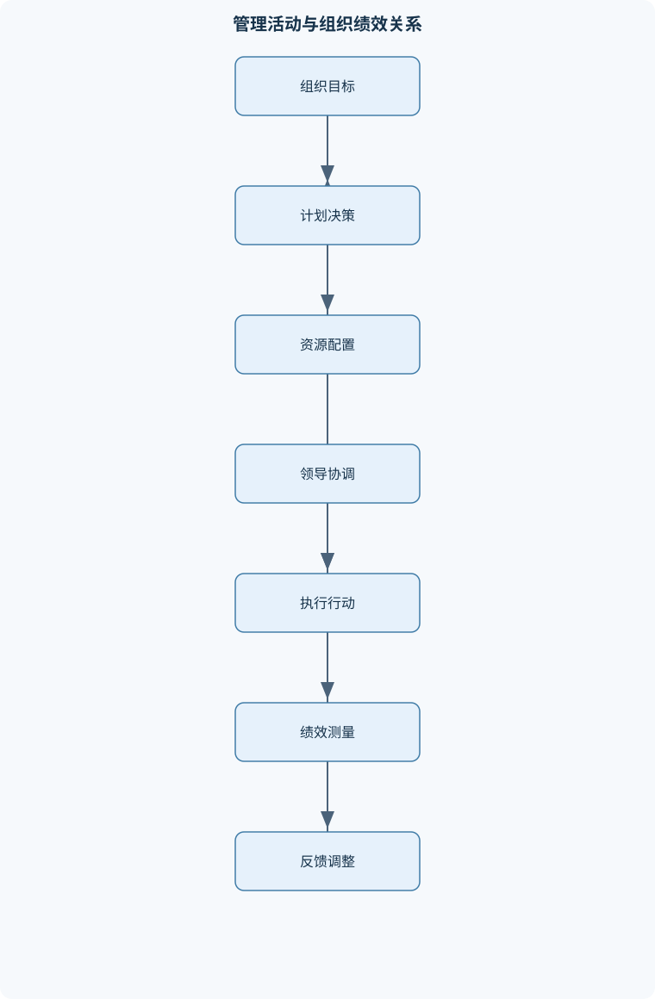
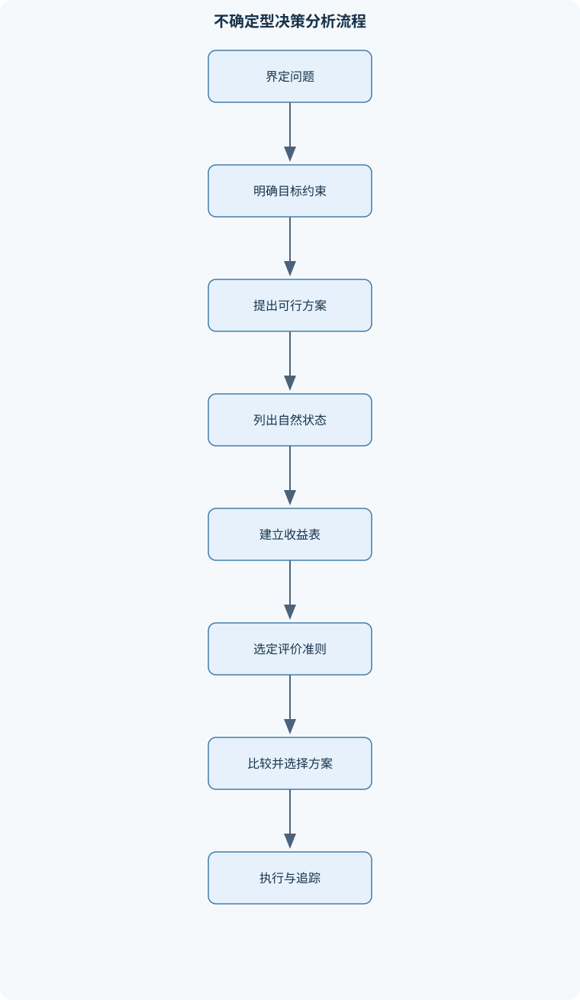

# 管理学

## 一、课程整体知识框架

### 课程边界与先修知识

《管理学》研究组织在资源约束和环境变化下如何通过管理活动实现目标，涵盖管理理论、组织环境、决策、计划、组织设计、领导、激励、沟通、控制、创新与组织变革。适用于企业及公共、非营利组织的一般管理情境，不替代会计、市场营销、人力资源管理、运营管理等职能课程的专业训练。先修知识为基本的社会科学阅读能力、初等统计与比例计算；不要求特定专业背景。管理是情境化的实践与分析领域，管理职能可用于组织分析，但现实管理者的活动通常交织、非线性，不能将职能框架误作对日常工作的完整描述。





### 1. 课程对象、问题意识与适用范围

管理学研究组织在资源有限、目标多元、环境变化和成员协作的条件下，如何通过管理活动实现组织目标。这里的“组织”是为实现共同目标而有意识地协调活动、配置资源并持续运作的社会实体，既包括企业，也包括公共部门、非营利组织、社会组织和项目团队。“管理”是管理者在组织情境中整合资源、影响成员并协调行动，以追求组织目标的过程。

管理学的核心问题不是“管理者应当采取某一种固定做法”，而是分析以下关系：组织希望实现什么目标，现有资源和能力是什么，环境带来哪些机会与约束，成员如何分工与协作，行动结果如何被测量，以及组织如何根据反馈修正行动。管理活动因此具有情境性。同一种结构、领导方式或激励制度，在任务稳定、风险较低的组织中可能有效，在高度不确定、专业依赖强或目标冲突明显的组织中则可能失效。

管理学适用于一般组织管理情境，但不替代会计、市场营销、人力资源管理、运营管理、财务管理等职能课程。管理学可以分析预算、人员、流程、市场和绩效之间的关系，却不提供会计核算、营销调研、劳动争议处理或生产工艺设计的全部专业方法。

### 2. 组织目标、资源约束与绩效判断

组织目标是组织希望在给定范围和时间内实现的结果，应区分组织目标、部门目标、团队目标与个人目标。组织目标通常具有多层次特征：使命回答组织存在的基本理由，愿景描述希望形成的未来状态，战略目标规定较长时期的方向，年度目标和部门目标则进一步转化为可执行的结果要求。

资源包括资金、人员、时间、设备、信息、技术、关系网络和组织声誉等。资源并非只有数量问题，还涉及可获得性、质量、配置位置和使用时机。例如，组织拥有足够预算，并不表示能够立即获得所需专业人才；部门拥有技术人员，也不表示这些人员有时间承担新增项目。因此，管理分析必须同时考察资源总量、资源结构和资源配置方式。

绩效是组织、团队或个人在特定标准下的工作结果与相关行为表现。绩效判断至少要区分效率和效果：

- **效率**关注投入与产出的关系。在产出可比时，减少单位产出所需投入通常意味着效率提高。若投入为 $I$、产出为 $O$，可用投入产出率表示效率，例如
  $$E=\frac{O}{I}$$
  其中，$E$ 为效率指标，$O$ 和 $I$ 必须具有明确口径与单位。若比较两个时期，必须保证产出质量、任务范围和计量方法基本可比。
- **效果**关注组织目标实现的程度。例如，目标完成量为 $A$，计划目标量为 $T$，在目标可量化且质量条件一致时，可用
  $$F=\frac{A}{T}$$
  表示目标达成程度。$F$ 大于或等于 $1$ 不必然说明组织整体表现良好，因为可能存在质量下降、成本过高、风险增加或目标本身选择错误的情况。

效率和效果构成两个不同维度。组织可能以较低成本完成错误目标，即“高效率、低效果”；也可能以较高成本完成重要目标，即“高效果、低效率”。管理绩效判断应至少同时检查目标是否正确、目标是否实现、资源是否合理使用以及结果是否具有持续性。将效率等同于效果，是管理分析中的基本错误。

### 3. 管理职能与管理者活动

传统管理职能通常概括为计划、组织、领导和控制：

1. **计划**是确定目标、分析条件、选择行动方案并安排资源与时间。计划不仅是编制文件，还包括对未来假设、任务优先级和应急安排的判断。
2. **组织**是对任务进行分工、配置权责、建立协调关系并形成工作流程。组织既涉及正式结构，也涉及实际运行中的非正式关系。
3. **领导**是通过沟通、影响、授权、激励和示范，使成员理解目标并愿意协调行动。领导不等于单纯发出命令。
4. **控制**是建立标准、测量实际结果、比较偏差、分析原因并采取纠偏措施。控制的目标不是惩罚，而是保证行动与目标保持合理一致，并促进组织学习。

这四项职能便于分析管理问题，但不能理解为管理者每天严格按照“先计划、再组织、后领导、最后控制”的固定顺序工作。现实管理活动通常同时发生、相互交织，管理者可能在会议中分析环境、分配任务、处理冲突并修订计划。职能框架是分析工具，不是对管理者全部日常活动的完整描述。

管理者按组织层级通常分为基层管理者、中层管理者和高层管理者。基层管理者直接面对一线任务、员工和客户，重点是任务安排、现场协调、质量与执行反馈；中层管理者承担部门之间的衔接，将组织战略转化为部门计划；高层管理者处理组织方向、重大资源配置、外部关系和整体风险。不同层级并非只有一种能力要求，而是侧重点不同。

管理者需要三类基本能力：技术技能，即理解特定工作方法和业务流程；人际技能，即沟通、协调、影响和处理关系的能力；概念技能，即理解组织整体、识别相互依赖并进行系统分析的能力。基层管理者通常更频繁使用技术技能，中高层管理者对概念技能的要求上升，但所有层级都需要人际技能。

管理者还承担信息、关系和决策等角色。信息角色包括收集、解释和传递信息；关系角色包括代表组织、建立联系和激励成员；决策角色包括处理资源分配、冲突、创新机会和异常情况。角色可能相互冲突，例如管理者既要代表组织的统一立场，又要向上级反映部门真实困难。因此，管理者责任不能简化为“发布命令”。

### 4. 管理思想的演进及其解释边界

古典管理理论强调秩序、分工、标准化、权责关系和效率。科学管理关注工作分析、操作分解、工作标准和任务与报酬之间的关系，其重要贡献是说明工作过程可以被观察、测量和改进。但其局限是容易把员工视为单纯执行者，忽视社会关系、心理需要、学习能力和工作意义。

行政管理理论关注组织整体的管理原则，例如分工、权责一致、统一指挥、协调和控制。官僚制强调明确规则、层级关系、职位职责和非人格化处理，在规模较大、任务稳定、需要程序一致的组织中有助于减少任意性。其边界在于，规则过多可能造成程序主义，层级过长可能延误信息传递，面对创新任务和突发情况时反应迟缓。

人际关系和行为科学视角强调成员的社会需要、群体关系、知觉、态度、动机、领导和沟通。该视角纠正了把员工仅视为经济人的片面性，但也不能把良好关系当作绩效的充分条件。任务设计、资源配置、能力水平和制度公平仍会影响结果。

系统观把组织看作由相互联系的子系统构成的开放系统。组织从环境中获得投入，经过转换过程形成产品、服务或公共结果，再通过反馈调整行动。系统分析要求注意局部改进可能损害整体绩效，例如一个部门降低自身成本，却增加其他部门的等待、返工或客户投诉。

权变观认为管理方式必须与任务、技术、环境、人员能力、风险和组织规模相匹配。权变观并不是“任何做法都可以”，而是要求说明：在什么条件下，某种做法为何可能有效，以及条件变化时为什么需要调整。不同理论具有互补性，但每种理论都有解释限度，不能把单一理论当作所有组织问题的万能答案。

### 5. 环境、利益相关者与伦理责任

组织环境包括外部一般环境、任务环境和内部环境。一般环境包括经济、技术、社会文化、人口、法律制度和自然条件；任务环境包括客户、供应者、竞争者、监管者、合作伙伴和劳动者等直接影响组织运行的主体；内部环境包括资源、能力、结构、文化、流程和成员关系。

环境不确定性主要来自变化速度、信息缺口、因素复杂程度和结果不可预测性。面对不确定环境，组织可以通过收集信息、建立跨部门联系、分散风险、保留资源弹性、采用情景计划和设置应急预案来提高适应能力。但信息收集本身需要成本，过度追求信息可能延误行动。

利益相关者是能够影响组织目标实现，或受到组织决策影响的个人、群体或机构。分析利益相关者时，应识别其利益、影响力、合法性、紧迫性和相互依赖关系。组织不能只追求单一主体的短期利益，因为员工、客户、投资者、社区和公共机构之间可能存在长期联系。

管理伦理关注行动是否符合责任、公平、诚信、尊重和不伤害等基本要求。伦理判断需要明确决策者、受影响者、权力关系、可预见后果和替代方案。组织追求绩效不能成为欺骗、歧视、隐瞒重大风险或推卸责任的理由。社会责任则要求组织考虑其行为对员工、消费者、社区、环境和未来利益相关者的影响。跨文化管理中，沟通方式、权威观、时间观和冲突处理习惯可能不同，但“文化差异”不能被用来为违法、伤害或不公平行为辩护。

### 6. 决策、计划与战略管理

决策是从多个可行行动方案中作出选择。决策首先要界定问题，而不是直接处理表面症状。完整决策过程包括识别偏差或机会、明确目标与约束、收集关键信息、生成方案、评价方案、选择方案、执行、反馈和修正。

自然状态是决策者不能直接控制、但会影响方案结果的环境状态；收益值是方案在某一自然状态下的结果评价。确定型决策中，各方案结果基本可确定；风险型决策中，自然状态及其概率可以合理估计；不确定型决策中，通常缺乏可信概率。三者不能混同。

在风险型决策中，若以期望货币收益为目标，且概率可合理估计、收益可相加、风险偏好近似线性，则方案 $j$ 的期望收益为
$$
EMV_j=\sum_{i=1}^{n}p_i r_{ij}
$$
其中，$p_i$ 是第 $i$ 个自然状态的概率，满足 $0\leq p_i\leq1$ 且 $\sum_{i=1}^{n}p_i=1$；$r_{ij}$ 是方案 $j$ 在状态 $i$ 下的收益值，货币单位必须统一。选择期望收益最大者。但当概率不可信、决策者厌恶风险、存在不可逆重大损失或收益不是货币可加量时，不能把期望收益当作唯一正确答案。

收益型损益表的不确定型决策可采用不同准则。乐观准则比较每个方案的最大收益并取其中最大者；悲观准则比较每个方案的最小收益并取其中最大者；最小最大后悔值法先求每种状态下的最大收益，再用该最大收益减去各方案收益得到后悔值，最后选择最大后悔值最小的方案。后悔值的单位与收益相同。上述准则体现不同风险偏好，不保证实际结果一定最好。成本型问题必须先明确“越低越好”的方向，不能未经转换直接套用收益最大化规则。

战略管理连接使命、愿景、目标、环境分析、内部能力、战略选择、实施和评价。战略层级通常包括组织总体战略、业务层战略和职能层战略。目标管理强调目标分解、责任落实、进度反馈和结果评价，但不能把所有目标都压缩成单一数字。预算是资源配置工具，不只是削减支出的工具；零基预算要求对每项活动的必要性、成果、资源需求和不实施后果重新论证。滚动计划则对近期任务规定得较具体，对远期安排保留弹性，并根据阶段结果和环境变化更新后续计划。

## 二、章节和模块划分

### 核心知识覆盖清单

本清单用于检查正文是否覆盖本课程的主要知识模块：

- **管理与组织基础**：组织及管理的概念与基本要素、效率、效果及组织绩效的区别、管理职能：计划、组织、领导与控制、管理者层级、技能与管理角色、管理普遍性及组织情境差异、利益相关者与组织目标、管理决策的责任与伦理边界。
- **管理思想与理论演进**：古典管理理论及其效率取向、科学管理的工作分析与标准化、行政管理理论与组织原则、官僚制的规则、层级与适用边界、人际关系与行为科学视角、系统观、权变观与组织环境、管理理论的互补性及其解释限度。
- **组织环境与管理伦理**：外部一般环境与任务环境、内部资源、能力与组织文化、利益相关者识别与影响分析、环境不确定性及组织应对、伦理判断、责任主体与利益冲突、社会责任与组织可持续性、跨文化管理中的情境差异。
- **决策**：决策问题识别与目标界定、确定型、风险型与不确定型决策、程序化与非程序化决策、有限理性、信息约束与判断偏差、方案生成、评价和选择、群体决策及其协调成本、期望收益、乐观准则与悲观准则、最小最大后悔值法、执行反馈、决策修正与追踪调整。
- **计划与战略管理**：组织使命、愿景与目标体系、战略层级及其衔接关系、外部环境和内部条件分析、战略选择、实施与评价、目标管理及目标分解、计划类型、时间跨度与弹性、预算编制与零基预算思想、滚动计划的近细远粗原则、计划假设、资源配置与应急预案。
- **组织结构与组织设计**：组织设计的任务、权变因素与基本原则、职务专业化、部门化与管理幅度、直线职权、参谋职权与授权、集权、分权及其适用条件、职能型、事业部型、矩阵型与团队结构、正式组织与非正式组织、组织流程、协调机制与跨部门协作、组织设计对沟通、创新和控制的影响。
- **人力资源与团队管理**：工作分析与岗位要求、人员招聘、甄选与配置、绩效评价的目的、标准与偏差控制、培训、职业发展与人才保留、团队形成、角色分工与协同、团队决策中的从众及信息不足、公平程序与组织承诺、人员管理的合法、伦理和情境边界。
- **领导与激励**：领导与管理的联系和区别、特质、行为与权变领导视角、领导权力、影响策略与授权、目标设置与反馈机制、需要、期望、公平与强化等激励解释框架、内在动机、外在奖励与任务特征、激励制度的个体差异和副作用、领导方式与员工能力、任务及环境的匹配。
- **沟通与冲突管理**：沟通过程、编码、渠道与反馈、正式沟通、非正式沟通及其功能、沟通障碍与信息失真、倾听、复述及认知差异处理、冲突的知觉、对立与互动过程、任务冲突、关系冲突及其影响条件、协商、调解、合作与妥协策略、跨部门冲突及资源依赖分析。
- **控制与绩效管理**：控制的目的、对象与基本过程、标准设定、绩效测量和偏差比较、前馈、同期与反馈控制、预算控制、成本控制与运营控制、绩效指标的有效性及目标替代风险、纠偏措施与控制强度权衡、控制系统的信息质量和行为影响、控制与组织学习的衔接。
- **组织文化、创新与变革**：组织文化的层次、功能与形成机制、价值观、制度和日常行为的一致性、创新机会识别与资源条件、渐进创新、变革创新及风险差异、变革驱动因素与阻力来源、变革沟通、参与和实施步骤、组织发展、学习与反馈、文化变革的路径依赖和适用边界。


### 第一章 管理与组织基础

本章界定组织、管理、效率、效果、目标、绩效和管理者等基本概念，说明管理的对象是组织中的资源、任务、关系和行动。重点分析管理者层级、技能和角色，解释计划、组织、领导、控制四项职能的联系与边界，并说明管理具有普遍性但不存在脱离情境的管理定律。组织目标需要与利益相关者要求、资源约束和伦理责任相协调。

### 第二章 管理思想与理论演进

本章按历史和问题意识梳理科学管理、行政管理、官僚制、人际关系、行为科学、系统观和权变观。学习重点不是记忆理论名称，而是比较各理论回答了什么问题、使用了哪些假设、改善了哪些管理缺陷，以及在什么条件下会出现解释不足。理论之间可以互补：标准化有助于稳定任务，行为视角有助于理解成员，系统观有助于识别部门间影响，权变观则用于判断具体条件。

### 第三章 组织环境与管理伦理

本章分析一般环境、任务环境和内部环境，说明环境变化、资源依赖和信息不确定性如何影响组织结构、计划和决策。利益相关者分析要求识别各方利益、影响力和相互依赖。伦理部分讨论利益冲突、责任主体、诚信、公平、社会责任和可持续性，强调管理者必须同时考虑结果、程序、权利和长期影响。跨文化管理关注情境差异，但不把文化解释当作规避法律和责任的借口。

### 第四章 决策

本章从问题识别、目标界定、方案生成、评价选择、执行反馈和修正展开。重点区分确定型、风险型和不确定型决策，程序化和非程序化决策，以及个体决策和群体决策。有限理性说明决策者受信息、时间、认知能力和组织权力限制，因而应明确约束、扩大重要方案集、采用可比较标准并根据反馈修订。期望收益、乐观准则、悲观准则和最小最大后悔值法应结合各自的概率、收益口径和风险偏好使用。

### 第五章 计划与战略管理

本章说明使命、愿景、目标体系和战略层级之间的衔接关系。外部环境分析用于识别机会、威胁和约束，内部分析用于识别资源、能力和弱点。战略选择不能脱离实施条件，必须考虑资源、责任、时间表和评价指标。计划按时间跨度可分为长期、中期和短期计划，按用途可分为战略计划、战术计划和作业计划。预算、零基预算、滚动计划、计划假设和应急预案共同构成计划的动态管理机制。

### 第六章 组织结构与组织设计

本章讨论组织设计的任务、权变因素和基本原则，重点分析专业化、部门化、管理幅度、职权、授权、集权与分权。职能型结构适合业务较集中、专业分工明确的组织，但跨部门协调可能较弱；事业部型结构有利于按产品、地区或客户形成责任单元，但可能产生重复配置；矩阵型结构能够整合专业和项目资源，但容易出现双重汇报、权责冲突和协调成本。正式组织规定职责与流程，非正式组织则影响信息、信任和合作。结构设计会直接影响沟通速度、创新能力、控制难度和责任清晰度。

### 第七章 人力资源与团队管理

本章从工作分析、岗位要求、招聘甄选、人员配置、绩效评价、培训发展和人才保留展开。工作分析应区分岗位任务、责任、权限、能力要求和工作条件。绩效评价要明确目的、标准、证据和反馈方式，控制近因效应、晕轮效应、宽严偏差和个人偏好造成的失真。团队管理关注团队形成、角色分工、任务依赖、协同机制和公平程序。团队意见一致不等于决策质量高，从众、权力不对称和信息不足可能压制异议。人员管理还必须遵守适用法律、组织制度和基本伦理边界。

### 第八章 领导与激励

本章区分领导与管理：管理偏重目标、结构、资源和控制，领导偏重方向、影响、意义和成员投入，二者在现实工作中经常交织。领导理论包括特质、行为和权变视角，要求根据员工能力、任务结构、风险和环境选择领导方式。权力不仅来自职位，也来自专业知识、信息、关系和个人影响力，授权必须同时配置目标、权限、资源、能力支持和问责机制。

激励部分讨论需要、期望、公平、强化、目标设置和反馈等解释框架。奖励能够产生激励的条件是：成员重视奖励，相信努力能够改善绩效，相信绩效能够带来奖励，并且评价规则被认为可信、公平。奖励额度增加不能解决能力不足、目标冲突、资源缺乏和不公平感。内在动机、外在奖励、任务特征和个体差异共同影响激励结果，过度量化可能导致短期化、造假、局部优化和目标替代。

### 第九章 沟通与冲突管理

本章分析沟通过程中的信息发送、编码、渠道、接收、解码和反馈。正式沟通保障责任和流程，非正式沟通有助于快速交换信息、建立信任，但也可能造成谣言和失真。沟通障碍包括语言歧义、层级过滤、选择性注意、渠道不适配、利益冲突和认知差异。倾听、复述、事实核对和反馈确认能够降低误解。

冲突是当事人知觉到目标、利益、资源或行为存在不相容的互动过程。任务冲突可能促使成员检验方案，但关系冲突通常损害信任和合作；冲突的影响还取决于强度、持续时间、任务依赖和处理方式。协商、合作、妥协、调解和必要的正式处理机制应根据争议性质选择。跨部门冲突需要分析资源依赖、目标差异、权责边界和信息共享机制，不能简单归因于个人态度。

### 第十章 控制与绩效管理

本章说明控制的对象、标准、测量、比较、偏差解释和纠偏过程。前馈控制发生在行动开始前，用于预防问题；同期控制发生在执行过程中，用于及时调整；反馈控制依据结果改进后续行动。预算控制、成本控制和运营控制都需要明确控制对象和责任边界。

实际结果与标准的差异只是需要解释的信号，不自动证明员工失职。偏差可能来自标准不当、测量误差、资源不足、环境变化、任务难度变化或执行问题。纠偏措施可以包括改进流程、补充资源、调整目标、培训人员或重新设计指标。指标必须与管理目的相匹配，单一指标容易造成目标替代和局部优化。有效控制既要保证责任和风险可追溯，也要避免控制成本过高、抑制创新和制造形式主义。

### 第十一章 组织文化、创新与变革

本章分析组织文化的价值观、制度、象征、行为规范和深层假设，说明文化如何通过招聘、社会化、奖励、领导示范和日常互动形成。文化只有在价值观、制度和实际行为基本一致时，才能稳定影响成员。文化可能增强认同和协作，也可能固化旧习惯、排斥异议并阻碍变革。

创新包括对产品、服务、流程、结构或管理方式的改进。创新机会来自客户需求、技术变化、流程缺陷、资源重组和环境变化，但创新还需要资源、试验空间、风险容忍和反馈机制。渐进创新通常风险较低、易于整合；变革性创新可能重构业务和组织关系，收益与不确定性也更大。

组织变革的驱动因素包括环境变化、技术进步、绩效压力、战略调整和利益相关者要求，阻力可能来自利益损失、能力不足、认知差异、信任不足、路径依赖和变革疲劳。有效变革需要说明理由、识别受影响者、建立沟通和参与机制、安排资源与责任、分阶段实施并持续反馈。文化变革通常不能依靠一次宣传完成，而要通过制度、领导行为、人员选择、奖励机制和日常实践逐步强化；在不具备必要资源和信任基础时，直接要求文化转型可能产生表面服从而非真实改变。

## 三、核心概念的详细解释

### 1. 组织、管理与管理者

#### 1.1 组织及其基本要素

组织是为实现共同目标而有意识地协调活动、配置资源并持续运作的社会实体。组织至少包含目标、成员、资源、分工、权责关系、协调机制和相对稳定的边界。组织目标规定“要实现什么”，资源回答“凭什么实现”，分工回答“由谁承担”，协调机制回答“如何把分散行动连接起来”。

组织不等同于一群人的简单集合。若成员之间没有共同目标、稳定的任务关系和最低限度的协调，通常只能称为群体，而不能称为具有完整管理意义的组织。组织也不等同于正式文件中的机构图。正式结构规定职位、权力和汇报关系，非正式组织则通过信任、经验、友谊和信息网络影响实际行动。正式结构与非正式关系可能互相支持，也可能产生冲突。

管理是管理者在组织情境中整合资源、影响成员并协调行动，以追求组织目标的过程。管理活动具有目的性、协同性、资源约束性和动态性。管理者不一定是职位最高的人；只要其承担目标分解、资源配置、人员协调或结果责任，就可能履行管理职能。

#### 1.2 效率、效果与绩效

效率关注投入与产出的关系，效果关注组织目标实现的程度。效率高表示资源使用较节约或产出率较高，但不表示目标一定正确；效果好表示目标达成程度较高，也不表示资源使用一定合理。

例如，某服务团队通过压缩咨询时间，使每日处理量从 $100$ 件提高到 $140$ 件，但客户问题一次解决率由 $90\%$ 降至 $60\%$。若只看数量，效率指标可能改善；若组织目标是提供准确服务，则效果可能下降。相反，团队为完成重大安全任务投入更多人员和时间，单位产出效率下降，但目标达成和风险控制效果可能提高。

绩效是组织、团队或个人在特定标准下的工作结果与相关行为表现。绩效评价至少应同时检查结果、行为、质量、成本、风险和可持续性。将某一项可量化指标直接等同于全部绩效，会造成目标替代：成员为了提高指标而牺牲未被测量但重要的结果。

#### 1.3 管理职能的联系与边界

计划、组织、领导和控制是分析管理活动的基本框架。

- **计划**：界定目标、分析条件、形成方案、安排资源和时间，并说明关键假设与应急措施。
- **组织**：划分任务、配置权责、确定部门关系、设计流程和协调机制。
- **领导**：通过沟通、影响、授权、激励和示范，使成员理解目标并协调行动。
- **控制**：设定标准、测量结果、比较偏差、诊断原因并采取纠偏行动。

四项职能不是现实工作的固定流水线。管理者可能在同一次会议中同时进行计划、协调、激励和控制；也可能因突发事件先控制风险，再重新计划。职能框架用于识别管理问题，不应被误解为对管理者日常活动的完整描述。

#### 1.4 管理者层级、技能与角色

基层管理者直接面对一线工作，重点是任务安排、人员指导、现场协调和短周期控制；中层管理者负责部门之间的衔接、资源整合和目标分解；高层管理者主要处理组织方向、环境关系、重大资源配置和长期风险。不同层级都需要技术技能、人际技能和概念技能，但侧重点会随管理范围和问题复杂度变化。

管理者还承担三类角色：

1. **人际角色**：代表组织、联络关系、指导成员。
2. **信息角色**：搜集、筛选、解释并传播信息。
3. **决策角色**：配置资源、处理冲突、应对变化和推动改进。

管理者角色可能在短时间内频繁转换。项目负责人既要向外部合作方沟通，也要向团队解释目标，还要在资源不足时作出取舍。由此可见，管理工作通常是碎片化、并行化和情境化的。

### 2. 管理思想与理论演进

#### 2.1 古典管理理论

科学管理强调通过工作分析、操作分解、时间研究、标准化工具和明确的绩效要求提高劳动效率。其贡献在于把工作过程从个人经验转化为可观察、可比较和可改进的流程。但如果忽视员工需要、任务变化和专业判断，过度标准化会降低自主性，甚至诱发只追求数量的行为。

行政管理理论关注组织整体的计划、组织、指挥、协调和控制，并强调目标统一、权责清晰、纪律、协调和层级关系。这些原则有助于处理大型组织中的秩序问题，但不能被当作不受条件限制的普遍定律。复杂任务中，过度强调统一指挥可能延误信息传递。

官僚制以明确规则、层级权威、职位责任、专业分工和非人格化关系为特征。它适合强调稳定性、可追责性和程序公平的场景，例如需要统一办理标准的公共服务流程。但规则可能出现目标替代：成员把“完成程序”当成“解决问题”。当环境变化迅速、任务高度创新时，僵化层级还可能抑制试验和跨部门协作。

#### 2.2 人际关系与行为科学视角

人际关系视角强调非正式群体、归属感、沟通、参与和成员态度对绩效的影响。行为科学进一步研究需要、动机、知觉、学习、领导、群体和冲突。该视角修正了“员工只受经济报酬驱动”的机械假设，但也不能把良好关系当成绩效提升的充分条件。目标不清、能力不足和资源缺乏时，仅靠鼓励和关怀无法替代制度与流程改进。

#### 2.3 系统观与权变观

系统观把组织看作由相互依赖部分组成的开放系统。投入包括人员、资金、信息和技术，转换过程包括生产、服务、决策与协调，产出包括产品、服务、社会影响和组织学习。环境变化会通过资源、需求、法规和竞争关系影响组织，组织也会通过产品、行为和社会责任影响环境。

权变观认为，管理方式的有效性取决于任务、人员、技术、环境、风险和组织规模等条件。集中决策适合高度统一、风险重大或人员能力差异较大的情形；分权适合需要快速响应、地方信息重要且基层能力较强的情形。权变观并不意味着“任何做法都正确”，而是要求说明做法成立的条件和可能失效的边界。

### 3. 组织环境、利益相关者与伦理

#### 3.1 环境层次与不确定性

外部一般环境包括经济、技术、社会文化、人口、政治法律和生态条件；任务环境包括顾客、供应者、竞争者、监管者、合作伙伴和劳动力市场。内部环境包括资源、能力、结构、文化、流程和组织成员。

环境不确定性来自变化速度、信息缺口、因素数量及其相互依赖关系。环境越复杂、变化越快、因果关系越难判断，组织越需要提高信息处理能力，例如建立跨部门协调、授权一线、使用情景分析和保留资源弹性。增加制度并不必然降低不确定性；在信息不足时，过度复杂的审批反而会减慢响应。

利益相关者是能够影响组织目标实现，或会受到组织决策影响的个人、群体和机构。识别利益相关者时，应分析其利益内容、影响能力、受影响程度、合法权利和冲突关系。组织不能只依据最强势者的要求决定全部目标，还要考虑长期信任、公共责任和不可转移的权利边界。

#### 3.2 管理伦理与社会责任

伦理判断不仅问“这样做是否合法”，还要问“是否诚实、公平、可解释，是否造成不当伤害，是否把风险不合理地转嫁给弱势者”。管理者可能面临成本、速度、员工权益、客户安全、环境影响和组织生存之间的冲突。

伦理决策通常包括：确认事实与利益相关者，识别适用规则和权利，分析不同方案的后果，判断利益冲突和责任归属，选择可公开辩护的方案，并建立记录与监督机制。合法不必然等于伦理，短期有利也不必然符合组织长期责任。社会责任要求组织把经营结果与员工、社区、环境和公共利益联系起来；可持续性则进一步关注当前行动是否损害未来持续创造价值的能力。

### 4. 决策与计划

#### 4.1 决策类型

确定型决策中，方案结果及其条件基本明确；风险型决策中，可能状态较明确且概率可以合理估计；不确定型决策中，状态或概率缺乏可信信息。程序化决策适用于重复发生、规则相对稳定的问题；非程序化决策面向新颖、复杂和重要问题，需要判断、创新和多方协调。

有限理性认为，决策者受到时间、信息、注意力和认知能力限制，通常无法列出所有方案并准确预测全部后果。因此，管理决策应明确约束，扩大重要方案集，采用一致标准，记录关键假设，并通过反馈修订，而不应把有限信息包装成全知全能的最优选择。

#### 4.2 计划与战略

使命说明组织存在的基本理由，愿景描述希望形成的未来状态，战略规定较长时期的方向与资源配置逻辑，战术和行动计划则把战略转化为部门任务、时间节点、责任人和资源安排。

战略分析必须同时考察外部机会与威胁、内部资源与能力、利益相关者要求以及组织价值观。战略实施不仅是发布文件，还包括结构调整、预算配置、人员安排、沟通、激励和控制。战略评价应检查假设是否仍然成立、目标是否实现、资源消耗是否可接受以及是否产生新的风险。

计划按时间可分为短期、中期和长期计划；按用途可分为战略计划、业务计划、项目计划、预算计划和应急预案。滚动计划遵循“近细远粗”：近期任务写得具体，远期保留调整空间。计划不是一次性承诺，而是可以根据执行反馈和环境变化更新的管理工具。

### 5. 组织设计、人力资源与团队

#### 5.1 结构与协调

组织设计要回答任务如何分工、部门如何划分、管理幅度多大、权力如何配置以及跨部门如何协调。职能型结构按专业分工，专业深度和资源共享较好，但容易形成部门壁垒；事业部型结构按产品、地区或顾客划分，责任和市场响应较清晰，但可能重复配置资源；矩阵型结构同时保留职能与项目关系，适合专业依赖强、项目交叉多的情形，但双重汇报可能带来权责冲突。

管理幅度是一位管理者直接负责的下属人数。任务越复杂、人员越缺乏经验、沟通越频繁，适宜管理幅度通常越小；人员能力强、任务标准化、信息系统完善且团队自我协调能力较强时，管理幅度可以扩大。不存在脱离情境的固定最佳人数。

授权是把一定决策权和执行权交给下属，同时保留必要的目标、边界和问责关系。授权不等于放弃责任，也不等于只下达任务。有效授权要求受权者具备能力和信息，目标与权限相匹配，结果可测量，风险边界清楚，并有反馈机制。分权可提高响应速度和一线信息利用率，但可能产生局部最优、重复投入和控制困难。

#### 5.2 人力资源与团队管理

工作分析明确岗位任务、责任、工作关系和任职要求，是招聘、培训、绩效评价和薪酬设计的基础。甄选应依据与工作相关的标准，避免把无关个人特征当作能力证据。绩效评价应区分结果和行为，说明评价周期、证据来源、反馈程序及申诉渠道，并控制近因效应、晕轮效应、宽严不一和个人偏好等偏差。

团队有效性取决于目标清晰、角色互补、信息共享、心理安全、责任明确和冲突处理。任务冲突有时能暴露假设错误、提高方案质量；关系冲突通常会损害信任，但其影响也取决于强度、持续时间和处理方式。群体一致不代表决策正确，从众、权力不对称和信息不足都可能压制异议。

### 6. 领导、激励、沟通与冲突

#### 6.1 领导与激励

领导是影响成员理解目标、调整行为并协调行动的过程，管理则包含更广泛的计划、组织和控制。领导权力可能来自职位、奖励、强制、专业知识和成员认同。权力使用应受到组织目标、成员权利、制度程序和伦理边界约束。

特质视角关注领导者的能力、责任感、稳定性和社会性等特征；行为视角关注任务导向与关系导向行为；权变视角则强调领导方式应匹配成员能力、任务结构、关系质量和环境压力。授权、指导、支持或参与并不存在脱离情境的唯一正确选择。

激励取决于成员是否重视奖励，是否相信努力能够改善绩效，是否相信绩效能够带来奖励，以及评价规则是否公平可信。提高奖励额度不能解决目标冲突、能力不足、资源缺乏或程序不公平。内在动机来自兴趣、胜任感、自主性和任务意义；外在奖励可以提供方向和认可，但若过度控制或奖励设计不当，可能削弱自主性与合作。

#### 6.2 沟通与冲突

沟通过程包括信息编码、渠道传递、接收解码、反馈和噪声。信息失真可能来自术语差异、层级过滤、选择性注意、情绪、时间压力和利益冲突。有效沟通需要说明事实、解释判断、确认责任和约定反馈时间。复述确认不是机械重复，而是让接收者用自己的话说明理解，再由发送者核对关键含义。

冲突是当事人感知到目标、利益、资源、价值或行为存在不相容。冲突分析应区分任务冲突、关系冲突和程序冲突，进一步识别资源依赖、权力关系、信息差异和历史积累。协商强调直接交换与方案调整，调解引入相对中立的第三方，合作解决力求同时满足重要利益，妥协则通过双方让步达成可执行结果。

### 7. 控制、文化、创新与变革

控制包括设定标准、测量结果、比较偏差、解释原因和纠偏。前馈控制发生在行动前，用于预防；同期控制发生在执行中，用于及时调整；反馈控制依据已发生结果改进后续行动。控制强度过低会放任风险，过高则增加成本、压制创新并制造形式主义。

组织文化包括可观察的制度和行为、成员公开认可的价值观，以及更深层的默认假设。文化通过领导示范、招聘、社会化、奖励、惩罚和日常互动形成。文化既能增强认同与合作，也可能固化旧做法、排斥异议和延迟变革。文化变革必须与制度、人员、权责和奖励相配套，单次宣传不能替代持续行动。

创新可以发生在产品、服务、流程、结构和管理方式中。渐进创新通常便于试验和整合，变革性创新可能重构原有业务和权力关系。创新需要问题识别、试验资源、容错空间、跨界信息和反馈机制。组织变革的阻力可能来自利益损失、能力不足、信任缺失、认知差异、路径依赖和变革疲劳。有效变革应说明原因，识别受影响者，安排参与和沟通，分阶段实施，持续测量并根据反馈修正。

## 四、重要定义、公式、定理和推导

### 专业审校补充：关键定义与适用边界

管理中的授权、责任与问责必须区分。授权是上级在明确目标、权限和边界后，把部分决策权交给下属；责任是某岗位对任务执行和结果承担的职责；问责是组织依据事先约定的标准，要求责任主体解释结果并接受相应处理。授权并不等于上级完全免责，也不等于下属获得无限权力。有效授权至少需要同时具备四项条件：目标和预期结果清楚，决策权限与资源相匹配，信息能够及时获得，结果能够被追踪和反馈。若只下放任务而不下放必要权限，属于“有责无权”；若只下放权限而没有能力、边界和监督，容易造成越权、重复投入或局部最优。高风险、涉及组织整体方向、重大资源配置或不可逆后果的事项，通常应保留必要的集中决策。反例是主管要求一线员工自行解决客户投诉，却不给退款权限、产品信息和升级渠道，之后又按投诉处理速度追责；这不是有效授权，而是责任下移与权力缺失的错配。


### 1. 效率、效果与绩效公式

若投入为 $I$，产出为 $O$，投入产出率可表示为

$$
E=\frac{O}{I}
$$

其中，$E$ 为效率指标，$O$ 是可比产出，$I$ 是与产出相对应的投入。若 $O$ 的单位为件、服务人次或合格产品数，$I$ 可用工时、货币或材料量表示，但比较时必须保持口径一致。若投入越少越好，也可使用单位产出投入量：

$$
C=\frac{I}{O}
$$

$C$ 越低通常表示资源使用效率越高。公式不适用于产出质量、任务难度或服务范围发生重大变化的直接比较。

若实际达成量为 $A$，计划目标为 $T$，在质量、范围和时间一致时，目标达成率为

$$
F=\frac{A}{T}
$$

$F=1$ 表示达到数量目标，$F>1$ 表示超过数量目标，$F<1$ 表示未达到数量目标。但该比值不能单独表示总体效果，因为目标可能不合理，或数量增加伴随质量下降、风险增加和长期能力损失。

由此可得绩效的二维判断逻辑：

1. 先判断目标是否重要、合法且与组织使命一致；
2. 再判断目标实际实现程度，即效果；
3. 然后比较实现目标所消耗的资源，即效率；
4. 最后检查质量、风险、公平和可持续性。

因此，高效率不推出高效果，高效果也不推出高效率。二者必须分别测量，再进行综合判断。

### 2. 决策准则及推导

#### 2.1 确定型决策

设可行方案集合为 $A=\{a_1,a_2,\ldots,a_m\}$，每个方案对应结果 $V(a_i)$，约束条件为 $g_j(a_i)\leq 0$。确定型决策的步骤是：

1. 明确目标函数，例如最大化收益或最小化成本；
2. 检查每个方案是否满足预算、时间、能力和制度约束；
3. 删除不可行方案；
4. 在剩余方案中比较目标函数值；
5. 若存在多个目标，说明权重、优先级和取舍，不把主观权重伪装成唯一客观答案。

当目标只有一个且结果确定时，可以选择目标函数最优方案；当目标多元且权重有争议时，应呈现帕累托改进或方案权衡，而不能简单宣称某方案“绝对最优”。

#### 2.2 期望收益准则

设方案 $a_i$ 在自然状态 $s_j$ 下的收益为 $v_{ij}$，自然状态概率为 $p_j$，且

$$
p_j\geq 0,\qquad \sum_{j=1}^{n}p_j=1
$$

则方案 $a_i$ 的期望收益为

$$
\operatorname{EMV}(a_i)=\sum_{j=1}^{n}p_jv_{ij}
$$

选择规则为

$$
a^*=\arg\max_{a_i}\operatorname{EMV}(a_i)
$$

推导过程是：每个自然状态出现时，方案产生相应收益；用状态概率对收益加权，得到长期平均意义上的收益；比较各方案加权总和，选取最大者。

该准则要求概率具有合理依据，收益单位一致，并且决策者确实以期望货币收益或近似线性效用为目标。如果决策者极度厌恶风险、结果不可逆、概率不可信或存在重大未计入损失，单纯最大化期望收益可能不适用。

#### 2.3 乐观、悲观与最小最大后悔值准则

对于收益型损益表，乐观准则先求每个方案的最大收益：

$$
M_i=\max_j v_{ij}
$$

再选择

$$
a^*=\arg\max_i M_i
$$

该方法强调每个方案可能达到的最好结果，适合风险偏好较强或具有试错能力的情形。

悲观准则先求每个方案的最小收益：

$$
m_i=\min_j v_{ij}
$$

再选择

$$
a^*=\arg\max_i m_i
$$

该方法强调最坏情况下的保障能力，适合风险厌恶或生存约束严格的情形。

后悔值定义为某自然状态下最佳可得收益与所选方案收益之差：

$$
r_{ij}=\max_i v_{ij}-v_{ij}
$$

每个方案的最大后悔值为

$$
R_i=\max_j r_{ij}
$$

最小最大后悔值法选择

$$
a^*=\arg\min_i R_i
$$

其逻辑不是最大化实际收益，而是限制“事后发现没有选当时最佳方案”的最大机会损失。若题目给出的是成本型数据，应先统一转换为收益型，或改用相应的成本最小化规则，不能直接套用收益表公式。

### 3. 管理决策与控制流程

#### 3.1 多方案决策分析流程

**输入**：方案、目标、约束、自然状态、收益或成本数据。  
**输出**：方案排序、选定方案、关键假设和风险说明。

步骤如下：

1. 界定问题，区分症状与根本原因；
2. 统一收益、成本、时间和质量口径；
3. 检查自然状态是否互斥且覆盖主要情境；
4. 删除违反硬约束的方案；
5. 根据题设选择期望收益、乐观、悲观或最小最大后悔值准则；
6. 检查概率、收益估计和风险偏好的敏感性；
7. 记录选择理由及执行后的观察指标。

不变量是：所有方案必须使用同一组状态、同一收益口径和同一评价准则。若有 $m$ 个方案、$n$ 个自然状态，损益表逐项计算的复杂度为 $O(mn)$。该流程适用于结构化比较，不能消除概率估计和价值判断的不确定性。

#### 3.2 控制偏差诊断流程

**输入**：控制标准、测量结果、任务背景和责任边界。  
**输出**：偏差原因、纠偏措施、复测结果。

1. 验证数据是否完整、准确、及时；
2. 检查标准是否与目标、任务难度和资源条件相符；
3. 计算实际结果与标准的差异；
4. 区分标准问题、测量问题、环境变化、资源约束和执行偏差；
5. 判断偏差的影响、紧迫性和可逆性；
6. 选择改进流程、补充资源、培训人员、修订标准或维持现状；
7. 复测并记录结果。

“实际结果低于标准”只是信号，不自动证明员工失职。纠正措施必须针对有证据支持的原因。若标准本身错误，继续强化控制只会把组织推向错误方向。

#### 3.3 滚动计划更新流程

**输入**：原计划、阶段结果、环境变化、剩余资源。  
**输出**：更新后的阶段计划、责任人和时间节点。

1. 比较阶段实际结果与原计划；
2. 区分执行偏差与原计划假设失效；
3. 保留已经完成事项，不把其重新计入新基线；
4. 细化近期任务、资源和责任；
5. 对远期安排保留范围和情景空间；
6. 更新风险、应急预案和评价指标；
7. 在下一阶段结束后再次复核。

滚动计划提高适应性，但会增加更新成本。如果目标频繁变化、责任不清或每次调整都缺乏记录，滚动计划可能退化为随意改目标。

### 4. 管理决策伪代码

```text
# 输入：方案集合 A，状态集合 S，收益表 V，准则 criterion
# 输出：选定方案及其评价值

function choose_plan(A, S, V, criterion):
    feasible = []

    for a in A:
        if satisfies_constraints(a):
            feasible.append(a)

    if feasible is empty:
        return "无可行方案"

    if criterion == "optimistic":
        score[a] = max(V[a][s] for s in S)
        best = argmax(score[a] for a in feasible)

    else if criterion == "pessimistic":
        score[a] = min(V[a][s] for s in S)
        best = argmax(score[a] for a in feasible)

    else if criterion == "minimax_regret":
        for s in S:
            state_best[s] = max(V[a][s] for a in feasible)
        for a in feasible:
            regret[a] = max(state_best[s] - V[a][s] for s in S)
        best = argmin(regret[a] for a in feasible)
        score = regret

    else if criterion == "expected_value":
        require probabilities_are_valid()
        for a in feasible:
            score[a] = sum(probability[s] * V[a][s] for s in S)
        best = argmax(score[a] for a in feasible)

    else:
        return "评价准则不适用"

    return best, score
```

该流程的不变量包括：只比较满足约束的方案；收益表的单位和方向一致；每个自然状态都参与同一准则的计算。终止条件是所有可行方案和状态完成比较。它不负责判断概率是否真实，也不替代对伦理、法律和不可逆风险的判断。

### 5. 典型例题

#### 例题一：效率与效果的区别

**题干**：某团队原来每月处理 $1000$ 件申请，投入 $500$ 工时，合格率为 $95\%$；改进后处理 $1200$ 件，投入 $480$ 工时，合格率为 $80\%$。问效率是否提高，效果是否一定提高？

**分析**：先比较单位工时产出，再检查质量这一效果条件。

**解答**：

原效率为

$$
E_1=\frac{1000}{500}=2\text{ 件/工时}
$$

改进后效率为

$$
E_2=\frac{1200}{480}=2.5\text{ 件/工时}
$$

因此，按数量和工时计算，效率提高了 $25\%$。但合格率从 $95\%$ 降至 $80\%$，有效合格申请量分别为

$$
1000\times 95\%=950
$$

和

$$
1200\times 80\%=960
$$

若组织只要求合格件数，效果略有提高；若要求客户一次办结率、错误率和后续返工成本，整体效果未必提高。该题说明效率提高不能推出效果提高。

**结果验证**：若忽略质量直接比较件数，会得出片面结论；重新纳入质量后，结论取决于组织目标的完整定义。

**变式**：若改进后合格率为 $70\%$，有效合格量为 $840$ 件，则即使数量和单位工时效率提高，效果也明显下降。

#### 例题二：期望收益决策

**题干**：大、中、小三种生产方案在旺盛、一般、低迷三种市场状态下的收益分别为：

| 方案 | 旺盛 | 一般 | 低迷 |
|---|---:|---:|---:|
| 大规模 | 100 | 40 | -60 |
| 中规模 | 70 | 45 | 10 |
| 小规模 | 40 | 30 | 20 |

三种状态概率分别为 $0.3$、$0.5$、$0.2$。按期望收益选择方案。

**逐步解答**：

大规模方案：

$$
0.3\times100+0.5\times40+0.2\times(-60)=26
$$

中规模方案：

$$
0.3\times70+0.5\times45+0.2\times10=45.5
$$

小规模方案：

$$
0.3\times40+0.5\times30+0.2\times20=31
$$

因此，中规模方案的期望收益最高，应选择中规模方案。

**结果验证**：概率之和为 $1$，各收益单位一致，且三种方案使用同一状态集合。

**变式**：若组织极度厌恶亏损，不能只依据期望收益，还应比较最小收益和亏损概率。中规模方案的最小收益为 $10$，可能比大规模方案的最小收益 $-60$ 更符合风险约束。

#### 例题三：悲观准则与最小最大后悔值

**题干**：沿用上表，分别用悲观准则和最小最大后悔值法选择方案。

**悲观准则**：

大规模最小收益为 $-60$；中规模为 $10$；小规模为 $20$。因此选择小规模方案。

**后悔值计算**：

旺盛状态最大收益为 $100$，一般状态最大收益为 $45$，低迷状态最大收益为 $20$。

| 方案 | 旺盛后悔值 | 一般后悔值 | 低迷后悔值 | 最大后悔值 |
|---|---:|---:|---:|---:|
| 大规模 | 0 | 5 | 80 | 80 |
| 中规模 | 30 | 0 | 10 | 30 |
| 小规模 | 60 | 15 | 0 | 60 |

最大后悔值分别为 $80$、$30$、$60$，因此最小最大后悔值法选择中规模方案。

**结果解释**：悲观准则只看最差实际收益，偏好小规模；最小最大后悔值法控制事后机会损失，偏好中规模。二者不同不是计算错误，而是决策价值标准不同。

**变式**：若低迷状态收益被重新估计为小规模 $-10$，必须重新计算各方案最小收益和后悔值，不能沿用原结论。

#### 例题四：预算有限的项目取舍

**题干**：组织可用预算为 $100$ 万元，有三个项目：

| 项目 | 资源需求 | 预期贡献 | 不实施后果 |
|---|---:|---:|---|
| 安全改造 | 60 | 降低重大风险 | 可能违反安全要求 |
| 服务培训 | 50 | 提高服务质量 | 质量改善延后 |
| 宣传活动 | 40 | 增加短期曝光 | 市场触达减少 |

其中安全改造为硬约束项目。如何安排预算？

**解答**：

1. 先识别硬约束，安全改造必须保留，剩余预算为 $40$ 万元；
2. 服务培训和宣传活动不能同时完整实施；
3. 若组织当前主要问题是服务质量，选择服务培训；
4. 若组织处于市场拓展窗口期，且服务能力已经满足要求，可选择宣传活动；
5. 若两项目都重要，可采用分阶段实施，但必须说明削减后的最低可行范围；
6. 记录未实施项目的机会成本和下期复审条件。

**结果验证**：预算总额不超过 $100$ 万元，安全项目得到完整资源配置，非硬约束项目的取舍理由与组织目标相符。

**变式**：若安全改造只需 $50$ 万元，则剩余 $50$ 万元可以完整支持服务培训；但不能因为宣传活动贡献可量化，就忽略安全风险的不可逆后果。

#### 例题五：控制偏差诊断

**题干**：某部门月度目标为处理订单 $1000$ 件，实际完成 $850$ 件。主管准备立即处罚员工。已知同期系统故障两天，且目标制定时未考虑新增加的审核环节。应如何处理？

**解答**：

1. 计算数量偏差：$850-1000=-150$ 件；
2. 核验数据是否准确，确认系统故障是否确实影响处理；
3. 检查目标标准，判断新增审核环节是否改变了任务时间；
4. 区分三类原因：系统故障属于资源或技术约束，审核环节属于任务条件变化，员工执行能力仍需单独验证；
5. 估算在正常系统和新流程下的合理产能；
6. 采取修复系统、调整流程、重新设定标准或培训人员等措施；
7. 对修订后的标准进行复测，再判断是否存在可归责的执行偏差。

**结果验证**：不能由结果偏差直接推出个人失职。只有在数据有效、标准合理、资源充分且执行行为有证据支持时，才可以讨论个人责任。

**变式**：若系统正常、审核环节未变，且同岗位其他人员均达到目标，则人员能力或执行问题的可能性上升，但仍需检查任务分配和培训情况。

### 6. 实验与项目工作流程

#### 6.1 组织绩效指标诊断项目

**输入数据**：一个组织的目标文件、至少两期绩效数据、人员或团队反馈、资源变化记录和客户质量信息。

**步骤**：

1. 列出组织目标与现有指标；
2. 判断每项指标对应的是效率、效果、质量、风险还是行为；
3. 计算目标达成率和单位投入产出；
4. 检查指标之间是否冲突；
5. 访谈或收集记录，寻找指标诱发的行为变化；
6. 设计多维指标组合，并说明数据来源和责任人；
7. 用下一周期数据检验改进效果。

**评价标准**：指标与目标有明确对应关系；数据口径一致；同时考虑结果、质量、风险和成本；能够识别目标替代；改进方案具有责任边界和复测安排。

**排错方法**：若指标突然大幅改善，先检查统计口径是否改变；若结果下降，检查任务范围和资源是否变化；若成员只追求数量，检查是否缺少质量和长期结果指标。

#### 6.2 组织结构匹配分析项目

**输入数据**：组织业务多样性、地域分布、产品或服务数量、决策时效要求、专业依赖程度、跨部门冲突记录和管理成本。

**步骤**：

1. 描述现有结构、汇报关系和关键流程；
2. 识别专业化、市场响应、资源共享和责任清晰之间的主要矛盾；
3. 比较职能型、事业部型、矩阵型或团队结构；
4. 分析每种结构对沟通、创新、控制和管理成本的影响；
5. 提出结构调整方案及过渡安排；
6. 设定验收指标，例如决策周期、重复投入、跨部门问题关闭时间和责任争议数量；
7. 运行一个阶段后复盘。

**评价标准**：结构建议必须与任务、环境、人员能力和风险条件相匹配；不能只依据“先进结构”或组织规模作判断；调整方案要说明权责、协调机制和成本。

**排错方法**：若矩阵结构出现多头指挥，检查项目经理与职能经理的决策边界；若事业部之间重复建设，检查共享服务和资源配置规则；若职能型结构响应缓慢，检查跨部门流程而不只调整组织图。

### 7. 常见笔试问题与解答思路

#### 7.1 为什么效率高不等于效果好？

先分别定义效率和效果，再用“低成本完成错误目标”说明反例，最后指出绩效评价必须同时检查目标达成、资源使用、质量和风险。

#### 7.2 风险型决策与不确定型决策有什么区别？

风险型决策具有相对可信的状态概率，可以计算期望收益；不确定型决策缺少可信概率，通常采用乐观、悲观或最小最大后悔值等准则。答题时要说明概率前提，而不是只背名称。

#### 7.3 授权为什么可能提高组织绩效，也可能造成失控？

授权利用一线信息、提高响应速度和责任感；但若权力、能力、信息、目标和问责不匹配，就会产生局部最优、重复投入和风险失控。应从条件和边界两方面作答。

#### 7.4 如何理解管理的权变性？

说明管理措施的有效性取决于任务、人员、技术、环境和风险等条件。权变性不是否定原则，而是要求明确适用条件、作用机制和失效边界。

#### 7.5 为什么群体一致不等于高质量决策？

群体可能因从众、权力压力、信息不足和责任扩散而快速达成一致。改进方法包括独立提出方案、允许异议、区分事实与判断、设置反方角色和进行事后复盘。

#### 7.6 预算控制是否等于压缩支出？

不是。预算控制应把资源配置与目标、活动、风险和结果联系起来。无差别削减可能损害服务质量、人才培养和长期能力，合理控制应关注价值、优先级和机会成本。

#### 7.7 如何处理实际结果低于标准的情况？

先验证数据，再检查标准是否合理，随后区分环境、资源、流程、能力和执行原因，最后选择纠偏或修订标准。不能直接将偏差等同于个人失职。

#### 7.8 组织文化为什么会阻碍创新？

文化通过奖励、同伴压力和默认假设强化既有做法。当稳定性、服从和短期结果被过度奖励时，成员会减少试验、隐瞒问题和排斥异议。文化变革必须与制度、领导行为和评价机制同步调整。

### 8. 常见面试问题及回答要点

#### 8.1 如何处理团队持续低绩效？

参考答案：先界定目标和指标，核验数据与标准，再检查任务、能力、资源、流程、沟通和激励，形成多种方案并设定短周期反馈。深入追问时，应说明如何区分员工能力问题与系统问题，以及何时进行岗位调整或责任追究。

#### 8.2 如何在资源不足时安排项目优先级？

参考答案：先识别法定、安全和组织生存类硬约束，再比较目标贡献、紧迫性、风险、资源需求和机会成本，并保留必要应急资源。追问时应说明如何处理部门之间对“重要性”的争议。

#### 8.3 你如何设计绩效指标？

参考答案：从组织目标倒推部门和个人结果，组合数量、质量、时效、成本、风险和协同行为指标，明确数据来源、周期和复核机制。追问时要说明如何防止成员为了指标牺牲客户体验或长期发展。

#### 8.4 面对跨部门冲突，你会怎么做？

参考答案：先确认各方是否对事实和责任有共同理解，再识别资源依赖、目标冲突和流程断点，优先采用共同解决或协商，必要时引入调解和正式权限。追问时需说明如何处理权力明显不对等的情况。

#### 8.5 如何判断应当集中决策还是授权一线？

参考答案：考虑风险严重程度、决策时效、一线信息价值、人员能力、任务标准化程度和责任可追溯性。高风险且需统一标准时适度集中；快速响应且基层能力强时扩大授权。追问时说明授权边界和复盘方式。

#### 8.6 如何推动一项不受欢迎的变革？

参考答案：说明变革原因和不变的代价，识别受影响者，允许成员参与方案设计，提供培训和资源，分阶段实施并公开反馈结果。追问时应说明如何处理合理反对与消极抵抗的区别。

#### 8.7 如何激励任务差异很大的成员？

参考答案：先分析任务可测量程度、成员能力、内在动机和团队依赖，再组合固定回报、发展机会、个体奖励和团队奖励，避免单一指标。追问时要说明如何防止内部竞争损害协作。

#### 8.8 如何处理领导决策失误？

参考答案：先保护关键目标和成员安全，再公开确认事实和影响，区分执行偏差与判断错误，及时修正方案并记录经验。追问时应说明何时需要向上报告、如何承担责任以及如何防止重复发生。

### 9. 管理知识与岗位任务的关联

基层主管需要把组织目标转化为班组任务，使用目标分解、沟通、授权、激励和控制知识，产出包括排班计划、任务清单、绩效反馈和纠偏记录，验收标准是任务完成、质量稳定、责任清晰和异常可追溯。

项目经理需要处理跨部门依赖、资源约束、计划滚动和风险反馈，使用决策准则、组织协调、冲突管理和控制流程，产出包括项目计划、资源表、风险清单、会议纪要和阶段复盘，验收标准是里程碑完成、变更有依据、资源不突破边界且问题闭环。

战略与经营管理人员需要分析环境、能力、利益相关者和战略实施条件，使用系统观、权变观、目标体系、预算和绩效评价，产出包括环境分析、战略方案、资源配置建议和评价报告，验收标准是假设清楚、方案可执行、指标与目标一致并能根据反馈调整。

组织发展与人力资源岗位需要开展工作分析、人员配置、绩效评价、培训和文化变革，使用激励、公平、团队、沟通和变革知识，产出包括岗位说明、评价方案、培训计划和组织诊断报告，验收标准是程序公平、标准与工作相关、数据可解释且不把复杂绩效简化为单一分数。

质量、绩效和内部控制岗位需要建立标准、采集数据、诊断偏差和推动改进，使用控制流程、指标设计、风险分析和组织学习知识，产出包括指标体系、异常报告、纠偏方案和复测记录，验收标准是数据可靠、责任边界清楚、措施针对原因，并能够证明改进效果。

## 五、算法、流程和实现思路

### 方法与流程覆盖索引

下列方法或流程应在正文中说明输入、步骤、适用条件、结果检查和边界：

- 管理问题分析流程：输入为组织目标、当前状况、相关约束和利益相关者信息；依次界定偏差或机会、区分症状与原因、确认决策边界、识别相关信息缺口、形成可检验的问题表述；输出为问题定义及待验证原因。过程中保持问题定义与证据相符这一不变量；当关键原因得到证据支持或信息不足被明确标注时终止。适用于管理案例诊断，不替代专业审计或因果研究；时间复杂度取决于证据量，结构化记录约为 $O(n)$。
- 多方案决策分析：输入为可行方案、目标与约束、自然状态及其收益或损失；先统一口径并排除违反约束的方案，再按题设选择期望值、乐观、悲观或最小最大后悔值准则，复核敏感假设并记录选择理由；输出为方案排序、选定方案及适用前提。收益口径一致、状态集合不重叠且覆盖所讨论情境是关键不变量；完成全部方案与状态比较后终止。适用于结构化方案比较，不能消除概率估计和价值判断的不确定性；损益表规模为 $m$ 个方案、$n$ 个状态时，计算复杂度为 $O(mn)$。
- 决策追踪与调整流程：输入为原决策、执行指标、实际结果、环境信息和调整权限；持续收集结果与假设变化，区分执行偏差和原决策前提失效，回溯问题界定与方案选择，判断采取局部纠偏还是重新决策，实施后继续监测；输出为纠偏措施或更新方案及其依据。每次调整须能追溯到证据、责任和目标；在目标达到、风险可接受或停止条件触发时终止。适用于动态且可观察的管理问题，监测频率须与风险和信息成本相匹配；每轮对 $n$ 项关键指标的检查为 $O(n)$。
- 零基预算编制流程：输入为组织目标、预算周期、可用资源和各项活动建议；逐项说明活动必要性、预期成果、替代方案、资源需求与不实施后果，比较活动优先级并在资源上限内配置预算，随后审查执行结果；输出为有理由的预算分配方案。每笔资源配置都应能对应到目标和活动这一不变量；所有重要项目完成排序与资源核对后终止。适用于需要重新审视支出结构的预算情境，资料准备与评审成本较高；对 $n$ 项活动排序通常为 $O(n\log n)$，复杂度不包含论证成本。
- 滚动计划更新流程：输入为当前计划、阶段实际结果、环境变化和剩余资源；阶段结束时比较实际与计划，评估假设有效性，修订近期行动细节与资源安排，更新远期目标区间并将计划期向前滚动；输出为带有更新时间和责任人的新计划。已完成事项与新计划基线须清楚区分；完成一轮复核和滚动后进入下一阶段，或在计划目标终止时结束。适用于环境变化和预测误差不可忽略的中长期工作；每轮对 $n$ 项计划任务的复核为 $O(n)$。
- 控制偏差诊断流程：输入为控制标准、测量结果和执行背景；验证数据质量与标准相关性，定位偏差，区分可控与不可控原因，评估风险与纠偏成本，采取纠偏、修订标准或维持现状的措施，并复测；输出为原因判断、措施及复测结果。纠正措施应针对有证据支持的原因这一不变量；达到标准或接受明确的残余偏差后终止。适用于可测量且有责任边界的工作过程，不适合把复杂绩效压缩为单一指标；对 $n$ 项指标逐项检查为 $O(n)$。
- 组织冲突分析流程：输入为冲突双方、争议议题、资源依赖、权力关系与工作后果；确认冲突是否被当事人感知，识别目标或行为的不相容，区分任务、关系和程序争议，评估冲突对决策质量及执行合作的影响，选择协商、共同解决、调解或暂缓等方式，随后复核结果；输出为争议处理方案和后续协作安排。各方对议题和执行责任须有可核实的共同理解；达成可执行协议或转入正式处理机制时终止。适用于组织内冲突诊断，涉及权利义务时须遵守适用制度和法律；复杂度取决于参与方和争议议题数量。





### 1. 管理问题分析与诊断

管理问题分析的起点不是立即寻找解决方案，而是界定组织目标、实际状态及二者之间的差异。症状是可观察到的现象，例如交付延迟或投诉增加；原因则是可能产生症状的条件，例如流程瓶颈、资源配置不当、目标冲突或外部需求变化。把症状直接归因于个人态度，容易忽视制度、能力、信息和环境等因素。

#### 1.1 诊断流程

**输入**：组织目标、当前状况、相关约束、利益相关者信息和可用证据。  
**输出**：问题定义、已获证据支持的原因，以及仍需验证的信息缺口。

1. 明确问题涉及的组织、流程、时间范围和结果指标。例如，“交付效率低”应进一步说明涉及哪个流程、比较哪个时期、用何种指标衡量。
2. 核对目标与现状是否使用相同口径，区分目标未达成、资源使用效率低和目标本身不适当。
3. 将观察到的结果与可能原因分开记录，并标明证据来源、适用范围和不确定性。
4. 分析利益相关者、资源依赖和权责关系，检查是否存在目标冲突、信息断点或责任不清。
5. 形成可以被后续证据检验的问题表述。若关键证据不足，应把它列为信息缺口，而不是把推测写成结论。

诊断过程中保持的问题不变量是：问题表述不能超出已有证据所支持的范围。若证据支持某些原因而排除另一些原因，输出应相应收窄；若证据不足，输出应保留不确定性。完成问题界定、主要原因有证据支持，或信息缺口已被明确标注时，一轮诊断可以结束。

该流程适用于管理案例和组织内部问题分析，不替代审计、专业调查或能够识别因果关系的研究设计。若逐项检查 $n$ 条记录，每条记录只做固定次数的分类和标注，整理工作量近似为 $O(n)$；这不代表证据解释本身没有复杂性。

### 2. 多方案决策分析

多方案决策将“采取什么行动”与“行动可能产生什么结果”分开。方案是决策者可以选择的行动，自然状态是决策者不能直接控制但会影响结果的环境条件。方案评价必须明确目标、约束、状态集合、收益或成本口径；状态遗漏或收益口径混用会使计算失去意义。

#### 2.1 选择准则及其条件

若各自然状态发生概率能够合理估计，且决策目标可表示为期望货币收益，收益型损益表中的方案 $i$ 的期望收益为

$$
EV_i=\sum_{j=1}^{n}p_jR_{ij}
$$

其中，$EV_i$ 是方案 $i$ 的期望收益，单位与 $R_{ij}$ 相同；$p_j$ 是第 $j$ 个自然状态的概率，满足 $0\le p_j\le1$ 且 $\sum_{j=1}^{n}p_j=1$；$R_{ij}$ 是方案 $i$ 在状态 $j$ 下的收益；$n$ 是自然状态数。选择 $EV_i$ 最大的可行方案，只有在概率有依据、收益口径一致、决策者接受期望收益作为目标且效用近似线性时才有解释力。若概率未知，或存在未纳入评价的重大不可逆风险，期望收益最大并不自动意味着应当选择该方案。

不确定型决策常见的两种规则是：

- **乐观准则**：对每个方案找出最高收益，再选择最高收益最大的方案，适合明确重视最好结果的决策者。
- **悲观准则**：对每个方案找出最低收益，再选择最低收益最大的方案，适合优先保障最差情形结果的决策者。

**最小最大后悔值法**从机会损失角度比较方案。对收益型损益表，状态 $j$ 下的后悔值为

$$
r_{ij}=\max_i R_{ij}-R_{ij}
$$

其中，$r_{ij}$ 是方案 $i$ 在状态 $j$ 下的后悔值；$\max_i R_{ij}$ 是该状态下所有可选方案的最高收益。然后求每个方案的最大后悔值，再选其中最小者。该准则限制的是所选方案相对于事后最优方案的最大机会损失，不保证实际收益最大，也不适用于未作转换的成本型表格。

#### 2.2 计算步骤与完整示例

设某组织需选择三种生产规模，收益单位为万元。市场状态及收益如下：

| 方案 | 市场较好 | 市场一般 | 市场较差 |
|---|---:|---:|---:|
| 大规模 | 80 | 30 | -50 |
| 中规模 | 55 | 35 | -10 |
| 小规模 | 25 | 20 | 5 |

按悲观准则，分别取每个方案的最小收益：大规模为 $-50$ 万元，中规模为 $-10$ 万元，小规模为 $5$ 万元。三者中的最大值是 $5$ 万元，因此悲观准则选择小规模。

计算后悔值时，三个市场状态的最高收益依次为 $80$ 万元、$35$ 万元和 $5$ 万元。逐项用状态最高收益减去方案收益：

| 方案 | 市场较好后悔值 | 市场一般后悔值 | 市场较差后悔值 | 最大后悔值 |
|---|---:|---:|---:|---:|
| 大规模 | 0 | 5 | 55 | 55 |
| 中规模 | 25 | 0 | 15 | 25 |
| 小规模 | 55 | 15 | 0 | 55 |

最小最大后悔值法选择中规模，其最大后悔值为 $25$ 万元。结果与悲观准则不同，不是计算矛盾：悲观准则最大化最差实际收益，后悔值法最小化最坏的事后机会损失。

**结果验证**：每一状态的最高收益对应的后悔值必须为 $0$，其余后悔值不得为负。表中每列都满足这一条件；各方案最大后悔值分别为 $55$、$25$、$55$ 万元，最小者为中规模。  
**变式**：若决策者认为三种市场状态的概率分别为 $0.3$、$0.5$、$0.2$，则大规模的期望收益为 $0.3(80)+0.5(30)+0.2(-50)=29$ 万元；中规模为 $0.3(55)+0.5(35)+0.2(-10)=31$ 万元；小规模为 $0.3(25)+0.5(20)+0.2(5)=17.5$ 万元。在接受上述概率与期望收益准则的条件下，中规模的期望收益最高。概率改变或风险偏好不同，选择可能随之改变。

#### 2.3 伪代码与复杂度

以下伪代码适用于收益型损益表。输入是 $m$ 个方案、$n$ 个自然状态的收益矩阵；输出为每种准则下的选择及中间评价值。

```text
输入：收益矩阵 R[m][n]
      可选的状态概率 p[n]

验证：所有收益采用同一单位和口径
      若提供 p，则每个 p[j] >= 0 且 sum(p) = 1

对每个状态 j：
    state_best[j] = 所有方案在状态 j 下的最高收益

对每个方案 i：
    best[i] = 该方案在所有状态下的最高收益
    worst[i] = 该方案在所有状态下的最低收益
    regret[i] = 0
    expected[i] = 0

    对每个状态 j：
        regret[i] = max(regret[i], state_best[j] - R[i][j])
        若提供 p：
            expected[i] = expected[i] + p[j] * R[i][j]

乐观选择 = best 最大的可行方案
悲观选择 = worst 最大的可行方案
后悔值选择 = regret 最小的可行方案
若提供 p：期望收益选择 = expected 最大的可行方案

输出：各方案评价值、选定方案、使用的准则及其前提
```

状态和方案均已明确、完成全部比较后终止。比较表中收益口径一致、状态集合适用于讨论范围，是计算的关键不变量。计算时间复杂度为 $O(mn)$，存储完整损益表需要 $O(mn)$ 空间；若数据已经给出且只逐项读取，辅助存储可低于此值。该算法不会替决策者确定风险偏好，也不能弥补错误的概率估计和遗漏的重要情境。

### 3. 预算与计划的实现流程

#### 3.1 零基预算编制

零基预算不是假定每项活动的预算都从零增加，而是要求对预算周期内的活动重新说明其必要性和资源需求，避免仅依据上一期额度机械延续支出。

**输入**：组织目标、预算周期、可用资源上限、各项活动建议及约束。  
**输出**：说明活动、预算金额、优先顺序、预期成果和责任人的资源配置方案。

编制时先列出需要评审的活动，再逐项说明目标贡献、资源需求、不实施后果、替代方案及其风险。随后确认法定、安全或连续运营等约束，比较可调整活动的优先级，并在资源上限内形成配置。预算获批后，还要跟踪实际支出和成果，检查预算假设是否仍成立。

保持的管理不变量是：每项重要资源配置都应能对应到活动和组织目标，且不能把不可调整的约束项目与可裁减项目用同一套优先级判断。对 $n$ 项活动排序通常需要 $O(n\log n)$ 时间，但资料准备、利益协调和论证的成本往往远高于排序运算本身。零基预算适合重新审视支出结构的情境；若每项活动都进行高强度论证，评审成本会过高，也可能延误必要工作。

#### 3.2 滚动计划更新

滚动计划使近期安排较具体、远期安排保留弹性，并在阶段结束后向前延展计划期限。

**输入**：当前计划、阶段实际结果、关键假设、外部变化和剩余资源。  
**输出**：注明版本时间、责任人、目标、资源和变更理由的更新计划。

每轮先比较实际结果和计划，确认数据口径；再判断偏差来自执行问题、估计误差还是原假设改变。近期任务应按新信息更新细节；远期计划则根据不确定程度调整范围和资源预留。已完成事项要与新基线区分，不能通过修改基线掩盖未完成工作。计划更新后，重新确认部门和个人责任，并设定下一轮检查点。

一轮复核完成且新计划已明确，或计划目标达到、工作终止时，本轮流程结束。对 $n$ 项任务逐项复核的工作量约为 $O(n)$。滚动计划能提高适应性，但频繁修改会增加协调成本，削弱承诺稳定性；更新频率应与环境变化、风险和获取信息的成本相匹配。

### 4. 控制偏差与组织冲突处理

#### 4.1 控制偏差诊断

**输入**：控制标准、测量结果、数据质量信息、执行背景和责任边界。  
**输出**：偏差原因判断、纠正或修订措施、责任人及复测结果。

处理顺序是先验证数据是否可靠、标准是否仍与目标相关；然后定位偏差并判断其大小、持续时间和风险后果；再区分测量错误、标准失当、资源限制、环境变化和执行问题；最后比较纠偏收益与成本，选择改流程、补资源、培训、调整目标、修订标准或暂不行动，并用复测确认影响。

纠偏必须针对有证据支持的原因。偏差是信号，不自动证明个人失职。若指标受到外部需求冲击，单纯惩罚执行人员可能导致隐瞒问题；若标准本身已经失效，强行追赶旧目标则可能损害质量。对于 $n$ 项可单独测量的指标，逐项检查的处理量约为 $O(n)$，但涉及多指标因果关系时不能仅靠逐项检查得出结论。

#### 4.2 组织冲突分析与处理

冲突处理应先区分争议事项和关系恶化。任务冲突涉及方案、证据和工作判断；关系冲突涉及不信任、敌意或人格评价；程序冲突涉及职责、流程和决策权限。三类冲突可能同时存在，但措施不同：任务分歧可以通过证据检验和方案比较处理，程序争议需要澄清权责，关系问题则需要恢复沟通和基本信任。

**输入**：参与方、争议议题、资源依赖、权力关系、已发生行为及工作后果。  
**输出**：可执行的处理方式、责任安排、协作约定和复核时间。

先确认各方实际争议的事项及其对执行的影响；再收集事实、识别资源依赖和权力不对称；随后选择协商共同解决、调解、妥协或暂缓等方式。若涉及正式权利义务，应转入适用的正式制度程序。处理结果应写清行动、责任、时限和未解决事项，并检查协议是否实际改善协作，而非只看会议上是否达成一致。

各方对议题和责任形成可核实的共同理解，是流程的重要条件。达成可执行安排或转交正式机制时，本轮处理结束。参与方和议题较多时，沟通成本会显著增加；不应为了追求表面一致而压制必要异议，也不应把所有冲突都视为有害。

## 六、概念之间的关系与对比

### 1. 效率、效果与绩效

效率回答资源如何转化为产出，效果回答组织目标实现到什么程度，绩效则是在特定标准下对结果和相关行为的综合判断。三者有关联，但不能互换。

| 概念 | 核心问题 | 常见观察对象 | 主要边界 |
|---|---|---|---|
| 效率 | 投入是否得到合理利用 | 单位投入产出、时间、成本 | 产出质量和范围必须可比 |
| 效果 | 目标是否实现 | 目标完成程度、服务结果 | 目标本身可能选错或存在冲突 |
| 绩效 | 工作表现是否符合评价目的 | 结果、行为、质量、风险 | 指标不能覆盖全部重要结果 |

某团队以减少处理时间为目标，平均处理时间下降而问题重开率上升，可能出现单位时间产出提高但服务效果下降。相反，为保障安全而增加检查时间，效率指标下降，但目标效果和风险控制可能改善。管理者评价绩效时，应同时检查目标是否适当、结果是否达成、资源使用是否合理、质量与风险是否可接受。

### 2. 管理职能框架与现实管理活动

计划、组织、领导和控制是分析管理工作的概念框架，不是现实管理活动必须依次执行的步骤。计划涉及目标和行动选择，组织涉及任务与权责配置，领导涉及影响和协调，控制涉及标准、测量、反馈与纠偏。

现实工作会在这些职能间往返。例如，执行中出现人员短缺，管理者可能先调整任务分工，再与成员沟通目标、重新安排资源，并修订原计划。控制中发现目标假设已经失效，也可能要求重新决策，而不是继续纠正执行偏差。因此，职能分类有助于发现管理工作缺口，却不能单独解释工作顺序、组织权力关系或成员实际反应。

### 3. 管理理论的互补与解释边界

古典管理理论关注任务效率、工作标准和正式结构；人际关系与行为科学视角强调成员需要、群体关系、动机和沟通；系统观强调组织各部分相互依赖以及组织与环境之间的交换；权变观则要求依据任务、人员、环境和风险选择管理安排。

这些视角不是简单的先后替代关系。标准化流程可以减少重复错误，但可能限制专业人员处理例外的空间；重视成员关系有助于协作，却不能替代清晰目标和责任；系统分析可以发现跨部门影响，但无法仅凭整体图景确定每个局部问题的因果；权变分析强调情境匹配，却不等于可以不说明条件地为任何做法辩护。较完整的分析应同时说明解释对象、适用条件和可能被忽略的因素。

### 4. 确定型、风险型与不确定型决策

决策类型的关键区别在于自然状态结果及概率信息是否可用，而不是问题是否“复杂”。

| 决策情形 | 信息条件 | 常见评价方法 | 必须说明的限制 |
|---|---|---|---|
| 确定型 | 可行方案的结果在模型条件下确定 | 排除不满足约束的方案，再比较目标函数 | 多目标权衡可能没有唯一最优解 |
| 风险型 | 自然状态及其概率能够合理估计 | 期望收益或期望效用分析 | 概率质量、效用和重大风险须纳入判断 |
| 不确定型 | 缺少可信概率或概率无法合理赋予 | 乐观、悲观、最小最大后悔值等 | 准则体现风险偏好，不是价值中立答案 |

确定型决策也可能存在多目标冲突；若要同时考虑成本、质量和公平，必须说明各目标的优先次序或权衡方式。风险型决策不等于结果可预测，而是存在可用于计算的概率判断。若概率仅是无依据的主观数字，把它代入期望收益公式只会制造精确外观。不确定型决策中的悲观准则与最小最大后悔值法也不可混为一谈：前者最大化最差实际收益，后者最小化最坏机会损失。

### 5. 计划、预算与控制

计划规定希望实现的目标、行动和资源安排；预算把一定时期内的资源配置具体化；控制则检查执行结果与计划之间的关系，并判断是否需要调整。预算既是计划工具，也可成为控制信息，但预算不能替代对质量、风险和长期能力的评价。

计划假设和实际条件不一致时，控制的任务不是不加判断地追赶原指标，而是识别偏差来源。若偏差来自可改进的执行过程，可以采取纠正措施；若外部环境变化使计划前提失效，应重新评估计划和预算。零基预算要求重新说明活动必要性，滚动计划强调在新信息下逐期更新，两者均可能提高资源配置的审慎性，也都增加分析与协调成本。

### 6. 集权、分权与授权

集权把较多决策权限保留在较高层级，有利于统一方向、集中稀缺资源和控制重大风险；分权将部分决策权下移，有利于利用现场信息、加快响应和增强责任感。授权是管理者将特定任务的执行权限交给他人，并明确目标、资源、权限边界和报告要求；授权不意味着管理者放弃最终责任。

分权或授权的效果取决于任务、人员能力、信息质量和问责机制。若一线人员有及时信息和足够能力，下放决策可能提高响应速度；若部门目标不一致、资源边界不清或监督机制薄弱，分权可能造成重复投入和局部最优。需要高度一致的组织风险、专业能力不足或不可逆决策，通常更需要明确的集中决策边界。结构选择应区分“哪些事项由谁决定”与“谁对结果负责”，避免只谈放权而不谈责任和协调成本。

### 7. 领导、管理与激励

管理强调目标、资源、结构、流程和结果责任；领导强调影响他人、形成共同理解并推动协同行动。两者在实际岗位中交织：管理者需要领导成员，也需要完成计划、组织和控制；非管理职位的成员也可能通过专业影响发挥领导作用。

激励是影响成员努力方向、努力强度和持续时间的机制，不等于奖励金额。稳定激励通常要求成员重视奖励、相信努力能够改善绩效、相信绩效能够带来相应结果，并认为评价程序可信。若能力、资源、目标清晰度或程序公平存在问题，单纯增加奖励可能无效，甚至诱发短期化、内部竞争、指标操纵或团队协作下降。

领导方式应与成员能力、任务结构和环境风险匹配。对高度标准化且后果严重的任务，需要明确指令和检查；对专业自主性强、信息分散的任务，参与和授权可能更有利。但授权不足以解决能力缺口，参与也不能替代紧急情境下必要的责任决断。

### 8. 正式沟通、非正式沟通与冲突

正式沟通依照组织规定的汇报、会议、文件或流程传递信息，便于明确责任和保留记录；非正式沟通通过同事关系、经验网络和日常交流传播信息，可能更快发现现场问题，也可能造成未经核实的传言。两者不是互相排斥的渠道，管理者应按信息用途、时效和风险选择渠道，并使用反馈确认理解。

沟通过程包括信息发送者编码、渠道传递、接收者解码和反馈。信息失真可能来自概念不一致、渠道不适合、层级过滤、选择性注意或利益关系。复述、事实核对和及时反馈有助于发现理解差异，但不能保证双方对目标和利益的分歧自动消失。

冲突可源于资源依赖、目标不一致、信息差异、权责模糊或关系失信。任务冲突有时能暴露被忽略的证据，关系冲突则更可能损害信任和合作；实际冲突常同时包含任务、程序和关系成分。冲突效果取决于争议类型、强度、权力关系、任务依赖和处理方式，因而既不应一概压制，也不应把争论本身当作决策质量的证明。

### 9. 控制、指标与组织学习

控制是把目标转化为标准，收集实际结果，比较差异，解释原因并采取行动。前馈控制在行动开始前识别风险并预防问题；同期控制在执行过程中发现偏差并及时调整；反馈控制使用已发生的结果改进后续行动。三者依赖的信息时点不同，通常可以组合使用。

指标是观察绩效的工具，不是组织目标本身。若组织只奖励容易计量的指标，成员可能把工作转向可计分部分，忽视质量、公平、服务体验或长期能力，形成目标替代。一个有效的控制系统须考虑指标与目标的关联、数据质量、责任边界、反馈时效和行为副作用。指标变化也可能受外部条件影响，不能仅凭结果差异确定个人责任。

组织学习发生在组织根据结果和过程信息调整行动、流程、能力或假设时。若偏差只被记录而未分析，或纠偏只针对个别人员而不检查系统条件，控制不会自然转化为学习。有效的复核需要保留依据、记录调整、观察后续结果，并在必要时修订标准或组织安排。

### 10. 组织文化、创新与变革

组织文化包含共同价值观、行为规范、制度实践和较深层的假设，通过领导示范、人员选择、社会化、奖惩和日常互动形成。文化能降低协调成本、增强认同，也可能固化习惯、压制异议。正式制度要求与实际奖惩相反时，成员通常会根据实际行为判断组织真正重视什么，因此宣示的价值不能单独证明文化已经改变。

创新可以是既有产品、服务或流程的渐进改进，也可以是重构业务、技术或组织关系的变革性创新。渐进创新通常更容易利用现有能力，但可能不足以应对根本性环境变化；变革性创新可能打开新机会，也伴随较大的不确定性、资源需求和组织冲突。选择创新路径时，应评估需求证据、试验成本、组织能力、失败后果和可逆性。

组织变革由环境变化、绩效压力、技术进步、战略调整或利益相关者要求驱动，阻力可能来自利益受损、能力不足、信任缺失、认知分歧和路径依赖。有效实施需要说明变革理由及影响，提供参与和反馈机会，安排责任与资源，分阶段观察结果，并根据证据调整方案。文化变革尤其依赖制度、奖励和日常行为持续一致；仅靠一次宣传或一次会议，不能证明成员实践和组织假设已经改变。

## 七、典型例题和应用场景

### 专业审校补充：综合例题

某服务组织每天处理客户投诉，现有三种组织安排：方案甲由总部统一审批，方案乙由各地区团队完全自行处理，方案丙采用“分级授权”：普通投诉由地区团队处理，涉及安全、重大金额或舆情风险的事项必须上报总部。组织用1至5分评价三个方案，分数越高越好；评价标准及权重为响应速度0.4、处理一致性0.3、风险控制0.3。甲的三项得分为2、5、5；乙为5、3、2；丙为4、4、4。第一步检查约束：重大安全和合规事项不能完全交由地方团队，因此方案乙存在适用边界，但仍可作为比较方案。第二步计算加权得分。甲为2×0.4+5×0.3+5×0.3=3.8；乙为5×0.4+3×0.3+2×0.3=3.5；丙为4×0.4+4×0.3+4×0.3=4.0。因此在当前权重和评分假设下，应选择方案丙。第三步解释因果关系：完全集中有利于统一口径和风险控制，却可能延长响应时间；完全下放速度快，但容易出现地区间标准不一和高风险事项失控；分级授权在普通事项上利用一线信息，在高风险事项上保留集中控制。结果验证不能只看加权总分，还应进行小范围试运行，检查平均响应时间、重复投诉率、升级事项漏报率和地区间处理差异。若实际漏报率上升，应收紧升级标准或增加复核；若响应时间仍过长，应扩大低风险事项的授权范围。变式：若组织把响应速度权重提高到0.6、处理一致性和风险控制各降为0.2，甲得分为3.8，乙为4.2，丙为4.0，结果会变为方案乙最高。但由于乙违反重大风险事项不得完全下放的约束，仍不能直接选用，说明权重比较不能替代硬约束审查。


### 典型题型与应用覆盖索引

建议通过下列题型或应用检查概念是否能够迁移：

- 不确定市场下的生产规模选择：给出大、中、小批量方案及较好、一般、较差三种市场状态的收益表，逐步计算各方案最小收益、各状态最大收益及后悔值，再分别按悲观准则与最小最大后悔值法选择，并解释两个准则可能给出不同方案的原因。
- 预算有限时的项目取舍：给出多个部门活动的目标贡献、资源需求、法定或运营约束及不实施后果，演示零基审查、活动排序和预算配置，并分析信息不全时优先级结论的边界。
- 环境变化下的年度计划修订：给出初始目标、分阶段安排、实际执行偏差和外部需求变化，识别哪些是执行问题、哪些使原假设失效，构造滚动计划并说明调整对资源和责任的影响。
- 组织低绩效案例诊断：提供目标、绩效指标、沟通记录、人员能力和资源变化，按问题界定、原因验证、方案形成、执行反馈的步骤分析，避免把结果不佳直接归因于个人态度。
- 激励制度设计比较：给出不同岗位的任务可测量程度、团队依赖和员工偏好，分析固定报酬、绩效奖励与团队奖励的激励机制、公平感和副作用，说明组合选择及需要监测的指标。
- 组织结构匹配分析：描述业务多样性、地域分布、决策速度要求和专业依赖，比较职能型、事业部型与矩阵型结构的协调收益、责任清晰度和管理成本，提出有条件的结构建议。
- 沟通失真与冲突处理：给出跨部门信息传递过程、各方理解差异及争议后果，追踪编码、渠道、反馈和认知因素，设计复述确认、事实核对与协商步骤，再评估是否改善执行协同。
- 控制指标与目标替代：给出绩效标准、实际数据及可能的行为反应，判断指标是否有效反映组织目标，分析单一指标引发的短期化或局部优化风险，设计多维复核与纠偏方案。


### 1. 生产规模选择：不确定型决策的三种准则

#### 1.1 题干

某组织准备选择生产规模，有大批量、中批量、小批量三种方案。市场可能出现旺盛、一般、低迷三种状态，收益如下表，单位为万元。

| 方案 | 旺盛 | 一般 | 低迷 |
|---|---:|---:|---:|
| 大批量 $A$ | 500 | 200 | -300 |
| 中批量 $B$ | 350 | 220 | -50 |
| 小批量 $C$ | 180 | 150 | 80 |

假设无法合理估计三种市场状态的概率，分别使用乐观准则、悲观准则和最小最大后悔值法选择方案。

#### 1.2 分析与解答

这是收益型损益表，方案是组织可以控制的行动，市场状态是组织不能直接控制的自然状态。由于概率未知，不能直接使用期望收益准则。

**第一步：使用乐观准则。**

分别找出每个方案的最大收益：

- $A$ 的最大收益为 $500$ 万元；
- $B$ 的最大收益为 $350$ 万元；
- $C$ 的最大收益为 $180$ 万元。

再从中选择最大值，得到方案 $A$。该准则强调“最好的可能结果”，适合愿意承担较大风险、追求上行收益的决策者。

**第二步：使用悲观准则。**

分别找出每个方案的最小收益：

- $A$ 的最小收益为 $-300$ 万元；
- $B$ 的最小收益为 $-50$ 万元；
- $C$ 的最小收益为 $80$ 万元。

再选择最小收益中的最大值，即 $80$ 万元，因此选择方案 $C$。该准则强调最坏情形下的保障能力，适合安全责任高、失败代价大或组织风险承受能力弱的情境。

**第三步：计算后悔值。**

每种市场状态下的最高收益为：

- 旺盛状态最高收益：$500$ 万元；
- 一般状态最高收益：$220$ 万元；
- 低迷状态最高收益：$80$ 万元。

后悔值定义为：

$$
r_{ij}=\max_i R_{ij}-R_{ij}
$$

因此后悔值表为：

| 方案 | 旺盛 | 一般 | 低迷 | 最大后悔值 |
|---|---:|---:|---:|---:|
| $A$ | $0$ | $20$ | $380$ | $380$ |
| $B$ | $150$ | $0$ | $130$ | $150$ |
| $C$ | $320$ | $70$ | $0$ | $320$ |

选择最大后悔值最小的方案，结果为方案 $B$，因为其最大后悔值为 $150$ 万元。

#### 1.3 结果验证与边界

三种准则分别得到 $A$、$C$、$B$，并不矛盾，因为它们表达了不同的风险偏好：

- 乐观准则关注最好结果；
- 悲观准则关注最坏结果；
- 最小最大后悔值法关注事后相对于最佳选择的最大机会损失。

如果能够合理估计市场状态概率，例如旺盛、一般、低迷的概率分别为 $0.3$、$0.5$、$0.2$，则可进一步计算期望收益：

$$
EV_i=\sum_{j=1}^{n}p_jR_{ij}
$$

方案 $A$ 的期望收益为：

$$
EV_A=0.3\times500+0.5\times200+0.2\times(-300)=190
$$

方案 $B$ 的期望收益为：

$$
EV_B=0.3\times350+0.5\times220+0.2\times(-50)=206
$$

方案 $C$ 的期望收益为：

$$
EV_C=0.3\times180+0.5\times150+0.2\times80=151
$$

在以期望货币收益为目标、概率可信且效用近似线性的前提下，应选择方案 $B$。如果组织不能承受 $-300$ 万元的损失，即使方案 $A$ 的期望收益较高，也可能因风险约束而被排除。

### 2. 预算有限时的零基预算决策

#### 2.1 题干

某组织下一年度可新增或重新配置的预算为 $100$ 万元。现有四项活动需要重新审查：

| 活动 | 资源需求/万元 | 预期贡献分数 | 不实施后果 |
|---|---:|---:|---|
| $P$：核心设备维护 | 40 | 90 | 可能导致安全和运营中断 |
| $Q$：员工培训 | 30 | 70 | 能力提升延后 |
| $R$：宣传活动 | 50 | 65 | 组织可见度下降 |
| $S$：流程数字化 | 60 | 85 | 长期效率改进推迟 |

假设 $P$ 为运营安全约束，必须实施；其他活动可以选择。

#### 2.2 分析与解答

零基预算不是简单地在上一年度预算上增加或减少比例，而是要求每项活动重新说明：

1. 活动是否与组织目标直接相关；
2. 需要哪些资源；
3. 不实施会造成什么后果；
4. 是否存在替代方案；
5. 预期结果是否值得所占用的资源。

首先配置必须实施的 $P$，剩余预算为：

$$
100-40=60\text{ 万元}
$$

剩余活动中，$Q$ 需要 $30$ 万元，$S$ 需要 $60$ 万元，$R$ 需要 $50$ 万元。

如果只按照贡献分数与资源需求的简单比值排序：

$$
\text{贡献资源比}=\frac{\text{预期贡献分数}}{\text{资源需求}}
$$

则：

- $Q$：$70/30\approx2.33$；
- $S$：$85/60\approx1.42$；
- $R$：$65/50=1.30$。

在预算只有 $60$ 万元的情况下，选择 $Q$ 和 $S$ 正好需要 $90$ 万元，不能同时实施。$Q+R$ 需要 $80$ 万元，也不可行；$S$ 单独实施需要 $60$ 万元，预算正好用完。若只按贡献分数，$S$ 的贡献为 $85$，高于 $Q$ 的 $70$；若考虑培训具有较高的单位资源贡献，可能选择 $Q$ 并保留 $30$ 万元用于其他小型活动。

因此，不能仅凭一个分数自动得出结论。应进一步检查活动的不可分割性、最低实施规模和相互依赖关系。例如：

- $S$ 若必须一次性投入 $60$ 万元，选择 $S$ 后只能实施 $P+S$；
- $Q$ 可以分阶段实施 $20$ 万元，先完成关键岗位培训；
- $R$ 可缩小范围，将需求降至 $20$ 万元。

若 $Q$ 可分阶段实施 $20$ 万元，且 $R$ 可压缩为 $20$ 万元，则总支出为：

$$
40+20+20=80\text{ 万元}
$$

剩余 $20$ 万元可用于补充培训、风险储备或流程改进。此时的预算方案比简单地选择一个完整项目更有弹性。

#### 2.3 结果验证与边界

预算配置方案必须同时满足：

- 不超过预算上限；
- 满足安全、法律或连续运营等硬约束；
- 每项支出能够对应组织目标；
- 预期成果可以被后续评价；
- 对未实施项目说明延后或不实施的后果。

如果活动贡献分数本身缺乏可靠依据，排序只能作为辅助信息，不能伪装成客观最优答案。预算压缩也不等于管理水平提高。过度削减培训、维护和风险储备，可能短期降低支出，却使长期效果下降。

### 3. 环境变化下的滚动计划修订

#### 3.1 题干

某服务项目原计划一年完成 $12\,000$ 个服务单元，每季度完成 $3\,000$ 个。第一季度实际完成 $2\,700$ 个，原因是内部流程等待时间较长；第二季度开始，外部需求突然增加，预计后续需求比原计划高 $20\%$。现有人员最多支持每季度 $3\,300$ 个服务单元。

#### 3.2 分析与解答

第一季度偏差为：

$$
2700-3000=-300
$$

完成率为：

$$
F=\frac{2700}{3000}=90\%
$$

这说明第一季度未达到计划，但不能直接认定为人员执行不力。题干已指出流程等待时间较长，因此应先区分执行问题与流程问题。

第二季度以后，若需求按原计划提高 $20\%$，每季度需求为：

$$
3000\times(1+20\%)=3600
$$

但组织当前能力上限为每季度 $3\,300$ 个，存在每季度 $300$ 个的能力缺口。若继续使用原计划，计划与环境假设已经不一致，必须修订。

可提出三种方案：

1. 通过流程改进将处理能力由 $3\,300$ 提高到 $3\,600$；
2. 增加临时人员或外部资源；
3. 对服务对象进行优先级排序，在能力约束下安排服务。

滚动计划的近端安排应更具体。例如，第二季度先减少内部审批等待时间，明确流程责任人，并把目标设为 $3\,200$ 个；第三季度根据第二季度实际结果决定是否提高到 $3\,300$ 个或追加资源。远期目标可以暂定为“满足主要需求并控制质量”，而不应在缺少资源证据时直接承诺 $3\,600$ 个。

#### 3.3 结果验证与边界

滚动计划必须记录：

- 原目标及其假设；
- 实际结果与偏差；
- 偏差是执行问题还是原假设失效；
- 新目标、资源和责任人；
- 下一次复核时间。

如果服务数量增加但质量下降，单纯提高数量目标可能造成目标替代。因此至少还应监测一次解决率、错误率或客户等待时间。滚动计划增强适应性，但也会增加计划更新成本；环境稳定、任务标准化程度高时，不必过度频繁调整。

### 4. 激励制度比较：个人奖励与团队奖励

#### 4.1 题干

某组织有两类岗位：

- 岗位甲：个人工作成果容易单独测量，成员之间依赖较低；
- 岗位乙：成果由多人共同完成，单独划分个人贡献较困难。

管理者考虑三种制度：

1. 统一固定报酬；
2. 个人绩效奖励；
3. 团队绩效奖励。

请分析不同制度的适用条件、可能收益和副作用。

#### 4.2 分析与解答

激励不是奖励金额越高越有效。一个基本的激励链条是：

$$
\text{努力}\rightarrow\text{绩效}\rightarrow\text{奖励}
$$

只有在成员相信努力能够改善绩效、绩效评价能够带来奖励、奖励具有吸引力且规则公平时，奖励才可能产生稳定作用。

对于岗位甲，个人成果较容易测量，个人奖励有较强的可归因性。若指标质量较高，个人奖励能够增强努力与结果之间的联系。但应防止成员为了提高个人数量而牺牲质量，或为了个人成绩拒绝帮助同事。

对于岗位乙，团队奖励更符合成果共同生产的特点。它能够鼓励成员互相支持，减少无法准确区分个人贡献所导致的不公平感。但团队奖励也可能产生“搭便车”：部分成员贡献较少，却分享团队成果。

因此，较稳妥的组合可能是：

- 岗位甲：固定报酬加适度个人奖励，并设置质量和协作条件；
- 岗位乙：固定报酬加团队奖励，同时设置最低个人责任标准和过程反馈；
- 对两类岗位都保留能力发展、工作自主性、认可和职业成长等非货币激励。

#### 4.3 结果验证与边界

评价激励制度不能只看短期产出，还要观察：

- 服务或产品质量；
- 团队协作；
- 员工流动和公平感；
- 安全、合规与客户结果；
- 是否出现数据操纵、任务挑选或短期化行为。

如果岗位成果受外部环境影响很大，直接把结果全部归因于个人，会降低制度公平性。此时应同时考察可控行为、团队结果和环境条件。

### 5. 组织结构匹配分析

#### 5.1 题干

某组织业务种类较多，服务对象差异明显，分布在不同地区；各业务对专业技术有较高要求，但重大资源仍需要统一配置。请比较职能型、事业部型和矩阵型结构。

#### 5.2 分析与解答

**职能型结构**按生产、财务、人力、技术、市场等专业职能分组。其优点是专业资源集中、规模经济明显、专业标准容易统一；缺点是跨职能协调较慢，容易形成部门目标，面对不同业务和地区时责任边界可能模糊。

**事业部型结构**按产品、地区或客户划分相对完整的经营单元。它有利于接近市场、明确结果责任和提高响应速度；但不同事业部可能重复配置人员和设备，组织整体控制与资源协同成本较高。

**矩阵型结构**同时保留职能线和项目、产品或地区线，成员可能接受双重协调。它适合专业依赖强、项目变化快且需要共享资源的情境；但权责冲突、会议成本和角色压力较大，必须建立明确的优先级和冲突解决机制。

本案例更可能适合“事业部与专业共享相结合”的结构：以业务或地区单元承担结果责任，由专业平台提供标准、人才和技术支持。若项目之间资源依赖特别强，可在部分领域采用矩阵安排，但不宜把所有事项都矩阵化。

#### 5.3 结果验证与边界

结构选择应检查：

- 业务多样性；
- 地域和客户差异；
- 决策速度要求；
- 专业资源共享程度；
- 责任可追溯性；
- 协调成本和管理层级。

不存在脱离任务、环境和人员能力的“最佳结构”。结构建议必须同时说明预期收益、潜在成本和配套机制。

## 八、实验、实践和项目相关知识

### 专业审校补充：实践任务

开展一次“授权与流程控制匹配”案例项目。输入材料包括一项跨部门服务流程图、岗位职责说明、近若干周期的处理时长与错误记录、现有审批权限表，以及组织对安全、合规和客户响应的要求。第一步，标出流程中的决策节点、信息提供者、执行者和最终负责者，区分任务责任与决策权限。第二步，找出至少三处权责不匹配，例如执行岗位承担结果责任但无权调配资源，或多个部门都能审批却没有最终责任人。第三步，为每个节点设计授权方案，写明可自主处理的事项、必须升级的事项、升级时限、所需信息和复核责任。第四步，设置至少四项指标，分别覆盖速度、质量、风险和协作，避免只用处理数量评价绩效。第五步，模拟一个普通事项和一个高风险事项，记录决策路径、耗时、交接次数及异常处理。输出包括现状流程图、权责矩阵、授权边界表、指标方案和试运行复盘报告。评价标准是：责任人和决策人清楚，权限与资源相匹配；高风险事项有明确升级条件；指标同时反映效率、效果和风险；方案能够追溯到流程证据。排错时，若所有事项都被设置为上报，检查是否把风险控制误写成全面集权；若地方处理差异过大，检查标准、培训和信息是否一致；若指标改善但投诉或错误增加，检查是否出现目标替代；若责任人无法确认，回到流程节点重新定义最终结果和问责边界。


### 1. 决策准则比较实验

#### 1.1 实验目的

通过同一损益表分别使用期望收益、乐观准则、悲观准则和最小最大后悔值法，观察信息条件和风险偏好如何影响方案选择。实验不把某一准则当作普遍正确答案，而是检验不同准则的适用前提。

#### 1.2 输入数据

建立至少三个方案和三个自然状态的收益表。收益单位必须统一，例如均为万元。若使用期望收益，还需给出各自然状态概率，且概率满足：

$$
0\le p_j\le1,\qquad \sum_{j=1}^{n}p_j=1
$$

实验记录表至少包括：方案、各状态收益、状态概率、各准则计算结果和最终选择。

#### 1.3 实验步骤

1. 核对表格是收益型还是成本型。成本越低越好时，应先转换为损失或成本评价口径，不能直接套用最大收益规则。
2. 删除违反硬约束的方案，例如超过资金上限或不满足安全条件的方案。
3. 对每个方案计算最大收益和最小收益。
4. 在概率可信时计算期望收益：
   $$EV_i=\sum_{j=1}^{n}p_jR_{ij}$$
5. 对每个

## 九、常见错误和易混淆内容

### 重点易错项核对清单

复习和回答问题时应逐项检查以下边界：

- 把管理职能框架当成管理者实际工作按固定顺序展开的描述；现实活动往往并行、碎片化且受情境影响。
- 把效率和效果视为同义词；节省投入不能证明目标正确，也不能证明目标已经实现。
- 将管理原则当作无条件适用的定律；结构、授权和领导方式需要结合任务、人员、环境与风险判断。
- 把问题症状直接当作根本原因；同一结果可能由目标、流程、能力、资源、激励或环境共同造成。
- 把风险型决策与不确定型决策混同；前者要求概率可估或可接受地赋予，后者通常缺少可信概率。
- 混用收益型和成本型损益表；成本越低越好时，不能不作转换就直接套用最大收益准则。
- 认为最小最大后悔值法保证实际损失最小；它只按给定状态集合和后悔定义控制最坏机会损失。
- 把乐观准则、悲观准则或期望收益说成价值中立的唯一正确答案；准则隐含风险偏好和信息前提。
- 把预算控制理解为单纯压缩支出；过度削减可能损害服务质量、能力建设和长期绩效。
- 把计划当作一次性文件；预测误差、执行信息和环境变化都可能要求有依据地调整。
- 把非正式组织等同于消极小团体；非正式关系既可能阻碍信息流动，也可能支持合作与问题解决。
- 把群体意见一致等同于决策质量高；从众、权力不对称和信息不足可能压制异议。
- 把冲突一概视为有害或有益；影响取决于冲突类型、强度、处理方式及任务依赖。
- 把奖励额度提高视为充分激励；若绩效规则不可信、目标不清或奖励不被重视，激励链条仍可能失效。
- 把绩效指标当作目标本身；过度依赖单项可量化指标容易引发目标替代和局部优化。
- 用单次会议或态度表态证明组织问题已经解决；应结合后续行为、工作结果和反馈判断持续效果。


### 1. 把管理职能当作现实工作的固定顺序

计划、组织、领导和控制是分析管理活动的基本框架，不是管理者每天必须依次完成的机械程序。现实中的管理活动往往并行发生：项目负责人在制订计划时需要协调资源，在组织资源时需要沟通和授权，在执行过程中又要根据反馈调整目标。突发事件还可能要求管理者先控制风险，再重新计划。

答题时应说明管理职能之间存在循环关系。计划提供目标和标准，组织配置任务与权责，领导影响成员行动，控制通过反馈发现偏差并推动修正。若把四项职能写成永远固定的线性流程，容易忽视环境变化、信息不完全和管理活动交织的特点。

### 2. 混淆效率、效果和绩效

效率关注投入与产出的关系，效果关注组织目标实现的程度，绩效则是在特定标准下对结果和相关行为的综合评价。效率高不等于效果好。例如，组织用更少的人力完成更多订单，但产品质量下降、客户投诉增加，说明资源使用可能更节约，却未必实现了组织目标。

在产出和投入口径可比时，可用

$$
E=\frac{O}{I}
$$

表示效率，其中 $O$ 为产出，$I$ 为投入，二者必须说明单位和统计范围。目标达成程度可表示为

$$
F=\frac{A}{T}
$$

其中 $A$ 为实际完成量，$T$ 为计划目标量。$F\geq 1$ 也不能自动证明组织绩效良好，因为质量、风险、成本和目标合理性可能未被纳入。评价绩效时应至少检查目标是否正确、目标是否达成、资源是否合理使用以及结果是否可持续。

### 3. 把管理原则当成无条件适用的定律

专业化、统一指挥、管理幅度、授权、分权等原则都具有适用条件。管理幅度不是越大越好。若任务标准化程度高、下属能力强、信息系统完善，一位管理者可以直接负责较多人员；若任务复杂、风险高、成员经验不足，则过大的管理幅度会导致指导不足和控制失灵。

集权有利于统一方向和处理重大风险，但可能延误一线响应；分权有利于利用现场信息和增强责任感，但可能造成局部最优、重复投入和控制困难。判断集权或分权，必须结合任务不确定性、人员能力、信息位置、组织规模和风险后果，而不能作绝对化判断。

### 4. 把组织等同于正式组织结构

组织不仅包括机构图、岗位说明和汇报关系，也包括信任、经验、友谊和信息交换形成的非正式组织。非正式关系可能加快信息传递、帮助新成员融入和促进跨部门合作，也可能制造小团体、传播失真信息或抵制正式制度。

分析组织问题时，应同时检查正式权责和实际工作网络。例如，文件规定某部门拥有审批权，但员工实际需要先征求另一位资深成员意见，说明非正式影响可能改变流程。不能简单地把非正式组织视为消极因素，也不能因为非正式关系有助于合作，就忽视其可能带来的排斥和权力不透明。

### 5. 把古典理论、人际关系理论和系统权变理论互相替代

科学管理强调工作分析、标准化和效率，行政管理理论关注组织原则和管理过程，官僚制强调规则、层级和职位权威；人际关系和行为科学重视需要、群体、沟通与领导；系统观把组织看作与环境交换资源和信息的开放系统；权变观则强调管理方式必须匹配任务、人员和环境。

这些理论具有互补性而非简单的“旧理论错误、新理论正确”。标准化适合安全要求高、重复性强的流程，但不一定适合探索性创新；规则和层级有利于责任追溯，却可能降低灵活性；关注成员感受能够改善合作，但不能替代目标、流程和绩效控制。答题时应同时写出理论贡献和解释边界。

### 6. 把问题症状直接当成根本原因

“销售下降”“员工离职”“项目延期”“部门冲突”都是结果或症状，不是充分的原因解释。同一症状可能由目标不清、流程瓶颈、能力不足、资源短缺、激励失效、沟通失真或环境变化共同造成。

规范的管理问题分析流程是：先界定目标和现状，再核对数据口径；区分症状与原因；识别信息缺口；分析资源、权责和利益相关者；最后形成可以被证据检验的问题表述。不能把低绩效直接归因于员工态度，也不能把一次访谈中的个人判断当作组织层面的因果结论。

### 7. 混淆风险型决策和不确定型决策

风险型决策通常是自然状态概率可以合理估计或至少可以接受地赋予；不确定型决策则缺少可信概率。若概率满足 $0\leq p_j\leq1$ 且 $\sum p_j=1$，并且决策者以期望货币收益为目标，可以计算

$$
EV_i=\sum_{j=1}^{n}p_jR_{ij}
$$

其中 $R_{ij}$ 是方案 $i$ 在状态 $j$ 下的收益，单位必须统一。若概率没有可靠基础，直接计算期望收益会把主观猜测伪装成精确结论。

即使概率可信，期望收益最大也不一定适用于风险厌恶、重大不可逆损失或效用明显非线性的情境。答题时应写明准则和前提，而不能只给出一个计算结果。

### 8. 混用收益型和成本型损益表

收益型表格通常是数值越大越好；成本型表格通常是数值越小越好。乐观准则、悲观准则和后悔值法若直接套用，必须先确认表格类型。

对于收益型表格，悲观准则是先求每个方案的最小收益，再选择其中最大者。后悔值为

$$
r_{ij}=\max_iR_{ij}-R_{ij}
$$

它表示在状态 $j$ 下，所选方案相对于该状态最佳方案少获得的收益。若表格表示成本，则应改用相应的成本差额，或先统一转换为损失、收益口径。不能把“成本最低”直接当作“收益最大”而不作说明。

### 9. 误解最小最大后悔值法

最小最大后悔值法并不保证实际收益最大，也不保证所有状态下的损失最小。它的目标是限制“事后发现没有选择当时最佳方案”的最大机会损失。

计算步骤是：先逐列寻找各自然状态下的最高收益；再用列最高收益减去各方案收益，得到后悔值；对每个方案取最大后悔值；最后选择最大后悔值最小的方案。该方法依赖于状态集合完整、收益口径一致和后悔值定义明确。若遗漏了重大自然状态，结论的稳健性会下降。

### 10. 把目标管理、预算和计划理解为一次性文件

目标管理需要把组织目标分解为部门、团队和个人层面的结果要求，同时明确责任、资源、时间和评价标准。目标不能只写“提高效率”“加强服务”，还应说明范围、数量、质量和期限。

预算也不等于简单压缩支出。零基预算要求逐项说明活动必要性、预期成果、资源需求和不实施后果，再按优先级配置资源。过度削减培训、维护和能力建设支出，可能短期节省成本，却造成长期效果下降。

滚动计划遵循“近细远粗”：近期任务、资源和责任较具体，远期安排保留一定弹性。每个阶段结束时，应比较实际结果与计划，检查原有假设是否仍然成立，再向前更新计划。频繁修改但不保留基线，会导致责任不清；完全不修改，则会使计划脱离现实。

### 11. 把结构类型简单排成优劣顺序

职能型结构有利于专业化和规模经济，但跨部门协调可能较慢；事业部型结构有利于接近产品、地区或客户并明确结果责任，但可能产生资源重复；矩阵型结构有利于共享专业资源和应对项目复杂性，却可能带来双重领导、优先级冲突和较高协调成本。

结构选择应围绕业务多样性、地域分布、决策速度、专业依赖、资源共享和责任追溯展开。不能因为矩阵型“灵活”就认为它适合所有组织，也不能因为职能型“传统”就认为它必然僵化。

### 12. 把授权、分权和放任混为一谈

授权是将一定任务和决策权限交给他人，同时保留目标、边界、支持和问责关系。分权是组织层面把较多决策权配置到较低层级或业务单元。放任则是缺少目标、资源、指导和反馈，不能称为有效授权。

有效授权至少需要明确四项内容：要达到的结果、可使用的权限、资源和信息支持、检查与反馈方式。权力下移但能力不足，容易造成错误决策；责任下移而权限不下移，会形成“有责无权”；权限下移但没有统一目标和复核，则可能产生局部最优。

### 13. 把奖励额度提高视为充分激励

激励是否有效取决于多个条件：成员是否看重该奖励，是否相信努力能够改善绩效，是否相信绩效能够带来奖励，以及评价过程是否公平可信。奖励额度提高，不能解决目标冲突、能力不足、资源短缺、评价失真和不公平感。

内在动机、任务意义、成长机会和自主性对复杂工作尤其重要。对高度依赖团队协作的任务，过强的个体竞争奖励可能导致信息隐藏和相互排斥。绩效奖励、团队奖励、固定报酬和发展机会应结合岗位特征设计，并观察质量、合作、创新和长期结果等副作用。

### 14. 把领导等同于职位权力

管理者依靠职位权力可以分配任务、进行评价和配置资源，但领导还包括影响、沟通、示范、授权和建立信任。特质、行为和权变视角分别强调领导者特征、领导行为以及领导方式与情境的匹配。

同一种领导方式不能适用于所有下属和任务。面对能力不足且任务标准明确的成员，可能需要更具体的指导；面对能力强、任务复杂且需要创新的团队，则应增加授权、参与和支持。领导方式还必须受合法性、组织制度和成员权益约束，不能把强制控制包装成有效领导。

### 15. 把沟通完成等同于信息传递完成

沟通包括编码、渠道、接收、解码、反馈和情境解释。管理者发出通知，不代表成员已经准确理解并能够执行。术语差异、层级关系、选择性注意、情绪、渠道噪声和利益冲突都可能造成信息失真。

复杂任务应使用复述确认、关键事项书面记录、责任人和截止时间确认。反馈不仅是“收到”，还要验证对方如何理解、准备采取什么行动以及存在什么障碍。非正式沟通不能简单视为谣言，它既可能补充正式渠道，也可能在正式信息不足时扩大猜测。

### 16. 把冲突一概视为有害或有益

任务冲突、关系冲突和程序冲突的影响不同。围绕方案证据和任务判断的适度任务冲突，可能暴露盲点；关系冲突通常会损害信任和合作；程序冲突则可能集中在资源分配、权限和工作流程上。

冲突管理首先要确认冲突是否被当事人感知，再识别不相容的目标、行为或资源依赖，区分事实争议与价值争议，随后选择协商、共同解决、调解或正式处理机制。妥协可以迅速停止争议，但未必解决根本原因；合作解决需要更多时间，却更可能形成可持续安排。

### 17. 把控制偏差直接归咎于员工

实际结果与标准的差异只是需要解释的信号。偏差可能来自标准不合理、测量误差、资源不足、环境变化、任务难度变化或执行失误。控制偏差诊断应依次验证数据质量和标准相关性，定位偏差，区分可控与不可控原因，评估纠偏成本，再决定纠偏、修订标准或维持现状。

如果标准本身不合理，强行要求员工达标会制造形式主义；如果数据测量错误，依据错误数据处罚会破坏信任；如果资源和权限不足，仅培训员工也不能解决问题。

### 18. 把单一指标当作组织目标本身

指标是目标的观测工具，不是目标的全部内容。只考核销售数量，可能诱发低价销售和客户流失；只考核处理速度，可能牺牲准确率；只考核短期利润，可能减少维护、培训和创新投入。

指标设计应检查有效性、可靠性、及时性、可控性和行为影响。对于复杂绩效，应采用多维指标并设置质量、风险、合作和长期结果的复核机制。指标越容易被操纵，越需要结合过程证据和结果证据。

### 19. 把文化变革等同于宣传口号

组织文化体现于价值观、制度、奖励、人员选择、领导示范和日常行为。若组织宣称鼓励创新，却惩罚所有失败、只奖励短期稳定，成员会根据实际后果判断组织真正重视风险规避。

文化变革需要持续调整制度和行为，包括招聘与社会化、奖励方式、决策流程、领导示范和反馈机制。一次会议、标语或培训只能说明组织表达了意图，不能证明成员行为和深层假设已经改变。文化还具有路径依赖，原有信任、利益关系和成功经验会影响变革速度。

## 十、笔试重点、题型和解题方法

### 专业审校补充：笔试题型

1. 案例分析题：给定一个授权后绩效下降的组织情境，要求判断问题属于权限不足、能力不足、目标不清、信息不对称还是控制失效，并提出纠偏方案。解题关键是先区分结果症状与原因，再检查目标、权限、资源、能力、反馈和外部约束之间是否匹配，最后说明措施如何验证。常见失分点是把绩效下降直接归因于员工态度，只提出“加强考核”，没有证明原因，也没有说明上级保留哪些决策权。2. 论述题：比较职能型、事业部型和矩阵型结构在多业务组织中的适用条件。解题关键应围绕环境复杂性、业务多样性、资源共享、责任清晰度和协调成本展开，分别说明结构如何影响专业化、响应速度、重复配置和冲突处理，并提出有条件的选择，而不是罗列定义。常见失分点是把某一结构写成普遍最优，忽略组织规模、技术依赖、地域分布和管理能力；也不能把矩阵型简单等同于“两个领导所以更先进”。3. 综合计算与解释题：给定若干绩效指标及权重，要求计算综合评价分数，并判断指标是否可能导致目标替代。解题关键是先核对指标方向和权重总和，再逐项进行“得分乘权重”并求和，随后检查指标是否覆盖质量、风险、长期能力和协作结果。常见失分点包括把成本型指标直接按“越高越好”处理、漏乘权重、只报告总分而不解释权重假设，以及把综合分最高误写成组织整体绩效必然最好。


### 1. 概念辨析题：效率与效果有何区别？

#### 解题思路

先分别定义效率和效果，再说明二者的评价对象和可能组合，最后举例说明为什么不能互相替代。

#### 参考答案要点

效率关注单位投入产生多少产出，效果关注组织目标实现程度。组织可能高效地完成错误目标，也可能以较高成本实现重要目标。因此完整的绩效评价至少要同时考察目标达成、资源使用、质量、风险和持续性。

### 2. 简答题：为什么管理具有普遍性，又具有情境差异？

#### 解题思路

先解释普遍性，再说明差异来源，最后指出管理原则的边界。

#### 参考答案要点

任何持续运作的组织都需要处理目标、资源、分工、协调、人员影响和反馈，因此计划、组织、领导、控制等问题具有普遍性。但组织的使命、规模、技术、人员能力、环境不确定性和风险不同，管理方式必须调整。普遍性说明管理问题广泛存在，情境性说明不存在脱离条件的唯一做法。

### 3. 论述题：比较科学管理、行为科学、系统观和权变观

#### 解题方法

按“核心关注—主要贡献—适用边界—互补关系”组织答案，不要只写理论名称。

#### 参考答案要点

科学管理通过工作分析和标准化提高效率，适合重复性和流程性较强的工作，但可能忽视成员需要与环境变化。行为科学强调需要、群体、沟通和领导，能解释合作与动机，但不能替代流程和资源分析。系统观把组织看作与环境交换资源和信息的开放系统，能够解释组织与环境关系，但分析范围较大。权变观强调管理方式与任务、人员和环境匹配，能够避免绝对化，却要求管理者具备较强的情境诊断能力。四者可以分别解释流程、成员、环境和匹配问题。

### 4. 案例题：如何诊断组织绩效下降？

#### 解题步骤

1. 明确组织目标、实际结果和比较时期。
2. 检查指标口径、数据质量和目标合理性。
3. 区分结果症状与可能原因。
4. 从目标、流程、能力、资源、激励、沟通和环境七个方面寻找证据。
5. 区分可控与不可控原因。
6. 提出多个方案，说明资源、风险、责任和反馈。
7. 设置复测指标，判断纠偏是否有效。

答案不能直接写“员工积极性不高”，除非有足够证据证明其为主要原因。若交付延期同时伴随需求频繁变更和审批层级过多，方案应包括需求确认、授权调整和流程简化，而不只是加强考核。

### 5. 计算题：如何使用期望收益准则？

#### 解题步骤

先确认题目属于收益型还是成本型，再确认自然状态概率之和是否为 $1$，随后逐项计算各方案在各状态下的“概率乘收益”，相加得到 $EV_i$，最后比较可行方案。

$$
EV_i=\sum_{j=1}^{n}p_jR_{ij}
$$

计算后必须说明适用前提：概率可合理估计，收益单位一致，决策者以期望收益为目标，且没有重大未计入风险。若概率未知，应改用不确定型决策准则，不能凭空补充概率。

### 6. 计算题：如何使用乐观、悲观和最小最大后悔值法？

#### 解题步骤

- 乐观准则：每行找最大收益，再取其中最大值。
- 悲观准则：每行找最小收益，再取其中最大值。
- 最小最大后悔值法：每列找最大收益，用列最大值减各单元格，按行找最大后悔值，最后取最小者。

答题时应写出中间表格，不能只写最终方案。还要解释不同准则可能产生不同结果，因为它们分别反映对最好结果、最坏结果和机会损失的不同偏好。

### 7. 论述题：如何理解授权与分权的利弊？

#### 参考答案要点

授权和分权能够利用一线信息、缩短响应时间、培养成员能力并增强责任感；但如果目标不清、能力不足、信息不对称或问责机制缺失，就可能造成局部最优、重复投入和控制困难。实施授权需要明确结果、边界、资源、权限、反馈和责任。高风险事项、组织整体方向和重大资源配置通常需要保留必要的集中决策。

### 8. 案例题：如何设计有效激励制度？

#### 解题步骤

1. 分析岗位任务是否可量化，结果是否受个人控制。
2. 判断成员看重何种回报，包括收入、成长、认可、自主性和稳定性。
3. 检查努力—绩效—奖励链条是否可信。
4. 判断个体奖励、团队奖励和固定回报的组合。
5. 预估短期化、竞争、指标操纵和不公平等副作用。
6. 设计质量、合作和长期结果的复核指标。

参考答案不能只写“提高奖金”。例如，团队依赖强而个人结果难以分离时，应以团队奖励为主，同时保留岗位责任和能力发展的评价；若绩效受外部条件影响较大，应避免把不可控结果直接作为个人奖金唯一依据。

### 9. 论述题：如何选择组织结构？

#### 解题方法

围绕“任务和环境—结构特征—协调收益—潜在成本—配套机制”展开。

#### 参考答案要点

职能型结构适合业务相对单一、专业化和规模经济重要的组织；事业部型结构适合产品、地区或客户差异明显且需要结果责任的组织；矩阵型结构适合项目复杂、专业资源需要共享的组织。选择时还应考虑管理幅度、集权分权、沟通成本、创新要求和责任可追溯性。结构不是一次定型，环境和战略变化后可能需要调整。

### 10. 案例题：如何处理跨部门冲突？

#### 解题步骤

先确认冲突双方、争议议题、资源依赖和工作后果；再区分任务冲突、关系冲突和程序冲突；核对事实与责任；明确共同目标和不可突破的约束；选择协商、共同解决、调解或正式处理；最后记录协议、责任人和复核时间。

若冲突源于两个部门争夺同一设备，应分析资源稀缺、优先级和任务时限，而不是只要求双方“加强合作”。若冲突涉及权益、纪律或合法性问题，则应转入适用的正式制度处理。

### 11. 控制与绩效题：如何判断指标是否有效？

#### 参考答案要点

指标应与组织目标相关，能够较稳定地反映重要结果或关键行为，数据可以获得，责任边界清楚，反馈及时，并且不会诱发严重的目标替代。分析时要问：指标变化是否真正表示目标变化？员工是否能控制结果？是否会牺牲质量、合作和长期能力？是否需要增加补充指标和人工复核？

### 12. 变革管理题：如何降低组织变革阻力？

#### 解题步骤

1. 说明变革驱动因素和不变革的后果。
2. 识别受影响的群体、利益损失和能力缺口。
3. 解释目标、范围、阶段和评价标准。
4. 让相关成员参与问题识别和方案调整。
5. 提供培训、资源和过渡安排。
6. 通过试点、反馈和阶段复盘修正方案。
7. 将有效做法嵌入制度、奖励和日常流程。

“加强宣传”只能解决部分认知问题，不能替代资源、能力、利益协调和制度调整。

### 13. 面试题：你如何判断一个管理问题的根本原因？

#### 参考答案

我会先明确目标、现状、时间范围和指标口径，再把可观察结果与可能原因分开。之后从流程、资源、能力、目标、激励、沟通和环境等方面收集证据，区分相关性和直接证据，最后形成可验证的问题表述。对于证据不足的部分，我会保留为假设，而不会直接归因于个人态度。

#### 深入追问要点

- 若多个原因同时存在，应说明优先级、证据强度和干预成本。
- 若数据与访谈不一致，应核对指标定义、样本范围和信息来源。
- 若问题涉及员工责任，应先确认其权限、资源和可控程度。

### 14. 面试题：如何向团队分配一个紧急项目？

#### 参考答案

我会先明确项目目标、交付标准、期限和不可突破的约束，再进行任务分解，依据成员能力和工作负荷配置责任。对关键依赖设置节点和风险预案，明确授权边界、沟通机制和升级路径。执行中采用短周期反馈，必要时滚动调整资源和计划。

#### 深入追问要点

- 不能只按空闲时间分配，还要考虑能力匹配和培养机会。
- 紧急不等于取消质量和合规要求。
- 授权时要同时给出资源、信息和决策边界。

### 15. 面试题：下属绩效不佳时你会怎么办？

#### 参考答案

我会先核对目标、标准和数据，再与成员讨论具体事实，区分能力不足、资源障碍、目标冲突、流程问题和执行偏差。若属于能力问题，安排指导和训练；若属于资源或流程问题，推动组织层面的修正；若属于明确的执行责任问题，则在公平程序基础上采取改进措施并设定复测时间。

#### 深入追问要点

- 不能把一次结果直接等同于态度问题。
- 反馈应具体到行为、结果和影响，而不是人格评价。
- 需要记录改进目标、支持措施和后续验收标准。

### 16. 面试题：你如何设计绩效指标？

#### 参考答案

我会从组织目标出发，区分结果指标和过程行为指标，检查指标的相关性、可控性、可测量性、及时性和可能的副作用。对复杂工作使用多维指标，并设置质量、风险、合作和长期结果的复核，避免成员只追求单项数字。

#### 深入追问要点

- 指标必须与岗位责任范围匹配。
- 需要考虑数据采集成本和反馈周期。
- 指标被操纵或导致短期化时，应调整权重、增加约束或改用综合评价。

### 17. 面试题：如何处理两个部门之间的冲突？

#### 参考答案

我会先分别听取双方对事实、目标、责任和资源依赖的描述，再共同确认争议是否属于任务、关系或程序问题。对于事实争议，先核对数据；对于资源冲突，明确组织整体优先级和分配规则；对于关系问题，恢复基本沟通和相互尊重。最后形成书面协议，明确责任、时限和复核方式。

#### 深入追问要点

- 协商不应变成职位高的一方单方面命令。
- 涉及制度、权益或纪律的问题，应使用正式处理机制。
- 解决争议后还要检查流程是否需要调整，避免冲突重复发生。

### 18. 面试题：如何判断一个计划是否需要调整？

#### 参考答案

我会比较实际结果与计划基线，检查偏差来源，区分执行问题和原有假设失效。若目标仍然合理而执行不足，可采取局部纠偏；若需求、资源或环境发生根本变化，则应重新评估目标和方案。调整时要记录原因、资源影响、责任变化和新的复核节点。

#### 深入追问要点

- 不能因为出现一次偏差就频繁改计划。
- 也不能为了维护原计划而忽视关键假设已经失效。
- 新计划应明确哪些是已完成事项，哪些属于新的基线。

### 19. 面试题：如何推动一项组织变革？

#### 参考答案

我会先说明变革必要性和预期结果，识别受影响群体及其顾虑，再通过参与、试点、培训和阶段反馈降低实施风险。变革方案应有明确责任、资源、时间和评价标准，并根据实际结果调整。要把有效做法嵌入制度、流程、人员选择和奖励机制，而不是只依靠宣传。

#### 深入追问要点

- 应区分合理质疑、能力不足和故意阻碍。
- 需要说明如何保护关键业务连续性。
- 若信任基础不足，应先处理信息透明和程序公平问题。

### 20. 面试题：管理者如何处理自己的决策失误？

#### 参考答案

首先控制已经发生的风险，随后公开核对事实和影响，区分判断错误、执行偏差和环境变化。对于可修正的问题及时调整方案，对不可逆后果承担相应责任，并把决策依据、关键假设和复盘结论记录下来。改进重点不是寻找替罪羊，而是降低同类错误再次发生的概率。

#### 深入追问要点

- 重大风险应及时向有权限的上级或相关机构报告。
- 复盘应检查问题定义、信息使用、方案评价和执行反馈，而不只评价最终结果。
- 责任承担与组织学习必须同时存在，不能以“学习”为理由回避责任。

### 21. 管理知识与岗位任务的对应关系

#### 21.1 基层主管和项目负责人

实际任务包括分解目标、安排人员、协调资源、处理异常和跟踪进度。主要使用计划、授权、沟通、激励、冲突处理和控制知识。产出包括任务清单、排班或项目计划、责任矩阵、风险记录、会议纪要和阶段复盘。验收标准是目标和责任清楚、关键节点按期完成、质量和安全要求满足、异常能够追溯并形成闭环。

#### 21.2 战略与经营管理岗位

实际任务包括分析环境和组织能力、提出战略选择、配置资源并跟踪实施。主要使用利益相关者分析、系统观、权变观、目标体系、预算和绩效管理知识。产出包括环境分析、战略方案、资源配置建议和评价报告。验收标准是假设明确、方案与组织能力匹配、资源约束真实反映、指标能够支持反馈调整。

#### 21.3 人力资源和组织发展岗位

实际任务包括工作分析、人员配置、绩效评价、培训、人才保留和组织变革支持。主要使用公平、激励、团队、沟通、文化和变革知识。产出包括岗位要求、甄选标准、绩效方案、培训计划和组织诊断报告。验收标准是程序公平、标准与工作相关、评价偏差受到控制、成员能够理解规则，且方案不违反适用的制度和法律边界。

#### 21.4 质量、绩效和内部控制岗位

实际任务包括制定标准、采集数据、识别偏差、诊断原因、推动纠偏和复测效果。主要使用控制流程、指标设计、风险分析和组织学习知识。产出包括指标体系、异常报告、原因分析、纠偏方案和复测记录。验收标准是数据口径一致、责任边界清楚、措施针对有证据支持的原因，并能说明改进是否真实改善了组织目标，而不是只提高了某个表面数字。

## 十一、面试重点、追问方向和回答要点

### 专业审校补充：面试追问

1. 问题：你如何判断一项工作应当集中决策还是授权给一线？参考回答：先评估事项的风险等级、不可逆程度、对组织整体目标的影响，以及一线人员掌握的信息、能力和资源。低风险、重复性强且需要快速响应的事项适合授权；涉及合规、安全、重大资源配置或跨部门整体利益的事项应保留必要集中。授权时同时明确目标、边界、升级条件、反馈指标和问责关系。深入追问：如果授权后不同地区处理标准不一致怎么办？回答要点：区分合理的情境适应与不应出现的底线差异，统一原则、风险标准和关键流程，对非关键环节保留地方裁量，并通过抽查、复盘和数据比较修订边界。2. 问题：绩效指标完成了，但组织结果反而变差，你会如何处理？参考回答：先核对数据质量和指标定义，再检查是否出现目标替代，即成员为提高可测指标而牺牲未测量的质量、客户结果、协作或长期能力。随后比较指标结果与投诉、错误、流失、风险事件等补充证据，区分执行问题、指标设计问题和外部环境变化，最后调整指标组合、权重或控制措施。深入追问：是否应立即取消原指标？回答要点：不宜未经分析立即取消。应先判断指标仍有何种信息价值，保留必要部分并增加质量、风险或长期结果指标，设置过渡期和复测机制，防止从单一指标失真转为完全缺乏可测标准。


### 1. 管理学知识在面试中的基本回答框架

管理类面试题通常不是要求复述定义，而是要求说明“问题是什么、依据是什么、如何行动、如何验证”。较完整的回答可以按以下顺序展开：

1. **界定目标与问题**：明确组织希望实现的结果、实际状态、时间范围和责任边界，区分事实、判断与假设。
2. **分析情境与约束**：检查资源、人员能力、任务复杂度、环境不确定性、部门依赖、利益相关者及制度边界。
3. **提出多个方案**：不能把第一个想到的做法直接当成答案，应至少比较不同方案的收益、成本、风险、实施条件和副作用。
4. **说明选择依据**：如果属于确定型决策，依据目标函数和约束选择；如果属于风险型决策，说明概率与期望收益的前提；如果属于不确定型决策，说明采用乐观、悲观或最小最大后悔值准则的原因。
5. **安排执行与反馈**：明确责任人、时间节点、资源、沟通方式、指标和异常处理机制。
6. **说明复盘与修正**：根据实际结果区分执行偏差、测量误差、标准不当和原有假设失效，决定局部纠偏还是重新决策。

这一框架的关键不是形式完整，而是保持因果链条清楚。例如，面对“团队绩效下降”，不能直接回答“加强考核、提高奖励”，而应先判断下降是由目标变化、人员能力、流程瓶颈、资源不足、沟通失真、激励失效还是外部环境造成。只有原因与措施相匹配，回答才具有管理分析价值。

### 2. 管理职能、效率与效果的常见考法

#### 2.1 “请说明计划、组织、领导、控制四项管理职能之间的关系”

参考回答：计划确定目标、行动方案、资源安排和关键假设；组织通过分工、授权、部门化和流程协调，把目标转化为责任关系；领导通过沟通、影响、激励和示范，促使成员理解目标并采取协同行动；控制通过标准、测量、比较、原因诊断和纠偏，判断行动是否仍与目标一致。四项职能彼此衔接，但不代表现实管理工作必然按固定顺序发生。突发事件中，管理者可能先控制风险，再重新计划；执行过程中也可能同时进行沟通、授权和监督。

追问要点：如果被问“哪一项最重要”，不宜简单排序。应说明重要性取决于情境：目标混乱时计划优先，权责不清时组织优先，成员不愿协作时领导和沟通优先，结果偏差扩大时控制优先。四项职能共同构成管理循环，不能用一项替代其他职能。

#### 2.2 “效率和效果有什么区别？能否只看效率评价管理水平？”

参考回答：效率关注投入与产出的关系，效果关注组织目标实现程度。若投入为 $I$、产出为 $O$，在口径一致、质量可比时，可以用 $E=O/I$ 表示效率；若实际完成量为 $A$、计划目标为 $T$，在目标可量化且质量条件一致时，可以用 $F=A/T$ 表示目标达成程度。效率高不代表效果好，因为组织可能以较低成本完成了错误目标；效果好也不代表效率高，因为组织可能投入过多资源才实现目标。

追问要点：应补充质量、风险、成本和持续性。例如，为提高处理量而缩短服务时间，可能使数量效率上升，却导致错误率和投诉率增加。面试中应说明绩效评价至少要同时检查效果、效率、质量、风险和长期影响，不能把单一指标等同于全部绩效。

### 3. 管理理论与情境化分析

#### 3.1 “古典管理理论在今天是否已经过时？”

参考回答：没有完全过时，但适用范围受到限制。科学管理关于工作分析、流程分解、标准化和作业改进的思想，仍适合重复性高、质量要求稳定、风险边界明确的工作。行政管理理论有助于理解分工、权责、协调和管理过程；官僚制的规则、层级和职位责任有利于稳定运行、责任追溯和程序公平。

局限在于，过度标准化可能压制主动性，层级过多可能降低响应速度，规则过密可能增加形式主义。面对创新、复杂项目和专业人员协作时，还需要行为科学、系统观和权变观。较好的回答不是在“古典理论”和“现代理论”之间二选一，而是说明不同理论分别解释效率、秩序、成员行为和环境适配问题。

追问要点：若被问“怎样避免理论机械套用”，应回答先判断任务是否标准化、环境是否稳定、成员能力是否成熟、风险是否可逆，再决定规则强度、授权程度和协调方式。

#### 3.2 “为什么管理原则不能当作普遍定律？”

参考回答：管理结果由任务、人员、技术、环境、组织规模、风险和权力关系共同影响。同一种做法在不同情境下可能产生不同后果。例如，分权能够利用一线信息、缩短响应时间并增强责任感，但如果目标不清、能力不足或问责机制缺失，可能造成局部最优和资源重复。集权有利于统一方向和处理重大风险，但也可能延误现场决策。

追问要点：回答应同时说明原则的收益、风险和适用条件。不要说“管理幅度越大越好”或“授权越充分越先进”，而要分析任务复杂度、下属能力、信息系统、协调机制和风险后果。权变分析的核心是匹配，而不是寻找适用于所有组织的唯一方案。

### 4. 决策题的回答与计算要点

#### 4.1 “风险型决策和不确定型决策有什么区别？”

参考回答：风险型决策是自然状态的概率能够合理估计或接受地赋予，因而可以在概率前提下计算期望收益；不确定型决策通常缺少可信概率，需要依据决策者的风险偏好或机会损失进行比较。两者不能混同。

收益型损益表中，方案 $i$ 的期望收益为

$$
EV_i=\sum_{j=1}^{n}p_jR_{ij}
$$

其中，$p_j$ 是自然状态 $j$ 的概率，满足 $0\leq p_j\leq1$ 且总和为 $1$；$R_{ij}$ 是方案 $i$ 在状态 $j$ 下的收益，单位必须统一；$EV_i$ 与收益使用相同单位。只有在概率可信、收益口径一致、决策者以期望货币收益为目标且效用近似线性时，才可以选择期望收益最大的方案。

追问要点：如果概率只是主观猜测、存在重大不可逆风险，或决策者高度厌恶损失，不能把期望收益说成唯一正确答案。还要检查是否遗漏状态、是否把成本和收益混在同一表中，以及方案是否满足资金、安全和法律等硬约束。

#### 4.2 “如何解释乐观准则、悲观准则和最小最大后悔值法结果不同？”

参考回答：三种准则关注的对象不同。乐观准则对每个方案取最大收益，再选择其中最大者，强调最好可能结果；悲观准则对每个方案取最小收益，再选择其中最大者，强调最坏情形下的保障；最小最大后悔值法先求每种状态下的最高收益，再计算

$$
r_{ij}=\max_iR_{ij}-R_{ij}
$$

然后对每个方案取最大后悔值，选择最大后悔值最小的方案。它限制的是事后机会损失，而不是直接最大化实际收益。

追问要点：应明确这些准则都依赖收益型表格和特定价值偏好。成本型表格不能直接套用“最大收益”规则；需要先统一为收益、损失或成本最小化口径。最小最大后悔值法也不能保证实际损失最小，它只保证在给定状态集合和后悔定义下控制最坏机会损失。

### 5. 计划、预算与战略实施的面试重点

#### 5.1 “年度计划为什么需要滚动更新？”

参考回答：年度计划建立在对需求、资源、成本和环境的假设上，而这些假设可能发生变化。滚动计划把近期阶段安排得较具体，把远期阶段保持较宽范围；每一阶段结束后比较实际结果与计划，检查环境变化和原有假设是否仍成立，再把计划期限向前推进。这样可以在保持方向稳定的同时提高适应性。

追问要点：滚动更新不是随意改目标，也不是用计划变化掩盖执行失败。每次更新都应记录原计划、实际结果、假设变化、调整理由、责任人和新基线。还要区分执行偏差与前提失效：如果资源已具备但任务未完成，可能需要改进执行；如果需求结构已经变化，则可能需要重新评估目标和方案。

#### 5.2 “零基预算和传统增量预算有什么不同？”

参考回答：增量预算通常以上期预算为基础，根据业务变化进行增减；零基预算则要求逐项说明活动必要性、预期成果、资源需求、不实施后果和替代方案，再依据优先级配置资源。零基预算有助于发现长期沿用但贡献有限的支出，也能把预算与组织目标重新连接。

追问要点：零基预算并不等于机械削减支出。某些培训、基础设施、风险防范和能力建设项目短期产出不明显，但可能具有长期价值。预算评价应兼顾法定约束、运营连续性、服务质量、风险和未来能力，不能只按短期可量化收益排序。

### 6. 组织结构、授权与协调

#### 6.1 “如何在职能型、事业部型和矩阵型结构中进行选择？”

参考回答：职能型结构按专业分工，适合业务相对稳定、专业规模经济重要的组织；事业部型结构按产品、地区或客户划分，适合业务多样、市场差异明显且需要明确结果责任的组织；矩阵型结构同时保留专业线和项目或产品线，适合专业资源共享、项目变化快且跨职能依赖强的情境。

比较时应检查业务多样性、地域分布、决策速度、专业资源共享程度、责任清晰度和协调成本。矩阵结构并非天然先进，它可能带来双重汇报、优先级冲突和会议成本。若采用矩阵结构，必须明确资源分配、冲突升级、绩效归属和最终决策权。

追问要点：面试官可能进一步问“小组织是否适合矩阵结构”。回答应指出，小组织虽然人员少，但若项目之间高度依赖专业共享，也可能需要临时矩阵或项目制安排；不过应尽量减少复杂汇报层级，避免结构成本超过协调收益。

#### 6.2 “授权后管理者还要不要负责？”

参考回答：授权是把一定决策权和资源使用权交给成员，同时明确目标、边界、支持条件和问责方式。授权不等于管理者放弃责任，也不等于把任务简单转交给下属。有效授权需要确认成员具备相应能力和信息，规定决策范围、报告节点和异常升级条件，并提供必要资源。

追问要点：如果授权失败，应先检查目标是否清楚、权限是否真实、信息是否充分、能力是否匹配、奖励和责任是否一致。不能一看到结果不佳就认定下属能力差，也不能因为担心失控而收回所有决策权。授权与控制可以并存，关键是控制关键风险，而不是控制每一个细节。

### 7. 领导、激励与人员管理

#### 7.1 “领导和管理有什么区别？”

参考回答：管理更强调目标、结构、资源、流程和结果控制；领导更强调方向解释、影响成员、建立信任、激励行动和处理关系。两者在现实工作中相互联系：没有管理，领导可能缺乏资源和执行基础；没有领导，管理制度可能只有形式而缺少认同和主动协作。一个管理者可能同时承担领导者角色，但领导影响并不只来自职位权力。

追问要点：若被问“强势领导是否有效”，应回答取决于任务、时间压力、风险、成员能力和团队关系。紧急高风险情境可能需要快速集中决策；专业性强、创新要求高的任务则需要更多参与、授权和信息交流。

#### 7.2 “提高奖金是否一定能提升绩效？”

参考回答：奖励要形成稳定激励，至少需要几个条件：成员重视该奖励；相信努力能够改善绩效；相信达到绩效后确实能够获得奖励；评价规则被认为可信和公平。如果成员缺乏完成任务所需能力、资源不足、目标冲突、评价不透明或奖励与个人需要不匹配，单纯提高奖金未必有效。

追问要点：还应分析外在奖励的副作用。过度强调数量指标可能诱发短期行为、数据操纵、内部竞争和服务质量下降；团队任务中单纯个人奖励可能损害协作。制度设计应根据任务可测量程度、团队依赖、个体差异和内在动机，组合固定回报、绩效奖励、发展机会、认可和团队激励。

#### 7.3 “如何处理绩效评价中的不公平感？”

参考回答：先检查目标、标准、数据和评价程序是否一致，明确哪些结果受员工控制，避免把环境变化和资源不足全部归因于个人。评价标准应与岗位任务相关，评分过程应有证据支持，并允许成员了解规则、说明情况和提出复核。公平不仅是结果公平，还包括程序公平、互动公平和信息透明。

追问要点：如果员工提出异议，不能简单视为抵触考核。应检查是否存在指标不完整、不同岗位使用同一标准、主管偏见、近期效应、宽严不一或团队贡献被忽视等问题。必要时应结合结果指标、行为证据、同岗位比较和发展反馈，而不是只保留一个分数。

### 8. 沟通、冲突、控制与变革

#### 8.1 “跨部门冲突发生时，你会怎样处理？”

参考回答：首先确认冲突是否被双方感知，明确争议是目标不同、资源依赖、流程责任、信息理解还是关系问题；其次区分任务冲突、关系冲突和程序冲突，评估其对决策质量和执行合作的影响；再次通过事实核对、复述确认和共同目标澄清减少认知差异；最后根据情境选择协商、共同解决、调解或正式处理，并明确后续责任和复核节点。

追问要点：不能把所有冲突都压制为“一致”。适度任务冲突可能帮助发现风险和改进方案，但关系冲突和持续敌对通常会损害协作。冲突涉及权利义务、歧视、骚扰或制度违规时，应转入适用的正式处理机制，不能只靠私下沟通解决。

#### 8.2 “如何判断一个绩效指标是否有效？”

参考回答：应检查指标是否与组织目标相关，是否能够真实反映重要结果，数据是否可靠，责任边界是否清楚，测量成本是否合理，以及成员是否可能通过改变行为来操纵指标。单一指标容易造成目标替代，例如只考核处理数量，成员可能牺牲质量；只考核短期收入，可能忽视客户关系、风险和长期能力。

追问要点：可采用多维指标组合，例如数量、质量、时效、成本、客户反馈、风险和团队协作，并设置必要的约束指标。指标变化后要观察实际行为和长期结果，不能因为数字改善就认定管理目标已经实现。

#### 8.3 “怎样推动一项组织变革？”

参考回答：先说明变革的驱动因素、目标和不变的底线，再识别受影响的人员、利益损失、能力缺口和潜在阻力；随后设计沟通、参与、培训、资源配置和分阶段实施方案，确定责任人、里程碑与反馈机制。执行过程中根据数据和成员反馈区分合理反对、信息不足与消极抵抗，并及时调整。

追问要点：文化变革不能靠口号完成。若组织宣称重视创新，却惩罚所有失败、奖励只看短期结果，成员会依据实际制度而不是宣传判断组织文化。要使文化改变，需要让领导示范、招聘与社会化、奖励制度、流程规范和日常行为保持一致，并接受路径依赖和变革疲劳等现实限制。

## 十二、与岗位技能和实际工作的关联

### 1. 基层主管与一线团队负责人

#### 1.1 典型任务

基层主管通常负责排班、任务分配、现场协调、质量检查、异常处理、人员指导和短周期反馈。其工作不只是“监督员工”，还包括把上级目标转化为可执行任务，判断现场资源是否足够，并在目标、质量、成本和安全之间进行权衡。

#### 1.2 使用的管理知识

主要使用目标分解、管理幅度、授权、沟通、激励、团队协作和控制知识。面对低绩效，应先核对目标和数据口径，再检查能力、工具、流程、资源、沟通和激励，不应直接把结果不佳归因于态度。面对突发问题，应明确哪些事项必须由主管决定，哪些可以授权给现场成员。

#### 1.3 主要产出与验收标准

主要产出包括班组计划、排班表、任务清单、交接记录、异常报告、绩效反馈和纠偏记录。验收标准包括：目标和责任清楚；任务按节点完成；质量和安全要求满足；资源使用在允许范围内；异常能够记录、升级和闭环；成员知道评价标准并能获得必要反馈。

### 2. 项目经理与项目协调人员

#### 2.1 典型任务

项目经理需要在时间、范围、资源、质量和风险之间进行协调，组织跨部门成员完成里程碑任务，处理需求变化、资源冲突和责任不清。项目中的管理活动往往同时包含计划、组织、领导和控制，不能把项目计划文件当作管理工作的全部。

#### 2.2 使用的管理知识

项目经理需要使用滚动计划、利益相关者分析、授权、矩阵结构、沟通、冲突管理和决策追踪。对于环境变化，应比较实际结果与计划，判断是执行偏差还是原有假设失效。对于资源冲突，应分析各部门的任务依赖、资源稀缺性和组织优先级，而不是只要求某一方“配合”。

#### 2.3 主要产出与验收标准

主要产出包括项目章程、阶段计划、任务分解表、资源清单、风险清单、会议纪要、变更记录和阶段复盘报告。验收标准包括：里程碑和责任人明确；关键假设和约束被记录；变更有依据且经过授权；跨部门事项有跟踪状态；风险和问题能够升级；项目结果满足范围、质量和资源边界。

### 3. 运营管理与流程改进人员

#### 3.1 典型任务

运营和流程改进人员关注流程效率、质量、交付稳定性、资源配置和异常减少。其工作包括识别流程瓶颈、比较投入产出、分析返工和等待、设计改进方案并观察改进后的副作用。

#### 3.2 使用的管理知识

主要使用效率与效果区分、科学管理中的工作分析、系统观、控制、指标设计和组织学习。效率指标如 $E=O/I$ 只有在产出质量、任务范围和投入口径可比时才有意义。流程处理量提高但错误率、客户投诉或安全风险上升时，不能判定改进成功。

#### 3.3 主要产出与验收标准

主要产出包括流程图、问题诊断表、改进方案、指标看板、试运行记录和复测报告。验收标准包括：问题定义与证据一致；改进措施针对已验证原因；产出、质量、时效、成本和风险得到综合检查；改进结果能够持续，而不是只在短期内提高某一个数字。

### 4. 人力资源管理与组织发展人员

#### 4.1 典型任务

该岗位涉及工作分析、岗位配置、招聘甄选、绩效评价、培训、职业发展、人才保留、团队诊断和组织变革支持。管理学提供一般分析框架，但具体劳动关系、薪酬核算和法律程序仍需依据相应专业制度和规范处理。

#### 4.2 使用的管理知识

主要使用岗位要求、激励、公平、团队、沟通、组织文化和变革知识。工作分析应把岗位目标、关键任务、能力要求和责任边界区分开。绩效评价应检查指标与岗位工作的相关性、数据质量、评价者偏差和程序公平。激励设计应考虑任务是否可量化、团队依赖是否强、成员是否重视奖励以及奖励是否会诱发短期行为。

#### 4.3 主要产出与验收标准

主要产出包括岗位说明、能力模型、甄选标准、绩效评价方案、培训计划、人才盘点和组织诊断报告。验收标准包括：标准与工作内容相关；评价规则能够被解释；成员具有申诉和反馈渠道；方案能够区分个人贡献与团队依赖；培训和发展措施与实际能力缺口相连；组织变革不以简单宣传代替制度和行为改变。

### 5. 战略分析与经营管理人员

#### 5.1 典型任务

战略和经营管理人员需要分析外部环境、任务环境、组织资源与能力，识别利益相关者，提出战略选择，协调资源配置并跟踪战略实施。该岗位的关键不是写出宏大的目标，而是判断目标是否与组织能力、资源和环境相匹配。

#### 5.2 使用的管理知识

主要使用系统观、权变观、使命愿景目标体系、环境不确定性分析、方案评价、预算和控制知识。战略方案应说明前提假设、资源需求、预期结果、主要风险、责任安排和调整条件。预算不能脱离战略目标，也不能仅以压缩支出为成功标准。

#### 5.3 主要产出与验收标准

主要产出包括环境分析、利益相关者分析、战略备选方案、资源配置建议、年度目标体系和实施评价报告。验收标准包括：外部机会和威胁有证据支持；内部能力和资源约束真实反映；目标之间不存在明显冲突；方案具有执行责任和时间安排；指标能够反映效果、效率、质量与风险；出现环境变化时能够依据反馈修订。

### 6. 产品、市场与销售团队管理者

#### 6.1 典型任务

产品、市场和销售管理者需要理解客户需求、协调研发、运营和服务，安排目标、资源和人员，并处理市场变化。管理学在此主要用于分析目标冲突、跨部门协作、激励和控制，不替代市场调研、消费者行为分析或专业销售技术。

#### 6.2 使用的管理知识

需要使用利益相关者分析、组织协调、团队激励、沟通、冲突管理和绩效指标设计。销售数量、收入和市场份额等结果指标不能单独代表全部绩效，还应关注客户质量、回款、服务承诺、合规风险和长期关系。个人奖励在结果可归因于个人时较有作用；若销售高度依赖产品、交付和售后协作，应配合团队指标。

#### 6.3 主要产出与验收标准

主要产出包括目标分解表、客户或项目优先级方案、跨部门协作计划、销售预测、绩效评价和复盘报告。验收标准包括：目标与资源能力相匹配；指标没有明显诱导虚假交易或短期化行为；客户承诺能够与交付能力衔接；跨部门责任清楚；市场变化能够及时反馈到计划和资源配置。

### 7. 公共部门与非营利组织管理人员

#### 7.1 典型任务

公共和非营利组织通常同时面对服务对象、监管机构、捐赠者、公众、员工和合作方，目标可能包括公共价值、服务公平、合规、效率和社会影响。其管理不能只用收入或利润衡量，必须处理多元目标和责任公开问题。

#### 7.2 使用的管理知识

需要使用利益相关者分析、伦理判断、社会责任、目标体系、预算控制、沟通和冲突处理。利益相关者之间可能存在目标冲突，例如提高服务覆盖面可能增加成本，严格资格审核可能提高资源使用效率但减少可及性。管理者应明确价值权衡、程序依据和不可接受的风险，不能用单一财务指标掩盖公共效果。

#### 7.3 主要产出与验收标准

主要产出包括服务计划、资源配置说明、绩效指标、公众沟通材料、风险和合规记录、项目评估报告。验收标准包括：目标和服务对象清楚；资源使用可追溯；程序公平和信息透明；指标同时反映覆盖、质量、效率和公平；利益冲突得到披露和处理；结果能够接受内部和外部监督。

### 8. 创业团队负责人及中小企业管理者

#### 8.1 典型任务

创业和中小企业管理者常面临资源有限、岗位边界模糊、环境变化快和决策集中等问题。负责人既要判断机会，也要组织人员、配置资金、建立流程、维护客户关系并处理经营风险。

#### 8.2 使用的管理知识

需要综合使用有限理性、方案比较、滚动计划、授权、组织结构、激励、沟通和控制知识。资源不足时不能只追求机会数量，而应区分必须完成的核心任务、可以试验的任务和暂缓任务。创业团队适合保持结构简洁，但不能因为人员少就忽视责任边界、信息记录和风险控制。

#### 8.3 主要产出与验收标准

主要产出包括机会分析、阶段目标、资源预算、岗位分工、客户反馈记录、现金和运营风险清单、阶段复盘。验收标准包括：机会有需求证据和可行性判断；资源投入与阶段目标对应；关键岗位责任清楚；试验结果能够反馈到下一轮决策；负责人没有把个人经验包装成确定事实；重大不可逆风险已经被识别并设置边界。

### 9. 管理咨询与组织分析人员

#### 9.1 典型任务

管理咨询和组织分析人员需要理解客户问题、收集证据、区分症状与原因、提出方案并支持实施。其核心能力不是套用模型，而是让问题定义、证据和建议之间保持一致。

#### 9.2 使用的管理知识

主要使用管理问题诊断流程、组织环境分析、结构设计、绩效控制、沟通冲突和变革管理。分析时应同时检查正式结构与非正式关系、目标与指标、资源与能力、制度与实际行为。建议必须说明适用条件、实施成本、潜在阻力和验证方式。

#### 9.3 主要产出与验收标准

主要产出包括访谈提纲、问题定义、证据矩阵、原因分析、方案比较、实施路线图和复盘报告。验收标准包括：事实、推测和价值判断有区分；关键结论能够追溯到证据；方案不超过客户资源和权限边界；建议有责任人、时间表、指标和反馈机制；实施后能够依据结果修正，而不是以报告完成作为问题解决的证明。

### 10. 质量、绩效和内部控制岗位

#### 10.1 典型任务

质量、绩效和内部控制岗位负责设定标准、测量实际结果、识别偏差、分析原因、提出纠偏并检查改进效果。其工作的重点不是增加控制表格，而是使控制信息能够支持正确决策和组织学习。

#### 10.2 使用的管理知识

主要使用前馈、同期和反馈控制，指标有效性、目标替代、责任边界和偏差诊断。实际结果与标准的差异只是信号，不自动证明员工失职。应先验证数据质量和标准相关性，再区分标准不当、测量误差、资源不足、环境变化和执行偏差。

#### 10.3 主要产出与验收标准

主要产出包括控制标准、指标定义、异常报告、原因诊断、纠偏方案、复测记录和改进闭环。验收标准包括：指标口径一致；数据真实、及时且可追溯；责任边界清楚；措施针对有证据支持的原因；控制成本与风险相称；纠偏后不仅表面指标改善，组织目标、质量和长期行为也得到合理改善。
