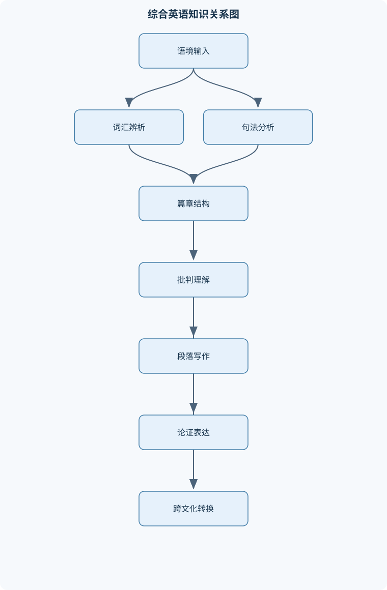
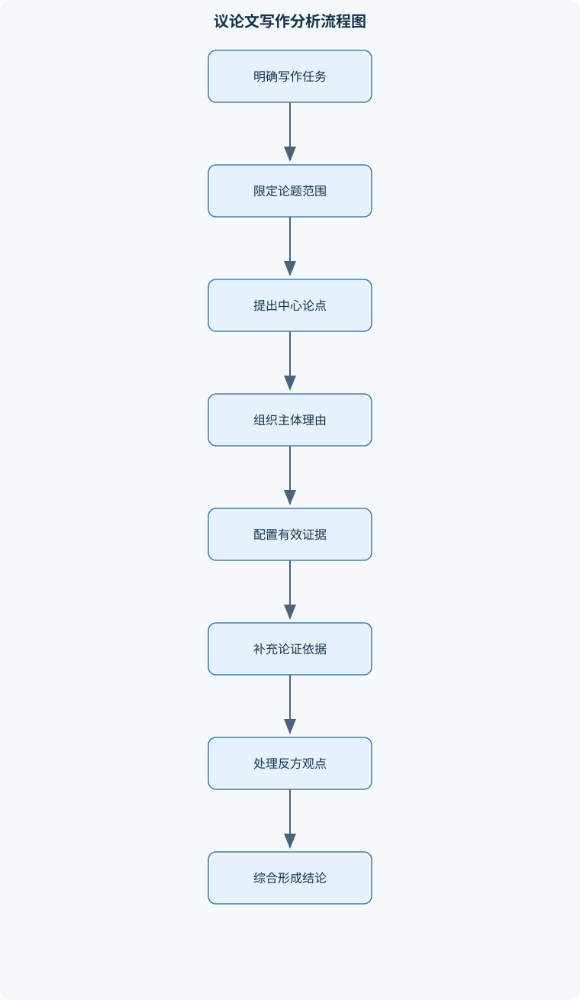

# 综合英语Ⅱ

## 一、课程整体知识框架

### 课程边界与先修知识

《综合英语Ⅱ》面向已掌握基础英语语法、约四级水平词汇和基本听说读写技能的学习者，重点提升中高级综合英语能力。课程边界包括：叙事、说明、议论和文化描写类英语篇章的理解；上下文词汇辨析、短语搭配和构词法；复杂句、非谓语、从句、被动结构、倒装与衔接手段；段落组织、摘要、改写和议论文写作；英汉双向翻译中的语义、语体和文化处理；围绕教育、社会文化、法律传统、城市遗产、饮食审美等主题开展听说表达。先修知识包括基本时态、情态动词、名词性从句、定语从句、状语从句、常见篇章结构和基础英语写作规范。本课程不以文学史、语言学理论、专业法律英语或高级同声传译为主要内容，而是将真实语境中的语言理解、分析和产出作为核心。





### 1. 课程定位、先修条件与能力目标

《综合英语Ⅱ》面向已经掌握基本英语语法、具备约四级水平词汇和基本听说读写能力的学习者。课程不把孤立词汇、单句语法或机械翻译作为终点，而是把语言放入真实篇章、社会文化语境和交际任务中考察。学习者需要同时处理四类问题：文本“说了什么”、作者“怎样组织和表达”、某个词或句子“在这里具有什么意义”，以及读者或说话者“应如何用英语准确重组和表达”。

课程中的基本分析单位包括句子 $S$、段落 $P$、段落主题 $T$、中心论点 $C$、证据 $E$、论证依据 $W$、作者或说话者 $A$、读者或听众 $R$、待解释表达 $X$ 和上下文线索集合 $K$。其中，$T\rightarrow S$ 表示段落主题由相关句子展开；$C\rightarrow E$ 表示证据支持中心论点；$E\rightarrow W$ 表示证据通过论证依据产生支持作用。论证不能简单理解为“有观点加有事实”，因为事实只有在 $W$ 解释“为何能够支持 $C$”时，才构成有效论证。

课程先修内容包括基本时态、情态动词、名词性从句、定语从句、状语从句以及基础篇章结构。进入本课程后，重点转向复杂句的层级分析、词义的上下文判定、段落的统一与连贯、议论文的证据链、文化语境中的意义转换，以及听读输入和口语、写作、翻译输出之间的整合。课程不以文学史、语言学理论、专业法律英语或高级同声传译为主要目标；法律、文化和遗产材料主要用于训练正式语体、制度概念、跨文化表达和篇章分析。

### 2. 篇章阅读与语境建构

篇章阅读首先要判断文本的主要功能。叙事文本通常围绕人物、事件、时间变化和因果发展组织；说明文本解释对象、过程、特征或原因；议论文本提出立场并用理由和证据支持；文化描写文本则通过空间、感官、动作和价值评价呈现对象。四类篇章可以交叉存在，例如一段先叙述个人经历，再说明社会现象，最后提出评价。因此，辨识篇章类型不是给全文贴上唯一标签，而是判断当前段落或语段的主要功能。

标题、首段和段首句可以帮助预测主题，但预测只是候选解释，必须由后文验证。主题通常是“文本主要谈什么”，中心思想则包括“作者对该主题说明或主张了什么”。若标题是关于学生文化，正文可能不仅介绍学生之间的交往，还分析学生文化如何影响价值观、婚姻观和对教师的态度。不能把出现次数最多的名词直接当作主题，也不能把某个细节误当全文主旨。

段落分析应区分主题句和支撑细节。主题句可以位于段首，也可以由多个句子共同建立；支撑句可以采用解释、例证、因果、比较、分类或结果等方式展开。统一性要求一个段落围绕一个主要问题；连贯性要求句子之间有可识别的时间、因果、转折、指代或词汇联系。一个段落即使每句话都语法正确，若同时讨论饮食习惯、法律制度和个人旅行经历，也缺乏统一性。反过来，所有句子都谈同一对象，但缺少逻辑连接，也可能缺乏连贯性。

阅读时要区分事实信息 $F$、观点信息 $O$ 和可推出信息 $I$。$F$ 是文本直接陈述且原则上可核对的信息；$O$ 是作者、人物或被引述者的判断、态度或评价；$I$ 是依据多处信息能够合理推出、但文本未直接说出的内容。若文中说某种学生文化使学生与教师保持距离，这可能是作者对其社会作用的分析；不能因为句子陈述了该观点，就把它当作客观事实。若作者描述某处建筑“在夜间显得庄严”，这是带有审美评价的描写，不应改写成无评价的地理事实。

指代关系是篇章理解的重要线索。代词、指示词、替代词和省略结构可能回指前文名词，也可能指向一个事件或命题。判断指代对象时，不能只选择最近的名词，而应检查数、性、人称、句法功能和语义合理性。例如，代词在形式上可能指向最近的复数名词，但若后文谓语和事件逻辑只适用于前面的整体事件，则其回指对象可能是事件而非名词。篇章中的词汇复现也能帮助建立联系，包括同词重复、词形变化、同义替换、上位词和下位词。

### 3. 核心词汇、搭配与语体辨析

词义由词典义项、句法位置、搭配关系、上下文事实、篇章主题和语体共同决定。对目标词 $X$ 判义时，应先判断其词性和句法位置，再观察它与哪些动词、名词、介词及修饰语共现，随后提出不超过三个候选义项，最后用前后文和语气检验。若一个义项在局部句子中成立，但会破坏全文逻辑或与正式程度不匹配，就不能优先采用。

近义词的差异常表现在词性、搭配对象、语义重点、感情色彩和正式程度。例如，*prevail* 通常作动词，表示某种力量、观点或状态最终占优势，常见结构是某种观点或习惯“prevails”；*dominant* 是形容词，强调在数量、影响力或地位上占主要位置；*prevailing* 也是形容词，常指某一时期普遍存在或被广泛接受的观点、习俗和条件。三者不能因为都可译为“占优势的”而任意互换。*meager* 常强调数量少得不足，*scanty* 常强调稀少、不充足或分布不密；二者都可修饰资源、证据等，但具体搭配和语气并不完全相同。

短语动词的意义通常不能由组成词逐字相加得到。例如 *brush off* 可表示不理会某人或轻轻拂去表面物体；*plunge into* 可表示突然进入水中、活动或状态；*snap off* 强调迅速折断或突然关闭。翻译时应根据宾语和上下文选择意义。动词与介词搭配也具有稳定性，不能仅凭汉语介词替换。*ahead of* 可以表示时间、位置或进度上的“在……之前、领先于”，具体含义取决于后接成分和句子主题。

构词法有助于预测词义和词性。前缀、后缀以及词根变化可以提示否定、重复、程度、身份或词性转换，但构词分析只是候选线索，不是最终答案。一个词的词形意义可能已经固定化，不能机械地把词缀逐一翻译。正式书面语通常倾向于抽象名词、被动结构和完整逻辑连接；日常口语则更常使用短句、缩略形式、短语动词和直接称呼。法律或制度说明中的表达还可能具有责任归属、适用范围和程序含义，因此不能与普通口语完全互换。

### 4. 复杂句法与句群分析

复杂句分析应先找限定动词和主句主干，再确定从句边界、非谓语结构、修饰范围和逻辑关系。设句法结构为 $G$，主句为 $M$，从属分句为 $D$，非谓语结构为 $N$。一个可操作的分析顺序是：先确定能够独立表达主要命题的 $M$，再识别 $D$ 是定语从句、名词性从句还是状语从句，最后判断 $N$ 修饰哪个成分以及其逻辑主语是谁。每个限定动词都应有合理的主语、时态关系和语义角色。

非谓语结构包括不定式、动名词和分词结构。其主要动词形式不单独承担主句时态，因此必须依靠主句或上下文确定时间、原因、条件、结果或伴随关系。分词短语的逻辑主语通常与主句主语一致；若不一致，应有明确的独立主格或其他结构，否则容易形成悬垂分词。例如，*Walking down the street, the old buildings came into view* 表面上像是“老建筑在走路”，逻辑上不合理；应改为“Walking down the street, I saw the old buildings”或改写成完整从句。

定语从句修饰名词，关系词在从句中可能充当主语、宾语、表语或状语。判断关系词功能时，不能只看其位于名词之后，还要检查从句中是否缺少相应成分。名词性从句可以作主语、宾语、表语或同位语；*What Tom needs at present is not financial support but wholesome advice* 中，*What Tom needs at present* 是主语从句，表示“汤姆目前所需要的东西”。让步、原因、条件和时间从句则通过连接词建立 $L$，即逻辑关系。连接词不能被忽略，因为把条件关系误译为并列关系可能改变整个命题。

被动结构的核心不是“动作没有主语”，而是把受事、结果或制度对象置于信息焦点位置。法律和制度说明中常用被动句，以突出判决、规则或程序，而暂时不突出责任主体。翻译时应根据汉语习惯将其转换为主动句、无主句或“被……”结构，不能机械保留英语被动形式。倒装和强调结构通常服务于信息焦点、对比或语气强化。理解时应先恢复正常语序，再判断作者为何改变常规顺序。

### 5. 段落组织与衔接

段落是围绕一个相对集中的主题组织起来的相关句子集合。$P$ 的统一性来自主题范围，连贯性来自句间关系。主题句的功能不是简单宣布话题，而是提出一个能够由后文展开的中心。过于宽泛的句子如“教育很重要”难以安排具体支撑；较明确的句子如“大学教育通过课堂互动、同伴关系和制度规范共同影响学生的价值判断”，才便于后文分项说明。

支撑句必须推进主题，而不是重复主题句。解释说明“为什么或如何”，例证说明“具体表现是什么”，因果说明“前因后果”，比较说明“与另一对象有何异同”。衔接手段包括逻辑连接词、代词回指、同义复现、词形变化、平行结构和主题词重复。逻辑连接词要与真实关系一致：*however* 表示转折，*therefore* 表示结果，*although* 表示让步，*for example* 引入例证，*meanwhile* 表示同时或转入另一并行过程。连接词多并不等于连贯；如果连接词与事实关系不符，反而会误导读者。

段落合并适用于主题相同、时间和论证方向相近的材料；段落拆分适用于一个段落出现新中心对象、新时间阶段或新论证方向的情况。合并时需要补充过渡并消除重复，拆分时要保证每个新段落仍有足够的主题和支撑。段落结尾不宜突然引入未展开的新话题。

### 6. 议论文写作与论证

议论文以中心论点 $C$ 为组织核心。一个合格的中心论点应表明立场、限定对象和适用范围，避免把复杂问题绝对化。例如，“大学教育主要通过课堂塑造价值观”比“大学教育塑造价值观”更便于论证，因为前者允许讨论同伴文化、校园规范和课外经验的作用。

证据 $E$ 可以是事实、统计、研究结果、具体案例、个人经历或合理观察，但不同证据的证明力度和适用范围不同。事实性材料通常需要说明来源和范围；统计材料要注意样本、时间、定义和比例不能脱离语境；轶事可以增强可理解性，却不能单独证明普遍规律。论证依据 $W$ 是从 $E$ 到 $C$ 的推理桥梁。例如，若论点是“课堂讨论能够影响价值观”，证据可以是学生在讨论中接触不同立场；$W$ 则应说明“持续接触并比较不同立场能够促使学习者反思原有判断”。没有 $W$，证据可能真实，却不能充分支持论点。

反方观点应准确呈现对方理由，而不能用“有人认为”草草带过。回应方式包括让步、限定、反驳和区分适用条件。让步承认对方在某一条件下成立，再说明其不能推翻总体论点；反驳则指出证据不足、推理跳跃或适用范围过大。结论应综合已论证的内容，重新确认论题并说明意义，不应机械重复引言，也不能突然引入主体部分没有准备的新事实。

### 7. 文化与社会主题阅读

文化主题阅读要求描述差异，而非急于评价优劣。学生文化、性别关系、婚姻观、社会规范和个人选择都嵌入特定历史、制度和群体关系中。文本中的“距离”“保护”“成熟关系”可能不仅表示空间距离，还涉及权威、身份、风险和价值观之间的关系。翻译时不能只寻找表面对应词，而要保留概念的社会功能。

应区分作者立场、人物态度和被引述观点。作者可能先介绍某种社会看法，再通过转折表达保留；如果只摘取前半句，就会把被描述的观点误判为作者观点。敏感主题应使用客观、限定性表述，例如“在某一群体或特定时期中较为常见”，避免把局部现象概括为所有人都如此。

### 8. 遗产景观与审美描写

遗产和景观文本常按空间顺序、观察顺序或参观路线组织。阅读时可记录观察点、对象位置、视线变化和动作路线，再区分静态特征与动态过程。视觉意象包括色泽、形状、光影和尺度；听觉意象包括声音来源、强弱和远近；动态描写表现移动、变化、开启、流动或人群活动。

形容词不仅描述性质，还表达语义强度和审美态度。*large*、*grand*、*magnificent* 的强度和评价色彩不同，不能全部译成“大的”或“漂亮的”。比喻、拟人和夸张应先识别其功能，再决定是否保留修辞形式。旅游文本通常具有信息性和感染性并存的特点，翻译时既要准确交代遗产信息，又要保持适度的描写语气，不能添加原文没有的历史断言或价值判断。

### 9. 法律传统与制度表达

法律传统材料的重点是判决、先例、规则、例外、公平和确定性之间的关系。先例通常表示过去案件的裁判理由或规则可能对以后类似案件产生参考或约束作用，但不能简单等同于“过去发生过的案例”。制度表达中的因果和目的关系十分重要：规则为何形成、判决如何影响后续案件、统一适用与个案公平如何平衡，都需要通过明确连接词和抽象名词结构表达。

法律语体具有正式、稳定和责任边界清楚的特点。被动句可能突出判决或规则，名词化结构可能把复杂行为压缩为制度概念，如“适用、遵守、审查、裁决”。翻译时要保持语义单位 $Q$ 的意义、逻辑和语体功能，再形成目标语表达 $Tgt$；$Q$ 与 $Tgt$ 不是逐词对应。法律材料只用于一般制度表达训练，不等同于专业法律意见，也不应擅自补充具体法域规则。

### 10. 饮食、感官与操作说明

饮食文本兼有说明和描写功能。品鉴流程通常按照“观察色泽—闻香—入口—感受味道与口感—形成整体评价”的顺序展开。程序说明依赖时间连接词、动作动词和条件限制。*first*、*then*、*after that*、*finally* 建立先后关系；*observe*、*raise*、*smell*、*sip*、*roll* 等动词分别指向不同动作，不能用一个宽泛的 *do* 代替。

感官词汇应按视觉、嗅觉、味觉、触觉和听觉分类。客观描述说明可观察特征，如颜色、气味和口感；主观评价表达个人感受，如“令人愉悦”“层次丰富”。二者应分开，避免把个人评价伪装成普遍事实。条件限制如“只有在……时”“若……则……”决定步骤是否适用，删除这些限制可能改变原文含义。

### 11. 听说整合与综合表达

听力理解不是逐字记录，而是识别主题、立场、信息块和信号词。*first*、*however*、*for instance*、*as a result* 等词常提示结构变化。笔记应优先记录关键词、数字关系、观点和例证，不必记录完整句子。复述时要区分材料内容与个人评价，并用自己的句法重新组织。

综合口语可采用“主题—要点—解释或例证—结论”的结构。表达观点时可以使用同意、保留和限定句式，如“我基本同意……，但这一结论还取决于……”；回答追问时，应先直接回应，再给出理由或例子。口语正式度 $V$ 应随场合调节：课堂讨论可以自然，但正式短讲、制度说明和议论文应避免过多俚语、过度缩略和模糊指代。

## 二、章节和模块划分

### 核心知识覆盖清单

本清单用于检查正文是否覆盖本课程的主要知识模块：

- **篇章阅读与语境建构**：叙事说明议论辨识、标题与主题预测、主题句与支撑细节、指代关系与语义回指、篇章结构与信息层级、上下文推断词义、作者态度与语气、事实与观点区分。
- **核心词汇与搭配辨析**：近义词语义差异、动词与介词搭配、短语动词意义、词缀与词性转换、正式与非正式语体、一词多义判定、固定搭配与惯用语、词义受语境限制。
- **复杂句法与句群分析**：非谓语动词结构、定语从句与关系词、名词性从句功能、让步因果条件从句、分词短语逻辑主语、被动语态与信息焦点、倒装与强调结构、长句切分与重组。
- **段落组织与衔接**：段落统一性、主题句功能、论据展开方式、逻辑衔接与过渡、代词回指与词汇复现、平行结构、段落间连贯、段落合并与拆分。
- **议论文写作与论证**：中心论点与限定范围、理由与证据、事实逻辑统计与轶事证据、论证依据与推理桥梁、反方观点处理、反驳与让步、引言主体结论结构、结论综合而非机械重复。
- **文化与社会主题阅读**：学生文化与价值观、教育影响与社会化、性别与人际关系表达、文化差异的非评判描述、社会规范与个人选择、语境中的隐含态度、跨文化概念转换、敏感主题的客观表述。
- **遗产景观与审美描写**：空间顺序描写、视觉与听觉意象、形容词的语义强度、动态描写与静态描写、比喻和拟人识别、旅游文本语体、文化遗产信息筛选、描写性段落仿写。
- **法律传统与制度表达**：判决与先例词汇、因果与目的表达、法律语体的正式性、普遍规则与个案例外、确定性与公平的权衡、被动表达责任主体、抽象名词化结构、制度说明段落翻译。
- **饮食、感官与操作说明**：品鉴步骤顺序、感官词汇分类、动作动词精确选择、程序说明的时间连接、主观评价与客观描述、食物文化翻译、说明文中的条件限制、操作流程口头表达。
- **听说整合与综合表达**：听力主旨与细节记录、信号词识别、观点复述与改述、基于文本的短讲、讨论中的同意与保留、举例和解释、即兴问答组织、口语正式度调节。


### 1. 模块组织与学习任务链

课程可按“输入理解—结构分析—语言辨析—受控输出—综合表达”组织。篇章阅读提供语境，词汇和句法解释语言形式，段落和议论文训练书面组织，文化、遗产、法律和饮食主题提供跨语域材料，听说模块则把阅读所得信息转化为口头表达。各模块不是彼此孤立的章节。例如，法律文本既训练被动结构和名词化，也训练正式语体翻译；饮食文本既训练感官词汇，也训练程序说明和时间衔接。

### 2. 代表性流程一：上下文词义判定

**输入：**目标词 $X$、所在句、前后句和篇章主题。  
**输出：**最合适的义项、词性、搭配依据及排除其他义项的理由。

1. 判断 $X$ 的词性、句法位置和时态形式。
2. 提取与 $X$ 共现的动词、名词、介词、修饰语和否定成分。
3. 列出不超过三个候选义项。
4. 用文本事实、作者语气、篇章主题和语体正式程度逐项检验。
5. 选择能够同时保持句法可行、语义连贯和语体一致的义项。
6. 用后文信息回读验证；若所有候选都不成立，应回到句法识别，而不是强行选择。

不变量是每个候选义项都必须满足句法要求；终止条件是某一义项对上下文的冲突最少且能解释全文。局部文本长度为 $n$ 时，基本扫描复杂度约为 $O(n)$；若候选义项增多，比较成本随候选数量增加。该流程适用于多义词和近义词，不适用于完全没有语境的孤立词表。

```text
输入：X，句子S，前后文K，篇章主题T
输出：义项sense，依据reason

判断 X 的词性和句法位置
提取搭配词、修饰语、否定词和连接关系
候选集 ← 不超过三个可能义项
对每个候选义项：
    检查句法是否成立
    检查与搭配词是否自然
    检查是否符合篇章主题和语体V
    记录冲突和支持证据
若存在冲突最少且全文最连贯的义项：
    输出该义项及依据
否则：
    返回句法或文本识别步骤重新分析
```

### 3. 代表性流程二：复杂句分层与翻译

**输入：**含多个从句、非谓语或被动结构的英语句子。  
**输出：**主句 $M$、从句 $D$、非谓语结构 $N$、逻辑关系 $L$、修饰范围及译文。

首先标出限定动词和连接词，再找能够独立成句的主句谓语。随后区分定语从句、名词性从句和状语从句，判断每个从句修饰的对象。对不定式、分词和动名词，要寻找逻辑主语并判断其与主句的时间、原因、目的或结果关系。最后将长句拆成若干短句，用短句之间的顺序和逻辑检验原意，再按目标语习惯重组。

验证重点有三项：每个限定动词都有合理主语；每个代词和关系词都有可解释的指向；译文保留原句的主次信息和逻辑关系。若逐词翻译导致主客体倒置、目的关系消失或修饰范围改变，应重新切分。按词数 $n$ 扫描一次时，基本复杂度约为 $O(n)$，但歧义较多时需要多轮语义验证。

### 4. 代表性流程三：议论文论证审查

**输入：**含中心论点的议论文。  
**输出：**段落主旨、$C$、$E$、$W$、反方观点、回应方式和结论关系。

第一步概括每段主旨，判断各段是否围绕同一论题。第二步定位中心论点 $C$，区分作者立场与背景介绍。第三步标出每个主体段的证据 $E$，并确认它不是把观点换一种说法重复。第四步补写或检查 $E\rightarrow W\rightarrow C$ 的推理桥梁。第五步检验证据的相关性、充分性、可靠性和适用范围。第六步寻找反方观点并判断作者采取让步、限定还是反驳。第七步检查结论是否综合已有论证，而非引入新主张。

若有 $p$ 个段落和 $e$ 个主要证据，结构扫描的基本复杂度约为 $O(p+e)$。该流程适合课堂议论文和短篇评论，不代替专业研究中的系统证据评价。

### 5. 代表性流程四：段落修订与综合表达

**输入：**初稿段落 $P$ 和写作任务。  
**输出：**主题明确、展开充分、衔接清楚的段落或口头回应。

先用一句话概括段落主题，删除无法服务于主题的句子；再检查主题句是否有明确范围，按解释、例证、比较、因果或分类安排支撑句；随后补充必要的代词回指、关键词复现和平行结构；最后检查过渡关系和段末是否突然出现新话题。口头表达还需将书面长句改造成便于听众处理的短语块，并确认每个主要结论都能追溯到输入材料。

### 6. 例题一：近义词辨析

**题干：**选择并说明 *prevail*、*dominant*、*prevailing* 在下列语境中的适当形式：  
“The ______ view was that tradition should be preserved.”  
“After a long debate, practical considerations finally ______.”  
“English is the ______ language in international scientific communication.”

**分析：**第一句需要形容词修饰 *view*，表达“普遍存在或被接受的观点”；第二句需要动词作谓语，表达某种因素最终占优势；第三句需要形容词作表语或定语，强调地位上的主要性。

**逐步解答：**第一空填 *prevailing*，因为它修饰观点，表示“当时普遍流行的”；第二空填 *prevailed*，因为主语是 *practical considerations*，需要过去时动词；第三空填 *dominant*，因为强调英语在该领域的主导地位。

**结果验证：**三句的词性分别为形容词、动词和形容词；搭配和语体均自然。  
**变式：**若句子为“Among several competing explanations, one explanation became ______”，可用 *dominant*；若强调“最终胜出”，则可改写为“one explanation eventually prevailed”。

### 7. 例题二：长句分层与翻译

**题干：**分析并翻译：“A court decision is often regarded as a basis that later courts may follow when similar cases are brought before them.”

**分析：**主句 $M$ 是 *A court decision is often regarded as a basis*；*that later courts may follow* 是修饰 *basis* 的定语从句；*when similar cases are brought before them* 是时间或条件背景从句，说明何时可能遵循该依据。主句为被动结构，焦点是“法院判决”，而不是“谁认为”。

**逐步解答：**先还原主干：*A court decision is regarded as a basis*；再确定 *that* 在定语从句中作 *follow* 的宾语；最后识别 *when* 从句中的被动结构 *cases are brought before them*。译文可为：“法院的判决常被视为一种依据，在类似案件提交给有关法院审理时，后来的法院可能遵循这一依据。”

**结果验证：**译文保留了“判决—依据—后续遵循—类似案件”的层级关系，没有把定语从句误译成新的并列主句。  
**变式：**若强调责任主体，可将被动结构改译为“后来的法院可能依据这一判决作出裁定”；若文本强调制度效果，则可译为“这一判决可能成为以后类似案件裁判时所依据的规则”。

### 8. 例题三：段落组织

**题干：**围绕“学生文化如何影响大学生价值观”写一个英语段落，必须包含主题句、两个支撑点、一个具体解释和一个过渡表达。

**分析：**中心主题是学生文化的影响机制，而不是泛泛讨论大学教育。两个支撑点可分别是同伴规范和群体身份；具体解释说明学生为何会根据同伴反应调整行为或判断。

**逐步解答：**

*Student culture can shape university students’ values through daily interaction and shared expectations.*  
*First, students learn what kinds of behavior are accepted by observing their classmates.*  
*For example, a student may become more willing to participate in discussions when active participation is treated as a sign of responsibility.*  
*In addition, student culture gives individuals a sense of belonging, which may influence their views of friendship, gender roles, and future plans.*  
*Therefore, classroom teaching is only one of the forces that contributes to value formation.*

第一句提出主题和范围；第二句提出同伴规范；第三句给出具体机制；第四句补充群体归属；第五句用 *Therefore* 综合方向，但没有超出前文。

**结果验证：**每个句子都服务于“学生文化影响价值观”这一主题，句间有观察、例证、补充和结果关系。  
**变式：**若任务要求更正式，可将 *what kinds of behavior are accepted* 改为 *the behavioral norms accepted within the group*，但不能为了正式而牺牲清晰度。

### 9. 例题四：论证关系审查

**题干：**判断以下论证是否充分：“大学课堂能够塑造学生价值观，因为课堂讨论使学生接触不同观点。因此，课堂是影响价值观的唯一因素。”

**分析：**第一句提出 $C_1$：“课堂能够塑造价值观”；“接触不同观点”是 $E$；隐含的 $W$ 是“接触并比较不同观点可能促使学生反思原有判断”。第二句把较弱的中心论点扩大为“唯一因素”，出现范围跳跃。

**逐步解答：**保留 $C_1\rightarrow E\rightarrow W$，因为证据和推理桥梁能够支持“课堂具有影响作用”。但证据没有比较同伴关系、家庭、媒体和校园制度，因此不能支持“课堂是唯一因素”。更稳妥的结论是：“课堂是影响学生价值观的重要因素之一，但其作用通常与同伴文化和社会经验共同发生。”

**结果验证：**修订后的结论与证据范围一致，没有把“能够影响”扩大为“唯一影响”。  
**变式：**若有多项调查比较课堂、同伴和家庭的相对作用，才可以进一步讨论“主要因素”；即便如此，也需要说明样本、时期和“主要”的判定标准。

### 10. 例题五：程序说明与感官描写

**题干：**用英语说明基本品鉴步骤，并区分客观观察与主观评价。

**分析：**程序意义由顺序连接词、动作动词和条件限制建立。客观观察包括颜色、气味、入口方式和口感；主观评价是对整体感受的判断。

**逐步解答：**  
“First, examine the color of the drink in the glass. Then raise the glass close to your nose and identify its aroma. Next, take a small sip and let it move across your mouth so that you can notice its flavor and texture. Finally, form an overall impression. The color and aroma can be described as observable features, whereas words such as ‘pleasant’ or ‘well-balanced’ express personal evaluation.”

第一步用 *examine*，第二步用 *raise* 和 *identify*，第三步用 *take a sip*、*move across* 和 *notice*，最后用 *form an overall impression* 收束。  
**结果验证：**步骤顺序清楚，感官类别完整，客观描述与评价没有混为一谈。  
**变式：**若增加条件，可写为“Only after the aroma has been noticed should the drink be tasted”，表示先闻香再入口，不能把条件句删掉后改成简单并列。

### 11. 实验或项目一：篇章结构与词义分析

**输入数据：**一篇约五至八段的英语文化或社会主题短文，另选六至十个多义词、近义词或短语动词。  
**步骤：**

1. 为每段写出一句中文或英文主旨。
2. 标注每段的 $T$、主要 $S$、事实 $F$、观点 $O$ 和可推出信息 $I$。
3. 选择目标词 $X$，记录词性、搭配、前后文线索 $K$ 和候选义项。
4. 画出段落之间的因果、转折、递进或时间关系。
5. 将全文压缩成不超过五句的英文摘要，并解释删去了哪些细节。

**评价标准：**段落主旨不能只重复某个细节；词义判断必须有至少两类上下文依据；事实与观点区分合理；摘要保留主题、主要关系和作者基本态度；语言应保持原文语体。  
**排错方法：**若多个义项无法区分，回到搭配和句法位置；若摘要句子之间跳跃，补充逻辑连接；若把人物观点写成作者观点，检查引述动词和转折词；若段落主旨互相重复，重新区分主题范围和支撑功能。

### 12. 实验或项目二：综合听读与口头陈述

**输入数据：**一篇关于传统饮食变化的短文和一段三至五分钟的英语音频，任务是完成两分钟英文陈述，内容包括传统习惯、变化表现、可能原因和个人评价。

**步骤：**

1. 第一次听读只记录主题、说话者立场和三个主要信息块。
2. 第二次听读记录事实、例证、原因和结论，使用关键词而非整句。
3. 建立“主张—证据”对应关系，区分材料内容和个人判断。
4. 先写四句提纲：背景、变化、原因、评价。
5. 用连接词组织口头陈述，完成录音或现场表达。
6. 回听并检查是否添加材料外事实，是否遗漏任务要求。

**评价标准：**信息准确性占核心地位；结构应覆盖四项任务；表达应有清楚的时间、因果和转折关系；语法、发音和词汇选择应足以支持理解；个人评价必须与材料事实区分。  
**排错方法：**若内容零散，按信息块重新排序；若过度依赖原文，改用同义改述；若原因和结果混淆，重新标记 *because*、*therefore* 等信号；若表达超时，删除重复例子而保留中心论点和必要证据；若观点无依据，补充材料中能支持该观点的事实。

### 13. 模块衔接中的典型产出

篇章阅读模块的产出是结构摘要、指代说明和事实—观点判断；词汇模块的产出是带语境依据的词义辨析和正式程度改写；句法模块的产出是主句、从句、非谓语和修饰范围标注；段落模块的产出是统一、连贯的说明或描写段；议论文模块的产出是包含 $C$、$E$、$W$ 和回应反方的短文；文化、遗产、法律和饮食模块的产出分别侧重客观文化描述、空间描写、制度说明翻译和程序口头表达；听说整合模块则要求学习者把输入材料重组为有依据的英语回应。

这些产出之间存在明确的递进关系：没有篇章结构判断，词义容易脱离语境；没有句法分层，翻译容易颠倒主客体；没有段落统一性，议论文会堆砌观点；没有 $E\rightarrow W$ 的推理桥梁，论证会停留在事实罗列；没有输入信息追踪，综合口语容易添加材料外内容。课程最终要求学习者在不同语体和主题中保持意义准确、结构清楚、逻辑完整，并根据 $R$、$A$ 和交际目的调节表达方式。

## 三、核心概念的详细解释

### 1. 篇章类型、主题与信息层级

综合英语阅读不是逐句翻译，而是建立文本整体意义。判断篇章类型时，应观察文本的主要交际目的：叙事文本以人物、事件、时间和变化为组织线索；说明文本解释对象的特征、过程、原因或结果；议论文本提出中心论点并通过理由和证据影响读者；文化描写文本则通过空间、感官、动作和评价呈现某种生活方式、遗产景观或社会现象。一个篇章可以兼有多种功能，例如先叙述个人经历，再说明社会变化，最后提出评价，因此篇章类型是对主要功能的判断，不是只能选择一个固定标签。

标题、首段、段首句和反复出现的词语可以帮助形成主题预测。主题是文本主要谈论的对象或问题，中心思想则进一步说明作者对该对象的解释、判断或主张。标题只能产生候选解释，不能直接等同于中心思想。确定主题后，应继续追踪正文中的主题句、支撑细节、转折和结论；如果后文信息与初步预测冲突，应修正预测，而不是强行解释文本。

段落可表示为 $P$，段落主题表示为 $T$，句子表示为 $S$。$T\rightarrow S$ 表示主题由相关句子展开，但这并不意味着每个句子都必须重复同一个词。相关句子可以通过同义替换、代词回指、上下义关系、因果解释或例证建立联系。段落统一性要求所有主要句子服务于同一中心问题；段落连贯性要求句子之间存在可识别的逻辑、指代或词汇联系。统一性回答“这些句子是否谈同一个主要问题”，连贯性回答“这些句子之间是否连接得起来”。

### 2. 事实、观点、推断与作者态度

阅读理解应区分事实信息 $F$、观点信息 $O$ 和可推出信息 $I$。$F$ 是文本直接陈述、原则上可以核对的信息；$O$ 是作者、人物或被引述者的判断、评价、建议和态度；$I$ 是由文本中的多个信息合理推出、但没有被直接说出的内容。三者不能仅凭句子是否使用一般现在时来区分，因为说明文本也可能包含评价，叙事文本也可能包含事实性细节。

判断作者态度时，要注意评价词、情态动词、程度副词、转折结构和引述范围。例如 *fortunately*、*uncompromising*、*distasteful* 等词带有明显态度色彩；*may*、*seem*、*probably* 表示不确定或限制；*however*、*although* 可能显示作者对前一观点的保留。若文本引述某人的看法，必须区分“人物的观点”和“作者对该观点的态度”。不能把所有出现在文章中的判断都归于作者本人。

隐含信息必须满足两个条件：第一，能够由文本中的明确线索推出；第二，不能加入文本外的背景假设。若材料说明多数学生接受某种学生文化，并提到这种文化影响其对教师、婚姻和社会的看法，可以推出学生文化具有社会化作用；但不能进一步断言所有学生都完全赞同这种文化，因为“多数”不等于“全部”。

### 3. 指代、衔接与篇章结构

指代关系包括名词回指、代词回指、事件回指和命题回指。判断 *it*、*they*、*this*、*that* 或 *which* 的所指时，不能只选择距离最近的名词，还要检查数、格、语义角色和逻辑关系。*This* 有时指一个具体事物，有时指前面完整的事件；*which* 可能修饰单个名词，也可能补充说明前面整个分句。

篇章衔接主要包括四类。第一是指称衔接，如代词、指示词和同义替换；第二是词汇衔接，如同一词反复、上下义词和语义场词；第三是连接衔接，如 *however* 表示转折，*therefore* 表示结果，*although* 表示让步，*meanwhile* 表示时间或并行；第四是平行结构衔接，即用相同或相近的语法形式排列信息。衔接词本身不能替代逻辑，如果前后句不存在真实的因果关系，仅添加 *therefore* 仍然会造成语义错误。

### 4. 上下文词义、搭配与语体

目标词 $X$ 的意义不能由词典中最常见的中文释义直接决定。应先判断 $X$ 的词性和句法位置，再观察与它共同出现的动词、名词、介词、修饰语和宾语，最后结合段落主题、作者态度和语体正式程度选择义项。上下文线索集合记为 $K$，包括局部搭配、句法结构、前后句语义、篇章主题和语体信息。

近义词的差异通常体现在语义范围、搭配对象、感情色彩、使用场合和词性上。例如 *prevail* 通常作动词，表示某种观点、风气或力量最终占优势；*dominant* 主要作形容词，强调支配地位或影响力；*prevailing* 常作形容词，表示某一时期普遍存在或占主导的观点、习俗和条件。三者不能仅按“占优势”互换。*meager* 强调数量、供给或成果少得令人不满意，*scanty* 更强调稀少、不足或分布不充分；具体选择还要受名词搭配限制。

一词多义的判定必须同时满足句法可行、搭配自然和篇章连贯。例如 *raise* 可以表示“举起、提高、筹集、养育、提出”，其宾语和语境决定具体意义。*snap off* 表示突然折断或迅速关闭，不能根据 *snap* 的单一释义机械翻译。短语动词通常形成整体意义，介词或副词小品词的改变可能导致意义和语体变化。

语体正式程度记为 $V$。日常口语可以使用缩略形式、常见短语动词和直接评价；正式说明或议论文更倾向于使用抽象名词、完整句式和明确逻辑；法律制度表达则常使用名词化、被动式、限定条件和责任主体的谨慎处理。不同语体并非绝对高低关系，而是与交际对象 $R$、说话者或作者 $A$、交际目的和文本类型相匹配。

### 5. 构词法、词性转换与词义边界

英语词缀可以提示词义方向和词性，但不能替代语境判断。前缀可能表示否定、重复、程度或方向，后缀常提示名词、形容词、动词或副词词性。例如由动词派生的名词可能表示动作、结果或抽象概念，由形容词派生的副词常表示动作方式，但同一词根的派生词并不总能按照中文词根逐字推断。

词性转换是英语篇章压缩信息的重要手段。英语正式文体常将动作转化为抽象名词，如 *decide* 转化为 *decision*，并通过介词短语或被动结构补充关系。翻译时若机械保留名词化结构，汉语可能显得生硬；若一律改成动词，又可能损失法律或制度文本的正式性。因此，应先确定命题意义，再根据目标语语体选择保留、拆分或转换。

### 6. 复杂句的层级分析

复杂句分析记为句法结构 $G$，其中主要分句为 $M$，从属分句为 $D$，非谓语结构为 $N$。理解长句的基本顺序是：先找限定动词和主句谓语，再确定主句 $M$；然后识别名词性从句、定语从句和状语从句；最后分析非谓语结构 $N$ 的逻辑主语、修饰范围和与主句的关系。

限定动词具有时态或主语一致关系，能够构成分句的谓语；非谓语动词包括不定式、现在分词、过去分词和动名词，通常不独立承担时态。非谓语结构可以表示目的、结果、原因、伴随、时间、被动或完成意义，但具体关系由形式和上下文共同决定。分析时必须为每个非谓语结构寻找合理的逻辑主语，否则容易产生悬垂分词。例如，若分词短语的逻辑主语不是主句主语，就应改写为从句或明确补出主语。

定语从句修饰名词或代词，关系词在从句中可能充当主语、宾语、表语或状语；名词性从句则可以充当主语、宾语、表语或同位语；状语从句表达时间、原因、条件、让步、目的、结果和比较等逻辑关系。长句切分不能只按逗号切断，而应根据限定动词、连接词、修饰范围和语义关系重组。

### 7. 被动、倒装与信息焦点

被动结构的核心不是“找不到主语”，而是把受事、结果或制度过程置于信息焦点位置。英语被动形式通常由 $be+\text{过去分词}$ 构成，时态由 $be$ 的形式体现；情态被动通常为 $modal+be+\text{过去分词}$。使用被动时，施事者可以省略、由 *by* 引出，或通过上下文恢复。

法律和制度说明中，被动结构常用于强调规则、判决或程序，而不是强调具体执行者。翻译成汉语时，应根据信息重点在被动句、主动句和无主句之间转换。若施事者重要，应明确译出；若施事者未知或不重要，可使用“被认为”“应当予以”“经审理”等表达，但不能擅自增加责任主体。

倒装和强调结构改变信息排列，不能简单理解为语序异常。否定或限制性副词置于句首时，可能引起部分倒装，以突出限制条件；*It is...that...* 可突出某个成分；*What...is...* 可将一个名词性从句作为主题。分析时应先恢复正常语序，再判断强调对象和逻辑功能。

### 8. 段落组织与议论文论证

段落主题为 $T$，议论文中心论点为 $C$。说明段通常围绕定义、分类、过程、原因或结果展开；描写段可按空间、时间或感官顺序展开；议论段则需要理由、证据和解释。主题句不一定总在段首，但必须能概括该段的中心方向。若某句引入新的中心对象、时间阶段或论证方向，通常应考虑另起一段。

论证关系不能简化为 $C+E$。完整结构是：

$$
C\leftarrow E\leftarrow W
$$

其中 $C$ 是中心论点，$E$ 是证据，$W$ 是论证依据，即说明证据为何支持论点的推理桥梁。事实可以真实，却未必与论点相关；证据可以相关，却可能数量不足或代表性有限。$W$ 使读者能够从证据过渡到结论，因此是论证中不可省略的隐含环节。

证据可包括事实、统计、逻辑分析、具体案例和个人经历。不同证据的适用范围不同：统计信息适合说明总体趋势，但必须注意样本和条件；个案适合具体化观点，却不能自动代表整体；轶事能够增强可理解性，但通常不足以单独证明普遍结论。反方观点应准确呈现其理由，再通过让步、限制条件或反驳回应，不能只写“有人认为”而不说明对方依据。

### 9. 文化、遗产与社会主题表达

文化主题中的概念通常包含制度背景、价值判断和人际关系含义。学生文化不仅指学生的娱乐活动，还可能影响同伴规范、师生距离、婚姻观、社会观和个人选择。描述文化差异时，应避免把一种文化写成绝对先进或落后，也不能把群体中的倾向扩大为所有个体的共同特征。客观表述应使用“部分成员”“在某些语境中”“可能被理解为”等限定形式。

遗产景观描写需要有空间组织。常见顺序包括由远及近、由外到内、由整体到局部、由白天到夜间或沿参观路线展开。视觉意象涉及色彩、形状、明暗、尺度和布局；听觉意象涉及声音来源、强弱和节奏；动态描写表现人物、光线、水流或人群的变化。形容词不仅要表达程度，还应与被修饰名词的感官属性匹配，不能堆砌没有功能的华丽词语。比喻和拟人要识别其表达效果，但翻译时应优先保持意象功能，而不是机械保留字面形式。

### 10. 法律传统、饮食审美与程序说明

法律传统类文本常涉及判决、先例、规则、例外、一致性、公平和责任。法律语体倾向于明确限定适用条件，避免把一般规则误读为无条件规则。抽象名词化结构可以压缩制度关系，但会增加句法密度；被动结构可能突出判决或规则，隐藏或省略执行主体。翻译时必须保持因果、目的、条件和例外关系，不能只保留名词对应。

品酒或其他饮食感官说明属于程序性文本。其意义由时间顺序、动作动词、感官词汇和条件限制共同建立。标准流程可按“观察色泽—闻取香味—入口品尝—评价味道与整体感受”组织。*look at*、*smell*、*sip*、*roll*、*savor* 等动作词的精确选择决定步骤是否清楚。色泽和香味可以相对客观地描述，愉悦、复杂、醇厚等词则带有评价成分。程序文本若删除“首先”“然后”“只有在……时”等限制，可能改变操作顺序或适用边界。

### 11. 听说整合与综合表达

听力和阅读的共同任务是建立信息结构，而不是逐字记忆。听读时应区分主题、立场、主要事实、例证、转折和结论。信号词能够提示信息关系：*first*、*then* 表示顺序，*because*、*therefore* 表示因果，*however* 表示转折，*for example* 引出例证，*in conclusion* 标记总结。笔记应优先记录关键词、关系和数字，避免试图记录全部句子。

综合口语或书面回应必须以材料为依据。复述是保留原文命题而改变表达形式，改述则在不改变意义的前提下调整结构和词汇。回应可以加入个人评价，但必须明确区分“材料信息”和“个人观点”，不能把材料未提供的事实伪装成文本结论。正式口语需要结构清楚、衔接自然，并根据听众调整词汇和句式复杂度。

## 四、重要定义、公式、定理和推导

### 专业审校补充：关键定义与适用边界

综合英语Ⅱ中的英汉双向转换，应以“命题意义—逻辑关系—语体功能—文化指向”四层等值为边界，而不是逐词对应。命题意义包括动作主体、对象、时间和范围；逻辑关系包括因果、让步、条件、目的和转折；语体功能要求法律说明、文化描写、操作说明和议论文分别保持相应的正式度与客观程度；文化指向则要求识别某个词在制度、习俗或人际关系中的特殊含义。尤其要保留情态和程度：*may*、*tend to*、*generally* 不能无条件译成“必然”“总是”，*not necessarily* 也不能误译为“不是”。英语被动句可译为汉语主动句、无主句或“受到……影响”的结构，但责任主体不能被无故删除。若目标语为了自然而改变了信息范围、因果强度或说话者立场，即使句子通顺，也不属于合格转换。该边界适用于课程中的制度说明、文化主题和议论文翻译；不要求英语与汉语保持相同词序或相同句法形式。


### 1. 上下文词义判定原则

设目标词为 $X$，上下文线索集合为 $K$，候选义项为 $m_1,m_2,\ldots,m_r$。在实际阅读中，最合适的义项不是词典中概率最高的义项，而是同时满足句法、搭配、语义和语体约束的义项：

$$
m^*=\arg\max_{m_i}\operatorname{Fit}(m_i,K)
$$

其中，$m^*$ 表示最终选择的义项，$\operatorname{Fit}$ 表示候选义项与上下文的匹配程度。这里的“最大”不是要求进行精确数值计算，而是要求按以下顺序比较：

1. 先确认词性和句法位置。若句中需要过去分词，不能选择只能作名词的义项。
2. 检查搭配对象。动词所支配的宾语、介词后的名词和常见修饰语会缩小义项范围。
3. 检查局部语义。前后句可能通过同义解释、对比、因果或举例提示词义。
4. 检查篇章主题和作者态度。若某义项会破坏全文逻辑，即使局部勉强成立，也应排除。
5. 检查语体。法律、议论文、旅游描写和日常对话对词汇的自然选择不同。

该原则适用于多义词和近义词辨析，不适用于完全脱离上下文的孤立词表。若所有候选义项都无法满足句法条件，应回到断句、词性识别或文本识别步骤，而不能强行选择一个中文释义。

### 2. 复杂句分层规则

复杂句分析可表示为：

$$
G=M+\sum D+\sum N
$$

其中，$G$ 是完整句法结构，$M$ 是主要分句，$D$ 是一个或多个从属分句，$N$ 是一个或多个非谓语结构。该式不是把句子机械相加，而是说明复杂句由主干、从属层级和非谓语修饰共同构成。

推导步骤如下：

1. 标出所有限定动词，判断每个动词是否拥有明确主语。
2. 依据连接词、关系词和标点初步划分分句。
3. 找到能够独立表达主要命题的 $M$。
4. 判断 $D$ 的类型：若充当名词成分，是名词性从句；若修饰名词，是定语从句；若说明原因、条件、让步、时间或目的，是状语从句。
5. 判断 $N$ 的逻辑主语和修饰对象。
6. 将长句改写为若干短句，再核对原句中的时态、语态和逻辑关系。

该规则的核心不变量是：每个限定动词都必须有合理的主语和从句位置，每个非谓语结构都必须有可解释的逻辑主语。若把非谓语结构误当作独立谓语，或者把定语从句误判为新的主句，译文就会出现主客体颠倒、因果错误或信息层级错乱。

### 3. 论证支持关系

设中心论点为 $C$，证据为 $E$，论证依据为 $W$。有效论证至少包含以下关系：

$$
C\leftarrow E\leftarrow W
$$

其推导含义是：

- $C$ 提出需要证明、解释或劝说的结论；
- $E$ 提供事实、统计、案例或文本观察；
- $W$ 说明为什么该证据能够支持这一结论。

若只有 $C$，文本只是主张；若有 $C+E$ 而无 $W$，文本可能只是事实罗列；只有当 $W$ 建立起从 $E$ 到 $C$ 的推理桥梁时，读者才知道证据的论证作用。

例如，论点是“大学教育会影响价值观”，证据可以是“学生在长期课程、同伴交往和制度活动中接触不同观念”。论证依据是“持续接触并参与社会互动会改变个体对规范、责任和人生目标的理解”。如果只列出课程名称，却没有解释课程如何影响价值判断，证据与论点之间的支持关系仍不充分。

该模型适用于课堂议论文和短篇评论，但不能替代专业研究中的证据质量评价。证据还应接受相关性、充分性、可靠性、代表性和时效性检查。个人故事能够说明一种可能经验，却不能单独证明所有人的共同情况；统计数据能够显示趋势，却不能自动证明因果关系。

### 4. 段落统一性与连贯性判定

段落统一性可用以下条件描述：

$$
\forall S_i\in P,\quad \operatorname{Rel}(S_i,T)>0
$$

其中，$S_i$ 是段落中的第 $i$ 个句子，$P$ 是段落，$T$ 是段落主题，$\operatorname{Rel}$ 表示句子与主题的相关程度。该表达不是要求计算具体分数，而是说明每个保留句都必须对主题有实质贡献。若某句引入新的中心对象、时间阶段或论证方向，即使语法正确，也可能破坏统一性。

连贯性则表现为相邻句子之间存在逻辑或语言联系：

$$
S_i \xrightarrow{L} S_{i+1}
$$

其中，$L$ 可以是因果、转折、让步、条件、递进、并列或时间顺序，也可以是指代、词汇复现和平行结构。统一性与连贯性不能相互替代：所有句子都谈同一主题却没有关系，段落可能不连贯；句子之间连接紧密却分别讨论不同中心，段落仍不统一。

### 5. 翻译的功能对应原则

翻译单位记为 $Q$，目标语表达记为 $Tgt$。二者不是逐词对应，而是建立意义、语体和交际功能上的对应：

$$
Q \Rightarrow Tgt
$$

其中，箭头表示转换关系，不表示字面替换。英译汉时，首先保留命题意义和逻辑关系，再根据汉语习惯调整语序、主语和信息焦点；汉译英时，先确定动作主体、主次信息和逻辑连接，再选择英语从句、非谓语、被动或名词化结构。

翻译检查至少包括三层：

1. 语义层：人物、动作、时间、数量、条件和否定关系是否准确。
2. 逻辑层：因果、转折、让步、目的和先后关系是否保留。
3. 语体层：日常表达、正式说明、法律制度表达和文化描写是否使用相称形式。

字面对应的边界在文化概念和制度概念中尤其明显。若一个概念承载特定社会规范或法律功能，目标语不能只寻找表面相似的单词，而应根据上下文说明其作用、限制和价值含义。

### 6. 程序说明的顺序约束

程序文本的意义可表示为：

$$
\text{Procedure}=\text{Action}+\text{Order}+\text{Condition}+\text{Result}
$$

其中，*Action* 是动作，*Order* 是先后顺序，*Condition* 是适用条件或例外，*Result* 是动作完成后的观察或判断。四者缺一可能导致程序不完整。

例如品鉴流程不是简单列出“看、闻、尝”三个动词，而应说明先观察色泽，再靠近酒杯闻香，随后小口入口，并在口中感受味道和整体质地。若把“只有在具备一定经验时才能准确判断”删除，程序的适用边界就发生变化；若把“然后”改为“同时”，操作顺序也可能被误解。

### 7. 被动结构与责任主体

被动表达的分析公式可写为：

$$
\text{受事焦点}+\text{被动谓语}+\text{施事者（可省略）}
$$

被动结构适用于以下情形：受事比施事更重要；施事未知或无需说明；制度、判决或过程需要突出结果；文本希望保持客观、正式或非个人化语气。但被动并不自动表示责任主体不存在。翻译和改写时，若责任主体对法律意义或制度责任重要，必须恢复或保留；若主体不重要，才可使用汉语无主句或“被……”结构。

### 8. 语体适切性的边界

语体适切性可概括为：

$$
V=f(A,R,\text{purpose},\text{genre})
$$

其中，$V$ 表示正式程度，$A$ 表示作者或说话者，$R$ 表示读者或听众，*purpose* 表示交际目的，*genre* 表示文本类型。正式程度不是单纯越高越好。日常对话若过度使用法律式名词化，会显得生硬；法律说明若使用过于随意的短语，则可能削弱限定性和严谨性；旅游描写若只堆砌抽象名词，又会失去感官具体性。

因此，表达评价不能脱离任务。相同意义在不同语境中可能有不同合适形式：口头讨论强调即时、清楚和可回应；议论文强调论点、证据和逻辑；文化说明强调客观、非评判和背景解释；制度翻译强调责任、条件和范围的准确对应。

## 五、算法、流程和实现思路

### 方法与流程覆盖索引

下列方法或流程应在正文中说明输入、步骤、适用条件、结果检查和边界：

- 上下文词义判定流程：输入为目标词X、所在句子、前后句和篇章主题；输出为最合适义项及判断依据。步骤为：一，判断X的词性和句法位置；二，提取与X共现的动词、名词、介词和修饰语；三，列出不超过三个候选义项；四，用上下文事实、语气和篇章主题逐项检验；五，选择冲突最少且语体匹配的义项，并写出排除其他义项的理由。不变量是候选义项必须保持句法可行和篇章连贯；当所有候选都不成立时终止并回到句法或文本识别步骤。适用于多义词和近义词辨析，不适用于缺少上下文的孤立词表。对长度为n的局部文本，线性扫描的基本复杂度为O(n)，候选义项数量增加时比较成本相应增加。
- 复杂句分层分析流程：输入为一个包含多个从句或非谓语结构的句子；输出为主句、从句、修饰范围和逻辑关系。步骤为：一，标出限定动词和连接词；二，确定能够独立成句的主句M；三，区分定语从句、状语从句、名词性从句和非谓语结构；四，为每个从属成分寻找逻辑主语；五，依据连接词和语义恢复因果、让步、条件或时间关系；六，将句子改写为若干短句检验原意。不变量是每个动词必须有合理的主语和时态关系；终止条件是所有限定动词、从句边界和修饰对象均已确定。适用于阅读和翻译，不适用于故意省略严重或文本损坏的句子。若按字符或词数扫描一次，基本复杂度为O(n)。
- 议论文论证审查流程：输入为一篇含中心论点的议论文；输出为论点、证据、论证依据、反方观点和结论之间的关系图。步骤为：一，概括每段主旨；二，定位C；三，为每个主体段标注E；四，补写E到C之间隐含的W；五，检查证据的相关性、充分性、可靠性和时效性；六，标记反方观点及回应方式；七，检查结论是否综合已有内容。全程不把观点本身当作证据；终止条件是每项主要证据都能回答“它为何支持论点”。适用于课堂议论文和短篇评论，不替代专业研究中的系统证据评价。若段落数为p、证据数为e，结构扫描复杂度约为O(p+e)。
- 段落修订流程：输入为初稿P和写作任务；输出为主题明确、衔接清楚且展开充分的段落。步骤为：一，用一句话概括段落主题；二，删除与主题无关的句子；三，确认主题句是否提出可展开的中心；四，按解释、例证、因果、比较或数据安排支撑句；五，补充代词、重复关键词和过渡词；六，检查句子之间的逻辑关系；七，确认段末没有突然引入新主题。不变量是每个保留句都服务于同一主题；终止条件是主题句、支撑句和过渡关系均可解释。适用于说明段、议论段和描写段，不要求所有段落都采用固定的主题句开头。若句子数为n，单次修订基本复杂度为O(n)，多轮修订取决于修改轮数。
- 听读信息整合流程：输入为一段录音或阅读材料及一个综合表达任务；输出为有依据的口头或书面回应。步骤为：一，记录主题和说话者立场；二，按信号词划分信息块；三，区分事实、观点、例证和结论；四，用关键词而非整句做笔记；五，建立主张与证据的对应关系；六，用自己的话重组信息；七，检查是否回答任务且未添加材料外事实。不变量是每个主要结论都能追溯到材料中的信息；终止条件是任务要求的所有信息点均已覆盖。适用于综合听说、复述和文本讨论，不适用于需要逐字记录的专业速记。若信息单元数为n，整理过程基本复杂度为O(n)。





### 1. 上下文词义与搭配判定流程

#### 1.1 输入、输出与适用范围

该流程用于判断多义词、近义词、短语动词和固定搭配在具体语境中的意义。输入包括目标表达 $X$、所在句子、前后句、段落主题 $T$、作者或说话者 $A$、读者或听众 $R$，以及从文本中提取的上下文线索集合 $K$。输出包括最合适的词义、词性、搭配说明、语体判断和排除其他义项的理由。

该流程适用于完整句子、段落和篇章中的词义判断，不适用于脱离语境的孤立词表。词典释义只能产生候选义项，不能直接决定 $X$ 在文本中的实际意义。判断时至少要同时考虑句法位置、共现词、语义角色、篇章主题和正式程度 $V$。

#### 1.2 操作步骤与不变量

第一步，确定 $X$ 的词性和句法功能。若 $X$ 位于冠词后，可能是名词；若位于情态动词后，通常需要动词原形；若位于系动词后，可能承担表语功能。词性不成立时，即使中文解释看似合理，也应排除该义项。

第二步，提取搭配线索，包括与 $X$ 共现的动词、名词、介词、程度副词和修饰语。例如 *prevail* 常作不及物动词，表示某种观点、习惯或力量占优势；*prevailing* 通常作形容词，表示“现行的、普遍存在的或占主导地位的”；*dominant* 主要强调控制力、影响力或地位上的优势。三者不能因为都可以译为“占优势”而任意互换。

第三步，列出不超过三个候选义项。候选过多会使分析退化为词典罗列；候选过少则可能遗漏真正义项。第四步，用句内事实、前后文逻辑、作者态度和篇章主题检验候选义项。第五步，选择句法可行、搭配自然、篇章冲突最少且语体匹配的义项，并说明其他义项为何不适合。

不变量是：每个保留候选必须满足句法可行性和篇章连贯性；不能因为某个义项最常见，就跳过搭配和语境检验。若所有候选都不能解释句子，应回到词性识别、句法分析或文本识别步骤，而不能强行选择一个“差不多”的中文意思。对长度为 $n$ 的文本进行一次局部扫描，基本时间复杂度为 $O(n)$；若候选义项数为 $m$，逐项比较的成本还会随 $m$ 增加。

```text
Algorithm ContextualMeaning
Input: target expression X, sentence S, nearby context K, topic T
Output: selected meaning, grammatical role, evidence, rejected meanings

1. role ← identify_part_of_speech_and_syntactic_role(X, S)
2. candidates ← generate_at_most_three_meanings(X, role)
3. for each meaning c in candidates:
       collocation_score ← check_collocations(c, S)
       logic_score ← check_local_and_discourse_logic(c, K, T)
       register_score ← check_register(c, S)
       record(c, collocation_score + logic_score + register_score)
4. selected ← candidate with the strongest compatible evidence
5. if no candidate is syntactically and semantically valid:
       return "reanalyse syntax or text"
6. return selected, role, supporting_evidence, rejected_candidates
```

该伪代码不是把词义机械化为一个分数，而是规定分析顺序：先句法，后搭配，再语义和语体。所谓“最强证据”必须能用文本中的具体词语或篇章关系说明。

#### 1.3 例题一：近义词辨析

**题干：**选择并改写下列句子中的表达：

*The prevailing view was that students should remain distant from their teachers.*

**分析：**句中 *prevailing* 位于名词 *view* 前，承担形容词功能，修饰“观点”。其意义是“普遍持有的、占主导地位的”。若使用 *prevail*，它是动词，不能直接放在名词前；若使用 *dominant*，语法上可行，但更突出控制性或压倒性，不如 *prevailing* 自然地表示一种普遍流行的看法。

**逐步解答：**

1. *view* 是中心名词，空缺处需要形容词。
2. 语境讨论学生文化中的普遍观念，而非某一力量控制其他观点。
3. *prevailing view* 是自然搭配。
4. 改写为正式表达：*The view prevailing among many students was that they should remain distant from their teachers.*

**结果验证：**改写后 *prevailing among many students* 修饰 *view*，且“许多学生持有”这一范围比绝对化的“所有学生”更准确，符合文本中“大多数”而非“全部”的边界。

**变式：**若主语是 *A belief ______ in the department influenced students’ choices*，应填 *prevailing*；若句子是 *In the debate, common sense eventually ______*，应填 *prevailed*，因为空缺处需要谓语动词。

### 2. 复杂句分层与翻译流程

#### 2.1 句法分析顺序

复杂英语句子的理解应遵循“主干—边界—修饰—逻辑—重组”的顺序。输入是含有多个限定动词、从句或非谓语结构的句子，输出是主句 $M$、从句 $D$、非谓语结构 $N$、各成分的修饰范围以及可接受的译文。

第一步，圈出限定动词，区分真正谓语和非谓语形式。第二步，根据连接词、主谓关系和句号边界确定主句 $M$。第三步，识别定语从句、名词性从句、让步、因果、条件和时间状语从句。第四步，为每个分词、不定式和动名词寻找逻辑主语。第五步，恢复被动结构中的责任主体和信息焦点。第六步，将原句暂时拆成若干短句，再根据汉语信息层级重组。

分析的不变量是每个限定动词都必须有合理的主语、时态关系和从句归属；每个非谓语结构都必须能解释其逻辑主语。终止条件是所有限定动词、从句边界、修饰对象和逻辑关系均已确定。对长度为 $n$ 的句子进行一次标记扫描，基本复杂度为 $O(n)$，但歧义消解可能需要多次语义检验。

#### 2.2 例题二：被动结构与后置修饰

**题干：**分析并翻译：

*Court decisions are often regarded as principles that may be followed in similar cases.*

**分析：**

1. 主句是 *Court decisions are often regarded as principles*。
2. *are regarded as* 是被动结构，主语是 *Court decisions*，信息焦点在“判决被如何看待”。
3. *that may be followed in similar cases* 是定语从句，修饰 *principles*。
4. *may* 表示可能性或制度上的允许，不宜译成绝对的“必须”。
5. *be followed* 的隐含主体是处理类似案件的法院或司法机关。

**逐步解答：**先恢复逻辑关系：“法院判决”被视为“原则”；这些原则可能在类似案件中被遵循。英译汉不应逐词保留“被认为是原则那可能被遵循”，而应调整为：“法院判决通常被视为处理类似案件时可能遵循的原则。”若上下文强调司法机关，可以译为：“法院判决通常被视为司法机关审理类似案件时可以遵循的原则。”

**结果验证：**译文保留了被动评价、可能性和定语修饰范围，没有把 *may* 强化成必然规则，也没有把判决误译为主动制定规则的主体。

**变式：**若原句改为 *The principles followed in similar cases were derived from earlier decisions*，中心主干是 *The principles were derived*，而 *followed in similar cases* 是过去分词短语修饰 *principles*，不能误判为第二个并列谓语。

### 3. 段落修订与衔接流程

#### 3.1 段落统一性和连贯性的检查

输入是初稿段落 $P$ 和写作任务，输出是主题明确、展开充分、句间关系清楚的修订段落。第一步用一句话概括 $P$ 的主题 $T$；如果无法概括，说明段落可能缺乏中心。第二步删除与 $T$ 无关的句子。第三步检查主题句是否提出了可展开的中心，而不是只有宽泛名词。第四步按照解释、例证、因果、比较或分类安排支撑句。第五步补充必要的代词回指、词汇复现、平行结构和过渡词。第六步检查每个连接词是否表达真实逻辑。第七步检查段末是否突然引入新对象、新时间阶段或新论证方向。

每个保留句都必须服务于同一主题，但不要求所有段落都以主题句开头。说明段可以先呈现现象再概括；描写段可以按空间顺序展开；叙事段可以按时间顺序推进。段落句子数为 $n$ 时，单轮结构扫描的基本复杂度约为 $O(n)$；多轮修改的成本取决于修改轮数和句子重写幅度。

#### 3.2 例题三：围绕学生文化组织段落

**题干：**将下列信息组织成一个统一段落：学生文化影响价值观；它影响学生与教师的距离；它也影响学生对婚姻和社会的看法；大学课程并非对所有学生都没有影响。

**分析：**中心不能写成“大学教育和婚姻和教师关系都很重要”，因为这会并列多个对象。较准确的主题是：学生文化是影响学生价值观和社会关系的重要教育力量，但其作用并不意味着大学课程完全无效。

**逐步解答：**

1. 主题句：*Student culture can become an important educational force in shaping students’ values and social relationships.*
2. 具体解释：*It may encourage students to keep a respectful distance from their teachers and to judge unfamiliar ideas through the standards of their peers.*
3. 扩展范围：*The same standards can influence how they think about men, marriage, and society.*
4. 限定和让步：*This does not mean that university study has no effect; rather, its influence may be weaker for many students than the influence of student culture.*
5. 检查衔接：用 *It* 回指 *student culture*，用 *the same standards* 回指前句提出的群体标准，用 *This does not mean* 引出限制。

**结果验证：**四句话均回答“学生文化如何影响价值观”，没有突然转入饮食或建筑描写；最后一句防止把“作用较弱”夸大为“完全无作用”。

**变式：**若任务要求客观文化说明，应避免把某种学生文化描述为“落后”或“错误”，可改用 *may function as a social shield*，并说明其社会功能，而不直接作道德判断。

### 4. 议论文论证审查流程

#### 4.1 $C$、$E$ 与 $W$ 的关系

议论文分析不能只寻找中心论点 $C$ 和证据 $E$，还要检查论证依据 $W$。完整支持关系可表示为：

$$
C \leftarrow W \leftarrow E
$$

这表示 $E$ 通过 $W$ 对 $C$ 产生支持。$E$ 可以是事实、逻辑分析、统计信息、具体案例或个人经历；但个人经历通常只能说明可能性，不能自动证明普遍结论。$W$ 是从证据到论点的推理桥梁，必须回答“这个证据为什么支持这个论点”。

流程包括：概括每段主旨；定位 $C$；标出每条 $E$；补写隐含的 $W$；检查相关性、充分性、可靠性和范围；识别反方观点及回应；检查结论是否综合已有信息。段落数为 $p$、证据数为 $e$ 时，结构扫描约为 $O(p+e)$。该流程适合课堂议论文和短篇评论，不替代专业研究中的系统证据评价。

#### 4.2 例题四：课堂是否主要塑造价值观

**题干：**围绕“大学教育是否主要通过课堂塑造价值观”，构造一个论证框架。

**逐步解答：**

- **中心论点 $C$：**课堂教育能够影响学生价值观，但不能说它是唯一或对所有学生都最主要的力量。
- **证据 $E_1$：**课程中的讨论、教师示范和不同观点的接触，可能促使学生重新审视原有看法。
- **论证依据 $W_1$：**持续接触有组织的理由和不同立场，可以提高学生比较、反思和修正观点的机会。
- **证据 $E_2$：**同伴群体、校园规范和日常交往也会影响学生对社会关系、婚姻和个人选择的理解。
- **论证依据 $W_2$：**价值观不仅在课堂知识传递中形成，也在重复性的社会互动和群体评价中形成。
- **反方观点：**有人认为课堂是大学教育的正式核心，因此应当主要由课堂决定价值观。
- **回应：**这一观点说明了课程的重要性，但“正式核心”不等于“实际影响最大”；影响大小还取决于学生参与程度、同伴环境和课程内容。
- **结论：**大学课堂是价值观形成的重要条件之一，但应与学生文化和社会互动共同考察。

**结果验证：**每条 $E$ 后都有 $W$，没有把“课堂很重要”直接当作“课堂影响最大”；结论也没有引入主体部分未讨论的新事实。

**变式：**若把中心论点改为“课堂教育主要塑造价值观”，就必须提供更强、更具代表性的证据，并解释为何同伴文化、家庭和社会环境的影响较小，否则论点范围超过证据能力。

### 5. 听读信息整合与口头复述流程

#### 5.1 信息块与输出控制

输入是一段录音或阅读材料，以及一个要求复述、短讲或讨论回应的任务；输出是基于材料的口头或书面表达。第一步记录主题、$A$ 的立场和任务要求。第二步根据 *however*、*therefore*、*for example*、*first*、*finally* 等信号词划分信息块。第三步区分 $F$、$O$、例证和结论。第四步只记录关键词，不抄写整句。第五步建立主张与证据的对应关系。第六步用自己的话重组。第七步检查是否添加材料外事实。

不变量是每个主要结论都能追溯到材料中的明确内容；终止条件是任务要求的所有信息点均已覆盖。若信息单元数为 $n$，整理过程的基本复杂度为 $O(n)$。该流程适合综合听说、复述和文本讨论，不适合需要逐字记录的专业速记。

#### 5.2 例题五：传统饮食变化的两分钟陈述

**题干：**根据材料完成英文陈述，内容包括传统习惯、变化表现、可能原因和个人评价。

**分析：**不能把材料中的所有句子逐句重复，而应按任务要求重组为四个信息块。

**逐步解答：**

1. 主题句：*Traditional eating practices often change as social life changes.*
2. 传统习惯：说明过去某种食物准备方式、节日仪式或共同参与的特点。
3. 变化表现：使用 *however* 或 *in contrast*，说明现代生活中购买、加工和食用方式的变化。
4. 原因：使用 *This may be related to*，提出城市生活节奏、卫生观念、家庭结构或市场供应等与材料相容的原因。
5. 评价：区分事实和观点，例如 *In my view, change does not necessarily mean that the tradition has lost all value.*
6. 结尾：说明传统可以通过更安全、更适合现代生活的方式保留其象征意义。

**结果验证：**陈述覆盖四项任务；原因使用 *may* 表示推测，没有把材料未提供的原因说成确定事实；评价明确标为个人观点，不冒充材料事实。

**变式：**若材料只讲传统屠宰场景，不能直接添加“现代人都不吃肉”等结论。可以说“现代人可能更少直接观看这一过程”，但必须将其标为合理推断，而非材料直接事实。

### 6. 实验与项目一：篇章阅读—摘要—复述

#### 6.1 项目任务与输入数据

项目输入是一篇约四至六段的文化、教育或社会主题英语短文，以及三个任务：判断篇章类型和主题；标注 $F$、$O$、$I$；写出不超过五句的英文摘要并进行两分钟口头复述。文本应包含至少一个转折、一个例证和一个能够回指前文事件的代词。

操作步骤如下：

1. 首遍阅读只记录标题预测、段落主题和信号词。
2. 第二遍为每段写一句功能说明，例如“提出现象”“解释原因”“举例”“回应反方”。
3. 标记事实、观点和推断，并为代词写出所指。
4. 用关键词建立 $T\rightarrow S$ 和必要的 $C\rightarrow E$ 关系。
5. 写五句以内摘要，每句承担不同功能，避免逐句翻译。
6. 根据摘要进行口头复述，不能直接朗读原文。
7. 复述后核对是否出现材料外信息。

#### 6.2 评价标准与排错方法

评价包括四项：信息准确性、结构完整性、语言连贯性和语体适切性。信息准确性检查是否混淆作者观点与事实；结构完整性检查是否保留主题、主要理由和结论；语言连贯性检查代词、连接词和时态；语体适切性检查是否在正式主题中使用过度口语化表达。

常见排错方法是反向追踪：若摘要中的一句话无法指回原文位置，应删除或改成明确的推断；若一段复述充满原文长句，应先把每个信息块改写为“主语—动作—结果”的短句；若主题判断与多数段落不符，应回到标题预测步骤，重新区分局部细节和全文中心。

### 7. 实验与项目二：议论文段落修订与翻译审校

#### 7.1 输入、步骤和产出

输入包括一篇三至五段的英语短议论文、一段涉及法律传统或文化差异的说明文字，以及一份初译稿。项目产出为：论证关系标注表、修订后的英语段落、英汉或汉英译文，以及一份错误说明。

步骤如下：

1. 为每段概括主题，定位 $C$、$E$、$W$。
2. 检查是否有事实支持、逻辑桥梁和反方回应。
3. 删除偏离段落主题的句子，补充缺失的解释或例证。
4. 对法律或制度表达标记责任主体、条件、例外和被动结构。
5. 将每个翻译单位 $Q$ 与目标语表达 $Tgt$ 对照，优先检查意义、逻辑和语体，而不是逐词相似度。
6. 进行回译检查：从译文反推原文命题，确认没有把“可能”变成“必然”、把“多数”变成“全部”、把“可遵循”变成“必须遵循”。
7. 提交最终稿和错误分类表。

#### 7.2 评价标准与排错方法

英语段落评价重点是统一性、连贯性、论证充分性和结论范围。翻译评价重点是命题意义、逻辑关系、语体功能、责任主体和文化含义。法律制度文本若使用“大家觉得”“事情被处理了”等过于随意或主体模糊的表达，应检查是否削弱正式性和责任关系；但也不能为了正式而堆砌不自然的抽象名词。

排错时先分层处理：第一层是信息错误，如漏译条件或误判主语；第二层是逻辑错误，如把让步译成因果；第三层是语体错误，如把制度说明译成日常对话；第四层才是词汇润色。若先修改词汇而不修正逻辑，最终文本仍然不准确。

## 六、概念之间的关系与对比

### 1. 篇章类型与信息组织方式

| 篇章类型 | 主要问题 | 常见组织线索 | 阅读重点 | 典型边界 |
|---|---|---|---|---|
| 叙事 | 发生了什么 | 时间、人物、事件、变化 | 事件顺序、因果和人物态度 | 叙事中也可能包含议论 |
| 说明 | 对象如何、为何如此 | 定义、分类、因果、过程 | 信息层级、条件和结果 | 说明中的评价不一定是客观事实 |
| 议论 | 应如何理解或判断 | 论点、理由、证据、反驳 | $C$、$E$、$W$ 的支持关系 | 有观点不等于有充分论证 |
| 文化描写 | 对象呈现出什么特征和意义 | 空间、感官、动作、评价 | 描写顺序、意象和隐含态度 | 审美词语带有主观色彩 |

篇章类型之间不是互相排斥的标签。旅游文化文本可能先说明建筑年代，再按空间顺序描写景观，最后表达审美评价；这时应根据段落功能分别分析，而不能因为出现形容词就把全文归为描写，也不能因为出现事实就把全文归为说明。

### 2. 主题、主题句、中心论点与支撑细节

主题 $T$ 是文本或段落所围绕的对象或问题，主题句是对段落中心的直接表达，中心论点 $C$ 则是议论文要求读者接受的判断。主题通常回答“谈什么”，中心论点还要回答“对此主张什么”。例如“学生文化”是主题；“学生文化可能比正式课堂更直接地影响部分学生的社会态度”才是具有方向和范围的中心论点。

支撑细节服务于主题句，但不一定都是证据。议论文中的统计或案例可能是 $E$；文化描写中的“拱顶、池水和夜间灯光”主要是描写细节；说明文中的定义和过程步骤则用于解释对象。把所有细节都称为证据，会混淆不同篇章的功能。

### 3. 统一性与连贯性

统一性关注句子是否围绕同一主要问题，连贯性关注句子是否通过逻辑、指代、词汇或结构联系起来。二者不可互相替代。

一个段落可能具有连贯词却缺乏统一性：

*Students value friendship. However, the old courthouse has a high stone arch. Therefore, many wines are judged by their smell.*

其中 *however* 和 *therefore* 形式上存在，但三句分别讨论友谊、建筑和品酒，不能形成同一段落主题。相反，下面的句子可能统一但连贯不足：都谈学生文化，却没有说明第二句如何解释第一句。修订时既要删去离题句，也要补出因果、举例或转折关系。

### 4. 衔接手段之间的差异

| 衔接手段 | 作用 | 示例 | 使用限制 |
|---|---|---|---|
| 代词回指 | 避免重复名词 | *The culture affects students. It also shapes their choices.* | 所指必须明确，不能产生多个候选 |
| 词汇复现 | 保持主题连续 | *students—learners—young people* | 近义替换不能改变范围和语体 |
| 连接词 | 显示逻辑关系 | *however, therefore, meanwhile* | 不能用连接词制造不存在的逻辑 |
| 平行结构 | 突出并列信息 | *to observe, to compare, and to evaluate* | 并列成分应具有相同语法功能 |
| 省略 | 减少重复 | *Some accepted it; others did not.* | 省略成分必须能从上下文恢复 |

代词回指解决的是“指谁或指什么”，连接词解决的是“前后是什么关系”，词汇复现解决的是“如何保持话题连续”。三者功能不同，不能用一个过度替代另一个。

### 5. 事实、观点和推断的区别

| 类型 | 定义 | 判断依据 | 典型错误 |
|---|---|---|---|
| $F$ 事实 | 文本直接陈述且原则上可核对 | 时间、人物、行为、数量等明确信息 | 把评价词当作中性事实 |
| $O$ 观点 | 作者、人物或引述者的判断 | 评价词、情态词、建议、价值判断 | 把引述者观点归给作者 |
| $I$ 推断 | 根据文本线索合理推出 | 多处信息共同支持 | 加入文本外常识或绝对化结论 |

“多数学生接受某种学生文化”是文本直接陈述时可标为 $F$；“这种文化是有害的”若由作者明确评价，则是 $O$；“学生文化可能影响学生选择”若由多处说明推出，则是 $I$。推断必须保持原文范围，不能把“可能”扩展为“必然”，把“多数”扩展为“全部”。

### 6. 近义词、词义和搭配的区别

近义词的差异至少包括词性、语义焦点、搭配范围和语体。以 *prevail*、*prevailing* 和 *dominant* 为例：

| 表达 | 主要词性 | 语义重点 | 常见搭配倾向 |
|---|---|---|---|
| *prevail* | 不及物动词 | 某种观点、风俗或力量最终占优势 | *prevail in a debate; justice prevails* |
| *prevailing* | 形容词 | 当前普遍存在或被多数接受 | *prevailing view; prevailing attitude* |
| *dominant* | 形容词，也可作名词 | 控制性、影响力或地位占主导 | *dominant culture; dominant position* |

词义是表达在特定上下文中的解释，搭配是表达与周围词语的稳定结合。即使两个词的字典释义接近，若搭配和语体不一致，也不能自由替换。

### 7. 非谓语结构、从句与主句的关系

限定从句具有明确的时态和谓语结构，可以在句法上形成从属分句；非谓语结构没有独立限定时态，通常依附于主句或名词。*Students participating in the discussion expressed different views* 中，*participating in the discussion* 是现在分词短语，逻辑主语是 *students*。若写成 *Participating in the discussion, the teacher asked several questions*，语法上可能造成悬垂分词，因为参加讨论的表面逻辑主语似乎是 *the teacher*，但具体语义需由上下文确认。

从句主要通过连接词和关系词显示逻辑或修饰范围；非谓语结构更紧凑，但逻辑主语容易被误判。长句分析应先确定 $M$，再分析 $D$ 和 $N$，不能因为分词短语位于句首就把它当作主句。

### 8. 被动语态与责任主体

被动语态突出受事者、结果或制度程序，常见于法律、说明和学术语体。*Court decisions are regarded as principles* 突出“法院判决被如何看待”，并不说明谁在具体进行评价。翻译时可以保留汉语被动：“法院判决通常被视为……”；也可以根据汉语习惯转为无主句或主动句：“人们通常将法院判决视为……”。但若责任主体具有法律意义，就不能随意删除。

被动结构与抽象名词化常共同出现，例如 *the application of a rule*、*the consideration of fairness*。它们能压缩制度说明，但过度使用会降低可读性。英语正式程度 $V$ 应由 $A$、$R$、目的和文体共同决定，而不是越抽象越正式。

### 9. 倒装、强调与普通语序

倒装和强调结构改变信息焦点，不应只按普通语序翻译。*Only after the evidence was examined did the court reach a conclusion* 中，*did the court reach* 是由前置限制成分触发的部分倒装，真正意义是“只有在审查证据之后，法院才作出结论”。若忽略 *only after*，容易漏译条件限制。

强调结构如 *It was the student culture that influenced their social attitudes*，重点在 *the student culture*，不能简单译成普通陈述而丢失对比焦点。分析时仍应先找主干，再确定前置成分和强调范围。

### 10. 描写性语言与程序性语言

描写性语言回答“对象呈现出什么样子”，重视空间顺序、视觉和听觉意象、形容词强度、动态变化及比喻拟人。例如写建筑时，可按“入口—拱顶—水池—夜景”的空间路径展开，并区分 *large*、*grand*、*magnificent* 等不同强度。形容词堆叠但没有观察顺序，会使段落缺乏空间结构。

程序性语言回答“应先做什么、再做什么，以及在什么条件下进行”。品酒说明可依次写色泽、香味、入口、味道和整体感受；顺序连接词建立时间关系，动作动词建立操作关系，条件限制规定适用边界。把 *first*、*then* 删除，或把“除非具备专业知识”改成普通并列句，都可能改变程序意义。

### 11. 主观评价与客观描述

“酒液呈金黄色”主要是可观察描述；“酒液令人愉悦”包含主观评价。“建筑有三个拱门”是信息性描述；“建筑显得庄严”带有审美态度。文化和旅游文本可以包含评价，但翻译和摘要时必须保留其评价性质，不能把主观判断伪装成客观事实，也不能为了所谓客观而删除原文的重要审美功能。

在口语表达中，个人评价可使用 *I think*、*in my view*、*it seems to me* 等标记；在正式说明中，可使用 *may suggest*、*can be interpreted as* 限定推断程度。表达强度必须与证据强度匹配。

### 12. 英汉翻译中的语义单位与逐词对应

翻译单位 $Q$ 可以是词、短语、分句、句群或完整命题，目标语表达记为 $Tgt$。$Q$ 与 $Tgt$ 不是逐词对应，而是在意义、逻辑、语体和交际功能上建立对应。

英译汉通常需要调整长句层级、被动形式、后置修饰和抽象名词；汉译英则需要先确定动作主体、主次信息、逻辑连接和句法结构。例如“在类似案件中可能被遵循的原则”对应英语中的后置定语从句，而不是逐词排列成不合英语结构的短语。翻译验收的优先顺序是：命题意义准确、逻辑关系完整、责任主体清楚、语体适切，最后才是词汇表面的相似。

### 13. 口语复述与原文复制

复述要求保留材料中的主要信息和逻辑关系，但用自己的语言重组；原文复制则尽量保留原句形式。复述过度依赖原文，容易造成停顿、语法失控和语篇不自然；过度自由发挥，则会加入材料外事实。

合格的复述应保留主题、关键事实、作者立场和主要因果，同时压缩例证和重复表达。听读整合中的关键词笔记比整句抄写更适合口头输出，因为关键词能帮助说话者根据任务重新组织句子。

### 14. 论证支持与单纯信息罗列

信息罗列只是把多个事实放在一起，论证则要求建立 $C\rightarrow E$ 和 $E\rightarrow W$。例如“学生参加课程讨论、同伴交往频繁、校园规范明显”是三个信息；要论证“学生文化影响价值观”，还必须说明这些互动如何通过重复评价、群体标准或社会学习影响个人判断。

论证强度受证据范围限制。一个人的经历可以支持“这种情况可能发生”，却不能单独支持“所有学生都如此”。统计或事实若没有解释其与中心论点的关系，也可能只是相关信息而非充分证据。反方观点的作用不是装饰结构，而是检验中心论点的范围，并迫使作者进行让步、限定或反驳。

## 七、典型例题和应用场景

### 专业审校补充：综合例题

题干：将下列短文译成汉语，并说明其中的语体和逻辑处理：“In many cities, old markets are not preserved simply because they are old. Their value is more often recognized when local residents continue to use them, adapt them to changing needs, and regard them as part of everyday life. This does not mean that every traditional practice should remain unchanged; rather, preservation may succeed when it allows a community to retain a familiar identity while responding to new circumstances.”

分析：第一句否定“仅因年代久远就保护”的简单因果，*simply because* 应译出“仅仅因为”。第二句以 *when* 引出价值获得认可的条件，并列三个动作：继续使用、适应变化、视为日常生活的一部分。第三句先用 *This does not mean* 限定前述观点，再用分号后的 *rather* 进行修正；*may succeed* 表示可能性，不能译成必然成功；*while* 表示两种目标同时存在。

逐步解答：第一步，确定主干：old markets are not preserved；*because they are old* 是原因状语。第二步，处理比较结构：*more often recognized when...* 应译为“更常在……时被认识到其价值”，而不是“市场更常认识价值”。第三步，保持三个并列动词的主语一致，译为“当地居民继续使用、根据变化的需要加以调整，并把它们视为日常生活的一部分”。第四步，将 *This* 回指“价值与持续使用有关”的整体观点。第五步，保留让步关系和情态强度。

参考译文：在许多城市，老市场并不是仅仅因为年代久远就得到保护。人们更常在当地居民继续使用它们、根据不断变化的需要加以调整，并把它们视为日常生活一部分时，认识到它们的价值。这并不意味着每一种传统做法都应一成不变；相反，保护工作有时能够取得成效，正是因为它既允许一个社区保留熟悉的身份认同，又能回应新的环境。

结果验证：译文保留了否定、条件、让步、转折和“可能”语气，没有把“适应变化”改成放弃传统，也没有把“传统做法不必全部保留”扩大为“传统都应改变”。变式：若将第二句改写为英文摘要，要求不超过30词，可写为“Old markets gain value when communities continue using them, adapting them, and connecting them with everyday identity.” 摘要删除了次要修饰，但保留了条件与核心动作。


### 典型题型与应用覆盖索引

建议通过下列题型或应用检查概念是否能够迁移：

- 词义辨析例题：围绕“prevail、dominant、prevailing”的语境选择与改写，要求先判断词性，再分析“观点、习惯或力量占优势”的不同搭配，最后将句子改写为正式书面表达。完整解答应说明每个选项的句法位置、语义范围和语体限制。
- 长句分析例题：分析“法院判决常被视为以后类似案件可能遵循的依据”一类句子，要求标出主句、被动结构、后置修饰和目的关系，再完成英汉互译，并解释为何不能逐词保留原语序。
- 段落结构例题：以“学生文化如何影响大学生价值观”为主题，给出主题句、两个支撑点、一个具体解释和过渡句，形成统一且连贯的英语段落；解答应逐句说明其功能及衔接方式。
- 议论文写作例题：围绕“大学教育是否主要通过课堂塑造价值观”构建立场，要求写出中心论点、两条证据、一个反方观点、让步或反驳及结论。完整解答应标出C、E和W，并说明证据与论点的关联。
- 文化描写阅读例题：分析一段关于宫殿、城堡、拱顶、水池和夜间观赏的描写，要求按空间顺序提取信息，识别视觉、听觉和动态意象，再将描写压缩成不超过五句的英文摘要。
- 程序说明例题：根据品酒的色泽、香味、入口、味道和整体感受，写出步骤清楚的英文说明。解答应使用顺序连接词、准确感官动词和必要的条件限制，并区分客观步骤与主观评价。
- 法律语体翻译例题：翻译关于判例、司法一致性、心理原因和实际原因的段落，要求保持正式语体、因果关系和抽象名词结构，同时说明何处需要将英语被动句转换为汉语主动或无主句。
- 综合口语例题：阅读一段关于传统饮食变化的短文后，完成两分钟英文陈述，内容包括传统习惯、变化表现、可能原因和个人评价；评分解答应覆盖信息准确性、结构、衔接、语法和语体。


### 1. 篇章类型、主题预测与事实—观点辨析

#### 例题一：确定篇章功能与信息层级

阅读下面短文：

> Many students believe that university life is shaped mainly by classroom learning. Yet informal student culture often influences the way they think about teachers, marriage, and society. Through daily conversations, shared habits, and peer approval, students gradually learn what kinds of behavior are considered acceptable.

问题：

1. 该段的主要篇章功能是什么？
2. 写出段落主题 $T$ 和中心思想。
3. 区分文中的事实性信息 $F$、观点性信息 $O$ 和可推出信息 $I$。
4. 说明三句话之间的组织关系。

#### 分析与解答

第一步，观察语篇的主要目的。该段没有讲述一个按时间发展的具体事件，也没有介绍一个操作流程；它先提出一种看法，再用 *Yet* 转折，最后解释学生文化产生影响的方式。因此，主要功能是议论兼说明：作者在讨论学生文化对大学生价值观的影响，并说明这种影响通过何种机制发生。

第二步，确定主题。主题不是单独的 *students* 或 *university life*，而是“非正式学生文化对大学生思想和行为的影响”。中心思想可以表述为：大学生的价值观不只由课堂教学塑造，日常同伴交往、共同习惯和群体认可也会发挥社会化作用。

第三步，区分信息类型。第一句的 *Many students believe...* 是对学生看法的概括，其中“许多学生相信”属于文本直接陈述的 $F$，但“课堂学习是大学生活的主要塑造力量”是学生的看法，属于被引述的 $O$，不能直接当作作者事实。第二句是作者提出的转折性判断，属于作者的 $O$。第三句说明影响机制，其中“通过日常交谈、共同习惯和同伴认可”是文本直接提供的 $F$；读者可据此推出学生文化具有社会化功能，属于 $I$。

第四步，说明结构。第一句提出一种常见观点；第二句使用 *Yet* 引入作者的修正或对比；第三句回答“学生文化如何产生影响”，属于解释性支撑句。其结构可写为：

$$
\text{常见看法}\rightarrow\text{转折修正}\rightarrow\text{机制解释}
$$

#### 结果验证与变式

若把第一句直接概括为作者观点，就忽略了 *Many students believe* 对观点来源的限定。若把第三句概括为“学生一定会接受同样的价值观”，则把有限信息扩大成绝对结论。变式是将 *Yet* 改为 *Therefore*，此时逻辑关系会从转折变为结果，句意不再连贯，因为第二句并不是第一句导致的结果，而是对第一句的修正。

---

### 2. 上下文词义、近义词与搭配辨析

#### 例题二：选择 *prevail*、*prevailing* 或 *dominant*

在下列句子中填入适当形式，并解释理由。

1. In many traditional communities, the ______ view is that family decisions should be discussed collectively.
2. After a long debate, the more flexible proposal finally ______.
3. The company has a ______ position in the local market.

#### 分析与逐步解答

第一句空格前有冠词 *the*，空格后是名词 *view*，因此需要形容词。句子谈的是“普遍存在的、占主导地位的看法”，应填 *prevailing*：*the prevailing view* 是自然搭配，表示“普遍流行的看法”。

第二句主语是 *the more flexible proposal*，空格位于副词 *finally* 后，句子需要谓语动词。*prevail* 是不及物动词，表示某种意见、力量或方案最终占上风，因此填 *prevailed*。不能填 *prevailing*，因为它不能独立充当该句的限定谓语。

第三句空格位于冠词 *a* 和名词 *position* 之间，需要形容词。*dominant position* 强调地位、控制力或影响力上的优势，故填 *dominant*。虽然 *prevailing position* 在某些语境中并非绝对错误，但它通常更偏向“普遍存在”或“现行状态”，不如 *dominant position* 突出市场支配力。

#### 结果验证与变式

可以从词性和搭配两方面验证：

| 表达 | 词性 | 主要意义 | 常见搭配 |
|---|---|---|---|
| prevail | 不及物动词 | 最终获胜、占优势 | reason prevails，the proposal prevails |
| prevailing | 形容词 | 普遍存在的、现行的 | prevailing view，prevailing custom |
| dominant | 形容词 | 具有控制力或主导地位的 | dominant position，dominant influence |

变式：若句子为 *The tradition still ______ in the village*，应填 *prevails*，因为主语是 *the tradition*，需要谓语动词。若句子为 *This is the ______ custom in the region*，应优先考虑 *prevailing*，因为这里强调该习俗在当地普遍存在，而不是它控制其他习俗。

---

### 3. 复杂句、非谓语与长句切分

#### 例题三：分析被动结构与后置修饰

分析并翻译下句：

> A court decision is often regarded as a basis that may be followed in later cases when similar legal questions arise.

#### 分析与逐步解答

第一步，找限定谓语。主句的谓语是 *is regarded*，主语是 *A court decision*。这是被动结构，主动关系可以还原为：

> People often regard a court decision as a basis...

被动语态把“法院判决”放在句首，突出判决的制度功能，而不是突出评价者。

第二步，识别补语。*as a basis* 是主语补足成分，说明法院判决被看作什么。

第三步，识别定语从句。*that may be followed in later cases* 修饰 *basis*。其中 *that* 在从句中作主语，*may be followed* 是情态动词加被动结构，意思是“可能被遵循”。

第四步，识别时间或条件背景。*when similar legal questions arise* 说明在什么情况下会遵循这一依据，即“当类似法律问题出现时”。它不是修饰 *court decision* 的定语，而是说明遵循该依据的情境。

可将句子分层表示为：

$$
\begin{aligned}
M &: \text{A court decision is often regarded as a basis}\\
D_1 &: \text{that may be followed in later cases}\\
D_2 &: \text{when similar legal questions arise}
\end{aligned}
$$

较自然的汉译为：“法院判决常被视为一种依据，在出现类似法律问题时，后来的案件可能会遵循这一依据。”

#### 结果验证与变式

不能把 *that may be followed* 误译为“法院判决可能跟随某物”，因为 *that* 指代的是 *basis*，且 *follow* 在被动结构中表示“遵循某种依据”。也不能把 *when similar legal questions arise* 翻译为“当法院判决出现时”，因为其主语是 *similar legal questions*。

变式：若改为 *A court decision may be followed in later cases*，句子只表示“后来的案件可能遵循法院判决”，不再包含 *is regarded as a basis* 所表达的“被视为依据”这一评价层次。可见，被动结构不仅改变语序，还会改变信息焦点。

---

### 4. 文化描写、空间顺序与感官意象

#### 例题四：压缩遗产景观描写

阅读：

> From the outer gate, visitors can see a long stone path leading to the main hall. Above the hall rises a curved roof whose dark tiles shine after rain. At night, lamps are reflected in the pool, and the quiet water makes the old buildings appear more distant and solemn.

要求：

1. 说明空间顺序。
2. 提取视觉和动态意象。
3. 区分客观描写与带有评价的表达。
4. 将全文压缩为不超过三句的英文摘要。

#### 分析与解答

空间顺序由外到内、由近及远展开。第一句从外门看向石路和正厅；第二句把视线抬高到屋顶；第三句转入夜间场景，写水池、灯光和建筑的关系。因此结构是：

$$
\text{外门}\rightarrow\text{石路}\rightarrow\text{正厅}\rightarrow\text{屋顶}\rightarrow\text{水池与夜景}
$$

视觉意象包括 *stone path*、*curved roof*、*dark tiles*、*lamps*、*pool* 和 *reflected*。动态意象包括 *leading*、*rises* 和 *are reflected*。其中 *leading* 表示石路延伸并引导视线，*rises* 表示屋顶向上突出，*are reflected* 表示灯光在水面形成倒影。

“外门、石路、正厅、屋顶、水池”主要是可观察的信息，接近 $F$；*old buildings appear more distant and solemn* 含有视觉效果和审美判断，属于带评价色彩的描写，不能简单当作建筑的客观属性。

摘要可以写为：

> Viewed from the outer gate, a stone path leads to the main hall, whose curved roof rises above dark, rain-bright tiles. At night, lamps are reflected in the pool, making the old buildings appear distant and solemn.

#### 结果验证与变式

摘要保留了空间顺序、核心景物和夜间效果，没有逐句复制，也没有增加材料外的信息。若把 *solemn* 改成 *beautiful*，语义会发生变化：*solemn* 强调庄严、肃穆，*beautiful* 只强调美丽。若把“由外到内”改写为“从大厅回望外门”，就改变了原文的观察路径。

---

### 5. 段落统一、衔接与改写

#### 例题五：修订学生文化主题段落

下列句子原本准备组成一个段落：

A. Student culture influences university life beyond the classroom.  
B. Students often learn acceptable behavior from their peers.  
C. Some traditional buildings have tiled roofs and stone paths.  
D. Shared jokes and repeated habits can strengthen group identity.  
E. For this reason, informal interaction may affect students’ attitudes toward teachers and society.

要求：删除或调整不合适的句子，形成一个统一、连贯的段落。

#### 分析与逐步解答

第一步，确定段落主题。A 已明确提出中心：学生文化对课堂之外的大学生活产生影响。B 和 D 分别提供机制与具体方式，E 给出结果，三者都服务于 A。

第二步，判断 C 的主题归属。C 介绍建筑景观，虽然句子本身语法正确，但它没有解释学生文化如何影响大学生活，也没有与同伴互动、群体身份或态度形成语义联系。因此，C 破坏段落统一性，应删除，除非另加句子说明建筑空间如何形成学生交往文化。

第三步，安排逻辑顺序。A 是主题句；B 解释学生如何从同伴处学习行为规范；D 补充共同笑话和重复习惯如何强化群体身份；E 用 *For this reason* 总结结果。因此段落为：

> Student culture influences university life beyond the classroom. Students often learn acceptable behavior from their peers. Shared jokes and repeated habits can strengthen group identity. For this reason, informal interaction may affect students’ attitudes toward teachers and society.

#### 结果验证与变式

保留句子均可回答“学生文化如何产生课堂之外的影响”，满足统一性；*For this reason* 建立了前文机制与后文结果之间的因果联系，满足连贯性。若将 E 改为 *However, informal interaction may affect...*，逻辑会变成转折，除非前文加入相反观点，否则衔接不当。

若必须保留 C，可以将其改写为：

> Shared campus spaces, including old buildings and stone paths, also provide places for such interaction.

此时 C 不再只是景物信息，而是连接空间与学生交往的解释句，能够服务于段落主题。

---

### 6. 议论文论点、证据与论证依据

#### 例题六：构建完整论证链

题目：*Does university education shape values mainly through classroom teaching?*

要求写出中心论点 $C$、两项证据 $E$、论证依据 $W$、一个反方观点以及回应。

#### 分析与示范答案

中心论点应有明确范围，不能写成“教育很重要”这种过于宽泛的句子。较合适的 $C$ 是：

> University education shapes students’ values through classroom teaching, but classroom teaching is not the only or always the strongest influence.

第一项证据 $E_1$：

> Classroom discussion exposes students to competing ideas and requires them to justify their judgments.

对应的论证依据 $W_1$：

> When students repeatedly compare evidence and defend a position, they may develop more reflective standards for evaluating social issues.

第二项证据 $E_2$：

> Students also learn from peer interaction, shared routines, and informal group approval.

对应的论证依据 $W_2$：

> Daily social practices reinforce certain attitudes through repetition and the desire to belong, so value formation cannot be attributed to formal lessons alone.

反方观点可以写为：

> Some people argue that classroom teaching is the main influence because courses provide organized knowledge and direct contact with teachers.

回应可以采用让步加限定：

> This point is valid when courses encourage open discussion and sustained reflection. However, it does not explain why students in the same classroom may develop different attitudes after participating in different peer groups. Classroom instruction is therefore important, but its influence is mediated by students’ social environment.

结论应综合已有内容：

> University education shapes values through a combination of formal instruction and informal socialization. Classroom learning supplies concepts and reasons, while student culture gives those ideas everyday meaning and behavioral force.

#### 结果验证与变式

论证结构为：

$$
C\rightarrow E_1\rightarrow W_1
$$

以及：

$$
C\rightarrow E_2\rightarrow W_2
$$

其中 $E$ 不是孤立事实，$W$ 解释事实为何支持 $C$。如果只写“学生参加课堂讨论，因此课堂教育塑造价值观”，中间缺少“讨论如何改变判断标准”的推理桥梁。若证据只有一个人的经历，只能支持有限结论，不能推出所有大学生都受到同样影响。

---

### 7. 饮食、感官与程序说明

#### 例题七：改写品酒流程

根据以下信息写一段正式、清晰的英文程序说明：先看酒的色泽，再闻香味，然后小口品尝，判断味道和整体感受；这些步骤旨在调动视觉、嗅觉、味觉和触觉；开瓶时的声音有时也会成为体验的一部分。

#### 分析与示范答案

程序说明必须首先保证时间顺序，再区分客观动作与主观评价。可写为：

> According to the standard tasting procedure, first examine the color of the wine. Next, raise the glass to your nose and identify its aroma. Then take a small sip and let the wine move across your mouth so that you can assess its taste and overall impression. These steps engage several senses, including sight, smell, taste, and touch. In some settings, the sound of the cork being removed may also contribute to the experience.

其中 *first, next, then* 建立顺序；*examine, raise, identify, take, let, assess* 是较精确的动作动词；*may also contribute* 表示声音并非所有品酒情境都必然重要，保留了条件限制。

#### 结果验证与变式

若删除 *Then*，读者仍可能理解意思，但步骤层次减弱；若把 *may also contribute* 改为 *always determines*，就把有限的审美体验夸大为普遍规则。若面对日常口语，可以说 *First, look at the wine, then smell it, and finally taste it*；若写说明文，则应保留较明确

## 八、实验、实践和项目相关知识

### 专业审校补充：实践任务

任务：开展“文化说明段双向转换与语体审校”项目。输入材料包括一段约180词的英文城市遗产说明、一段约150字的中文饮食文化说明，以及各自的目标读者和用途：英文材料用于博物馆网页，中文材料用于英文导览词。步骤如下：第一，通读材料，分别标出事实、评价、情态和文化专名；第二，为每句标注动作主体、时间关系、因果或让步关系；第三，完成初译，不追求逐词对应；第四，对照目标读者调整正式度、信息密度和句长；第五，两人互换文本，逐项检查是否出现范围扩大、主客体颠倒、情态强度改变、文化概念表面替换或连接关系丢失；第六，回译其中两句，比较原文与译文的命题是否一致。

输出包括：中英文译文各一份、逐句关系标注表、至少三处修改记录，以及一段150词以内的英文导览摘要。评价标准为：内容与逻辑准确占40%，文化概念处理占20%，语体和读者适切性占20%，句法与搭配占10%，修改说明的可解释性占10%。排错方法：若译文通顺但回译后因果或范围改变，优先检查情态词、否定词和连接词；若句子主客体不清，重新寻找限定动词及其施事；若专名或习俗无法直接对应，应先解释其功能，再选择保留、释义或加限定语的处理方式。任务终止条件是每个原文信息单元均有对应表达，且所有修改都能说明语义或语体依据。


### 1. 实践任务的目标、对象与基本流程

《综合英语Ⅱ》的实验、实践和项目活动，主要不是进行语言实验室意义上的仪器操作，而是把阅读、词汇、句法、翻译、写作、听说和跨文化表达组织成可观察、可检查的语言任务。每项任务都应有明确的输入、处理过程和输出结果。例如，学生阅读一段关于城市遗产的说明文，不能只完成生词注释，还应判断篇章类型，提取空间顺序，区分事实 $F$、观点 $O$ 和可推出信息 $I$，再用英语完成摘要或口头讲解。

实践任务的基本对象可以表示为：

- 输入：阅读材料、录音、图片、任务要求或待修订的英语段落；
- 处理：词义判定、句法分层、信息筛选、逻辑重组、语体调整和口头表达；
- 输出：摘要、译文、议论文段落、流程说明、短讲、讨论记录或修订报告；
- 验收：内容准确、结构清楚、语言适切、证据可追溯、限制条件未被删改。

实践过程应遵循“理解—分析—重组—表达—审查”的顺序。理解阶段回答文本“说了什么”；分析阶段确定 $T$、$C$、$E$、$W$、逻辑关系 $L$ 和句法结构 $G$；重组阶段决定信息主次和目标读者 $R$；表达阶段形成英语或汉语产出；审查阶段检查是否出现主客体颠倒、范围扩大、因果误判、语体不当或材料外添加。

例如，题目要求“根据一段关于传统饮食变化的短文，作两分钟英文陈述”，其输入不只是文章本身，还包括“说明传统习惯、变化表现、可能原因和个人评价”四项任务要求。若只复述传统饮食，而没有说明变化和原因，语言即使准确，任务也没有完成。若材料只说某种变化“可能与城市生活节奏加快有关”，表达时却改成“城市生活节奏加快必然导致该变化”，则改变了原文的确定性。

实践任务的共同终止条件是：所有任务要求均有对应内容，每个主要判断都能追溯到材料或明确标注为个人评价，所有关键逻辑关系和条件限制均已保留。对于篇章长度为 $n$ 的材料，基本的信息扫描和结构标注通常为 $O(n)$；若需要比较多个候选译法、证据或语体方案，比较成本会随候选数量增加。

### 2. 实验一：篇章阅读、词义判定与复杂句分析

#### 2.1 实验目的与材料条件

本实验把篇章阅读、上下文词汇辨析和长句分析结合起来。材料适合选择教育、社会文化、法律传统或遗产景观主题的短文，长度以能够完整呈现主题、支撑细节和逻辑关系为宜。材料中应包含至少一个多义词或近义词、一处被动结构、一处非谓语结构和一个具有明显衔接关系的段落。

实验输入包括：目标词 $X$、所在句及前后句、全文主题、需要分析的复杂句和若干阅读问题。输出包括：目标词的合适义项及排除理由、复杂句结构图、段落主旨、事实与观点分类以及一段不超过五句的英文摘要。

#### 2.2 上下文词义判定流程

以 *prevail*、*dominant* 和 *prevailing* 为例，三者都可能涉及“占优势”，但词性、搭配和语义重点不同。*prevail* 通常是动词，可表示某种观点、习俗或力量最终占上风；*dominant* 主要是形容词，强调在地位、数量或影响力上占主导；*prevailing* 是形容词，常表示“普遍存在的、流行的或当时占主导的”。因此，不能只根据中文释义进行替换。

判定流程如下：

1. 确定 $X$ 的词性、句法位置和时态形式。例如，若 $X$ 位于主语之后并承担谓语功能，形态上可能需要动词；若位于名词前，则应检查形容词用法。
2. 提取 $X$ 的共现成分，包括动词、名词、介词、修饰语和否定词。
3. 列出不超过三个候选义项，避免将词典中所有义项无差别并列。
4. 用上下文事实、篇章主题、作者语气和正式程度逐项检验。
5. 选择冲突最少且语体匹配的义项，并说明其他义项为何不合适。

这个流程的不变量是：每个候选义项都必须同时满足句法可行和篇章连贯。若一个义项在句法上成立，但会使后文因果关系中断，不能保留。若局部上下文不足，应继续查看段落主题和后文信息，而不是立即凭中文直觉作答。

#### 2.3 复杂句分层与翻译

分析长句时，先标出限定动词和连接词，再确定主句 $M$。例如：

> A court decision, having been accepted as a guide for similar cases, may influence how later disputes are settled.

句中主要分句是 *A court decision may influence...*；*having been accepted as a guide for similar cases* 是完成式被动非谓语结构，逻辑上说明“法院判决已经被接受为类似案件的依据”。*how later disputes are settled* 是名词性从句，作 *influence* 的宾语。若逐词翻译，容易把非谓语结构误认为另一个并列动作。

可译为：“一项被视为类似案件审理依据的法院判决，可能影响以后争议的处理方式。”译文没有机械保留英语的后置结构，但保留了三个核心意义：判决的制度地位、可能产生的影响以及影响对象。若改译为“法院判决接受了一个指南”，则把被动承受关系错误地改成主动关系。

句法分析流程的输入是包含多个从句或非谓语结构的句子，输出是主句、从句、非谓语结构、修饰范围及逻辑关系。终止条件是每个限定动词均有合理主语和时态关系，每个非谓语结构均能找到合适的逻辑主语。按词数扫描一次，基本复杂度为 $O(n)$。该方法适合阅读理解、翻译和句子改写，不适合严重缺词或结构损坏的文本。

#### 2.4 常见考法与实践验收

常见考法包括：根据上下文选择词义；指出代词或指示词的回指对象；划分主句和从句；解释被动句的信息焦点；将长句译成汉语；用英语概括段落。验收时不能只看最终答案，还要检查判断依据。优秀答案应说明词义由哪些搭配和主题线索支持，长句中哪个分句是主干，以及译文如何处理语序、语体和逻辑关系。

### 3. 实验二：段落组织与议论文论证项目

#### 3.1 项目任务与论证模型

本项目围绕“学生文化如何影响大学生价值观”或“大学教育是否主要通过课堂塑造价值观”等主题展开。项目要求完成一个说明或议论段落，并提交结构分析表。段落应包含主题句、两个支撑点、一个具体解释或例证、一个过渡表达以及结尾句。

议论文的核心关系不是简单的 $C+E$，而是：

$$
C \leftarrow E \leftarrow W
$$

其中，$C$ 是中心论点，$E$ 是证据，$W$ 是论证依据，说明证据为何能够支持论点。例如，中心论点是“学生文化会影响价值观形成”；证据可以是“学生在同伴群体中反复接触关于合作、竞争或独立的评价”；论证依据则是“持续的群体互动会使某些行为标准获得认同，从而影响个人判断”。只有补出这一推理桥梁，证据才不是孤立事实。

#### 3.2 段落生成流程

第一步，限定论题范围。不能把“学生文化”扩大成全部社会文化，也不能把“影响价值观”写成能够解释所有个人选择的绝对结论。第二步，提出可展开的主题句，例如：

> Student culture can shape university students’ values by influencing their relationships with peers and their understanding of academic responsibility.

第三步，分别安排支撑点。第一点可以讨论同伴关系和合作规范，第二点可以讨论学术责任与时间管理。第四步，为每个支撑点补充解释、例子或因果关系。第五步，使用恰当的衔接手段，如 *first*, *more importantly*, *for example*, *as a result*，但不能用连接词掩盖不存在的逻辑关系。第六步，检查段末是否综合主题，而非突然引入新的社会问题。

段落修订流程的输入是初稿 $P$ 和写作要求，输出是统一、连贯且展开充分的段落。先用一句话概括 $T$；再删除不服务于 $T$ 的句子；之后检查主题句是否提出可论证的中心；最后检查代词回指、词汇复现、平行结构和过渡关系。其不变量是每个保留句都服务于同一主题，终止条件是主题句、支撑句和句间逻辑均能解释。

#### 3.3 反方观点、让步与结论

若题目要求议论文，主体部分至少应呈现一种不同意见。例如：

> Some people argue that students’ values are shaped mainly by family background rather than by campus life.

这句话只是反方观点的引入，还没有完成论证。后面需要准确说明其理由，再进行让步或回应：

> Family background certainly provides an important starting point; however, daily interaction on campus may reinforce, modify, or sometimes challenge values that students bring from home.

这里的 *certainly* 表示有限让步，*however* 引出作者自己的侧重，*may* 限定了结论强度。不能将“可能影响”写成“必然改变”。

结论应综合已有内容，例如重申课堂教育与同伴互动共同作用，而不能突然提出“大学应取消考试”之类主体部分未讨论的新论点。常见考法包括段落排序、删除离题句、补写主题句、选择合适过渡词、判断证据能否支持论点，以及完成短篇议论文。评分重点通常包括中心论点是否明确、证据是否相关、$W$ 是否合理、反方观点是否准确、结论是否越界。

### 4. 实验三：文化遗产、法律传统与跨文化翻译

#### 4.1 项目内容与信息筛选

本项目使用一段关于城市遗产景观和法律传统的双语材料，要求完成信息提取、段落改写和英汉互译。遗产描写应关注空间顺序和感官信息，例如先写入口，再写拱顶、墙面和水池，最后写夜间灯光带来的视觉变化。法律传统材料则关注判决、先例、规则、例外、责任主体和确定性程度。

信息筛选时应将内容分为三类：

- 客观描述：建筑位于何处、某个程序如何进行、判决适用于哪类案件；
- 解释性信息：某种制度为何强调一致性，某个空间设计如何影响观赏路线；
- 评价性信息：作者认为景观庄严、制度公平或规则过于僵化。

不能把作者的审美评价或制度评价改写成无争议事实。文化差异也不应使用“先进/落后”“正确/错误”等未经限定的判断。

#### 4.2 遗产景观描写实践

景观描写可采用“观察点—整体轮廓—局部细节—感官变化—总体感受”的结构。英语表达中，形容词应与对象匹配，动作动词应说明变化。例如：

> From the entrance, the vaulted ceiling draws the visitor’s eyes upward. Beyond it, a shallow pool reflects the lights on the surrounding walls, while the quiet movement of people gradually changes the atmosphere of the space.

该段先用空间位置 *From the entrance* 确定观察视角，再用 *draws* 表现动态视觉关系，用 *reflects* 表现水池的视觉功能，最后用 *while* 连接人的活动和氛围变化。若只写“beautiful, magnificent, wonderful”，读者无法知道景观如何呈现，也无法形成空间图像。

摘要任务要求压缩而不失结构。原文若包含拱顶、水池、夜间灯光和游客活动，摘要至少应保留对象、空间关系和主要感官效果，不能只保留“这是一个美丽的地方”。

#### 4.3 法律传统表达与被动结构转换

法律语体常用抽象名词和被动表达突出规则、判决或程序结果。例如：

> A previous decision may be treated as a basis for resolving later disputes.

可以译为：“先前的判决可能被作为解决后续争议的依据。”若上下文需要突出法院主体，也可译为：“法院可能将先前的判决作为解决后续争议的依据。”两种译法都必须保留 *may* 的可能性，不能译成“法院必然依据先前判决解决争议”。

法律翻译的检查顺序为：第一，确定规则适用范围；第二，辨认责任主体和承受动作的对象；第三，保留情态和例外；第四，判断是否需要将英语被动句转换为汉语主动句或无主句；第五，核对正式语体。若原文强调程序结果而没有说明施事，译文不应凭空补出“法官”或“法院”。若原文明确写出执行者，则不能在汉语中将责任主体完全隐藏。

### 5. 实验四：饮食感官、程序说明与听说整合

#### 5.1 品鉴流程的语言结构

饮食主题实践要求把客观步骤、感官描述和主观评价区分开。一个完整的品鉴说明可以依次包括色泽、香味、入口感受、味道变化和整体评价。程序意义主要依靠顺序连接词、动作动词和条件限制共同建立。

示例结构如下：

> First, observe the color under natural light. Next, smell the food before tasting it. Then take a small bite and notice its texture. After that, describe the balance between sweetness, acidity, and bitterness. If the flavor changes after swallowing, mention the aftertaste separately.

其中，*First*, *Next*, *Then* 和 *After that* 表示时间顺序；*observe*, *smell*, *take*, *notice* 和 *describe* 是具体动作动词；*If the flavor changes...* 引入条件。若把这些步骤全部改成并列句，读者可能无法判断先后。若把“可能出现余味”写成“必然出现余味”，也会改变原意。

客观描述应说明可感知特征，如颜色、温度、质地和气味；主观评价可以使用 *I find it mild* 或 *It seems slightly bitter*，但应明确是说话者的感受。不能把个人评价写成所有人的共同事实。

#### 5.2 听读整合与两分钟短讲

综合口语任务的输入可以是一篇关于传统饮食变化的短文和一段补充录音。输出为两分钟英文陈述，内容包括传统习惯、变化表现、可能原因和个人评价。听读整合流程如下：

1. 记录主题、说话者立场和材料中的主要信息块；
2. 根据 *however*, *for example*, *as a result*, *in contrast* 等信号词划分观点、例证和结论；
3. 用关键词记录，不抄写整句；
4. 建立“主张—证据”对应关系；
5. 用自己的话重组信息；
6. 检查所有结论能否追溯到材料；
7. 将个人评价与材料事实明确分开。

短讲可以采用“主题引入—传统习惯—变化表现—可能原因—个人评价—总结”的结构。若材料没有直接证明原因，应使用 *may*, *might*, *one possible explanation is...*。若材料只提到城市生活节奏变化，就不能补充未经材料支持的具体统计数据。

本流程的输入是听力和阅读材料，输出是有依据的口头回应；不变量是每个主要结论均能追溯到材料中的信息，且个人评价不冒充作者观点；终止条件是任务要求的所有信息点均已覆盖。若信息单元数为 $n$，记录和重组的基本复杂度为 $O(n)$。

常见考法包括听后复述、根据阅读材料发表观点、补充例子、解释原因和回答追问。口语表达中若忘记某个词，可以用改述代替逐词回忆，例如用 *a way of preserving traditional food* 解释不熟悉的名词。评价重点不是高级词汇数量，而是信息准确、结构完整、衔接清楚和语体适合。

### 6. 综合项目：从材料输入到双语成果

#### 6.1 项目任务

综合项目可围绕“传统饮食、城市遗产与社会变化”设置。学生小组需要处理一篇英文阅读材料、一段听力材料和一项输出要求，最终提交以下成果：

1. 一页英文摘要，说明主题、两个主要信息点和作者态度；
2. 一段中文说明，解释一个文化概念或制度概念；
3. 一段英文议论，提出有限范围的中心论点并配置 $E$ 与 $W$；
4. 一份两分钟英文口头讲稿；
5. 一份修订记录，说明词汇、句法、逻辑和语体方面的修改。

项目不是把几个练习简单拼接，而是要求同一组材料在不同语言任务中实现信息转换。摘要突出压缩和客观性，文化说明突出背景与功能，议论突出论证，口头讲稿突出听众适切性，修订记录突出语言审查。

#### 6.2 项目实施流程

第一阶段是任务拆解。小组先标出任务中的对象、读者、语体、篇幅和输出形式。第二阶段是材料建模，建立主题、段落、证据和逻辑关系表。第三阶段是语言分析，检查关键词搭配、复杂句结构、被动关系和文化概念。第四阶段是初稿生成，先保证信息完整，再调整句法和语体。第五阶段是交叉审校，由另一名成员检查事实、观点、推断、译法和条件限制。第六阶段是口头呈现和问答。第七阶段是根据反馈提交定稿。

项目分析表可以使用以下关系：

- $T\rightarrow S$：段落主题由哪些句子展开；
- $C\rightarrow E$：中心论点由哪些事实或例子支持；
- $E\rightarrow W$：证据通过什么推理桥梁产生支持；
- $F/O/I$：哪些内容是事实、观点或合理推断；
- $Q\rightarrow Tgt$：原文语义单位如何转化为目标语表达。

#### 6.3 项目质量验收

项目成果应从六方面检查。第一，内容准确，不能误报材料中的时间、对象、因果和范围。第二，篇章结构清楚，每个段落围绕一个主要主题。第三，句法可靠，复杂句中的主句、从句和非谓语关系明确。第四，词汇搭配和语体匹配，不能在法律说明中使用过度口语化表达，也不能在口头讲解中堆积抽象名词。第五，翻译实现功能对应，不能只追求逐词一致。第六，口头表达能够让听众理解，不能依赖投影文字或原文照读。

若摘要加入材料没有出现的历史事实，属于内容越界；若译文把 *may* 译成“必然”，属于情态强度错误；若议论文有两个事实却没有说明其为何支持中心论点，属于 $W$ 缺失；若景观描写只有形容词而没有空间关系，属于描写结构不足；若程序说明漏掉条件句，可能导致实际操作意义改变。

综合项目的最终目标，是使学习者能够把语言知识转化为可核验的工作成果：能够从复杂材料中提取信息，判断词义和句法，区分事实与观点，建立论证关系，完成跨文化转换，并根据不同读者和任务调节英语的正式程度、信息密度和表达方式。

## 九、常见错误和易混淆内容

### 重点易错项核对清单

复习和回答问题时应逐项检查以下边界：

- 把近义词当作完全同义词，例如把dominant、prevailing和prevail在词性、搭配和语义重点上混用。
- 只凭单句或中文直觉判断多义词，忽略前后文、篇章主题和正式程度。
- 把非谓语结构的逻辑主语误认为主句主语，造成悬垂分词或译文主客体颠倒。
- 看到长句就逐词翻译，未先确定主句谓语、从句边界和修饰范围。
- 一个段落同时讨论多个中心，或支撑句只是重复主题句而没有解释、例证和因果展开。
- 把论点、证据和论证依据混为一谈；列出事实却没有说明事实为何支持结论。
- 反方观点只写一句“有人认为”，没有准确呈现其理由，也没有给出让步或回应。
- 议论文结论机械重复引言，或在结尾增加主体部分没有论证的新信息。
- 将文化概念按字面翻译，忽略学生文化、社会规范、法律先例等表达背后的制度和关系含义。
- 描写景物时堆砌形容词，缺少空间顺序、感官来源和动作关系。
- 程序说明遗漏先后步骤，或把条件、例外和结果误写成并列信息。
- 口语复述过度依赖原文句子，导致语篇不自然，也增加语法和发音错误风险。
- 把事实与观点混淆，把作者描写或引述的观点误判为作者本人立场。
- 忽视英语正式书面语与日常口语的差异，在法律、学术或议论文中使用过于随意的表达。


### 1. 把主题、中心思想和细节混为一谈

主题回答“文本谈什么”，中心思想回答“作者对这个主题说明或主张什么”，细节则为中心思想提供解释、例证或限定。比如一段讨论学生文化如何影响价值观，主题是“学生文化与价值观”，中心思想可以是“日常同伴交往和群体规范，可能比课堂教学更直接地影响部分学生的生活习惯”。“学生会和同学交谈”只是细节，不能代替中心思想。

概括时还要保留原文的范围。若文本说 *most students*，就不能改成 *all students*；若说某种文化“可能影响”学生，就不能概括为“必然决定”。范围词、程度词和情态动词往往承载重要限定，删除后会使结论过强。

### 2. 把事实、观点和推断混为一谈

事实 $F$ 是文本直接陈述、原则上可以核对的信息；观点 $O$ 是作者、人物或被引述者的评价、判断、建议和态度；推断 $I$ 则是文本没有直接说出，但可由明确线索合理推出的内容。句子采用陈述语气，不代表其中每项内容都是客观事实。例如，“许多学生认为课堂学习最重要”直接报告了学生的看法；“课堂学习最重要”仍是被报告的观点，不能自动归为作者认定的事实。

判断观点归属时，应识别引述和态度标记。*Many students believe that...* 的从句属于被报告的学生看法；作者随后用 *yet* 引入不同观察，不应把两种立场合并。推断也必须受文本约束：从“多数学生接受某种文化”可以推出它具有一定影响力，不能推出“所有学生完全认同它”。

### 3. 仅凭最近名词判断代词所指

代词回指不仅取决于距离，还受数、语义角色和上下文逻辑制约。*They* 通常回指复数对象，但有时需要从前句识别更大的群体；*this* 或 *that* 可能指一个名词，也可能概括前面整个事件。判断指代时，应把候选对象代回原句，检查句法是否成立、意思是否连贯。若两个候选都合乎语法，则需要结合段落主题和后文信息确定。

### 4. 把近义词当成可以互换的同义词

近义词常在词性、搭配、语义重点和语体上有差异。*Prevail* 是动词，常表示某种观点、习惯或力量最终占上风；*prevailing* 通常作形容词，表示当时普遍存在或占优势的；*dominant* 侧重地位、影响力或控制作用。因而可以说 *the prevailing view* 或 *the dominant group*，但不能把 *prevail* 当形容词直接放在名词前。

搭配也会限制选择。*A proposal prevailed* 可表示某个提议最终胜出；*a prevailing attitude* 表示普遍存在的态度。即使两个词典释义都包含“占优势”，也不能忽略句法位置和常见搭配。做词义题时，先判断词性，再比较语义侧重，最后检查该表达是否符合上下文语体。

### 5. 把词典释义机械套入上下文

多义词的释义往往不能脱离语境直接使用。词义判断应从句法位置、共现词、上下文事件和篇章主题逐步筛选候选义项。若一个词出现在描述食物的段落中，其含义应与食物、动作和感官相关；若出现在制度讨论中，则可能涉及规则、判断或社会关系。局部句子能容纳多个释义时，后文的解释、对比和结果通常能进一步排除不合适的选项。

把中文近似释义直接代回英文句子也有风险。译词可能在中文里相近，但英文搭配和语体不同。正确的验证方式不是“中文听起来差不多”，而是检查目标义能否解释句子的语法结构、上下文逻辑和作者态度。

### 6. 混淆段落统一性与连贯性

段落统一性要求主要句子服务于同一个中心问题；连贯性要求句子之间的逻辑、指代和词汇联系清楚。一个段落可能句句谈“大学生活”，却在学生文化、校园建筑和毕业就业之间不断换中心，因而缺乏统一性。另一段可能始终讨论学生文化，但句子间没有清楚的因果、转折或例证关系，因而缺乏连贯性。

修订时应分别检查两个问题：每句话是否支撑同一个段落主题 $T$；相邻句之间的关系是否能够说明。主题句不一定必须位于段首，但读者最终必须能辨认段落中心。若一组句子需要另一个独立中心才能解释，通常应拆分段落。

### 7. 用连接词代替真实逻辑

*However*、*therefore*、*although* 等词能标明关系，却不能凭空创造关系。*Therefore* 表示结果或结论，前句必须能作为后句的原因或依据；*however* 表示转折，前后内容必须在预期方向或立场上形成对照。若两个事实只是并列，硬加 *therefore* 就会造成逻辑错误。

连接词也不能决定整段结构。例如，*although* 引导让步从句，主句仍需表达主要判断；若只写让步部分，读者会等待主句而无法得到完整结论。判断衔接时要先明确句际关系 $L$，再选择相应表达，而不是先挑一个连接词再勉强解释内容。

### 8. 把非谓语结构的逻辑主语看错

分词短语、动名词和不定式都可能省略自身主语，但其逻辑主语必须能从句子中合理恢复。若句首写 *Walking through the palace, the towers appeared impressive*，表面主语是 *the towers*，句意却像是“塔在宫殿里行走”，逻辑主语错置。应改成 *Walking through the palace, visitors found the towers impressive*，或重写为完整从句。

翻译时同样要识别逻辑主语。非谓语结构修饰谁，往往取决于位置、语义和主句动作主体。不能仅按英文词序把分词短语译成中文状语，否则可能颠倒施事者和受事者。

### 9. 长句切分时遗漏谓语或误判主从关系

长句可能包含多个限定动词、从句和非谓语结构。先找限定动词，再确定主句主干，之后辨别定语从句、名词性从句、状语从句与非谓语短语的范围。若把定语从句谓语误当主句谓语，可能把修饰语读成新的主句；若把不定式、分词或动名词当作限定谓语，则会破坏句子结构分析。

分析后可将长句改写成几个短句进行验证。若短句重组后改变了时间、因果、让步或目的关系，说明原句层级分析可能有误。长句翻译不要求保留原句数量或词序，要求保留命题意义、逻辑关系和信息重点。

### 10. 将被动句机械译成被动句

英语被动结构常用于突出行为结果、制度程序或受事对象，也可能在上下文中省略施事者。汉语是否采用被动句，要看责任主体是否重要、表达是否自然以及文本语体。法律或制度说明中，若“谁作出决定”是核心信息，就不能因为英语使用被动结构而把责任主体删掉；若施事者未知或不重要，汉语可用无主句或主动表达。

同理，英语主动句也不必逐词译成汉语主动句。翻译的单位是意义与功能，不是表层句法。改换语态后仍应检查：谁实施动作、谁承担结果、句子的焦点是否改变。

### 11. 混淆强调结构、倒装和普通语序

倒装可能由否定或限制性副词前置、地点或方向表达前置等引发；强调结构则可能采用 *It is/was...that...* 等形式。它们都可能改变信息焦点，但句法功能不同。不能仅因语序不常见就判断为强调，也不能把倒装后的助动词当作新的谓语中心。

阅读时应先还原可能的基本语序，确认主语、谓语和被强调成分，再解释作者为何将该信息前置。写作时则应以准确和清楚为先；若倒装没有明确的信息组织作用，使用常规语序通常更稳妥。

### 12. 把论点、证据和论证依据混为一谈

中心论点 $C$ 是作者希望读者接受的主要主张；证据 $E$ 是支持主张的事实、例子、观察或材料；论证依据 $W$ 说明证据为何能支持主张。三者的关系可表示为 $C\rightarrow E$，并由 $E\rightarrow W$ 建立支持路径。

例如，论点是“非正式学生文化会影响价值观”；证据可以是学生通过同伴交往学习群体认可的行为；论证依据则须说明，持续的互动和认可会让某些行为显得正常、可接受，从而影响个人判断。若只有论点和事实，没有 $W$，读者仍不知道事实与论点之间的联系。真实的证据也可能与论点无关，或不足以支持论点的全部范围。

### 13. 反方观点只有标签，没有实质回应

写“有人不同意”并不等于处理了反方观点。有效的反方段落需要准确呈现对方理由，再决定采用让步、限定还是反驳。让步承认对方在一定条件下成立的部分；限定缩小己方论点的适用范围；反驳则说明对方证据、前提或推理存在问题。若只用一句“我不同意”，既没有展示对方理由，也没有提供回应依据。

回应强度应与对方主张相称。反驳一个复杂观点时，不能只攻击其最弱版本；让步也不等于放弃中心论点，而是承认论点有边界，并据此形成更准确的主张。

### 14. 结论机械重复引言或突然增加新论点

结论应在已有证据基础上重新确认论题，综合主体段的理由，并说明论证的意义或适用范围。它不必照抄引言，也不应在最后突然加入正文从未讨论的新事实或新理由。若结论提出新论点，读者无法检查该观点是否有证据支持；若只是逐字重复，结论也没有完成综合功能。

结论可以强调限制条件。例如，正文讨论课堂教育与学生文化共同塑造价值观，结论应综合两者的作用，而不能突然断言课堂教育毫无影响。结论中的范围应不宽于正文证据。

### 15. 文化概念按字面翻译，忽视背景

学生文化、社会规范、群体认可、对教师的距离感等表达涉及关系和制度语境。字面翻译可能保留词形，却丢失功能。例如，将 *a shield* 机械译为“盾牌”，在比喻语境中不一定能让中文读者理解其实际作用；根据上下文，可能需要表达为“起到缓冲或保护作用”。

跨文化表达应避免把某一群体描写成单一、固定或天然一致的整体。原文若说“大多数人”，译文应保留这一量词；描述社会规范时，应区分“群体中常见的做法”和“所有成员都遵守的规则”。评价性措辞也要保留其归属，不能把作者的批评改成客观事实。

### 16. 描写性写作堆砌形容词，缺少空间与感官关系

景观描写不等于形容词列表。有效描写要让读者知道观察位置、空间顺序、对象之间的关系，以及哪些感官信息来自视觉、听觉或动作。可以按由远及近、入口到内部、上方到下方等顺序组织；也可以用移动路线呈现建筑、拱顶、水池和人群之间的关系。

形容词的语义强度也应适合证据。若文本只支持“高大、醒目”，就不应无依据地升级为“宏伟、压倒一切”。静态描写说明对象的状态，动态描写呈现光线、声音、行走或水流的变化；混合使用时应保证时间和空间线索清楚。

### 17. 把主观评价误当客观感官描述

品鉴文本可同时包含操作步骤、感官观察和个人评价。*The wine has a deep red color* 描述可观察到的色泽；*The aroma is pleasant* 则带有评价成分。口感和整体感受也受个人经验影响，不能冒充对所有人的普遍判断。

程序说明宜使用可执行的动作动词，如 *examine, raise, smell, sip, assess*，并按实际顺序组织。像“打开瓶塞的声音可能增加体验”这样的内容应保留 *may* 等限制，不能改成“声音总是决定品酒质量”。条件和例外是程序意义的一部分，删去后可能使说明失真。

### 18. 正式书面语、日常口语与制度表达混用

正式程度 $V$ 应与交际目的、读者、说话者和文体相匹配。讨论中常见的短语动词或缩略表达，可能不适合正式议论文；法律制度说明若过度使用口语化表达，可能模糊规则条件和责任主体。相反，日常口头交流若充满抽象名词和复杂被动句，也会显得不自然。

调整语体不等于无条件选用更长、更难的词。正式表达首先要求清晰、准确和范围受控；法律或制度语境还要求区分普遍规则与个案例外、事实描述与规范判断。涉及先例或判决时，应根据句中具体功能选择词语，避免把“判决”“先例”“裁决”等概念一概处理为同一词。

## 十、笔试重点、题型和解题方法

### 专业审校补充：笔试题型

题型一：语境词汇与搭配辨析。给出含近义词、短语动词或正式词汇的短文，要求选择答案并解释词性、搭配对象和语体。解题关键是先看句法位置，再看共现词和篇章主题，最后判断正式度；不能只按中文释义替换。常见失分点是忽视词性变化、把可作形容词的词误作谓语，以及把口语短语放入法律或制度说明语境。

题型二：英汉互译与复杂句重组。材料可包含非谓语、被动结构、名词性从句、让步关系和情态限制，要求划分主干、说明逻辑并完成翻译。解题关键是先定位限定动词和动作主体，再恢复从句层级，最后按目标语习惯调整语序。常见失分点是把分词短语误当主句、漏译条件或让步、将被动责任主体随意删除，以及把*may*、*tend to*等弱化表达译成确定事实。

题型三：基于材料的摘要或议论文段落写作。题目通常提供文化、教育、遗产或饮食主题材料，要求限字概括，或围绕明确立场写出论点、证据、解释和回应。解题关键是先列信息层级，区分材料事实与个人评价，再用过渡语组织段落，并保持中心论点的范围与证据相称。常见失分点是把例子当主旨、机械复制原句、引入材料外事实、反方观点只有标签而无理由，以及结尾突然提出主体部分未论证的新主张。


### 1. 篇章主旨与结构题

#### 1.1 常见问题

题目可能要求选择最佳标题、概括中心思想、辨认段落功能、排列句子顺序，或说明某段如何支持全文。解题时应区分主题与主旨，并检查答案是否覆盖全文而非单一例子。题干中的 *mainly, primarily, best describes* 往往要求选择范围恰当的概括，而不是最醒目的细节。

#### 1.2 解题步骤

先用简短短语概括每段内容，再追踪段落之间的关系，如提出问题、解释原因、举例、转折或总结。根据这些关系写出中心思想，最后排除范围过窄、范围过宽、把例子当结论或颠倒作者立场的选项。标题可提示主题，但不能替代正文证据。

**典型问题：** 一段先介绍学生对课堂学习的看法，随后用 *yet* 引出同伴文化的影响，最后说明这种影响的形成方式。该段主旨是什么？

**解题思路：** 不能只选“学生重视课堂”或“学生互相交谈”，因为前者是转折前的背景观点，后者是支撑细节。应概括作者的主要修正及其解释。

**参考答案：** 作者认为，学生的价值观不只受课堂教学影响，非正式学生文化也会通过日常交往和群体规范发挥作用。

### 2. 事实、观点、推断与态度题

#### 2.1 常见问题

题目可能要求区分事实与观点、推断作者态度、判断某项陈述是否能从文本推出，或辨认观点属于作者还是被引述者。选项常通过删去限定语或扩大范围制造干扰。解题时应标出信息来源和语气强度，特别留意 *most, some, may, usually, only, rarely* 等词。

#### 2.2 逐步判定

第一步，定位相关原文；第二步，判断该信息是直接陈述、评价还是推断；第三步，核对量词、情态和因果是否一致；第四步，检查推断是否需要加入文本外知识。作者态度不能只凭主题判断，要从评价词、情态、转折及对不同观点的处理方式中提取。

**典型问题：** 文中说“多数学生接受学生文化，只有少数人完全不受其影响”。能否推出“所有学生都赞同学生文化中的每一种观念”？

**参考答案：** 不能。原文限定为“多数”，而且接受一种群体文化不等于认同其中每一项观念。该选项把群体层面的概括扩展为所有成员、所有观念，超出文本证据。

### 3. 指代与篇章衔接题

#### 3.1 常见问题

题目可能询问 *it, they, this, that, which* 的指代对象，连接词所表达的逻辑关系，或某句在段落中的功能。指代题不能机械选择最近的名词；连接词题也不能只背中文释义。

**典型问题：** 若句子先列出日常交谈、共同习惯和同伴认可，下一句以 *These influences shape students’ expectations.* 开头，*These influences* 指什么？

**解题步骤：** 检查名词数和语义；判断前文是一个对象还是一组因素；将候选对象代入句子并核对“塑造期待”是否合理；再用段落主题确认。

**参考答案：** 它概括回指前句列出的日常交谈、共同习惯和同伴认可，而非仅指最近的一个名词。

**变式：** 若改用 *This process*，它更可能指前句所描述的整体作用过程，而非三个名词中的某一个。指示表达的具体范围需由语义和篇章逻辑共同确定。

### 4. 上下文词义与搭配题

#### 4.1 常见问题

题目可能要求选择近义词、解释多义词、补全短语搭配、判断词性或用目标词改写句子。重点是词义、句法、搭配和语体同时成立，不能只看中文释义。

**典型问题：** 用 *prevail, prevailing, dominant* 中适当的形式填空：

1. The ______ view was that students should discuss important decisions collectively.
2. After extended debate, the proposal finally ______.

**逐步解答：**

1. 第一空修饰名词 *view*，需要形容词。*Prevailing view* 表示当时普遍存在的看法；*dominant view* 也可能成立，但更突出影响力或支配性。若上下文只是说明“普遍看法”，*prevailing* 更贴切。
2. 第二空需要限定动词作谓语，*prevail* 表示提议最终占上风。过去时为 *prevailed*。

**结果验证：** 两句的词性、主谓结构和上下文意义均成立。若题目提供完整语境，应依据语境中的“普遍存在”或“取得优势”选择，而不应仅按中文译词判断。

### 5. 复杂句分析与改写题

#### 5.1 常见问题

题目可能要求划分主句与从句、判断非谓语逻辑主语、改写定语从句、分析被动结构或翻译长句。解题顺序是先找限定谓语和主句，再判断从属结构，最后恢复逻辑关系。不要按逗号或从句连接词数量直接切分句子。

**典型问题：** 分析句子 *A precedent may be regarded as a principle that later courts follow in similar cases.*

**逐步解答：**

1. 主句为 *A precedent may be regarded as a principle*，主语是 *A precedent*，谓语是情态动词加被动结构 *may be regarded*。
2. *that later courts follow in similar cases* 是定语从句，修饰 *a principle*；关系代词 *that* 在从句中作 *follow* 的宾语。
3. *later courts* 是从句主语，*follow* 是谓语，*in similar cases* 限定适用情形。
4. 可译为：“先例可以被视为一种原则，后来的法院在类似案件中可能会遵循它。”若汉语需要更自然，也可调整为：“先例可以成为一种原则，供法院在处理类似案件时遵循。”

**结果验证：** 译文保留了可能性、被视为的判断性质、关系从句的修饰对象及“类似案件”的范围；没有把 *that* 误译为主句中的独立对象。

### 6. 翻译题：语义、逻辑与语体

#### 6.1 常见问题

翻译题通常考查长句重组、被动转换、名词化处理、逻辑关系和文化概念解释。评分重点不应理解为逐词对应；关键在于意义、施事者、范围、语体和句际关系是否保留。

**典型问题：** 将“判决可能被视为以后类似案件可以遵循的依据”译为英语。

**解题步骤：**

1. 确定中心信息：判决可能成为后续案件的依据。
2. 确定语气：保留“可能”，可用 *may*。
3. 确定句法：以 *A decision* 作主语，用被动结构突出判决作为对象的功能；后置定语说明其用途。
4. 确定范围：保留“以后”和“类似案件”。

**参考答案：** *A decision may be regarded as a basis that can guide later courts in similar cases.*

此译文保持正式语体和可能性，但不能据此推断所有判决在任何制度中都具有同样的约束力。翻译中的制度含义必须受原文范围限制。

### 7. 段落组织、衔接与修订题

#### 7.1 常见问题

题目可能要求识别主题句、删除离题句、补写过渡句、排列支撑细节或合并拆分段落。修订时需要分别检查统一性和连贯性。主题句可位于段首、段中或由段落整体呈现，但支撑材料必须与段落主题有明确关系。

**典型问题：** 以“学生文化影响大学生价值观”为主题，判断下列句子的合理顺序：

- Peer approval can make certain behavior seem acceptable.
- Student culture influences how many students think about social relationships.
- Students learn shared expectations through daily conversations and common habits.

**逐步解答：** 先提出中心句；再说明影响通过日常交往和共同习惯形成；最后解释同伴认可如何使某些行为显得可接受。顺序为第二句、第三句、第一句。第三句到第一句建立了从社会化渠道到具体评价机制的展开关系。

**结果验证：** 三句共同服务于同一主题，并形成“主张—机制—结果”的结构。若加入“许多古建筑有拱顶”，该句与段落中心没有支撑关系，应另起段或删除。

### 8. 议论文论证题

#### 8.1 常见问题

题目可能要求辨认中心论点、评价证据是否充分、指出推理缺口、补写论证依据、处理反方观点或判断结论是否引入新信息。分析时应显式区分 $C$、$E$ 和 $W$。

**典型问题：** 作者主张“日常学生文化会影响价值观”，证据是“学生经常与同伴交谈并参与共同活动”。还缺少什么？

**逐步解答：**

1. $C$ 是“学生文化影响价值观”。
2. $E$ 是“学生有频繁的同伴交往和共同活动”。
3. 缺少 $W$：需要解释持续互动如何使群体标准、评价和行为期待进入个人判断。
4. 还要检查证据范围：若证据只来自个别学生，不能直接支持“所有学生”。

**参考答案：** 应补充推理桥梁，例如说明反复出现的群体评价会让某些行为显得正常或值得认可，从而影响个体对社会关系和生活选择的判断。若材料没有支持这一机制，论点应缩小或增加相关证据。

### 9. 描写、摘要和信息压缩题

#### 9.1 常见问题

题目可能要求提取遗产景观的空间顺序、识别感官意象、压缩段落或写不超过规定句数的摘要。摘要应保留中心对象、主要动作或空间关系和关键评价，不应逐句翻译，也不应添加原文没有的信息。

**典型问题：** 一段描写从宫殿入口写到拱顶，再写水池反光和夜间人声。如何整理为三句摘要？

**解题思路：** 先识别空间路线，再区分视觉与听觉细节，最后保留夜间氛围的变化。应删去重复形容词和不影响主旨的小细节，不可把“显得庄严”改写成可验证的建筑事实。

**参考答案示例：** *The description guides the reader from the palace entrance toward its vaulted interior. Reflections on the water create a changing visual effect, while voices add a distinct soundscape. At night, these details give the place a more solemn atmosphere.*

**结果验证：** 摘要保留空间推进、视觉与听觉信息及评价性质，没有声称建筑的历史年代或功能。

### 10. 程序说明与感官表达题

#### 10.1 常见问题

题目可能要求排序操作步骤、选择准确动作动词、补入时间连接词或区分客观描述与主观判断。程序说明中的顺序词、动作和条件限制共同决定操作意义；遗漏一步或改动顺序可能改变流程。

**典型问题：** 把以下信息整理成英文品鉴步骤：观察色泽、闻香、呷一口、判断味道和整体感受；开瓶声音有时也会增加体验。

**逐步解答：**

1. 按操作顺序排列观察、闻香、品尝和评估。
2. 使用明确动词：*examine, smell, sip, assess*。
3. 用 *first, next, then* 标记顺序。
4. 用 *may* 保留声音体验的非必然性。
5. 不把主观感受写成所有品鉴者都会同意的事实。

**参考答案：** *First, examine the wine’s color. Next, smell its aroma. Then take a small sip and assess its taste and overall impression. In some settings, the sound of opening the bottle may also contribute to the experience.*

### 11. 听读整合、摘要与复述题

#### 11.1 常见问题

听力或阅读材料可能要求复述主旨、整合观点和证据、完成短讲或回答追问。答题应区分说话者观点与事实，记录关键词和逻辑关系，再用自己的语言重组。逐句照背容易造成表达不自然，也可能把材料的细节误当中心信息；自由发挥则可能引入材料外事实。

#### 11.2 参考作答框架

针对饮食习惯变化的短文，可按“传统做法—变化表现—可能原因—个人评价”组织两分钟陈述。每部分都应对应材料信息；若原因只是推测，应使用 *may, might, one possible reason is...* 等限制表达。复述结束后检查是否回答任务、是否保留材料立场、是否把推断误说成原文事实。

### 12. 综合评分与自我核验标准

综合笔试答案可按以下维度核验：

| 评价维度 | 合格表现 | 常见失分原因 |
|---|---|---|
| 信息准确 | 主旨、细节、数量和条件与文本一致 | 扩大原文范围或漏掉限定 |
| 结构分析 | 能区分主句、从句、修饰语和段落功能 | 把修饰语误作主干 |
| 逻辑关系 | 因果、转折、让步、条件和时间顺序明确 | 仅凭连接词判断逻辑 |
| 词汇使用 | 词性、搭配、语义和语体匹配 | 只按中文释义选词 |
| 论证质量 | $C$、$E$、$W$ 关系可说明 | 只列证据而不解释支持方式 |
| 翻译表达 | 意义、主体、范围和语体准确 | 逐词照搬原语序 |
| 写作组织 | 段落统一，支撑句有展开，结论不添新论点 | 一段多中心或重复空泛 |
| 综合表达 | 依据材料，能改述并回应任务 | 照抄原文或加入材料外事实 |

评分时不能只看词汇是否高级。一个用词普通但意义准确、逻辑清楚的答案，通常优于堆砌难词却改变范围或关系的答案。对开放题，应以文本证据和论证完整性判断，不以个人是否赞同作者立场作为正确与否的标准。

## 十一、面试重点、追问方向和回答要点

### 专业审校补充：面试追问

问题一：在英汉翻译中，什么时候可以改变原文的句法形式，什么时候不能改变？参考回答：可以改变形式，但不能改变命题意义、逻辑关系、语体功能和语气强度。英语被动句在汉语中可译为主动句或无主句，长定语也可拆分；但动作主体、责任归属、条件范围和情态程度必须保留。例如，*may be affected by*不能无条件改成“必然受到影响”。审校时应通过主干分析和回译检查语义是否漂移。深入追问：若直译很生硬，如何决定是否重组？回答要点：先确定信息主次和逻辑关系，再选择目标语自然结构；自然表达不能成为删减限定语或添加原文没有的解释的理由。

问题二：如何把一段文化描写改写成适合口头介绍的英语？参考回答：先提取对象、空间顺序、感官信息和文化功能，再按“总体引入—重点细节—文化意义—简短收束”重组。描写性形容词不能无节制堆叠，应选择能体现视觉、听觉或动态关系的词；文化评价应区分材料事实和说话者个人看法，并使用适当的情态表达。深入追问：怎样避免跨文化表达中的误解？回答要点：不把本文化概念直接等同于表面相似的英语词，而要说明其使用场景、社会功能和可能的价值含义；必要时采用保留专名加简短释义的方式，同时根据听众背景控制解释长度。


### 1. 面试回答的总体组织原则

《综合英语Ⅱ》相关面试通常不只考查词汇量或语法记忆，而是考查能否在具体语境中理解、分析并产出英语。回答问题时，应同时说明四个层面：文本或任务的主要内容、语言形式如何表达该内容、不同表达之间的语体和语义差异，以及在实际交际中如何验证表达是否准确。

较稳妥的回答结构是“先给结论，再解释依据，最后说明限制或应用”。例如，被问及如何判断一个多义词的含义时，不能只回答“看上下文”，而应具体说明：先判断词性和句法位置，再分析搭配与前后文逻辑，列出有限的候选义项，最后根据篇章主题和语体排除不合适的解释。若回答涉及论证，则应明确区分中心论点 $C$、证据 $E$ 和论证依据 $W$，说明证据为何能够支持论点，而不能只说“有数据所以有说服力”。

面试中还应注意表达的正式程度 $V$。面对高校教师、教材编辑或翻译审校岗位，回答需要结构清楚、术语准确、避免过度口语化；面对跨文化沟通、旅游讲解或国际项目岗位，则应兼顾正式性与可理解性，说明如何根据作者或说话者 $A$、读者或听众 $R$、交际目的和文本类型调节语言。正式并不等于复杂，清楚、准确、符合场景比堆砌高级词汇更重要。

### 2. 篇章阅读与信息判断

#### 面试问题一：如何判断一篇英语材料的篇章类型、主题和中心思想？

**参考答案：**  
首先观察材料的主要交际目的。若材料围绕人物、事件和时间变化展开，主要是叙事；若解释对象的特征、过程或原因，主要是说明；若提出立场并用理由或证据支持，主要是议论；若通过空间、感官和评价呈现对象，主要是文化描写。实际文本可能兼有多种功能，因此应判断当前段落的主要功能，而不是给全文贴上绝对单一的标签。

其次利用标题、首段、段首句和反复出现的语义场形成主题预测。主题回答“主要谈什么”，中心思想还要回答“作者对此说明了什么或主张什么”。最后用支撑细节、转折和结论验证预测。如果标题提示“学生文化”，而正文重点说明其如何影响同伴关系、婚姻观和对教师的态度，那么中心思想就不应只写成“学生文化”，而应包含其社会化作用。

**深入追问：如果标题和正文的重点不完全一致，应该相信哪一项？**

**回答要点：** 标题只能提供候选解释，正文提供更充分的证据。应优先依据正文中主题句、反复出现的信息、段落结构和结论修正预测。若标题较宽泛，正文可能只讨论其中一个方面；概括时应保留正文实际覆盖的范围，不能为了迎合标题而扩大中心思想。

#### 面试问题二：怎样区分事实、观点和推断？

**参考答案：**  
事实信息 $F$ 是材料直接陈述、原则上可以核对的信息；观点信息 $O$ 是作者、人物或被引述者的判断、评价、建议和态度；推断信息 $I$ 是文本没有直接说出，但可由多处明确线索合理推出的内容。判断时要注意引述范围。例如，*Many students believe that...* 直接报告了学生的看法，其中“许多学生认为”是文本事实，但从句内容仍是学生观点，不能自动归为作者认定的客观事实。

推断必须有文本依据，并且不能把“可能”扩大为“必然”，把“多数”扩大为“全部”。若材料说明学生文化通过同伴认可和共同习惯影响行为，可以推出它具有社会化功能；但不能据此断言每个学生都完全接受同一套价值观。

**深入追问：如何识别作者态度？**

**回答要点：** 观察评价词、情态动词、程度副词、转折结构和引述方式。*may*、*seem*、*probably* 表示限制或不确定；*however*、*although* 可能表示保留或修正；明显褒贬词能反映态度，但要判断该词是作者使用还是人物话语的一部分。不能把所有出现在文章中的判断都归为作者本人观点。

### 3. 词汇、搭配与语体辨析

#### 面试问题三：如何解释 *prevail*、*prevailing* 和 *dominant* 的区别？

**参考答案：**  
三者都与“占优势”有关，但词性和语义重点不同。*Prevail* 主要是动词，常表示某种观点、习惯、力量或提议最终占上风，如 *The more flexible proposal prevailed.* *Prevailing* 通常是形容词，表示某一时期普遍存在、流行或占优势的，如 *the prevailing view*。*Dominant* 也是形容词，更强调地位、影响力、控制作用或支配性，如 *a dominant group*。

判断时应先看句法位置，再看搭配对象和语义重点，最后检查语体。不能因为三个词都可译为“占优势”就任意互换。

**深入追问：如果中文翻译相同，为什么英文仍不能互换？**

**回答要点：** 中文译词可能压缩了词性和语义差异。英语表达不仅传递概念，还通过词性、搭配和语体传递关系。把动词误放在名词前会造成语法错误；把表示“普遍存在”的 *prevailing* 用于强调“控制力”的场合，则会改变原句重点。翻译和词汇选择应以语境中的功能为准，而不是只比较词典中的中文释义。

#### 面试问题四：如何处理正式书面语、口语和法律制度表达之间的差异？

**参考答案：**  
语体正式程度 $V$ 取决于 $A$、$R$、交际目的和文本类型。日常口语重视即时性、简明和可回应；议论文需要明确论点、证据和逻辑；法律或制度说明则强调责任主体、适用范围、条件和例外；旅游文化文本需要准确事实与具体感官描写并存。

因此，不能把“更正式”理解为“更好”。例如，法律说明中被动结构可以突出判决、规则或程序，但如果责任主体必须明确，就应改用主动或无主句；口头解释复杂制度时，则应拆分长句，减少名词化结构。选择表达前，要先确定信息功能和受众。

**深入追问：怎样判断一段译文语体是否合适？**

**回答要点：** 检查三个方面：一是词汇是否符合场景，二是句法复杂度是否适合受众，三是语气是否保留原文的确定性、限制性和评价色彩。法律文本不能随意使用口语短语，文化讲解也不能全部改成抽象制度语言。若译文意义正确但读者对象无法理解，仍需调整表达。

### 4. 复杂句法、翻译与长句处理

#### 面试问题五：分析英语长句时，为什么要先确定主句？

**参考答案：**  
复杂句中的限定动词、从句和非谓语结构可能层层嵌套。若一开始逐词翻译，容易把定语从句、分词短语或插入成分误认为并列主句。应先找限定动词和连接词，确定能够独立成句的主要分句 $M$，再区分名词性从句、定语从句、状语从句和非谓语结构 $N$，最后判断每个修饰成分的逻辑主语和修饰范围。

长句分析的基本不变量是每个限定动词都应有合理主语和时态关系，每个从句都应有清楚边界。理解后可将句子拆成若干短句，再根据汉语信息顺序重组。英译汉不必保留英语后置修饰和被动结构的表面顺序；汉译英则应先确定动作主体、主次信息和逻辑连接。

**深入追问：非谓语结构最容易造成什么错误？**

**回答要点：** 最常见的是逻辑主语错位。分词短语的逻辑主语通常应与主句主语存在合理关系；若主句主语不能执行分词动作，就可能形成悬垂结构。翻译时应明确谁在执行动作、谁承受动作，不能只按形式把短语放在句首。

#### 面试问题六：法律传统材料中的被动语态如何翻译？

**参考答案：**  
法律制度表达常使用被动结构，因为重点可能是判决、规则、程序或适用结果，而不是执行者。例如，某项判决“被视为以后类似案件可能遵循的依据”，英语被动形式突出判决的制度地位。译成汉语时，可以根据语境保留“被视为”，也可以改为“法院将其视为……”或“该判决成为……依据”，关键是保持责任主体、因果关系和正式语体。

遇到抽象名词化结构时，应先还原其逻辑关系，再决定是否保留名词化。制度文本特别要注意“通常规则”和“个案例外”的范围差异，以及“可能”“应当”“不得”等确定性程度。

**深入追问：什么时候不宜机械保留英语被动句？**

**回答要点：** 当英语被动句的施事在汉语中必须明确，或汉语表达更自然地使用主动句、无主句时，不宜机械保留。转换前要确认是否改变责任主体、法律效果和信息焦点。若原文有意隐藏施事或突出程序结果，则应保留相应的无主或被动功能。

### 5. 段落组织、议论文与综合表达

#### 面试问题七：怎样判断一个段落是否具有统一性和连贯性？

**参考答案：**  
统一性回答“所有主要句子是否围绕同一个中心问题”，连贯性回答“句子之间是否通过逻辑、指代、词汇或平行结构连接起来”。修订时先用一句话概括段落主题，删除不能服务于该主题的句子，再检查主题句是否提出可展开的中心。支撑句可以采用解释、例证、因果、比较、分类或结果等方式，不能只是重复主题句。

连贯性不仅依靠连接词，还依靠代词回指、同义替换、词汇复现和信息顺序。若两个句子之间不存在真实因果关系，单纯添加 *therefore* 不能制造因果。若段落引入了新的中心对象、时间阶段或论证方向，通常应考虑另起一段。

**深入追问：段落是否必须以主题句开头？**

**回答要点：** 不必。主题句可以位于段首、段中，也可以由多个句子共同建立，特别是在叙事和描写中。但读者最终应能识别段落中心，支撑句之间应有清楚关系。正式说明和议论通常适合较早提出主题，以降低理解成本。

#### 面试问题八：如何审查一篇议论文的论证质量？

**参考答案：**  
先概括各段主旨，定位中心论点 $C$；再为主体段标出证据 $E$，包括事实、统计、案例、逻辑分析和个人经历；然后补写证据与论点之间的论证依据 $W$。完整支持关系应表示为 $C\leftarrow E\leftarrow W$：证据与论点相关，论证依据解释证据为何具有支持作用。

还要检查证据的相关性、充分性、可靠性和适用范围。个人轶事可以说明“某种情况可能发生”，但通常不足以证明普遍规律。反方观点应准确呈现其理由，再通过让步、限定或反驳回应。结论应综合已有论点和证据，不能突然加入主体部分没有论证的新事实。

**深入追问：如果证据真实但论证仍不充分，原因可能是什么？**

**回答要点：** 可能是证据与中心论点不相关，或相关但不能覆盖论点的范围；也可能缺少 $W$，没有解释从事实到结论的推理桥梁。例如，某学生学习成绩提高这一事实，不能单独证明所有学生文化都能提高学习成绩。需要明确中间机制，并限制结论范围。

### 6. 文化描写、敏感主题与口头表达

#### 面试问题九：如何客观处理文化差异和敏感主题？

**参考答案：**  
应区分描述、解释和评价。描述关注可观察的行为、制度和表达；解释说明其历史、社会或人际功能；评价则必须明确是作者、人物还是说话者的态度，不能把个人偏好伪装成普遍事实。使用“通常”“在某些情境中”“可能”“部分群体”等限定语，可以避免把群体特征绝对化。

文化概念不能只按字面替换。学生文化、社会规范、婚姻观、法律先例等表达都具有制度或关系背景。翻译时应根据上下文说明其功能和价值含义，必要时通过解释性短语补足目标语读者缺少的背景，但不能加入原文没有的评价。

**深入追问：旅游或文化讲解中怎样避免“堆砌形容词”？**

**回答要点：** 先确定空间顺序和观察视角，再安排视觉、听觉、动态和静态信息。形容词要体现强度差异并服务于具体对象；同时使用动作动词和可观察细节。例如描述建筑时，应说明拱顶、墙面、水池或夜间光线之间的空间关系，而不是连续使用“宏伟、壮丽、迷人”等评价词。

#### 面试问题十：如何完成基于材料的两分钟英文短讲？

**参考答案：**  
先记录主题、说话者立场和主要信息块，再按信号词区分观点、事实、例证和结论。短讲可采用“引入主题—概括材料—解释原因—给出有限评价—总结”的结构。关键词笔记比整句抄写更便于重新组织语言。

若材料讨论传统饮食变化，可依次说明传统习惯、变化表现、可能原因和个人评价。个人评价必须与材料信息区分；若材料没有证明某一原因，就使用 *may*、*might* 或 *one possible explanation is...*。结束前检查是否覆盖任务要求，且没有添加材料外的具体数据或事实。

**深入追问：口语中出现停顿或忘词怎么办？**

**回答要点：** 可以用解释、改述和概括替代逐词回忆，例如先说 *In other words...*、*The main point is...*，再用较熟悉的词表达同一意思。不要为了追求高级词汇而牺牲信息准确性。正式口语需要清楚的逻辑标记，如 *first*, *however*, *for example*, *as a result*，但不能机械重复。

## 十二、与岗位技能和实际工作的关联

### 1. 高校英语教师

#### 实际任务

高校英语教师需要设计阅读、词汇、语法、翻译、写作和听说整合活动，并根据学生答案判断问题究竟来自词义、句法、篇章结构还是推理过程。课堂材料可能同时包含叙事、说明、议论和文化描写，因此教师不能只讲句子翻译，还要引导学生识别主题、作者态度、事实与观点的差异。

#### 使用的课程知识

教师需要使用篇章类型辨识、主题句和支撑句分析、上下文词义判定、复杂句分层、$C$—$E$—$W$ 论证模型、文化差异的非评判表达，以及听读信息整合流程。讲解词汇时，应说明词性、搭配、语义范围和语体，而不是直接给出一个中文词。讲解长句时，应先定位主句 $M$，再解释从句 $D$ 和非谓语结构 $N$ 的修饰关系。

#### 产出与验收标准

主要产出包括教案、课堂练习、例句、板书结构、写作反馈和口语任务。验收时应检查：学习目标是否可观察；材料是否有明确语境；答案是否能解释原因；练习是否覆盖输入理解和输出运用；评价标准是否区分信息准确、结构清楚、语法、词汇和语体。优秀的讲解应使学生知道“为什么这样判断”，而不是只知道“答案是什么”。

### 2. 英语课程编辑与教材编写

#### 实际任务

课程编辑需要组织单元主题、编写阅读导入、设计词汇练习、调整语法说明、编写翻译和写作任务，并保证各部分之间的难度和逻辑连续。教材文本既要具有真实语境，又要控制任务边界，避免一段材料同时承担过多互不相关的教学目标。

#### 使用的课程知识

编辑时应依据篇章主题和信息层级安排活动。阅读题要区分 $F$、$O$、$I$，不能把开放性推断题设计成只有一个未经文本支持的答案。词汇题应提供足够的上下文，让学习者能通过 $K$ 判断词义；语法题要突出从句边界、非谓语逻辑主语、被动信息焦点和倒装强调功能。写作任务应明确 $C$、$E$、$W$ 的要求，并规定读者、语体和篇幅。

#### 产出与验收标准

产出包括单元文本、练习、参考答案、解析、活动说明和评价量表。验收时重点检查四点：文本与问题是否对应；答案是否能从材料中追溯；中文解释是否准确区分语义和语体；任务是否要求真实产出而非机械抄写。若一道词汇题多个选项都能在局部句子中成立，应补充前后文或修改选项，保证判定依据充分。

### 3. 英文内容编辑与语言审校

#### 实际任务

英文内容编辑负责检查文章的主题表达、段落结构、词汇搭配、句法、语气和读者适切性。语言审校不仅要找拼写错误，还要判断某句话是否改变了原意、是否出现指代不明、逻辑跳跃、范围扩大或事实与观点混淆。

#### 使用的课程知识

审校长句时，应按照“主干—从句—非谓语—修饰范围—逻辑关系”的顺序处理。审校段落时，先概括 $T$，再检查每个句子是否服务于主题，最后检查代词、连接词、词汇复现和平行结构。审校议论文时，要检查每项 $E$ 是否与 $C$ 相关、是否存在必要的 $W$，以及结论是否引入新论点。

#### 产出与验收标准

产出通常包括修订稿、修改记录、术语表、风格说明和问题清单。验收标准包括：不改变命题意义；不扩大或缩小原文范围；保持时间、因果、转折和条件关系；责任主体明确；正式程度与目标读者一致。修改记录应说明“改了什么”和“为什么改”，例如将一个含糊的 *this* 改为具体名词，或将不成立的因果连接改为更准确的转折关系。

### 4. 英文翻译与审校

#### 实际任务

翻译人员需要处理教育、社会文化、法律传统、城市遗产和饮食审美等主题。工作内容包括初译、术语统一、语体调整、逻辑核对和双语审校。翻译不能只进行逐词替换，而要在语义单位 $Q$ 与目标语表达 $Tgt$ 之间建立功能对应。

#### 使用的课程知识

英译汉时先识别主句、逻辑关系、后置修饰和被动结构，再根据汉语表达习惯重组；汉译英时先确定动作主体、主次信息和连接关系，再选择句法。法律制度材料要保留规则、例外、责任和确定性程度；文化材料要说明概念的社会功能，不能把表面相似词当作等值表达；饮食程序要保留步骤、条件和感官顺序。

#### 产出与验收标准

翻译产出包括译文、术语对照、疑难句说明和审校稿。验收时按以下顺序检查：命题意义是否准确；逻辑连接是否完整；主体和客体是否颠倒；范围词和情态词是否保留；语体是否适合；译文是否自然。若原文使用被动句，不能为了保留形式而造成汉语生硬，也不能在转换过程中添加原文没有的责任主体或评价。

### 5. 国际项目助理与涉外行政助理

#### 实际任务

国际项目和涉外行政工作常涉及英文邮件、会议纪要、项目说明、流程通知、材料摘要和跨部门沟通。工作人员需要从较长材料中迅速提取主题、时间、责任人、条件和待办事项，并用正式但清楚的英语重组信息。

#### 使用的课程知识

此类岗位直接使用说明文结构、程序顺序、条件限制、正式语体、被动与主动转换和听读信息整合能力。记录会议内容时，要区分已确认事实、发言者观点、待确认事项和根据讨论作出的合理推断。写流程通知时，必须明确先后步骤，不能把时间顺序写成并列关系；写邮件时，要根据 $R$ 调节礼貌程度和信息详细程度。

#### 产出与验收标准

产出包括英文通知、会议纪要、项目摘要、任务清单和双语沟通稿。验收标准是信息完整、时间和责任清楚、条件无歧义、语气得体、读者无需依赖口头补充即可执行。涉及不确定信息时，应使用 *may*, *is expected to*, *subject to* 等表达，不能把暂定安排写成最终决定。

### 6. 跨文化沟通专员与英文讲解人员

#### 实际任务

跨文化沟通和旅游文化讲解涉及遗产景观、社会习俗、饮食传统和人际规范的介绍。工作人员要向不同背景的听众说明对象的历史功能、空间特征、社会意义和当代变化，同时避免将本群体习惯描述为唯一正确标准。

#### 使用的课程知识

讲解时可按空间顺序组织景观：先确定观察位置，再从整体到局部、从远到近或从入口到核心区域展开；使用视觉、听觉、动态和静态描写，但区分客观信息与审美评价。介绍文化习俗时，应说明“在何种群体、何种场合、具有何种功能”，使用限制语避免绝对化。面对追问时，可用改述、举例和对比解释概念，不能只重复原文术语。

#### 产出与验收标准

产出包括双语讲解稿、路线说明、文化背景卡片和现场口头介绍。验收时检查空间顺序是否清楚，感官词是否与感官来源匹配，文化概念是否经过语境化处理，事实和评价是否分开，听众是否能理解专业或制度性词汇。优秀讲解不只是形容景物“宏伟、壮丽”，还要说明建筑、声音、光线、动作和社会意义如何共同构成体验。

### 7. 综合岗位能力的统一验收框架

不同岗位虽然产出形式不同，但都可以用同一组问题进行质量检查：

1. **内容是否准确？** 主题、细节、时间、条件和范围是否与材料一致。
2. **结构是否清楚？** 段落是否围绕一个主要问题，句子之间是否有可识别的逻辑关系。
3. **语言是否匹配？** 词性、搭配、句法、语体和语气是否适合 $A$、$R$ 与交际目的。
4. **推理是否完整？** 议论是否同时具备 $C$、$E$ 和 $W$，复述是否能追溯到材料。
5. **翻译是否实现功能对应？** $Q$ 与 $Tgt$ 是否在意义、逻辑、语体和交际效果上对应，而非只在词面上相似。
6. **限制是否保留？** *may*、*most*、*in some cases*、条件和例外是否被准确传达。
7. **读者能否直接使用？** 通知能否执行，讲解能否理解，译文能否阅读，教材练习能否产生明确学习结果。

这一框架体现了《综合英语Ⅱ》的核心要求：英语能力不是孤立词汇、语法规则或逐词翻译的简单相加，而是对语境进行判断、对结构进行分析、对意义进行重组，并根据实际岗位任务形成清楚、准确、适切且可验证的语言产出。
