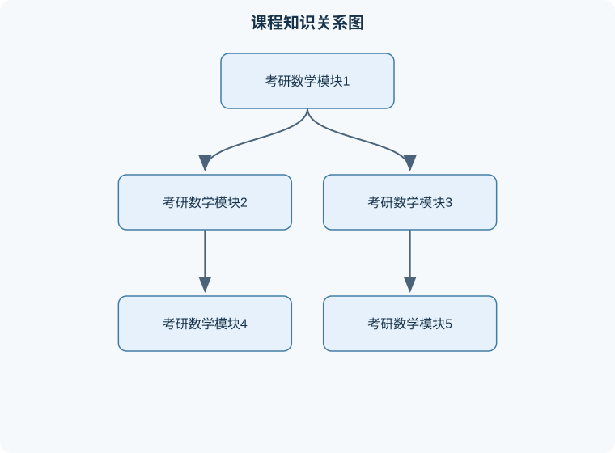

# 考研数学

## 一、课程整体知识框架

### 课程边界与先修知识

本课程面向以研究生入学考试数学为目标的高等数学、线性代数与概率论基础训练，覆盖极限、连续、导数、微分、中值定理、一元函数积分、多元函数微积分、无穷级数、常微分方程、行列式、矩阵、向量、线性方程组、特征值与二次型，以及随机事件、概率、随机变量、数字特征和数理统计基础。先修知识包括初等代数、平面解析几何、三角函数、指数函数与对数函数、基本方程求解、集合与排列组合。课程强调定义、定理条件、公式推导、计算方法、综合题建模和结果检验；不覆盖抽象代数、实变函数、复变函数、泛函分析和高等概率论等超出常见考试范围的内容。





### 1. 课程对象、研究内容与主线结构

考研数学以微积分、线性代数和概率论与数理统计为主体，核心任务不是孤立地记忆公式，而是研究变量之间的数量关系、变化规律、空间结构和随机规律。课程中的数学对象可分为四类：函数及其极限描述“趋近关系”；导数和微分描述局部变化率；积分描述累积、面积、体积和总量；矩阵、向量与线性方程组描述多变量系统的结构；概率与统计描述不确定现象及其规律。

课程的逻辑主线可概括为：

$$
\text{函数关系}\longrightarrow \text{极限与连续}\longrightarrow \text{导数}\longrightarrow \text{积分}
$$

同时，有限维向量空间提供另一条结构主线：

$$
\text{向量与矩阵}\longrightarrow \text{线性方程组}\longrightarrow \text{特征值与特征向量}\longrightarrow \text{二次型}
$$

概率论则从随机试验和事件出发，经过随机变量、分布、数字特征，最终研究大样本下的稳定性：

$$
\text{事件与概率}\longrightarrow \text{随机变量}\longrightarrow \text{分布}\longrightarrow \text{期望与方差}\longrightarrow \text{极限定理}
$$

这些主线之间存在交叉。例如，多元函数极值需要偏导数和二次型；随机变量的期望本质上是离散求和或连续积分；微分方程常通过线性代数研究其解空间和稳定结构。

### 2. 理想模型与实际边界

考研数学中的函数通常被假定定义在明确的定义域上，变量取实数或向量，运算满足相应的连续性、可导性或可积性条件。公式只有在这些条件满足时才能使用。例如，洛必达法则只适用于特定未定式，并非所有分式极限都可以直接“分子分母求导”；矩阵可逆性只对方阵有直接意义；概率密度函数不是概率本身，其在某一点的值可以大于 $1$，但在整个定义域上的积分必须等于 $1$。

实际问题中还可能存在测量误差、模型近似、数据有限和计算误差。数学推导给出的是理想模型下的精确关系，应用时必须说明变量含义、单位和假设。例如，若 $s(t)$ 表示位移，$t$ 的单位为秒、$s$ 的单位为米，则速度 $s'(t)$ 的单位为米每秒，加速度 $s''(t)$ 的单位为米每二次方秒。若忽略单位，虽然代数形式可能正确，结论仍可能无法解释。

### 3. 解题与验证的统一流程

数学问题通常按照以下顺序处理：

1. 明确对象：确定函数、矩阵、随机变量或方程组的定义域、维数和参数范围。
2. 识别结构：判断问题属于极限、导数、积分、线性方程组、特征值、分布或数字特征等类型。
3. 写出条件：记录连续、可导、可积、满秩、独立、正态分布等必要假设。
4. 选择工具：使用等价无穷小、泰勒公式、换元积分、分部积分、秩判定、全概率公式或条件期望等方法。
5. 得出结论：保留定义域、参数范围、积分区间和单位。
6. 结果验证：检查边界值、量纲、符号、数量级、可行域和特殊情形。

若某个公式的推导依赖于可导性，则不能在仅连续的条件下使用；若一个结论是充分条件而不是充要条件，也不能反向推出原条件。例如，函数在一点可导必连续，但连续不必可导，函数 $f(x)=|x|$ 在 $x=0$ 连续，却不存在导数。

## 二、章节和模块划分

### 核心知识覆盖清单

本清单根据本课程的章节划分整理，用于检查正文是否覆盖各个核心模块：

- **模块一：函数、极限与连续性**。
- **模块二：一元函数导数与微分**。
- **模块三：一元函数积分与应用**。
- **模块四：多元函数微积分**。
- **模块五：常微分方程**。
- **模块六：无穷级数与函数项级数**。
- **模块七：线性代数**。
- **模块八：概率论与数理统计**。


### 模块一：函数、极限与连续性

函数 $y=f(x)$ 是一种对应关系：对定义域中的每个 $x$，有唯一的函数值 $y$。定义域决定哪些代数变形合法。例如，$\ln x$ 要求 $x>0$，分式函数要求分母不为零，平方根函数在实数范围内要求被开方数不小于零。

当 $x$ 趋近于 $x_0$ 时，若 $f(x)$ 无限接近某个确定值 $L$，记为

$$
\lim_{x\to x_0}f(x)=L.
$$

该符号表示趋近过程，不要求函数在 $x_0$ 处有定义，也不要求 $f(x_0)=L$。左右极限分别记为 $\lim_{x\to x_0^-}f(x)$ 和 $\lim_{x\to x_0^+}f(x)$。二阶极限存在的充要条件是左右极限都存在且相等。

函数在 $x_0$ 处连续，需要同时满足：$f(x_0)$ 有定义、$\lim_{x\to x_0}f(x)$ 存在，并且

$$
\lim_{x\to x_0}f(x)=f(x_0).
$$

若分子分母同时趋于零，可先因式分解、有理化或使用等价无穷小。例如，当 $x\to0$ 时，$\sin x\sim x$，这里的 $x$ 必须用弧度表示；若用角度，比例关系中的常数会改变。等价无穷小只能替换乘积或商中的相应因子，不能在任意加减式中直接替换。例如，$\sin x\sim x$，但不能据此断言 $\sin x- x\sim0$ 后立即得到高阶精确结果。

极限存在并不意味着函数值有限地接近所有路径。在多元函数中，若沿不同路径趋近同一点所得极限不同，则二重极限不存在。由此可见，单变量经验不能无条件推广到多元情形。

### 模块二：一元函数导数与微分

函数在点 $x_0$ 处的导数定义为

$$
f'(x_0)=\lim_{\Delta x\to0}\frac{f(x_0+\Delta x)-f(x_0)}{\Delta x},
$$

其中 $\Delta x$ 是自变量增量。差商表示区间平均变化率，极限表示瞬时变化率，也等于曲线在该点切线的斜率。若 $s(t)$ 是位移函数，则 $s'(t)$ 是瞬时速度，$s''(t)$ 是加速度。

导数存在必然推出连续，但连续不必可导。可导函数的线性主部写作

$$
\Delta y=f'(x_0)\Delta x+o(\Delta x),
$$

其中 $o(\Delta x)$ 表示当 $\Delta x\to0$ 时，相对于 $\Delta x$ 更高阶的小量。微分 $dy=f'(x)\,dx$ 是对函数增量的线性近似，适用于增量足够小时，不等同于任意情况下的精确等式。

导数运算包括和差积商法则、复合函数链式法则以及隐函数求导。若 $y=f(g(x))$，则

$$
\frac{dy}{dx}=f'(g(x))g'(x).
$$

利用导数可研究单调性、极值、凹凸性和渐近行为。若在区间内 $f'(x)>0$，则函数严格递增；若 $f'(x)<0$，则函数严格递减。驻点 $f'(x)=0$ 只是极值的候选点，并不自动产生极值，例如 $f(x)=x^3$ 在 $0$ 处导数为零，但附近仍严格递增。

极值判断必须比较临界点与端点，并结合定义域。二阶导数法要求 $f'(x_0)=0$ 且二阶导数存在：若 $f''(x_0)>0$，通常为局部极小；若 $f''(x_0)<0$，通常为局部极大；若 $f''(x_0)=0$，该方法不能判定，必须考察更高阶导数或函数增减变化。

### 模块三：一元函数积分与应用

定积分

$$
\int_a^b f(x)\,dx
$$

表示函数在区间 $[a,b]$ 上的累积量。若 $f(x)\ge0$，它可解释为曲线与横轴之间的面积；若函数取负值，定积分表示带符号面积，不能直接等同于几何面积。几何面积通常应计算 $\int_a^b|f(x)|\,dx$，或按函数与坐标轴交点分段。

微积分基本定理连接导数和积分：若

$$
F(x)=\int_a^x f(t)\,dt
$$

且 $f$ 在相关区间连续，则 $F'(x)=f(x)$。若 $F'(x)=f(x)$，则

$$
\int_a^b f(x)\,dx=F(b)-F(a).
$$

这里的 $t$ 是积分变量，积分结束后不再保留；不能把积分上限中的 $x$ 与积分变量混为同一符号。

换元积分的本质是变量替换。若 $u=g(x)$，则 $du=g'(x)\,dx$，积分区间也必须同步变换。分部积分来自乘积求导公式：

$$
\int u\,dv=uv-\int v\,du.
$$

选择 $u$ 时通常希望求导后更简单，选择 $dv$ 时希望容易积分。对于反常积分，必须先按极限定义处理，例如

$$
\int_1^{+\infty}\frac{1}{x^p}\,dx
=
\lim_{b\to+\infty}\int_1^b\frac{1}{x^p}\,dx.
$$

只有当 $p>1$ 时该积分收敛。不能把无穷上限当作普通数直接代入原函数。

定积分还可用于计算旋转体体积、平均值和物理总量。若截面积为 $A(x)$，则体积为

$$
V=\int_a^b A(x)\,dx.
$$

变量单位必须一致：若 $A(x)$ 的单位为平方长度，$dx$ 的单位为长度，积分结果才具有体积单位。

### 模块四：多元函数微积分

二元函数写作 $z=f(x,y)$，其中 $x,y$ 为自变量，$z$ 为函数值。固定 $y$、只改变 $x$ 得到对 $x$ 的偏导数；固定 $x$、只改变 $y$ 得到对 $y$ 的偏导数：

$$
f_x(x,y)=\frac{\partial f}{\partial x},\qquad
f_y(x,y)=\frac{\partial f}{\partial y}.
$$

偏导数只反映沿坐标方向的局部变化。若函数在点附近可微，则全增量可近似为

$$
\Delta z\approx f_x(x_0,y_0)\Delta x+
f_y(x_0,y_0)\Delta y.
$$

梯度定义为

$$
\nabla f=(f_x,f_y),
$$

它指向函数增长最快的方向，方向导数为单位方向向量 $\boldsymbol u$ 上的变化率：

$$
D_{\boldsymbol u}f=\nabla f\cdot\boldsymbol u.
$$

这里 $\|\boldsymbol u\|=1$；若给出的方向向量不是单位向量，必须先归一化。

多元极值问题需要同时考察一阶偏导数和二阶信息。内部极值点通常满足 $f_x=f_y=0$。二元函数的二阶判别式为

$$
D=f_{xx}f_{yy}-f_{xy}^2.
$$

若 $D>0$ 且 $f_{xx}>0$，为局部极小；若 $D>0$ 且 $f_{xx}<0$，为局部极大；若 $D<0$，为鞍点；若 $D=0$，不能据此判定。含约束极值可使用拉格朗日乘子法，但必须同时检查约束集合、端点和不可微点。

二重积分用于平面区域上的累积量。改变积分次序时，必须重新描述积分区域，不能只机械交换积分符号。变量代换还需要使用雅可比行列式；极坐标中

$$
x=r\cos\theta,\qquad y=r\sin\theta,\qquad dx\,dy=r\,dr\,d\theta.
$$

因子 $r$ 来自面积伸缩，遗漏它会导致结果错误。

### 模块五：常微分方程

常微分方程研究未知函数及其导数之间的关系。若未知函数为 $y(x)$，方程中最高阶导数为 $y^{(n)}$，则称为 $n$ 阶常微分方程。通解含有与方程阶数相对应的任意常数，初始条件用于确定这些常数。

可分离变量方程可写为

$$
\frac{dy}{dx}=g(x)h(y).
$$

在 $h(y)\ne0$ 的区间内分离变量，得到

$$
\frac{dy}{h(y)}=g(x)\,dx,
$$

再积分并结合初始条件。分离时若除以 $h(y)$，必须单独检查 $h(y)=0$ 是否给出常值解，否则可能丢失解。

一阶线性方程

$$
y'+p(x)y=q(x)
$$

的积分因子为

$$
\mu(x)=e^{\int p(x)\,dx}.
$$

两边乘以 $\mu(x)$ 后，左侧化为 $(\mu y)'$，再积分求解。该方法要求 $p(x),q(x)$ 在所讨论区间内具有足够的连续性。

二阶常系数齐次方程

$$
ay''+by'+cy=0,\qquad a\ne0
$$

对应特征方程

$$
ar^2+br+c=0.
$$

两个不等实根 $r_1,r_2$ 对应通解 $C_1e^{r_1x}+C_2e^{r_2x}$；重根 $r$ 对应 $(C_1+C_2x)e^{rx}$；共轭复根 $\alpha\pm\beta i$ 对应

$$
e^{\alpha x}(C_1\cos\beta x+C_2\sin\beta x).
$$

这些结论只适用于常系数线性齐次方程，不能直接用于变系数或非线性方程。

### 模块六：无穷级数与函数项级数

数项级数是无穷和

$$
\sum_{n=1}^{\infty}a_n.
$$

其收敛性由部分和序列

$$
S_N=\sum_{n=1}^{N}a_n
$$

是否存在有限极限决定。必要条件是 $a_n\to0$，但该条件不是充分条件；调和级数 $\sum 1/n$ 的项趋于零而仍发散。

正项级数可使用比较判别、极限比较、比值判别和根值判别。比值判别考察

$$
L=\lim_{n\to\infty}\left|\frac{a_{n+1}}{a_n}\right|.
$$

当 $L<1$ 时绝对收敛，当 $L>1$ 或极限为无穷时发散；当 $L=1$ 时不能判定。交错级数若各项绝对值递减并趋于零，则收敛，但可能不是绝对收敛。

幂级数一般写为

$$
\sum_{n=0}^{\infty}a_n(x-x_0)^n,
$$

其中 $x_0$ 是中心。收敛半径 $R$ 给出内部绝对收敛、外部发散的范围，端点必须逐点判断。不能仅由收敛半径自动推断端点情况。函数项级数逐项求导或逐项积分需要满足相应的收敛条件，不能仅凭每一项可导或可积就交换无限求和与微积分运算。

### 模块七：线性代数

向量可表示为有序数组，矩阵是按行列排列的数表。线性方程组

$$
A\boldsymbol x=\boldsymbol b
$$

中，$A$ 为系数矩阵，$\boldsymbol x$ 为未知向量，$\boldsymbol b$ 为常数向量。通过初等行变换可化为阶梯形矩阵；行变换不改变方程组的解集，但会改变行列式数值，因此计算行列式时需记录交换行、倍乘行和倍加行的影响。

对 $n$ 阶方阵 $A$，可逆的等价条件包括：$\det A\ne0$；$\operatorname{rank}(A)=n$；齐次方程 $A\boldsymbol x=\boldsymbol0$ 只有零解；存在矩阵 $A^{-1}$ 使 $AA^{-1}=I$。这些条件只适用于方阵，非方阵不能直接用“行列式不为零”判断可逆。

特征值和特征向量满足

$$
A\boldsymbol v=\lambda\boldsymbol v,\qquad \boldsymbol v\ne\boldsymbol0.
$$

特征值由特征方程

$$
\det(A-\lambda I)=0
$$

确定。相似矩阵具有相同的特征值、行列式和迹，但矩阵元素本身通常不同。实对称矩阵可正交对角化，这一结论不能任意推广到所有实矩阵。

二次型写作

$$
Q(\boldsymbol x)=\boldsymbol x^{T}A\boldsymbol x.
$$

研究其正定性时，应结合顺序主子式、特征值或配方法。若 $Q(\boldsymbol x)>0$ 对所有非零向量都成立，称其正定；只检查某一个向量上的函数值为正，不能推出正定。

### 模块八：概率论与数理统计

随机试验的结果组成样本空间，事件是样本空间的子集。概率满足非负性、规范性和可列可加性。条件概率定义为

$$
P(A\mid B)=\frac{P(AB)}{P(B)},\qquad P(B)>0.
$$

乘法公式为 $P(AB)=P(B)P(A\mid B)$。若事件组构成完备互斥划分，则全概率公式为

$$
P(A)=\sum_iP(B_i)P(A\mid B_i).
$$

贝叶斯公式进一步反向计算条件概率，但必须先确认分母概率为正。

随机变量 $X$ 将随机结果映射为数值。离散型随机变量通过概率质量函数描述，连续型随机变量通过密度 $f_X(x)$ 描述，区间概率为

$$
P(a<X<b)=\int_a^b f_X(x)\,dx.
$$

连续型随机变量在单点处的概率为零，但密度值不一定为零。分布函数

$$
F_X(x)=P(X\le x)
$$

具有单调不减、右连续并满足两端极限条件等性质。

期望和方差分别描述平均水平与波动程度：

$$
E(X)=\sum_xxP(X=x)
$$

或

$$
E(X)=\int_{-\infty}^{+\infty}xf_X(x)\,dx,
$$

$$
\operatorname{Var}(X)=E[(X-E(X))^2].
$$

方差也可写为

$$
\operatorname{Var}(X)=E(X^2)-[E(X)]^2.
$$

若 $Y=aX+b$，则 $E(Y)=aE(X)+b$，$\operatorname{Var}(Y)=a^2\operatorname{Var}(X)$；平移不改变方差，缩放会使方差按系数平方变化。

协方差定义为

$$
\operatorname{Cov}(X,Y)=E[(X-E(X))(Y-E(Y))].
$$

独立能推出协方差为零，但协方差为零通常不能反推出独立。大数定律说明样本平均在适当条件下趋近总体期望；中心极限定理说明标准化后的样本和在适当条件下近似服从正态分布。这些结论需要独立性、同分布或有限方差等条件，不能对任意相关或重尾数据直接套用。

## 三、核心概念的详细解释

### 1. 函数、极限与连续性

函数 $y=f(x)$ 表示定义域中的每个自变量 $x$ 唯一确定一个函数值。解题首先要确定定义域：$\ln x$ 要求 $x>0$，$\sqrt{g(x)}$ 要求 $g(x)\ge 0$，分式要求分母不为零。定义域不仅决定函数能否计算，也决定复合函数、反函数和极限的合法范围。

极限描述的是自变量趋近某点时函数值的变化趋势，而不要求函数在该点有定义。例如，当 $x\ne1$ 时 $f(x)=(x^2-1)/(x-1)=x+1$，虽然原式在 $x=1$ 无定义，但 $\lim_{x\to1}f(x)=2$。双侧极限存在的必要条件是左右极限都存在且相等：

$$
\lim_{x\to a}f(x)=L
\Longleftrightarrow
\lim_{x\to a^-}f(x)=\lim_{x\to a^+}f(x)=L.
$$

无穷小是趋于零的变量；若 $\beta(x)\to0$ 且在邻域内不为零，$\alpha(x)=o(\beta(x))$ 表示 $\alpha(x)/\beta(x)\to0$。等价无穷小要求比值趋于 $1$，只能在乘积、商等保持等价关系的场合直接替换，不能任意代入差式。例如 $\sin x\sim x$，但不能据此推出 $\sin x-x\sim0$，因为右侧恒为零而左侧并非恒零。

函数在 $x=a$ 连续，需要同时满足：$f(a)$ 有定义、$\lim_{x\to a}f(x)$ 存在、且极限等于 $f(a)$。可去间断、跳跃间断和无穷间断的区别在于极限是否存在、是否有限以及左右极限是否相等。闭区间上的连续函数具有有界性和最值性，并满足介值性；这些结论要求函数在整个闭区间连续，不能只在某些点连续。

### 2. 一元函数微分学

导数定义为

$$
f'(x_0)=\lim_{\Delta x\to0}
\frac{f(x_0+\Delta x)-f(x_0)}{\Delta x},
$$

其中 $\Delta x$ 是自变量增量，导数的单位是“函数值单位/自变量单位”。若 $s(t)$ 的单位为米，$t$ 的单位为秒，则 $s'(t)$ 的单位为米每秒，$s''(t)$ 的单位为米每二次方秒。

导数同时表示曲线切线斜率和函数的瞬时变化率。可导必连续，但连续不必可导。例如 $f(x)=|x|$ 在 $0$ 处连续，但左右导数分别为 $-1$ 和 $1$，因此不可导。求导时必须先确认表达式在所考察点附近有定义。

微分形式

$$
dy=f'(x)\,dx
$$

是函数增量的线性主部。若 $\Delta x$ 足够小，则

$$
\Delta y=f(x+\Delta x)-f(x)
=f'(x)\Delta x+o(\Delta x).
$$

这说明微分适合近似计算，但它不是原增量的恒等替代。复合函数使用链式法则，若 $y=f(u)$、$u=g(x)$，则

$$
\frac{dy}{dx}=f'(u)g'(x).
$$

导数符号决定单调性：在区间内 $f'(x)>0$ 可推出严格递增，$f'(x)<0$ 可推出严格递减。反之通常不成立，因为严格递增函数可能在某些点导数为零。极值点的必要条件是内部点可导且 $f'(x_0)=0$，但导数为零并不保证极值，例如 $f(x)=x^3$ 在零点导数为零却无极值。

### 3. 一元函数积分学与微分方程

定积分

$$
\int_a^b f(x)\,dx
$$

表示带符号的累积量，积分区间方向改变时符号改变。若 $f(x)\ge0$，它可解释为曲线与横轴之间的面积；若函数在区间内变号，定积分是带符号面积而非几何面积。变上限积分

$$
F(x)=\int_a^x f(t)\,dt
$$

在 $f$ 连续时满足 $F'(x)=f(x)$。牛顿—莱布尼茨公式建立了微分与积分的联系：

$$
\int_a^b f(x)\,dx=G(b)-G(a),
$$

其中 $G'(x)=f(x)$。

换元积分要求变量替换在积分区间上具有足够的可逆性，并且上下限同步变换；定积分换元后可直接改写上下限，不应保留原变量的上下限。分部积分来自乘积求导公式：

$$
\int u\,dv=uv-\int v\,du.
$$

广义积分需要检查无穷区间或无界函数在奇点附近的极限。例如

$$
\int_1^{+\infty}\frac1{x^p}\,dx
$$

当 $p>1$ 收敛，$p\le1$ 发散。不能仅凭被积函数趋于零就断定积分收敛，因为 $\int_1^{+\infty}1/x\,dx$ 发散。

微分方程研究未知函数及其导数之间的关系。一阶可分离变量方程可写为

$$
\frac{dy}{dx}=g(x)h(y),
$$

在 $h(y)\ne0$ 的区域内分离得

$$
\frac{dy}{h(y)}=g(x)\,dx,
$$

积分后再利用初始条件确定常数。分离过程中若除以 $h(y)$，必须另行检查 $h(y)=0$ 给出的常值解。线性方程 $y'+p(x)y=q(x)$ 的积分因子为

$$
\mu(x)=e^{\int p(x)\,dx},
$$

乘方程后左侧成为 $(\mu y)'$，这一步是公式的推导基础。

### 4. 多元函数、偏导数与重积分

二元函数 $z=f(x,y)$ 的定义域是平面中的点集。偏导数

$$
f_x(x,y)=\lim_{h\to0}
\frac{f(x+h,y)-f(x,y)}h
$$

只改变 $x$，把 $y$ 视为常数；$f_y$ 的定义相反。偏导存在不必推出连续，更不必推出全微分存在。若函数在点附近具有连续偏导数，则一定可微，且

$$
dz=f_x\,dx+f_y\,dy.
$$

方向导数表示沿单位向量 $\boldsymbol u=(u_1,u_2)$ 的变化率：

$$
D_{\boldsymbol u}f=\nabla f\cdot\boldsymbol u,
\qquad
\nabla f=(f_x,f_y).
$$

方向向量必须单位化，否则结果还包含方向向量长度因素。梯度指向函数增长最快的方向，最大方向导数为 $\|\nabla f\|$，这一结论依赖柯西—施瓦茨不等式。

无约束极值通常先令 $f_x=f_y=0$，再用二阶判别式

$$
D=f_{xx}f_{yy}-f_{xy}^2.
$$

若 $D>0$ 且 $f_{xx}>0$，为极小值；若 $D>0$ 且 $f_{xx}<0$，为极大值；若 $D<0$，为鞍点；若 $D=0$，判别失效。闭区域上的最值还必须检查边界，不能只检查内部驻点。约束极值可使用拉格朗日乘子法：

$$
\nabla f=\lambda\nabla g,\qquad g(x,y)=0.
$$

二重积分既可按直角坐标逐次积分，也可按极坐标变换。极坐标变换为

$$
x=r\cos\theta,\qquad y=r\sin\theta,
$$

面积元素为

$$
dx\,dy=r\,dr\,d\theta.
$$

因子 $r$ 是雅可比，不能遗漏；积分区域必须同时转换边界和角度范围。

### 5. 无穷级数与幂级数

数项级数 $\sum_{n=1}^{\infty}a_n$ 的收敛性由部分和

$$
S_N=\sum_{n=1}^{N}a_n
$$

是否具有有限极限决定。必要条件是 $a_n\to0$，但不是充分条件。正项级数可用比较判别、极限比较、比值判别和根值判别。比值判别中若

$$
\lim_{n\to\infty}\left|\frac{a_{n+1}}{a_n}\right|<1,
$$

则绝对收敛；大于 $1$ 则发散；等于 $1$ 时不能判断。交错级数在项量递减趋于零时收敛，但未必绝对收敛。

幂级数

$$
\sum_{n=0}^{\infty}a_n(x-x_0)^n
$$

存在收敛半径 $R$。在 $|x-x_0|<R$ 内绝对收敛，在 $|x-x_0|>R$ 外发散，端点必须单独判断。幂级数在收敛区间内部可以逐项求导和逐项积分，但端点不能机械套用内部结论。

### 6. 行列式、矩阵与线性方程组

矩阵是按行列排列的数表，行数和列数分别称为阶数的两个维度。矩阵乘法 $AB$ 有意义的条件是 $A$ 的列数等于 $B$ 的行数，且通常不满足交换律。方阵 $A$ 可逆的等价条件包括 $\det A\ne0$、$\operatorname{rank}(A)=n$、齐次方程 $A\boldsymbol x=\boldsymbol0$ 只有零解以及 $0$ 不是其特征值。

线性方程组

$$
A\boldsymbol x=\boldsymbol b
$$

的解由系数矩阵秩与增广矩阵秩共同决定：

- $\operatorname{rank}(A)\ne\operatorname{rank}(A|\boldsymbol b)$：无解；
- 两秩相等且等于未知数个数：唯一解；
- 两秩相等但小于未知数个数：无穷多解。

初等行变换保持方程组的解集，因此高斯消元可用于求秩和解。行列式适合方阵的代数判定，但大规模数值计算中直接展开行列式通常效率低且误差敏感。

特征值问题为

$$
A\boldsymbol x=\lambda\boldsymbol x,
\qquad \boldsymbol x\ne\boldsymbol0.
$$

特征值由特征方程 $\det(\lambda I-A)=0$ 给出。相似矩阵具有相同的特征值、行列式和迹，但矩阵元素本身通常不同。实对称矩阵可以正交对角化；一般矩阵不一定可对角化。

### 7. 二次型与线性变换

二次型可写为

$$
Q(\boldsymbol x)=\boldsymbol x^{\mathsf T}A\boldsymbol x,
$$

其中 $A$ 可取对称矩阵，因为反对称部分对该表达式贡献为零。若对所有非零 $\boldsymbol x$ 都有 $Q(\boldsymbol x)>0$，称 $Q$ 正定；若允许等于零但不为负，称半正定。

二次型正定可通过顺序主子式判定，也可通过全部特征值为正判定。对于二阶形式

$$
Q(x,y)=ax^2+2bxy+cy^2,
$$

其矩阵为 $\begin{pmatrix}a&b\\b&c\end{pmatrix}$，正定条件是 $a>0$ 且 $ac-b^2>0$。只验证 $Q(1,0)>0$ 或 $Q(0,1)>0$ 不能推出正定，因为交叉项可能导致某些方向取负值。

### 8. 概率论与数理统计

样本空间记为 $\Omega$，事件是 $\Omega$ 的子集。条件概率

$$
P(A\mid B)=\frac{P(A\cap B)}{P(B)}
$$

要求 $P(B)>0$。事件独立是 $P(A\cap B)=P(A)P(B)$；互斥事件若概率均为正则不可能独立。全概率公式要求划分事件两两互斥、并集为整个样本空间；贝叶斯公式要求相应分母非零。

随机变量把随机结果映射为实数。连续型随机变量的密度 $f_X(x)$ 满足 $f_X(x)\ge0$ 且总积分为 $1$，区间概率由积分给出。密度值不是单点概率，$f_X(x)$ 甚至可以大于 $1$。分布函数 $F_X(x)=P(X\le x)$ 总是单调不减且右连续。

期望是加权平均，方差是平方偏差的平均：

$$
\operatorname{Var}(X)=E(X^2)-[E(X)]^2.
$$

若 $Y=aX+b$，则

$$
E(Y)=aE(X)+b,\qquad
\operatorname{Var}(Y)=a^2\operatorname{Var}(X).
$$

协方差为

$$
\operatorname{Cov}(X,Y)
=E(XY)-E(X)E(Y).
$$

独立可推出协方差为零，但零协方差通常不能推出独立。样本均值的方差在独立同分布且总体方差有限时为 $\sigma^2/n$；若样本相关，则还要加入协方差项，不能直接套用独立样本公式。

## 四、重要定义、公式、定理和推导

### 专业审校补充：关键定义与适用边界

泰勒公式的关键不只是“展开”，而是必须说明余项及其适用条件。若函数在点 $a$ 的邻域内具有 $n+1$ 阶导数，则在 $x$ 接近 $a$ 时，拉格朗日型余项给出 $f(x)=\sum_{k=0}^{n}\frac{f^{(k)}(a)}{k!}(x-a)^k+R_n(x)$，其中 $R_n(x)=\frac{f^{(n+1)}(\xi)}{(n+1)!}(x-a)^{n+1}$，$\xi$ 位于 $a$ 与 $x$ 之间。若只知道函数具有 $n$ 阶导数，通常只能使用佩亚诺余项 $o((x-a)^n)$，不能擅自写出拉格朗日余项。求极限时，展开阶数必须至少达到分子分母首次不相消的阶数；若只保留低阶等价无穷小，可能无法得到正确常数。泰勒展开是局部结论，不能据此直接断言函数在整个定义域上的单调性、全局最值或级数收敛性。


### 1. 代表性算法与问题分析流程

#### 流程一：极限计算流程

**输入：** 函数表达式 $f(x)$、趋近点 $a$。  
**输出：** 极限值、发散结论或不存在结论。

1. 先确定 $a$ 是否在定义域内，并判断是有限点、无穷远点还是单侧极限。
2. 直接代入若得到非零有限值，通常可直接结束。
3. 若出现 $0/0$，优先因式分解、有理化、通分或使用等价无穷小。
4. 若出现 $\infty/\infty$ 或 $0/0$ 且满足条件，可使用洛必达法则；使用后仍须继续判断新的极限。
5. 检查左右极限、符号和增长阶，验证是否存在统一有限值。

不变量是：每次变形都必须保持原极限在所考察邻域内的等价性。终止条件是得到明确有限值、证明发散或证明左右极限不相等。洛必达法则不适用于非未定式，也不适用于只因形式相似而缺少可导条件的情形。

#### 流程二：线性方程组高斯消元

**输入：** 增广矩阵 $(A|\boldsymbol b)$。  
**输出：** 无解、唯一解或含自由变量的通解。

1. 在当前列寻找非零主元，必要时交换行。
2. 用初等行变换把主元下方元素消为零。
3. 继续处理下一列，直到得到阶梯形矩阵。
4. 若出现 $[0\ \cdots\ 0|c]$ 且 $c\ne0$，则无解。
5. 否则统计主元个数。主元数等于未知数个数时回代得到唯一解；主元数较少时将非主元变量设为参数并回代。

不变量是初等行变换不改变方程组解集。理想符号计算中复杂度约为 $O(n^3)$；实际浮点计算还要考虑主元过小造成的舍入误差，通常应采用选主元策略。

```python
def gauss_jordan(aug, eps=1e-10):
    """
    输入：增广矩阵 aug，按二维列表表示；eps 为零判定阈值。
    输出：'无解'，或化简后的行最简矩阵。
    仅进行内存中的数值运算，不读写文件。
    """
    a = [row[:] for row in aug]
    m, n = len(a), len(a[0]) - 1
    pivot_row = 0

    for col in range(n):
        best = max(range(pivot_row, m), key=lambda r: abs(a[r][col]))
        if abs(a[best][col]) < eps:
            continue
        a[pivot_row], a[best] = a[best], a[pivot_row]

        pivot = a[pivot_row][col]
        a[pivot_row] = [v / pivot for v in a[pivot_row]]

        for r in range(m):
            if r != pivot_row:
                factor = a[r][col]
                a[r] = [
                    a[r][c] - factor * a[pivot_row][c]
                    for c in range(n + 1)
                ]
        pivot_row += 1
        if pivot_row == m:
            break

    for row in a:
        if all(abs(row[c]) < eps for c in range(n)) and abs(row[n]) >= eps:
            return "无解"
    return a
```

#### 流程三：概率模型分析

**输入：** 随机试验、事件关系和观测数据。  
**输出：** 概率、分布、期望方差或统计推断结果。

先明确样本空间和随机变量，再判断事件是否互斥、独立或构成划分；随后选择加法公式、乘法公式、全概率公式或贝叶斯公式。对随机变量，先写分布函数、质量函数或密度，再计算数字特征。最后检查概率是否位于 $[0,1]$、密度积分是否为 $1$、方差是否非负以及单位是否一致。

### 2. 典型例题与逐步解答

#### 例题一：等价无穷小与高阶项

**题干：** 求

$$
\lim_{x\to0}\frac{1-\cos x}{x^2}.
$$

**分析：** 分子分母都趋于零，使用恒等变形或泰勒展开。由 $1-\cos x=2\sin^2(x/2)$，

$$
\frac{1-\cos x}{x^2}
=\frac12\left(\frac{\sin(x/2)}{x/2}\right)^2.
$$

由于 $\sin u/u\to1$，故极限为 $1/2$。

**结果验证：** $1-\cos x\ge0$，且在零附近约为 $x^2/2$，数量级和符号均合理。  
**变式：** $\lim_{x\to0}(1-\cos x)/x^4$ 发散，因为分子是二阶无穷小而分母是四阶无穷小。

#### 例题二：导数与切线

**题干：** 求 $f(x)=x\ln x$ 在 $x=1$ 处的切线方程。

**分析与解答：** 定义域为 $x>0$。由乘积求导，

$$
f'(x)=\ln x+1.
$$

因此 $f(1)=0$，$f'(1)=1$。切线使用点斜式：

$$
y-0=1(x-1),
\qquad y=x-1.
$$

**结果验证：** 切线在 $(1,0)$ 处经过曲线，斜率等于导数值 $1$。  
**变式：** 若求法线，因切线斜率非零，法线斜率为 $-1$，方程为 $y=-(x-1)$。

#### 例题三：定积分与参数

**题干：** 求 $I(a)=\int_0^1 xe^{ax}\,dx$，其中 $a\ne0$。

**分析与解答：** 分部积分，取 $u=x$，$dv=e^{ax}dx$，则 $du=dx$，$v=e^{ax}/a$。于是

$$
I(a)=\left.\frac{xe^{ax}}a\right|_0^1
-\frac1a\int_0^1e^{ax}\,dx
=\frac{e^a}{a}-\frac{e^a-1}{a^2}.
$$

即

$$
I(a)=\frac{e^a(a-1)+1}{a^2}.
$$

**结果验证：** 当 $a\to0$ 时，原积分趋于 $\int_0^1x\,dx=1/2$；对结果作极限也得到 $1/2$，说明表达式虽含 $a^{-2}$，但在 $a=0$ 处有可去延拓。  
**变式：** $a=0$ 时必须直接计算，不能把含 $a$ 的公式直接代入。

#### 例题四：二元函数极值

**题干：** 求 $f(x,y)=x^2+xy+y^2-3x$ 的驻点并判断性质。

**分析与解答：**

$$
f_x=2x+y-3,\qquad f_y=x+2y.
$$

令两者为零，解得 $x=2,\ y=-1$。二阶偏导为

$$
f_{xx}=2,\quad f_{yy}=2,\quad f_{xy}=1,
$$

所以

$$
D=f_{xx}f_{yy}-f_{xy}^2=4-1=3>0,
$$

且 $f_{xx}>0$，故驻点为极小点。函数值为

$$
f(2,-1)=4-2+1-6=-3.
$$

**结果验证：** 二次型矩阵 $\begin{pmatrix}2&1\\1&2\end{pmatrix}$ 的特征值为 $1,3$，均为正，故函数严格凸，极小点唯一。  
**变式：** 若定义域为闭区域，还必须检查边界；内部判别不能替代边界比较。

#### 例题五：线性方程组的秩判定

**题干：** 讨论方程组

$$
\begin{cases}
x+y+z=2,\\
2x+2y+2z=4,\\
x+y+z=\lambda
\end{cases}
$$

的解的情况。

**分析与解答：** 前两式中第二式是第一式的两倍。第三式与第一式左端相同，因此：

- 当 $\lambda=2$ 时，第三式与第一式一致，只有一个独立方程，未知数有三个，故有两个自由变量，解有无穷多个；
- 当 $\lambda\ne2$ 时，前两式要求 $x+y+z=2$，第三式要求 $x+y+z=\lambda$，矛盾，故无解。

**结果验证：** $\operatorname{rank}(A)=1$；当 $\lambda=2$ 时增广矩阵秩也为 $1$，当 $\lambda\ne2$ 时增广矩阵秩为 $2$。  
**变式：** 若再增加一个与前两式独立的方程，秩可能升至 $2$，此时仍有一个自由变量；是否唯一取决于秩是否达到未知数个数。

#### 例题六：条件概率与贝叶斯公式

**题干：** 某设备由甲、乙两条生产线生产，产量比例分别为 $0.6$ 和 $0.4$，次品率分别为 $0.02$ 和 $0.05$。随机抽取一个次品，求其来自乙线的概率。

**分析与解答：** 设 $B$ 为来自乙线，$D$ 为次品。则

$$
P(D)=0.6\times0.02+0.4\times0.05=0.032.
$$

根据贝叶斯公式，

$$
P(B\mid D)=\frac{P(B)P(D\mid B)}{P(D)}
=\frac{0.4\times0.05}{0.032}=0.625.
$$

**结果验证：** 结果在 $[0,1]$ 内；乙线虽然产量较小，但次品率较高，因此抽到次品后其后验比例高于原产量比例。  
**变式：** 若抽到的是合格品，分母应改为 $P(D^c)$，不能仍使用次品总概率。

### 3. 实验与项目流程

#### 实验一：数值验证函数极限

**输入数据：** 取 $x_k=10^{-k}$，$k=1,\ldots,8$，计算

$$
R_k=\frac{1-\cos x_k}{x_k^2}.
$$

**步骤：**

1. 用高精度计算得到各个 $R_k$；
2. 将结果与理论值 $1/2$ 比较；
3. 记录绝对误差 $|R_k-1/2|$；
4. 再用普通双精度计算，比较极小 $x$ 下的舍入误差。

**评价标准：** 数值应在适当范围内趋近 $0.5$；若 $x$ 过小反而误差增大，应能解释为 $1-\cos x$ 的消去误差，而不能误判为理论结论错误。

**排错方法：** 检查括号、角度是否使用弧度、分母是否为 $x^2$；若结果接近零，优先检查数值精度和表达式中相近数相减造成的有效数字损失。

#### 项目二：样本均值与方差的统计验证

**输入数据：** 生成或给定若干组独立同分布观测值 $X_1,\ldots,X_n$，记录样本量 $n$、样本均值 $\bar X$ 和样本方差。

**步骤：**

1. 对每个样本量计算

$$
\bar X=\frac1n\sum_{i=1}^nX_i;
$$

2. 重复抽样，比较 $\bar X$ 的波动；
3. 检查样本量增大时均值是否趋近总体均值；
4. 区分描述性统计中的样本方差与理论方差；
5. 若数据明显相关，重新计算并观察独立性假设失效后的影响。

**评价标准：** 样本量增大时，均值的典型波动应总体减小；独立同分布且方差有限时，理论关系 $\operatorname{Var}(\bar X)=\sigma^2/n$ 应与重复抽样结果大致一致。单次实验不要求恰好等于理论值。

**排错方法：** 检查是否把标准差误当方差、是否把样本方差分母 $n-1$ 与总体方差分母 $n$ 混用、是否错误地将相关数据当作独立数据。

### 4. 常见易错点

1. 把函数值 $f(a)$ 与极限 $\lim_{x\to a}f(x)$ 混为一谈。
2. 未检查定义域就进行约分、开方或取对数。
3. 把 $\sin x\sim x$ 任意用于差式。
4. 把连续等同于可导，忽略尖点和竖直切线。
5. 使用洛必达法则前未确认是 $0/0$ 或 $\infty/\infty$ 型。
6. 认为导数为零必然取得极值。
7. 定积分只计算几何面积，忽略函数变号造成的正负。
8. 换元积分后只换被积函数而不换积分限。
9. 认为通项趋于零就能推出级数收敛。
10. 忘记幂级数端点必须单独判断。
11. 把矩阵乘法当作逐元素相乘或默认交换律成立。
12. 只看系数矩阵秩，不比较增广矩阵秩。
13. 求特征向量时忘记排除零向量。
14. 用某几个方向上的二次型值判断整体正定性。
15. 把密度 $f_X(x)$ 当作单点概率。
16. 将互斥事件误认为独立事件。
17. 把零协方差错误地当作独立。
18. 样本相关时仍直接使用独立样本均值方差公式。

### 5. 典型笔试问题及解答思路

1. **如何判断含参数极限？**  
   先按参数取值分类，比较分子分母的最低阶，分别检查有限、发散和左右极限。

2. **为什么可导必连续？**  
   将增量写成
   $$
   f(x)-f(a)=\frac{f(x)-f(a)}{x-a}(x-a),
   $$
   导数有界且 $x-a\to0$，故增量趋于零。

3. **如何证明函数在区间上单调？**  
   先求导并判断导数符号；若使用拉格朗日中值定理，必须确认函数在闭区间连续、开区间可导。

4. **定积分换元的关键是什么？**  
   变量、微分、积分限三者必须同步转换，并检查新变量覆盖的区间。

5. **级数比值判别等于 $1$ 时怎么办？**  
   结论无效，应改用比较判别、积分判别、交错级数判别或直接研究部分和。

6. **如何讨论线性方程组的参数解？**  
   对参数分类后进行消元，比较 $\operatorname{rank}(A)$ 与 $\operatorname{rank}(A|\boldsymbol b)$，再判断自由变量个数。

7. **特征值和特征向量如何求？**  
   先解 $\det(\lambda I-A)=0$ 得特征值，再对每个特征值解齐次方程 $(A-\lambda I)\boldsymbol x=0$。

8. **为什么独立能推出协方差为零？**  
   独立使 $E(XY)=E(X)E(Y)$，代入协方差定义即可；反向推导缺少条件，因此不能成立。

### 6. 面试问题、参考答案与追问要点

1. **极限在实际分析中表示什么？**  
   答：表示输入趋近某状态时输出的稳定趋势，不等同于该状态的实际函数值。追问时应说明可去间断和单侧极限的区别。

2. **导数与差分有什么区别？**  
   答：导数是增量比在增量趋于零时的极限，差分是有限步长下的变化量或变化率。追问时应讨论步长过大带来的离散化误差。

3. **为什么积分可以表示总量？**  
   答：把区间划分为小段，用局部值乘以小长度近似各段贡献，再令最大分割长度趋于零。追问时应区分带符号总量与几何面积。

4. **矩阵秩在系统分析中表示什么？**  
   答：表示独立约束或独立信息的数量，决定线性方程组是否相容以及解空间维数。追问时应说明秩亏可能导致参数不唯一。

5. **正定矩阵有什么实际含义？**  
   答：二次型在所有非零方向上为正，常用于判断局部极小、能量或误差函数的稳定性。追问时应说明半正定允许非零方向取零。

6. **概率密度大于 $1$ 是否矛盾？**  
   答：不矛盾，密度是单位长度上的概率强度，真正的区间概率是密度积分；总积分必须等于 $1$。追问时可举窄区间均匀分布为例。

7. **样本均值为什么通常随样本量增加而稳定？**  
   答：独立同分布且方差有限时，均值方差为 $\sigma^2/n$，大数定律说明其趋近总体均值。追问时必须指出相关性和重尾分布会改变条件。

8. **如何发现数学计算结果不可靠？**  
   答：检查定义域、单位、边界值、数量级、特殊参数和代回原式；数值计算还需关注舍入误差和条件数。追问时应区分模型错误、推导错误和实现错误。

### 7. 与岗位任务的关联

在数据分析岗位中，函数、极限、导数和积分用于建立指标变化模型、计算边际变化和累计量；线性代数用于回归、降维、约束求解；概率统计用于抽样、误差评估和不确定性表达。实际产出包括可复现的计算表、模型假设、参数解释和误差报告，验收标准是公式维度一致、结果可复算、边界情形有说明。

在算法与研发岗位中，矩阵运算、特征值、二次型和数值方法用于状态表示、优化和稳定性分析。产出应包括输入输出定义、复杂度分析、异常情况处理和测试结果；验收时不仅检查正常样例，还要检查空输入、奇异矩阵、极端数值和精度阈值。

在金融、质量控制或业务分析岗位中，概率分布、条件概率、期望方差和统计推断用于风险估计、次品率分析、预测区间和决策比较。验收标准包括概率范围合法、样本与总体概念不混淆、独立性假设有依据，并能解释模型结论的适用边界。

## 五、算法、流程和实现思路

### 方法与流程覆盖索引

下列方法或流程应在正文中说明输入、步骤、适用条件、结果检查和边界：

- 1. 数学问题的统一分析流程
- 2. 极限、连续性与导数的分析流程
- 3. 定积分、微分方程与数值积分流程
- 4. 线性方程组与矩阵运算流程
- 5. 概率与统计问题的计算流程
- 6. 典型例题与变式
- 7. 实验与项目流程


### 1. 数学问题的统一分析流程

考研数学中的“算法”不只指计算机程序，也包括具有明确输入、操作顺序、判定条件和终止标准的解题流程。面对一个函数、矩阵或随机变量问题，可按以下步骤处理。

#### 1.1 输入、输出与前置条件

输入包括题目给出的函数表达式、定义域、参数范围、矩阵阶数、方程组或随机变量分布。首先确定：

- 函数是否有定义，例如 $\ln x$ 要求 $x>0$，分式要求分母不为零；
- 极限是单侧还是双侧，趋近点是否属于定义域；
- 导数、积分所需的连续性、可导性和可积性条件；
- 矩阵的行数、列数、秩以及运算是否满足维数要求；
- 概率事件是否构成完备划分，随机变量是否具有给定分布及有限矩。

输出应包括数值、函数表达式、参数条件、解集、概率或统计量，并保留单位和适用范围。例如，求极值不能只输出临界点，还应说明哪些点取得极大值或极小值，以及极值是局部的还是闭区间上的全局极值。

#### 1.2 结构识别与方法选择

若极限中出现 $0/0$ 或 $\infty/\infty$，可考虑因式分解、等价无穷小、泰勒展开或洛必达法则；若出现分段函数或绝对值，应优先检查左右极限。若题目要求最值，应先求定义域，再求导数为零或不存在的点，最后比较函数值。

线性方程组应先写成矩阵形式 $A\boldsymbol{x}=\boldsymbol{b}$，其中 $A$ 为系数矩阵，$\boldsymbol{x}$ 为未知量列向量，$\boldsymbol{b}$ 为常数列向量。通过消元比较 $\operatorname{rank}(A)$ 与 $\operatorname{rank}(A\mid\boldsymbol b)$，再判断无解、唯一解或无穷多解。

概率题应先区分事件运算与随机变量运算。事件问题使用条件概率、全概率和贝叶斯公式；分布问题使用分布函数、密度、边缘分布和联合分布；数字特征问题使用期望、方差和协方差的线性性质。

#### 1.3 不变量、终止条件与结果验证

解题过程中的不变量是指操作前后保持不变的性质。例如，初等行变换不改变线性方程组的解集；对矩阵同时进行相应的行变换，矩阵的秩保持不变；分部积分始终保持原积分与变换后表达式相等。

终止条件取决于问题类型：

- 极限计算在得到有限值、无穷大或确认左右极限不相等时终止；
- 导数分析在完成定义域划分、临界点求取和符号表判断后终止；
- 高斯消元在矩阵化为阶梯形或简化阶梯形后终止；
- 概率计算在得到满足规范化条件的分布或所求概率后终止；
- 迭代法在误差小于给定容许误差，或达到最大迭代次数时终止。

验证时至少检查一个特殊情形。例如，若求出 $F_X(x)$，应检查其单调不减、取值在 $[0,1]$ 内，并满足
$\lim_{x\to-\infty}F_X(x)=0$、$\lim_{x\to+\infty}F_X(x)=1$。若求出方程组解，应代回原方程，而不是只代回消元后的方程。

### 2. 极限、连续性与导数的分析流程

#### 2.1 输入与分类

给定函数 $f(x)$ 和趋近点 $a$，先确定 $a$ 是否为定义域聚点，再分别计算左极限和右极限。若两者都存在且相等，双侧极限存在；若不相等，双侧极限不存在。

对分式极限，优先代入判断：

1. 若分母不为零，直接代入；
2. 若出现 $0/0$，因式分解、约分、换元或使用等价无穷小；
3. 若出现 $\infty/\infty$，可比较最高阶、除以主导项，或在满足条件时使用洛必达法则；
4. 若分段表达式在分界点处定义不同，单独检查函数值与极限的关系。

洛必达法则的基本条件是：分子、分母在某穿孔邻域内可导，分母导数不为零，且原式属于 $0/0$ 或 $\infty/\infty$ 型，同时导数之比的极限存在或为无穷大。它不能用于任意未定式，也不能因为“分子分母都能求导”就直接使用。

#### 2.2 导数与单调性的步骤

对于一元函数 $f(x)$，可按以下步骤求极值和单调区间：

1. 求定义域；
2. 求 $f'(x)$；
3. 找出 $f'(x)=0$ 的点以及 $f'(x)$ 不存在但函数有定义的点；
4. 将定义域按这些点分区；
5. 判断各区间上 $f'(x)$ 的符号；
6. 根据符号变化判定单调性和极值；
7. 若讨论闭区间最值，再比较端点函数值。

若 $f'(x)$ 在某区间恒大于零，则 $f$ 在该区间严格递增；但 $f'(x_0)=0$ 只表示 $x_0$ 是驻点，并不保证极值。比如 $f(x)=x^3$ 在 $0$ 处导数为零，但函数在整个实数域上严格递增，没有极值。

#### 2.3 数值微分的误差边界

若用差商近似导数，前向差分为

$$
f'(x)\approx\frac{f(x+h)-f(x)}{h}.
$$

当 $f$ 二阶可导时，误差通常为 $O(h)$；中心差分

$$
f'(x)\approx\frac{f(x+h)-f(x-h)}{2h}
$$

在函数具有足够高阶导数时误差通常为 $O(h^2)$。但 $h$ 不能无限减小，因为过小的 $h$ 会放大舍入误差。因而数值微分同时受到截断误差与浮点误差影响，不能仅凭“步长越小越准确”作判断。

### 3. 定积分、微分方程与数值积分流程

#### 3.1 换元积分与分部积分

换元法适用于被积函数中出现复合结构的情形。令 $u=g(x)$，则 $du=g'(x)\,dx$。定积分换元时必须同时改变积分上下限：

$$
\int_a^b f(g(x))g'(x)\,dx
=
\int_{g(a)}^{g(b)}f(u)\,du.
$$

若只替换被积表达式而不改变上下限，容易造成变量和区间不一致。

分部积分公式为

$$
\int u\,dv=uv-\int v\,du.
$$

它适合处理乘积结构，例如多项式与指数函数、三角函数或对数函数的乘积。选择 $u$ 时通常希望 $du$ 更简单，选择 $dv$ 时希望容易求原函数；但这只是方法原则，最终应以变换后积分是否更简单为准。

#### 3.2 常微分方程的基本流程

对可分离变量方程

$$
\frac{dy}{dx}=g(x)h(y),
$$

在 $h(y)\ne0$ 的区域内可写为

$$
\frac{dy}{h(y)}=g(x)\,dx,
$$

两边积分并利用初始条件确定积分常数。若 $h(y)=0$ 存在恒等解，分离变量前不能把它们直接约掉，否则会丢失解。

一阶线性方程

$$
y'+p(x)y=q(x)
$$

的积分因子为

$$
\mu(x)=e^{\int p(x)\,dx}.
$$

两边乘以 $\mu(x)$ 后，左边变为 $(\mu y)'$，因此

$$
(\mu y)'=\mu q(x),
\qquad
\mu(x)y(x)=\int\mu(x)q(x)\,dx+C.
$$

适用前提是 $p(x)$、$q(x)$ 在所讨论区间内具有足够的连续性。初始条件还必须位于解的定义区间内。

#### 3.3 梯形法的伪代码

对连续函数在区间 $[a,b]$ 上进行数值积分，将区间划分为 $n$ 个等长小区间，步长为

$$
h=\frac{b-a}{n}.
$$

复合梯形公式为

$$
T_n=h\left[
\frac{f(a)+f(b)}{2}
+\sum_{k=1}^{n-1}f(a+kh)
\right].
$$

```text
算法：复合梯形法
输入：连续函数 f，积分端点 a、b，正整数 n
输出：积分近似值 T

1. h ← (b-a)/n
2. S ← (f(a)+f(b))/2
3. 对 k = 1,2,...,n-1：
       S ← S + f(a+k*h)
4. T ← h*S
5. 返回 T
```

其核心不变量是：在第 $k$ 次累加后，$S$ 已包含两个端点贡献及前 $k$ 个内部节点的函数值。算法在有限的 $n-1$ 次循环后终止，时间复杂度为 $O(n)$，额外空间复杂度为 $O(1)$。当 $f$ 在区间内二阶连续可导时，复合梯形法的整体误差通常为 $O(h^2)$；若函数在区间内存在间断或尖点，误差阶数可能下降。

### 4. 线性方程组与矩阵运算流程

#### 4.1 高斯消元

输入为增广矩阵 $(A\mid\boldsymbol b)$。每一步选择非零主元，用行交换将主元置于当前列，再用倍加变换消去其下方元素。若出现

$$
[0\ \ 0\ \ \cdots\ \ 0\mid c],
\qquad c\ne0,
$$

则方程组无解。若不存在矛盾行，且主元数等于未知量个数，则有唯一解；若主元数少于未知量个数，则有无穷多解，自由变量的个数为未知量个数减秩。

浮点计算中不宜机械地把“绝对值最小但非零”的数当作主元。部分选主元法会在当前列中选择绝对值较大的元素，以减少舍入误差。若主元的绝对值小于预设阈值，可能说明矩阵奇异或接近奇异，但阈值必须结合数据尺度设定。

#### 4.2 矩阵乘法与维数检查

若 $A$ 为 $m\times n$ 矩阵，$B$ 为 $n\times p$ 矩阵，则 $AB$ 存在且为 $m\times p$ 矩阵，其元素为

$$
(AB)_{ij}=\sum_{k=1}^{n}a_{ik}b_{kj}.
$$

矩阵乘法通常不满足交换律，即 $AB\ne BA$；只有当两者维数相容且具体矩阵满足特殊关系时，才可能相等。运算前先检查内维相等，运算后检查结果维数和特殊情形，例如单位矩阵满足 $AI=IA=A$。

### 5. 概率与统计问题的计算流程

#### 5.1 事件概率

若 $B_1,\ldots,B_n$ 两两互斥且构成样本空间的划分，则

$$
P(A)=\sum_{i=1}^{n}P(B_i)P(A\mid B_i).
$$

若要求反向条件概率，应使用

$$
P(B_j\mid A)=
\frac{P(B_j)P(A\mid B_j)}
{\sum_{i=1}^{n}P(B_i)P(A\mid B_i)},
$$

并确认分母 $P(A)>0$。不能将 $P(A\mid B)$ 与 $P(B\mid A)$ 直接交换。

#### 5.2 联合分布与边缘分布

对于离散型随机变量 $X,Y$，联合概率质量函数为

$$
p_{XY}(x,y)=P(X=x,Y=y).
$$

边缘分布通过求和得到：

$$
p_X(x)=\sum_y p_{XY}(x,y),
\qquad
p_Y(y)=\sum_x p_{XY}(x,y).
$$

对于连续型随机变量，则使用积分：

$$
f_X(x)=\int_{-\infty}^{+\infty}f_{XY}(x,y)\,dy.
$$

联合密度必须非负且二重积分为 $1$。仅由边缘分布不能唯一确定联合分布，除非另有独立性等条件。

#### 5.3 期望、方差与协方差

若 $Y=g(X)$，应先判断所求对象是 $E[g(X)]$ 还是 $g(E[X])$。一般情况下，

$$
E[g(X)]\ne g(E[X]).
$$

方差可用

$$
\operatorname{Var}(X)=E(X^2)-[E(X)]^2
$$

计算，但必须保证相关期望存在。若 $X,Y$ 独立，则

$$
\operatorname{Cov}(X,Y)=0,
$$

但协方差为零通常不能推出独立，除非附加特殊分布条件。

### 6. 典型例题与变式

#### 例题一：含参数的极限

**题干：** 求参数 $a$ 使得

$$
\lim_{x\to0}\frac{\sin x-ax}{x^3}
$$

为有限值。

**分析：** 使用展开式

$$
\sin x=x-\frac{x^3}{6}+o(x^3).
$$

代入分子得

$$
(1-a)x-\frac{x^3}{6}+o(x^3).
$$

若 $a\ne1$，分子含一次项，除以 $x^3$ 后发散。因此必须消去一次项。

**解答：** 令 $a=1$，则

$$
\frac{\sin x-x}{x^3}
=
-\frac16+o(1),
$$

所以极限为 $-1/6$。

**结果验证：** 当 $a\ne1$ 时，主导项为 $(1-a)/x^2$，不可能有限。

**变式：** 若分母改为 $x^2$，则仍需 $a=1$，但极限为 $0$；若分子改为 $\tan x-ax$，利用 $\tan x=x+x^3/3+o(x^3)$，在 $a=1$ 时极限为 $1/3$。

#### 例题二：分段函数的连续与可导

**题干：** 设

$$
f(x)=
\begin{cases}
x^2+ax+b,&x<1,\\
2x+c,&x\ge1.
\end{cases}
$$

求 $a,b,c$ 使 $f$ 在 $x=1$ 处连续且可导。

**分析：** 连续要求左极限等于右侧函数值；可导要求左右导数相等。

**解答：**

连续条件为

$$
1+a+b=2+c.
$$

左导数为 $2+a$，右导数为 $2$，故

$$
2+a=2,\qquad a=0.
$$

代入连续条件得

$$
1+b=2+c,\qquad b-c=1.
$$

因此参数解为

$$
a=0,\qquad b=c+1.
$$

**结果验证：** 左右函数值均为 $1+b=2+c$，左右导数均为 $2$。

**变式：** 若只要求连续，只有一个方程，参数不唯一；若要求二阶可导，还要比较二阶导数，左侧二阶导数为 $2$、右侧为 $0$，因此无论参数如何都不能二阶可导。

#### 例题三：闭区间上的最值

**题干：** 求

$$
f(x)=x^3-3x^2+1
$$

在 $[-1,3]$ 上的最大值与最小值。

**分析：** 闭区间连续函数必有最大值和最小值。需要比较端点与内部临界点。

**解答：**

$$
f'(x)=3x^2-6x=3x(x-2).
$$

临界点为 $x=0,2$，均在区间内。计算：

$$
f(-1)=-3,\quad f(0)=1,\quad f(2)=-3,\quad f(3)=1.
$$

所以最大值为 $1$，在 $x=0,3$ 处取得；最小值为 $-3$，在 $x=-1,2$ 处取得。

**结果验证：** 导数在各区间符号依次为正、负、正，故 $x=0$ 为局部极大点，$x=2$ 为局部极小点，与函数值比较一致。

**变式：** 若区间改为 $( -1,3)$，端点不属于定义域，最大值和最小值可能不取得，不能直接套用闭区间结论。

#### 例题四：线性方程组的参数讨论

**题干：** 讨论方程组

$$
\begin{cases}
x+y+z=1,\\
2x+2y+2z=2,\\
x+y+az=1
\end{cases}
$$

的解的情况。

**分析：** 第二个方程是第一个方程的两倍。第三个方程与第一个方程比较即可。

**解答：** 第三式减第一式得

$$
(a-1)z=0.
$$

当 $a\ne1$ 时，$z=0$，再由 $x+y=1$ 得无穷多解：

$$
(x,y,z)=(t,1-t,0).
$$

当 $a=1$ 时，第三式也与第一式相同，仅有一个独立方程：

$$
x+y+z=1,
$$

故有两个自由变量，仍有无穷多解。

**结果验证：** 三个方程中至少有两个是重复约束，秩小于未知数个数，不可能唯一解，也不存在矛盾行。

**变式：** 若右端第三个常数改为 $2$ 且 $a=1$，则出现 $0=1$，方程组无解。

#### 例题五：全概率与贝叶斯公式

**题干：** 某产品由甲、乙两条生产线生产，产量占比分别为 $0.6$ 和 $0.4$，次品率分别为 $0.02$ 和 $0.05$。随机抽取一个产品，求其为次品的概率；若已知产品为次品，求其来自乙线的概率。

**分析：** 生产线构成样本空间划分。设 $D$ 表示次品，$A,B$ 分别表示来自甲、乙线。

**解答：**

$$
P(D)=P(A)P(D\mid A)+P(B)P(D\mid B)
$$

$$
=0.6\times0.02+0.4\times0.05=0.032.
$$

再由贝叶斯公式：

$$
P(B\mid D)=
\frac{P(B)P(D\mid B)}{P(D)}
=
\frac{0.4\times0.05}{0.032}
=0.625.
$$

**结果验证：** 概率在 $[0,1]$ 内；虽然乙线产量较少，但次品率较高，因此在已知次品条件下来自乙线的比例可高于其总体产量占比。

**变式：** 若两条生产线次品率相同，则抽到次品后来自乙线的概率等于乙线产量占比 $0.4$，这说明条件信息在两类发生概率相同时不改变来源比例。

### 7. 实验与项目流程

#### 7.1 项目一：验证数值积分误差

**目标：** 比较复合梯形法与精确积分在不同步长下的误差。

**输入数据：**

$$
f(x)=e^{-x^2},\qquad a=0,\qquad b=1,
$$

取 $n=10,20,40,80$。精确值可用高精度计算结果作为参照，但不必假定存在初等函数形式。

**步骤：**

1. 按复合梯形公式计算 $T_n$；
2. 使用更高精度方法得到参照值 $I$；
3. 计算绝对误差 $|T_n-I|$；
4. 比较 $n$ 加倍时误差的变化；
5. 记录运行时间和数值稳定性。

**评价标准：** 函数在区间内连续且光滑时，$n$ 增大应使误差总体下降；若误差不降反升，应检查步长计算、端点权重、循环边界和浮点精度。

**排错方法：**

- 检查是否错误地把两个端点都按完整权重加入；
- 检查循环是否漏掉 $k=n-1$；
- 检查 $h=(b-a)/n$ 的括号和数据类型；
- 用 $f(x)=1$ 测试，结果应严格等于 $b-a$；
- 用 $f(x)=x$ 测试，结果应接近 $(b^2-a^2)/2$，且梯形法在该线性函数上给出精确结果。

#### 7.2 项目二：线性方程组求解与结果验收

**目标：** 实现高斯消元，分析唯一解、无穷多解和无解三种情形。

**输入数据：**

$$
A_1=
\begin{pmatrix}
2&1\\
1&3
\end{pmatrix},
\quad
\boldsymbol b_1=
\begin{pmatrix}
5\\7
\end{pmatrix};
$$

同时构造秩亏系统

$$
A_2=
\begin{pmatrix}
1&1\\
2&2
\end{pmatrix}
$$

分别配以 $\boldsymbol b=(2,4)^{\mathsf T}$ 和 $\boldsymbol b=(2,5)^{\mathsf T}$。

**步骤：**

1. 将 $A$ 与 $\boldsymbol b$ 拼成增广矩阵；
2. 逐列选主元并进行消元；
3. 检查是否出现矛盾行；
4. 根据主元数与未知量个数判断解的类型；
5. 对唯一解回代原方程；
6. 对无穷多解给出参数表示。

**评价标准：** 唯一解代回后的残差应为零或小于预设误差；无穷多解的参数表达式必须满足全部原方程；无解系统必须能识别矛盾行，而不能返回一个伪数值解。

**排错方法：**

- 检查行交换后是否同步交换常数项；
- 检查消元因子是否使用当前主元；
- 检查矩阵维数和索引范围；
- 对整数矩阵优先使用精确运算验证逻辑，再考虑浮点实现；
- 对接近奇异的矩阵使用残差和条件性分析，不能只看输出小数位数。

## 六、概念之间的关系与对比

### 1. 极限、连续、导数与积分的层级关系

极限是微积分中最基础的趋近概念。连续性要求函数值与极限相容；导数是差商的极限；定积分则是和式极限。因此它们的逻辑关系不是简单的“越高级越强”，而是各自描述不同性质：

| 概念 | 核心对象 | 主要条件 | 典型结论 |
|---|---|---|---|
| 极限 | 趋近时的函数值趋势 | 关注邻域行为 | 可用于判断间断、渐近行为 |
| 连续 | 函数值与极限相等 | 点有定义且极限存在 | 闭区间连续函数有界并取得最值 |
| 导数 | 局部变化率 | 差商极限存在 | 可判断单调性、极值和切线 |
| 积分 | 区间累积量 | 通常要求可积 | 可计算面积、总量和平均值 |

可导必连续，因为若导数存在，

$$
f(a+h)-f(a)
=
h\cdot
\frac{f(a+h)-f(a)}{h},
$$

当 $h\to0$ 时，右侧趋于 $0$，因此 $f(a+h)\to f(a)$。但连续不必可导，$|x|$ 在零点就是反例。函数可积也不必处处连续，因此不能把“可积”与“连续”视为等价条件。

### 2. 等价无穷小、泰勒公式与洛必达法则

三者都用于处理复杂极限，但适用方式不同。

- 等价无穷小强调比值趋于 $1$，适用于乘积和商中的局部替换；
- 泰勒公式给出函数在某点附近的多项式近似，并能保留余项阶数；
- 洛必达法则把原极限转化为导数之比，但需要未定式和可导性条件。

例如 $\sin x\sim x$ 可以用于

$$
\lim_{x\to0}\frac{\sin x}{x}=1,
$$

但在差式 $\sin x-x$ 中，首项抵消，必须保留更高阶项，不能将两者分别替换后得到有效结论。泰勒展开在这种“首项消失”的问题中更可靠。

### 3. 局部极值、全局最值与最值定理

局部极值只比较某个点附近的函数值，全局最值则比较整个定义域或指定区间。内部可导极值点必须满足 $f'(x)=0$，但这只是必要条件。闭区间上的全局最值需要同时检查：

1. 内部临界点；
2. 导数不存在但函数有定义的点；
3. 区间端点。

若定义域不是闭区间，连续性本身不能保证最值取得。例如 $f(x)=x$ 在 $(0,1)$ 上有界，但没有最大值和最小值。

### 4. 定积分与不定积分的区别

不定积分表示原函数全体：

$$
\int f(x)\,dx=F(x)+C,
\qquad F'(x)=f(x).
$$

定积分是一个确定数值：

$$
\int_a^b f(x)\,dx.
$$

二者通过牛顿—莱布尼茨公式联系：

$$
\int_a^b f(x)\,dx=F(b)-F(a),
$$

但这要求 $f$ 在区间上满足相应的连续或可积条件。定积分可以为负，不等同于几何面积；几何面积通常应对函数取绝对值或分段处理。

### 5. 线性相关、秩、可逆与特征值

对 $n$ 阶方阵 $A$，以下条件彼此等价：

1. $A$ 可逆；
2. $\det A\ne0$；
3. $\operatorname{rank}(A)=n$；
4. 齐次方程 $A\boldsymbol{x}=0$ 只有零解；
5. $0$ 不是 $A$ 的特征值。

这些等价关系只适用于方阵。对非方阵不能直接说“行列式不为零”，因为行列式只定义于方阵。秩则适用于任意矩阵，表示行向量或列向量中最大线性无关组的个数。

特征值满足

$$
A\boldsymbol{x}=\lambda\boldsymbol{x},
\qquad \boldsymbol{x}\ne\boldsymbol0.
$$

它描述矩阵作用下方向不变、只发生伸缩的向量。特征值为零等价于矩阵不可逆，但不同特征值的特征向量线性无关；特征值重复时，是否有足够多线性无关特征向量仍需另行判断。

### 6. 二次型、正定性与极值

二次型可写为

$$
Q(\boldsymbol{x})=\boldsymbol{x}^{\mathsf T}A\boldsymbol{x},
$$

其中 $A$ 通常取对称矩阵。若对所有非零 $\boldsymbol{x}$ 都有 $Q(\boldsymbol{x})>0$，则称 $Q$ 正定。正定性与多元函数极值密切相关：若函数在驻点处的 Hessian 矩阵正定，则该点是严格局部极小点；负定对应严格局部极大点；不定时通常为鞍点。

仅验证 $Q(\boldsymbol{x})$ 在一个向量上为正不能说明正定。正定要求对所有非零方向成立。对称矩阵可通过顺序主子式或全部特征值判断，但使用顺序主子式时必须明确矩阵是实对称矩阵。

### 7. 独立、互斥、条件概率与不相关

互斥事件满足

$$
P(AB)=0,
$$

而独立事件满足

$$
P(AB)=P(A)P(B).
$$

若两个事件都有正概率且互斥，则它们不可能独立，因为互斥使交集概率为零，而独立要求交集概率为正。只有在至少一个事件概率为零的特殊情况下，互斥与独立才可能同时成立。

随机变量独立会推出不相关：

$$
E(XY)=E(X)E(Y)
\Longrightarrow
\operatorname{Cov}(X,Y)=0.
$$

但不相关通常不能推出独立。例如令 $X$ 在 $[-1,1]$ 上关于零对称，$Y=X^2$，则 $X$ 与 $Y$ 可能协方差为零，但二者显然存在函数关系，不能独立。

### 8. 概率密度、分布函数与概率质量函数

离散型随机变量通过 $P(X=x)$ 描述，连续型随机变量通过密度 $f_X(x)$ 描述。密度值不是单点概率：

$$
P(X=x)=0
$$

并不意味着 $f_X(x)=0$。连续型随机变量区间概率由积分给出：

$$
P(a<X\le b)=\int_a^b f_X(x)\,dx.
$$

分布函数统一适用于离散型和连续型变量：

$$
F_X(x)=P(X\le x).
$$

离散型分布函数呈阶梯状，连续型分布函数在密度可积时通常可由密度积分得到。分布函数必须单调不减且右连续，不能由任意函数随意充当。

### 9. 大数定律与中心极限定理

大数定律关注样本均值是否趋近总体期望。中心极限定理关注标准化和的分布是否趋近正态分布。二者研究对象不同：

- 大数定律说明“平均结果稳定到哪里”；
- 中心极限定理说明“偏离平均值的波动形状如何”。

若 $X_1,\ldots,X_n$ 独立同分布，均值为 $\mu$、方差为 $\sigma^2<\infty$，则样本均值的方差为

$$
\operatorname{Var}(\overline X)=\frac{\sigma^2}{n}.
$$

这解释了样本量增加时波动通常减小。但若数据强相关、方差不存在或抽样机制严重偏离模型，不能直接使用这些结论。

### 10. 具体易错点与纠正方法

1. **把函数值和极限混淆。** 函数在点上无定义时，极限仍可能存在；先分别检查函数值和邻域趋势。
2. **只算右极限就判定双侧极限。** 必须比较左右极限。
3. **任意使用等价无穷小。** 差式中首项可能抵消，应使用泰勒展开。
4. **把可导与连续当作等价。** 可导必连续，连续不必可导。
5. **见到导数为零就判定极值。** 必须检查导数符号或二阶导数条件。
6. **闭区间最值漏查端点。** 端点即使没有导数，也必须比较函数值。
7. **把定积分当作几何面积。** 函数变号时定积分是带符号面积。
8. **换元积分后不改上下限。** 定积分换元必须同步更换端点。
9. **分离变量时约掉恒等解。** 被除函数为零可能对应额外解。
10. **认为矩阵乘法可交换。** 一般 $AB\ne BA$，先检查维数和运算顺序。
11. **把行列式用于非方阵。** 非方阵应使用秩、线性相关性等概念。
12. **认为秩等于非零元素个数。** 秩是最大线性无关行或列的个数。
13. **把零协方差当作独立。** 独立可推出不相关，反向通常不成立。
14. **把密度值当作概率。** 区间概率要对密度积分。
15. **忘记概率分布必须归一化。** 概率质量函数求和、密度积分都必须等于 $1$。
16. **混淆 $E[g(X)]$ 与 $g(E[X])$。** 只有在线性函数等特殊情况下二者相等。
17. **忽略方差的平方系数。** $\operatorname{Var}(aX+b)=a^2\operatorname{Var}(X)$，不是 $a$ 倍。
18. **只检查数值，不检查模型条件。** 计算结果即使形式正确，也可能因定义域、独立性或可导性条件不满足而无效。

### 11. 典型笔试问题与解答思路

#### 问题一：为什么可导必连续？

从差商定义出发：

$$
f(a+h)-f(a)
=
h\cdot\frac{f(a+h)-f(a)}{h}.
$$

若 $f'(a)$ 存在，右侧趋于 $0$，所以 $f(a+h)\to f(a)$。反例 $|x|$ 说明连续不必可导。

#### 问题二：如何判断含参数极限中的参数？

先展开到足以消除分母的最低阶。若分子首项未消失，极限通常发散；令相应系数为零后，再计算下一阶系数。不能只代入一个特殊值而不验证其必要性。

#### 问题三：为什么导数符号能判断单调性？

由拉格朗日中值定理，对 $x_1<x_2$，存在 $\xi\in(x_1,x_2)$ 使

$$
f(x_2)-f(x_1)=f'(\xi)(x_2-x_1).
$$

若导数恒正，则函数值差恒正，故严格递增。定理要求函数在闭区间连续、开区间可导。

#### 问题四：二阶导数为零时如何判断极值？

二阶导数判别法在 $f'(x_0)=0$ 且 $f''(x_0)>0$ 或 $<0$ 时有效；若 $f''(x_0)=0$，判别法失效，应改用高阶导数、导数符号或函数增量。例如 $x^4$ 在零点有极小值，而 $x^3$ 在零点无极值。

#### 问题五：什么时候可以使用洛必达法则？

必须是 $0/0$ 或 $\infty/\infty$ 型，并满足分子分母在邻域内可导、分母导数不为零等条件。$0\cdot\infty$、$\infty-\infty$ 等形式需要先转化为分式，不能直接套用。

#### 问题六：如何判断线性方程组的解的个数？

比较

$$
\operatorname{rank}(A)
\quad\text{和}\quad
\operatorname{rank}(A\mid\boldsymbol b).
$$

若二者不等则无解；若相等且等于未知量个数，则唯一解；若相等但小于未知量个数，则无穷多解。

#### 问题七：矩阵可对角化的基本判断是什么？

若矩阵有 $n$ 个线性无关的特征向量，则可对角化。若有 $n$ 个互不相同的特征值，一定可对角化；但特征值重复时，必须比较每个特征值的几何重数与代数重数。

#### 问题八：为什么协方差为零不能推出独立？

协方差只反映线性相关程度，而独立要求联合分布可分解为边缘分布乘积，是更强的条件。存在非线性依赖关系时，协方差可能为零，但联合分布仍不能分解。

### 12. 典型面试问题、参考答案与追问要点

#### 问题一：如何说明一个极限计算是可靠的？

参考答案：先检查定义域和左右极限，再确认使用的等价无穷小、洛必达法则或泰勒公式满足条件，最后通过数量级、特殊值和数值近似进行验证。追问时应区分解析误差、舍入误差和模型误差。

#### 问题二：导数在实际任务中表示什么？

参考答案：导数表示局部变化率，例如位移对时间的导数是速度，成本对产量的导数可表示边际成本。追问时应说明导数的单位，并指出局部线性近似不适合大范围外推。

#### 问题三：为什么线性方程组需要做秩分析？

参考答案：秩表示独立约束数量，比较系数矩阵与增广矩阵的秩可以判断约束是否相容以及自由变量数量。追问时应说明浮点计算中接近零的主元需要阈值或选主元策略。

#### 问题四：正定矩阵和优化有什么关系？

参考答案：正定二次型在所有非零方向上为正，因而在驻点附近具有严格向上的曲率，常对应严格局部极小。追问时应区分正定、半正定和不定，并说明 Hessian 判别法的前提是驻点处矩阵性质。

#### 问题五：密度大于 $1$ 是否意味着概率大于 $1$？

参考答案：不意味着。密度是单位区间长度上的概率强度，区间概率通过积分获得；密度在窄区间上可以大于 $1$，但总积分必须为 $1$。追问时可说明密度具有单位，概率本身无量纲。

#### 问题六：什么时候可以使用中心极限定理？

参考答案：通常要求独立同分布、有限均值和有限方差，或满足更一般的适用条件。标准化样本和在样本量充分大时近似正态。追问时必须指出强相关、重尾和样本量过小时近似可能失效。

#### 问题七：数值方法为什么需要误差分析？

参考答案：数值结果同时受离散化误差、舍入误差和输入误差影响。减小步长可降低截断误差，却可能放大舍入误差；因此应通过误差界、残差、收敛性和稳定性共同验收。追问时应区分算法稳定性与问题条件性。

#### 问题八：如何验证一个数学模型是否适合实际任务？

参考答案：先明确变量定义、单位和假设，再检查数据是否支持连续性、独立性或线性等假设，随后用边界样本、残差和特殊情形测试。追问时应说明数学推导正确不等于现实模型正确，模型还需要解释力和可验收的输出指标。

### 13. 数学知识与岗位任务的对应关系

#### 13.1 数据分析与业务分析

实际任务包括计算指标变化、建立回归关系、分析概率风险和估计总体参数。微积分用于边际变化和累计量，线性代数用于矩阵表达和参数求解，概率统计用于抽样、波动和不确定性分析。主要产出包括指标定义、计算过程、模型假设、置信或误差说明以及可复算结果。验收标准是单位一致、数据口径明确、边界情况可解释、结果能够由独立人员复核。

#### 13.2 算法与软件研发

实际任务包括实现矩阵运算、数值积分、方程求解和统计计算。需要明确输入格式、输出格式、异常处理、终止条件、时间复杂度和空间复杂度。产出包括算法说明、实现代码、测试样例、误差分析和性能报告。验收时应覆盖正常输入、空输入、维数不匹配、奇异矩阵、极端数值和精度不足等情况。

#### 13.3 工程建模与技术研发

实际任务可能涉及运动变化、能量累积、微分方程、稳定性和参数敏感性。导数用于局部变化，积分用于总量，微分方程用于动态过程，特征值用于系统模态和稳定性分析。产出应包含变量单位、初始条件、边界条件、近似假设和模型误差。验收标准不仅是公式推导正确，还包括量纲一致、极限情形合理、参数变化具有可解释性。

#### 13.4 金融、质量控制与风险分析

实际任务包括次品率估计、风险概率计算、收益波动分析和抽样决策。条件概率与贝叶斯公式用于来源判断和风险更新，期望用于平均收益或损失，方差与协方差用于波动和相关性分析。产出应说明总体与样本、事件与随机变量、独立性假设以及概率范围。验收标准是概率不越界、分布归一化、统计量定义清楚，并能说明结论在样本量和模型假设变化下是否仍成立。

## 七、典型例题和应用场景

### 专业审校补充：综合例题

题干：求函数 $f(x,y)=x^2+xy+y^2$ 在约束 $x^2+y^2=1$ 下的最大值和最小值。分析：约束集合是闭且有界的圆，连续函数在其上必能取得最大值和最小值。可用拉格朗日乘子法，但必须同时检查全部驻点。令 $g(x,y)=x^2+y^2-1$，则 $\nabla f=(2x+y,x+2y)$，$\nabla g=(2x,2y)$。步骤一，建立方程 $2x+y=2\lambda x$，$x+2y=2\lambda y$，并联立 $x^2+y^2=1$。步骤二，将前两式写成矩阵方程 $\begin{pmatrix}2-2\lambda&1\\1&2-2\lambda\end{pmatrix}\begin{pmatrix}x\\y\end{pmatrix}=\begin{pmatrix}0\\0\end{pmatrix}$。要有非零解，行列式必须为零，即 $(2-2\lambda)^2-1=0$，所以 $\lambda=\frac12$ 或 $\lambda=\frac32$。当 $\lambda=\frac12$ 时，方程化为 $x+y=0$，结合约束得 $(x,y)=(\frac{1}{\sqrt2},-\frac{1}{\sqrt2})$ 或相反排列，此时 $f=\frac12$。当 $\lambda=\frac32$ 时，方程化为 $x-y=0$，得到 $(x,y)=(\frac{1}{\sqrt2},\frac{1}{\sqrt2})$ 或其相反点，此时 $f=\frac32$。结果验证：由于圆上没有边界端点，且全部候选点已经列出，故最小值为 $\frac12$，最大值为 $\frac32$。也可令 $x=\cos t,y=\sin t$，得到 $f=1+\frac12\sin 2t$，其范围正好为 $[\frac12,\frac32]$。变式：若约束改为 $x^2+4y^2=1$，拉格朗日方程中的约束梯度变为 $(2x,8y)$，不能直接沿用本题的候选点；应重新求解并比较所有满足约束的驻点。


### 典型题型与应用覆盖索引

建议通过下列题型或应用检查概念是否能够迁移：

- 1. 极限、连续与导数的综合题
- 2. 积分与微分方程的综合题
- 3. 线性代数中的秩、特征值与二次型
- 4. 概率与数理统计的综合题
- 5. 典型应用场景


### 1. 极限、连续与导数的综合题

#### 例题一：含参数的分段函数连续性

**题干**：设

$$
f(x)=
\begin{cases}
\dfrac{\sin ax}{x},&x\ne0,$$6pt]
b,&x=0,
\end{cases}
$$

其中 $a,b$ 为常数。求 $a,b$ 取何值时，函数 $f(x)$ 在 $x=0$ 处连续。

**分析**：连续性要求函数值存在、极限存在且二者相等。因为

$$
\lim_{x\to0}\frac{\sin ax}{x}
=
a\lim_{x\to0}\frac{\sin ax}{ax}
=a,
$$

这里要求 $x\ne0$，且利用了 $\lim_{u\to0}\sin u/u=1$。

**解答**：

函数在 $x=0$ 处的函数值为 $f(0)=b$，极限为

$$
\lim_{x\to0}f(x)=a.
$$

因此连续的充要条件为

$$
b=a.
$$

**结果验证**：当 $a=b$ 时，函数值与极限相等；当 $a\ne b$ 时，虽然极限存在，但函数值与极限不相等，属于可去间断。

**变式**：若将 $\sin ax/x$ 改为 $(e^{ax}-1)/x$，则

$$
\lim_{x\to0}\frac{e^{ax}-1}{x}=a,
$$

连续条件仍为 $b=a$。但若改为 $\sin(ax)/x^2$，除非 $a=0$，否则极限通常不存在为有限值，不能机械套用原结论。

#### 例题二：极值与参数范围

**题干**：设

$$
f(x)=x^3-3ax^2+3a^2x,
$$

其中 $a$ 为实数。讨论函数的单调性和极值。

**分析**：先求导，再根据导数符号判断单调性。由于

$$
f'(x)=3x^2-6ax+3a^2=3(x-a)^2\ge0,
$$

导数在 $x=a$ 处为零，但在其他点为正。导数非负只能直接推出函数单调不减，不能仅凭 $f'(a)=0$ 断定 $x=a$ 是极值点。

**解答**：

对任意 $x\ne a$，有 $f'(x)>0$；在 $x=a$ 处，$f'(a)=0$。因此函数在整个实数轴上单调不减，且实际上严格递增。

为了判断 $x=a$ 是否为极值，令 $x=a+h$，则

$$
f(a+h)-f(a)=h^3.
$$

当 $h>0$ 时差值为正，当 $h<0$ 时差值为负，所以函数在 $x=a$ 左侧小于 $f(a)$，右侧大于 $f(a)$。点 $x=a$ 不是极大值或极小值，而是水平切线处的拐点。

计算函数值：

$$
f(a)=a^3-3a^3+3a^3=a^3.
$$

因此拐点为 $(a,a^3)$。

**结果验证**：函数可改写为

$$
f(x)=(x-a)^3+a^3,
$$

其图像是 $y=x^3$ 的平移，确实严格递增且没有极值。

**变式**：若函数改为

$$
g(x)=x^3-3ax^2+3a^2x-a^3=(x-a)^3,
$$

则拐点为 $(a,0)$。若导数改为 $f'(x)=3(x-a)(x+a)$，则必须按临界点 $x=\pm a$ 分区间制作符号表，不能沿用本题“导数平方”的结论。

### 2. 积分与微分方程的综合题

#### 例题三：变上限积分与最值

**题干**：设

$$
F(x)=\int_0^x (t^2-2t)\,dt.
$$

求 $F(x)$ 的单调区间和最小值。

**分析**：由微积分基本定理，

$$
F'(x)=x^2-2x=x(x-2).
$$

因此只需讨论导数在临界点 $x=0,2$ 两侧的符号。

**解答**：

当 $x<0$ 时，$x<0$ 且 $x-2<0$，所以 $F'(x)>0$；  
当 $0<x<2$ 时，$x>0$ 且 $x-2<0$，所以 $F'(x)<0$；  
当 $x>2$ 时，$F'(x)>0$。

故 $F(x)$ 在 $(-\infty,0)$ 上递增，在 $(0,2)$ 上递减，在 $(2,+\infty)$ 上递增。于是 $x=0$ 为局部极大点，$x=2$ 为局部极小点。

计算

$$
F(x)=\int_0^x(t^2-2t)\,dt
=\frac{x^3}{3}-x^2.
$$

因此

$$
F(2)=\frac83-4=-\frac43.
$$

全局最小值需要结合无穷远行为判断。因为 $F(x)\sim x^3/3$，当 $x\to-\infty$ 时 $F(x)\to-\infty$，所以在整个实数轴上不存在全局最小值；$-\frac43$ 只是局部最小值。

**结果验证**：若题目限定 $x\in[0,3]$，则应比较端点和临界点：

$$
F(0)=0,\qquad F(2)=-\frac43,\qquad F(3)=9-9=0.
$$

此时最小值为 $-\frac43$。这说明“求最小值”必须明确区间，局部最小值不能直接当成全局最小值。

#### 例题四：一阶线性微分方程

**题干**：求初值问题

$$
y'+2y=e^{-x},\qquad y(0)=1
$$

的解。

**分析**：这是标准一阶线性方程

$$
y'+P(x)y=Q(x),
$$

其中 $P(x)=2$，$Q(x)=e^{-x}$。积分因子为

$$
\mu(x)=e^{\int P(x)\,dx}=e^{2x}.
$$

**解答**：方程两边乘以 $e^{2x}$：

$$
e^{2x}y'+2e^{2x}y=e^x.
$$

左侧是乘积导数：

$$
\frac{d}{dx}\left(e^{2x}y\right)=e^x.
$$

积分得

$$
e^{2x}y=e^x+C.
$$

因此

$$
y=e^{-x}+Ce^{-2x}.
$$

代入初始条件 $y(0)=1$：

$$
1=1+C,
$$

所以 $C=0$，最终

$$
y=e^{-x}.
$$

**结果验证**：

$$
y'=-e^{-x},
\qquad
y'+2y=-e^{-x}+2e^{-x}=e^{-x},
$$

且 $y(0)=1$，满足原方程和初始条件。

**适用边界**：积分因子法要求方程能整理成一阶线性形式。若方程为 $y'=y^2+x$，它是非线性方程，不能直接使用本方法。若只求通解而没有初始条件，常数 $C$ 必须保留。

### 3. 线性代数中的秩、特征值与二次型

#### 例题五：线性方程组的解的结构

**题干**：讨论方程组

$$
\begin{cases}
x+y+z=1,\\
2x+2y+2z=2,\\
x+y+z=2
\end{cases}
$$

的解的情况。

**分析**：第二个方程是第一个方程的两倍，但第三个方程左端与第一个相同而右端不同，因此可能出现矛盾。应通过增广矩阵消元。

**解答**：

增广矩阵为

$$
\left[
\begin{array}{ccc|c}
1&1&1&1\\
2&2&2&2\\
1&1&1&2
\end{array}
\right].
$$

作行变换：

$$
R_2\leftarrow R_2-2R_1,\qquad
R_3\leftarrow R_3-R_1,
$$

得到

$$
\left[
\begin{array}{ccc|c}
1&1&1&1\\
0&0&0&0\\
0&0&0&1
\end{array}
\right].
$$

最后一行表示

$$
0=1,
$$

矛盾，因此方程组无解。

从秩的角度看，

$$
\operatorname{rank}(A)<\operatorname{rank}(A\mid\boldsymbol b),
$$

所以方程组无解。

**结果验证**：第一个方程要求 $x+y+z=1$，第三个方程要求 $x+y+z=2$，二者不可能同时成立。

**变式**：若将第三个方程右端改为 $1$，则系数矩阵秩与增广矩阵秩相同且小于未知数个数，方程组有无穷多解。若增加一个独立约束使秩达到 $3$，则可能得到唯一解。

#### 例题六：特征值与正定性

**题干**：设

$$
A=
\begin{pmatrix}
2&1\\
1&2
\end{pmatrix}.
$$

求 $A$ 的特征值，并判断二次型

$$
Q(x_1,x_2)=
\begin{pmatrix}x_1&x_2\end{pmatrix}
A
\begin{pmatrix}x_1\\x_2\end{pmatrix}
$$

的正定性。

**解答**：特征方程为

$$
\det(A-\lambda I)
=
\begin{vmatrix}
2-\lambda&1\\
1&2-\lambda
\end{vmatrix}
=(2-\lambda)^2-1.
$$

令其为零：

$$
(2-\lambda)^2=1,
$$

所以

$$
\lambda_1=3,\qquad \lambda_2=1.
$$

两个特征值都为正，因此实对称矩阵 $A$ 正定。直接展开二次型也可验证：

$$
Q(x_1,x_2)=2x_1^2+2x_1x_2+2x_2^2
=(x_1+x_2)^2+x_1^2+x_2^2.
$$

当 $(x_1,x_2)\ne(0,0)$ 时，至少一个平方项为正，故 $Q>0$。

**适用边界**：特征值判定正定性要求矩阵为实对称矩阵。对非对称矩阵，不能仅以“所有特征值为正”直接代替二次型正定性的严格判定。

### 4. 概率与数理统计的综合题

#### 例题七：全概率与贝叶斯公式

**题干**：某产品由甲、乙两条生产线生产，产量占比分别为 $0.6$ 和 $0.4$，次品率分别为 $0.02$ 和 $0.05$。随机抽取一件产品，求其为次品的概率；若抽到次品，求其来自乙生产线的概率。

**分析**：设 $A$ 表示抽到次品，$B_1$、$B_2$ 分别表示来自甲、乙生产线。事件 $B_1,B_2$ 互斥且完备，使用全概率公式；反向条件概率使用贝叶斯公式。

**解答**：

次品概率为

$$
P(A)=P(B_1)P(A\mid B_1)+P(B_2)P(A\mid B_2)
$$

$$
=0.6\times0.02+0.4\times0.05
=0.032.
$$

抽到次品且来自乙线的概率为

$$
P(B_2\mid A)
=\frac{P(B_2)P(A\mid B_2)}{P(A)}
=\frac{0.4\times0.05}{0.032}
=0.625.
$$

**结果验证**：次品率应介于 $0.02$ 与 $0.05$ 之间，$0.032$ 合理；后验概率 $0.625$ 在 $[0,1]$ 内。乙线虽然产量较低，但次品率较高，因此次品中来自乙线的比例高于其总体产量占比 $0.4$。

**变式**：若题目给出的是“次品中甲线占比”，不能直接写成 $P(A\mid B_1)$，而应先明确条件事件的方向。条件概率的分母始终是竖线右侧事件。

#### 例题八：二维随机变量的期望与协方差

**题干**：设随机变量 $X,Y$ 满足

$$
E(X)=2,\qquad E(Y)=3,\qquad
\operatorname{Var}(X)=4,\qquad
\operatorname{Var}(Y)=9,
$$

且 $\operatorname{Cov}(X,Y)=1$。求

$$
Z=2X-Y+5
$$

的期望和方差。

**解答**：

由期望的线性性质，

$$
E(Z)=2E(X)-E(Y)+5
=2\times2-3+5=6.
$$

方差中常数不产生影响，因此

$$
\operatorname{Var}(Z)
=\operatorname{Var}(2X-Y)
$$

$$
=4\operatorname{Var}(X)+\operatorname{Var}(Y)
-4\operatorname{Cov}(X,Y)
$$

$$
=4\times4+9-4\times1=21.
$$

**结果验证**：若误认为 $X,Y$ 独立，会把协方差项删去，得到 $25$，这与已知协方差不为零矛盾。方差必须非负，结果 $21$ 满足基本约束。

**变式**：若 $\operatorname{Cov}(X,Y)=0$，只有在额外条件成立时才能推出独立；对一般随机变量，零协方差不等于独立。若 $X,Y$ 联合服从二维正态分布，则零协方差可以推出独立，这是特殊分布结构带来的结论。

### 5. 典型应用场景

#### 5.1 工程与物理量变化

若位移为 $s(t)$，其中 $t$ 的单位为秒、$s$ 的单位为米，则速度 $v(t)=s'(t)$ 的单位为米每秒，加速度 $a(t)=s''(t)$ 的单位为米每二次方秒。位移函数的单调区间表示运动方向，速度为零只表示瞬时静止，不必然表示位置达到最大或最小。

若总成本为边际成本的累积，则

$$
C(q)=C(0)+\int_0^q C'(u)\,du,
$$

其中 $q$ 是产量，$C'(q)$ 的单位是货币/件，积分结果的单位是货币。若边际成本为负或函数存在不连续点，必须结合实际定义域解释，不能仅依据形式积分作出经济判断。

#### 5.2 数据分析与回归建模

多元线性模型可写为

$$
\boldsymbol y=X\boldsymbol\beta+\boldsymbol\varepsilon,
$$

其中 $X$ 为设计矩阵，$\boldsymbol\beta$ 为参数向量，$\boldsymbol y$ 为观测值向量，$\boldsymbol\varepsilon$ 为误差向量。最小二乘法通过最小化

$$
S(\boldsymbol\beta)=
\|\boldsymbol y-X\boldsymbol\beta\|_2^2
$$

得到正规方程

$$
X^{\mathrm T}X\hat{\boldsymbol\beta}
=X^{\mathrm T}\boldsymbol y.
$$

只有在 $X^{\mathrm T}X$ 可逆时，才能写成

$$
\hat{\boldsymbol\beta}
=(X^{\mathrm T}X)^{-1}X^{\mathrm T}\boldsymbol y.
$$

若设计矩阵列向量线性相关，直接求逆会失败或数值不稳定，应改用消元、正交分解或正则化等方法。模型验收不仅看拟合误差，还需检查残差结构、变量单位、异常值和泛化误差。

#### 5.3 风险与质量控制

设单件产品是否次品为伯努利随机变量 $X$，其中 $X=1$ 表示次品，$X=0$ 表示合格，次品概率为 $p$。抽检 $n$ 件并令

$$
S_n=X_1+\cdots+X_n,
$$

则 $S_n$ 表示次品件数。其期望和方差为

$$
E(S_n)=np,\qquad
\operatorname{Var}(S_n)=np(1-p),
$$

前提是各件产品的状态相互独立且具有相同次品率。若产品之间存在批次相关性，方差会受到协方差项影响，不能直接使用上述公式。

## 八、实验、实践和项目相关知识

### 专业审校补充：实践任务

任务：用有限样本验证“协方差为零不必然推出独立”，并比较独立与非独立情形的统计特征。输入材料为两组可复算数据：第一组从集合 $\{-1,0,1\}$ 中等概率独立抽取 $X$、$Y$；第二组先抽取 $X$，再令 $Y=X^2$。每组至少生成或列出 $1000$ 个样本对，并保留随机种子或完整数据表。步骤如下：一是计算样本均值、方差、协方差和相关系数；二是分别统计联合频数 $n_{ij}$，与边际频数乘积对应的期望频数进行比较；三是估计事件 $P(Y=1\mid X=1)$、$P(Y=1\mid X=-1)$ 和 $P(Y=1)$；四是对第二组验证 $E(X)$ 接近 $0$、$E(Y)$ 接近 $2/3$，并计算 $E(XY)$ 与 $E(X)E(Y)$；五是解释第二组中协方差为何为零而变量仍存在确定性关系。输出包括两组数据的统计表、计算公式、条件概率估计、误差说明和结论。评价标准：频数总和等于样本量；概率估计均在 $[0,1]$ 内；均值、方差和协方差的定义使用正确；能明确区分“独立推出协方差为零”（还需有限二阶矩）与“协方差为零推出独立”不成立；结论能结合联合分布而非只看相关系数。排错时，若第二组协方差未接近零，检查 $X$ 是否真正对称取值以及协方差分母约定；若条件概率分母为零，说明该条件事件未出现，不能强行计算；若两组结果差异过大，检查随机生成是否重复、样本量是否过小以及是否误把总体方差和样本方差混用。


### 1. 项目一：用数值方法验证函数极限、导数和积分

#### 1.1 项目目标与输入

输入一元函数表达式、趋近点 $a$、步长序列，以及积分区间 $[l,r]$。项目目标是比较解析结果与数值近似结果，识别截断误差、舍入误差和定义域错误。

可选函数为

$$
f(x)=\frac{e^x-1-x}{x^2},
\qquad x\ne0.
$$

理论上由泰勒展开

$$
e^x=1+x+\frac{x^2}{2}+o(x^2),
$$

可得

$$
\lim_{x\to0}f(x)=\frac12.
$$

#### 1.2 实施步骤

1. 选取 $h=10^{-1},10^{-2},\ldots,10^{-8}$，分别计算 $f(h)$ 和 $f(-h)$。
2. 比较左右数值是否趋近同一结果。
3. 计算误差
   $$
   E(h)=\left|f(h)-\frac12\right|.
   $$
4. 对同一函数使用直接公式和改写公式比较数值稳定性。由于 $e^x-1-x$ 在 $x$ 很小时存在严重消去误差，可使用高精度运算或级数近似。
5. 对积分问题，使用梯形公式
   $$
   T_n=\frac{r-l}{n}
   \left[
   \frac{g(l)+g(r)}2+
   \sum_{k=1}^{n-1}g\left(l+k\frac{r-l}{n}\right)
   \right],
   $$
   逐渐增大分割数 $n$，观察结果是否稳定。

#### 1.3 评价标准

- 极限的左右近似值随 $h$ 减小总体接近 $1/2$；
- 计算程序不会在定义域外调用函数；
- 积分近似值随分割加密而趋于稳定；
- 报告中同时给出理论值、近似值、绝对误差和相对误差；
- 解释当 $h$ 过小时误差可能不再下降的原因，即浮点舍入误差开始主导。

#### 1.4 排错方法

若左右极限不一致，先检查函数是否在 $a$ 两侧都有定义；若数值结果剧烈震荡，检查分母是否接近零、是否发生溢出；若理论值正确而程序结果偏差大，优先检查括号、幂运算优先级、角度单位和浮点精度。不能把“某个步长下算得接近”当成极限已经被证明，数值实验只能提供验证和诊断，不能替代理论条件。

### 2. 项目二：线性方程组求解与结果稳定性

#### 2.1 输入、输出与流程

输入为矩阵 $A\in\mathbb R^{m\times n}$ 和向量 $\boldsymbol b\in\mathbb R^m$；输出为方程组

$$
A\boldsymbol x=\boldsymbol b
$$

的解的类型和具体解。流程如下：

1. 检查 $A$ 与 $\boldsymbol b$ 的维数是否匹配；
2. 构造增广矩阵 $(A\mid\boldsymbol b)$；
3. 通过部分选主元高斯消元降低舍入误差；
4. 将矩阵化为阶梯形；
5. 比较
   $$
   \operatorname{rank}(A),\qquad
   \operatorname{rank}(A\mid\boldsymbol b);
   $$
6. 若有唯一解，回代求解；若有自由变量，写出通解；若出现矛盾行，报告无解；
7. 将结果代回原方程，计算残差
   $$
   \boldsymbol r=A\hat{\boldsymbol x}-\boldsymbol b.
   $$

#### 2.2 带语言标注的伪代码

```text
伪代码
输入：矩阵 A，向量 b，容差 eps
输出：解的类型、解向量或参数化通解

1. 若 A 的列数不等于 b 的行数：
       返回“维数不匹配”
2. 构造增广矩阵 M = [A | b]
3. row = 1
4. 对 col 从 1 到 A 的列数：
       在第 row 行及以下寻找绝对值最大的主元
       若主元绝对值小于 eps：
           跳过当前列，继续寻找自由变量
       否则：
           交换主元行与第 row 行
           用主元行消去其他相关行
           row = row + 1
5. 检查是否出现形如 [0 0 ... 0 | c] 且 |c| > eps：
       若出现，返回“无解”
6. 若主元个数等于未知数个数：
       返回“唯一解”和回代结果
7. 否则：
       选取非主元变量作为自由变量
       返回“无穷多解”和参数化表达式
8. 计算残差 r = A*x - b
9. 若 ||r|| 大于允许误差：
       标记结果需要复核
```

#### 2.3 不变量、复杂度与边界

初等行变换保持方程组解集不变，这是消元流程的核心不变量。对一个 $n\times n$ 的稠密矩阵，标准高斯消元的主要运算量约为 $O(n^3)$，存储量约为 $O(n^2)$。这里的复杂度描述理想算术运算数量，不包括输入输出、稀疏存储和高精度运算的额外成本。

若矩阵接近奇异，理论上唯一解可能在数值上极不稳定。此时即使残差很小，解向量误差也可能很大，因为小的输入扰动会被放大。应报告条件数或至少进行扰动测试：对 $\boldsymbol b$ 加入很小扰动，观察解是否发生明显变化。

### 3. 项目三：随机模拟验证大数定律

#### 3.1 输入与步骤

以公平硬币为例，令每次投掷结果 $X_i$ 取 $1$ 或 $0$，且

$$
P(X_i=1)=P(X_i=0)=\frac12.
$$

输入为模拟次数 $N$ 和重复实验次数 $R$。第 $n$ 次投掷后的样本均值为

$$
\bar X_n=\frac1n\sum_{i=1}^nX_i.
$$

步骤如下：

1. 生成 $N$ 次相互独立的投掷结果；
2. 逐步计算 $\bar X_1,\bar X_2,\ldots,\bar X_N$；
3. 记录
   $$
   |\bar X_n-0.5|;
   $$
   观察其总体变化趋势；
4. 重复 $R$ 组实验，比较相同 $n$ 下样本均值的离散程度；
5. 计算各组样本均值的平均和方差。

#### 3.2 评价标准与解释

当 $n$ 增大时，样本均值通常接近 $0.5$，但不要求每一步都单调接近。大数定律给出的是概率意义或几乎处处意义下的长期稳定性，而不是有限次实验的绝对保证。理论上

$$
E(\bar X_n)=0.5,
\qquad
\operatorname{Var}(\bar X_n)=\frac{0.25}{n}.
$$

因此标准差为

$$
\frac{0.5}{\sqrt n},
$$

样本量增加四倍，标准差约减半。

#### 3.3 排错与边界

若模拟均值长期明显偏离 $0.5$，检查随机数生成是否均匀、是否在循环中重复使用同一随机数、是否把成功次数除以固定总次数而不是当前次数。若把相关序列误当作独立样本，方差下降速度可能不符合 $1/n$ 规律。对于具有强相关性或极重尾分布的数据，不能直接套用本实验结论。

### 4. 典型易错点与纠错要求

1. 把函数值与极限混为一谈。极限只描述趋近过程，函数在趋近点可以无定义。
2. 把单侧极限存在误认为双侧极限存在。双侧极限要求左右极限相等。
3. 任意使用等价无穷小。等价替换主要适用于乘积、商等结构，差式中必须保留足够阶数。
4. 把连续推出可导。连续是可导的必要条件而非充分条件。
5. 认为导数为零必有极值。$f(x)=x^3$ 在零点导数为零但没有极值。
6. 把闭区间最值定理用于开区间。连续函数在开区间上不一定取得最大值或最小值。
7. 忽略积分的方向。若 $b<a$，则
   $$
   \int_a^b f(x)\,dx=-\int_b^a f(x)\,dx.
   $$
8. 把定积分当作几何面积。函数变号时，定积分是带符号累积量。
9. 矩阵乘法忽略维数条件。若 $A$ 为 $m\times n$，$B$ 为 $n\times p$，$AB$ 才有定义。
10. 把矩阵可逆用于非方阵。通常只有方阵才讨论通常意义下的逆矩阵。
11. 把秩相等误解为方程组一定有唯一解。还需比较秩与未知数个数。
12. 把特征值和特征向量混淆。特征值是标量，特征向量是满足
    $$
    A\boldsymbol v=\lambda\boldsymbol v
    $$
    的非零向量。
13. 认为概率密度值就是概率。连续型随机变量的区间概率由密度积分给出。
14. 把不相关当成独立。独立能推出协方差为零，反向一般不成立。
15. 忽略贝叶斯公式分母。必须确认 $P(A)>0$，且分子与分母中的条件方向一致。
16. 认为样本量增加就能消除所有误差。抽样误差可能下降，但系统误差、模型偏差和相关性不会自动消失。

### 5. 常见笔试问题及解答思路

#### 问题一：为什么可导必连续？

由导数定义，

$$
f'(a)=\lim_{x\to a}\frac{f(x)-f(a)}{x-a}.
$$

若导数存在且有限，则

$$
f(x)-f(a)
=(x-a)\frac{f(x)-f(a)}{x-a}\to0,
$$

因此 $\lim_{x\to a}f(x)=f(a)$。反向不成立，可用 $|x|$ 在零点处反例说明。

#### 问题二：洛必达法则什么时候不能用？

必须先确认是 $0/0$ 或 $\infty/\infty$ 型，且分子分母在相应穿孔邻域内可导，分母导数不为零，并且导数之比的极限满足法则条件。对 $0\cdot\infty$、$\infty-\infty$ 等形式，应先变形；对普通可直接代入的极限，无需强行使用洛必达法则。

#### 问题三：如何判断闭区间上的最大值和最小值？

先确认函数在闭区间 $[a,b]$ 上连续。然后求区间内部导数为零或不存在的临界点，比较所有临界点和端点的函数值。只比较临界点会遗漏端点最值。

#### 问题四：为什么变上限积分可以求导？

若 $f$ 在点 $x$ 连续，令

$$
F(x)=\int_a^x f(t)\,dt,
$$

则由积分平均值和极限定义，

$$
\frac{F(x+h)-F(x)}h
=\frac1h\int_x^{x+h}f(t)\,dt\to f(x).
$$

因此 $F'(x)=f(x)$。连续性是经典结论的重要条件。

#### 问题五：线性方程组何时有唯一解？

对 $A\boldsymbol x=\boldsymbol b$，若

$$
\operatorname{rank}(A)
=
\operatorname{rank}(A\mid\boldsymbol b)
=n,
$$

其中 $n$ 是未知数个数，则有唯一解。若两秩不等则无解；若两秩相等但小于 $n$，则有无穷多解。

#### 问题六：为什么实对称矩阵的不同特征值对应正交特征向量？

设 $A$ 为实对称矩阵，$A\boldsymbol u=\lambda\boldsymbol u$，$A\boldsymbol v=\mu\boldsymbol v$，且 $\lambda\ne\mu$。由对称性，

$$
\boldsymbol u^{\mathrm T}A\boldsymbol v
=(A\boldsymbol u)^{\mathrm T}\boldsymbol v.
$$

左侧为 $\mu\boldsymbol u^{\mathrm T}\boldsymbol v$，右侧为 $\lambda\boldsymbol u^{\mathrm T}\boldsymbol v$，所以

$$
(\mu-\lambda)\boldsymbol u^{\mathrm T}\boldsymbol v=0.
$$

由于 $\lambda\ne\mu$，得到 $\boldsymbol u^{\mathrm T}\boldsymbol v=0$。

#### 问题七：期望和方差分别描述什么？

期望描述随机变量的平均水平，方差描述其围绕期望的平均平方偏离。方差单位是原变量单位的平方，因此比较不同量纲变量的波动时，常使用标准差。方差为零当且仅当随机变量几乎处处等于某个常数。

#### 问题八：大数定律和中心极限定理有什么区别？

大数定律说明样本均值在适当条件下趋近总体期望，关注的是长期稳定性；中心极限定理说明标准化后的样本和在适当条件下趋近正态分布，关注的是误差分布形状。前者不直接给出有限样本的正态近似，后者也不能替代独立性、有限方差等前提。

### 6. 面试问题、参考答案与深入追问

#### 问题一：你如何解释导数的实际意义？

**参考答案**：导数是瞬时变化率，也可以解释为局部线性近似的斜率。例如成本函数的导数表示边际成本，位移函数的导数表示瞬时速度。  
**追问要点**：应说明导数存在需要局部可导；有限差分只是近似；导数的单位是函数值单位除以自变量单位。

#### 问题二：为什么实际计算中不能只看残差？

**参考答案**：残差小表示代入原方程后误差小，但若矩阵病态，输入或舍入误差可能导致解向量本身偏差很大。  
**追问要点**：应区分残差、前向误差、后向误差和条件数，并说明主元选取能减轻部分数值不稳定。

#### 问题三：如何判断一个概率模型是否合理？

**参考答案**：检查概率是否在 $[0,1]$ 内，离散分布总和是否为 $1$，连续密度是否非负且积分为 $1$，并核对独立性、同分布和样本空间划分等假设。  
**追问要点**：还应检查模型与业务过程是否匹配，不能只凭公式形式判断。

#### 问题四：连续函数在闭区间上为什么一定有最值？

**参考答案**：闭区间的有界性和连续函数的极值性保证函数值集合具有最大值和最小值。区间必须同时满足有界、闭合，函数必须在整个区间连续。  
**追问要点**：开区间或函数有间断时，最值可能不存在，即使上下确界存在也未必能取到。

#### 问题五：如何验证一个积分结果？

**参考答案**：先求导检查原函数，再检查积分上下限、符号、定义域和单位；若是定积分，还可用函数正负性、数量级或数值近似进行交叉验证。  
**追问要点**：含参数积分还要检查参数取值是否导致奇点或积分发散。

#### 问题六：零协方差能否说明两个变量独立？

**参考答案**：一般不能。零协方差只说明线性相关程度为零，而独立要求联合分布能够分解为边缘分布乘积。对于某些特殊联合正态模型，零协方差才可进一步推出独立。  
**追问要点**：应给出“非线性依赖但协方差为零”的可能性，避免把特殊结论推广到所有分布。

#### 问题七：如何处理参数使矩阵正定的问题？

**参考答案**：对于实对称矩阵，可使用所有特征值为正、顺序主子式全为正，或对二次型配方判断。选择方法取决于矩阵阶数和参数结构。  
**追问要点**：半正定只要求二次型非负，不能与正定混同；非对称矩阵不能简单套用对称矩阵的判据。

#### 问题八：如果理论结论与实验结果不一致，如何排查？

**参考答案**：先检查输入数据、单位、边界条件、代码实现和数值精度，再检查理论假设是否满足，最后判断是否存在系统误差或模型不适用。  
**追问要点**：应把问题分为公式推导错误、程序实现错误、数据质量问题和模型假设失效四类，而不是直接修改结果使其符合理论。

### 7. 数学知识与岗位任务的关联

#### 7.1 数据分析岗位

实际任务包括指标趋势分析、回归建模、异常检测和不确定性评估。需要使用函数单调性与导数分析边际变化，使用矩阵和最小二乘法处理多变量数据，使用概率分布、期望、方差和置信思想描述风险。主要产出包括数据清洗说明、模型公式、参数解释、误差指标和可复算报告。验收标准是维度一致、计算过程可复现、假设明确、结果能够通过边界和抽样检验。

#### 7.2 算法与研发岗位

实际任务包括数值优化、线性系统求解、模型稳定性分析和实验结果复核。需要使用矩阵分解、秩、特征值、二次型以及微积分中的梯度和极值思想。产出包括算法流程、输入输出约定、异常处理、复杂度分析和测试记录。验收标准包括正常样例正确、奇异或病态输入有处理策略、残差满足阈值、极端数据不会导致无意义结果。

#### 7.3 工程分析岗位

实际任务包括运动过程建模、热量或流量累计、边界条件分析和参数敏感性研究。需要把导数解释为变化率、把积分解释为累积量，并通过微分方程表达动态关系。产出应包含变量单位、初始条件、边界条件、理想化假设和误差来源。验收时应检查量纲一致、极限情形合理、参数变化方向符合物理意义。

#### 7.4 金融、质量控制与业务决策岗位

实际任务包括次品率估计、风险概率更新、收益波动分析和抽样决策。需要区分总体与样本、事件与随机变量，正确使用条件概率、全概率、贝叶斯公式、期望、方差和协方差。产出包括风险概率、区间估计或比较结论、假设清单和敏感性分析。验收标准是概率不越界、分布归一化、样本独立性说明充分，并能指出小样本、相关数据和模型错配对结论的影响。

## 九、常见错误和易混淆内容

### 重点易错项核对清单

复习和回答问题时应逐项检查以下边界：

- 1. 定义域、极限与连续性的概念混淆
- 2. 导数、微分与函数性质的易错点
- 3. 积分、级数和微分方程中的常见错误
- 4. 多元函数和线性代数中的易混淆点
- 5. 概率论与数理统计中的易错点


### 1. 定义域、极限与连续性的概念混淆

#### 1.1 忽略定义域导致非法变形

求函数性质、极限、导数和积分前，必须先确定定义域。对 $\ln g(x)$，要求 $g(x)>0$；对 $\sqrt{g(x)}$，在实数范围内要求 $g(x)\ge 0$；对分式 $p(x)/q(x)$，要求 $q(x)\ne0$。定义域既影响函数能否取值，也影响复合函数、反函数和积分区间的合法性。

例如，函数

$$
f(x)=\frac{\sqrt{x-1}}{x-2}
$$

的定义域为 $[1,2)\cup(2,+\infty)$，而不是简单写成 $x\ge1$。在 $x=2$ 附近讨论极限时，必须注意定义域两侧并不对称，因此不能机械地使用普通双侧极限的直观图像。

#### 1.2 把极限值当成函数值

$\lim_{x\to a}f(x)=L$ 描述的是 $x$ 接近但不一定等于 $a$ 时函数值的趋势，不要求 $f(a)$ 存在，也不要求 $f(a)=L$。例如，

$$
f(x)=\frac{x^2-1}{x-1},\qquad x\ne1
$$

满足

$$
\lim_{x\to1}f(x)=2,
$$

但原函数在 $x=1$ 处没有定义。若另行规定 $f(1)=5$，极限仍为 $2$，但函数在该点不连续。

连续性的三个条件必须同时满足：$f(a)$ 有定义、$\lim_{x\to a}f(x)$ 存在、极限等于函数值。只证明极限存在，不能推出连续。

#### 1.3 混淆单侧极限和双侧极限

双侧极限存在的必要条件是左右极限均存在且相等：

$$
\lim_{x\to a}f(x)=L
\Longleftrightarrow
\lim_{x\to a^-}f(x)=\lim_{x\to a^+}f(x)=L.
$$

若左右极限分别为 $1$ 和 $2$，则双侧极限不存在，即使函数值 $f(a)$ 恰好定义为 $1$ 或 $2$ 也不能改变结论。端点处通常只讨论单侧极限，例如在 $[a,b]$ 上研究连续性时，$a$ 处使用右极限，$b$ 处使用左极限。

#### 1.4 错误使用等价无穷小

当 $\alpha(x)\sim\beta(x)$，表示

$$
\lim_{x\to a}\frac{\alpha(x)}{\beta(x)}=1.
$$

等价无穷小通常可用于乘积、商以及非零因子中的替换，但不能在差式中任意替换。例如 $\sin x\sim x$，却不能据此计算

$$
\lim_{x\to0}\frac{\sin x-x}{x^3}
$$

时直接把 $\sin x$ 替换成 $x$，因为这样会把关键的高阶项完全消去。此类题应使用泰勒展开：

$$
\sin x=x-\frac{x^3}{6}+o(x^3).
$$

因此极限为 $-1/6$。

#### 1.5 滥用洛必达法则

洛必达法则只适用于满足条件的 $0/0$ 型或 $\infty/\infty$ 型极限。若代入后得到 $0\cdot\infty$、$\infty-\infty$、$1^\infty$ 等形式，必须先通过变形转化为允许的类型。若原式不是未定式，也不能直接对分子分母求导。例如，

$$
\lim_{x\to0}\frac{x^2+1}{x+1}=1
$$

可直接代入，不能把它改算成 $\lim_{x\to0}2x/1=0$。

即使满足形式条件，使用洛必达后也应确认新极限存在或能够继续判断。导数比极限存在并不在所有情形下自动保证原极限存在，具体还需满足法则的区间条件。

### 2. 导数、微分与函数性质的易错点

#### 2.1 把可导和连续混为一谈

可导一定连续，但连续不一定可导。函数

$$
f(x)=|x|
$$

在 $x=0$ 处连续，因为左右函数值都趋于 $0$；但左导数为 $-1$，右导数为 $1$，所以不可导。遇到分段函数时，必须分别检查函数值、左导数和右导数，不能只看函数图像是否“没有断点”。

#### 2.2 认为 $f'(x_0)=0$ 就一定有极值

费马定理只给出必要条件：若 $x_0$ 是可导函数的内部极值点，则 $f'(x_0)=0$。反过来不成立。函数

$$
f(x)=x^3
$$

满足 $f'(0)=0$，但在 $0$ 的两侧都递增，因此没有极值。判断极值应检查导数在临界点两侧的符号，或使用二阶导数并确认相应条件。

#### 2.3 混淆单调性结论的方向

若在区间内 $f'(x)>0$，则 $f$ 严格递增；若 $f'(x)<0$，则严格递减。若 $f'(x)\ge0$，通常只能推出单调不减，不能仅凭导数在个别点为零就断言严格递增。另一方面，严格递增也不必在每一点满足 $f'(x)>0$，例如某些函数可以在个别点导数为零。

#### 2.4 忘记端点和不可导点

在闭区间 $[a,b]$ 上求最大值和最小值，必须比较内部临界点、导数不存在的点以及两个端点的函数值。只求 $f'(x)=0$ 得到的点，可能漏掉端点最值。例如，$f(x)=x$ 在 $[0,1]$ 上没有内部驻点，但最小值和最大值分别在 $0$ 和 $1$ 处取得。

#### 2.5 混淆导数与微分

导数 $f'(x)$ 是变化率，微分

$$
dy=f'(x)\,dx
$$

是函数增量的线性主部。若 $\Delta x$ 足够小，

$$
\Delta y=f(x+\Delta x)-f(x)
=f'(x)\Delta x+o(\Delta x).
$$

因此 $dy$ 可用于近似 $\Delta y$，但二者并非一般恒等。若 $s(t)$ 的单位为米、$t$ 的单位为秒，则 $s'(t)$ 的单位为米每秒，而 $ds$ 的单位为米；单位检查可帮助识别错误。

### 3. 积分、级数和微分方程中的常见错误

#### 3.1 把定积分当作几何面积

定积分是带符号的累积量。若函数在区间内变号，

$$
\int_a^b f(x)\,dx
$$

等于上方面积减去下方面积，而不是所有几何面积之和。几何面积应写成

$$
\int_a^b |f(x)|\,dx
$$

或按零点分段后分别取正值。

#### 3.2 忽略换元积分的微分和区间变化

若令 $u=g(x)$，则必须同时处理 $du=g'(x)\,dx$。定积分换元时还应改变上下限，或者换元后再换回原变量。遗漏微分因子会导致系数错误，遗漏区间变化则可能把积分方向和取值算错。

#### 3.3 分部积分的符号错误

分部积分公式为

$$
\int u\,dv=uv-\int v\,du.
$$

负号不能遗漏。选择 $u$ 和 $dv$ 时，应使剩余积分比原积分更简单；若选择后产生更复杂的积分，说明方法不合适。含有多项式与指数、三角函数或对数函数的乘积时，通常可将多项式逐次求导。

#### 3.4 忽略反常积分的收敛性

无穷区间或被积函数在区间内无界时，不能直接套用普通定积分公式。例如，

$$
\int_1^{+\infty}\frac{1}{x^p}\,dx
$$

只有在 $p>1$ 时收敛。反常积分必须通过极限定义，例如

$$
\int_1^{+\infty}f(x)\,dx
=
\lim_{R\to+\infty}\int_1^R f(x)\,dx.
$$

有限的形式计算结果不能替代收敛性判断。

#### 3.5 级数逐项运算不检查收敛区间

幂级数的逐项求导和逐项积分通常只在收敛半径内部成立。求出收敛半径后，还必须单独检查两个端点。端点处不能只依据幂级数内部的结论判断。比较判别法、比值判别法和根值判别法的适用条件也不同，不能混用结论。

#### 3.6 一阶微分方程漏掉初始条件或定义域

求通解只能得到一族函数；给出初始条件后，才能确定积分常数。分离变量时必须注意除以可能为零的因子可能丢失常值解。例如从

$$
y'=y
$$

推导

$$
\frac{dy}{y}=dx
$$

时，$y=0$ 这一常值解被除法排除了，应单独补回。最终还要检查解是否在题目要求的区间内有定义。

### 4. 多元函数和线性代数中的易混淆点

#### 4.1 偏导存在不等于可微

偏导数只描述沿坐标方向的变化率。即使各偏导数存在，也不一定能推出全微分存在。若函数的偏导数在某邻域内连续，则通常可推出可微，但只在一点存在偏导数，条件远远不足。

多元函数可微的线性近似为

$$
\Delta z=f_x(x_0,y_0)\Delta x+
f_y(x_0,y_0)\Delta y+o\!\left(\sqrt{(\Delta x)^2+(\Delta y)^2}\right).
$$

这里的余项必须相对于二维增量的长度趋于零，而不是分别只对 $\Delta x$ 或 $\Delta y$ 判断。

#### 4.2 把偏导数当作全导数

计算 $f_x$ 时把 $y$ 视为常数，计算 $f_y$ 时把 $x$ 视为常数。若题目存在约束关系，如 $z=z(x,y)$ 且 $y=y(x)$，则沿约束曲线变化时应使用全导数：

$$
\frac{dz}{dx}=f_x+f_y\frac{dy}{dx}.
$$

二者所描述的变化路径不同，不能混用。

#### 4.3 用一阶偏导为零直接判定多元极值

多元函数内部极值点通常满足

$$
f_x=0,\qquad f_y=0,
$$

但这只是必要条件。还需使用二阶偏导组成的判别式。令

$$
D=f_{xx}f_{yy}-f_{xy}^2.
$$

在驻点处，若 $D>0$ 且 $f_{xx}>0$，为局部极小；若 $D>0$ 且 $f_{xx}<0$，为局部极大；若 $D<0$，为鞍点；若 $D=0$，该判别法不能确定，必须换用其他方法。

#### 4.4 矩阵乘法不满足交换律

矩阵乘法要求维数匹配，且一般有

$$
AB\ne BA.
$$

可以计算 $AB$，并不意味着 $BA$ 也有定义；即使二者都有定义，也通常不相等。矩阵等式变形不能像实数那样随意约去矩阵。只有在矩阵可逆且乘法顺序正确时，才能左乘或右乘逆矩阵。

#### 4.5 混淆秩、行列式和可逆性

行列式只对方阵定义，秩则对任意矩阵定义。对 $n$ 阶方阵 $A$，以下命题等价：

$$
\det A\ne0
\Longleftrightarrow
\operatorname{rank}(A)=n
\Longleftrightarrow
A\text{ 可逆}.
$$

但对非方阵不能直接用“行列式非零”判断秩或可逆性。解线性方程组时，应比较系数矩阵 $A$ 与增广矩阵 $(A\mid b)$ 的秩，而不是只看 $\det A$。

#### 4.6 混淆特征值、特征向量和相似变换

特征值满足

$$
\det(\lambda I-A)=0,
$$

其中 $I$ 是与 $A$ 同阶的单位矩阵。特征向量必须是非零向量，满足

$$
A\boldsymbol{x}=\lambda\boldsymbol{x}.
$$

相似矩阵具有相同的特征多项式、特征值和行列式，但矩阵元素本身不必相同。只有具有足够多线性无关特征向量时，矩阵才可对角化，不能仅凭“特征值互不相同”以外的情形随意对角化。

### 5. 概率论与数理统计中的易错点

#### 5.1 混淆互斥与独立

若事件 $A,B$ 互斥，则 $P(AB)=0$；若二者还都具有正概率，则不可能独立，因为独立要求

$$
P(AB)=P(A)P(B)>0.
$$

独立描述联合概率可分解，互斥描述不能同时发生，二者含义不同。

#### 5.2 条件概率分母遗漏

条件概率定义为

$$
P(A\mid B)=\frac{P(AB)}{P(B)},\qquad P(B)>0.
$$

不能把 $P(A\mid B)$ 写成 $P(AB)/P(A)$。使用贝叶斯公式时还要确认分母

$$
P(B)=\sum_iP(B\mid A_i)P(A_i)
$$

为正，并且 $\{A_i\}$ 构成完备互斥事件组。

#### 5.3 把概率密度当成概率

连续型随机变量的密度 $f_X(x)$ 不是点概率。通常

$$
P(X=x)=0,
$$

而区间概率为

$$
P(a<X<b)=\int_a^b f_X(x)\,dx.
$$

密度在某一点大于 $1$ 并不矛盾，只要密度非负且在整个定义域上的积分等于 $1$。

#### 5.4 混淆分布函数、密度和分布律

分布函数

$$
F_X(x)=P(X\le x)
$$

是累积概率，具有单调不减、右连续和两端极限分别为 $0$、$1$ 的性质。连续型情形下，若可导，则 $f_X(x)=F_X'(x)$；离散型随机变量不能简单用普通导数得到概率质量函数。求区间概率时还要注意开闭端点：连续型变量端点概率为零，但离散型变量则可能不同。

#### 5.5 错误使用期望和方差的线性性质

期望满足线性关系：

$$
E(aX+bY+c)=aE(X)+bE(Y)+c,
$$

不要求 $X,Y$ 独立。方差则满足

$$
\operatorname{Var}(aX+bY)
=a^2\operatorname{Var}(X)+b^2\operatorname{Var}(Y)
+2ab\operatorname{Cov}(X,Y).
$$

只有在协方差为零时才能省略交叉项。独立一定推出协方差为零，但协方差为零通常不能推出独立。

#### 5.6 混淆大数定律和中心极限定理

大数定律讨论样本平均随样本量增加而趋近总体期望；中心极限定理讨论标准化后的和或均值在适当条件下近似正态分布。前者是收敛性质，后者是分布近似，不能相互替代。使用它们时应检查独立性、同分布性和有限方差等条件；存在强相关或重尾分布时，结论可能失效或形式改变。

## 十、笔试重点、题型和解题方法

### 专业审校补充：笔试题型

题型一：利用泰勒公式求高阶极限或确定参数。题目方向通常要求展开到首个非零项，例如计算含 $\ln(1+x)$、$e^x$、$\sin x$ 的商式极限，或选择参数使低阶项相消。解题关键是先判断分子分母的最低非零阶，再决定展开阶数，并保留余项阶数。常见失分点是只写 $\sin x\sim x$ 却无法处理相消项、漏掉阶乘系数、把 $o(x^n)$误写成等号，以及未说明展开是在 $x\to0$ 的局部条件下成立。题型二：二次型的正定性、规范形与最值。题目方向可给出对称矩阵 $A$，要求判断 $\boldsymbol{x}^{T}A\boldsymbol{x}$ 的正定性，或在单位球面上求其最大最小值。解题关键是先确认矩阵对称；可用顺序主子式、特征值或正交变换。若 $A$ 的特征值为 $\lambda_1,\lambda_2,\lambda_3$，则单位向量上的二次型取值范围为最小特征值到最大特征值。常见失分点是把“所有特征值非负”误称为正定、忘记区分半正定与正定、未验证特征向量归一化或把任意矩阵直接当作对称矩阵处理。题型三：二维连续型随机变量的联合密度、边缘密度与条件期望。题目方向通常给出区域 $D$ 上的联合密度 $f_{X,Y}(x,y)$，要求先求常数，再求 $P((X,Y)\in A)$、边缘密度或 $E(Y\mid X=x)$。解题关键是先画出积分区域，利用 $\iint_D f_{X,Y}(x,y)\,dxdy=1$ 求常数，再按积分上下限计算；条件密度必须写成 $f_{Y\mid X}(y\mid x)=f_{X,Y}(x,y)/f_X(x)$，并注明 $f_X(x)>0$ 的范围。常见失分点是积分区域写反、把联合密度直接当作概率、忽略条件密度的定义域，以及将独立性误判为“积分能算出”而未验证 $f_{X,Y}=f_Xf_Y$。


### 1. 典型笔试问题及解题思路

#### 问题一：求含参数极限并讨论连续性

**题目**：设

$$
f(x)=
\begin{cases}
\dfrac{\sin ax}{x},&x\ne0,\\
b,&x=0.
\end{cases}
$$

求 $f$ 在 $x=0$ 连续的条件。

**解题思路**：先计算极限，再与函数值比较。令 $u=ax$，则

$$
\lim_{x\to0}\frac{\sin ax}{x}
=a\lim_{x\to0}\frac{\sin(ax)}{ax}=a.
$$

连续要求 $f(0)=b=a$。若 $a=0$，上式仍成立，此时极限为 $0$，所以条件仍是 $b=0$。

**验证**：函数值、极限均为 $a$ 时连续；若 $b\ne a$，属于可去间断。

#### 问题二：判断驻点是否为极值

**题目**：讨论

$$
f(x)=x^3-3ax^2+3a^2x
$$

的极值。

**解题思路**：

$$
f'(x)=3(x-a)^2\ge0.
$$

函数在整个实数轴上单调不减，且除 $x=a$ 外导数为正。进一步写成

$$
f(x)=(x-a)^3+a^3.
$$

故 $x=a$ 只是水平切线处的拐点，不是极值点。代入得拐点坐标 $(a,a^3)$。

**关键边界**：不能因为 $f'(a)=0$ 就直接判定有极值，必须检查导数符号或函数增量。

#### 问题三：利用变上限积分求最值

**题目**：设

$$
F(x)=\int_0^x(t^2-2t)\,dt,
$$

求其单调区间和最小值。

**解题思路**：由微积分基本定理，

$$
F'(x)=x^2-2x=x(x-2).
$$

在 $(-\infty,0)$ 上 $F'>0$，在 $(0,2)$ 上 $F'<0$，在 $(2,+\infty)$ 上 $F'>0$。因此 $x=0$ 为局部极大点，$x=2$ 为局部极小点。

计算

$$
F(2)=\int_0^2(t^2-2t)\,dt
=\left(\frac{t^3}{3}-t^2\right)_0^2
=-\frac43.
$$

**验证**：导数符号在 $x=2$ 处由负变正，结论正确。若题目改为闭区间最值，还必须比较区间端点。

#### 问题四：用二重积分计算区域面积

**题目**：求由 $y=x^2$、$y=2x$ 围成区域的面积。

**解题思路**：先求交点：

$$
x^2=2x\Longrightarrow x=0,2.
$$

在 $[0,2]$ 上，直线 $2x$ 位于抛物线 $x^2$ 上方，因此面积为

$$
S=\int_0^2(2x-x^2)\,dx
=\left(x^2-\frac{x^3}{3}\right)_0^2
=\frac43.
$$

**验证**：被积函数在 $(0,2)$ 内非负，面积结果应为正。若采用二重积分，应写成

$$
S=\int_0^2\int_{x^2}^{2x}dy\,dx.
$$

#### 问题五：判断线性方程组的解的情况

**题目**：设方程组写成 $A\boldsymbol{x}=\boldsymbol b$。已知 $\operatorname{rank}(A)=2$，$\operatorname{rank}(A\mid\boldsymbol b)=3$，判断解的情况。

**解题思路**：线性方程组有解的充要条件是

$$
\operatorname{rank}(A)=\operatorname{rank}(A\mid\boldsymbol b).
$$

本题两秩不相等，因此无解。若两秩相等且等于未知量个数，则有唯一解；若两秩相等但小于未知量个数，则有无穷多解，自由未知量个数等于未知量总数减去秩。

**验证**：增广矩阵出现形如

$$
[0\ \ 0\ \cdots\ 0\mid c],\qquad c\ne0
$$

的矛盾行，正对应无解结论。

#### 问题六：判断二次型的正定性

**题目**：判断二次型

$$
Q(x,y)=2x^2+4xy+5y^2
$$

的正定性。

**解题思路**：对应矩阵为

$$
A=
\begin{pmatrix}
2&2\\
2&5
\end{pmatrix}.
$$

其顺序主子式为

$$
\Delta_1=2>0,\qquad
\Delta_2=\det A=10-4=6>0.
$$

由顺序主子式判据，$A$ 正定，故对任意非零 $(x,y)$ 有 $Q(x,y)>0$。

也可配方：

$$
Q(x,y)=2(x+y)^2+3y^2,
$$

当 $(x,y)\ne(0,0)$ 时至少有一项为正。

**边界说明**：若只代入某一个向量得到正值，不能推出正定；正定要求所有非零方向都为正。

#### 问题七：求条件概率或后验概率

**题目**：某批产品由甲、乙两条生产线生产，产量比例分别为 $0.6$、$0.4$，次品率分别为 $0.02$、$0.05$。随机抽到一件次品，求其来自乙线的概率。

**解题思路**：设 $A$ 为来自甲线，$B$ 为来自乙线，$D$ 为次品。由贝叶斯公式，

$$
P(B\mid D)=
\frac{P(B)P(D\mid B)}
{P(A)P(D\mid A)+P(B)P(D\mid B)}.
$$

代入得

$$
P(B\mid D)=
\frac{0.4\times0.05}
{0.6\times0.02+0.4\times0.05}
=\frac{0.02}{0.032}
=\frac58.
$$

**验证**：后验概率在 $[0,1]$ 内；乙线虽然产量较少，但次品率较高，抽到次品后来自乙线的概率高于其原始产量比例。

#### 问题八：求随机变量函数的分布或数字特征

**题目**：设 $X$ 在 $[0,1]$ 上服从均匀分布，求 $Y=2X+1$ 的期望和方差。

**解题思路**：均匀分布 $X\sim U(0,1)$ 满足

$$
E(X)=\frac12,\qquad \operatorname{Var}(X)=\frac1{12}.
$$

利用线性变换性质：

$$
E(Y)=2E(X)+1=2,
$$

$$
\operatorname{Var}(Y)=4\operatorname{Var}(X)=\frac13.
$$

**验证**：$Y$ 的取值范围为 $[1,3]$，期望 $2$ 位于该区间中部；平移 $+1$ 不改变方差，缩放系数 $2$ 使方差扩大为原来的 $4$ 倍。

### 2. 典型面试问题、参考答案与深入追问

#### 问题一：为什么极限不一定等于函数值？

**参考答案**：极限描述自变量趋近某点而不取该点时函数值的趋势，函数值则是函数在该点的实际取值。函数可以在该点无定义，也可以定义为与极限不同的数。只有当函数值存在且等于极限时，函数才在该点连续。

**追问要点**：应能区分可去间断、跳跃间断和无穷间断，并说明左右极限不等时双侧极限不存在。

#### 问题二：导数的几何意义和实际意义是什么？

**参考答案**：几何上，导数是曲线在一点处切线的斜率；实际意义上，它是因变量相对于自变量的瞬时变化率。例如位移对时间的一阶导数是速度，速度对时间的一阶导数是加速度。

**追问要点**：必须说明单位随变量变化。例如位移单位为米、时间单位为秒，则速度单位为米每秒；导数存在还要求相应极限存在。

#### 问题三：为什么连续函数在闭区间上一定有最大值和最小值？

**参考答案**：闭区间提供了有界且包含端点的定义域，连续性保证函数值不会出现跳跃或无界突变。连续函数在闭区间上有界，并且其最大值和最小值能够在区间内取得。若区间不是闭区间，或函数不连续，结论可能失效。

**追问要点**：举例说明 $f(x)=1/x$ 在 $(0,1)$ 上无界，说明端点条件和连续条件都不能随意省略。

#### 问题四：偏导数存在是否能推出多元函数可微？

**参考答案**：不能。偏导数只反映沿坐标轴方向的变化，而可微要求函数在所有方向上都能被同一个线性函数近似。若偏导数在邻域内连续，则可作为可微的充分条件，但仅在一点存在偏导数不够。

**追问要点**：应写出全微分的形式，并说明余项必须相对于二维增量长度趋于零。

#### 问题五：矩阵秩有什么意义？

**参考答案**：秩表示矩阵行向量或列向量中最多的线性无关个数，也可理解为线性系统中独立约束或独立信息的数量。在线性方程组中，秩决定方程组是否相容、解是否唯一以及自由变量的个数。

**追问要点**：说明 $\operatorname{rank}(A)$ 与 $\operatorname{rank}(A\mid b)$ 的比较规则，并指出秩亏可能导致无解或多解。

#### 问题六：正定矩阵与局部极小有什么关系？

**参考答案**：若二次型 $\boldsymbol{x}^{\mathrm T}A\boldsymbol{x}$ 对所有非零 $\boldsymbol{x}$ 都为正，则 $A$ 正定。对二阶可微函数，在驻点处若 Hessian 矩阵正定，则二次近似在所有非零方向上增加，因而该点是严格局部极小点。

**追问要点**：区分正定、半正定和不定；若 Hessian 半正定，通常不能仅凭此确定极值性质。

#### 问题七：独立与不相关有什么区别？

**参考答案**：独立要求联合分布能够分解为边缘分布的乘积，是较强条件；不相关通常指协方差为零，只描述线性相关程度。独立可以推出不相关，但不相关一般不能推出独立。对于某些特殊分布族，额外条件下二者可能等价，但不能普遍使用。

**追问要点**：应能写出

$$
\operatorname{Cov}(X,Y)=E(XY)-E(X)E(Y)
$$

并说明协方差为零只消除了线性关联，不排除非线性关系。

#### 问题八：如何判断一个计算结果是否可信？

**参考答案**：先检查定义域、维数、单位和条件，再检查代数推导、边界情形、特殊参数和数量级。线性方程组的解应代回原方程，概率结果必须位于 $[0,1]$，密度积分必须为 $1$，极值结论应符合导数符号，数值算法还需检查残差和误差阈值。

**追问要点**：应区分模型假设错误、公式推导错误、程序实现错误、输入数据错误和舍入误差，不能只通过修改最终数值来“校正”结果。

### 3. 面向计算与证明题的统一作答方法

#### 3.1 先写条件，再写公式

公式不能脱离条件使用。使用洛必达法则时标明未定式类型；使用中值定理时说明函数在闭区间连续、开区间可导；使用泰勒公式时说明展开点、阶数和余项；使用全概率公式时说明事件组完备且互斥；使用正定判据时说明矩阵为实对称矩阵或采用相应适用判据。

#### 3.2 计算题保留关键中间步骤

只写最终答案容易丢失方法分。极限题应写出变形依据；导数题应列出临界点和符号区间；积分题应标明换元或分部积分过程；矩阵题应保留消元后的阶梯形；概率题应写明事件定义和条件概率关系。中间步骤还便于检查负号、常数和区间是否出错。

#### 3.3 结果必须进行结构性验证

验证不应只是重新计算一遍。应根据问题性质选择检验方式：

- 函数值问题检查定义域和代回；
- 极限问题检查左右极限、主导阶和特殊路径；
- 最值问题检查导数符号、端点和边界；
- 线性代数问题检查维数、秩和残差；
- 概率问题检查非负性、归一化和总概率；
- 统计问题检查量纲、样本条件和估计范围。

### 4. 数学知识与岗位任务的关联

#### 4.1 数据分析与业务分析

实际任务包括指标趋势分析、回归建模、异常检测、风险概率计算和预测结果解释。函数单调性与导数用于分析边际变化，积分用于累计销量、流量或成本，矩阵用于多变量回归和最小二乘计算，概率统计用于抽样、误差和不确定性表达。

主要产出包括数据定义表、模型公式、参数说明、误差指标、可视化所需的统计量和结论报告。验收标准包括变量单位一致、样本与总体概念清楚、缺失值和异常值处理可追溯、模型假设明确，并能通过边界情形和独立数据检验。

#### 4.2 算法、研发与数值计算

实际任务包括线性系统求解、矩阵分解、数值优化、特征值分析和模型稳定性判断。需要使用高斯消元、秩判定、二次型、梯度与 Hessian 矩阵等知识。

产出应包括输入输出定义、算法步骤、终止条件、误差阈值、异常输入处理和测试记录。验收标准包括维度不匹配时能够报错或采取明确策略，奇异矩阵和病态问题有说明，输出残差满足要求，极端数值不会产生无意义的溢出或误判。

#### 4.3 工程、物理与过程分析

实际任务包括运动过程建模、流量或热量累计、参数敏感性分析和微分方程求解。导数表示瞬时变化率，积分表示累计量，常微分方程表达状态变量随时间或空间的变化关系。建模时必须给出初始条件、边界条件、变量单位和理想化假设。

产出包括方程模型、解析或数值解、参数解释和误差分析。验收标准是量纲一致、初始条件满足、极限情形合理，并且参数变化方向与实际过程相符。

#### 4.4 金融、质量控制与风险管理

实际任务包括次品率估计、风险更新、收益波动分析、抽样检验和决策比较。条件概率与贝叶斯公式用于根据新证据更新判断，期望用于平均收益或损失，方差与协方差用于波动性和相关性分析，中心极限定理可在满足条件时支持大样本近似。

产出包括概率模型、样本统计量、风险区间、假设清单和敏感性分析。验收标准是概率不越界、分布归一化、独立性假设有明确依据，并能说明小样本、强相关、重尾数据或模型错配对结论的影响。

## 十一、面试重点、追问方向和回答要点

### 专业审校补充：面试追问

问题一：为什么协方差为零不能一般推出独立？参考回答：独立性要求联合分布能够分解为边缘分布的乘积，是比不相关更强的条件。协方差为零只说明 $E(XY)=E(X)E(Y)$，即线性相关关系在二阶矩意义下消失，非线性依赖仍可能存在。例如令 $X$ 以等概率取 $-1,0,1$，令 $Y=X^2$，则 $E(X)=0$、$E(XY)=E(X^3)=0$，所以协方差为零；但由 $X$ 的取值可以完全确定 $Y$，显然不独立。若联合分布属于特定的联合正态分布，零协方差才可进一步推出独立。追问：独立能否推出协方差为零？回答要点：在 $E(|X|)$、$E(|Y|)$ 以及乘积期望存在，特别是二阶矩有限的条件下，独立可推出 $E(XY)=E(X)E(Y)$，因此协方差为零；没有相应矩存在性时，协方差本身可能没有定义。问题二：拉格朗日乘子法为什么能用于约束最值？参考回答：若约束曲面 $g(x,y)=c$ 在候选点处可微且 $\nabla g\ne0$，则约束曲线的切向方向 $\boldsymbol{v}$ 满足 $\nabla g\cdot\boldsymbol{v}=0$。在约束曲线上取得局部极值时，函数沿所有切向方向的方向导数都为零，因此 $\nabla f$ 必须垂直于切线，与 $\nabla g$ 平行，即 $\nabla f=\lambda\nabla g$。追问：何时不能直接套用？回答要点：若约束梯度为零、约束不光滑、存在多个约束或最值位于未检查的边界和端点，需使用其他方法或补充边界检查；拉格朗日方程给出的是候选点，不自动保证是最大值或最小值，必须比较函数值或进行二阶判别。


### 1. 面试回答的总体结构：定义、条件、方法、验证与边界

考研数学面试回答不能只报出公式或最终结果。较完整的回答应按照“对象定义—适用条件—推导或方法—结论解释—结果验证—适用边界”的顺序组织。以极限问题为例，先说明研究的是 $x\to a$ 时函数值的变化趋势，再判断左右极限是否存在，随后根据未定式类型选择因式分解、等价无穷小、泰勒展开或洛必达法则，最后检查结果是否与函数定义域和单侧行为一致。

回答中应明确区分必要条件、充分条件和充要条件。例如，函数在一点可导可以推出在该点连续，这是充分条件；但函数连续不能推出可导。若题目问“何时连续”，应同时检查函数值存在、极限存在以及极限等于函数值三个条件，不能只写出极限计算结果。

面试追问通常围绕四类问题展开：为什么能使用该公式，条件不满足时会怎样；某个结论是否能逆推；结果如何验证；该数学对象在实际任务中表示什么。回答时应避免把形式相似的概念混为一谈，例如把导数与有限差分、密度与概率、相关与独立、秩与行列式简单等同。

### 2. 函数、极限与连续性的常见问法

#### 2.1 “极限存在是否意味着函数在该点连续？”

**参考答案**：不一定。函数在 $x=a$ 处连续需要满足三个条件：$f(a)$ 有定义，$\lim_{x\to a}f(x)$ 存在，并且二者相等。极限只描述去心邻域内的函数值趋势，不保证函数在该点有定义，也不保证函数值等于极限。

例如，

$$
f(x)=\frac{x^2-1}{x-1},\qquad x\ne1
$$

满足

$$
\lim_{x\to1}f(x)=2,
$$

但原式在 $x=1$ 处无定义，所以不能称为在该点连续。若另行规定 $f(1)=5$，极限仍为 $2$，函数仍不连续。

**深入追问要点**：应进一步区分可去间断、跳跃间断和无穷间断。若左右极限相等且为有限值，但函数值缺失或不相等，属于可去间断；若左右极限存在但不相等，则双侧极限不存在，属于跳跃间断；若函数值在某侧无界增长，则可能形成无穷间断或竖直渐近线。

#### 2.2 “为什么不能在所有极限题中使用洛必达法则？”

**参考答案**：洛必达法则主要用于分子、分母同时趋于零的 $0/0$ 型，或同时趋于无穷的 $\infty/\infty$ 型极限。分子分母还应在相应穿孔邻域内可导，分母导数不能为零，并且导数之比的极限需要满足法则的相应条件。

例如，

$$
\lim_{x\to0}\frac{x^2+1}{x+1}=1
$$

直接代入即可，并不是未定式。若错误地对分子分母求导，会得到 $0$，这是错误的。遇到 $0\cdot\infty$、$\infty-\infty$ 或 $1^\infty$ 等形式，应先变形成适用的分式或指数形式。

**深入追问要点**：可说明等价无穷小和泰勒展开有时比洛必达法则更适合，尤其是需要保留高阶项时。例如计算

$$
\lim_{x\to0}\frac{\sin x-x}{x^3}
$$

不能仅用 $\sin x\sim x$，而应使用

$$
\sin x=x-\frac{x^3}{6}+o(x^3),
$$

结果为 $-1/6$。

### 3. 导数、积分与微分方程的常见问法

#### 3.1 “导数与平均变化率有什么区别？”

**参考答案**：函数在区间 $[x,x+\Delta x]$ 上的平均变化率为

$$
\frac{f(x+\Delta x)-f(x)}{\Delta x},
$$

它表示有限区间内的平均变化。令 $\Delta x\to0$，若极限存在，就得到点 $x$ 处的瞬时变化率，即导数：

$$
f'(x)=\lim_{\Delta x\to0}
\frac{f(x+\Delta x)-f(x)}{\Delta x}.
$$

若 $s(t)$ 表示位移，单位为米，$t$ 的单位为秒，则平均速度单位为米每秒，瞬时速度 $s'(t)$ 也具有米每秒的单位。

**深入追问要点**：应指出有限差分可以近似导数，但步长过大时离散化误差明显，步长过小时又可能受到舍入误差影响。数学上的导数是极限，工程计算中的差分是近似。

#### 3.2 “导数等于零是否一定表示极值？”

**参考答案**：不一定。若函数在内部点可导并在该点取得局部极值，则由费马定理可知导数为零；但导数为零只是极值的必要条件，不是充分条件。

例如，

$$
f(x)=x^3
$$

有 $f'(0)=0$，但函数在 $x=0$ 两侧都保持递增，不存在极大值或极小值。判断极值还要考察导数在临界点两侧的符号，或使用二阶导数及更高阶展开。

**深入追问要点**：若 $f'(x)$ 在临界点左侧为正、右侧为负，则为局部极大值；左侧为负、右侧为正，则为局部极小值。若二阶导数判别法中 $f''(x_0)=0$，不能直接下结论，应继续使用符号法或高阶导数。

#### 3.3 “积分为什么可以表示总量？”

**参考答案**：把区间划分为许多小区间，在每个小区间内用函数值乘以小区间长度近似局部贡献，再将所有局部贡献相加，并令最大分割长度趋于零，就得到定积分。若 $v(t)$ 是速度，单位为米每秒，则

$$
\int_{t_1}^{t_2}v(t)\,dt
$$

的单位为米，表示带方向的位移，而不是必然表示路程。只有速度始终非负时，位移才等于路程。

**深入追问要点**：应区分带符号积分与几何面积。若函数在积分区间内变号，定积分可能发生抵消；几何面积应对绝对值积分或分段计算。变上限积分

$$
F(x)=\int_a^x f(t)\,dt
$$

在 $f$ 连续时满足 $F'(x)=f(x)$，这是微积分基本定理的重要内容。

#### 3.4 “微分方程的初始条件有什么作用？”

**参考答案**：微分方程描述函数及其导数之间的关系，通常只能确定一族解。初始条件或边界条件用于从解族中确定满足实际状态的特定解。例如，对

$$
y'=ky
$$

积分可得

$$
y=Ce^{kx},
$$

其中 $C$ 是积分常数。若给出 $y(0)=y_0$，则 $C=y_0$，得到

$$
y=y_0e^{kx}.
$$

这里 $x$ 可以表示时间，若 $k$ 的单位为每单位时间，则指数中的 $kx$ 必须无量纲。

**深入追问要点**：应说明初始条件、边界条件和模型参数的作用不同。初始条件规定某一时刻的状态，边界条件规定空间区域边界上的状态，参数决定变化规律。若条件不足，可能有多个解；若条件不相容，可能不存在满足全部条件的解。

### 4. 多元函数与线性代数的常见问法

#### 4.1 “偏导数为零是否能直接判断多元函数有极值？”

**参考答案**：不能。偏导数均为零只是可微函数取得内部极值的必要条件之一。还要考察二阶偏导数构成的 Hessian 矩阵，或直接分析函数在临界点附近的增量。

对于二元函数 $f(x,y)$，设临界点为 $(x_0,y_0)$，记

$$
D=f_{xx}(x_0,y_0)f_{yy}(x_0,y_0)
-\bigl[f_{xy}(x_0,y_0)\bigr]^2.
$$

若 $D>0$ 且 $f_{xx}>0$，则为局部极小；若 $D>0$ 且 $f_{xx}<0$，则为局部极大；若 $D<0$，则为鞍点；若 $D=0$，该判别法失效，需要进一步分析。

**深入追问要点**：可以举出

$$
f(x,y)=x^2-y^2
$$

在原点偏导数均为零，但沿 $y=0$ 函数为正，沿 $x=0$ 函数为负，因此原点是鞍点而非极值。

#### 4.2 “矩阵的秩在实际问题中表示什么？”

**参考答案**：矩阵的秩是其行向量或列向量中最大线性无关组的个数，可以理解为独立约束、独立方向或独立信息的数量。在线性方程组

$$
A\boldsymbol{x}=\boldsymbol b
$$

中，若

$$
\operatorname{rank}(A)\ne\operatorname{rank}(A\mid\boldsymbol b),
$$

则方程组无解；若二者相等且等于未知量个数，则有唯一解；若二者相等但小于未知量个数，则有无穷多解。

**深入追问要点**：秩亏意味着某些约束或变量之间存在线性依赖，可能导致参数不唯一或数值不稳定。实际计算中即使理论上满秩，若最小奇异值很小，也可能表现为病态问题，输入的微小扰动会导致解明显变化。

#### 4.3 “特征值和特征向量有什么应用意义？”

**参考答案**：若非零向量 $\boldsymbol v$ 满足

$$
A\boldsymbol v=\lambda\boldsymbol v,
$$

则 $\lambda$ 为特征值，$\boldsymbol v$ 为对应特征向量。矩阵作用在该方向上只改变尺度，不改变方向。特征值可用于判断线性系统的增长、衰减和稳定性，也可用于二次型、主成分方向和动态系统分析。

**深入追问要点**：不能只计算特征值而忽略矩阵性质。实对称矩阵具有实特征值，并且可正交对角化；一般矩阵未必具有足够多的线性无关特征向量。若特征值重复，也不能自动推出特征空间维数等于代数重数。

### 5. 概率论与数理统计的常见问法

#### 5.1 “概率密度大于 $1$ 是否矛盾？”

**参考答案**：不矛盾。连续型随机变量的密度 $f_X(x)$ 是单位长度上的概率强度，不是某一点的概率。区间概率由积分给出：

$$
P(a<X<b)=\int_a^b f_X(x)\,dx.
$$

密度可以在较短区间内大于 $1$，但必须满足

$$
f_X(x)\ge0,\qquad
\int_{-\infty}^{+\infty}f_X(x)\,dx=1.
$$

连续型随机变量在单点处的概率通常为零，即 $P(X=x)=0$，但这不表示密度在该点必须为零。

**深入追问要点**：应区分概率质量函数、概率密度函数和分布函数。离散型随机变量用 $P(X=x)$ 描述单点概率；连续型随机变量用密度积分计算区间概率；分布函数 $F_X(x)=P(X\le x)$ 是累积概率。

#### 5.2 “不相关是否意味着独立？”

**参考答案**：通常不意味着独立。若 $X,Y$ 独立，且相关矩存在，则

$$
E(XY)=E(X)E(Y),
$$

从而

$$
\operatorname{Cov}(X,Y)
=E(XY)-E(X)E(Y)=0.
$$

因此独立可以推出不相关，但反向一般不成立。只有在某些特殊分布结构下，例如联合正态情形，不相关才可以推出独立。

**深入追问要点**：可用 $X$ 为对称分布随机变量、$Y=X^2$ 说明协方差可能为零但二者显然存在函数关系，因而不独立。实际分析中，相关系数为零只能说明线性关联不明显，不能排除非线性关联。

#### 5.3 “大数定律和中心极限定理有什么区别？”

**参考答案**：大数定律关注样本均值是否趋近总体期望。若 $X_1,\ldots,X_n$ 独立同分布，且 $E(X_i)=\mu$，则在适当条件下，

$$
\overline X_n=\frac1n\sum_{i=1}^nX_i
$$

随 $n$ 增大趋近 $\mu$。中心极限定理关注标准化后的和或均值的分布形状，在适当条件下趋近正态分布：

$$
\frac{\overline X_n-\mu}{\sigma/\sqrt n}
\Rightarrow N(0,1).
$$

前者强调“集中到哪里”，后者强调“偏差如何分布”。

**深入追问要点**：必须指出独立性、有限方差、同分布或其他替代条件的重要性。若数据强相关、样本来自重尾分布或存在明显结构变化，不能无条件套用正态近似。

### 6. 结果验证与综合追问

#### 6.1 “如何验证一个数学结果是否可靠？”

**参考答案**：可从五个方面检查。第一，检查定义域、维数和前提条件；第二，检查单位和量纲；第三，代回原方程或原积分验证；第四，检查特殊值、边界值和极限情形；第五，判断符号、数量级和单调性是否合理。

例如，求得概率后必须检查其属于 $[0,1]$；求得密度后必须检查非负性和总积分为 $1$；求得方程组解后应代回原方程；求得最值后应比较所有候选点及端点，而不能只检查驻点。

**深入追问要点**：应区分理论错误、计算错误、实现错误和数据错误。若公式正确但数值结果异常，可能是舍入误差、病态矩阵、步长选择不当或输入单位不一致造成的，不能直接修改结果以符合预期。

## 十二、与岗位技能和实际工作的关联

### 1. 数据分析与商业分析岗位

#### 1.1 实际任务与数学知识

数据分析岗位常见任务包括指标趋势分析、用户行为变化分析、异常检测、预测模型解释和不确定性评估。函数与导数用于描述指标随时间、价格或资源投入的变化；导数可以解释边际收益、边际成本和敏感度。积分用于计算累计销量、累计风险、总成本或一段时间内的总流量。

线性代数用于处理多变量数据。数据表可表示为矩阵，样本是行，特征是列；线性方程组和最小二乘思想可用于估计参数。矩阵的秩用于识别特征冗余，特征值和特征向量可用于分析主要变化方向。概率统计用于抽样、误差评估、分类概率、均值比较和风险度量。

#### 1.2 工作产出与验收标准

典型产出包括指标定义文档、数据处理表、模型计算过程、参数解释、误差分析和可复算报告。验收时应检查：

- 每个变量的含义、单位、时间范围和数据粒度明确；
- 计算公式与代码或表格结果一致；
- 样本、总体、事件和随机变量概念未混淆；
- 概率值位于 $[0,1]$，比例和密度满足相应规范化条件；
- 边界样本、缺失值、异常值和极端输入有处理说明；
- 结论能够区分相关关系与因果关系，不能把统计相关直接解释为因果机制。

### 2. 算法研发与机器学习岗位

#### 2.1 实际任务与数学知识

算法岗位常处理向量表示、矩阵运算、参数优化和误差函数。梯度表示多变量函数增长最快的方向，负梯度方向常用于寻找局部下降路径。若目标函数为二次型，

$$
Q(\boldsymbol x)=\boldsymbol x^{\mathsf T}A\boldsymbol x,
$$

则矩阵 $A$ 的正定性与目标函数是否具有严格凸性、局部极小点是否稳定有关。秩用于判断参数是否可识别，特征值可以反映变换后的尺度变化和数值稳定性。

在数值算法中，还需要关注理想数学模型与计算机浮点数之间的差异。理论上可逆的矩阵，如果条件数很大，实际求解可能对输入误差十分敏感。迭代方法不能只看“是否运行结束”，还要判断残差是否足够小、迭代是否收敛以及结果是否对初值和步长稳定。

#### 2.2 工作产出与验收标准

岗位产出通常包括算法说明、输入输出接口、伪代码或实现、复杂度分析、测试数据和误差报告。验收标准包括：

- 输入维度、数据类型、参数范围和异常情况明确；
- 输出不仅给出数值，还说明误差、停止条件和失败状态；
- 对空输入、维数不匹配、奇异矩阵、极端数值进行测试；
- 结果可通过残差、代回、边界值或独立实现复核；
- 复杂度分析与实际实现相符，不能将矩阵乘法、排序或迭代过程的成本忽略；
- 当理论条件不满足时，系统应给出明确提示或采用有依据的替代流程。

### 3. 工程技术与系统建模岗位

#### 3.1 实际任务与数学知识

工程分析经常需要将位移、速度、流量、温度和浓度等变量表示为函数。导数用于表达瞬时变化率，例如位移 $s(t)$ 的一阶导数是速度，二阶导数是加速度。积分用于从流量求总量，从功率求能量，从密度求质量。微分方程则用于描述状态随时间或空间的动态变化。

建模过程中必须保留单位。例如，若 $q(t)$ 的单位为立方米每秒，时间单位为秒，则

$$
V=\int_{t_1}^{t_2}q(t)\,dt
$$

的单位为立方米。若方程中出现指数项 $e^{kt}$，则 $kt$ 必须无量纲，因此 $k$ 的单位应与时间单位互为倒数。量纲错误往往能够在推导早期暴露模型或抄写错误。

#### 3.2 工作产出与验收标准

工程岗位产出包括模型假设、微分方程、初始条件和边界条件、解析或数值解、参数敏感性分析以及误差来源说明。验收标准包括：

- 变量定义、坐标系、正负方向和单位清楚；
- 初始条件与边界条件均满足；
- 结果在 $t=0$、空间边界或极端参数下具有合理行为；
- 计算出的速度、加速度、流量和累计量的单位正确；
- 模型明确区分理想条件与现实限制，例如摩擦、测量噪声、离散采样和参数不确定性；
- 参数变化对结果的影响方向能够解释，必要时通过数值实验进行验证。

### 4. 金融、质量控制与风险管理岗位

#### 4.1 实际任务与数学知识

金融与质量控制任务包括次品率估计、风险概率计算、异常来源判断、收益波动分析和抽样决策。条件概率描述已有信息下事件发生的可能性；全概率公式用于按不同来源或类别分解总体风险；贝叶斯公式用于根据新证据更新类别概率。

期望用于描述长期平均收益、成本或损失，方差用于描述波动程度，协方差用于描述两个变量的共同变化。若 $Y=aX+b$，则

$$
E(Y)=aE(X)+b,\qquad
\operatorname{Var}(Y)=a^2\operatorname{Var}(X).
$$

这说明平移改变平均水平但不改变方差，缩放会使方差按系数平方变化。实际解释时必须明确变量的计量单位，不能将方差与原变量直接比较而不说明单位平方的含义。

#### 4.2 工作产出与验收标准

典型产出包括风险概率表、抽样方案、统计检验记录、波动性分析、置信区间或预测区间说明。验收时应检查：

- 总体、样本、参数和统计量定义明确；
- 事件与随机变量的运算没有混用；
- 独立性、同分布、有限方差等假设有合理依据；
- 概率不小于 $0$ 且不大于 $1$，分布满足归一化；
- 小样本、相关数据、重尾数据和数据漂移等风险有说明；
- 结论同时报告估计值和不确定性，不能只提供单一数字；
- 业务决策中的阈值、损失函数和误报漏报代价明确。

### 5. 科研、技术支持与沟通岗位

#### 5.1 将数学结论转化为可解释语言

科研和技术支持工作不仅要求计算正确，还要求能向非数学背景人员解释结论。解释极限时，可以说成“输入逐渐接近某状态时，输出趋向的稳定值”；解释导数时，可以说成“单位输入变化带来的局部输出变化”；解释积分时，可以说成“将连续过程中的微小贡献累积为总量”。

解释线性代数时，应把向量理解为状态或特征，把矩阵理解为变换或约束，把秩理解为独立信息的数量。解释概率时，应区分“某个结果发生的可能性”“单位区间上的密度”和“已有信息下的条件概率”。这种区分能够避免把数学术语直接等同于日常语言中的模糊表达。

#### 5.2 技术文档与问题排查流程

在实际工作中，数学问题常以计算异常、模型结果不稳定或指标不一致的形式出现。排查流程可以是：

1. 核对输入数据、变量定义、单位和时间范围；
2. 检查公式的适用条件、定义域和维数；
3. 用简单样例、边界值和特殊参数复算；
4. 将复杂表达式拆分为可验证的中间量；
5. 检查数值精度、舍入误差、矩阵条件和迭代停止条件；
6. 比较理论结果、独立实现和实际观测；
7. 记录问题原因、修复措施和仍然存在的适用边界。

最终文档应能够让另一名人员根据输入、公式、步骤和验收标准复现结论。数学能力在岗位中的价值，不只是快速得到一个答案，更在于明确答案成立的条件、发现结果中的异常，并把抽象结论转化为可检查、可沟通、可交付的工作成果。


$$
