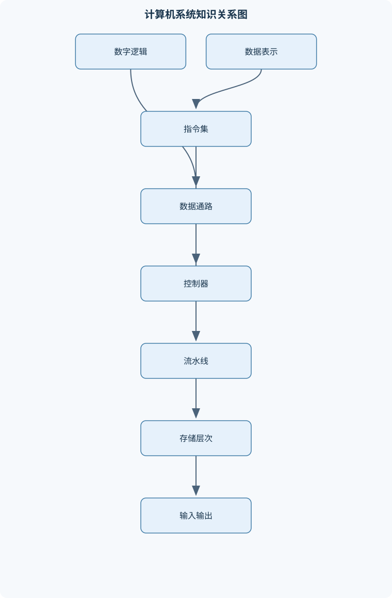
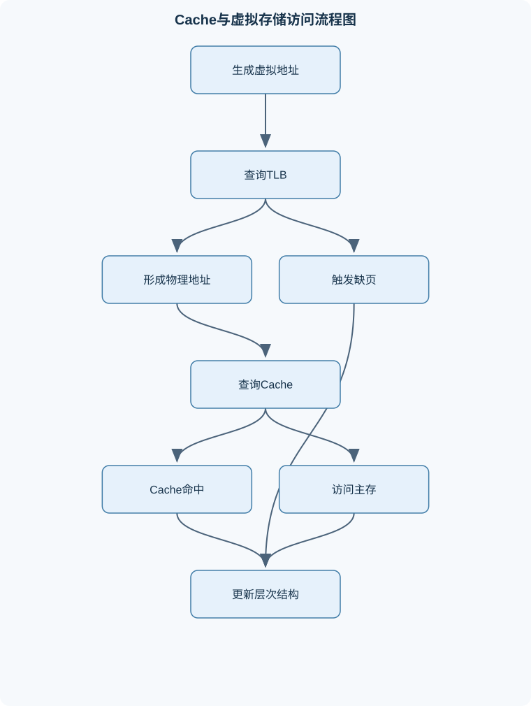

# 计算机原理

## 一、课程整体知识框架

### 课程边界与先修知识

《计算机原理》研究计算机系统从数字逻辑、数据表示、指令集、处理器、存储层次、输入输出到程序执行的基本机制，重点解释硬件结构如何支持软件抽象以及性能、成本和复杂度之间的权衡。内容覆盖组合逻辑与时序逻辑、整数与浮点数编码、汇编语言和调用约定、单周期与多周期处理器、流水线基础、Cache与虚拟存储、总线与I/O。先修知识包括离散数学中的二进制与逻辑运算、基础数字电路、C语言程序设计和初等数据结构；不以某一种具体处理器实现为唯一对象，但以典型的32位精简指令集和MIPS风格指令作为贯穿示例。课程不深入操作系统内核调度、编译器优化、具体芯片版图和设备驱动实现，但会说明它们与计算机组成原理的接口。





### 1. 研究对象与总体目标

《计算机原理》研究的是“程序如何被表示、存储、取出、解释并执行”的完整硬件过程。一个计算机系统通常包含输入设备、输出设备、存储器、运算器和控制器五类基本部件。现代处理器中，运算器和控制器通常集成在中央处理器内部；存储器又分为寄存器、Cache、主存和外部存储等层次；输入输出设备通过设备控制器和总线与处理器、存储器交换信息。

课程的核心不是记忆某一种芯片的线路，而是建立从软件抽象到硬件实现的对应关系。C语言中的变量最终表现为寄存器或内存中的位串，数组下标最终表现为地址加法，函数调用最终表现为寄存器保存、栈空间管理和跳转，条件语句最终表现为比较、分支和程序计数器$PC$更新。位串本身没有唯一语义：同一个32位模式可以解释为无符号整数、补码整数、IEEE 754浮点数，也可以被拆解为一条机器指令。因此，解释位串时必须同时给出位宽、编码规则和上下文。

课程按以下因果链组织：

$$
\text{布尔逻辑}
\rightarrow
\text{数据表示}
\rightarrow
\text{指令集}
\rightarrow
\text{数据通路与控制器}
\rightarrow
\text{流水线处理器}
\rightarrow
\text{存储层次}
\rightarrow
\text{输入输出与完整程序执行}.
$$

布尔逻辑决定硬件能否完成加法、比较和选择；数据表示决定数值、字符和地址如何编码；指令集规定软件可以请求处理器完成哪些操作；数据通路负责搬运和处理数据，控制器决定每个时钟周期的动作；流水线通过重叠执行提高吞吐率；Cache和虚拟存储利用局部性弥补不同存储层次的速度差异；总线和I/O机制则把处理器计算扩展到外部设备。

### 2. 抽象层次与程序执行模型

计算机系统具有多个抽象层次。应用程序通过C语言表达算法，编译器将其转换为汇编语言，汇编器再转换为机器码；指令集架构规定寄存器、指令格式、寻址方式和异常行为，微体系结构则决定这些指令如何由多周期或流水线数据通路实现；数字逻辑进一步把加法器、寄存器和控制器实现为门电路。

程序存储在可寻址存储器中，指令和数据都以二进制位串保存。基本取指过程是：处理器以$PC$给出的地址访问存储器，把读出的指令放入指令寄存器$IR$，再更新$PC$。随后控制器根据操作码产生控制信号，寄存器堆$R$提供源操作数，算术逻辑单元完成运算或有效地址计算，必要时访问数据存储器，最后把结果写回寄存器或存储器。

典型指令的阶段可以写成：

1. 取指：读取$Mem[PC]$，并通常计算$PC+4$；
2. 译码：识别操作码，读取$R[rs]$和$R[rt]$；
3. 执行：进行算术逻辑运算、比较或地址计算；
4. 访存：执行加载或存储；
5. 写回：把结果写入目标寄存器。

并非所有指令都需要全部阶段。例如存储指令不需要寄存器写回，分支指令不需要数据存储器访问。$MAR$保存存储器访问地址，$MDR$保存读出或待写入的数据，$IR$保存当前指令；这些寄存器的设置取决于具体数据通路。

### 3. 性能、成本与复杂度

执行时间、吞吐率和响应时间不能混为一谈。响应时间是完成一个任务所需的时间，吞吐率是单位时间内完成的任务数量。流水线通常主要提高吞吐率，而不一定降低单条指令的全部延迟。平均执行时间可以抽象为：

$$
T_{\text{CPU}}=N\times CPI\times T,
$$

其中$N$是执行的指令数，$CPI$是平均每条指令占用的时钟周期数，$T$是时钟周期时间。$T$的单位通常为秒，$CPI$无量纲，$N$为条数。降低$CPI$、减少指令数或缩短时钟周期，都可能提高性能，但三者往往存在硬件复杂度、功耗和验证成本上的代价。

若原程序中比例$f$的部分可获得加速比$s$，其余部分不变，则总体加速比为：

$$
S_{\text{overall}}=
\frac{1}{(1-f)+\frac{f}{s}}.
$$

推导方法是把原总时间归一化为1，未优化部分耗时$1-f$，优化部分原耗时$f$，优化后变为$f/s$，再用优化前总时间除以优化后总时间。该公式要求$f$按原执行时间计算，而不是按代码行数或指令条数计算。若$f=0.2$，即使可优化部分无限快，总体加速比也不超过$1/(1-0.2)=1.25$，这说明未优化部分构成边界。

层次化设计也是性能和成本权衡的基本方法。小而快的存储部件放在靠近处理器的位置，大而慢的部件放在较低层次。寄存器速度快但容量小，DRAM容量较大但访问延迟较高，外部存储容量更大但速度更慢。层次结构能够成立的前提是程序具有时间局部性和空间局部性：近期访问过的数据可能再次访问，访问某个地址后可能访问邻近地址。局部性不是任何程序的必然性质；随机访问大数据集可能导致Cache命中率很低。

### 4. 表示、接口与边界

硬件接口必须明确数据宽度、地址单位、端序、对齐要求和异常条件。位宽用$w$表示，单个位写作$b_i$，其中$i=0$表示最低位。$w$位无符号数的范围是$0$到$2^w-1$。补码有符号数的范围是$-2^{w-1}$到$2^{w-1}-1$。十六进制常量以$0x$开头，每个十六进制数字对应4位；KiB、MiB、GiB分别表示$2^{10}$、$2^{20}$、$2^{30}$字节。

地址通常按字节编址，即相邻字节地址相差1。一个32位字由4个字节构成，但字节在连续地址中的排列受端序影响。大端把最高有效字节放在低地址，小端把最低有效字节放在低地址。对于数据$0x12345678$，从低地址到高地址，大端为$12,34,56,78$，小端为$78,56,34,12$。端序改变内存中的字节排列，不改变抽象整数的数学值；单字节访问不涉及端序差异。

## 二、章节和模块划分

### 核心知识覆盖清单

本清单用于检查正文是否覆盖本课程的主要知识模块：

- **计算机系统抽象与性能基础**：计算机五大基本部件、程序存储与指令执行、抽象层次与接口、指令表示为二进制数、常见性能指标与单位、响应时间与吞吐率、阿姆达尔定律、局部性与层次化设计。
- **数字逻辑与数据通路基础**：布尔代数与逻辑门、组合逻辑电路、译码器与多路选择器、加法器与算术逻辑单元、比较器与移位器、锁存器与触发器、时钟与时序逻辑、寄存器与有限状态机。
- **数制、整数与字符表示**：二进制八进制十六进制转换、无符号整数范围、原码反码与补码、补码加减法、进位与借位、有符号溢出判定、符号扩展与零扩展、ASCII与字节序。
- **浮点数与信息编码**：IEEE 754单精度格式、IEEE 754双精度格式、符号位阶码尾数、阶码偏置表示、十进制小数转二进制、规格化与隐藏位、舍入与表示误差、非规格化数无穷大与NaN。
- **指令集结构与汇编程序**：操作码与指令字段、R型I型J型指令格式、寄存器寻址、立即数寻址、基址寻址、PC相对寻址、伪指令展开、加载存储与分支跳转、MIPS调用约定、汇编与C语句对应。
- **处理器数据通路与控制器**：取指译码执行周期、单周期数据通路、控制信号生成、ALU控制编码、多周期数据通路、状态寄存器与中间寄存器、有限状态机控制器、新增指令的硬件扩展、寄存器写回与存储器访问。
- **流水线与指令级并行**：经典五级流水线、结构冒险、数据冒险、控制冒险、旁路与转发、流水线停顿、分支预测基础、流水线吞吐率、流水线加速比边界。
- **存储层次与Cache**：存储层次结构、时间局部性与空间局部性、Cache块与命中失配、直接映射Cache、全相联Cache、组相联Cache、地址字段划分、写直达与写回、写分配与非写分配、强制容量与冲突失配。
- **虚拟存储与地址转换**：虚拟地址与物理地址、页与页框、页表结构、页表项有效位与权限位、TLB作用、地址转换流程、缺页异常、置换与交换空间、虚拟存储性能代价、Cache与虚拟存储的设计差异。
- **总线、输入输出与综合系统分析**：同步总线与异步总线、总线仲裁、存储器映射I/O、程序查询方式、中断驱动I/O、DMA传输、设备控制器、端序与数据对齐、系统性能瓶颈、从C程序到硬件执行的综合分析。


### 1. 计算机系统抽象与性能基础

本模块说明计算机五大基本部件、程序存储和指令执行。需要区分指令集架构与具体实现：同一条加法指令可以在单周期、 多周期或流水线处理器中执行，但软件可观察的寄存器结果和内存效果应保持一致。

性能分析从$N$、$CPI$和$T$展开，并结合响应时间、吞吐率、带宽和延迟。带宽表示单位时间可传输的数据量，如字节每秒；延迟表示一次请求从发出到完成的时间。高带宽不代表低延迟，例如批量DMA传输可能有较高吞吐率，却不适合极短数据的即时响应。

### 2. 数字逻辑与数据通路基础

布尔变量只有0和1，基本运算包括与、或、非、异或。组合逻辑电路的输出只由当前输入决定，例如译码器、多路选择器、加法器、比较器和移位器。$n$到$2^n$译码器把$n$位输入转换为最多一个有效输出；多路选择器根据选择信号从多个输入中选出一个。

半加器将两个一位输入相加，和为异或，进位为与。全加器还接收低位传来的进位。多个全加器串联可形成行波进位加法器，但高位必须等待低位进位，延迟随位数增加。ALU通常组合算术运算、逻辑运算、比较和移位功能，并由控制信号选择具体操作。

时序逻辑含有状态，输出不仅取决于当前输入，还取决于此前保存的状态。锁存器对电平敏感，触发器通常在时钟边沿采样。寄存器由多个触发器组成，用于保存固定宽度的数据。有限状态机由状态寄存器、下一状态逻辑和输出逻辑组成，适合实现多周期控制器。时序设计必须满足建立时间、保持时间和时钟周期约束；理想教材模型常假设门延迟和时钟偏差可以忽略，真实电路不能直接采用这一假设。

### 3. 数制、整数与字符表示

二进制、八进制和十六进制转换依赖位分组：每3位对应一个八进制数字，每4位对应一个十六进制数字。无符号位串的值为：

$$
U=\sum_{i=0}^{w-1}b_i2^i.
$$

补码解释为：最高位$b_{w-1}=0$时，$V=U$；最高位为1时，$V=U-2^w$。补码取负的步骤是逐位取反再加1，原因是对$w$位位串进行模$2^w$运算后，$\sim x+1$等于$-x$。最小负数$-2^{w-1}$取负仍得到自身，因为$+2^{w-1}$超出可表示的正数范围。

补码加法保留低$w$位。最高位产生的进位$CF$表示无符号加法是否超出范围；有符号溢出$OF$只在两个操作数同号且结果异号时发生：

$$
OF=\neg(a_{w-1}\oplus b_{w-1})\land(a_{w-1}\oplus s_{w-1}).
$$

例如8位$121+107$为$01111001+01101011=11100100$。两个正数相加得到符号位1，因此$OF=1$；最高位没有额外进位，$CF=0$。不能用$CF$代替$OF$。符号扩展复制源数最高位，零扩展在高位补0；负数进行零扩展会改变其有符号数值。

字符通常按字节编码。ASCII中大写字母、小写字母和数字使用不同编码区间，但字符编码不等于字符的数学语义。处理字符串时应使用字节加载和存储，并以空字符作为结束条件；把字符当作多字节整数访问可能造成越界或端序问题。

### 4. 浮点数与信息编码

IEEE 754单精度由1位符号$s$、8位阶码字段$e$和23位尾数字段$f$组成。对于规格化有限数：

$$
x=(-1)^s\times(1.f)\times2^{e-127}.
$$

编码步骤是先确定符号，再把绝对值转换为二进制，规格化为$1.f\times2^E$，令$e=E+127$，最后截取或舍入23位小数部分。偏置127使得阶码字段可以用无符号形式存储正负指数。双精度使用1位符号、11位阶码和52位尾数，偏置为1023。

以$-12.3$为例，绝对值的二进制形式是整数部分和小数部分分别转换后拼接，规格化结果约为$1.1000100110011\ldots\times2^3$。因此符号位为1，真实指数为3，阶码字段为130，即二进制$10000010$。尾数只能保留有限位，剩余部分按舍入规则处理，所以一般不能精确表示十进制小数12.3。

阶码全0时表示0或非规格化数；阶码全1且尾数全0表示正、负无穷大；阶码全1且尾数非零表示NaN。非规格化数用于逐渐下溢，不能套用规格化数的隐藏最高位1。浮点运算还可能出现舍入误差、溢出、下溢和非结合性，因此不能简单把浮点数当作实数进行代数变形。

### 5. 指令集结构与汇编程序

典型MIPS风格指令采用R型、I型和J型格式。R型通常包含操作码、源寄存器、目标寄存器、移位量和功能码；I型包含操作码、两个寄存器字段和16位立即数；J型包含操作码和跳转目标字段。寄存器寻址直接指定$R[i]$，立即数寻址把指令中的常量扩展后参与运算，基址寻址使用基址寄存器加符号扩展立即数形成有效地址，PC相对寻址用于分支。

加载指令的语义可写为：

$$
R[rt]\leftarrow Mem[R[rs]+\operatorname{signext}(imm)].
$$

存储指令则把寄存器内容写入该地址。MIPS风格分支目标地址为：

$$
PC+4+\bigl(\operatorname{signext}(offset)\ll2\bigr),
$$

因为指令按4字节对齐，分支偏移量以指令字为单位。若目标地址为$target$，则常用偏移计算为$(target-(PC+4))/4$，不能直接把字节差填入立即数字段。

函数翻译必须遵守调用约定：参数放在规定的参数寄存器中，返回值放在规定的返回寄存器中，被调用者保存寄存器在函数使用后必须恢复，返回地址通常由$jal$保存并由$jr\ $ra返回。数组元素地址必须乘以元素大小；`int`数组常以4字节为元素，`char`数组以1字节为元素。

```asm
# int min(int n, int *p)
# a0 = n, a1 = p, v0 = 返回值
min:
    beq   $a0, $zero, empty
    lw    $v0, 0($a1)
    addiu $t0, $zero, 1
loop:
    beq   $t0, $a0, done
    sll   $t1, $t0, 2
    addu  $t1, $a1, $t1
    lw    $t2, 0($t1)
    slt   $t3, $t2, $v0
    beq   $t3, $zero, next
    addu  $v0, $t2, $zero
next:
    addiu $t0, $t0, 1
    j     loop
done:
    jr    $ra
empty:
    addiu $v0, $zero, 0
    jr    $ra
```

该代码假设$n>0$时返回数组最小值，$n=0$时约定返回0；若接口不允许空数组，则应改为显式错误处理。伪指令如`move`、`not`、`bge`可能展开成一条或多条真实指令，并可能占用临时寄存器，因此会改变指令地址布局。

### 6. 处理器数据通路与控制器

单周期处理器在一个时钟周期内完成一条指令，控制逻辑直接根据操作码产生寄存器写使能、ALU操作、存储器读写和多路选择信号。其优点是控制简单、单条指令路径直观；缺点是时钟周期必须覆盖最慢指令的全部组合逻辑，导致其他指令的硬件资源闲置。

多周期处理器把取指、译码、执行、访存和写回拆成多个时钟周期，并通过$IR$、$MAR$、$MDR$及中间寄存器保存阶段结果。有限状态机在每个状态产生一组微操作，状态转移由当前指令类型和条件信号决定。增加一条指令时，必须检查指令格式、寄存器读写端口、ALU输入、存储器访问路径和写回路径是否足够。

例如新增：

$$
R[rd]=R[rs]+Mem[R[rt]+\operatorname{signext}(imm)]
$$

至少需要先计算有效地址并读存储器，再把读出的数据与$R[rs]$相加，最后写回$R[rd]$。如果现有数据通路不能在同一周期重复使用ALU，就需要增加中间寄存器和控制状态，而不是只增加一条控制编码。

### 7. 流水线与指令级并行

经典五级流水线为IF、ID、EX、MEM、WB，相邻阶段之间由$IF/ID$、$ID/EX$、$EX/MEM$和$MEM/WB$寄存器保存数据与控制信号。理想情况下，$k$级流水线执行$n$条独立指令需要$k+n-1$个周期，非流水线约需$nk$个周期。但实际加速比会受到级间寄存器开销、阶段不均衡、结构冒险、数据冒险和控制冒险限制。

结构冒险是资源数量不足，例如取指和数据访问争用同一个单端口存储器；解决方法可以是复制资源或错开访问。数据冒险包括后一条指令过早读取前一条指令的结果，最常见的是RAW相关。旁路可把EX或MEM阶段的结果直接送到后续ALU输入；若加载指令的数据直到MEM阶段才可用，紧随其后的使用指令通常仍需停顿一个周期。控制冒险来自分支方向和目标地址尚未确定，可采用停顿、冲刷或分支预测。

### 8. 存储层次与Cache

Cache按块保存主存数据。设数据区容量为$C$，块大小为$B$字节，组数为$S$，每组路数为$E$，则：

$$
C=S\times E\times B.
$$

在$B$和$S$为2的幂时，块内偏移位数为$\log_2B$，组索引位数为$\log_2S$，剩余高位为Tag。Offset确定块内字节，Index确定候选集合，Tag区分映射到同一集合的不同主存块。直接映射为$E=1$，全相联没有Index，$E$路组相联每组有$E$个候选位置。

失配包括强制失配、容量失配和冲突失配。命中时间为$T_c$，失配率为$m$，失配代价为$P_m$时：

$$
AMAT=T_c+mP_m.
$$

这里$P_m$应定义为一次失配额外付出的时间；若已把命中时间包含在失配代价中，就不能重复相加。写直达每次写入都传播到下一级，控制简单但流量较大；写回只在块被替换且脏位为1时写回，需要脏位。写分配在写失配时先调入块，非写分配则直接写下一级。

### 9. 虚拟存储与地址转换

虚拟地址$VA$由虚拟页号和页内偏移组成。页大小为$P$时，页内偏移位数为$\log_2P$；地址转换只改变虚拟页号，不改变页内偏移。页表项保存物理页框号、有效位、读写执行权限等信息。若虚拟地址空间大小为$V$，页表项大小为$E$，单级页表空间为：

$$
(V/P)\times E.
$$

页表项数量由虚拟页数决定，而不是由物理页框数量决定。TLB是页表项的高速缓存。转换流程是先分离虚拟页号和偏移，再查询TLB；命中时直接拼接物理页框号与偏移；未命中时查询页表，若表项有效则更新TLB，若无效则触发缺页异常。TLB未命中不等于缺页，缺页意味着页面当前不在物理内存或映射无效。

### 10. 总线、输入输出与综合系统分析

同步总线用统一时钟规定传输时刻，设计简单但受时钟和最长设备延迟限制；异步总线使用握手信号，能适应速度不同的设备，但控制更复杂。总线仲裁决定哪个主设备获得使用权。总线共享可以减少连线和成本，但可能形成带宽瓶颈。

存储器映射I/O把设备寄存器放入统一地址空间，处理器通过普通加载和存储指令访问设备。程序查询方式由CPU反复读取状态寄存器，硬件简单但会产生忙等待；中断驱动I/O由设备在需要服务时通知CPU，减少空转但增加中断处理开销；DMA由DMA控制器直接在设备和内存之间传输数据，适合大块连续数据，CPU只需配置地址、长度和方向并处理完成通知。

### 11. 代表性算法与流程

#### 11.1 补码加法标志分析流程

输入为位宽$w$和两个位串。先逐位相加，只保留低$w$位并记录最高位进位$CF$；再检查两个输入符号是否相同，若相同而结果符号不同，则$OF=1$；最后分别按无符号和补码解释结果。该流程只适用于固定宽度整数，不能直接用于浮点字段。

#### 11.2 Cache地址划分流程

输入主存地址、主存地址位数、Cache数据容量、块大小和相联度。先计算$B$的偏移位数，再由$S=C/(E B)$计算组数和索引位数，剩余位数为Tag。随后根据Index找到集合，在该集合的各路中比较有效位和Tag。Tag匹配且有效位为1时命中，否则发生失配。计算总容量时还应加上Tag、有效位、脏位和替换状态位，不能只计算数据区。

#### 11.3 虚拟地址转换流程

输入$VA$、页大小、TLB和页表。按页大小拆分虚拟页号与页内偏移；查询TLB，命中则取得物理页框号；未命中则访问页表；若页表项有效，更新TLB并拼接$PA$；若无效，触发缺页处理，操作系统选择空闲页框或置换页面，再重新执行访问。该流程适用于分页虚拟存储，不等同于Cache查找。

#### 11.4 流水线冒险分析流程

输入指令序列和各阶段时序。首先检查同一周期是否争用硬件资源；其次检查后一条指令读取的寄存器是否由前序指令产生；再根据结果产生阶段选择旁路或停顿；遇到分支时确定预测、冲刷或延迟策略；最后把所有额外停顿周期加入理想周期数。终止条件是所有指令完成WB，且流水线中无剩余有效指令。

### 12. 代表性例题

#### 例题一：8位补码加法

**题干：**计算$121+107$，给出结果、$CF$和$OF$。

**分析与解答：**

$$
121=01111001,\qquad107=01101011
$$

相加得：

$$
01111001+01101011=11100100.
$$

结果位串为$0xE4$。最高位没有产生额外进位，所以$CF=0$。两个输入均为正数，结果符号为1，超出8位补码正数上限127，因此$OF=1$。若按补码解释，$11100100=228-256=-28$；按无符号解释则为228。

**验证与变式：**验证有符号数学结果$121+107=228$超出范围。若改为$98+(-112)$，两个操作数异号，不发生有符号溢出，但无符号解释仍可能产生不同的$CF$。

#### 例题二：IEEE 754单精度编码

**题干：**编码$-12.3$。

**分析与解答：**符号位为1。$12.3$的二进制约为$1100.0100110011\ldots$，规格化为：

$$
1.1000100110011\ldots\times2^3.
$$

真实指数$E=3$，阶码字段为$e=3+127=130$，即$10000010$。尾数字段取隐藏的最高位1之后的23位，并按后续位舍入。拼接符号、阶码和尾数即可得到32位编码，通常写成十六进制形式。由于$0.3$的二进制展开循环，编码存在舍入误差。

**验证与变式：**解码时先减去偏置127，再恢复隐藏位和指数；若阶码全0或全1，不能使用同一规格化公式。

#### 例题三：Cache字段划分

**题干：**主存按字节编址，地址宽度32位，Cache数据区容量为128 KiB，块大小16字节，采用4路组相联。求Offset、Index和Tag位数。

**解答：**

$$
C=128\times2^{10}=2^{17},\quad B=16=2^4,\quad E=4=2^2.
$$

组数为：

$$
S=\frac{2^{17}}{2^2\times2^4}=2^{11}.
$$

因此Offset为4位，Index为11位，Tag为：

$$
32-4-11=17\text{位}.
$$

**结果验证：**$2^{11}$组、每组4路、每路16字节的数据量为$2^{11}\times2^2\times2^4=2^{17}$字节。若改为直接映射，组数变为$2^{13}$，Index增加2位，Tag减少2位。

#### 例题四：虚拟地址分页

**题干：**虚拟地址宽度为32位，页大小为4 KiB，页表项大小为4字节，求页内偏移位数、虚拟页数和单级页表空间。

**解答：**

$$
4\text{ KiB}=2^{12}\text{字节},
$$

所以页内偏移为12位，虚拟页号为$32-12=20$位，虚拟页数为$2^{20}$。单级页表空间为：

$$
2^{20}\times4=2^{22}\text{字节}=4\text{ MiB}.
$$

**验证与变式：**若页大小改为8 KiB，偏移变为13位，虚拟页数减少一半，但每页内部传输的数据增多。页表空间取决于虚拟页数和页表项大小，不直接由物理内存容量决定。

#### 例题五：流水线Load-Use相关

**题干：**分析以下指令的五级流水线相关：

```asm
lw   $t0, 0($s0)
add  $t1, $t0, $t2
```

**解答：**`lw`在MEM阶段结束时才得到数据，而紧随其后的`add`在EX阶段就需要$t0$。普通EX旁路无法在同一时刻提供加载结果，因此必须让`add`停顿一个周期；随后可从MEM/WB或等效路径旁路到EX。理想两条指令需要$5+2-1=6$个周期，若增加一个停顿，则为7个周期。

**验证与变式：**若两条指令之间插入一条与$t0$无关的指令，可能隐藏该延迟而不需显式停顿。不同流水线实现的旁路路径和加载延迟可能不同，不能脱离数据通路直接断言停顿周期。

### 13. 实验与项目

#### 13.1 位表示与指令解码实验

**输入数据：**给定32位位串$0x8D100123$，分别按补码整数、符号数值表示、IEEE 754单精度和MIPS I型指令解释。

**步骤：**先写出32位二进制；补码解释时检查最高位并计算$U-2^{32}$；符号数值表示时分离符号位和幅值；浮点解释时分离符号、阶码和尾数；指令解释时按操作码、$rs$、$rt$和立即数字段切分，并核对操作码含义。

**评价标准：**必须明确每种解释的假设；字段边界正确；补码和浮点结果均经过反向验证；指令中的基址寄存器、目标寄存器和偏移量不能混淆。

**排错方法：**若十六进制转换不一致，先逐组检查4位；若浮点指数异常，检查是否错误地把阶码字段直接当真实指数；若加载指令地址不正确，检查立即数是否符号扩展以及$rs$、$rt$位置。

#### 13.2 Cache与流水线综合分析项目

**输入数据：**一段包含加载、算术运算、条件分支和数组访问的汇编序列，以及Cache容量、块大小、相联度和流水线阶段参数。

**步骤：**为每条内存访问计算地址字段并判断命中或失配；记录强制、容量和冲突失配类型；绘制各指令进入IF、ID、EX、MEM、WB的周期；标出旁路、停顿、分支冲刷；根据$CPI$和时钟周期估算总执行时间。

**评价标准：**地址划分满足$C=S\times E\times B$；Cache判断同时检查有效位和Tag；流水线时序中任何停顿都能说明原因；总周期数与逐周期表一致；不能把TLB未命中直接写成缺页。

**排错方法：**若Cache组数错误，重新区分数据区容量与总容量；若流水线相关判断错误，列出每条指令读写的寄存器并标记结果产生阶段；若分支目标错误，使用$PC+4$和以指令字为单位的偏移重新计算。

## 三、核心概念的详细解释

### 3.1 计算机系统的抽象层次与程序执行

计算机系统可以分为应用程序、程序设计语言、汇编语言、指令集架构、微体系结构、数字逻辑和器件实现等层次。上层通过接口使用下层能力，而不必知道下层的全部实现细节。例如，C语言中的 `a[i] = b + c` 通常会被转换为：读取变量、计算数组元素地址、执行加法、将结果写回内存。指令集架构规定这些操作能够使用哪些指令、寄存器和地址形式；单周期、多周期或流水线处理器则是实现同一指令集的不同微体系结构。

程序和数据都以位串形式存放在存储器中。位串本身没有固定含义，必须结合位宽、编码规则和使用位置解释。同一位串可以是无符号整数、补码整数、浮点数、字符序列，也可以被拆分为操作码和寄存器字段。处理器执行程序的基本循环是取指、译码、执行、访存和写回。取指时访问 $Mem[PC]$，将结果置入指令寄存器 $IR$，并通常把 $PC$ 更新为下一条指令地址；译码时读取寄存器堆 $R$；执行阶段由算术逻辑单元计算结果或有效地址；加载、存储指令在访存阶段访问数据存储器；算术指令和加载指令在写回阶段更新目标寄存器。

### 3.2 性能、局部性与层次化设计

响应时间表示完成一个任务所需的时间，吞吐率表示单位时间完成的任务数。流水线可以让多条指令的不同阶段重叠，因此主要提高吞吐率，但不必然降低单条指令从开始到结束的延迟。常用处理器执行时间模型为

$$
T_{\mathrm{CPU}}=N\times CPI\times T,
$$

其中 $N$ 是执行的指令条数，$CPI$ 是平均每条指令占用的周期数，$T$ 是一个时钟周期的时间，单位分别为条、无量纲和秒。实际性能还受到Cache失配、分支停顿、缺页、总线争用和I/O等待影响。

局部性是存储层次有效的基础。时间局部性表示最近访问过的数据或指令可能很快再次访问；空间局部性表示与刚访问地址相邻的地址可能很快被访问。寄存器、Cache、主存和外部存储器依次具有容量增大、单位成本降低而访问速度变慢的趋势。Cache利用局部性保存近期使用的主存块，虚拟存储利用局部性把近期使用的页面保留在物理内存中。二者都属于层次化设计，但Cache通常由硬件透明管理，虚拟存储还依赖操作系统处理页表、权限和缺页异常。

阿姆达尔定律用于分析局部优化的总体收益。若程序中比例 $f$ 的部分加速比为 $s$，则总体加速比为

$$
S_{\mathrm{total}}=\frac{1}{(1-f)+f/s}.
$$

这里的 $f$ 必须按原执行时间计算，而不是按代码行数计算。当 $f$ 较小时，即使局部部分无限加速，总体加速比也不能超过 $1/(1-f)$。

### 3.3 数字逻辑、数据通路与时序逻辑

布尔变量只有 $0$ 和 $1$ 两种状态，基本运算包括与、或、非。组合逻辑电路的输出只由当前输入决定，例如译码器、多路选择器、加法器、比较器和移位器。多路选择器根据选择信号从多个输入中选出一个，常用于让同一个ALU输入在寄存器值、立即数和常量之间切换。译码器把二进制编码转换为互斥的控制线，常用于寄存器选择和控制信号生成。

全加器处理三个输入：两个加数位和低位传入的进位，输出和位与向高位传递的进位。多个全加器级联可以构成多位加法器。ALU在此基础上组合加法、减法、与、或、比较和移位功能。减法通常通过加上被减数的补码实现。比较器可以根据减法结果的符号、零标志或无符号借位判断大小。

时序逻辑包含状态，输出不仅取决于当前输入，还取决于过去保存的状态。锁存器对电平敏感，触发器通常在时钟边沿采样输入。寄存器由多个触发器组成，用于保存一个字或一组控制状态。有限状态机由状态寄存器、下一状态逻辑和输出逻辑构成，适合实现多周期控制器。时钟周期必须足够长，以覆盖组合逻辑延迟、寄存器建立时间、时钟偏斜和级间寄存器开销；因此，时钟频率不能只由某一个门的延迟决定。

### 3.4 整数、字符与字节序表示

$w$ 位无符号整数的范围是 $0$ 到 $2^w-1$，其数值为

$$
U=\sum_{i=0}^{w-1}b_i2^i.
$$

补码有符号数的解释为：最高位为 $0$ 时，数值等于无符号值；最高位为 $1$ 时，数值等于无符号值减去 $2^w$。因此范围是 $-2^{w-1}$ 到 $2^{w-1}-1$。原码用最高位表示符号，反码对负数的正数位逐位取反；现代处理器主要使用补码，因为补码可以把加法器同时用于有符号加法和无符号加法。

补码取负的过程是逐位取反再加 $1$。例如8位位串 `00000101` 表示 $5$，取反加一得到 `11111011`，解释为 $-5$。最小负数 $-2^{w-1}$ 取负后仍是自身，因为正数一侧没有对应的 $2^{w-1}$ 可表示值。

符号扩展把源数最高位复制到新增高位，能够保持补码数值不变；零扩展则在高位补零，只适用于无符号数或指令明确规定的立即数。ASCII用一个字节编码基本字符，但字节值是否表示字符取决于程序解释。多字节数据还涉及端序：大端把最高有效字节放在低地址，小端把最低有效字节放在低地址。数据 $0x12345678$ 在小端内存中的连续字节为 `78 56 34 12`，在大端内存中为 `12 34 56 78`。

### 3.5 浮点数表示及其边界

IEEE 754单精度由1位符号、8位阶码和23位尾数组成。规格化有限数的值为

$$
(-1)^s\times(1.f)\times2^{e-127},
$$

其中 $s$ 为符号位，$e$ 为阶码字段，$f$ 为尾数字段。最高有效的二进制 $1$ 通常是隐藏位，不存入尾数字段。双精度采用1位符号、11位阶码和52位尾数，偏置值为1023。

将十进制小数转换为二进制时，整数部分用连续除以2取余，小数部分用连续乘以2取整数位。例如 $0.3$ 的二进制展开是无限循环的，因而只能截断或舍入。舍入会产生表示误差，浮点加法还可能因阶码对齐而丢失低位有效信息。阶码全为0时表示零或非规格化数；阶码全为1且尾数为0表示正负无穷大，尾数非零表示NaN。浮点位串不能直接按普通整数规则判断大小，NaN也不等于任何数，包括自身。

### 3.6 指令集、寻址方式与汇编调用

典型MIPS风格指令包含R型、I型和J型。R型使用寄存器字段表达寄存器间运算；I型包含操作码、两个寄存器字段和16位立即数，适合加载、存储、立即数运算和条件分支；J型使用较大的跳转目标字段。加载和存储指令通过基址加偏移形成有效地址，例如

$$
EA=R[rs]+\operatorname{signext}(imm).
$$

数组元素地址必须乘以元素字节数。`int`数组若每个元素4字节，则 `p[i]` 的地址为 `p+4i`；字符数组的字节增量为1。

分支目标通常为

$$
Target=PC+4+\bigl(\operatorname{signext}(offset)\ll2\bigr),
$$

因为偏移量以指令字为单位，而指令地址按字节寻址且一条指令为4字节。跳转指令与分支指令的目标形成方式不同，不能把字节地址差直接填入分支立即数字段。

函数调用约定规定参数、返回值、返回地址和被调用者保存寄存器的使用方式。调用者保存的临时寄存器在函数调用后可能改变；被调用者保存的寄存器若被使用，则必须在栈中保存并在返回前恢复。函数通常通过 `$ra` 保存返回地址，通过约定的返回值寄存器传回结果，以 `jr $ra` 返回。伪指令如 `move`、`not`、`bge` 可能展开为一条或多条真实指令，展开可能改变代码地址并占用临时寄存器。

### 3.7 单周期、多周期与流水线处理器

单周期处理器让一条指令在一个长时钟周期内完成，控制简单但周期必须满足最慢指令的路径延迟。多周期处理器把取指、译码、执行、访存和写回分散到多个周期，使不同指令只使用所需阶段，并复用ALU、存储器等硬件；代价是需要状态寄存器、$IR$、$MDR$以及多个中间寄存器保存阶段结果。

经典五级流水线包括IF、ID、EX、MEM和WB。结构冒险是多条指令争用同一硬件资源；数据冒险是后一条指令需要前一条指令尚未写回的结果；控制冒险来自分支和跳转改变下一条指令地址。旁路可以把执行结果直接送到后续ALU输入，减少等待；Load-Use相关通常需要至少停顿一个周期，因为加载数据要到MEM阶段结束才可用。分支预测可以提前选择路径，但预测错误时必须冲刷错误路径上的指令。

### 3.8 Cache、虚拟存储与地址转换

Cache由若干行组成，每行包含有效位、标记、数据块，写回策略还需要脏位。容量关系为

$$
C=S\times E\times B,
$$

其中 $C$ 是数据区容量，$S$ 是组数，$E$ 是每组路数，$B$ 是块大小。地址划分为Tag、Index和Offset。当 $B$、$S$ 为2的幂时，Offset位数为 $\log_2B$，Index位数为 $\log_2S$。直接映射的 $E=1$，每个主存块只有一个候选位置；全相联没有Index字段；组相联在每组内允许多个候选位置。

Cache失配包括首次访问某块造成的强制失配、Cache容量不足造成的容量失配，以及多个块映射到同一位置造成的冲突失配。写直达每次写入都更新下一级，控制简单但总线流量较大；写回只在替换脏块时写回，需要脏位。写分配在写失配时先取入数据块，非写分配则直接写下一级。

分页虚拟存储把虚拟地址分为虚拟页号和页内偏移。页大小为 $P$ 时，页内偏移位数为 $\log_2P$。TLB是页表项的高速缓存。TLB命中时直接取得物理页框号；TLB未命中时查询页表；页表项无效或页面不在物理内存时才产生缺页异常。地址转换只替换页号，页内偏移保持不变。缺页处理通常需要操作系统选择空闲页框或置换页面，从交换空间调入目标页，更新页表和TLB，然后重新执行引发异常的访问。

### 3.9 总线、I/O与系统瓶颈

同步总线由共同的时钟规定传输时序，控制简单但要求设备满足时序；异步总线使用握手信号，适应不同速度设备但控制更复杂。总线仲裁决定多个主设备谁能获得总线，集中式仲裁实现简单，分布式仲裁则减少单点控制依赖。共享总线能够降低连接数量和成本，但可能成为通信瓶颈。

存储器映射I/O把设备控制器寄存器映射到普通地址空间，处理器可使用加载、存储指令访问设备状态、数据和控制寄存器。程序查询方式由CPU反复读取状态，硬件支持少但会产生忙等待；中断驱动I/O由设备准备好数据后通知CPU，降低等待浪费；DMA由DMA控制器直接在设备与主存之间搬运数据，适合大块传输，CPU只需设置起始地址、长度和方向并在完成时处理通知。DMA并非完全不需要CPU或硬件，而是减少CPU逐字节搬运的负担。

## 四、重要定义、公式、定理和推导

### 专业审校补充：关键定义与适用边界

中断、异常与陷阱都改变处理器的控制流，但触发条件和可恢复性不同。中断通常由处理器外部设备异步提出，例如网卡接收完成；异常由当前指令同步产生，例如缺页、未对齐访问或算术异常；陷阱则是由指令主动请求的同步控制转移，常用于系统服务接口。处理器若采用精确异常模型，必须保证保存的异常现场满足“异常指令之前的指令已经完成，异常指令及之后的指令尚未产生可见副作用”。因此需要保存异常返回地址、状态寄存器和必要的原因编码，并在处理程序结束后通过专用返回指令恢复执行。外部中断通常可在指令边界响应，而缺页异常必须能够重新执行产生异常的访存指令。该边界不适用于所有简单微控制器：某些实现允许非精确异常或不保存完整流水线状态，软件需遵守其特定接口。中断延迟还受当前指令不可抢占区间、流水线排空、优先级屏蔽和保存现场开销影响，不能仅由设备产生中断的时刻决定。


### 4.1 补码运算与溢出判定

对 $w$ 位补码加法，硬件保留低 $w$ 位结果。最高位产生的进位记为 $CF$，它主要反映无符号加法是否超过 $2^w-1$；有符号溢出记为 $OF$，其判定条件是两个操作数同号而结果异号：

$$
OF=\neg(a_{w-1}\oplus b_{w-1})\land(a_{w-1}\oplus s_{w-1}).
$$

例如8位计算 $121+107$：

$$
121=01111001,\qquad107=01101011,
$$

相加得到 `11100100`，即无符号数228，补码解释为 $-28$。两个正数得到负数，所以 $OF=1$；最高位没有进位，故 $CF=0$。这说明 $CF$ 与 $OF$ 表示不同性质的边界，不能互相替代。

计算 $(-87)+(-76)$ 时，结果位串为 `01011101`，补码值为93。两个负数相加得到正数，产生有符号溢出；最高位也产生进位，因此本例 $CF=1,OF=1$。若比较指令使用有符号 `slt`，应依据补码关系；使用无符号 `sltu`，则按 $0$ 到 $2^w-1$ 的大小比较。

### 4.2 IEEE 754单精度编码流程

**输入：**有限十进制数 $x$。  
**输出：**32位单精度编码。  
**过程：**

1. 判断符号，负数取绝对值并令 $s=1$；
2. 将整数部分和小数部分分别转换为二进制；
3. 写成 $1.f\times2^E$；
4. 令阶码字段 $e=E+127$；
5. 取小数点后的23位作为尾数，超出部分按舍入模式处理；
6. 拼接 $s$、8位 $e$ 和23位 $f$；
7. 对0、非规格化数、无穷大和NaN单独处理。

以 $-12.3$ 为例，$12.3$ 的二进制近似为

$$
1100.010011001100\cdots_2
=1.100010011001100\cdots_2\times2^3.
$$

因此 $s=1$，真实指数 $E=3$，阶码字段为 $3+127=130$，即二进制 `10000010`。尾数字段取 `100010011001100...` 的前23位并进行舍入，最终编码约为十六进制 `0xC1453333`。由于 $0.3$ 不能有限地表示为二进制小数，该编码表示的是最接近的可表示值，而不是数学上精确的 $-12.3$。

### 4.3 Cache地址划分与平均访存时间

已知地址宽度为 $W$ 位、Cache数据容量为 $C$ 字节、块大小为 $B$ 字节、路数为 $E$，则

$$
S=\frac{C}{E B}.
$$

当 $B$ 和 $S$ 为2的幂时：

$$
\text{Offset位数}=\log_2B,\qquad
\text{Index位数}=\log_2S,
$$

$$
\text{Tag位数}=W-\log_2B-\log_2S.
$$

例如，1GiB主存使用30位地址，Cache容量为128KiB，块大小为16字节。对于2路组相联：

$$
S=\frac{128\times2^{10}}{2\times16}=4096=2^{12}.
$$

因此Offset为4位，Index为12位，Tag为 $30-4-12=14$ 位。若只计算数据区，容量为128KiB；若计算实际硬件占用，还要加入Tag、有效位、脏位和替换状态位。

设Cache命中时间为 $T_c$，失配率为 $m$，失配代价为 $P_m$，单级Cache平均访存时间为

$$
AMAT=T_c+mP_m.
$$

这里 $P_m$ 应定义为发生失配后额外付出的代价，不能再次重复计算已经包含在 $T_c$ 中的时间。多级Cache需要把下一级的命中时间和失配概率递归纳入，必须先明确每个参数是“总访问时间”还是“额外代价”。

### 4.4 虚拟地址转换与页表空间

若虚拟地址空间大小为 $V$，页大小为 $P$，页表项大小为 $E$ 字节，则虚拟页数为

$$
N_{\mathrm{page}}=\frac{V}{P},
$$

单级页表空间为

$$
M_{\mathrm{PT}}=\frac{V}{P}\times E.
$$

例如，32位虚拟地址、4KiB页和4字节页表项下，页内偏移为12位，虚拟页号为20位，页表项数量为 $2^{20}$，页表空间为4MiB。这个空间由虚拟页数决定，而不是由物理内存页框数决定。若TLB命中，则物理地址由物理页框号和原页内偏移拼接得到；若TLB未命中但页表项有效，只是页表访问开销增加；若页表项无效，才需要缺页处理。

### 4.5 流水线理想加速比

含 $k$ 个阶段、执行 $n$ 条相互独立指令且每级时间相等时，非流水线执行约需

$$
nk
$$

个周期；理想流水线在填满和排空后共需

$$
k+n-1
$$

个周期，因此理想加速比为

$$
S_{\mathrm{ideal}}=\frac{nk}{k+n-1}.
$$

当 $n$ 很大时，加速比趋近于 $k$；当 $n$ 较小时，填充和排空开销显著。现实中还要增加结构冒险、数据停顿、分支冲刷、级间寄存器延迟和各级不均衡造成的周期损失，所以实际加速比低于理想值。

### 4.6 代表性流程与伪代码

#### 补码加法标志分析流程

输入两个 $w$ 位位串，先逐位相加并保留低 $w$ 位；记录最高位进位作为 $CF$；检查两个输入符号是否相同以及结果符号是否改变，以计算 $OF$；最后分别按无符号和补码解释结果。该流程适用于固定宽度整数，不适用于把浮点字段直接当作普通整数。

#### C函数到MIPS风格汇编的转换流程

先识别参数、局部变量、循环变量和返回值，再为它们分配寄存器或栈位置；对数组下标乘以元素大小；把条件表达式转换为比较和分支；保存需要保护的寄存器；最后恢复寄存器并通过 `$ra` 返回。

```asm
# int sum(int n, int *p)
# 参数：$a0 = n，$a1 = p
# 返回：$v0 = 数组元素之和
sum:
    add  $v0, $zero, $zero   # total = 0
    add  $t0, $zero, $zero    # i = 0
loop:
    beq  $t0, $a0, done       # i == n 时结束
    sll  $t1, $t0, 2          # i * 4
    add  $t2, $a1, $t1        # &p[i]
    lw   $t3, 0($t2)          # p[i]
    add  $v0, $v0, $t3        # total += p[i]
    addi $t0, $t0, 1
    j    loop
done:
    jr   $ra
```

该代码假设数组元素为4字节整数，且使用的临时寄存器属于调用者保存范围。若函数内部再调用其他函数，则必须根据调用约定保存可能被破坏的值。

### 4.7 代表性例题与验证

#### 例题一：位串的多重解释

**题干：**解释32位位串 $0x8D100123$。

**分析与解答：**最高位为1。按32位补码解释，无符号值为 $0x8D100123$，补码值为

$$
0x8D100123-2^{32}=-0x72EFFEDD.
$$

若按符号—数值表示，符号为负，幅值字段为 $0x0D100123$，结果为 $-0x0D100123$。若按IEEE 754单精度解释，符号位为1，阶码字段为 `00011010`，尾数由剩余位组成，得到一个负的规格化小数。若按MIPS I型指令解释，操作码为35，对应 `lw`；字段可解为基址寄存器 `$t0`、目标寄存器 `$s0` 和立即数291，即 `lw $s0,291($t0)`。验证时必须说明不同解释使用了不同编码规则，不能把其中一种结果当作唯一答案。

#### 例题二：端序与对齐

**题干：**将 $0x12345678$ 写入从地址100开始的连续4个字节，并分别说明大小端结果。

**解答：**大端为：

| 地址 | 100 | 101 | 102 | 103 |
|---|---:|---:|---:|---:|
| 字节 | 12 | 34 | 56 | 78 |

小端为：

| 地址 | 100 | 101 | 102 | 103 |
|---|---:|---:|---:|---:|
| 字节 | 78 | 56 | 34 | 12 |

若从地址101读取一个对齐要求为4字节的字，可能产生未对齐访问；处理器可能通过多次访问拼接，也可能触发异常，取决于体系结构规定。字节访问本身通常不要求4字节对齐。

#### 例题三：Cache字段计算

**题干：**地址宽度30位，Cache数据容量128KiB，块大小16字节，采用4路组相联，求Tag、Index和Offset位数。

**解答：**

$$
S=\frac{128\times2^{10}}{4\times16}=2048=2^{11}.
$$

块内偏移为 $\log_2 16=4$ 位，组索引为11位，Tag为

$$
30-11-4=15\text{ 位}.
$$

验证：总数据容量为 $2048\times4\times16=131072$ 字节，即128KiB。若忽略有效位、Tag和替换状态位，只能得到数据区容量，不能称为Cache实际总硬件成本。

#### 例题四：流水线数据冒险

**题干：**分析以下序列中的相关：

```asm
lw   $t0, 0($s0)
add  $t1, $t0, $t2
sub  $t3, $t1, $t4
```

**解答：**第二条指令读取第一条指令加载的 `$t0`。在经典五级流水线中，`lw` 的数据通常在MEM阶段末才产生，而第二条指令在其EX阶段就需要数据，因此存在Load-Use冒险。即使有旁路，也通常需要插入一个停顿周期。第三条指令依赖第二条指令的ALU结果，结果在EX阶段末产生，可以通过EX/MEM到EX的旁路避免额外停顿。验证方法是逐周期列出IF、ID、EX、MEM、WB，并检查每个源操作数在使用时是否已有可用结果。

#### 例题五：DMA、轮询和中断的选择

**题干：**设备需要连续传输大块数据，比较三种I/O方式。

**分析与结论：**轮询由CPU反复检查状态，硬件简单但CPU可能长期忙等待，适合设备极少、控制逻辑简单且等待时间很短的场景。中断驱动方式由设备准备好数据后通知CPU，适合事件不连续、数据量中等的设备。DMA由控制器在设备和主存之间批量传输，CPU只负责初始化和完成处理，适合大块连续数据；其代价是需要DMA控制器、总线仲裁和缓存一致性处理。若传输很小，DMA初始化成本可能超过节省的CPU时间。

### 4.8 实验与项目的评价流程

#### 实验一：位表示与指令解码

**输入数据：**给定若干32位十六进制位串，包括 $0x8D100123$、负数补码和浮点编码。  
**步骤：**先按每个十六进制数字对应4位二进制展开；分别按无符号、补码、浮点和指令格式解释；对补码结果重新编码验证；对浮点结果重新拆分验证阶码和尾数；对指令字段核对操作码、寄存器编号和立即数符号扩展。  
**评价标准：**位宽不丢失，字段边界正确，解释类型明确，反向验证能够恢复原位串。  
**排错方法：**结果差一个符号时检查最高位解释；浮点指数异常时检查偏置；加载地址错误时检查基址寄存器和立即数符号扩展。

#### 项目二：Cache与流水线综合分析

**输入数据：**一段包含数组访问、加载、算术运算和条件分支的指令序列，以及Cache容量、块大小、相联度和流水线阶段信息。  
**步骤：**先计算每条地址的Tag、Index和Offset；根据有效位和Tag判断命中；记录强制、容量和冲突失配；再逐周期排列IF、ID、EX、MEM、WB；标注转发、停顿和分支冲刷；最后用总周期数计算实际 $CPI$。  
**评价标准：**满足 $C=S\times E\times B$；每个失配判断都有地址字段依据；每个停顿都有数据或控制依赖依据；Cache时间和流水线时间不能重复计算。  
**排错方法：**组数错误时重新区分路数与组数；相关判断错误时列出每条指令读写的寄存器；分支目标错误时使用 $PC+4$ 加符号扩展后左移2位的偏移重新计算。

## 五、算法、流程和实现思路

### 方法与流程覆盖索引

下列方法或流程应在正文中说明输入、步骤、适用条件、结果检查和边界：

- 补码与十六进制解释流程：输入位宽和位串；先判断解释类型；无符号直接按权求和；补码检查最高位并在为1时减去$2^w$；输出十进制、十六进制和范围检查。适用于固定宽度整数，不适用于浮点字段直接按整数解释。
- IEEE 754单精度编码流程：输入有限十进制数；确定符号；将绝对值转换为二进制；规格化并确定指数；加偏置127；截取或舍入23位尾数；拼接字段并转换为十六进制。需分别处理0、非规格化数、无穷大和NaN。
- C到MIPS函数转换流程：输入C函数、参数类型和调用约定；识别循环、条件、数组地址和返回值；为参数、局部变量和临时值分配寄存器或栈；将数组下标乘以元素大小；生成比较与分支；保存并恢复被调用者保存寄存器；以$jr $ra返回。输出应包含完整标签、返回路径和字节操作宽度。
- 伪指令展开流程：输入伪指令及操作数；查明其真实语义和立即数范围；选择一条或多条真实指令；检查临时寄存器是否被覆盖；计算分支标签相对偏移；验证展开前后寄存器和内存可观察行为一致。
- Cache映射分析流程：输入物理地址、主存容量、Cache容量、块大小和相联度；计算地址总位数；计算块内偏移位数；计算组数和索引位数；按位切分地址得到Tag、Index、Offset；根据映射规则确定行或集合；计算数据区、Tag区和有效位等总容量。
- 多周期控制器设计流程：输入新指令语义和现有数据通路；列出每个周期需要完成的微操作；确定所需中间寄存器、MUX和控制信号；按取指、译码、执行、访存、写回建立状态；填写每个状态的输出；检查任意状态是否有明确转移条件和终止状态。
- 流水线冒险分析流程：输入相邻指令序列和流水线阶段；识别同一周期对同一硬件资源的竞争；检查前一指令结果是否在后一指令读取前可用；选择结构复制、旁路、停顿或编译器重排；对分支确定冲刷流水线或预测策略；计算额外周期。
- 虚拟地址转换流程：输入虚拟地址和页表/TLB；按页大小分离虚拟页号与页内偏移；查询TLB；命中则拼接物理页框号和偏移；未命中则查询页表并更新TLB；若页表项无效则触发缺页异常；操作系统调入页面并重新执行访问。适用于分页虚拟存储，不等同于Cache查找。
- 补码加法标志分析流程：输入两个固定宽度位串；执行逐位加法并保留低$w$位；记录最高位进位作为$CF$；用同号输入异号结果或符号位公式判断$OF$；分别按有符号和无符号解释结果。
- 输入输出方式比较流程：输入设备速度、数据量、CPU参与程度和时延要求；分析轮询是否造成忙等待；分析中断是否需要逐次响应；分析DMA是否适合大块连续传输；比较硬件复杂度、CPU占用、响应时延和吞吐率后选择机制。


### 5.1 固定宽度位串的解释与补码运算流程

计算机中的位串只有在给定位宽、编码规则和使用场景后才具有确定含义。对一个 $w$ 位位串进行解释时，应先判断题目要求的是无符号整数、补码整数、符号—数值表示、浮点数还是指令字段，不能把一种解释结果直接当作唯一答案。

**输入：**位宽 $w$、位串或十六进制数、解释类型。  
**输出：**对应数值、关键标志位以及范围检查结果。  
**步骤如下：**

1. 将每个十六进制数字展开为4位二进制，检查总位数是否为 $w$。
2. 若按无符号数解释，直接计算
   $$
   U=\sum_{i=0}^{w-1}b_i2^i.
   $$
3. 若按补码解释，检查最高位 $b_{w-1}$。最高位为0时，数值为 $U$；最高位为1时，数值为
   $$
   V=U-2^w.
   $$
4. 补码加法只保留低 $w$ 位。最高位之外产生的进位记录为 $CF$，但它不等于有符号溢出标志 $OF$。
5. 两个同号补码相加，若结果与操作数异号，则发生有符号溢出：
   $$
   OF=\neg(a_{w-1}\oplus b_{w-1})\land(a_{w-1}\oplus s_{w-1}).
   $$
6. 最后分别按有符号和无符号含义检查结果是否在相应范围内。

该流程适用于固定宽度整数，不适用于把浮点字段直接当作普通补码整数。补码取负的实现是逐位取反后加1，因为对 $w$ 位位串而言，该操作计算的是模 $2^w$ 的相反数。边界值 $-2^{w-1}$取负后仍为自身，这是因为对应的正数 $2^{w-1}$超出了补码正数范围。

#### 例题一：8位补码加法与标志位

**题干：**计算 $121+107$，并判断结果、$CF$和$OF$。

**解答：**

$$
121=0111\,1001_2,\qquad 107=0110\,1011_2
$$

相加得到：

$$
0111\,1001+0110\,1011=1110\,0100
$$

最高位产生的进位为0，所以 $CF=0$。两个操作数都为正数，而结果最高位为1，结果被解释为负数，因此发生有符号溢出，$OF=1$。作为8位无符号数，结果为 $228$；作为补码数，结果为 $228-256=-28$。数学上的真实结果是228，但8位补码无法表示它。

**结果验证：**两个正数相加得到负数，符合有符号溢出判据。  
**变式：**$(-87)+(-76)$的低8位结果为 $0x5D$，$CF=1$且 $OF=1$；最高位进位不能用来代替溢出判断。

### 5.2 IEEE 754单精度编码流程

IEEE 754单精度使用32位表示有限数时，字段为1位符号位、8位阶码和23位尾数字段。规格化有限数的值为

$$
(-1)^s\times(1.f)\times2^{e-127}.
$$

其中 $s$ 是符号位，$e$ 是阶码字段，$f$ 是23位尾数字段。编码流程如下：

1. 确定符号位：正数为0，负数为1。
2. 将绝对值转换为二进制。整数部分采用连续除2取余，小数部分采用连续乘2取整。
3. 将结果规格化为 $1.f\times2^E$。
4. 计算阶码字段 $e=E+127$。
5. 去掉规格化数最左侧隐含的1，只保留小数部分的前23位。
6. 超出23位的部分依据舍入规则处理；若舍入导致尾数进位，还要重新调整阶码。
7. 拼接符号位、阶码和尾数字段，并按每4位转换为十六进制。

#### 例题二：编码 $-12.3$

绝对值转换为二进制后为循环小数：

$$
12.3=(1100.010011001100\cdots)_2.
$$

规格化为：

$$
12.3=(1.100010011001100\cdots)_2\times2^3.
$$

因此符号位 $s=1$，实际指数 $E=3$，阶码字段为：

$$
e=3+127=130=(10000010)_2.
$$

尾数字段取规格化小数点后的23位：

$$
f=10001001100110011001100
$$

后续位用于判断舍入。若采用通常的就近舍入，最终编码应依据保留位和舍弃部分的首位进行调整。不能把阶码字段130直接当成真实指数，也不能把规格化数的最高有效1写入尾数字段。

**边界：**全0阶码用于0和非规格化数；全1阶码且尾数全0表示正、负无穷大；全1阶码且尾数非零表示NaN。若输入为0、无穷大或NaN，不能套用普通规格化有限数公式。

### 5.3 C语句到MIPS风格汇编的转换流程

将C函数翻译为汇编时，不能只逐词替换运算符，而要分析变量的存储位置、数据宽度、控制流和调用约定。典型流程为：

1. 识别参数、返回值、局部变量、循环变量和临时结果。
2. 根据调用约定安排参数寄存器、返回值寄存器、调用者保存寄存器和被调用者保存寄存器。
3. 对数组下标计算字节地址。若数组元素大小为 $q$ 字节，则元素 $i$ 的地址为
   $$
   \text{base}+i\times q.
   $$
4. 使用 `lw`、`sw` 访问32位整数，使用 `lb`、`sb`访问字符。
5. 将条件表达式转换为比较指令和分支指令。
6. 函数返回前恢复必须保存的寄存器，并用 `jr $ra` 返回。

```asm
# int min(int n, int *p)
# 约定：$a0=n，$a1=p，返回值放在$v0
min:
    beq   $a0, $zero, min_empty
    lw    $v0, 0($a1)          # 当前最小值
    addiu $t0, $zero, 1        # i = 1

min_loop:
    slt   $t1, $t0, $a0        # i < n ?
    beq   $t1, $zero, min_done
    sll   $t2, $t0, 2          # i * 4
    addu  $t3, $a1, $t2        # &p[i]
    lw    $t4, 0($t3)
    slt   $t5, $t4, $v0        # p[i] < min ?
    beq   $t5, $zero, min_next
    addu  $v0, $t4, $zero

min_next:
    addiu $t0, $t0, 1
    j     min_loop

min_empty:
    addiu $v0, $zero, 0        # 空数组的返回约定需由接口另行规定

min_done:
    jr    $ra
```

这里的 `sll $t0,$t0,2` 利用左移2位实现乘4，仅在元素大小为4字节且下标为非负整数时表达数组地址计算。若数组是 `char` 数组，地址增量为1，不能照搬该移位。

### 5.4 伪指令展开与分支目标计算

伪指令由汇编器转换为一条或多条真实指令。分析伪指令时应先确定其逻辑语义，再检查立即数范围、临时寄存器占用和指令地址变化。例如：

- `move $d,$s` 通常可展开为寄存器加法或逻辑或；
- `not $d,$s` 可用全1常量与源操作数异或；
- `bge $s,$t,L` 可先比较大小，再根据比较结果分支；
- 大立即数可能需要先构造高16位，再使用低16位合成。

MIPS风格分支目标地址通常为：

$$
\text{Target}=PC+4+\bigl(\operatorname{signext}(\text{offset})\ll2\bigr).
$$

其中 `offset` 是相对于下一条指令的有符号指令字偏移，而不是字节偏移。若目标地址为 $T$，则立即数候选值为：

$$
\text{offset}=\frac{T-(PC+4)}{4}.
$$

结果必须是整数，并且能放入16位有符号字段，即范围为 $-2^{15}$ 到 $2^{15}-1$。伪指令展开后，后续标签地址可能发生变化，因此不能在展开前后混用地址。

### 5.5 Cache映射分析流程

**输入：**主存地址宽度、Cache数据容量 $C$、块大小 $B$、路数 $E$和访问地址。  
**输出：**Tag、Index、Offset字段、命中情况以及Cache存储开销。

1. 计算组数：
   $$
   S=\frac{C}{E\times B}.
   $$
2. 若 $B$和 $S$为2的幂，计算块内偏移位数 $\log_2B$，组索引位数 $\log_2S$。
3. 用地址低位划分Offset，再划分Index，剩余高位为Tag。
4. 根据Index找到候选组。
5. 在该组内检查有效位和Tag。直接映射只有一个候选行，$E$路组相联有 $E$个候选行，全相联没有Index字段。
6. 命中则从块内偏移指定的位置取数据；失配则按替换策略装入主存块。

#### 例题三：Cache字段计算

**题干：**字节寻址主存容量为1 GiB，Cache数据区为128 KiB，块大小为16字节，分别求直接映射Cache的Tag、Index和Offset位数。

**解答：**

1 GiB地址空间需要30位地址。块大小为16字节，因此：

$$
\text{Offset位数}=\log_2 16=4.
$$

直接映射时 $E=1$，组数为：

$$
S=\frac{128\text{ KiB}}{1\times16\text{ B}}
=\frac{2^{17}}{2^4}=2^{13}.
$$

所以Index为13位，Tag为：

$$
30-13-4=13\text{位}.
$$

**验证：**三部分之和为 $13+13+4=30$。  
**变式：**若改为4路组相联，组数变为 $2^{11}$，Index为11位，Tag为15位；总数据容量不变，但每组候选行增多，冲突失配通常减少，比较器和替换逻辑成本增加。

### 5.6 流水线冒险分析流程

经典五级流水线可表示为 IF、ID、EX、MEM、WB。分析指令序列时：

1. 列出每条指令读取和写入的寄存器。
2. 检查同一周期是否竞争同一硬件资源，识别结构冒险。
3. 检查后一条指令读取的数据是否已经由前一条指令产生，识别RAW数据冒险。
4. 通过旁路/转发把结果直接送到需要的执行阶段。
5. 若结果尚未产生，则插入停顿。
6. 遇到条件分支时，确定分支结果产生阶段；若预测错误，冲刷错误路径上的指令。
7. 根据停顿和冲刷数量计算总周期数及实际 $CPI$。

Load-Use相关尤其需要注意：加载指令通常在MEM阶段末尾才得到数据，紧随其后的运算指令在EX阶段就需要该数据，单纯的普通转发可能仍不足以消除一个周期的停顿。若在两条指令之间插入无关指令，可能隐藏这一延迟。

### 5.7 虚拟地址转换与I/O选择流程

分页地址转换步骤为：

1. 根据页大小 $P$分离虚拟页号和页内偏移。
2. 查询TLB。命中时取得物理页框号。
3. TLB未命中时查询页表，并检查有效位、权限位和访问属性。
4. 页表项有效则更新TLB并拼接物理地址：
   $$
   PA=\text{PFN}\parallel\text{page offset}.
   $$
5. 页表项无效则触发缺页异常，由操作系统选择或调入页面，更新页表后重新执行引发异常的访问。

页表项数量由虚拟页数决定。若虚拟地址空间大小为 $V$，页大小为 $P$，页表项大小为 $E$，单级页表空间是：

$$
\frac{V}{P}\times E.
$$

选择I/O方式时，应综合设备速度、数据量、CPU占用和时延要求：

- **程序查询（轮询）：**CPU反复读取设备状态，硬件简单，但可能忙等待。
- **中断驱动：**设备就绪时通知CPU，适合零散事件，CPU不必持续轮询。
- **DMA：**设备控制器直接在内存和设备之间传输大块数据，CPU只负责初始化和完成处理，适合高吞吐传输，但需要地址、计数、仲裁和一致性支持。

### 5.8 实验与项目流程

#### 实验一：位表示、指令解码与端序验证

**输入数据：**32位位串 `0x8D100123`，以及数据 `0x12345678`。  
**步骤：**

1. 将位串展开为32位二进制。
2. 分别按补码整数、符号—数值表示、IEEE 754单精度和MIPS I型指令解释。
3. 对指令字段划分操作码、`rs`、`rt`和立即数。
4. 将 `0x12345678` 按大端和小端写入连续四个字节地址。
5. 使用字节、半字和字访问结果，分析符号扩展、零扩展和对齐要求。

**评价标准：**字段边界正确；每种解释都声明编码假设；分支和加载地址使用正确的符号扩展；端序只改变字节排列，不改变单个字节的数值。  
**排错方法：**若浮点结果异常，检查阶码是否减去偏置；若加载地址错误，检查 `rs`是否为基址寄存器；若端序结果错误，先从最低地址逐字节列出数据。

#### 项目二：Cache、流水线和平均访存时间综合分析

**输入数据：**含数组访问、加载、算术运算和分支的汇编序列，给定 $C$、$B$、$E$、命中时间、失配代价和五级流水线参数。  
**步骤：**

1. 为每次内存访问计算Tag、Index和Offset。
2. 根据有效位和Tag判断命中、强制失配、容量失配或冲突失配。
3. 画出每条指令的IF、ID、EX、MEM、WB时序。
4. 标记旁路、Load-Use停顿和分支冲刷。
5. 使用
   $$
   AMAT=T_c+mP_m
   $$
   计算平均访存时间，并用总周期数估算程序执行时间。

**评价标准：**不把Cache容量与总存

## 六、概念之间的关系与对比

### 6.1 指令集、数据通路与控制器的关系

指令集架构规定“处理器能够做什么”，数据通路规定“数据经过哪些部件完成这些操作”，控制器规定“各部件在什么时刻执行什么动作”。三者分别对应软件可见接口、硬件计算路径和时序控制机制，不能互相替代。

以典型的 MIPS 风格加载指令为例：

```asm
lw $t0, 8($s1)
```

该指令的语义是：

$$
R[t0]\leftarrow Mem[R[s1]+\operatorname{signext}(8)].
$$

其中，$R[s1]$是基址寄存器内容，$8$是立即数字段，$\operatorname{signext}$表示符号扩展，$Mem[\cdot]$表示按地址访问存储器。指令集层面只需要说明操作数、结果和异常条件；数据通路则必须实际完成以下动作：

1. 从指令寄存器$IR$中取出$rs$、$rt$和立即数字段；
2. 从寄存器堆读取$R[s1]$；
3. 将立即数符号扩展到处理器数据宽度；
4. 由ALU计算有效地址$R[s1]+\operatorname{signext}(8)$；
5. 以有效地址访问数据存储器；
6. 将读出的数据写入$R[t0]$。

控制器需要产生寄存器读使能、ALU操作选择、立即数扩展选择、存储器读使能、寄存器写使能和写回数据选择等控制信号。如果采用单周期实现，上述动作必须在一个时钟周期内完成，时钟周期通常由最长路径决定；如果采用多周期实现，则可以把地址计算、存储器访问和写回分散到多个周期，通过$MAR$、$MDR$等中间寄存器保存阶段结果。

因此，新增一条指令并不只是增加一个操作码。假设新增：

$$
R[rd]\leftarrow R[rs]+Mem[R[rt]+\operatorname{signext}(imm)].
$$

该指令既要计算有效地址，又要读取存储器，还要把存储器数据与另一个寄存器值相加。若原有数据通路只有一个ALU，通常不能在同一时刻既计算地址又完成最终加法。多周期设计至少需要增加中间寄存器保存存储器读数，并设置“有效地址计算—存储器读取—最终加法—寄存器写回”等状态；单周期设计则可能需要增加第二个加法器、额外多路选择器或延长关键路径。

**常见考法**是给出一条新指令，要求判断现有数据通路能否支持，并列出需要增加的硬件。解题时应先写指令语义，再按数据流追踪每个操作数的来源、每次ALU运算、存储器访问和最终写回位置，不能只根据指令名称猜测控制信号。

### 6.2 组合逻辑、时序逻辑与处理器状态的对比

组合逻辑的输出只由当前输入决定。例如加法器、译码器、多路选择器和比较器都属于组合逻辑。若输入变化，经过传播延迟后输出随之变化，但电路本身不保存前一时刻的结果。

时序逻辑不仅取决于当前输入，还取决于时钟控制下保存的状态。寄存器、程序计数器$PC$、指令寄存器$IR$和流水线级间寄存器都属于时序部件。以程序计数器为例，下一状态可能是：

$$
PC_{\text{next}}=
\begin{cases}
PC+4, & \text{顺序执行};\\
PC+4+\bigl(\operatorname{signext}(offset)\ll2\bigr), & \text{分支成立};\\
\text{跳转目标地址}, & \text{执行跳转指令}.
\end{cases}
$$

这里的目标值由组合逻辑计算，但只有在时钟有效边沿到来时，计算结果才会写入$PC$。因此，“计算下一状态”和“保存下一状态”是两个不同问题。

有限状态机控制器正是二者的结合。状态寄存器保存当前状态，组合逻辑根据当前状态和输入产生控制输出及下一状态。以多周期处理器为例，可能具有取指、译码、内存地址计算、存储器读取、寄存器写回等状态。每个状态的输出控制数据通路，每个状态转移条件决定下一个周期执行何种动作。

设计时必须区分以下两种错误：

- **组合逻辑错误**：例如多路选择器选择信号错误，使ALU输入接收到错误数据；
- **时序逻辑错误**：例如写回信号提前一个周期有效，或者流水线暂停时错误地更新了级间寄存器。

在流水线中，$IF/ID$、$ID/EX$、$EX/MEM$和$MEM/WB$寄存器不仅保存数据，还保存与该数据对应的控制信号。若一条指令因数据冒险停顿，通常需要保持相关级间寄存器中的旧指令，同时向后续控制路径注入气泡。若错误地让停顿指令继续更新，就会读取错误操作数；若控制信号没有随指令一起传递，也可能把一条算术指令误当成存储指令执行。

**常见考法**是判断某个电路属于组合逻辑还是时序逻辑，或根据状态转移图填写控制信号。判断依据不是“电路复杂程度”，而是是否存在由时钟控制的存储元件，以及输出是否依赖历史状态。

### 6.3 补码、浮点数与指令编码的关系

补码整数、IEEE 754浮点数和机器指令都使用二进制位串，但位串的语义由上下文决定。同一个32位模式不能脱离解释规则直接称为“一个数”或“一条指令”。

对于$w$位补码，若最高位$b_{w-1}=0$，其数值等于无符号解释值；若最高位为1，则：

$$
V=\sum_{i=0}^{w-1}b_i2^i-2^w.
$$

因此，8位位串`11111111`作为无符号数是255，作为补码数是$255-256=-1$。补码加法直接使用固定宽度加法器，结果只保留低$w$位。最高位产生的进位可以记录为$CF$，但它不能单独判断有符号溢出。两个同号补码数相加，若结果符号与操作数符号不同，则发生$OF$溢出。

例如8位补码中：

$$
01111011+01101011=11100110.
$$

两个操作数分别为123和107，数学和为230，超出8位补码最大值127。结果位串`11100110`按补码解释为$-26$，所以发生有符号溢出。若按无符号解释，123+107=230，低8位仍然表示230，且没有产生第9位进位。因此，$OF$与$CF$反映的是不同数值解释下的边界问题。

IEEE 754单精度则把32位划分为1位符号、8位阶码和23位尾数。规格化有限数的值为：

$$
(-1)^s\times(1.f)\times2^{e-127}.
$$

其中$s$是符号位，$e$是阶码字段，$f$是尾数字段。最高有效的1通常是隐藏位，不存储在23位尾数字段中。阶码全为0时，可能表示零或非规格化数；阶码全为1时，尾数全为0表示无穷大，尾数非零表示NaN。

指令编码又是另一种解释。例如一个32位位串可能被拆分为操作码、寄存器编号和立即数字段。若按I型指令解释，立即数通常需要符号扩展；若按地址或无符号常量解释，则可能使用零扩展。由此可见，数据表示与指令集之间的关系是“指令规定如何解释字段”，而不是“所有位串都采用同一种数值编码”。

**工作应用**中，调试器、反汇编器和内存查看工具必须知道当前查看对象的类型。把浮点变量按补码整数查看，会得到看似异常的巨大整数；把机器指令按浮点数查看，也没有实际意义。**常见考法**通常要求先写出位字段，再根据题目指定的解释规则计算，不能把一种解释结果当作唯一答案。

### 6.4 Cache、TLB与虚拟存储的分工

Cache和虚拟存储都利用局部性降低平均访问代价，但二者缓存的对象、失效原因和处理方式不同。

Cache缓存的是主存中的数据块或指令块。给定物理地址后，地址通常划分为Tag、Index和Offset。Offset确定块内字节位置，Index确定候选组，Tag用于确认该组中的块是否来自目标主存区域。单级Cache的平均访存时间可写为：

$$
AMAT=T_c+mP_m,
$$

其中$T_c$是Cache访问时间，$m$是失配率，$P_m$是失配代价。若题目把下一级访问时间单独列出，必须明确$P_m$是否已经包含该时间，避免重复计算。

TLB缓存的是虚拟页号到物理页框号的页表映射。虚拟地址$VA$按页大小$P$划分为虚拟页号和页内偏移。地址转换只改变页号，不改变页内偏移：

$$
PA=\text{物理页框号}\times P+\text{页内偏移}.
$$

访问流程通常是：

1. 处理器产生虚拟地址；
2. 用虚拟页号查询TLB；
3. TLB命中时得到物理页框号；
4. TLB未命中时查询页表；
5. 页表项有效则填充或更新TLB；
6. 根据物理地址访问Cache；
7. Cache失配时访问更低层存储；
8. 若页表项无效或权限不满足，则进入缺页或保护异常处理。

因此，TLB未命中不等于缺页，Cache失配也不等于缺页。TLB未命中可能只增加一次页表访问；Cache失配通常从下一级存储取回一个块；缺页则可能需要操作系统选择物理页框、从外部存储调入页面并重新执行引发异常的指令，代价远高于普通Cache失配。

Cache的组数由数据区容量、块大小和路数决定：

$$
C=S\times E\times B.
$$

例如数据区容量为$32$ KiB、块大小为64字节、4路组相联时：

$$
S=\frac{32\times2^{10}}{4\times64}=128.
$$

因此Index需要$\log_2 128=7$位，Offset需要$\log_2 64=6$位。若物理地址宽度为32位，则Tag位数为：

$$
32-7-6=19.
$$

这个计算只涉及Cache数据区和地址字段；若题目询问实际硬件容量，还要加入Tag、有效位、脏位和替换状态位。

### 6.5 流水线吞吐率、单条延迟与整体性能

流水线把一条指令的执行划分为多个阶段，使不同指令可以在同一时刻占据不同阶段。理想情况下，$k$级流水线执行$n$条相互独立的指令需要：

$$
k+n-1
$$

个时钟周期，而非流水线方式约需$nk$个周期。理想加速比为：

$$
\frac{nk}{k+n-1}.
$$

当$n$很大时，该比值接近$k$；当$n$较小时，装入和排空流水线的固定开销不可忽略。

流水线主要提高吞吐率，即单位时间完成的指令数量，不等于每条指令的执行延迟减少了$k$倍。单条指令仍然需要经过多个阶段，还要承担级间寄存器的建立和保持开销。实际性能还会受到三类冒险影响：

- **结构冒险**：两条指令同时争用同一硬件资源，例如同一存储器端口；
- **数据冒险**：后一条指令需要前一条指令尚未写回的结果；
- **控制冒险**：分支方向或目标地址尚未确定，导致下一条取指不确定。

例如：

```asm
lw   $t0, 0($s1)
add  $t2, $t0, $t3
```

第二条指令使用第一条指令加载的数据。即使采用旁路，加载数据通常在访存阶段末尾才得到，而`add`在执行阶段开始时就需要操作数，因此可能必须插入一个停顿周期。若后一条是普通算术指令，旁路可能直接把前一条执行结果送入ALU，从而避免停顿；这说明“存在数据相关”和“必然需要停顿”不是同一概念。

性能分析应回到：

$$
T_{\mathrm{CPU}}=N\times CPI\times T.
$$

流水线可能降低平均$CPI$，但为提高时钟频率而增加级数，可能增加分支冲刷、级间寄存器和控制复杂度。Cache容量、相联度和块大小也不是越大越好：容量增大可能减少容量失配，却可能增加访问时间和功耗；相联度增大能够减少冲突失配，却需要更多Tag比较器；块增大可能利用空间局部性，却会增加失配传输时间和无效数据流量。

**常见考法**是给出含有加载、算术、分支的指令序列，要求画五级流水线时序表、标出转发和停顿，并计算实际CPI。作答时必须先确定数据在何阶段产生、在何阶段被使用，再判断旁路是否可达；不能仅凭“前后有相同寄存器”直接认定停顿周期数。

## 七、典型例题和应用场景

### 专业审校补充：综合例题

题干：处理器采用写回Cache，Cache行大小为16字节。设备通过DMA把32字节数据写入内存缓冲区地址0x1000，DMA完成后向处理器发中断。处理器此前曾读取该缓冲区，因此地址0x1000和0x1010对应的两行均已进入Cache；之后处理器没有再次读取。问：若系统没有Cache一致性硬件，DMA完成后处理器直接读取缓冲区，可能得到什么结果？应如何设计正确流程？变式：若设备是从内存读取待发送数据，而CPU刚写入数据但尚未写回Cache，发送前应采取什么操作？

分析：写回Cache中，被CPU修改的数据可能只存在Cache而未写入主存；DMA绕过处理器Cache直接访问主存，因此DMA与Cache不是天然一致的。DMA写入内存后，若Cache中仍保留旧的有效行，CPU再次读取时可能命中旧副本。

解答：第一步，DMA把32字节写入主存，覆盖0x1000—0x101F。第二步，DMA完成并产生中断。第三步，处理器进入中断处理程序；在读取缓冲区前，必须使覆盖范围内的Cache行失效，至少处理以0x1000和0x1010为起始地址的两行，并设置必要的内存屏障，保证设备写入已对处理器可见。第四步，CPU重新读取时发生Cache失配，从主存取得DMA写入的新数据。若直接读取而不失效，命中旧行时可能看到DMA之前的数据。验证方法是比较Cache失效前后的两行数据，并确认缓冲区首尾没有遗漏部分Cache行。

变式解答：设备从内存读取数据时，CPU写入的数据可能仍在写回Cache中。发送前应对覆盖缓冲区执行写回或清理操作，使脏Cache行写入主存，再用内存屏障保证写回顺序，随后启动DMA。DMA完成后若CPU还要复用该缓冲区，需根据系统协议处理失效或所有权转换。实际操作名称和粒度取决于硬件接口；不能把“刷新Cache”笼统理解为清空整个Cache，也不能只按数据长度处理而忽略首尾未对齐的Cache行。


### 典型题型与应用覆盖索引

建议通过下列题型或应用检查概念是否能够迁移：

- 位串0x8D100123的多重解释：分别求32位补码整数、符号—数值表示、IEEE 754单精度和MIPS I型指令；要求先写二进制字段，再说明每种解释的假设，不能把同一位串的某一种解释当作唯一含义。
- 8位补码加法表：计算$121+107$、$98+(-112)$、$(-87)+(-76)$和$(-67)+123$；逐项写出二进制、结果、$CF$、$OF$以及有符号比较和无符号比较结果，说明进位与溢出的区别。
- 十进制负数IEEE 754编码：完整编码$-12.3$或另一有限小数；展示十进制转二进制、规格化、阶码加偏置、尾数截取和最终32位十六进制结果，并讨论舍入误差。
- MIPS数组最小值函数：将int min(int n,int *p)翻译为遵守调用约定的汇编；说明参数寄存器、循环下标、元素地址计算、比较分支、返回寄存器和$jr $ra。
- 字符串大小写转换：将以空字符结尾的char数组转换为小写；使用字节加载和存储，检查字符是否落在'A'到'Z'范围内，并说明无符号字节加载与符号扩展的差异。
- 伪指令展开与分支偏移：将move、not、sne、bge等伪指令展开为真实指令；验证临时寄存器影响；给定标签地址，按$(target-(PC+4))/4$计算分支立即数并检查是否能放入16位有符号字段。
- Cache字段计算：给定1GiB字节寻址主存、128KiB Cache和16字节块，分别分析直接映射、2路组相联和4路组相联；计算Tag、Index、Offset位数、地址映射位置、Tag存储和有效位开销。
- 多周期Addm指令设计：对$rd=rs+Mem[rt+imm]$给出指令字段、数据通路改动、所需中间寄存器、控制信号和有限状态机；逐状态说明数据来源、ALU操作、存储器读和寄存器写回。
- Jalr指令设计：说明寄存器间接跳转、返回地址保存、目标PC来源和写回时序；在给定寄存器格式下确定字段分配，并分析与普通J型跳转的差异。
- 虚拟地址分页计算：给定虚拟地址宽度、物理内存大小、页大小和页表项格式，计算虚拟页号位数、页内偏移位数、页表项数量、页表空间和物理地址拼接方式；进一步分析TLB命中、页表命中和缺页三种路径。
- 端序与字节访问：将32位数据0x12345678分别按大端和小端写入连续字节地址；再用字节加载、半字加载和字加载说明地址对齐、拼接顺序和符号扩展。
- 流水线时序表：给出含有RAW数据相关、条件分支和Load-Use相关的指令序列；画出五级流水线周期表，标出转发、停顿和冲刷，并计算实际CPI。


### 7.1 位串的多重解释：同一数据的不同语义

**题目：**给定32位位串 `0x8D100123`，分别按无符号整数、32位补码整数、符号—数值表示、IEEE 754单精度浮点数和MIPS风格I型指令解释。说明为什么不能只根据位串本身确定唯一结果。

**分析：**  
32位十六进制数的每个十六进制数字对应4位，因此其二进制形式为：

$$
0x8D100123=
1000\ 1101\ 0001\ 0000\ 0000\ 0001\ 0010\ 0011_2.
$$

同一组位串的解释取决于上下文。整数解释需要确定是否有符号；浮点解释需要按照符号位、阶码和尾数字段切分；指令解释需要根据操作码字段和指令格式解码。

**逐步解答：**

1. **按无符号整数解释**

   直接按位权求和，结果为：

   $$
   0x8D100123=2,365,? 
   $$

   更稳妥的十六进制转十进制计算为：

   $$
   0x8D100123
   =8\times16^7+13\times16^6+1\times16^5+0\times16^4
   +0\times16^3+1\times16^2+2\times16+3.
   $$

   其无符号值为 $2,365,? $。在实际解题中，应使用逐位权值或分组换算核对，不能仅凭最高位判断它是负数。32位无符号范围为 $0$ 到 $2^{32}-1$。

2. **按补码整数解释**

   最高位为1，因此该数为负数。先把位串视为无符号值 $U$，再计算：

   $$
   V=U-2^{32}.
   $$

   等价操作是逐位取反再加1：

   $$
   1000\ 1101\ 0001\ 0000\ 0000\ 0001\ 0010\ 0011
   $$

   取反并加1得到绝对值位串：

   $$
   0111\ 0010\ 1110\ 1111\ 1111\ 1110\ 1101\ 1101
   =0x72EFFEDD.
   $$

   因而补码解释为：

   $$
   -0x72EFFEDD.
   $$

   具体十进制值应由十六进制绝对值换算后加负号。32位补码的范围是 $-2^{31}$ 到 $2^{31}-1$。

3. **按符号—数值表示**

   最高位是符号位1，剩余31位表示幅值：

   $$
   0\ 000\ 1101\ 0001\ 0000\ 0000\ 0001\ 0010\ 0011.
   $$

   因而符号—数值表示为：

   $$
   -0x0D100123.
   $$

   这与补码结果不同，因为符号—数值表示的负数只是把符号位单独置1，而补码负数需要按模 $2^{32}$ 编码。

4. **按IEEE 754单精度解释**

   字段划分为：

   - 符号位：$s=1$；
   - 阶码字段：接下来的8位为 `00011010`，即 $e=26$；
   - 尾数字段：剩余23位。

   由于阶码既不是全0也不是全1，它属于规格化有限数。真实指数为：

   $$
   E=e-127=26-127=-101.
   $$

   其值形式为：

   $$
   -\left(1.f\right)_2\times2^{-101},
   $$

   其中最高有效位1是隐藏位，不存储在23位尾数字段中。若把阶码字段直接当作真实指数，会错误地得到 $2^{26}$。

5. **按MIPS风格I型指令解释**

   I型指令字段为：

   $$
   [31:26]\ \text{op},\quad [25:21]\ rs,\quad [20:16]\ rt,\quad [15:0]\ imm.
   $$

   对该位串分割：

   - `op` = `100011`，即十进制35，对应 `lw`；
   - `rs` = `01000`，寄存器编号8；
   - `rt` = `10000`，寄存器编号16；
   - `imm` = `0x0123`，十进制291。

   因而指令为：

   ```asm
   lw $t0, 291($s0)
   ```

   这里假定寄存器编号8表示 `$t0`，编号16表示 `$s0`。执行时有效地址为：

   $$
   R[8]\leftarrow Mem[R[16]+\operatorname{signext}(291)].
   $$

**结果验证与边界：**  
该题的关键不是某一个数值，而是说明“位串没有脱离上下文的固定语义”。若将它当作IEEE 754浮点数，就不能再把其中的阶码字段当作普通整数的高位；若将它当作 `lw`，还必须知道指令格式和寄存器编号约定。

---

### 7.2 8位补码加法、进位和溢出

**题目：**在8位宽度下分别计算：

1. $121+107$；
2. $98+(-112)$；
3. $(-87)+(-76)$；
4. $(-67)+123$。

对每组给出结果位串、$CF$、$OF$，并说明有符号比较和无符号比较的差异。

**解题规则：**

- 只保留低8位；
- $CF$是最高位之外产生的进位；
- 两个同号数相加，结果符号改变时发生有符号溢出；
- $CF$不能代替$OF$；
- `slt`按补码有符号数比较，`sltu`按无符号数比较。

#### 例一：$121+107$

$$
121=0111\,1001_2,\qquad 107=0110\,1011_2
$$

相加：

$$
0111\,1001+0110\,1011=1110\,0100.
$$

结果位串为 `0xE4`。两个操作数均为正数，但结果最高位为1，故：

$$
CF=0,\qquad OF=1.
$$

按无符号解释结果为228；按补码解释结果为 $228-256=-28$。真实数学结果228超出8位补码正数上限127。

#### 例二：$98+(-112)$

$$
98=0110\,0010,\qquad -112=1001\,0000.
$$

相加得到：

$$
1111\,0010=0xF2.
$$

一个正数与一个负数相加不可能产生有符号溢出，因此：

$$
OF=0.
$$

结果按补码解释为 $-14$，与数学结果一致。若按无符号解释，`0xF2`为242，所以有符号和无符号比较必须使用不同指令。

#### 例三：$(-87)+(-76)$

$$
-87=1010\,1001,\qquad -76=1011\,0100.
$$

相加保留低8位：

$$
1010\,1001+1011\,0100=1\,0101\,1101.
$$

结果为 `0x5D`，最高位进位为1：

$$
CF=1.
$$

两个负数相加后结果最高位为0，发生有符号溢出：

$$
OF=1.
$$

数学结果为 $-163$，超出8位补码范围。

#### 例四：$(-67)+123$

$$
-67=1011\,1101,\qquad 123=0111\,1011.
$$

结果为：

$$
0011\,1000=0x38.
$$

一个负数和一个正数相加，不发生有符号溢出：

$$
OF=0.
$$

结果为56。若把两个位串按无符号数比较，`0xBD`大于`0x7B`；按补码比较，$-67<123$。因此有符号比较和无符号比较的结果可能完全不同。

**边界反例：**  
8位补码中 $127+1$ 得到 `0x80`，即 $-128$，这是有符号溢出；但无符号加法的结果是128，并未超过255。反过来，$255+1$ 得到 `0x00`并产生$CF$，但若按8位补码解释，$-1+1=0$，并没有有符号溢出。

---

### 7.3 负数浮点编码：$-12.3$

**题目：**将十进制数 $-12.3$ 编码为IEEE 754单精度，并说明舍入误差来源。

**逐步解答：**

1. 符号位为：

   $$
   s=1.
   $$

2. 整数部分：

   $$
   12_{10}=1100_2.
   $$

3. 小数部分 $0.3$ 反复乘2：

   $$
   0.3\times2=0.6\Rightarrow0,
   $$
   $$
   0.6\times2=1.2\Rightarrow1,
   $$
   $$
   0.2\times2=0.4\Rightarrow0,
   $$
   $$
   0.4\times2=0.8\Rightarrow0,
   $$
   $$
   0.8\times2=1.6\Rightarrow1.
   $$

   因此：

   $$
   0.3_{10}=0.0100110011001100\cdots_2.
   $$

   所以：

   $$
   12.3_{10}=1100.0100110011001100\cdots_2.
   $$

4. 规格化：

   $$
   12.3=1.10001001100110011001100\cdots_2\times2^3.
   $$

5. 实际指数为3，单精度阶码偏置为127：

   $$
   e=3+127=130.
   $$

   130的8位二进制为：

   $$
   e=10000010_2.
   $$

6. 去掉隐藏的最高位1，尾数字段取小数部分前23位：

   $$
   f=10001001100110011001100.
   $$

   后续位仍然存在，因此实际编码需要根据舍入规则决定是否将尾数加1。采用常见的“就近舍入、偶数优先”时，最终32位模式为：

   ```text
   1 10000010 10001001100110011001101
   ```

   按4位分组后可写成相应的十六进制形式。由于$0.3$在二进制中是无限循环小数，单精度通常不能精确表示$12.3$，存储的是邻近可表示数。

**边界情况：**

- 数值为0时，阶码和尾数均为0，符号位可区分正零和负零；
- 阶码全0且尾数非0时，是非规格化数；
- 阶码全1且尾数为0时，是正无穷或负无穷；
- 阶码全1且尾数非0时，是NaN；
- 规格化数不能把最高有效1重复写入尾数字段，否则指数和有效数字都会错位。

---

### 7.4 C函数到MIPS风格汇编：求数组最小值

**题目：**将下列C函数翻译为MIPS风格汇编。假定参数$n$在 `$a0`，数组首地址$p$在 `$a1`，返回值放在 `$v0`；数组元素为32位有符号整数，调用约定要求被调用者保存寄存器在使用后恢复。

```c
int min(int n, int *p) {
    int result = p[0];
    for (int i = 1; i < n; i++) {
        if (p[i] < result)
            result = p[i];
    }
    return result;
}
```

**分析：**

- `result`需要跨循环保存，可放在 `$s0`；
- `i`可放在 `$t0`；
- 当前元素地址为 $p+i\times4$；
- `lw`的偏移量是字节偏移，不是数组下标；
- 若使用 `$s0`，进入函数时必须保存，返回前恢复；
- `slt`进行有符号比较。

**一种完整实现：**

```asm
# int min(int n, int *p)
# 输入:  $a0 = n, $a1 = p
# 输出:  $v0 = 最小值
# 约定:  $s0为被调用者保存寄存器

min:
    addi $sp, $sp, -8
    sw   $s0, 4($sp)
    sw   $ra, 0($sp)

    # 题目要求n至少为1；若需支持n<=0，应增加错误路径
    lw   $s0, 0($a1)       # result = p[0]
    addi $t0, $zero, 1     # i = 1

loop:
    slt  $t1, $t0, $a0     # t1 = (i < n)
    beq  $t1, $zero, done

    sll  $t2, $t0, 2       # i * 4
    add  $t3, $a1, $t2      # p + i*4
    lw   $t4, 0($t3)       # current = p[i]

    slt  $t5, $t4, $s0     # current < result
    beq  $t5, $zero, next
    add  $s0, $t4, $zero    # result = current

next:
    addi $t0, $t0, 1
    beq  $zero, $zero, loop

done:
    add  $v0, $s0, $zero
    lw   $ra, 0($sp)
    lw   $s0, 4($sp)
    addi $sp, $sp, 8
    jr   $ra
```

**验证：**  
若$n=4$，数组为 `[7,-3,5,-8]`：

- 初值 `result=7`；
- $i=1$，$-3<7$，更新为$-3$；
- $i=2$，$5<-3$为假；
- $i=3$，$-8<-3$，更新为$-8$；
- 循环结束，返回$-8$。

**适用边界：**  
该函数假定$n>0$且$p$指向至少$n$个有效的32位整数。如果$n=0$，直接读取$p[0]$是不合法的，必须由C接口或汇编入口增加错误处理。若元素类型改为 `char`，地址偏移应为$i$而不是$4i$，并且应根据有符号性选择字节加载指令。

---

### 7.5 分支偏移、伪指令和数组访问综合题

**题目：**假设分支指令地址为 `0x00400020`，目标标签地址为 `0x00400050`。计算MIPS风格条件分支的16位立即数。另说明为什么不能直接把字节地址差填入立即数字段。

**解答：**

分支目标地址满足：

$$
Target=PC+4+\left(\operatorname{signext}(offset)\ll2\right).
$$

因此：

$$
offset=\frac{Target-(PC+4)}{4}.
$$

代入：

$$
PC+4=0x00400024,
$$

$$
Target-(PC+4)=0x2C=44.
$$

由于每条指令4字节：

$$
offset=44/4=11.
$$

16位立即数为：

```text
0x000B
```

不能直接填入 `0x2C`，因为分支立即数以“指令字”为单位，硬件会先符号扩展，再左移2位。若直接填入44，实际跳转距离将变成176字节。

**伪指令展开的边界：**

- `move $d,$s`通常可展开为 `add $d,$s,$zero`；
- `not $d,$s`可展开为 `nor $d,$s,$zero`；
- `bge $s,$t,label`通常需要先比较，再使用条件分支，可能占用临时寄存器；
- 伪指令展开可能增加机器指令条数，进而改变后续标签地址；
- 若展开使用汇编器保留的临时寄存器，必须检查该寄存器是否会覆盖程序仍需使用的值。

---

### 7.6 Cache地址划分与平均访存时间

**题目：**某系统采用32位字节寻址，Cache数据区容量为128 KiB，块大小为16字节。分别求直接映射、2路组相联和4路组相联Cache的组数、偏移位数和索引位数，并说明Tag位数如何变化。

**解答步骤：**

已知：

$$
C=128\text{ KiB}=128\times2^{10}=2^{17}\text{ B},
$$

$$
B=16=2^4\text{ B}.
$$

Cache总行数为：

$$
\frac{C}{B}=2^{17}/2^4=2^{13}.
$$

1. **直接映射**

   每组1路，因此：

   $$
   E=1,\qquad S=2^{13}.
   $$

   块内偏移位数：

   $$
   \log_2B=4.
   $$

   索引位数：

   $$
   \log_2S=13.
   $$

   Tag位数：

   $$
   32-13-4=15.
   $$

2. **2路组相联**

   $E=2$，组数为：

   $$
   S=2^{13}/2=2^{12}.
   $$

   索引位数为12，偏移位数仍为4，Tag位数为：

   $$
   32-12-4=16.
   $$

3. **4路组相联**

   $E=4$，组数为：

   $$
   S=2^{13}/4=2^{11}.
   $$

   索引位数为11，偏移位数仍为4，Tag位数为：

   $$
   32-11-4=17.
   $$

**验证：**

$$
C=S\times E\times B
$$

对三种结构均成立。相联度增加时，候选位置增加，冲突失配可能减少，但每次访问需要比较更多Tag，硬件比较器、选择逻辑和功耗都会增加。若题目要求Cache总容量，还要加入Tag、有效位、脏位和替换状态等开销，不能只报告数据区容量。

**平均访存时间：**

若Cache命中时间为$T_c$，失配率为$m$，失配代价为$P_m$，则：

$$
AMAT=T_c+mP_m.
$$

例如$T_c=1$个周期、$m=0.05$、失配代价为40个周期，则：

$$
AMAT=1+0.05\times40=3\text{ 个周期}.
$$

该公式把失配代价定义为“发生失配后额外增加的时间”。如果题目把下一级完整访问时间定义为从请求发出到数据返回的总时间，就不能再重复加上已包含的Cache命中时间。

---

### 7.7 流水线冒险分析

**题目：**分析以下五级流水线中的数据相关。流水线阶段为IF、ID、EX、MEM、WB，支持从EX/MEM和MEM/WB向EX阶段旁路，但加载指令的数据在MEM阶段末才产生。

```asm
lw   $t0, 0($s0)
add  $t1, $t0, $t2
sub  $t3, $t1, $t4
beq  $t3, $zero, target
```

**分析：**

1. `lw`写 `$t0`，下一条`add`读取 `$t0`，这是RAW相关。
2. `lw`的数据到MEM阶段末才可用，而`add`在紧接着的EX阶段就需要它，因此仅靠普通EX旁路不能及时提供，必须停顿至少一个周期。
3. `add`产生 `$t1`，`sub`紧接着使用。若支持EX/MEM到EX旁路，可以在不增加停顿的情况下转发。
4. `sub`产生 `$t3`，`beq`需要比较 `$t3`。是否需要停顿取决于分支比较发生在哪一级以及是否有对应旁路。若分支在ID阶段比较，而结果尚未写回，则通常需要额外处理。

**控制冒险：**  
`beq`是否跳转在执行过程中才能确定。若处理器在分支结果确定前已经取入后续指令，错误路径上的指令必须冲刷。分支预测可以减少平均损失，但预测错误时仍需恢复正确的$PC和流水线状态。

**理想性能边界：**

对$k$级流水线执行$n$条相互独立的指令，若各级时间相等且无停顿：

$$
T_{\mathrm{pipe}}=(k+n-1)T.
$$

非流水线执行约为：

$$
T_{\mathrm{nonpipe}}=nkT.
$$

理想加速比为：

$$
\frac{nk}{k+n-1}.
$$

当$n$很大时，加速比接近$k$；当$n$很小时，装入和排空流水线的固定开销不可忽略。实际系统还受到级间寄存器延迟、阶段不均衡、结构冒险、数据冒险和分支冲刷影响。

---

### 7.8 虚拟地址转换、TLB与缺页

**题目：**某系统页大小为4 KiB，虚拟地址宽度为32位，物理地址宽度为24位。给定虚拟地址 `0x12345ABC`，说明页内偏移、虚拟页号以及TLB命中、TLB未命中和缺页三种路径。

**解答：**

页大小：

$$
P=4\text{ KiB}=2^{12}\text{ B}.
$$

因此页内偏移占12位：

$$
Offset=VA[11:0]=0xABC.
$$

虚拟页号为：

$$
VPN=VA[31:12]=0x12345.
$$

地址转换只改变虚拟页号，不改变页内偏移。若TLB将$VPN=0x12345$映射到物理页框号$PFN$，则：

$$
PA=(PFN\ll12)\ |\ 0xABC.
$$

三种路径分别为：

1. **TLB命中：**直接取得$PFN$和权限，检查访问类型后拼接物理地址。
2. **TLB未命中但页表有效：**硬件或操作系统查询页表，获得有效页表项，更新TLB，再完成访问。
3. **页表项无效：**触发缺页异常。操作系统从外部存储中调入页面，选择空闲页框或置换页面，更新页表和TLB，随后重新执行产生异常的指令。

TLB未命中不等于缺页。TLB只是页表项的高速缓存；页表中存在有效映射时，TLB未命中只增加一次页表访问。缺页表示所需页面当前不在物理内存中，代价远高于普通Cache失配。

---

### 7.9 输入输出机制选择

**场景：**分别为低速按键设备、持续产生数据的网络接口和大块磁盘传输选择I/O方式。

- **程序查询：**CPU反复读取设备状态寄存器，硬件支持简单，但会产生忙等待。适合设备极少、程序结构简单且等待时间短的情况。
- **中断驱动：**设备准备好数据后发出中断，CPU进入处理程序。适合事件稀疏、响应时间有要求但数据块不大的场景。
- **DMA：**CPU预先设置内存地址、传输计数和方向，设备控制器直接在设备与内存之间传输。适合大块连续数据，可显著降低CPU逐字节搬运的负担，但需要DMA控制器、总线仲裁、缓存一致性和完成通知机制。

DMA并不是“完全不需要CPU”。CPU仍需初始化传输、处理完成或错误状态，并保证内存区域、地址对齐和缓存可见性满足系统要求。总线共享可以降低连接复杂度和成本，但多个主设备竞争时可能形成带宽瓶颈。

## 八、实验、实践和项目相关知识

### 专业审校补充：实践任务

任务：建立一个不依赖真实设备的“CPU—写回Cache—DMA控制器”离散事件模拟器，用于验证DMA缓冲区的一致性流程。

输入材料：给定16字节Cache行、4行直接映射Cache、每行包含有效位、脏位、Tag和16字节数据；主存地址范围至少覆盖0x1000—0x103F；事件序列包括CPU读、CPU写、Cache行写回、Cache行失效、DMA读、DMA写、内存屏障和中断到达。每个事件须给出地址、长度和操作类型。

步骤：一，定义Cache查找过程，按地址计算块号、索引和Tag，先检查有效位再比较Tag。二，实现CPU读写：写命中时只修改Cache并置脏位，写未命中时按指定写分配策略处理。三，实现DMA，使其只访问主存，不直接检查CPU Cache。四，记录每次事件后的主存、Cache行和中断状态。五，分别运行“DMA写后不失效”“DMA写后失效”“CPU写后不写回”“CPU写后写回并设置屏障”四组轨迹。六，对每组结果执行反向验证：CPU最终读到的数据必须与协议规定的数据源一致。

输出：每个事件的命中或失配结果、Cache行状态变化、主存关键地址内容、DMA完成中断时刻，以及正确性结论。评价标准：地址映射正确占25%；有效位、脏位和写回过程正确占25%；能够复现旧数据和新数据不一致占20%；四组协议结论正确占20%；日志完整可追溯占10%。排错时先用单个16字节块验证，再加入跨行32字节传输；若结果不符，依次检查地址是否按字节计、DMA是否误读Cache、失效是否覆盖首尾两行、屏障是否被错误地当成Cache清空。


### 8.1 实验一：位表示、浮点编码和指令解码

#### 实验目标与输入

输入包括：

- 位串 `0x8D100123`；
- 浮点数据 $-12.3$；
- 一组8位补码加法数据；
- 32位数据 `0x12345678`；
- 指令字段约定和寄存器编号表。

实验目标是验证整数、浮点数、指令和端序之间的表示差异，并建立“字段切分—数值解释—反向验证”的工作流程。

#### 实验步骤

1. 将每个十六进制数字展开为4位二进制，检查总位数。
2. 对 `0x8D100123` 分别执行无符号、补码、符号—数值和IEEE 754解释。
3. 按MIPS I型格式切分操作码、`rs`、`rt`和立即数，恢复汇编指令。
4. 将$-12.3$转成二进制，完成规格化、阶码加偏置和尾数截取。
5. 对四组8位加法记录结果、$CF$和$OF$。
6. 将 `0x12345678` 按大端写入连续地址，得到：

   ```text
   低地址 -> 12 34 56 78 -> 高地址
   ```

   按小端写入则为：

   ```text
   低地址 -> 78 56 34 12 -> 高地址
   ```

7. 对每个结果执行反向验证：补码结果重新按位取反加1，浮点字段重新恢复数值，指令重新编码后比较原始位串。

#### 评价标准

- 位宽和字段边界全部正确；
- 浮点阶码使用偏置值，不能把阶码字段直接当真实指数；
- 补码最高位为1时使用$U-2^w$；
- $CF$和$OF$分别解释；
- 端序只改变多字节数据的排列，不改变单个字节内部位序；
- 指令解码中的基址寄存器和数据寄存器位置正确。

#### 排错方法

- 若二进制长度不是32位，优先检查是否漏写了十六进制前导零；
- 若补码绝对值不对，检查“取反后加1”是否发生在固定32位范围内；
- 若浮点结果数量级错误，检查阶码是否减去127；
- 若`lw`地址计算错误，检查立即数是否符号扩展，以及`rs`是否作为基址寄存器；
- 若大小端结果相反，重新从最低地址逐字节列出存储内容。

---

### 8.2 实验二：组合逻辑、ALU与有限状态机

#### 输入与实验任务

设计一个固定宽度$w=8$的简化ALU，支持：

- 加法；
- 减法；
- 按位与；
- 按位或；
- 相等比较；
- 左移和右移。

输入为两个8位操作数、操作选择信号和时钟复位信号。输出为结果、零标志、进位标志和溢出标志。

#### 实验步骤

1. 用真值表验证与、或、非和异或逻辑。
2. 用一个全加器验证和位与进位位的关系，再级联为8位加法器。
3. 使用补码方法实现减法：
   $$
   A-B=A+\overline{B}+1.
   $$
   $$
   $$
4. 对加法计算$CF$和$OF$，用正负操作数组合构造边界测试。
5. 用多路选择器根据操作码选择ALU输出。
6. 使用寄存器保存上一周期状态，设计一个简单有限状态机：空闲、取数、运算、写回。
7. 在每个时钟边沿记录状态转移，确认组合逻辑输出由当前输入决定，状态机输出还取决于当前状态。
8. 测试复位时是否回到空闲状态，测试非法操作码是否进入安全状态。

#### 评价标准与排错

- 组合逻辑不存在依赖旧状态的非预期路径；
- 时序逻辑在规定时钟边沿更新；
- 加法器结果保留低8位；
- $CF$和$OF$测试集相互独立；
- 复位后状态确定；
- 每种控制输入都有明确定义的输出。

常见错误是把寄存器输出直接当作组合逻辑输入而忽略时钟边沿，或者将有符号溢出误判为最高位进位。排错时应先单独验证全加器，再验证多位加法器，最后接入控制选择器和状态机，避免多个模块同时出错而无法定位。

---

### 8.3 项目一：单周期与多周期处理器数据通路

#### 项目输入

实现或分析一个支持以下指令的32位简化处理器：

```asm
add  rd, rs, rt
sub  rd, rs, rt
lw   rt, imm(rs)
sw   rt, imm(rs)
beq  rs, rt, label
j    label
```

给定寄存器堆、指令存储器、数据存储器、ALU、多路选择器和控制器的接口。

#### 实施步骤

1. 为每条指令写出寄存器传送级语义。例如：

   $$
   R[rd]\leftarrow R[rs]+R[rt],
   $$

   $$
   R[rt]\leftarrow Mem[R[rs]+\operatorname{signext}(imm)].
   $$

2. 画出取指、译码、执行、访存和写回所需的数据流。
3. 对单周期实现列出每条指令的控制信号，包括寄存器写使能、存储器写使能、ALU操作、结果来源和PC选择。
4. 对多周期实现增加$IR$、$MDR$、中间结果寄存器等状态保存部件。
5. 设计有限状态机：

   - `FETCH`：读取$Mem[PC]$并更新$PC$；
   - `DECODE`：读取寄存器并计算可能的分支地址；
   - `MEM_ADDR`：计算加载或存储的有效地址；
   - `MEM_READ`：读取数据并保存到$MDR$；
   - `MEM_WRITE`：写入数据存储器；
   - `ALU_EXEC`：执行寄存器算术；
   - `WRITE_BACK`：写回寄存器；
   - `BRANCH`或`JUMP`：根据条件更新$PC$。

6. 对每个状态写明输入来源、输出去向、控制信号和下一状态条件。
7. 用短程序验证寄存器写回、内存访问、分支不跳转、分支跳转和无条件跳转。

#### 评价标准

- 每条指令都有完整的终止路径；
- 不同状态不会同时驱动同一总线产生冲突；
- 存储器读出的数据先进入$MDR$，再按需要写回；
- `lw`的有效地址使用符号扩展立即数；
- `beq`的偏移基于$PC+4$并左移2位；
- 分支条件使用相等比较，不误用无符号大小比较；
- 新增指令时能指出需要的MUX、寄存器、ALU操作或控制状态。

#### 排错方法

若寄存器结果错误，先检查写回数据选择信号；若加载结果错误，分别观察有效地址、存储器输出和$MDR$；若分支目标错误，单独计算$PC+4$、符号扩展偏移和左移结果；若多周期控制器停滞，检查每个状态是否有明确的下一状态以及存储器完成条件。

---

### 8.4 项目二：Cache、虚拟存储和流水线综合分析

#### 输入数据

准备一段访问数组的汇编程序、32位物理地址、给定的Cache参数、页大小、TLB表项和五级流水线规则。例如：

- Cache数据区容量：32 KiB；
- 块大小：32 B；
- 4路组相联；
- 物理地址宽度：32位；
- 页大小：4 KiB；
- 给出若干加载和存储地址；
- 指令序列包含加载后立即使用、算术依赖和条件分支。

#### 工作步骤

1. 计算Cache组数：

   $$
   S=\frac{C}{E\times B}.
   $$

2. 计算字段位数：

   $$
   OffsetBits=\log_2B,
   $$

   $$
   IndexBits=\log_2S,
   $$

   $$
   TagBits=32-OffsetBits-IndexBits.
   $$

3. 对每个物理地址切分Tag、Index和Offset，检查有效位，再与该组各路Tag比较。
4. 记录命中、强制失配、容量失配和冲突失配。首次访问一个从未装入的块属于强制失配；工作集超过Cache容量导致的再次访问失配属于容量失配；多个块竞争同一组则属于冲突失配。
5. 对虚拟地址按页大小分离VPN和页内偏移，先查TLB，再查页表。明确区分TLB未命中和缺页异常。
6. 为每条指令填写IF、ID、EX、MEM、WB所在周期。
7. 检查结构冒险、RAW数据冒险和分支控制冒险，分别选择资源复制、旁路、停顿、冲刷或预测。
8. 统计总周期数，计算：

   $$
   CPI=\frac{\text{总周期数}}{\text{完成的指令数}}.
   $$

9. 将Cache失配时间、TLB访问时间、缺页时间和流水线停顿分别记录，避免同一代价重复计算。

#### 评价标准

- $C=S\times E\times B$成立；
- Tag比较前检查有效位；
- 写回Cache考虑脏位，写直达Cache说明每次写入的下层传播；
- Load-Use相关的停顿周期与数据产生阶段一致；
- 分支冲刷范围与分支解析阶段一致；
- 缺页路径包含异常、页面调入、页表更新和重新执行；
- 最终性能分析同时报告命中率、失配代价、停顿周期和总执行时间。

#### 排错方法

- 组数多一倍或少一倍：检查是否把Cache容量、块数和组数混淆；
- Tag位数错误：重新确认地址总位数、索引位数和偏移位数；
- 命中判断错误：确认是否忽略了有效位或错误地把虚拟地址Tag与物理地址Tag混用；
- 流水线时序错误：先列出每条指令读写的寄存器，再标出结果产生阶段和使用阶段；
- 分支地址错误：重新使用
  $$
  PC+4+(\operatorname{signext}(offset)\ll2)
  $$
  计算；
- 把TLB未命中写成缺页：检查页表项是否有效；
- 总执行时间偏小：检查是否漏加Cache失配、流水线停顿、分支冲刷或I/O等待；
- 总执行时间偏大：检查是否把命中时间或下一级访问时间重复计入。

---

### 8.5 实践项目三：输入输出方式与系统瓶颈分析

#### 项目任务

对三类设备设计I/O方案：

1. 低速按键输入；
2. 周期性传感器数据；
3. 大块连续存储设备传输。

每种方案都需要说明设备控制器寄存器、CPU参与方式、数据缓冲位置、中断或DMA完成通知以及可能的性能瓶颈。

#### 分析步骤

1. 记录设备数据产生速率、单次数据量和允许响应时间。
2. 判断轮询是否造成明显忙等待。
3. 若采用中断，估算每次中断的处理开销和中断频率。
4. 若采用DMA，确定内存起始地址、传输计数、方向、完成标志和错误状态。
5. 检查数据对齐、端序、缓存一致性和总线仲裁。
6. 以CPU占用、响应时延、吞吐率、硬件复杂度和错误恢复能力为评价指标比较方案。

#### 评价标准

- 低速、低频事件不能无理由采用高复杂度DMA；
- 大块连续传输不能只用逐字节轮询而忽略CPU占用；
- DMA方案必须说明谁负责配置、谁负责完成通知；
- 总线带宽、内存带宽和设备处理能力都应纳入瓶颈分析；
- 端序转换必须在明确的接口边界执行，不能把字节顺序错误扩散到整个系统。

#### 排错方法

若设备数据丢失，检查状态寄存器清除时机、中断确认顺序和缓冲区溢出；若DMA传输内容错位，检查起始地址、数据宽度和对齐要求；若CPU读取到旧数据，检查Cache与DMA之间的一致性；若吞吐率达不到预期，分别测量设备、总线、内存和处理器环节，而不能只观察CPU利用率。

## 九、常见错误和易混淆内容

### 重点易错项核对清单

复习和回答问题时应逐项检查以下边界：

- 位串本身没有固定语义；必须先给出解释类型，不能把补码、无符号数、浮点数和指令解码混为一谈。
- 补码加法的最高位进位不等于有符号溢出；$CF$主要服务于无符号运算，$OF$用于有符号范围判断。
- 负数符号扩展必须复制源最高位；零扩展适用于无符号值和特定立即数指令，不能根据数值正负随意选择。
- IEEE 754规格化数的最高有效1通常是隐藏位，不存放在23位尾数字段；阶码字段存的是加偏置后的值。
- 字节、半字和字的地址增量不同；int数组下标通常需要乘以4，char数组下标只需乘以1。
- MIPS的lw和sw字段中$rs通常是基址寄存器，$rt是数据寄存器；把二者写反会改变指令语义。
- 分支立即数通常以指令字为单位并相对$PC+4计算；不能直接把字节地址差填入立即数字段。
- 伪指令不一定对应一条真实硬件指令，展开时可能占用汇编器保留的临时寄存器并改变指令地址布局。
- Cache容量通常指数据区容量；若题目询问总容量，还要加入Tag、有效位、脏位和相联结构开销。
- Cache的组数由数据容量、块大小和路数共同决定；块大小增加会减少索引位，但会增加一次失配取回的数据量。
- 写直达与写回不能混淆；写回需要脏位并在替换时写下层，写直达通常每次写入都传播到下层。
- TLB是页表项的高速缓存，不等同于页表；TLB未命中不一定缺页，只有页表项无效或页面不在物理内存时才会缺页。
- 虚拟地址空间中的页表项数量由虚拟页数决定，物理页框数量只限制同时驻留的页面数。
- SRAM依靠双稳态电路保存数据，通常不需要周期刷新；DRAM电容会漏电，需要刷新。
- 组合逻辑输出只由当前输入决定，时序逻辑还依赖状态；含存储元件的电路不能直接按组合逻辑分析。
- 流水线提高的是重叠执行带来的吞吐率，不会自动降低单条指令的所有阶段延迟；分支、停顿和级间寄存器会降低理想加速比。





### 9.1 位串、数值与指令语义不能混为一谈

同一组位串没有脱离上下文的唯一含义。以32位位串 `0x8D100123` 为例，它可以被解释为无符号整数、补码整数、符号—数值整数、IEEE 754单精度数，也可以按指令格式拆解为一条加载指令。解释前必须明确位宽、编码规则和字段边界。

按32位补码解释时，最高位为1，不能直接把十六进制数前面加负号。应先求无符号值 $U$，再计算 $U-2^{32}$；或者逐位取反并加1，得到绝对值位串。该位串的补码结果为 $-0x72EFFEDD$。按符号—数值表示时，只把最高位作为符号位，其余31位作为幅值，结果为 $-0x0D100123$。两者不同，说明“最高位为1所以是负数”还不足以确定数值。

按IEEE 754单精度解释时，字段依次为1位符号、8位阶码和23位尾数。`0x8D100123`的阶码字段为 `00011010`，即 $e=26$，真实指数为 $26-127=-101$。规格化数的最高有效位1是隐藏位，不属于存储的23位尾数字段。把阶码字段直接当作真实指数，或者把隐藏位重复写进尾数字段，都会导致错误。

按MIPS风格I型指令解释时，操作码为 `100011`，即十进制35，对应 `lw`；`rs`字段为8，`rt`字段为16，立即数为291。因此语义是：

$$
R[16]=Mem[R[8]+\operatorname{signext}(291)].
$$

在常见寄存器命名约定下，寄存器8是 `$t0`，寄存器16是 `$s0`，但具体汇编书写还必须遵循题目规定的寄存器编号和字段位置。`lw`中`rs`是基址寄存器，`rt`是接收加载结果的寄存器，不能将两者对调。

### 9.2 补码、进位和溢出的混淆

$w$位补码的范围是 $-2^{w-1}$ 到 $2^{w-1}-1$，而无符号数范围是0到 $2^w-1$。补码加法保留低 $w$ 位，最高位之外的进位记录为$CF$。$CF$主要反映无符号加法是否超出 $w$ 位；有符号运算是否溢出要看$OF$。

例如8位计算：

$$
121+107=0111\,1001_2+0110\,1011_2=1110\,0100_2.
$$

结果位串为 `0xE4`。无符号解释为228，补码解释为$-28$。两个输入均为正数，结果却为负数，因此$OF=1$；最高位之外没有进位，所以$CF=0$。这说明$CF$和$OF$可以一个为0、一个为1。

相反，$(-87)+(-76)$的8位结果为 `0x5D`，$CF=1$且$OF=1$。不能因为产生了最高位进位就断定发生有符号溢出，也不能因为没有进位就断定没有溢出。判断有符号溢出的可靠方法是：两个同号操作数相加，结果符号与输入符号不同。

减法也应按固定宽度分析。计算 $a-b$时通常实现为 $a+\operatorname{two's\ complement}(b)$，并保留低 $w$ 位。若题目要求比较大小，还要区分`slt`的有符号比较和`sltu`的无符号比较。

### 9.3 符号扩展、零扩展与移位

符号扩展是复制源操作数最高位。例如8位补码 `0xF2`扩展到32位应为 `0xFFFFFFF2`，其数值仍为$-14$。零扩展则在高位补0，`0xF2`扩展为 `0x000000F2`，数值为242。对于无符号数据、地址偏移或明确规定零扩展的立即数，应使用零扩展；不能仅根据“字段较短”就随意选择。

算术右移复制符号位，适合保持补码符号；逻辑右移高位补0，适合无符号位字段。左移可能丢弃高位，若用于整数乘以 $2^k$，还必须检查是否溢出。移位量、操作数有符号性和结果位宽都要明确。

### 9.4 浮点数的规格化、舍入与特殊值

IEEE 754单精度不是“符号位加整数指数加二进制小数”的简单拼接。对于有限规格化数：

$$
x=(-1)^s(1.f)_2\times2^{e-127}.
$$

编码$-12.3$时，绝对值约为：

$$
12.3=(1100.010011001100\cdots)_2
=(1.100010011001100\cdots)_2\times2^3.
$$

因此符号位为1，真实指数为3，阶码字段为 $3+127=130$，尾数字段取规格化后小数点右侧的23位，并按舍入规则处理。十进制小数通常不能有限地表示为二进制小数，所以编码结果是近似值；不能期待解码后精确得到12.3。

阶码全0表示零或非规格化数，阶码全1表示无穷大或NaN。非规格化数没有隐藏的最高有效位1，用于表示接近零的数；NaN不能按照普通有限数进行大小比较。把阶码全0的数仍按 $1.f$解释，或把NaN当作普通整数，是常见错误。

### 9.5 指令格式、寻址和伪指令

R型、I型和J型指令的字段不同。I型指令的立即数通常为16位，能否表示目标常量必须检查范围；需要更大常量时，汇编器可能使用多条真实指令。伪指令是汇编器提供的书写便利，不一定对应一条硬件指令。例如`move`可能展开为寄存器加法，`bge`可能展开为比较加分支，展开后会改变后续指令地址和分支偏移。

MIPS风格条件分支目标地址通常为：

$$
PC_{\text{target}}=PC+4+\left(\operatorname{signext}(offset)\ll2\right).
$$

其中$offset$以指令字为单位，左移2位是因为每条指令4字节。不能把字节地址差直接填入16位立即数字段，也不能以当前分支指令的$PC$而不是$PC+4$作为基准。

数组地址计算也容易出错。若`int`占4字节，`p[i]`地址为`p+4i`；若`char`占1字节，`p[i]`地址为`p+i`。`lw`和`sw`访问字，`lb`和`sb`访问字节，访问宽度不一致会造成数据截断、拼接或符号扩展差异。

### 9.6 调用约定与栈操作

函数翻译不能只把C语句逐句改成汇编，还要处理参数、返回值、返回地址、被调用者保存寄存器和栈帧。函数调用前，调用者应按约定放置参数；被调用者若使用需要保存的寄存器，必须在栈中保存并在返回前恢复；返回值放入规定的返回寄存器；最后通过`jr $ra`返回。

递归函数尤其容易忘记保存返回地址和跨调用仍需保留的局部状态。叶子函数虽然可能不需要建立完整栈帧，但只要修改了按约定必须保持的寄存器，就不能省略保存恢复。汇编代码的正确性应同时检查寄存器可观察结果、内存副作用、返回路径和栈指针平衡。

### 9.7 组合逻辑、时序逻辑与控制状态

组合逻辑的输出只由当前输入决定，例如多路选择器、译码器、加法器和比较器。时序逻辑包含寄存器、锁存器或触发器，输出还依赖历史状态。不能把含有寄存器的多周期控制器当作纯组合电路分析。

单周期处理器要求一条指令在一个时钟周期内完成，因此时钟周期必须覆盖最长路径，通常受加载指令限制；其他简单指令也要等待同样长的周期。多周期处理器把取指、译码、执行、访存和写回分散到多个周期，通过中间寄存器保存结果，能缩短时钟周期并复用硬件，但控制状态更多。新增指令时，必须同时检查数据通路、MUX输入、中间寄存器、控制信号和状态转移，不能只写出指令语义。

### 9.8 流水线冒险和理想加速比

结构冒险是多条指令在同一周期竞争同一硬件资源；数据冒险是后一条指令依赖前一条尚未写回的结果；控制冒险来自分支和跳转。RAW相关最常见，但并不是所有相关都需要停顿。如果结果已经在EX阶段产生，后一条指令可能通过旁路直接获得；加载指令的数据通常在MEM阶段结束后才可用，因此紧随其后的使用指令常需要停顿一个或多个周期，具体数量取决于流水线设计。

五级流水线的理想周期数为：

$$
k+n-1,
$$

其中$k$为级数，$n$为指令数。该结果假设各级时延相等、无冒险、无分支损失且级间寄存器开销忽略。现实中还受级间寄存器、阶段不均衡、旁路延迟、分支预测失败和Cache失配影响。流水线主要提高吞吐率，不保证每条指令的端到端延迟都降低。

### 9.9 Cache、虚拟存储与I/O的边界

Cache地址划分为Tag、Index和Offset。若地址位宽为$w$，块大小为$B$字节，组数为$S$，且$B$、$S$均为2的幂，则：

$$
\text{Offset位数}=\log_2B,\qquad
\text{Index位数}=\log_2S,
$$

$$
\text{Tag位数}=w-\log_2S-\log_2B.
$$

Cache数据区满足$C=S\times E\times B$。容量题中经常把数据区容量与包含Tag、有效位、脏位的总容量混淆。直接映射每个块只有一个候选位置；组相联在一个组内有多个候选行；全相联没有Index字段。

Cache失配分为强制失配、容量失配和冲突失配。增大块大小可能降低强制失配，但会增加一次取回的数据量，并可能减少块数而增加容量或冲突压力。写直达通常每次写入都传播到下层；写回只在替换脏块时写下层，因此需要脏位。写分配与非写分配描述写失配时是否先把块装入Cache，不能与写直达、写回混为一谈。

TLB是页表项的高速缓存，不是页表本身。TLB未命中时仍可能在页表中找到有效项；只有页表项无效或页面不在物理内存中，才会触发缺页异常。虚拟地址转换只改变虚拟页号，页内偏移保持不变。页表空间由虚拟页数决定，不由物理页框数决定。

轮询要求CPU反复检查设备状态，硬件支持较简单但可能造成忙等待；中断由设备主动通知CPU，适合零散事件；DMA适合大块数据传输，可以减少CPU逐字搬运，但并非“不需要CPU”，CPU仍需配置地址、长度、方向并处理完成或错误状态。总线共享降低连线数量和成本，却可能形成通信瓶颈。

## 十、笔试重点、题型和解题方法

### 专业审校补充：笔试题型

题型一：中断与异常时序分析。题目方向：给出一条导致缺页的加载指令和一个同时到达的外部中断，要求排列流水线排空、保存现场、缺页处理、指令重执行和中断响应的先后关系，并判断哪些寄存器必须保存。解题关键：缺页是当前指令同步产生的异常，必须先保证精确现场并允许该加载指令重新执行；外部中断通常在指令边界响应，具体优先级须以题设为准。常见失分点：把TLB未命中直接写成缺页；让产生异常的指令在处理前产生部分写回；遗漏异常返回地址或原因寄存器。

题型二：多级页表与TLB有效访问时间。题目方向：给定虚拟地址宽度、页大小、两级页表项大小、TLB命中率、页表访问时间和内存访问时间，要求计算页内偏移、各级虚拟页号、页表容量及TLB命中和未命中时的访问路径。解题关键：先由页大小确定偏移位数，再从虚拟页号中划分各级索引；TLB命中时不必再访问页表，TLB未命中但页表项有效时要完成页表遍历并更新TLB，缺页则不应简单代入普通访问时间公式。常见失分点：把页表项数量等同于页数；漏算多级页表访问；把TLB未命中率和缺页率混用。

题型三：DMA与写回Cache协议判断。题目方向：给出CPU写缓冲区、DMA读写、Cache行大小和事件顺序，判断最终主存及CPU读取结果，并设计写回、失效和内存屏障的位置。解题关键：先标出每个Cache行的有效位和脏位，再区分DMA读主存、DMA写主存与CPU读写Cache；CPU把数据交给DMA前通常需写回脏行，DMA写回内存后CPU读取前通常需使旧Cache行失效，具体动作要结合一致性硬件和接口约定。常见失分点：认为DMA自动访问CPU Cache；只按字节长度而忽略Cache行边界；把写回、失效和内存屏障视为同一个操作；没有说明缓冲区所有权何时从CPU转给设备。


### 10.1 常见笔试题及解题方法

#### 题型一：固定宽度补码与标志位

**题目：**在8位运算中计算$98+(-112)$，给出结果、$CF$和$OF$，并说明`slt`与`sltu`的比较结果。

**方法：**

$$
98=0110\,0010,\qquad -112=1001\,0000.
$$

相加保留8位：

$$
0110\,0010+1001\,0000=1111\,0010=0xF2.
$$

最高位之外无进位，因此$CF=0$。一个操作数为正、一个为负，异号相加不会产生有符号加法溢出，所以$OF=0$。按补码解释结果为$-14$，因此$98<-112$为假，`slt`结果为0；按无符号解释，98小于242，`sltu`结果为1。该题的关键是分别建立有符号和无符号解释，不能用同一个比较结果代替两者。

#### 题型二：IEEE 754编码

**题目：**将$-12.3$编码为单精度字段。

**方法：**先确定符号位$s=1$；将绝对值转换为二进制并规格化：

$$
12.3=(1.100010011001100\cdots)_2\times2^3.
$$

阶码字段为：

$$
e=3+127=130.
$$

尾数取小数点后的23位，并根据后续位舍入。最后按“符号—阶码—尾数”拼接，再每4位转为十六进制。验证时应重新拆字段，检查真实指数是否为3、最高有效位是否为隐藏位，并说明结果存在表示误差。

#### 题型三：分支目标地址

**题目：**某分支指令位于地址$0x1000$，立即数为$-3$，求目标地址。

**方法：**先计算下一条指令地址：

$$
PC+4=0x1004.
$$

立即数符号扩展后左移2位：

$$
-3\ll2=-12=0xFFFFFFF4.
$$

因此：

$$
PC_{\text{target}}=0x1004-0xC=0x0FF8.
$$

错误做法包括直接使用$0x1000$作为基准，或者把$-3$当作字节偏移而不左移2位。

#### 题型四：数组汇编翻译

**题目：**将`a[i] = a[i] + 1`翻译为MIPS风格指令，其中`a`为`int *`，`i`为整数。

**方法：**

1. `int`占4字节，计算$i\times4$；
2. 将数组首地址与偏移相加得到元素地址；
3. 使用`lw`读取；
4. 加1；
5. 使用`sw`写回。

伪代码为：

```asm
sll  $t1, $i, 2       # t1 = i * 4
add  $t1, $a, $t1     # t1 = &a[i]
lw   $t2, 0($t1)
addi $t2, $t2, 1
sw   $t2, 0($t1)
```

应检查寄存器是否覆盖了仍需使用的值、地址是否按4字节对齐，以及加法是否可能发生整数溢出。

#### 题型五：Cache地址划分

**题目：**32位字节地址，Cache数据区容量为128 KiB，块大小为16字节，采用4路组相联，求Offset、Index和Tag位数。

**方法：**

$$
C=128\text{ KiB}=2^{17}\text{ B},\quad B=2^4,\quad E=4=2^2.
$$

组数为：

$$
S=\frac{C}{E\times B}
=\frac{2^{17}}{2^2\times2^4}=2^{11}.
$$

因此：

$$
\text{Offset}=4,\qquad
\text{Index}=11,\qquad
\text{Tag}=32-4-11=17.
$$

若计算总存储开销，还要加入每行Tag、有效位、可能的脏位和替换状态位，不能只报告128 KiB。

#### 题型六：AMAT与阿姆达尔定律

**题目：**Cache命中时间为2 ns，失配率为5%，失配代价为60 ns，求平均访存时间；若程序中30%的时间可获得4倍加速，求总体加速比。

**解答：**

$$
AMAT=2+0.05\times60=5\text{ ns}.
$$

阿姆达尔定律给出：

$$
S_{\text{total}}
=\frac{1}{(1-0.3)+0.3/4}
=\frac{1}{0.775}
\approx1.29.
$$

失配代价的定义必须明确是否已经包含下一级访问时间；若题目把“总失配访问时间”作为代价，就不能再次重复相加。

#### 题型七：流水线时序

**题目：**分析连续的`lw`、使用加载结果的加法指令和条件分支，说明需要哪些处理。

**方法：**

1. 列出每条指令在IF、ID、EX、MEM、WB中的周期；
2. 标出加载结果产生于MEM阶段末；
3. 检查下一条指令在EX阶段使用该结果的时间；
4. 若旁路无法及时提供，则插入气泡；
5. 对分支判断，确定分支解析阶段和错误路径冲刷范围；
6. 根据总周期数计算实际$CPI$。

不能仅根据“有数据相关”就固定写成一个停顿周期，因为不同实现的旁路路径和分支处理阶段不同。

#### 题型八：虚拟地址转换

**题目：**虚拟地址宽度为32位，页大小为4 KiB，求页内偏移位数和虚拟页号位数；说明TLB命中、TLB未命中和缺页的区别。

**解答：**

$$
4\text{ KiB}=2^{12}\text{ B},
$$

所以页内偏移为12位，虚拟页号为$32-12=20$位。转换时保留12位页内偏移，只把20位虚拟页号映射为物理页框号。TLB命中直接得到物理页框号；TLB未命中需要查页表；若页表项无效，才进入缺页异常处理。缺页通常涉及操作系统调入页面、更新页表和重新执行访问，代价远高于普通TLB未命中。

### 10.2 常见面试问题、参考答案与追问要点

#### 问题一：为什么同一个32位位串可以有多种含义？

**参考答案：**位串只是物理编码，语义由使用它的指令、数据类型和接口协议决定。处理器取指时按指令格式解释，整数运算时按无符号或补码解释，浮点运算时按IEEE 754字段解释。

**深入追问：**如何避免误解？应明确位宽、编码方式、端序、字段边界和使用上下文，不能只给出十六进制值。

#### 问题二：$CF$和$OF$有什么区别？

**参考答案：**$CF$反映无符号加法是否产生最高位进位；$OF$反映补码有符号结果是否超出表示范围。两个同号操作数相加而结果变号时发生$OF$，这与最高位进位没有等价关系。

**深入追问：**为什么无符号比较常使用进位或借位，而有符号比较不能直接使用？因为两种数值范围和最高位含义不同，有符号比较还需结合符号位和溢出关系。

#### 问题三：单周期和多周期处理器如何权衡？

**参考答案：**单周期处理器控制简单、指令行为直观，但时钟周期必须覆盖最长指令路径，硬件利用率不高。多周期处理器把一条指令拆成多个周期，能复用ALU和存储器并缩短周期，但需要中间寄存器和有限状态机控制。

**深入追问：**如果加入复杂指令，应分析其微操作序列、数据通路新增路径、状态数量和寄存器写回时机，而不是只增加一个操作码。

#### 问题四：流水线为什么不能达到级数倍加速？

**参考答案：**理想加速比受到填充和排空、级间寄存器开销、各级时延不均衡、结构冒险、数据冒险、控制冒险和Cache失配限制。$k$级流水线处理$n$条独立指令的理想周期数是$k+n-1$，不是简单地把总时间除以$k$。

**深入追问：**如何处理Load-Use相关？根据数据产生阶段和使用阶段选择旁路或停顿，并通过时序表验证停顿数量。

#### 问题五：Cache为什么有效？

**参考答案：**程序通常具有时间局部性和空间局部性。Cache保存最近使用的块，使重复访问快速命中；取入一个块还能覆盖相邻地址，利用空间局部性降低后续访问代价。

**深入追问：**块太大是否总是更好？不是。块太大可能减少块数、增加容量或冲突失配，并提高一次失配的传输时间。

#### 问题六：TLB未命中是否等于缺页？

**参考答案：**不等于。TLB未命中只表示页表项不在TLB中，查页表后可能得到有效的物理页框号；只有页表项无效或页面不在物理内存中，才会触发缺页异常。

**深入追问：**TLB与Cache的共同点是都缓存近期使用的信息，但TLB缓存地址转换结果，Cache缓存数据或指令块，失配处理路径和管理责任不同。

#### 问题七：DMA为什么能降低CPU负担？

**参考答案：**DMA控制器可以在设备和内存之间直接传输数据，CPU只需配置起始地址、传输长度和方向，并在完成或出错时处理通知。它减少了CPU逐字搬运和逐次轮询的开销。

**深入追问：**DMA是否完全不需要CPU？不是。DMA仍需要初始化、总线仲裁、缓冲区管理以及Cache一致性处理；若设备和CPU访问不同步，还可能读到旧Cache数据。

#### 问题八：大端和小端分别影响什么？

**参考答案：**端序规定多字节数据在连续字节地址中的排列顺序。`0x12345678`从低地址开始存放时，大端为`12 34 56 78`，小端为`78 56 34 12`。单个字节的数值不受端序影响，端序只影响多字节拼接和解释。

**深入追问：**网络协议或设备接口中应在哪一层转换端序？应在明确的接口边界统一转换，并结合数据宽度、对齐要求和符号扩展检查，避免同一字段被重复转换。

### 10.3 岗位关联与产出要求

#### CPU微架构设计与RTL设计

实际任务包括设计数据通路、控制器、流水线暂停逻辑、旁路网络、Cache控制器和异常路径。需要使用组合逻辑、时序逻辑、有限状态机、指令格式、流水线冒险和存储层次知识。主要产出包括数据通路说明、控制信号表、状态转移表、RTL模块和时序约束。验收标准是所有合法指令路径可达，寄存器和存储器写入时序正确，冒险和异常情况下结果与指令语义一致。

#### 验证工程师

实际任务包括构造指令级测试、边界数值测试、随机指令序列和Cache、TLB、分支异常场景。需要检查补码溢出、浮点特殊值、未对齐访问、伪指令展开、流水线冲刷和DMA一致性。产出包括测试计划、参考模型、覆盖率报告和错误复现用例。验收标准是关键状态、指令类型、异常路径和边界条件均有可追踪测试，发现错误时能定位到输入、周期和相关控制信号。

#### 嵌入式软件与底层系统软件

实际任务包括编写启动代码、汇编函数、内存映射I/O访问、中断处理和DMA缓冲区管理。需要掌握调用约定、栈帧、端序、对齐、设备控制器寄存器、轮询、中断和DMA。产出包括可链接的汇编或C代码、寄存器配置说明、内存布局和错误处理路径。验收标准包括返回地址和被调用者保存寄存器不被破坏，访问宽度正确，设备状态能够确认，超时和错误状态有明确处理。

#### 编译器后端工程师

实际任务包括将中间表示映射到目标指令、分配寄存器、生成函数调用序列、处理分支和立即数范围。需要使用指令格式、寻址方式、伪指令展开规则、调用约定和数据布局知识。产出包括汇编生成器、指令选择规则、寄存器分配结果和反汇编验证用例。验收标准是生成代码的寄存器活跃范围、栈帧、分支目标、数组地址和返回值均符合调用约定，并保持源程序可观察语义。

#### 性能分析与存储系统工程

实际任务包括定位Cache失配、TLB开销、分支停顿、内存带宽和总线争用。需要使用$CPI$模型、AMAT、阿姆达尔定律、局部性、Cache映射、虚拟地址转换和I/O吞吐率。产出包括性能计数器分析、访存轨迹、瓶颈报告和优化前后对比。验收标准是区分响应时间与吞吐率，明确优化覆盖的原执行时间比例，说明性能改善的硬件代价，并避免将Cache命中时间、失配代价和页表访问重复计算。

## 十一、面试重点、追问方向和回答要点

### 专业审校补充：面试追问

问题一：为什么DMA可以降低CPU开销，却不能保证提高系统性能？参考回答：DMA将大量数据搬运从CPU逐字节执行改为设备控制器直接访问内存，CPU只需初始化地址、长度、方向并处理完成或错误中断，因此可减少指令执行和寄存器搬运。但DMA仍占用总线或内存带宽，可能与CPU争用Cache下层端口；小块传输还要承担描述符配置和中断开销；非一致Cache系统还需要写回、失效和屏障。因此应比较CPU占用、总传输时间、总线利用率和缓冲区管理成本，而不能只看是否使用DMA。深入追问：何时程序查询可能比中断更合适？回答要点：当设备操作极短、事件频繁且轮询成本低，程序查询可避免大量中断现场保存和恢复；若等待时间长或事件稀疏，中断通常更合适。

问题二：什么是精确异常，为什么流水线处理器需要它？参考回答：精确异常要求处理器保存一个一致的指令边界状态，使异常前指令的结果已可见，异常指令及其后的指令没有可见副作用。流水线中后续指令可能已经取指或执行，因此发生异常时要阻止错误写回、冲刷相关指令，并保存异常PC和原因。缺页处理完成后，产生缺页的加载指令通常需要从异常点重新执行。深入追问：为什么外部中断通常不能像缺页一样要求“重新执行某条设备指令”？回答要点：外部中断不是某条当前指令的同步语义错误，而是在指令边界插入的控制事件；处理器先完成可提交指令，再保存下一条待执行位置。若设备访问本身具有不可重复副作用，则必须依赖设备控制器状态和中断确认机制，而不能简单重放访问。


### 11.1 面试回答的总原则：从抽象到硬件、从语义到时序

回答计算机原理问题时，不能只给出术语或结论，应按“定义—执行过程—硬件依据—性能影响—边界条件”的顺序展开。例如回答“为什么Cache能提高性能”，不仅要说“利用局部性”，还应说明时间局部性和空间局部性的含义、Cache块如何保存数据、命中和失配分别发生什么、失配代价如何进入平均访存时间，以及访问模式不具备局部性时为什么可能收益很低。

一个完整的系统分析通常要区分以下层次：

1. **程序语义层：**C语句、函数调用、数组访问或I/O操作要完成什么任务；
2. **指令集层：**需要哪些加载、存储、算术、比较、分支和跳转指令；
3. **数据通路层：**寄存器堆、ALU、PC、存储器和多路选择器如何传递数据；
4. **时序层：**操作在哪个时钟周期完成，是否需要中间寄存器、停顿或冲刷；
5. **存储层：**访问是否命中Cache、TLB，是否产生缺页；
6. **性能层：**执行时间、CPI、吞吐率、响应时间和总线带宽是否成为瓶颈。

回答中还必须先说明位串的解释规则。同一32位模式可能是无符号整数、补码整数、IEEE 754浮点数或机器指令；若没有给出解释类型，不能直接断言其数值。

### 11.2 典型笔试问题及解答思路

#### 问题一：为什么补码最高位进位不等于有符号溢出？

设两个$w$位补码操作数为$a$和$b$，计算只保留低$w$位。最高位之外的进位记为$CF$，它反映无符号加法是否超过$2^w-1$；有符号溢出标志$OF$则判断真实结果是否超出补码范围。

判定$OF$的方法是：两个操作数同号，而结果与它们异号，则发生有符号溢出。形式化表示为：

$$
OF=\neg(a_{w-1}\oplus b_{w-1})\land(a_{w-1}\oplus s_{w-1}).
$$

例如8位$121+107$得到`0xE4`。两个操作数均为正数，结果补码解释为$-28$，所以$OF=1$；该运算没有最高位之外的进位，因此$CF=0$。这说明两个标志位服务于不同的数值解释。

**可能追问：**无符号加法如何判断溢出？  
**回答要点：**无符号加法主要看$CF$；无符号减法通常结合借位或比较关系判断。不能用$OF$替代无符号范围检查。

#### 问题二：符号扩展和零扩展有什么区别？

符号扩展复制源数的最高位，保持补码数值不变；零扩展在高位补0，适用于无符号数或明确规定零扩展的字段。

例如8位位串`0xF2`按补码是$-14$。符号扩展到32位为`0xFFFFFFF2`，仍表示$-14$；零扩展为`0x000000F2`，表示242。扩展方式必须由操作数的编码语义和指令规定决定，不能根据“数值看起来为负”或“字段较短”随意选择。

**可能追问：**为什么地址偏移经常需要符号扩展？  
**回答要点：**基址加偏移通常允许向前和向后访问，因此有符号立即数能够表示正、负方向。若偏移字段本身定义为无符号，则应按指令集规定进行零扩展。

#### 问题三：如何编码IEEE 754单精度数$-12.3$？

先确定符号位$s=1$。将绝对值转换为二进制：

$$
12.3=(1100.010011001100\cdots)_2.
$$

规格化为：

$$
12.3=(1.100010011001100\cdots)_2\times2^3.
$$

单精度阶码字段为：

$$
e=3+127=130=(10000010)_2.
$$

去掉隐藏的最高有效位1，取小数部分前23位，并按规定舍入，得到字段：

$$
1\ 10000010\ 10001001100110011001100.
$$

该过程说明，阶码字段存储的是加偏置后的阶码，不是真实指数；规格化数的最高有效1通常不存储在尾数字段。

**可能追问：**阶码全0或全1时是否仍按该公式解释？  
**回答要点：**不一定。阶码全0用于0和非规格化数，阶码全1用于无穷大和NaN；这些特殊编码不能直接套用规格化有限数公式。

#### 问题四：给定`0x8D100123`，如何按MIPS风格指令解码？

先写成32位二进制，再按I型格式划分：

$$
[31:26]\ op,\quad [25:21]\ rs,\quad [20:16]\ rt,\quad [15:0]\ imm.
$$

操作码为35，对应`lw`；$rs=8$，$rt=16$，立即数为：

$$
0x0123=291.
$$

因此语义是：

$$
R[16]=Mem[R[8]+\operatorname{signext}(291)].
$$

按常见寄存器命名，$rs$可以写作`$t0`，$rt$可以写作`$s0`，所以汇编形式为：

```asm
lw $s0, 291($t0)
```

**可能追问：**为什么不能写成`lw $t0, 291($s0)`？  
**回答要点：**在加载指令中，$rs$是基址寄存器，$rt$是加载结果的目的寄存器。交换字段会改变指令语义，而不是改变书写风格。

#### 问题五：MIPS风格条件分支目标地址如何计算？

在字节寻址、每条指令4字节的条件下，分支目标地址为：

$$
PC_{\text{target}}=PC+4+\left(\operatorname{signext}(offset)\ll2\right).
$$

其中$offset$以指令字为单位，而不是以字节为单位；$PC+4$是分支指令的下一条指令地址。计算时先对16位立即数进行符号扩展，再左移2位。

**可能追问：**为什么要左移2位？  
**回答要点：**因为指令地址按4字节对齐，立即数字段表示的是相对于下一条指令的“指令字数量”。左移2位将字偏移转换成字节偏移。若把字节地址差直接填入字段，会产生四倍或四分之一的错误。

#### 问题六：单周期、多周期和流水线处理器有什么区别？

单周期处理器让一条指令在一个时钟周期内完成，控制简单，但周期必须覆盖最慢指令的全部组合逻辑，导致时钟周期较长，且短指令也浪费同样的周期时间。

多周期处理器把取指、译码、执行、访存和写回分散到多个周期。不同指令可以经过不同数量的状态，硬件资源能够复用，时钟周期缩短，但需要状态寄存器、有限状态机和更多控制逻辑。

流水线把不同指令的不同阶段重叠执行。经典五级流水线可分为IF、ID、EX、MEM、WB。理想情况下，$k$级流水线执行$n$条独立指令需要约$k+n-1$个周期，而非流水线约需$nk$个周期。但实际加速受到级间寄存器开销、阶段不均衡、结构冒险、数据冒险、控制冒险和存储器失配影响。

**可能追问：**流水线是否降低单条指令延迟？  
**回答要点：**不一定。流水线主要提高稳态吞吐率；单条指令仍需经过多个阶段，分支和停顿还可能增加其完成时间。

#### 问题七：如何区分结构冒险、数据冒险和控制冒险？

- **结构冒险：**同一周期需要使用数量不足的硬件资源，例如单端口存储器同时被取指和数据访问使用。解决办法包括复制资源、分离指令和数据Cache，或插入停顿。
- **数据冒险：**后一条指令需要前一条指令产生的结果。RAW是最常见类型，可通过旁路/转发、停顿或指令重排处理。
- **控制冒险：**分支或跳转改变$PC$，但处理器已经取入了后续指令。解决办法包括分支预测、延迟决策、冲刷错误路径指令或停顿等待。

**可能追问：**为什么Load-Use相关通常需要额外停顿？  
**回答要点：**加载数据到访存阶段末尾才得到，而紧随其后的指令在执行阶段就需要该数据，即使存在旁路，也可能赶不上使用时刻，因此需要插入气泡，具体周期数取决于实现的数据通路。

#### 问题八：直接映射、全相联和组相联Cache如何比较？

Cache参数满足：

$$
C=S\times E\times B,
$$

其中$C$是数据区容量，$S$是组数，$E$是每组行数，$B$是块大小。地址划分为Tag、Index和Offset。当$B$和$S$为2的幂时：

$$
\text{Offset位数}=\log_2B,\qquad
\text{Index位数}=\log_2S.
$$

直接映射是$E=1$，每个主存块只有一个候选位置，硬件简单但冲突失配较多；全相联只有一个组，$S=1$，主存块可以放入任意行，但需要并行比较大量Tag；组相联在容量、比较器数量和冲突概率之间折中。

**可能追问：**Cache容量增加是否一定提高性能？  
**回答要点：**不一定。容量增加可能减少容量失配，但也可能增加访问延迟、功耗和硬件成本；若程序工作集已经能放入原Cache，继续增加容量收益很小。

#### 问题九：TLB未命中是否等于缺页？

不等于。TLB是页表项的高速缓存。TLB未命中时，处理器可以访问页表；如果页表项有效且页面在物理内存中，只需填充TLB后继续执行。只有页表项无效、页面不在物理内存或访问权限不满足时，才可能触发缺页异常或保护异常。

虚拟地址$VA$按页大小$P$分为虚拟页号和页内偏移。地址转换只改变虚拟页号，不改变页内偏移：

$$
PA=\text{物理页框号}\times P+\text{页内偏移}.
$$

**可能追问：**单级页表空间由什么决定？  
**回答要点：**若虚拟地址空间大小为$V$，页大小为$P$，页表项大小为$E$，则单级页表空间为$(V/P)\times E$。页表项数量由虚拟页数决定，而不是由物理页框数量决定。

#### 问题十：轮询、中断和DMA如何选择？

轮询由CPU反复检查设备状态，硬件简单、响应路径直接，但会产生忙等待；中断由设备在就绪时通知CPU，适合低频、零散事件，但每次中断有现场保存、服务和返回开销；DMA由DMA控制器在设备和内存之间传输大块数据，适合高吞吐量传输，能够减少CPU逐字节搬运，但需要地址、计数、方向、仲裁和完成通知等硬件支持。

**可能追问：**DMA为什么仍然可能成为系统瓶颈？  
**回答要点：**DMA仍需占用总线和内存带宽，可能与CPU、Cache或其他设备竞争；若缓冲区不对齐、Cache一致性未处理或传输块过小，DMA收益会下降。

### 11.3 性能分析类问题的回答方法

性能问题不能只说“时钟频率越高越快”。基本执行时间模型为：

$$
T_{\mathrm{CPU}}=N\times CPI\times T.
$$

因此需要分别分析：

- 指令数量$N$是否因算法、编译结果或伪指令展开而改变；
- 平均$CPI$是否因流水线停顿、分支冲刷、Cache失配或I/O等待而增加；
- 时钟周期$T$是否因关键路径、Cache访问时间或控制逻辑复杂度而改变。

如果优化只覆盖原程序执行时间的比例$f$，局部加速比为$s$，总体加速比是：

$$
S_{\mathrm{total}}=\frac{1}{(1-f)+f/s}.
$$

例如只优化少量循环，即使该循环被无限加速，未优化部分仍限制总体收益。回答中还应区分响应时间和吞吐率：流水线、DMA和批量I/O往往主要改善吞吐率；减少关键路径或降低一次Cache访问延迟才更直接影响单次响应时间。

### 11.4 汇编、调用约定与C程序对应

#### 面试重点

将C函数翻译为汇编时，应先识别参数、返回值、局部变量、循环条件、数组元素大小和内存访问宽度。对`int`数组，若每个元素4字节，数组元素地址为：

$$
\operatorname{addr}(p[i])=p+4i.
$$

对`char`数组，地址为$p+i$，不能统一使用4倍下标。函数调用还要检查参数寄存器、返回值寄存器、返回地址、栈帧以及被调用者保存寄存器。

一个完整的函数转换流程包括：

1. 明确输入参数和返回值；
2. 为循环变量、指针、临时结果分配寄存器；
3. 保存需要跨函数调用保持的寄存器；
4. 将条件判断转换为比较和分支；
5. 按元素类型选择字节、半字或字加载/存储；
6. 计算数组地址并检查对齐；
7. 在所有返回路径设置返回值；
8. 恢复栈和保存的寄存器，通过`jr $ra`返回。

**深入追问：**伪指令为什么可能影响分支偏移？  
**回答要点：**伪指令可能展开为一条或多条真实指令，展开后的指令数会改变后续标签地址。计算分支偏移必须基于最终真实指令布局；若伪指令使用汇编器保留的临时寄存器，还要分析该寄存器是否覆盖了原有值。

### 11.5 综合系统题的作答框架

遇到“从C程序到硬件执行”的综合题，应沿以下链路作答：

1. C语句中的变量、数组和函数如何布局；
2. 编译后需要哪些汇编指令；
3. 指令字段如何编码，立即数如何扩展；
4. 取指时$PC$如何访问指令存储器；
5. 译码时寄存器堆如何提供操作数；
6. ALU如何计算算术结果或有效地址；
7. 加载、存储如何访问数据Cache和主存；
8. 流水线是否存在数据、结构或控制冒险；
9. 虚拟地址如何经TLB和页表转换；
10. I/O时是轮询、中断还是DMA，谁负责搬运数据；
11. 总线、Cache、内存或设备是否成为瓶颈；
12. 最终用指令数、CPI、时钟周期和等待代价估算执行时间。

这种回答方式能够把局部知识点连接成完整因果链，避免只回答“使用Cache”“发生中断”而不说明具体路径。

## 十二、与岗位技能和实际工作的关联

### 12.1 CPU微架构设计工程师

#### 实际任务

CPU微架构设计需要确定数据通路、控制器、寄存器堆、ALU、流水线阶段、旁路网络、暂停逻辑、分支处理和异常入口。设计人员还要在单周期、多周期和流水线方案之间权衡时钟频率、面积、功耗、CPI和验证复杂度。

#### 使用的课程知识

- 布尔逻辑、组合逻辑和时序逻辑用于设计ALU、多路选择器、寄存器和有限状态机；
- 指令格式和寻址方式用于产生控制信号；
- 流水线冒险知识用于设计转发、停顿和冲刷；
- Cache、TLB和虚拟地址转换知识用于设计访存路径；
- $T_{\mathrm{CPU}}=N\times CPI\times T$用于分析性能。

#### 主要产出与验收标准

产出包括数据通路图、控制状态表、流水线时序说明、接口定义和性能模型。验收时应检查：所有合法指令都有完整执行路径；寄存器写回时机正确；分支目标和异常返回地址正确；Load-Use相关不会读取旧数据；停顿时流水线寄存器保持或注入气泡的规则明确；Cache失配和缺页不会破坏指令语义。

### 12.2 数字逻辑与RTL设计工程师

#### 实际任务

RTL设计工程师将功能规格转换为可综合的硬件描述，包括加法器、比较器、译码器、计数器、寄存器组、状态机、总线接口和存储控制逻辑。设计不仅要功能正确，还要满足时序、面积和功耗约束。

#### 使用的课程知识

组合逻辑的输出只依赖当前输入；时序逻辑还依赖寄存器保存的状态。若把本应时序化的控制状态写成纯组合逻辑，可能产生组合环路、状态丢失或时序不稳定。设计状态机时必须明确初始状态、每个状态的输出、转移条件和终止或回到空闲状态的路径。

#### 主要产出与验收标准

主要产出包括RTL模块、状态转移表、时序约束和仿真波形。验收重点包括：

- 时钟边沿和复位行为符合接口约定；
- 组合逻辑没有遗漏赋值导致非预期锁存；
- 计数器、地址和长度字段在边界值下不溢出；
- 同步总线和异步总线的握手条件明确；
- 读写使能、字节使能和对齐规则一致；
- 发生错误或超时时，状态机能够回到可恢复状态。

### 12.3 验证工程师

#### 实际任务

验证工程师负责构造指令、数据、地址、Cache状态、TLB状态和I/O事件，检查设计在正常路径、边界条件和异常路径下是否符合规格。验证对象包括补码运算、浮点特殊值、分支冲刷、Cache替换、缺页异常、DMA和总线仲裁。

#### 使用的课程知识

位表示知识用于构造最大值、最小值、符号切换和溢出用例；指令集知识用于检查操作码、寄存器字段、立即数范围和伪指令展开；流水线知识用于验证RAW相关、Load-Use相关和控制冒险；Cache与虚拟存储知识用于区分命中、冲突失配、TLB未命中和缺页。

#### 主要产出与验收标准

产出包括测试计划、参考模型、定向测试、随机测试、覆盖率报告和错误复现用例。一个有效的错误报告应至少包含输入指令或数据、初始寄存器与内存状态、出错周期、期望结果、实际结果以及相关控制信号。不能只写“输出不正确”，否则无法定位是解码、数据通路、时序还是存储层错误。

### 12.4 嵌入式软件工程师

#### 实际任务

嵌入式软件需要直接操作设备控制器寄存器、处理中断、配置DMA、管理内存映射I/O，并在有限的存储和计算资源下保证时延与可靠性。常见工作包括启动代码、裸机程序、外设初始化、环形缓冲区和异常处理。

#### 使用的课程知识

- 端序决定多字节寄存器或协议字段在内存中的排列；
- 对齐要求决定字、半字和字节访问是否合法；
- `volatile`类接口语义通常与设备寄存器的可变状态有关，但不能替代硬件同步；
- 轮询、中断和DMA的选择取决于设备速率、数据量和CPU占用；
- Cache与DMA交互时需要考虑数据一致性；
- 汇编调用约定决定中断处理和函数调用是否破坏寄存器或栈。

#### 主要产出与验收标准

产出包括设备初始化代码、寄存器配置表、中断服务流程、DMA描述和错误恢复方案。验收时要检查访问宽度是否与设备寄存器定义一致，状态位是否按要求清除，超时和设备错误是否可恢复，DMA缓冲区是否满足地址、长度、对齐和一致性要求。

### 12.5 底层系统软件工程师

#### 实际任务

底层系统软件连接应用、编译器、指令集和硬件，包括启动过程、异常处理、内存管理接口、系统调用边界和设备访问抽象。虽然不一定直接实现操作系统内核全部机制，但必须理解虚拟地址、页表、TLB、权限位和缺页异常之间的关系。

#### 使用的课程知识

虚拟地址转换流程是分析内存错误和性能问题的基础。访问一个虚拟地址时，先分离虚拟页号和页内偏移，查TLB；TLB未命中时查页表；页表项无效才可能进入缺页处理。权限位还可能导致保护异常，即使页面已经驻留，也不代表访问一定合法。

#### 主要产出与验收标准

产出包括内存布局、异常处理路径、地址转换说明和性能诊断报告。验收标准是正确区分虚拟地址、物理地址和设备地址；说明页表更新后的重新执行过程；处理未对齐访问、越界访问和权限错误；报告中不能把TLB未命中、Cache失配和缺页混为同一种事件。

### 12.6 编译器后端工程师

#### 实际任务

编译器后端负责将中间表示转换为目标指令，完成指令选择、寄存器分配、栈帧布局、分支生成、调用约定处理和必要的伪指令展开。后端生成的代码必须保持源程序的可观察行为，同时满足目标指令集的字段范围和对齐要求。

#### 使用的课程知识

数组下标需要根据元素大小计算字节地址；有符号比较和无符号比较必须选择不同指令；算术右移和逻辑右移的选择取决于类型语义；立即数超出指令字段范围时需要拆分为多条真实指令。函数调用还需要保存返回地址、参数寄存器和被调用者保存寄存器。

#### 主要产出与验收标准

产出包括汇编生成器、指令选择规则、寄存器分配结果和反汇编测试。验收时应检查：

- 每个变量的活跃范围没有被错误覆盖；
- 栈帧大小和对齐满足约定；
- 返回值位于规定寄存器；
- 分支偏移基于最终真实指令布局；
- `lw`、`sw`等指令的基址寄存器和数据寄存器没有写反；
- 字节、半字和字访问宽度与源类型一致。

### 12.7 性能分析工程师

#### 实际任务

性能分析工程师定位程序运行慢的原因，可能涉及指令数量过多、CPI偏高、分支预测失败、Cache冲突、TLB压力、内存带宽不足、总线争用或I/O等待。分析必须基于可观测数据，而不是只根据处理器主频推测。

#### 使用的课程知识

使用执行时间模型分析$N$、$CPI$和$T$；使用AMAT分析Cache命中时间和失配代价；使用阿姆达尔定律判断局部优化的总体上限；使用时间局部性和空间局部性解释循环访问、数组布局和块大小的影响；使用流水线冒险模型分析停顿和冲刷。

单级Cache的平均访存时间可写为：

$$
AMAT=T_c+mP_m,
$$

其中$T_c$为Cache命中时间，$m$为失配率，$P_m$为失配代价。多级Cache分析时必须明确下一级访问时间是否已经包含在失配代价中，避免重复相加。

#### 主要产出与验收标准

产出包括性能计数器分析、访存轨迹、热点报告、优化方案和前后对比数据。验收时应说明优化改变的是指令数、CPI、时钟周期、命中率还是I/O等待；同时报告硬件复杂度、内存占用、功耗或代码可维护性代价。只给出“运行更快”而没有基准条件、输入规模和瓶颈证据，不能视为完整性能结论。

### 12.8 存储系统工程师

#### 实际任务

存储系统工程师关注Cache、TLB、主存、总线和设备之间的数据流动，负责容量、块大小、相联度、替换策略、写策略和带宽设计。还需要分析不同访问模式下的容量失配、冲突失配和强制失配。

#### 使用的课程知识

块大小增加可能提高空间局部性收益，但也会增加一次失配取回的数据量和失配代价；相联度增加可以减少冲突失配，却增加Tag比较器数量、功耗和访问复杂度；写回Cache需要脏位，替换脏块时必须写回下层；写直达Cache实现简单，但写流量较大。

地址分析必须先确定物理地址位数，再计算Offset、Index和Tag。数据区容量满足$C=S\times E\times B$，但总硬件容量还应计入Tag、有效位、脏位、替换状态位和必要的校验信息。

#### 主要产出与验收标准

产出包括Cache参数设计、地址字段划分、替换和写策略说明、带宽估算以及命中率分析。验收标准是容量定义清楚，地址映射可复算，写策略与脏位行为一致，极端访问模式下的性能边界明确，并能区分Cache、TLB、主存和外部存储各自承担的功能。
$
