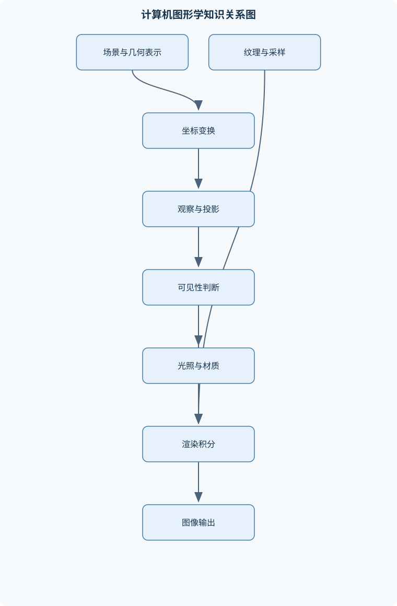
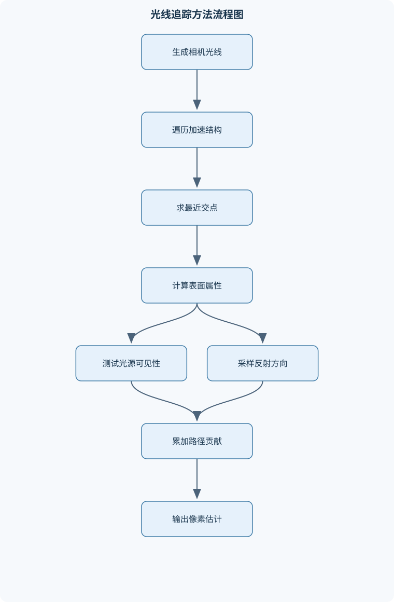

# 计算机图形学

## 一、课程整体知识框架

### 课程边界与先修知识

本课程研究如何用计算机表示、变换、生成、显示和交互操作二维与三维图形，重点覆盖几何建模、坐标变换、观察与投影、光栅化、可见性、光照与材质、纹理、曲线曲面、光线追踪、动画基础以及图形硬件与渲染系统设计。课程既讨论实时渲染中以GPU为核心的近似算法，也讨论离线渲染中以光线传播和物理模型为基础的高质量方法。先修知识包括大学数学中的向量与矩阵、解析几何、基础概率、微积分和数值计算；同时需要具备数据结构、算法、计算机体系结构和基本编程能力。课程边界不包括完整的建模软件操作培训、特定图形API的全部接口、影视后期制作流程以及高级物理模拟的完整理论。





### 1. 课程对象、问题边界与先修基础

计算机图形学研究如何把几何、材质、光源、相机和交互状态等信息表示为计算机可处理的数据，并经过变换、可见性判断、光照计算、采样和显示，最终生成二维图像。典型输入是三维场景描述，输出是屏幕上的离散像素；但图形学也包括二维绘制、曲线曲面表示、动画、交互式编辑、科学可视化以及图形硬件和渲染系统设计。

“建模”“渲染”和“交互”是三个相互关联但不等价的过程。建模负责确定物体的几何形状、拓扑、材质参数和层次关系；渲染负责根据场景、相机和光照生成图像；交互负责根据鼠标、键盘、触摸、控制器或程序状态修改相机、对象变换和场景参数。一个三维建模软件可能具有实时预览渲染，但其主要任务仍是编辑场景；一个离线渲染器可以生成高质量图像，却不一定提供完整的交互编辑能力。

课程先修内容包括向量与矩阵、解析几何、微积分、基础概率和数值计算，以及数据结构、算法、计算机体系结构和基本编程能力。向量运算支撑坐标变换、法线计算和光照；矩阵运算支撑层次化变换、相机和投影；概率支撑蒙特卡洛积分和路径追踪；数据结构支撑网格、场景图和包围盒层次结构；体系结构知识用于理解CPU、GPU、缓存、显存和并行执行。

课程重点讨论两类渲染思想。实时渲染要求在有限帧时间内完成大量像素和图元处理，通常以光栅化、深度缓冲、近似光照和预计算换取稳定帧率。离线渲染允许更长计算时间，常用光线追踪、路径追踪和更精确的光传输模型降低图像误差。实时渲染并不等于“不真实”，离线渲染也不等于“绝对正确”：二者只是对延迟、吞吐量、噪声、偏差、内存和视觉质量采用不同权衡。

课程不覆盖完整建模软件操作、某一图形API的全部接口、影视后期制作全流程，也不把高级流体、布料、刚体和软体模拟作为完整理论体系。相关内容只在需要解释图形系统接口、动画或碰撞检测时介绍其基本思想。

### 2. 从场景描述到图像输出的总体管线

三维渲染通常经历对象空间、世界空间、观察空间、裁剪空间、归一化设备空间和屏幕空间。对象空间描述模型自身的局部坐标；世界空间把多个对象放入统一场景；观察空间以相机为坐标参考；裁剪空间用于视锥体裁剪；归一化设备坐标由齐次除法得到；屏幕空间再根据视口尺寸映射到像素区域。

采用列向量约定时，三维点和方向向量分别写成

$$
\tilde P=(x,y,z,1)^T,\qquad \tilde{\mathbf v}=(v_x,v_y,v_z,0)^T。
$$

最后一维为 $1$ 的量表示点，为 $0$ 的量表示方向，因此平移只作用于点而不改变方向。若模型矩阵为 $M$、视图矩阵为 $V$、投影矩阵为 $P$，则顶点通常按

$$
\tilde P_c=PVM\tilde P_o
$$

从对象空间变换到裁剪空间。这里下标 $o$ 表示对象空间，$c$ 表示裁剪空间。若裁剪坐标为 $(x_c,y_c,z_c,w_c)$，且 $w_c\neq 0$，则归一化设备坐标为

$$
(x_n,y_n,z_n)=\left(\frac{x_c}{w_c},\frac{y_c}{w_c},\frac{z_c}{w_c}\right)。
$$

齐次除法不能省略；若 $w_c$ 接近零，说明点接近投影奇异位置，必须在裁剪或数值处理中谨慎处理。

图形流水线通常包含顶点处理、图元装配、裁剪、光栅化、片元测试、片元着色和帧缓冲写入。顶点处理将每个顶点变换到指定坐标空间；图元装配根据索引组成点、线段或三角形；光栅化判断图元覆盖哪些像素并插值属性；深度、模板和混合测试决定片元是否写入；最终颜色进入帧缓冲。GPU适合执行大量相互独立的顶点和片元计算，CPU则更适合场景组织、资源管理、逻辑控制和复杂分支。

性能评价至少包括图像质量、延迟、吞吐量和内存占用。帧率高并不必然意味着交互体验好，因为输入到显示的延迟可能仍然较大；分辨率提高会增加像素数，几何数量增加会增加顶点和图元处理负担，纹理增大则会加重显存和带宽压力。

### 3. 向量、矩阵和几何变换

点积为

$$
\mathbf a\cdot\mathbf b=\|\mathbf a\|\|\mathbf b\|\cos\theta
$$

其中 $\theta$ 是两个向量的夹角。若两个非零向量点积为零，则它们正交。向量长度为 $\|\mathbf a\|=\sqrt{\mathbf a\cdot\mathbf a}$；归一化要求 $\|\mathbf a\|\neq0$，结果为 $\hat{\mathbf a}=\mathbf a/\|\mathbf a\|$。零向量不能归一化，这是法线和光照计算中的重要边界。

向量 $\mathbf a$ 在非零向量 $\mathbf b$ 上的正交投影为

$$
\operatorname{proj}_{\mathbf b}\mathbf a
=\frac{\mathbf a\cdot\mathbf b}{\mathbf b\cdot\mathbf b}\mathbf b。
$$

叉积 $\mathbf a\times\mathbf b$ 垂直于两者所在平面，长度等于平行四边形面积。三角形顶点 $P_0,P_1,P_2$ 的未归一化法向量可写为

$$
\mathbf n=(P_1-P_0)\times(P_2-P_0)。
$$

当两条边共线或近共线时，叉积长度接近零，三角形退化，不能稳定确定法向量。

平移、缩放和绕坐标轴旋转都可用齐次矩阵表示。例如平移向量为 $(t_x,t_y,t_z)$ 时，

$$
T=
\begin{bmatrix}
1&0&0&t_x\\
0&1&0&t_y\\
0&0&1&t_z\\
0&0&0&1
\end{bmatrix}。
$$

非均匀缩放矩阵为

$$
S=
\begin{bmatrix}
s_x&0&0&0\\
0&s_y&0&0\\
0&0&s_z&0\\
0&0&0&1
\end{bmatrix}。
$$

绕 $z$ 轴旋转角 $\theta$ 的矩阵为

$$
R_z=
\begin{bmatrix}
\cos\theta&-\sin\theta&0&0\\
\sin\theta&\cos\theta&0&0\\
0&0&1&0\\
0&0&0&1
\end{bmatrix}。
$$

若先执行 $M_1$ 再执行 $M_2$，合成矩阵为 $M_2M_1$。矩阵乘法一般不交换，因此“先旋转后平移”与“先平移后旋转”通常得到不同结果。层次模型利用父子坐标系表达机械臂、人体或车辆：子对象的世界变换由父对象变换与自身局部变换共同决定。

绕任意单位轴 $\mathbf u=(u_x,u_y,u_z)$ 旋转角 $\theta$，可由罗德里格斯公式得到

$$
R=\cos\theta I+(1-\cos\theta)\mathbf u\mathbf u^T+\sin\theta[\mathbf u]_\times，
$$

其中 $I$ 是 $3\times3$ 单位矩阵，$[\mathbf u]_\times$ 是由 $\mathbf u$ 构成的反对称叉乘矩阵。旋转矩阵保持长度和夹角，但要求轴为单位向量。欧拉角便于理解和编辑，却可能发生万向节锁；四元数适合姿态组合和球面插值，但需要保持单位长度。三种表示不是简单替代关系，选择取决于存储、编辑和插值需求。

法向量不能在非均匀缩放下直接使用模型矩阵变换。若切向量变换为 $M\mathbf t$，要求新法向量 $\mathbf n'$ 满足

$$
\mathbf n'^T M\mathbf t=0
$$

对所有满足 $\mathbf n^T\mathbf t=0$ 的切向量成立，可得

$$
\mathbf n'\propto M^{-T}\mathbf n。
$$

因此法向量应使用模型矩阵左上 $3\times3$ 部分的逆转置，并在最后重新归一化。若矩阵包含奇异缩放，即某一缩放因子为零，则逆矩阵不存在，几何表面可能被压扁，法向量变换必须改用退化处理。

### 4. 观察变换、投影和深度

相机由位置、观察方向和上方向确定。给定相机位置 $C$、目标点 $G$ 和参考上方向 $\mathbf u_0$，可先构造观察方向 $\mathbf f=(G-C)/\|G-C\|$，再通过叉积正交化上方向。若 $\mathbf f$ 与 $\mathbf u_0$ 平行或近似平行，叉积接近零，说明给定上方向无法唯一确定相机滚转角。

正交投影保持平行线和平行距离比例，适合工程制图和某些界面；透视投影符合近大远小的视觉规律。透视关系可由相似三角形推得：若投影平面距离相机为 $d$，空间点深度为 $z$，横向位置为 $x$，则投影横坐标与 $x/z$ 成正比。由此可知，远处物体的投影尺寸随深度增大而减小。

透视投影通常先把视景体映射到裁剪空间，再通过 $w_c$ 做透视除法。近裁剪面不能取为零，因为投影公式包含深度倒数；远裁剪面过大则会扩大深度范围。深度缓冲常以有限位数存储深度，透视投影导致深度精度在近处更密集、远处更稀疏。近裁剪面过小会把大量精度浪费在极近区域，从而使远处表面发生深度冲突，也称为表面闪烁或深度争夺。

视锥体裁剪必须在投影和齐次坐标语义一致的条件下进行。裁剪不是简单删除视野外顶点：一条边若从视锥体外进入内部，应计算与裁剪平面的交点，生成新的图元。视口变换把归一化设备坐标映射到像素区域；连续屏幕位置与整数像素索引不同，实际采样还需明确像素中心约定。

### 5. 曲线、曲面与几何建模

多边形网格由顶点、边和面组成，除了几何坐标，还包含拓扑关系。三角形网格适合硬件的原因包括图元形式统一、平面内插值简单、光栅化规则明确，以及任意多边形可在一定条件下三角化。网格质量受三角形退化、极小角、长宽比过大、法线不一致和拓扑漏洞影响。

参数曲线写为 $\mathbf P(u)$，其中 $u$ 是参数。三次Bezier曲线为

$$
\mathbf B(u)=(1-u)^3\mathbf P_0+3(1-u)^2u\mathbf P_1
+3(1-u)u^2\mathbf P_2+u^3\mathbf P_3,
\quad 0\le u\le1。
$$

端点分别为 $\mathbf P_0$ 和 $\mathbf P_3$，控制点 $\mathbf P_1,\mathbf P_2$ 决定端点切线和整体形状。Bezier曲线也可通过德·卡斯特里奥递推定义，适合稳定地逐级细分。高阶Bezier曲线控制点增多后，局部修改可能影响整条曲线，因此B样条通过局部支撑和节点向量提供更好的局部控制。相邻曲线段的连接可满足位置连续 $C^0$、切向连续 $C^1$ 或曲率相关的更高阶连续性。

参数曲面写为 $\mathbf S(u,v)$，其切向量为 $\partial\mathbf S/\partial u$ 与 $\partial\mathbf S/\partial v$，法向量可由

$$
\mathbf n=
\frac{\partial\mathbf S}{\partial u}\times
\frac{\partial\mathbf S}{\partial v}
$$

归一化得到。若两个偏导共线，曲面参数化在该处退化，法向量不稳定。曲面离散化为网格后，可用面法向量进行平面着色，也可对相邻面法向量加权平均获得顶点法向量，再进行光滑着色。尖锐边通常需要拆分顶点或使用硬边标记，否则会被错误平滑。

细分曲面通过反复增加网格分辨率并调整顶点位置逼近光滑极限曲面；它能改善几何连续性，但会增加内存和计算量。非流形结构包括一个边连接超过两个面、局部邻域不构成盘面等情况，许多渲染、碰撞和细分算法无法正确处理。网格检查应同时关注几何退化和拓扑一致性。

### 6. 光栅化、可见性和抗锯齿

三角形覆盖测试可使用有向边函数。对边 $P_iP_j$ 和测试点 $X$，边函数可写为

$$
E_{ij}(X)=(X_x-P_{i,x})(P_{j,y}-P_{i,y})
-(X_y-P_{i,y})(P_{j,x}-P_{i,x})。
$$

在顶点绕序一致时，三个边函数符号满足约定即可判断点是否位于三角形内部。等价地，内部点可写成重心坐标

$$
P=\alpha P_0+\beta P_1+\gamma P_2,\qquad
\alpha+\beta+\gamma=1,\quad
\alpha,\beta,\gamma\ge0。
$$

重心坐标同时用于覆盖测试和属性插值。对颜色、纹理坐标等顶点属性，不能总是在屏幕空间直接线性插值，因为透视投影改变了参数比例。透视正确插值的一般形式是

$$
a=
\frac{\alpha a_0/w_0+\beta a_1/w_1+\gamma a_2/w_2}
{\alpha/w_0+\beta/w_1+\gamma/w_2},
$$

其中 $w_i$ 是各顶点裁剪坐标的齐次分量。若使用线性深度或属性插值而未考虑 $w_i$，会产生纹理扭曲和深度误差。

深度缓冲算法适用于不透明表面：每个像素保存当前深度，片元通过深度比较时同时更新颜色和深度。它不能独立解决一般透明物体，因为透明片元需要与背景混合，并且混合通常依赖从后到前的绘制顺序。背面剔除是几何可见性优化，不等于光照计算；双面材质、薄片物体和内部表面可能不应直接剔除。

锯齿来源包括几何边界采样不足、纹理缩小采样不足和阴影边界采样不足。超采样通过每个像素使用多个样本再求平均，质量较好但开销近似随样本数 $s$ 增长。多重采样主要增加覆盖测试样本，适合几何边缘，但对复杂着色和透明度的处理能力不同于超采样。

### 7. 光照、材质与局部明暗模型

辐射度量学区分辐射通量、辐射强度和辐亮度。辐射通量表示单位时间辐射能量，单位为瓦；辐射强度描述单位立体角的通量；辐亮度描述单位投影面积和单位立体角的辐射量。渲染计算中的方向必须明确：$\boldsymbol\omega_i$ 表示从表面指向光源的入射方向，$\boldsymbol\omega_o$ 表示从表面指向观察者的出射方向，法向量 $\mathbf n$ 通常取表面外侧。

Lambert漫反射模型为

$$
L_d\propto \rho_d\max(0,\mathbf n\cdot\boldsymbol\omega_i),
$$

其中 $\rho_d$ 是漫反射颜色或反射率。余弦因子来自投影面积：光线斜入射时，同样的能量分散到更大的表面面积上。若点积为负，光源位于表面背面，不应产生正向漫反射贡献。

Phong模型把颜色贡献分为环境、漫反射和镜面反射；Blinn-Phong使用半程向量

$$
\mathbf h=
\frac{\boldsymbol\omega_i+\boldsymbol\omega_o}
{\|\boldsymbol\omega_i+\boldsymbol\omega_o\|}
$$

并用 $\max(0,\mathbf n\cdot\mathbf h)^m$ 表示高光，其中 $m$ 越大，高光通常越窄。Phong和Blinn-Phong是经验模型，指数不等于物理粗糙度，参数也不自动满足能量守恒。

BRDF记为 $f_r(\boldsymbol\omega_i,\boldsymbol\omega_o)$，描述入射辐亮度对出射辐亮度的响应。理想模型应满足非负性、能量守恒和在适当条件下的互易性。漫反射、理想镜面和粗糙镜面分别代表不同反射分布。局部光照只考虑光源到当前表面的直接贡献；全局光照还包括反射、折射和颜色间接传播。

颜色计算应在线性光空间进行，显示设备的编码空间不等同于线性辐射量。高动态范围图像包含超出显示范围的亮度，必须经过曝光和色调映射压缩后再编码显示。直接把线性光照结果当作显示编码值，会导致亮度和对比度错误。

### 8. 纹理映射、采样与过滤

纹理坐标通常记为 $(u,v)$，用于把二维纹理参数化到曲面或网格。顶点纹理坐标会随三角形插值，但必须采用透视正确插值。点采样只取一个纹素，速度快但容易产生块状放大和缩小闪烁；双线性过滤使用相邻四个纹素加权；三线性过滤在相邻两个Mip层级之间继续插值。

Mipmapping预先构造尺寸逐级减半的纹理层级。若屏幕像素对应纹理中的较大区域，直接采样原图会遗漏高频信息；选择覆盖该区域的较低分辨率层级，相当于先进行近似预过滤，可降低缩小走样。它不能完全处理强烈斜视，因为像素对应的纹理区域可能是长而窄的椭圆，此时需要各向异性过滤。

法线贴图改变着色时使用的法线，不改变几何轮廓；凹凸贴图通常通过高度变化扰动法线；位移贴图真正改变表面位置，因此可能改变轮廓、遮挡和几何可见性。立方体纹理适合方向查询、环境纹理和天空盒；阴影贴图把光源视角下的深度记录用于遮挡判断，但受分辨率、自阴影偏移和透视分布影响。

纹理压缩降低显存和带宽需求，但可能引入块状误差。纹理布局还会影响缓存局部性；访问模式越连续，通常越有利于缓存。静态纹理适合预生成Mip层级，频繁更新纹理则需考虑构建和传输成本。

### 9. 光线追踪、全局光照与蒙特卡洛方法

光线写为

$$
\mathbf r(t)=\mathbf o+t\mathbf d,\qquad t\ge0,
$$

其中 $\mathbf o$ 为起点，$\mathbf d$ 为方向，通常令 $\|\mathbf d\|=1$，这样 $t$ 具有长度单位。平面满足 $\mathbf n\cdot\mathbf x+c=0$，代入光线可得

$$
t=-\frac{\mathbf n\cdot\mathbf o+c}
{\mathbf n\cdot\mathbf d}。
$$

若分母为零，光线平行于平面；若分子和分母同时接近零，光线可能位于平面内，不能直接当作唯一交点。若 $t<0$，交点在光线反方向，不应作为命中；浮点计算需设置容差。

球体求交将 $\|\mathbf o+t\mathbf d-\mathbf c\|^2=r^2$ 展开为二次方程。判别式小于零表示无交点，等于零表示相切，大于零表示两个交点。通常选择满足 $t\ge t_{\min}$ 的最小正根，并用命中点减球心再归一化得到法向量。

三角形求交可通过两条边和重心坐标求解，必须检查行列式接近零、重心坐标是否非负以及 $t$ 是否处于允许范围。几何形状接口应只提供位置、法线、纹理坐标、包围盒和求交等几何属性；材质、纹理和光源属于其他系统层次。这样可把球、三角形和曲面统一接入求交流程。

阴影光线从命中点向光源发射，若在光源距离前命中其他物体，则当前点被遮挡。递归反射和折射必须设置最大深度、贡献阈值或俄罗斯轮盘赌终止，否则可能无限递归。包围盒层次结构先测试射线与节点包围盒，再遍历相交子节点；若当前最近命中距离为 $t_{\min}$，远于它的节点可以剪枝。平均性能通常优于逐图元求交，但结构重叠严重时最坏情况仍接近线性。

渲染方程可写为

$$
L_o(\mathbf x,\boldsymbol\omega_o)
=L_e(\mathbf x,\boldsymbol\omega_o)
+\int_{\Omega}
f_r(\mathbf x,\boldsymbol\omega_i,\boldsymbol\omega_o)
L_i(\mathbf x,\boldsymbol\omega_i)
\max(0,\mathbf n\cdot\boldsymbol\omega_i)
\,d\boldsymbol\omega_i。
$$

$L_e$ 是自发光，$L_i$ 是入射辐亮度，$f_r$ 是BRDF，积分域 $\Omega$ 是表面可见半球。蒙特卡洛估计为

$$
\hat I=\frac1s\sum_{k=1}^{s}
\frac{g(\boldsymbol\omega_k)}{p(\boldsymbol\omega_k)},
$$

其中 $p$ 是采样概率密度，$s$ 是样本数。样本独立且密度覆盖被积函数非零区域时，估计通常无偏；方差随样本增加而降低，均方误差的典型量级约为 $O(1/s)$，标准误差约为 $O(1/\sqrt{s})$。重要性采样让 $p$ 更接近被积函数，可在同等样本数下减少噪声；余弦加权尤其适合漫反射表面。路径追踪通过随机生成多次反射路径获得全局光照，光子映射则先记录光子能量并在命中区域估计辐射，二者在偏差、方差和计算结构上不同。

### 10. 动画、交互和渲染系统

关键帧动画给出若干时间戳和对象状态。对查询时间 $t$，在相邻关键帧 $t_0,t_1$ 之间取

$$
u=\frac{t-t_0}{t_1-t_0},
$$

位置可用 $\mathbf p(u)=(1-u)\mathbf p_0+u\mathbf p_1$ 插值。旋转不宜直接逐分量插值欧拉角；单位四元数可采用球面线性插值，以保持姿态空间中的较稳定角速度。层次骨骼由关节局部变换、父子关系和蒙皮权重组成，顶点最终位置是多个关节变换作用结果的加权和；权重通常应归一化，否则会产生异常缩放。

交互系统必须处理输入事件、状态更新和渲染同步。相机旋转常由鼠标位移改变方位角和俯仰角，但俯仰范围需要限制以避免坐标奇异。双缓冲把绘制结果写入后台缓冲，完成后交换前台和后台缓冲，减少撕裂。帧同步会影响延迟与稳定性：提高帧率通常降低单帧时间，但等待显示刷新可能增加输入延迟。

场景图用于管理对象层次、局部变换、可见性和资源引用；资源管理则负责网格、纹理、材质和着色程序的生命周期。图形调试必须检查坐标空间标记、法线方向、深度范围、裁剪状态、混合状态和GPU耗时。实时系统除平均帧率外，还要关注最差帧时间、输入延迟、资源加载抖动和结果确定性。

## 二、章节和模块划分

### 核心知识覆盖清单

本清单用于检查正文是否覆盖本课程的主要知识模块：

- **计算机图形学概论与渲染管线**：图形学问题的输入、处理与输出、建模、渲染与交互的基本区别、三维场景描述与二维图像生成、离线渲染与实时渲染的目标差异、CPU、GPU与图形处理流水线、对象空间、世界空间、相机空间与屏幕空间、顶点处理、图元装配、光栅化与片元处理、图像质量、延迟、吞吐量与内存占用的权衡。
- **向量、矩阵与几何变换**：点、向量、方向向量与齐次坐标、点积、叉积、长度、归一化与投影、平移、旋转、缩放与剪切变换、绕任意轴旋转的表示方法、变换矩阵的组合顺序、局部坐标系与层次化模型、法向量的逆转置变换、刚体变换、仿射变换与奇异变换。
- **观察变换与投影**：相机位置、观察方向与上方向、视图坐标系的构造、正交投影与透视投影、视景体、裁剪平面与深度范围、齐次除法与透视除法、规范化设备坐标与视口变换、深度缓冲的表示与精度分布、透视失真、近裁剪面和远裁剪面的影响。
- **曲线、曲面与几何建模**：多边形网格的顶点、边、面与拓扑、三角形网格及其适合图形硬件的原因、参数曲线与参数曲面、Bezier曲线的控制点与递推定义、B样条与连续性条件、曲面法向量与参数偏导、网格法向量、顶点法向量与平滑着色、细分曲面与曲面离散化、几何退化、非流形结构与网格质量。
- **光栅化、可见性与抗锯齿**：三角形覆盖测试、边函数与重心坐标插值、顶点属性的透视正确插值、深度测试与深度缓冲、背面剔除与视锥体裁剪、扫描线算法与增量计算、多重采样抗锯齿与超采样、混合、透明度与绘制顺序、阴影锯齿、纹理锯齿与几何锯齿的区别。
- **光照、材质与局部明暗模型**：辐射度量学中的辐射通量、辐射强度与辐亮度、表面法向量、入射方向与出射方向、环境光、漫反射与镜面反射、Lambert模型与Phong模型、半程向量与Blinn-Phong模型、颜色空间、色调映射与高动态范围、材质参数与能量守恒、双向反射分布函数的定义与基本性质、局部光照模型与全局光照的适用边界。
- **纹理映射与采样理论**：纹理坐标与参数化、顶点属性插值和纹理坐标插值、点采样、双线性过滤与三线性过滤、纹理缩小、放大与走样、Mipmapping的构建与选择、各向异性过滤、法线贴图、凹凸贴图与位移贴图、立方体纹理、环境纹理与阴影贴图、纹理压缩、缓存局部性与显存占用。
- **光线追踪与几何求交**：光线参数方程与相机光线生成、光线与球、平面、三角形的求交、求交结果中的命中距离、位置、法向量与纹理坐标、形状接口与几何属性抽象、几何形状与材质、光源等非几何属性的分离、阴影光线与遮挡测试、递归反射、折射与终止条件、路径追踪中的随机采样、包围盒层次结构与加速求交。
- **全局光照、采样与蒙特卡洛渲染**：直接光照与间接光照、渲染方程的各项含义、积分估计与蒙特卡洛采样、重要性采样与余弦加权采样、俄罗斯轮盘赌终止、采样方差、噪声与收敛速度、路径追踪与光子映射的基本差异、环境光照与面积光源、偏差、方差和计算时间之间的权衡。
- **动画、交互与图形系统实现**：关键帧、插值与时间参数化、线性插值、球面线性插值与姿态动画、层次骨骼、关节变换与蒙皮、碰撞检测的基本思想、鼠标、键盘、触摸与相机交互、双缓冲与帧同步、资源管理、场景图与渲染状态、图形调试中的坐标、深度和性能分析、实时系统中的帧率、延迟与确定性。


### 1. 模块一至模块三：概论、变换与投影

第一章建立“场景输入—几何处理—光照与采样—图像输出”的整体认识，比较光栅化和光线追踪的适用边界。第二章讲解点、向量、齐次坐标、点积、叉积、投影和矩阵组合。第三章把相机、观察基、正交投影、透视投影、齐次除法、视口映射和深度缓冲串成完整流程。

#### 代表性流程一：顶点到屏幕坐标

**输入：**对象空间点 $\tilde P_o$、模型矩阵 $M$、视图矩阵 $V$、投影矩阵 $P$、视口宽高 $W,H$。  
**输出：**屏幕坐标和深度值。

1. 计算 $\tilde P_w=M\tilde P_o$。
2. 计算 $\tilde P_v=V\tilde P_w$。
3. 计算 $\tilde P_c=P\tilde P_v$。
4. 若 $w_c$ 接近零，报告投影奇异或进行裁剪；否则计算 $(x_n,y_n,z_n)$。
5. 将 $x_n,y_n$ 映射到视口。若设备坐标范围是 $[-1,1]$，则常见映射为
   $$
   x_s=\frac{x_n+1}{2}W,\qquad
   y_s=\frac{y_n+1}{2}H。
   $$
6. 输出 $(x_s,y_s,z_n)$。

不变量是每一步的坐标空间明确，不能把世界空间点与观察空间方向直接做点积。单个顶点的矩阵计算复杂度为 $O(1)$。若把屏幕坐标误当成归一化设备坐标，结果会缺少视口缩放；若忘记齐次除法，则透视关系失效。

#### 例题一：变换顺序

**题干：**点 $P=(1,0,0)$，先绕 $z$ 轴旋转 $90^\circ$，再沿 $x$ 方向平移 $2$；比较反向顺序。

**分析与解答：**旋转后点为 $(0,1,0)$，再平移得到 $(2,1,0)$。若先平移，点变为 $(3,0,0)$，再旋转得到 $(0,3,0)$。两者不同，原因是矩阵乘法不交换。

**验证：**分别计算 $T_xR_z\tilde P$ 与 $R_zT_x\tilde P$，结果分别对应上述两点。  
**变式：**若平移向量为零，顺序不再产生差异；若变换只有同类缩放，部分矩阵可能交换，但不能据此推广到一般变换。

#### 例题二：透视除法

**题干：**两个点横向坐标相同、深度分别为 $z$ 和 $2z$，透视投影的投影平面距离固定，比较投影横坐标。

**分析与解答：**由相似三角形，屏幕横坐标与 $x/z$ 成正比。深度变为 $2z$ 时，投影横坐标变为原来一半。

**结果验证：**代入裁剪坐标并执行 $x_n=x_c/w_c$，其中 $w_c$ 随深度变化，得到同样的倒数关系。  
**变式：**正交投影中没有除以深度，因此远近点的投影尺寸不因深度自动缩小。

### 2. 模块四至模块五：几何建模、曲线曲面与光栅化

第四章讨论网格拓扑、三角形、参数曲线、Bezier曲线、B样条、参数曲面、法向量、平滑着色、细分和网格退化。第五章讨论边函数、重心坐标、透视正确插值、裁剪、背面剔除、深度测试、透明混合和抗锯齿。

#### 代表性流程二：三角形重心坐标光栅化

**输入：**三个屏幕顶点 $P_0,P_1,P_2$，像素中心 $X$，顶点属性和深度。  
**输出：**覆盖状态及插值后的属性。

1. 计算三条边函数。
2. 根据统一的绕序规则判断三个符号是否满足内部条件。
3. 若未覆盖则丢弃；若覆盖则计算 $\alpha,\beta,\gamma$。
4. 检查 $\alpha+\beta+\gamma=1$，这是插值不变量。
5. 按透视正确公式插值深度、颜色和纹理坐标。
6. 进行深度测试；通过时同时更新颜色缓冲和深度缓冲。

算法只需遍历三角形屏幕包围盒，复杂度为包围盒像素数乘以每像素常数。退化三角形的有向面积接近零，重心坐标不稳定，应在光栅化前剔除或特殊处理。

#### 例题三：三角形覆盖与颜色插值

**题干：**三角形顶点属性颜色分别为红、绿、蓝，某内部像素的重心坐标为 $(0.2,0.3,0.5)$，求线性颜色结果。

**分析与解答：**颜色是顶点属性，按重心权重计算：
$$
C=0.2C_0+0.3C_1+0.5C_2。
$$
若用RGB单位向量表示红、绿、蓝，则
$$
C=(0.2,0.3,0.5)。
$$

**结果验证：**三个权重非负且和为 $1$，颜色是三角形顶点颜色的凸组合。  
**变式：**若某权重为负，该点不在三角形内部；若三个权重和不为 $1$，说明计算或归一化存在错误；若顶点有不同 $w_i$，纹理坐标必须改用透视正确插值。

### 3. 模块六至模块七：光照、材质与纹理采样

第六章从法向量、入射方向和出射方向开始，建立Lambert、Phong、Blinn-Phong和BRDF的概念，进一步说明辐射度量学、能量守恒、互易性、色调映射和局部与全局光照的区别。第七章讲解纹理参数化、过滤、Mipmapping、各向异性过滤、法线贴图、位移贴图、环境纹理和阴影贴图。

#### 例题四：Lambert项与背面光源

**题干：**表面法向量为 $\mathbf n=(0,0,1)$。光源方向分别为 $(0,0,1)$ 和 $(0,0,-1)$，计算漫反射几何项。

**逐步解答：**两个向量均已归一化。第一种情况下，
$$
\max(0,\mathbf n\cdot\boldsymbol\omega_i)
=\max(0,1)=1。
$$
第二种情况下点积为 $-1$，因此几何项为 $0$。

**结果验证：**背面光源不能对该表面提供正向漫反射。  
**变式：**若光源方向为 $(1,0,1)$，先归一化为 $(1/\sqrt2,0,1/\sqrt2)$，几何项为 $1/\sqrt2$，不能直接使用未归一化方向得到 $1$。

#### 代表性流程三：Mipmapping纹理查询

**输入：**原始纹理、纹理坐标变化率、采样位置。  
**输出：**过滤后的纹理颜色。

1. 预先生成宽高逐级缩小的纹理层。
2. 根据一个屏幕像素在纹理空间覆盖的近似范围估计层级。
3. 在对应层级进行双线性采样；若层级处于两个整数层之间，再对相邻层结果插值。
4. 返回纹理值，并保持颜色空间处理一致。

不变量是所选层级应近似覆盖当前像素对应的纹理区域。原始纹理大小为 $N$ 时，完整二维Mip链的存储量约为原图的常数倍，而不是无限增长。错误的纹理坐标、非线性颜色空间插值或强烈斜视仍可能造成走样。

### 4. 模块八至模块九：光线追踪、全局光照与加速结构

第八章讲解相机光线、球面、平面和三角形求交，以及命中距离、法线、纹理坐标、形状接口、阴影光线、递归反射和折射。第九章从渲染方程出发，讨论直接光照、间接光照、面积光源、环境光、蒙特卡洛积分、重要性采样、俄罗斯轮盘赌、路径追踪和光子映射。

#### 代表性流程四：包围盒层次结构遍历

**输入：**射线、包围盒树、当前最近距离。  
**输出：**最近可见交点。

1. 测试射线与根包围盒是否相交。
2. 若不相交，立即终止。
3. 若相交，计算各子节点的近交距离并按近到远排序。
4. 先遍历近节点，获得候选命中距离。
5. 只遍历近交距离小于当前最近距离的节点。
6. 叶节点逐个测试几何图元，更新最近命中。

不变量是被剪枝节点不可能产生更近命中。平均性能通常优于 $O(n)$ 的逐图元测试，但最坏情况仍可能接近 $O(n)$；树构建成本、包围盒重叠和动态场景更新都会影响实际收益。

#### 例题五：光线与球体求交

**题干：**球心为 $\mathbf c=(0,0,5)$，半径为 $1$；光线起点 $\mathbf o=(0,0,0)$，方向 $\mathbf d=(0,0,1)$。求交点。

**逐步解答：**代入
$$
\|\mathbf o+t\mathbf d-\mathbf c\|^2=1
$$
得到
$$
\|(0,0,t-5)\|^2=1,
\qquad (t-5)^2=1。
$$
所以 $t=4$ 或 $t=6$。两者均满足 $t\ge0$，取最近值 $t=4$，命中点为 $(0,0,4)$，法向量为
$$
\mathbf n=\frac{(0,0,4)-(0,0,5)}{1}=(0,0,-1)。
$$

**结果验证：**命中点到球心距离为 $1$，且光线参数为正。  
**变式：**若判别式小于零则无交点；若起点在球内，应选择满足 $t\ge t_{\min}$ 的出射根，而不能机械地选择两个根中的较小者。

#### 代码示例：射线与球体求交

```python
import math

def intersect_sphere(origin, direction, center, radius, t_min=1e-6):
    """
    输入：
        origin, direction, center: 三维元组
        direction: 应为单位方向
        radius: 非负半径
        t_min: 忽略过近交点的数值容差
    输出：
        最近有效交点参数 t；无交点时返回 None
    """
    ox = origin[0] - center[0]
    oy = origin[1] - center[1]
    oz = origin[2] - center[2]

    a = direction[0] ** 2 + direction[1] ** 2 + direction[2] ** 2
    b = 2.0 * (ox * direction[0] +
               oy * direction[1] +
               oz * direction[2])
    c = ox * ox + oy * oy + oz * oz - radius * radius

    if a <= 1e-12 or radius < 0:
        return None

    discriminant = b * b - 4.0 * a * c
    if discriminant < 0:
        return None

    root = math.sqrt(max(0.0, discriminant))
    t0 = (-b - root) / (2.0 * a)
    t1 = (-b + root) / (2.0 * a)

    if t0 > t1:
        t0, t1 = t1, t0

    if t0 >= t_min:
        return t0
    if t1 >= t_min:
        return t1
    return None
```

该过程的输入假设方向不为零、半径非负；输出是最近有效交点参数。判别式为零时返回相切交点。浮点误差可能使理论上的零变为微小负数，因此使用 `max(0.0, discriminant)` 只适用于已确认其绝对值在容差内的情况；若负值显著，则仍应判定为无交点。

### 5. 模块十：动画、交互与图形系统实现

本章把几何和渲染知识用于动态系统。内容包括关键帧、时间参数化、线性插值、球面线性插值、层次骨骼、关节变换、蒙皮、碰撞检测、输入事件、相机控制、双缓冲、帧同步、场景图、资源管理和图形调试。

#### 实验一：变换与深度缓冲验证

**输入数据：**一个包含近处和远处重叠三角形的场景；多组模型、视图、投影矩阵；不同近裁剪面和远裁剪面。  
**步骤：**

1. 实现对象到屏幕的矩阵链，输出每个顶点的坐标空间标签和中间坐标。
2. 用颜色编码世界空间、观察空间和裁剪空间结果，检查矩阵顺序。
3. 开启和关闭深度测试，比较重叠三角形结果。
4. 改变近裁剪面，记录远处表面的深度冲突。
5. 对每帧统计CPU耗时、GPU耗时、帧时间和显存使用。

**评价标准：**矩阵链结果应与独立数值计算一致；深度测试开启时，不透明表面应按深度规则稳定遮挡；近裁剪面不应设置为零；帧时间应能解释为顶点、片元、同步或资源传输开销。  
**排错方法：**画出深度缓冲灰度图；逐步关闭投影、裁剪和深度测试；检查深度比较方向、坐标系手性、齐次分量和视口纵坐标方向。

#### 实验二：路径追踪与采样方差比较

**输入数据：**包含漫反射表面、点光源或面积光源、遮挡物的简单场景；每像素样本数分别取 $1,4,16,64$。  
**步骤：**

1. 实现相机光线和球体、平面、三角形求交。
2. 先实现直接光照和阴影光线。
3. 再加入随机出射方向，使用最大路径深度和俄罗斯轮盘赌。
4. 分别采用均匀半球采样和余弦加权采样。
5. 对相同样本数输出图像，记录均方误差、渲染时间和噪声区域。

**评价标准：**增加样本后随机噪声总体下降；余弦加权在漫反射场景中通常具有更低方差；几何错误、法线翻转和自相交不能通过增加样本消除；输出应明确区分线性辐射值与色调映射后的显示值。  
**排错方法：**先关闭间接反射验证直接光照；固定随机种子复现实验；显示法线和命中深度；检查光线起点偏移、BRDF方向约定、概率密度除法和路径终止概率。

## 三、核心概念的详细解释

### 1. 场景表示、渲染任务与图形流水线

计算机图形学把几何形状、拓扑关系、材质、光源、相机和动画状态组织成场景描述，再通过渲染过程生成二维图像。建模回答“场景中有什么以及它们如何组织”，渲染回答“从给定观察条件下应显示什么”，交互回答“用户或程序如何改变相机、对象和参数”。三者可以在同一软件中协同存在，但数据职责不同。

实时渲染主要受帧时间约束。例如目标帧率为 $60\ \mathrm{Hz}$ 时，理想帧预算约为 $16.67\ \mathrm{ms}$；离线渲染则通常更重视图像误差、光照完整性和噪声收敛。光栅化把图元投影到屏幕并逐片元处理，吞吐量高，适合实时系统；光线追踪从相机或光源出发处理光线传播，能够自然表示反射、折射和软阴影，但求交和采样成本较高。

典型三维管线依次经过对象空间、世界空间、观察空间、裁剪空间、归一化设备空间和屏幕空间。对象空间中的顶点属于模型自身坐标系；世界空间用于组合多个对象；观察空间以相机为参考；裁剪空间用于判断视景体内外；归一化设备坐标通常位于某个规范范围；屏幕空间才与具体视口的像素位置对应。采用列向量约定时：

$$
\tilde P_c=PVM\tilde P_o
$$

其中 $M$ 是模型矩阵，$V$ 是世界到观察空间的视图矩阵，$P$ 是观察到裁剪空间的投影矩阵。矩阵右侧的变换先执行，因此不能随意交换乘法顺序。

GPU适合并行执行顶点处理、三角形光栅化和片元着色；CPU通常负责场景组织、资源管理、动画逻辑和提交绘制命令。性能不能只用帧率衡量，还应同时考察延迟、吞吐量、显存占用、带宽、图像质量和结果稳定性。高帧率可能来自降低分辨率或关闭阴影，并不必然表示渲染质量高。

### 2. 向量、齐次坐标与几何变换

点 $P$ 表示位置，向量 $\mathbf v$ 表示位移或方向。点与点相减得到向量，点与向量相加得到点。向量长度为

$$
\|\mathbf v\|=\sqrt{\mathbf v\cdot\mathbf v}
$$

若 $\mathbf v\neq\mathbf 0$，归一化向量为

$$
\hat{\mathbf v}=\frac{\mathbf v}{\|\mathbf v\|}.
$$

零向量不能归一化，实际程序必须设置长度阈值，避免除以接近零的数。

点积满足

$$
\mathbf a\cdot\mathbf b=\|\mathbf a\|\|\mathbf b\|\cos\theta,
$$

因此可用于判断夹角、正交关系和投影。向量 $\mathbf a$ 在单位向量 $\hat{\mathbf b}$ 上的有符号投影长度为 $\mathbf a\cdot\hat{\mathbf b}$，投影向量为

$$
\operatorname{proj}_{\mathbf b}\mathbf a
=(\mathbf a\cdot\hat{\mathbf b})\hat{\mathbf b}.
$$

三维叉积 $\mathbf a\times\mathbf b$ 垂直于二者所在平面，长度等于平行四边形面积。若两个边向量为 $\mathbf e_1=P_1-P_0$、$\mathbf e_2=P_2-P_0$，三角形法向量可取

$$
\mathbf n=\mathbf e_1\times\mathbf e_2.
$$

其方向取决于顶点顺序；三点共线时叉积为零，三角形退化，不能得到稳定法向量。

齐次坐标把点和方向统一为四维形式：

$$
\tilde P=(x,y,z,1)^T,\qquad
\tilde{\mathbf v}=(v_x,v_y,v_z,0)^T.
$$

最后一维为 $1$ 的量受平移影响，为 $0$ 的量不受平移影响。平移、缩放和绕 $x$ 轴旋转的矩阵分别为

$$
T=
\begin{bmatrix}
1&0&0&t_x\\
0&1&0&t_y\\
0&0&1&t_z\\
0&0&0&1
\end{bmatrix},
$$

$$
S=
\begin{bmatrix}
s_x&0&0&0\\
0&s_y&0&0\\
0&0&s_z&0\\
0&0&0&1
\end{bmatrix},
$$

$$
R_x(\theta)=
\begin{bmatrix}
1&0&0&0\\
0&\cos\theta&-\sin\theta&0\\
0&\sin\theta&\cos\theta&0\\
0&0&0&1
\end{bmatrix}.
$$

角度 $\theta$ 通常以弧度参与三角函数计算。绕 $y$ 轴和 $z$ 轴的矩阵可由循环置换坐标得到。由于矩阵乘法不满足交换律，$M=T R$ 表示先旋转再平移，而 $M=R T$ 表示先平移再旋转；除特殊情形外，两者结果不同。

局部坐标系和层次模型通过父子变换组织复杂对象。若子对象的局部矩阵为 $M_c$，父对象到世界的矩阵为 $M_p$，则子对象到世界的矩阵为

$$
M_w=M_pM_c.
$$

刚体变换只包含旋转和平移，保持长度、角度和距离；一般仿射变换还可以包含缩放和剪切；奇异变换的行列式为零，会把三维区域压缩到低维集合，因而不可逆。

绕任意单位轴 $\hat{\mathbf k}$ 旋转角 $\theta$ 时，向量 $\mathbf v$ 可分解为平行分量与垂直分量：

$$
\mathbf v_\parallel=(\hat{\mathbf k}\cdot\mathbf v)\hat{\mathbf k},\qquad
\mathbf v_\perp=\mathbf v-\mathbf v_\parallel.
$$

旋转后结果为

$$
\mathbf v'=
\mathbf v\cos\theta+
(\hat{\mathbf k}\times\mathbf v)\sin\theta+
\hat{\mathbf k}(\hat{\mathbf k}\cdot\mathbf v)(1-\cos\theta).
$$

这是罗德里格旋转公式。欧拉角便于理解和编辑，但存在表示依赖和万向节锁；旋转矩阵适合直接变换但存储冗余；四元数适合姿态组合和球面线性插值，但需要明确单位化及符号最短路径。

法向量不能在非均匀缩放下直接使用模型矩阵变换。设表面切向量为 $\mathbf t$，原法向量满足 $\mathbf n^T\mathbf t=0$。若位置使用线性矩阵 $A$ 变换，要求新法向量 $\mathbf n'$ 满足

$$
\mathbf n'^T A\mathbf t=0.
$$

因此应有 $\mathbf n'^T A=\mathbf n^T$，从而

$$
\mathbf n'=A^{-T}\mathbf n.
$$

最后必须重新归一化。若 $A$ 是纯旋转，$A^{-T}=A$；若包含非均匀缩放或剪切，直接使用 $A\mathbf n$ 通常会破坏法线与表面的垂直关系。

### 3. 相机、观察变换与投影

相机通常由位置 $C$、观察目标 $G$ 和上方向参考向量 $\mathbf u_0$ 确定。观察方向可取

$$
\mathbf f=\frac{G-C}{\|G-C\|}.
$$

若采用右手相机坐标系，可令右方向

$$
\mathbf r=\frac{\mathbf f\times\mathbf u_0}
{\|\mathbf f\times\mathbf u_0\|},
$$

再令真正的上方向

$$
\mathbf u=\mathbf r\times\mathbf f.
$$

当 $\mathbf f$ 与 $\mathbf u_0$ 平行或近似平行时叉积接近零，视图基不稳定，应更换上方向参考。

观察变换的本质是把世界坐标中的点表示为相机基下的坐标。若相机基向量组成旋转矩阵 $R$，相机位置为 $C$，则世界到观察空间通常包含先平移 $-C$ 再旋转的过程：

$$
V=
\begin{bmatrix}
R^T&-R^TC\\
0&1
\end{bmatrix}.
$$

正交投影不随深度改变物体的投影尺寸，适合工程制图和某些科学可视化；透视投影符合近大远小的视觉规律。相似三角形给出屏幕高度与深度的关系：

$$
\frac{y_{\text{screen}}}{f}=\frac{y}{z},
$$

其中 $f$ 是与视场角相关的焦距尺度，$z$ 是相机空间深度。于是远处物体的投影尺寸约按 $1/z$ 减小。

透视投影先生成裁剪坐标，再执行齐次除法：

$$
(x_n,y_n,z_n)=
\left(\frac{x_c}{w_c},\frac{y_c}{w_c},\frac{z_c}{w_c}\right).
$$

若视口左下角为 $(x_0,y_0)$，宽高为 $W,H$，归一化设备坐标范围为 $[-1,1]$，则屏幕坐标可写为

$$
x_s=x_0+\frac{x_n+1}{2}W,\qquad
y_s=y_0+\frac{y_n+1}{2}H.
$$

深度坐标的具体范围依赖图形系统约定，不能脱离约定直接比较。近裁剪面过小会使深度范围跨度过大，深度缓冲的有效精度集中在近处，远处更容易出现深度冲突。远裁剪面过大也会扩大深度分布范围；因此应在保证场景可见范围的前提下合理设置裁剪面。

### 4. 曲线、曲面与网格拓扑

多边形网格由顶点、边和面组成。三角形是图形硬件最基础且稳定的图元，因为任意三角形都是平面凸图形，内部属性可用重心坐标插值；复杂多边形可以经过三角剖分。网格质量受长瘦三角形、极小边、重叠面、重复顶点和法向不连续影响。

参数曲线写作

$$
\mathbf C(u),\qquad u\in[0,1],
$$

参数曲面写作

$$
\mathbf S(u,v),\qquad (u,v)\in D.
$$

曲面的切向量为 $\mathbf S_u$ 和 $\mathbf S_v$，法向量为

$$
\mathbf n=
\frac{\mathbf S_u\times\mathbf S_v}
{\|\mathbf S_u\times\mathbf S_v\|},
$$

但当两个偏导接近共线时，法向量不稳定。

三次贝塞尔曲线为

$$
\mathbf B(u)=
(1-u)^3\mathbf P_0+
3(1-u)^2u\mathbf P_1+
3(1-u)u^2\mathbf P_2+
u^3\mathbf P_3.
$$

控制点不一定位于曲线上，但曲线位于控制点凸包内，并满足端点插值：

$$
\mathbf B(0)=\mathbf P_0,\qquad
\mathbf B(1)=\mathbf P_3.
$$

贝塞尔曲线适合局部段落设计，但高阶曲线控制点影响范围大。B样条通过节点向量和基函数提供局部控制，可通过连接段的导数关系实现位置连续、切向连续甚至曲率连续。连续性必须结合参数化讨论，几何上看似相接不代表参数导数完全相同。

面法向量适合平面着色；顶点法向量可由相邻面法向量按面积或角度加权平均，适合光滑着色。但锐边处不应简单平均，否则会产生错误的圆滑效果。细分曲面通过递归增加网格密度并调整顶点位置逼近光滑曲面；离散化过粗会产生轮廓锯齿，过密则增加内存和处理成本。非流形结构、孔洞、翻转面和自交网格会使求交、法线、纹理展开或物理计算产生歧义。

### 5. 光栅化、可见性和抗锯齿

三角形覆盖测试可使用有向边函数。对边 $\mathbf a\rightarrow\mathbf b$ 和测试点 $\mathbf p$，边函数为

$$
E(\mathbf a,\mathbf b,\mathbf p)
=(b_x-a_x)(p_y-a_y)
-(b_y-a_y)(p_x-a_x).
$$

在顶点绕序一致时，三个边函数符号满足统一条件即可判定点位于三角形内部。边界规则必须统一，否则相邻三角形可能重复覆盖或产生裂缝。

三角形内部点可写为

$$
P=\alpha P_0+\beta P_1+\gamma P_2,
\qquad
\alpha+\beta+\gamma=1,
\quad \alpha,\beta,\gamma\ge 0.
$$

重心坐标同时支持覆盖测试、颜色插值、深度插值和纹理坐标插值。对屏幕空间属性直接线性插值只在正交投影或属性与深度关系特殊时成立。透视投影下，属性 $a$ 应使用透视正确插值：

$$
a=
\frac{\alpha a_0/w_0+\beta a_1/w_1+\gamma a_2/w_2}
{\alpha/w_0+\beta/w_1+\gamma/w_2}.
$$

深度缓冲为每个像素保存当前可见候选的深度。对不透明物体，片元通过深度测试后同时更新颜色和深度；其不变量是缓冲中保存当前测试规则下最接近或最符合规则的片元。背面剔除是根据顶点绕序和观察方向删除不需要绘制的面，属于几何可见性优化，并不等价于光照计算。

锯齿来源包括几何边界采样不足、纹理频率过高、阴影贴图分辨率不足和透明混合顺序错误。超采样是在每个像素内取多个样本再平均；多重采样通常共享部分三角形和深度计算，仅对覆盖和颜色进行多样本处理，成本与质量取舍不同。透明物体不能简单依靠深度缓冲解决，因为透明片元通常需要与后方颜色混合，常见近似是先绘制不透明物体，再按从远到近绘制透明物体；相互穿插的透明几何仍难以通过单一排序完全解决。

### 6. 光照、材质与颜色

Lambert漫反射模型使用表面法向量 $\mathbf n$ 与指向光源的单位方向 $\boldsymbol\omega_i$：

$$
L_d\propto
\max(0,\mathbf n\cdot\boldsymbol\omega_i).
$$

点积中的余弦因子表示光线照射到表面后的有效受光面积。若光源位于表面背面，点积为负，漫反射项应截断为零。Phong模型通常把镜面项写成

$$
L_s\propto
\max(0,\mathbf r\cdot\boldsymbol\omega_o)^m,
$$

其中 $\mathbf r$ 是入射方向关于法线的反射方向，$m$ 是经验高光指数；$m$ 越大，高光越集中。Blinn-Phong使用半程向量

$$
\mathbf h=
\frac{\boldsymbol\omega_i+\boldsymbol\omega_o}
{\|\boldsymbol\omega_i+\boldsymbol\omega_o\|}
$$

并采用 $\max(0,\mathbf n\cdot\mathbf h)^m$。当两个方向近似相反时半程向量可能接近零，必须避免直接归一化。

BRDF $f_r(\boldsymbol\omega_i,\boldsymbol\omega_o)$ 描述入射辐亮度向出射方向产生的响应。它应满足非负性、能量守恒，并在适当条件下满足互易性。理想镜面反射把能量集中到单一方向；理想漫反射把能量按余弦规律扩散；粗糙表面则在方向上形成具有有限宽度的分布。Phong等经验模型若未经归一化，可能产生超过入射能量的结果，因此不能自动视为物理材质。

辐射通量的单位为瓦特，辐射强度描述单位立体角方向上的辐射通量，辐亮度描述单位投影面积和单位立体角的辐射量。渲染中的线性色彩值是物理或近似物理计算的基础；显示编码、伽马校正、曝光和色调映射属于后续显示过程。不能直接把高动态范围线性值当作有限范围显示器的颜色，也不能在错误的非线性编码空间中进行光照相加。

### 7. 纹理、采样、光线追踪与全局光照

纹理坐标通常记为 $(u,v)$，通过参数化把表面位置映射到图像域。纹理放大时点采样容易产生块状效果，双线性过滤使用相邻四个纹素加权；缩小时一个像素可能覆盖大量纹理区域，单点采样会产生闪烁和摩尔纹。

Mipmapping预先生成尺寸逐级减半的纹理层级。根据屏幕像素对应的纹理覆盖范围选择合适层级，再进行层内或层间过滤，可以降低缩小走样。若纹理在屏幕上沿一个方向压缩得远比另一个方向严重，普通Mip层级不能准确表示椭圆覆盖区域，需要各向异性过滤。法线贴图改变着色法线但不改变轮廓；位移贴图改变实际几何位置，可能影响轮廓、遮挡和求交，计算成本更高。纹理压缩减少显存和带宽，但可能引入块状误差；纹理访问的空间局部性影响缓存命中率。

光线写为

$$
\mathbf r(t)=\mathbf o+t\mathbf d,\qquad t\ge 0,
$$

通常要求 $\|\mathbf d\|=1$。光线与平面 $\mathbf n\cdot\mathbf x+c=0$ 的交点参数由

$$
t=-\frac{\mathbf n\cdot\mathbf o+c}
{\mathbf n\cdot\mathbf d}
$$

得到。若分母为零，光线平行于平面；若分子同时为零，光线位于平面内，交点不唯一；若 $t<0$，交点在光线反方向。实际计算需使用浮点容差。

光线与球心 $C$、半径 $r$ 的球求交时，令 $\mathbf q=\mathbf o-C$，代入

$$
\|\mathbf o+t\mathbf d-C\|^2=r^2
$$

得到

$$
at^2+bt+c=0,
$$

其中

$$
a=\mathbf d\cdot\mathbf d,\quad
b=2\mathbf d\cdot\mathbf q,\quad
c=\mathbf q\cdot\mathbf q-r^2.
$$

判别式 $\Delta=b^2-4ac$ 小于零表示无交点，等于零表示相切，大于零表示两个候选交点。应选择满足 $t_{\min}\le t\le t_{\max}$ 的最小正根。

几何形状接口应提供包围盒、表面积、求交、交点位置、法线和纹理坐标等几何信息；材质、纹理和光源属于独立系统层次。包围盒层次结构先测试射线与粗略包围盒，再递归检查相交子节点，能够避免大量无关图元求交。其平均性能通常优于逐图元测试，但在包围盒重叠严重、结构失衡或射线遍历方向不利时，最坏情况仍可能接近线性。

渲染方程可表示为

$$
L_o(\mathbf x,\boldsymbol\omega_o)
=
L_e(\mathbf x,\boldsymbol\omega_o)
+
\int_{\Omega}
f_r(\mathbf x,\boldsymbol\omega_i,\boldsymbol\omega_o)
L_i(\mathbf x,\boldsymbol\omega_i)
\max(0,\mathbf n\cdot\boldsymbol\omega_i)
\,d\boldsymbol\omega_i.
$$

$L_o$ 是出射辐亮度，$L_e$ 是自发光项，$L_i$ 是入射辐亮度，$f_r$ 是BRDF，积分域 $\Omega$ 是表面可见半球。只计算光源直接可见贡献属于局部光照；递归计算反射光、间接光和颜色溢出才涉及全局光照。

蒙特卡洛积分估计为

$$
\hat I_N=\frac1N\sum_{k=1}^N
\frac{f(X_k)}{p(X_k)},
$$

其中 $X_k$ 按概率密度 $p$ 采样。若采样覆盖被积函数非零区域且权重有限，则估计通常无偏，方差随样本数按 $1/N$ 下降，标准误差按 $1/\sqrt N$ 下降。余弦加权采样适合漫反射，因为它与积分中的余弦因子匹配；重要性采样的关键不是“随机”本身，而是让采样密度接近被积函数的重要区域。俄罗斯轮盘赌以概率终止路径，继续时需除以存活概率以保持估计无偏，但高反射路径可能产生较大方差。

### 8. 动画、交互与图形系统实现

关键帧动画在相邻时间戳之间插值。位置和尺度通常可线性插值：

$$
\mathbf x(u)=(1-u)\mathbf x_0+u\mathbf x_1,
\qquad
u=\frac{t-t_0}{t_1-t_0}.
$$

旋转不宜直接对欧拉角逐分量插值，因为可能产生万向节锁和不均匀角速度。单位四元数可使用球面线性插值，并明确选择较短旋转路径。骨骼动画把关节变换组织为层次结构，蒙皮则按多个关节权重混合顶点位置；权重通常应归一化，否则会产生非预期缩放。

碰撞检测通常分为粗阶段和细阶段：先用球体、轴对齐包围盒或层次结构快速排除不可能碰撞的对象，再对候选几何体进行精确测试。交互输入应转化为明确的相机或场景状态变化，例如鼠标拖动改变轨道相机的方位角和俯仰角，滚轮改变距离；角度范围和距离下限必须限制，否则可能翻转或穿入目标。

双缓冲使用前台缓冲显示完整帧，后台缓冲进行绘制，完成后交换，避免用户看到半成品。帧同步可以减少撕裂，但可能增加等待延迟。场景图保存父子关系和可见状态；资源管理负责网格、纹理、着色器和缓冲区的生命周期，避免重复上传与无效占用。图形调试应分别检查坐标空间、法线方向、深度值、纹理坐标、绘制调用数量、带宽和GPU占用，不能把所有问题都归结为“着色器错误”。

## 四、重要定义、公式、定理和推导

### 专业审校补充：关键定义与适用边界

阴影贴图不是从光源直接得到阴影，而是把场景从光源视角光栅化为深度图，再将摄像机可见片元变换到光源空间，与对应纹素的最近深度比较。设片元到光源的深度为 \(z_r\)，阴影贴图深度为 \(z_s\)，在同一光源投影和深度约定下，若 \(z_r>z_s+b\)，则片元被判为遮挡，其中 \(b\) 是与深度斜率和精度有关的偏移量。偏移过小会产生自阴影条纹，过大会造成阴影脱离物体。点光源通常需要立方体阴影贴图；方向光适合正交投影；聚光灯适合透视投影。阴影贴图属于图像空间近似，存在分辨率有限、投影锯齿、遮挡者与受影者视角不一致等限制。PCF通过对邻近深度样本进行比较并平均，使边缘变软，但不能恢复真实几何边界；提高贴图分辨率、级联阴影或改变投影分布可缓解问题，却会增加显存、绘制次数或过滤成本。


### 1. 三角形重心坐标的推导

设三角形为 $P_0,P_1,P_2$，测试点为 $P$。令

$$
\mathbf e_1=P_1-P_0,\qquad
\mathbf e_2=P_2-P_0,\qquad
\mathbf q=P-P_0.
$$

若 $P$ 在三角形所在平面内，则

$$
\mathbf q=\beta\mathbf e_1+\gamma\mathbf e_2,
\qquad
\alpha=1-\beta-\gamma.
$$

在二维屏幕空间中，可利用有向面积求 $\beta,\gamma$。设总面积对应的两倍有向面积为

$$
D=E(P_0,P_1,P_2).
$$

则

$$
\beta=\frac{E(P_0,P,P_2)}{D},
\qquad
\gamma=\frac{E(P_0,P_1,P)}{D},
\qquad
\alpha=1-\beta-\gamma.
$$

当 $D=0$ 时三角形退化，不能使用该公式。若三个权重均非负，则点位于闭三角形内；若允许边界，零权重表示点位于边上。任意顶点属性 $a$ 可进行线性插值：

$$
a=\alpha a_0+\beta a_1+\gamma a_2.
$$

但在透视投影下，屏幕空间权重不能直接用于属性插值。若顶点裁剪空间齐次分量为 $w_i$，则应使用

$$
a=
\frac{\alpha a_0/w_0+\beta a_1/w_1+\gamma a_2/w_2}
{\alpha/w_0+\beta/w_1+\gamma/w_2}.
$$

其原因是投影后的屏幕坐标来自三维坐标除以深度，属性在三维空间中线性变化，除法后不再对屏幕位置线性。正交投影中深度缩放关系消失，普通线性插值才可能成立。

### 2. 透视投影和深度分布

考虑相机位于原点，观察方向为正 $z$ 轴，投影平面位于深度 $f$。相似三角形给出

$$
\frac{x_s}{f}=\frac{x}{z},\qquad
\frac{y_s}{f}=\frac{y}{z}.
$$

因此投影坐标含有 $1/z$，这正是透视除法的几何来源。近裁剪面和远裁剪面分别为 $n$、$f_r$，投影矩阵中的深度项通常被构造成非线性函数，使裁剪空间深度在除法后映射到深度缓冲范围。由于该函数包含倒数关系，深度精度并非均匀分布，而是更多集中在近裁剪面附近。

若两个表面在远处的深度差小于深度缓冲可分辨间隔，就可能交替通过深度测试，产生闪烁或条纹，即深度冲突。减小近裁剪面会扩大可表示深度比例，通常比单纯增大深度缓冲位数更容易造成远处精度损失。因此近裁剪面不应无理由设置得极小。

### 3. 光线求交的统一流程

光线求交的输入是起点 $\mathbf o$、方向 $\mathbf d$、参数范围 $[t_{\min},t_{\max}]$ 和几何对象；输出应至少包含命中状态、参数 $t$、交点位置、法线、纹理坐标和材质索引。通用流程如下：

```text
伪代码
Intersect(ray, shape):
    将 ray 变换到 shape 的局部坐标
    计算候选交点参数 t
    丢弃不在 [t_min, t_max] 内的候选
    若没有候选，返回 MISS
    选择最小合法 t
    计算局部交点 p、法线 n 和纹理坐标 uv
    用形状到世界的变换返回 p、n、uv
    返回 HIT(t, p, n, uv)
```

不变量是返回的交点必须满足几何方程、光线参数范围和最近命中条件。将光线变换到局部空间可以复用单位球、单位平面等标准求交公式，但法线回到世界空间仍需使用逆转置矩阵。若变换包含奇异缩放，逆矩阵不存在，必须拒绝该几何变换或采用其他处理。

### 4. BRDF和渲染方程

BRDF的基本定义是

$$
f_r(\boldsymbol\omega_i,\boldsymbol\omega_o)
=
\frac{dL_o(\boldsymbol\omega_o)}
{L_i(\boldsymbol\omega_i)\cos\theta_i\,d\boldsymbol\omega_i},
$$

其中 $\theta_i$ 是入射方向与法线夹角。它描述单位入射辐亮度在单位立体角意义下对出射辐亮度的贡献。能量守恒要求对所有出射方向积分后的反射能量不超过入射能量：

$$
\int_{\Omega}
f_r(\boldsymbol\omega_i,\boldsymbol\omega_o)
\cos\theta_o\,d\boldsymbol\omega_o
\le 1.
$$

这里的具体不等式形式依赖BRDF归一化和方向约定，但核心要求是不凭空产生能量。互易性通常要求交换入射与出射方向后响应一致：

$$
f_r(\boldsymbol\omega_i,\boldsymbol\omega_o)
=
f_r(\boldsymbol\omega_o,\boldsymbol\omega_i).
$$

渲染方程中的余弦项不是材质颜色，而是微分面积在入射方向上的投影面积。忽略该项会使掠射角光照过强。局部光照模型往往把光源、法线和观察方向直接代入经验公式，计算快但不能自然表示多次反射、颜色间接传播和复杂遮挡；路径追踪通过递归采样这些路径，代价是噪声和较长计算时间。

### 5. 蒙特卡洛估计的误差来源

设目标积分为

$$
I=\int_D f(x)\,dx,
$$

从概率密度 $p(x)$ 中独立采样 $X_k$，则

$$
\hat I_N=
\frac1N\sum_{k=1}^{N}\frac{f(X_k)}{p(X_k)}.
$$

其期望为

$$
\mathbb E[\hat I_N]
=
\int_D
\frac{f(x)}{p(x)}p(x)\,dx
=
\int_Df(x)\,dx=I,
$$

因此在满足采样覆盖和可积条件时是无偏估计。若单个样本权重方差为 $\sigma^2$，则

$$
\operatorname{Var}(\hat I_N)=\frac{\sigma^2}{N}.
$$

样本数量增加四倍，标准差约减半，而不是减为四分之一。重要性采样选择接近 $|f|$ 的 $p$ 可降低方差；若 $p$ 在 $f$ 非零区域过小，权重 $f/p$ 会变得很大，反而造成高方差。俄罗斯轮盘赌虽然减少长路径平均开销，但必须对存活路径进行概率补偿，否则会产生偏差。

### 6. 代表性例题

#### 例题一：复合变换顺序

**题干：**点 $P=(1,0,0)^T$ 先绕 $z$ 轴旋转 $90^\circ$，再沿 $x$ 轴平移 $2$。求结果。

**分析：**列向量约定下先执行旋转，再执行平移，因此合成矩阵为 $T_x(2)R_z(90^\circ)$。

**逐步解答：**

$$
R_z(90^\circ)
\begin{bmatrix}1\\0\\0\\1\end{bmatrix}
=
\begin{bmatrix}0\\1\\0\\1\end{bmatrix}.
$$

再平移：

$$
T_x(2)
\begin{bmatrix}0\\1\\0\\1\end{bmatrix}
=
\begin{bmatrix}2\\1\\0\\1\end{bmatrix}.
$$

**结果验证：**旋转保持到原点距离为 $1$，平移只增加 $x$ 坐标，结果合理。若反过来先平移再旋转，则得到 $(0,3,0)$，说明矩阵顺序不可交换。

**变式：**若缩放为 $(2,1,1)$ 且与旋转交换顺序，结果会不同，因为非均匀缩放改变旋转后向量的方向和长度。

#### 例题二：三角形覆盖和属性插值

**题干：**屏幕三角形顶点为 $(0,0)$、$(4,0)$、$(0,4)$，像素中心为 $(1,1)$，三个顶点颜色分别为红、绿、蓝。判断覆盖并求重心权重。

**分析：**三角形区域满足 $x\ge0$、$y\ge0$、$x+y\le4$。像素中心满足条件，因此被覆盖。

**逐步解答：**

相对于直角顶点，面积比例为：

$$
\alpha=1-\frac{x}{4}-\frac{y}{4}
=1-\frac14-\frac14=\frac12,
$$

$$
\beta=\frac{x}{4}=\frac14,\qquad
\gamma=\frac{y}{4}=\frac14.
$$

若红、绿、蓝分别对应三个顶点，则颜色为

$$
\mathbf c=\frac12\mathbf c_0+\frac14\mathbf c_1+\frac14\mathbf c_2.
$$

**结果验证：**三个权重和为 $1$，且均非负；点越靠近第一个顶点，$\alpha$ 越大。

**变式：**若像素中心为 $(3,3)$，则 $x+y=6>4$，三个权重中至少一个为负，不应绘制。

#### 例题三：光线与球求交

**题干：**球心为 $(0,0,0)$，半径为 $1$；光线起点 $\mathbf o=(0,0,-3)$，方向 $\mathbf d=(0,0,1)$。求命中点。

**逐步解答：**

$$
\mathbf q=\mathbf o-\mathbf C=(0,0,-3).
$$

因此

$$
a=1,\qquad b=2\mathbf d\cdot\mathbf q=-6,\qquad
c=\mathbf q\cdot\mathbf q-1=8.
$$

判别式为

$$
\Delta=(-6)^2-4(1)(8)=4.
$$

两个根为

$$
t_1=\frac{6-2}{2}=2,\qquad
t_2=\frac{6+2}{2}=4.
$$

最近命中点为

$$
\mathbf r(2)=(0,0,-1).
$$

球面法线为

$$
\mathbf n=\frac{(0,0,-1)}1=(0,0,-1).
$$

**结果验证：**命中点到球心距离为 $1$，满足球面方程。

**变式：**若方向为 $(1,0,0)$，则 $\Delta<0$，光线与球不相交；若起点在球内，应选择大于 $0$ 的第二个根作为出射交点。

#### 例题四：Lambert光照

**题干：**单位法线 $\mathbf n=(0,0,1)$，指向光源方向 $\boldsymbol\omega_i=(0,0,1)$，漫反射颜色为 $(0.8,0.4,0.2)$，忽略光源强度和环境光。求漫反射项。

**逐步解答：**

$$
\mathbf n\cdot\boldsymbol\omega_i=1.
$$

因此

$$
\mathbf c_d=
(0.8,0.4,0.2)\max(0,1)
=(0.8,0.4,0.2).
$$

若光源方向改为 $(0,0,-1)$，点积为 $-1$，截断后漫反射项为黑色 $(0,0,0)$。

**结果验证：**正面受光达到最大，背面不接收该光源的漫反射。若方向未归一化，点积还包含长度因素，必须先归一化或在光照公式中明确强度含义。

**变式：**当夹角为 $60^\circ$ 时，余弦为 $0.5$，漫反射颜色变为原颜色的一半，而不是按角度本身线性减半。

#### 例题五：重要性采样估计

**题干：**目标积分为 $\int_0^1 2x\,dx$。分别使用均匀采样密度 $p(x)=1$ 和密度 $p(x)=2x$ 说明估计形式。

**逐步解答：**真实积分为

$$
I=[x^2]_0^1=1.
$$

均匀采样时，样本估计为

$$
\hat I_N=\frac1N\sum_{k=1}^N2X_k.
$$

若采用 $p(x)=2x$，则

$$
\hat I_N=
\frac1N\sum_{k=1}^N
\frac{2X_k}{2X_k}=1
$$

（忽略 $x=0$ 这一概率为零的点）。这说明当采样密度完全匹配被积函数时，样本权重可变为常数，方差显著降低。

**结果验证：**两种估计的期望均为 $1$，但均匀采样仍有随机波动，匹配采样在此特例下没有随机误差。

**变式：**若错误地使用 $p(x)=x$，则权重为 $2$，估计结果会产生系统性偏差，因为该密度在区间 $[0,1]$ 上没有归一化。

### 7. 典型算法的条件和复杂度

三角形光栅化输入屏幕顶点和待测试像素，输出覆盖状态及属性。算法先遍历三角形屏幕包围盒，再计算边函数或重心坐标，最后插值属性。其不变量是重心权重之和为 $1$；若包围盒内像素数为 $q$，则单个三角形处理复杂度约为 $O(q)$。

深度缓冲输入片元位置和深度，初始化深度数组，逐片元比较并在通过时同步更新颜色和深度。它适合不透明物体，复杂度为片元数量的 $O(m)$；对透明物体需要额外的排序、深度剥离或近似混合策略。

包围盒层次结构输入射线和树结构，先测试根包围盒，再按近到远遍历相交子节点，并用当前最近命中距离剪枝。构建结构需要额外时间和内存；平均求交效率通常明显优于逐图元检查，但最坏情况可能仍为 $O(n)$。动态场景中，频繁重建会抵消遍历收益，因此常采用局部更新、重新拟合或区分静态与动态几何。

路径追踪输入场景、相机、每像素样本数 $s$ 和最大路径深度。每条路径依次求交、累加自发光、按BRDF采样新方向，并在达到深度或俄罗斯轮盘赌终止时结束。近似复杂度为 $O(ps\ell)$，其中 $p$ 是像素数，$\ell$ 是平均路径长度；该复杂度不包含加速结构遍历和着色器实际成本。输出具有随机噪声，样本增多降低方差，但不能修复错误几何、错误法线或错误坐标空间。

## 五、算法、流程和实现思路

### 方法与流程覆盖索引

下列方法或流程应在正文中说明输入、步骤、适用条件、结果检查和边界：

- 坐标变换与渲染管线流程：输入模型顶点、模型矩阵、视图矩阵、投影矩阵和视口参数；输出屏幕坐标与深度值；依次执行局部到世界、世界到观察、观察到裁剪、透视除法和视口变换；保持齐次分量和坐标空间标记一致；在矩阵有效且齐次分量不接近零时终止；适用于解释标准三维变换链，单个顶点计算复杂度为 $O(1)$。
- 三角形重心坐标光栅化：输入三个屏幕顶点和待测试像素；输出像素是否被覆盖及其插值属性；利用三条边的有向边函数判断符号，再对深度、颜色和纹理坐标进行重心插值；不变量是三个重心权重之和为1；遍历有限像素包围盒后终止；适用于凸三角形，复杂度为包围盒内像素数乘以每像素常数。
- 深度缓冲可见性算法：输入片元的屏幕位置和深度值；输出通过深度测试的片元颜色；初始化深度缓冲，逐片元比较新深度和已有深度，满足测试条件时同时更新颜色与深度；不变量是每个像素保存当前深度测试规则下的可见候选；处理完所有片元后终止；适用于不透明物体，时间复杂度与片元数成正比。
- 视锥体裁剪：输入图元顶点和六个裁剪平面；输出裁剪后仍位于视锥体内的图元；逐边或逐平面计算顶点到平面的有符号距离，在内外状态变化处求交并生成新顶点；不变量是已处理平面之外不存在被保留的点；处理完所有平面终止；适用于凸视锥体，单个多边形复杂度与顶点数和裁剪平面数成正比。
- 光线与三角形求交：输入光线起点、方向和三角形三个顶点；输出命中距离、重心坐标和命中状态；计算两条边、行列式和候选重心坐标，依次检查退化、方向范围和重心范围；不变量是返回的交点位于三角形内部且满足光线参数约束；检查结束后终止；适用于非退化三角形，复杂度为 $O(1)$，需设置浮点容差。
- 包围盒层次结构遍历：输入射线和树状包围盒结构；输出最近可见交点；先测试射线与根包围盒，再按近到远顺序遍历相交子节点并裁剪当前最近距离；不变量是被剪枝节点不可能产生更近交点；叶节点图元检查完或所有候选被剪枝后终止；平均性能通常优于逐图元求交，但最坏情况仍可能接近线性。
- 路径追踪：输入场景、相机、光源、每像素样本数和最大路径深度；输出带噪声的估计图像；从相机生成光线，求最近交点，采样出射方向并累加自发光和反射贡献，再根据俄罗斯轮盘赌决定是否继续；不变量是每条活跃路径都满足几何可见性和方向采样约束；达到最大深度或终止概率后结束；适用于离线全局光照，复杂度近似为像素数乘样本数乘平均路径长度。
- 重要性采样：输入待积分函数、概率密度函数和样本数；输出积分估计值；按概率密度采样方向，用函数值除以采样密度进行加权平均；不变量是每个样本权重与其概率密度匹配；达到指定样本数后终止；适用于蒙特卡洛渲染，方差取决于采样密度与被积函数的匹配程度。
- Mipmapping纹理采样：输入原始纹理、纹理坐标变化率和过滤规则；输出经过层级选择和过滤的纹理值；预先生成逐级缩小纹理，在采样时根据屏幕像素覆盖的纹理区域选择或混合相邻层级；不变量是使用的层级能近似覆盖当前像素对应的纹理区域；完成一个纹理查询后终止；适用于静态或低频更新纹理，存储开销约为原图像大小的常数倍。
- 关键帧动画插值：输入带时间戳的关键帧和查询时间；输出查询时刻的对象变换；找到相邻关键帧，计算归一化参数，对位置和尺度线性插值，对旋转使用适合姿态空间的插值；不变量是查询时间位于当前关键帧区间内；完成一次查询后终止；适用于分段动画，使用有序关键帧时查询可做到对数复杂度或经缓存达到近似常数时间。


### 1. 从场景数据到屏幕图像的标准流程

三维渲染流程的输入通常包括网格顶点与索引、模型矩阵 $M$、视图矩阵 $V$、投影矩阵 $P$、材质参数、纹理、光源、相机和视口参数；输出是颜色缓冲中的二维像素，以及可选的深度、法线、模板和运动矢量等辅助缓冲。采用列向量约定时，一个对象空间顶点 $\tilde P_o$ 的变换链为

$$
\tilde P_c=PVM\tilde P_o。
$$

其中，$M$ 将对象空间变换到世界空间，$V$ 将世界空间变换到观察空间，$P$ 将观察空间变换到裁剪空间。裁剪坐标为 $\tilde P_c=(x_c,y_c,z_c,w_c)^T$ 时，必须在 $w_c\neq 0$ 且满足裁剪条件的前提下执行齐次除法：

$$
P_n=\left(\frac{x_c}{w_c},\frac{y_c}{w_c},\frac{z_c}{w_c}\right)。
$$

$P_n$ 是归一化设备坐标，不是最终像素坐标。视口变换还要根据视口左下角 $(x_0,y_0)$、宽度 $W$ 和高度 $H$ 映射到屏幕：

$$
x_s=x_0+\frac{x_n+1}{2}W,\qquad
y_s=y_0+\frac{y_n+1}{2}H。
$$

深度坐标 $z_n$ 到深度缓冲的映射取决于具体坐标约定，不能在不同图形系统之间直接套用同一范围。

标准管线通常包含以下阶段：

1. **顶点处理。** 对顶点位置、法向量、纹理坐标和其他顶点属性进行变换。位置需要经过 $M$、$V$ 和 $P$；法向量通常使用模型矩阵的逆转置；纹理坐标一般作为参数属性传递。
2. **图元装配。** 根据索引把顶点组成三角形、线段或点。三角形适合硬件光栅化，因为其内部可用线性重心坐标表示，且任意多边形可以稳定三角化。
3. **裁剪。** 对视锥体外的图元进行裁剪。不能简单地只删除完全在外部的三角形，因为跨越裁剪平面的三角形需要生成新的交点。
4. **透视除法和视口变换。** 将裁剪坐标转换到屏幕空间。$w_c$ 接近零时，除法可能放大浮点误差，应在裁剪阶段处理相关边界。
5. **光栅化。** 遍历三角形屏幕包围盒中的候选像素，利用边函数或重心坐标判断覆盖关系，并插值深度、颜色、纹理坐标和其他属性。
6. **片元测试和着色。** 深度测试、模板测试、透明混合及片元着色共同决定片元是否写入帧缓冲。
7. **显示和同步。** 将颜色缓冲提交到显示系统。双缓冲可避免用户看到正在写入的半成品图像；帧同步则控制提交时机。

该流程的不变量是：每个数据项都必须带有明确的坐标空间和语义。例如，世界空间法线不能直接与切线空间的光照方向点积。单个顶点的变换复杂度为 $O(1)$；若有 $n$ 个顶点，顶点阶段通常为 $O(n)$。光栅化复杂度主要与三角形屏幕覆盖面积和片元数量有关，而不是仅与三角形数量有关。

### 2. 三角形重心坐标光栅化

设屏幕空间三角形顶点为 $P_0,P_1,P_2$，待测试点为 $P$。若存在

$$
P=\alpha P_0+\beta P_1+\gamma P_2,\qquad
\alpha+\beta+\gamma=1
$$

且 $\alpha,\beta,\gamma\geq 0$，则 $P$ 位于三角形内部或边界上。三个系数称为重心坐标，可同时用于覆盖测试和属性插值。

对于二维点，定义有向边函数

$$
E(A,B,P)=(B_x-A_x)(P_y-A_y)-(B_y-A_y)(P_x-A_x)。
$$

在顶点按一致方向排列时，若三个边函数具有一致符号，说明点在三角形内部。不同实现可采用“全大于等于零”或“全小于等于零”，关键是边界规则必须一致，否则相邻三角形可能重复覆盖同一个像素或留下裂缝。

三角形有向面积的两倍为

$$
D=E(P_0,P_1,P_2)。
$$

在 $D\neq 0$ 时，重心坐标可写为

$$
\alpha=\frac{E(P_1,P_2,P)}{D},\qquad
\beta=\frac{E(P_2,P_0,P)}{D},\qquad
\gamma=\frac{E(P_0,P_1,P)}{D}。
$$

若顶点属性为 $a_0,a_1,a_2$，屏幕空间线性插值为

$$
a=\alpha a_0+\beta a_1+\gamma a_2。
$$

但在透视投影下，纹理坐标、观察空间深度相关属性等不能直接采用这种形式。设顶点裁剪空间齐次分量为 $w_0,w_1,w_2$，顶点属性为 $a_0,a_1,a_2$，则透视正确插值为

$$
a=
\frac{\alpha a_0/w_0+\beta a_1/w_1+\gamma a_2/w_2}
{\alpha/w_0+\beta/w_1+\gamma/w_2}。
$$

这是因为屏幕空间的重心权重对应透视除法后的坐标，而属性原本定义在除法前的几何关系中。若三角形与相机距离差异显著，直接线性插值会使纹理出现拉伸，远近关系也会错误。

**流程：**

1. 输入三个屏幕顶点、每个顶点的齐次分量和属性，以及视口像素范围。
2. 计算三角形屏幕包围盒，并裁剪到有效像素范围。
3. 对包围盒中的每个像素中心计算三个边函数。
4. 根据一致的边界规则判断覆盖。
5. 计算重心坐标并执行透视正确插值。
6. 进行深度测试；通过时更新颜色缓冲和深度缓冲。
7. 遍历完包围盒后终止。

不变量是重心坐标之和为 $1$，且通过覆盖测试的点满足三角形内部条件。若 $|D|$ 小于数值阈值，三角形可视为退化图元。对一个三角形而言，复杂度为包围盒内候选像素数乘以每像素常数；退化三角形、极细长三角形和大屏幕覆盖三角形会导致效率差异。

```pseudo
function rasterizeTriangle(P0, P1, P2, attributes):
    D = edge(P0, P1, P2)
    if abs(D) < epsilon:
        return

    box = screenBoundingBox(P0, P1, P2)
    for pixel in box:
        q = pixelCenter(pixel)
        e0 = edge(P1, P2, q)
        e1 = edge(P2, P0, q)
        e2 = edge(P0, P1, q)

        if not insideConsistently(e0, e1, e2):
            continue

        alpha = e0 / D
        beta  = e1 / D
        gamma = e2 / D

        wsum = alpha / P0.w + beta / P1.w + gamma / P2.w
        attr = (alpha * attributes[0] / P0.w
              + beta  * attributes[1] / P1.w
              + gamma * attributes[2] / P2.w) / wsum

        depth = interpolateDepth(alpha, beta, gamma, P0, P1, P2)
        if depthPasses(pixel, depth):
            writeColorAndDepth(pixel, shade(attr), depth)
```

这段伪代码省略了裁剪、混合、模板测试和具体深度范围，但保留了覆盖测试、透视正确插值和深度测试的核心依赖关系。

### 3. 深度缓冲与透明物体流程

深度缓冲用于保存每个像素当前最接近相机的深度。对于不透明物体，常用“新片元深度小于已有深度则通过”的规则。初始化时，深度缓冲应设置为表示最远位置的值；随后每个片元执行：

1. 计算片元屏幕位置和深度。
2. 读取该像素已有深度。
3. 按深度比较函数判断是否通过。
4. 通过时同时写入颜色和新深度。
5. 不通过时丢弃片元。

“同时更新”很重要。如果只更新颜色而不更新深度，后续物体仍会错误地覆盖当前表面。

深度缓冲适用于不透明表面的可见性判断，但不能独立解决一般透明表面。典型实时流程是先绘制不透明物体并开启深度写入，再绘制透明物体并通常关闭深度写入、保留深度测试，透明物体按从远到近排序。透明混合的简化形式为

$$
C_{\mathrm{out}}=\alpha C_{\mathrm{src}}+(1-\alpha)C_{\mathrm{dst}},
$$

其中 $\alpha\in[0,1]$ 为源片元不透明度。该公式依赖绘制顺序；多个透明物体相互穿插、透明物体内部自遮挡或使用复杂折射时，简单排序不能得到严格正确结果。更复杂的方法包括深度剥离、加权混合和光线追踪，但它们分别引入额外内存、近似误差或更高计算成本。

深度缓冲精度通常不是随观察距离线性分布的。透视投影中，深度值经过非线性映射，近裁剪面附近分配了更多精度，远处精度相对不足。因此将近裁剪面设置得过小会扩大深度范围并加重远处冲突。实际排错时，应优先增大近裁剪面、适当缩小远裁剪面，而不是盲目增加几何偏移。

### 4. 视锥体裁剪和背面剔除

视锥体裁剪输入图元和六个裁剪平面，输出位于视锥体内的部分。对平面方程

$$
\mathbf n\cdot\mathbf x+d=0
$$

可计算顶点的有符号距离。若边端点 $A,B$ 分别位于平面两侧，交点可由

$$
I=A+t(B-A)
$$

求得，其中

$$
t=\frac{-(\mathbf n\cdot A+d)}
{\mathbf n\cdot(B-A)}。
$$

当分母接近零时，边近似平行于平面，不能直接进行不稳定除法。裁剪多边形时，应逐平面处理，并在内外状态变化的位置生成交点。因为视锥体是凸体，逐平面裁剪可保持正确的凸多边形结果。

背面剔除依据三角形顶点顺序和投影后的绕行方向判断面朝向。它是几何可见性优化，不是光照计算。关闭背面剔除后，背面仍可能参与光照；错误地把两者混为一谈，会造成模型缺面或法线方向错误。开放曲面、双面材质和薄片几何不能简单套用单面剔除规则。

### 5. 光线追踪、几何求交与包围盒层次结构

光线写为

$$
\mathbf r(t)=\mathbf o+t\mathbf d,\qquad t\geq 0，
$$

其中 $\mathbf o$ 是起点，$\mathbf d$ 是方向，通常预先归一化。一次求交应返回命中状态、参数 $t$、命中位置、法向量、重心坐标、纹理坐标和所属材质索引等信息。几何形状接口只负责几何属性和求交，不应把材质、灯光和纹理逻辑硬编码在球体或三角形类中。

#### 光线与平面求交

平面满足 $\mathbf n\cdot\mathbf x+d=0$。代入光线方程：

$$
\mathbf n\cdot(\mathbf o+t\mathbf d)+d=0。
$$

整理得到

$$
t=-\frac{\mathbf n\cdot\mathbf o+d}
{\mathbf n\cdot\mathbf d}。
$$

适用条件是 $\mathbf n\cdot\mathbf d\neq 0$。若分母为零，光线平行于平面；此时可能无交点，也可能整条光线位于平面上。若求出的 $t<0$，交点位于光线起点反方向，不属于通常的可见光线范围。实际程序还要检查 $t_{\min}\leq t\leq t_{\max}$，以排除自相交和不相关远处交点。

#### 光线与球体求交

球体中心为 $\mathbf c$，半径为 $r$。由

$$
\|\mathbf o+t\mathbf d-\mathbf c\|^2=r^2
$$

展开得到二次方程

$$
at^2+bt+c_0=0，
$$

其中

$$
a=\mathbf d\cdot\mathbf d,\qquad
b=2\mathbf d\cdot(\mathbf o-\mathbf c),
$$

$$
c_0=(\mathbf o-\mathbf c)\cdot(\mathbf o-\mathbf c)-r^2。
$$

判别式为

$$
\Delta=b^2-4ac_0。
$$

当 $\Delta<0$ 时无交点；当 $\Delta=0$ 时相切；当 $\Delta>0$ 时有两个候选交点。应选择满足 $t_{\min}\leq t\leq t_{\max}$ 的最小正根。命中点为 $\mathbf p=\mathbf o+t\mathbf d$，球面法向量为

$$
\mathbf n=\frac{\mathbf p-\mathbf c}{r}
$$

并需重新归一化以抵抗数值误差。

#### 光线与三角形求交

设三角形顶点为 $P_0,P_1,P_2$，边向量为

$$
\mathbf e_1=P_1-P_0,\qquad
\mathbf e_2=P_2-P_0。
$$

交点满足

$$
\mathbf o+t\mathbf d=P_0+u\mathbf e_1+v\mathbf e_2，
$$

并要求 $u\geq0$、$v\geq0$、$u+v\leq1$。重心坐标为

$$
\alpha=1-u-v,\qquad \beta=u,\qquad \gamma=v。
$$

若行列式接近零，说明光线与三角形平面平行或三角形退化。求交后还要检查 $t$ 的范围。通过 $u,v$ 可插值顶点法线、纹理坐标等属性。单个三角形求交复杂度为 $O(1)$，但对 $n$ 个三角形逐个检查的单条光线复杂度为 $O(n)$。

#### 包围盒层次结构

为降低求交数量，可为几何体建立包围盒层次结构。内部节点保存包围盒和子节点，叶节点保存少量图元。射线先测试根包围盒；若不相交，整棵子树都可剪枝；若相交，则优先访问进入距离较近的子节点。已有命中距离 $t_{\mathrm{best}}$ 后，凡是包围

## 六、概念之间的关系与对比

### 1. 坐标变换、观察变换与投影变换的关系

计算机图形学中的坐标变换不是把所有矩阵都当作同一种“位置变换”。不同矩阵承担不同几何任务，必须先明确输入坐标所属的空间、输出坐标所属的空间，以及点还是方向向量。

对象空间描述模型自身的局部几何。例如一个立方体可以以原点为中心定义，模型中的顶点只表达立方体内部的相对位置。模型矩阵 $M$ 将对象空间中的点变换到世界空间，用于确定物体在场景中的平移、旋转、缩放和层次关系。若父节点的世界矩阵为 $M_p$，子节点相对父节点的局部矩阵为 $M_c$，则子节点的世界矩阵为

$$
M_{\text{world}}=M_pM_c
$$

这里采用列向量约定，右侧矩阵先作用。若先在局部空间旋转，再在世界空间平移，合成矩阵的顺序不能交换。矩阵乘法一般不满足交换律，因此“先旋转后平移”和“先平移后旋转”通常产生不同位置。

视图矩阵 $V$ 不表示相机本身在世界中的运动，而是把世界空间转换到相机观察空间。若相机的世界变换为 $C$，在满足矩阵可逆的条件下，通常有

$$
V=C^{-1}
$$

这意味着相机向前移动，在观察空间中可以等价理解为场景向后移动。考试中常见的错误是直接用相机矩阵乘顶点，导致观察方向或相机位置相反。

投影矩阵 $P$ 的任务不是普通刚体变换，而是将观察空间中的三维位置映射到裁剪空间，并为后续透视除法准备齐次分量。完整变换为

$$
\tilde P_c=PVM\tilde P_o
$$

其中 $\tilde P_o$ 是对象空间点，$\tilde P_c$ 是裁剪空间点。经过裁剪后，只有在合法范围内且齐次分量满足要求的部分才能进行透视除法：

$$
(x_n,y_n,z_n)=
\left(
\frac{x_c}{w_c},
\frac{y_c}{w_c},
\frac{z_c}{w_c}
\right)
$$

因此，模型变换主要解决“物体放在哪里”，视图变换解决“从哪里看”，投影变换解决“如何把三维视野映射到二维”。三者都使用矩阵，但几何含义和失效边界不同。非均匀缩放可用于模型变换，却会改变长度和角度；视图矩阵要求相机坐标系保持合理正交；投影矩阵则会引入透视或正交投影的成像特性。

方向向量的齐次坐标最后一维为 $0$，点的最后一维为 $1$。因此，平移矩阵

$$
T=
\begin{bmatrix}
1&0&0&t_x\\
0&1&0&t_y\\
0&0&1&t_z\\
0&0&0&1
\end{bmatrix}
$$

作用于点时会改变位置，作用于方向时不会增加平移量。若把方向误写成最后一维为 $1$，光照方向、法线或相机朝向都会产生错误。

### 2. 法向量、光照与材质参数的关系

几何位置决定表面在哪里，法向量决定表面朝向，材质决定表面对光的响应。三者不能相互替代。一个三角形即使顶点位置正确，若法向量方向错误，仍可能出现完全错误的明暗结果。

三角形顶点为 $P_0,P_1,P_2$ 时，两条边可写为

$$
\mathbf e_1=P_1-P_0,\qquad
\mathbf e_2=P_2-P_0
$$

未归一化的面法向量为

$$
\mathbf n_f=\mathbf e_1\times\mathbf e_2
$$

交换叉乘顺序会使法向量反向。只有在三角形非退化，即 $\|\mathbf n_f\|$ 不接近零时，才能归一化得到单位法向量。若两条边近乎共线，归一化会放大浮点误差，实际程序应设置容差并标记退化三角形。

当模型矩阵只包含旋转和平移时，法向量可以使用旋转部分变换；但含有非均匀缩放时，不能直接使用模型矩阵变换法向量。设表面切向量为 $\mathbf t$，原法向量为 $\mathbf n$，满足

$$
\mathbf n^T\mathbf t=0
$$

若位置由矩阵 $M$ 变换，则切向量变为 $M\mathbf t$。要求变换后的法向量 $\mathbf n'$ 仍满足

$$
{\mathbf n'}^T M\mathbf t=0
$$

于是需要令

$$
\mathbf n'=M^{-T}\mathbf n
$$

再进行归一化。这里 $M^{-T}$ 表示逆矩阵的转置。该结论是法线逆转置变换的来源，也是考试中判断非均匀缩放下法线处理是否正确的关键。

局部光照模型使用法向量、入射方向和出射方向计算表面亮度。Lambert漫反射项通常写为

$$
L_d=k_dL_i\max(0,\mathbf n\cdot\boldsymbol{\omega}_i)
$$

其中 $k_d$ 是漫反射颜色或反射率参数，$L_i$ 是入射光强度，$\mathbf n$ 是单位法向量，$\boldsymbol{\omega}_i$ 是从表面指向光源的单位方向。点积为负表示光源位于表面背面，因此应截断为零。余弦项反映光线投影到表面后的有效受光面积。

Phong和Blinn-Phong模型在漫反射之外加入经验镜面项。Phong模型使用反射方向与观察方向的夹角，Blinn-Phong模型使用半程向量

$$
\mathbf h=
\frac{\boldsymbol{\omega}_i+\boldsymbol{\omega}_o}
{\|\boldsymbol{\omega}_i+\boldsymbol{\omega}_o\|}
$$

典型镜面项可写为

$$
L_s=k_sL_i
\max(0,\mathbf n\cdot\mathbf h)^m
$$

其中 $k_s$ 是镜面反射系数，$m$ 是高光指数。$m$ 越大，高光通常越集中，但它不是严格物理意义上的粗糙度。经验模型可能不满足能量守恒，不能直接把高光参数解释为真实材料测量值。

BRDF则从更一般的角度描述入射方向到出射方向的反射响应，记为

$$
f_r(\boldsymbol{\omega}_i,\boldsymbol{\omega}_o)
$$

它应结合入射辐亮度、余弦项和可见性进行积分。局部光照模型通常只考虑光源直接到达表面的贡献，而全局光照还要考虑其他表面反射、折射和间接照明。因此，阴影、颜色溢出和室内间接光不能仅靠一个Lambert项完整表达。

### 3. 光栅化、光线追踪与可见性判断的对比

光栅化和光线追踪都要解决可见性问题，但遍历方向不同。光栅化从图元出发，先把三角形投影到屏幕，再检查它覆盖哪些像素；光线追踪从像素或相机出发，生成光线并寻找沿光线方向最近的交点。

光栅化三角形时，可用边函数判断像素中心是否位于三条有向边的同一侧。对于非退化三角形，像素覆盖测试和重心坐标计算具有相同的几何基础。若屏幕空间点表示为

$$
P=\alpha P_0+\beta P_1+\gamma P_2
$$

并且

$$
\alpha+\beta+\gamma=1,\qquad
\alpha,\beta,\gamma\geq 0
$$

则该点位于三角形内部或边界上。颜色、深度和纹理坐标可以根据这些权重插值。不过透视投影后，属性不能简单按照屏幕空间权重线性插值。对顶点属性 $a_i$ 和裁剪空间齐次分量 $w_i$，透视正确插值的基本形式为

$$
a=
\frac{\alpha a_0/w_0+\beta a_1/w_1+\gamma a_2/w_2}
{\alpha/w_0+\beta/w_1+\gamma/w_2}
$$

若忽略 $w_i$，远近不同的顶点会产生纹理拉伸和颜色渐变错误。

深度缓冲适合解决不透明物体的最近表面问题。对每个片元比较其深度与缓冲中的已有深度，若通过测试，则同时更新颜色和深度。该方法与绘制顺序相对独立，但不能单独正确处理一般透明物体，因为透明表面需要保留多个深度层并按适当顺序混合。透明物体通常需要关闭深度写入、保留深度测试并采用从后到前绘制，但相交透明物体仍不能靠简单排序完全解决。

光线追踪对每条相机光线寻找最近交点。例如光线

$$
\mathbf r(t)=\mathbf o+t\mathbf d,\qquad t\geq 0
$$

与球体求交时，将光线代入球面方程得到关于 $t$ 的二次方程。判别式小于零表示不相交，等于零表示相切，大于零表示有两个候选交点。最终应选择满足有效区间且距离最小的正根。光线追踪天然适合反射、折射和阴影光线，但每条光线都可能访问大量几何体，因此需要BVH等加速结构。

光栅化通常具有较高的实时吞吐量，适合大量三角形和固定帧预算；光线追踪的几何可见性表达更直接，适合离线高质量渲染或硬件支持的混合渲染。二者不是简单的“正确与错误”关系：光栅化可以通过阴影贴图、屏幕空间方法和预计算近似全局效果，光线追踪也会因有限采样产生噪声和数值误差。

### 4. 纹理映射、采样与抗锯齿的关系

纹理映射和几何建模都能增加图像细节，但它们改变场景的方式不同。增加几何网格会改变轮廓、遮挡和真实法线；纹理通常只改变表面属性，不改变几何轮廓。颜色纹理主要改变反射颜色，法线贴图改变着色时使用的局部法线，位移贴图或真实几何位移则可能改变表面位置和轮廓。

纹理采样本质上是对连续纹理函数进行离散重建。点采样只取一个最近纹素，计算简单但容易产生块状边缘和闪烁。双线性过滤对相邻四个纹素加权，能改善放大效果；三线性过滤还会在相邻Mip层级之间插值。纹理缩小时，一个屏幕像素可能覆盖纹理中的较大区域，若仍只取一个纹素，就会发生高频信息混叠。

Mipmapping预先生成尺寸逐级减半的纹理层级。采样时根据纹理坐标在屏幕上的变化率估计覆盖范围，选择接近的层级进行过滤。它能降低纹理缩小时的走样和缓存压力，但通常假设覆盖区域近似各向同性。斜视表面上，像素对应的纹理区域可能是长而窄的椭圆，单一Mip层级不能充分描述该区域，因此需要各向异性过滤。Mipmapping也不能修正错误UV、接缝不连续或纹理坐标超出预期范围等问题。

几何锯齿、纹理锯齿和阴影锯齿的成因不同。几何锯齿来自连续边界被离散像素采样；纹理锯齿来自高频纹理缩小或放大采样不足；阴影锯齿常来自阴影贴图分辨率和深度比较方式。多重采样抗锯齿主要增加几何覆盖边界的采样，不能自动解决纹理高频问题；超采样可对整个渲染结果提高采样密度，但代价是更多着色和带宽。

颜色空间还会影响纹理和光照结果。光照计算、颜色混合和物理材质参数通常应在线性空间进行；显示设备使用的编码空间并非线性辐射量。若直接在显示编码空间插值两个颜色，得到的中间亮度可能不符合线性能量关系。因此，纹理读取、光照计算、色调映射和最终显示编码必须明确各自所在空间。

### 5. 局部光照、全局光照与蒙特卡洛渲染的对比

局部光照模型把某个表面的亮度近似为自身材质、法线、观察方向和直接光源的函数，计算速度快，适合实时渲染。但它通常不显式追踪光线在多个表面之间的传播，难以自然表现颜色间接反射、软阴影、多次反射和复杂折射。

全局光照从渲染方程出发，表面出射辐亮度可概念性表示为自发光与反射项之和：

$$
L_o(x,\boldsymbol{\omega}_o)
=
L_e(x,\boldsymbol{\omega}_o)
+
\int_{\Omega}
f_r(x,\boldsymbol{\omega}_i,\boldsymbol{\omega}_o)
L_i(x,\boldsymbol{\omega}_i)
\max(0,\mathbf n\cdot\boldsymbol{\omega}_i)
\,d\boldsymbol{\omega}_i
$$

其中 $L_o$ 是出射辐亮度，$L_e$ 是自发光，$L_i$ 是入射辐亮度，$f_r$ 是BRDF，$\Omega$ 是表面可见半球，$\mathbf n$ 是法向量。该积分还隐含了可见性和其他表面的光传输关系，因此通常难以直接解析计算。

蒙特卡洛方法用随机样本估计积分。若按照概率密度 $p(\boldsymbol{\omega})$ 采样方向，则积分估计量可写为

$$
\hat I=
\frac{1}{N}
\sum_{k=1}^{N}
\frac{g(\boldsymbol{\omega}_k)}
{p(\boldsymbol{\omega}_k)}
$$

其中 $g$ 是包含BRDF、入射光和余弦项的被积函数，$N$ 是样本数。概率密度必须与样本生成方法一致；若采样概率越高的方向没有相应除以概率密度，会产生系统性亮度错误。样本独立且满足基本可积条件时，估计误差的典型量级随 $N$ 增加而按 $O(N^{-1/2})$ 下降。因此，样本增加四倍，随机误差通常只能大致减半。

重要性采样不是简单增加样本，而是让更多样本集中在被积函数贡献大的区域。例如漫反射表面可采用余弦加权采样，使采样密度与 $\max(0,\mathbf n\cdot\boldsymbol{\omega})$ 更匹配；窄高光材质则需要考虑BRDF峰值。若光源很小但亮度很高，均匀采样半球可能绝大多数样本都没有贡献，方差很大，此时直接对光源采样通常更有效。

路径追踪通过递归采样反射方向估计多次光传输。最大路径深度用于限制计算，俄罗斯轮盘赌则以一定概率终止长路径，并对未终止路径进行权重补偿。终止概率设计不当会造成高方差或能量异常。路径追踪的噪声属于采样误差，增加样本或改善采样能够缓解；法线方向错误、坐标空间混用和错误BRDF则属于系统错误，不能依靠增加样本修复。

### 6. 动画插值、层次变换与渲染状态的关系

动画不是每帧直接修改顶点，而是根据时间参数生成对象、骨骼或相机的状态。设关键帧时刻为 $t_0,t_1$，查询时刻为 $t$，归一化参数为

$$
u=\frac{t-t_0}{t_1-t_0}
$$

在 $t_0\leq t\leq t_1$ 且 $t_1\ne t_0$ 时，位置可用

$$
\mathbf p(u)=(1-u)\mathbf p_0+u\mathbf p_1
$$

插值。若动画更新依赖帧数而不是实际时间间隔，则帧率变化会导致运动速度变化。实时系统应使用时间增量推进状态，并对异常大的时间步长设置合理处理。

旋转不能简单照搬位置插值。欧拉角存在表示不唯一、角度跳变和万向节锁；直接逐分量线性插值可能产生长路径或不自然的角速度。四元数 $q$ 与 $-q$ 表示同一旋转，进行球面线性插值前应根据点积统一符号，通常选择较短路径，然后对结果归一化。矩阵逐元素插值也可能破坏正交性，不能直接保证结果仍是合法旋转。

骨骼动画具有层次结构。关节的世界变换由父关节世界变换和本地关节变换共同决定。蒙皮时，顶点通常受多个关节影响，权重之和应接近 $1$。骨骼姿态改变后，不仅位置要变换，法线和切线也要使用与变形一致的处理，否则会出现模型变形正确但光照断裂的现象。

动画状态最终要进入渲染管线，因此还涉及双缓冲、帧同步和资源更新。若CPU在GPU仍读取旧顶点缓冲时直接覆盖数据，可能出现闪烁或数据竞争；若渲染线程和逻辑线程对场景状态没有明确同步，可能在同一帧中读取到不一致的父子变换。实际系统通常区分逻辑状态、动画评估结果和提交给GPU的渲染状态，并在确定的时间点交换或复制数据。

### 综合分析与典型应用

### 1. 从模型到像素的完整推理链

分析一个三维对象的最终像素颜色时，应按因果顺序检查：首先确认网格顶点、索引和拓扑；其次确认模型矩阵是否将对象放到正确世界位置；然后检查视图矩阵和投影参数；接着确认裁剪、透视除法、视口变换和三角形覆盖；之后检查深度测试确定可见表面；最后才分析法线、材质、纹理、光照和颜色空间。

例如一个模型在旋转后出现背面发黑，不能直接断定是光照公式错误。应先检查顶点绕序和背面剔除，再检查法线是否在对象空间、世界空间和观察空间之间正确变换，最后确认光源方向与法线方向约定一致。若只修改镜面强度，可能掩盖真实的几何或坐标错误。

### 2. 常见计算题的统一检查方法

涉及矩阵的题目，应先写明列向量约定和变换先后顺序；涉及光照的题目，应确认所有方向是否单位化、方向是否从表面指向光源或观察者；涉及光线求交的题目，应检查 $t$ 的有效范围和最近交点选择；涉及三角形插值的题目，应区分普通屏幕插值与透视正确插值；涉及蒙特卡洛积分的题目，应明确样本分布和概率密度。

数值结果即使形式上正确，也要检查几何边界。例如法线归一化不能作用于零向量；投影除法要求 $w_c$ 不接近零；光线与平面平行时分母不能直接用于除法；深度比较必须使用与投影深度范围一致的规则。考试中的边界讨论往往比单纯代数计算更能体现算法是否真正理解。

### 3. 实时渲染与离线渲染的系统取舍

实时渲染的核心约束是帧时间和延迟。若目标刷新率为 $60\ \mathrm{Hz}$，理想平均帧预算约为 $16.67\ \mathrm{ms}$，但逻辑更新、动画、渲染提交和显示同步都要共享该预算。降低纹理分辨率可能减少带宽，减少片元复杂度可能降低着色计算，使用LOD可能减少图元数量；每种优化都可能改变图像质量，必须结合瓶颈定位。

离线渲染更关注收敛、偏差、噪声和单位时间图像质量。增加路径样本可以降低随机噪声，但不能消除错误的几何求交、错误的光线偏移或不守恒材质。实时与离线系统都需要正确的坐标、法线和材质接口，只是对光传输的近似程度和计算预算不同。

### 4. 图形调试中的分层定位

有效调试应把复杂图像拆分为多个可视化层：显示顶点位置可检查模型变换；显示世界坐标法线可检查法线变换；显示深度缓冲可检查遮挡和精度；显示UV可检查纹理坐标；显示Mip层级可检查纹理缩小；关闭光照只显示基础颜色可区分几何问题与材质问题；使用纯色标记每个对象可检查绘制顺序和实例变换。

这种分层方法对应图形管线的因果结构。越靠前的阶段出错，后续阶段即使公式正确也无法得到正确结果。因此，不能只凭最终画面猜测错误，而应通过坐标、深度、法线、材质和采样等中间结果逐层验证。

## 七、典型例题和应用场景

### 专业审校补充：综合例题

题干：方向光使用正交阴影贴图，某像素在光源空间的深度为 \(z_r=0.742\)。阴影贴图对应位置的深度纹素为 \(0.735\)，深度单位无量纲，比较偏移 \(b=0.002\)。邻域四个纹素的深度分别为 \(0.735,0.739,0.746,0.750\)。采用比较规则“若 \(z_r>z_s+b\) 则该样本为阴影样本”，并用四个样本平均计算PCF结果。分析：必须先确认两种深度来自同一光源空间、同一深度范围和同一方向约定，不能直接拿摄像机空间深度比较。逐步解答：第一步，中心纹素的阈值为 \(0.735+0.002=0.737\)，因为 \(0.742>0.737\)，中心样本判为阴影。第二步，第二个纹素阈值为 \(0.741\)，有 \(0.742>0.741\)，判为阴影。第三个纹素阈值为 \(0.748\)，有 \(0.742<0.748\)，判为受光。第四个纹素阈值为 \(0.752\)，同样判为受光。第四步，阴影比例为 \(2/4=0.5\)，若受光因子定义为非阴影样本比例，则受光因子为 \(1-0.5=0.5\)。结果验证：若不使用PCF，仅使用中心纹素，结果是完全阴影；PCF把邻域几何深度差异转换为边缘过渡，不等于真实半影。变式：若把偏移改为 \(b=0.010\)，四个阈值分别为 \(0.745,0.749,0.756,0.760\)，四个样本均满足 \(0.742<z_s+b\)，于是受光因子为1。这说明偏移过大将使本应处于阴影边缘的片元错误地脱离阴影，形成阴影漏光。


### 典型题型与应用覆盖索引

建议通过下列题型或应用检查概念是否能够迁移：

- 给定一个三维点、非均匀缩放矩阵、绕指定轴的旋转矩阵和平移矩阵，按列向量约定计算最终坐标，并比较改变矩阵乘法顺序后的结果。
- 给定相机位置、观察目标点和上方向，构造正交观察基，写出视图矩阵，并验证相机位置在观察空间中的坐标。
- 给定透视投影的视场角、宽高比、近裁剪面和远裁剪面，构造投影矩阵，计算一个点的裁剪坐标、归一化设备坐标和屏幕坐标。
- 给定三角形三个顶点和一个像素中心，使用边函数或重心坐标判断覆盖关系，并插值颜色、深度和纹理坐标。
- 给定一条光线和一个球体，完整计算二次方程系数、判别式、两个候选交点，选择满足光线范围的最近交点并计算法向量。
- 给定一条光线和一个三角形，使用重心坐标求交，分别讨论背向、平行、命中边界和退化三角形情况。
- 给定物体模型矩阵含非均匀缩放，计算表面切向量和法向量，比较直接使用模型矩阵与使用逆转置矩阵的结果。
- 给定点光源、表面法向量、观察方向、漫反射颜色和镜面参数，分别计算Lambert、Phong和Blinn-Phong模型的颜色贡献，并处理光源位于表面背面的情况。
- 给定一幅纹理、屏幕像素对应的纹理坐标范围和缩小比例，比较点采样、双线性过滤和Mipmapping的结果，解释走样来源。
- 给定一个包含遮挡物的简单场景，分别用阴影光线、深度阴影贴图和路径追踪判断受光情况，比较三种方法的几何限制、偏差和计算开销。
- 给定BRDF和入射光分布的简化表达式，建立单点渲染方程的数值积分，并使用均匀采样和重要性采样比较估计方差。
- 给定一棵包围盒层次结构和一条射线，逐层记录包围盒测试、遍历顺序和被剪枝节点，得到最近三角形交点。


### 1. 典型算法：三维坐标变换与屏幕映射

**输入：**对象空间点 $\tilde P_o$、模型矩阵 $M$、视图矩阵 $V$、投影矩阵 $P$、视口左下角 $(x_0,y_0)$、视口宽高 $(W,H)$。  
**输出：**屏幕坐标 $(x_s,y_s)$ 和深度值。

采用列向量约定，变换顺序为对象空间到世界空间、世界空间到观察空间、观察空间到裁剪空间：

$$
\tilde P_c=PVM\tilde P_o。
$$

设裁剪坐标为 $\tilde P_c=(x_c,y_c,z_c,w_c)^T$，当 $w_c\neq 0$ 时进行齐次除法：

$$
x_n=\frac{x_c}{w_c},\qquad
y_n=\frac{y_c}{w_c},\qquad
z_n=\frac{z_c}{w_c}。
$$

其中 $(x_n,y_n,z_n)$ 是归一化设备坐标。视口变换为

$$
x_s=x_0+\frac{x_n+1}{2}W,\qquad
y_s=y_0+\frac{y_n+1}{2}H。
$$

**过程与不变量：**

1. 检查输入点最后一维是否为 $1$，方向向量最后一维应为 $0$。
2. 依次计算 $M\tilde P_o$、$VM\tilde P_o$ 和 $PVM\tilde P_o$。
3. 在裁剪阶段检查点是否位于视景体内。
4. 仅当 $w_c$ 不接近零时进行齐次除法。
5. 视口映射后，屏幕坐标必须落在视口范围附近；边界点可能因舍入落在边界外一个像素。
6. 对同一矩阵和同一顶点，重复计算应得到一致结果。

单个顶点的计算复杂度为 $O(1)$，$n$ 个顶点的变换复杂度为 $O(n)$。该流程适用于标准三维渲染管线，但不能把观察空间坐标直接当作屏幕坐标，也不能省略透视除法。

#### 例题一：矩阵顺序的影响

**题干：**点 $P=(1,0,0)$，先绕 $z$ 轴逆时针旋转 $90^\circ$，再平移 $(2,0,0)$。求最终位置；若先平移再旋转，结果有何不同？

**分析：**列向量约定下，先执行旋转 $R$，再执行平移 $T$，合成矩阵是 $TR$。

**逐步解答：**

旋转后：

$$
R(1,0,0)^T=(0,1,0)^T。
$$

再平移：

$$
T(0,1,0)^T=(2,1,0)^T。
$$

因此先旋转后平移的结果为 $(2,1,0)$。

若先平移，则

$$
T(1,0,0)^T=(3,0,0)^T，
$$

再旋转得到

$$
R(3,0,0)^T=(0,3,0)^T。
$$

两者不同，说明矩阵乘法通常不满足交换律。**验证：**平移后的点距离原点为 $3$，旋转不改变距离，因此第二种结果长度为 $3$；第一种结果长度为 $\sqrt5$，说明两次变换的几何意义确实不同。**变式：**若只进行旋转和统一缩放，某些特殊情况下矩阵可能可交换，但不能把特殊情况推广为一般结论。

#### 例题二：透视投影中的齐次除法

**题干：**两个观察空间中的点具有相同的横向坐标比例，但深度分别为 $z_1$ 和 $z_2$，且 $z_2>z_1>0$。说明为什么远处点投影尺寸更小。

**分析：**透视投影的横、纵坐标在裁剪空间中通常与观察空间坐标成正比，而齐次分量与深度有关。透视除法后，屏幕坐标含有与深度相关的倒数因子。

**逐步解答：**

设投影后的横坐标形式为

$$
x_n=\frac{kx}{z},
$$

其中 $k$ 由视场角、宽高比和坐标约定决定。对于相同的 $x$，有

$$
\frac{kx}{z_2}<\frac{kx}{z_1}
$$

（假定 $x>0$）。因此深度越大，投影坐标绝对值越小，物体看起来越远越小。

**边界：**当点接近近裁剪面时，投影变化非常敏感；当齐次分量接近零时，不能直接进行除法。**变式：**正交投影没有这种随深度缩小的效果，远近点的投影尺寸不因深度改变。

### 2. 典型算法：三角形光栅化与深度缓冲

**输入：**三个屏幕空间顶点、顶点属性、深度缓冲和颜色缓冲。  
**输出：**被三角形覆盖且通过深度测试的像素颜色。

先计算三角形的屏幕包围盒，只遍历包围盒内的像素中心。对边 $A\rightarrow B$ 定义边函数：

$$
E(A,B,P)=(B_x-A_x)(P_y-A_y)-(B_y-A_y)(P_x-A_x)。
$$

若三个边函数符号一致，则像素中心 $P$ 被三角形覆盖。随后计算重心坐标 $\alpha,\beta,\gamma$，满足

$$
\alpha+\beta+\gamma=1,\qquad \alpha,\beta,\gamma\geq0。
$$

顶点属性 $q$ 可作线性插值：

$$
q=\alpha q_0+\beta q_1+\gamma q_2。
$$

在透视投影下，纹理坐标、颜色和法线等属性一般需要透视正确插值：

$$
q=
\frac{\alpha q_0/w_0+\beta q_1/w_1+\gamma q_2/w_2}
{\alpha/w_0+\beta/w_1+\gamma/w_2}。
$$

**深度测试过程：**

1. 初始化深度缓冲为背景深度。
2. 对每个覆盖像素计算片元深度。
3. 将新深度与已有深度比较。
4. 通过测试时同时更新颜色缓冲和深度缓冲。
5. 处理完所有片元后终止。

不变量是：每个像素的深度缓冲保存当前深度规则下最接近观察者的候选片元。该方法适合不透明物体；透明物体还需要排序、混合或更复杂的透明度处理。片元处理复杂度与被遍历的像素数成正比。

#### 例题三：重心坐标与属性插值

**题干：**三角形顶点颜色分别为红色 $C_0$、绿色 $C_1$、蓝色 $C_2$。某像素的重心坐标为 $(0.2,0.3,0.5)$。求像素颜色，并判断该点是否在三角形内。

**解答：**三个权重均非负且和为 $1$，因此点在三角形内。颜色为

$$
C=0.2C_0+0.3C_1+0.5C_2。
$$

若采用RGB向量表示并令

$$
C_0=(1,0,0),\quad C_1=(0,1,0),\quad C_2=(0,0,1)，
$$

则

$$
C=(0.2,0.3,0.5)。
$$

**结果验证：**颜色各分量均在 $[0,1]$ 内，且分量和为 $1$。若某个权重为负，则点位于三角形外。**变式：**若三个顶点具有不同 $w$ 分量，直接使用上述屏幕空间线性插值可能造成纹理变形，必须使用透视正确插值。

#### 例题四：深度缓冲与透明物体

**题干：**先绘制一个不透明物体，再绘制位于其前方的透明物体。为什么仅开启深度测试仍可能得到错误结果？

**分析：**不透明物体可通过深度测试保留最近表面；透明物体的颜色通常需要与后方颜色混合。如果透明片元写入深度，后续位于其后的透明片元可能被错误丢弃；如果完全关闭深度测试，又会出现透明片元穿透不透明物体的问题。

**处理流程：**

1. 先绘制不透明物体，开启深度测试并写入深度。
2. 再绘制透明物体，通常开启深度测试但关闭深度写入。
3. 对透明物体按观察距离从远到近排序后混合。
4. 对交叉、循环遮挡或复杂半透明几何，简单排序并不充分，可采用深度剥离、加权混合或其他近似方法。

**边界：**排序只对可分层的透明表面有效，不能从根本上解决任意相互穿插的透明几何。

### 3. 典型算法：光线与几何体求交及层次包围盒

光线写为

$$
\mathbf r(t)=\mathbf o+t\mathbf d,\qquad t\geq0，
$$

其中 $\mathbf o$ 是起点，$\mathbf d$ 是方向，通常要求 $\|\mathbf d\|=1$。求交结果至少包括命中距离 $t$、命中位置、法向量和材质或纹理查询所需的参数。

#### 例题五：光线与球体求交

**题干：**球心为 $\mathbf c=(0,0,0)$，半径为 $1$；光线起点为 $\mathbf o=(0,0,-3)$，方向为 $\mathbf d=(0,0,1)$。求交点。

**逐步解答：**

代入球体方程得到

$$
a=\mathbf d\cdot\mathbf d=1，
$$

$$
b=2\mathbf d\cdot(\mathbf o-\mathbf c)=-6，
$$

$$
c_0=\|\mathbf o-\mathbf c\|^2-1=8。
$$

判别式为

$$
\Delta=(-6)^2-4\cdot1\cdot8=4。
$$

两个根为

$$
t_1=\frac{6-2}{2}=2,\qquad
t_2=\frac{6+2}{2}=4。
$$

最近正根为 $t=2$，命中点为

$$
\mathbf p=(0,0,-1)。
$$

球面法向量为

$$
\mathbf n=\frac{\mathbf p-\mathbf c}{1}=(0,0,-1)。
$$

**结果验证：**命中点到球心的距离为 $1$，满足球面方程。**边界：**$\Delta<0$ 表示无交点，$\Delta=0$ 表示相切；若根均为负，则球体位于光线反方向。**变式：**若光线起点在球体内部，应选择大于起点偏移阈值的正根，而不能机械地选择最小根。

#### 例题六：包围盒层次结构

**题干：**一条射线与根包围盒不相交，是否还需要检查叶节点中的三角形？

**解答：**不需要。包围盒包含其子树中的全部几何体。若射线与包围盒不相交，则不可能与其中任何几何体相交，整棵子树可以剪枝。若根包围盒相交，则按近到远测试子节点；一旦得到当前最近命中距离 $t_{\mathrm{best}}$，凡是进入距离大于 $t_{\mathrm{best}}$ 的节点也可跳过。

朴素方法对每条光线检查 $n$ 个图元，复杂度近似为 $O(n)$；层次结构的平均遍历通常更快，但最坏情况下仍可能接近 $O(n)$。包围盒重叠严重、树结构失衡或动态场景频繁更新时，加速效果会下降。

### 4. 光照、材质与全局光照应用

Lambert漫反射项为

$$
L_d\propto \max(0,\mathbf n\cdot\boldsymbol\omega_i)。
$$

点积中的余弦因子表示光线在表面法线方向上的有效投影面积；当光源位于表面背面时，点积为负，漫反射贡献应截断为零。

经验镜面模型可以使用反射向量 $\mathbf r$ 与观察方向 $\boldsymbol\omega_o$ 的夹角，也可以使用半程向量

$$
\mathbf h=\frac{\boldsymbol\omega_i+\boldsymbol\omega_o}
{\|\boldsymbol\omega_i+\boldsymbol\omega_o\|}。
$$

Blinn-Phong镜面项常写为

$$
L_s\propto
\max(0,\mathbf n\cdot\mathbf h)^m，
$$

其中 $m$ 是经验指数，越大通常表示高光越窄，但它不等同于物理测量得到的粗糙度。BRDF必须与入射、出射方向的约定一致，并尽量满足非负性、能量守恒和适用条件。

渲染方程可概括为

$$
L_o(\mathbf x,\boldsymbol\omega_o)
=
L_e(\mathbf x,\boldsymbol\omega_o)
+
\int_{\Omega}
f_r(\mathbf x,\boldsymbol\omega_i,\boldsymbol\omega_o)
L_i(\mathbf x,\boldsymbol\omega_i)
\max(0,\mathbf n\cdot\boldsymbol\omega_i)
\,d\boldsymbol\omega_i。
$$

发射项 $L_e$ 表示表面自发光，积分项表示来自各方向的反射光。只计算直接光源属于局部光照；若积分中继续考虑其他表面的反射，则属于全局光照。

对积分使用蒙特卡洛估计时，若方向按照概率密度 $p(\boldsymbol\omega)$ 采样：

$$
\hat I_N=
\frac1N\sum_{k=1}^{N}
\frac{f(\boldsymbol\omega_k)}
{p(\boldsymbol\omega_k)}。
$$

在采样独立且概率密度覆盖被积函数非零区域的条件下，估计量可无偏；标准误差量级通常随 $1/\sqrt N$ 下降。若被积函数集中在小区域，均匀采样方差可能很大，应使用重要性采样或多重重要性采样。

### 5. 常见笔试问题与解答思路

#### 问题一：为什么法向量使用模型矩阵的逆转置？

设切向量为 $\mathbf t$，法向量为 $\mathbf n$，满足 $\mathbf n^T\mathbf t=0$。变换后切向量为 $M\mathbf t$。希望新法向量 $\mathbf n'$ 满足

$$
\mathbf n'^T M\mathbf t=0。
$$

令 $\mathbf n'=M^{-T}\mathbf n$，则

$$
\mathbf n'^TM\mathbf t
=\mathbf n^TM^{-1}M\mathbf t
=\mathbf n^T\mathbf t=0。
$$

因此非奇异模型矩阵下应使用逆转置。均匀缩放和纯旋转时直接使用模型矩阵可能看起来也正确，但非均匀缩放会破坏垂直关系。矩阵奇异时不存在普通逆矩阵，必须避免该变换或采用特殊处理。

#### 问题二：透视正确插值为什么不能直接屏幕线性插值？

透视投影后屏幕坐标是经过 $w$ 除法得到的，属性在三维空间中的线性关系经过投影后不再保持普通线性。应先插值 $q/w$ 和 $1/w$，再相除：

$$
q=
\frac{\sum_i\lambda_iq_i/w_i}
{\sum_i\lambda_i/w_i}。
$$

直接插值会造成纹理、颜色和深度的透视失真。

#### 问题三：深度缓冲为什么不能正确处理一般透明物体？

深度缓冲通常只保留一个最接近表面的深度，而透明成像需要按光线方向组合多个表面贡献。单一深度值无法保存完整的遮挡层次，因此常需要远到近排序、深度剥离或其他透明度近似。

#### 问题四：抗锯齿解决的是什么问题？

几何边界、纹理缩小和阴影边界的锯齿来源不同。多重采样主要改善几何覆盖边界；Mipmapping和各向异性过滤主要处理纹理采样走样；阴影贴图需要考虑深度分辨率、过滤和偏差。增加几何采样不能自动修复错误纹理坐标。

#### 问题五：偏差和方差有什么区别？

偏差是估计期望与真实值之间的系统性差异；方差反映随机估计值围绕期望的波动。路径追踪低样本产生的噪声主要是方差问题，增加样本可降低方差；错误的可见性、错误的BRDF或不正确的滤波可能产生偏差，增加样本不能修复。

#### 问题六：为什么三角形适合图形硬件？

三角形是平面图元，覆盖测试可由边函数完成，内部属性可用重心坐标插值；任意多边形也可分解为三角形。三角形处理规则统一，便于并行流水线实现。

#### 问题七：近裁剪面为什么影响深度精度？

透视投影中的深度通常不是观察空间深度的线性映射，近处区间占用较多精度。近裁剪面设置过小会把大量精度集中在极近区域，使远处深度值过于接近，增加表面冲突。应根据场景尺度合理设置近、远裁剪面。

#### 问题八：局部光照与全局光照的边界是什么？

局部光照通常只考虑光源到当前表面的直接路径；全局光照还要考虑其他表面的反射、折射和遮挡。局部模型成本较低、适合实时近似，但难以自然产生颜色反弹、间接照明和复杂软阴影。

### 6. 常见面试问题、参考答案与追问要点

#### 问题一：如何定位一个模型“整体消失”？

**参考答案：**依次检查模型矩阵、视图矩阵、投影矩阵和裁剪范围；绘制坐标轴或边界盒确认坐标空间；暂时关闭背面剔除和深度测试；输出顶点的裁剪坐标与 $w$ 分量。  
**追问要点：**区分模型在视锥体外、法线方向错误、矩阵乘法顺序错误、单位尺度不一致和齐次除法异常。

#### 问题二：如何判断纹理闪烁是采样问题而非几何问题？

**参考答案：**关闭纹理并使用纯色材质；若几何边界稳定而纹理仍闪烁，检查纹理坐标变化率、Mip层级和各向异性过滤。  
**追问要点：**说明点采样、双线性过滤、Mipmapping的适用范围，以及高斜率表面仍可能需要各向异性过滤。

#### 问题三：如何优化光线追踪性能？

**参考答案：**先测量求交、着色和内存访问的时间比例，再建立或改进包围盒层次结构，优化节点布局和遍历顺序，并减少不必要的材质与纹理访问。  
**追问要点：**动态场景需要在构建成本和遍历效率之间权衡；最坏情况下层次结构仍可能退化为近似线性。

#### 问题四：如何解决阴影痤疮？

**参考答案：**由于浮点误差，阴影光线起点可能与自身表面再次相交。可沿法线施加与场景尺度相关的小偏移，并使用合理的最小交点距离。  
**追问要点：**偏移过大可能造成漏阴影或悬浮现象，因此不能使用与场景尺度无关的任意常数。

#### 问题五：为什么图像曝光改变后颜色仍不正确？

**参考答案：**检查光照计算是否在线性颜色空间进行，确认高动态范围值经过曝光和色调映射后再编码到显示空间。  
**追问要点：**显示编码空间的数值不能直接当作线性辐射值进行光照和插值。

#### 问题六：如何实现稳定的相机交互？

**参考答案：**把相机位置、观察目标、上方向或姿态四元数作为独立状态；鼠标输入先转换为角度或轨道球参数，再重新构造视图矩阵。  
**追问要点：**处理上方向与观察方向接近平行的退化情况，限制俯仰角，避免欧拉角插值造成奇异性。

#### 问题七：实时渲染中如何处理帧率下降？

**参考答案：**区分CPU提交瓶颈、GPU顶点瓶颈、片元填充瓶颈和带宽瓶颈，分别通过批次合并、实例化、降低过度绘制、减少分辨率或优化着色器处理。  
**追问要点：**不能只增加线程数量；必须结合计时器、帧分析和资源占用定位瓶颈。

#### 问题八：为什么几何接口要与材质接口分离？

**参考答案：**几何形状负责位置、法线、包围盒、面积和求交；材质负责BRDF、纹理和光学参数。分离后，同一球体或三角形接口可以被不同材质复用，渲染器也不需要知道每种几何体的内部求交细节。  
**追问要点：**还应区分几何变换、实例信息、材质和光源，避免对象接口承担过多职责。

### 7. 图形学知识的应用场景与岗位任务

#### 实时渲染与游戏引擎

实际任务包括实现材质、阴影、后处理、场景剔除、GPU实例化和相机系统。需要使用坐标变换、光栅化、深度测试、纹理采样、光照模型、动画和性能分析知识。产出通常是可运行的渲染模块、着色器、资源管线和性能报告；验收标准包括视觉结果正确、不同相机和模型尺度下稳定、帧时间达到目标、显存和带宽使用可接受。

#### 离线物理渲染

实际任务包括实现光线求交、包围盒层次结构、BRDF、直接光照、路径追踪、采样和降噪前的基础估计。需要区分偏差、方差、能量守恒和坐标空间。产出是渲染器模块、测试场景和收敛曲线；验收应检查几何求交、法线、阴影、反射、折射、样本增加后的误差变化和重复运行的可复现性。

#### GPU与图形系统开发

实际任务包括设计缓冲区布局、纹理压缩策略、渲染状态管理、命令提交和同步机制。需要理解CPU与GPU并行、缓存局部性、显存带宽、双缓冲、深度与模板测试。验收标准包括资源生命周期正确、无越界访问和同步错误，在目标分辨率与场景规模下达到吞吐量和延迟要求。

#### 三维重建与科学可视化

实际任务包括网格数据组织、法线计算、点云或体数据可视化、颜色映射和交互相机。需要使用拓扑、曲面法向量、投影、纹理、裁剪和可见性知识。验收标准包括几何尺度和坐标轴标注正确，数据范围映射可解释，交互操作不会导致视图失控，极端值和缺失数据具有明确显示策略。

## 八、实验、实践和项目相关知识

### 专业审校补充：实践任务

实验任务：实现并分析一个最小阴影贴图流程。输入材料包括一个包含地面、立方体和球体的静态三维场景，摄像机参数，方向光方向，光源正交投影参数，颜色缓冲和深度缓冲。步骤如下：第一，使用光源视图和投影矩阵渲染场景，只写入光源深度纹理；第二，正常从摄像机渲染场景，将每个片元世界坐标变换到光源裁剪空间，执行齐次除法和视口映射，得到纹理坐标与光源深度；第三，采样阴影贴图并进行深度比较，分别测试无偏移、固定偏移和按深度斜率变化的偏移；第四，加入二乘二PCF，记录阴影边缘变化；第五，改变阴影贴图分辨率、光源方向和近远裁剪范围。输出应包括最终图像、光源深度图、阴影因子可视化图、不同偏移量下的对比图，以及分辨率和渲染耗时记录。评价标准：光源可见区域与阴影方向一致；遮挡物背后应出现阴影；偏移增加时条纹应减少但不能明显产生脱影；PCF边缘应比单点比较平滑；光源空间坐标越界时必须明确采用裁剪、边界阴影或纹理边界规则。排错方法：整幅图全黑时检查光源矩阵、深度方向和比较方向；阴影位置反向时检查光源观察方向；阴影贴在错误位置时检查齐次除法和纹理坐标范围；出现条纹时逐步增加与场景尺度匹配的偏移；阴影过度脱离时减小偏移并检查斜率相关项；PCF异常时打印每个邻域样本的坐标、深度和比较结果。





### 1. 实验一：实现最小光栅化渲染器

#### 实验目标与输入数据

实验输入包括一组二维或三维三角形顶点、顶点颜色、深度值、视口尺寸和初始颜色缓冲。建议先使用二维屏幕空间三角形验证覆盖测试，再加入模型、视图和投影变换。输出为颜色图像、深度缓冲以及可选的重心坐标可视化结果。

#### 实验步骤

1. 实现二维边函数，约定统一的顶点绕序和边界包含规则。
2. 计算每个三角形的整数像素包围盒。
3. 对每个像素中心执行覆盖测试。
4. 计算重心坐标并检查三个权重之和是否接近 $1$。
5. 插值颜色和深度。
6. 加入深度缓冲，比较新旧深度并更新颜色。
7. 加入透视正确插值，对比普通线性插值的纹理结果。
8. 加入视锥体裁剪和视口变换。
9. 使用旋转、非均匀缩放和多个重叠三角形进行回归测试。

#### 评价标准

覆盖边界应连续，相邻三角形之间不能出现明显裂缝或重复覆盖；重心坐标应满足和为 $1$；深度测试应保留正确可见表面；改变矩阵顺序后结果应符合预期；透视纹理不能出现明显拉伸。性能可记录被遍历像素数、实际覆盖片元数和每帧耗时，但不要把未优化的教学实现与硬件光栅化器直接比较。

#### 排错方法

若整个图形消失，检查顶点绕序、边函数符号和坐标范围；若三角形出现黑边，检查像素中心定义和边界规则；若遮挡错误，输出每个像素的深度值；若纹理变形，检查 $w$ 分量和透视正确插值；若非均匀缩放后光照异常，检查法向量是否使用逆转置矩阵。

### 2. 实验二：实现光线追踪与包围盒层次结构

#### 实验目标与输入数据

输入为球体、三角形、平面等几何体，材质颜色或BRDF参数，点光源或面积光源，相机参数、图像分辨率和每像素样本数。输出为直接光照图像、阴影结果、光线求交统计和包围盒遍历统计。

#### 实验步骤

1. 从像素位置生成相机光线 $\mathbf r(t)=\mathbf o+t\mathbf d$。
2. 分别实现平面、球体和三角形求交。
3. 对每条光线选择满足 $t_{\min}\leq t\leq t_{\max}$ 的最近交点。
4. 从交点向光源发射阴影光线，检查中间是否存在遮挡物。
5. 加入Lambert漫反射和镜面项。
6. 为三角形集合构建包围盒层次结构。
7. 对比逐图元求交和层次结构遍历的时间、求交次数和节点访问次数。
8. 加入反射或路径追踪，并限制最大路径深度。
9. 使用固定随机种子比较不同采样策略。

#### 评价标准

球体交点应满足球面方程，三角形命中点的重心坐标应满足非负和为 $1$；阴影边界应与遮挡几何一致；使用包围盒后，在图元较多且空间分布合理的场景中，求交次数通常应减少；增加样本数后，随机噪声应总体下降。若加入重要性采样，应比较相同样本数下的方差，而不是只比较单张图像的主观亮度。

#### 排错方法

先关闭反射和间接光，只验证相机光线、最近交点和直接光照；显示命中法线、深度和包围盒；检查光线方向是否归一化；检查平面平行情形、三角形退化情形和球体相切情形；处理自相交时使用与场景尺度相称的起点偏移；若结果过亮，检查BRDF、余弦项和采样概率密度是否重复或遗漏。

### 3. 项目：交互式三维场景查看器

#### 功能与数据

项目应支持加载预先准备的三角形网格、相机旋转与缩放、平移、材质切换、线框或实体显示、法线显示、深度可视化和帧时间统计。项目重点是图形系统组织，不要求实现完整建模软件功能。

#### 实施步骤

1. 设计网格数据结构，分离顶点、索引、法线、纹理坐标和材质。
2. 建立场景图或层次化对象列表，保存局部变换和父子关系。
3. 实现模型、视图、投影矩阵的统一管理。
4. 实现轨道球或自由飞行相机，处理输入事件和退化姿态。
5. 实现不透明物体绘制、深度测试和透明物体的基本排序。
6. 增加法线、深度、UV和包围盒调试视图。
7. 记录CPU提交时间、GPU绘制时间、三角形数量和片元数量。
8. 使用不同模型尺度、近远裁剪面和相机位置进行稳定性测试。

#### 评价标准与验收

交互输入应具有连续性，模型不会因矩阵顺序错误而绕错误原点旋转；缩放和裁剪不会导致近处闪烁；法线调试图应与几何表面方向一致；透明物体应明确说明排序限制；性能报告必须区分CPU时间、GPU时间和总帧时间，而不能只报告平均帧率。

### 4. 项目：采样与纹理过滤对比实验

#### 实验内容

准备包含高频棋盘格、斜向条纹和渐变区域的纹理，将其映射到不同倾斜角度和深度的平面上。分别实现点采样、双线性过滤、Mipmapping和各向异性过滤的可比较版本。

#### 步骤与评价

1. 固定相机和几何平面，只改变纹理采样方法。
2. 记录纹理缩小、放大和斜视角条件下的图像。
3. 比较边缘闪烁、摩尔纹、模糊程度和显存占用。
4. 检查Mip层级尺寸是否按约二分之一缩小，并验证层级选择与屏幕覆盖范围相关。
5. 改变纹理坐标缩放和重复方式，确认错误UV不会被过滤方法修复。
6. 若条件允许，统计相邻帧像素变化量，区分空间模糊与时间闪烁。

点采样通常最便宜但最容易产生走样；双线性过滤能缓解放大锯齿；Mipmapping主要缓解缩小走样；各向异性过滤更适合斜视角，但采样和带宽成本更高。验收时应同时报告图像质量、采样次数、纹理内存和缓存局部性，不能只凭单张截图判断算法优劣。

### 5. 代码实践：重心坐标覆盖测试

```python
from typing import Tuple

Point2 = Tuple[float, float]


def edge(a: Point2, b: Point2, p: Point2) -> float:
    """计算有向边 AB 对点 P 的二维边函数。"""
    return (b[0] - a[0]) * (p[1] - a[1]) - \
           (b[1] - a[1]) * (p[0] - a[0])


def barycentric(
    p0: Point2, p1: Point2, p2: Point2, p: Point2,
    eps: float = 1e-8
):
    """返回点 P 的重心坐标；退化三角形返回 None。"""
    area = edge(p0, p1, p2)
    if abs(area) <= eps:
        return None

    alpha = edge(p1, p2, p) / area
    beta = edge(p2, p0, p) / area
    gamma = 1.0 - alpha - beta
    return alpha, beta, gamma


def inside_triangle(
    p0: Point2, p1: Point2, p2: Point2, p: Point2,
    eps: float = 1e-8
) -> bool:
    weights = barycentric(p0, p1, p2, p, eps)
    if weights is None:
        return False
    alpha, beta, gamma = weights
    return alpha >= -eps and beta >= -eps and gamma >= -eps


if __name__ == "__main__":
    triangle = ((1.0, 1.0), (6.0, 1.0), (2.0, 5.0))
    samples = ((2.0, 2.0), (5.0, 4.0), (0.0, 0.0))

    for point in samples:
        result = inside_triangle(*triangle, point)
        weights = barycentric(*triangle, point)
        print(point, result, weights)
```

该程序的输入是三个非共线二维顶点和待测试点，输出是覆盖判断及重心坐标。`eps` 用于处理边界附近的浮点误差。其核心不变量是三个重心权重之和接近 $1$；若三角形面积接近零，则三角形退化，不能进行稳定的覆盖判断。程序只适合教学和离线验证，不包含完整的裁剪、视口变换、深度测试和硬件并行优化。

## 九、常见错误和易混淆内容

### 重点易错项核对清单

复习和回答问题时应逐项检查以下边界：

- 把点和方向向量混用会导致平移错误；齐次坐标最后一维必须区分为1或0。
- 矩阵乘法通常不满足交换律；先旋转后平移与先平移后旋转一般产生不同位置。
- 在非均匀缩放后直接变换法向量会使法线不再垂直于表面，应使用模型矩阵的逆转置并重新归一化。
- 把观察空间、世界空间和切线空间的向量直接做点积，会得到没有几何意义的光照结果。
- 透视投影后忘记执行齐次除法，会把裁剪空间坐标错误地当作屏幕坐标。
- 仅使用顶点深度进行线性屏幕插值会造成透视失真；纹理坐标等属性需要透视正确插值。
- 深度测试能够解决不透明表面的遮挡，但不能单独正确处理一般透明表面。
- 将背面剔除误认为光照计算会导致模型缺面；剔除是几何可见性优化，光照是表面辐射计算。
- Phong模型中的高光指数不是物理粗糙度本身，经验参数不能直接与真实材质测量值等同。
- BRDF、入射方向、出射方向和法向量的方向约定不一致，会导致光照反向或能量异常。
- 均匀采样并不总是稳定；当被积函数集中在小区域时，应考虑重要性采样或多重重要性采样。
- 路径追踪样本不足产生的是统计噪声，几何错误、法线错误和色调映射错误不能靠增加样本解决。
- 光线与几何体求交时忽略浮点容差可能造成自相交、阴影痤疮或漏交。
- 包围盒层次结构不是对所有场景都能提供相同加速效果；重叠严重或结构失衡时遍历效率会下降。
- Mipmapping主要缓解纹理缩小走样，不能替代各向异性过滤，也不能修复错误的纹理坐标。
- 颜色值的线性空间与显示编码空间不同；直接在线性空间外进行光照或插值会导致亮度错误。


### 1. 坐标空间、点与方向向量混用

图形学中的数值只有在坐标空间明确时才具有可解释的几何意义。对象空间描述模型自身，世界空间描述场景中的统一位置，观察空间以相机为参考，切线空间常用于法线贴图，屏幕空间则对应光栅化后的二维位置。世界空间中的光线方向不能直接与切线空间中的法线点积；如果必须计算，应先用同一坐标变换把二者转换到共同空间。

点与方向向量的齐次坐标不同：

$$
\tilde P=(x,y,z,1)^T,\qquad
\tilde{\mathbf v}=(v_x,v_y,v_z,0)^T。
$$

最后一维为 $1$ 的点会受到平移影响，最后一维为 $0$ 的方向向量不会受到平移影响。把方向误写成最后一维为 $1$，会使光照方向、法线或速度向量发生错误平移；把点误写成最后一维为 $0$，则会丢失物体位置。调试时应同时显示坐标空间名称和齐次分量，而不能只打印三个数值。

### 2. 矩阵乘法顺序和行列向量约定

本课程采用列向量约定：

$$
\tilde P'=M\tilde P。
$$

若先执行 $M_1$，再执行 $M_2$，合成矩阵为 $M_2M_1$。因此“先旋转后平移”是 $TR$，不是 $RT$。矩阵乘法通常不满足交换律，平移、缩放和旋转的先后会改变旋转中心、物体位置和最终姿态。

常见错误是从采用行向量的资料中直接抄写矩阵，导致转置或乘法顺序同时错误。判断方法不是死记矩阵外观，而是用一个已知点验证：将原点、坐标轴单位点和一个非对称点分别代入，检查平移是否只作用于点、旋转方向是否符合右手规则。

### 3. 法向量不能总是直接乘模型矩阵

若模型只包含刚体变换，即旋转和平移，法向量可以用旋转部分变换并重新归一化；但存在非均匀缩放时，直接使用模型矩阵会破坏法线与切平面的垂直关系。正确变换为

$$
\mathbf n' \propto (M^{-1})^T\mathbf n，
$$

随后还需归一化。其原因是法向量不是表示表面上位移的切向量，而是满足 $\mathbf n^T\mathbf t=0$ 的约束向量。若切向量变为 $M\mathbf t$，要保持正交关系，应满足

$$
\mathbf n'^T M\mathbf t=0，
$$

从而得到 $M^T\mathbf n'$ 与 $\mathbf n$ 平行，即 $\mathbf n'\propto(M^{-1})^T\mathbf n$。当 $M$ 奇异或缩放因子接近零时，逆矩阵不存在或数值不稳定，说明该变换本身已使几何退化。

### 4. 忽略齐次除法和裁剪边界

裁剪坐标不是屏幕坐标。若

$$
\tilde P_c=(x_c,y_c,z_c,w_c)^T，
$$

必须在有效条件下执行

$$
(x_n,y_n,z_n)=
\left(\frac{x_c}{w_c},\frac{y_c}{w_c},\frac{z_c}{w_c}\right)。
$$

忘记除以 $w_c$ 会使透视投影变成错误的线性映射，远近物体不会产生正确的尺寸变化。$w_c$ 接近零时不能直接相除，因为误差会被放大；点可能位于投影奇异位置或需要先进行裁剪。不同图形系统对深度范围、坐标轴方向和屏幕原点约定可能不同，不能机械套用某一套 $z$ 范围。

### 5. 把观察矩阵当作相机的世界变换

相机在世界中的位姿通常描述“相机从观察空间到世界空间”的变换，而渲染管线需要的是世界空间到观察空间的变换，因此视图矩阵通常是相机位姿的逆。若直接把相机世界变换当作视图矩阵，常见表现是相机移动方向相反、旋转方向错误或相机位置没有被变换到观察空间原点。

构造观察基时，应保证右向量、上向量和观察方向满足同一手性约定，并在计算叉积前归一化或检查长度。观察方向与上方向近似共线时，叉积接近零，不能构造稳定的相机坐标系；实际交互系统需要更换上方向或使用连续姿态表示。

### 6. 三角形顶点顺序、法线方向和背面剔除混淆

三角形法线由

$$
\mathbf n=(P_1-P_0)\times(P_2-P_0)
$$

给出，其方向取决于顶点顺序。交换两个顶点会使法线反向，也会改变屏幕空间有向面积符号。背面剔除是根据绕序和观察方向删除图元的可见性优化，不等于光照计算；关闭背面剔除后，背面是否受光仍由法线和材质决定。

模型出现“缺面”时，应先检查绕序、坐标变换、裁剪和剔除状态；不能仅通过翻转光照方向修复几何错误。薄片几何、双面材质和封闭实体对背面处理的要求不同。

### 7. 重心坐标边界规则和退化三角形

三角形内部点满足

$$
P=\alpha P_0+\beta P_1+\gamma P_2,\qquad
\alpha+\beta+\gamma=1,\quad
\alpha,\beta,\gamma\geq0。
$$

若三点共线，三角形面积为零，重心坐标分母为零，不能进行稳定覆盖测试或属性插值。边界点由于浮点误差可能得到略小于零的权重，应使用明确的容差和一致的边界规则。相邻三角形若一个把边界算作内部、另一个把边界算作外部，可能出现裂缝；若两者都无条件包含边界，则可能重复处理边界像素。

### 8. 屏幕空间线性插值不等于透视正确插值

颜色、纹理坐标等属性不能在透视投影后的屏幕空间直接进行普通线性插值。若顶点属性为 $a_i$，裁剪空间齐次分量为 $w_i$，屏幕重心坐标为 $\lambda_i$，透视正确插值为

$$
a=
\frac{\sum_i \lambda_i a_i/w_i}
{\sum_i \lambda_i/w_i}。
$$

直接计算 $\sum_i\lambda_i a_i$ 会造成纹理扭曲和深度失真，尤其在三角形深度变化较大时明显。某些属性本身属于屏幕空间，例如经过特定处理的窗口坐标，不能与对象空间属性采用同样插值规则。

### 9. 深度测试不能解决一般透明度

深度缓冲适合不透明物体：片元通过深度测试后写入颜色和深度，后续更远片元被拒绝。透明混合通常需要保留背景颜色，并按透明度组合前景和背景，因此透明物体的绘制顺序会影响结果。简单方法是先绘制不透明物体，再按从远到近绘制透明物体，并关闭或谨慎设置透明物体的深度写入。

当透明表面相互穿插、具有复杂层叠或存在半透明阴影时，单纯排序并不充分，需要深度剥离、加权混合、逐像素链表或光线追踪等方法。把透明度当作普通不透明颜色处理，会导致后绘制物体完全遮挡前绘制物体。

### 10. 深度缓冲精度并非随深度均匀分布

透视投影的深度值通常与观察空间深度呈非线性关系，近裁剪面附近分配了较多精度，远处精度较低。将近裁剪面设得过小，会浪费大量深度精度，增大远处表面冲突的可能性。深度冲突表现为两个几乎共面的表面交替闪烁，常见于道路标线、重合模型和阴影贴图中的偏移不足。

解决方法包括合理增大近裁剪面、适当限制远裁剪面、使用反向深度或更高精度缓冲，并对共面几何设置明确偏移。盲目增加远裁剪面通常不能改善精度，反而会扩大深度范围。

### 11. 光照方向、法线方向和BRDF方向约定不一致

本课程中 $\boldsymbol{\omega}_i$ 和 $\boldsymbol{\omega}_o$ 通常取从表面指向光源和观察者的方向。Lambert漫反射项为

$$
L_d\propto \max(0,\mathbf n\cdot\boldsymbol{\omega}_i)。
$$

若程序使用“指向表面的入射光线方向”，就必须先取反；否则光源位于表面前方时可能被判断为背面。法线、光源方向和观察方向必须处于同一坐标空间且都已归一化。负点积不能直接参与幂运算，否则镜面项可能产生无意义数值。

Phong或Blinn-Phong中的高光指数只是经验参数，不等同于严格物理粗糙度。增大指数通常使高光更集中，但若同时不调整能量归一化，可能产生能量不守恒的亮斑。

### 12. 线性颜色空间、显示编码和色调映射混淆

光照、颜色混合和物理积分应在近似线性的辐射空间中进行；显示设备或图像文件中的颜色值往往经过非线性编码。直接对编码后的颜色做插值或光照，会导致亮度和渐变错误。高动态范围辐射值还可能超过显示范围，需要曝光和色调映射；色调映射不是光照模型本身，也不能修复错误的法线或错误的能量计算。

因此应区分至少三种量：场景中的线性辐射值、经过色调映射的显示亮度、最终编码后的存储值。调试时显示中间缓冲，不能只看最终颜色。

### 13. 纹理走样、Mipmapping和各向异性过滤

纹理放大时，点采样可能产生块状边缘；纹理缩小时，一个屏幕像素可能覆盖大量纹素，点采样会产生闪烁、摩尔纹和高频走样。双线性过滤只在相邻四个纹素之间插值，不能充分表示大范围缩小。Mipmapping预先生成逐级缩小纹理，并根据纹理坐标变化率选择层级，可降低缩小走样，但其近似通常接近各向同性过滤。

当屏幕像素对应的纹理区域是细长斜四边形时，单一Mip层级仍可能模糊或走样，需要各向异性过滤。Mip层级选择错误、纹理坐标断裂、重复模式边界和错误的切线空间也不能靠提高过滤级别完全解决。

### 14. 几何、材质、光源和形状接口混为一体

形状接口应主要提供几何信息，例如包围盒、面积、法线、参数化和光线求交；材质负责BRDF、纹理和发光参数；光源负责发光分布；场景系统负责变换、层次和实例化。把材质判断写进球体或三角形求交代码，会使同一几何形状无法复用不同材质，也会妨碍加速结构和渲染器维护。

交点结果至少应包含有效命中状态、参数 $t$、命中位置、几何法线、着色法线、重心坐标或纹理坐标。几何法线用于可见性和偏移判断，着色法线用于平滑外观，二者不能毫无条件地互换。

### 15. 自相交、阴影痤疮和浮点容差

从表面命中点立即发射阴影光线，起点可能因浮点误差仍位于原表面内部，于是表面会遮挡自己，产生黑斑或阴影痤疮。常用做法是沿几何法线方向施加与场景尺度相关的小偏移，并设置 $t_{\min}>0$。偏移过小不能避免自相交，偏移过大会造成漏光和悬浮阴影，因此不能使用与场景尺度无关的固定“大常数”。

光线与平面、球体、三角形求交都应设置容差，且要明确容差的单位、相对尺度和适用范围。近似平行的光线、接近切线的球交和几乎退化的三角形是重点边界情况。

### 16. 蒙特卡洛噪声、偏差和几何错误不能混为一谈

对积分

$$
I=\int_\Omega f(\omega)\,d\omega
$$

按概率密度 $p(\omega)>0$ 采样时，估计量为

$$
\hat I=\frac1s\sum_{k=1}^{s}
\frac{f(\omega_k)}{p(\omega_k)}。
$$

在满足采样分布覆盖被积函数非零区域、样本独立且权重正确等条件时，该估计通常无偏，标准误差量级约为 $O(s^{-1/2})$。增加样本可以降低统计噪声，但不能修复错误交点、法线翻转、BRDF方向错误和颜色空间错误。均匀采样在高光集中、面积光源很小或余弦项占主导时方差可能很高，应考虑重要性采样或多重重要性采样。

### 17. 路径追踪终止与俄罗斯轮盘赌

最大路径深度可以防止无限递归，但固定深度会截断长路径，造成偏差。俄罗斯轮盘赌以存活概率 $q$ 终止路径，若路径存活，则将后续贡献除以 $q$，在满足条件时可保持估计无偏，但可能增加方差。过早终止会使间接光不足，存活概率过低会产生少量极亮样本。实际实现应设置最小深度后再启用轮盘赌，并限制最大深度以控制计算时间。

### 18. 动画插值和坐标表示

位置与尺度通常可用线性插值：

$$
\operatorname{lerp}(a,b,u)=(1-u)a+ub,\qquad u\in[0,1]。
$$

旋转不宜直接逐分量插值欧拉角，因为可能出现万向节锁、角度绕回和非匀速旋转。四元数球面线性插值更适合姿态过渡，但要处理四元数符号等价和最短路径。关键帧时间不均匀时，不能把帧编号直接当作时间参数；必须使用

$$
u=\frac{t-t_0}{t_1-t_0}
$$

并检查 $t_1\neq t_0$。骨骼动画中，关节局部变换、关节全局变换、逆绑定矩阵和顶点权重的乘法顺序必须一致。

## 十、笔试重点、题型和解题方法

### 专业审校补充：笔试题型

题型一：给定光源视图矩阵、正交或透视投影矩阵、片元世界坐标、阴影贴图深度和偏移量，要求计算光源空间坐标、纹理坐标、深度比较结果及最终阴影因子。解题关键是按世界空间到光源观察空间、裁剪空间、齐次除法、纹理空间的顺序计算，并确认深度范围和比较方向。常见失分点是漏除以齐次分量、把摄像机深度与光源深度比较、忽略纹理坐标越界和偏移符号。题型二：解释阴影痤疮、阴影脱影、透视锯齿和PCF模糊的成因及改进方法。解题关键是把误差分别归因于深度精度、光栅化离散化、投影分辨率和过滤策略，并说明增大偏移、提高分辨率、级联阴影、PCF等方法的代价。常见失分点是把阴影痤疮简单归因于模型法线错误，或认为PCF能够消除所有阴影锯齿。题型三：给出透明物体、多个光源或点光源场景，要求选择阴影贴图、阴影光线、级联阴影或其他方法并论证。解题关键是比较实时性、软阴影能力、遮挡关系、贴图数量、光源类型和透明材质支持；点光源通常需要六个方向的深度信息，方向光的大场景可能需要级联划分。常见失分点是认为阴影贴图天然适合透明遮挡，或只讨论画质而不说明显存、绘制次数和动态场景更新成本。


### 1. 坐标变换计算题

**常见题型：**给出点、缩放矩阵、旋转矩阵和平移矩阵，要求按指定顺序求最终坐标；或给出 $M,V,P$，求裁剪坐标、归一化设备坐标和屏幕坐标。

**解题方法：**

1. 先写明列向量或行向量约定。
2. 标出每个量所属坐标空间。
3. 按实际执行顺序从右向左计算。
4. 点使用最后一维 $1$，方向使用最后一维 $0$。
5. 得到裁剪坐标后检查 $w_c$，再执行齐次除法。
6. 最后应用视口变换，不要把归一化设备坐标直接当像素坐标。

**常见失分点：**把 $MVP$ 写成 $PVM$ 却使用错误的向量约定；漏掉平移；没有除以 $w$；把像素中心和整数像素索引混为一谈。

### 2. 法向量逆转置推导题

**常见题型：**说明非均匀缩放时为什么不能直接用模型矩阵变换法线，推导正确公式。

**解题方法：**

设原法线 $\mathbf n$ 与任意切向量 $\mathbf t$ 满足

$$
\mathbf n^T\mathbf t=0。
$$

变换后切向量为 $\mathbf t'=M\mathbf t$。要求新法线 $\mathbf n'$ 满足

$$
\mathbf n'^T\mathbf t'=0，
$$

代入得

$$
\mathbf n'^TM\mathbf t=0。
$$

因此

$$
(M^T\mathbf n')^T\mathbf t=0。
$$

要对所有切向量成立，必须有 $M^T\mathbf n'$ 与 $\mathbf n$ 平行，所以

$$
\mathbf n'\propto(M^{-1})^T\mathbf n。
$$

最后重新归一化。若 $M$ 含平移，方向向量齐次分量为 $0$，平移本身不作用于法线；真正需要逆转置的是其线性部分。若矩阵奇异，则几何已退化，不能要求稳定法线。

### 3. 透视投影和深度精度题

**常见题型：**解释远处物体变小、近裁剪面影响、深度冲突原因，或计算某点经过透视除法后的坐标。

**解题方法：**先说明透视投影的核心关系是屏幕坐标与深度成倒数关系，例如

$$
x_n\propto \frac{x}{z}。
$$

然后说明齐次分量 $w_c$ 携带深度相关信息，透视除法产生非线性深度。近裁剪面越小，深度缓冲在远处分辨率越差；因此应合理增大近裁剪面，而不是简单扩大远裁剪面。

**边界分析：**$w_c=0$ 时不能相除；点在近裁剪面外不能直接光栅化；不同坐标系统的深度范围和正负方向必须先确认。

### 4. 重心坐标和光栅化题

**常见题型：**判断像素中心是否在三角形内，计算颜色、深度或纹理坐标。

**解题方法：**

1. 计算有向面积或边函数。
2. 用三个子三角形面积得到权重 $\alpha,\beta,\gamma$。
3. 检查权重之和是否约为 $1$。
4. 检查三个权重是否满足非负条件。
5. 对属性执行重心插值；若题目涉及透视投影，应使用透视正确插值。

属性线性插值的理想条件是属性在对应参数空间中线性变化。对于透视后的三角形，屏幕空间普通线性插值不保持三维中的线性关系，因此要使用

$$
a=
\frac{\sum_i\lambda_i a_i/w_i}
{\sum_i\lambda_i/w_i}。
$$

**验证方法：**在顶点处插值结果应等于对应顶点属性；三个权重之和应为 $1$；点位于边界时至少有一个权重接近零。

### 5. 深度缓冲和透明渲染题

**常见题型：**给出多个片元的深度和颜色，要求确定最终可见颜色；或说明不透明、透明物体的绘制顺序。

**解题方法：**不透明物体初始化深度缓冲后，逐片元比较深度，满足深度测试的片元同时更新颜色和深度。由于前后关系由深度决定，不透明物体通常可以不严格按远近绘制。

透明物体的颜色混合依赖背景，通常先绘制不透明物体，再将透明物体从远到近绘制，并限制深度写入。若透明表面相互穿插，简单排序不能完全解决，答题时应指出其限制以及逐像素存储或光线追踪等替代方法。

### 6. 光照模型计算题

**常见题型：**给出法线、光源方向、观察方向和材质参数，计算Lambert、Phong或Blinn-Phong项。

**解题步骤：**

1. 检查 $\mathbf n$、$\boldsymbol{\omega}_i$ 和 $\boldsymbol{\omega}_o$ 是否单位化。
2. 计算漫反射余弦项：

$$
c_d=\max(0,\mathbf n\cdot\boldsymbol{\omega}_i)。
$$

3. 若使用Phong模型，先求反射方向 $\mathbf r$，再计算

$$
c_s=\max(0,\mathbf r\cdot\boldsymbol{\omega}_o)^m。
$$

4. 若使用Blinn-Phong，求半程向量

$$
\mathbf h=
\frac{\boldsymbol{\omega}_i+\boldsymbol{\omega}_o}
{\|\boldsymbol{\omega}_i+\boldsymbol{\omega}_o\|}
$$

并计算 $(\max(0,\mathbf n\cdot\mathbf h))^m$。
5. 对背面光源把漫反射项置零，不能让负值参与高次幂。

答题时还要指出Phong指数是经验参数，不直接等于物理粗糙度；局部模型没有自动包含间接反射和多次遮挡。

### 7. 光线与几何体求交题

**常见题型：**计算光线与球、平面或三角形的交点，并判断命中、相切、背向或退化情况。

**球体求交：**从

$$
\|\mathbf o+t\mathbf d-\mathbf c\|^2=r^2
$$

展开成二次方程，计算判别式 $\Delta$。$\Delta<0$ 无交，$\Delta=0$ 相切，$\Delta>0$ 有两个候选根。选择满足 $t_{\min}\leq t\leq t_{\max}$ 的最小根。

**平面求交：**

$$
t=\frac{(\mathbf p_0-\mathbf o)\cdot\mathbf n}
{\mathbf d\cdot\mathbf n}。
$$

分母接近零时光线平行于平面；$t<0$ 时交点在光线反方向。

**三角形求交：**先求平面候选交点，再用重心坐标检查 $u\geq0$、$v\geq0$、$u+v\leq1$。退化三角形和浮点边界必须设置容差。

### 8. 渲染方程和蒙特卡洛估计题

**常见题型：**解释发射项、直接光照、间接光照、BRDF和余弦因子的关系，或推导采样估计式。

在表面点 $\mathbf x$ 沿出射方向 $\boldsymbol{\omega}_o$ 的辐亮度可写成

$$
L_o(\mathbf x,\boldsymbol{\omega}_o)
=
L_e(\mathbf x,\boldsymbol{\omega}_o)
+
\int_\Omega
f_r(\mathbf x,\boldsymbol{\omega}_i,\boldsymbol{\omega}_o)
L_i(\mathbf x,\boldsymbol{\omega}_i)
\max(0,\mathbf n\cdot\boldsymbol{\omega}_i)
\,d\boldsymbol{\omega}_i。
$$

其中 $L_e$ 是自发光，$f_r$ 是BRDF，$L_i$ 是入射辐亮度，余弦项表示单位面积接收光线方向投影后的有效受光量。若按概率密度 $p$ 采样，估计为

$$
\hat L_o=
\frac1s\sum_{k=1}^{s}
\frac{f(\boldsymbol{\omega}_k)}
{p(\boldsymbol{\omega}_k)}。
$$

必须说明 $p$ 覆盖被积函数的有效区域，否则权重无定义或估计会失真。样本数增加时，标准误差通常按 $s^{-1/2}$ 降低；重要性采样的目标是使采样分布接近被积函数，而不是简单地“随机得更多”。

### 9. 纹理采样和Mipmapping题

**常见题型：**比较点采样、双线性过滤、Mipmapping和各向异性过滤，解释缩小纹理为什么走样。

一个屏幕像素对应纹理中的区域，而不是必然对应一个纹素。点采样只取一个最近纹素，成本低但容易产生闪烁；双线性过滤在相邻四个纹素间插值，可改善放大质量；Mipmapping预先生成不同分辨率层级，依据纹理坐标变化率选择适当层级，从而近似覆盖像素对应区域。

答题应区分放大和缩小：放大时缺少纹素信息，过滤主要改善连续性；缩小时存在高频信息折叠，必须使用预过滤或多级纹理。斜视细长区域不能由单一各向同性层级准确表示，因此需要各向异性过滤。

### 10. 包围盒层次结构复杂度题

**常见题型：**比较逐三角形求交与包围盒层次结构，说明平均和最坏情况。

逐图元求交时，一条光线对 $n$ 个图元检查，时间复杂度为 $O(n)$。建立包围盒层次结构后，射线先与包围盒求交，未命中的子树被剪枝；在树结构平衡、包围盒重叠较少的场景中，平均访问图元数显著降低。若结构严重重叠、射线穿过大量节点或树不平衡，最坏情况仍可能接近 $O(n)$。

构建结构需要额外时间和内存，动态场景还要考虑重建、局部更新或使用可变结构。答题不能只写“复杂度变成对数”，因为空间分布、射线方向和包围盒质量决定实际遍历成本。

### 11. 动画与姿态插值题

**常见题型：**给出两个关键帧及查询时刻，求位置、尺度和旋转；说明欧拉角插值的问题。

位置线性插值为

$$
\mathbf p(t)=(1-u)\mathbf p_0+u\mathbf p_1,\qquad
u=\frac{t-t_0}{t_1-t_0}。
$$

当 $t_1\neq t_0$ 且 $t\in[t_0,t_1]$ 时，$u\in[0,1]$。旋转应根据表示采用四元数球面线性插值或其他姿态插值方法。欧拉角直接插值可能跨越错误方向，例如从 $359^\circ$ 插值到 $1^\circ$ 时，朴素结果会旋转近一整圈而不是转过 $2^\circ$。

验证时检查关键帧端点是否精确还原，并观察角速度是否符合预期。骨骼动画还需核对局部矩阵、父子层次和逆绑定矩阵的乘法顺序。

### 12. 面向实际系统的综合面试问题

#### 问题一：为什么实时渲染通常使用光栅化，而离线渲染常使用路径追踪？

**参考答案：**光栅化直接遍历图元覆盖的屏幕区域，能够利用GPU的大规模并行处理，在可预测帧时间内完成大量像素；路径追踪通过随机光线模拟直接和间接光照，能够自然表示反射、折射、软阴影和全局光照，但每像素需要多条路径及多次求交，结果还会有采样噪声。两者是不同的时间、质量和偏差—方差权衡，不是简单的“快”和“慢”。

**深入追问要点：**应说明实时系统可以使用硬件光线追踪或屏幕空间近似，离线系统也可采用光栅化预计算；评价时还要考虑延迟、稳定性、显存、能耗和图像误差。

#### 问题二：如何定位一个模型被错误裁剪或显示为缺面？

**参考答案：**先检查对象到世界、观察、裁剪空间的矩阵和坐标约定；再显示顶点、三角形绕序、法线和裁剪平面距离；随后关闭背面剔除，区分是绕序问题还是变换问题；最后检查近远裁剪面、齐次分量和视锥体范围。

**深入追问要点：**不能只翻转法线。若关闭剔除后仍不见，可能是裁剪、$w$ 符号、奇异矩阵或索引错误；若只在特定角度消失，应重点检查绕序和相机手性。

#### 问题三：为什么模型有正确法线但光照仍然错误？

**参考答案：**需要依次检查法线所在空间、光源方向所在空间、是否归一化、是否使用逆转置、是否发生非均匀缩放以及法线方向是否翻转。还要检查线性颜色空间、BRDF参数和背面光源处理。

**深入追问要点：**可输出法线颜色、点积值、世界空间光照方向和深度缓冲；把复杂材质替换为单一Lambert模型，采用逐步加法定位问题。

#### 问题四：如何降低路径追踪噪声而不只是增加样本数？

**参考答案：**先确保求交、法线、BRDF和概率密度正确，再使用与被积函数匹配的采样，如漫反射使用余弦加权、面积光源使用光源采样，并通过多重重要性采样结合光源采样和BSDF采样。还可采用分层采样、低差异序列、时空复用或降噪，但这些方法可能引入偏差或时空伪影。

**深入追问要点：**解释偏差与方差的区别；指出样本数增加的误差下降是平方根规律，若估计器本身有系统错误，增加样本不会修复结果。

#### 问题五：如何处理透明物体？

**参考答案：**不透明物体先绘制并写入深度；透明物体通常按从远到近排序并进行混合，同时谨慎处理深度写入。若透明层复杂、物体相互穿插或需要准确折射，应使用深度剥离、顺序无关透明技术或光线追踪。

**深入追问要点：**解释透明混合的非交换性；指出简单物体级排序无法解决自身相交和相互穿插；说明透明阴影需要额外的可见性和光传输处理。

#### 问题六：如何优化一个帧率下降的场景？

**参考答案：**先区分CPU瓶颈、GPU计算瓶颈、显存带宽瓶颈和同步瓶颈。通过帧时间分解、绘制调用统计、片元覆盖率、着色器耗时、缓存命中和显存传输定位原因，再选择降低过度绘制、合批、实例化、LOD、遮挡剔除、纹理压缩、减少状态切换或简化着色器等措施。

**深入追问要点：**优化不能只看平均帧率，还要看帧时间长尾和输入延迟；降低分辨率若明显改善性能，可能是片元或带宽瓶颈，而不是顶点瓶颈。

#### 问题七：如何验证一个光栅化器的正确性？

**参考答案：**建立可重复测试：测试轴对齐三角形、顺时针和逆时针绕序、边界点、退化三角形、近裁剪面交叉、不同深度片元和透视属性插值。与高精度参考实现比较覆盖掩码、深度和属性误差，并固定浮点容差和像素中心约定。

**深入追问要点：**重点检查相邻三角形边界是否出现裂缝或重复覆盖；测试透视正确插值而不是只比较颜色；用极端坐标和很小三角形测试数值稳定性。

#### 问题八：如何设计形状、材质和渲染器之间的接口？

**参考答案：**形状接口提供求交、包围盒、法线、面积和参数坐标等几何能力；交点记录保存命中距离、位置、几何法线、着色法线、纹理坐标和实例信息；材质接口根据交点生成BSDF或发光信息；加速结构只依赖形状的包围盒和求交接口。这样同一形状可以绑定不同材质，材质也可复用于不同形状。

**深入追问要点：**区分几何法线与着色法线，处理实例变换和对象空间到世界空间的转换；说明动态几何会影响包围盒更新和并发安全。

#### 问题九：为什么要使用Mipmapping和纹理压缩？

**参考答案：**Mipmapping用多级预过滤纹理近似像素覆盖区域，主要降低纹理缩小走样和缓存访问压力；纹理压缩减少显存占用和带宽需求，并可提高缓存有效性。二者不能互相替代：Mipmapping解决采样尺度问题，压缩解决存储与传输问题。

**深入追问要点：**指出各向异性过滤仍可能必要；压缩格式会引入误差，法线贴图、颜色纹理和高动态范围纹理对误差的敏感程度不同。

#### 问题十：如何实现稳定的相机交互？

**参考答案：**将输入事件转换为相机的轨道球、平移、缩放或自由飞行参数，明确输入发生在屏幕空间、相机空间还是世界空间；使用相机位姿生成视图矩阵，而不是直接累积可能漂移的矩阵；对上下方向近共线、极角范围、距离上下界和时间步长进行约束。

**深入追问要点：**检查帧率变化时交互速度是否一致，应使用时间增量而非每帧固定位移；检查双缓冲、输入延迟、帧同步和相机穿透场景等系统问题。

### 13. 岗位关联与成果验收

#### 实时渲染与引擎开发

实际任务包括实现材质着色、阴影、后处理、LOD、实例化和渲染状态管理。需要使用坐标变换、光栅化、深度测试、纹理采样、GPU并行和性能分析知识。产出通常是可复用的渲染模块、着色器、资源管线和性能报告。验收标准包括目标设备上的帧时间、峰值显存、画面稳定性、不同相机角度下的正确性以及异常资源的容错。

#### 离线物理渲染与渲染算法开发

实际任务包括实现光线求交、BVH、直接光照、路径追踪、重要性采样、材质模型和降噪流程。需要使用几何求交、BRDF、渲染方程、蒙特卡洛估计、偏差方差分析和数值稳定性知识。产出包括渲染器模块、测试场景、收敛曲线和图像质量报告。验收标准包括与解析结果或参考结果的一致性、噪声随样本数下降、无明显自相交和漏光，以及复杂场景下的可接受渲染时间。

#### GPU、驱动与图形系统开发

实际任务包括设计缓冲区布局、资源同步、命令提交、缓存优化和着色器编译管理。需要理解CPU与GPU并行、内存带宽、缓存局部性、帧同步和资源生命周期。产出包括渲染后端、调试工具、性能计数器和跨设备适配层。验收标准包括无数据竞争、无资源泄漏、不同硬件上的结果一致性、帧时间长尾受控以及错误状态可诊断。

#### 三维重建、科学可视化与虚拟现实

三维重建任务使用网格、点云、法线、相机投影和纹理映射；科学可视化还需关注数据范围、颜色映射和空间误差；虚拟现实则特别关注双目相机、畸变、低延迟和稳定帧率。产出可以是可交互场景、可视化管线或重建模型。验收标准不能只看视觉效果，还应检查几何误差、坐标尺度、深度一致性、交互延迟、边界数据表现和不同视点下的稳定性。

## 十一、面试重点、追问方向和回答要点

### 专业审校补充：面试追问

问题一：为什么阴影贴图会出现阴影痤疮？参考回答：受影表面在生成阴影贴图时已经被光栅化为离散深度，之后再次比较时，片元深度与存储深度会受到浮点舍入、深度量化和表面斜率影响，导致表面错误地遮挡自身。常用缓解方法是深度偏移，最好根据光源方向、表面法线和深度斜率调整，而不是盲目使用很大的固定值。还可改进深度格式、投影分布或使用更稳定的几何偏移。深入追问：为什么偏移过大会出错？回答要点是受影点与实际遮挡几何之间的判定间隔被人为扩大，会产生阴影脱影和漏光；偏移应与场景尺度、深度精度及投影斜率相匹配。问题二：阴影贴图与阴影光线如何取舍？参考回答：阴影贴图先从光源视角生成深度，再在摄像机渲染中查询，适合实时渲染和大量片元，但受分辨率、投影别名和动态更新影响；阴影光线对每个着色点直接测试光源到交点的可见性，几何意义更直接，适合离线渲染和复杂遮挡，但求交成本高。面积光源下多条阴影光线可以产生软阴影，代价是采样方差和计算量增加。深入追问：如何定位实时阴影性能瓶颈？回答要点是分别测量光源深度图绘制、阴影查询、PCF采样、纹理带宽和动态场景更新；不能只依据总帧时间判断，应结合分辨率、光源数量、可见物体数和采样半径分析。


### 1. 面试回答的总体组织方式

计算机图形学问题通常同时考察数学正确性、坐标空间意识、算法复杂度、数值稳定性和工程取舍。回答一个问题时，应先说明对象、输入输出和坐标约定，再给出核心公式或流程，最后说明适用条件、边界情况和性能影响。只背诵“使用某矩阵”“使用某算法”而不说明变换方向、深度范围、误差来源和适用场景，通常不能构成完整答案。

涉及渲染算法时，应明确区分理想模型与工程实现。例如，路径追踪可以从渲染方程出发，但实际系统还要考虑采样方差、光线求交、加速结构、路径终止、材质模型、显存和并行效率。涉及实时渲染时，不能只说“提高帧率”，还要说明是减少顶点数量、片元数量、带宽、同步等待还是着色器计算量，并指出这种优化是否牺牲了图像质量。

### 2. 坐标系统与变换的常见考法

#### 问题一：为什么图形学要区分对象空间、世界空间、观察空间和切线空间？

**参考答案：**不同空间承担不同职责。对象空间描述模型自身的局部几何，适合存储可复用网格；世界空间把多个对象放入统一场景，适合处理对象之间的距离、光源位置和碰撞；观察空间以相机为参考，便于投影和视锥体裁剪；切线空间以表面切向量、副切向量和法线构成局部基，适合法线贴图；屏幕空间则对应光栅化后的像素位置。

两个向量只有在同一坐标空间、同一方向约定下做点积，结果才具有明确几何意义。若世界空间中的光线方向直接与切线空间法线点积，会导致错误光照。

**深入追问要点：**说明切线空间基可能随顶点或片元变化；解释切线和副切线不正交时需要正交化；指出法线变换不能简单等同于位置变换，非均匀缩放时应使用逆转置矩阵。

#### 问题二：列向量约定下，为什么先旋转后平移对应 $TM$，而不是 $MT$？

**参考答案：**若列向量写为 $\tilde P'=M\tilde P$，右侧矩阵先执行。先使用模型内部变换 $M$，再使用平移 $T$，因此组合矩阵为

$$
\tilde P'=TM\tilde P。
$$

矩阵乘法通常不满足交换律。平移后旋转会改变旋转中心，旋转后平移则是在旋转后的坐标位置上移动。回答时应结合一个点进行验证，而不是只记矩阵顺序。

**深入追问要点：**说明行向量约定会改变书写顺序；解释层次模型中父矩阵和子矩阵的组合；指出统一缩放、旋转和平移的特殊组合不能推导出一般可交换性。

#### 问题三：为什么法向量使用模型矩阵的逆转置变换？

**参考答案：**设表面切向量为 $\mathbf t$，原法向量为 $\mathbf n$，满足 $\mathbf n^T\mathbf t=0$。几何变换为 $M$ 后，切向量变成 $M\mathbf t$。要求新法向量 $\mathbf n'$ 仍与新切向量垂直：

$$
\mathbf n'^T M\mathbf t=0。
$$

要使该式对所有切向量成立，需要 $M^T\mathbf n'$ 与 $\mathbf n$ 平行，因此

$$
\mathbf n'\propto(M^{-1})^T\mathbf n。
$$

计算后还必须重新归一化。若模型变换只有旋转和平移，旋转部分保持角度和正交关系，通常可以直接使用旋转部分；存在非均匀缩放时直接乘 $M$ 会使法线偏离切平面法向。

**深入追问要点：**说明奇异矩阵没有逆；缩放因子接近零时会放大误差；区分几何法线、顶点法线和法线贴图中的切线空间法线。

### 3. 投影、深度和光栅化的常见考法

#### 问题四：透视投影为什么必须执行齐次除法？

**参考答案：**透视投影利用相似三角形关系，使投影尺寸随深度增加而减小。投影矩阵先把观察空间位置写入裁剪坐标，其中横纵坐标和齐次分量共同编码了深度相关的比例。只有计算

$$
x_n=\frac{x_c}{w_c},\qquad
y_n=\frac{y_c}{w_c},\qquad
z_n=\frac{z_c}{w_c}
$$

之后，才能得到归一化设备坐标。若省略齐次除法，远近物体不会产生正确的透视缩放。$w_c$ 接近零时直接相除会放大浮点误差，因此需要依赖裁剪规则和数值容差处理。

**深入追问要点：**说明正交投影不产生同样的远近缩放；解释近裁剪面过小会使深度精度分布不利；指出深度缓冲中的深度通常不是观察空间深度的线性表示。

#### 问题五：重心坐标为什么既能做覆盖测试，又能做属性插值？

**参考答案：**三角形内部的点可表示为

$$
P=\alpha P_0+\beta P_1+\gamma P_2,
\qquad
\alpha+\beta+\gamma=1,
\qquad
\alpha,\beta,\gamma\geq0。
$$

三个系数非负表示点位于三角形内部或边界；因此它们可以用于覆盖判断。对于顶点属性 $a_0,a_1,a_2$，可用相同权重计算

$$
a=\alpha a_0+\beta a_1+\gamma a_2。
$$

这适用于颜色、深度等在适当坐标下的插值。纹理坐标和其他具有透视关系的属性不能简单地直接进行屏幕空间线性插值，而应执行透视正确插值，例如对 $a/w$ 与 $1/w$ 分别插值后再相除。

**深入追问要点：**说明退化三角形面积接近零时重心坐标不稳定；解释共享边的边界规则；区分平面插值与透视正确插值。

#### 问题六：深度缓冲为什么适合解决不透明物体的可见性，却不能单独解决透明物体？

**参考答案：**深度缓冲为每个像素保存当前通过深度测试的最近深度。对于不透明片元，若新片元更靠近相机，则更新颜色和深度；否则丢弃。这样不要求先对所有三角形进行全局排序。

透明表面需要把多个片元按视线方向组合，通常涉及“前景颜色加权”和“剩余透射率”。深度测试若直接保留最近透明片元，会丢失后方透明层；若关闭深度写入，又可能出现错误的遮挡关系。因此常见流程是先绘制不透明物体，再对透明物体按适当顺序绘制，但简单排序对相互穿插或非凸透明网格并不总是足够。

**深入追问要点：**区分深度测试和深度写入；说明阴影贴图中的深度也可能产生阴影痤疮；指出透明度还涉及预乘颜色、混合方程和排序策略。

### 4. 光照、材质和采样的常见考法

#### 问题七：Lambert模型中的余弦项从哪里来？

**参考答案：**设单位法向量为 $\mathbf n$，从表面指向光源的单位方向为 $\boldsymbol{\omega}_i$。入射光在表面上的有效受光面积与方向夹角有关，投影面积比例为

$$
\cos\theta=\mathbf n\cdot\boldsymbol{\omega}_i。
$$

当光源位于表面背面时，余弦值为负，表面不应接受该方向的直接漫反射，因此使用

$$
\max(0,\mathbf n\cdot\boldsymbol{\omega}_i)。
$$

这只是漫反射模型的一部分；还需要乘以光源辐射量、材质反射率以及可见性项。若把入射方向错误地定义为“指向表面”的方向，点积符号会反转。

**深入追问要点：**说明Lambert模型是理想漫反射近似；区分辐亮度、辐照度和显示颜色；解释Phong或Blinn-Phong的镜面项是经验模型，参数不必然等同于物理粗糙度。

#### 问题八：BRDF必须满足哪些基本约束？

**参考答案：**BRDF $f_r(\boldsymbol{\omega}_i,\boldsymbol{\omega}_o)$描述入射方向到出射方向的反射响应。合理的BRDF至少应满足非负性和能量守恒：对固定入射方向，所有出射方向反射的能量不能超过入射能量。对于满足互易性的材料，还应满足交换入射和出射方向后响应一致：

$$
f_r(\boldsymbol{\omega}_i,\boldsymbol{\omega}_o)
=
f_r(\boldsymbol{\omega}_o,\boldsymbol{\omega}_i)。
$$

具体单位取决于采用的辐射度量学定义，不能把BRDF直接当作无量纲颜色。实际材质系统还需处理金属与非金属、粗糙度、法线扰动和颜色空间。

**深入追问要点：**说明经验高光模型可能出现能量不守恒；解释渲染方程中BRDF要与入射辐亮度和余弦项相乘并积分；区分局部光照与包含间接反射的全局光照。

#### 问题九：蒙特卡洛路径追踪为什么会产生噪声？如何降低噪声？

**参考答案：**渲染方程包含对光源方向或路径空间的积分。用随机样本估计积分时，有限样本均值与真实积分存在随机误差。若每像素使用 $s$ 个独立样本，标准误差通常按 $O(1/\sqrt{s})$ 的量级下降，因此将样本数提高四倍，误差量级才大致降低一半。

重要性采样使样本更多地落在被积函数贡献大的区域。漫反射表面常用余弦加权采样，因为渲染方程中含有 $\cos\theta$；对面积光源可直接采样光源区域，并结合可见性测试。俄罗斯轮盘赌可以在路径贡献较小时随机终止，但继续的路径必须按存活概率补偿权重，否则会产生偏差。

**深入追问要点：**说明低差异序列、分层采样和多重重要性采样的作用；区分偏差与方差；指出增加样本不能修复错误法线、错误BRDF、光线自相交和色调映射问题。

### 5. 纹理、几何和加速结构的常见考法

#### 问题十：Mipmapping解决了什么问题？为什么不能完全替代各向异性过滤？

**参考答案：**当一个屏幕像素覆盖纹理中的较大区域时，直接点采样只读取一个纹素，容易产生闪烁、摩尔纹和远处纹理走样。Mipmapping预先生成逐级缩小的纹理，在采样时依据纹理坐标变化率选择接近当前覆盖范围的层级，并可在相邻层级之间插值。它以额外存储换取更稳定的缩小过滤，完整层级的存储开销是原纹理大小的常数倍。

屏幕像素映射到纹理空间的覆盖区域可能是长条形而不是近似正方形。普通Mipmapping使用各向同性近似，无法充分表示强烈斜视下的长条区域，因此还需要各向异性过滤。纹理坐标错误、法线贴图通道错误或颜色空间错误也不能靠Mipmapping修复。

#### 问题十一：为什么BVH通常能加速光线求交，但不能保证始终接近对数复杂度？

**参考答案：**BVH把多个图元组织在层次化包围盒中。光线若不与某个内部节点的包围盒相交，则该节点下所有图元都可跳过；若包围盒相交，再递归检查子节点。构建良好的BVH能显著减少实际三角形求交次数。

但BVH的效率取决于包围盒紧致程度、节点重叠、树的平衡性和光线分布。若大量包围盒重叠，单条光线可能必须访问许多分支，最坏情况下仍接近逐图元检查的线性复杂度。动态场景还需在构建成本和结构质量之间折中，可选择重新构建或局部更新。

**深入追问要点：**比较BVH与规则网格、空间划分结构；说明射线应按近到远遍历以尽早获得当前最近命中距离；指出实例化场景可共享底层几何结构，但每个实例仍需处理自身变换。

### 6. 实时渲染系统和动画的常见考法

#### 问题十二：为什么实时渲染通常采用近似算法？

**参考答案：**实时系统要求在有限帧预算内完成逻辑更新、动画、可见性、渲染和显示同步。例如目标帧率为 $60\ \mathrm{Hz}$ 时，平均帧预算约为 $16.67\ \mathrm{ms}$。完整路径追踪需要大量光线求交和随机采样，通常难以在普通实时预算内稳定完成，因此实时系统常使用光栅化、预计算间接光照、阴影贴图、屏幕空间近似、分辨率缩放和时间复用。

近似不等于不正确，而是明确选择偏差、噪声、延迟和资源消耗之间的平衡。验收时应同时检查画质和最坏帧时间，不能只看平均帧率。

**深入追问要点：**解释GPU占用高不一定表示CPU等待少；区分计算瓶颈、带宽瓶颈和同步瓶颈；说明动态分辨率会影响图像质量和输入延迟。

#### 问题十三：关键帧动画中，为什么旋转通常不直接线性插值欧拉角？

**参考答案：**位置和尺度可以在相邻关键帧之间使用

$$
A(u)=(1-u)A_0+uA_1,\qquad u\in[0,1]
$$

进行线性插值。欧拉角存在表示不唯一、角度跳变和万向节锁问题，直接分别插值三个角度可能导致路径不自然或旋转轴退化。姿态动画通常使用四元数球面线性插值，保证单位姿态表示并可沿较合理的旋转路径插值。

插值前应处理四元数符号：四元数 $q$ 和 $-q$ 表示同一旋转，但若不统一符号，可能沿长路径旋转。最终还应归一化并明确关键帧时间参数。

**深入追问要点：**区分姿态插值和矩阵插值；解释父子骨骼变换、关节局部坐标和蒙皮权重；指出线性蒙皮可能产生体积塌陷，复杂角色可使用更高级的姿态变形方法。

## 十二、与岗位技能和实际工作的关联

### 1. 实时渲染工程师和图形渲染程序员

#### 典型任务

实际工作包括实现材质和光照模型、阴影、后处理、视锥体裁剪、LOD、实例化、GPU粒子和渲染状态管理。工程师需要把模型、相机、光源和纹理数据正确送入渲染管线，并处理对象空间、世界空间、观察空间、切线空间和屏幕空间之间的转换。

常见任务还包括定位画面错误。例如模型出现“翻面”，可能是顶点绕序、背面剔除或法线方向错误；纹理变形可能是透视插值、纹理坐标或切线基错误；远处闪烁可能来自深度精度、共面表面或Mipmapping配置；阴影边缘异常可能来自阴影贴图分辨率、偏移量和过滤策略。

#### 使用的课程知识

需要综合使用齐次坐标、矩阵组合、法向量逆转置、透视投影、光栅化、深度缓冲、BRDF、纹理过滤、颜色空间和GPU并行知识。对于实时阴影，应理解阴影贴图的深度比较与光线阴影测试的差异；对于法线贴图，应理解切线空间基和纹理采样空间；对于透明材质，应理解深度测试、深度写入和混合顺序。

#### 产出与验收标准

产出可以是着色器、渲染模块、材质系统、GPU缓冲布局、调试视图和性能报告。验收应至少包括：

- 不同相机位置和物体尺度下几何位置正确；
- 法线、纹理和光照在非均匀缩放下仍保持一致；
- 目标设备上的平均帧时间和长尾帧时间满足要求；
- 峰值显存、纹理带宽和临时缓冲占用可控；
- 不透明、透明、背面和裁剪边界场景没有明显错误；
- 关闭某一渲染阶段后，能够通过调试视图定位问题来源。

### 2. 游戏引擎开发工程师和三维引擎工具开发工程师

#### 典型任务

引擎开发涉及场景图、实体层次、资源导入、材质实例、动画系统、相机控制、碰撞检测和渲染命令组织。场景图中的父节点变换会影响子节点，必须明确局部变换和世界变换的关系。资源系统需要管理网格、纹理、着色器、骨骼、动画和包围盒，并处理异步加载、缓存和生命周期。

工具开发还包括网格检查、法线重建、切线生成、UV检查、LOD生成、包围盒可视化和坐标轴显示。工具输出不仅要“看起来正确”，还应能发现退化三角形、非流形边、错误绕序、孤立顶点和过大的纹理资源。

#### 使用的课程知识

需要使用多边形网格拓扑、三角形索引、面法向量和顶点法向量、Bezier与B样条的基本表示、细分和离散化思想、层次化变换、关键帧插值、骨骼蒙皮以及BVH等加速结构。对于动态对象，需要分析几何更新对包围盒、碰撞和渲染排序的影响。

#### 产出与验收标准

产出包括资源导入器、场景编辑器、动画播放器、层次变换模块和网格诊断工具。验收标准包括：

- 局部变换、世界变换和父子关系在多层嵌套下保持正确；
- 动画播放不受帧率变化影响，时间参数按真实时间推进；
- 骨骼姿态、蒙皮权重和法线变换没有明显断裂；
- 退化和非流形网格能够给出明确错误信息；
- 资源重复加载、释放和热更新不会产生悬空引用；
- 大规模对象场景中的更新和绘制开销可测量、可解释。

### 3. 离线物理渲染工程师和图形学算法工程师

#### 典型任务

工作内容包括实现球、平面、三角形等形状的求交，设计几何形状接口，建立BVH，开发BRDF、面积光源、阴影光线、反射、折射和路径追踪。几何形状应提供位置、法线、纹理坐标、面积、包围盒和求交等几何属性；材质、光源和纹理属于独立系统，不能把所有信息硬编码进形状类。

离线渲染还需要研究采样策略、重要性采样、俄罗斯轮盘赌、多重重要性采样和降噪。结果评价不能只看单张图像是否“像”，还需考察采样收敛、图像误差、偏差、方差和渲染时间。

#### 使用的课程知识

需要掌握光线参数方程

$$
\mathbf r(t)=\mathbf o+t\mathbf d
$$

以及光线与平面、球体、三角形的求交条件。还要理解渲染方程、BRDF、入射辐亮度、余弦项、可见性和路径空间积分。对蒙特卡洛估计，应知道样本权重必须除以对应概率密度，否则会改变积分估计。对数值稳定性，应处理平行光线、退化三角形、判别式接近零、自相交和极小概率密度。

#### 产出与验收标准

产出可以是渲染器核心模块、材质系统、采样器、加速结构和参考测试集。验收标准包括：

- 解析几何测试与已知交点一致；
- 最近命中、法线方向、纹理坐标和材质绑定正确；
- BVH与逐图元结果一致，仅性能不同；
- 增加样本数时噪声总体下降，且不会引入系统性亮斑；
- 低概率路径的权重处理正确，不出现异常能量爆炸；
- 与参考场景相比，直接光照、阴影、反射和折射具有可解释误差；
- 渲染时间、内存占用和并行扩展性能够通过统计数据复现。

### 4. GPU、驱动和图形系统开发工程师

#### 典型任务

这类岗位关注命令提交、缓冲区和纹理资源、同步、着色器编译、缓存局部性、显存带宽、管线状态和跨硬件兼容性。工作中可能需要分析CPU提交过慢、GPU着色器过重、纹理带宽不足、资源状态转换错误或帧同步导致的等待。

图形系统还要处理双缓冲、帧同步、异步计算、资源生命周期和错误诊断。一个功能在单一设备上正确，不代表在不同驱动、不同精度和不同并行调度下都稳定。

#### 使用的课程知识

需要理解CPU与GPU的任务分工、顶点和片元并行、光栅化阶段、深度和模板测试、纹理缓存、显存布局以及实时系统的延迟与吞吐量。矩阵和坐标知识用于验证着色器输入；采样理论用于理解纹理带宽与过滤代价；数值计算知识用于分析深度精度、半精度和浮点误差。

#### 产出与验收标准

产出包括渲染后端、资源管理器、GPU调试工具、性能分析器和跨设备适配模块。验收应包括：

- 无未同步资源读写和数据竞争；
- 帧缓冲交换和显示同步稳定，不出现撕裂或随机黑帧；
- 着色器编译失败能够给出定位信息；
- 不同硬件和精度模式下结果误差在可接受范围；
- 性能报告能够区分计算、带宽、同步和提交瓶颈；
- 资源释放、重建和窗口尺寸变化不会破坏渲染状态。

### 5. 技术美术、影视动画渲染和实时内容制作

#### 典型任务

技术美术需要在视觉目标与技术约束之间建立桥梁，例如制定材质参数规范、检查法线和UV、设计LOD、控制纹理尺寸、制作Shader参数、调整阴影和后处理效果。影视动画渲染更关注离线光照、材质一致性、镜头运动、运动模糊、反射折射和采样噪声；实时内容制作则更关注可预览性、交互延迟和目标设备性能。

#### 使用的课程知识

需要综合使用网格拓扑、法线和切线、纹理坐标、Mipmapping、各向异性过滤、颜色空间、HDR与色调映射、关键帧、球面线性插值、骨骼蒙皮、局部光照和全局光照。必须区分线性空间中的辐射值和显示编码空间中的颜色值，不能直接在非线性显示编码空间进行光照或物理插值。

#### 产出与验收标准

产出包括材质模板、资源规范、自动检查工具、灯光方案、动画资产和渲染预设。验收标准包括：

- 材质在不同曝光和光照条件下表现稳定；
- 纹理缩小、斜视和远距离观察时无明显闪烁；
- 模型法线、切线、UV和顶点色在不同导入流程中保持一致；
- 动画插值连续，骨骼层次和蒙皮无明显穿插；
- 离线渲染中的噪声、偏差和时间可量化；
- 实时预览与最终渲染在坐标、材质和颜色管理上具有明确差异说明。

### 6. 计算机视觉、三维重建与科学可视化工程师

#### 典型任务

三维重建涉及相机模型、投影、深度、点云、网格、法线和纹理；科学可视化涉及标量场、矢量场、体数据、颜色映射、切片和等值面。工作重点不是单纯生成“好看”的图像，而是保持空间尺度、数据范围、深度关系和误差含义的可解释性。

#### 使用的课程知识

需要使用透视投影、相机坐标系、视锥体、深度缓冲、点云和三角网格表示、法向量估计、纹理映射、可见性和颜色空间。科学数据的颜色映射必须明确数据域和显示域；若数据含正负、极端值或缺失值，不能简单使用未说明含义的线性颜色渐变。

#### 产出与验收标准

产出包括重建网格、相机标定可视化、点云渲染器、科学数据视图和交互分析工具。验收标准包括：

- 投影和反投影使用一致的内外参数及坐标约定；
- 几何误差、深度误差和尺度误差有明确指标；
- 不同视点下遮挡关系和法线方向一致；
- 极端数据、缺失数据和边界区域有明确显示规则；
- 交互缩放、旋转和选取不会改变数据语义；
- 可视化结果能够区分真实数据特征与采样、插值、色调映射造成的显示效果。

### 7. 虚拟现实与增强现实开发工程师

#### 典型任务

虚拟现实和增强现实系统需要实时生成左右眼图像，处理头部姿态、相机更新、畸变校正、深度关系和输入设备。系统对延迟、帧率稳定性和空间一致性尤其敏感。相机交互、双眼视图和世界坐标对齐错误，可能造成明显的视觉不适或虚实错位。

#### 使用的课程知识

需要掌握观察矩阵、透视投影、视口变换、双目相机、深度缓冲、动画和输入事件处理。相机姿态应由稳定的位姿表示生成视图矩阵，避免长期累积矩阵造成漂移；时间更新应使用实际时间增量，不能让运动速度依赖帧率。

#### 产出与验收标准

产出包括双目渲染模块、头显相机系统、空间锚定、交互对象和性能监控工具。验收标准包括：

- 左右眼投影参数和视点关系正确；
- 虚拟物体在世界空间中的位置稳定；
- 输入到显示的延迟受控，帧率长尾不过大；
- 相机接近裁剪面、快速旋转和大范围移动时不出现明显跳变；
- 深度遮挡、透明物体和虚实融合边界符合预期；
- 在不同设备分辨率和刷新率下仍能保持一致的交互语义。
