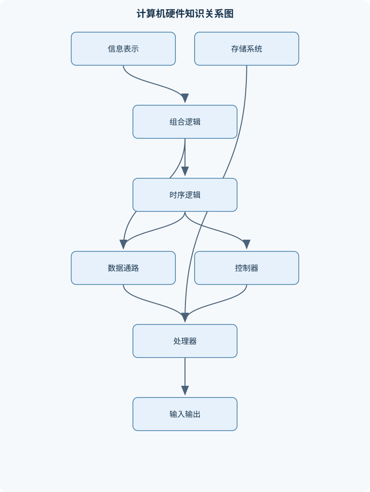
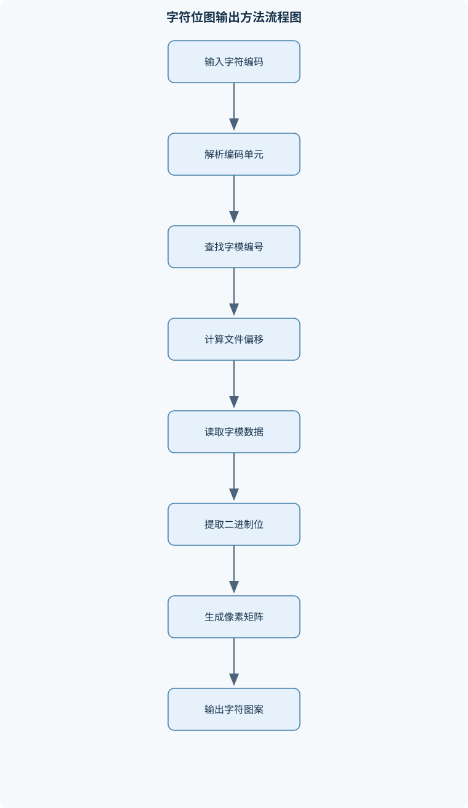

# 计算机硬件基础

## 一、课程整体知识框架

### 课程边界与先修知识

本课程研究计算机硬件系统从数字逻辑到处理器、存储系统、输入输出与性能分析的基本原理，重点解释硬件模块如何表示信息、组合运算、保存状态、执行指令并通过总线和接口与外部设备交换数据。课程覆盖数制与编码、组合逻辑和时序逻辑、寄存器与有限状态机、存储层次、指令执行、基本处理器组织、输入输出和虚拟地址转换等内容。课程不以某一品牌处理器、操作系统或开发工具为前提，也不深入集成电路版图、射频电路、操作系统内核实现或高级微体系结构优化。先修知识包括高中或大学基础数学、二进制运算、基本程序设计和简单电路概念；能够阅读条件判断、循环、数组和位运算代码即可。课程中的理想模型用于建立结构化认识，实际系统还会受到制造工艺、时钟偏差、缓存一致性、功耗、设备延迟、操作系统策略和具体指令集差异的影响。





### 1. 课程对象、边界与先修关系

《计算机硬件基础》研究计算机如何把信息表示为二进制信号，如何利用逻辑电路完成运算，如何保存和传递状态，以及处理器如何按照指令组织数据通路、访问存储器并与外部设备交换数据。课程关注的是从数字逻辑到计算机系统的结构性联系，而不是某一种品牌处理器、某一个操作系统或某一套开发工具的使用方法。

课程采用分层抽象。底层是电平、位和逻辑门；其上是组合逻辑、触发器、寄存器和有限状态机；再上是算术逻辑单元、存储器、总线、指令集和处理器控制器；更高层是缓存、虚拟地址转换、输入输出和性能分析。上一层模块通过明确的输入、输出、时序和控制信号使用下一层模块，但高层抽象不会消除底层约束。例如，程序员看到的是数组下标，硬件最终仍需把下标转换为地址；程序员看到的是一次加法，处理器必须经过寄存器读取、运算、结果写回等步骤。

课程中的理想模型有明确边界。理想组合逻辑通常假设输入稳定后经过有限传播延迟即可得到输出；理想时序电路通常假设所有触发器由同一时钟驱动，建立时间和保持时间均得到满足；理想存储层次用固定访问时间描述缓存和主存。现实系统还会受到传播延迟、时钟偏差、亚稳态、功耗、散热、缓存一致性、设备等待、操作系统调度以及具体指令集差异的影响。因此，理论推导得到的是结构和趋势，实验测得的是特定配置下的结果。

### 2. 系统层次、数据通路与性能指标

计算机硬件系统可抽象为数据通路和控制器两部分。数据通路包含寄存器、算术逻辑单元、加法器、多路选择器、缓存接口和总线等，用于保存、选择、计算和传送数据；控制器根据当前指令、状态和外部事件产生控制信号，决定数据通路在当前时刻执行哪一种操作。

指令集架构规定软件可观察的机器模型，包括指令格式、寄存器、寻址方式、数据类型、异常行为和存储访问规则。微体系结构则说明这些指令由哪些内部部件、哪些时序和哪些控制策略实现。同一指令集可以由单周期、多周期或流水线处理器实现。因而，“指令能够完成什么”与“硬件内部怎样完成”必须区分。

时钟周期 $T$ 与频率 $f$ 的理想关系为

$$
T=\frac{1}{f}.
$$

其中 $T$ 的单位是秒，$f$ 的单位是赫兹。提高频率只会缩短单个周期，不能自动保证整体性能提高，因为每周期完成的工作量、流水线停顿、缓存未命中和设备等待也会影响执行时间。响应时间是完成一个任务所需的时间；吞吐率是单位时间完成的任务量。批量数据处理可能更关注吞吐率，而交互式设备通常更关注响应时间，二者不能互相替代。

若某程序原执行时间为 $T_{old}$，改进后为 $T_{new}$，性能加速比为

$$
S=\frac{T_{old}}{T_{new}}.
$$

若程序中比例为 $p$ 的部分获得局部加速比 $s$，其余部分不变，则阿姆达尔定律给出

$$
S=\frac{1}{(1-p)+\frac{p}{s}}.
$$

推导过程是：将原总时间归一化为 $1$；不可优化部分仍耗时 $1-p$；可优化部分原耗时为 $p$，加速后耗时为 $p/s$；两者相加得到新时间，再取原时间与新时间之比。当 $p<1$ 时，即使 $s$ 趋于无穷大，总加速比也不超过 $1/(1-p)$。这说明局部部件的无限加速不能消除程序中其他部分的限制。

### 3. 数制、编码与数据表示

位用 bit 表示，取值为 $0$ 或 $1$；字节用 B 表示，$1\ \mathrm{B}=8\ \mathrm{bit}$。位向量 $x[n-1:0]$ 表示共 $n$ 位的数据，$x[0]$ 是最低有效位。地址线数量为 $k$ 时，理论上可区分 $2^k$ 个地址。若按字节寻址，且地址宽度为 $k$ 位，则理论地址空间为 $2^k$ B，但实际可用空间还会受地址译码、设备映射、保留区域和权限保护限制。

二进制、八进制和十六进制只是不同的表示法，不是不同的数据类型。二进制数转换为十六进制时，从最低位开始每四位分组；不足四位时在高位补零。例如

$$
11010110_2=1101_2\ 0110_2=\mathrm{D6}_{16}.
$$

无符号 $n$ 位整数的范围是

$$
0\le x\le 2^n-1.
$$

补码 $n$ 位整数的范围是

$$
-2^{n-1}\le x\le 2^{n-1}-1.
$$

补码加法可以统一处理正数和负数：两个操作数按位相加，只保留低 $n$ 位。判断有符号溢出不能只看最高位进位，而应观察两个同号操作数相加后结果是否变成异号。例如，8 位补码 $01100110$ 表示 $102$，$00111001$ 表示 $57$，相加得到

$$
01100110+00111001=10011111.
$$

位模式 $10011111$ 按补码解释为 $-97$，但 $102+57=159$ 超出 8 位补码上限 $127$，因此发生有符号溢出。按无符号解释时，结果为 $159$，因为无符号范围是 $0$ 到 $255$。这说明同一位模式的数值含义依赖于解释方式。

符号扩展把较短的补码扩展到更宽位数，复制原最高位；零扩展则在高位补零，适用于无符号数。若把负数错误地进行零扩展，数值会改变。定点数把小数点位置固定在某一位，适合硬件简单、范围有限的场景；浮点数用符号、阶码和有效数表示较大范围，但存在舍入误差、非精确表示和特殊值等问题。

字符编码把字符映射为整数码点或字节序列，编码、字模编号和文件偏移不是同一概念。多字节编码不能简单取一个字节作为字符索引。字节序描述多字节数在连续地址中的排列顺序，必须在读取二进制数据时依据格式约定处理。奇偶校验通过增加一个校验位，使 1 的总数满足偶数或奇数约束，能够检测部分错误，但不能保证发现所有多位错误，也通常不能定位错误位置。

### 4. 布尔代数与组合逻辑

逻辑变量只有 $0$ 和 $1$。本课程使用 $\lnot A$ 表示非，$A\land B$ 表示与，$A\lor B$ 表示或，$A\oplus B$ 表示异或。异或在两个输入不同的时候输出 $1$，因此不能当作普通加法或逻辑或。

组合逻辑的输出只由当前输入决定，不保存历史状态。设计组合电路的基本流程是：明确输入和输出；列出真值表；写出输出为 $1$ 的最小项；利用布尔代数或卡诺图化简；依据化简式连接门电路；最后用原真值表逐项验证。卡诺图中相邻格只相差一个变量，合并 $2^m$ 个相邻格可以消去 $m$ 个变量；合并不能覆盖确定为 $0$ 的项。

一位全加器的输入为 $a$、$b$ 和低位进位 $c_{in}$，输出和位 $s$ 与高位进位 $c_{out}$：

$$
s=a\oplus b\oplus c_{in},
$$

$$
c_{out}=ab+ac_{in}+bc_{in}.
$$

它可以由两个半加器和一个或门构成。将多个全加器串联可形成多位串行进位加法器，但高位必须等待低位进位传播，位数越多，延迟通常越大。比较器通过逐位比较得到大小关系；译码器把二进制编码转换为一个或多个独热输出；多路选择器根据选择信号从多个数据输入中选出一个；奇偶校验电路常使用多级异或门计算校验值。

### 5. 时序逻辑、寄存器与状态机

时序逻辑的输出不仅取决于当前输入，还取决于此前保存的状态。锁存器通常由电平控制，在使能有效期间可能持续跟随输入；触发器通常在时钟边沿采样输入。建立时间是数据在有效时钟边沿前必须稳定的最短时间，保持时间是边沿后仍需保持稳定的最短时间。违反这些约束可能导致亚稳态，即输出在一段时间内不能可靠地解释为 $0$ 或 $1$。

寄存器由多个触发器组成，用于并行保存位向量；移位寄存器在时钟作用下把数据向左或向右移动，可用于串并转换和延迟。计数器按照规定顺序改变状态。同步计数器的状态触发通常由同一个时钟边沿完成，便于时序分析；异步计数器使用前一级输出触发后一级，结构简单但可能产生传播延迟和瞬态错误。

有限状态机由状态集合、输入、输出、状态转移函数和复位规则组成。Moore 型状态机的输出只由当前状态决定，输出稳定性较好；Mealy 型状态机的输出由当前状态和输入共同决定，响应可能更快，但输入变化可能直接造成输出变化。状态机设计必须处理非法状态、复位后的初始状态和输入在时钟边沿附近的稳定性。

同步复位通常在时钟边沿到来时生效，时序行为容易统一；异步复位无需等待时钟即可改变状态，但释放复位时需要特别注意不同触发器之间的时序一致性。跨时钟域传输不能直接假设两个时钟同步，通常需要同步器、握手机制或异步队列，以降低亚稳态传播风险。

### 6. 存储器与存储层次

存储单元通过字线选择目标行，通过位线读出或写入数据。SRAM 通常使用多个晶体管构成稳定状态，不需要周期性刷新，访问快但面积和成本较高；DRAM 以电容保存电荷，密度较高但需要刷新，读写还受到行激活和预充电等时序影响。只读存储器和非易失存储在断电后仍可保留数据，但写入方式、寿命和访问延迟依具体技术而不同。

若地址线数量为 $k$，每个可寻址单元宽度为 $W$ B，则容量为

$$
2^kW\ \mathrm{B}.
$$

该推导先由 $k$ 根地址线得到 $2^k$ 个地址，再乘以每个地址对应的数据宽度。若系统按字节寻址，则 $W=1$；若按字寻址，必须明确一个字包含多少字节。KiB、MiB 分别表示 $2^{10}$ B、$2^{20}$ B，不能与十进制的 KB、MB 混用而不说明单位。

缓存利用时间局部性和空间局部性。刚访问过的数据可能很快再次访问，这是时间局部性；访问某个地址后，附近地址也可能被访问，这是空间局部性。直接映射缓存中每个主存块只能进入一个缓存组；全相联缓存中可进入任意位置；组相联缓存介于两者之间。地址通常分为标记、组索引和块内偏移三部分。

若缓存命中时间为 $t_h$，命中率为 $h$，未命中额外代价为 $p$，则在“每次访问至多发生一次下层判断、且 $p$ 已定义为额外时间”的条件下，

$$
\mathrm{AMAT}=t_h+(1-h)p.
$$

如果给出的下层时间是完整访问时间而不是额外时间，就不能再次无条件加上 $t_h$，必须先统一定义。写直达策略每次写缓存时同步更新下层，控制简单但总线写次数可能较多；写回策略只在缓存块被替换时写回脏块，通常减少写流量但需要脏位。写分配在写未命中时先把块装入缓存，非写分配则直接写下层。缓存容量、块大小、组数和相联度是不同参数，不能混为一谈。

### 7. 指令系统、数据通路与处理器执行

一条指令通常包含操作码和操作数信息。操作码决定运算类型，操作数可以来自寄存器、立即数或存储器。程序计数器保存下一条指令地址，指令寄存器保存当前取出的指令，寄存器文件提供多个快速读写寄存器，算术逻辑单元执行加减、逻辑和比较等操作。

典型指令包括加载、存储、算术、逻辑、比较和分支。加载把存储器数据送入寄存器，存储把寄存器数据写入存储器；算术指令通常在寄存器之间运算；分支根据条件改变程序计数器。立即数寻址把常量直接编码在指令中；寄存器寻址使用寄存器内容；基址加偏移寻址常用于数组和结构体访问。

处理器执行一条指令通常经历取指、译码、执行、访存和写回。取指阶段用程序计数器访问指令存储器；译码阶段解析操作码并读取寄存器；执行阶段由算术逻辑单元计算结果或地址；访存阶段读写数据存储器；写回阶段把结果写入寄存器。控制信号决定多路选择器选择哪一路数据、寄存器是否写入、存储器是否读写以及程序计数器如何更新。

### 8. 处理器控制、流水线与冒险

硬布线控制器利用组合逻辑和状态寄存器直接产生控制信号，速度较快但修改结构不灵活；微程序控制器把控制信号组织为微指令，通过微程序逐步控制数据通路，设计较规整但需要微指令存储和解释过程。

单周期处理器让一条指令在一个长周期内完成，控制简单，但周期必须覆盖最长指令路径，因此短指令也要等待相同时间。多周期处理器把取指、译码、执行、访存和写回分散到多个周期，可复用算术逻辑单元和存储器，但状态机和控制时序更复杂。

流水线把连续指令的不同阶段重叠执行。若流水线级数为 $k$，连续执行 $n$ 条指令的理想完成周期数近似为

$$
k+n-1.
$$

该式假设各阶段负载均衡、无结构冲突、无数据相关、无分支冲刷，并忽略流水线寄存器开销。流水线主要提高吞吐率，不必然缩短单条指令延迟。

结构冒险是多个阶段同时争用同一硬件资源；数据冒险是后续指令需要前一条指令尚未写回的结果，常见的读后写相关可通过旁路缓解；控制冒险来自分支和跳转，错误取入的指令可能需要冲刷。无法通过旁路消除的数据相关需要停顿或插入气泡；分支则可采用等待、静态预测或动态预测等策略。

### 9. 总线、输入输出与外设接口

总线通常包含地址总线、数据总线和控制总线。地址总线指出访问位置，数据总线传送数据，控制总线表达读写、请求、确认、中断和时序等信息。总线宽度不直接等于实际可用内存容量，因为地址空间中可能包含设备映射区、保留区和空洞。

存储器映射输入输出把设备寄存器放入统一地址空间，处理器使用普通加载和存储指令访问；端口映射输入输出使用独立端口空间和专用指令。轮询由处理器反复检查设备状态，控制简单但会占用处理器；中断允许设备在需要服务时通知处理器，减少无效等待但增加上下文切换和中断管理复杂度；直接存储器访问由专用控制器在设备与内存之间搬运数据，适合大块传输，但需要配置、仲裁、完成通知和缓存一致性处理。

串行传输按时间顺序传送位，线缆和引脚较少；并行传输同时传送多位，但高速下会受到线间偏差和同步困难影响。同步接口依靠共同或嵌入式时钟协调时序；异步接口通过起始位、停止位或握手信号确定数据边界。字符显示和位图输出通常经历“字符编码—字模编号—文件偏移—读取字节—逐位解析—写入显示缓冲区”过程，位顺序必须以文件格式规定为准。

### 10. 虚拟存储、地址转换与系统可靠性

虚拟地址通常分为虚拟页号 VPN 和页内偏移 offset。页大小为 $2^r$ B 时，地址低 $r$ 位为页内偏移，高位为 VPN。页表把 VPN 映射为物理页框号，页内偏移保持不变。快表保存最近使用的地址映射，命中时可减少页表访问；未命中时需查询页表并检查有效位和访问权限。

虚拟地址转换流程是：提取 VPN 和 offset；查询快表；若命中，检查权限并将页框号与 offset 拼接；若未命中，查询页表并更新快表；若页表项无效，则触发页错误，由系统选择物理页框、必要时从交换空间换入页面，再恢复或终止访问。交换空间容量较大但速度显著低于内存，不能把虚拟地址空间等同于物理内存性能。若工作集超过物理内存，频繁页错误会形成持续换入换出，导致有效带宽大幅下降。

硬件可靠性分析从故障模型、可观测性和可控性开始。组合逻辑可通过真值表和仿真波形检查，时序逻辑还必须检查时钟边沿、复位、建立时间、保持时间和非法状态恢复。模块接口测试需要验证输入范围、输出格式、边界地址、错误响应和时序协议。性能测试应区分延迟、吞吐率、带宽和命中率，并固定硬件、软件、工作集和访问模式。功耗、散热和可维护性也是系统设计的一部分：高频率和高并发可能提高性能，却可能带来发热、降频、寿命和故障率问题。

## 二、章节和模块划分

### 核心知识覆盖清单

本清单用于检查正文是否覆盖本课程的主要知识模块：

- **计算机系统层次与性能度量**：硬件系统的层次化抽象、数据通路与控制器、指令集与微体系结构的区别、模块接口与组合连接、吞吐率与响应时间、时钟频率与时钟周期、性能加速比与阿姆达尔定律、理想模型与现实硬件限制。
- **数制、编码与数据表示**：二进制、八进制和十六进制转换、无符号整数表示范围、补码整数及其加减法、符号扩展与零扩展、定点数与浮点数基本思想、字符编码与字节序、奇偶校验与错误检测、位、字节、字和地址单位。
- **布尔代数与组合逻辑**：逻辑变量与真值表、与、或、非、异或门、布尔代数基本定律、最小项与最大项、卡诺图化简、加法器与减法器、多路选择器与译码器、比较器与奇偶校验电路。
- **时序逻辑与数字系统状态**：锁存器与触发器、建立时间与保持时间、寄存器与移位寄存器、同步计数器与异步计数器、有限状态机模型、状态转移图与状态编码、同步复位与异步复位、时钟域和亚稳态的基本概念。
- **存储器与存储层次**：SRAM与DRAM的基本结构、存储单元、字线和位线、容量、地址线和数据线关系、只读存储器与非易失存储、高速缓存的局部性原理、直接映射、组相联和全相联缓存、缓存命中率与平均访问时间、写直达、写回和写分配策略。
- **指令系统与处理器数据通路**：指令的操作码与操作数、寄存器文件、程序计数器与指令寄存器、算术逻辑单元、立即数、寄存器和存储器寻址、加载、存储、算术和分支指令、指令编码与地址空间、数据通路中的控制信号。
- **处理器控制与指令执行**：取指、译码、执行、访存和写回、硬布线控制器、微程序控制器、单周期处理器、多周期处理器、流水线基本思想、结构、数据和控制冒险、分支预测与流水线停顿。
- **总线、输入输出与外设接口**：地址总线、数据总线和控制总线、存储器映射输入输出、端口映射输入输出、轮询与中断、直接存储器访问、串行与并行传输、同步接口与异步接口、字符显示和位图输出流程。
- **虚拟存储与地址转换**：虚拟地址与物理地址、分页和页表、页号、页内偏移和页表项、快表及其命中过程、页错误与换入换出、工作集与局部性、交换空间的作用与限制、存储访问性能的分层分析。
- **硬件可靠性、测试与综合实践**：故障模型与可观测性、组合逻辑仿真、时序逻辑波形分析、模块接口测试、位图字模读取与显示、存储器读写校验、性能基准测试与带宽测量、硬件系统的功耗、散热和可维护性。


### 第一章 计算机系统层次与性能度量

本章建立“信号—逻辑部件—数据通路—处理器—存储系统—输入输出”的总体图景。重点分析模块接口如何连接，控制信号如何驱动数据通路，以及吞吐率、响应时间、时钟周期和加速比如何用于比较系统。通过阿姆达尔定律说明局部优化受不可优化部分限制。

### 第二章 数制、编码与数据表示

本章依次处理进制转换、位宽、无符号数、补码、扩展、定点数、浮点数、字符编码、字节序和差错检测。补码分析必须同时给出位模式、位宽、十进制解释和溢出判断；编码分析必须区分码点、编码字节、字模编号和文件偏移。

### 第三章 布尔代数与组合逻辑

本章从逻辑变量和真值表出发，推导与、或、非、异或门的组合关系，介绍最小项、最大项和卡诺图。加法器、减法器、比较器、多路选择器、译码器和奇偶校验电路作为典型组合模块，要求能从功能描述推导门级结构并验证边界输入。

### 第四章 时序逻辑与数字系统状态

本章比较锁存器和触发器，解释建立时间、保持时间、传播延迟和亚稳态。寄存器、移位寄存器、同步计数器和异步计数器用于说明状态保存与状态更新。有限状态机部分覆盖状态转移图、状态编码、Moore 与 Mealy 输出、同步复位和异步复位，并要求处理非法状态和跨时钟域问题。

### 第五章 存储器与存储层次

本章从存储单元、字线和位线讲解 SRAM、DRAM、只读存储器及非易失存储。随后由地址线、数据线和单元宽度推导容量。缓存部分比较直接映射、组相联和全相联，分析标记、索引、块内偏移、替换策略、命中率、写直达、写回、写分配和平均访问时间。

### 第六章 指令系统与处理器数据通路

本章围绕操作码、操作数、寄存器文件、程序计数器、指令寄存器和算术逻辑单元组织内容。针对加载、存储、算术和分支指令，逐条追踪寄存器读取、立即数生成、运算、访存、写回和程序计数器更新。重点区分指令集架构与微体系结构，并分析指令编码对地址空间和硬件解码的影响。

### 第七章 处理器控制与指令执行

本章完整描述取指、译码、执行、访存和写回过程，比较硬布线控制器与微程序控制器。单周期处理器用于说明最长路径约束，多周期处理器用于说明资源复用和状态控制，流水线用于说明阶段重叠。结构冒险、数据冒险和控制冒险分别通过资源表、寄存器相关和分支时空图分析，并讨论旁路、停顿、冲刷和分支预测。

### 第八章 总线、输入输出与外设接口

本章解释地址总线、数据总线和控制总线的职责，比较存储器映射输入输出与端口映射输入输出。轮询、中断和直接存储器访问分别从处理器占用、响应机制、控制复杂度和数据搬运责任进行比较。串行、并行、同步和异步接口通过信号时序理解。字符显示实验将编码、字模、位顺序、显示缓冲区和文件边界联系起来。

### 第九章 虚拟存储与地址转换

本章以虚拟地址、物理地址、页号、页内偏移和页表项为主线，推导分页地址转换。快表命中和未命中分别追踪，页错误则连接处理器异常、操作系统换入换出和权限检查。工作集和局部性用于解释为什么程序在物理内存充足时仍可能因访问模式不佳而变慢。

### 第十章 硬件可靠性、测试与综合实践

本章把前述知识用于组合逻辑仿真、时序波形分析、模块接口测试、存储器读写校验、字模读取显示、带宽测量和性能基准。评价时不仅看功能是否正确，还要检查边界输入、异常路径、时序约束、资源占用、功耗和散热。测试结果必须注明配置和访问模式，不能把一次测量直接推广为所有硬件的普遍结论。

### 代表性算法与流程一：补码加减法分析

**输入：**两个固定宽度的 $n$ 位位模式和运算类型。  
**输出：**结果位模式、无符号解释、有符号解释和溢出标志。

**过程：**

1. 若执行减法，将减数逐位取反并加 $1$，形成其补码相反数。
2. 执行 $n$ 位二进制加法，只保留低 $n$ 位。
3. 按无符号规则解释结果。
4. 按补码规则解释结果。
5. 若两个加法操作数同号而结果异号，则标记有符号溢出；异号相加不发生有符号溢出。
6. 输出结果及其边界判断。

该流程只适用于固定宽度整数。任意精度整数需要额外保存进位和符号信息，不能直接把丢弃的高位当作无条件正确。

### 代表性算法与流程二：缓存地址字段分析

**输入：**主存地址宽度、缓存容量、块大小、组数、待访问地址。  
**输出：**块内偏移、组索引、标记、命中或未命中。

若块大小为 $2^b$ B，则块内偏移占 $b$ 位；若缓存有 $2^s$ 个组，则组索引占 $s$ 位；地址宽度为 $k$ 位时，标记位数为

$$
k-s-b.
$$

流程是：先计算三类位数；从地址最低位提取块内偏移；继续提取组索引；剩余高位作为标记；定位缓存组后比较有效位和标记；匹配则命中，否则按替换策略装入。该分析适合理论缓存结构，真实处理器还可能有多级缓存、预取和非阻塞访问。

### 代表性算法与流程三：有限状态机设计

**输入：**状态需求、输入信号、输出信号、复位规则和时序约束。  
**输出：**状态集合、状态编码、下一状态逻辑、输出逻辑和验证波形。

步骤包括：定义状态；绘制状态转移；确定 Moore 或 Mealy 输出；选择状态编码；写出下一状态方程；规定非法状态处理；规定复位后的状态；检查输入在时钟边沿附近满足建立时间和保持时间；用每一种关键输入序列验证状态转移。终止条件是所有规定输入序列都能得到预期状态和输出。

### 代表性算法与流程四：虚拟地址转换

**输入：**虚拟地址、页大小、快表、页表和访问权限。  
**输出：**物理地址或异常类型。

页大小为 $2^r$ B 时，取虚拟地址低 $r$ 位为 offset，其余高位为 VPN。先查快表；若命中，检查权限并拼接物理页框号；若未命中，查页表并更新快表；若页表项无效，触发页错误并由系统处理换入。该流程依赖处理器和操作系统的具体权限机制，不能只由硬件地址拼接完成。

```python
def translate(virtual_address, page_bits, tlb, page_table):
    """
    输入：
      virtual_address: 虚拟地址整数
      page_bits: 页内偏移位数
      tlb: {vpn: (frame, readable)} 的快表
      page_table: {vpn: (frame, readable)} 的页表
    输出：
      ("physical", 物理地址) 或 ("page_fault", VPN)
    """
    offset_mask = (1 << page_bits) - 1
    offset = virtual_address & offset_mask
    vpn = virtual_address >> page_bits

    if vpn in tlb:
        frame, readable = tlb[vpn]
    elif vpn in page_table:
        frame, readable = page_table[vpn]
        tlb[vpn] = (frame, readable)
    else:
        return ("page_fault", vpn)

    if not readable:
        return ("permission_fault", vpn)

    physical_address = (frame << page_bits) | offset
    return ("physical", physical_address)
```

代码中的 `page_bits` 必须与页大小一致；例如页大小为 $4\ \mathrm{KiB}=2^{12}\ \mathrm{B}$ 时，`page_bits` 应为 $12$。该示例省略了真实系统中的页表层级、脏位、访问位、替换策略和并发保护，但保留了地址分解、快表查询、权限检查和页错误的核心顺序。

### 例题一：补码加法与溢出

**题干：**计算 8 位补码 $01100110+00111001$，给出位模式、十进制解释，并判断是否溢出；再说明无符号解释。

**分析：**两个操作数最高位均为 $0$，表示正数。同号正数相加若结果最高位变为 $1$，则发生有符号溢出。

**逐步解答：**

1. $01100110_2=102$。
2. $00111001_2=57$。
3. 逐位相加得到 $10011111$。
4. 8 位补码中，$10011111$ 的值为
   $-128+16+8+4+2+1=-97$。
5. 数学结果为 $159$，超过 8 位补码上限 $127$，故有符号溢出。
6. 按无符号解释，$10011111_2=159$，没有无符号溢出，因为结果低于 $255$。

**结果验证：**同号正数得到负数，满足补码溢出条件。  
**变式：**若改为 $01100110+10111001$，操作数异号，不会发生有符号溢出，但无符号加法可能产生进位，二者判断标准不同。

### 例题二：全加器与四位加法器

**题干：**设计一位全加器，列出输入为 $a,b,c_{in}$ 时的和位与进位表达式，并说明如何组成四位加法器。

**分析：**和位在三个输入中有奇数个 $1$ 时为 $1$；进位在至少两个输入为 $1$ 时为 $1$。

**逐步解答：**

1. 和位为三个输入的异或：
   $$
   s=a\oplus b\oplus c_{in}.
   $$
2. 进位为多数函数：
   $$
   c_{out}=ab+ac_{in}+bc_{in}.
   $$
3. 将第 0 位的 $c_{out}$ 接到第 1 位的 $c_{in}$，依次连接四个全加器。
4. 最低位输入外部进位，最高位输出最终进位。

**结果验证：**输入 $111$ 时，$s=1$、$c_{out}=1$；输入 $001$ 时，$s=1$、$c_{out}=0$，均符合二进制加法。  
**变式：**若要求更高速度，可采用超前进位结构，但需要更多逻辑和布线，不能只通过增加时钟频率解决进位传播问题。

### 例题三：直接映射缓存地址划分

**题干：**一个 16 位地址系统使用容量为 $1\ \mathrm{KiB}$ 的直接映射缓存，块大小为 $16\ \mathrm{B}$。求块内偏移位、组索引位和标记位数。

**分析：**缓存容量为 $1024\ \mathrm{B}$，每块 $16\ \mathrm{B}$，因此缓存块数为 $1024/16=64$。直接映射时组数等于块数。

**逐步解答：**

1. $16\ \mathrm{B}=2^4\ \mathrm{B}$，块内偏移为 $4$ 位。
2. 组数为 $64=2^6$，组索引为 $6$ 位。
3. 地址宽度为 $16$ 位，标记位为
   $$
   16-6-4=6\ \text{位}.
   $$

**结果验证：**$6$ 位标记、$6$ 位索引、$4$ 位偏移总计 $16$ 位。  
**变式：**若改为两路组相联，缓存总块数仍为 $64$，组数变为 $32$，组索引为 $5$ 位，标记位变为 $7$ 位。

### 例题四：五级流水线中的数据冒险

**题干：**设有五级流水线 IF、ID、EX、MEM、WB，指令序列为“加载寄存器、随后使用该寄存器做加法”。分析为什么可能需要停顿。

**分析：**加载指令在 MEM 阶段才得到存储器数据，而后一条加法指令通常在 EX 阶段需要操作数。若没有旁路或数据尚未可用，就形成读后写相关。

**逐步解答：**

1. 加载指令进入 IF、ID、EX。
2. 加载在 MEM 阶段获得数据。
3. 后继加法若紧接执行，在其 EX 阶段过早读取该数据。
4. 若硬件支持从 MEM 结果旁路到 EX，可减少等待。
5. 若旁路路径不能覆盖该情况，则插入一个气泡，使加法延后一周期。
6. 继续检查后续指令是否因停顿而改变取指和写回时刻。

**结果验证：**每条指令在使用操作数前都必须保证数据已经产生；否则即使逻辑表达式正确，流水线执行结果仍可能错误。  
**变式：**若两条指令之间插入一条与该寄存器无关的指令，等待可能被自然隐藏，但仍需根据具体流水线时序验证。

### 例题五：分页地址转换

**题干：**一个系统使用 32 位虚拟地址，页大小为 $4\ \mathrm{KiB}$。某虚拟地址的页表项把 VPN 映射到物理页框号 $P$。说明地址如何转换。

**分析：**$4\ \mathrm{KiB}=2^{12}\ \mathrm{B}$，因此低 12 位为页内偏移，高 20 位为 VPN。

**逐步解答：**

1. 从虚拟地址取低 12 位作为 offset。
2. 右移 12 位得到 VPN。
3. 以 VPN 查询快表或页表。
4. 若得到物理页框号 $P$ 且权限允许，则物理地址为
   $$
   (P\ll 12)\ \lor\ offset.
   $$
5. 若页表项无效，不能直接拼接地址，而应触发页错误。
6. 系统完成换入和页表更新后，原指令可能重新执行。

**结果验证：**转换前后页内偏移完全不变；只有高位的虚拟页号被替换为物理页框号。  
**变式：**若页大小改为 $2\ \mathrm{MiB}=2^{21}\ \mathrm{B}$，页内偏移扩大到 21 位，VPN 位数相应减少，页表项数量和缓存行为也会改变。

### 实验一：组合逻辑与时序逻辑验证

**输入数据：**全加器的 8 组输入组合；一个带复位的模 10 计数器的时钟、复位和使能序列。  
**步骤：**

1. 根据全加器公式生成理论真值表。
2. 对每组输入记录和位与进位。
3. 在仿真中改变输入，观察输出是否符合真值表。
4. 为计数器规定复位时刻、时钟周期和使能变化。
5. 记录每个时钟边沿前后的状态。
6. 增加非法状态输入，检查是否回到规定有效状态。
7. 检查复位释放附近是否存在不确定波形。

**评价标准：**全加器 8 组输入全部正确；计数器按 $0$ 到 $9$ 循环；复位后进入唯一初始状态；非法状态能在规定时钟数内恢复；输出变化符合同步时序。  
**排错方法：**若真值表错误，先检查异或与或的定义；若计数器跳过状态，检查下一状态逻辑和状态编码；若仿真出现短暂毛刺，区分组合传播延迟与时序采样错误；若复位释放后状态不稳定，检查同步、异步复位的使用方式和时钟边沿。

### 实验二：缓存与内存性能测量

**输入数据：**不同工作集大小、顺序访问和随机访问序列、固定的数据类型及重复次数。  
**步骤：**

1. 固定处理器、编译配置、线程数和测试时间。
2. 选择从小于缓存容量到明显超过物理内存的多个工作集。
3. 分别执行连续访问、重复访问和随机访问。
4. 记录总运行时间、访问次数、吞吐率及可获得的缓存或换页指标。
5. 对每种工作集重复测量并记录波动范围。
6. 计算平均访问时间或有效带宽：
   $$
   \text{有效带宽}=\frac{\text{实际传输字节数}}{\text{运行时间}}.
   $$
7. 绘制工作集大小与时间、带宽之间的关系，寻找性能拐点。

**评价标准：**访问次数和数据量计算正确；顺序、重复、随机三种模式可区分；单位统一；测试环境和异常值有记录；能够解释缓存容量、内存容量和换页造成的拐点，而不是只报告一个最快结果。  
**排错方法：**若小工作集结果异常，检查缓存预热和编译器是否删除了无效计算；若带宽单位错误，检查 B、KiB、MiB 的换算；若重复测量波动很大，检查后台任务、调度和温度降频；若超过物理内存后性能骤降，进一步确认是否发生换页，不能仅凭运行时间断言为缓存未命中。

## 三、核心概念的详细解释

### 1. 硬件系统的层次、模块接口与性能

计算机硬件可以按抽象层次理解为：逻辑门构成组合逻辑和时序逻辑，组合逻辑实现运算与选择，时序逻辑保存状态；寄存器、算术逻辑单元、存储器和总线进一步组成数据通路；控制器产生控制信号，使数据通路按指令规定的顺序工作；处理器、存储系统和输入输出设备共同形成完整的计算机硬件系统。

数据通路负责“数据在哪里、怎样流动以及怎样计算”，典型部件包括程序计数器、指令寄存器、寄存器文件、算术逻辑单元、多路选择器、数据存储器和地址加法器。控制器负责“当前时刻做什么”，例如控制寄存器文件是否写入、选择算术逻辑单元执行加法还是减法、选择写回结果来自运算器还是存储器，以及是否改变程序计数器。

模块之间必须通过明确接口连接。接口至少应说明数据输入和输出的宽度、控制信号含义、信号有效电平、时序关系、错误响应和复位状态。两个模块即使功能名称相同，如果数据宽度、时钟域或握手规则不同，也不能直接连接。组合模块的输出只由当前输入决定；寄存器、存储器和有限状态机的输出还取决于历史状态。

指令集架构规定软件可观察的规则，包括指令格式、寄存器、数据类型、寻址方式、异常和存储访问语义。微体系结构则规定这些指令由哪些硬件部件和时序完成。同一指令集可以使用单周期处理器、多周期处理器或流水线处理器实现，因此不能把“指令能完成的功能”与“处理器内部的实现方式”混为一谈。

时钟周期 $T$ 与频率 $f$ 的关系为

$$
T=\frac{1}{f}.
$$

其中 $T$ 的单位是秒，$f$ 的单位是赫兹。频率提高只能说明理想时钟周期变短；如果每周期完成的工作量减少，或缓存未命中、分支停顿和设备等待增加，整体性能仍可能下降。响应时间是一个任务从开始到结束所需的时间，吞吐率是单位时间完成的任务量。例如，存储设备可以通过排队提高连续读写吞吐率，却未必降低单次随机访问的响应时间。

性能加速比定义为

$$
S=\frac{T_{old}}{T_{new}},
$$

其中 $T_{old}$ 和 $T_{new}$ 分别为改进前后的执行时间，单位必须一致。若程序中比例为 $p$ 的部分可获得加速比 $s$，其余部分不能改进，则

$$
S=\frac{1}{(1-p)+p/s}.
$$

推导时把原执行时间归一化为 $1$：不可优化部分耗时 $1-p$，可优化部分原耗时为 $p$，优化后耗时为 $p/s$，新总时间为 $(1-p)+p/s$。当 $p<1$ 时，即使 $s$ 无限增大，总加速比也不超过 $1/(1-p)$。该结论适用于总执行时间能够按部分划分、且优化部分的加速比可近似稳定的情况；如果优化改变了访存行为、并行度或任务规模，则需要重新测量。

### 2. 数制、编码与数据表示

位用 bit 表示，取值为 $0$ 或 $1$；字节用 B 表示，$1\ \mathrm{B}=8\ \mathrm{bit}$。位向量 $x[n-1:0]$ 表示共有 $n$ 位，$x[0]$ 是最低有效位。二进制、八进制和十六进制只是表示同一位模式的不同书写方式。一个十六进制数字对应四个二进制位，因此二进制与十六进制之间可按四位一组转换；八进制数字对应三位一组。

无符号 $n$ 位数的权值为

$$
\sum_{i=0}^{n-1}x[i]2^i,
$$

表示范围是 $0$ 到 $2^n-1$。例如，8 位无符号位模式 $11111111$ 的值为 $255$，而不是十进制字符串“11111111”。若地址宽度为 $k$ 位，则最多能区分 $2^k$ 个不同地址。按字节寻址时，理论地址空间为 $2^k$ B，但实际可用范围还会受到地址译码、设备映射、保护区域和系统保留区域限制。

补码用于在固定宽度内统一处理有符号加法和减法。$n$ 位补码的表示范围为

$$
-2^{n-1}\leq x\leq 2^{n-1}-1.
$$

负数的补码等于其绝对值的二进制表示按位取反后加 $1$，并保留规定的 $n$ 位。补码加法直接按位相加，丢弃最高位之外的进位。发生有符号溢出的条件是：两个同号数相加，结果符号却与它们不同。最高位产生进位并不等价于有符号溢出，因为无符号和有符号解释使用的是不同的数值范围。

符号扩展把较短补码扩展到更宽位数，新增高位全部复制原符号位；零扩展用于无符号数，新增高位全部补 $0$。例如，8 位补码 $11111111$ 表示 $-1$，扩展为 16 位仍应为 $1111111111111111$；若错误地零扩展为 $0000000011111111$，数值就变成 $255$。移位操作也必须注明位宽和是否保留符号，不能只依据数学上的乘二或除二理解。

定点数把小数点位置固定在某一位，硬件实现简单但表示范围和精度受位分配限制。浮点数把数值表示为符号、有效数和指数的组合，能够覆盖更大范围，但存在舍入误差、非结合性和溢出、下溢等问题。浮点数相加通常需要对阶、尾数运算、规格化和舍入，因此两个看似接近的十进制数在机器中不一定能精确表示。

字符编码把字符映射为整数码点或字节序列，编码、字模编号和文件偏移是三个不同概念。多字节编码不能只读取一个字节作为字符编号，否则可能截断字符。多字节数据还涉及字节序：高位字节先存放称为大端，低位字节先存放称为小端；字节序只影响多字节数在内存中的排列，不改变单个字节内部的位顺序。

奇偶校验在数据后附加一个校验位，使全部位中 $1$ 的数量满足偶数或奇数约定。它能够检测单个比特翻转等部分错误，但不能保证检测所有多比特错误，也不能指出错误位置。更强的错误检测需要校验和、循环冗余校验等机制，但检测错误与纠正错误仍是不同能力。

### 3. 布尔代数与组合逻辑

逻辑变量只有 $0$ 和 $1$ 两种取值。逻辑非、与、或、异或分别记为 $\lnot A$、$A\land B$、$A\lor B$ 和 $A\oplus B$。异或在两个输入不同的时候输出 $1$，满足

$$
A\oplus B=(A\land\lnot B)\lor(\lnot A\land B).
$$

布尔代数中的交换律、结合律、分配律、吸收律和德摩根律可以用于化简逻辑表达式。例如，

$$
\lnot(A\land B)=\lnot A\lor\lnot B,
$$

$$
\lnot(A\lor B)=\lnot A\land\lnot B.
$$

真值表列出所有输入组合及对应输出。含有 $n$ 个输入变量的真值表有 $2^n$ 行。输出为 $1$ 的每一行可写成一个最小项，全部最小项相或得到积之和形式；输出为 $0$ 的行可写成最大项，全部最大项相与得到和之积形式。

卡诺图利用相邻格只相差一个变量这一事实化简逻辑。合并 $2^m$ 个相邻的 $1$ 格，可以消去 $m$ 个变量。合并区域必须覆盖全部输出为 $1$ 的项，不能覆盖输出为 $0$ 的项；无关项可以按需要当作 $1$ 使用，但不能强行使用导致电路更复杂。变量较多时，卡诺图不便于人工处理，应采用程序化逻辑综合或结构化分解。

一位半加器的输入为 $a,b$，输出和位与进位分别为

$$
s=a\oplus b,\qquad c=a\land b.
$$

全加器还接收低位进位 $c_{in}$，其输出为

$$
s=a\oplus b\oplus c_{in},
$$

$$
c_{out}=(a\land b)\lor(a\land c_{in})\lor(b\land c_{in}).
$$

全加器可以由两个半加器和一个或门组成。将多个全加器级联可构成多位串行进位加法器，但进位必须逐位传播，位数增加会导致延迟增加。减法可通过加上减数的补码实现，因此同一个加法器配合按位取反控制信号即可完成加法和减法。

多路选择器根据选择信号从多个输入中选出一个输出；译码器把输入编码转换为某一路有效信号；比较器判断两个位向量相等或大小关系；奇偶校验电路通常使用多个异或门。组合逻辑不会保存历史状态，若电路输出需要依赖先前输入，就必须引入锁存器、触发器或存储器。

### 4. 时序逻辑、寄存器与有限状态机

时序逻辑由组合逻辑和状态存储部件组成。锁存器通常对电平敏感，触发器通常在时钟边沿采样输入。触发器的输入必须在有效时钟边沿之前保持稳定一段建立时间，并在边沿之后继续保持一段保持时间。若违反这些约束，输出可能进入亚稳态，不能在规定时间内稳定为可靠的 $0$ 或 $1$。

寄存器由多个触发器组成，用于保存多位数据。移位寄存器在时钟作用下将各位向左或向右移动，可用于串并转换、延迟和序列处理。计数器按照规定状态序列变化。同步计数器的各触发器由同一时钟边沿驱动，时序分析较清晰；异步计数器的后级时钟来自前级输出，传播延迟会逐级累积，适合简单场景但高速使用受限。

有限状态机由状态集合、输入、输出、状态转移函数和复位规则组成。Moore 型状态机的输出只由当前状态决定，输出较稳定；Mealy 型状态机的输出由当前状态和输入共同决定，响应可能更快，但输入变化可能直接影响输出。设计时应明确每个状态的含义、输入条件、下一状态、输出以及非法状态的恢复方式。

同步复位在时钟边沿统一改变状态，便于时序分析；异步复位不等待时钟即可改变状态，响应快，但释放复位时必须注意不同触发器之间的时序关系。来自另一个时钟域的信号不能直接送入当前时钟域，否则可能产生亚稳态。常见处理方法是使用同步器、握手协议或异步先进先出队列，具体选择取决于数据速率和可靠性要求。

### 5. 存储器、缓存和虚拟地址

SRAM单元通常使用多个晶体管构成双稳态结构，不需要周期性刷新，访问速度较快但单位容量成本较高；DRAM使用电容保存电荷，需要刷新，单元密度较高，常作为主存。存储阵列由字线和位线组织，地址译码器选择目标单元，读写电路负责传递数据。

若有 $k$ 根地址线，每个可寻址单元宽度为 $W$ bit，则理论容量为

$$
2^k\times W\ \mathrm{bit}.
$$

若每个单元为 $b$ B，则容量为 $2^k b$ B。KiB、MiB 分别表示 $2^{10}$ B 和 $2^{20}$ B，不能与十进制的 KB、MB不加区别地混用。只知道地址线数量不能直接推出实际可用内存，因为设备映射和保留区域可能占用部分地址。

缓存利用时间局部性和空间局部性。时间局部性表示近期访问的数据可能再次访问；空间局部性表示访问某地址后，附近地址也可能被访问。缓存把主存按块装入较快存储器，地址通常分为块内偏移、组索引和标记三部分。直接映射中每个主存块只能进入一个缓存位置；全相联中可进入任意位置；组相联中可进入指定组内的任意一路。相联度越高，冲突未命中的机会通常越少，但比较器和控制逻辑更复杂。

写直达策略每次写缓存都同时更新下层存储，控制简单但总线写流量较大；写回策略只在缓存块被替换且脏位有效时写回下层，能够减少写流量，但需要维护脏位。写分配在写未命中时先把块装入缓存，非写分配则直接写下层。策略必须结合工作负载和一致性要求选择。

虚拟地址通常分为虚拟页号 VPN 和页内偏移。页大小为 $2^r$ B 时，地址低 $r$ 位为页内偏移，高位为虚拟页号。页表把 VPN 映射到物理页框号，页内偏移保持不变。快表用于缓存近期页表项，命中时可以减少页表访问。页表项无效或权限不允许时会触发异常，由系统处理页错误，必要时从较慢存储中换入页面。

虚拟内存扩大的是进程可见地址空间，不等于扩大了高速物理内存。页错误需要访问低速存储介质，若工作集超过物理内存，系统可能频繁换入换出，产生持续换页，实际性能会急剧下降。

### 6. 指令执行、处理器组织与流水线

一条指令通常包含操作码和操作数信息。操作数可以来自寄存器、指令中的立即数或存储器。程序计数器保存下一条指令地址，指令寄存器保存当前取出的指令，寄存器文件提供快速操作数访问，算术逻辑单元执行算术、逻辑、比较和移位操作。

基本指令执行可分为取指、译码、执行、访存和写回。取指阶段用程序计数器访问指令存储器，并形成下一条地址；译码阶段识别操作码、读取寄存器并扩展立即数；执行阶段由算术逻辑单元计算结果或有效地址；访存阶段执行加载或存储；写回阶段把结果写入寄存器。并非所有指令都需要全部阶段，例如纯算术指令通常不访问数据存储器。

单周期处理器让每条指令在一个周期内完成，因此时钟周期必须覆盖最长指令的完整数据通路延迟，短指令也必须等待该周期结束。多周期处理器把执行拆成多个周期并复用硬件，能缩短单周期长度，但需要保存中间结果并增加控制状态。硬布线控制器通过组合逻辑和状态机直接产生控制信号，速度较快但修改困难；微程序控制器通过微指令序列产生控制信号，结构灵活但需要微程序存储和额外访问。

流水线让不同指令在不同阶段同时工作。理想情况下，$k$ 级流水线执行 $n$ 条指令约需

$$
k+n-1
$$

个周期，前提是各级延迟均衡、没有结构冲突、数据可及时获得且分支不造成冲刷。流水线主要提高吞吐率，不必然缩短单条指令延迟。

结构冒险是多个阶段争用同一硬件资源；数据冒险是后续指令需要前一条指令尚未写回的结果；控制冒险来自分支和跳转。旁路可以把执行结果直接送到后续阶段，减少等待；无法旁路时需要插入气泡。分支预测可以减少等待，但预测错误时必须冲刷已经取入的错误路径指令。流水线越深，理想频率可能越高，但分支冲刷、寄存器开销和时钟偏差也可能增加。

### 7. 总线、输入输出、可靠性与测试

地址总线传递访问位置，数据总线传递数据，控制总线传递读写、时钟、请求、应答和中断等控制信息。存储器映射输入输出把设备寄存器放入统一地址空间，处理器使用普通加载和存储指令访问；端口映射输入输出使用独立的端口地址空间和专用访问指令。具体信号含义必须以接口协议为准，不能只根据名称推测。

轮询方式由处理器反复读取设备状态，软件控制简单但会占用处理器时间；中断方式由设备在事件发生时通知处理器，适合事件间隔不确定的情况；直接存储器访问由专用控制器在设备和内存之间搬运数据，能够减少处理器逐字节参与，但需要配置地址、长度、方向和完成状态。

串行传输使用较少的数据线按时间顺序发送位，并行传输可同时发送多位，但线间偏差会限制高速传输。同步接口依赖共享时钟或明确时序，异步接口通过起始位、停止位或握手机制恢复边界。位图输出通常经历字符编码到字模编号、字模编号到文件偏移、文件字节到像素行列、像素到显示设备的转换。若每个字模占 $B$ B，编号为 $i$，则起始偏移通常为 $iB$，但必须确认文件头、字模排列和编码表是否改变了该关系。

硬件测试需要把故障模型转化为可观测现象。例如，组合逻辑可用真值表逐项验证；时序逻辑应检查时钟边沿、复位、建立时间和保持时间；存储器应测试地址译码、数据保持、读写方向和边界地址；接口测试应验证请求、应答、超时和错误路径。可观测性不足时，即使系统输出错误，也难以判断故障位于控制器、数据通路、存储器还是接口。

## 四、重要定义、公式、定理和推导

### 专业审校补充：关键定义与适用边界

直接存储器访问（DMA）是由专用控制器在设备与主存之间搬运数据，处理器只负责初始化传输参数、启动控制器并处理完成或错误通知。一次 DMA 传输至少需要源地址、目的地址、传输长度、方向和控制状态等信息。DMA 的核心边界不在于“完全不占用处理器”，而在于数据搬运不必由处理器逐字执行。若设备与处理器共享缓存，还必须处理缓存一致性：写回缓存中尚未写入主存的数据，可能使设备读到旧值；设备写入主存后，处理器缓存中的旧副本也可能覆盖新数据。因此，在满足具体系统协议的前提下，传输前可能需要将缓存数据写回，传输后可能需要使相关缓存行失效。DMA 还会竞争总线带宽，导致处理器访存延迟增加。轮询适合简单、短暂且频繁检查的设备状态；中断适合事件到达时间不确定的设备；DMA 适合较大块、连续数据传输。三者不是按速度简单排序，而是处理器占用、响应延迟、传输粒度和硬件复杂度之间的不同权衡。


### 1. 数据表示与地址空间公式

无符号 $n$ 位整数范围为

$$
0\leq x\leq 2^n-1.
$$

推导依据是每一位有两种取值，$n$ 位共有 $2^n$ 种组合；最小组合全为 $0$，最大组合全为 $1$，其权值为

$$
\sum_{i=0}^{n-1}2^i=2^n-1.
$$

$n$ 位补码范围为

$$
-2^{n-1}\leq x\leq 2^{n-1}-1.
$$

最高位权值为 $-2^{n-1}$，其余位权值为正。因此全为 $1$ 时为 $-1$，最高位为 $0$ 时最大值为 $2^{n-1}-1$。该公式只适用于固定宽度补码，不能直接用于任意精度整数。

若地址宽度为 $k$ 位，按字节寻址，则理论地址空间为

$$
2^k\ \mathrm{B}.
$$

若一个地址对应 $b$ B 存储单元，则容量为

$$
2^k b\ \mathrm{B}.
$$

该计算假设所有地址均有效且没有地址空洞；真实硬件还要扣除设备映射、保护区域和未实现的地址范围。

### 2. 补码加减法与溢出判定

固定 $n$ 位补码加法先按位相加，再保留低 $n$ 位。减法可转化为

$$
A-B=A+\lnot B+1,
$$

其中 $\lnot B$ 必须在规定的 $n$ 位宽内执行。判断有符号溢出有两种等价方法：

1. 两个正数相加得到负数，或两个负数相加得到正数；
2. 加法器最高位的输入进位与输出进位不同。

例如，8 位补码

$$
01100110+00111001=10011111.
$$

前一个操作数为 $102$，后一个为 $57$，数学和为 $159$，超出 8 位补码上限 $127$。结果位模式 $10011111$ 按补码解释为 $-97$，因此发生有符号溢出。若按无符号解释，低 8 位结果为 $159$，此时并不称为无符号溢出，因为无符号范围为 $0$ 到 $255$。该例说明同一位模式的数值含义取决于数据类型和位宽。

### 3. 一位全加器与多位加法器

全加器输入为 $a,b,c_{in}$，输出为和位 $s$ 和进位 $c_{out}$。当三个输入中有奇数个 $1$ 时，和位为 $1$，因此

$$
s=a\oplus b\oplus c_{in}.
$$

当至少两个输入为 $1$ 时产生进位，因此

$$
c_{out}=ab+ac_{in}+bc_{in},
$$

其中乘法表示逻辑与，加法表示逻辑或。把第 $i$ 位的进位记为 $c_i$，则多位串行进位加法器满足

$$
s_i=a_i\oplus b_i\oplus c_i,
$$

$$
c_{i+1}=a_ib_i+a_ic_i+b_ic_i.
$$

最低位的 $c_0$ 通常为 $0$，但在带进位加法中也可以由外部输入提供。该结构逻辑简单，但最高位必须等待前面各位进位传播，延迟随位数增加。

### 4. 卡诺图化简规则

若逻辑函数的最小项集合为 $F=\sum m(\cdots)$，则先在卡诺图中标记输出为 $1$ 的格。相邻格必须满足环绕相邻规则，并且每个合并区域的格数为 $2^m$。合并 $2^m$ 个格意味着有 $m$ 个变量在区域内变化，因此这些变量可以被消去。留下的变量构成该合并区域对应的乘积项，所有区域相或得到化简结果。

例如，若某区域中变量 $A$ 始终为 $1$，而 $B,C$ 在区域内变化，则该区域化简为 $A$，而不是 $ABC$。合并必须覆盖所有 $1$ 格；可以有重叠覆盖，但不能覆盖确定为 $0$ 的格。无关项用 $X$ 表示，只有在能够扩大合并并减少逻辑复杂度时才可视为 $1$。

### 5. 缓存地址划分与平均访问时间

设主存地址宽度为 $k$ 位，缓存块大小为 $2^b$ B，缓存共有 $2^s$ 个组，则块内偏移占 $b$ 位，组索引占 $s$ 位，标记位占

$$
k-s-b
$$

位。直接映射缓存每组只有一路；组相联缓存每组包含多路；全相联缓存没有组索引，地址主要由标记和块内偏移组成。

缓存命中率为 $h$，命中时间为 $t_h$，未命中额外代价为 $p$，则平均访问时间为

$$
\mathrm{AMAT}=t_h+(1-h)p.
$$

推导是：每次访问都先支付命中检查时间 $t_h$；概率为 $h$ 时直接结束；概率为 $1-h$ 时还需支付额外代价 $p$。该式假设 $p$ 已定义为额外时间。如果题目给出的下层访问时间是从发起下层访问到获得数据的完整时间，就不能再次把 $t_h$ 重复加入下层时间。

对于多级存储，应从最内层向外层建立条件期望。例如第一级命中时间为 $t_1$，第一级命中率为 $h_1$，第一级未命中后访问第二级的额外代价为 $p_2$，则

$$
\mathrm{AMAT}=t_1+(1-h_1)p_2.
$$

如果第二级也有未命中，应将 $p_2$ 展开为第二级访问时间与其下层未命中代价的组合。计算时必须统一使用纳秒、微秒等同一时间单位。

### 6. 页式地址转换

页大小为 $2^r$ B 时，虚拟地址 $A$ 可分解为

$$
A=(\mathrm{VPN},\mathrm{offset}),
$$

其中低 $r$ 位为页内偏移，高位为虚拟页号。若页表把 VPN 映射到物理页框号 PFN，则物理地址为

$$
\mathrm{PA}=(\mathrm{PFN},\mathrm{offset}).
$$

页内偏移不变，因为分页只改变页面所在的物理位置，不改变页面内部的字节位置。

例如，32 位虚拟地址、4 KiB 页大小满足 $4\ \mathrm{KiB}=2^{12}\ \mathrm{B}$，所以页内偏移为低 12 位，虚拟页号为高 20 位。若某虚拟地址的 VPN 映射到物理页框号 $P$，物理地址就是把 $P$ 与原低 12 位偏移拼接。若页表项无效，则不能直接形成物理地址，必须进入页错误处理流程。页错误处理可能需要选择空闲页框、从存储设备换入页面、更新页表和快表，再重新执行导致错误的访问。

### 7. 流水线理想周期与冒险代价

对于 $k$ 级流水线，第一条指令需要经过 $k$ 个阶段，之后理想情况下每个周期完成一条指令。因此完成 $n$ 条指令所需周期数为

$$
k+n-1.
$$

若发生停顿、气泡或分支冲刷，应加上对应额外周期。若有 $q$ 个停顿周期，则总周期可写为

$$
C=k+n-1+q+C_{\mathrm{flush}},
$$

其中 $C_{\mathrm{flush}}$ 表示控制转移造成的冲刷代价。该式是周期计数模型，不直接等同于实际时间；实际时间还要乘以时钟周期，并考虑缓存未命中和外部等待。

流水线的理想吞吐率接近每周期一条指令，但单条指令延迟至少包含各阶段延迟、流水线寄存器开销和可能的停顿。因此，增加流水线级数不保证单条指令更快。数据旁路只能解决结果已经产生但尚未正式写回的部分相关；如果数据在访存阶段之后才产生，而下一条指令过早需要该数据，仍可能必须停顿。

### 8. 字模偏移与位图读取

若字模文件每个字模固定占 $B$ B，字模编号为 $i$，文件没有额外头部，则字模起始偏移为

$$
\mathrm{offset}=iB.
$$

若文件存在长度为 $H$ B 的文件头，则应改为

$$
\mathrm{offset}=H+iB.
$$

字符编码到字模编号的映射必须由编码表规定。对于按区位排列的双字节编码，常见计算形式可能是

$$
i=qR+w+K,
$$

其中 $q,w$ 是经过编码调整后的行号和列号，$R$ 是每行字模数，$K$ 是偏移常数；这些参数不能从变量名推断，必须与文件格式一致。

读取位图时，若规定一个字节的最高位对应最左像素，则第 $j$ 个字节的第 $r$ 位可用掩码

$$
m=1\ll(7-r)
$$

判断。若文件规定最低位先显示，则掩码顺序必须反向。读取前必须检查字符编码长度、字模编号范围、文件偏移和剩余文件长度。对多字节字符只取一个字节，会使编码被截断并访问错误字模；把每个字模长度误当作每行长度，也会导致跨字模读取。

### 9. 性能、带宽与有效访问代价

吞吐率定义为单位时间完成的工作量。若完成 $N$ 个任务耗时 $T$，则平均吞吐率为

$$
X=\frac{N}{T}.
$$

若传输了 $D$ B 数据，耗时为 $T$，则带宽为

$$
B_w=\frac{D}{T}.
$$

带宽和响应时间不可互换：一次短消息可能响应时间很低但带宽不高；连续大块传输可能带宽很高但首次响应仍有固定延迟。虚拟内存系统的有效带宽还受到页错误影响。若大多数访问命中内存而少量访问触发页错误，平均时间应按概率加权；当工作集明显超过物理内存时，换页频率增大，低速存储延迟会主导总执行时间。

### 10. 硬件分析与验证的通用流程

对一个硬件模块进行分析时，应依次确定输入、输出、状态、时钟和复位；列出接口约束；建立真值表或状态转移表；推导逻辑关系；明确边界条件；最后用独立方法验证。组合逻辑应逐项检查所有输入组合或覆盖关键组合；时序逻辑应检查复位、状态转移、非法状态和时钟边沿；存储器应检查最低地址、最高地址、读写交替和数据保持；处理器数据通路应逐周期记录程序计数器、寄存器、控制信号和存储器变化。

若实验结果与理论不符，首先检查单位、位宽、端序、地址划分和复位时序，再检查缓存预热、操作系统调度、温度降频和设备等待。理论模型用于解释结构和因果关系，不能把一次特定硬件上的测量结果直接推广到所有处理器、存储器或输入输出设备。

## 五、算法、流程和实现思路

### 方法与流程覆盖索引

下列方法或流程应在正文中说明输入、步骤、适用条件、结果检查和边界：

- 补码加减法分析流程：输入两个 n 位整数及运算类型；若为减法则将减数按位取反并加 1；执行 n 位加法并保留低 n 位；根据操作数符号和结果符号判断有符号溢出；输出结果位模式、十进制解释和溢出标志。适用于固定宽度整数，不能直接替代任意精度整数运算。
- 组合逻辑化简流程：输入真值表或逻辑表达式；列出输出为 1 的最小项；使用布尔代数或卡诺图合并相邻项；得到最简或近似最简表达式；用原真值表逐项验证；输出门电路结构。卡诺图适合变量数较少的逻辑，变量很多时应采用程序化逻辑综合。
- 有限状态机设计流程：输入状态需求、输入信号、输出信号和时序约束；定义状态集合；绘制状态转移图；确定 Moore 或 Mealy 输出形式；进行状态编码；写出下一状态和输出逻辑；检查非法状态和复位行为；用时序波形验证每个输入序列。该流程要求输入在规定时钟边沿附近满足建立时间和保持时间。
- 缓存地址分析流程：输入主存地址、缓存容量、块大小和组数；计算块内偏移位数、组索引位数和标记位数；拆分地址字段；根据索引定位缓存组；比较有效位和标记；命中则读取或更新数据，未命中则按替换策略装入数据块。适用于给定结构的理论分析，真实处理器还可能包含预取、非阻塞缓存和多级缓存。
- 平均访存时间计算流程：输入各级缓存的访问时间、命中率和未命中代价；明确代价是额外时间还是完整下层访问时间；从最内层开始建立条件期望；逐级代入并统一单位；输出平均访问时间和各级未命中贡献。必须避免把命中时间和完整访问时间重复相加。
- 单周期处理器数据通路分析流程：输入一条指令及其指令格式；确定取指地址和下一条程序计数器；读取寄存器并生成立即数；选择算术逻辑单元输入；计算结果或访存地址；按控制信号选择写回数据；检查分支或跳转是否改变程序计数器。输出每个模块的输入、输出和控制信号。
- 流水线冒险处理流程：输入连续指令序列及其读写寄存器；标记相邻阶段中的资源冲突、读后写相关和控制转移；优先采用旁路消除可旁路的数据相关；无法消除时插入气泡；遇到分支按预测或等待策略处理；直到所有相关指令安全通过。终止条件是每条指令的操作数均在使用前可用且资源无冲突。
- 虚拟地址转换流程：输入虚拟地址、页大小、页表、快表和访问权限；提取虚拟页号与页内偏移；先查询快表；命中则检查权限并拼接物理页框号；未命中则查页表并更新快表；页表项无效时触发页错误，由系统选择页框并完成换入；输出物理地址或异常类型。该流程依赖操作系统和处理器的具体权限机制。
- 字符字模读取流程：输入字符编码、字模文件格式、每个字模字节数和显示宽高；根据编码表得到字模编号；计算文件偏移并检查不越界；读取规定字节数；按文件规定的位顺序提取像素；将 0 和 1 映射为背景和前景；输出二维字符图案。若编码为多字节编码，不能只使用一个字节计算索引。
- 性能实验分析流程：输入工作集大小、访问模式、缓存或内存配置和测量时间；先固定硬件与软件环境；分别测量顺序访问、随机访问和重复访问；记录访问时间、吞吐率、缓存命中或换页指标；改变工作集大小并绘制性能曲线；解释拐点对应的缓存容量、内存容量或交换行为。实验结果只能说明给定环境，不应直接推广到所有设备。


### 1. 硬件模块分析的统一流程

硬件问题的分析不能只从功能名称出发，而应先确定模块的输入、输出、内部状态、时钟、复位和接口时序。组合逻辑模块没有跨时钟周期保存的状态，输出只由当前输入决定；时序逻辑模块包含触发器、寄存器或存储器，输出还取决于此前的状态。一个完整的分析流程如下：

1. **确定输入与输出。** 标明每个信号的位宽、有效电平、编码方式和单位。例如，地址可能是 $k$ 位，数据可能是 $W$ 位，读写控制信号可能采用高电平有效，也可能采用低电平有效。
2. **确定状态与时序。** 判断模块是否由时钟触发，状态在哪个时钟边沿更新，复位是同步还是异步，输入是否满足建立时间和保持时间。
3. **建立行为模型。** 组合逻辑使用真值表或布尔表达式；时序逻辑使用状态转移表、状态转移图或时序波形。
4. **推导实现结构。** 根据功能选择与门、或门、非门、异或门、多路选择器、译码器、加法器、触发器或存储器等部件。
5. **检查边界条件。** 应覆盖全零、全一、最大地址、最小地址、溢出、非法状态、复位期间输入变化和接口错误等情况。
6. **独立验证。** 用真值表、手算、波形、仿真或测试程序进行交叉检查。仅观察一个正常输入不能证明模块正确。

这个流程既适用于一位全加器，也适用于缓存控制器、处理器数据通路和字符显示模块。模块越复杂，越需要把“数据路径”和“控制路径”分开记录。

### 2. 补码加减法分析流程

#### 输入、输出与适用条件

输入是两个固定宽度的 $n$ 位操作数，以及加法或减法操作类型；输出包括 $n$ 位结果、无符号解释、有符号解释和溢出标志。该方法适用于固定宽度整数硬件，例如 8 位、16 位或 32 位算术逻辑单元，不适用于需要自动扩展精度的任意精度整数。

减法

$$
a-b=a+\lnot b+1
$$

其中 $\lnot b$ 表示在限定的 $n$ 位宽内逐位取反。执行加法时只保留低 $n$ 位。最高位之外的进位可以作为无符号运算的进位标志，但不能直接当作有符号溢出的判断依据。

#### 例题一：8 位补码加法

**题干：**计算 $01100110+00111001$，给出无符号值和有符号值，并判断是否溢出。

**分析：**

$01100110$ 的无符号值为 $102$，最高位为 0，因此补码有符号值也是 $102$。$00111001$ 的无符号值和有符号值均为 $57$。

逐位相加：

$$
\begin{array}{r}
01100110\\
+00111001\\
\hline
10011111
\end{array}
$$

结果为 $10011111$。按无符号解释，结果为 $159$；按 8 位补码解释，最高位为 1：

$$
159-256=-97.
$$

两个操作数均为正数，但结果的符号位变成 1，因此发生有符号溢出。真实数学结果是 $102+57=159$，超出 8 位补码范围 $-128$ 到 $127$。

**结果验证：**两个同号操作数相加得到异号结果，满足补码加法溢出的判定条件。最高位产生的进位不能用于替代这一判断。

**变式：**若计算 $11100110+00111001$，第一个操作数的补码值为 $-26$，真实结果为 $31$，结果位模式为 $00011111$，没有有符号溢出。虽然运算中可能出现进位，但进位并不等于溢出。

#### 伪代码实现

```text
算法：固定宽度补码加减法
输入：n，n 位操作数 a、b，运算类型 op
输出：n 位 result，有符号溢出 overflow，无符号进位 carry

1. 如果 op 是减法：
       b_used ← 按 n 位取反(b) + 1
   否则：
       b_used ← b
2. full ← a + b_used
3. result ← full 的低 n 位
4. carry ← full 的第 n 位
5. sa ← a 的最高位
6. sb ← 原始 b 的最高位
7. sr ← result 的最高位
8. 若 op 是加法且 sa = sb 且 sr ≠ sa：
       overflow ← 1
   若 op 是减法且 sa ≠ sb 且 sr ≠ sa：
       overflow ← 1
   否则 overflow ← 0
9. 返回 result、overflow、carry
```

算法不变量是：所有中间位模式均按 $n$ 位解释，不能在中途无条件扩展为无限精度。终止条件是完成一次固定宽度加法。时间复杂度按位实现为 $O(n)$；若使用硬件并行加法器，墙钟延迟还取决于进位传播结构，而不只是位数。

### 3. 组合逻辑化简与加法器设计

#### 卡诺图化简流程

输入是真值表或逻辑函数。先列出输出为 1 的最小项，再按格雷码顺序排列卡诺图。相邻格只允许在一个变量上不同，边界两端也可能相邻。合并的格数必须是 $2^m$，合并后可以消去 $m$ 个变量。所有输出为 1 的格必须被覆盖，合并区域不能覆盖逻辑值为 0 的格；无关项可以在有利于化简时并入，也可以不使用。

**例题二：**

**题干：**某三变量函数在最小项 $m(1,3,5,7)$ 时输出 1，求化简结果。

**分析：**二进制最小项分别为 $001,011,101,111$。这四项的最低位均为 1，而前两位任意变化，因此可合并为一组，得到

$$
F=C.
$$

**结果验证：**当 $C=1$ 时，无论 $A、B$ 取值如何，输出均为 1；当 $C=0$ 时，四个指定最小项之外的组合均不属于输出为 1 的集合。因此 $F=C$ 与原真值表一致。

**变式：**若最小项集合改为 $m(1,3,5)$，三个格不能组成完整的 $2^m$ 组，通常需要写成若干乘积项的或，不能强行化为 $C$。

#### 一位全加器

一位全加器输入为 $a$、$b$ 和低位进位 $c_{in}$，输出为和位 $s$ 与高位进位 $c_{out}$。和位在三个输入中有奇数个 1 时为 1，因此

$$
s=a\oplus b\oplus c_{in}.
$$

进位在至少两个输入为 1 时为 1，因此

$$
c_{out}=ab+ac_{in}+bc_{in}.
$$

它也可以由两个半加器和一个或门构成：第一个半加器计算 $a\oplus b$ 及其进位，第二个半加器把中间和与 $c_{in}$ 相加，两个进位再进行或运算。将多个全加器串联即可得到多位串行进位加法器，但其延迟会随位数增加，因为高位必须等待低位进位传播。

### 4. 有限状态机设计流程

有限状态机的输入是状态需求、输入信号、输出信号和时钟约束；输出是状态集合、状态编码、下一状态逻辑和输出逻辑。设计步骤为：

1. 列出系统必须区分的行为阶段，定义状态集合。
2. 对每个当前状态列出所有输入条件下的下一状态。
3. 确定输出由当前状态决定，还是由当前状态和输入共同决定。
4. 选择状态编码，例如二进制编码或独热编码。
5. 推导下一状态逻辑与输出逻辑。
6. 规定复位后状态以及非法状态的恢复路径。
7. 用覆盖全部输入序列的波形验证。

Moore 型状态机的输出只由当前状态决定，输出稳定性较好；Mealy 型状态机的输出由当前状态和输入共同决定，可能减少状态数量，但输入变化可能直接引起输出变化。

**例题三：模 10 计数器设计。**

**题干：**使用 4 个触发器设计从 0 到 9 循环计数的同步计数器。

**分析：**状态编码为 $0000$ 到 $1001$，有效状态共 10 个。状态转移为

$$
0000\to0001\to\cdots\to1001\to0000.
$$

$1010$ 到 $1111$ 为非法状态。同步设计中，所有触发器在同一时钟边沿更新；复位信号在时钟边沿到来时使状态回到 $0000$。对于非法状态，可以规定下一状态为 $0000$，使电路具有自恢复能力。

**结果验证：**连续 10 个有效时钟边沿后回到初始状态；从任一非法状态开始，最多一个时钟周期进入 $0000$。若把同步复位误接成异步复位，复位发生时刻和波形将改变，不能再使用相同的时序假设。

**变式：**异步复位可以不等待时钟边沿立即清零，但释放复位时仍需考虑恢复时间和不同触发器之间的时序一致性。

### 5. 缓存地址分析与平均访问时间

#### 地址字段划分

设主存地址为 $A$，缓存块大小为 $2^b$ B，缓存共有 $G$ 个组，则：

- 块内偏移字段为 $b$ 位；
- 组索引字段为 $\log_2G$ 位；
- 标记字段占剩余高位。

直接映射缓存每个主存块只能进入一个组；组相联缓存允许一个主存块进入指定组内的多个位置；全相联缓存不使用固定组索引，但比较标记的硬件成本更高。

**例题四：**

**题干：**地址宽度为 16 位，直接映射缓存容量为 1 KiB，块大小为 16 B，求地址字段。

**分析：**缓存块数为

$$
\frac{1024}{16}=64.
$$

直接映射时组数为 64，因此组索引需要

$$
\log_2 64=6
$$

位。块大小为 16 B，块内偏移需要

$$
\log_2 16=4
$$

位。标记位数为

$$
16-6-4=6.
$$

所以地址从高到低分为 6 位标记、6 位组索引、4 位块内偏移。

**结果验证：**$2^6$ 个组乘以每组 $2^4$ B，得到 $1024$ B。若把 KiB 当作 $1000$ B，则会得到错误的组数；本题使用二进制容量定义。

#### 缓存访问流程

输入主存地址、缓存容量、块大小、组数和相联度。首先计算地址字段；然后由组索引定位缓存组，检查有效位；将输入地址的标记与组内标记比较。命中时返回块内偏移所指定的数据；未命中时按替换策略装入数据块，并依据写策略更新主存或设置脏位。

平均访问时间必须先明确“未命中代价”是额外时间还是完整的下层访问时间。若命中时间为 $t_h$，命中率为 $h$，未命中额外代价为 $p$，则

$$
\mathrm{AMAT}=t_h+(1-h)p.
$$

该式假设每次访问只发生一次下层判断，并忽略并发、预取和多级缓存。若有多级缓存，应从内层开始逐级建立条件期望，避免把下层完整访问时间重复相加。

**例题五：**

**题干：**缓存命中时间为 $2$ ns，命中率为 $0.95$，未命中额外代价为 $40$ ns，求平均访问时间。

**解答：**

$$
\mathrm{AMAT}=2+(1-0.95)\times40
=2+2=4\ \mathrm{ns}.
$$

**结果验证：**5%的访问需要额外等待，额外平均代价为 $2$ ns。若题目把“下层完整访问时间”定义为 40 ns，而不是“额外代价”，则模型应改写为命中路径和未命中完整路径的加权平均，不能机械套用同一式子。

### 6. 单周期处理器数据通路分析

单周期处理器在一个时钟周期内完成一条指令。对一条加载指令，数据通路通常经历：

1. 程序计数器提供指令地址；
2. 指令存储器输出指令；
3. 指令字段被译码；
4. 读取寄存器文件；
5. 立即数扩展；
6. 算术逻辑单元计算有效地址；
7. 数据存储器读取数据；
8. 多路选择器选择存储器数据作为写回值；
9. 在时钟边沿把结果写入目标寄存器；
10. 程序计数器更新为下一条地址。

算术指令的写回数据来自算术逻辑单元；存储指令没有寄存器写回，而是把寄存器数据写入数据存储器；分支指令根据比较结果选择顺序地址或目标地址。控制器至少要产生寄存器写使能、存储器读写使能、算术逻辑单元控制、写回数据选择和程序计数器选择信号。

单周期设计的限制是时钟周期必须覆盖最长指令路径。例如加载指令经过取指、寄存器读取、地址计算、数据存储器和写回，因此即使加法指令路径较短，也必须等待同样长的周期。多周期设计可以复用部件并缩短各阶段周期，但需要状态机控制不同阶段。

### 7. 流水线冒险处理流程

输入是指令序列、每条指令读写的寄存器、访存需求、分支方向和硬件资源。处理过程如下：

1. 标记同一周期内资源是否被多个阶段争用，识别结构冒险。
2. 检查后续指令是否读取前一条指令尚未写回的结果，识别数据冒险。
3. 检查分支或跳转是否改变下一条取指地址，识别控制冒险。
4. 能通过旁路直接提供结果时优先旁路。
5. 若加载结果在使用前仍不可用，则插入气泡或暂停流水线。
6. 分支预测错误时冲刷错误路径上的指令。
7. 直到每条指令在使用操作数前获得正确数据，且资源不再冲突。

理想情况下，$k$ 级流水线执行 $n$ 条指令约需

$$
k+n-1
$$

个周期。实际周期数还要加上停顿和冲刷。流水线主要提升吞吐率，不必然缩短单条指令延迟；级数过深还可能增加分支代价、寄存器开销和时钟偏差影响。

### 8. 虚拟地址转换流程

设页大小为 $2^r$ B。虚拟地址低 $r$ 位是页内偏移，高位是虚拟页号 VPN。转换过程如下：

1. 从虚拟地址提取 VPN 和 offset。
2. 使用 VPN 查询快表。
3. 若快表命中，检查有效位和访问权限，再将物理页框号与 offset 拼接。
4. 若快表未命中，查询页表并在必要时更新快表。

## 六、概念之间的关系与对比

### 1. 组合逻辑与时序逻辑：是否保存历史状态

组合逻辑的输出只由当前输入决定，不依赖过去时刻的输入。例如，与门、加法器、多路选择器和译码器都属于组合逻辑。若输入向量为 $x$，输出为 $y$，可以抽象为 $y=F(x)$。在理想模型中，输入稳定后经过传播延迟，输出稳定到由真值表确定的结果。组合逻辑本身没有“记住上一次输入”的能力。

时序逻辑的输出除了与当前输入有关，还与电路内部保存的状态有关。状态通常由锁存器、触发器或寄存器保存，并在时钟边沿、复位信号或控制信号作用下更新。其抽象形式可以写成

$$
q_{next}=G(q,x),\qquad y=H(q,x),
$$

其中 $q$ 是当前状态，$x$ 是外部输入，$q_{next}$ 是下一状态，$y$ 是输出。若输出只由当前状态决定，则为 Moore 型有限状态机；若输出由当前状态和输入共同决定，则为 Mealy 型有限状态机。

二者的核心区别不是“是否使用二进制”，而是是否存在状态保存。一个 $n$ 位加法器只根据两个输入操作数和进位输入产生结果，输入改变后输出也会随之改变；一个计数器则必须保存当前计数值，才能在下一个时钟周期产生加一后的状态。将加法器、寄存器和控制逻辑组合起来，就可以构成处理器数据通路。

常见考法是根据电路描述判断其类型。例如，“输出等于当前两个输入的异或”属于组合逻辑；“每个时钟上升沿将输入保存到寄存器”属于时序逻辑；“检测到输入序列 1011 后输出一个脉冲”通常需要有限状态机。分析时应先问：输出是否需要依赖过去事件？如果需要，就必须明确状态、复位和状态转移。

组合逻辑的理想分析不能替代时序分析。真实电路存在传播延迟，触发器还要求数据在时钟边沿前满足建立时间、边沿后满足保持时间。若输入在时钟边沿附近变化，触发器可能进入亚稳态。因而，仿真中“逻辑值正确”并不自动意味着硬件在真实时钟下可靠工作。

### 2. 数据通路与控制器：执行数据与决定动作

数据通路负责传送和变换数据，常见部件包括寄存器文件、程序计数器、指令寄存器、算术逻辑单元、加法器、多路选择器、缓存接口和总线。控制器不直接承担所有算术运算，而是根据操作码、当前状态和条件标志生成控制信号，例如寄存器写使能、存储器读写、ALU 运算类型、立即数选择和程序计数器更新选择。

以一条加载指令为例，数据通路需要先由程序计数器给出取指地址，从指令存储器读出指令；译码后读取基址寄存器并生成符号扩展后的立即数；ALU 将两者相加形成有效地址；数据存储器返回数据；最后通过多路选择器把数据写回目标寄存器。控制器则需要依次发出“读取寄存器”“选择立即数”“执行加法”“读存储器”“允许寄存器写入”等信号。

单周期处理器中，一条指令通常在一个时钟周期内完成完整数据通路。周期长度必须覆盖最长指令的路径，例如“取指—读寄存器—ALU 运算—数据存储器访问—写回”路径。这样设计结构直观，但短指令也必须等待最长路径。多周期处理器把不同阶段分配到多个周期，并可复用同一个 ALU 或存储器端口，因此硬件资源利用率较高，但需要状态机控制每个周期的动作。

流水线进一步把不同指令的阶段重叠执行。五级流水线常抽象为取指、译码、执行、访存和写回。它提高的是单位时间完成的指令数，即吞吐率，不必然降低单条指令从开始到完成的延迟。若后一条指令需要前一条指令尚未写回的结果，就产生数据冒险；若分支改变下一条指令地址，就产生控制冒险；若多个阶段同时争用同一存储器或总线，就产生结构冒险。

常见考法是要求画出某条指令的数据通路或控制信号。解题时应按“数据从哪里来、经过哪个运算部件、写到哪里去”的顺序追踪，再补充每一步需要的控制信号。工作中定位处理器错误也采用类似方法：若寄存器值错误，应检查写回选择、写使能和数据通路；若访存地址错误，应检查基址读取、立即数扩展和 ALU 输入选择。

### 3. 指令集架构与微体系结构：软件可见规则与内部实现

指令集架构规定处理器对软件提供的可见接口，包括指令的操作码、寄存器集合、数据类型、寻址方式、异常行为、内存访问规则和程序计数器语义。微体系结构则描述这些指令在处理器内部如何实现，包括数据通路组织、控制器结构、缓存层次、流水线级数、旁路网络和分支处理方法。

例如，同一条“寄存器加法”指令在不同实现中都可以具有相同的结果和寄存器语义，但一种处理器可能用单周期数据通路完成，另一种可能用多周期控制器完成，还有一种可能在流水线中分阶段完成。只要软件可观察的指令行为一致，内部实现就可以不同。

改变 ALU 的内部电路、增加缓存、改变流水线级数或采用硬布线控制器，通常不必改变指令集架构；但若增加软件可见寄存器、修改指令编码、改变异常定义或改变内存一致性规则，就可能影响软件兼容性。此区别对于分析“为什么同一程序能在不同处理器上运行”十分重要：程序依赖的是指令集及其约定，而不是某个具体数据通路的门电路连接。

控制器又可分为硬布线控制器和微程序控制器。硬布线控制器通过组合逻辑和时序逻辑直接生成控制信号，速度较快，但指令和状态增多时设计修改较困难。微程序控制器把控制信号组织为微指令，由微程序顺序发出动作，结构较规整，适合复杂指令控制，但需要额外的微指令存储和控制过程。二者都可以实现取指、译码、执行等基本步骤。

常见考法包括区分“指令完成的功能”和“指令在内部的执行方式”。回答时不能把“有五级流水线”当作指令集特征，也不能认为一条机器指令一定只对应一个硬件时钟周期。性能分析还必须考虑指令数量、每周期平均完成的指令数、停顿和访存等待，而不能只比较时钟频率。

### 4. 寄存器、缓存与主存：容量、速度和作用不同

寄存器、缓存和主存都能保存数据，但它们处于不同存储层次，访问速度、容量、成本和管理方式不同。寄存器通常位于处理器数据通路内部，数量少、访问快，并由指令直接指定。缓存位于处理器与主存之间，按缓存块保存近期使用的数据和指令。主存容量较大，用于保存正在运行的程序和数据，但访问延迟通常高于寄存器和缓存。

缓存有效的根本原因是局部性。时间局部性表示刚访问过的数据可能很快再次访问；空间局部性表示访问某个地址后，附近地址可能也会被访问。数组顺序遍历通常具有较强空间局部性；循环中重复使用少量变量通常具有时间局部性；随机访问大范围数组则可能同时破坏两种局部性。

缓存地址分析需要根据结构拆分地址。若缓存块大小为 $2^b$ B，则低 $b$ 位为块内偏移。若缓存有 $2^s$ 个组，则接下来的 $s$ 位为组索引，剩余高位为标记。直接映射缓存每个主存块只能放入一个位置，查找简单但容易发生冲突；全相联缓存允许放入任意位置，冲突少但标记比较和替换成本较高；组相联缓存把两者折中。

缓存命中时，处理器可以直接使用缓存数据；未命中时，需要从下一级存储装入包含目标地址的数据块。若命中率为 $h$，命中时间为 $t_h$，未命中额外代价为 $p$，在忽略并发和多级复杂行为的理想模型中，平均访问时间为

$$
t_{avg}=t_h+(1-h)p.
$$

例如，若 $t_h=2$ ns，命中率 $h=0.95$，未命中额外代价 $p=50$ ns，则

$$
t_{avg}=2+(1-0.95)\times 50=4.5\ \mathrm{ns}.
$$

这里的 $p$ 是额外代价，不应再次把命中时间重复加入。实际多级缓存需要逐级计算条件期望，并明确每一级的时间定义。

写策略体现缓存与主存如何保持数据关系。写直达在每次写缓存时同时更新下一级存储，控制简单但总线写次数较多；写回只在缓存块被替换且数据被修改时写回，能减少写流量，但需要脏位。写分配表示写未命中时先把主存块装入缓存，适合后续可能重复访问的场景；不写分配则直接写下一级存储。选择策略要结合写入模式、缓存一致性和设备带宽。

### 5. 地址总线、虚拟地址与缓存地址：同为地址但含义不同

地址总线上的地址用于选择某个硬件可访问位置；在按字节寻址、地址宽度为 $k$ 位的理想模型中，可区分 $2^k$ 个字节地址，理论地址空间为 $2^k$ B。但实际地址空间可能包含主存、设备寄存器、只读区域、保留区域和未映射区域，因此地址宽度不等于实际可用内存容量。

虚拟地址是程序使用的地址，通常由虚拟页号 VPN 和页内偏移组成。页大小为 $2^r$ B 时，虚拟地址低 $r$ 位为页内偏移，高位为虚拟页号。页表把 VPN 映射到物理页框号，页内偏移保持不变。若虚拟地址为 $0x12345$，页大小为 $4$ KiB，即 $2^{12}$ B，则低 12 位为页内偏移，高位为虚拟页号；转换时只替换高位页号，不能修改页内偏移。

快表用于缓存近期的虚拟页号到物理页框号映射。地址转换首先查询快表，命中后直接检查权限并拼接物理地址；未命中时查询页表，若页表项有效则更新快表；若无效，则触发页错误。页错误可能需要从较慢存储介质换入页面，因此其代价远高于普通缓存未命中。

缓存又会对物理地址或虚拟地址进行字段划分，具体方式取决于处理器设计。不要把“虚拟页号”“物理页框号”“缓存标记”“组索引”当作同一概念。它们分别服务于地址转换和缓存定位。常见错误是先把虚拟地址直接当作主存地址，或在页大小变化后仍使用原来的偏移位数。

工作中，地址问题可按三层排查：先确认程序产生的虚拟地址和访问权限，再确认页表是否完成正确映射，最后确认物理地址到缓存、主存或设备区域的映射。考试中则应先写出地址位宽、页大小或缓存块大小，再计算偏移位、索引位和剩余字段，避免凭直觉分段。

### 6. 轮询、中断与 DMA：输入输出中的控制责任分配

轮询由处理器主动读取设备状态寄存器。若状态位表示“数据已就绪”，处理器再读取数据寄存器；否则继续等待或执行其他轮询任务。其优点是控制流程简单、行为容易预测，适合设备少、等待时间短或实时性要求明确的场景。缺点是处理器可能在设备未就绪时反复检查，造成计算资源浪费。

中断由设备在事件发生时向处理器发出通知。处理器可以先执行其他任务，收到中断后保存必要状态，进入中断处理程序，读取或写入设备数据，再清除中断条件。中断减少了无效轮询，但具有中断响应、上下文保存和处理程序调度开销。若设备产生事件过于频繁，中断本身也可能成为负担。

DMA 适合大块数据搬运。处理器先配置 DMA 控制器的源地址、目的地址、传输长度和方向，DMA 随后直接在设备与内存之间传输数据，完成后通过中断或状态寄存器报告结果。DMA 降低了处理器逐字节搬运的负担，但并非完全不需要处理器；缓冲区管理、权限检查、错误处理和传输完成通知仍需软件参与。

三者的选择不能只比较“谁更快”。小量、低频数据可能适合中断；简单设备或启动阶段可能适合轮询；连续的大块数据通常适合 DMA。若系统存在缓存，还必须考虑 DMA 与处理器缓存之间的数据一致性。例如，处理器缓存中仍保存旧数据，而 DMA 已将新数据写入主存时，处理器若不执行相应的一致性处理，就可能读到旧副本。

### 7. 响应时间、吞吐率与带宽：性能指标不能混用

响应时间表示完成一个任务所需的时间，常用于衡量一次请求从发出到完成的延迟。吞吐率表示单位时间完成的任务量，常用任务数每秒或数据量每秒表示。带宽通常描述单位时间能够传输的数据量，例如 B/s。三者相关但不等价。

假设某设备每次传输 $1$ KiB 数据，单次响应时间为 $1$ ms，若连续传输且没有额外间隙，理想吞吐率约为

$$
\frac{1\ \mathrm{KiB}}{1\ \mathrm{ms}}=1\ \mathrm{MiB/s},
$$

其中采用二进制单位时，$1\ \mathrm{KiB}=1024$ B，$1\ \mathrm{MiB}=2^{20}$ B。若每次只传输 1 B，即使设备峰值带宽很高，固定的启动和握手延迟也可能使有效带宽很低。反过来，大块 DMA 传输可能具有较高吞吐率，但首字节响应时间并不一定最短。

处理器性能还受到指令数量、平均每周期完成数、缓存未命中、流水线停顿和外设等待影响。时钟频率满足 $T=1/f$，但执行时间不能只由 $f$ 决定。阿姆达尔定律说明，若仅优化占总时间比例 $p$ 的部分，即使该部分加速比为 $s$，总体加速比也只有

$$
S=\frac{1}{(1-p)+p/s}.
$$

例如某程序中内存访问占比 $p=0.4$，即使把内存部分无限加速，理论总体加速比上限也为

$$
\frac{1}{1-0.4}=\frac{1}{0.6}\approx 1.67.
$$

因此性能报告必须说明优化对象、原始占比、测量指标和测试条件。工作中不能用“主频更高”直接推出“程序运行更快”，考试中也不能用吞吐率替代响应时间进行结论判断。

### 8. 理想硬件模型与现实系统：结构规律和工程边界

课程中的理想模型用于推导结构关系。例如，理想地址空间假设每个地址都可用；理想缓存公式假设命中时间固定且一次访问只发生一次下层判断；理想流水线假设各阶段负载均衡、没有冒险和停顿；理想时序电路假设时钟同步、建立时间和保持时间均满足。

现实系统会引入额外因素。地址空间可能被设备映射和权限保护分割；缓存可能有多级结构、预取、写缓冲和一致性协议；流水线会因数据相关、分支预测错误和结构冲突停顿；存储器访问延迟会受并发请求、刷新和总线争用影响；虚拟内存还会受到页错误、操作系统换页策略和工作集变化影响。

因此，理论题的第一步应识别假设。例如题目给出命中率、命中时间和未命中代价，通常要求使用简化平均访问时间公式；题目若要求分析真实程序，则还需考虑缓存预热、测量波动、后台任务、温度降频和操作系统调度。仿真通过只能说明在给定激励和模型下功能符合预期，不能自动证明真实芯片满足时序、功耗、散热和接口电气约束。

工程验收通常采用“定义接口—建立模型—设计激励—记录结果—比较预期—检查现实限制”的闭环。设计计数器时要验证复位、有效状态和非法状态恢复；测试缓存时要覆盖命中、容量未命中和冲突未命中；验证字符显示时要检查编码、字模编号、文件偏移、位顺序和边界；测量性能时要区分延迟、吞吐率、带宽和处理器占用。只有明确适用条件，概念之间的比较才不会从理想推导错误地推广到所有硬件系统。

## 七、典型例题和应用场景

### 专业审校补充：综合例题

题干：某设备通过 DMA 向主存写入一块 4 KiB 数据。处理器在启动 DMA 前已读取该缓冲区，导致缓冲区对应的缓存行可能仍保存在处理器的写回缓存中。DMA 完成后，处理器再次读取缓冲区。若系统没有自动缓存一致性机制，说明可能出现什么问题，并给出正确的处理流程。假设缓存块大小为 64 B，缓冲区按 64 B 对齐，忽略部分缓存行共享和并发修改。

分析：4 KiB 等于 $4096\ \mathrm{B}$，对应 $4096/64=64$ 个缓存块。设备直接写主存，不会自动修改处理器缓存中的旧副本。若处理器在 DMA 完成后命中旧缓存行，就可能读到 DMA 写入前的数据。

逐步解答：第一步，启动前确认缓冲区地址、长度、传输方向和设备状态，检查缓冲区范围为 $[A,A+4096)$。第二步，由于 DMA 将覆盖主存内容，若处理器缓存中存在该区域的脏数据，应在启动前将相关缓存行写回主存，避免 DMA 写入后又被旧脏数据覆盖；若缓存行只是干净副本，也应记录其范围。第三步，配置 DMA 的目的地址为 $A$，长度为 $4096\ \mathrm{B}$，方向为“设备到主存”，启动 DMA。第四步，处理器等待 DMA 完成中断或轮询状态寄存器，并检查错误、短传输和超时。第五步，DMA 完成后，使缓冲区对应的 64 个缓存行失效，使后续处理器读取重新从主存或更低层次取得设备写入的新数据。若平台采用硬件缓存一致性，软件操作可能由硬件协议完成，但仍须遵守平台规定的内存顺序和 DMA API 约束。

结果验证：让设备写入可辨识模式，例如第 $i$ 个字节写入 $i\bmod 256$；处理器逐字节检查，确认首字节、末字节和若干跨缓存行位置均正确，并核对 DMA 完成长度为 $4096\ \mathrm{B}$。变式：若传输方向改为“主存到设备”，启动前重点是将处理器缓存中的脏数据写回主存；DMA 完成后通常不需要因设备读取而使处理器缓存失效，但若处理器随后修改同一缓冲区，仍需遵守并发访问协议。


### 典型题型与应用覆盖索引

建议通过下列题型或应用检查概念是否能够迁移：

- 给定 8 位补码操作数 $01100110$ 和 $00111001$，完整计算加法结果，转换为十进制，并判断是否溢出；再比较无符号解释和有符号解释的不同。
- 设计一个一位全加器，列出 8 种输入组合的真值表，推导和位与进位表达式，并将多个全加器连接为 4 位串行进位加法器。
- 给出一个四变量逻辑函数的最小项集合，使用卡诺图化简，处理无关项，并画出由与门、或门、非门组成的实现结构。
- 设计一个带同步复位的模 10 计数器，确定状态编码，列出状态转移表，推导下一状态逻辑，并分析非法状态如何回到有效状态。
- 给定 16 位地址、1 KiB 直接映射缓存和 16 字节缓存块，计算地址中的标记、组索引和块内偏移位数；对多个地址逐一判断命中或未命中。
- 比较写直达与写回缓存。给定若干次读写访问序列，记录缓存内容、脏位、主存更新时刻，并计算两种策略的总线写次数。
- 给定一组加载、加法和分支指令，绘制五级流水线时空图，识别数据冒险和控制冒险，分别采用旁路、停顿和分支冲刷计算总周期数。
- 给定一个简单指令格式和寄存器文件，逐周期追踪取指、译码、执行、访存和写回，列出程序计数器、寄存器和数据存储器的变化。
- 给定 32 位虚拟地址、4 KiB 页大小和页表映射，分解虚拟页号与页内偏移，完成物理地址转换；再讨论页表项无效时的页错误处理路径。
- 给定字符编码、每字模 32 字节的字模文件和 16×16 显示规格，计算目标字模文件偏移，逐字节提取高位到低位的像素，并输出由星号和点组成的二维图案；同时检查多字节字符索引和文件边界。
- 给定内存访问程序在不同工作集大小下的运行时间和交换进出数据量，计算有效带宽，识别缓存容量或物理内存容量造成的性能拐点，并解释持续换页导致性能下降的因果链。
- 给定某功能占总执行时间的比例和可获得的局部加速比，使用阿姆达尔定律计算总体加速比，并说明为什么继续优化其他部分可能比无限提高该局部速度更有效。


### 1. 性能分析：局部优化与总体加速比

**题干：**某程序原执行时间为 $10\ \mathrm{s}$，其中 $60\%$ 的时间用于矩阵乘法。通过硬件加速器，矩阵乘法部分速度提高为原来的 $5$ 倍。求优化后的总执行时间和总体加速比。如果希望总加速比达到 $3$，矩阵乘法部分至少应获得多大加速比？

**分析：**设原总时间归一化为 $1$。不可优化部分占 $1-p=0.4$，可优化部分优化后耗时为 $p/s=0.6/5$。阿姆达尔定律为

$$
S=\frac{1}{(1-p)+p/s}.
$$

**逐步解答：**

优化后相对时间为

$$
0.4+\frac{0.6}{5}=0.4+0.12=0.52.
$$

因此优化后的实际时间为

$$
T_{new}=10\times 0.52=5.2\ \mathrm{s}.
$$

总体加速比为

$$
S=\frac{10}{5.2}\approx 1.923.
$$

若要求 $S=3$，则

$$
3=\frac{1}{0.4+0.6/s}.
$$

整理得

$$
0.4+\frac{0.6}{s}=\frac{1}{3},
$$

$$
\frac{0.6}{s}=\frac{1}{3}-0.4=-\frac{1}{15}.
$$

该结果不可能，因为不可优化部分本身已占 $40\%$，理论最大加速比为

$$
S_{\max}=\frac{1}{1-p}=\frac{1}{0.4}=2.5.
$$

所以无论矩阵乘法加速多少倍，总体加速比都不可能达到 $3$。

**结果验证：**局部加速不能消除未优化部分的执行时间。若把矩阵乘法无限加速，程序仍至少需要原时间的 $40\%$。

**变式：**如果矩阵乘法只占总时间的 $20\%$，即使该部分无限加速，最大总体加速比也只有 $1/0.8=1.25$。因此性能工程不能只看最容易加速的模块，还必须确认该模块在总时间中的比例。

---

### 2. 补码、位宽与加法器

**题干：**在 8 位固定宽度下计算

$$
01100110+00111001.
$$

分别给出无符号解释和有符号补码解释，并判断是否发生有符号溢出。再说明为什么最高位进位不能单独作为补码溢出判断条件。

**分析：**8 位无符号范围为 $0$ 到 $255$，8 位补码范围为 $-128$ 到 $127$。两个操作数最高位均为 0，因此它们的补码值分别为正数。

**逐步解答：**

$$
\begin{array}{r}
01100110\\
+00111001\\
\hline
10011111
\end{array}
$$

第一个操作数为

$$
64+32+4+2=102,
$$

第二个操作数为

$$
32+16+8+1=57.
$$

真实数学结果为

$$
102+57=159.
$$

结果位模式 $10011111$ 按无符号解释为 $159$；按 8 位补码解释为

$$
159-256=-97.
$$

由于两个正数相加得到符号位为 1 的负数，发生有符号溢出。

补码溢出的判断规则是：两个同号操作数相加，结果符号与操作数不同。两个负数相加得到正数时也发生溢出。最高位进位只反映固定宽度加法器的进位状态，不能独立判断有符号溢出。例如某些两个异号数相加会产生进位，但结果仍在补码范围内。

**结果验证：**$159>127$，超出 8 位补码正数上限，因此溢出判断正确。

**变式：**对于 $11100110+00111001$，第一个操作数为 $-26$，第二个为 $57$，真实结果为 $31$，结果为 $00011111$，没有有符号溢出。该例说明必须同时考虑操作数符号和结果符号。

---

### 3. 缓存地址划分与平均访问时间

**题干：**处理器使用 16 位字节地址。缓存容量为 $1\ \mathrm{KiB}$，采用直接映射，缓存块大小为 $16\ \mathrm{B}$。求地址中的标记、组索引和块内偏移位数。若缓存命中时间为 $2\ \mathrm{ns}$，命中率为 $95\%$，未命中额外代价为 $50\ \mathrm{ns}$，求平均访问时间。

**分析：**缓存块数为

$$
\frac{1024\ \mathrm{B}}{16\ \mathrm{B}}=64.
$$

直接映射时组数等于块数，因此组索引需要 $\log_2 64=6$ 位。块内偏移由块大小决定，需要 $\log_2 16=4$ 位。总地址为 16 位，标记位数为

$$
16-6-4=6.
$$

地址格式为：高 6 位标记，中间 6 位组索引，低 4 位块内偏移。

平均访问时间公式为

$$
\mathrm{AMAT}=t_h+(1-h)p.
$$

其中 $t_h=2\ \mathrm{ns}$，$h=0.95$，$p=50\ \mathrm{ns}$，因此

$$
\mathrm{AMAT}=2+(1-0.95)\times 50
=2+2.5
=4.5\ \mathrm{ns}.
$$

**结果验证：**命中占大多数，平均时间应接近 $2\ \mathrm{ns}$，但由于 $5\%$ 的访问要承担较大未命中代价，平均时间增加到 $4.5\ \mathrm{ns}$，数量级合理。

**变式：**若缓存改为四路组相联，缓存总块数仍为 64，但组数变为 $64/4=16$，组索引变为 4 位，块内偏移仍为 4 位，标记变为 $16-4-4=8$ 位。相联度改变的是组数和标记字段，不改变块内偏移位数。

---

### 4. 页式地址转换与页错误

**题干：**系统使用 32 位虚拟地址，页大小为 $4\ \mathrm{KiB}$。某虚拟地址为十六进制 $0x12345ABC$，页表将虚拟页号 $0x12345$ 映射到物理页框号 $0x2A17$。求页内偏移、虚拟页号和物理地址。

**分析：**页大小

$$
4\ \mathrm{KiB}=4096\ \mathrm{B}=2^{12}\ \mathrm{B},
$$

因此页内偏移占低 12 位，虚拟页号占高 20 位。

**逐步解答：**

虚拟地址为

$$
0x12345ABC.
$$

低三位十六进制数字对应 12 位，因此页内偏移为

$$
\mathrm{offset}=0xABC.
$$

去掉低三位后，虚拟页号为

$$
\mathrm{VPN}=0x12345.
$$

页表映射给出物理页框号

$$
\mathrm{PFN}=0x2A17.
$$

物理地址由物理页框号和原页内偏移拼接得到：

$$
\mathrm{PA}=0x2A17ABC.
$$

**结果验证：**地址转换只替换页号，不改变页内偏移。物理地址末尾仍为 $0xABC$，说明拼接过程正确。

若页表项无效，则不能直接形成物理地址，而是触发页错误。系统需要检查访问是否合法，选择物理页框，必要时从交换空间或文件中换入页面，更新页表和快表，再重新执行引发异常的访问。页错误的代价远大于普通缓存未命中，频繁页错误会导致系统出现持续换页。

**变式：**若页大小改为 $8\ \mathrm{KiB}=2^{13}\ \mathrm{B}$，页内偏移为低 13 位，不能继续机械地取低 12 位；页号和物理地址的划分必须随页大小重新计算。

---

### 5. 五级流水线中的数据和控制冒险

**题干：**处理器采用取指、译码、执行、访存、写回五级流水线，指令序列为：

```text
LOAD  R1, 0(R2)
ADD   R3, R1, R4
SUB   R5, R3, R6
BEQ   R5, R0, target
```

假设加载结果不能在下一周期直接供给执行级，普通算术结果可以通过旁路供给；分支在执行级判断，预测不采取且实际发生跳转。指出冒险并说明处理方式。

**分析：**

1. `LOAD` 写入 $R1$，下一条 `ADD` 读取 $R1$，形成读后写相关。
2. `ADD` 写入 $R3$，下一条 `SUB` 读取 $R3$，可以通过旁路解决。
3. `SUB` 写入 $R5$，分支读取 $R5$，若分支执行前结果已在流水线中可旁路，也可以旁路；否则需要停顿。
4. 分支实际跳转而预测不采取，已经取入的顺序路径指令必须冲刷。

**逐步处理：**

- `LOAD` 与 `ADD` 之间插入一个气泡，等待加载数据可用。
- `ADD` 到 `SUB` 的结果采用执行级旁路，不额外停顿。
- `SUB` 到 `BEQ` 根据具体旁路网络决定。若支持从执行级或访存级向分支比较器旁路，则无需停顿；若不支持，需等待 $R5$ 写回。
- 分支确定跳转后，错误路径上的指令被冲刷。若分支在第五级流水线的第三阶段，即执行级判断，则通常至少冲刷已经进入取指和译码阶段的错误指令，具体数量取决于处理器实现。

**结果验证：**每条指令使用操作数前，操作数必须来自已完成的写回、旁路或停顿后的可用结果；分支目标路径不能保留错误路径指令。

**变式：**若采用总是预测不跳转，循环末尾跳转会频繁产生冲刷；若使用动态分支预测，平均吞吐率可能提高，但预测器需要额外状态，并不能保证每次预测正确。

---

### 6. 字符字模读取与位图输出

字符显示通常包含四个转换：字符编码转字模编号、字模编号转文件偏移、文件字节转位模式、位模式转屏幕像素。若每个 16×16 字模占 $32\ \mathrm{B}$，第 $i$ 个字模的起始偏移为

$$
\mathrm{offset}=i\times 32.
$$

对于双字节编码，不能直接把原始编码值当作字模编号，必须依据编码表计算。例如，若编码的两个字节分别为 $b_1,b_2$，且编码表规定每个区含 94 个字符，则一种常见的区位索引形式为

$$
i=(b_1-b_{1,0})\times 94+(b_2-b_{2,0})+\mathrm{base},
$$

其中 $b_{1,0}$、$b_{2,0}$ 和 $\mathrm{base}$ 必须由文件格式规定。读取前应检查 $i$ 是否越界，以及 $\mathrm{offset}+32$ 是否超过文件长度。

16×16 字模通常每行占 2 字节。若最高位对应最左侧像素，则对每个字节使用掩码：

$$
0x80,\ 0x40,\ 0x20,\ldots,0x01.
$$

但这只是常见约定，具体文件可能规定最低位先显示、行优先或列优先，因此必须以格式定义为准。输出时可把位 1 映射为 `*`，位 0 映射为 `.`，从而形成可观察的二维图案。

### 7. 常见笔试问题及解答思路

#### 问题一：为什么提高时钟频率不一定提高程序性能？

解答思路：执行时间不仅由周期长度决定，还取决于每条指令所需周期数、流水线停顿、缓存未命中、分支冲刷和设备等待。频率提高可能导致功耗和散热增加，甚至引起降频。正确比较应使用实际执行时间、吞吐率和停顿比例，而不是只比较赫兹数。

#### 问题二：无符号溢出和补码溢出有什么区别？

解答思路：无符号溢出关注结果是否超过 $2^n-1$，通常观察第 $n$ 位之外的进位；补码溢出关注真实有符号结果是否超出 $-2^{n-1}$ 到 $2^{n-1}-1$，判断同号相加是否得到异号结果。两者的判断条件不能混用。

#### 问题三：为什么组合逻辑不能保存状态？

解答思路：组合逻辑输出只由当前输入决定，没有存储元件和反馈路径。若要求输出依赖此前输入，必须使用锁存器、触发器、寄存器或存储器，并明确时钟、复位和状态转移。

#### 问题四：直接映射缓存为什么会发生冲突未命中？

解答思路：直接映射中每个主存块只能放入唯一缓存组。多个主存块可能具有相同组索引，即使缓存仍有其他空闲组，它们也会互相替换。组相联通过允许一个组内放置多个块降低这种冲突，但需要比较多个标记。

#### 问题五：写回缓存为什么需要脏位？

解答思路：写回策略在缓存中修改数据，主存暂时保持旧值。脏位记录该缓存块是否被修改。替换时只有脏位为 1 才需要把数据写回主存；没有脏位就无法判断主存是否过期。

#### 问题六：流水线为什么提高吞吐率而不必然降低单条指令延迟？

解答思路：流水线把一条指令分成多个阶段，使多个指令可以重叠执行。第一条指令仍要经过全部阶段，寄存器开销、旁路、停顿和分支冲刷还可能增加单条指令延迟。理想情况下，流水线主要缩短连续指令的平均完成间隔。

#### 问题七：快表为什么能提高虚拟地址转换速度？

解答思路：页表通常位于内存，直接查页表需要额外访问。快表缓存近期 VPN 到物理页框号的映射，命中时可以快速拼接物理地址。快表未命中仍需查页表，并可能更新快表；权限检查和页错误处理不能被省略。

#### 问题八：轮询、中断和 DMA 的主要区别是什么？

解答思路：轮询由处理器反复读取设备状态，控制简单但占用处理器；中断由设备在需要服务时通知处理器，减少无效等待但增加中断处理复杂度；DMA 由专用控制器在设备与内存之间搬运大块数据，处理器主要负责配置和完成通知，适合连续数据传输。

### 8. 面试问题、参考答案与深入追问

#### 问题一：如何解释数据通路和控制器的关系？

参考答案：数据通路负责保存、选择、计算和传送数据，控制器根据指令和状态产生控制信号，决定数据通路当前执行何种操作。例如，加载指令需要控制寄存器读取、地址计算、存储器读取和数据写回。

深入追问要点：说明硬布线控制器与微程序控制器的区别；指出单周期、多周期和流水线只是不同微体系结构；说明控制信号错误会导致数据通路功能正确但执行结果错误。

#### 问题二：如何定位一次缓存性能下降？

参考答案：先确认访问模式、工作集大小、缓存层级和测量单位，再区分容量未命中、冲突未命中和冷启动未命中。应比较顺序访问、随机访问和重复访问，并记录命中率或性能计数器。

深入追问要点：说明预取可能改变结果；解释缓存行大小对空间局部性的影响；指出单次测量不能排除调度、温度和后台任务影响。

#### 问题三：为什么虚拟内存不能简单看成“更大的内存”？

参考答案：虚拟内存扩大的是进程可见地址空间，部分页面可以暂时存放在较慢的存储介质中。页命中时访问速度接近内存，页错误时需要换入页面，延迟可能大幅增加。因此虚拟容量和物理内存性能不能等同。

深入追问要点：解释工作集、局部性和抖动；说明快表命中、页表命中和页错误是不同层次的事件；指出交换空间不能替代足够的物理内存。

#### 问题四：如何验证一个模 10 计数器？

参考答案：先定义 0 到 9 的状态编码和复位行为，检查每个有效状态的下一状态，再检查 10 到最大编码的非法状态是否回到 0 或指定安全状态。通过时序波形验证复位、时钟边沿和连续计数。

深入追问要点：区分同步复位和异步复位；讨论建立时间、保持时间和亚稳态；说明只测试正常状态不能证明非法状态恢复正确。

#### 问题五：加载后紧跟使用为什么常需要停顿？

参考答案：加载指令的数据要到访存阶段结束后才可用，而下一条指令可能在更早的执行阶段需要该数据。若旁路路径仍不能及时提供，就必须插入气泡，直到操作数可用。

深入追问要点：比较算术结果旁路和加载结果旁路；说明停顿会降低吞吐率；讨论分支依赖和结构冲突的处理方式。

#### 问题六：如何区分响应时间和吞吐率？

参考答案：响应时间是单个任务完成所需时间，吞吐率是单位时间完成的任务量。流水线、并发和批处理可能提高吞吐率，但不一定降低单任务延迟。评价指标必须与应用目标一致。

深入追问要点：举例说明交互式设备重视响应时间、连续存储传输重视带宽；指出排队会使响应时间随负载增加；说明平均值不能掩盖尾延迟。

#### 问题七：如何设计一个硬件模块的接口？

参考答案：应明确数据宽度、地址含义、控制信号有效电平、时钟域、复位状态、握手条件、错误响应和时序约束。接口双方必须对采样边沿和数据保持时间达成一致。

深入追问要点：讨论跨时钟域同步和亚稳态；说明异步接口需要握手或同步机制；指出名称相同的信号不代表协议含义相同。

#### 问题八：字符字模显示错误通常如何排查？

参考答案：按编码、字模索引、文件偏移、读取长度、位顺序和输出坐标逐层检查。先用已知单字节或简单图案验证位解析，再检查多字节编码和文件边界。

深入追问要点：区分字符编码、字模编号和字节偏移；检查每个字模长度是否为 32 B；确认最高位或最低位是否对应左侧像素；检查行优先与列优先约定。

### 9. 典型易错点

1. 把十六进制字符串直接当作十进制数值，未先确定进制。
2. 忽略固定位宽，导致补码取反、移位和加法结果无法正确解释。
3. 把最高位进位当作所有补码溢出的判断条件。
4. 把异或当成逻辑或；异或只有在两个输入不同的时候输出 1。
5. 认为组合逻辑能够保存历史状态。
6. 把时钟频率、吞吐率和响应时间当作同一个性能指标。
7. 计算缓存字段时混淆缓存容量、块大小、组数和相联度。
8. 平均访存时间中重复加上下层访问时间，或把命中率误当成未命中率。
9. 认为流水线级数越多，单条指令延迟一定越低。
10. 认为虚拟地址空间大小等于可用物理内存大小。
11. 把页错误当作普通缓存未命中，忽略换入换出的巨大代价。
12. 把轮询、中断和 DMA 只理解为不同速度，忽略处理器占用和数据搬运责任。
13. 把字符编码、字模编号和文件偏移视为同一个数。
14. 对多字节字符只读取一个字节进行索引。
15. 默认字模最高位一定对应最左像素，未检查文件格式。
16. 用一次性能测量结果代表所有硬件平台。
17. 忽略建立时间、保持时间和亚稳态，导致时序设计在真实硬件上失效。
18. 把地址线数量直接等同于实际可用内存容量，忽略设备映射和保留区域。

### 10. 岗位相关应用

#### 处理器验证与硬件验证

实际任务包括验证寄存器文件、算术逻辑单元、缓存控制器、流水线冒险处理和异常路径。需要使用补码运算、状态机、时序分析、接口约束和测试覆盖知识。产出通常包括测试用例、波形记录、故障定位报告和回归结果。验收标准是正常路径、边界输入、非法状态、复位过程和异常响应均符合设计规格，且测试结果可重复。

#### 嵌入式系统与硬件接口开发

实际任务包括配置外设寄存器、处理中断、设计 DMA 数据通路、读取存储器映射设备和完成字符或位图输出。需要理解地址总线、数据总线、控制信号、轮询、中断、DMA、端序和编码。产出包括接口驱动、硬件抽象模块、测试程序和时序说明。验收标准包括数据无丢失、错误状态可恢复、边界地址不越界、设备响应超时可处理。

#### FPGA 与数字逻辑开发

实际任务包括组合逻辑、计数器、有限状态机、FIFO、总线接口和显示控制器设计。需要使用布尔代数、卡诺图、触发器、建立保持时间和跨时钟域知识。产出包括逻辑设计、仿真波形、时序约束和板级测试记录。验收标准是仿真与实际波形一致，复位后状态确定，时钟频率满足时序约束，非法输入不会造成不可恢复状态。

#### 硬件性能分析与系统集成

实际任务包括测量缓存、内存、存储设备和输入输出通路的延迟与带宽，分析工作集、局部性、换页和设备等待。需要使用平均访问时间、阿姆达尔定律、吞吐率、响应时间和有效带宽等概念。产出包括基准测试程序、测量数据、性能曲线和瓶颈分析报告。验收标准是单位统一、测试环境可复现、测量误差有说明，并能把性能拐点与缓存容量、物理内存或交换行为建立因果联系。

## 八、实验、实践和项目相关知识

### 专业审校补充：实践任务

任务：设计并验证一个“设备数据采集—DMA 搬运—中断通知—缓冲区校验”的硬件接口案例。输入材料包括：设备数据宽度 32 bit，主存缓冲区起始地址 $A$，缓冲区长度 1024 B，DMA 控制寄存器的源地址、目的地址、长度、控制和状态字段说明，以及一份规定的测试数据模式。若无真实设备，可用仿真模块产生数据并模拟 DMA 控制器。

步骤：先画出设备、DMA 控制器、主存、处理器和中断线的连接图，标注数据方向和总线仲裁关系。然后编写初始化流程：复位 DMA，清除旧状态，写入目的地址 $A$ 和长度 1024 B，设置设备到主存方向，最后启动。设计完成中断处理流程，读取状态寄存器，区分完成、地址错误、长度错误和设备错误，并记录实际传输字节数。使用递增模式或固定头尾标记产生数据，检查 4 B 对齐、首尾地址、跨缓存块位置和一次传输中断次数。若模型包含缓存，明确写回或失效操作；若不包含缓存，报告中说明该理想化假设。

输出：接口时序图或波形、寄存器配置表、DMA 状态转换图、缓冲区校验结果、错误注入结果和简短结论。评价标准：数据逐字节正确，长度和地址边界正确；启动、忙、完成、错误状态转换无歧义；中断只在规定事件产生；异常能停止或复位 DMA，不能越界写内存；报告区分轮询、中断和 DMA 的处理器占用差异。排错时先核对地址是否按字节计数、长度是否以字节或字为单位，再检查传输方向、启动顺序、状态清除时机、总线握手和中断极性；若数据只在 DMA 完成后错误，进一步检查缓存旧副本和缓冲区并发访问。





### 1. 实验一：固定宽度算术逻辑单元与状态机验证

#### 实验目标

实现一个固定宽度算术逻辑单元，至少支持加法、减法、按位与、按位或和异或；同时设计一个带复位的有限状态机或模 10 计数器，用于观察组合逻辑与时序逻辑的区别。实验重点不是只得到正确输出，还要验证位宽、溢出、复位和非法状态处理。

#### 输入数据与步骤

1. 选定数据宽度，例如 $n=8$，明确无符号范围和补码范围。
2. 设计加法器。每一位全加器的和位为

   $$
   s=a\oplus b\oplus c_{in},
   $$

   进位为

   $$
   c_{out}=ab+ac_{in}+bc_{in}.
   $$

3. 将 8 个全加器串接，形成串行进位加法器；减法使用 $a+\lnot b+1$。
4. 输入全零、全一、最大正数、最小负数、同号溢出和异号相加等测试向量。
5. 设计状态集合 $0$ 到 $9$，每个有效状态在时钟边沿递增，状态 9 的下一状态为 0。
6. 规定同步或异步复位，并明确复位有效电平。
7. 对非法状态进行测试，例如状态编码为 10 到 15 时强制返回 0。
8. 记录输入、时钟、复位、当前状态、下一状态、结果和溢出标志的波形。

#### 评价标准

- 所有逻辑运算结果与独立软件计算一致。
- 补码溢出依据操作数和结果符号判断，而不是只看最高位进位。
- 计数器只在规定时钟边沿改变状态。
- 复位行为与设计定义一致。
- 非法状态能够在规定周期内恢复到有效状态。
- 建立时间、保持时间和传播延迟满足实验设定；若使用理想仿真，应明确其不能替代真实器件时序验证。

#### 排错方法

若加法结果错误，先检查位宽是否一致、最低位进位是否初始化为 0，以及减法是否在限定宽度内取反。若计数器跳过状态，检查状态寄存器更新逻辑和时钟边沿。若复位后出现不确定值，检查复位是否真正连接到所有状态寄存器。若仿真正确而实际电路异常，应进一步检查时钟偏斜、输入抖动、建立保持时间和跨时钟域问题。

---

### 2. 实验二：缓存与虚拟存储层次性能测量

#### 实验目标

通过改变工作集大小和访问模式，观察缓存局部性、内存容量和换页对性能的影响。实验应区分缓存未命中、内存访问和页错误，不能把所有性能下降都归因于缓存。

#### 输入数据与测试设计

设置多组工作集大小，例如从小于一级缓存的规模逐渐增加到明显超过物理内存的规模。对每个工作集分别进行：

- 连续顺序访问；
- 重复访问同一小段区域；
- 按固定步长访问；
- 伪随机访问；
- 读操作与写操作混合。

记录工作集大小、访问次数、总数据量、运行时间、吞吐率和有效带宽。若系统能够提供硬件性能计数器，还可以记录缓存命中、未命中和页错误；若不能提供，则必须明确说明测量结果只能用于间接推断。

带宽计算为

$$
B_w=\frac{D}{T},
$$

其中 $D$ 是实际访问或传输的数据量，单位为 B；$T$ 是运行时间，单位为秒；$B_w$ 的单位为 B/s。若进行单位换算，应区分 $10^6$ B 与 $2^{20}$ B，不能混用 MB 和 MiB。

#### 实验步骤

1. 固定编译方式、处理器频率策略、数据类型和访问次数。
2. 先执行短时间预热，减少首次装载和代码初始化对结果的影响。
3. 对每种工作集和访问模式重复测量多次，记录中位数及异常值。
4. 随工作集逐渐增大，绘制工作集大小与运行时间、带宽的关系。
5. 观察性能拐点：第一个拐点可能与某级缓存容量相关，后续拐点可能与更低层存储或物理内存容量相关。
6. 当工作集超过物理内存时，检查是否出现换页或系统交换活动。
7. 分析顺序访问和随机访问差异，说明空间局部性、时间局部性和预取机制可能造成的影响。

#### 评价标准

- 访问次数、数据量和单位计算正确。
- 三种以上访问模式具有明确差异。
- 测试环境、预热方法和重复次数有记录。
- 能解释性能拐点，而不是只挑选最快数据。
- 能区分缓存容量限制、内存带宽限制、设备等待和换页。
- 结论限定在给定硬件、软件和负载环境，不把一次实验推广为所有系统的普遍规律。

#### 排错方法

若小工作集性能异常，检查编译器是否删除了没有可观察结果的循环，并确保测试结果被实际使用。若随机访问结果异常波动，检查操作系统调度、后台任务、温度和频率变化。若带宽高得不合理，重新核对访问次数、元素大小和读写总量。若工作集超过物理内存后性能急剧下降，应检查页错误和交换活动，不能仅凭运行时间断言为缓存未命中。

---

### 3. 项目：微型处理器数据通路与指令执行追踪

#### 项目目标与输入

设计一个不依赖特定品牌指令集的简化处理器模型，至少支持加载、存储、加法、减法、条件分支和无条件跳转。规定寄存器数量、寄存器宽度、指令长度、操作码字段、立即数字段和地址字段。输入是一段短指令序列、初始寄存器状态和初始数据存储器内容。

#### 实施步骤

1. 定义指令格式，说明操作码、源寄存器、目标寄存器和立即数的位宽。
2. 设计程序计数器、指令寄存器、寄存器文件、算术逻辑单元、数据存储器和多路选择器。
3. 为每类指令列出控制信号：寄存器写使能、存储器读写、算术逻辑单元操作、写回数据选择和程序计数器选择。
4. 先用单周期模型验证功能，再改写为取指、译码、执行、访存、写回的多周期模型。
5. 对每个时钟周期记录程序计数器、当前指令、寄存器读数、运算结果、存储器地址、写回数据和控制信号。
6. 加入一组相邻数据相关指令，分析旁路和停顿。
7. 加入分支指令，检查分支目标地址、顺序地址和错误路径冲刷。

#### 验收标准与排错方法

验收时要求每条指令的最终寄存器和存储器结果与独立解释器一致；分支未采取和采取两种路径都必须验证；非法操作码应产生明确异常或停止状态。若结果错误，应先按周期检查程序计数器，再检查指令字段切分、立即数符号扩展、寄存器写回选择和存储器地址计算。若流水线结果只在相邻指令中错误，应优先排查数据冒险和旁路时序；若分支后错误，应检查预测、停顿和冲刷范围。

---

### 4. 项目：位图字模读取与显示验证

#### 项目目标与输入

实现一个离线字模读取模块。输入包括字符编码、编码到字模编号的映射规则、每个字模的字节数、显示宽高和字模文件数据；输出为由前景字符和背景字符组成的二维文本图案。项目不应假设所有字符均为单字节编码。

#### 实施步骤

1. 解析输入字符，明确它是单字节编码还是多字节编码。
2. 根据编码表得到字模编号 $i$。
3. 计算文件偏移：

   $$
   \mathrm{offset}=iB,
   $$

   其中 $B$ 是每个字模占用的字节数。
4. 检查 $i\ge 0$，并确认 $\mathrm{offset}+B$ 不超过文件长度。
5. 根据文件格式读取字节，确定每一行或每一列对应的字节。
6. 使用规定的位顺序提取像素。若最高位对应左侧像素，则掩码依次为 $0x80$ 到 $0x01$；若格式相反，必须调整顺序。
7. 将位 1 映射为前景字符，位 0 映射为背景字符。
8. 用已知简单图案进行验证，例如全零字模应输出全背景，全一字模应输出全前景。

#### 验收标准与排错方法

输出宽高必须与规格一致，文件读取不能越界，字符编码和字模编号必须可追溯。若图案左右镜像，检查位顺序；若上下颠倒，检查行顺序；若图案出现周期性错位，检查每行字节数；若不同字符显示同一字模，检查多字节编码解析和索引计算；若程序在边界字符崩溃，检查文件偏移和整数溢出。

---

### 5. 综合实践：硬件模块的故障模型与验证报告

一个完整的硬件实践报告应至少包含故障模型、可观测信号、输入激励、期望输出、实际输出和定位结论。常见故障包括某条数据线恒为 0 或恒为 1、控制信号极性反接、地址高位未连接、寄存器未复位、缓存有效位错误、页表项权限错误和跨时钟域采样不稳定。

分析时应先确定故障是否可观察。例如，数据总线某一位恒为 0，只有当测试数据该位应为 1 时才能暴露；缓存标记比较错误，只有访问具有相同组索引但不同标记的地址时才能暴露；页表权限错误，只有执行受限访问时才能暴露。因此测试输入必须覆盖边界、冲突、异常和状态转换，而不能只测试一组正常数据。

验收报告应区分功能错误和时序错误。功能错误通常表现为稳定但错误的逻辑值；时序错误可能表现为偶发错误、温度相关错误或频率升高后错误增加。对后者应检查传播延迟、建立时间、保持时间、时钟偏差和亚稳态风险。理想逻辑仿真通过并不意味着真实硬件一定满足时序约束。

## 九、常见错误和易混淆内容

### 重点易错项核对清单

复习和回答问题时应逐项检查以下边界：

- 把十六进制表示误认为十进制数值；十六进制只是表示法，必须先明确进制再进行比较或运算。
- 将补码溢出与最高位进位混为一谈；有符号溢出应依据同号相加得到异号结果等条件判断。
- 忽略位宽导致补码取反、移位和加法结果含义改变；所有位运算都必须注明操作数宽度。
- 把逻辑异或当作普通加法或逻辑或；异或在两个输入不同的时候输出 1。
- 认为组合逻辑能够保存历史状态；只有包含反馈、锁存器或触发器的时序结构才能表达状态。
- 只关注时钟频率而忽略每周期完成的工作量、流水线停顿和内存等待，导致性能比较失真。
- 把缓存容量、缓存块大小、组数和相联度混为一谈；地址字段划分取决于块大小和组数。
- 计算平均访存时间时重复计算下层访问时间，或没有区分未命中率与命中率。
- 认为流水线级数越多单条指令就一定越快；深流水线可能增加分支冲刷、寄存器开销和数据相关代价。
- 将虚拟内存容量等同于物理内存容量；虚拟地址空间扩大不代表访问速度提高。
- 字符编码、字模编号和文件偏移不是同一个概念；必须明确编码表、字模排列顺序和每字模长度。
- 按一个字节处理所有字符编码，可能截断多字节字符并访问错误字模。
- 默认字模位顺序一定是从最高位到最低位；位图文件格式可能规定相反方向或不同的行列排列。
- 把程序运行时间、吞吐率、带宽和延迟当成同一指标；它们的定义和适用场景不同。
- 只根据一次实验结果断言硬件普遍性能；操作系统调度、缓存预热、后台任务和存储介质都会影响测量。
- 忽略建立时间、保持时间、传播延迟和亚稳态，导致时序电路在理想逻辑仿真之外出现错误。


### 1. 把表示法、位模式和数值混为一谈

二进制、八进制和十六进制首先是书写同一位模式的不同表示法，不是不同类型的数值。位模式 `11111111` 若按 8 位无符号数解释为 $255$，按 8 位补码解释为 $-1$；若把十六进制字符串 `FF` 当作十进制字符串处理，则会得到完全错误的结果。解题时必须先写清楚进制、位宽和数值解释方式。

十六进制一位对应四个二进制位，八进制一位对应三个二进制位。转换时应从最低位开始分组，不足一组时在高位补零。例如，二进制 `10110110` 分组为 `1011 0110`，对应十六进制 `B6`，不能把每个十六进制字符误认为一个字节。

### 2. 忽略固定位宽导致补码结论错误

补码取反、加法、减法和移位都必须在规定位宽内进行。对于 $n$ 位补码，取反后加 1 的结果只保留低 $n$ 位；超过最高位的进位被丢弃。8 位补码的范围是 $-128$ 到 $127$，不能把 8 位结果直接解释成任意精度整数。

补码溢出不能根据“最高位有无进位”判断。两个同号数相加，如果结果符号与操作数不同，才发生有符号溢出。例如，两个正数相加得到最高位为 1 的结果，或者两个负数相加得到最高位为 0 的结果，均表示溢出。异号相加通常不会发生有符号溢出，但仍可能产生进位。

### 3. 混淆符号扩展和零扩展

将较短位向量扩展到较长位宽时，无符号数应进行零扩展，即在高位补 0；补码有符号数应进行符号扩展，即复制原最高位。例如，8 位补码 `11111101` 表示 $-3$，扩展到 16 位应为 `11111111 11111101`；若补成 `00000000 11111101`，数值就变成了 $253$。

扩展操作的正确选择取决于数据的语义，而不是仅取决于变量类型名称。地址、位掩码和无符号计数通常进行零扩展；带符号算术操作数通常进行符号扩展。若把地址错误地进行符号扩展，可能产生错误的高位地址。

### 4. 把逻辑运算、按位运算和算术运算混为一谈

逻辑与、逻辑或的输入通常被视为真假条件；按位与、按位或则逐位处理位向量。异或 $A\oplus B$ 在两个输入不同的时候输出 1，它不等于普通加法，也不等于逻辑或。对于两个单比特输入，异或可以表示“奇数个输入为 1”；对于多位向量，异或通常是对应位分别进行运算。

在加法器中，和位使用异或并不意味着可以忽略进位。半加器的和位为 $a\oplus b$，全加器还必须把低位进位 $c_{in}$ 纳入计算：

$$
s=a\oplus b\oplus c_{in}.
$$

若只使用异或而不处理进位，电路只能得到无进位的位级结果。

### 5. 误以为组合逻辑可以保存历史状态

组合逻辑的输出只由当前输入决定；输入恢复到原值时，输出也恢复到相应值，电路本身不记忆过去发生过什么。锁存器、触发器、寄存器、计数器和有限状态机才具有状态保存能力。

如果题目要求“记录上一次输入”“按顺序进入不同状态”或“在时钟边沿更新数据”，就不能只设计与门、或门和多路选择器，还必须加入时序元件。分析时应明确状态变量、状态更新边沿和复位行为。

### 6. 忽略建立时间、保持时间和亚稳态

触发器并不是在任意时刻都能可靠采样输入。输入必须在有效时钟边沿前保持稳定一段时间，这段时间称为建立时间；在边沿后还需继续保持一段时间，这段时间称为保持时间。若违反约束，触发器输出可能进入亚稳态，表现为短时间内既非稳定 0 也非稳定 1，随后才随机收敛。

跨时钟域传输信号时，不能直接把一个时钟域的单比特信号接入另一个时钟域。常见处理是使用同步器、握手协议或异步 FIFO，但具体结构取决于数据量、时钟关系和可靠性要求。理想逻辑仿真通过，并不证明真实电路一定满足时序约束。

### 7. 把时钟频率直接等同于处理器性能

时钟周期与频率的理想关系为

$$
T=\frac{1}{f},
$$

其中 $T$ 的单位为秒，$f$ 的单位为赫兹。频率较高只能说明单周期时间较短，不能直接说明单位时间完成的有效工作更多。性能还受每周期完成的指令数、流水线停顿、缓存命中率、分支预测、访存延迟和设备等待影响。

比较两个处理器时，应明确比较指标。响应时间描述单个任务完成所需时间；吞吐率描述单位时间完成的任务量。一个系统可能通过并行和排队提高吞吐率，却增加单个任务的等待时间。

### 8. 把地址线数量当成实际可用内存容量

$k$ 根地址线最多可区分 $2^k$ 个不同地址。若系统按字节寻址，理论地址空间为 $2^k$ B；若每个地址对应多个字节，则容量还需乘以每个可寻址单元的字节数。

理论地址空间不等于实际可用内存。地址范围中可能包含设备映射区、保留区、权限隔离区域或没有安装物理存储器的地址空洞。地址总线宽度只能给出上限，不能据此断言机器一定拥有相同容量的可用内存。

### 9. 混淆缓存容量、块大小、组数和相联度

缓存容量是缓存中能够保存的数据总量；块大小是一次装入或替换的数据块大小；组数决定地址中的组索引位数；相联度表示每个组可以放置多少个缓存块。四者不是同一个概念。

若缓存容量为 $C$，块大小为 $L$，组数为 $G$，则每组的缓存行数为 $C/(LG)$。直接映射相当于每组只能放一个块；全相联缓存只有一个组，任何主存块都可放置；组相联处于二者之间。地址划分时，块内偏移位数由 $L$ 决定，组索引位数由 $G$ 决定，剩余高位才是标记。

### 10. 错误计算缓存平均访问时间

若上层缓存命中时间为 $t_h$，命中率为 $h$，未命中额外代价为 $p$，且 $p$ 已经表示从发现未命中到获得数据所需的额外时间，则平均访问时间为

$$
t_h+(1-h)p.
$$

常见错误是把完整下层访问时间和未命中额外代价混用，导致下层时间被重复相加。解题前必须确认题目给出的时间是“额外代价”还是“从下层开始访问的完整时间”。

多级缓存应从内层向外层按条件概率计算。例如，一级缓存未命中后才访问二级缓存，二级缓存的访问概率不是所有访问，而是一级未命中的访问。不能把各级访问时间简单相加。

### 11. 混淆写直达、写回和写分配

写直达策略在缓存写入时同时更新主存，主存内容较新，但写流量可能较大；写回策略只先修改缓存，并设置脏位，缓存块被替换时才写回主存，能够减少重复写入，但控制更复杂。

写分配描述“写未命中时是否先把主存块装入缓存”。写回缓存常与写分配配合，但这不是概念上的同义词；写直达也可以根据系统设计选择不同的未命中处理策略。分析访问序列时必须逐次记录缓存内容、有效位、脏位和主存更新时间。

### 12. 误认为流水线一定缩短单条指令时间

理想 $k$ 级流水线执行 $n$ 条指令约需 $k+n-1$ 个周期，但这是无结构冲突、无数据相关、无分支冲刷且各阶段平衡的理想模型。流水线主要提高稳定状态下的吞吐率，不一定降低单条指令从取指到完成的延迟。

数据冒险包括后续指令读取前一条指令尚未写回的数据；结构冒险表示不同阶段争用同一硬件资源；控制冒险来自分支和跳转。旁路可以消除部分数据等待，不能解决所有加载相关；分支预测错误则需要冲刷流水线中的错误指令。

### 13. 把指令集架构和微体系结构混为一谈

指令集架构规定程序能够观察到的指令、寄存器、数据类型、寻址方式和异常行为；微体系结构规定这些指令由哪些内部部件、时序和控制信号实现。同一指令集可以使用单周期、多周期或流水线处理器实现。

“某条指令产生什么结果”属于指令集层面的描述；“该结果经过哪些寄存器、选择器和执行阶段”属于微体系结构层面的描述。考试中若题目要求画数据通路，不能只写指令语义；若题目询问兼容性，也不能只根据内部流水线结构判断。

### 14. 混淆轮询、中断和 DMA

轮询由处理器反复读取设备状态，控制简单但会占用处理器时间；中断允许设备在需要服务时通知处理器，处理器可以执行其他任务，但要承担中断响应和上下文处理开销；DMA 允许专用控制器在设备与内存之间批量搬运数据，减少处理器逐字节搬运的负担。

三者不是单纯的“慢、中等、快”关系。小数据、低速设备可能适合轮询；事件不规律时中断更合适；大块连续传输通常适合 DMA。最终性能还取决于设备延迟、总线竞争、缓冲区管理和处理器参与程度。

### 15. 混淆虚拟地址、物理地址和页内偏移

若页大小为 $2^r$ B，虚拟地址低 $r$ 位是页内偏移，高位是虚拟页号。页表只负责把虚拟页号映射为物理页框号，页内偏移保持不变。转换时不能重新计算或修改偏移。

快表命中表示页表项已被缓存，不代表数据本身一定在一级缓存中。页表项无效会触发页错误，系统可能需要从较慢存储介质换入页面。虚拟地址空间较大不等于物理内存较大，也不等于访问速度更快。

### 16. 混淆字符编码、字模编号和文件偏移

字符编码是字符在编码体系中的表示；字模编号是字模文件中的排列编号；文件偏移是从文件起始位置计算的字节位置。三者只有在明确映射规则后才能联系起来。

若每个字模占 $B$ B，第 $i$ 个字模的起始偏移通常为

$$
iB.
$$

但 $i$ 不能直接用字符编码替代，必须先根据编码表转换。多字节编码不能只读取一个字节；字模最高位是否对应左侧像素、行是否从上到下，也必须依据具体文件格式确认。

### 17. 把吞吐率、带宽、延迟和运行时间当成同一指标

完成 $N$ 个任务耗时 $T$ 时，平均吞吐率为

$$
X=\frac{N}{T}.
$$

传输 $D$ B 数据耗时 $T$ 时，带宽为

$$
B_w=\frac{D}{T}.
$$

运行时间是某一任务或程序的总耗时；响应时间强调单个请求从发出到完成的等待；带宽强调单位时间传输的数据量。测试报告必须注明测量对象、数据量、单位和是否包含初始化、排队及缓存预热时间。

### 18. 用一次实验结果代表所有硬件

硬件性能测试会受到缓存预热、工作集大小、访问模式、操作系统调度、后台任务、温度和频率调整影响。顺序访问、随机访问和重复访问的结果不能混为一谈。

有效实验应固定主要环境，重复测量，报告平均值和异常情况，并解释性能拐点。实验只能说明特定配置下的现象，不能直接推广为所有处理器、缓存或存储设备的普遍结论。

## 十、笔试重点、题型和解题方法

### 专业审校补充：笔试题型

1. DMA 与输入输出方式比较题。题目方向：给出短控制命令、持续传感器数据和大块磁盘数据三种场景，要求分别选择轮询、中断或 DMA，并比较处理器占用、响应延迟、传输粒度和实现复杂度。解题关键：不能只按“设备快慢”选择，应说明事件是否稀疏、数据是否连续、是否需要批量搬运，以及 DMA 的总线竞争代价。常见失分点：认为中断一定比轮询快；认为 DMA 完全不需要处理器；忽略完成通知、错误处理和缓存一致性。

2. 地址译码与存储器映射输入输出题。题目方向：给出若干地址线、片选逻辑和设备寄存器地址范围，判断某地址访问的是主存、设备寄存器还是未映射区域，并分析地址别名。解题关键：先写出地址位的固定条件，再结合片选、读写控制和寄存器偏移判断；若高位未完全译码，应指出多个地址可能映射到同一设备。常见失分点：把数据总线宽度当成地址空间大小；忽略按字节寻址与按字寻址差异；未检查读写方向和未对齐访问。

3. 总线带宽与有效传输率计算题。题目方向：给出总线频率、每周期传输次数、数据线宽度、协议开销和传输块大小，计算理论带宽与实际有效带宽，并解释差异。解题关键：先将数据线宽度由 bit 换算为 B，再计算理论速率，例如单次传输数据量乘以每秒传输次数；有效带宽还要扣除地址、握手、等待周期和空闲间隔。常见失分点：把 bit/s 写成 B/s；把时钟频率直接当带宽；忽略突发传输与单次小传输的固定开销；用响应时间替代吞吐率。


### 1. 数制转换与补码题

**典型题目：**将 8 位二进制 `11010110` 分别解释为无符号数和补码数。

**解题方法：**

1. 无符号解释按各位权值相加：
   $$
   128+64+16+4+2=214.
   $$
2. 最高位为 1，补码解释为负数。
3. 可先按无符号值计算，再减去 $2^8$：
   $$
   214-256=-42.
   $$

**结果：**无符号值为 $214$，8 位补码值为 $-42$。

**检查点：**必须注明位宽；同一位模式在不同解释下可以有不同数值。若题目要求运算，还要在固定宽度内保留低位结果。

### 2. 补码加减与溢出判断题

**典型题目：**在 8 位补码中计算 `10000000 - 00000001`。

**解题方法：**

将减数取反加一：

$$
\lnot 00000001+1=11111110+1=11111111.
$$

然后进行加法：

$$
10000000+11111111=1\,01111111.
$$

保留低 8 位，结果为 `01111111`，即 $127$。原数 `10000000` 是 $-128$，减去 $1$ 的真实结果是 $-129$，超出 8 位补码范围，因此发生溢出。

**结果验证：**负数减正数得到正数，说明有符号溢出。最高位之外的进位被丢弃，但它不是溢出判断依据。

### 3. 布尔代数和卡诺图化简题

**典型题目：**某逻辑函数在最小项 $m_1,m_3,m_5,m_7$ 上输出 1，要求化简。

**解题方法：**

1. 写出变量顺序，例如三变量 $A,B,C$。
2. 将最小项按格雷码顺序放入卡诺图。
3. 合并相邻的 $2^m$ 个 1 格。
4. 每合并一位，消去一个发生变化的变量。
5. 检查所有输出为 1 的格均被覆盖，且没有把确定为 0 的格纳入分组。

若这些最小项的共同特征是 $C=1$，则函数可化为

$$
F=C.
$$

**常见错误：**把普通二进制顺序当成卡诺图相邻顺序；只合并两个不相邻的格；漏掉边界首尾相邻关系；没有用原真值表验证化简结果。

### 4. 全加器和组合电路题

**典型题目：**写出一位全加器的和位与进位表达式。

**解题方法：**

输入为 $a$、$b$ 和低位进位 $c_{in}$。只有输入中 1 的个数为奇数时，和位为 1，因此

$$
s=a\oplus b\oplus c_{in}.
$$

当至少两个输入为 1 时产生进位，因此

$$
c_{out}=ab+ac_{in}+bc_{in}.
$$

也可以用两个半加器和一个或门实现：第一个半加器处理 $a,b$，第二个半加器处理中间和与 $c_{in}$，两个半加器的进位进行或运算。

**验证方法：**列出 8 种输入组合，逐行计算公式结果；若和位与进位均与一位加法的数学结果一致，说明推导正确。

### 5. 存储容量与地址划分题

**典型题目：**某按字节寻址的存储器有 16 根地址线，数据总线宽度为 16 bit，求可寻址单元数和理论地址空间。

**解题方法：**

地址线为 16 根，可区分

$$
2^{16}=65536
$$

个地址。按字节寻址时，每个地址对应 1 B，因此理论地址空间为 $65536$ B，即 $64$ KiB。数据总线宽度为 16 bit，即一次数据传输宽度为 2 B，但这不会把按字节寻址的地址空间变成 $128$ KiB。

**易错点：**若题目明确“按字寻址”，则每个地址对应 2 B，结果才需要乘以 2。寻址方式必须根据题目给出的定义判断。

### 6. 缓存地址分解题

**典型题目：**16 位地址、1 KiB 直接映射缓存、块大小 16 B，求标记、组索引和块内偏移位数。

**解题方法：**

缓存块数为

$$
\frac{1024}{16}=64.
$$

直接映射时组数为 64，因此组索引位数为

$$
\log_2 64=6.
$$

块内偏移位数为

$$
\log_2 16=4.
$$

地址总宽度为 16 位，所以标记位数为

$$
16-6-4=6.
$$

因此地址格式为：高 6 位标记，中间 6 位组索引，低 4 位块内偏移。

**判断命中：**先用组索引定位缓存组，再比较有效位和标记；两者均匹配才命中。不能只比较组索引，因为不同主存块可能映射到同一组。

### 7. 平均访存时间题

**典型题目：**缓存命中时间为 $2\ \mathrm{ns}$，命中率为 $95\%$，未命中额外代价为 $50\ \mathrm{ns}$，求平均访问时间。

**解题方法：**

未命中率为

$$
1-h=1-0.95=0.05.
$$

代入

$$
t_{\mathrm{avg}}=t_h+(1-h)p,
$$

得到

$$
t_{\mathrm{avg}}=2+0.05\times 50=4.5\ \mathrm{ns}.
$$

**结果验证：**平均时间应大于命中时间 $2\ \mathrm{ns}$，且未命中率只有 $5\%$，结果为 $4.5\ \mathrm{ns}$是合理的。

**变式：**若题目给出的是“未命中时从主存完整访问需要 $50\ \mathrm{ns}$”，还要确认 $50\ \mathrm{ns}$是否已经包含缓存判断时间，避免重复相加。

### 8. 阿姆达尔定律题

**典型题目：**某功能占程序执行时间的 $40\%$，该功能加速 4 倍，求总体加速比。

**解题方法：**

取 $p=0.4$、$s=4$：

$$
S=\frac{1}{(1-p)+p/s}
=\frac{1}{0.6+0.4/4}
=\frac{1}{0.7}
\approx 1.43.
$$

总体加速比只有约 $1.43$，不是 $4$。若该部分无限加速，理论上限为

$$
\frac{1}{1-p}=\frac{1}{0.6}\approx 1.67.
$$

**答题重点：**说明未优化部分构成上限；局部速度不能直接等同于总体速度。

### 9. 流水线时空图和冒险题

**典型题目：**一条加载指令后紧跟一条使用加载结果的加法指令，要求分析是否需要停顿。

**解题方法：**

1. 列出两条指令读取和写入的寄存器。
2. 判断加法指令是否读取加载指令的目标寄存器。
3. 确定加载数据在哪个流水段产生，以及旁路网络能否在加法需要数据之前提供它。
4. 若旁路无法及时提供，则插入气泡；若硬件没有旁路，则可能需要更多停顿。
5. 重新排列流水线时空表，计算总周期。

**结果验证：**加法使用的操作数必须在其执行阶段开始前有效。只要数据尚未产生，不能因为两条指令相邻就强行执行。

### 10. 输入输出与总线题

**典型题目：**比较轮询、中断和 DMA 在设备数据传输中的差异。

**解题方法：**

应从四个方面比较：处理器占用、响应方式、适合的数据规模和控制复杂度。轮询由处理器主动查询，适合简单、低速或状态读取；中断由设备主动通知，适合事件不规律的设备；DMA 由控制器批量搬运，适合大块数据传输。

**答题边界：**不能简单写成“DMA 一定最快”。DMA 仍会占用总线，并可能引入初始化、缓存一致性和传输完成通知开销。实际效果取决于数据量和设备接口。

### 11. 虚拟地址转换题

**典型题目：**32 位虚拟地址，页大小为 4 KiB，求页内偏移位数和虚拟页号位数。

**解题方法：**

因为

$$
4\ \mathrm{KiB}=4096\ \mathrm{B}=2^{12}\ \mathrm{B},
$$

所以页内偏移占低 12 位，虚拟页号占高

$$
32-12=20
$$

位。转换时保留低 12 位偏移，只把高 20 位 VPN 替换为物理页框号。

**继续分析：**先查快表；未命中再查页表；页表项无效则触发页错误。页错误处理完成后才能重新执行导致异常的访问，具体换入和替换由系统策略决定。

### 12. 字符字模与位图输出题

**典型题目：**每个 16×16 字模占 32 B，给定字模编号 $i$，求文件偏移并说明如何输出图案。

**解题方法：**

字模起始偏移为

$$
\mathrm{offset}=32i\ \mathrm{B}.
$$

读取 32 B 后，通常每行需要 2 B。对每个字节从指定最高位或最低位开始提取 8 个像素，再把两个字节拼成 16 个像素。位 1 和位 0 分别映射为前景和背景。

**验证方法：**全零字模应输出全背景，全一字模应输出全前景；若图案左右颠倒，检查位提取方向；若上下颠倒，检查行顺序；若字符之间错位，检查每字模长度和文件偏移。

### 13. 面试问题：如何解释数据通路和控制器？

**参考答案：**数据通路负责保存、选择、传递和运算数据，包含寄存器、算术逻辑单元、多路选择器和存储器接口；控制器根据当前指令和状态产生控制信号，决定数据通路执行何种操作。二者结合后，处理器才能完成取指、译码、执行、访存和写回。

**深入追问要点：**应进一步说明控制信号如何控制寄存器写使能、ALU 操作、写回选择和程序计数器更新；还要区分硬布线控制器与微程序控制器的实现差异。

### 14. 面试问题：为什么补码适合实现加减法？

**参考答案：**补码把负数表示为模 $2^n$ 意义下的编码，使加法器可以用同一套二进制加法电路处理正数相加、负数相加和正负数相加。减法可以转化为加上减数的补码，即取反加一。硬件只需固定宽度加法器和溢出检测逻辑。

**深入追问要点：**应指出有符号溢出与进位不同；解释两个同号数相加得到异号结果的判断规则；说明固定宽度溢出后结果只是模 $2^n$ 截断结果。

### 15. 面试问题：缓存为什么能够提高性能？

**参考答案：**缓存利用时间局部性和空间局部性。刚访问过的数据可能很快再次访问；与已访问地址相邻的数据也可能被访问，因此一次装入一个块可以减少后续访问延迟。

**深入追问要点：**应说明随机访问、工作集超过容量和映射冲突会降低命中率；进一步区分直接映射、组相联和全相联的硬件开销与冲突特征，并解释写直达、写回对总线流量的影响。

### 16. 面试问题：流水线中的三类冒险是什么？

**参考答案：**结构冒险是多个阶段争用同一资源；数据冒险是指令之间存在数据依赖而数据尚未准备好；控制冒险来自分支、跳转等改变程序计数器的指令。

**深入追问要点：**应说明旁路可以缓解部分数据冒险，加载后立即使用可能仍需停顿；分支预测错误需要冲刷错误指令；增加流水线级数可能提高频率，但也会增加冲刷和控制成本。

### 17. 面试问题：虚拟内存为什么不等于“更快的内存”？

**参考答案：**虚拟内存提供的是地址空间隔离和容量扩展机制。当前访问页面在物理内存中时，转换和访问可以较快；若页面不在物理内存中，就会发生页错误，需要从较慢的存储介质换入，延迟远高于普通内存访问。

**深入追问要点：**应说明页表、快表、页内偏移保持不变、工作集和局部性的关系；还要指出频繁换页会导致抖动，使有效带宽显著下降。

### 18. 面试问题：如何设计一个硬件模块的验证方案？

**参考答案：**先定义输入、输出、状态、时钟、复位和接口约束，再建立参考模型，设计覆盖正常、边界、异常和非法状态的测试向量，最后比较实际输出和期望输出。时序模块还要检查复位释放、建立时间、保持时间和状态转移。

**深入追问要点：**应说明可观测性和故障覆盖。例如，检测地址线某一位恒为 0，必须提供该位应为 1 的访问；验证缓存冲突，必须构造相同组索引而标记不同的地址；验证非法状态恢复，必须主动施加或模拟非法状态。

### 19. 面试问题：如何测量内存带宽并避免误判？

**参考答案：**固定测试环境，明确传输数据量和测量时间，分别测试顺序、随机和重复访问，并计算

$$
B_w=\frac{D}{T}.
$$

应进行多次测量，记录缓存预热、线程数、工作集大小和系统负载。

**深入追问要点：**要说明程序可能被编译器优化掉、缓存可能使小工作集结果虚高、后台任务会造成波动、温度可能触发降频。测得的带宽是特定平台和访问模式下的有效带宽，不等于接口标称峰值。

### 20. 面试问题：字符显示中最容易出现哪些错误？

**参考答案：**常见错误包括编码解析不完整、字模编号与字符编码混用、文件偏移没有乘以每字模字节数、位顺序错误、行顺序错误以及读取越界。正确流程是先由编码得到字模编号，再由编号计算偏移，读取规定长度，按照文件格式提取像素。

**深入追问要点：**应说明多字节字符不能只使用一个字节作为索引；若图像左右镜像应检查位顺序，若上下颠倒应检查行顺序；还应验证偏移加读取长度不超过文件边界。

### 21. 面试问题：单周期和多周期处理器如何取舍？

**参考答案：**单周期处理器控制简单，每条指令一个周期，但周期必须覆盖最长指令路径，短指令也会等待。多周期处理器把指令拆成多个阶段，能够复用硬件并缩短单个周期，但需要更多状态和控制逻辑。

**深入追问要点：**应说明流水线与多周期的区别：多周期通常让一条指令依次经历多个周期，流水线则允许不同指令同时处于不同阶段；流水线需要额外处理结构、数据和控制冒险。

### 22. 岗位关联：处理器验证与数字逻辑验证

在处理器验证任务中，实际工作包括检查寄存器文件、算术逻辑单元、控制器、流水线和异常路径是否符合设计规定。需要使用补码运算、状态机、数据通路、冒险处理和时序分析知识。产出通常包括测试向量、参考模型、波形分析记录、故障定位报告和回归测试结果。

验收标准是：正常指令、边界数据、溢出、复位、非法状态和异常路径均有明确预期；测试结果可重复；错误能够定位到模块、周期或控制信号，而不是只报告“输出不正确”。

### 23. 岗位关联：嵌入式系统与硬件接口开发

实际任务包括配置寄存器、处理中断、管理 DMA 缓冲区、读取设备状态和组织串行或并行数据传输。需要使用地址映射、总线时序、输入输出方式、缓存策略和虚拟地址转换知识。产出包括接口驱动、寄存器访问代码、数据传输测试、吞吐率报告和错误恢复流程。

验收标准包括读写时序正确、设备复位后状态确定、边界地址不越界、传输数据无丢失或重复、异常中断能够恢复，并且测量结果明确区分响应时间、吞吐率和带宽。

### 24. 岗位关联：硬件性能分析与存储系统工程

实际任务包括定位缓存未命中、内存带宽不足、工作集过大、频繁换页和设备等待造成的性能问题。需要使用局部性、缓存映射、平均访问时间、虚拟内存和阿姆达尔定律知识。产出包括基准测试程序、访问模式对比、性能曲线、瓶颈分析和优化前后对照报告。

验收标准是测试环境、数据规模、访问模式和单位完整；报告能够解释性能变化的因果链；优化结论只推广到实验覆盖的条件，不把一次测量结果表述为所有硬件的普遍规律。

## 十一、面试重点、追问方向和回答要点

### 专业审校补充：面试追问

1. 问题：为什么 DMA 传输完成后，处理器仍可能读到旧数据？参考回答：DMA 直接修改主存，而处理器可能从缓存命中读取旧副本；写回缓存中还可能存在尚未写入主存的旧脏数据。设备到主存传输前要处理潜在脏数据，传输完成后要使相关缓存副本失效，具体动作取决于平台是否提供硬件缓存一致性和规定的 DMA 接口。还要同步缓冲区所有权，避免处理器与设备同时修改同一数据。深入追问：为什么不能简单地每次都清空整个缓存？回答要点：全缓存操作会产生较大性能代价，且可能影响无关数据；应按缓冲区地址和长度处理，并遵守缓存行对齐、共享缓存行和内存顺序约束。

2. 问题：如何判断一个输入输出系统应采用轮询、中断还是 DMA？参考回答：轮询由处理器主动读取状态，控制简单、延迟可预测，但持续占用处理器；中断由设备在事件发生时通知处理器，适合事件间隔不确定且单次处理量较小的场景，但有中断进入和上下文处理开销；DMA 适合较大块或连续数据搬运，可降低逐字处理器负担，但需要控制器、总线仲裁、错误恢复和缓存一致性机制。选择应综合数据量、到达模式、实时性、处理器负载和硬件复杂度。深入追问：DMA 是否总是提高性能？回答要点：不一定。小块传输的启动和中断开销可能超过收益，DMA 还会竞争总线并增加缓存维护成本；应比较完整事务的有效带宽与端到端响应时间。


### 1. 回答硬件基础问题的统一方法

硬件面试不应只给出术语或结论，而应按照“定义—条件—数据通路—边界—验证”的顺序回答。先说明对象解决什么问题，再说明输入、输出、状态和时序；涉及性能时给出指标和单位；涉及位运算时明确位宽和数值解释；涉及存储系统时区分容量、延迟、带宽和命中率；涉及处理器时区分指令集架构与微体系结构。

例如，回答“为什么缓存能提高性能”时，不能只说“因为缓存快”。完整回答应指出：缓存利用时间局部性和空间局部性，把近期或相邻数据放在访问速度更快的层次；命中时访问时间较短，未命中时需要访问下一级存储并承担额外代价；若访问模式随机、工作集超过缓存容量或组冲突严重，缓存收益会下降。若用 $h$ 表示命中率，$t_h$ 表示命中时间，$p$ 表示未命中的额外代价，则在一次访问只发生一次下层判断且忽略并发的理想条件下，平均访问时间为

$$
t_{\mathrm{avg}}=t_h+(1-h)p.
$$

### 2. 常见笔试问题及解答思路

#### 问题一：无符号数和补码的表示范围分别是什么？

$n$ 位无符号数的范围为 $0$ 到 $2^n-1$，因为每一位都可独立取 0 或 1，共有 $2^n$ 种位模式。$n$ 位补码的范围为 $-2^{n-1}$ 到 $2^{n-1}-1$：最高位承担负权 $-2^{n-1}$，其余位承担正权。

解题时必须先确认位宽。相同位模式在无符号和补码解释下可能代表不同数值。例如 8 位 `11111111` 按无符号解释为 $255$，按补码解释为 $-1$。不能把十六进制字符串、二进制位模式和十进制数值混为一谈。

#### 问题二：如何判断补码加法是否溢出？

执行固定宽度加法后保留低 $n$ 位。若两个操作数同号，而结果与它们异号，则发生有符号溢出；两个异号操作数相加通常不会发生有符号溢出。最高位产生进位不等于补码溢出，因为进位主要反映无符号运算的状态。

例如 8 位补码中，$01100110+00111001=10011111$。两个正数相加得到符号位为 1 的结果，真实结果 $159$ 超出最大值 $127$，因此溢出。若需要判断无符号溢出，则应检查最高位之外的进位，不能使用同一规则替代。

#### 问题三：全加器如何由逻辑门构成？

全加器输入为 $a$、$b$ 和低位进位 $c_{in}$，输出为和位 $s$ 和高位进位 $c_{out}$：

$$
s=a\oplus b\oplus c_{in},
$$

$$
c_{out}=ab+ac_{in}+bc_{in}.
$$

它可以由两个半加器和一个或门构成：第一个半加器处理 $a$、$b$，第二个半加器把第一个和位与 $c_{in}$ 相加，两个半加器产生的进位再通过或门合并。多个全加器串联可以组成固定宽度的串行进位加法器，但进位需要逐级传播，路径延迟会随位数增加。

#### 问题四：同步逻辑中为什么需要建立时间和保持时间？

触发器在有效时钟边沿附近需要输入保持稳定。建立时间是时钟边沿到来前输入必须稳定的最短时间，保持时间是时钟边沿之后输入仍需保持稳定的最短时间。若违反约束，触发器可能进入亚稳态，输出在一段时间内不能可靠地解释为 0 或 1。

在跨时钟域传输时，不能简单假设两个时钟同步。单比特控制信号通常需要同步器，多比特数据则应采用握手、异步 FIFO 或其他协议。面试回答中应区分逻辑功能正确与时序可靠：仿真中的稳定 0/1 不能自动证明真实电路满足时序约束。

#### 问题五：如何划分直接映射缓存的地址字段？

设主存地址宽度为 $k$ 位，缓存块大小为 $2^b$ B，缓存有 $2^s$ 个组。直接映射缓存中，每个组只有一个缓存行，因此地址可划分为：

- 低 $b$ 位：块内偏移；
- 接下来的 $s$ 位：组索引；
- 剩余 $k-b-s$ 位：标记。

例如，16 位地址、1 KiB 缓存、16 B 块时，缓存行数为 $1024/16=64$，因此组索引需要 $\log_2 64=6$ 位；块内偏移需要 $\log_2 16=4$ 位；标记为 $16-6-4=6$ 位。判断命中时，先按组索引定位，再比较有效位和标记。若忽略有效位，仅比较标记，可能把未装入数据的缓存行错误地判为命中。

#### 问题六：写直达和写回缓存有什么区别？

写直达在缓存写入的同时更新下一级存储，结构和一致性管理较简单，但每次写操作都可能产生总线流量。写回只更新缓存，并设置脏位；缓存行被替换时，只有脏行才写回下一级存储，因此总线写次数可能较少，但替换控制更复杂。

写分配表示写未命中时是否先把目标块装入缓存；写不分配则直接写下一级存储。写直达常与写不分配结合，但不是逻辑上必须绑定。分析访问序列时应逐次记录缓存内容、有效位、脏位和主存更新时间，不能只根据策略名称判断总线次数。

#### 问题七：单周期、多周期和流水线处理器如何比较？

单周期处理器让每条指令在一个周期内完成，控制直观，但时钟周期必须覆盖最长指令路径，短指令也要等待。多周期处理器把取指、译码、执行、访存和写回拆成多个周期，可以复用硬件资源，但需要状态机控制。流水线允许不同指令同时处于不同阶段，主要提高吞吐率，而不保证缩短单条指令的完整延迟。

流水线必须处理三类冒险：结构冒险是资源冲突，数据冒险是前后指令之间存在读写依赖，控制冒险来自分支和跳转。数据冒险可以通过旁路消除一部分；不能及时获得操作数时需要停顿；分支预测错误时需要冲刷错误路径上的指令。理想情况下，$k$ 级流水线执行 $n$ 条指令约需 $k+n-1$ 个周期，但实际还要加入停顿和冲刷周期。

#### 问题八：虚拟地址如何转换为物理地址？

若页大小为 $2^r$ B，虚拟地址低 $r$ 位是页内偏移，高位是虚拟页号 VPN。处理器先查询快表；快表命中且权限正确时，将物理页框号与原页内偏移拼接成物理地址。快表未命中时查询页表；页表项无效则触发页错误，由系统选择或准备物理页框、必要时从交换空间换入页面，并更新页表和快表。

页错误的代价远高于普通内存访问，因此虚拟地址空间容量不能等同于物理内存性能。工作集超过物理内存时，频繁换入换出可能形成持续换页，导致有效带宽显著下降。

### 3. 常见面试问题及参考回答

#### 问题一：指令集架构与微体系结构有什么区别？

**参考答案：**指令集架构规定软件可见的机器模型，包括指令、寄存器、数据类型、寻址方式和异常规则；微体系结构规定这些指令由哪些内部部件和时序实现。同一指令集可以由单周期、多周期或流水线处理器实现，因此二者不是同一层次的概念。

**深入追问要点：**应进一步说明修改流水线级数、缓存组织或控制器结构，通常不必改变指令集；但若改变可见寄存器、指令编码或异常语义，就可能改变指令集架构。

#### 问题二：为什么提高时钟频率不一定提高整体性能？

**参考答案：**频率提高会缩短理想时钟周期，但整体执行时间还取决于每周期完成的工作量、流水线停顿、缓存未命中、分支冲刷、总线等待和设备延迟。如果频率提高伴随流水线加深，分支预测错误和数据相关代价可能增加；如果功耗和温度上升导致降频，实际收益也会下降。

**深入追问要点：**应区分响应时间与吞吐率，并说明性能加速比为 $S=T_{old}/T_{new}$，不能只比较主频。

#### 问题三：如何验证一个有限状态机设计正确？

**参考答案：**先定义状态集合、输入、输出、复位方式和状态转移条件，再确定 Moore 或 Mealy 输出形式，完成状态编码和下一状态逻辑。验证时应覆盖复位、每条有效转移、非法状态、自环、边界输入以及连续输入序列，并检查建立时间和保持时间约束。

**深入追问要点：**如果存在非法状态，应明确其恢复路径；若输出仅由当前状态决定，是 Moore 型，输出通常更稳定；若输出由状态和输入共同决定，是 Mealy 型，响应可能更及时但需注意输入变化带来的时序问题。

#### 问题四：如何分析一次缓存访问的命中或未命中？

**参考答案：**先根据块大小计算块内偏移位数，再根据组数计算组索引位数，剩余部分为标记。根据组索引定位缓存组，检查有效位和标记是否匹配。匹配则命中；否则按替换策略装入数据块，并根据写策略更新脏位或下一级存储。

**深入追问要点：**应说明直接映射、组相联和全相联的差别：直接映射定位简单但冲突可能严重；全相联冲突少但比较和替换成本较高；组相联在两者之间折中。

#### 问题五：DMA为什么能减少处理器的数据搬运负担？

**参考答案：**DMA控制器在处理器配置源地址、目的地址、长度和方向后，可以直接在设备与内存之间搬运数据。传输完成或发生异常时，DMA通过中断通知处理器。处理器不必为每个字节或每个小单元执行读写指令，因此适合大块数据传输。

**深入追问要点：**应指出 DMA 并不等于没有处理器参与；处理器仍需配置、处理中断和管理缓冲区。在存在缓存时，还要考虑缓存一致性，避免处理器缓存中的旧数据与内存中的 DMA 数据不一致。

#### 问题六：轮询、中断和 DMA如何选择？

**参考答案：**轮询实现简单，处理器主动检查设备状态，适合事件少、控制简单或等待时间短的场景，但会占用处理器。中断由设备在事件发生时通知处理器，适合事件不连续且需要及时响应的场景，但中断处理有上下文切换和控制开销。DMA适合大块连续数据传输，可减少逐字节处理，但硬件和一致性管理更复杂。

**深入追问要点：**不能只说三者“速度不同”，还应比较处理器占用、响应延迟、数据规模、实现复杂度和错误恢复方式。

#### 问题七：字符位图显示为什么容易出现镜像或错位？

**参考答案：**字符编码、字模编号、文件偏移、行排列和位顺序是不同概念。正确流程是先依据编码表得到字模编号，再乘以每字模字节数计算偏移，读取规定长度，按文件格式逐位提取像素。若一字节最高位对应最左像素，应使用从 $0x80$ 到 $0x01$ 的掩码；若格式相反则必须反向读取。

**深入追问要点：**应检查多字节编码是否被截断、偏移是否越界、每行字节数是否正确，以及字模编号与文件排列是否一致。

#### 问题八：如何定位硬件性能瓶颈？

**参考答案：**先明确指标是响应时间、吞吐率、带宽还是处理器占用，再固定软硬件环境，分别测试顺序访问、随机访问和重复访问。记录工作集大小、缓存命中、内存带宽、设备等待和换页行为，改变数据规模并观察性能拐点。最后用阿姆达尔定律估计优化某一部分对整体的上限。

**深入追问要点：**不能依据一次测试断言普遍规律；应控制缓存预热、后台任务、调度、温度降频和编译优化。若工作集超过物理内存后性能骤降，应进一步确认是否发生页错误，而不能把所有下降都归因于缓存未命中。

### 4. 面试中的综合追问与回答边界

#### “频率更高的处理器是否一定更快？”

回答应明确“不一定”。比较处理器时至少需要考虑每周期完成的工作量、指令数量、流水线停顿、缓存层次、分支行为、内存延迟和设备等待。只比较频率属于单变量比较，适用于其他条件近似相同的理想场景，不适用于不同微体系结构之间的直接结论。

#### “虚拟内存是不是把硬盘当成了更大的内存？”

回答应补充限制：虚拟内存为进程提供独立的虚拟地址空间，并允许暂时不活跃的页面放置在较慢存储中；它改善的是地址空间管理和容量扩展，不会把慢速存储变成与内存相同速度。页错误发生时需要换入页面，延迟可能远高于普通内存访问。

#### “缓存越大是否一定越好？”

回答应说明缓存容量增大可能降低容量未命中，但也可能增加访问延迟、面积和功耗；若访问模式随机或工作集远大于缓存，增大缓存的收益有限。缓存块过大可以利用空间局部性，但会增加无用数据搬运和未命中代价。

#### “硬件仿真通过是否说明设计正确？”

回答应区分功能验证与实现验证。仿真可以发现逻辑表达式、状态转移和接口协议错误，但不自动保证真实硬件满足传播延迟、建立时间、保持时间、功耗和散热约束。还应通过边界激励、故障注入、时序分析和实机测试验证。

## 十二、与岗位技能和实际工作的关联

### 1. 计算机组成与系统软件工程师

#### 实际任务

该岗位常处理指令执行、寄存器状态、异常路径、内存访问和性能问题。典型任务包括分析一条指令如何经过取指、译码、执行、访存和写回，定位程序运行异常，设计参考模型，或评估缓存、分支和内存访问对执行时间的影响。

#### 使用的课程知识与产出

需要使用指令集与微体系结构的区分、数据通路、控制器、寄存器文件、程序计数器、缓存、虚拟地址转换和阿姆达尔定律。产出可以是指令执行追踪表、处理器状态参考模型、性能分析报告、异常路径说明和测试用例。

#### 验收标准

每条指令的输入、输出、寄存器变化、内存访问和程序计数器更新必须可追踪；异常、溢出、非法地址和权限错误应有明确结果；性能报告必须区分响应时间、吞吐率和带宽，并说明测试条件。

### 2. 嵌入式系统开发工程师

#### 实际任务

嵌入式开发通常需要读取设备寄存器、控制 GPIO 或显示模块、处理中断、配置 DMA、管理缓冲区，并处理设备启动、复位和异常恢复。软件虽然以 C 等语言编写，但最终必须符合总线宽度、寄存器位定义和设备时序。

#### 使用的课程知识与产出

需要掌握位运算、按位屏蔽、地址映射、存储器映射输入输出、轮询、中断、DMA、串行与并行传输、同步与异步接口。产出包括寄存器访问代码、设备驱动接口、初始化流程、传输测试和错误恢复方案。

#### 验收标准

读写地址和位域不能越界；复位后寄存器状态应确定；中断不能丢失或重复处理；DMA缓冲区边界、缓存一致性和数据长度必须正确；测试应覆盖空数据、满缓冲区、超时、设备异常和重复启动。

### 3. 数字逻辑与 FPGA 工程师

#### 实际任务

该岗位需要设计组合逻辑、时序逻辑、计数器、状态机、接口控制器和数据通路，并通过仿真和波形确认设计行为。常见问题包括复位不可靠、状态机卡死、跨时钟域数据错误和时序收敛失败。

#### 使用的课程知识与产出

需要使用布尔代数、卡诺图、加法器、多路选择器、译码器、触发器、寄存器、有限状态机、同步复位、异步复位、建立时间、保持时间和亚稳态知识。产出包括状态转移表、逻辑实现、接口时序、仿真波形、约束说明和故障定位记录。

#### 验收标准

所有有效输入和边界状态均有测试；非法状态具有恢复路径；复位行为符合规范；跨时钟域信号经过可靠同步；关键路径满足时序；仿真结果、综合结果和实际波形之间不存在未解释差异。

### 4. 处理器验证工程师

#### 实际任务

处理器验证工程师需要验证算术逻辑单元、寄存器文件、控制器、流水线、缓存和异常机制。工作中常通过随机指令、定向测试、边界数据和参考模型进行对比，定位错误发生的指令、周期和内部控制信号。

#### 使用的课程知识与产出

需要掌握补码溢出、符号扩展、取指和写回路径、流水线冒险、旁路、停顿、分支冲刷、缓存命中以及虚拟地址转换。产出包括测试向量、覆盖率记录、波形、错误复现程序和缺陷报告。

#### 验收标准

应覆盖全零、全一、最大正数、最小负数、加减溢出、加载后立即使用、分支连续跳转、缓存冲突、页表无效和权限异常。缺陷报告必须包含复现条件、期望结果、实际结果、首次错误周期和可能责任模块。

### 5. 芯片验证与测试工程师

#### 实际任务

该岗位关注制造后芯片或硬件模块是否符合逻辑和接口要求，包括存储器读写、地址译码、数据通路、复位、输入输出引脚和错误检测。测试需要设计能够暴露固定故障、开路故障、短路故障和地址混淆的激励。

#### 使用的课程知识与产出

需要使用故障模型、可观测性、奇偶校验、存储器地址关系、总线信号、时序约束和模块接口测试。产出包括测试模式、故障覆盖分析、读写校验报告、波形和失效样本定位记录。

#### 验收标准

测试不能只写入单一数据模式；应覆盖全零、全一、交替位、地址相关数据、边界地址和读写交替。结果应区分功能故障、时序故障和外部接口故障，并记录温度、频率和复位条件。

### 6. 硬件接口与驱动开发工程师

#### 实际任务

实际工作包括设计设备与处理器之间的寄存器接口、状态查询、中断处理、数据缓冲和错误重试。开发者必须把设备手册中的信号、地址和时序转化为可靠的访问流程，不能仅凭接口名称猜测含义。

#### 使用的课程知识与产出

需要使用地址总线、数据总线、控制总线、存储器映射输入输出、端口映射输入输出、串行与并行传输、同步与异步握手以及 DMA。产出包括接口协议说明、驱动代码、寄存器表、时序测试和吞吐率报告。

#### 验收标准

应验证设备复位、状态位变化、读写顺序、超时、重复中断、错误码和数据完整性。对于大块传输，还应测量处理器占用、端到端延迟和有效带宽，而不是只报告总传输字节数。

### 7. 服务器与存储系统工程师

#### 实际任务

该岗位常分析内存容量、缓存命中、存储带宽、随机访问延迟、页错误和多级存储行为。任务可能包括解释某类负载为何在工作集增大后性能突然下降，或比较顺序访问与随机访问的系统差异。

#### 使用的课程知识与产出

需要使用存储层次、SRAM 与 DRAM 的差别、缓存映射、写回与写直达、虚拟内存、页表、快表、工作集和交换空间。产出包括访问模式基准、平均访存时间分析、带宽曲线、缓存和换页瓶颈报告。

#### 验收标准

测试应固定硬件、软件、数据规模和访问模式；至少比较重复、顺序和随机访问；记录缓存预热、后台任务、温度和调度影响；对性能拐点给出因果解释，不能把所有延迟上升都归因于某一层存储。

### 8. 硬件性能分析工程师

#### 实际任务

该岗位负责建立基准测试、采集性能计数器或运行时间、拆分程序各阶段耗时，并评估优化方案的总体收益。实际工作不是单纯寻找最高频率，而是识别限制性能的主导因素。

#### 使用的课程知识与产出

需要使用吞吐率、响应时间、带宽、缓存命中率、流水线停顿、设备延迟和阿姆达尔定律。产出包括基准测试程序、测量方法、原始数据、置信范围或波动说明、瓶颈排序和优化前后对照。

#### 验收标准

公式中的时间、数据量和任务数单位必须统一；测试应有重复测量和异常值说明；优化结论必须指向可验证的机制，例如缓存未命中下降、内存带宽提高或页错误减少，而不是只报告“运行更快”。

### 9. 物联网设备硬件工程师

#### 实际任务

物联网设备通常资源受限，需在有限功耗、存储和带宽下完成传感器采集、数据缓存、通信和显示。工程师要处理位级协议、低速外设、定时器、中断、错误检测和掉电恢复。

#### 使用的课程知识与产出

需要使用数据表示、奇偶校验、寄存器、计数器、有限状态机、串行接口、轮询、中断、DMA、存储器和功耗限制。产出包括数据帧格式、状态机、缓冲区管理、故障恢复和功耗测量报告。

#### 验收标准

应检查数据帧边界、校验错误、丢包、重复包、超时和复位恢复；数据宽度、字节序和符号扩展必须明确；在不同工作负载下应同时报告响应时间、吞吐率和功耗变化。

### 10. 嵌入式测试工程师

#### 实际任务

嵌入式测试需要验证启动流程、设备驱动、存储器读写、显示输出、定时器和异常恢复。测试既要检查功能，也要检查不同频率、温度、数据规模和负载下的稳定性。

#### 使用的课程知识与产出

需要使用模块接口、状态机、波形分析、存储器边界测试、位图读取、缓存行为、总线传输和故障模型。产出包括测试计划、测试脚本、日志、缺陷复现条件和回归结果。

#### 验收标准

测试用例应包含正常路径、边界路径和故障路径；字符显示应检查编码、字模偏移、位顺序和越界；存储器应检查最高地址、最低地址、交替读写和数据保持；偶发错误应结合时序、温度和时钟条件分析。

### 11. 技术支持与硬件系统集成工程师

#### 实际任务

系统集成工作需要把处理器、存储器、外设、总线和软件配置组合起来，处理地址冲突、接口不匹配、复位异常、设备不识别和性能不达标等问题。

#### 使用的课程知识与产出

需要使用层次化抽象、模块接口、地址空间、总线、输入输出、时序、虚拟地址和性能度量。产出包括系统连接表、地址分配表、接口验收记录、故障树、现场诊断报告和替换方案。

#### 验收标准

每个模块的输入输出位宽、时钟域、复位状态、有效电平和错误响应必须明确；地址不能重叠，保留区域不能误访问；系统应完成启动、基本读写、外设通信、异常恢复和性能指标验证。诊断报告应区分硬件连接错误、控制逻辑错误、软件配置错误和环境因素。

### 12. 硬件工程实践中的通用验收闭环

无论岗位属于设计、验证、驱动、测试还是性能分析，都可以采用以下闭环：

1. **定义接口。** 写明数据宽度、地址范围、时钟、复位、控制信号、有效电平和错误处理。
2. **建立模型。** 用真值表、状态转移表、数据通路表或地址转换表描述预期行为。
3. **设计激励。** 覆盖正常输入、边界值、冲突情况、非法状态和故障条件。
4. **记录可观测结果。** 记录寄存器、地址、数据、控制信号、波形、时间和错误类型。
5. **比较预期与实际。** 定位到具体模块、状态、周期、地址或数据位。
6. **评估现实限制。** 检查时序、功耗、散热、缓存一致性、设备延迟、操作系统策略和测试环境。
7. **形成可复现结论。** 说明输入条件、步骤、结果、适用范围和不能推广的边界。

这一闭环体现了计算机硬件基础知识的实际价值：数字逻辑解释单个位如何运算，时序逻辑解释状态如何保存，处理器组织解释指令如何执行，存储层次解释数据为何快慢不同，总线和接口解释模块如何协作，性能分析与可靠性测试则把理论模型转化为可验证的工程结论。
