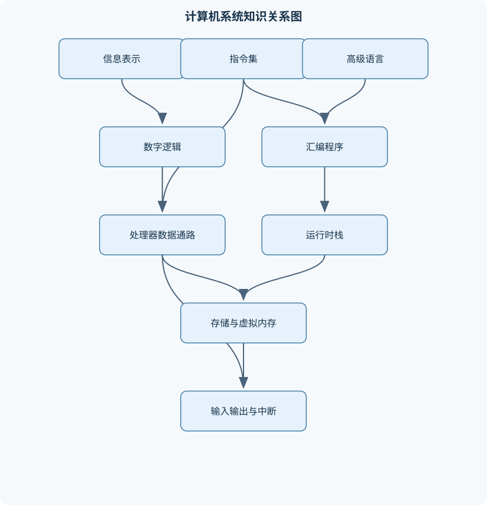
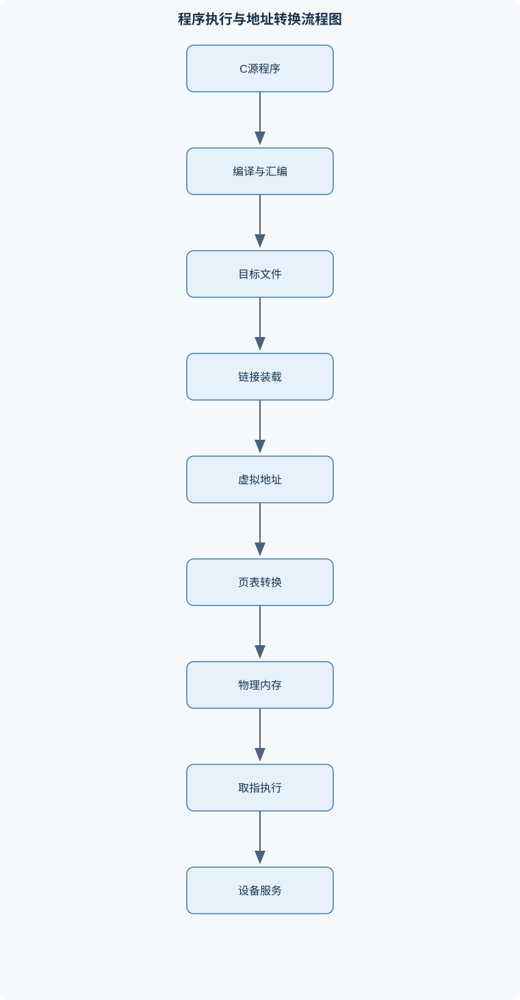

# 计算机系统概论

## 一、课程整体知识框架

### 课程边界与先修知识

面向计算机科学与工程本科生，系统讲解计算机从数字逻辑、指令集、处理器、存储系统到高级语言程序执行和操作系统支持的完整抽象链条。课程边界包括信息的二进制表示、组合与时序逻辑、冯·诺依曼模型、LC-3风格指令集与汇编、数据通路和控制器、子程序与运行时栈、C语言到机器代码的翻译、链接装载、输入输出与中断、虚拟内存、性能分析和系统级调试。先修知识包括高中或大学基础数学、离散数学中的集合与逻辑、基本程序设计、整数与函数运算；不要求先修数字电路或操作系统，但课程前两模块需补足逻辑门、寄存器和地址空间基础。课程不覆盖具体商业处理器的全部微架构、完整操作系统内核实现、网络协议栈、数据库内部实现和编译器优化器的全部细节。理想模型以定长字长、同步时钟、单处理器和LC-3式教学体系为主，同时明确缓存、流水线、并发、设备延迟和实现差异带来的现实限制。





### 1. 课程对象、边界与主线

《计算机系统概论》研究一个程序如何从抽象的数学对象和高级语言表达，逐层变成处理器能够执行的状态变化，并进一步说明操作系统如何为程序提供受保护的地址空间、输入输出和异常处理机制。课程主线可以表示为：

$$
\text{信息表示}
\rightarrow
\text{逻辑电路}
\rightarrow
\text{指令集架构}
\rightarrow
\text{数据通路与控制器}
\rightarrow
\text{汇编程序}
\rightarrow
\text{运行时栈}
\rightarrow
\text{编译、链接与装载}
\rightarrow
\text{输入输出与中断}
\rightarrow
\text{存储层次与虚拟内存}
\rightarrow
\text{性能和系统调试}
$$

这条链条不是简单的知识点排列，而是多个抽象层之间的约束传递。上层程序依赖下层提供的语义：C语言中的函数调用必须对应某种机器级调用约定；机器指令中的地址必须能够映射到存储器；虚拟地址必须经过地址转换后才能访问物理内存；设备输入必须通过轮询、中断或系统服务进入程序可见的状态。

课程采用定长字长、同步时钟、单处理器和LC-3风格教学体系作为主要理想模型。理想模型便于精确描述寄存器、指令和存储器的关系，但不等于所有现实计算机的实现。现实处理器可能采用流水线、多发射、乱序执行、多级缓存、多核并发和复杂的分支预测；现实操作系统还要处理并发、锁、设备驱动和资源隔离。因此，课程重点是建立跨层推理能力，而不是记忆某一种商业处理器的全部微架构。

课程先修基础包括整数与函数运算、集合和逻辑、基本程序设计以及简单的内存和地址概念。数字电路和操作系统不是必需先修内容，前面的逻辑门、寄存器、地址空间和特权状态模块会补充必要基础。

### 2. 统一符号与状态描述

位用小写字母 $b$ 表示，位串用大写字母或下标表示。$1\ \text{byte}$ 通常等于 $8\ \text{bit}$，但严格使用时应以具体体系结构的定义为准。字长用 $W$ 表示，地址宽度用 $A$ 表示。若机器按字节寻址，则 $A$ 位地址最多表示

$$
2^A
$$

个字节地址，地址范围为 $0$ 至 $2^A-1$。地址本身没有“整数大小”之外的自然语义，它可能指向指令、字符、数组元素或设备寄存器，具体含义由系统约定决定。

在LC-3模型中，$R0$ 至 $R7$ 是通用寄存器；$PC$ 是程序计数器，保存下一条待取指令的地址；$IR$ 是指令寄存器，保存当前正在解释的机器指令；$MAR$ 保存本次存储器访问的地址；$MDR$ 保存从存储器读出的数据或将要写入存储器的数据；$PSR$ 保存处理器状态，包括特权级和条件码等信息。用 $R[i]$ 表示寄存器 $Ri$ 的内容，用 $\operatorname{Mem}[x]$ 表示地址 $x$ 处的存储单元内容，箭头表示状态更新，例如：

$$
PC \leftarrow PC+1
$$

同一位串可以有多种解释。若把 $W$ 位位串解释为无符号整数，其范围为 $0$ 至 $2^W-1$，原因是每一位有两种取值，共有 $2^W$ 种组合。若解释为补码整数，最高位权值为 $-2^{W-1}$，其余位权值依次为 $2^{W-2},\ldots,2^0$，所以范围为：

$$
-2^{W-1}\leq x\leq 2^{W-1}-1
$$

补码负数的构造方法是先写出对应正数，逐位取反后加 $1$，并在固定的 $W$ 位中截断。补码加法本质上是模 $2^W$ 运算：只保留低 $W$ 位。若两个操作数同号，而结果与它们异号，则发生有符号溢出；无符号加法则依据最高位产生的进位判断是否超出范围。不能把“位串溢出”和“物理存储器损坏”混为一谈，前者是解释范围有限造成的数值问题。

浮点数使用符号、指数和有效数等字段，以较大的范围表示实数，但通常不能精确表示所有实数。例如十进制的某些有限小数在二进制中是无限循环小数，因此浮点运算存在舍入误差。整数溢出是有限位宽导致的离散截断，浮点误差则与规格化、舍入和数量级有关，二者的诊断方法不同。字符编码把字符映射为整数编码，字符串通常由连续字符单元和结束标记或长度信息组成；字符编码值不能直接等同于字符的自然语言含义。

### 3. 抽象层之间的因果关系

数字计算把输入编码成有限位串，通过逻辑电路和状态机进行确定性变换。冯·诺依曼存储程序模型把指令和数据放入统一存储器，处理器反复执行“取指—译码—执行”的循环。程序不再是固定接线的单一计算过程，而是可以把指令作为数据装入内存，再由处理器依次解释。

指令集架构，即ISA，规定程序员可观察的机器接口，包括指令编码、寄存器、寻址方式、条件码、异常语义和存储器访问规则。微体系结构则说明这些指令如何由数据通路、控制器、缓存和流水线实现。同一ISA可以由不同微体系结构实现，因此不能把“指令能做什么”和“硬件内部怎样做”混为一谈。

机器级执行的核心是状态转移。一次指令执行可能改变 $PC$、通用寄存器、条件码和内存；未被指令语义允许改变的状态应保持不变。LC-3风格的基本过程为：取出 $\operatorname{Mem}[PC]$ 到 $IR$，使 $PC$ 加一，依据操作码译码，再执行算术、访存、分支或控制转移。分支目标通常使用更新后的 $PC$ 加符号扩展偏移，因此若忽略取指阶段的递增，就会产生一个指令位置的偏差。

高级语言通过编译、汇编、链接和装载逐步降低抽象。编译器把变量、表达式、数组、条件和函数映射到机器级操作；汇编器把助记符和标签转换为机器字；链接器解析跨文件符号并完成重定位；装载器建立进程地址空间、设置入口点和运行时环境。任何一层的约定不一致，都可能表现为错误的分支、错误的地址、破坏的返回地址或非法内存访问。

### 4. 理想模型与现实限制

理想模型常假设每条指令按确定顺序执行、存储器访问时间固定、只有一个处理器、所有地址均可直接访问。这些假设适合推导ISA语义和调试单条指令，但现实系统中存在重要偏差。

第一，缓存使同一地址的访问时间取决于是否命中；第二，流水线把多条指令的不同阶段重叠执行，产生结构冒险、数据依赖和控制冒险；第三，虚拟内存使虚拟地址和物理地址分离，访问缺页时需要操作系统介入；第四，设备访问通常比寄存器或主存慢，并可能具有副作用；第五，多核和中断使程序观察到的状态变化不一定只来自当前指令流。因此，单纯比较时钟频率不能直接得出程序性能，必须结合指令数、平均每条指令周期数、缓存行为、I/O等待和并发条件。

CPU时间可写为：

$$
\text{CPU时间}=I\times \text{平均每条指令周期数}\times T
$$

其中 $I$ 是执行的指令数，单位为条；平均每条指令周期数是无量纲量；$T$ 是一个时钟周期的时间，单位为秒。若时钟频率为 $f$，则 $T=1/f$。若平均每条指令需要 $C$ 个周期，理想情况下指令吞吐率约为 $f/C$ 条每秒。MHz表示每秒百万个时钟周期，MIPS表示每秒百万条指令，二者只有在平均CPI和指令定义相同时才可能建立简单换算。

## 二、章节和模块划分

### 核心知识覆盖清单

本清单用于检查正文是否覆盖本课程的主要知识模块：

- **计算机系统抽象与信息表示**：计算机系统的层次抽象、模拟计算与数字计算、冯·诺依曼存储程序模型、位、字节、字长与地址、无符号整数编码、补码有符号整数、浮点数表示概念、字符编码与字符串、溢出与精度边界。
- **布尔代数与数字逻辑**：逻辑变量与真值表、与或非及复合逻辑门、布尔代数恒等式、规范积之和表达式、组合逻辑电路、多路选择器与译码器、加法器与算术逻辑单元、锁存器与触发器、寄存器和时钟同步。
- **指令集架构与LC-3编程模型**：ISA与微体系结构的区别、LC-3寄存器与程序状态、指令编码字段、立即数与符号扩展、寄存器寻址、PC相对寻址、基址加偏移寻址、条件码N、Z、P、取指与执行语义。
- **汇编语言与机器级控制流**：ADD、AND、NOT运算指令、LD、ST、LDR、STR数据传送、BR条件分支、JMP与RET、JSR和JSRR子程序调用、TRAP系统服务调用、ASCII输入输出、标签、伪指令与汇编布局、汇编程序调试。
- **处理器数据通路与控制器**：取指阶段数据流、译码与寄存器读写、算术逻辑单元控制、存储器读写时序、有限状态控制器、微指令与控制信号、PC和MDR等系统寄存器、时钟周期与机器周期、停止时钟与处理器状态。
- **子程序、栈与运行时环境**：调用约定与返回地址、调用者保存与被调用者保存、参数传递和返回值、栈指针R6与帧指针R5、活动记录布局、动态链与返回地址、递归调用的栈变化、局部变量与作用域、栈溢出及其成因。
- **C语言结构与机器级翻译**：变量、类型和对象表示、常量、字面量与符号值、整数和浮点运算、指针与地址运算、数组与结构体布局、条件和循环的控制流、函数调用翻译、编译与解释的区别、符号表和内存偏移。
- **汇编、链接与可执行映像**：汇编器的符号解析、目标文件与重定位、外部符号和库例程、链接器地址解析、装载器建立地址空间、代码段与数据段、静态链接与动态链接概念、未定义符号错误、可执行文件入口点。
- **输入输出、陷阱与中断**：内存映射输入输出、设备状态寄存器、轮询式输入输出、TRAP与服务例程、特权模式与用户模式、陷阱向量表、外部中断机制、中断现场保存与恢复、RTI与中断返回。
- **存储层次与虚拟内存**：局部性原理、寄存器、缓存、主存和外存、缓存命中与缺失、地址空间与物理内存、页和页表、地址转换、缺页异常、交换空间与页面换入换出、页面置换与抖动。
- **性能、并发与系统可靠性**：指令数与时钟周期、MIPS与MHz的区别、延迟、吞吐量与带宽、平均访存时间、流水线基本思想、结构冒险与控制冒险概念、并行执行的依赖约束、系统调用开销、错误传播与边界检查。
- **综合系统实验与调试分析**：从C程序到可执行映像、汇编跟踪与寄存器检查、内存布局追踪、调用栈和返回地址检查、设备轮询实验、中断处理流程分析、虚拟内存性能实验、故障定位与最小复现、系统层次综合报告。


### 1. 计算机系统抽象与信息表示

本模块先说明模拟计算与数字计算的差异。模拟系统用连续物理量表示数值，测量精度容易受到噪声、器件误差和校准误差影响；数字系统使用离散编码，便于复制、存储、校验和逻辑处理，但表示范围和精度受位数限制。

重点包括位、字节、字长、地址、无符号整数、补码、浮点数、字符和字符串。推导 $W$ 位无符号范围时，应先数出 $2^W$ 个位组合，再从最小组合到最大组合编号。推导补码范围时，把最高位赋予负权值 $-2^{W-1}$，其余位保持正权值。补码加法的边界反例是：$0111\,1111+0000\,0001=1000\,0000$，在8位补码中结果为 $-128$，因为正数相加得到负数，发生溢出；但从位级模运算看，低8位仍然是正确的模$256$结果。

### 2. 布尔代数与数字逻辑

逻辑变量只有0和1，基本逻辑门包括与、或、非，复合电路则由这些门连接而成。真值表描述输入组合与输出之间的完整关系；布尔代数恒等式用于化简逻辑表达式。规范积之和表达式的构造方法是：对输出为1的每一行，写出一个包含全部输入变量的乘积项，再把这些乘积项相或。

组合逻辑电路的输出只由当前输入决定。多路选择器根据选择信号从多个输入中选一个，译码器把二进制选择值转换成互斥的输出线。加法器把进位作为额外输入，多个全加器可以构成多位加法器；算术逻辑单元则组合加法、逻辑与、逻辑或、取反等操作。

时序逻辑电路具有状态，输出不仅取决于当前输入，还取决于此前保存的值。锁存器通常具有电平敏感性，触发器通常在时钟边沿采样输入。寄存器由多个存储单元组成，用于保存字长为 $W$ 的数据。同步系统要求状态更新服从统一时钟，但现实电路仍需处理传播延迟、建立时间和保持时间。不能用组合逻辑直接替代寄存器，否则无法描述跨时钟周期保持的处理器状态。

### 3. 指令集架构与LC-3编程模型

ISA规定指令的位字段、操作数来源、结果位置、寻址规则和状态更新。LC-3使用16位指令字，通常包含4位操作码以及寄存器编号、立即数字段或偏移字段。寄存器寻址直接指定 $R0$ 至 $R7$；立即数直接嵌入指令，但位数有限，使用前通常要符号扩展。若立即数字段为 $k$ 位，符号扩展后可表示的范围是：

$$
-2^{k-1}\leq x\leq 2^{k-1}-1
$$

PC相对寻址的目标为：

$$
\text{目标地址}=PC_{\text{递增后}}+\operatorname{Sext}(\text{偏移})
$$

基址加偏移寻址则使用某个寄存器内容加符号扩展偏移。条件码 $N、Z、P$ 分别表示最近一次规定会更新条件码的结果为负、零、正。并非所有指令都更新条件码，必须依据ISA逐条判断。

### 4. 汇编语言与机器级控制流

ADD、AND和NOT完成基本算术逻辑运算；LD、ST、LDR和STR负责在寄存器与内存之间传送数据；BR根据条件码决定是否修改PC；JMP进行寄存器间接跳转；JSR和JSRR保存返回地址后调用子程序；RET通常等价于跳转到保存于 $R7$ 的返回地址；TRAP通过系统规定的服务入口请求输入、输出或停止等服务。

标签是汇编器使用的符号地址，不是运行时自动存在的变量。伪指令用于表达数据分配、常量定义或程序起始位置，汇编器会把它们转换成实际机器字或占用相应存储空间。汇编调试应逐步记录PC、IR、通用寄存器、条件码和受影响内存，特别检查分支目标、立即数符号扩展以及 $R7$ 是否被嵌套调用覆盖。

### 5. 处理器数据通路与控制器

数据通路包含总线、寄存器、加法器、ALU和存储器接口；控制器依据当前状态、指令字段和条件码产生控制信号。取指阶段通常包括把PC送入MAR、访问内存、把数据送入MDR、将MDR写入IR，并更新PC。译码阶段读取寄存器编号和操作码，执行阶段由ALU计算结果或生成地址，访存阶段完成读写，写回阶段更新寄存器和条件码。

有限状态控制器把一条指令拆成多个机器周期，每个状态在一个或多个时钟周期内产生特定控制信号。微指令控制器则用更细粒度的控制字段描述状态转移。存储器读写的具体时序取决于硬件接口，不能假设发出地址后数据立即可用。HALT或停止时钟状态表示处理器不再继续取指，但外部系统是否仍能复位或响应设备请求，取决于实现。

### 6. 子程序、栈与运行时环境

函数调用必须保存返回控制点，并按照调用约定处理参数、返回值和寄存器。调用者保存寄存器由调用者在调用前备份；被调用者保存寄存器由被调用函数在使用前保存、返回前恢复。两种责任不能混用，否则嵌套调用会破坏仍需使用的数据。

栈通常向低地址或高地址的一端增长，具体方向由约定决定。教学模型中可令SP对应 $R6$、FP对应 $R5$。活动记录可以包含参数、返回值空间、返回地址、动态链、保存的寄存器和局部变量。FP指向当前栈帧中的固定位置，使局部变量和参数可以用稳定偏移访问；SP则随压栈、出栈变化。

一次调用至少要保存返回地址。如果函数递归调用自身，每次调用都要建立新的活动记录，最大递归深度为 $d$ 时，栈空间通常为 $O(d)$。递归终止条件缺失、局部变量过大、无限增长的参数或未恢复SP，都可能导致栈溢出。动态链保存调用者的帧指针，用于返回时恢复调用链；它不等同于静态作用域链，后者与语言的嵌套作用域规则有关。

### 7. C语言结构与机器级翻译

C语言变量具有类型、大小、对齐和存储位置。整数类型通常映射为固定宽度位串，浮点类型需要额外的指数和有效数解释。指针保存地址，指针加法的步长由所指向对象的类型决定：若指针指向占用4字节的对象，增加1通常意味着地址增加4，而不是增加1字节。

数组元素连续存放，元素地址可表示为：

$$
\operatorname{addr}(a[i])=\operatorname{addr}(a[0])+i\times \operatorname{sizeof}(\text{element})
$$

该式要求 $i$ 在合法范围内，且数组对象确实是连续布局。结构体成员通常按声明顺序排列，但编译器可能插入填充以满足对齐要求，因此不能简单把成员大小相加作为结构体总大小。

条件语句翻译成条件码设置与分支，循环翻译成初始化、条件测试、循环体和回跳。函数翻译需要确定参数传递、返回值位置、寄存器保存责任和栈帧偏移。编译把高级语言转换为较低层代码，解释则由运行时逐步执行或转换；二者在执行时机、运行时开销和错误暴露位置上不同。符号表记录变量、函数和标签的名称及其类型、作用域、段位置或偏移，机器级访问最终需要具体地址或相对偏移。

### 8. 汇编、链接与可执行映像

汇编器通常需要两遍扫描。第一遍计算每条指令和伪指令占用的地址，并把标签写入符号表；第二遍依据符号表编码操作码、寄存器、立即数和偏移，并检查偏移范围。若标签尚未定义，或目标超出可表示范围，应产生诊断，而不是静默截断。

目标文件通常包含代码段、数据段、符号信息和重定位信息。外部函数调用在单个模块中可能只有未定义符号，链接器把多个目标模块和库例程合并，确定每个符号的最终地址，并修改需要重定位的字段。未定义符号表示没有找到对应定义；重复定义表示多个模块对同一应唯一符号提供定义，二者都属于链接阶段的错误。

静态链接把所需库代码复制到可执行映像；动态链接把部分解析推迟到装载或运行时。装载器建立进程地址空间，映射代码段和数据段，设置栈、堆等区域，并把PC设为入口点。可执行文件的入口点不是任意函数名，而是装载器和运行时约定的初始控制位置。

### 9. 输入输出、陷阱与中断

内存映射I/O把设备寄存器放入处理器可访问的地址空间。设备状态寄存器可能包含“输入就绪”“输出就绪”“错误”等位，数据寄存器保存实际字符或字节。轮询方式由处理器反复读取状态寄存器，直到设备就绪；优点是实现简单，缺点是处理器在等待期间持续消耗执行资源。

TRAP是程序主动请求系统服务的控制转移，通常通过陷阱向量表定位服务例程，并保存返回控制点。外部中断由设备异步提出请求，处理器在允许的边界保存PC和状态寄存器，切换到特权模式，依据向量表进入中断服务例程。服务例程必须确认并清除设备请求，否则返回后可能立即再次进入同一中断。RTI用于恢复被中断程序的状态并返回。

用户模式不能任意修改页表、设备控制寄存器或停止处理器时钟。特权检查是隔离机制的一部分。TRAP、普通JSR和外部中断都涉及控制转移，但触发来源、保存状态、权限变化和返回指令不同，不能视为同一种调用。

### 10. 存储层次与虚拟内存

存储层次利用局部性原理：时间局部性表示最近访问的数据可能很快再次访问，空间局部性表示邻近地址可能被连续访问。寄存器最快但容量最小，缓存、主存和外存依次扩大容量并增加访问延迟。缓存命中率为 $h$，缺失率为 $m=1-h$。单级缓存的平均访存时间为：

$$
\operatorname{AMAT}=t_{\text{命中}}+m\times t_{\text{缺失代价}}
$$

其中时间单位必须一致。多级缓存中，下一层的平均访问时间还要递归计入更低层访问代价。缓存命中率高并不保证整体性能高，因为一次缺失的代价可能很大，访问模式、替换策略、预取和并发也会影响结果。

虚拟内存把进程看到的虚拟地址与实际物理地址分离。若页大小为 $P=2^p$ 字节，虚拟地址低 $p$ 位是页内偏移PO，其余高位为虚拟页号VPN。页表把VPN转换为物理页号PPN，页内偏移保持不变：

$$
\text{虚拟地址}=\text{VPN}\times P+\text{PO}
$$

有效时：

$$
\text{物理地址}=\text{PPN}\times P+\text{PO}
$$

若页表项的存在位为0，处理器触发缺页异常。操作系统保存异常现场，检查访问是否合法，必要时从后备存储取入页面，更新页表和权限信息，恢复现场并重试指令；若访问权限不允许，则转为保护错误。缺页不能简单视为普通缓存缺失，因为它通常需要操作系统参与，代价远大于片上缓存访问。

### 11. 性能、并发与系统可靠性

性能分析必须区分延迟、吞吐量和带宽。延迟是一次操作完成所需时间；吞吐量是单位时间完成的操作数；带宽是单位时间传输的字节数。流水线通过重叠不同指令的阶段提高吞吐量，但单条指令延迟不一定降低。结构冒险来自硬件资源冲突，数据冒险来自读写依赖，控制冒险来自分支方向或目标未知。

并行执行必须满足依赖约束。若后一操作读取前一操作尚未产生的结果，就不能无条件重排。系统调用还会增加用户态和特权态之间的切换、参数检查及设备等待开销。边界检查、权限检查和错误返回是可靠性的重要组成部分；数组越界、非法指针、未定义符号、错误页权限和未清除中断请求都可能使局部错误传播到整个系统。

### 12. 综合系统实验与调试分析

综合实验把一个短C程序追踪到可执行映像：先确定变量和数组布局，再查看编译后的控制流，随后检查汇编、目标文件中的符号和重定位，最后在装载后观察入口点、栈和堆。调试记录应至少包含输入、预期结果、实际结果、关键寄存器、相关内存地址和触发故障的最小步骤。

汇编跟踪实验要求逐条记录取指后的PC、IR、寄存器、条件码和内存变化。调用栈实验则检查SP、FP、返回地址、动态链和局部变量偏移。设备实验可以比较轮询与中断：轮询记录状态寄存器读取次数和等待时间，中断记录现场保存、向量查找、服务例程和RTI顺序。虚拟内存实验应记录VPN、PO、PPN、权限位、缺页次数和页面置换结果。

### 13. 代表性算法与流程

#### 13.1 LC-3指令执行跟踪

**输入**：初始寄存器、PC、内存和待执行指令序列。  
**输出**：每步执行后的PC、寄存器、条件码和内存变化。  
**过程**：依次执行取指、PC递增、译码、执行、访存和写回；每一步只按照当前ISA允许的状态更新。  
**不变量**：处理器状态始终由寄存器、PC、条件码和内存共同确定，未被指令修改的状态保持不变。  
**终止条件**：遇到HALT、非法指令或达到指定跟踪步数。  
**复杂度**：跟踪 $N$ 条指令为 $O(N)$，若每条指令按固定宽度处理，额外空间为 $O(1)$。

```text
伪代码
输入：状态 S = (PC, R[0..7], Mem, CC)，最大步数 K
输出：状态变化记录 Trace

for step from 1 to K:
    IR ← Mem[PC]
    oldPC ← PC
    PC ← PC + 1

    opcode ← IR 的高4位
    根据 opcode 解释寄存器、立即数和偏移字段

    if opcode 是 ADD:
        计算源操作数之和
        写入目标寄存器
        按结果更新 N、Z、P
    else if opcode 是 LD:
        addr ← PC + Sext(偏移)
        MDR ← Mem[addr]
        写入目标寄存器
        按读出结果更新 N、Z、P
    else if opcode 是 ST:
        addr ← PC + Sext(偏移)
        Mem[addr] ← 源寄存器内容
    else if opcode 是 BR:
        if 条件码满足分支条件:
            PC ← PC + Sext(偏移)
    else if opcode 是 HALT:
        记录状态并终止
    else:
        报告非法指令并终止

    将 oldPC、IR、PC、寄存器变化、CC 和内存变化写入 Trace
```

#### 13.2 汇编符号解析

第一遍扫描源程序，维护当前位置计数器，遇到标签就记录标签地址，并计算伪指令占用的字数；第二遍根据符号表编码操作码和偏移。若PC相对偏移字段为 $k$ 位，必须检查目标与更新后PC之差是否落入 $[-2^{k-1},2^{k-1}-1]$。符号表中同一标签重复定义时应报错，引用未定义标签时应报错。

#### 13.3 虚拟地址转换

**输入**：虚拟地址、页大小、页表和权限要求。  
**输出**：物理地址或缺页、保护异常。  
**过程**：拆分VPN和PO，查询页表项，检查存在位和访问权限，有效时拼接PPN与原PO。  
**不变量**：地址转换不改变页内偏移。  
**复杂度**：一次页表查找通常视为 $O(1)$，不包括缺页服务、磁盘I/O和页面置换代价。

#### 13.4 子程序栈帧构造

调用者先按约定压入参数或建立返回值空间；被调用者保存返回地址和需要保护的寄存器，保存动态链，设置FP，分配局部变量空间。返回时写入返回值，释放局部变量，恢复动态链和返回地址，恢复SP，并执行RET。若最大嵌套深度为 $d$，每帧平均占用常数空间，则递归栈空间为 $O(d)$。

### 14. 代表性例题

#### 例题一：8位位串的两种解释

**题干**：将位串 `10000001` 分别解释为8位无符号整数和8位补码整数，并计算其补码相反数。

**分析**：无符号解释把最高位权值看作 $2^7$；补码解释把最高位权值看作 $-2^7$。求相反数应逐位取反后加1。

**逐步解答**：

无符号值为：

$$
1\times128+1\times1=129
$$

补码值为：

$$
-128+1=-127
$$

逐位取反：

```text
10000001 → 01111110
```

再加1：

```text
01111110 + 00000001 = 01111111
```

结果为 $127$，正好是 $-127$ 的相反数。

**结果验证**：$-127+127=0$，且8位补码范围为 $-128$ 至 $127$，结果在范围内。

**变式**：若位串为 `10000000`，其补码值为 $-128$。取反加1仍得到 `10000000`，因为 $+128$ 超出8位补码正数范围；这说明最小负数没有可表示的正相反数。

#### 例题二：PC相对分支

**题干**：当前指令位于地址 $x3000$，取指后PC更新为 $x3001$，分支偏移经符号扩展后为 $-3$。若条件满足，目标地址是多少？

**分析**：PC相对寻址使用递增后的PC，而不是当前指令地址。

**逐步解答**：

$$
\text{目标地址}=x3001+(-3)=x2FFE
$$

**结果验证**：若错误地使用当前地址，会得到 $x2FFD$，相差一个指令位置，说明没有遵循取指后的PC语义。

**变式**：偏移为 $+3$ 时，目标地址是 $x3004$。若偏移字段只有9位，必须先检查 $+3$ 是否可表示，不能直接假定所有整数都能编码。

#### 例题三：虚拟地址转换

**题干**：虚拟地址宽度为16位，页大小为256字节，某虚拟地址为 `0x35A7`。页表中VPN为 `0x35` 的页表项给出PPN为 `0x12A`，存在位为1且权限允许读取。求物理地址。

**分析**：页大小 $256=2^8$，因此低8位为页内偏移，高8位为VPN。

**逐步解答**：

$$
\text{VPN}=0x35,\qquad \text{PO}=0xA7
$$

物理页号为 $0x12A$，所以：

$$
\text{物理地址}=0x12A\times0x100+0xA7=0x12AA7
$$

**结果验证**：页内偏移仍为 `0xA7`，只替换了高位页号，符合地址转换规则。

**变式**：若存在位为0，不能继续拼接物理地址，而应触发缺页异常；若存在位为1但访问权限不含读取，则应触发保护异常。

#### 例题四：平均访存时间

**题干**：缓存命中时间为2 ns，命中率为95%，缺失后访问主存及完成传送的缺失代价为80 ns。求平均访存时间。

**分析**：缺失率为：

$$
m=1-0.95=0.05
$$

使用：

$$
\operatorname{AMAT}=t_{\text{命中}}+m\times t_{\text{缺失代价}}
$$

**逐步解答**：

$$
\operatorname{AMAT}=2+0.05\times80=6\ \text{ns}
$$

**结果验证**：平均时间应大于命中时间2 ns，且远小于每次都缺失时的访问时间，结果满足边界直觉。

**变式**：若命中率提高到99%，AMAT为 $2+0.01\times80=2.8\ \text{ns}$。这说明缺失率的小幅变化在缺失代价较大时也可能显著影响性能。

#### 例题五：时钟频率与CPU时间

**题干**：程序执行 $10^6$ 条指令，平均CPI为4，处理器频率为2 GHz。求CPU时间和理想指令吞吐率。

**分析**：2 GHz表示每秒 $2\times10^9$ 个周期，一个周期时间为：

$$
T=\frac{1}{2\times10^9}\ \text{s}
$$

总周期数为：

$$
I\times C=10^6\times4=4\times10^6
$$

**逐步解答**：

$$
\text{CPU时间}=4\times10^6\times\frac{1}{2\times10^9}
=2\times10^{-3}\ \text{s}
$$

即 $2$ ms。理想指令吞吐率为：

$$
\frac{2\times10^9}{4}=5\times10^8
$$

条每秒。

**结果验证**：CPI越大，吞吐率越低；不能直接把2 GHz写成2 GIPS，因为一个指令平均占用4个周期。

**变式**：若另一程序指令数减少一半但CPI翻倍，理想CPU时间不变，说明只减少指令数或只提高频率都不能单独代表性能提升。

### 15. 综合实验与项目

#### 实验一：从C程序到机器状态的端到端追踪

**目标**：观察高级语言变量如何映射为内存、寄存器、分支和函数调用。

**输入数据**：使用一个不依赖外部文件的短程序，例如计算四个整数的平均值，并调用一个函数完成求和。输入取固定整数集合，如 `2、4、6、8`，同时设置一个包含条件分支的测试用例。

**步骤**：

1. 明确每个变量的类型、初始值和预期结果。
2. 列出数组或局部变量的逻辑布局，说明每个元素的字节偏移。
3. 查看或手工写出LC-3风格伪汇编，标出参数、返回值和局部变量位置。
4. 对每条ADD、LD、ST、BR、JSR和RET记录PC、寄存器、条件码和内存。
5. 检查调用前后的SP、FP和R7，确认返回地址没有被覆盖。
6. 对照C程序结果验证机器级执行结果。

**评价标准**：结果正确占主要部分；每次状态变化有明确依据；PC相对偏移计算无误；调用前后保存的寄存器和栈帧能够恢复；能说明错误首先出现在哪一层。

**排错方法**：若最终结果错误，先检查数组元素地址是否按元素大小递增；若函数返回后跳转异常，检查R7是否被嵌套调用覆盖；若循环多执行或少执行一次，检查条件码更新指令和分支目标；若数值突然变负，检查补码溢出和位宽截断。

#### 实验二：缓存、虚拟内存与性能对比

**目标**：比较顺序访问、跨步访问和页面缺失对性能的影响。

**输入数据**：设置固定大小的整数数组、不同访问步长、给定缓存行大小和页大小；在虚拟内存分析中提供页表项的VPN、PPN、存在位和权限位。

**步骤**：

1. 对每一种访问模式列出前若干次访问地址。
2. 按缓存行大小判断每次访问属于哪一缓存行，记录命中或缺失。
3. 根据命中率和缺失代价计算AMAT。
4. 将虚拟地址拆成VPN和PO，查表得到PPN或异常。
5. 对存在位为0的页面写出缺页处理链：保存现场、检查权限、选择页框、换入页面、更新页表、恢复并重试。
6. 固定程序和硬件条件，只改变访问步长或页框数，测量运行时间和缺失次数。

**评价标准**：地址分解正确；缓存命中判断与替换规则一致；缺页和保护异常区分正确；实验中每组只改变一个自变量；报告同时给出运行时间、命中率、缺页次数和解释，而不是只给出单个性能数字。

**排错方法**：若所有访问都被判为缺失，检查缓存初始状态和缓存行标识；若物理地址页内偏移改变，说明地址拆分错误；若页表无效却继续执行，说明遗漏了异常路径；若测量结果波动较大，应区分I/O时间、预热效应、系统调度和统计开销，不能把一次测量直接当作稳定结论。

## 三、核心概念的详细解释

### 1. 计算机系统的抽象链条与冯·诺依曼模型

计算机系统通过层次抽象把复杂任务分解为相互约束的若干层。信息首先以位串形式表示，位串由逻辑门和存储元件处理；逻辑电路构成数据通路和控制器；指令集架构规定软件可见的寄存器、指令和内存语义；汇编程序使用这些指令表达控制流和数据操作；编译器把高级语言映射到机器级表示；链接器和装载器建立可执行映像；操作系统进一步提供虚拟内存、输入输出、异常和保护机制。

冯·诺依曼存储程序模型把指令和数据统一存放在可寻址存储器中。处理器通过程序计数器 $PC$ 找到下一条指令，将其取入指令寄存器 $IR$，译码后驱动数据通路完成运算、访存或控制转移。典型状态更新可表示为：

$$
IR\leftarrow \operatorname{Mem}[PC],\qquad PC\leftarrow PC+1
$$

这里的 $PC+1$ 代表下一存储单元地址。在按字节寻址且一条指令占多个字节的体系结构中，实际增量可能不是 $1$，因此“PC加一”必须理解为体系结构定义的下一条指令地址，而不能脱离机器模型机械套用。

ISA规定“指令执行后系统应呈现什么状态”，微体系结构规定“用什么数据通路、控制信号、流水线和缓存实现该状态”。同一ISA可以由单周期处理器、分多周期处理器或带流水线的处理器实现。程序只能依赖ISA规定的可观察行为，不能假定某种具体缓存大小、内部寄存器数量或执行顺序。

### 2. 位、字节、地址与数值表示

位是二进制信息的基本单位，只有 $0$ 和 $1$ 两种状态。通常 $1\ \text{byte}=8\ \text{bit}$，但严格分析时应以体系结构定义为准。字长 $W$ 表示处理器一次自然处理的数据位数。地址宽度为 $A$ 时，若按字节寻址，最多可表示 $2^A$ 个字节地址，地址范围为：

$$
0\leq x\leq 2^A-1
$$

位串本身不自动具有唯一数值含义。例如 `11111111` 在8位无符号解释下为255，在8位补码解释下为$-1$，在字符解释下可能表示一个编码值。解释方式由指令、数据类型和上下文共同决定。

无符号整数的每一位权值为 $2^i$。$W$ 位无符号整数的最大值是：

$$
\sum_{i=0}^{W-1}2^i=2^W-1
$$

补码整数把最高位权值改为负值，因此：

$$
x=-b_{W-1}2^{W-1}+\sum_{i=0}^{W-2}b_i2^i
$$

其范围为：

$$
-2^{W-1}\leq x\leq 2^{W-1}-1
$$

补码负数的构造步骤是：写出对应正数的 $W$ 位形式，逐位取反，再加 $1$，最后只保留低 $W$ 位。由于固定宽度下加法等价于模 $2^W$ 运算，超出高位的进位会被截断。截断不是“数值保持不变”，而是把结果映射回有限位宽。

有符号溢出的判定条件是：两个操作数同号，而结果与操作数异号。两个正数相加得到负数，或两个负数相加得到正数，均表示有符号溢出。无符号溢出则看最高位产生的进位。两种溢出概念不能混用。

浮点数通常由符号、有效数字和指数等部分构成。它能表示很大或很小的数，但表示集合不是连续实数集合。浮点加法可能出现舍入误差、吸收现象和非结合性。例如先计算 $(10^{20}+(-10^{20}))+1$ 与先计算 $10^{20}+((-10^{20})+1)$，由于有限精度舍入，中间结果可能不同。浮点数不适合直接用等号判断一般计算结果，工程上通常需要规定容差。

字符和字符串也是位串。ASCII将常用英文字符映射到整数编码；字符串通常由连续字符和终止标记组成，或者由显式长度与字符序列组成。字符编码不能与整数数值语义混淆，`'0'` 的编码通常不等于整数0。

### 3. 布尔代数与数字逻辑

逻辑变量只能取真或假，硬件中通常对应高、低电平。与、或、非分别可写作 $x\land y$、$x\lor y$ 和 $\lnot x$。真值表完整描述有限输入组合下的输出，因此任何组合逻辑函数都可以由真值表转换得到。

布尔代数常用恒等式包括：

$$
x\land 1=x,\qquad x\lor 0=x
$$

$$
x\land 0=0,\qquad x\lor 1=1
$$

$$
x\land x=x,\qquad x\lor x=x
$$

$$
x\land \lnot x=0,\qquad x\lor \lnot x=1
$$

德摩根定律为：

$$
\lnot(x\land y)=\lnot x\lor\lnot y
$$

$$
\lnot(x\lor y)=\lnot x\land\lnot y
$$

组合电路的输出只依赖当前输入，不保存历史状态。多路选择器根据选择信号从多个输入中选择一个输出；译码器把少量二进制选择位转换为互斥的控制线；加法器完成二进制加法；算术逻辑单元根据控制信号执行加法、逻辑与、逻辑或、取反等操作。

例如四个输入 $a,b,c,d$ 的平均值可以先通过加法树求和，再乘以 $0.25$：

$$
\operatorname{avg}(a,b,c,d)=0.25(a+b+c+d)
$$

在二进制定点实现中，乘以 $0.25$ 常对应右移两位，但只有在数值范围、符号扩展和舍入规则均满足时才能直接替换。若输入为整数，右移通常会舍弃低位，结果可能向负无穷取整、向零截断或按体系结构规则处理。加法树还可能在最终右移前溢出，因此“平均值范围较小”不等于中间求和一定不会溢出。

时序逻辑包含状态。锁存器在某一电平有效期间可能持续响应输入，触发器通常在时钟边沿采样输入。寄存器由多个存储元件组成，用来保存一个字或多个控制状态。同步系统要求数据在规定时钟边沿前稳定，并满足建立时间和保持时间；理想教材模型省略了这些电气细节，现实电路则必须处理时序裕量和时钟偏差。

### 4. LC-3风格指令集与机器状态

LC-3风格模型使用 $R0$ 至 $R7$ 通用寄存器。$PC$ 保存下一条指令地址，$IR$ 保存当前指令，$MAR$ 保存存储器访问地址，$MDR$ 保存读出或待写入的数据，$PSR$ 保存特权级和条件码等处理器状态。

典型指令包括：

- `ADD`：执行寄存器加法或寄存器与立即数加法；
- `AND`：执行按位与；
- `NOT`：执行按位取反；
- `LD`、`ST`：使用PC相对地址读写内存；
- `LDR`、`STR`：使用基址寄存器加偏移访问内存；
- `BR`：依据条件码转移；
- `JMP`、`RET`：依据寄存器内容改变$PC$；
- `JSR`、`JSRR`：保存返回地址后调用子程序；
- `TRAP`：进入系统服务例程。

一条指令的编码通常包含操作码、目的寄存器、源寄存器、寻址模式和立即数字段。字段位数限制了可表示的寄存器数量和偏移范围。若一个带符号立即数字段有 $k$ 位，其可表示范围一般为：

$$
-2^{k-1}\leq x\leq 2^{k-1}-1
$$

使用前必须做符号扩展：

$$
\operatorname{Sext}_W(x)
$$

即把最高符号位复制到更高位。无符号数量则应进行零扩展：

$$
\operatorname{Zext}_W(x)
$$

PC相对寻址使用取指后已经递增的$PC$：

$$
\text{目标地址}=PC_{\text{递增后}}+\operatorname{Sext}(\text{偏移})
$$

若误用当前指令地址，目标会偏移一个指令位置。基址加偏移寻址则使用：

$$
\text{有效地址}=R[\text{基址寄存器}]+\operatorname{Sext}(\text{偏移})
$$

条件码 $N,Z,P$ 分别表示上一次规定会更新条件码的结果为负、零、正。并非所有指令都更新条件码，必须依据ISA语义判断。存储指令和跳转指令通常不因自身操作改变条件码。

### 5. 数据通路、控制器与指令执行

处理器数据通路由寄存器、总线、算术逻辑单元、存储器接口和多路选择器组成。控制器根据$IR$中的操作码和当前时序状态产生控制信号，决定哪个寄存器输出、哪个寄存器装载、ALU执行何种操作以及是否读写存储器。

取指过程可抽象为：

1. 将$PC$送入$MAR$；
2. 发出存储器读请求；
3. 将存储器返回值送入$MDR$；
4. 将$MDR$装入$IR$；
5. 更新$PC$到下一条指令。

执行加载指令时，还需根据指令字段计算有效地址，将地址放入$MAR$，等待存储器返回，再把$MDR$写入目标寄存器。存储指令则把有效地址放入$MAR$，把待写数据放入$MDR$，随后执行写请求。

单周期设计把一条指令的主要操作压缩到一个时钟周期内，但周期必须足以容纳最慢指令的组合路径。多周期设计把取指、译码、执行、访存和写回分成多个状态，能够复用硬件并缩短单个时钟周期。有限状态控制器的状态转移由当前状态和指令字段共同决定；微程序控制器则通过微指令序列产生更细粒度控制信号。

### 6. 汇编、子程序与运行时栈

汇编源程序包含操作码、寄存器、立即数、标签和伪指令。标签代表地址，伪指令由汇编器处理，不一定直接对应一条机器指令。汇编器通常两遍扫描：第一遍计算每行地址并建立符号表，第二遍根据符号地址生成机器字并检查偏移范围。

子程序调用必须保存返回控制点。LC-3风格的`JSR`通常把返回地址保存到$R7$，再跳转到目标地址；`RET`常等价于依据$R7$装入$PC$。如果被调用函数再次执行`JSR`或`TRAP`，$R7$可能被覆盖，因此需要按调用约定把旧返回地址保存到栈或其他位置。

栈通常由$SP$管理，教学模型可令$SP=R6$，由$FP$管理当前活动记录，教学模型可令$FP=R5$。一个活动记录可能包含参数、返回值空间、返回地址、动态链、保存寄存器和局部变量。动态链保存调用者的帧指针，使函数返回时能够恢复调用者栈帧。

调用者保存寄存器表示调用者在调用前保存仍需使用的值；被调用者保存寄存器表示被调用者若要修改这些寄存器，必须先保存并在返回前恢复。两种责任必须由统一调用约定规定。递归调用的每一层都创建独立活动记录，因此局部变量和返回地址不会相互覆盖；最大递归深度为$d$时，栈空间通常随$d$增长。递归没有正确终止条件，或每层分配过大的局部对象，都可能导致栈溢出。

### 7. C语言到机器代码的映射

C语言变量在机器中表现为寄存器内容或内存对象。数组元素在连续地址中排列。若数组首地址为$B$，元素大小为$s$字节，则第$i$个元素地址为：

$$
B+i\times s
$$

指针加法的步长由所指向类型决定。例如`int *p`执行`p+1`时，地址增加的是一个`int`对象大小，而不是固定增加1字节。

条件语句通常翻译为比较、设置条件码和条件分支；循环通常翻译为循环头、条件判断、循环体和回跳。函数调用需要处理参数、返回地址、返回值、寄存器保存和栈帧布局。结构体字段通过固定偏移访问，编译器还可能插入对齐填充，因此结构体总大小不一定等于各字段大小的简单相加。

编译、汇编、链接和装载是不同阶段。编译器解析C语言并生成汇编或目标代码；汇编器把汇编语句转换为机器指令并生成符号信息；链接器解析外部符号、合并段并执行重定位；装载器建立进程地址空间，设置入口点和运行时所需区域。未定义符号通常在链接阶段报告；地址越界、非法访问和权限错误则可能在运行时出现。

### 8. 输入输出、陷阱与中断

内存映射输入输出把设备寄存器映射到处理器地址空间。设备状态寄存器可能包含“输入就绪”“输出可用”等标志，数据寄存器保存字符或其他数据。

轮询由处理器主动反复读取状态寄存器：

```text
输入：设备状态寄存器 STATUS，数据寄存器 DATA
输出：一个输入字符

while (STATUS 的输入就绪位为 0):
    继续检查 STATUS
字符 ← DATA
返回 字符
```

轮询实现简单，但处理器必须持续等待。中断则由设备在准备好数据后向处理器发出请求，处理器保存当前$PC$和状态，依据中断向量表转入服务例程；服务例程确认并清除设备请求、读取或写入数据，然后执行`RTI`恢复原程序。中断现场保存必须足以保证被中断程序继续执行，否则会造成寄存器、条件码或控制流损坏。

`TRAP`通常是程序主动请求系统服务的同步控制转移；外部中断由设备异

## 四、重要定义、公式、定理和推导

### 专业审校补充：关键定义与适用边界

流水线把多条指令的取指、译码、执行、访存和写回阶段重叠执行，但它不会改变单条指令在ISA层面的顺序语义。五级流水线的理想吞吐率可接近每周期完成一条指令，但首条指令仍需经过多个阶段。数据冒险分为RAW、WAR和WAW；在典型顺序发射、顺序写回的教学流水线中，主要需要处理RAW，即后一条指令读取前一条尚未写回的结果。若有前递，结果可从执行或访存阶段直接送往下一条指令的输入；若前一条是加载指令，数据通常到访存阶段末才产生，紧随其后的使用指令仍可能需要停顿一个周期。控制冒险来自分支目标和方向尚未确定，处理器可能暂停、预测或冲刷流水线。理想CPI接近1只在指令流足够长、无结构冲突、无数据和控制停顿、缓存均命中的假设下成立；因此不能用“流水级数”直接等同于加速比，也不能把时钟频率提高必然等同于程序性能提高。


### 1. 信息表示、补码运算与溢出判定

计算机存储的基本对象是位串，而不是天然带有数值意义的“数字”。同一组位可以解释为无符号整数、补码整数、字符编码、指令或地址，必须结合数据类型和指令语义确定其含义。若机器字长为 $W$ 位，则每个字有 $2^W$ 种不同位模式。

对无符号整数，位串 $x[W-1:0]$ 的数值为：

$$
\operatorname{value}_{u}(x)=\sum_{i=0}^{W-1}x_i2^i
$$

因此表示范围为 $0$ 至 $2^W-1$。例如，8 位位串 `11111111` 的无符号值为：

$$
128+64+32+16+8+4+2+1=255
$$

补码把最高位作为负权位。其数值为：

$$
\operatorname{value}_{c}(x)=-x_{W-1}2^{W-1}+\sum_{i=0}^{W-2}x_i2^i
$$

所以 $W$ 位补码的表示范围为：

$$
-2^{W-1}\leq x\leq 2^{W-1}-1
$$

以 8 位位串 `11111111` 为例，其补码值为：

$$
-128+64+32+16+8+4+2+1=-1
$$

补码负数的构造方法是：先写出对应正数，逐位取反，再加 $1$，最后只保留 $W$ 位。例如，求 $-5$ 的 8 位补码：

```text
  5 = 00000101
取反 = 11111010
加一 = 11111011
```

补码加法在硬件中通常直接使用二进制加法器完成，并保留低 $W$ 位。其数学含义是模 $2^W$ 运算：

$$
s=(x+y)\bmod 2^W
$$

但模运算的结果不一定能表示真实的有符号和。判断有符号溢出的定理是：两个同号补码数相加，若结果与操作数异号，则发生溢出。两个正数相加得到负数，或者两个负数相加得到正数，均属于有符号溢出。

例如，8 位补码中：

```text
  01111111   = 127
+ 00000001   =   1
------------
  10000000
```

低 8 位结果为 `10000000`，解释为 $-128$。两个正数相加得到负数，因此发生有符号溢出。若把同一运算当作无符号加法，$127+1=128$ 是合法结果；这说明溢出判断依赖于解释方式。

补码加法的常见考法是给出两个位串，要求分别求无符号值、补码值、低 $W$ 位结果和溢出标志。规范步骤如下：

1. 明确位宽 $W$ 和解释方式；
2. 按位权计算操作数；
3. 完成二进制加法，只保留低 $W$ 位；
4. 检查两个操作数最高位是否相同；
5. 若同号而结果最高位不同，则判定有符号溢出；
6. 区分进位与有符号溢出，不能用最高位进位直接代替溢出判断。

对于无符号加法，若最高位产生进位，则说明结果超出 $W$ 位无符号范围。对于有符号加法，最高位进位本身不能单独说明溢出。例如两个负数相加时可能产生最高位进位，但仍然得到合法的负数结果。

### 2. 布尔代数、组合逻辑与时序逻辑

逻辑变量只有 $0$ 和 $1$ 两种取值。基本运算包括逻辑与、逻辑或和逻辑非，分别写作 $x\land y$、$x\lor y$ 和 $\lnot x$。逻辑门的输入和输出关系可以通过真值表完整描述。例如，与门仅在两个输入都为 $1$ 时输出 $1$：

| $x$ | $y$ | $x\land y$ |
|---|---|---|
| 0 | 0 | 0 |
| 0 | 1 | 0 |
| 1 | 0 | 0 |
| 1 | 1 | 1 |

布尔代数的重要恒等式包括交换律、结合律、分配律、同一律、互补律和德·摩根律：

$$
x\lor 0=x,\qquad x\land 1=x
$$

$$
x\lor 1=1,\qquad x\land 0=0
$$

$$
x\lor\lnot x=1,\qquad x\land\lnot x=0
$$

$$
\lnot(x\land y)=\lnot x\lor\lnot y
$$

$$
\lnot(x\lor y)=\lnot x\land\lnot y
$$

组合逻辑电路的输出只由当前输入决定，不依赖过去的状态。多路选择器是典型组合电路。若选择信号为 $s$，两个输入为 $a,b$，则二选一多路选择器的输出为：

$$
y=(\lnot s\land a)\lor(s\land b)
$$

当 $s=0$ 时，$y=a$；当 $s=1$ 时，$y=b$。处理器中的寄存器选择、ALU输入选择和下一条PC来源选择都可以使用类似结构。

半加器完成两个一位二进制数相加。设输入为 $a,b$，和位为 $s$，进位为 $c$，则：

$$
s=a\oplus b
$$

$$
c=a\land b
$$

全加器还需要输入低位传来的进位 $c_{\mathrm{in}}$，输出和位 $s$ 与进位 $c_{\mathrm{out}}$：

$$
s=a\oplus b\oplus c_{\mathrm{in}}
$$

$$
c_{\mathrm{out}}=(a\land b)\lor\bigl(c_{\mathrm{in}}\land(a\oplus b)\bigr)
$$

将 $W$ 个全加器串联，可以构造 $W$ 位加法器。第 $i$ 位的进位作为第 $i+1$ 位的输入，这种结构简单但存在进位逐级传播的延迟。ALU通常在加法、按位与、按位非、传送和比较等操作之间选择一种结果，并将结果写回寄存器或用于设置条件码。

规范积之和表达式用于从真值表构造组合逻辑。若函数在若干输入组合下输出 $1$，可以为每一行写出一个最小项，再将这些最小项相或。之后可利用布尔恒等式化简电路，减少门的数量和级数。考试中常要求由真值表设计控制信号，必须先明确输入变量、输出含义以及未使用组合是否视为无关项。

时序逻辑具有状态。锁存器或触发器能够保存一位信息，寄存器则由多个触发器组成，用于保存一个字。同步处理器在时钟边沿更新状态，寄存器在一个时钟周期内保持稳定。可以用如下抽象表示寄存器更新：

$$
Q(t+1)=D(t)
$$

其中 $D(t)$ 是当前时刻输入，$Q(t+1)$ 是下一个有效时钟边沿之后保存的状态。PC、IR、MAR、MDR和通用寄存器都属于时序状态的一部分。组合逻辑根据当前状态产生控制信号，时钟到来时完成状态转移，这构成处理器数据通路与控制器的基本工作方式。

### 3. LC-3指令语义、寻址方式与控制流

指令集架构规定软件可观察的机器状态和指令语义，包括寄存器、指令编码、寻址方式、条件码和异常行为。它不同于微体系结构：同一指令集可以用不同的数据通路、缓存、流水线和控制器实现。

在LC-3风格模型中，程序执行通常从取指开始。基本取指过程可抽象为：

$$
MAR\leftarrow PC
$$

$$
MDR\leftarrow \operatorname{Mem}[MAR]
$$

$$
IR\leftarrow MDR
$$

$$
PC\leftarrow PC+1
$$

随后控制器根据 $IR$ 的操作码译码并执行指令。这里的 $PC$ 递增发生在执行分支目标计算之前，因此PC相对寻址使用的是“取指后PC”，而不是当前指令的地址。

以PC相对寻址为例，若偏移字段经过符号扩展后为 $\operatorname{Sext}(\mathrm{off})$，则目标地址为：

$$
\mathrm{Target}=PC_{\mathrm{updated}}+\operatorname{Sext}(\mathrm{off})
$$

若当前指令地址为 $x$，取指后PC为 $x+1$，偏移为 $-2$，则目标地址为：

$$
(x+1)+(-2)=x-1
$$

这类题目中最常见的错误是直接用当前指令地址加偏移，导致目标地址相差一个指令。

LC-3常见寻址方式有三种。寄存器寻址直接读取寄存器内容，例如：

$$
R[d]\leftarrow R[s_1]+R[s_2]
$$

立即数寻址把指令中的小位数字段符号扩展后参与运算：

$$
R[d]\leftarrow R[s]+\operatorname{Sext}(\mathrm{imm})
$$

基址加偏移寻址用基址寄存器与符号扩展偏移计算地址：

$$
EA=R[b]+\operatorname{Sext}(\mathrm{off})
$$

然后执行：

$$
R[d]\leftarrow \operatorname{Mem}[EA]
$$

或：

$$
\operatorname{Mem}[EA]\leftarrow R[s]
$$

符号扩展保持数值的正负含义。例如 5 位字段 `11101` 解释为补码 $-3$，扩展到 16 位后为 `1111111111111101`，而不是在高位补零。立即数和偏移字段能表示的范围由字段宽度决定。$k$ 位补码字段的范围为：

$$
-2^{k-1}\leq x\leq 2^{k-1}-1
$$

条件分支指令依赖条件码 $N,Z,P$。若最近一次规定会更新条件码的运算结果为负数，则设置 $N$；为零则设置 $Z$；为正数则设置 $P$。分支指令根据指定条件位决定是否把目标地址写入PC。存储指令、跳转指令是否更新条件码，必须以具体ISA规定为准，不能假设所有指令都会更新。

JSR用于子程序调用。其核心语义是先把返回地址保存到 $R7$，再跳转到PC相对目标：

$$
R7\leftarrow PC_{\mathrm{updated}}
$$

$$
PC\leftarrow PC_{\mathrm{updated}}+\operatorname{Sext}(\mathrm{off11})
$$

JSRR则把基址寄存器内容装入PC：

$$
R7\leftarrow PC_{\mathrm{updated}}
$$

$$
PC\leftarrow R[b]
$$

RET通常等价于跳转到 $R7$ 保存的地址。由于新的JSR、JSRR或TRAP可能覆盖 $R7$，嵌套调用时必须先保存旧的返回地址，否则返回控制流会被破坏。

### 4. 子程序、栈帧与递归调用

子程序调用不仅是一次跳转，还必须维护控制流、参数、局部变量、返回值和寄存器保存责任。调用约定规定哪些寄存器由调用者保存，哪些寄存器由被调用者保存。若被调用函数会改写调用者之后仍要使用的寄存器，则必须由调用者提前保存，或由被调用者按照约定保存并在返回前恢复。

栈通常向低地址方向增长，也可以采用其他约定；分析具体题目时必须先确认栈增长方向。设 $SP$ 为栈指针、$FP$ 为帧指针，则一个活动记录可以包含：

- 参数；
- 返回值空间；
- 返回地址；
- 动态链，即调用者的帧指针；
- 被保存寄存器；
- 局部变量；
- 临时数据。

建立栈帧的抽象过程可写为：

1. 保存返回地址；
2. 保存调用者帧指针；
3. 更新 $FP$，使其指向当前帧的固定位置；
4. 为局部变量和被保存寄存器分配空间；
5. 根据偏移访问参数和局部变量。

若采用 $R6$ 作为SP、$R5$ 作为FP，且每次压栈使SP减一，则某个局部变量可以通过固定偏移访问：

$$
\text{address of local}=FP+\mathrm{offset}
$$

具体偏移取决于帧布局，不能脱离调用约定直接背诵。帧指针的价值在于：即使函数继续压入临时数据，固定的参数和局部变量仍可通过相对于FP的偏移访问。

动态链与返回地址是不同的信息。动态链指向调用者栈帧，用于恢复调用者的栈环境；返回地址指出函数返回后应继续执行的指令。若只保存动态链而丢失返回地址，处理器无法正确恢复控制流；若只保存返回地址而破坏动态链，局部变量和调用者栈帧也可能无法恢复。

递归调用的关键是每次调用都建立独立活动记录。例如函数 $f(n)$ 调用 $f(n-1)$，则每一层都拥有自己的参数、返回地址和局部变量。最大递归深度为 $d$ 时，栈空间通常为：

$$
O(d)
$$

递归终止条件必须使问题规模不断减小，并最终到达基例。若没有基例，或每次调用没有减小参数，栈帧会持续增加，最终发生栈溢出。函数返回时必须按相反顺序释放当前帧、恢复保存寄存器、恢复旧FP和返回地址，再跳转到调用者。

### 5. C语言到机器代码、链接与装载

将C程序翻译为机器级执行过程，必须同时处理对象布局、控制流、地址计算和调用约定。数组是连续对象，若数组首地址为 $B$，元素大小为 $s$ 字节，索引为 $i$，则元素地址为：

$$
\operatorname{addr}(a[i])=B+i\times s
$$

因此，数组下标不能简单理解为地址加一；地址增量取决于元素类型大小。指针运算也遵循相同规则。若 $p$ 是指向大小为 $s$ 字节对象的指针，则 $p+1$ 的机器地址增加 $s$，而不是增加一个字节。

条件语句通常被翻译为比较、条件码设置和分支。循环则包含初始化、条件测试、循环体和更新四个部分。机器级分析时，应先找出循环入口和回边，再确认条件分支在条件成立时跳转还是在条件不成立时跳转。分支方向错误可能使程序跳过循环体、无法终止或访问错误地址。

编译、汇编、链接和装载是不同阶段：

1. 编译器把C语法、类型和控制流转换为汇编或目标代码；
2. 汇编器把助记符和寄存器字段转换为机器指令，并建立符号表；
3. 链接器合并多个目标文件，解析外部符号并完成重定位；
4. 装载器建立运行时地址空间，安排代码段、数据段、栈和必要的共享对象；
5. 处理器从入口点开始取指。

若一个目标模块引用外部符号 `foo`，但所有模块都没有提供 `foo` 的定义，则会产生未定义符号错误。若两个模块都定义同名全局符号，可能产生重复定义错误。链接器不能仅凭调用语句猜测正确地址，必须依据符号表和重定位信息修改目标文件中的地址字段。

### 6. 虚拟内存、性能公式与系统级调试

若页大小为 $P=2^p$ 字节，则虚拟地址低 $p$ 位是页内偏移PO，其余高位为虚拟页号VPN：

$$
\mathrm{VA}=\mathrm{VPN}\times P+\mathrm{PO}
$$

页表将VPN映射为物理页号PPN，页内偏移保持不变：

$$
\mathrm{PA}=\mathrm{PPN}\times P+\mathrm{PO}
$$

例如页大小为 $4096=2^{12}$ 字节，则虚拟地址低12位是页内偏移。若虚拟地址为 $0x12345$，则：

- 页内偏移为低12位，即 $0x345$；
- VPN为高位部分，即 $0x12$；
- 若页表把VPN $0x12$映射到PPN $0x2A$，则物理地址为 $0x2A345$。

若页表项存在位为0，处理器触发缺页异常。操作系统保存异常现场，检查访问是否合法，选择或分配物理页框，从后备存储读入页面，更新页表和相关缓存，恢复现场并重试引发异常的指令。若页面存在但访问权限不允许，则应产生保护异常，而不是把它当作普通缺页。

单层缓存的平均访存时间为：

$$
\mathrm{AMAT}=t_{\mathrm{hit}}+m\times t_{\mathrm{miss}}
$$

其中 $t_{\mathrm{hit}}$ 是当前层访问时间，$m=1-h$ 是缺失率，$t_{\mathrm{miss}}$ 是缺失代价。若命中时间为 $2$ ns，命中率为 $95\%$，缺失代价为 $50$ ns，则：

$$
\mathrm{AMAT}=2+(1-0.95)\times 50=4.5\ \mathrm{ns}
$$

这说明缓存性能不能只看命中率，还要结合缺失代价。顺序访问数组通常具有较好的空间局部性；大步长访问或随机访问可能导致缓存行中载入的大部分数据未被使用。

CPU时间的基本公式为：

$$
\mathrm{CPU\ time}=I\times \mathrm{CPI}\times T
$$

其中 $I$ 是执行的指令数，CPI是平均每条指令周期数，$T$ 是一个时钟周期的时间。若时钟频率为 $f$，则 $T=1/f$，因此：

$$
\mathrm{CPU\ time}=\frac{I\times\mathrm{CPI}}{f}
$$

若每条指令平均需要 $C$ 个周期，则近似指令吞吐率为：

$$
\mathrm{throughput}=\frac{f}{C}
$$

MHz表示每秒的百万个时钟周期，MIPS表示每秒执行的百万条指令，二者只有在平均CPI和指令定义固定时才可能存在简单换算，不能直接等同。

系统级调试应追踪首次违反抽象约束的状态，而不是只观察最终崩溃位置。例如C程序的数组越界可能先覆盖栈中的返回地址，函数返回时才表现为非法跳转。正确的诊断链是：

1. 复现错误并固定输入；
2. 检查数组索引、对象边界和写入地址；
3. 对照栈帧确认返回地址、FP和SP是否被覆盖；
4. 查看发生异常前的PC、IR、寄存器和条件码；
5. 判断错误属于源程序、汇编分支、调用约定还是地址权限；
6. 修复后同时验证正常路径、边界输入和错误路径。

这种方法适用于汇编跟踪、链接重定位、虚拟地址转换、设备中断和性能实验。每一步都应明确输入状态、状态变化、终止条件和可观察结果，才能把“程序运行异常”还原为具体的位宽错误、地址计算错误、控制流错误、栈帧破坏、权限失败或存储层次性能问题。

## 五、算法、流程和实现思路

### 方法与流程覆盖索引

下列方法或流程应在正文中说明输入、步骤、适用条件、结果检查和边界：

- 补码加法与溢出判定：输入为W位位串x、y；输出为W位和及溢出标志。过程是先按位相加并保留低W位，再比较两个操作数最高位和结果最高位；两个输入同号且结果异号时标记有符号溢出。循环处理W个位，时间复杂度为O(W)，空间复杂度为O(1)。
- LC-3指令执行跟踪：输入为初始寄存器、PC、内存和指令序列；输出为每条指令执行后的PC、寄存器、条件码和内存变化。过程按取指、PC递增、译码、执行、访存、写回顺序更新状态；不变量是每一步状态都符合当前ISA语义；遇到HALT、非法指令或指定步数时终止，N条指令复杂度为O(N)。
- 汇编符号解析：输入为带标签的汇编文本；输出为机器指令和符号表。第一遍记录标签地址并计算伪指令占用空间，第二遍解析操作码、寄存器、立即数和偏移并检查范围；不变量是已处理标签的地址唯一；两遍扫描复杂度为O(N)，其中N为源程序长度。
- 子程序栈帧构造：输入为调用者栈指针、帧指针、返回地址、参数和局部变量数量；输出为新活动记录及恢复后的寄存器。过程依次压入返回值空间、返回地址、动态链，分配局部变量并更新FP和SP；返回时逆序释放并恢复；不变量是FP始终指向当前帧固定位置；每次调用和返回为O(1)，递归总空间为O(d)，d为最大调用深度。
- 虚拟地址转换：输入为虚拟地址、页大小、页表和权限位；输出为物理地址或异常。过程拆分VPN和页内偏移，查页表，检查存在位和访问权限；有效时拼接PPN与原偏移，无效时触发缺页或保护异常；一次页表查找时间为O(1)，不含缺页服务代价。
- LRU页面置换分析：输入为页访问序列和物理页框数；输出为每次访问的命中或缺页及总缺页数。过程维护按最近访问时间排序的驻留页，命中时更新顺序，缺页且无空框时淘汰最久未访问页；处理完序列后终止，朴素实现时间复杂度为O(NF)，N为访问次数、F为页框数，使用哈希表和链表可降为O(N)。
- 性能测量流程：输入为程序、输入规模和重复次数；输出为运行时间、指令数、缓存或页面缺失统计及吞吐率。过程固定编译选项和硬件条件，预热后重复运行，记录中位数或均值并区分I/O时间与CPU时间；不变量是每组实验只改变一个自变量；运行成本由程序本身决定，统计开销应单独报告。
- 中断服务流程：输入为外部设备请求和当前处理器状态；输出为设备状态更新、现场恢复和原程序继续执行。过程保存PC与状态寄存器，切换特权状态，通过向量表定位服务例程，确认并清除设备请求，恢复现场并执行RTI；终止条件是设备请求已确认；服务例程复杂度取决于设备处理工作量。





### 1. 补码运算、溢出判定与边界分析

补码运算的输入是两个 $W$ 位位串 $X$、$Y$，输出是低 $W$ 位和以及有符号溢出标志。补码加法在硬件中通常由加法器完成，结果只保留低 $W$ 位，因而等价于模 $2^W$ 运算。该结论只说明位串如何截断，不保证截断后的结果仍等于数学整数和。

**过程如下：**

1. 将 $X$、$Y$ 从最低位开始逐位相加，并传递进位。
2. 丢弃第 $W$ 位之外的最终进位，只保留 $S[W-1:0]$。
3. 比较两个操作数和结果的最高位。
4. 若 $X$、$Y$ 最高位相同，而结果最高位不同，则有符号溢出；否则没有有符号溢出。
5. 若把位串解释为无符号数，则最高位产生的进位表示无符号溢出。

其时间复杂度为 $O(W)$，额外空间复杂度为 $O(1)$。判断有符号溢出时不能简单依据“最高位有进位”。例如8位补码中，$127+1$ 的位串为 `01111111+00000001=10000000`，结果被解释为 $-128$，发生有符号溢出；但最高位并没有向第9位产生进位。相反，$255+1$ 的8位无符号结果为0，产生无符号溢出，但若按补码解释，$-1+1=0$，没有有符号溢出。

**例题1：** 求8位位串 `11110110` 的无符号值和补码值。

**分析与解答：**

无符号解释为：

$$
128+64+32+16+4+2=246
$$

补码最高位为1，表示负数。可以先求其相反数：逐位取反得到 `00001001`，加1得到 `00001010`，即十进制10。因此原位串的补码值为 $-10$。

**结果验证：** $246-256=-10$，与补码计算一致。

**变式：** 若将同一位串解释为字符编码，结果不再是数值246或$-10$，而取决于所采用的字符编码表。这说明位串不自带唯一语义。

### 2. LC-3指令执行跟踪流程

LC-3指令跟踪的输入包括初始寄存器、$PC$、内存和待执行指令；输出是每条指令执行后的 $PC$、通用寄存器、条件码和内存变化。每一步必须遵循ISA规定，而不能根据汇编语句的直觉跳过隐含状态更新。

一次典型执行过程包括：

1. **取指**：将 $PC$ 保存到 $MAR$，从 $\operatorname{Mem}[MAR]$ 读出指令并写入 $IR$。
2. **更新程序计数器**：$PC$ 指向下一条指令。教学模型中常写作 $PC\leftarrow PC+1$，但实际增量应服从指令长度和寻址单位的定义。
3. **译码**：根据 $IR$ 的操作码识别指令类型，读取寄存器字段和立即数字段。
4. **执行**：由ALU计算结果、由地址生成单元计算有效地址，或由控制逻辑决定分支。
5. **访存**：加载指令读取内存，存储指令写入内存，算术指令可能不访问内存。
6. **写回**：将结果写回目标寄存器，并按ISA规定更新 $N$、$Z$、$P$。
7. **检查终止条件**：遇到HALT、非法指令、异常或达到指定跟踪步数时停止。

不变量是：每个状态变化都能由当前ISA语义和前一状态推出。若跟踪 $N$ 条指令，每条指令的字段解析和状态更新视为常数时间，则复杂度为 $O(N)$。

**例题2：** 假设某条指令位于地址 $x3000$，取指后 $PC=x3001$，该指令是带符号偏移的条件分支，偏移字段符号扩展后为 $-3$，且分支条件满足。目标地址是多少？

**逐步解答：**

1. 取指后 $PC$ 已经更新为 $x3001$。
2. 将偏移 $-3$ 加到更新后的 $PC$，而不是加到当前指令地址。
3. 目标地址为：

$$
x3001-3=x2FFE
$$

**结果验证：** 若错误地使用当前指令地址 $x3000$，会得到 $x2FFD$，相差一个指令地址单位。PC相对寻址的基准必须以ISA规定为准。

**变式：** 若分支条件不满足，$PC$ 保持 $x3001$，偏移字段即使正确也不会被使用。

### 3. 汇编符号解析与重定位流程

汇编器处理带标签的源程序时，不能总在第一次遇到标签引用时立即知道其地址。因此可采用两遍扫描。

**输入：** 带标签、操作码、寄存器、立即数、伪指令和注释的汇编文本。  
**输出：** 机器指令、数据内容、符号表和必要的重定位信息。

**第一遍：**

1. 初始化当前位置计数器。
2. 逐行删除注释并识别标签。
3. 将标签与当前位置绑定，若标签重复则报告错误。
4. 根据指令和伪指令计算占用空间，更新当前位置。
5. 对 `.BLKW`、`.STRINGZ` 等伪指令，按实际分配的字数或存储单元数递增，而不是一律加1。

**第二遍：**

1. 解析操作码和寄存器字段。
2. 将立即数转换为规定宽度的二进制字段。
3. 查找标签地址，计算PC相对偏移或基址加偏移。
4. 检查偏移是否在字段可表示范围内。
5. 生成机器字；无法解析的外部符号留给链接阶段或报告未定义符号。

不变量是已处理标签的地址唯一且与当前位置计数器一致。若源程序长度为 $N$ 行，通常可在 $O(N)$ 时间内完成两遍扫描；若符号表采用平衡树或哈希表，查找平均可为常数时间，具体复杂度取决于实现。

**例题3：** 某分支指令字段只能存放有符号9位偏移，当前指令取指后 $PC=x3100$，标签地址为 $x32F0$。判断能否编码。

**解答：**

所需偏移为：

$$
x32F0-x3100=0x1F0=496
$$

9位有符号补码的范围是：

$$
-2^8\leq d\leq2^8-1
$$

即 $-256\leq d\leq255$。由于 $496>255$，无法编码。汇编器不能简单截断为低9位，否则会把目标改成错误地址，应报告偏移越界，并要求使用间接跳转、寄存器保存地址或其他可达方式。

**变式：** 若标签地址为 $x3005$，则偏移为 $-251$，在范围内，可以编码。

### 4. 子程序栈帧和递归调用流程

栈帧用于保存一次函数调用的活动记录。活动记录通常包含返回值空间、参数、返回地址、动态链、被保存寄存器和局部变量。具体顺序由调用约定决定，不能把某一种教学布局当作所有体系结构的固定规则。

一次调用的通用流程如下：

1. 调用者按约定放置参数。
2. 调用指令把返回地址保存到约定位置，例如LC-3的 $R7$。
3. 被调用者保存需要跨调用保持的寄存器。
4. 建立动态链，即保存调用者的帧指针。
5. 更新 $FP$，使其指向当前帧的固定位置。
6. 为局部变量和临时空间移动 $SP$。
7. 执行函数主体。
8. 将返回值写入约定位置。
9. 释放局部变量，恢复动态链、保存的寄存器和返回地址。
10. 执行 `RET`，返回调用点。
11. 调用者取得返回值并回收参数空间。

不变量是：在函数主体执行期间，$FP$ 始终指向当前活动记录中约定的固定位置；通过固定偏移访问参数和局部变量。单次调用和返回的管理工作为 $O(1)$，若最大递归深度为 $d$，栈空间为 $O(d)$。每层局部数组或大对象会增加每层空间，不能只用深度估计总栈空间。

```text
语言：伪代码
函数 factorial(n):
    如果 n <= 1:
        返回 1
    保存调用者仍需使用的寄存器
    保存返回地址和动态链
    result ← n * factorial(n - 1)
    恢复动态链、寄存器和返回地址
    返回 result
```

**例题4：** 递归调用 `factorial(3)` 时，栈中至少有几层活动记录？

**逐步解答：**

1. 调用 `factorial(3)`，建立第一层帧。
2. 因为 $3>1$，继续调用 `factorial(2)`，建立第二层帧。
3. 因为 $2>1$，继续调用 `factorial(1)`，建立第三层帧。
4. `factorial(1)` 返回1。
5. 第二层计算 $2\times1=2$ 后返回。
6. 第一层计算 $3\times2=6$ 后返回。

因此最大活动记录数为3，不包括调用该函数之前的主程序帧。若每层还保存返回地址、动态链、参数和一个局部变量，则总空间还要乘以每层实际字数。

**变式：** 若基例错误地写成 `n == 0`，而函数只对正数递减，仍可终止；若传入负数且没有额外判断，则可能无限递归并导致栈溢出。

### 5. 虚拟地址转换与缺页处理

虚拟地址转换的输入是虚拟地址、页大小、页表和访问类型；输出是物理地址，或缺页、保护异常等结果。若页大小为 $P=2^p$ 字节，则虚拟地址低 $p$ 位是页内偏移 $PO$，其余高位是虚拟页号 $VPN$：

$$
VA=VPN\times P+PO
$$

页表只把 $VPN$ 转换为物理页号 $PPN$，$PO$ 保持不变：

$$
PA=PPN\times P+PO
$$

**过程：**

1. 根据页大小确定页内偏移位数 $p=\log_2P$。
2. 从虚拟地址拆出 $VPN$ 和 $PO$。
3. 查找页表项。
4. 检查存在位、读写执行权限和用户态/特权态要求。
5. 若有效，拼接 $PPN$ 与原来的 $PO$。
6. 若存在位为0，保存异常现场并进入操作系统缺页处理。
7. 操作系统检查访问是否合法，选择空闲页框或牺牲页。
8. 从后备存储换入页面，更新页表和相关缓存。
9. 恢复现场并重试产生缺页的指令；若权限不允许，则转为保护错误。

页表查找本身通常可视为 $O(1)$，但缺页处理包含设备访问，时间远高于普通内存访问。缺页不是简单的缓存未命中，因为它需要操作系统介入并可能修改进程地址空间状态。

**例题5：** 页大小为4 KiB，虚拟地址为 `0x12345ABC`，页表将该VPN映射到物理页号 `0x2A`。求VPN、PO和物理地址。

**解答：**

4 KiB=$2^{12}$ 字节，所以低12位为页内偏移：

$$
PO=0xABC
$$

虚拟页号为去掉低12位后的高位：

$$
VPN=0x12345
$$

若 $PPN=0x2A$，则物理地址为：

$$
PA=(0x2A\ll12)\;|\;0xABC=0x2AABC
$$

**结果验证：** 物理地址低12位仍是 `0xABC`，说明页内偏移没有被改变。

**变式：** 若页表项存在位为0，不能直接形成物理地址；必须执行缺页处理。若存在位为1但当前操作是写入而权限为只读，则应触发保护异常，而不是缺页。

### 6. 性能测量与系统实验流程

性能分析不能只记录一个“运行快慢”数字。输入规模、编译方式、缓存状态、I/O、系统调度和测量工具都会影响结果。一个可重复的测量流程包括：

1. 固定程序版本、输入数据、编译选项和硬件环境。
2. 明确测量目标，是CPU时间、总墙钟时间、指令数、缓存缺失还是缺页次数。
3. 先进行预热，降低首次装载和冷缓存的影响。
4. 每组条件重复运行多次。
5. 区分I/O时间与纯计算时间。
6. 报告均值、中位数或离散程度，并说明异常值处理规则。
7. 每次只改变一个主要变量，例如只改变访问步长或页框数。
8. 用理论模型解释结果，再检查模型与实际硬件之间的差异。

CPU时间可写为：

$$
T_{\text{CPU}}=I\times \overline{CPI}\times T
$$

其中 $I$ 是执行的指令数，$\overline{CPI}$ 是平均每条指令的时钟周期数，$T$ 是一个时钟周期的时间，单位通常为秒。若时钟频率为 $f$，则 $T=1/f$。缓存平均访存时间可写为：

$$
AMAT=t_{\text{hit}}+m\times t_{\text{miss penalty}}
$$

其中 $m=1-h$ 是缺失率。多级缓存时，下一层访问时间应递归计入缺失代价。

**实验一：从C程序到机器状态。**

- **输入数据**：包含数组访问、条件分支和函数调用的短C程序，例如对 `2、4、6、8` 求和并计算平均值。
- **步骤**：确定变量和数组布局；写出LC-3风格伪汇编；标出参数、返回地址和局部变量偏移；逐条记录 $PC$、$IR$、寄存器、条件码和内存；检查函数返回后的 $SP$、$FP$ 和 $R7$。
- **评价标准**：结果正确；每次状态更新有依据；分支目标和偏移正确；调用约定前后一致；能定位错误首次出现的层次。
- **排错方法**：结果错误先查元素地址和类型宽度；返回异常先查 $R7$ 是否被嵌套调用覆盖；循环次数异常先查条件码是否由预期指令更新；数值异常先查溢出和符号扩展。

**实验二：缓存与虚拟内存性能对比。**

- **输入数据**：固定大小数组、顺序访问和跨步访问序列、缓存行大小、页大小、页表项和不同页框数。
- **步骤**：列出访问地址；按缓存行判断命中和缺失；计算命中率与AMAT；拆分虚拟地址；模拟页表查找和缺页路径；改变访问步长或页框数并重复测量。
- **评价标准**：地址拆分正确；替换规则执行一致；缓存缺失和缺页区分清楚；报告同时给出时间、命中率、缺页次数和解释。
- **排错方法**：若所有访问都缺失，检查缓存初始状态和行标识；若物理地址低位改变，检查页偏移拆分；若无效页仍继续执行，检查异常分支；若运行时间波动大，分离I/O、预热和调度影响。

## 六、概念之间的关系与对比

### 1. 抽象层次之间的约束关系

| 层次 | 主要对象 | 对上一层提供的约束 | 不能直接假设的内容 |
|---|---|---|---|
| 信息表示 | 位、字节、整数、字符、浮点数 | 规定位串解释和范围 | 位串只有一种含义 |
| 逻辑电路 | 门、加法器、寄存器、ALU | 实现布尔运算和状态保存 | 所有电路都在同一时刻完成 |
| ISA | 指令、寄存器、地址、条件码 | 规定程序可观察语义 | 具体缓存、流水线和内部控制 |
| 汇编与运行时 | 标签、调用约定、栈帧 | 组织机器指令和函数活动记录 | R7永远不会被覆盖 |
| 编译链接装载 | 目标文件、符号、重定位 | 建立可执行映像和地址关系 | 编译器能独立解决外部地址 |
| 操作系统支持 | 系统调用、虚拟内存、中断 | 提供保护、I/O和地址空间 | 用户程序可直接访问所有设备 |
| 性能与调试 | CPI、缓存、缺页、调用栈 | 解释实际运行行为 | 频率或MIPS单独决定性能 |

高级语言中的一个数组访问，可能同时涉及数组布局、元素大小、指针运算、汇编地址计算、缓存行、页表和权限检查。任一层的约定不一致，都可能导致错误。例如C代码认为数组元素连续，但若机器级地址增量误按字节而非元素大小计算，就会读到错误数据。

### 2. ISA、微体系结构与实现的区别

ISA回答“指令对程序员表现出什么效果”，例如 `ADD` 将两个寄存器值相加并写入目标寄存器；微体系结构回答“这个效果如何在数据通路中实现”，包括寄存器读端口、ALU控制、总线、控制器状态和写回时序；具体实现还可能加入缓存、流水线、分支预测、乱序执行和多核结构。

同一ISA可由多种微体系结构实现。一个多周期实现可能用多个时钟周期完成取指、译码、执行和写回；一个流水线实现可能让多条指令同时处于不同阶段。只要对程序可见的寄存器、内存和异常语义一致，二者都可以实现同一ISA。反例是：程序不能依赖某条指令“内部一定只用一个周期”，因为周期数属于实现属性，不一定是ISA语义。

### 3. 轮询、TRAP与外部中断的对比

| 机制 | 触发者 | 控制转移性质 | 典型用途 | 主要代价 |
|---|---|---|---|---|
| 轮询 | 程序主动检查设备 | 顺序执行 | 简单设备、短等待 | 空转消耗CPU |
| TRAP | 用户程序主动请求 | 同步、显式 | 系统服务、字符输入输出 | 调用和特权切换开销 |
| 外部中断 | 设备发出请求 | 异步、由硬件介入 | 设备完成、定时器事件 | 保存现场、调度服务例程 |

轮询的循环条件由程序控制；TRAP类似受保护的系统服务入口，通常通过向量表找到服务例程；外部中断可能在程序任意可中断点到来，因此必须保存足够的 $PC$、状态寄存器和必要现场。TRAP与普通 `JSR` 都会发生控制转移，但TRAP还涉及特权级、向量表和系统服务语义；外部中断不是当前指令主动调用的子程序。

### 4. 缓存缺失、缺页与普通异常的区别

缓存缺失通常由硬件自动处理：处理器向下一层存储请求数据，填充缓存后继续执行。缺页则通常由地址转换机构发现页面不在物理内存，触发操作系统处理，可能需要从外存读取页面、选择牺牲页并更新页表。缺页代价一般远大于片上缓存缺失。

保护异常的根因不是页面不存在，而是访问权限不允许。例如用户程序写入只读页面，即使页面已经驻留，也不能继续完成写操作。调试时应分别记录“存在位”“访问权限”和“物理页号”，不能把所有地址转换失败都归类为缺页。

### 5. 延迟、吞吐量、带宽与CPI的区别

- **延迟**：完成一次操作所需时间，例如一次内存读取从请求到数据返回的时间。
- **吞吐量**：单位时间完成的操作数量，例如每秒执行多少条指令。
- **带宽**：单位时间能够传输的字节数，例如内存每秒传输的字节数。
- **CPI**：平均执行一条指令所需的时钟周期数。
- **时钟频率**：单位时间内的时钟周期数，单位为Hz。

若时钟频率为 $f$，平均CPI为 $C$，理想指令吞吐率近似为：

$$
\frac{f}{C}
$$

不能把MHz直接等同于MIPS。一个2 GHz处理器若平均CPI为4，理想吞吐率约为 $5\times10^8$ 条指令每秒；但实际性能还受缓存、分支、流水线停顿、I/O和程序指令组合影响。

### 6. 具体易错点与纠正方法

1. **把位串当成固定数值。** 位串必须结合无符号、补码、字符或浮点格式解释。
2. **把补码负数只做按位取反。** 正确操作是取反后加1，并在 $W$ 位内截断。
3. **把最高位进位当作有符号溢出。** 有符号溢出应检查两个操作数同号而结果异号。
4. **忽略PC相对寻址的基准。** 多数教学语义使用取指后更新的 $PC$，不能直接使用当前指令地址。
5. **所有立即数都做零扩展。** 有符号立即数通常要符号扩展，具体由指令字段定义决定。
6. **认为每条指令都会更新条件码。** 应依据ISA规定判断，存储、跳转和控制指令可能不更新。
7. **把当前PC和R7返回地址混为一谈。** `JSR`、`TRAP`可能覆盖R7，嵌套调用前必须保存旧返回地址。
8. **混淆调用者保存与被调用者保存。** 保存责任必须由调用约定明确规定。
9. **把数组名、指针和数组元素视为完全相同。** 数组布局、指针值和元素访问表达的是不同层次的对象。
10. **把编译、汇编、链接和装载当作一次操作。** 它们分别处理高级语言、机器编码、符号解析和运行时映像。
11. **把轮询和中断混为一谈。** 轮询由处理器主动检查，中断由设备请求处理器介入。
12. **忽略特权级。** 用户程序通常不能随意修改页表、设备控制寄存器或处理器状态。
13. **把虚拟地址直接当作物理地址。** 必须拆分VPN和PO并查页表。
14. **把缓存缺失和缺页等同。** 缺页通常需要操作系统参与，代价和处理路径不同。
15. **用MIPS或MHz单独比较程序性能。** 必须结合指令数、CPI、输入规模和内存行为。
16. **只看最终错误结果，不找首次错误状态。** 系统调试应逐步检查PC、寄存器、条件码、栈帧和内存变化。

### 7. 典型笔试问题及解答思路

#### 问题一：为什么 $W$ 位无符号整数范围是 $0$ 到 $2^W-1$？

每个位有0、1两种取值，$W$ 位共有 $2^W$ 种组合。最小组合为全0，即0；最大组合为全1，其值为：

$$
\sum_{i=0}^{W-1}2^i=2^W-1
$$

#### 问题二：如何判断补码加法溢出？

先保留低 $W$ 位，再比较符号位。两个正数结果为负，或两个负数结果为正，说明有符号溢出。异号相加不会产生有符号溢出。

#### 问题三：为什么PC相对寻址使用更新后的PC？

取指阶段已经确定当前指令并推进顺序执行位置。以更新后的PC为基准，可以直接表示从下一条指令开始计算的前后相对范围。具体基准仍以ISA定义为准。

#### 问题四：`JSR`和`JSRR`有什么区别？

`JSR`使用指令中的PC相对偏移形成目标地址，适合目标位于有限相对范围内；`JSRR`使用寄存器内容作为基址，适合间接调用或目标地址不能由固定偏移直接表示的场景。二者都必须保存返回地址。

#### 问题五：为什么函数调用需要栈帧？

每次调用都需要独立保存返回地址、参数、局部变量和寄存器现场。栈帧使递归调用中的每一层拥有独立副本，并通过动态链恢复调用者环境。

#### 问题六：链接器为什么需要重定位？

目标模块在单独汇编时不知道最终装载地址和外部符号地址。链接器合并代码段和数据段、解析符号，并按重定位记录修改机器指令或地址字段。

#### 问题七：页大小为 $2^p$ 字节时，为什么页内偏移是低 $p$ 位？

同一页内的地址只在页内变化，页边界按 $2^p$ 对齐，因此地址除以 $2^p$ 的余数由低 $p$ 位表示；高位才决定虚拟页号。

#### 问题八：为什么MHz不能直接表示程序性能？

MHz只表示时钟周期频率。程序运行时间还取决于执行指令数和平均CPI：

$$
T_{\text{CPU}}=I\times\overline{CPI}\times\frac{1}{f}
$$

频率更高但CPI更大，或指令数更多，程序仍可能更慢。

### 8. 典型面试问题、参考答案与追问要点

#### 问题一：你如何解释ISA与微体系结构的区别？

**参考答案：** ISA是软件和硬件之间的可见契约，规定指令、寄存器、地址和异常语义；微体系结构是实现该契约的数据通路、控制器、流水线和缓存组织。不同实现可以共享同一ISA。

**深入追问要点：** 应能说明缓存大小、流水线级数属于实现属性；寄存器可见行为和指令结果属于ISA约束。

#### 问题二：如何定位一个分支跳转错误？

**参考答案：** 先记录当前指令地址、取指后PC、条件码、符号扩展后的偏移和目标地址，再检查分支条件是否满足，最后核对目标内存是否为预期指令。

**深入追问要点：** 要特别检查PC基准差一位、偏移字段位宽和条件码是否被上一条指令正确更新。

#### 问题三：函数返回后程序跳飞，最可能检查什么？

**参考答案：** 检查R7或等价返回地址是否被嵌套调用覆盖，检查栈帧中保存和恢复返回地址的顺序，检查SP和FP是否恢复到调用前状态。

**深入追问要点：** 还应区分返回地址错误、栈越界和调用约定不一致三类根因。

#### 问题四：如何区分数组越界和页表错误？

**参考答案：** 数组越界首先是程序计算出的逻辑地址超出对象边界，可能访问到同一页中的其他对象；页表错误则涉及VPN不存在、权限不符或页面未驻留。应分别记录对象边界、虚拟地址、页表项和异常类型。

**深入追问要点：** 越界不一定立即产生硬件异常，因此不能只依据是否缺页判断数组访问是否合法。

#### 问题五：为什么顺序访问通常比大步长访问更有利于缓存？

**参考答案：** 缓存以缓存行而非单个字节搬运数据。顺序访问在装入一行后往往能利用同一行的相邻元素，具有空间局部性；大步长访问可能每次跳到不同缓存行，降低命中率。

**深入追问要点：** 还要考虑缓存容量、组冲突、预取、数组元素大小和多级缓存。

#### 问题六：轮询什么时候可能优于中断？

**参考答案：** 当等待时间极短、事件频繁且服务路径固定时，轮询避免了中断现场保存和恢复开销，可能更简单、更快。但长时间等待时轮询会浪费CPU。

**深入追问要点：** 应比较事件频率、等待延迟、CPU占用和设备服务复杂度，而不是绝对判断某种机制更好。

#### 问题七：缺页处理为什么需要重试原指令？

**参考答案：** 产生缺页时，原指令尚未完成。操作系统换入页面并更新页表后，恢复现场并重新执行该指令，才能使它在合法映射下完成。若权限检查失败，则不能重试为成功访问，而应报告保护错误。

**深入追问要点：** 需要说明异常现场保存、页表更新和指令可重启性。

#### 问题八：如何评价一次性能优化是否有效？

**参考答案：** 固定输入规模、编译条件和硬件环境，明确测量CPU时间、I/O时间、指令数、CPI、缓存缺失或缺页次数，预热后重复测量，并与基线比较。

**深入追问要点：** 若运行时间下降但缺页次数上升，需分析是否由计算量减少、缓存变化或测量噪声造成，不能只看一个指标。

### 9. 岗位任务与课程知识的对应关系

| 岗位方向 | 典型实际任务 | 主要使用知识 | 主要产出 | 验收标准 |
|---|---|---|---|---|
| 系统软件工程师 | 实现系统调用、进程地址空间和异常处理 | 特权级、陷阱、中断、虚拟内存、调用约定 | 系统服务代码、接口说明、调试记录 | 权限隔离正确，异常路径可恢复，边界测试通过 |
| 嵌入式软件工程师 | 编写设备驱动和低级控制程序 | 内存映射I/O、轮询、中断、寄存器和时序 | 固件、设备初始化流程、故障日志 | 能正确响应设备状态，超时和异常行为明确 |
| 编译器工程师 | 将高级语言表达式转换为机器指令 | 类型布局、控制流、寄存器分配、调用约定、重定位 | 汇编输出、目标文件、诊断信息 | 语义等价，符号和偏移正确，越界情况有诊断 |
| 操作系统工程师 | 管理页表、缺页和页面置换 | 地址转换、页表、异常现场、置换算法 | 内存管理模块、统计信息、测试报告 | 权限检查正确，缺页可恢复，不能破坏其他进程 |
| 体系结构工程师 | 设计数据通路、缓存和控制器 | 逻辑电路、ISA、CPI、流水线和AMAT | 微体系结构设计、性能模型、验证结果 | ISA行为一致，时序约束满足，性能指标可解释 |
| 性能分析工程师 | 定位缓存、分支和I/O瓶颈 | 延迟、吞吐量、CPI、局部性和测量方法 | 性能报告、基线对比、优化建议 | 实验可复现，变量控制清晰，结论有计数器或测量支持 |
| 底层调试工程师 | 分析崩溃、栈损坏和非法访问 | 栈帧、返回地址、寄存器、页表和边界检查 | 最小复现、根因报告、修复验证 | 能定位首次错误状态，修复后回归测试通过 |
| 硬件接口工程师 | 设计处理器与设备之间的控制接口 | 地址译码、设备寄存器、中断和时序 | 接口定义、状态机、验证用例 | 读写时序明确，错误和并发请求可处理 |

## 七、典型例题和应用场景

### 专业审校补充：综合例题

题干：某教学处理器采用五级顺序流水线，阶段为IF、ID、EX、MEM、WB。除停顿外，每条指令各阶段耗时一个周期。处理器支持ALU结果前递，但不支持从加载指令的MEM阶段直接消除下一条指令的等待。现有指令序列为：I1：ADD R1,R2,R3；I2：SUB R4,R1,R5；I3：LD R6,[R7+0]；I4：AND R8,R6,R9；I5：ADD R10,R4,R11。假设无缓存缺失、无分支，求总周期数和每条指令的发射周期。
分析：I2读取I1产生的R1，属于RAW冒险。ALU结果在I1的EX阶段末可前递给I2的EX阶段，因此不必停顿。I4读取I3产生的R6，属于加载—使用冒险。I3在MEM阶段末才得到数据，而I4原本下一周期进入EX，故必须插入一个气泡。I5读取I2产生的R4；I2的ALU结果可前递，不再增加停顿。
逐步解答：无停顿时，五条指令的流水线完成周期为$5+5-1=9$个周期。由于I3和I4之间增加一个停顿，I4及其后的指令整体延后一周期，总周期为10。时序可表示为：I1：1、2、3、4、5；I2：2、3、4、5、6；I3：3、4、5、6、7；I4：4、5、停顿、6、7、8；I5：5、6、7、8、9。这里I4的停顿使其EX阶段位于第7周期，WB位于第9周期；I5随之完成于第10周期。更严谨地按阶段排布后，最后一条I5的WB为第10周期，因此总周期为10。结果验证：理想无停顿完成时间为9，恰有一个加载—使用停顿，故增加一个周期；所有ALU相关均由前递解决。
变式：若处理器不支持任何前递，则I2使用R1前需要等待I1写回，I5使用R4也需等待I2写回，I4仍需等待I3写回。此时不能只按“每个相关性增加一个周期”处理，必须依据寄存器写回与译码读寄存器是否同周期可见的具体时序重新排表；这说明冒险代价取决于微体系结构，而不是ISA本身。


### 典型题型与应用覆盖索引

建议通过下列题型或应用检查概念是否能够迁移：

- 二进制与补码：完整求解给定8位位串的无符号值、补码有符号值、取反加一结果和加法溢出。应明确每一位权值、符号位、截断规则，并比较同一位串在不同解释下的数值。
- 组合逻辑设计：用逻辑门实现四个输入的平均值控制结构，先构造加法树，再说明乘以0.25在定点右移中的条件，最后分析输入范围、溢出和舍入误差。
- LC-3汇编跟踪：给出一段包含ADD、BR、LD、ST和RET的程序，完整列出每轮取指后的PC、IR、寄存器、条件码和内存变化，并判断循环终止条件。
- 机器指令编码：将带有寄存器、立即数、标签和PC相对分支的汇编指令编码为16位机器字，反向解码并检查立即数范围、符号扩展和目标地址。
- 子程序与递归：完整画出两层递归函数的栈帧，标出参数、返回值、返回地址、动态链、局部变量、SP和FP，随后按返回顺序恢复控制流。
- C到汇编映射：把包含数组访问、if语句和函数调用的短C程序翻译为LC-3风格伪汇编，说明每个变量的栈偏移、条件分支方向和寄存器保存策略。
- 链接重定位：给出两个目标模块和一个外部函数调用，建立符号表，计算各段地址，修改重定位字段，并解释未定义符号和重复定义的诊断结果。
- 输入输出与TRAP：完整跟踪字符输入到R0、服务例程保存寄存器、设备状态轮询和RET返回的全过程，区分TRAP、子程序调用和外部中断。
- 虚拟内存：给定32位虚拟地址、4 KiB页和页表项，拆分VPN与页内偏移，计算物理地址；若存在位为0，继续写出缺页处理步骤和恢复执行点。
- 缓存与性能：给定访问序列、缓存行大小、组数和替换规则，逐次判断命中或缺失，计算命中率、平均访存时间，并解释顺序访问和跨步访问的差异。
- 时钟与吞吐率：给定指令数、不同指令类别的周期数和时钟频率，计算CPU时间、平均CPI和指令吞吐率，说明为什么MHz不能直接作为程序性能。
- 综合调试：从一个错误的C函数出发，依次检查数组边界、栈帧、返回地址、汇编分支和内存映射设备访问，形成从症状到根因的可复现诊断链。


### 1. 位串解释、补码运算与溢出

#### 例题一：同一位串的不同解释

**题干**：给定位串 `11110110`，分别求其作为 8 位无符号整数和 8 位补码整数时的值；再计算 `01111111+00000001` 的结果及溢出情况。

**分析与解答**：

作为无符号整数，按各位权值相加：

$$
1\times128+1\times64+1\times32+1\times16+0\times8+1\times4+1\times2+0\times1=246
$$

作为 8 位补码，最高位权值为 $-128$，因此：

$$
-128+64+32+16+0+4+2+0=-10
$$

也可以采用“取反加一”验证：`11110110` 取反为 `00001001`，加一得到 `00001010`，所以原数为 $-10$。

再计算：

```text
  01111111
+ 00000001
-----------
  10000000
```

两个操作数都是正数，结果最高位为 $1$，按补码解释为 $-128$，因此发生有符号溢出。作为无符号数，$127+1=128$，没有无符号溢出。

**结果验证**：8 位补码范围是 $-128$ 至 $127$，所以数学结果128无法在该范围内表示。

**变式**：`11111111+00000001` 的 8 位结果为 `00000000`。作为无符号数发生溢出；作为补码数则是 $-1+1=0$，没有有符号溢出。由此可见，判断溢出前必须先确定数值解释方式。

### 2. 逻辑电路与平均值实现

#### 例题二：用加法器实现四数平均值

**题干**：用组合逻辑电路计算四个非负输入 $a,b,c,d$ 的平均值，并说明定点实现中的溢出和舍入问题。

**分析与解答**：

先通过加法器构造加法树：

$$
s_1=a+b,\qquad s_2=c+d,\qquad s=s_1+s_2
$$

理想实数模型下，平均值为：

$$
\bar{x}=\frac{s}{4}=0.25s
$$

如果使用二进制定点整数，除以4通常可以通过右移两位实现：

$$
\bar{x}_{\text{整数}}=\left\lfloor \frac{s}{4}\right\rfloor
$$

但是右移会丢弃低两位，产生截断误差。若需要四舍五入，可先加上 $2^{2-1}=2$，再右移两位：

$$
\bar{x}_{\text{舍入}}\approx \left\lfloor\frac{s+2}{4}\right\rfloor
$$

该方法只适用于非负数，并且必须保证 $s+2$ 不溢出。若每个输入为 $W$ 位无符号数，最大和为：

$$
4(2^W-1)=2^{W+2}-4
$$

因此加法树至少需要 $W+2$ 位保存完整和。若仍使用 $W$ 位寄存器，中间结果可能在除法前溢出。

**结果验证**：输入为 $2,4,6,8$ 时，和为20，平均值为5；右移两位得到5。输入为 $1,2,2,2$ 时，和为7，直接右移得到1，真实平均值为1.75，说明截断误差不能忽略。

**变式**：若输入允许负数，右移操作必须明确采用算术右移还是逻辑右移；若要求精确分数，则不能简单把平均值存为整数。

### 3. LC-3寻址、分支与机器状态跟踪

#### 例题三：PC相对分支目标计算

**题干**：一条条件分支指令位于地址 $x3000$，取指后 $PC=x3001$，符号扩展后的偏移量为 $-3$，且分支条件满足。求目标地址。

**逐步解答**：

1. LC-3取指阶段先把 $PC$ 更新为下一条指令地址。
2. 分支目标使用更新后的 $PC$，而不是当前指令地址。
3. 目标地址为：

$$
x3001+(-3)=x2FFE
$$

**结果验证**：若错误地使用当前地址计算，会得到 $x3000-3=x2FFD$，与ISA规定相差一个指令地址。

**变式**：若条件不满足，$PC$保持为 $x3001$，偏移字段不会被使用。若偏移字段为正数，则同样对更新后的 $PC$进行符号扩展后相加。

#### 例题四：LC-3循环跟踪

**题干**：设某程序使用寄存器 $R1$ 保存计数器，初值为3；每轮执行 `ADD R1,R1,#-1`，然后根据条件码在计数器不为零时继续循环。说明每轮的寄存器和条件码变化。

**解答**：

| 轮次 | 加法前 $R1$ | 执行结果 | 条件码 | 是否继续 |
|---|---:|---:|---|---|
| 1 | 3 | 2 | P | 是 |
| 2 | 2 | 1 | P | 是 |
| 3 | 1 | 0 | Z | 否 |

`ADD`写回结果后更新条件码，因此分支必须紧接在能够正确设置条件码的指令之后。若在分支前插入不更新条件码的指令，条件码仍可保持；若插入会更新条件码的算术指令，则循环语义可能改变。

**结果验证**：循环执行3次，最终 $R1=0$。若初值为0，第一轮减法会得到 `1111111111111111`，在16位补码中为$-1$，循环可能不会按预期终止，因此必须在进入循环前检查边界。

### 4. 子程序、栈帧与递归

#### 例题五：两层递归调用的栈帧

**题干**：函数 `f(n)` 在 $n>0$ 时调用 `f(n-1)`，每个活动记录保存返回地址、动态链、参数 $n$ 和一个局部变量。说明调用 `f(2)` 后的栈变化。

**分析与解答**：

调用者先建立 `f(2)` 的活动记录。设当前栈帧由 $FP$ 定位，$SP$ 指向栈顶，则该帧至少包含：

- 参数：$n=2$；
- 返回地址：调用完成后继续执行的位置；
- 动态链：调用者的旧 $FP$；
- 局部变量；
- 返回值空间。

`f(2)` 调用 `f(1)` 时，新的活动记录压入栈顶，保存自己的返回地址和动态链。`f(1)` 再调用 `f(0)`，形成第三个活动记录。此时栈从旧到新依次包含 `f(2)`、`f(1)`、`f(0)` 三个帧。

`f(0)` 不再递归，写入返回值后恢复自己的局部变量、动态链和返回地址，执行 `RET` 回到 `f(1)`。随后 `f(1)`完成同样的恢复，最后回到 `f(2)`。递归深度为 $d$ 时，栈空间与 $d$ 成正比，即为 $O(d)$；若每个帧大小固定为 $k$ 字节，最大栈占用近似为 $kd$，还需加上初始栈和调用者已有空间。

**结果验证**：每次返回后，$SP$和$FP$必须恢复到调用前约定的位置；若返回地址被覆盖，`RET`会跳转到错误位置。

**变式**：若函数在调用另一个子程序前没有保存 $R7$，而被调用子程序又使用 $R7$保存自己的返回地址，则原返回地址会丢失。这是嵌套调用中常见的栈损坏原因。

### 5. C语言到机器级表示

#### 例题六：数组访问和条件分支翻译

**题干**：分析以下C代码的机器级执行含义。

```c
int sum_positive(const int a[], int n) {
    int s = 0;
    for (int i = 0; i < n; i++) {
        if (a[i] > 0) {
            s = s + a[i];
        }
    }
    return s;
}
```

**分析**：

数组首地址可表示为指针，元素地址为：

$$
\operatorname{addr}(a[i])=\operatorname{base}(a)+i\times\operatorname{sizeof(int)}
$$

若教学模型中 `int`占一个字，机器级代码通常需要：

1. 将数组首地址保存到寄存器；
2. 将 $i$ 与元素大小相乘或通过指针递增得到元素地址；
3. 从内存加载 `a[i]`；
4. 检查其是否大于零；
5. 若为正数，将其加入累加器；
6. 递增 $i$；
7. 比较 $i$ 和 $n$，决定是否循环。

若实际体系结构中 `int`占4字节，而指针按字节寻址，则相邻元素地址相差4，不能把数组下标直接当作字节偏移。数组边界条件是 $0\leq i<n$；当 $i=n$ 时访问已经越过数组末端。

**结果验证**：输入 `[2,-3,4]` 和 `n=3`，结果应为6。若把负数也加入，则结果为3，说明条件分支方向错误。

**变式**：若 `n` 小于0，循环条件第一次检查即失败；若 `a`为空指针，程序在第一次加载元素时产生非法访问，参数合法性必须由调用约定或更高层代码保证。

### 6. 链接、重定位和地址空间

#### 例题七：外部函数调用的链接过程

**题干**：目标模块A调用模块B中的函数 `foo`，A中留下对 `foo`的未解析引用。说明链接器需要完成的工作。

**解答步骤**：

1. 汇编器为A和B分别生成代码段、数据段、符号表和重定位记录。
2. 链接器合并各模块的段，并为每个段分配最终地址。
3. 链接器在B的符号表中查找 `foo`的定义地址。
4. 将A中调用位置的重定位字段修改为正确的绝对地址、PC相对偏移或基址加偏移。
5. 设置可执行映像入口点。
6. 装载器将代码段、数据段和运行时需要的区域映射到进程地址空间。

若 `foo`没有任何定义，产生未定义符号错误；若出现多个不允许的强定义，则产生重复定义错误。静态链接把库代码复制进可执行映像，运行时依赖较少但文件可能更大；动态链接把部分解析推迟到装载或运行时，便于共享库更新，但引入运行时解析和版本兼容问题。

**结果验证**：运行时调用地址必须指向B中真正的函数入口，而不是A中占位字段。若只修改了代码段地址却未更新重定位字段，通常会发生非法跳转。

### 7. 虚拟内存和页面置换

#### 例题八：虚拟地址转换

**题干**：虚拟地址宽度为32位，页大小为4 KiB，某虚拟地址的页表项给出物理页号为 `0x35A`，存在位为1，访问权限允许读取。求物理地址的组成方式。

**解答**：

因为：

$$
4\ \text{KiB}=2^{12}\ \text{byte}
$$

所以页内偏移 $PO$占12位，虚拟地址低12位保持不变，其余高位构成虚拟页号 $VPN$。页表只把 $VPN$转换成物理页号 $PPN=0x35A$，物理地址为：

$$
\operatorname{PA}=PPN\times 2^{12}+PO
$$

也就是把 `0x35A`放在高位，再拼接原虚拟地址的低12位。

若存在位为0，不能直接形成物理地址。处理器保存异常现场，操作系统检查访问是否合法，选择空闲页框或置换页框，将页面从后备存储换入，更新页表和相关缓存，恢复现场并重试导致异常的指令。若访问权限不允许，则应产生保护异常，而不是缺页后继续执行。

**变式**：若页大小改为8 KiB，则页内偏移为13位；页大小不是2的整数次幂时，不能直接用位切分方法得到VPN和PO。

### 8. 性能计算与现实限制

#### 例题九：CPU时间、CPI和吞吐率

**题干**：程序执行 $I=2\times10^9$ 条指令，平均每条指令需要4个时钟周期，时钟频率为2 GHz。求CPU时间和理想指令吞吐率。

**解答**：

时钟周期时间为：

$$
T=\frac{1}{2\times10^9}\ \text{s}
$$

CPU时间为：

$$
I\times4\times T
=2\times10^9\times4\times\frac{1}{2\times10^9}
=4\ \text{s}
$$

理想指令吞吐率为：

$$
\frac{2\times10^9}{4}=5\times10^8
$$

即每秒约 $5\times10^8$ 条指令。

**结果验证**：CPI越大，在频率和指令数不变时CPU时间越长。MHz或GHz表示时钟频率，不等于MIPS；不同指令集、编译结果和内存行为会使相同频率产生不同性能。

### 9. 典型算法与流程

#### 9.1 汇编符号解析

**输入**：带标签、伪指令和机器指令的汇编文本。  
**输出**：符号表和机器指令序列。

**过程**：

1. 第一遍扫描源程序，维护当前位置计数器。
2. 遇到标签时记录标签与当前地址的对应关系。
3. 根据真实指令和伪指令占用的空间更新地址。
4. 第二遍解析操作码、寄存器、立即数和偏移量。
5. 查找标签地址，计算PC相对偏移或其他地址字段。
6. 检查立即数和偏移是否在可表示范围内。
7. 输出机器字和诊断信息。

**不变量**：已处理标签在符号表中的地址唯一且与第一遍地址计数一致。若源程序长度为 $N$，两遍扫描复杂度为 $O(N)$。

#### 9.2 虚拟地址转换

```text
输入：虚拟地址 VA，页大小 P，页表 PT，访问类型 mode
输出：物理地址 PA，或缺页/保护异常

offset_bits ← log2(P)
PO ← VA 的低 offset_bits 位
VPN ← VA 的其余高位
PTE ← PT[VPN]

如果 PTE 不存在：
    触发缺页异常
否则如果 mode 不满足 PTE 的权限：
    触发保护异常
否则：
    PPN ← PTE.物理页号
    PA ← PPN 拼接 PO
    返回 PA
```

**不变量**：地址转换不会改变页内偏移；只有虚拟页号被页表映射。  
**终止条件**：找到有效页表项并形成物理地址，或触发异常。  
**适用条件**：页大小必须是 $2$ 的整数次幂，且页表格式和权限位已定义。一次直接页表查找通常视为 $O(1)$，但缺页处理的代价由磁盘或其他后备存储访问决定，不能与普通查表混同。

#### 9.3 LRU页面置换分析

**输入**：页访问序列和物理页框数 $F$。  
**输出**：每次访问的命中或缺页，以及总缺页数。

**过程**：

1. 初始时所有页框为空。
2. 访问某页时，若该页在内存中，记为命中并更新其最近访问顺序。
3. 若不在内存且有空闲页框，装入该页并记为缺页。
4. 若没有空闲页框，淘汰最久未访问的页，再装入新页。
5. 处理完整个序列后统计缺页次数。

朴素排序实现的时间复杂度可达 $O(NF)$，其中 $N$为访问次数；使用哈希表定位页面、双向链表维护新旧顺序，可以将每次访问降为近似 $O(1)$，总复杂度为 $O(N)$，额外空间为 $O(F)$。

#### 9.4 性能测量流程

固定程序版本、编译选项、输入规模和硬件环境，先进行必要预热，再重复执行多次。分别记录总运行时间、CPU时间、指令数、缓存缺失、缺页次数和I/O时间。每组实验只改变一个自变量，例如只改变数组访问步长或只改变页框数。结果应报告平均值或中位数，并说明系统调度、缓存预热和测量工具本身造成的误差。

### 10. 常见笔试问题及解答思路

#### 问题一：为什么同一位串可以表示不同数值？

答案要点：位串只是存储状态，数值解释由无符号、补码、浮点或字符编码规则决定；必须先确定语义，再按相应权值计算。

#### 问题二：补码有符号溢出如何判断？

答案要点：两个操作数同号而结果异号即溢出；不能只看最高位进位。

#### 问题三：PC相对寻址为什么使用递增后的PC？

答案要点：取指阶段通常先把PC更新为下一条指令地址，分支或JSR在此基础上加符号扩展偏移；忽略这一点会产生一个指令地址的偏差。

#### 问题四：ISA与微体系结构有什么区别？

答案要点：ISA规定软件可见的指令、寄存器和状态变化；微体系结构规定数据通路、控制器、缓存、流水线等实现方式。同一ISA可以有多种实现。

#### 问题五：为什么嵌套调用必须保存返回地址？

答案要点：JSR、JSRR或TRAP通常会写入返回地址寄存器；若当前子程序再次调用其他子程序而未保存旧返回地址，后一次调用会覆盖它。

#### 问题六：轮询和中断有什么根本区别？

答案要点：轮询由处理器主动重复检查设备状态，简单但占用CPU；中断由设备主动请求处理器介入，需要现场保存、向量定位、服务例程和恢复操作。

#### 问题七：缺页和缓存缺失是否相同？

答案要点：二者都表现为当前层次没有数据，但缓存缺失通常由硬件快速处理，缺页通常需要操作系统介入，涉及权限检查、页面换入换出和异常返回，代价高得多。

#### 问题八：为什么不能用MIPS单独比较处理器性能？

答案要点：MIPS受ISA、编译器、指令复杂度和程序类型影响；应结合CPU时间、CPI、时钟频率、内存行为和输入规模分析。

#### 问题九：数组下标为什么不能直接当作地址？

答案要点：数组元素地址等于基地址加下标乘元素大小；字节寻址机器中，`a[i]`的偏移量通常是 $i\times\operatorname{sizeof}(a[0])$。

#### 问题十：链接器和装载器分别做什么？

答案要点：链接器解析外部符号、合并目标模块并完成重定位；装载器建立进程地址空间，将代码和数据映射到运行时位置并设置入口点。

### 11. 常见面试问题及参考回答

#### 问题一：如何解释“从C到机器执行”的完整链条？

参考答案：C源程序经过编译得到汇编或目标代码，汇编器生成机器指令和符号信息，链接器解析外部引用并重定位，装载器建立地址空间，处理器依照ISA取指、译码、执行，操作系统负责虚拟内存、系统调用、设备和异常支持。

深入追问要点：应进一步区分编译时地址、链接时地址、装载时地址和运行时虚拟地址。

#### 问题二：发现函数返回后跳转到随机地址，如何排查？

参考答案：先检查返回地址是否正确保存，再检查R7是否被嵌套调用覆盖；随后检查栈帧中的动态链、SP和FP是否按调用约定恢复，最后检查栈越界或数组越界是否覆盖了返回地址。

深入追问要点：应能说明如何通过逐条记录PC、R7、SP、FP和内存变化定位首次损坏。

#### 问题三：如何判断一次异常是缺页还是保护错误？

参考答案：先查页表项存在位。存在位为0通常进入缺页处理；存在位为1但访问类型不满足读写执行权限，则是保护错误。不能因为地址未映射就直接假定所有异常都可通过换页解决。

深入追问要点：说明用户态访问内核页、写入只读页和执行不可执行页的差异。

#### 问题四：为什么顺序访问数组通常比随机访问快？

参考答案：顺序访问具有空间局部性，同一缓存行和相邻页面中的数据可能被连续复用；随机访问难以利用缓存和硬件预取，可能增加缓存缺失和TLB缺失。

深入追问要点：应区分缓存行大小、工作集大小、访问步长和页面边界的影响。

#### 问题五：如何验证一个分支指令的目标地址？

参考答案：读取当前指令地址、取指后的PC、偏移字段位宽和符号扩展结果，按ISA公式计算目标地址，再检查目标地址是否落在有效代码区域。

深入追问要点：说明不同体系结构可能使用当前PC、递增后PC或其他基准，不能把LC-3规则无条件推广。

#### 问题六：如何设计最小系统级复现？

参考答案：固定输入和程序版本，去除无关线程、文件和设备交互，只保留能稳定触发错误的最短执行路径；记录初始寄存器、内存和环境，比较首次错误状态而不是只看最终崩溃。

深入追问要点：修复后必须用原始用例和边界用例回归验证，避免只消除表面症状。

#### 问题七：轮询何时比中断更合适？

参考答案：设备响应极快、事件频率高且处理流程短时，轮询可能避免频繁中断切换；设备响应不确定、事件稀疏或处理器需要执行其他任务时，中断更节省CPU。

深入追问要点：还要考虑实时性、功耗、优先级、并发请求和设备状态寄存器的清除语义。

#### 问题八：为什么提高时钟频率不一定等比例提高性能？

参考答案：CPU时间还受指令数、平均CPI、缓存缺失、分支停顿、内存延迟和I/O影响。频率提高若导致功耗、流水线停顿或内存相对延迟上升，实际加速会小于频率增幅。

深入追问要点：可以使用CPU时间公式和AMAT共同分析，而不是只比较GHz。

### 12. 岗位关联和实际应用场景

#### 系统软件与操作系统工程

实际任务包括实现系统调用、异常处理、进程地址空间和设备驱动。需要使用特权级、页表、缺页、中断、调用栈和链接装载知识。主要产出是内核模块、系统调用接口、驱动代码和测试报告。验收标准包括权限隔离正确、异常现场可恢复、非法地址被拒绝、并发和边界测试通过。

#### 嵌入式软件与固件工程

实际任务包括初始化寄存器、读取设备状态、处理中断和实现有限资源下的控制逻辑。需要使用内存映射I/O、轮询、中断、位操作、时序和补码表示。产出包括固件、寄存器配置表、中断服务例程和硬件联调记录。验收标准包括时序满足接口要求、设备请求能够确认和清除、异常状态不会导致死循环。

#### 编译器与开发工具链工程

实际任务包括汇编器、链接器、调试信息和目标文件处理。需要使用指令编码、符号表、重定位、调用约定、栈帧和可执行映像。产出包括机器码生成器、链接工具、错误诊断和反汇编结果。验收标准包括符号解析一致、偏移范围检查完整、未定义符号有明确诊断、生成映像能够正确装载和执行。

#### 计算机体系结构与芯片验证工程

实际任务包括设计数据通路、控制器、缓存或流水线，并验证指令执行结果。需要使用组合逻辑、时序逻辑、寄存器、ALU、状态机、ISA语义和冒险分析。产出包括RTL模块、控制信号表、指令级测试和覆盖率报告。验收标准包括所有合法指令状态转移正确、非法输入得到规定处理、时序边界和复位行为通过验证。

#### 性能分析工程

实际任务包括定位程序变慢的原因，区分计算、缓存、缺页、系统调用和I/O开销。需要使用CPU时间、CPI、吞吐率、延迟、AMAT、局部性和页面置换知识。产出包括基线数据、性能剖析报告、优化方案和回归结果。验收标准是测量条件可复现、每次只改变明确变量、优化后数据具有统计稳定性，并能说明性能变化的系统原因。

#### 底层调试与应用安全工程

实际任务包括定位越界写、栈损坏、非法跳转和权限错误。需要使用内存布局、调用栈、返回地址、虚拟地址转换、边界检查和异常机制。产出包括最小复现、首次错误状态、根因分析和修复补丁。验收标准是修复后不能通过原始触发路径重现，并且边界、异常、权限和回归测试均通过。

## 八、实验、实践和项目相关知识

### 专业审校补充：实践任务

实验任务：构造一个离线的五级流水线跟踪器，输入为定长指令序列、每条指令的源寄存器和目的寄存器、指令类型以及是否为条件分支；输出每个周期各流水级中的指令、插入的气泡、完成周期和停顿原因。输入材料包括三组人工序列：一组只有独立ALU指令，一组含ALU相关和加载—使用相关，一组含分支及分支目标。实验步骤如下：先明确模型假设，包括顺序发射、顺序完成、是否支持ALU前递、加载数据产生阶段、分支决定阶段和预测策略；再为每条指令分配初始IF周期；随后逐周期检查结构、数据和控制冒险，若后一条指令不能安全进入下一级，则保持相关级并插入气泡；每次推进后验证同一周期每个流水级最多有一条指令，寄存器依赖的读取不早于生产者结果可用时刻，分支未决时不执行错误路径指令；遇到所有指令完成时终止。输出应包括周期表、总周期数、有效完成指令数、停顿周期数、按原因分类的停顿统计，以及在无停顿理想模型下的对照结果。评价标准是阶段推进规则一致，RAW相关判断正确，前递和加载—使用冒险区别正确，分支冲刷不重复计数，至少用手算结果验证三条序列。排错时先检查周期表中同一列是否出现两个占用同一流水级的指令；若总周期少于理论下界，检查是否漏记气泡或错误使用前递；若ALU相关仍被停顿，检查结果可用阶段；若分支后错误路径产生写回，检查冲刷时机；若不同模型得出相同结果，加入相邻加载、连续相关和分支后相关的边界序列。


### 1. 实验一：从C程序到机器状态的端到端追踪

#### 实验目标与输入

实验目标是把C变量、数组、函数调用、分支和返回地址映射到寄存器与内存状态。使用不依赖外部文件的程序，输入固定为整数数组 `[2, 4, 6, 8]`，程序调用求和函数，并在结果大于给定阈值时执行条件分支。

需要记录：

- 变量类型和初始值；
- 数组首地址及每个元素的字节偏移；
- 参数传递寄存器或栈位置；
- 返回值位置；
- `PC`、`IR`、`R0`至`R7`、`SP`、`FP`和条件码；
- 函数调用前后的栈内容。

#### 实验步骤

1. 先在C层面计算预期结果。数组和为20，平均值为5。
2. 明确数组布局。若每个元素占4字节，则第$i$个元素相对首地址偏移为$4i$字节。
3. 将循环、条件和函数调用改写为LC-3风格伪汇编，标注每个标签地址。
4. 对每条`ADD`、`AND`、`LD`、`ST`、`BR`、`JSR`和`RET`记录执行前后状态。
5. 在进入子程序时记录返回地址和栈帧边界。
6. 在子程序返回后检查旧的`R7`、`FP`和`SP`是否恢复。
7. 将机器级最终结果与C层预期结果比较。

#### 评价标准与排错方法

结果正确不能替代过程正确。评价应包括：地址偏移正确，PC相对偏移正确，条件码变化有依据，返回地址未被覆盖，栈帧能完整恢复，能够指出错误首次出现的层次。

若结果错误，先检查数组地址是否按元素大小递增；若循环多执行或少执行一次，检查比较顺序、条件码更新指令和分支目标；若函数返回后跳转异常，检查`R7`是否被嵌套调用覆盖；若局部变量突然改变，检查是否有数组越界写入栈帧。

### 2. 实验二：缓存局部性与平均访存时间

#### 实验目标与输入

比较顺序访问、固定步长访问和随机访问的缓存行为。给定缓存行大小、组数、替换规则、命中时间和缺失代价，使用固定长度整数数组和多种访问步长。

例如设置缓存行大小为64字节，数组元素为4字节，则一条缓存行可容纳：

$$
64/4=16
$$

个整数。访问步长为1时，连续多个元素可能共享一条缓存行；访问步长为16时，每次访问可能落在不同缓存行。

#### 实验步骤

1. 列出前若干次访问的字节地址。
2. 根据缓存行大小计算每个地址所属的缓存行。
3. 按组映射规则确定缓存位置。
4. 记录每次访问是命中还是缺失。
5. 计算命中率：

$$
h=\frac{\text{命中次数}}{\text{访问总次数}}
$$

6. 计算缺失率：

$$
m=1-h
$$

7. 根据命中时间和缺失代价计算：

$$
AMAT=t_{\text{hit}}+m\times t_{\text{miss}}
$$

8. 在真实程序中固定编译选项和输入规模，只改变访问步长，分别记录运行时间和硬件计数器数据。

#### 评价标准与排错方法

评价不仅看运行时间，还要检查地址分解、缓存行判断、命中率和AMAT是否相互一致。若理论命中率很高而实测明显变低，应检查缓存初始状态、冲突缺失、预取、其他程序干扰和测量开销。

若所有访问都被判为缺失，可能是把每个元素误当成独立缓存行；若步长变化却命中率完全不变，可能忽略了缓存行和组索引；若一次运行就下结论，应增加重复次数并区分预热阶段和稳定阶段。

### 3. 实验三：虚拟地址转换与缺页处理

#### 实验目标与输入

分析虚拟地址如何转换为物理地址，并区分有效访问、缺页和保护错误。设置32位虚拟地址、4 KiB页大小，以及包含VPN、PPN、存在位、读写权限和执行权限的页表项。

#### 实验步骤

1. 计算页内偏移位数：

$$
\log_2(4096)=12
$$

2. 将虚拟地址低12位取为页内偏移$PO$，其余部分作为虚拟页号$VPN$。
3. 查询页表项。
4. 若存在位为1，检查读、写或执行权限。
5. 权限满足时，将PPN与原PO拼接形成物理地址。
6. 存在位为0时，写出缺页处理：保存现场、检查访问合法性、选择页框、换入页面、更新页表、恢复现场并重试。
7. 权限不满足时，记录保护异常，不执行页面换入。
8. 改变页框数量或访问序列，比较缺页次数。

#### 评价标准与排错方法

页内偏移在转换前后必须保持不变；只有VPN被替换为PPN。若物理地址低12位发生改变，说明地址拆分错误。若页表项无效却直接继续执行，说明遗漏异常路径。若把保护错误当成缺页处理，可能导致越权访问。

报告应同时给出地址分解表、异常类型、缺页次数、换入换出顺序和运行时间。不能只报告最终物理地址。

### 4. 综合项目：简化系统调试器

#### 项目目标与功能

实现一个不依赖联网和外部系统副作用的教学级状态跟踪器，输入为预先写好的LC-3风格指令、寄存器初值和内存初值，输出每条指令执行后的状态。支持：

- `ADD`、`AND`、`NOT`；
- `LD`、`ST`；
- 条件分支；
- `JSR`和`RET`；
- 指定步数停止；
- 非法操作码和地址越界诊断。

#### 实施步骤

1. 定义机器状态结构，包括8个通用寄存器、PC、条件码和有限地址空间。
2. 实现取指，确认PC递增规则。
3. 实现指令字段提取、符号扩展和寄存器读取。
4. 实现算术、访存和控制转移。
5. 每次写回寄存器时更新N、Z、P。
6. 对每一步保存状态快照。
7. 遇到HALT、非法指令、越界地址或达到最大步数时终止。
8. 用手工计算的短程序进行逐条对照测试。

#### 评价标准与排错方法

验收重点是状态转换而非界面。每条指令的PC、寄存器、条件码和内存变化必须与ISA语义一致；非法指令不能静默执行；达到最大步数时必须停止，以防止错误分支造成无限循环。

排错时先比较第一条出现差异的指令，而不是直接查看最终结果。若差异出现在分支之后，检查条件码和PC相对偏移；若差异出现在访存指令，检查有效地址和字节、字寻址规则；若差异出现在返回阶段，检查R7、SP、FP和栈内存。

### 5. 综合实验报告的结构与系统性要求

一份完整报告应包含问题定义、理想模型、输入数据、状态表示、实验步骤、原始观测、计算过程、结果验证、误差来源和边界反例。性能实验必须报告硬件和软件条件、重复次数、预热方式以及I/O是否计入总时间。调试实验必须区分症状、首次错误状态和根因，不能把“程序崩溃的位置”直接当作“错误产生的位置”。

跨层分析时，应明确每个结论属于哪一层。例如，数组越界首先是C程序的边界错误，可能进一步覆盖栈帧中的局部变量或返回地址，随后表现为机器级非法跳转，最后可能触发保护异常。只有把高级语义、内存布局、指令执行和操作系统异常串联起来，才能形成可验证的系统级解释。

## 九、常见错误和易混淆内容

### 重点易错项核对清单

复习和回答问题时应逐项检查以下边界：

- 把ISA、微体系结构和具体芯片实现混为一谈；同一ISA可以由不同数据通路、缓存和流水线实现。
- 把位串本身当作固定数值；位串的含义取决于无符号、补码、字符或浮点解释。
- 误以为补码负数只需逐位取反；正确过程是逐位取反后再加1，并注意W位截断。
- 忽略PC相对寻址使用的是递增后的PC，导致分支和JSR目标地址差一个指令。
- 把立即数扩展错误地当成零扩展；带符号立即数通常需要符号扩展，地址字段则依指令定义判断。
- 认为条件码由所有指令更新；应以ISA规定为准，部分存储、跳转或控制指令不改变条件码。
- 混淆R7中的返回地址与当前PC；TRAP或JSR会覆盖R7，因此嵌套调用必须保存旧值。
- 把调用者保存和被调用者保存当作同一责任；二者必须由明确的调用约定规定。
- 认为数组名、指针和数组元素完全等价；数组布局、指针运算单位和边界访问有不同语义。
- 把编译、汇编、链接和装载视为一次操作；它们分别处理语法翻译、机器编码、符号解析和运行时映像建立。
- 把轮询和中断都称为同一种I/O；轮询由处理器主动反复检查，中断由设备请求处理器介入。
- 忽略特权级检查，认为用户程序可以直接修改设备寄存器、页表或停止时钟。
- 把虚拟地址直接当作物理地址；必须经过页表或其他地址转换机构，并检查存在位和访问权限。
- 把缓存命中率等同于整体性能；缺失代价、访问模式、并发、预取和I/O也会影响实际时间。
- 把缺页当成普通缓存缺失；缺页通常需要操作系统介入，代价远高于片上缓存缺失。
- 用MIPS或时钟频率单独比较不同程序和处理器；应结合指令集、CPI、编译结果、输入规模和内存行为。


### 1. 把抽象层次混为一谈

#### ISA、微体系结构与具体实现

指令集架构（ISA）规定程序可观察的机器模型，包括指令编码、寄存器、寻址方式、条件码、异常行为和内存访问语义。微体系结构描述如何实现这些语义，例如采用单周期、多周期、流水线、缓存、分支预测或乱序执行。具体处理器实现还可能包含ISA没有暴露的内部寄存器、队列和控制逻辑。

同一ISA可以由多种微体系结构实现，因此不能根据某种教学模型推断所有现实处理器都只有一个时钟周期，也不能认为指令在物理上一定按照源程序顺序完成。程序只能依赖ISA规定的结果。相反，缓存容量、内部流水线级数和是否采用预测，通常属于实现细节。

#### 编译、汇编、链接和装载

这四个阶段解决的问题不同：

| 阶段 | 主要输入 | 主要输出 | 典型错误 |
|---|---|---|---|
| 编译 | C等高级语言 | 汇编或目标代码 | 语法、类型、控制流翻译错误 |
| 汇编 | 汇编文本 | 目标文件或机器码 | 操作码、寄存器、立即数范围错误 |
| 链接 | 多个目标文件和库 | 可执行映像 | 未定义符号、重复定义、重定位错误 |
| 装载 | 可执行文件 | 进程地址空间 | 映射失败、权限不符、入口点错误 |

“编译成功”不等于“能够运行”。源文件可能已经通过编译，但在链接时仍然缺少外部函数定义；即使链接成功，装载时仍需建立代码段、数据段、栈和动态库映射。

### 2. 把位串当成固定数值

位串只有形状，没有脱离上下文的唯一含义。以8位位串 `11111111` 为例：

- 无符号解释：$255$；
- 补码解释：$-1$；
- 字符解释：取决于字符编码；
- 指针或地址解释：可能表示地址值；
- 浮点字段：还需要结合符号位、指数和有效数字的格式解释。

因此，解题时必须先写明位宽和解释方式。不能因为位串相同，就把无符号比较、补码比较和字符比较视为同一操作。

### 3. 补码取反加一、截断与溢出

#### 取反加一不是单纯逐位取反

在固定的 $W$ 位中，负数的补码构造是：

1. 写出正数的 $W$ 位形式；
2. 每一位取反；
3. 加 $1$；
4. 只保留低 $W$ 位。

例如8位中，$+5$ 为 `00000101`，逐位取反得 `11111010`，加一得 `11111011`，所以该位串表示 $-5$。如果只取反而不加一，会得到 $-6$ 的位串，结论错误。

#### 有符号溢出不能只看最高位进位

两个同号操作数相加，若结果异号，则发生有符号溢出。8位补码中：

```text
  01111111
+ 00000001
-----------
  10000000
```

$127+1$ 的数学结果是128，超出8位补码范围 $[-128,127]$，所以溢出。是否产生第9位进位并不能单独判断有符号溢出。

无符号溢出关注最高位产生的进位。例如 `11111111+00000001` 的8位结果为 `00000000`，无符号数发生溢出；但按补码解释是 $-1+1=0$，没有有符号溢出。

### 4. 混淆逻辑右移、算术右移和除法

逻辑右移在左侧补零，适合无符号位串；算术右移通常在左侧复制符号位，适合某些补码除以2的实现。两者在负数上结果不同。

此外，整数右移通常产生截断，不能直接等同于实数除法。例如 $7/4=1.75$，8位非负整数右移两位得到1。若希望四舍五入，可采用加偏置后右移，但必须检查输入符号、溢出和语言规范。对负数使用右移时，还必须确认体系结构和语言对负数移位的定义，不能机械套用非负数结论。

### 5. 忽略PC相对寻址的基准

PC相对寻址的目标地址通常是：

$$
\text{目标地址}=\text{取指后PC}+\operatorname{Sext}(\text{偏移})
$$

如果当前指令位于 $x3000$，取指后 $PC=x3001$，偏移为 $-3$，目标为 $x2FFE$，而不是 $x2FFD$。常见错误是把当前指令地址直接作为基准，导致所有分支目标相差一条指令。

分析分支时应依次写出：当前指令地址、取指后PC、偏移字段位宽、符号扩展结果、是否满足条件以及最终目标地址。

### 6. 把立即数一律当成零扩展

立即数是指令编码中的有限位字段。若该字段表示有符号偏移或有符号常量，必须进行符号扩展；若字段表示无符号掩码、长度或某些地址部分，则可能需要零扩展。扩展方式取决于具体指令定义。

例如，若5位立即数为 `11111`：

- 符号扩展后为 $-1$；
- 零扩展后为 $31$。

在ADD、AND、分支和地址计算中，立即数字段的语义可能不同。不能只依据字段位数判断其数值。

### 7. 误认为所有指令都会更新条件码

条件码 $N、Z、P$ 通常由写入通用寄存器的算术或逻辑结果设置：

- 结果最高位为1，置 $N$；
- 结果为0，置 $Z$；
- 结果为正，置 $P$。

存储指令、跳转指令和某些控制指令通常不改变条件码，但必须以ISA规定为准。若分支前最后一条改变条件码的指令不是预想中的那一条，程序可能沿错误路径执行。

调试条件分支时，应记录“最后一次更新条件码的指令”，而不是只看分支指令本身。

### 8. 混淆R7、PC和返回地址

在LC-3风格模型中，`JSR`、`JSRR`或`TRAP`通常把返回地址保存到R7，再修改PC转移控制流。R7保存的是“返回点”，不是当前正在执行的指令地址，也不是任意时刻的PC副本。

如果子程序内部再次执行JSR或TRAP，而没有先保存旧R7，原调用者的返回地址就会被覆盖。表现可能是：

- `RET`跳转到错误地址；
- 子程序无限循环；
- 返回到数据区并执行非法内容；
- 程序在看似无关的指令处崩溃。

### 9. 混淆调用者保存和被调用者保存

调用约定必须明确哪些寄存器由调用者保存，哪些由被调用者保存。调用者保存寄存器允许被调用函数覆盖；如果调用者在调用后还需要其中的值，应在调用前备份。被调用者保存寄存器则要求被调用函数在修改前保存，并在返回前恢复。

二者不是“都由函数保存”，也不是“只需保存R7”。任何跨调用仍需使用的寄存器、栈帧指针、返回地址和必要状态，都必须按照约定处理。

### 10. 混淆数组、指针和数组元素

数组表示连续对象，数组第 $i$ 个元素的地址通常为：

$$
\operatorname{addr}(a[i])=\operatorname{base}(a)+i\times \operatorname{sizeof}(\text{element})
$$

指针加1通常增加一个元素的大小，而不是增加一个字节。若数组元素是4字节整数，`p+1`的地址比`p`大4；若元素是字符，通常只大1字节。

数组名在许多表达式中会转换为指向首元素的指针，但数组对象与指针对象并不等价。数组越界可能覆盖相邻局部变量、保存的返回地址或其他栈帧内容，最终表现为错误结果或控制流异常。

### 11. 把栈帧布局当成唯一固定格式

栈帧必须满足调用约定，但具体字段顺序可能不同。常见活动记录包括参数、返回值空间、返回地址、动态链、保存的寄存器和局部变量。$FP$通常指向当前帧中的固定位置，$SP$指向栈顶附近，但栈向低地址还是高地址增长、参数先压入还是后压入，都应以模型约定为准。

递归调用时，每次调用都必须建立新的活动记录。若只保留一个局部变量副本，递归层次之间会互相覆盖。递归最大深度为 $d$ 时，栈空间通常随 $d$ 增长；无终止条件或每次调用未缩小问题规模，可能导致栈溢出。

### 12. 把轮询、TRAP和中断当成同一种机制

- **轮询**：程序主动反复读取设备状态；
- **TRAP**：程序主动请求系统服务，属于同步控制转移；
- **外部中断**：设备异步请求处理器介入，处理器保存现场后进入服务例程。

轮询实现简单但可能浪费CPU时间；中断减少无效等待，但需要现场保存、向量定位、优先级和并发处理；TRAP通常由软件指令触发，不能简单说成“设备中断”。

服务例程返回通常使用`RTI`恢复特权状态和被中断现场，而普通子程序返回使用`RET`。二者恢复的信息和权限语义不同。

### 13. 把虚拟地址直接当成物理地址

若页大小为 $P=2^p$ 字节，虚拟地址可拆分为：

- 低 $p$ 位：页内偏移PO；
- 高位：虚拟页号VPN。

页表将VPN映射为物理页号PPN，物理地址由PPN和原PO拼接得到。地址转换过程中，页内偏移不变。若页表项存在位为0，不能直接拼出物理地址，而应触发缺页；若权限位不允许，则是保护异常，不是普通缺页。

缺页处理通常包括保存异常现场、检查访问合法性、选择页框、从后备存储换入页面、更新页表、恢复现场并重试指令。其代价远高于片上缓存缺失。

### 14. 把缓存命中率等同于整体性能

缓存命中率高通常有利于性能，但不能单独决定运行时间。平均访存时间可写为：

$$
\operatorname{AMAT}=t_{\text{hit}}+m\times t_{\text{miss penalty}}
$$

其中$t_{\text{hit}}$是当前层命中时间，$m$是缺失率，$t_{\text{miss penalty}}$是处理一次缺失的额外代价。多级缓存时，下一层访问时间还应继续展开。

顺序访问通常具有较好的空间局部性；大步长访问可能使每条缓存行只使用一个元素；随机访问可能同时损害空间局部性和时间局部性。实际性能还受到指令数、CPI、分支、并发、I/O和操作系统调度影响。

### 15. 把MHz、MIPS和CPU时间混为一谈

CPU时间应写为：

$$
T_{\text{CPU}}=I\times \operatorname{CPI}\times T_{\text{cycle}}
=\frac{I\times\operatorname{CPI}}{f}
$$

其中$I$为执行的指令数，CPI为平均每条指令周期数，$f$为时钟频率。MIPS是每秒执行百万条指令数，近似为：

$$
\operatorname{MIPS}=\frac{f}{\operatorname{CPI}\times10^6}
$$

MHz只表示时钟频率，不表示每秒完成多少条指令。不同ISA、不同编译结果和不同CPI之间，不能只用频率或MIPS做绝对比较。

### 16. 忽视边界检查和错误传播

系统错误通常跨层传播。一个数组越界可能先破坏局部变量，再覆盖保存的R7，随后造成错误返回，最终触发非法指令或保护异常。设备状态位未清除可能导致中断反复进入；页表权限错误可能导致程序访问不应可见的内存。

排错时要区分：

1. 用户最先观察到的症状；
2. 第一个出现异常的机器状态；
3. 产生该状态的根因；
4. 修复后是否通过回归测试。

不能把最后崩溃的位置直接当成错误产生的位置。

## 十、笔试重点、题型和解题方法

### 专业审校补充：笔试题型

1. 流水线时序表题：给出五级流水线、若干算术和加载指令、前递规则及分支决定阶段，要求填写每周期的IF、ID、EX、MEM、WB，计算总周期、CPI和停顿数。解题关键是先标出每条指令的读写寄存器，再按结果可用时间判断RAW冒险，最后处理气泡和分支冲刷。常见失分点是把前递误认为写回、遗漏加载—使用停顿、把流水线级数当作总周期，以及没有说明分支预测或决定阶段的假设。

2. 缓存地址分解与性能题：给定物理地址宽度、缓存容量、块大小、组数和访问序列，要求计算标记位、组索引位和块内偏移位，逐次判断命中或缺失，并计算命中率与AMAT。解题关键是先用块大小确定偏移位数，再用组数确定索引位数，剩余位才是标记；逐次访问必须更新替换状态。常见失分点是把缓存容量与数据块大小混淆、忘记同一块内不同字节共享标签、忽略初始缓存为空、将缺失率直接当命中率，或把缺失代价和总访问时间重复相加。

3. 链接装载与重定位题：给出两个目标模块的代码段、数据段、符号表和一个外部调用，要求计算段布局、解析全局符号、修改重定位字段，并判断未定义符号或重复定义。解题关键是区分汇编阶段的局部地址、链接后的模块地址和装载后的运行地址；对绝对地址和PC相对偏移分别使用不同修正规则，并检查字段位宽是否足够。常见失分点是把标签地址当成最终物理地址、漏加模块基址、对PC相对偏移使用当前指令地址而非规定的下一条指令地址、把未定义符号静默填零，以及没有区分重复定义与合法的局部同名标签。


### 1. 数值表示与补码运算题

#### 典型题型

给出一个$W$位位串，要求分别解释为无符号数和补码数，或计算加法结果并判断溢出。

#### 解题步骤

1. 写明位宽$W$；
2. 确定解释方式；
3. 列出每一位权值；
4. 对负补码采用最高位负权或取反加一；
5. 加法只保留低$W$位；
6. 有符号溢出检查“同号相加、异号结果”，无符号溢出检查最高位进位；
7. 检查结果是否落在表示范围内。

#### 例题

8位补码中计算：

```text
  01011111
+ 00100010
-----------
  10000001
```

两个操作数均为正数，结果最高位为1，因此有符号溢出。数学结果为$95+34=129$，超出8位补码最大值127。位串`10000001`解释为$-127$，但这只是截断后的位模式，不是正确的数学结果。

**变式**：若题目要求无符号结果，$95+34=129$在0至255范围内，因此没有无符号溢出。

### 2. 布尔代数、真值表和组合逻辑题

#### 典型题型

给出逻辑表达式或输入输出要求，要求写真值表、化简表达式，或使用与门、或门、非门和多路选择器构造电路。

#### 解题方法

先明确输入变量和输出变量，再列出全部输入组合。若输出为1的行较少，可以写最小项之和；若输出为0的行较少，可以写最大项之积。化简时必须保持每个输入组合的输出不变。

例如，四个输入的平均值可先求和：

$$
s=(a+b)+(c+d)
$$

再计算：

$$
\bar{x}=0.25s
$$

但逻辑电路中的加法位宽必须足够容纳最大值。若四个输入均为$W$位无符号数，完整和最多需要$W+2$位。若直接在$W$位寄存器中相加，可能在除以4前就溢出。

### 3. LC-3机器指令编码题

#### 典型题型

把汇编指令编码为定长机器字，或把机器字反向解码为操作码、寄存器、立即数和偏移。

#### 解题步骤

1. 写出操作码；
2. 按指令格式填入寄存器编号；
3. 判断立即数模式位；
4. 对立即数字段检查可表示范围；
5. 对标签计算目标地址和PC相对偏移；
6. 进行符号扩展或零扩展；
7. 重新反向解码，验证字段没有错位。

若$n$位二进制补码偏移的范围为：

$$
-2^{n-1}\leq k\leq 2^{n-1}-1
$$

超出该范围不能通过截断“勉强编码”，必须改变指令位置、使用间接寻址或借助寄存器保存完整地址。

### 4. LC-3指令跟踪题

#### 典型题型

给出初始PC、寄存器、内存和一段ADD、LD、ST、BR、JSR、RET程序，要求列出执行后的寄存器、条件码和内存变化。

#### 解题表格

| 步骤 | 当前PC | 指令 | 取指后PC | 关键操作 | 写回结果 | 条件码 |
|---|---:|---|---:|---|---|---|

每次执行都应先处理取指后的PC，再处理指令语义。对于`LD`，先计算有效地址，再读取内存；对于`ST`，计算有效地址后写入内存，但通常不更新条件码；对于`BR`，判断条件码是否满足后决定是否覆盖PC。

**常见失分原因**：只写最终结果，不写中间状态；把标签当作绝对地址；遗漏取指造成的PC递增；把存储指令错误地当成更新条件码的指令。

### 5. 子程序和递归栈帧题

#### 典型题型

给出函数调用序列，要求画出调用前后栈帧，标出参数、返回值、返回地址、动态链、局部变量、SP和FP。

#### 解题方法

先确定调用约定，再按时间顺序记录：

1. 调用者准备参数；
2. `JSR`或`JSRR`保存返回地址；
3. 被调用者保存需要保留的寄存器；
4. 建立动态链并设置FP；
5. 分配局部变量；
6. 执行函数体；
7. 写入返回值；
8. 恢复局部变量、动态链和返回地址；
9. `RET`恢复控制流；
10. 调用者清理参数或返回值空间。

递归题不能只画一个栈帧。若函数调用深度为2，应分别标出外层帧和内层帧；内层返回后，外层局部变量和返回地址必须仍然有效。

### 6. C到机器级翻译题

#### 典型题型

把数组访问、条件判断、循环或函数调用翻译为汇编，并说明每个变量的寄存器位置或栈偏移。

#### 解题步骤

以`a[i]`为例：

1. 找到数组首地址；
2. 将$i$乘以元素大小；
3. 将偏移加到首地址；
4. 读取或写入目标元素。

若元素大小为4字节，则地址为：

$$
\operatorname{base}(a)+4i
$$

条件语句应先生成比较结果，再根据条件码跳转到分支目标。循环至少要明确初始化、条件测试、循环体、更新和退出五个部分。函数翻译时还要处理参数传递、返回值和保存寄存器，不能只翻译算术表达式。

### 7. 链接、重定位和地址解析题

#### 典型题型

给出多个目标模块、符号定义和外部引用，要求建立符号表、计算段地址并修改重定位字段。

#### 解题步骤

1. 统计每个模块的代码段和数据段大小；
2. 按链接布局分配各段起始地址；
3. 汇总全局符号定义；
4. 检查每个外部引用是否唯一解析；
5. 根据重定位类型计算绝对地址或PC相对偏移；
6. 修改目标文件中的待重定位字段；
7. 确定入口点。

若符号没有定义，产生未定义符号错误；若多个模块定义同名全局符号，产生重复定义错误。局部标签只能在所属模块内解析，不能被其他模块直接引用。

### 8. 输入输出、中断和特权题

#### 典型题型

要求区分轮询、TRAP和外部中断，或描述一次中断从设备请求到`RTI`返回的过程。

#### 标准流程

1. 设备置位状态寄存器并提出中断请求；
2. 处理器完成当前允许完成的状态更新；
3. 保存PC和PSR等必要现场；
4. 切换到特权状态；
5. 根据中断向量表找到服务例程；
6. 保存服务例程将要修改的通用寄存器；
7. 读取或写入设备寄存器；
8. 确认并清除设备请求；
9. 恢复寄存器和现场；
10. 执行`RTI`返回被中断程序。

用户程序通常不能任意修改页表、设备控制寄存器或处理器状态。特权检查是系统保护的一部分。

### 9. 虚拟内存地址转换题

#### 典型题型

给出虚拟地址、页大小和页表项，要求计算VPN、PO、PPN和物理地址，或判断缺页、保护异常。

#### 解题公式

若页大小为$2^p$字节，虚拟地址的低$p$位为页内偏移。也可以写成：

$$
\text{虚拟地址}=\text{VPN}\times P+\text{PO}
$$

查表后，若页面有效且权限正确：

$$
\text{物理地址}=\text{PPN}\times P+\text{PO}
$$

若存在位为0，触发缺页；若存在但权限不允许，触发保护异常。二者不能混写为“地址不存在”。

### 10. 缓存和AMAT计算题

#### 典型题型

给出访问序列、缓存行大小、组数和替换规则，要求逐次判断命中、缺失并计算命中率和平均访存时间。

#### 解题步骤

1. 将地址拆为标签、组索引和行内偏移；
2. 检查目标组中是否有匹配标签；
3. 判断有效位；
4. 记录命中或缺失；
5. 缺失时按替换规则装入缓存行；
6. 统计命中次数和总访问次数；
7. 计算：

$$
h=\frac{\text{命中次数}}{\text{访问次数}},\qquad m=1-h
$$

再代入：

$$
\operatorname{AMAT}=t_{\text{hit}}+m\times t_{\text{miss penalty}}
$$

顺序访问不一定全部命中，因为首次访问新缓存行仍会缺失；跨步大小若大于缓存行覆盖范围，空间局部性会明显下降。

### 11. 性能分析题

#### 典型题型

给出指令数、各类指令比例、不同CPI和时钟频率，要求计算平均CPI、CPU时间、吞吐率并比较优化方案。

若第$i$类指令比例为$p_i$、CPI为$CPI_i$，则：

$$
\operatorname{CPI}_{\text{avg}}=\sum_i p_iCPI_i
$$

CPU时间为：

$$
T_{\text{CPU}}=\frac{I\times\operatorname{CPI}_{\text{avg}}}{f}
$$

若题目给出$C$个周期每条指令和频率$f$，理想指令吞吐率为：

$$
\frac{f}{C}
$$

注意吞吐率不等于单条指令延迟。流水线可能提高稳态吞吐率，但一条指令从进入到完成仍可能经历多个阶段。

### 12. 综合系统调试题

#### 典型题型

程序运行后输出错误、返回地址异常或访问非法地址，要求从C代码、汇编、栈和虚拟内存逐层定位。

#### 解题流程

1. 固定输入并建立最小复现；
2. 检查数组边界、指针有效性和整数溢出；
3. 找到首次错误的高级变量状态；
4. 对应到汇编指令和寄存器；
5. 检查有效地址、条件码和分支目标；
6. 检查SP、FP、R7和栈帧；
7. 若涉及地址转换，检查VPN、页表权限和存在位；
8. 修复后重新执行原测试和边界测试。

“最终崩溃在RET”并不说明RET本身错误，可能是更早的数组越界覆盖了返回地址。答案应指出首次破坏状态的指令，并说明为什么该破坏会传播到后续症状。

### 13. 常见面试问题与回答要点

#### 问题一：ISA和微体系结构有什么区别？

**参考答案**：ISA是软件和处理器之间的可见契约，规定指令、寄存器、寻址方式和可观察状态；微体系结构是实现该契约的内部组织，包括数据通路、控制器、流水线和缓存。同一ISA可以由不同微体系结构实现。

**深入追问要点**：说明缓存通常不改变正确性语义但会改变性能；流水线和乱序执行必须通过硬件保证依赖关系和异常语义；不能根据某个教学CPU推断商业处理器全部实现。

#### 问题二：为什么同一位串能表示不同的数？

**参考答案**：位串只是二进制编码，含义由解释规则决定。无符号、补码、字符、地址和浮点字段使用不同的权值和格式。

**深入追问要点**：举出8位`11111111`在无符号和补码下分别为255和$-1$；说明类型、指令和上下文决定解释方式。

#### 问题三：如何判断补码加法溢出？

**参考答案**：两个操作数同号，而结果与操作数异号时发生有符号溢出。无符号溢出则看最高位进位。

**深入追问要点**：说明有符号溢出不能只看最高位进位；解释固定宽度截断是模$2^W$运算，不等于数学结果仍然正确。

#### 问题四：为什么PC相对分支容易差一条指令？

**参考答案**：因为取指阶段通常已经把PC更新为下一条指令地址，分支目标使用这个更新后的PC加符号扩展偏移。

**深入追问要点**：给出当前地址、取指后PC、偏移和目标地址四步计算；指出不同ISA的PC更新规则可能不同，必须看指令语义。

#### 问题五：`JSR`和普通跳转有什么区别？

**参考答案**：`JSR`不仅修改PC，还保存返回地址，便于子程序返回；普通跳转只改变控制流，不自动保留调用点。`JSRR`通过寄存器提供目标地址，适合间接调用。

**深入追问要点**：说明R7可能被嵌套调用覆盖；解释为什么子程序需要保存返回地址以及调用约定中的寄存器保存责任。

#### 问题六：轮询和中断各有什么代价？

**参考答案**：轮询由处理器主动检查状态，实现简单、时序可控，但等待期间可能浪费CPU。中断允许处理器执行其他工作，设备就绪时再请求服务，但需要保存现场、处理中断优先级和同步问题。

**深入追问要点**：区分TRAP与外部中断；说明中断服务例程必须确认并清除请求，否则可能反复进入。

#### 问题七：缺页和缓存缺失有什么不同？

**参考答案**：缓存缺失通常由硬件在较低层次自动处理，缺失代价相对较小；缺页涉及虚拟地址空间与物理内存，通常需要操作系统检查权限、选择页框并从后备存储换入页面，代价更高。

**深入追问要点**：说明缺页也可能转为保护错误；分析频繁缺页导致抖动，指出增加工作集或页框不足会使性能恶化。

#### 问题八：为什么MHz不能直接表示程序性能？

**参考答案**：CPU时间同时取决于指令数、平均CPI和时钟周期。频率提高可能改善周期时间，但若CPI、缓存缺失或指令数更大，整体性能未必更好。

**深入追问要点**：写出：

$$
T_{\text{CPU}}=\frac{I\times\operatorname{CPI}}{f}
$$

并说明不同ISA下“一条指令”完成的工作可能不同，MIPS也不能脱离程序和体系结构单独比较。

#### 问题九：如何定位栈损坏？

**参考答案**：先建立最小复现，记录调用前后的SP、FP、R7和关键栈内存；检查数组边界、局部变量偏移、返回地址保存和恢复顺序；找到首次被改写的栈单元，再判断是哪条指令造成覆盖。

**深入追问要点**：说明崩溃位置可能晚于破坏位置；结合动态链和调用深度判断是否存在栈溢出；修复后要测试嵌套调用和递归边界。

#### 问题十：如何验证一个性能优化确实有效？

**参考答案**：固定输入规模、编译条件和硬件环境，预热后重复运行；区分CPU时间、I/O时间和系统调度；记录指令数、CPI、缓存命中率、缺页数等与假设相关的指标；使用中位数或合适的统计汇总，并与未优化版本进行同条件比较。

**深入追问要点**：说明只能改变一个主要自变量；若运行时间下降但缓存命中率没有变化，应继续检查指令数、分支、编译结果或测量误差，而不能直接归因于缓存。

### 14. 岗位关联与实际验收

#### 系统软件工程师

实际任务包括实现运行时支持、系统调用接口或进程地址空间管理。需要使用指令集、调用约定、栈帧、链接装载、异常和虚拟内存知识。主要产出是接口实现、测试用例、错误诊断报告和性能数据。验收标准包括调用约定一致、异常路径完整、地址权限正确、边界测试通过。

#### 嵌入式软件工程师与固件工程师

实际任务包括访问设备寄存器、编写轮询或中断服务程序、处理启动代码和内存布局。需要理解内存映射I/O、状态寄存器、特权状态、寄存器保存和时序。产出包括驱动模块、初始化流程和硬件联调记录。验收要求是设备读写时序正确、中断请求可清除、异常情况下不会死循环或破坏现场。

#### 编译器与开发工具链工程师

实际任务包括将高级语言转换为汇编、生成目标文件、处理符号和重定位。需要掌握C对象布局、控制流、调用约定、机器指令编码和链接过程。产出包括代码生成器、汇编器、链接器或调试信息。验收标准包括外部符号解析正确、重定位地址正确、函数调用可嵌套、生成程序在边界输入下保持语义一致。

#### 操作系统工程师

实际任务包括页表管理、缺页处理、系统调用、中断分发和进程切换。需要综合使用虚拟内存、特权级、现场保存、地址空间和设备I/O知识。产出包括异常处理路径、内存管理模块和并发测试。验收标准包括非法访问被拒绝、缺页可恢复、现场恢复后程序从正确位置继续执行，并且不会因请求未清除而重复处理中断。

#### 计算机体系结构与芯片验证工程师

实际任务包括设计或验证数据通路、控制器、缓存和流水线行为。需要理解组合逻辑、时序逻辑、寄存器、ALU、指令执行语义和冒险约束。产出包括状态机、验证环境、覆盖率报告和故障复现序列。验收标准是每条ISA指令在规定输入下产生正确状态，复位、暂停、异常和边界地址均有覆盖。

#### 性能分析工程师

实际任务包括定位CPU、缓存、内存和I/O瓶颈。需要使用CPI、CPU时间、AMAT、局部性、缺页和吞吐量模型。产出包括基线报告、实验数据、瓶颈归因和优化前后对比。验收标准是测量条件可复现、指标定义明确、只改变必要变量，并能用硬件计数或状态跟踪支持性能结论。

#### 底层调试与应用安全工程师

实际任务包括分析崩溃、栈破坏、非法访问和权限错误。需要综合掌握指针、数组布局、栈帧、返回地址、页表权限、异常传播和最小复现。产出包括根因报告、修复补丁、回归测试和边界测试。验收标准是能够指出首次错误状态，修复后不再覆盖控制数据，非法地址和越权访问得到可靠检测，且正常路径性能没有不可接受的退化。

## 十一、面试重点、追问方向和回答要点

### 专业审校补充：面试追问

1. 问题：为什么同一ISA可以由单周期、多周期或流水线处理器实现，而程序仍能保持相同的机器级语义？参考回答：ISA规定软件可观察的契约，包括指令编码、寄存器、寻址方式、内存访问效果、条件码和异常行为；微体系结构决定这些语义如何由数据通路、控制器、缓存和流水线实现。只要在规定的观察点上产生等价结果，内部阶段数和执行重叠方式可以不同。深入追问：流水线中一条指令尚未完成时，为什么不能任意让后续指令提交？回答要点：必须维护规定的依赖和异常顺序，避免后续指令读取旧值、错误路径写回或异常状态不可恢复；顺序处理器通常通过停顿、前递、冲刷或提交控制保持可观察行为一致。

2. 问题：一次内存访问变慢时，如何区分是缓存缺失、缺页还是设备访问延迟？参考回答：先观察访问地址所属区域和权限，再记录缓存命中状态、地址转换结果、异常类型及等待时间。缓存缺失通常仍在正常指令流中完成，代价由下一层存储器决定；缺页会触发异常，需要保存现场、检查权限、调入页面并恢复执行，代价远高于普通缓存缺失；内存映射设备访问则可能受设备状态寄存器和外设响应影响。深入追问：为什么不能只用最终运行时间判断原因？回答要点：总时间同时受到指令数、CPI、缓存预热、分支、操作系统调度和I/O等待影响；必须固定输入和测量条件，并结合PC、页表项、缓存事件、异常记录和设备状态定位首次产生额外延迟的层次。


### 1. 如何解释计算机系统的抽象层次，以及为什么必须区分 ISA 与微体系结构

**参考答案：**  
计算机系统可以沿着“信息表示—逻辑电路—指令集架构—数据通路与控制器—汇编—运行时环境—编译链接装载—操作系统支持”的链条理解。信息表示规定位串如何解释；逻辑电路实现布尔运算和状态保存；ISA规定软件能够观察到的寄存器、指令、寻址方式、条件码和异常语义；微体系结构则说明如何用数据通路、控制器、流水线、缓存或预测机制实现ISA。

ISA是软件与处理器实现之间的契约。例如某条加载指令执行后，目标寄存器应得到指定内存位置的数据，这是ISA语义。处理器究竟使用单周期数据通路、多周期控制器还是流水线，是微体系结构问题。同一ISA可以有多种实现，因此不能从一个教学模型推断所有真实处理器都没有缓存、流水线或并发执行。

**深入追问及回答要点：**

- **如果两台处理器使用同一ISA，性能是否一定相同？**  
  不一定。时钟频率、平均CPI、缓存层次、分支预测、内存延迟和流水线结构都可能不同。CPU时间可写为：
  $$
  T_{\mathrm{CPU}}=I\times \mathrm{CPI}\times T
  $$
  其中$I$是执行指令数，CPI是平均每条指令周期数，$T$是一个时钟周期的时间。
- **为什么不能把“指令完成”简单理解为一个时钟周期？**  
  教学上的单周期模型可以如此近似，但现实处理器可能把取指、译码、执行、访存和写回分布在不同流水线阶段，且会出现停顿、冒险和缓存缺失。
- **ISA是否规定缓存大小？**  
  通常不规定具体缓存容量和内部组织。程序只能依赖体系结构规定的内存可见行为，不能假定某个地址一定命中缓存。

### 2. 如何判断同一位串的数值含义，并解释补码溢出

**参考答案：**  
位串本身不带唯一数值含义，必须结合位宽和解释方式。$W$位无符号整数的范围是$0$至$2^W-1$；$W$位补码整数的范围是$-2^{W-1}$至$2^{W-1}-1$。补码中最高位权值为$-2^{W-1}$，其他位权值依次为$2^{W-2}$至$2^0$。

补码加法只保留低$W$位，等价于模$2^W$运算。有符号溢出的判定条件是：两个操作数同号，而结果与操作数异号。例如8位补码中：

```text
  01111111
+ 00000001
-----------
  10000000
```

数学结果为128，超出$[-128,127]$，结果位串被解释为$-128$，因此发生有符号溢出。无符号溢出则关注最高位之外是否产生进位，二者不能混淆。

**深入追问及回答要点：**

- **为什么补码负数要“取反加一”？**  
  固定$W$位时，$-x$可以表示为$2^W-x$。正数按位取反得到$2^W-1-x$，再加1即为$2^W-x$，因此得到负数补码。
- **为什么最高位有进位不能直接判断有符号溢出？**  
  有符号溢出看符号关系，不只看最终进位。例如两个负数相加可能产生最高位进位，但仍然没有有符号溢出。
- **浮点数是否也用补码？**  
  浮点表示通常分为符号、指数和有效数字等字段，不能直接套用整数补码范围。浮点运算还受到舍入、精度和非结合性的影响。

### 3. 如何设计并验证一个组合逻辑电路

**参考答案：**  
组合逻辑电路的输出只由当前输入决定，不保留历史状态。设计过程通常是先明确输入、输出和真值表，再写出布尔表达式，最后使用与、或、非门及复合门实现。若要求计算四个输入的平均值，可以先构造加法树：

$$
s_1=a+b,\qquad s_2=c+d,\qquad s=s_1+s_2
$$

理想实数模型下：

$$
\bar{x}=\frac{s}{4}
$$

非负整数定点实现中，可用右移两位近似除以4，但会产生截断误差。若采用四舍五入，可在右移前加2：

$$
\bar{x}_{\mathrm{round}}\approx \left\lfloor\frac{s+2}{4}\right\rfloor
$$

然而，若每个输入是$W$位无符号数，完整和的最大值为$2^{W+2}-4$，加法器至少需要$W+2$位保存中间结果，否则会在除法前溢出。

**深入追问及回答要点：**

- **组合逻辑和时序逻辑的区别是什么？**  
  组合逻辑没有内部状态；锁存器、触发器和寄存器属于时序逻辑，输出与输入及历史状态有关。
- **为什么不能直接把右移当成精确平均？**  
  整数右移会舍弃低位。输入$1,2,2,2$时，和为7，右移两位得到1，而真实平均值为1.75。
- **如何验证电路？**  
  可用真值表覆盖全部输入组合，或按等价类、边界值和随机输入测试。必须单独检查最大值、最小值和可能溢出的中间结果。

### 4. LC-3中PC相对寻址、条件码和控制流如何协同工作

**参考答案：**  
取指阶段通常先读取$\operatorname{Mem}[PC]$，再将$PC$更新为下一条指令地址。PC相对寻址的目标地址使用更新后的$PC$加符号扩展偏移：

$$
\text{目标地址}=PC_{\mathrm{next}}+\operatorname{Sext}(\text{offset})
$$

若当前指令地址为$x3000$，取指后$PC=x3001$，偏移为$-3$，且分支条件满足，则目标为$x2FFE$，而不是$x2FFD$。

条件码$N、Z、P$通常根据写入通用寄存器的结果更新，分别表示负、零和正。分支指令根据指令字段选择检查哪些条件码。存储、跳转或某些控制指令不一定更新条件码，必须依据ISA定义判断。

**深入追问及回答要点：**

- **为什么分支有时“看起来跳错一条指令”？**  
  常见原因是把当前指令地址当作基准，忽略了取指后PC已经递增。
- **所有指令都会更新条件码吗？**  
  不会。应检查具体指令语义。若分支前最后一次更新条件码的指令不是预期的算术指令，控制流可能出现错误。
- **立即数为什么要符号扩展？**  
  带符号的负偏移必须在扩大位宽后保持数值意义。例如较短字段表示$-1$时，扩展结果应在高位补1，而不是补0。

### 5. 如何解释子程序调用、R7、栈帧和递归

**参考答案：**  
子程序调用至少要保存返回控制点。LC-3风格的`JSR`通常把返回地址保存到$R7$，再跳转到目标地址；`JSRR`则使用寄存器中的地址间接调用。若子程序内部又调用其他子程序，新的调用可能覆盖$R7$，所以必须按调用约定保存旧的返回地址。

栈帧通常保存参数、返回值空间、返回地址、动态链、被保存寄存器和局部变量。教学模型中可约定$R6$为$SP$、$R5$为$FP$。建立栈帧时，先保存返回地址和旧帧指针，再分配局部变量；返回时逆序恢复，使$SP$、$FP$和控制流回到调用前状态。

递归调用会为每一层调用建立独立活动记录。若最大递归深度为$d$，每个栈帧大小近似固定，则额外栈空间为$O(d)$。递归没有正确终止条件、每层分配过大局部变量或输入深度过大，都可能导致栈溢出。

**深入追问及回答要点：**

- **调用者保存与被调用者保存有什么区别？**  
  调用者保存寄存器由调用方在调用前备份；被调用者保存寄存器由被调用函数负责保存和恢复。二者必须由统一调用约定规定，不能临时混用。
- **为什么动态链不是返回地址？**  
  动态链指向调用者的栈帧，帮助恢复调用者环境；返回地址决定执行从哪里继续，是两个不同的控制信息。
- **函数返回后为什么不能继续使用局部变量地址？**  
  局部变量所在栈帧可能已被释放或复用，保存其地址会形成悬空引用，可能造成未定义行为和栈数据破坏。

### 6. 如何说明C程序到机器代码的翻译链路

**参考答案：**  
高级语言变量必须先映射到机器可表示的对象：整数可能放在寄存器或内存中，数组通常连续布局，结构体字段具有确定偏移，指针保存地址，局部变量通常位于栈帧。条件语句和循环会被翻译成比较、条件码设置和分支；函数调用需要安排参数、返回地址、返回值和寄存器保存。

完整流程包括：

1. 编译器分析类型、表达式和控制流，生成汇编或目标代码。
2. 汇编器把助记符、寄存器和立即数转换为机器编码，并建立符号表。
3. 链接器合并目标模块，解析外部符号，完成地址分配和重定位。
4. 装载器建立进程地址空间，映射代码段、数据段、栈以及必要的共享对象。
5. 处理器从入口点开始取指执行。

**深入追问及回答要点：**

- **数组名和指针是否完全等价？**  
  不完全等价。数组表示一段连续对象，指针是保存地址的对象；数组下标的地址计算还必须乘以元素大小。
- **编译成功但链接失败说明什么？**  
  源程序语法和局部翻译可能通过，但外部符号没有定义、重复定义或重定位无法完成。
- **为什么结构体字段不能只按字段编号访问？**  
  字段地址由基地址加字段偏移决定，还要考虑字段大小、对齐和布局规则。

### 7. 如何区分轮询、TRAP、系统调用和外部中断

**参考答案：**  
轮询是处理器主动反复读取设备状态寄存器，直到设备就绪。它实现简单，但会占用处理器时间。TRAP是程序主动发起的同步控制转移，通常用于请求系统服务；它与普通子程序调用的区别在于，TRAP通常涉及系统预定义入口和特权切换。外部中断由设备异步请求处理器介入，处理器保存被中断程序的现场，通过中断向量表找到服务例程，确认并清除设备请求后执行`RTI`恢复原程序。

**深入追问及回答要点：**

- **设备就绪位为什么需要清除？**  
  如果服务例程只读取数据而不确认或清除请求，处理器可能反复进入同一个中断。
- **为什么用户程序不能直接修改设备寄存器或页表？**  
  设备和页表属于受保护资源。特权级检查用于阻止普通程序破坏系统和其他进程。
- **中断现场至少要保存什么？**  
  至少要保存恢复控制流和处理器状态所需的信息，通常包括PC、状态寄存器及服务例程会破坏且原程序仍需要的寄存器。

### 8. 如何分析缓存、虚拟内存和平均访存时间

**参考答案：**  
存储层次利用时间局部性和空间局部性。缓存命中时访问快，缺失时需要从下一层取数据。单层缓存的平均访存时间可写为：

$$
\mathrm{AMAT}=t_{\mathrm{hit}}+m\times t_{\mathrm{miss}}
$$

其中$t_{\mathrm{hit}}$是当前层命中时间，$m=1-h$是缺失率，$t_{\mathrm{miss}}$是缺失代价。缓存命中率高并不意味着整体一定快，还要考虑缺失代价、访问模式和I/O等待。

虚拟地址转换时，若页大小为$P=2^p$字节，虚拟地址低$p$位是页内偏移，其他高位是VPN。页表把VPN转换为PPN，页内偏移保持不变：

$$
\text{物理地址}=\mathrm{PPN}\times P+\mathrm{PO}
$$

若页表项不存在，处理器触发缺页异常；若页面存在但权限不允许，则是保护异常，而不是普通缺页。

**深入追问及回答要点：**

- **为什么顺序访问通常有较好空间局部性？**  
  相邻元素往往位于同一缓存行或相邻缓存行中，一次取入可服务多次访问。
- **缺页为什么不能简单看成缓存缺失？**  
  缺页通常需要操作系统参与，可能访问后备存储、选择页框并更新页表，代价远高于片上缓存缺失。
- **页面置换为什么可能导致抖动？**  
  当工作集无法同时容纳在物理页框中，页面会频繁换入换出，处理器大量时间用于异常处理而非执行有效指令。

### 9. 如何进行系统级性能分析和调试定位

**参考答案：**  
性能分析应先定义指标，再建立基线。CPU时间、指令数、CPI、时钟频率、缓存命中率、缺页次数、I/O等待和吞吐量需要分开记录。不能用MHz单独代表性能，也不能用MIPS直接比较不同ISA或不同编译结果。

调试应沿着“症状—首次错误状态—约束违反—根因—修复验证”的链条展开。例如程序崩溃在返回指令处，根因可能更早发生于数组越界；越界写覆盖栈中的返回地址，随后导致非法跳转，最后触发保护异常。应通过寄存器快照、内存布局、调用栈和最小复现定位首次错误，而不是只观察最终崩溃位置。

**深入追问及回答要点：**

- **为什么一次运行时间不能作为性能结论？**  
  调度、缓存预热、输入输出、系统负载和测量开销都会造成波动。应固定条件、预热并重复测量，报告中位数或均值及统计范围。
- **发现程序慢后先优化什么？**  
  先确认瓶颈属于计算、缓存、缺页、锁等待还是I/O，再针对瓶颈修改；否则可能优化了不占主要时间的代码。
- **最小复现有什么价值？**  
  它减少无关状态，使首次错误更容易重复出现，并便于验证修复确实解决根因。

### 10. 常见笔试综合题的作答结构

#### 机器指令编码题

应按“确定操作码—识别寄存器字段—计算立即数或偏移—进行符号扩展—检查字段范围—写出定长机器字—反向解码验证”的顺序作答。PC相对偏移必须依据更新后的PC计算，超出字段可表示范围时不能强行截断后声称正确。

#### 链接重定位题

应先建立各目标模块的代码段、数据段和符号表，再分配段地址，解析外部符号，修改需要重定位的地址字段。未定义符号表示引用没有对应定义；重复定义表示多个模块提供了同名实体，通常需要诊断，而不能任意选择其中一个。

#### 栈帧题

应画出调用前后$SP$、$FP$、返回地址、动态链、参数、局部变量和保存寄存器的相对位置。关键是说明每一步写入和恢复的顺序，而不是只画最终布局。

#### 虚拟地址题

先根据页大小确定页内偏移位数，再拆出VPN和PO；查询页表后，只替换VPN为PPN，保留PO。若存在位为0，必须继续说明缺页处理；若权限不符，应判定保护异常。

#### 性能计算题

先统一单位，例如GHz转换为每秒周期数，字节数与秒相除得到带宽。CPU时间使用$I\times\mathrm{CPI}\times T$，AMAT使用命中时间加缺失率乘缺失代价。最后说明模型假设和没有计入的因素。

## 十二、与岗位技能和实际工作的关联

### 1. 系统软件工程师与操作系统工程师

**实际任务：**  
实现进程启动、系统调用、内存映射、异常处理、设备访问和资源隔离等功能；分析用户程序为何无法装载、地址访问为何失败或系统调用为何返回错误。

**使用的课程知识：**

- 编译、汇编、链接和装载的边界；
- 代码段、数据段、栈和地址空间；
- 页表、VPN、PPN、页内偏移和权限位；
- TRAP、系统调用、特权模式和中断现场；
- 栈帧、返回地址和寄存器保存约定。

**典型产出：**  
系统调用接口、内存管理模块、异常处理流程、地址空间布局说明、故障复现程序和回归测试。

**验收标准：**  
合法访问能够正确完成；非法地址和越权访问被可靠拒绝；异常后现场可恢复；系统调用不会破坏调用者寄存器和栈；多种边界输入下错误码和状态一致。

### 2. 嵌入式软件工程师与固件工程师

**实际任务：**  
编写启动代码、设备驱动、寄存器访问、轮询循环和中断服务例程，使处理器与定时器、串行设备、传感器或存储控制器协同工作。

**使用的课程知识：**

- 内存映射输入输出；
- 状态寄存器和数据寄存器；
- 轮询与中断的适用条件；
- 中断向量表、现场保存、`RTI`；
- 位运算、掩码、寄存器字段和时序；
- 设备延迟、吞吐量和处理器占用率。

**典型产出：**  
寄存器定义、驱动初始化代码、设备状态机、中断服务例程、超时处理和硬件联调记录。

**验收标准：**  
寄存器读写地址和位字段正确；设备未就绪时不会错误读取；中断请求能够确认和清除；异常和超时不会使系统陷入无限轮询；在规定负载下数据不丢失。

### 3. 编译器工程师与开发工具链工程师

**实际任务：**  
实现词法和语法分析、类型检查、控制流翻译、汇编输出、目标文件生成、符号解析和重定位；维护调试信息与错误诊断。

**使用的课程知识：**

- C变量、指针、数组和结构体布局；
- 高级控制流到分支和跳转的映射；
- 函数调用约定与栈帧；
- 指令编码、立即数范围和寻址模式；
- 符号表、外部符号和重定位；
- 入口点、代码段和数据段。

**典型产出：**  
汇编器、链接器、目标文件检查工具、诊断信息、调用约定文档和端到端测试用例。

**验收标准：**  
合法符号能够解析；未定义符号、重复定义和偏移越界能给出明确诊断；生成代码符合调用约定；链接后的地址与重定位结果一致；简单程序可以从入口点正确执行。

### 4. 计算机体系结构工程师与芯片验证工程师

**实际任务：**  
设计或验证数据通路、控制器、寄存器堆、ALU、缓存接口、流水线和异常控制；检查硬件在边界状态下是否保持ISA语义。

**使用的课程知识：**

- 布尔代数、组合逻辑和时序逻辑；
- 加法器、ALU、寄存器和时钟同步；
- 取指、译码、执行、访存和写回；
- 控制信号、状态机、机器周期；
- 条件码、分支、异常和停止状态；
- 结构冒险、控制冒险和数据依赖。

**典型产出：**  
数据通路设计、控制状态机、接口时序、验证计划、定向测试和波形分析报告。

**验收标准：**  
所有合法指令的可观察状态符合ISA；复位、停止、非法指令和异常状态有确定行为；边界立即数、补码溢出、分支目标和访存时序通过验证；组合逻辑无意外锁存，时序逻辑满足同步约束。

### 5. 性能分析工程师

**实际任务：**  
定位程序运行缓慢的原因，比较编译结果和访问模式，分析CPU、缓存、内存、缺页和I/O之间的影响。

**使用的课程知识：**

- $I$、CPI、时钟周期和CPU时间；
- 延迟、吞吐量、带宽和并行执行；
- 缓存命中率、缺失率和AMAT；
- 局部性、页面置换和抖动；
- 流水线冒险和分支代价；
- 测量误差、预热和重复实验。

**典型产出：**  
性能基线、热点分析、缓存访问表、AMAT计算、缺页统计、优化前后对比和瓶颈解释。

**验收标准：**  
指标定义、单位和实验条件清晰；每组实验只改变规定变量；结果可重复；优化收益能由指令数、CPI、命中率或缺页次数等数据解释，而不是只报告一个运行时间。

### 6. 底层调试工程师与应用安全工程师

**实际任务：**  
分析崩溃、非法跳转、栈破坏、越界访问、权限错误和异常传播，判断错误发生在源代码、编译结果、栈帧、页表还是设备访问层。

**使用的课程知识：**

- 指针和地址运算；
- 数组边界及对象布局；
- 返回地址、动态链和局部变量；
- 寄存器快照、条件码和控制流；
- 虚拟地址转换、页面权限和保护异常；
- 最小复现、边界检查和错误传播。

**典型产出：**  
崩溃复现程序、调用栈分析、内存布局图示说明、根因报告、修复补丁和回归测试。

**验收标准：**  
能够指出首次错误状态，而非只描述最终崩溃点；修复后返回地址、栈指针和页表权限保持正确；非法输入得到可控错误；正常输入的功能、性能和兼容性测试通过。

### 7. 硬件接口工程师

**实际任务：**  
定义处理器、存储器和设备之间的地址译码、数据通路、控制信号和中断接口，处理不同设备速度和访问时序之间的差异。

**使用的课程知识：**

- 地址宽度、字节寻址和地址空间；
- 多路选择器、译码器和总线控制；
- 存储器读写时序；
- 内存映射I/O和设备状态寄存器；
- 轮询、中断和握手协议；
- 带宽、延迟和缓冲区设计。

**典型产出：**  
接口定义、寄存器映射表、时序说明、状态机、仿真测试和硬件联调记录。

**验收标准：**  
每个地址和寄存器字段含义明确；读写时序不存在竞争；设备未就绪、复位、超时和错误状态均有处理；中断请求能够被识别、服务和清除；接口在规定吞吐量下稳定工作。

### 8. 岗位通用的系统化工作方法

无论岗位偏软件还是硬件，都可以采用相同的跨层工作流程：

1. **定义边界**：明确输入、输出、字长、地址单位、权限和时序假设。
2. **建立状态模型**：列出寄存器、内存、页表、设备状态或调用栈中会发生变化的字段。
3. **定位抽象层**：判断问题属于数值表示、指令语义、数据通路、调用约定、链接地址、设备状态还是虚拟内存。
4. **追踪首次异常**：记录第一条不符合预期的指令、第一次错误写入或第一次权限检查失败。
5. **构造最小复现**：减少输入、调用层次和设备交互，只保留触发错误的必要条件。
6. **验证修复**：同时测试正常路径、边界值、错误路径和资源不足情况。
7. **记录可验收产物**：给出状态变化、计算过程、日志、测试数据和明确结论。

这种方法的核心不是记忆某个处理器或操作系统的内部细节，而是能够把一个现象还原为跨层约束的失效：位宽不一致会导致溢出，PC基准错误会导致分支偏移错误，调用约定不一致会破坏栈帧，符号地址未解析会导致链接失败，页表权限错误会导致保护异常，访问模式不合理会导致缓存缺失或页面抖动。
