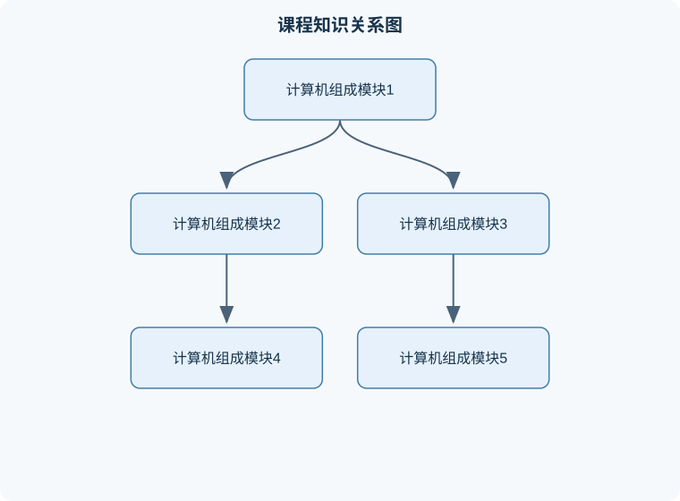

# 计算机组成

## 一、课程整体知识框架

### 课程边界与先修知识

本课程研究计算机系统中从程序指令到硬件执行的基本机制，重点覆盖数字逻辑基础、数据表示与运算、指令集体系结构、汇编语言与机器码、处理器数据通路和控制器、流水线、存储层次、虚拟存储、输入输出与总线，以及性能评价和并行性。课程以典型RISC处理器为主线，可使用MIPS作为教学模型，并将RISC-V作为现代开放指令集的对照实例；不同指令集的寄存器编号、指令编码、异常规则和调用约定必须分别说明，不能混用。课程不深入操作系统调度、编译器优化、集成电路版图、器件物理和具体厂商微架构实现，但需要解释它们与计算机组成之间的接口。先修知识包括离散数学中的二进制与逻辑运算、基础程序设计、C语言数组和函数、基础电路逻辑，以及能够进行代数变形和数量级分析。





### 1. 课程对象与基本问题

《计算机组成》研究程序如何在物理计算机上表示、存储、传输和执行，重点不只是“有哪些硬件”，而是解释硬件结构、指令语义、数据表示、存储层次和性能之间的因果关系。计算机系统可抽象为处理器、存储器、输入输出系统以及连接它们的互连结构。程序经过编译或解释后形成指令序列，处理器按照指令规定的操作读取数据、进行运算并写回结果。

“体系结构”和“组成”需要区分。体系结构主要描述程序员可观察的行为，例如指令集、寄存器、数据类型、地址空间和异常模型；组成主要描述这些行为如何由数据通路、控制器、缓存、流水线、总线和存储器实现。同一指令集可以有不同组成方式，因此不同处理器能够执行相同程序，却在功耗、时延、吞吐率和成本上存在差异。

课程中的核心分析链条是：

$$
\text{程序}
\rightarrow
\text{指令}
\rightarrow
\text{数据表示}
\rightarrow
\text{数据通路与控制}
\rightarrow
\text{存储层次}
\rightarrow
\text{输入输出}
\rightarrow
\text{性能与可靠性}
$$

其中，程序是待执行的操作集合，指令是处理器能够直接识别的编码，数据表示规定位模式的解释方式，数据通路负责传递和变换数据，控制器决定各部件何时动作，存储层次在容量、速度和成本之间折中，输入输出系统连接外部设备，性能分析则评价整个系统而非某个孤立部件。

### 2. 八个模块的知识主线

#### 模块一：计算机组成基本概念与抽象层次

模块一建立硬件—软件接口。一个计算机系统通常包含应用程序、系统软件、指令集体系结构、微体系结构、逻辑电路和器件等层次。上层通过抽象隐藏下层实现细节，但抽象并不意味着下层不存在；当发生性能瓶颈、溢出、异常或设备错误时，必须跨层分析。

处理器执行指令的基本循环包括取指、译码、读寄存器或取操作数、执行、访问存储器、写回结果和更新程序计数器。程序计数器记为 $PC$，表示下一条待取指令的地址；指令寄存器记为 $IR$，保存当前指令；通用寄存器保存操作数或中间结果。若定长指令长度为 $L$ 字节，顺序执行且没有分支，则下一条指令地址通常为

$$
PC_{\text{next}}=PC+L
$$

这里 $PC$ 和 $L$ 的单位分别是字节地址和字节。该式只适用于顺序执行、指令长度固定且没有异常的情况；遇到跳转、分支成立、中断或变长指令时，下一地址由相应控制逻辑决定。

一个常用性能模型是

$$
T_{\text{CPU}}=IC\times CPI\times T_{\text{cycle}}
=\frac{IC\times CPI}{f}
$$

其中，$T_{\text{CPU}}$ 是处理器执行程序的时间，$IC$ 是动态执行的指令条数，$CPI$ 是平均每条指令占用的时钟周期数，$T_{\text{cycle}}$ 是时钟周期，单位为秒，$f$ 是时钟频率，单位为赫兹。该模型忽略或单独处理输入输出等待、操作系统调度和其他处理器竞争。提高频率不必然等于整体加速，因为更深流水线可能增加分支惩罚和数据相关停顿。

#### 模块二：数据表示、运算与算术逻辑部件

模块二说明整数、字符、浮点数和指令如何编码为二进制位。无符号 $n$ 位数的取值范围是

$$
0\le x\le 2^n-1
$$

补码 $n$ 位有符号整数的取值范围是

$$
-2^{n-1}\le x\le 2^{n-1}-1
$$

补码负数的形成方法是逐位取反后加一。其优点是加法器可以统一处理加法和减法：减法 $A-B$ 可改写为 $A+\operatorname{comp}(B)$，其中 $\operatorname{comp}(B)$ 表示 $B$ 的补码。固定宽度运算只保留低 $n$ 位，因此结果可能溢出。

有符号加法溢出发生在两个操作数符号相同而结果符号不同；一个正数加一个负数不会发生有符号加法溢出。无符号加法则通过最高位产生的进位判断是否超出范围。两者不能混用。例如，8 位位模式 `11111111` 作为无符号数是 $255$，作为补码整数是 $-1$。

算术逻辑单元通常支持加、减、与、或、异或、移位和比较。左移一位在不溢出时相当于乘以 $2$，右移一位对无符号数相当于除以 $2$ 并向下取整；对补码有符号数，算术右移需要复制符号位，不能简单按照无符号除法解释。浮点数通常由符号、指数和有效数构成，存在舍入误差、上溢、下溢、非规格化数和特殊值，因此不能把浮点数等同于无限精度实数。

#### 模块三：指令系统、汇编表示与程序执行

模块三研究指令如何描述操作数、操作类型和控制转移。常见指令类别包括算术逻辑指令、数据传送指令、控制转移指令、系统与特权指令。操作数可以来自寄存器、立即数或存储器。寻址方式决定有效地址如何计算，例如基址加偏移形式为

$$
EA=R_b+\operatorname{sign\_extend}(d)
$$

其中 $EA$ 是有效地址，$R_b$ 是基址寄存器内容，$d$ 是指令中编码的偏移量；符号扩展把较短的有符号偏移量扩展到处理器地址宽度。该表达式要求偏移量的编码含义确实是有符号数，若指令规定为无符号偏移，则应使用零扩展。

汇编语言中的标签、伪指令和寄存器名称属于便于人阅读的表示，处理器最终执行的是机器码。指令编码通常划分为操作码、寄存器编号、立即数字段和功能字段。编码字段的位数会限制可表示寄存器数量、立即数范围和指令种类。控制转移指令改变 $PC$，而条件分支还必须根据比较结果或状态标志决定是否跳转。

函数调用涉及参数传递、返回地址保存、栈帧建立和寄存器保存。栈指针记录当前栈位置，返回地址记录调用点之后的指令位置。具体寄存器分工依赖指令集和调用约定，不能仅凭某一种汇编格式推断所有处理器都使用相同规则。

#### 模块四：数据通路、控制器与流水线

模块四解释指令如何在硬件中流动。典型数据通路包括寄存器堆、算术逻辑单元、加法器、扩展器、多路选择器和存储器接口；控制器根据操作码生成寄存器写使能、ALU 操作类型、存储器读写和分支选择信号。

单周期实现让一条指令在一个较长周期内完成，控制简单但时钟周期必须满足最慢指令的传播时间。多周期实现把取指、译码、执行、访存和写回分开，使不同指令共享硬件，但需要保存中间状态。流水线则允许多条指令在不同阶段重叠执行。理想情况下，流水线深度为 $k$，执行 $n$ 条独立指令需要约

$$
k+(n-1)
$$

个周期，而非流水线的 $nk$ 个周期。该结论假设各阶段时长相近、没有结构冲突、数据相关、控制转移和流水线填充排空开销；真实性能通常低于理想值。

流水线冒险分为结构冒险、数据冒险和控制冒险。结构冒险是多个阶段竞争同一硬件；数据冒险是后一条指令依赖前一条指令尚未产生的结果；控制冒险来自分支和跳转。解决方法包括增加资源、前递、停顿、编译器调度、分支预测和投机执行。前递只能解决结果已经产生但尚未写回的部分依赖，不能消除所有加载—使用冒险。

#### 模块五：存储系统与存储层次

模块五研究寄存器、缓存、主存、固态存储和磁盘等层次。存储层次利用时间局部性和空间局部性：近期访问过的数据可能再次访问，邻近地址可能很快被访问。缓存命中时直接返回数据，未命中时从更低层次取回包含目标地址的数据块。

若缓存访问时间为 $T_c$，主存访问时间为 $T_m$，命中率为 $h$，且未命中时必须先完成缓存判断再访问主存，则平均访问时间为

$$
T_{\text{avg}}=hT_c+(1-h)(T_c+T_m)
=T_c+(1-h)T_m
$$

其中 $h$ 是 $0$ 到 $1$ 之间的无量纲比例。若题目将“未命中代价”定义为额外时间，则也可写成 $T_{\text{avg}}=T_c+(1-h)P$，其中 $P$ 是额外未命中代价；两种公式不能混淆。

直接映射缓存中，主存块只能放入一个缓存行；组相联缓存中，一个块可放入指定组内的若干路；全相联缓存中可放入任意位置。地址通常拆为标记、组索引和块内偏移。若地址宽度为 $a$ 位，块大小为 $2^b$ 字节，缓存共有 $2^s$ 组，则块内偏移占 $b$ 位，组索引占 $s$ 位，标记占 $a-s-b$ 位。该划分要求地址按字节编址且缓存容量、块大小和组数均为相应的二次幂。

虚拟存储把虚拟地址映射到物理地址。虚拟地址分为虚页号和页内偏移，页表记录虚页到物理页框的映射，转换后才能访问主存。页表项还可包含有效位、读写权限、用户/内核权限和访问状态。转换后备缓冲器用于缓存近期地址转换。缺页时，操作系统需要从后备存储装入页面；因此缺页代价远大于普通缓存未命中，性能分析必须把不同层次的时间单位和惩罚分开。

#### 模块六：输入输出系统、总线与中断

模块六描述处理器与外设之间的数据交换。内存映射输入输出把设备寄存器映射到地址空间，处理器通过普通加载和存储指令访问；独立编址输入输出则使用专门的输入输出指令。设备控制器通常包含数据寄存器、状态寄存器和控制寄存器。

程序查询方式由处理器反复读取状态，逻辑简单但会浪费处理器时间；中断方式由设备在准备好或发生错误时通知处理器，处理器保存必要现场后执行中断服务程序；直接存储器访问允许设备控制器与主存交换一批数据，处理器主要负责配置和完成通知。DMA 并不意味着设备可以无条件访问所有内存，仍受到地址范围、权限、一致性和总线仲裁限制。

总线带宽可粗略表示为

$$
B= W\times f\times r
$$

其中 $B$ 是理论传输率，单位可为字节每秒，$W$ 是每次传输的数据宽度，单位为字节，$f$ 是传输频率，$r$ 是每周期传输次数。实际有效带宽还要扣除地址阶段、等待、协议、仲裁和错误重传开销，因此理论带宽不是应用程序实际得到的吞吐率。

#### 模块七：性能评价、并行处理与可靠性

模块七要求从执行时间、吞吐率、延迟、功耗和可靠性等多个指标评价系统。加速比定义为

$$
S=\frac{T_{\text{old}}}{T_{\text{new}}}
$$

其中 $T_{\text{old}}$ 和 $T_{\text{new}}$ 是优化前后的实际执行时间。若只有比例 $p$ 的程序可获得 $s$ 倍加速，则整体加速比为

$$
S_{\text{overall}}=
\frac{1}{(1-p)+\frac{p}{s}}
$$

这里 $0\le p\le1$，$s\ge1$。即使可优化部分无限快，整体加速比也不超过 $1/(1-p)$；这说明只优化很小部分通常无法消除主要瓶颈。

并行可分为指令级并行、数据级并行、线程级并行和任务级并行。多核系统需要处理共享数据、同步、缓存一致性和内存顺序问题。可靠性设计常采用奇偶校验、纠错码、冗余模块、超时检测和故障隔离。冗余并非免费，会增加硬件、功耗和验证成本；同时发生的相关故障也可能使简单冗余失效。

#### 模块八：综合设计与软硬件协同

模块八把前述知识用于处理器、嵌入式设备、服务器和加速器的分析。设计一个系统时，应先明确工作负载、数据规模、延迟目标、吞吐目标、功耗上限、可靠性要求和成本约束，再选择指令集、存储层次、互连方式和并行方案。

软硬件协同的关键是确定边界：频繁执行且规则稳定的操作适合硬件加速，变化频繁或控制复杂的部分适合软件实现。硬件加速器的理论峰值不能替代端到端评价，还必须考虑数据搬运、初始化、同步和不可并行部分。最终产出应包括功能正确性证据、性能测量、资源消耗、异常行为说明和可复现的测试条件。

### 3. 核心结论的统一推导与边界

程序性能不能只看主频。由 $T_{\text{CPU}}=IC\times CPI/f$ 可知，减少指令数、降低平均 CPI 或提高频率都可能缩短时间，但优化一个量可能恶化另一个量。例如复杂指令可能降低 $IC$，却增加硬件复杂度和 CPI；更高频率可能要求更深流水线，从而增加分支代价。

缓存容量也不能简单等同于性能。容量增大可能提高命中率，却可能增加访问时间、功耗和替换复杂度；块变大可以利用空间局部性，但会增加一次未命中带来的传输量，如果访问模式稀疏，反而浪费带宽。相联度提高可以减少冲突未命中，但需要更多比较器和选择逻辑。

位宽增加也不是所有场景都更优。更宽的地址可表示更大空间，但会增加页表、缓存标记和互连成本；更宽的数据通路可以提高单次处理量，却可能增加功耗和布线延迟。所有结论都必须注明工作负载、实现方式和测量边界。

## 二、章节和模块划分

### 核心知识覆盖清单

本清单根据本课程的章节划分整理，用于检查正文是否覆盖各个核心模块：

- **1. 代表性算法与工作流程**。
- **2. 典型例题与逐步解答**。
- **3. 实验与项目工作流**。
- **4. 易错点、笔试问题与面试问题**。
- **5. 岗位关联与实际产出**。


### 1. 代表性算法与工作流程

#### 流程一：指令执行分析

**输入**：初始 $PC$、寄存器状态、内存内容和指令编码。  
**输出**：执行结束后的寄存器、内存、状态标志和下一条 $PC$。

过程如下：

1. 根据 $PC$ 从指令存储器取出指令，并按指令长度更新顺序地址。
2. 译码，确定操作码、源寄存器、目的寄存器、立即数和控制信号。
3. 读取操作数，并按规定进行符号扩展或零扩展。
4. 在 ALU 中完成运算，或计算访存有效地址。
5. 若为加载或存储指令，则访问数据存储器。
6. 将结果写回寄存器或内存。
7. 根据分支条件、跳转目标或异常决定最终 $PC$。

不变量是：每一步结束后，体系结构状态必须符合已完成指令序列的语义；未完成的流水线内部状态不能被误当成程序可见结果。终止条件可以是遇到停止指令、异常、程序计数器越界或达到预设指令数。适用条件是指令格式和执行语义已知。逐条模拟的时间复杂度为 $O(n)$，其中 $n$ 是模拟的动态指令条数；若每条指令还需访问 $m$ 个操作数，且访问成本按常数计，仍可视为 $O(n)$。

#### 流程二：缓存地址划分与命中判断

**输入**：地址宽度 $a$、缓存容量、块大小、相联度和待访问地址。  
**输出**：块内偏移、组索引、标记以及命中或未命中结果。

先计算每组路数和组数，再令块大小为 $2^b$ 字节、组数为 $2^s$。地址低 $b$ 位是块内偏移，接下来的 $s$ 位是组索引，其余高位是标记。访问时使用组索引定位目标组，再将地址标记与该组中所有有效行的标记比较；相等则命中，否则未命中并按替换策略装入数据。

不变量是：缓存行中的标记、有效位和数据必须对应同一个主存块；写回缓存还必须维护脏位。直接映射查询的比较次数为 $O(1)$，$k$ 路组相联在朴素实现下需要比较 $k$ 个标记，复杂度为 $O(k)$。该流程不适用于非二次幂参数未经过特殊划分的缓存，实际硬件可能采用更复杂的索引和哈希方式。

#### 流程三：流水线冒险分析

**输入**：按程序顺序排列的指令及各指令读写寄存器、访问资源和分支信息。  
**输出**：每个周期各流水级的指令、停顿周期、前递路径或冲刷流水平线的决定。

先标记每条指令的源寄存器与目的寄存器，再检查相邻或相隔指令是否存在读后写、写后读、写后写等关系；然后判断结果产生阶段和操作数使用阶段是否匹配。若可前递，则建立前递；若结果尚未产生，则插入气泡；若遇到未确定的分支，则按预测策略继续或暂停，预测错误时冲刷错误路径指令。

不变量是：任何进入执行阶段的指令都不能读取尚未合法产生的操作数。终止条件是所有指令完成，或检测到无法解决的结构冲突。该流程适合教学级流水线模型；真实处理器还可能有乱序执行、保留站、重命名和多级预测，不能用简单五级流水线完全解释。

#### 代码示例：按补码宽度执行加法并检测溢出

```python
def add_twos_complement(a: int, b: int, bits: int) -> tuple[int, bool]:
    """按固定 bits 位补码执行 a+b，返回截断结果及有符号溢出标志。"""
    if bits < 2:
        raise ValueError("bits must be at least 2")

    mask = (1 << bits) - 1
    sign = 1 << (bits - 1)

    a_bits = a & mask
    b_bits = b & mask
    result_bits = (a_bits + b_bits) & mask

    a_sign = (a_bits & sign) != 0
    b_sign = (b_bits & sign) != 0
    r_sign = (result_bits & sign) != 0
    overflow = (a_sign == b_sign) and (r_sign != a_sign)

    if r_sign:
        result = result_bits - (1 << bits)
    else:
        result = result_bits

    return result, overflow
```

该程序的输入是两个整数及位宽，输出是固定宽度截断后的补码解释值和有符号溢出标志。它假设输入按补码位模式解释，时间复杂度为 $O(1)$。例如 8 位输入 $127$ 和 $1$，位模式相加后得到 `10000000`，解释为 $-128$，两个正数得到负数，因此溢出为真。若采用无符号解释，应改用最高位进位判断，不能直接复用该溢出条件。

### 2. 典型例题与逐步解答

#### 例题一：CPU 执行时间

**题干**：某程序动态执行 $2\times10^9$ 条指令，平均 CPI 为 $1.5$，处理器频率为 $3$ GHz，忽略输入输出等待。求 CPU 执行时间。

**分析**：使用 $T=IC\times CPI/f$。$IC$ 的单位是条，$CPI$ 的单位是周期/条，$f$ 的单位是周期/秒，单位可约去。

**解答**：

$$
T=\frac{2\times10^9\times1.5}{3\times10^9}
=1\text{ s}
$$

**结果验证**：总周期数为 $3\times10^9$，每秒执行 $3\times10^9$ 周期，因此时间为 $1$ 秒。  
**变式**：若频率提高到 $4$ GHz 但 CPI 增为 $2$，则时间为 $2\times10^9\times2/(4\times10^9)=1$ 秒，说明主频提高不一定带来加速。

#### 例题二：补码范围与溢出

**题干**：用 8 位补码计算 $100+50$，给出位模式并判断是否溢出。

**分析**：8 位补码范围为 $-128$ 到 $127$。数学结果为 $150$，已超出范围。

**解答**：  
$100$ 的二进制为 `01100100`，$50$ 为 `00110010`。

$$
01100100+00110010=10010110
$$

结果最高位为 1，解释为负数：

$$
10010110_2=-(01101001_2+1)=-106
$$

两个正数相加得到负数，因此发生有符号溢出。

**结果验证**：数学结果 $150$ 不在 8 位补码范围内，判断一致。  
**变式**：$100+(-50)=50$，正负数相加不会发生有符号加法溢出，但仍需按固定宽度完成位运算。

#### 例题三：缓存地址划分

**题干**：32 位按字节编址，缓存容量为 $16$ KiB，块大小为 64 字节，采用 4 路组相联。求块内偏移、组索引和标记位数。

**分析**：$16$ KiB $=2^{14}$ 字节；每块 $64=2^6$ 字节；总行数为 $2^{14}/2^6=2^8$ 行；4 路即每组 4 行，因此组数为 $2^8/2^2=2^6$ 组。

**解答**：块内偏移为 $6$ 位，组索引为 $6$ 位，标记为

$$
32-6-6=20\text{ 位}
$$

**结果验证**：缓存行数 $2^6\times2^6=2^{12}$ 行字节容量为 $2^{12}\times2^6=2^{18}$？这里应注意混淆：组数为 $2^6$，每组 4 行，每行 64 字节，总容量为 $2^6\times4\times2^6=2^{14}$ 字节，与 16 KiB 一致。  
**变式**：若改为 2 路，组数变为 $2^7$，组索引为 7 位，标记为 19 位。

#### 例题四：平均存储访问时间

**题干**：一级缓存访问时间为 2 ns，命中率为 95%，未命中后访问主存还需 80 ns。求平均访问时间。

**分析**：题目说主存访问是未命中后的额外代价，因此使用 $T_{\text{avg}}=T_c+(1-h)P$。

**解答**：

$$
T_{\text{avg}}=2+(1-0.95)\times80
=2+4=6\text{ ns}
$$

**结果验证**：5% 的访问产生额外延迟，额外平均代价为 4 ns，加上每次都支付的 2 ns，结果为 6 ns。  
**变式**：若 80 ns 已包含缓存判断时间，应改用 $0.95\times2+0.05\times80=5.9$ ns；关键是明确延迟定义。

#### 例题五：整体加速比

**题干**：程序中 40% 的时间可通过硬件加速 5 倍，其余部分不变，求整体加速比。

**分析**：取 $p=0.4$、$s=5$，使用整体加速公式。

**解答**：

$$
S=\frac{1}{(1-0.4)+0.4/5}
=\frac{1}{0.6+0.08}
\approx1.47
$$

**结果验证**：优化前总时间设为 1，优化部分变为 $0.08$，未优化部分仍为 $0.6$，新时间为 $0.68$，所以加速比为 $1/0.68$。  
**变式**：若硬件加速无限快，最大加速比为 $1/0.6\approx1.67$，表明未优化部分限制了收益。

### 3. 实验与项目工作流

#### 实验一：指令、缓存与性能关联实验

**输入数据**：一组可控长度的整数数组、顺序访问程序、跨步访问程序，以及不同数组规模和重复次数。  
**步骤**：

1. 设计顺序访问和固定步长访问两类程序，保证两者完成相同功能。
2. 逐步增加数组规模，使数据分别落在寄存器、缓存和主存的不同容量范围。
3. 对每组规模重复测量多次，记录总时间、平均时间和访问模式。
4. 结合块大小、缓存容量和局部性解释时间变化，而不是只比较一次运行结果。
5. 检查编译器优化、预热、操作系统调度和计时精度对结果的影响。

**评价标准**：功能结果必须一致；实验变量一次只改变一个主要因素；每组数据有重复测量；结论能对应缓存命中、未命中和局部性机制；报告区分理论模型与实际噪声。  
**排错方法**：若两程序结果不同，先检查边界和索引；若时间异常稳定为零，检查计时分辨率和编译器是否删除了无效计算；若结果波动大，增加重复次数并报告最小值、中位数或分布，不得只挑选有利数据。

#### 实验二：简化流水线模拟项目

**输入数据**：一段包含算术、加载、存储和分支指令的指令序列；每条指令的源寄存器、目的寄存器和执行阶段。  
**步骤**：

1. 定义取指、译码、执行、访存、写回五个阶段。
2. 为每条指令建立阶段表，初始状态为尚未取指。
3. 每个周期从后向前推进已进入流水线的指令，避免同周期覆盖状态。
4. 检查结构、数据和控制冒险，分别标注前递、停顿或冲刷。
5. 输出每周期流水线表，并计算完成总周期数、停顿数和有效吞吐率。
6. 用无相关指令序列、连续加载使用序列和分支序列进行对照测试。

**评价标准**：不能在结果尚未产生时读取操作数；分支错误路径必须被冲刷；模拟结果与手工推导的短序列一致；报告解释每个停顿的具体原因。  
**排错方法**：发现寄存器值提前变化时，检查写回阶段和前递条件；发现指令丢失时，检查阶段更新顺序；发现分支后仍执行错误结果时，检查冲刷范围；用三至五条指令的最小案例逐步定位，而不是直接调试长程序。

### 4. 易错点、笔试问题与面试问题

#### 具体易错点

1. 把计算机组成、体系结构和操作系统混为同一层次。
2. 把静态指令条数当作动态执行指令条数。
3. 只看主频，不考虑 CPI、缓存未命中和分支停顿。
4. 把无符号范围用于补码结果判断。
5. 认为任何加法产生最高位进位都代表有符号溢出。
6. 忽略固定位宽截断，直接保留数学上的无限精度结果。
7. 把算术右移和逻辑右移视为同一种操作。
8. 默认所有处理器的字节序、寄存器约定和调用约定相同。
9. 计算缓存标记位时忘记地址是按字节还是按字编址。
10. 把未命中率、命中率和未命中惩罚在公式中重复计算或漏算。
11. 认为缓存容量越大、相联度越高就一定更快。
12. 把虚拟地址直接当作物理地址使用。
13. 认为 DMA 不需要权限、仲裁和缓存一致性处理。
14. 把流水线吞吐率提升误认为单条指令延迟必然降低。
15. 用局部加速比代替整体加速比。
16. 只验证程序输出，不验证异常、溢出、边界地址和资源冲突。

#### 典型笔试问题及解答思路

1. **为什么提高时钟频率不一定提高性能？**  
   从 $T=IC\times CPI/f$ 分析；频率提高可能伴随 CPI 增大、流水线加深、分支惩罚增加和功耗限制，必须比较实际执行时间。

2. **补码为什么适合统一加减法？**  
   说明 $A-B=A+\operatorname{comp}(B)$，固定宽度只保留低位；再说明溢出判断必须结合操作数符号，不能只看进位。

3. **如何划分缓存地址？**  
   先求块大小对应的偏移位，再求组数对应的索引位，剩余为标记位；最后用容量等式复核。

4. **直接映射与组相联有什么差别？**  
   直接映射每个块只有一个位置，硬件简单但冲突未命中可能多；组相联允许同组多位置，降低冲突但增加比较和替换逻辑。

5. **流水线中的加载—使用冒险为什么可能必须停顿？**  
   加载数据到访存阶段末尾才产生，而下一条指令在更早阶段就需要它；若前递路径仍赶不上使用时刻，只能插入气泡。

6. **中断与查询方式有什么差别？**  
   查询由处理器主动反复检查状态，中断由设备主动通知；比较时要说明响应延迟、处理器占用、实现复杂度和适用设备。

7. **虚拟存储解决了什么问题？**  
   提供独立地址空间、保护和比物理内存更大的逻辑空间；但缺页需要低速存储参与，可能产生巨大性能代价。

8. **如何使用加速定律评价硬件优化？**  
   先确定可优化时间比例 $p$，再确定局部加速比 $s$，使用整体公式并检查极限上界，防止把局部收益当成整体收益。

#### 面试问题、参考答案与追问要点

1. **你如何定位一个程序变慢的硬件原因？**  
   参考答案：先固定输入和环境，测量端到端时间，再分解为指令量、CPI、缓存命中、分支和输入输出等待，最后用对照实验验证假设。追问要点：如何区分缓存问题和算法问题，如何处理测量噪声。

2. **缓存命中率很高但程序仍然很慢，为什么？**  
   参考答案：命中率没有说明缓存访问本身的延迟，也可能存在高 CPI、分支错误、串行依赖、TLB 未命中或输入输出等待。追问要点：如何选择计数器和构造最小复现案例。

3. **前递能否解决所有数据冒险？**  
   参考答案：不能。前递只能把已经产生的结果送到需要的位置，加载—使用等结果产生过晚的情况仍可能停顿；还需考虑结构冲突和控制冒险。追问要点：画出具体周期表并指出结果产生、使用的阶段。

4. **为什么系统要使用多级缓存？**  
   参考答案：小而快的缓存降低常见访问延迟，大而慢的缓存降低访问主存的概率，多级结构在容量、速度、成本和功耗之间折中。追问要点：如何评价增加一级缓存是否值得。

5. **DMA 为什么会引发缓存一致性问题？**  
   参考答案：处理器缓存中的副本可能与主存不同，设备直接读写主存后，处理器可能继续使用旧副本；需要硬件一致性或明确的刷新、失效和同步协议。追问要点：写回缓存与直写缓存的处理差异。

6. **如何判断一个硬件加速方案是否值得实现？**  
   参考答案：估计可优化比例、数据传输开销、启动和同步开销、资源功耗以及验证成本，再用端到端时间而不是峰值吞吐率评价。追问要点：加速器输入规模变小时为何可能反而变慢。

7. **异常、中断和普通函数调用有什么区别？**  
   参考答案：函数调用由程序按约定发起，异常由当前指令或处理器检测到的事件引起，中断通常来自外部设备；三者都可能改变控制流，但保存现场、权限切换和返回机制不同。追问要点：如何保证异常返回后程序状态可恢复。

8. **如果结果正确但性能不稳定，你会怎样排查？**  
   参考答案：检查输入规模、缓存预热、操作系统调度、频率调节、内存分配、锁竞争和计时方式，重复测量并报告分布。追问要点：为什么不能只报告一次最好成绩。

### 5. 岗位关联与实际产出

#### 硬件设计与验证岗位

实际任务包括设计数据通路、控制器、缓存接口或总线模块，使用寄存器传输级描述和仿真工具验证时序。需要运用指令执行、补码运算、流水线冒险、握手协议和异常处理知识。产出包括模块设计、接口说明、测试平台、覆盖率报告和时序约束。验收标准是功能测试通过、边界和异常场景有覆盖、协议无死锁、综合后的时序和资源满足约束。

#### 编译器、系统软件与性能分析岗位

实际任务包括生成目标指令、优化循环、分析缓存行为、定位分支和内存瓶颈。需要理解指令集、调用约定、寄存器分配、存储层次、流水线和整体加速模型。产出包括可执行程序、性能基线、剖析报告和优化前后对照数据。验收标准是功能结果一致，性能改进可重复，优化不会破坏异常语义、并发正确性和资源约束。

#### 嵌入式与设备驱动岗位

实际任务包括配置设备寄存器、处理中断、设计 DMA 缓冲区和排查设备通信问题。需要使用输入输出编址、中断现场保存、总线协议、缓存一致性和权限保护知识。产出包括驱动代码、寄存器配置说明、错误恢复流程和测试日志。验收标准包括正常通信、超时、设备拔插、重复中断和非法参数等场景均能安全处理。

#### 性能工程与系统架构岗位

实际任务是根据业务负载选择处理器、内存、缓存、互连和加速器方案，建立容量、延迟、吞吐率和功耗模型。需要综合使用 CPI 模型、缓存平均访问时间、加速定律、并行性和可靠性分析。产出包括基准测试、瓶颈定位、方案比较和容量规划。验收标准是模型假设明确，测试数据可复现，结论覆盖平均性能和最坏情况，并说明成本、功耗和扩展边界。

## 三、核心概念的详细解释

### 1. 计算机组成的基本对象与分析层次

计算机组成研究信息如何在机器内部表示、传送、变换和保存，以及各部件如何协同完成程序执行。一个完整计算机系统至少包括处理器、主存储器、输入输出系统和互连结构。处理器执行指令，主存储器保存正在运行的程序和数据，输入输出系统负责与外部设备交换信息，互连结构提供地址、数据和控制信号的传输路径。

需要区分“指令集体系结构”和“计算机组成”。指令集体系结构规定程序可观察的接口，例如指令格式、寄存器、寻址方式、数据类型、异常行为和存储访问规则；计算机组成则说明这些规定如何实现，例如是否采用流水线、缓存层次、乱序执行、多端口寄存器堆或专用执行单元。同一指令集可以由不同微体系结构实现，因此指令执行结果相同，但时延、吞吐率、功耗和成本可能不同。

计算机系统通常通过多个抽象层次组织：

1. 应用程序层描述用户任务；
2. 程序设计语言和编译器层把算法转换为机器可执行形式；
3. 指令集体系结构层规定软件与硬件的接口；
4. 微体系结构层由数据通路、控制器、流水线和缓存组成；
5. 逻辑电路层由组合逻辑和时序逻辑构成；
6. 器件层由晶体管、存储单元和互连实现具体电气功能。

抽象可以降低系统设计复杂度，但不能消除下层约束。例如，高级语言中的整数加法看似不会失败，实际机器中的定长补码加法可能溢出；程序访问数组看似只需一次读取，实际可能经历地址转换、缓存查找、主存访问甚至外存换入。

### 2. 指令执行过程与数据通路

处理器执行一条指令通常经历取指、译码、读操作数、执行、访存、写回和更新程序计数器等阶段。程序计数器记为 $PC$，表示下一条待取指令的地址；指令寄存器记为 $IR$，保存当前取出的指令；通用寄存器用于保存操作数和中间结果；算术逻辑部件负责整数运算和逻辑运算。

在定长指令、顺序执行且不存在分支的理想条件下，若每条指令长度为 $L$ 字节，则

$$
PC_{\text{next}}=PC+L
$$

式中 $PC$ 的单位是字节地址，$L$ 的单位是字节。该式不能直接用于变长指令、跳转指令、分支成立、异常或中断场景。对于分支指令，下一条地址通常由顺序地址和目标地址之间的选择逻辑决定；对于异常，处理器可能保存当前执行状态并转移到异常处理入口。

一条算术指令的数据通路可抽象为：

$$
\text{寄存器读端口}
\rightarrow
\text{算术逻辑部件}
\rightarrow
\text{结果选择器}
\rightarrow
\text{寄存器写端口}
$$

加载指令还需要经过地址计算和存储器访问：

$$
\text{基址寄存器}+\text{偏移量}
\rightarrow
\text{有效地址}
\rightarrow
\text{缓存或主存}
\rightarrow
\text{写回寄存器}
$$

控制器根据操作码和功能字段产生控制信号，决定寄存器是否读写、算术逻辑部件执行何种运算、是否访问存储器以及程序计数器如何更新。组合逻辑控制器依据当前输入立即产生控制信号；微程序控制器则通过控制存储器中的微指令组织复杂操作。前者可能速度较快，后者更易修改和扩展，但具体优劣取决于实现方式。

### 3. 数据表示与运算语义

计算机中所有信息最终都表示为位串。相同位模式在不同上下文中可能表示无符号整数、有符号整数、字符、地址、浮点数或机器指令。因此，“看见一串二进制位”并不能唯一确定其含义，必须结合数据类型和解释规则。

无符号 $n$ 位整数的取值范围为

$$
0\leq x\leq 2^n-1
$$

若采用二进制权值表示，位 $b_i\in\{0,1\}$ 的数值为

$$
x=\sum_{i=0}^{n-1}b_i2^i
$$

其中 $i=0$ 是最低有效位，$i=n-1$ 是最高有效位。

$n$ 位补码有符号整数的取值范围为

$$
-2^{n-1}\leq x\leq 2^{n-1}-1
$$

当最高位为 $0$ 时，其数值按普通二进制解释；当最高位为 $1$ 时，其数值为

$$
x=-b_{n-1}2^{n-1}+\sum_{i=0}^{n-2}b_i2^i
$$

补码将减法转化为加法。对 $n$ 位数 $B$，其相反数的补码表示为逐位取反再加一，因此

$$
A-B=A+\operatorname{comp}(B)
$$

但运算结果只保留低 $n$ 位。若数学结果超出表示范围，位模式仍会产生，但其有符号解释已经溢出。例如，8 位补码中 $127+1$ 的位模式为 $10000000$，解释为 $-128$，不能认为硬件算错，而应判断该运算发生了有符号溢出。

有符号加法溢出的判定条件是：两个加数符号相同，而结果符号与它们不同。无符号加法是否溢出，则看最高位是否产生进位。两者不能混为一谈。

浮点数通常由符号位、指数域和尾数域组成。一般形式可写成

$$
(-1)^s\times m\times 2^e
$$

其中 $s$ 是符号位，$m$ 是有效数值，$e$ 是指数。浮点数可以表示很大的数值范围，但由于尾数位数有限，许多十进制小数无法精确表示，运算还可能产生舍入误差、上溢、下溢、非规格化数或特殊值。浮点数比较不能简单套用整数位模式比较，尤其要注意负数、零和舍入误差。

### 4. 存储层次与局部性

存储系统按照容量、访问速度和单位成本组织为层次结构，典型层次包括寄存器、一级缓存、其他级别缓存、主存和外存。越靠近处理器的层次通常速度越快、容量越小、单位成本越高。

缓存利用两种局部性：

- 时间局部性：某数据最近被访问过，未来较可能再次访问；
- 空间局部性：某地址被访问后，其附近地址较可能被访问。

缓存以块为单位在较高层和较低层之间传送。访问地址通常划分为标记、组索引和块内偏移。若缓存容量为 $C$ 字节，块大小为 $B$ 字节，组数为 $S$，则在直接映射缓存中

$$
S=\frac{C}{B}
$$

对于总地址宽度为 $w$ 位的字节地址，块内偏移位数为

$$
b=\log_2B
$$

组索引位数为

$$
s=\log_2S
$$

标记位数为

$$
t=w-s-b
$$

这些公式要求 $B$ 和 $S$ 为 $2$ 的整数次幂，并假设地址按字节编址。若缓存采用组相联映射，每组可以容纳多个块，冲突失效会减少，但硬件比较器和替换逻辑更加复杂。

缓存命中表示所需数据在当前层找到，未命中则必须从更低层取回。若命中时间为 $T_h$，未命中率为 $m$，未命中代价为 $P$，常用平均访问时间模型为

$$
T_{\text{avg}}=T_h+mP
$$

这里的未命中代价应明确是否包含命中检查时间。若 $P$ 的定义已经包括重新访问当前缓存的时间，则不能重复相加。缓存未命中通常分为强制未命中、容量未命中和冲突未命中；增加缓存容量主要缓解容量未命中，增加相联度主要缓解冲突未命中，而首次访问新块时的强制未命中无法完全消除。

### 5. 虚拟存储器与地址转换

虚拟存储器把进程看到的虚拟地址空间与实际物理存储分离。虚拟地址通常划分为虚页号和页内偏移，页表负责把虚页号映射到物理页框号。若页大小为 $P$ 字节，虚拟地址为 $v$，则

$$
\text{页内偏移}=v\bmod P
$$

$$
\text{虚页号}=\left\lfloor\frac{v}{P}\right\rfloor
$$

若页表将虚页号映射为物理页框号 $f$，则物理地址为

$$
\text{物理地址}=fP+\text{页内偏移}
$$

地址转换必须保持页内偏移不变。若页不在主存，产生缺页异常，操作系统需要从外存找到页面、选择可替换页、必要时写回被修改页面、更新页表并重新执行导致异常的指令。缺页处理的时间远大于普通缓存未命中，因此程序性能可能因少量缺页而显著下降。

转换后备缓冲器用于缓存近期地址转换结果。一次访问可能先查找转换后备缓冲器，再查数据缓存；若转换失败，则访问页表，完成转换后再访问缓存。实际处理器还可能使用虚拟索引、物理标记等组织方式，以减少地址转换与缓存访问之间的冲突。

### 6. 流水线、相关与分支

流水线将一条指令的执行划分为多个阶段，使不同指令能够同时处于不同阶段。理想情况下，流水线级数为 $k$，指令数为 $n$，每级耗时相同，则完成全部指令所需周期数近似为

$$
k+n-1
$$

非流水执行若每条指令需要 $k$ 个周期，则需要约 $nk$ 个周期。因此，当 $n$ 较大时，流水线提高的是吞吐率，而不是单条指令的固有延迟。实际收益会受到流水线寄存器开销、阶段不均衡、数据相关、结构冲突和控制相关影响。

数据相关包括：

- 读后写：后一条指令需要前一条指令尚未写回的结果；
- 写后读：后一条指令的读操作必须等待前一条写操作完成；
- 写后写：多条指令写同一位置时必须保持正确顺序。

在顺序发射的简单流水线中，读后写相关最常见。转发可以把执行阶段产生的结果直接送到后续指令的输入端，减少等待；若数据尚未产生，仍必须插入停顿。分支指令会产生控制相关，处理器可能预测分支方向，预测错误时清除错误路径上的指令并支付分支惩罚。

### 7. 输入输出、总线与中断

输入输出设备的速度、数据格式和控制方式通常不同于处理器，因此需要设备控制器进行接口转换。程序查询方式由处理器反复检查设备状态，结构简单但会占用处理器时间；中断方式由设备在准备好数据或完成操作后通知处理器，处理器在中断服务程序中处理事件；直接存储器访问允许设备控制器在授权后直接与主存交换数据，适合大块数据传输。

中断处理通常包括保存现场、识别中断源、执行服务程序、清除设备状态、恢复现场和返回被中断程序。若设备在中断状态未清除前再次发出请求，可能导致重复处理中断。直接存储器访问结束时，控制器通常通过中断告知处理器传输完成，软件还需检查错误状态和实际传输长度。

### 8. 可靠性、性能与功耗

程序执行时间可表示为

$$
T_{\text{CPU}}=IC\times CPI\times T_{\text{cycle}}
=\frac{IC\times CPI}{f}
$$

其中 $IC$ 是动态指令数，$CPI$ 是平均每条指令周期数，$f$ 是时钟频率。这个公式只能在边界条件明确时使用。若程序等待输入输出、受到其他任务抢占或发生大量缺页，则应将这些时间单独计入。

若改进部分程序，使其原运行时间中比例为 $p$ 的部分获得 $s$ 倍加速，则整体加速比为

$$
S_{\text{total}}=\frac{1}{(1-p)+\frac{p}{s}}
$$

该式说明局部优化存在收益上限。当 $p<1$ 时，即使改进部分无限快，整体加速比也不超过 $1/(1-p)$。因此，性能优化必须先定位真正占用时间的部分，而不能只优化容易修改的代码。

可靠性可用平均失效间隔时间和平均修复时间等指标描述。冗余、错误检测码、校验和、镜像和重试能够提高容错能力，但会增加存储、带宽、面积或时间开销。功耗通常与电压、频率和电容有关，动态功耗常用近似关系表示为

$$
P_{\text{dynamic}}\propto C V^2 f
$$

其中 $C$ 是等效切换电容，$V$ 是供电电压，$f$ 是切换频率。该式是理想近似，不能直接代表静态漏电功耗、短路功耗或整个系统的总功耗。

### 9. 代表性问题分析与实现流程

#### 9.1 缓存地址划分流程

**输入：** 地址宽度 $w$、缓存容量 $C$、块大小 $B$、相联度 $A$。  
**输出：** 组数、偏移位数、组索引位数和标记位数。

过程如下：

1. 计算每组容量为 $A\times B$ 字节；
2. 计算组数 $S=C/(A\times B)$；
3. 计算块内偏移位数 $b=\log_2B$；
4. 计算组索引位数 $s=\log_2S$；
5. 计算标记位数 $t=w-s-b$；
6. 将地址最低 $b$ 位解释为块内偏移，接下来的 $s$ 位解释为组索引，其余位解释为标记。

不变量是：地址总位数始终满足 $t+s+b=w$。终止条件是完成所有字段计算并验证组数、块大小均符合实现约束。该流程适用于常规字节编址、容量和块大小为 $2$ 的整数次幂的缓存；若采用非标准映射，应改用具体映射函数。

#### 9.2 补码加法溢出判断伪代码

```text
语言：伪代码

输入：n 位补码整数 a、b
输出：n 位结果 r，以及是否发生有符号溢出 overflow

1. raw ← a + b
2. r ← raw 的低 n 位
3. sign_a ← a 的最高位
4. sign_b ← b 的最高位
5. sign_r ← r 的最高位
6. 如果 sign_a = sign_b 且 sign_r ≠ sign_a：
       overflow ← true
   否则：
       overflow ← false
7. 返回 r, overflow
```

该算法的关键不变量是：所有中间结果都按 $n$ 位位模式解释，不能先把操作数无限扩展后再用数学范围代替机器判断。它只判断有符号补码溢出；若要判断无符号溢出，应检查最高位进位。时间复杂度为 $O(n)$，因为需要检查或生成 $n$ 个二进制位；在固定字长机器上可视为 $O(1)$。

### 10. 典型例题

#### 例题一：补码范围与溢出

**题干：** 使用 8 位补码计算 $100+60$，判断结果及是否溢出。

**分析：** 8 位补码范围为 $-128$ 到 $127$。数学结果为 $160$，超出上界，因此必然溢出。

**逐步解答：**

$$
100=01100100_2
$$

$$
60=00111100_2
$$

相加得到

$$
01100100+00111100=10100000_2
$$

位模式 $10100000_2$ 按 8 位补码解释为

$$
-128+32=-96
$$

两个加数最高位均为 $0$，结果最高位为 $1$，满足同号相加结果异号的条件，因此发生有符号溢出。

**结果验证：** 数学结果 $160$ 不在 8 位补码范围内；机器位模式对应 $-96$，说明结果不能作为正确数学和使用。

**变式：** 计算 $-100+(-60)$。数学结果为 $-160$，低 8 位位模式为 $01100000$，解释为 $96$，同样发生溢出。

#### 例题二：缓存地址划分

**题干：** 32 位字节地址处理器有一个容量为 $4$ KiB、块大小为 $16$ B、四路组相联的数据缓存，求偏移位、组索引位和标记位数。

**分析：** $1$ KiB=$1024$ B，缓存容量为 $4096$ B。四路组相联意味着每组有四个块。

**逐步解答：**

块数为

$$
4096/16=256
$$

组数为

$$
256/4=64
$$

块内偏移位数为

$$
\log_2 16=4
$$

组索引位数为

$$
\log_2 64=6
$$

标记位数为

$$
32-4-6=22
$$

因此地址划分为：高 22 位标记，中间 6 位组索引，低 4 位块内偏移。

**结果验证：**

$$
22+6+4=32
$$

字段位数之和等于地址宽度，计算一致。

**变式：** 若改为直接映射，组数为 $256$，组索引位变为 $8$ 位，标记位变为 $20$ 位；缓存容量和块大小不变，但冲突失效特征会改变。

#### 例题三：平均存储访问时间

**题干：** 一级缓存命中时间为 $1$ ns，未命中率为 $5\%$，未命中后访问主存额外需要 $60$ ns。求平均访问时间。

**逐步解答：** 令 $T_h=1$ ns，$m=0.05$，$P=60$ ns。根据

$$
T_{\text{avg}}=T_h+mP
$$

得到

$$
T_{\text{avg}}=1+0.05\times60=4\text{ ns}
$$

**结果验证：** 命中访问耗时 $1$ ns，未命中只占 $5\%$，平均增加 $3$ ns，因而平均值为 $4$ ns，处于 $1$ ns 和 $61$ ns 之间。

**变式：** 若题目所说的“未命中代价 $60$ ns”已经包括原有的 $1$ ns 检查时间，则应使用 $0.95\times1+0.05\times60=3.95$ ns。解题时必须先确认代价定义。

#### 例题四：CPU 执行时间

**题干：** 某程序动态执行 $2\times10^9$ 条指令，平均 CPI 为 $1.5$，处理器频率为 $3$ GHz，求 CPU 执行时间。

**逐步解答：**

$$
T_{\text{CPU}}=\frac{IC\times CPI}{f}
$$

代入 $IC=2\times10^9$、$CPI=1.5$、$f=3\times10^9$ Hz：

$$
T_{\text{CPU}}
=\frac{2\times10^9\times1.5}{3\times10^9}
=1\text{ s}
$$

**结果验证：** 总周期数为 $3\times10^9$，每秒执行 $3\times10^9$ 个周期，因此时间为 $1$ 秒。

**变式：** 若优化使指令数减少 $20\%$，但 CPI 增加到 $1.8$，新时间为

$$
\frac{1.6\times10^9\times1.8}{3\times10^9}=0.96\text{ s}
$$

优化有效，但加速比只有 $1/0.96\approx1.042$，不能只看指令数变化。

#### 例题五：加速定律

**题干：** 程序中可优化部分占原时间的 $70\%$，该部分加速 5 倍，求整体加速比。

**逐步解答：** 取 $p=0.7$、$s=5$：

$$
S_{\text{total}}
=\frac{1}{(1-0.7)+0.7/5}
=\frac{1}{0.3+0.14}
\approx2.27
$$

**结果验证：** 原时间设为 $1$，未优化部分耗时 $0.3$，优化部分耗时 $0.14$，新总时间为 $0.44$，因此加速比为 $1/0.44\approx2.27$。

**变式：** 即使优化部分无限快，最大加速比也只有

$$
1/(1-0.7)=3.33
$$

这说明剩余的非优化部分决定了最终上限。

### 11. 实验与项目工作流

#### 11.1 缓存局部性实验

**输入数据：** 一组固定大小的二维整数数组，以及两种遍历程序：按行访问和按列访问。数组大小应分别选择小于缓存容量、接近缓存容量和明显大于缓存容量的情况。

**步骤：**

1. 固定编译选项和处理器频率条件；
2. 预热程序，减少首次加载和系统调度影响；
3. 分别执行按行和按列遍历；
4. 重复测量多次，记录运行时间；
5. 若工具允许，同时记录缓存命中数和未命中数；
6. 改变数组规模和元素大小，比较趋势。

**评价标准：** 不能只报告某一次运行时间，应说明输入规模、重复次数、测量方法和环境。若按行访问表现更好，应能用空间局部性解释；若差异不明显，应检查编译器优化、数组规模是否过小、缓存预取是否起作用。

**排错方法：**

- 若两种遍历时间相同，先确认循环确实访问了全部元素；
- 若时间随规模不单调，检查缓存层次切换和操作系统调度；
- 若编译器删除了无效计算，应使用结果汇总或其他无副作用的方式保证访问仍被保留；
- 若计时结果波动很大，应增加重复次数并报告最小值、中位数或平均值的选择理由。

#### 11.2 指令与流水线性能分析项目

**输入数据：** 一段包含整数运算、加载存储、条件分支的短程序，以及不同编译优化设置下生成的机器指令或统计信息。

**步骤：**

1. 明确程序功能和输入规模；
2. 记录动态指令数、分支数、缓存访问数等指标；
3. 比较不同代码结构对指令数和分支行为的影响；
4. 根据 $T_{\text{CPU}}=IC\times CPI/f$ 建立解释模型；
5. 将模型预测与实测时间对照；
6. 说明未建模因素，例如缓存未命中、分支预测失败、系统调度和频率变化。

**评价标准：** 项目产出应包括原程序、修改版本、测试输入、测量数据、指标解释和误差分析。验收时要求结论能够回答“改变了什么、为什么改变、性能提升是否稳定、是否牺牲了代码大小或可读性”。

**排错方法：**

- 若指令数减少但运行时间增加，检查缓存行为、分支预测和频率变化；
- 若不同输入结果差异很大，检查动态路径是否改变；
- 若静态指令数与动态指令数混淆，应区分程序中出现的指令条数和实际执行次数；
- 若模型误差较大，应逐项加入内存等待、分支惩罚和输入输出时间，而不是直接否定模型。

## 四、重要定义、公式、定理和推导

### 专业审校补充：关键定义与适用边界

精确异常是指处理器对外呈现的异常状态，必须等价于“程序按顺序执行到某条指令之前或之后”的状态：异常指令之前的指令已经完成，异常指令及其后的指令尚未产生对程序可见的提交结果。它是异常处理、流水线乱序执行和重启指令的共同边界。同步异常通常由当前指令引起，例如非法指令、算术溢出或缺页；中断通常由外部设备或定时器异步提出，不能简单归因于某条正在执行的指令。实现精确异常需要保存足够的程序计数器、状态和原因信息，并阻止错误路径结果提交。理想的五级顺序流水线较容易保持精确异常；支持乱序执行时，通常必须利用重排序缓冲区等提交机制按程序顺序更新体系结构状态。精确异常不等于所有内部操作都被撤销：预测执行产生的临时结果可以丢弃，但已提交的寄存器和内存状态必须符合定义。若设备写入、DMA或非幂等输入输出已产生外部副作用，不能直接套用普通算术指令的回滚模型，必须由体系结构规定边界。


### 1. 关键定义与适用边界

**时钟周期**是相邻两个时钟边沿之间的时间，记为 $T_{\text{cycle}}$，单位为秒。时钟频率 $f$ 是每秒周期数，二者关系为

$$
T_{\text{cycle}}=\frac{1}{f}
$$

频率使用赫兹，不能把 GHz 直接当作普通数值而忽略 $10^9$ 的数量级。

**吞吐率**表示单位时间完成的任务数，**延迟**表示完成单个任务所需时间。流水线通常主要提高吞吐率，并不一定降低单条指令延迟。多核处理器也可能提高总体吞吐率，但单线程程序未必按核心数同比加速。

**带宽**表示单位时间能够传输的数据量，单位通常为 B/s；**访问延迟**表示发起一次访问到获得结果所需时间。高带宽不代表低延迟，连续大块传输和大量随机访问应分别评价。

**命中率**为访问中在当前层找到目标的比例，记为 $h$；**未命中率**为 $m=1-h$。命中率必须说明对象和层次，例如一级缓存命中率、转换后备缓冲器命中率和页表命中率不能互换。

### 2. 性能公式的推导

设程序动态执行 $IC$ 条指令，每条指令平均消耗 $CPI$ 个周期，则总周期数为

$$
N_{\text{cycle}}=IC\times CPI
$$

每个周期耗时 $T_{\text{cycle}}$，因此

$$
T_{\text{CPU}}=N_{\text{cycle}}T_{\text{cycle}}
=IC\times CPI\times T_{\text{cycle}}
$$

又因为 $T_{\text{cycle}}=1/f$，所以

$$
T_{\text{CPU}}=\frac{IC\times CPI}{f}
$$

该推导假设 $CPI$ 已经综合反映指令类型、流水线停顿、缓存等待等因素，且频率在测量期间近似稳定。若不同阶段频率不同，或存在大量非 CPU 时间，应分阶段建模。

若系统有多个指令类别，第 $i$ 类指令数量为 $IC_i$，平均周期数为 $CPI_i$，则

$$
T_{\text{CPU}}
=\frac{\sum_i IC_iCPI_i}{f}
$$

总指令数为

$$
IC=\sum_i IC_i
$$

整体平均 CPI 为

$$
CPI_{\text{avg}}
=\frac{\sum_i IC_iCPI_i}{\sum_i IC_i}
$$

不能简单对各类 CPI 做算术平均，除非各类指令数量相同。

### 3. 平均访问时间的推导

一次存储访问先花费命中检查时间 $T_h$。以未命中率 $m$ 的概率额外支付未命中代价 $P$，则随机一次访问的期望时间为

$$
T_{\text{avg}}
=(1-m)T_h+m(T_h+P)
$$

整理得

$$
T_{\text{avg}}=T_h+mP
$$

若存在两级缓存，一级未命中后访问二级缓存，二级局部未命中率为 $m_2$，一级检查时间为 $T_1$，二级访问代价为 $T_2$，主存代价为 $P_m$，则在明确各代价定义后，可写为

$$
T_{\text{avg}}
=T_1+m_1\left(T_2+m_2P_m\right)
$$

这里 $m_1$ 是一级缓存未命中率，$m_2$ 是在已经进入二级缓存访问条件下的局部未命中率。若使用全局未命中率，公式形式会不同，不能把局部未命中率和全局未命中率混用。

### 4. 加速定律的推导与边界

设原程序总时间为 $T$，其中可改进部分占比例 $p$，其时间为 $pT$；不可改进部分时间为 $(1-p)T$。改进部分加速 $s$ 倍后，新的总时间为

$$
T'=(1-p)T+\frac{pT}{s}
$$

因此整体加速比为

$$
S=\frac{T}{T'}
=\frac{1}{(1-p)+p/s}
$$

当 $s\rightarrow\infty$ 时，

$$
S_{\max}=\frac{1}{1-p}
$$

这个上限说明局部优化无法消除其他部分的时间。若测量结果超过理论上限，通常表示原时间比例估计错误、比较对象不一致、输入规模改变，或测量包含了不同的系统开销。

### 5. 存储容量与地址位数

若存储器有 $N$ 个可寻址单元，每个单元存储 $q$ 位，容量为

$$
Nq\text{ bit}
$$

若按字节编址，每个地址对应 $1$ 字节，能够寻址 $2^w$ 个字节的地址总线需要 $w$ 位地址。若存储容量为 $M$ 字节，且为 $2$ 的整数次幂，则地址位数为

$$
w=\log_2M
$$

例如，$4$ GiB 的字节编址空间需要 $32$ 位地址，因为

$$
4\text{ GiB}=2^{32}\text{ B}
$$

这里 GiB 表示 $2^{30}$ 字节，而 GB 在某些语境下表示 $10^9$ 字节，二者不能不加说明地混用。

### 6. 流水线理想加速比的推导

设非流水处理一条指令需要 $k$ 个周期，执行 $n$ 条指令需要

$$
T_{\text{nonpipe}}=nk
$$

理想 $k$ 级流水线首先需要 $k$ 个周期填满流水线，之后每周期完成一条指令，因此需要

$$
T_{\text{pipe}}=k+n-1
$$

理想加速比为

$$
S_{\text{pipe}}
=\frac{nk}{k+n-1}
$$

当 $n\rightarrow\infty$ 时，

$$
S_{\text{pipe}}\rightarrow k
$$

实际加速比小于该值，因为存在流水线寄存器开销、阶段不平衡、数据停顿、分支清空和缓存等待。该推导还假设每级工作量相同、每周期均能推进一条指令，不能直接用于任意乱序或超标量处理器。

### 7. 可靠性与冗余的基本推导

若两个部件相互独立，单个部件在给定时间内可靠工作的概率为 $R$，串联系统必须两个部件都正常，因此可靠性为

$$
R_{\text{series}}=R^2
$$

若两个部件构成并联系统，只要至少一个正常即可工作，则

$$
R_{\text{parallel}}
=1-(1-R)^2
$$

这些式子只适用于独立、相同可靠性和明确失效定义的理想模型。现实系统可能存在共同原因失效，例如共享电源、共享控制器或同一软件缺陷，此时不能简单套用独立性公式。

### 8. 易错点与纠正

1. 把体系结构和组成当作同义词。体系结构是软件可观察接口，组成是实现方式。
2. 把静态指令数当作动态指令数。循环中的一条指令可能动态执行多次。
3. 忘记 $PC$ 通常是字节地址，直接用指令编号相加。
4. 把无符号溢出和有符号补码溢出混淆。
5. 认为最高位为 $1$ 的位串一定是负数；它也可能是无符号数或地址。
6. 计算缓存组数时忘记除以相联度。
7. 把块大小、缓存容量和地址空间单位混为 KiB、KB。
8. 把缓存未命中率和命中率同时代入同一个加法项。
9. 未确认未命中代价是否包含命中检查时间。
10. 认为缓存越大必然更快，忽略容量增加可能带来更长命中时间和更高功耗。
11. 认为流水线级数越多，单条指令延迟越低。
12. 认为提高时钟频率必然按比例提高程序性能。
13. 把分支预测失败当作数据相关处理。
14. 把中断和轮询都看成设备主动传输；轮询是处理器主动检查。
15. 把直接存储器访问理解为设备无需控制器或无需操作系统参与。
16. 看到浮点结果末位不同就断言程序错误，忽略有限精度和舍入。
17. 使用加速定律时把优化比例理解成代码行数比例，而不是原运行时间比例。
18. 用平均值掩盖缓存、分支或缺页造成的长尾延迟。

### 9. 典型笔试问题与解答思路

#### 问题一：为什么补码能统一加法和减法？

解答思路：说明 $n$ 位运算按模 $2^n$ 保留低位；负数 $-B$ 的补码等价于 $2^n-B$，因此 $A+(2^n-B)$ 的低 $n$ 位等于 $A-B$ 的低 $n$ 位。再指出有符号解释仍需检查溢出。

#### 问题二：缓存为什么能够提高性能？

解答思路：从时间局部性和空间局部性出发，说明缓存用较小容量保存近期或邻近数据。不能只说缓存比主存快，还要说明命中率、块大小、相联度和未命中代价共同决定平均访问时间。

#### 问题三：直接映射和组相联映射有什么差异？

解答思路：直接映射中每个内存块只有一个候选位置，硬件简单但冲突失效较多；组相联映射中每个块映射到固定组内的多个位置，冲突较少，但需要多路标记比较和替换策略。

#### 问题四：流水线为什么会发生停顿？

解答思路：从结构冲突、数据相关和控制相关三类原因说明。进一步指出转发、资源复制、指令调度和分支预测只能缓解部分问题，不能保证所有停顿消失。

#### 问题五：CPU 时间为什么不能只用时钟频率判断？

解答思路：使用 $T_{\text{CPU}}=IC\times CPI/f$，说明频率只是分母，编译器可能改变指令数，微体系结构可能改变 CPI，缓存和分支行为也会改变实际执行时间。

#### 问题六：虚拟地址转换为什么需要页表？

解答思路：说明页表把进程虚拟页映射到物理页框，实现地址空间隔离、页面换入换出和共享。随后说明转换后备缓冲器用于缓存近期映射，缺页时由操作系统处理。

#### 问题七：为什么提高缓存块大小不一定提高性能？

解答思路：块更大可以利用空间局部性并减少强制未命中，但会增加传输时间、占用缓存空间，可能导致容量和污染未命中增加；随机访问场景下大块传输尤其可能浪费带宽。

#### 问题八：如何判断一次补码加法是否溢出？

解答思路：先确定操作数和结果均为相同位宽；若两个操作数符号相同而结果符号不同，则有符号溢出。不要用“产生进位”作为有符号溢出的唯一判据。

### 10. 典型面试问题与回答要点

#### 问题一：请解释一次加载指令可能经历哪些步骤。

参考答案：处理器取指并译码，读取基址寄存器，利用基址和偏移量计算有效地址，然后进行地址转换和缓存查找。命中则返回数据，未命中则访问更低层存储，最后将数据写回目标寄存器。深入追问应说明页表、转换后备缓冲器、对齐和异常处理。

#### 问题二：缓存命中率很高，程序为什么仍可能很慢？

参考答案：命中率高不等于命中时间低。可能存在一级缓存本身访问延迟较大、分支预测失败、指令依赖、流水线停顿、频率下降或输入输出等待。深入追问应区分局部命中率、全局命中率和平均访问时间。

#### 问题三：如何定位程序的性能瓶颈？

参考答案：先建立可复现的基准测试，再测量总时间、CPU 时间、动态指令数、CPI、缓存未命中和分支行为，最后用模型解释差异。深入追问应要求说明如何避免预热、系统调度和输入规模造成的误判。

#### 问题四：轮询、中断和直接存储器访问如何选择？

参考答案：轮询适合设备简单、等待时间短且控制开销必须极低的场景；中断适合事件不频繁或处理器无需持续等待的场景；直接存储器访问适合大块数据传输。深入追问应说明 DMA 仍需初始化、权限控制、缓存一致性处理和完成通知。

#### 问题五：为什么浮点数不能直接用等号比较？

参考答案：许多十进制小数无法用有限二进制尾数精确表示，多次运算还会累积舍入误差。通常应根据问题容忍度采用绝对误差、相对误差或区间判断。深入追问应讨论大数、小数接近零和 NaN 等特殊情况。

#### 问题六：什么情况下增加核心数不能线性加速？

参考答案：程序中存在不可并行部分、线程同步、共享缓存竞争、内存带宽瓶颈或负载不均衡时，增加核心数的收益会下降。深入追问可使用加速定律说明串行部分决定上限，并要求区分吞吐率提升和单任务延迟降低。

#### 问题七：如何设计缓存友好的数据结构？

参考答案：优先保证连续访问、合理利用空间局部性、减少无效填充和随机指针追踪；在多线程场景还要考虑伪共享和共享写入。深入追问应说明数据布局改变可能影响可维护性、内存占用和并发正确性。

#### 问题八：硬件错误检测和错误纠正有什么区别？

参考答案：错误检测只能判断数据是否可能损坏，发现后需要重试或上层处理；错误纠正通过冗余信息直接恢复一定范围内的错误。深入追问应说明冗余带来的容量、带宽和延迟开销，以及多位错误超出纠错能力时的处理方式。

### 11. 与岗位任务的关联

#### 11.1 计算机组成与性能分析岗位

实际任务包括设计基准测试、分析 CPI 和缓存未命中、比较编译选项、定位内存带宽瓶颈。需要使用指令执行模型、存储层次、局部性、流水线和加速定律。主要产出是可复现测试程序、原始测量数据、瓶颈分析报告和优化前后对比。验收标准包括输入规模明确、测量方法稳定、结论能由数据支持，并说明优化对功耗、代码大小和可扩展性的影响。

#### 11.2 处理器或嵌入式研发岗位

实际任务包括设计数据通路、控制器、缓存接口、中断控制和外设访问流程。需要使用寄存器传输级思维、时序逻辑、地址映射、异常处理和总线协议概念。产出包括模块设计、接口定义、仿真结果和边界测试。验收标准是功能正确、时序满足要求、异常和复位路径明确，并能验证不同输入下的状态转换。

#### 11.3 系统软件与编译优化岗位

实际任务包括分析机器指令、调整数据布局、减少分支和内存访问、评估编译器生成代码。需要使用指令集、调用约定、缓存局部性、分支行为和浮点表示。产出包括优化补丁、性能报告和正确性测试。验收标准是功能结果不变，性能提升在规定输入集上可重复，同时不引入溢出、未对齐访问或并发错误。

#### 11.4 业务系统与容量规划岗位

实际任务包括根据访问量估算存储容量、内存需求、带宽和故障冗余，分析系统在峰值负载下的响应时间。需要使用容量换算、平均访问时间、带宽与延迟区别、可靠性模型和扩展上限。产出包括容量模型、峰值方案、成本比较和风险清单。验收标准是单位统一、假设透明、覆盖正常与最坏情况，并明确扩容触发条件和故障降级策略。

## 五、算法、流程和实现思路

### 方法与流程覆盖索引

下列方法或流程应在正文中说明输入、步骤、适用条件、结果检查和边界：

- 1. 处理器执行一条指令的分析流程
- 2. 补码加减法与溢出判断流程
- 3. 缓存地址映射与命中判断算法
- 4. 流水线相关与停顿处理流程
- 5. 性能模型与瓶颈定位流程
- 6. 典型例题与逐步解答
- 7. 实验与项目流程


### 1. 处理器执行一条指令的分析流程

处理器执行指令不是单个瞬时动作，而是由取指、译码、读操作数、执行、访存、写回和更新程序计数器等阶段组成。分析一条指令时，应先确定指令的语义，再确定数据流、控制信号和状态变化。该方法适用于算术指令、加载存储指令、分支指令以及异常处理的基础分析。

#### 1.1 输入、输出与基本过程

输入包括当前程序计数器 $PC$、指令存储器内容、寄存器状态、主存状态和处理器控制规则。输出包括执行后的寄存器状态、存储器状态、程序计数器以及可能产生的标志位或异常状态。

基本过程如下：

1. 根据 $PC$ 从指令存储器或指令缓存中读取指令；
2. 将指令装入指令寄存器 $IR$，并根据指令格式拆分操作码、寄存器编号和立即数；
3. 读取源寄存器中的操作数，必要时对立即数进行符号扩展或零扩展；
4. 由控制器确定算术逻辑部件、访存单元、寄存器写端口和程序计数器选择器的控制信号；
5. 对算术或逻辑指令执行运算，对加载和存储指令计算有效地址；
6. 若为加载指令，则根据有效地址访问缓存或主存；若为存储指令，则将数据写入相应存储位置；
7. 将运算结果或加载结果写回目的寄存器；
8. 根据顺序执行、跳转、分支、异常或中断规则确定下一条指令地址。

在定长指令、顺序执行且没有控制转移的条件下，若指令长度为 $L$ 字节，则顺序地址为

$$
PC_{\mathrm{seq}}=PC+L
$$

若分支条件成立，下一地址则为目标地址；若发生异常，处理器通常转移至异常入口，并按照体系结构规定保存必要的返回信息。因此，$PC+L$ 不是所有指令的通用结论。

#### 1.2 不变量与终止条件

单条指令分析中的重要不变量是：指令执行完成后，机器状态必须符合该指令在指令集体系结构中规定的语义；未被该指令指定修改的状态应保持不变。例如，普通寄存器加法不应改变主存内容，存储指令不应意外修改源寄存器。

单条指令流程的终止条件是写回阶段完成，且下一条指令地址已经确定。若分析的是整个程序，则还需定义程序终止指令、系统调用或异常作为终止条件。对于循环程序，不能仅因执行次数较多就认为会终止，必须证明循环变量最终满足退出条件，或者明确其是无限循环。

### 2. 补码加减法与溢出判断流程

补码运算适用于定长有符号整数。设操作数宽度为 $n$ 位，补码的表示范围为

$$
-2^{n-1}\leq x\leq 2^{n-1}-1
$$

加法器实际执行的是模 $2^n$ 的位运算，结果的低 $n$ 位被保留。数学结果若超出补码范围，机器仍会得到一个 $n$ 位模式，但该模式解释为有符号数时已经发生溢出。

#### 2.1 加法和减法的统一实现

减法 $A-B$ 可以改写为

$$
A-B=A+\operatorname{comp}(B)
$$

其中 $\operatorname{comp}(B)$ 表示 $B$ 的补码，即逐位取反后加一。硬件可以使用同一个加法器，并通过控制信号决定是否对第二个输入逐位取反、是否向最低位输入进位。

以 8 位运算为例，计算 $37-12$：

1. $37$ 的二进制为 $0010\,0101$；
2. $12$ 的二进制为 $0000\,1100$；
3. 逐位取反得到 $1111\,0011$；
4. 加一得到 $1111\,0100$，即 $-12$ 的 8 位补码；
5. 计算
   $$
   0010\,0101+1111\,0100=1\,0001\,1001
   $$
6. 舍弃最高位进位，得到 $0001\,1001$，即十进制 $25$。

#### 2.2 溢出判定

有符号加法的溢出可以根据操作数和结果的符号判断：

- 两个正数相加得到负数，发生上溢；
- 两个负数相加得到正数，发生下溢；
- 一正一负相加不会发生有符号溢出。

也可以用最高位的进位关系判断。设 $c_{n-1}$ 是进入符号位的进位，$c_n$ 是从符号位产生的进位，则

$$
V=c_{n-1}\oplus c_n
$$

其中 $V=1$ 表示有符号溢出，$\oplus$ 表示异或。无符号加法是否超出范围则看最高位进位，二者不能混为一谈。

### 3. 缓存地址映射与命中判断算法

缓存分析的输入包括主存地址、缓存容量、块大小、相联度和访问序列；输出包括每次访问的块号、组号、标记、命中或缺失，以及命中率和缺失率。

设缓存容量为 $C$ 字节，块大小为 $B$ 字节，采用 $E$ 路组相联，则缓存组数为

$$
S=\frac{C}{B\times E}
$$

要求 $C$ 能被 $B\times E$ 整除。若地址宽度为 $m$ 位，且 $B$ 与 $S$ 均为 2 的幂，则地址可以划分为：

- 块内偏移字段：$\log_2 B$ 位；
- 组索引字段：$\log_2 S$ 位；
- 标记字段：$m-\log_2 B-\log_2 S$ 位。

对字节编址系统，主存块号为

$$
\mathrm{BlockNumber}=\left\lfloor\frac{\mathrm{Address}}{B}\right\rfloor
$$

组号为

$$
\mathrm{SetIndex}=\mathrm{BlockNumber}\bmod S
$$

标记为

$$
\mathrm{Tag}=\left\lfloor\frac{\mathrm{BlockNumber}}{S}\right\rfloor
$$

#### 3.1 逐次访问流程

对访问地址执行以下步骤：

1. 将地址除以块大小，得到主存块号和块内偏移；
2. 对主存块号除以组数取模，得到组号；
3. 在该组的所有路中比较有效位和标记；
4. 若某一路有效且标记相同，则判定命中；
5. 若全部不匹配，则判定缺失；
6. 根据替换策略选择一路装入新块；
7. 若被替换块为脏块，先写回下一级存储；
8. 更新有效位、标记位和替换状态。

伪代码如下：

```text
输入：地址序列 A，缓存容量 C，块大小 B，相联度 E
输出：每次访问的命中/缺失，以及命中率

S <- C / (B * E)
hit <- 0
total <- 0
初始化所有缓存行的 valid <- false

对每个地址 a：
    total <- total + 1
    block <- floor(a / B)
    offset <- a mod B
    set <- block mod S
    tag <- floor(block / S)

    在缓存组 set 的 E 路中查找：
        若 valid 为 true 且 line.tag = tag：
            hit <- hit + 1
            更新替换状态
            输出 "命中", set, tag, offset
            进入下一次访问

    选择空闲行；若不存在则按替换策略选择一行
    若被替换行是脏行：
        将其写回下一级存储
    将主存块 block 装入所选行
    设置 valid、tag 和替换状态
    输出 "缺失", set, tag, offset

输出 hit / total
```

算法的不变量是：缓存中每一条有效行的标记、组号和块内数据必须共同对应唯一的主存块。若采用写回策略，脏位为真表示缓存副本比下一级存储更新，替换前不能直接丢弃。若采用写直达策略，每次写操作都同步更新下一级存储，通常不需要以脏位判断是否写回。

缓存访问的查找复杂度取决于硬件并行比较方式。对软件模拟器而言，若逐路扫描一组，单次查找时间复杂度为 $O(E)$；若硬件同时比较各路，实际查找延迟可近似视为固定级数，但比较器数量和功耗随相联度增加。

### 4. 流水线相关与停顿处理流程

流水线将一条指令的执行划分为多个阶段，使不同指令能够同时处于不同阶段。理想情况下，流水线深度增加可以提高吞吐率，但不能保证单条指令延迟按比例降低。数据相关、控制相关和结构相关会破坏理想重叠。

#### 4.1 相关识别

对相邻或相近指令进行分析时，先列出每条指令的读集合和写集合：

- 写后读相关：前一条指令写入的结果是后一条指令的输入；
- 写后写相关：多条指令写入同一位置，必须保持写入顺序；
- 读后写相关：后一条指令写入位置，前一条指令仍需要读取旧值。

在顺序发射、顺序写回的简单流水线中，最常见的真实阻塞是写后读相关。例如：

```text
ADD R1, R2, R3
SUB R4, R1, R5
```

第二条指令需要第一条指令产生的 $R1$。如果结果尚未写回寄存器，直接读取会得到旧值。

#### 4.2 处理方法

1. **转发**：将执行阶段产生的结果直接送到后续指令的执行输入端，不必等待正式写回；
2. **插入气泡**：暂停相关指令若干周期，使数据准备完毕；
3. **编译器重排**：在不改变程序语义的前提下，将无关指令放入等待间隙；
4. **分支预测**：在控制流方向未知时预测下一条路径，预测错误则清空错误路径上的部分指令。

处理后必须验证两个条件：第一，消费者读取到的是生产者产生的新值；第二，异常和写回顺序仍符合体系结构要求。过度重排可能改变访存顺序或异常可见性，不能只看算术结果是否相同。

### 5. 性能模型与瓶颈定位流程

处理器执行时间可以表示为

$$
T_{\mathrm{CPU}}=IC\times CPI\times T_{\mathrm{cycle}}
=\frac{IC\times CPI}{f}
$$

其中 $IC$ 是动态执行指令条数，$CPI$ 是平均每条指令的周期数，$T_{\mathrm{cycle}}$ 是时钟周期，$f$ 是时钟频率。该模型主要描述处理器执行时间，不自动包含磁盘等待、网络等待、操作系统调度和其他程序竞争。

#### 5.1 分析步骤

1. 明确测量对象，是单个函数、一个程序、一次请求还是整个系统；
2. 测量或估计 $IC$、$CPI$、频率、缓存缺失率和输入输出等待；
3. 将总时间拆分为计算、访存、分支、同步和设备等待；
4. 找出占比最大的部分；
5. 评估改变某一参数后的理论上限；
6. 用实际基准测试验证模型。

若某部分占总执行时间的比例为 $p$，该部分加速倍数为 $s$，则整体加速比为

$$
S_{\mathrm{overall}}
=\frac{1}{(1-p)+\frac{p}{s}}
$$

该式说明：即使某个局部环节被无限加速，整体加速比也受未优化部分限制。若优化对象只占总时间的 $10\%$，局部优化不能带来接近十倍的整体收益。

### 6. 典型例题与逐步解答

#### 6.1 例题一：补码加法与溢出

**题干：** 在 8 位补码中计算 $100+60$，写出机器结果并判断是否溢出。

**分析：** 8 位补码范围为 $-128$ 到 $127$。数学结果为 $160$，已经超出上界，因此预期发生上溢。

**逐步解答：**

1. $100$ 的二进制为 $0110\,0100$；
2. $60$ 的二进制为 $0011\,1100$；
3. 相加：
   $$
   0110\,0100+0011\,1100=1010\,0000
   $$
4. 结果最高位为 $1$，按补码解释为负数；
5. 由于两个正数相加得到负数，判定有符号溢出；
6. $1010\,0000$ 作为 8 位补码的值为 $-96$，但这不是数学结果 $160$，而是模 $256$ 截断后的表示。

**结果验证：** 数学结果 $160$ 不在 8 位补码范围内，机器结果不应被当作正确的有符号整数结果。

**变式：** 若题目改为无符号 8 位加法，范围为 $0$ 到 $255$，$100+60=160$ 可正确表示，不发生无符号溢出。由此可见，是否溢出取决于解释方式。

#### 6.2 例题二：缓存地址分解

**题干：** 某字节编址处理器地址宽度为 16 位，缓存容量为 $1$ KB，块大小为 16 字节，采用 2 路组相联。求地址 $0x1234$ 的标记、组号和块内偏移字段位数。

**分析：** $1$ KB 等于 $1024$ 字节。组数为

$$
S=\frac{1024}{16\times2}=32
$$

因此块内偏移需要 $\log_2 16=4$ 位，组索引需要 $\log_2 32=5$ 位，标记占 $16-4-5=7$ 位。

**逐步解答：**

1. 地址 $0x1234$ 转换为十进制为 $4660$；
2. 块内偏移：
   $$
   4660\bmod16=4
   $$
3. 主存块号：
   $$
   \left\lfloor\frac{4660}{16}\right\rfloor=291
   $$
4. 组号：
   $$
   291\bmod32=3
   $$
5. 标记：
   $$
   \left\lfloor\frac{291}{32}\right\rfloor=9
   $$
6. 因此块内偏移为 $4$ 位，组号为 $3$，标记为 $9$。

**结果验证：** $9\times32+3=291$，再由 $291\times16+4=4660$ 恢复原地址，说明分解一致。

**变式：** 若改为直接映射，$E=1$，组数变为 $64$，组索引需要 $6$ 位，标记只有 $6$ 位；同一地址的组号也会改变。不能只根据块大小确定组号。

#### 6.3 例题三：平均存储访问时间

**题干：** 缓存命中时间为 $1$ ns，命中率为 $95\%$，缓存缺失时还需访问延迟为 $50$ ns 的主存。求平均访问时间。假设缺失代价是额外等待 $50$ ns。

**分析：** 命中访问耗时 $1$ ns；缺失访问已经进行缓存查找，还要额外等待主存 $50$ ns，因此缺失总时间为 $51$ ns。

**逐步解答：**

缺失率为

$$
1-0.95=0.05
$$

平均访问时间为

$$
T_{\mathrm{avg}}
=0.95\times1+0.05\times(1+50)
$$

$$
T_{\mathrm{avg}}=0.95+2.55=3.5\text{ ns}
$$

**结果验证：** 平均值应介于命中时间 $1$ ns 和缺失总时间 $51$ ns 之间，$3.5$ ns 满足这一边界。

**变式：** 若题目把“主存访问时间”定义为包含缓存查找后的总时间 $50$ ns，则公式应为 $0.95\times1+0.05\times50=3.45$ ns。计算前必须确认缺失代价是额外时间还是总时间。

#### 6.4 例题四：流水线理想加速比

**题干：** 一条指令非流水执行需要 5 个周期，现将其划分为 5 个等长阶段。执行 100 条独立指令，忽略寄存器建立时间和停顿，求非流水和流水执行周期数及加速比。

**分析：** 非流水处理器一次完成一条指令，每条需 5 周期。理想流水线第一条指令需要填充 5 个周期，之后每周期完成一条。

**逐步解答：**

非流水周期数：

$$
T_{\mathrm{nonpipe}}=100\times5=500
$$

流水线周期数：

$$
T_{\mathrm{pipe}}=5+(100-1)=104
$$

加速比：

$$
S=\frac{500}{104}\approx4.81
$$

**结果验证：** 加速比小于阶段数 $5$，因为存在流水线填充开销；当指令数量趋于很大时，理想加速比才逐渐接近 $5$。

**变式：** 若有 10 个分支，每个分支错误预测造成 2 个周期损失，则应在流水线周期数上加入相应惩罚，但还需说明分支位置和错误预测是否确实发生，不能机械地把所有分支都视为错误。

#### 6.5 例题五：整体加速比

**题干：** 某程序执行时间中，$40\%$ 用于访存。优化后访存部分加速 4 倍，其他部分不变。求整体加速比。

**分析：** 这是局部优化问题，使用整体加速公式。

**逐步解答：**

令原执行时间为 $1$，访存部分为 $0.4$，其他部分为 $0.6$。优化后：

$$
T_{\mathrm{new}}=0.6+\frac{0.4}{4}=0.7
$$

整体加速比为

$$
S=\frac{1}{0.7}\approx1.43
$$

**结果验证：** 访存部分虽然加速 4 倍，但占比不到一半，因此整体加速不可能达到 4 倍。

**变式：** 若访存部分达到 $80\%$，同样加速 4 倍，则

$$
S=\frac{1}{0.2+0.8/4}=2.5
$$

说明优化价值不仅取决于局部加速倍数，还取决于该部分原本占总时间的比例。

### 7. 实验与项目流程

#### 7.1 缓存映射模拟实验

**目标：** 比较直接映射、2 路组相联和更高相联度对命中率的影响，理解块大小、组数和替换策略之间的关系。

**输入数据：**

- 缓存容量：$1$ KB；
- 访问块大小：16 字节和 64 字节两组；
- 地址序列：顺序访问、固定步长访问和两个数组交替访问；
- 替换策略：先进先出或最近最少使用。

**实验步骤：**

1. 为每种缓存结构建立有效位、标记和数据块记录；
2. 对每个地址计算块号、组号、标记和偏移；
3. 记录命中、缺失、被替换块和脏块写回情况；
4. 分别计算命中率、缺失率和平均访问时间；
5. 改变数组大小和访问步长，重复测试；
6. 将顺序访问与冲突访问的结果进行比较。

**评价标准：**

- 地址分解结果能够通过原地址恢复验证；
- 命中率统计的分母为实际访问次数；
- 能解释容量缺失、冲突缺失和强制缺失的区别；
- 结论同时报告命中率与访问模式，不能只给单一数值。

**排错方法：**

- 若所有访问均缺失，检查有效位初始化和块号计算；
- 若地址相差一个字节却被判为不同块，检查块大小换算；
- 若组号超过组数范围，检查是否正确使用取模；
- 若更高相联度反而出现不合理的大幅下降，检查替换状态更新和命中后是否更新访问顺序。

#### 7.2 流水线性能分析项目

**目标：** 对一段包含算术、加载、存储和分支的指令序列进行流水线时序分析，定位停顿来源并评估转发、指令重排和分支预测的效果。

**输入数据：**

```text
LOAD R1, 0(R2)
ADD  R3, R1, R4
SUB  R5, R3, R6
BEQ  R5, R0, TARGET
STORE R5, 4(R2)
```

假设流水线阶段为取指、译码、执行、访存、写回，加载—使用相关至少需要一个停顿周期，分支在执行阶段确定。

**实验步骤：**

1. 为每条指令建立阶段时序表；
2. 标记每条指令读取和写入的寄存器；
3. 判断写后读、控制和结构相关；
4. 在无转发条件下插入必要气泡；
5. 在允许转发条件下重新安排时序；
6. 改变分支结果，比较预测正确和预测错误的周期数；
7. 计算总周期、有效吞吐率和停顿占比。

**评价标准：**

- 每个气泡都能对应到明确的相关或资源冲突；
- 转发不能消除尚未产生的数据依赖；
- 分支错误路径上的指令必须被清除或标记无效；
- 结果能区分单条指令延迟和整个序列的吞吐率。

**排错方法：**

- 若后一条指令提前使用数据，检查生产者在哪个阶段真正产生结果；
- 若分支两条路径的指令同时提交，检查控制相关处理；
- 若周期数低于理论下界，检查是否遗漏流水线填充；
- 若修改转发开关后结果不变，检查时序表是否真正反映旁路路径。

## 六、概念之间的关系与对比

### 1. 指令集体系结构与微体系结构

指令集体系结构是软件可观察的约定，规定指令的编码、寄存器、寻址方式、数据类型、异常和存储访问语义。微体系结构是实现这些约定的内部组织，包括流水线级数、缓存大小、执行单元数量、分支预测器和乱序调度结构。

二者的关系不是“一个替代另一个”。指令集规定“必须得到什么结果”，微体系结构决定“如何得到结果”。同一指令集可以有单周期实现、流水线实现或超标量实现。若程序只依赖体系结构规定的行为，则通常可以在不同实现上运行；但程序的性能、功耗和时延会随微体系结构改变。

### 2. 组合逻辑与时序逻辑

组合逻辑的输出只由当前输入决定，例如加法器、译码器和多路选择器。时序逻辑的输出还取决于过去状态，通常由触发器和时钟控制，例如程序计数器、寄存器堆状态和流水线寄存器。

处理器数据通路需要二者配合：组合逻辑完成当前周期的计算，时序逻辑在时钟边沿保存结果。如果没有时序存储，计算结果无法跨周期保留；如果只有寄存器而没有组合逻辑，状态也无法发生有意义的变换。

### 3. 主存、缓存与虚拟存储

缓存主要利用时间局部性和空间局部性降低平均访问时间。虚拟存储则通过页表和磁盘等后备存储扩展进程可见的地址空间，并提供隔离和保护。二者都采用分块思想，但目的和代价不同：

| 对比方面 | 缓存 | 虚拟存储 |
|---|---|---|
| 主要目的 | 降低平均访问延迟 | 扩展地址空间并提供保护 |
| 管理主体 | 通常由硬件自动管理 | 操作系统与硬件共同管理 |
| 基本单位 | 缓存块 | 页或大页 |
| 缺失代价 | 通常为更低层缓存或主存访问 | 可能触发磁盘或固态存储访问 |
| 地址关系 | 主存地址映射到缓存位置 | 虚拟地址转换为物理地址 |
| 典型风险 | 冲突缺失、容量不足 | 页错误、抖动、地址保护错误 |

缓存命中只说明数据副本在当前缓存层存在，不代表虚拟地址转换一定成功；地址转换也成功，不代表缓存一定命中。实际访问可能先进行地址翻译，再查缓存，也可能使用翻译后备缓冲器减少地址转换开销。

### 4. 延迟、带宽与吞吐率

延迟是一次操作从开始到完成所需的时间；带宽是单位时间内能够传输的数据量；吞吐率是系统单位时间内完成的任务数。高带宽不一定意味着低延迟。例如，批量传输设备可以在启动延迟较高的情况下实现很高的持续带宽。

流水线主要提高吞吐率，不一定降低单条指令延迟。增加缓存容量可能降低缺失率，却可能增加命中时间。提高内存总线宽度可以提高传输带宽，却不能直接消除首次访问的固定延迟。评价系统时必须明确测量指标，不能把所有“更快”都归结为时钟频率提高。

### 5. 直接映射、组相联与全相联缓存

直接映射中每个主存块只能放入一个缓存位置，硬件简单、查找快，但容易发生冲突缺失。全相联中一个主存块可以放入任意缓存行，冲突少，但需要比较更多标记，硬件成本和功耗较高。组相联位于两者之间，一个主存块只能进入某个组，但可在组内多个位置选择。

三种结构的核心区别是“可放置位置数量”，而不是块大小。增大块大小可能利用更多空间局部性，但会减少可容纳的块数，并增加缺失时传输的数据量；相联度提高可以减少冲突缺失，却不能消除容量缺失和强制缺失。

### 6. 写直达与写回

写直达策略在缓存写入时同步更新下一级存储，数据一致性较直观，但写流量较大。写回策略只更新缓存并设置脏位，缓存块被替换时才写回下一级存储，能够减少重复写入，但需要维护脏位和处理替换时的写回。

写分配与不写分配描述的是“写缺失时是否先把块装入缓存”。写直达常与不写分配结合，写回常与写分配结合，但这不是逻辑必然关系，具体组合取决于设计目标。分析题目时必须分别判断写命中策略和写缺失策略。

### 7. 硬连线控制与微程序控制

硬连线控制使用组合逻辑或有限状态机直接产生控制信号，控制路径通常较短，适合追求速度的实现。微程序控制把复杂控制信号组织为微指令，修改和扩展相对方便，但需要访问控制存储器，可能增加控制延迟。

二者都可以实现相同的指令语义，区别在于控制信息的组织方式和实现代价。不能简单断言某一种方式在所有处理器中都更优，因为速度、复杂度、可修改性和指令集复杂程度会共同影响设计选择。

### 8. 顺序执行、流水线与乱序执行

顺序执行一次只处理一条指令，控制简单但硬件资源利用率较低。流水线让多条指令处于不同阶段，提高指令吞吐率，但需要处理数据、结构和控制相关。乱序执行允许后续独立指令先执行，以隐藏长延迟操作，但必须通过寄存器重命名、保留站、重排序缓冲区等机制保持体系结构上可见的顺序和精确异常。

乱序执行并不意味着程序语义可以随意改变。内存依赖、同步操作、异常和外部可见的输入输出仍然需要遵守规定顺序。性能提升来自隐藏等待，而不是消除真实数据依赖。

### 9. 低级易错点与边界条件

#### 9.1 数据表示类错误

1. 将补码范围写成对称的 $[-(2^{n-1}-1),2^{n-1}-1]$，遗漏了补码多出的最小负数；
2. 把无符号进位和有符号溢出当成同一概念；
3. 认为最高位为 $1$ 的位串必然表示负数，忽略其可能是无符号数或地址；
4. 将符号扩展误写成零扩展，导致负数扩大位宽后数值改变；
5. 直接把浮点数的指数、尾数和符号位当作普通整数拼接；
6. 将十进制小数转换为二进制后假定一定能够有限精确表示；
7. 忽略定长运算的截断，直接使用无限精度数学结果。

#### 9.2 指令与流水线类错误

8. 把 $PC+L$ 当作跳转、分支和异常后的统一下一地址；
9. 只看指令名称，不分析读寄存器和写寄存器集合；
10. 认为转发能够解决所有数据相关，忽略加载指令数据可能在访存阶段之后才可用；
11. 将流水线阶段数直接当作执行一批指令的周期数，遗漏填充和排空；
12. 将吞吐率提高误认为单条指令延迟一定降低；
13. 统计分支惩罚时没有区分预测正确与预测错误；
14. 忽略结构相关，例如同一周期指令取指和数据访问竞争单端口存储器。

#### 9.3 存储层次类错误

15. 计算缓存组数时忘记缓存是总容量还是数据容量，或遗漏相联度；
16. 将字地址系统按字节地址计算块内偏移；
17. 把缓存缺失率和缓存命中率同时当作百分比使用，导致重复除以 $100$；
18. 混淆缺失代价和缺失后的总访问时间；
19. 认为增大缓存块一定提高性能，忽略传输开销和容量减少；
20. 认为页错误只是普通缓存缺失，忽略其可能涉及操作系统和慢速外存；
21. 写回缓存替换时忘记检查脏位，导致更新数据丢失；
22. 将地址转换失败、缓存缺失和权限错误视为同一种异常。

### 10. 典型笔试问题与解答思路

#### 问题一：为什么补码适合实现加减法？

**解答思路：** 补码把负数表示为模 $2^n$ 下的编码，使减法可以转化为加法。硬件只需对减数逐位取反并向最低位加入 $1$，即可使用同一个二进制加法器。必须补充说明：结果仍是定长位串，有符号范围之外的数学结果会溢出。

#### 问题二：缓存容量、块大小和相联度如何决定地址字段？

**解答思路：** 先用 $S=C/(B\times E)$ 求组数，再求块内偏移位数 $\log_2B$、组索引位数 $\log_2S$，最后用地址总位数减去前两者得到标记位数。若容量、块大小或组数不是 2 的幂，不能直接使用整数位字段的简化划分。

#### 问题三：为什么缓存命中率提高不一定使系统更快？

**解答思路：** 增大缓存或提高相联度可能降低缺失率，但也可能增加命中判断时间、功耗和访问关键路径延迟。平均访问时间取决于命中时间、缺失率和缺失代价，应使用完整模型比较，而不能只看命中率。

#### 问题四：流水线为什么提高吞吐率而不必然降低延迟？

**解答思路：** 流水线让多条指令重叠执行，理想情况下稳定后每周期完成一条，但单条指令仍需经过全部阶段。阶段寄存器、时钟偏斜、相关停顿和分支清空还可能增加单条指令的实际延迟。

#### 问题五：如何区分有符号溢出和无符号进位？

**解答思路：** 无符号数看最高位是否产生进位；有符号补码加法看同号相加是否得到异号结果，或看进入符号位和离开符号位的进位是否不同。必须先确认题目采用的数值解释。

#### 问题六：局部优化为什么受整体加速上限限制？

**解答思路：** 未优化部分仍占用原执行时间。设可优化部分占比为 $p$，局部加速为 $s$，整体加速为

$$
\frac{1}{(1-p)+p/s}
$$

当 $s$ 趋于无穷时，整体加速上限为 $1/(1-p)$。

#### 问题七：写回缓存为什么需要脏位？

**解答思路：** 写回策略下，缓存中的数据可能比下一级存储更新。脏位记录这一事实。替换干净块时可以直接覆盖，替换脏块时必须先写回，否则会丢失最近修改。

#### 问题八：虚拟存储与缓存是否解决同一个问题？

**解答思路：** 二者都利用局部性并进行块级迁移，但目标不同。缓存主要降低平均访问延迟，虚拟存储主要扩展地址空间并实现隔离保护。缓存通常由硬件快速管理，页面换入换出还涉及操作系统、页表和外存。

### 11. 典型面试问题、参考答案与追问要点

#### 面试问题一：如何定位一个程序的性能瓶颈？

**参考答案：** 先明确测量目标和输入规模，再测量总时间、指令数、周期数、缓存命中情况、分支行为和输入输出等待。用 $T=IC\times CPI/f$ 拆分计算成本，结合基准测试定位占比最大的部分，最后通过改变一个因素验证因果关系。

**深入追问要点：** 不能只看平均值，还要考虑输入分布、冷启动、缓存预热、并发竞争和尾延迟；优化后必须验证功能一致性和回归性能。

#### 面试问题二：缓存命中率已经很高，为什么程序仍然慢？

**参考答案：** 可能是命中时间本身较高、分支预测失败、流水线停顿、TLB 缺失、同步等待、指令执行量过大或输入输出占主导。命中率只是一个指标，不能代表全部执行时间。

**深入追问要点：** 应区分指令缓存和数据缓存，检查访问延迟、缺失代价以及是否存在大量串行依赖。

#### 面试问题三：什么时候选择写回而不是写直达？

**参考答案：** 写回能够减少重复写入和总线流量，适合写操作频繁且希望降低下一级存储压力的场景；代价是需要脏位、替换写回和更复杂的一致性维护。

**深入追问要点：** 多核系统还要讨论缓存一致性；若设备或其他处理器需要及时看到数据，单纯采用写回可能需要额外的刷新、屏障或一致性协议。

#### 面试问题四：如何解释流水线中的加载—使用停顿？

**参考答案：** 加载指令的地址在执行阶段计算，数据通常在访存阶段返回，而紧随其后的运算指令可能在更早阶段就需要该数据。即使有转发，数据产生时间仍晚于消费者需要时间，因此至少可能插入一个停顿。

**深入追问要点：** 停顿数量取决于流水线阶段划分、缓存命中情况、转发路径和编译器是否能安排独立指令填充间隙。

#### 面试问题五：如何验证补码运算实现正确？

**参考答案：** 对所有小位宽输入进行穷举测试，分别验证加法、减法、符号扩展、进位和溢出标志；将硬件结果与高精度参考模型比较，并单独覆盖最大正数、最小负数、零和边界组合。

**深入追问要点：** 参考模型不能直接使用同样的定宽溢出逻辑，否则可能把同一错误复制到测试程序中。

#### 面试问题六：为什么提高时钟频率不一定提高整体性能？

**参考答案：** 频率提高会降低单周期时间，但可能伴随更深流水线、更大的分支错误代价、更多寄存器开销和更高功耗。若程序主要等待内存或输入输出，处理器频率提高也不能明显降低总时间。

**深入追问要点：** 应同时测量处理器时间、内存停顿、设备等待和功耗，不能只比较主频。

#### 面试问题七：直接映射缓存什么时候可能优于高相联缓存？

**参考答案：** 在访问模式冲突较少且追求低延迟、低功耗、低硬件复杂度时，直接映射可能更合适。高相联度虽能减少部分冲突缺失，但需要更多比较器和替换逻辑，命中时间可能增加。

**深入追问要点：** 应结合实际地址分布、工作集大小、时序约束和功耗预算判断，而不是只依据理论命中率。

#### 面试问题八：如何判断一个优化是否值得实施？

**参考答案：** 先估算优化部分的时间占比和理论加速上限，再评估硬件成本、软件复杂度、功耗、可靠性和维护成本。优化后必须进行代表性输入测试，确认性能提升可重复且功能、边界行为和异常处理不变。

**深入追问要点：** 需要区分平均性能、最坏情况和尾延迟；如果优化使最坏情况恶化，不能只凭平均值宣布成功。

### 12. 知识在相关岗位中的应用

#### 12.1 处理器或芯片设计岗位

实际任务包括设计数据通路、控制器、流水线阶段、缓存接口和异常处理逻辑。需要使用指令执行流程、补码运算、寄存器传输、时序逻辑、流水线相关和存储层次知识。主要产出包括微体系结构说明、控制信号表、时序图、硬件描述代码和验证报告。验收标准包括指令结果符合体系结构语义，边界算例覆盖充分，时序满足目标频率，异常和复位行为可验证。

#### 12.2 编译器与性能优化岗位

实际任务包括分析指令生成质量、减少不必要的内存访问、调整循环结构和处理分支、数据相关。需要使用指令格式、寻址方式、缓存局部性、流水线停顿、分支预测和整体加速模型。产出包括优化代码、基准测试、性能对比和回归测试。验收标准是功能结果保持一致，优化在规定输入集上可重复，不能以牺牲未覆盖边界为代价换取单一测试的速度提升。

#### 12.3 嵌入式系统岗位

实际任务包括在有限内存、功耗和实时约束下选择处理器、安排存储布局、处理中断和设备访问。需要使用地址空间、存储器映射输入输出、缓存策略、异常响应、定时器和总线带宽知识。产出包括内存布局、驱动接口、实时性分析和功耗测试报告。验收标准包括中断响应时间满足上限，设备访问顺序正确，资源占用不超预算，并能在故障或超负载条件下安全降级。

#### 12.4 系统性能分析岗位

实际任务包括定位应用在处理器、缓存、内存、存储和输入输出链路上的瓶颈。需要使用性能公式、平均访问时间、缺失分类、局部性、并行性和加速上限。产出包括测量方案、性能剖析报告、瓶颈证据、优化建议和复测结果。验收标准是实验可复现，单位和测量边界明确，结论由数据支持，并同时说明平均性能、最坏情况、功耗和扩展边界。

#### 12.5 业务系统与容量规划岗位

实际任务包括根据访问量估算内存、存储容量、带宽、缓存需求和故障冗余。需要使用容量换算、延迟与带宽区别、工作集分析、可靠性和扩展上限。产出包括容量模型、峰值负载方案、成本比较和风险清单。验收标准是覆盖正常负载、峰值负载和故障场景，明确扩容触发条件，所有计算使用统一单位，并说明模型在不同访问模式下的适用边界。

## 七、典型例题和应用场景

### 专业审校补充：综合例题

题干：某处理器采用五级顺序流水线，阶段为取指、译码、执行、访存、写回；每条指令通常每周期前进一级。处理器支持从执行阶段向后续指令的操作数转发，但加载指令的数据在访存阶段末才得到。现有指令序列：I1：LW R1, 0(R2)；I2：ADD R4, R1, R5；I3：SUB R6, R4, R7；I4：BEQ R6, R0, L。假定分支在执行阶段判断，预测为不跳转；若实际跳转，需冲刷流水线中已经取出的后续指令。求各指令的阶段安排，并说明停顿和分支代价。分析：I2紧随加载指令，不能在I2执行阶段开始时取得R1，因此产生一次加载—使用停顿。I3依赖I2的结果，但算术结果可由执行阶段转发，通常不需额外停顿。I4依赖I3，也可由执行阶段转发。逐步解答：第1周期取指I1；第2周期I1译码、取指I2；第3周期I1执行、I2译码，同时暂停取指，使I2不能过早执行；第4周期I1访存、I2执行、I3译码，I2从I1的访存结果获得R1；第5周期I1写回、I2访存、I3执行、I4译码；第6周期I2写回、I3访存、I4执行。若I4实际跳转，则第6周期中位于其后的错误路径指令若已被取入，必须取消其状态更新，并把程序计数器改为L。结果验证：不考虑相关时，四条指令的理想完成间隔为一条指令每周期；本例额外增加一次数据停顿，错误预测还增加冲刷损失，实际总时间取决于分支后已进入流水线的级数。变式：若处理器没有操作数转发，除加载—使用停顿外，I3和I4还需等待相应结果写回寄存器，停顿周期增加；若分支在译码阶段判断，错误预测的冲刷范围可能减小，但分支条件所需操作数和硬件比较位置也必须重新规定。


### 典型题型与应用覆盖索引

建议通过下列题型或应用检查概念是否能够迁移：

- 1. 指令执行时间与性能比较
- 2. 补码加减法与溢出判断
- 3. 缓存地址划分和命中分析
- 4. 平均存储访问时间
- 5. 流水线吞吐率和分支代价
- 6. 综合应用：数组访问与局部性
- 7. 典型易错点与结果检查
- 8. 典型笔试问题及解答思路
- 9. 典型面试问题与深入追问
- 10. 计算机组成知识的应用场景与岗位关联


### 1. 指令执行时间与性能比较

#### 例题 1：根据指令数、平均 CPI 和时钟频率计算 CPU 时间

**题干：**某程序动态执行指令数为 $2.4\times10^9$ 条，平均每条指令占用 $1.5$ 个时钟周期，处理器主频为 $3.0\ \text{GHz}$。忽略输入输出等待和操作系统调度，求程序的 CPU 执行时间。

**分析：**使用

$$
T_{\text{CPU}}=\frac{IC\times CPI}{f}
$$

其中，$IC$ 是动态指令条数，$CPI$ 是平均每条指令的周期数，$f$ 是时钟频率。必须注意 $3.0\ \text{GHz}=3.0\times10^9\ \text{Hz}$。

**逐步解答：**

$$
T_{\text{CPU}}
=\frac{2.4\times10^9\times1.5}{3.0\times10^9}
=1.2\ \text{s}
$$

因此，理想条件下的 CPU 执行时间为 $1.2\ \text{s}$。

**结果验证：**总周期数为

$$
2.4\times10^9\times1.5=3.6\times10^9
$$

每个周期的时间为

$$
\frac{1}{3.0\times10^9}\ \text{s}
$$

两者相乘仍为 $1.2\ \text{s}$，单位和数量级一致。

**变式：**若另一处理器主频为 $4.0\ \text{GHz}$，但平均 $CPI=2.0$，则

$$
T_2=\frac{2.4\times10^9\times2.0}{4.0\times10^9}=1.2\ \text{s}
$$

该例说明更高频率不一定带来更短执行时间，必须同时比较动态指令数、平均 CPI 和频率。若程序包含大量缓存未命中、分支预测失败或输入输出等待，简单模型还需要增加相应停顿时间。

### 2. 补码加减法与溢出判断

#### 例题 2：用 8 位补码计算有符号整数减法

**题干：**采用 8 位补码，计算 $37-12$，并判断是否溢出。

**分析：**8 位补码的表示范围为

$$
-2^7\leq x\leq 2^7-1
$$

即 $-128\leq x\leq127$。减法通过加上减数的补码实现。

**逐步解答：**

$$
37=0010\,0101_2
$$

$$
12=0000\,1100_2
$$

将 $12$ 按位取反并加一：

$$
0000\,1100
\rightarrow1111\,0011
\rightarrow1111\,0100
$$

所以 $-12$ 的 8 位补码为 $1111\,0100$。执行加法：

$$
\begin{array}{r}
0010\,0101\\
+1111\,0100\\
\hline
1\,0001\,1001
\end{array}
$$

舍弃最高位进位，结果为

$$
0001\,1001_2=25
$$

**结果验证：**十进制计算也得到 $37-12=25$。两个操作数符号分别为正数和正数的补码形式，结果仍为正数，且结果在 $[-128,127]$ 内，因此没有溢出。

**变式：**计算 $100+60$。两数均为正数，而数学结果为 $160$，超出 8 位补码最大值 $127$。机器保留低 8 位：

$$
0110\,0100+0011\,1100=1010\,0000
$$

$1010\,0000$ 按补码解释为 $-96$，因此发生有符号溢出。最高位进位是否存在不能单独作为有符号溢出的判断依据；正确方法是检查同号操作数相加后结果符号是否改变，或检查最高位的进位与次高位进位是否不同。

### 3. 缓存地址划分和命中分析

#### 例题 3：直接映射缓存中的地址字段

**题干：**某机器采用字节编址，地址宽度为 32 位。缓存容量为 $1\ \text{KiB}$，每个块大小为 $16\ \text{B}$，采用直接映射。求缓存块数、块内偏移字段、索引字段和标记字段的位数。若访问地址为 $0x00001234$，求其对应的块内偏移和缓存行索引。

**分析：**缓存块数为

$$
N_{\text{line}}=\frac{C}{B}
$$

其中 $C$ 是缓存容量，$B$ 是块大小。字节编址下，块内偏移位数为 $\log_2B$；直接映射时，索引位数为 $\log_2N_{\text{line}}$；标记位数等于地址总位数减去偏移位和索引位。

**逐步解答：**

$$
N_{\text{line}}=\frac{1024}{16}=64
$$

因此索引字段需要

$$
\log_2 64=6\ \text{位}
$$

块内偏移需要

$$
\log_2 16=4\ \text{位}
$$

标记字段为

$$
32-6-4=22\ \text{位}
$$

地址 $0x1234$ 的低 4 位为 $0100$，因此块内偏移为 $4$。去掉低 4 位后，块号为

$$
\left\lfloor\frac{0x1234}{16}\right\rfloor=0x123
$$

缓存行索引为块号对 $64$ 取模：

$$
0x123\bmod64=0x23=35
$$

所以该地址映射到第 $35$ 行，标记为地址中剩余的高 22 位。

**结果验证：**缓存行索引范围为 $0$ 到 $63$，结果 $35$ 合法；块内偏移范围为 $0$ 到 $15$，结果 $4$ 合法。

**变式：**若改为 2 路组相联，缓存仍有 $64$ 个缓存行，则组数为 $32$，组索引需要 $5$ 位，偏移仍为 $4$ 位，标记字段变为 $32-5-4=23$ 位。相联度改变后，地址的组位置发生变化，但块内偏移位数只由块大小决定。

### 4. 平均存储访问时间

#### 例题 4：两级缓存的平均访问时间

**题干：**一级缓存访问时间为 $1\ \text{ns}$，一级缓存命中率为 $95\%$；一级缓存未命中后访问二级缓存，二级缓存额外访问时间为 $8\ \text{ns}$，二级缓存命中率为 $90\%$；二级缓存未命中后访问主存，额外访问时间为 $80\ \text{ns}$。求平均访问时间。

**分析：**这里的二级缓存命中率是“在一级缓存未命中的条件下”的局部命中率。设 $T_1=1\ \text{ns}$，$m_1=5\%$，$T_2=8\ \text{ns}$，$m_2=10\%$，主存额外时间为 $80\ \text{ns}$，则

$$
T_{\text{avg}}
=T_1+m_1\left(T_2+m_2\times80\right)
$$

**逐步解答：**

$$
T_{\text{avg}}
=1+0.05(8+0.10\times80)
$$

$$
=1+0.05\times16
=1.8\ \text{ns}
$$

因此平均访问时间为 $1.8\ \text{ns}$。

**结果验证：**也可以按路径概率计算。一级缓存命中概率为 $0.95$；一级未命中且二级命中概率为 $0.05\times0.90=0.045$；两级均未命中概率为 $0.05\times0.10=0.005$。三类路径概率之和为 $1$。访问时间分别为 $1$、$1+8=9$ 和 $1+8+80=89\ \text{ns}$，加权平均为

$$
0.95\times1+0.045\times9+0.005\times89=1.8\ \text{ns}
$$

**变式：**若题目给出的“二级缓存命中率”是相对于所有访问的全局命中率，就不能再次乘以一级未命中率，必须先辨认命中率定义。忽略条件概率是计算多级存储系统时的常见错误。

### 5. 流水线吞吐率和分支代价

#### 例题 5：理想流水线与停顿周期

**题干：**某处理器有 5 级流水线，理想情况下每个时钟周期完成一条指令。执行 100 条相互独立的指令，流水线无填充前停顿，求总周期数。若其中有 10 条分支指令，每条分支有 $30\%$ 的概率预测失败，预测失败时额外停顿 2 个周期，求期望总周期数。

**分析：**理想 $k$ 级流水线执行 $N$ 条指令，需要先填充 $k-1$ 个周期，之后每周期完成一条，因此总周期数为

$$
T_{\text{ideal}}=(k-1)+N
$$

分支预测失败产生的期望停顿周期为

$$
N_b\times p_m\times P
$$

其中 $N_b$ 是分支指令数，$p_m$ 是预测失败概率，$P$ 是每次失败的停顿周期。

**逐步解答：**

$$
T_{\text{ideal}}=(5-1)+100=104
$$

分支失败造成的期望额外周期数为

$$
10\times0.30\times2=6
$$

因此期望总周期数为

$$
T_{\text{total}}=104+6=110
$$

**结果验证：**在没有停顿时，100 条指令的吞吐部分需要 100 个周期，流水线启动需要 4 个周期；分支预测失败平均发生 3 次，每次损失 2 个周期，共损失 6 个周期，结果合理。

**变式：**若存在相邻指令的数据相关，后一条指令必须等待前一条完成，则还需加入数据停顿；若处理器具有数据前递，停顿周期可能减少。流水线级数本身不能直接决定程序速度，实际性能还受相关、分支、缓存和执行单元资源冲突影响。

### 6. 综合应用：数组访问与局部性

#### 例题 6：比较按行和按列访问二维数组

**题干：**一个按行连续存储的二维数组有 $1024\times1024$ 个元素，每个元素占 $4\ \text{B}$。缓存块大小为 $64\ \text{B}$。分别按行和按列遍历数组，比较其空间局部性。

**分析：**每个缓存块可容纳

$$
\frac{64}{4}=16
$$

个数组元素。按行访问时，相邻元素通常位于相邻地址；按列访问时，相邻访问之间相隔一整行，即

$$
1024\times4=4096\ \text{B}
$$

因此按列遍历很可能每次访问都落入不同缓存块。

**逐步解答：**按行遍历时，每读取一个缓存块，可连续使用其中 16 个元素，除边界外每 16 次访问约产生一次块装入。总元素数为

$$
1024^2=1\,048\,576
$$

理想情况下块访问次数约为

$$
\frac{1\,048\,576}{16}=65\,536
$$

按列遍历时，相邻访问间隔为 $4096\ \text{B}$，远大于一个缓存块大小。若缓存容量不足以保留每一列所需的块，则访问可能接近每个元素一次缓存未命中。

**结果验证：**两种遍历的功能结果相同，但缓存访问路径不同。按行遍历利用空间局部性，按列遍历在行主序布局下局部性较差。该结论依赖于数组布局、缓存容量、替换策略和编译器优化，不能机械推广到按列存储的数据结构。

### 7. 典型易错点与结果检查

#### 7.1 概念、计算和实现中的具体错误

1. 把体系结构和组成混为一谈。指令集属于程序可观察接口，流水线和缓存组织通常属于实现层。
2. 把静态指令条数当成动态指令条数。循环体执行多次时，性能公式中的 $IC$ 应统计实际执行次数。
3. 认为主频越高程序一定越快。$CPI$、缓存停顿、分支惩罚和功耗限制都可能抵消频率优势。
4. 将字节地址误当成字地址。若机器按字节编址，块大小为 $B$ 字节时偏移位数应为 $\log_2B$。
5. 忽略缓存块数必须为整数幂的设计条件。若容量、块大小或组数不满足硬件组织要求，不能直接套用位字段划分。
6. 把局部命中率和全局命中率混用。多级缓存公式必须确认每一级命中率的条件范围。
7. 认为缓存命中率越高平均时间一定越短，却忽略扩大缓存可能增加命中判断时间和功耗。
8. 认为补码最高位只是普通权重。补码最高位的权重为 $-2^{n-1}$，不能按无符号数直接换算。
9. 把最高位进位直接当作有符号溢出标志。有符号溢出应依据操作数与结果符号，或进位异或规则判断。
10. 混淆算术右移和逻辑右移。对补码负数进行算术右移通常补符号位，逻辑右移补零。
11. 认为浮点数可以精确表示所有十进制小数。有限位二进制浮点格式通常无法精确表示许多十进制小数。
12. 把端序理解为位序。端序描述多字节对象的字节排列，不直接规定一个字节内部的位排列。
13. 将流水线“同时处理多条指令”误解为每条指令都在一个周期完成。流水线提高的是重叠执行的吞吐率，单条指令延迟可能不变。
14. 忽略分支和数据相关。理想 CPI 不能直接作为真实程序 CPI，必须加入停顿、冲刷流水线等代价。
15. 把带宽和延迟混为一谈。带宽是单位时间传输的数据量，延迟是一次操作从发起到完成的时间。
16. 认为 DMA 传输完全不占用处理器和互连资源。DMA 减少了逐字节搬运的处理器开销，但仍会占用内存带宽并需要中断或状态管理。
17. 认为虚拟地址等于物理地址。虚拟地址需要经过地址转换，可能触发页表访问、TLB 未命中或缺页异常。
18. 只验证平均性能而不检查最坏情况。实时任务、缓存冲突、缺页和分支路径可能使尾延迟远大于平均值。

### 8. 典型笔试问题及解答思路

#### 问题 1：为什么同一指令集可以有不同性能？

**解答思路：**指令集规定可观察语义，具体实现还取决于流水线深度、缓存层次、乱序执行、执行单元数量、分支预测和主存系统。相同程序的 $IC$ 可能相同，但 $CPI$ 和存储停顿不同，因此执行时间不同。

#### 问题 2：为什么缓存使用组相联结构而不是全部采用直接映射？

**解答思路：**直接映射硬件简单、访问快，但多个高频块可能映射到同一行而反复冲突；组相联允许同一组内保留多个块，降低冲突未命中。相联度增加会提高比较器、选择逻辑和功耗，访问时间及实现成本也可能增加。

#### 问题 3：补码表示为什么便于统一加减法？

**解答思路：**负数用模 $2^n$ 的补码表示，减法可以转换为加法器执行的加法。硬件只需要控制第二操作数取反以及最低位进位，不必为正负号建立完全独立的减法器。

#### 问题 4：流水线级数越多是否越好？

**解答思路：**增加级数可以缩短单级组合逻辑延迟、提高潜在频率，但会增加流水线寄存器开销、分支失败冲刷代价、数据相关处理复杂度和功耗。最优级数取决于逻辑路径、分支行为、工艺和目标负载。

#### 问题 5：为什么程序优化时要关注数据布局？

**解答思路：**数据布局决定访问地址间隔，从而影响空间局部性、缓存块利用率、TLB 命中率和内存带宽。连续访问通常更容易被缓存和硬件预取器利用，但最终效果还依赖工作集大小和线程访问模式。

#### 问题 6：DMA 的主要作用是什么？

**解答思路：**DMA 允许设备与内存之间直接传输数据，处理器只需配置描述符、启动传输并处理完成或错误通知，从而减少逐字搬运的指令开销。DMA 并不消除缓存一致性、地址映射、权限和内存带宽问题。

#### 问题 7：虚拟内存为什么不只是“扩大内存容量”？

**解答思路：**虚拟内存还提供地址空间隔离、访问权限控制、按页分配和共享映射等机制。页面不在物理内存时会发生缺页异常，由操作系统装入或替换页面；因此虚拟内存可能带来显著的缺页延迟。

#### 问题 8：如何判断一次优化是否真正有效？

**解答思路：**先定义功能等价条件、输入规模和评价指标，再进行基线测量、重复实验和瓶颈定位。不能只看峰值吞吐量，还要观察平均延迟、尾延迟、内存占用、功耗和最坏路径。优化后必须通过正确性测试，排除编译器、缓存状态和测量噪声造成的假提升。

### 9. 典型面试问题与深入追问

#### 面试问题 1：请解释 CPU 时间公式中的 $IC$、$CPI$ 和频率

**参考答案：**$IC$ 是程序实际执行的动态指令数，$CPI$ 是平均每条指令需要的时钟周期数，频率 $f$ 是单位时间内的时钟周期数。理想模型下 $T=IC\times CPI/f$。该模型没有自动包含输入输出等待、调度、缓存预热和其他处理器竞争，实际测量时需要说明边界。

**深入追问要点：**若优化减少了 $IC$ 但增加了 $CPI$，应根据乘积 $IC\times CPI$ 比较；不能只看某一个指标。

#### 面试问题 2：缓存未命中有哪些常见类型？

**参考答案：**常见分类包括首次访问某块产生的强制未命中、缓存容量不足产生的容量未命中，以及多个块竞争同一位置产生的冲突未命中。增大块大小可能降低强制未命中，但会增加传输时间并可能造成无用数据装入。

**深入追问要点：**全相联、组相联和直接映射对冲突未命中的影响不同；扩大容量主要缓解容量未命中，不一定解决特定映射冲突。

#### 面试问题 3：分支预测为什么影响流水线性能？

**参考答案：**处理器为了保持流水线充满，会预测下一条控制流。如果预测错误，已经取入的错误路径指令必须取消，流水线重新取正确路径，产生冲刷和停顿。预测代价与流水线深度和分支解析位置有关。

**深入追问要点：**可以从提高预测准确率、提前解析分支、减少分支数量或使用条件传送等方向降低代价，但每种方法都有代码规模、功耗或实现复杂度边界。

#### 面试问题 4：如何解释“未对齐访问”可能造成性能问题？

**参考答案：**若数据跨越缓存块、页或总线传输边界，一次访问可能需要多次存储系统操作；某些体系结构还会直接产生异常。即使硬件支持未对齐访问，也可能增加延迟和微操作数量。

**深入追问要点：**结构体填充、数组元素大小、SIMD 向量边界和跨页访问都可能影响对齐；优化时要兼顾空间浪费与访问效率。

#### 面试问题 5：为什么浮点计算不能简单用“相等”判断？

**参考答案：**浮点数采用有限位数表示，舍入会使数学上相等的结果产生微小差异；不同运算顺序也可能产生不同舍入结果。通常根据问题尺度采用绝对误差、相对误差或区间判断。

**深入追问要点：**接近零时相对误差可能失效，应设置绝对误差下限；还需考虑 NaN、无穷大、下溢和溢出。

#### 面试问题 6：如何区分延迟和带宽？

**参考答案：**延迟描述一次请求从发出到完成所需的时间，带宽描述单位时间能够传输的数据量。小数据随机访问通常受延迟影响较大，大块连续传输通常更受带宽影响。

**深入追问要点：**提高带宽不一定降低单次访问延迟；流水化、并发请求和预取可以提高吞吐，但可能增加资源占用和无效传输。

#### 面试问题 7：虚拟内存访问为什么可能需要多次内存访问？

**参考答案：**虚拟地址需要通过 TLB 或页表转换为物理地址。TLB 命中时可快速得到映射；TLB 未命中可能访问多级页表，若目标页面不在物理内存中还会产生缺页异常，由操作系统完成磁盘或其他后备存储的换入。

**深入追问要点：**页大小影响页表规模、TLB 覆盖范围和内部碎片；大页可能减少 TLB 未命中，但会增加换入粒度和内存浪费。

#### 面试问题 8：如何设计一个可靠的硬件性能基准测试？

**参考答案：**明确负载、输入规模、功能正确性和指标；固定或记录编译选项、处理器配置、线程数和数据集；预热系统后重复测量，报告平均值、离散程度和尾延迟；同时采集缓存未命中、分支失败、内存带宽等计数器，用于定位瓶颈。

**深入追问要点：**应区分冷缓存和热缓存，排除首次装载和编译时间；还要检查测试是否被输入分布、后台任务或频率动态调节影响。

### 10. 计算机组成知识的应用场景与岗位关联

#### 10.1 编译器与性能优化

编译器工程师需要分析指令选择、寄存器分配、循环变换、分支和内存访问模式。计算机组成知识用于判断某种优化是否减少了动态指令数、改善了局部性或增加了寄存器压力。实际产出包括优化补丁、基准测试和正确性测试报告。验收标准是功能结果一致，在规定数据集上性能改善可重复，并且不能引入整数溢出、未定义行为或异常路径错误。

#### 10.2 嵌入式与驱动开发

嵌入式开发需要处理内存映射输入输出、中断、DMA、缓存一致性、寄存器位域和启动流程。实际产出包括驱动代码、设备初始化流程、错误恢复逻辑和测试记录。验收标准包括寄存器配置符合硬件约束，中断不会丢失或重复处理，DMA 缓冲区满足地址和缓存要求，异常状态能够安全降级。

#### 10.3 系统性能分析

性能工程师需要通过硬件计数器、采样工具和基准程序定位 CPU、缓存、内存带宽、分支或输入输出瓶颈。产出包括基线报告、瓶颈证据、优化方案和回归结果。验收标准是指标定义明确、测试可复现，结论同时覆盖平均性能、尾延迟、功耗和最坏情况，不能只根据一次运行时间下结论。

#### 10.4 业务系统与容量规划

容量规划人员需要根据请求量、数据规模、缓存命中率和并发度估算处理器、内存、存储和网络资源。应区分平均负载与峰值负载，并考虑副本、故障转移和扩容后的性能变化。产出包括容量模型、资源预算、扩容阈值和风险清单。验收标准是单位统一、假设透明、覆盖正常和故障场景，并明确模型不适用于哪些访问模式。

## 八、实验、实践和项目相关知识

### 专业审校补充：实践任务

设计一个五级顺序流水线时序分析器，目标是验证数据相关、结构冲突和控制相关的处理规则。输入材料包括一组带有唯一编号的简化指令序列、每条指令的源寄存器和目的寄存器、是否访问存储器、分支是否跳转，以及实验规定的转发路径和分支判定阶段。输入格式应明确区分取指、译码、执行、访存、写回五个阶段，并规定寄存器写回与读取发生在同一周期时的先后关系。执行步骤：先按程序顺序建立指令队列；每个周期从写回端向取指端推进，检查流水寄存器是否为空；对当前指令判断结构冲突、RAW数据相关、加载—使用相关和分支冲刷；若不能推进，则插入气泡并保持相关指令不变；若分支实际跳转，则清除错误路径指令并从目标地址重新取指；直到所有指令完成写回且流水线清空。输出每周期各阶段内容、气泡数量、冲刷数量、总周期数和每条指令的完成周期。验证条件是：同一条指令不能同时占用两个阶段；有依赖时，消费者读取的值必须来自已写回寄存器或允许的转发路径；清空流水线后不得存在未提交结果。评价标准包括功能正确性40%、边界覆盖25%、时序表清晰度20%、对停顿原因的解释15%。测试至少包含无相关序列、连续算术相关、加载后立即使用、分支跳转和分支不跳转。排错时先用单条指令检查阶段推进，再关闭转发逐项比较；若总周期偏小，重点检查加载数据可用时刻和分支冲刷；若结果寄存器错误，检查气泡插入后是否错误地推进了消费者。


### 1. 实验一：补码运算与溢出检测

#### 1.1 实验目标与输入数据

实验目标是验证定长补码加减法、符号扩展、逻辑移位、算术移位和溢出判断。输入数据可选 8 位整数对：

- $37$ 与 $12$，验证正常减法；
- $100$ 与 $60$，验证正数相加溢出；
- $-100$ 与 $-50$，验证负数相加溢出；
- $-128$ 与 $1$，验证最小负数边界；
- $-5$ 与 $2$，验证算术右移和逻辑右移差异。

实验程序应同时输出十进制数学结果、截断后的 $n$ 位二进制结果、按补码解释的机器结果和溢出标志。

#### 1.2 实验步骤

1. 将输入整数检查是否在 $n$ 位补码可表示范围内。
2. 将非负数直接转换为二进制；负数先求绝对值，再按位取反加一。
3. 对加法保留低 $n$ 位，记录最高位进位。
4. 对减法把第二操作数转换为补码后进行加法。
5. 根据操作数和结果符号判断有符号溢出。
6. 用 Python 等高层语言的无限精度整数计算数学参考结果。
7. 比较机器结果与数学结果，检查只在超出表示范围时报告溢出。

下面给出一个无副作用的 Python 示例：

```python
def to_bits(value, width):
    """把定宽整数模式格式化为二进制字符串。"""
    mask = (1 << width) - 1
    return format(value & mask, f"0{width}b")


def signed_value(bits, width):
    """把 width 位模式解释为补码有符号整数。"""
    value = bits & ((1 << width) - 1)
    sign_bit = 1 << (width - 1)
    if value & sign_bit:
        return value - (1 << width)
    return value


def add_twos_complement(a, b, width):
    """返回定宽补码加法的模式值、解释值和溢出标志。"""
    mask = (1 << width) - 1
    a_bits = a & mask
    b_bits = b & mask
    result_bits = (a_bits + b_bits) & mask

    a_sign = (a_bits >> (width - 1)) & 1
    b_sign = (b_bits >> (width - 1)) & 1
    r_sign = (result_bits >> (width - 1)) & 1

    overflow = (a_sign == b_sign) and (r_sign != a_sign)
    return result_bits, signed_value(result_bits, width), overflow


tests = [(37, -12), (100, 60), (-100, -50), (-128, 1)]

for left, right in tests:
    bits, result, overflow = add_twos_complement(left, right, 8)
    print(
        f"{left:+d} + {right:+d} -> "
        f"{to_bits(bits, 8)}, interpreted={result}, overflow={overflow}"
    )
```

#### 1.3 评价标准与排错方法

评价标准包括：正常结果与数学结果一致；溢出案例能够被标记；负数编码与解码互相可逆；边界值 $-2^{n-1}$ 和 $2^{n-1}-1$ 的处理正确；测试输出同时包含位模式和数值解释。

若结果错误，应按以下顺序排查：

1. 是否把负数当作无符号数输出；
2. 是否忘记对结果截断到 $n$ 位；
3. 是否用最高位进位错误判断有符号溢出；
4. 是否将 Python 的无限精度结果直接当成机器结果；
5. 是否把算术右移实现成了逻辑右移；
6. 是否在输入超出表示范围时仍假定其已有合法补码表示。

#### 1.4 适用边界

该实验研究的是定长整数运算，不能直接推导浮点加法、任意精度整数或语言级别的未定义溢出行为。不同指令集可能提供不同的溢出标志和移位规则，实验结论应以所模拟的位宽和运算语义为边界。

### 2. 实验二：缓存映射、局部性与平均访问时间

#### 2.1 实验目标与输入数据

实验目标是观察直接映射和组相联缓存中的命中、未命中、冲突和空间局部性。可设置以下参数：

- 地址宽度：32 位；
- 缓存容量：$1\ \text{KiB}$；
- 块大小：$16\ \text{B}$；
- 相联度：分别取 1、2 和 4；
- 测试地址序列：连续访问、固定步长访问、重复冲突访问；
- 数组元素：每个元素 $4\ \text{B}$，数组规模至少覆盖多个缓存块。

#### 2.2 实验步骤

1. 根据缓存容量、块大小和相联度计算缓存行数、组数、偏移位数和索引位数。
2. 初始清空缓存，记录每次访问的地址、块号、组号、标记、命中或未命中。
3. 运行连续访问序列，例如依次访问地址 $0,4,8,\ldots$。
4. 运行步长访问序列，例如步长为 $64\ \text{B}$、$256\ \text{B}$ 和一个可能导致冲突的步长。
5. 在相同访问序列下比较不同相联度的命中率。
6. 改变数组遍历顺序，比较按行访问与按列访问。
7. 对每组访问统计命中率、平均访问时间和未命中类型。

访问时间可采用简化模型：

$$
T_{\text{avg}}=T_{\text{hit}}+m\times P_{\text{miss}}
$$

其中，$T_{\text{hit}}$ 是缓存命中访问时间，$m$ 是未命中率，$P_{\text{miss}}$ 是每次未命中的额外惩罚。若存在多级缓存，应使用条件命中率逐级展开。

#### 2.3 评价标准与排错方法

评价标准包括：

- 地址字段划分与缓存结构参数一致；
- 连续访问能够体现空间局部性；
- 重复访问同一地址在缓存预热后命中；
- 相联度增加时，特定冲突序列的冲突未命中不应无故增加；
- 报告中区分强制、容量和冲突未命中；
- 平均访问时间由完整访问路径计算，而不是只统计命中时间。

排错时应检查：

1. 块号是否使用 $\lfloor\text{地址}/\text{块大小}\rfloor$ 计算；
2. 组号是否对组数取模；
3. 是否误将字节地址除以字长；
4. 替换策略是否明确，例如先进先出或最近最少使用；
5. 首次访问是否被正确计为强制未命中；
6. 测量前是否清空缓存或统一预热状态；
7. 数组访问是否被编译器优化掉，导致测试并未执行预期内存操作。

#### 2.4 适用边界

软件模拟器能够验证地址映射和替换逻辑，但不一定反映真实处理器的硬件预取、非阻塞缓存、写缓冲、乱序执行和多核一致性。真实硬件测试还可能受到操作系统调度、频率调整和其他进程干扰，因此模拟结果与硬件计数器结果应分别解释。

### 3. 项目一：建立指令执行与数据通路模拟器

#### 3.1 项目输入与输出

项目输入为一个简化指令集程序、初始寄存器值和内存内容。指令至少包括：

- 加法和减法；
- 立即数运算；
- 加载和存储；
- 条件分支；
- 停止指令。

输出包括每条指令执行前后的 $PC$、寄存器变化、有效地址、内存变化、分支是否成立和最终状态。

#### 3.2 实现步骤

1. 定义机器状态：$PC$、寄存器数组、内存数组和停止标志。
2. 定义指令格式，明确操作码、源寄存器、目的寄存器和立即数字段。
3. 实现取指：按照 $PC$ 读取指令，并检查地址是否越界。
4. 实现译码：把编码转换为内部操作对象。
5. 实现执行：算术指令调用定宽运算，加载存储指令计算有效地址，分支指令判断条件。
6. 实现写回与 $PC$ 更新。
7. 为每一步记录日志，便于对照手工推导。
8. 编写边界测试：零值、负数、最大地址、非法操作码、分支目标越界和存储冲突。
9. 将模拟结果与人工计算的短程序结果逐条比较。

#### 3.3 关键不变量和终止条件

实现过程中必须保持以下不变量：

- 每次执行循环开始时，$PC$ 指向一条可译码指令；
- 未被当前指令修改的寄存器和内存位置保持不变；
- 有效地址计算遵循规定的位宽和符号扩展规则；
- 停止指令执行后状态不再变化；
- 非法操作码不能被当作合法算术指令执行。

终止条件可以是执行停止指令、检测到异常或达到最大指令步数。最大步数用于捕获没有退出条件的无限循环，但不能证明程序本身一定会终止。

#### 3.4 评价标准和排错方法

评价标准是：简单算术程序结果正确；加载和存储的地址正确；分支成立和不成立路径均正确；异常不会静默改变状态；日志可以重现每一步状态。

排错时优先检查 $PC$ 更新，因为错误的顺序地址、分支目标或指令长度会导致后续所有状态偏离；其次检查符号扩展、寄存器写回时机和内存地址边界。对于结果不一致的程序，应比较第一条出现差异的指令，而不是只比较最终寄存器值。

### 4. 项目二：处理器性能基准与瓶颈报告

#### 4.1 项目任务

设计三个具有不同特征的基准程序：

1. 整数算术密集型程序；
2. 顺序数组访问程序；
3. 随机访问或分支密集型程序。

在相同输入规模下测量执行时间、吞吐率、缓存命中情况和分支行为，分析程序主要受计算、缓存、内存带宽还是控制流影响。

#### 4.2 实施步骤

1. 明确每个基准的功能结果和输入规模。
2. 编译时固定优化选项，并记录处理器、线程数和运行环境。
3. 先进行预热，再重复运行多次。
4. 丢弃明显异常的测量值，但必须说明排除规则。
5. 同时记录平均时间、最小时间、离散程度和必要的硬件计数器。
6. 改变一个因素进行对照，例如改变数组规模、访问步长、分支规律或线程数。
7. 使用 $T=IC\times CPI/f$ 的模型解释结果，但把缓存未命中和输入输出等待作为额外因素讨论。
8. 输出基线、瓶颈证据、优化方案和优化后的回归结果。

#### 4.3 评价标准

项目报告至少应包含：

- 可复现的输入和运行步骤；
- 明确的单位和测量边界；
- 功能正确性验证；
- 平均性能与最坏或高分位延迟；
- 对缓存、分支、带宽和频率变化的解释；
- 优化前后的公平对照；
- 成本、功耗和可扩展性边界。

若只报告一次运行时间而没有重复测量、基线和正确性检查，不能认为性能结论可靠。

#### 4.4 常见排错方法

若数组规模增大后性能突然下降，应检查工作集是否超过缓存容量、是否出现 TLB 压力或内存带宽饱和；若分支程序在不同输入下差异显著，应检查分支预测规律；若多线程加速不再增加，应检查共享缓存、内存带宽、锁竞争和处理器核心数量；若优化后时间变短但结果改变，应优先排查溢出、越界、数据竞争和编译器误用，而不能把错误结果视为性能提升。

### 5. 实践中的综合验收清单

#### 5.1 功能与状态验收

必须验证程序结果、寄存器状态、内存状态和异常状态。对于定宽运算，要同时验证数学结果和机器截断结果；对于缓存和流水线实验，要验证访问顺序、命中状态和停顿原因。

#### 5.2 性能与资源验收

必须明确时间、周期、带宽、容量和功耗等指标的单位。平均值不能替代最坏情况，峰值带宽不能替代单次访问延迟，缓存命中率也不能单独代表完整性能。性能结论必须说明输入规模、数据分布、预热状态和硬件配置。

#### 5.3 可维护性与边界验收

实验或项目应保留结构清晰的输入、输出和日志，避免把多个因素同时改变。需要覆盖零值、最大值、最小值、越界地址、空输入、冲突访问、分支两条路径和资源不足等边界。任何结论都应指出适用条件：理想模型用于推导基本规律，真实系统还需考虑操作系统、编译器、缓存一致性、动态频率和设备竞争等现实限制。

## 九、常见错误和易混淆内容

### 重点易错项核对清单

复习和回答问题时应逐项检查以下边界：

- 1. 将计算机体系结构、组成和实现层次混为一谈
- 2. 把静态指令数与动态指令数混淆
- 3. 误认为主频越高，程序一定越快
- 4. 把时延、吞吐率和带宽当成同一个概念
- 5. 混淆无符号数、补码和位模式
- 6. 以“最高位有进位”作为有符号溢出的唯一判断
- 7. 符号扩展与零扩展使用错误
- 8. 把逻辑右移和算术右移混淆
- 9. 忽略浮点数的有限精度和舍入误差
- 10. 将字节地址、字地址和数据宽度混为一谈
- 11. 混淆大端序与小端序
- 12. 误以为缓存命中率越高，性能就一定越好
- 13. 混淆缓存块、缓存行、组和标记字段
- 14. 把容量、地址空间和实际可安装内存混淆
- 15. 把流水线重叠执行误认为单条指令只需一个周期
- 16. 把结构冒险、数据冒险和控制冒险混为一谈


### 1. 将计算机体系结构、组成和实现层次混为一谈

“计算机体系结构”主要描述程序员可观察的接口，包括指令集、寄存器、数据类型、寻址方式、地址空间和异常行为；“计算机组成”关注这些接口如何由数据通路、控制器、缓存、流水线、互连和存储器实现；“实现”还可以进一步涉及逻辑门、时序电路、晶体管和物理布局。

同一指令集可以由不同微体系结构实现。两个处理器执行同一程序时，指令语义和最终结果可以相同，但流水线深度、缓存容量、分支预测、乱序执行能力、功耗和执行时间可能不同。答题时若题目询问“程序员可见的内容”，应优先考虑体系结构；若询问“如何完成指令执行”，则应分析组成和数据通路。

### 2. 把静态指令数与动态指令数混淆

静态指令数是程序机器码中包含的指令条数；动态指令数 $IC$ 是程序运行期间实际执行的指令条数。循环和分支会使两者产生明显差异。例如，循环体在机器码中只有 10 条指令，但循环执行 100 次时，循环体贡献的动态指令数约为 1000 条，此外还应计入循环控制和分支指令。

CPU 时间模型为

$$
T_{\mathrm{CPU}}=\frac{IC\times CPI}{f}
$$

其中，$IC$ 是动态指令条数，$CPI$ 是平均每条动态指令占用的时钟周期数，$f$ 是时钟频率，单位为赫兹。不能把静态指令条数直接代入该式，除非题目明确给出程序只执行一次且没有循环、分支和异常。

### 3. 误认为主频越高，程序一定越快

主频 $f$ 只表示单位时间内的时钟周期数，不直接表示每条指令需要多少周期。两个处理器的性能应比较

$$
T=\frac{IC\times CPI}{f}
$$

若处理器甲主频为 $4\ \mathrm{GHz}$，平均 $CPI=2$；处理器乙主频为 $3\ \mathrm{GHz}$，平均 $CPI=1$，在动态指令数相同的理想条件下，甲的时间比例为 $2/4$，乙的时间比例为 $1/3$，乙反而更快。

现实中，主频还可能受到动态调频、温度、功耗和程序类型影响。频率越高不一定意味着内存访问延迟、分支错误代价或输入输出等待按相同比例下降。

### 4. 把时延、吞吐率和带宽当成同一个概念

时延是完成一次操作所需的时间；吞吐率是单位时间完成的操作数量；带宽是单位时间传输的数据量。流水线可以提高吞吐率，却不一定降低单条指令从开始到结束的时延。存储器可以具有较高的连续传输带宽，但单次随机访问仍然有较大的访问时延。

分析存储系统时，应分别回答三个问题：一次访问多久返回，连续访问每秒可传输多少数据，以及在并发请求下单位时间可以完成多少次访问。不能仅凭“带宽大”推出“随机访问快”。

### 5. 混淆无符号数、补码和位模式

同一个 $n$ 位位模式，可能被解释为无符号整数、有符号补码整数、地址、字符或指令字段。若未说明解释规则，不能直接把位模式转换为十进制数。

无符号 $n$ 位整数范围为

$$
0\leq x\leq 2^n-1
$$

$n$ 位补码有符号整数范围为

$$
-2^{n-1}\leq x\leq 2^{n-1}-1
$$

例如，8 位模式 $1111\,1111$ 作为无符号数是 $255$，作为补码数是 $-1$。进行移位、比较或类型转换时，必须先确定操作数是有符号还是无符号。

### 6. 以“最高位有进位”作为有符号溢出的唯一判断

无符号加法关心最高位产生的进位；有符号补码加法的溢出则取决于数学结果是否超出补码表示范围。两个同号数相加，若结果符号改变，发生有符号溢出；两个异号数相加不会发生有符号加法溢出。

例如，在 8 位补码中：

$$
0110\,0100+0011\,1100=1010\,0000
$$

左侧是 $100+60$，数学结果为 $160$，超过最大值 $127$，因此发生溢出。结果位模式 $1010\,0000$ 按补码解释为 $-96$。最高位进位是否存在不能单独判定有符号溢出。

减法也应转化为补码加法，并检查操作数符号与结果符号。实际电路中常用“符号位的进位与次高位进位异或”检测溢出，但在手算题中使用符号规则更不容易出错。

### 7. 符号扩展与零扩展使用错误

将较短的有符号数扩展为较长位宽时，应复制最高位，这称为符号扩展；将无符号数扩展时，高位补零，这称为零扩展。

例如，8 位补码 $1111\,1010$ 表示 $-6$。符号扩展为 16 位应为

$$
1111\,1111\,1111\,1010
$$

若错误地零扩展为

$$
0000\,0000\,1111\,1010
$$

则数值变成 $250$，语义已经改变。立即数参与地址计算、比较和算术运算时，扩展方式必须服从指令定义，不能仅凭位数补齐方式猜测。

### 8. 把逻辑右移和算术右移混淆

逻辑右移通常在高位补零，适合无符号数；算术右移在高位补符号位，适合保持补码数的符号。对非负数，两者结果通常相同；对负数，两者不同。

例如，8 位模式 $1110\,1000$ 表示补码数 $-24$。算术右移两位得到

$$
1111\,1010
$$

表示 $-6$；逻辑右移两位得到

$$
0011\,1010
$$

表示 $58$。右移不应被无条件视为除以 $2^k$：对无符号数的逻辑右移可对应向下取整的除法，对有符号负数的算术右移还涉及具体体系结构对舍入的规定。

### 9. 忽略浮点数的有限精度和舍入误差

浮点数通常由符号、阶码和尾数等字段组成，可表示的数值范围较大，但精度有限。许多十进制小数不能被二进制浮点格式精确表示，因此计算结果可能出现舍入误差。

浮点数比较不能简单使用“结果是否完全等于某个十进制小数”作为唯一标准。应根据误差容限判断，例如比较绝对误差或相对误差；但当真实值接近零时，相对误差可能失去意义，应结合绝对误差。浮点运算还可能出现上溢、下溢、非规格化数、无穷大和非数值等特殊情况。不能把浮点数当作“范围无限且精确的实数”。

### 10. 将字节地址、字地址和数据宽度混为一谈

若系统采用字节编址，则地址通常指向一个字节；一个 32 位整数占 4 个字节，但不意味着地址增加 32。连续排列的 32 位整数，其字节地址通常依次增加 4，前提是数据紧密存放且没有填充。

地址宽度为 $n$ 位时，理想字节编址空间最多为 $2^n$ 个字节，但实际可用空间还可能受到地址保留、设备映射、操作系统和物理内存容量限制。计算数组元素地址时，应明确基地址、元素大小、下标和数组布局，不能把元素编号直接当作字节地址。

### 11. 混淆大端序与小端序

端序规定多字节数据在连续字节地址中的排列方式，不改变数据的数学值。若 32 位数为

$$
0x12345678
$$

在大端序中，低地址存放高有效字节，排列为 $12\ 34\ 56\ 78$；在小端序中，低地址存放低有效字节，排列为 $78\ 56\ 34\ 12$。

端序主要影响跨字节读取、网络协议、文件格式、调试器显示和设备寄存器访问。单个字节本身没有端序问题；位字段排列还可能受编译器和体系结构规则影响，不能仅依据端序推断所有位字段布局。

### 12. 误以为缓存命中率越高，性能就一定越好

缓存命中率是命中访问次数与总访问次数之比，但性能还取决于命中时间、未命中代价、访问类型和并发行为。常用平均存储访问时间模型为

$$
AMAT=T_{\mathrm{hit}}+r_{\mathrm{miss}}\times P_{\mathrm{miss}}
$$

其中，$T_{\mathrm{hit}}$ 是命中时间，$r_{\mathrm{miss}}$ 是未命中率，$P_{\mathrm{miss}}$ 是一次未命中的额外惩罚时间。若是多级缓存，应逐级展开，而不是把所有命中率简单相加。

例如，一级缓存命中率提高，但缓存容量增大导致命中时间明显上升，整体性能未必改善。评价缓存方案必须同时考虑容量、块大小、相联度、替换策略、写策略和访问局部性。

### 13. 混淆缓存块、缓存行、组和标记字段

缓存通常按块或缓存行传输数据。设主存地址宽度为 $m$ 位，块大小为 $2^b$ 字节，缓存有 $2^s$ 个组，则字节偏移字段占 $b$ 位，组索引字段占 $s$ 位，标记字段占

$$
t=m-s-b
$$

位。这里默认按字节编址，且缓存组数为 $2^s$。

直接映射缓存中，每个主存块只能映射到一个组中的一个位置；$k$ 路组相联缓存中，一个主存块映射到固定组，但可放入该组的 $k$ 个位置；全相联缓存中，主存块可放入任意缓存行。不要把“组数”“路数”“缓存行总数”混为一谈。

### 14. 把容量、地址空间和实际可安装内存混淆

$n$ 位地址不必然意味着系统安装了 $2^n$ 字节物理内存。地址空间是处理器可生成或管理的地址范围，物理内存容量是实际存在的存储单元数量，二者还可能受到地址空洞、设备映射、保护机制和操作系统限制影响。

虚拟内存进一步把进程看到的虚拟地址空间与物理页框分离。页表负责地址转换，TLB缓存部分转换结果，缺页异常则说明所需页面当前不在物理内存中。虚拟内存不是“把内存自动变快”，它主要提供隔离、重定位和扩展地址空间的机制；缺页可能带来远高于普通缓存未命中的代价。

### 15. 把流水线重叠执行误认为单条指令只需一个周期

理想五级流水线可以在稳定状态下每周期完成一条指令的某个阶段，从而提高吞吐率，但一条指令从取指到写回仍可能经历多个阶段。流水线启动和排空时存在额外周期，相关、分支和结构冲突会插入停顿。

数据相关包括写后读、读后写和写后写等类型；在顺序发射的基础流水线中，最常见的是后一条指令需要读取前一条尚未写回的结果。转发可以缩短等待，但不能消除所有相关，例如加载指令后的立即使用常仍需停顿。分支预测错误会清空错误路径上的部分指令，并引入恢复代价。

### 16. 把结构冒险、数据冒险和控制冒险混为一谈

结构冒险来自硬件资源不足，例如同一周期需要同一个单端口存储器同时完成取指和数据访问；数据冒险来自指令之间的数据依赖；控制冒险来自分支、跳转和异常导致下一条指令地址不确定。

三类冒险的解决方式不同：增加或复制资源可缓解结构冒险；转发、停顿、寄存器重命名和乱序调度可缓解数据冒险；分支预测、延迟处理和提前计算目标地址可缓解控制冒险。分析题中应先指出冒险类别，再说明具体硬件机制和可能代价。

### 17. 混淆中断、异常、陷阱和系统调用

异常通常是处理器执行当前指令或检测到相关条件时产生的控制转移；中断通常由外部设备或其他异步事件产生。陷阱可用于有意进入受控处理程序，例如系统调用。不同体系结构对这些术语的边界可能略有差异，答题时应依据题目给出的定义。

处理异常时，处理器需要保存足够的执行现场，确定异常原因，切换到处理程序，并在条件允许时恢复或终止原程序。异常返回地址可能指向出错指令，也可能指向下一条指令，必须依赖具体规则，不能一概而论。

### 18. 把总线宽度、地址宽度和数据传输带宽混淆

地址总线宽度主要决定可表示的地址范围；数据总线宽度决定一次并行传输的位数；总线频率和每周期传输次数共同影响理论带宽。若数据总线宽度为 $w$ 位，每秒传输 $r$ 次，则理论数据传输率可写为

$$
B_{\mathrm{peak}}=\frac{w}{8}\times r
$$

其中 $B_{\mathrm{peak}}$ 的单位为字节每秒。实际带宽还会受到协议开销、等待周期、仲裁、突发长度和设备处理能力限制。理论峰值不能直接当作可持续带宽。

### 19. 混淆写直达、写回和写分配策略

写直达策略在处理器写缓存时同时更新下一级存储，控制简单但写流量较大；写回策略只更新缓存，并将脏块在替换时写回下一级，能减少写流量但需要脏位和更复杂的一致性处理。

写分配决定写未命中时是否先把对应块装入缓存。写回通常与写分配结合，写直达可以与不写分配结合，但具体实现并非绝对固定。分析题应分别说明写命中和写未命中的处理方式，不能只写“采用写回”而不说明脏块和替换行为。

## 十、笔试重点、题型和解题方法

### 专业审校补充：笔试题型

1. 流水线时序与相关处理题：给出若干加载、算术和分支指令，规定流水级数、转发路径、分支判定阶段和预测策略，要求画逐周期时序表并计算总周期。解题关键是先列出每条指令的寄存器读写集合，再区分RAW、WAR、WAW与结构冲突；顺序发射的简单流水线通常主要考查RAW和控制相关。必须明确加载结果何时可用，以及停顿是保持指令、插入气泡还是冲刷错误路径。常见失分点是把所有相关都当作停顿、忽略同周期写回与读取规则、把分支预测失败误算成普通数据停顿，或只写理想吞吐而未计算填充和排空周期。2. 缓存映射与写策略综合题：给定物理地址宽度、缓存容量、块大小、组相联度和一串访问地址，要求划分标记、组索引和块内偏移，并在指定写回或直写、写分配或非写分配策略下判断命中、替换和主存写次数。解题关键是先计算块数、组数和各字段位数，再按访问顺序维护每组的有效位、标记和脏位。常见失分点是把容量单位、地址单位和块内偏移混淆；把局部未命中率当成全局未命中率；忘记写回缓存只有替换脏块时才写主存，或未说明初始缓存为空。3. 虚拟地址转换与缺页流程题：给出虚拟地址、页大小、物理内存页框数、TLB内容和页表状态，要求判断TLB命中、页表命中或缺页，并写出最终物理地址及可能的访存次数。解题关键是先用页大小确定页内偏移位数，将虚拟地址拆成虚页号和偏移，再按TLB、页表、物理内存的顺序分析；缺页时必须说明异常发生、操作系统建立映射后重新执行访问的过程。常见失分点是把TLB未命中直接等同于缺页，把虚拟页号与物理页框号直接拼接，忽略多级页表的额外访问，或没有区分首次访问和页表项已进入缓存的情况。


### 1. 性能公式与性能比较题

#### 题型一：根据 $IC$、$CPI$ 和频率求执行时间

**题干：**某程序动态执行 $1.8\times10^9$ 条指令，平均 $CPI=2.5$，处理器频率为 $3.0\ \mathrm{GHz}$。求 CPU 执行时间。

**解题：**

$$
T=\frac{IC\times CPI}{f}
=\frac{1.8\times10^9\times2.5}{3.0\times10^9}
=1.5\ \mathrm{s}
$$

总周期数为 $4.5\times10^9$，除以每秒 $3.0\times10^9$ 个周期，得到 $1.5\ \mathrm{s}$。验证时应检查频率是否已从 GHz 换算为 Hz。

**变式：**若优化后动态指令数减少到原来的 $80\%$，但平均 $CPI$ 增加到 $2.8$，则新旧时间之比为

$$
\frac{T_2}{T_1}=0.8\times\frac{2.8}{2.5}=0.896
$$

因此时间约减少 $10.4\%$，不能只依据指令数减少比例判断性能。

#### 题型二：按指令类型计算平均 CPI

若第 $i$ 类指令占动态指令数比例 $p_i$，该类指令平均需要 $CPI_i$ 个周期，则

$$
CPI_{\mathrm{avg}}=\sum_i p_iCPI_i
$$

其中 $\sum_i p_i=1$。若整数指令占 $50\%$、$CPI=1$，加载存储指令占 $30\%$、$CPI=3$，分支指令占 $20\%$、$CPI=2$，则

$$
CPI_{\mathrm{avg}}
=0.5\times1+0.3\times3+0.2\times2
=1.8
$$

常见错误是把各类 $CPI$ 直接相加，或使用静态指令比例代替动态指令比例。

### 2. 补码表示、加减法和溢出题

#### 题型三：判断一个十进制数能否用 $n$ 位补码表示

先写出范围

$$
-2^{n-1}\leq x\leq 2^{n-1}-1
$$

再比较目标数。以 8 位补码为例，范围为 $-128$ 到 $127$。$127$ 可以表示，$128$ 不能表示；$-128$ 可以表示，$-129$ 不能表示。

若要求写出负数的补码，应先写出其绝对值的二进制，补齐到 $n$ 位，再逐位取反并加一。最后可通过“按位取反加一”恢复原数进行验证。

#### 题型四：补码加法判断溢出

步骤如下：

1. 确定操作数位宽；
2. 写出每个操作数的补码位模式；
3. 逐位相加，只保留低 $n$ 位；
4. 根据操作数符号和结果符号判断溢出；
5. 将结果位模式按补码解释，并与数学结果对照。

两个正数相加得到负数，或两个负数相加得到正数，表示发生溢出；异号相加不发生有符号加法溢出。最高位进位只适合直接判断无符号溢出，不能作为有符号溢出的唯一依据。

### 3. 指令格式、寻址方式和有效地址题

#### 题型五：计算有效地址

若指令采用基址加位移寻址，有效地址为

$$
EA=R_{\mathrm{base}}+\operatorname{sign\_extend}(d)
$$

其中 $R_{\mathrm{base}}$ 是基址寄存器内容，$d$ 是指令中的位移字段。若地址采用字节编址，位移单位通常是字节；若指令明确采用按字寻址或按元素缩放，必须使用题目规定的单位。

**示例：**基址寄存器为 $0x1000$，8 位位移字段为 $0xF0$，采用有符号扩展。由于 $0xF0$ 作为 8 位补码为 $-16$，所以

$$
EA=0x1000-0x10=0x0FF0
$$

不能把 $0xF0$ 直接当作十进制 $240$，否则会得到错误地址。

### 4. 缓存映射与平均访问时间题

#### 题型六：划分地址字段

**题干：**某系统采用 32 位字节地址，缓存容量为 $1\ \mathrm{KiB}$，块大小为 $16\ \mathrm{B}$，采用直接映射。求块内偏移、组索引和标记字段位数。

**解题：**

缓存行数为

$$
\frac{1024\ \mathrm{B}}{16\ \mathrm{B}}=64=2^6
$$

因此组索引占 $6$ 位。块大小为 $16=2^4$ 字节，因此块内字节偏移占 $4$ 位。标记位数为

$$
32-6-4=22
$$

所以地址字段为：22 位标记、6 位组索引、4 位块内偏移。

**变式：**若改为 2 路组相联且缓存总容量不变，组数减半为 $32=2^5$，组索引变为 5 位，标记变为 $23$ 位，块内偏移仍为 4 位。相联度变化不会改变块大小，因此不会改变块内偏移位数。

#### 题型七：计算 AMAT

若缓存命中时间为 $1\ \mathrm{ns}$，未命中率为 $5\%$，一次未命中额外惩罚为 $40\ \mathrm{ns}$，则

$$
AMAT=1+0.05\times40=3\ \mathrm{ns}
$$

这里的未命中惩罚是“额外等待时间”。若题目给出的是“主存访问总时间”而不是额外惩罚，不能再次把命中时间重复相加。多级缓存题应明确区分一级命中、二级命中和最终访问主存的路径。

### 5. 流水线与冒险题

#### 题型八：计算理想流水线周期数

若有 $k$ 个流水段，执行 $n$ 条相互独立的指令，忽略停顿和分支，则理想完成周期数为

$$
k+n-1
$$

前 $k-1$ 个周期用于填充流水线，之后通常每周期完成一条指令，最后还需排空。该式只适用于各段时长相等、无结构冲突、无数据相关和无控制冒险的理想情况。

若存在 $s$ 个停顿周期，则总周期数应在理想值基础上增加相应停顿；若分支预测错误，还需增加错误路径清空和重新取指的代价。不能用“指令数除以流水级数”计算总时间，也不能认为流水线把一条指令的单条延迟缩短为一个周期。

### 6. 存储器容量、带宽与地址题

#### 题型九：根据地址位数求地址空间

若系统采用字节编址，地址宽度为 $n$ 位，理论地址空间为

$$
2^n\ \text{字节}
$$

例如 16 位字节地址的理论空间是 $2^{16}=65536\ \mathrm{B}$。若采用字编址，则应将地址数量乘以每个字的字节数才能得到总字节容量。题目若同时给出物理内存容量和虚拟地址宽度，应分别计算，不能把二者视为同一个数。

#### 题型十：计算理论带宽

若每次传输 $64$ 位，每秒传输 $200$ million 次，则理论带宽为

$$
B=\frac{64}{8}\times200\times10^6
=1.6\times10^9\ \mathrm{B/s}
$$

即约 $1.6\ \mathrm{GB/s}$。若采用双倍数据率，还需根据题目说明确定每个时钟周期传输次数。实际带宽应扣除地址、控制、校验、等待和协议开销，因此理论值只能作为上界。

### 7. 控制器、数据通路和状态转移题

#### 题型十一：分析一条加载指令

应按数据流顺序作答：

1. $PC$ 提供指令地址；
2. 取出指令并更新顺序地址；
3. 译码得到基址寄存器、目的寄存器和位移；
4. 读取基址寄存器；
5. 对位移进行符号扩展；
6. 算术逻辑部件计算有效地址；
7. 访问缓存或主存；
8. 将读出的数据写回目的寄存器；
9. 若发生缺页、保护错误或总线错误，则转入异常处理流程。

如果题目问控制信号，应对应说明寄存器写使能、存储器读使能、算术逻辑部件操作、写回数据选择和 $PC$ 选择。只写“执行加载指令，结果放入寄存器”不能体现组成层面的分析。

### 8. 输入输出、异常和可靠性题

#### 题型十二：比较程序查询、中断和直接存储器访问

程序查询由处理器反复检查设备状态，控制简单但会占用处理器时间；中断允许设备在需要服务时通知处理器，适合事件不规则的场景，但需要保存现场、处理中断优先级和控制上下文切换；直接存储器访问允许设备控制器与主存交换较大块数据，减少处理器逐字节搬运，但需要处理总线仲裁、缓存一致性和传输完成通知。

答题时应从处理器占用、响应及时性、数据规模、硬件复杂度和一致性风险五方面比较，不能简单说“中断一定优于查询”。低延迟、事件极少的设备可能采用查询；大块高速数据传输通常需要更高效的数据搬运机制。

### 9. 常见面试问题与参考回答

#### 面试问题一：体系结构和组成有什么区别？

**参考回答：**体系结构是软件可见的规范，例如指令、寄存器、地址空间和异常行为；组成是实现这些规范的内部结构，例如流水线、缓存、控制器和执行单元。同一体系结构可以由多个不同组成实现，因此可以保持程序兼容，同时在性能、功耗和成本上不同。

**深入追问要点：**应举出同一指令集采用不同缓存容量、流水线深度或乱序执行策略的例子，并说明这些差异不会改变规定的指令结果，但可能改变 $CPI$、分支代价和功耗。

#### 面试问题二：为什么缓存能够提高性能？

**参考回答：**缓存利用时间局部性和空间局部性。近期访问过的数据可能很快再次访问，邻近地址也可能在短时间内被访问。缓存命中时访问速度接近处理器，未命中时才访问较慢的下一级存储器。

**深入追问要点：**应说明缓存不是单纯“容量越大越好”，因为更大缓存可能增加命中时间、功耗和设计成本；还需讨论块大小、相联度、替换策略和工作集。

#### 面试问题三：为什么流水线不能无限加深？

**参考回答：**流水线加深可以缩短单段组合逻辑的延迟并提高频率，但会增加寄存器开销、分支预测错误代价、数据相关等待和控制复杂度。当单段逻辑延迟已较小后，寄存器和时钟偏斜等固定开销会成为主要部分，继续加深的收益下降。

**深入追问要点：**应区分吞吐率和单条指令时延，并说明分支密集程序、依赖链较长的程序未必受益于更深流水线。

#### 面试问题四：补码为什么适合硬件实现？

**参考回答：**补码把正负整数统一到模 $2^n$ 的加法框架中，减法可以转化为加上减数的补码，从而使用同一个加法器完成加法和减法。补码还只有一个零，符号扩展规则简单。

**深入追问要点：**应说明补码仍有表示范围不对称的问题，最小负数没有相反数；定宽运算发生溢出时，保留低位并不等于数学结果正确。

#### 面试问题五：主频、CPI 和实际性能之间是什么关系？

**参考回答：**在忽略其他等待的理想模型中，

$$
T=\frac{IC\times CPI}{f}
$$

实际性能还受缓存未命中、分支预测、内存带宽、输入输出、操作系统和动态频率影响。主频提高只有在其他因素基本不恶化时才有明显收益。

**深入追问要点：**应说明同一个程序在不同输入下 $IC$ 和 $CPI$ 可能变化；还应区分平均响应时间、吞吐率和尾延迟。

#### 面试问题六：缓存一致性解决什么问题？

**参考回答：**在多处理器或多核系统中，同一内存位置可能同时存在于多个核心的缓存中。一个核心修改数据后，其他核心若继续读取旧副本，就会产生不一致。缓存一致性协议通过失效、更新或所有权转移等机制维护多个缓存副本的可见关系。

**深入追问要点：**应区分缓存一致性与内存一致性模型。前者关注同一数据副本之间的协调，后者还规定不同内存访问在多线程中的可观察顺序。锁、原子操作和内存屏障属于软件与硬件共同参与的同步机制。

#### 面试问题七：虚拟内存为什么需要 TLB？

**参考回答：**虚拟地址访问通常需要通过页表转换为物理地址。若每次访问都从内存读取页表项，会增加额外访问。TLB缓存近期使用的地址转换结果，命中时可以快速完成转换；TLB 未命中则需要页表遍历，若页面不在物理内存中还会触发缺页处理。

**深入追问要点：**应区分 TLB 未命中和缺页异常：前者是转换缓存中没有结果，页面可能仍在物理内存；后者表示页面本身不在物理内存，代价通常更高。

#### 面试问题八：如何定位一个程序的性能瓶颈？

**参考回答：**先建立可重复的基线，确认功能正确，再测量执行时间、动态指令数、平均 CPI、缓存命中情况、分支行为和内存带宽。通过改变一个变量进行对照实验，判断瓶颈主要来自计算、缓存、内存、控制流、锁竞争还是输入输出。

**深入追问要点：**应强调不能只凭代码直觉优化；优化后必须进行功能回归、不同输入测试和性能复测，并报告平均值、离散程度、最坏或高分位延迟以及功耗和资源代价。

### 10. 计算机组成知识与岗位任务的对应关系

#### 10.1 硬件设计与验证岗位

实际任务包括设计数据通路、控制器、缓存接口、流水线阶段和异常处理逻辑。需要使用指令执行过程、时序逻辑、数据相关、地址转换和存储器接口知识。产出包括设计说明、状态机、验证用例、波形分析和性能估算。验收标准是指令结果正确、边界条件覆盖充分、异常行为符合规定、时序约束满足要求，并能解释资源冲突和性能瓶颈。

#### 10.2 编译器、性能优化和系统软件岗位

实际任务包括分析代码生成质量、减少动态指令数、改善数据局部性、降低分支错误和优化并行执行。需要使用指令集、寄存器分配、调用约定、缓存层次、流水线冒险和性能模型。产出包括优化后的代码、基准测试、性能计数器报告和正确性回归结果。验收标准是程序语义不变，性能提升可重复，溢出、越界、未对齐访问和并发问题没有被优化引入。

#### 10.3 嵌入式与设备驱动岗位

实际任务包括配置寄存器、处理中断、管理 DMA、组织缓冲区和保证设备与处理器之间的数据一致性。需要使用存储器映射输入输出、中断现场、总线传输、缓存一致性、端序和数据对齐知识。产出包括驱动代码、寄存器访问说明、故障恢复逻辑和测试记录。验收标准是设备初始化正确，中断不丢失，数据传输完整，超时和设备异常可恢复，并明确硬件时序和资源限制。

#### 10.4 系统架构与容量规划岗位

实际任务包括估算处理器利用率、内存容量、存储带宽、缓存需求和峰值负载下的响应时间。需要使用地址空间、存储层次、平均访问时间、带宽与时延、可靠性和扩展性分析。产出包括容量模型、基准测试、方案比较和风险清单。验收标准是单位统一、假设透明、覆盖平均与最坏情况，能够说明模型适用边界，并给出扩容、降级和故障恢复条件。

## 十一、面试重点、追问方向和回答要点

### 专业审校补充：面试追问

1. 问题：为什么乱序执行处理器仍然能够提供精确异常？参考回答：乱序执行只改变内部执行顺序，不能改变体系结构状态的提交顺序。处理器可将完成但尚未提交的结果保存在临时结构中，并按照程序顺序提交；当检测到异常时，停止后续提交，保存异常指令位置，丢弃异常指令及其后的未提交结果，从而使软件看到的状态符合顺序执行。深入追问：若一条较新的指令已经执行完成，能否在较老指令异常时写回寄存器？回答要点：可以完成内部计算，但不能提前更新体系结构寄存器；只有通过按序提交检查后才能对程序可见。对内存写入和输入输出等外部副作用还需额外约束，因为它们通常不能像寄存器结果一样简单回滚。2. 问题：DMA与缓存同时存在时，为什么会出现数据不一致？参考回答：CPU可能在缓存中保留内存数据副本，而DMA设备直接读写主存。CPU修改缓存但尚未回写时，设备读到的是旧数据；设备写入主存后，CPU若继续命中旧缓存，又会读到过期数据。因此系统必须规定一致性处理，例如在设备读取前回写相关脏缓存，在设备写入后使相关缓存失效，或使用硬件一致性互连与非缓存区域。深入追问：为什么只执行缓存失效不一定足够？回答要点：若CPU缓存中有尚未写回的脏数据，直接失效会丢失CPU更新；若设备写入后未失效，CPU仍可能命中旧副本。具体顺序取决于DMA方向、缓存策略、内存屏障和体系结构规则。


### 11.1 计算机组成的整体分析框架

#### 11.1.1 常见笔试问题一：体系结构与组成有什么区别？

**解答思路：**体系结构是程序员可观察的接口，规定指令集、寄存器、数据类型、寻址方式、地址空间和异常行为；组成是实现这些接口的内部结构，包括数据通路、控制器、流水线、缓存、分支预测器和互连结构。

**回答要点：**同一指令集可以由不同微体系结构实现，因此程序的功能结果可以相同，但执行时间、功耗、吞吐率和成本不同。若题目问“程序能观察到什么”，应回答体系结构；若问“硬件如何执行”，应回答组成。

#### 11.1.2 常见笔试问题二：解释一条加载指令的执行过程

**解答思路：**从指令语义出发，依次分析取指、译码、寄存器读取、有效地址计算、存储层次访问和结果写回。

若加载指令的有效地址为基址寄存器内容与符号扩展偏移量之和，可写为

$$
EA=R_b+\operatorname{sext}(d)
$$

其中，$EA$ 是有效地址，$R_b$ 是基址寄存器的数值，$d$ 是指令中的偏移字段，$\operatorname{sext}$ 表示符号扩展。随后以 $EA$ 查询地址转换结构和缓存；命中缓存则较快返回，未命中则访问更低层存储。读取的数据最后写入目的寄存器。

**结果边界：**不能简单地说“加载指令只需要一次内存访问”。实际过程可能包括 TLB 查询、页表访问、缓存访问、未对齐处理和异常处理。

#### 11.1.3 常见笔试问题三：如何计算程序的 CPU 执行时间？

使用公式

$$
T_{\mathrm{CPU}}=\frac{IC\times CPI}{f}
$$

其中，$T_{\mathrm{CPU}}$ 的单位为秒，$IC$ 是动态执行的指令条数，$CPI$ 是平均每条指令占用的时钟周期数，$f$ 是时钟频率，单位为赫兹。

例如，若 $IC=2\times10^9$，$CPI=1.5$，$f=3\times10^9\ \mathrm{Hz}$，则

$$
T_{\mathrm{CPU}}
=\frac{2\times10^9\times1.5}{3\times10^9}
=1\ \mathrm{s}
$$

**边界说明：**该公式主要描述处理器执行部分。输入输出等待、操作系统调度、缺页、设备争用等时间需要另行计入。静态指令条数也不能直接替代动态指令条数。

#### 11.1.4 常见笔试问题四：为什么提高主频不一定提高整体性能？

处理器时间由 $IC$、$CPI$ 和 $f$ 共同决定。提高主频会减小单个时钟周期，但如果更深流水线导致分支错误代价增大，或者系统同时改变了缓存结构、执行宽度和内存接口，$CPI$ 可能上升。若程序受内存访问限制，主频提升也可能不能按比例减少等待时间。

比较两个处理器时，应计算各自的

$$
\frac{IC\times CPI}{f}
$$

而不能只比较 $f$。此外，动态调频和温度限制会使实际频率随负载变化，标称主频也不等于持续运行频率。

### 11.2 数据表示与算术运算的面试重点

#### 11.2.1 常见笔试问题五：8 位补码如何判断溢出？

8 位补码的表示范围为

$$
-2^7\leq x\leq2^7-1
$$

即 $-128$ 到 $127$。补码加法保留低 8 位，但数学结果超出该范围时发生有符号溢出。

判断规则是：

1. 两个正数相加，结果变成负数，溢出；
2. 两个负数相加，结果变成正数，溢出；
3. 一正一负相加，不发生有符号加法溢出。

例如，

$$
0110\,0100+0011\,1100=1010\,0000
$$

左侧两个数分别为 $100$ 和 $60$，数学结果是 $160$，超过 $127$。结果位模式 $1010\,0000$ 按 8 位补码解释为 $-96$，因此发生溢出。

最高位是否产生进位不能单独用于判断有符号溢出，因为最高位进位主要与无符号加法有关。

#### 11.2.2 常见笔试问题六：为什么同一位模式可以表示不同数值？

位模式只是信息的物理编码，具体含义由上下文解释。例如，8 位模式 `11111111`：

- 按无符号数解释为 $255$；
- 按补码有符号数解释为 $-1$；
- 也可能是字符编码的一部分、地址字段或机器指令字段。

因此，解题时必须先确认位宽、编码方式、端序和数据类型。类型转换、比较和移位都可能改变解释方式。符号扩展适用于有符号数，零扩展适用于无符号数；将二者混用会导致地址或数值错误。

### 11.3 存储层次、缓存和虚拟内存

#### 11.3.1 常见笔试问题七：平均存储访问时间如何计算？

若一级缓存命中时间为 $t_1$，命中率为 $h$，未命中后访问低层存储的额外代价为 $t_m$，则在“低层代价已经包含后续访问流程”的约定下，

$$
AMAT=t_1+(1-h)t_m
$$

其中，$AMAT$ 是平均存储访问时间，单位通常为纳秒；$h$ 是 $0$ 到 $1$ 之间的命中率；$t_m$ 是一次未命中的额外代价。

例如，$t_1=1\ \mathrm{ns}$，$h=0.95$，$t_m=50\ \mathrm{ns}$，则

$$
AMAT=1+(1-0.95)\times50=3.5\ \mathrm{ns}
$$

**边界说明：**若题目把低层访问时间定义为“从访问开始算起的总时间”，公式可能写成

$$
AMAT=h\,t_1+(1-h)t_{\mathrm{miss}}
$$

必须先确认时间定义，不能混用两种口径。

#### 11.3.2 常见笔试问题八：直接映射、组相联和全相联有什么区别？

直接映射中，每个内存块只能放入一个缓存行，硬件简单、访问快，但冲突未命中可能较多。若缓存共有 $S$ 个组，块地址为 $B$，则组索引通常为

$$
\operatorname{set}(B)=B\bmod S
$$

组相联允许一个块放入指定组中的若干路，能减少冲突；全相联允许块放入任意缓存行，冲突少，但比较器和替换逻辑成本高。

缓存地址通常划分为标记、组索引和块内偏移三部分。若地址宽度为 $A$ 位，块大小为 $2^b$ 字节，组数为 $2^s$，则块内偏移占 $b$ 位，组索引占 $s$ 位，标记占

$$
A-b-s
$$

位。该划分假设地址按字节编址，且缓存行和组数均为二的幂。

### 11.4 流水线、并行与可靠性

#### 11.4.1 面试问题一：流水线为什么能够提高性能？

**参考答案：**流水线把指令执行划分为多个阶段，使不同指令在同一时刻处于不同阶段。理想条件下，流水线填满后每个周期可以完成一条指令，从而提高吞吐率；但单条指令从取指到写回的延迟不一定减少。

**深入追问要点：**应说明结构冒险、数据冒险和控制冒险。结构冒险是多个阶段争用同一硬件资源；数据冒险是后续指令依赖前一条指令尚未产生的结果；控制冒险主要由分支和跳转引起。转发、停顿、寄存器重命名和分支预测可以缓解这些问题，但会增加硬件复杂度和功耗。

#### 11.4.2 面试问题二：数据冒险如何处理？

**参考答案：**先判断指令之间是否存在真实数据依赖，再根据处理器实现选择转发、暂停或重新调度。若后一条指令需要读取前一条指令的结果，而结果尚未写入寄存器堆，硬件可以从执行阶段直接转发结果；若结果尚未产生，例如加载指令发生缓存未命中，则必须插入停顿。

**深入追问要点：**应区分 RAW、WAR 和 WAW。简单顺序流水线主要关注 RAW；乱序执行还需要通过寄存器重命名和提交顺序处理名称相关与写回顺序问题。

#### 11.4.3 面试问题三：分支预测错误为什么会降低性能？

**参考答案：**处理器为了保持流水线供给，通常预测分支方向和目标地址。若预测正确，可以继续取指；若预测错误，已经进入流水线的错误路径指令必须被清除，并重新从正确目标取指，损失若干周期。

**深入追问要点：**分支惩罚与流水线深度、预测器准确率和分支位置有关。不能认为“有分支就必然严重变慢”；规律性分支通常容易预测，不规律分支则可能造成较高停顿。

#### 11.4.4 面试问题四：缓存一致性与内存一致性有什么区别？

**参考答案：**缓存一致性关注多个核心对同一内存位置的缓存副本是否最终保持协调。例如，一个核心写入数据后，其他核心不能无限期读取旧副本。内存一致性则进一步规定不同读写操作在多线程程序中允许以什么顺序被观察到。

**深入追问要点：**锁、原子操作和内存屏障不仅是软件概念，也依赖硬件提供相应语义。缓存一致并不自动保证复杂并发程序的同步正确性。

#### 11.4.5 面试问题五：TLB 未命中和缺页异常有什么区别？

**参考答案：**TLB 是地址转换结果的高速缓存。TLB 未命中表示当前虚拟页到物理页的转换不在 TLB 中，但页表项可能仍在内存中；缺页异常表示目标页面不在当前物理内存中，需要操作系统从外部存储调入或执行其他页面管理操作。缺页的代价通常远高于普通 TLB 未命中。

**深入追问要点：**还应说明虚拟地址通常由虚拟页号和页内偏移组成。页内偏移在地址转换前后保持不变；若页面大小为 $2^p$ 字节，则页内偏移占 $p$ 位。

### 11.5 综合面试问题与回答方法

#### 11.5.1 面试问题六：如何分析一个程序的性能瓶颈？

**参考答案：**先确认功能正确，建立可复现的基线，再测量执行时间、动态指令数、平均 CPI、缓存命中率、分支行为和内存带宽。通过修改一个因素进行对照实验，判断瓶颈属于计算、缓存、内存、控制流、同步还是输入输出。

**深入追问要点：**不能仅凭代码长度判断性能。优化结果必须经过不同输入规模、不同数据分布和边界场景验证，并同时报告平均时间、波动范围、最坏或高分位延迟、功耗和资源代价。

#### 11.5.2 面试问题七：为什么局部性能够改善缓存性能？

**参考答案：**时间局部性表示近期访问的数据可能很快再次访问；空间局部性表示访问一个地址后，附近地址可能很快被访问。缓存按块装入数据，使一次主存访问能够带来邻近数据，从而降低后续访问代价。

**深入追问要点：**顺序扫描通常具有较好的空间局部性，但随机访问可能破坏这种性质。增大缓存块不一定总是有利，因为可能增加无用数据传输、缓存污染和缺失代价。

#### 11.5.3 面试问题八：如何解释“用更快的部件替换后，整体性能提升不明显”？

**参考答案：**应使用整体加速分析。若原程序中只有比例 $p$ 的时间能够被加速，改进部分加速比为 $s$，则理想加速比为

$$
S=\frac{1}{(1-p)+p/s}
$$

其中，$S$ 是总体加速比。若不可改进部分占比较大，即使 $s$ 很高，$S$ 仍受到限制。

**深入追问要点：**实际系统还会受到通信、同步、内存带宽、负载不均衡和调度开销影响，因此公式是理想上界，不是所有系统中的精确结果。

### 11.6 易错点与追问时的核查清单

#### 11.6.1 概念和单位错误

1. 把体系结构和组成混为一谈；
2. 把静态指令数代替动态指令数；
3. 把主频直接当作性能；
4. 混淆时延、吞吐率和带宽；
5. 把 bit 与 byte 混淆，忘记 $1\ \mathrm{byte}=8\ \mathrm{bit}$；
6. 把十进制的 $1\ \mathrm{MB}$ 与二进制的 $1\ \mathrm{MiB}$ 混用；
7. 忽略频率单位中的 $10^9$；
8. 把缓存容量、缓存行大小和组数混为一谈。

回答计算题时，应先写出变量含义和单位，再代入公式，最后检查数量级。容量题必须说明按字节编址还是按字编址，地址题必须说明地址宽度和页面大小。

#### 11.6.2 数据和控制错误

9. 把无符号溢出判断规则用于有符号补码；
10. 只看最高位进位判断有符号溢出；
11. 混淆符号扩展和零扩展；
12. 认为 $PC+L$ 适用于分支、异常和变长指令；
13. 把 TLB 未命中等同于缺页；
14. 把缓存一致性等同于线程同步；
15. 认为流水线一定降低单条指令延迟；
16. 忽略未对齐访问、端序和地址边界；
17. 把缓存命中率直接当作整体性能；
18. 只分析平均时间而不分析最坏情况和尾延迟。

#### 11.6.3 综合题的验证方法

综合题应按照“定义假设—列出状态—推导过程—代入计算—边界验证—解释现实限制”的顺序回答。若是缓存题，应逐步拆分地址并核对组索引；若是流水线题，应列出周期表并标明冒险处理；若是性能题，应分别计算计算时间、访存时间和其他等待，不能把所有因素隐含在一个未经说明的平均值中。

## 十二、与岗位技能和实际工作的关联

### 12.1 硬件设计与处理器微体系结构岗位

#### 12.1.1 实际任务

该类岗位可能负责设计或验证寄存器堆、算术逻辑部件、流水线、控制器、缓存接口、异常处理和片上互连。具体任务包括把指令语义转换为数据通路控制信号，处理分支、停顿、转发和资源冲突，并验证不同指令组合下的状态变化。

#### 12.1.2 使用的课程知识

需要综合使用指令执行阶段、组合逻辑和时序逻辑、补码运算、地址计算、流水线冒险、缓存访问和异常模型。对于每条指令，都要明确输入状态、输出状态、允许修改的寄存器或内存位置，以及发生错误时的处理路径。

#### 12.1.3 产出与验收标准

产出包括数据通路设计、控制信号表、状态机、仿真波形、验证用例和性能估算。验收时应检查：

- 正常指令结果与体系结构语义一致；
- 分支、异常、中断和复位状态正确；
- 边界数值不会产生未定义的错误状态；
- 数据冒险和结构冲突处理正确；
- 时序约束满足设计要求；
- 资源使用量、功耗和频率达到目标。

不能只验证几个简单加法指令；还需覆盖最大最小整数、连续加载存储、分支连续成立与不成立、缓存未命中和异常返回等场景。

### 12.2 芯片验证、测试与故障分析岗位

#### 12.2.1 实际任务

验证岗位需要根据规格设计测试场景，发现功能错误、时序错误、边界错误和异常处理错误。测试对象可能包括算术单元、缓存控制器、总线接口、地址转换单元和中断逻辑。

#### 12.2.2 使用的课程知识

需要理解位级数据表示、补码溢出、端序、对齐、存储层次、缓存替换、TLB、流水线状态和一致性机制。排查错误时，应比较参考模型与实际模型在每个时钟周期的状态，定位第一处差异，而不是只比较最终结果。

#### 12.2.3 产出与验收标准

产出包括测试计划、随机测试程序、定向测试、覆盖率报告和缺陷复现步骤。验收标准包括：

- 测试输入覆盖正常、边界和异常路径；
- 缺陷能够稳定复现；
- 修复后通过回归测试；
- 结果差异能够定位到具体阶段或控制信号；
- 测试不依赖偶然的运行顺序；
- 对未覆盖的状态空间明确说明限制。

### 12.3 编译器、性能优化与系统软件岗位

#### 12.3.1 实际任务

实际工作包括分析生成的机器指令、降低动态指令数、改善寄存器使用、优化循环、提高缓存局部性、减少分支预测失败以及控制内存访问。系统软件还可能需要处理启动代码、异常入口、上下文切换和调用约定。

#### 12.3.2 使用的课程知识

需要使用指令集、寻址方式、寄存器和栈、分支与流水线、缓存块和局部性、虚拟内存、内存屏障及性能模型。优化时不能只看源代码层面的操作次数，还要考虑编译器生成的实际指令、访存模式和硬件执行资源。

#### 12.3.3 产出与验收标准

产出包括优化补丁、汇编分析、基准程序、性能计数器报告和回归测试。验收标准是：

- 优化前后功能结果一致；
- 在指定输入和环境下性能提升可重复；
- 对不同输入规模具有合理表现；
- 不引入越界、溢出、数据竞争或未定义行为；
- 同时报告平均性能、尾延迟和资源消耗；
- 说明优化依赖的硬件特性和适用边界。

如果优化只对某一种缓存大小或某一种输入顺序有效，报告中必须明确这一条件，不能把局部结果表述为普遍规律。

### 12.4 嵌入式软件、驱动和设备接口岗位

#### 12.4.1 实际任务

该类岗位通常需要配置设备寄存器，处理中断，管理 DMA 缓冲区，完成处理器与外设之间的数据传输，并处理超时、复位和错误恢复。实时系统还要求在限定时间内完成关键任务。

#### 12.4.2 使用的课程知识

需要掌握存储器映射输入输出、地址空间、总线传输、端序、数据对齐、中断现场保存、缓存一致性和内存屏障。DMA 设备可能直接读写主存，因此处理器缓存中的旧数据、主存中的新数据以及设备观察到的数据之间必须符合平台规定的同步流程。

#### 12.4.3 产出与验收标准

产出包括驱动代码、寄存器访问说明、初始化时序、缓冲区管理方案、错误恢复流程和测试记录。验收标准包括：

- 设备初始化顺序正确；
- 寄存器位域读写不影响无关控制位；
- 中断不丢失、不重复处理；
- DMA 数据完整且边界明确；
- 超时、设备断开和异常状态可恢复；
- 不同端序和对齐条件下结果正确；
- 实时任务满足规定的响应时间上界。

### 12.5 性能工程与系统分析岗位

#### 12.5.1 实际任务

性能工程师需要建立基线，设计负载，采集硬件计数器，定位 CPU、缓存、内存带宽、分支、锁和输入输出瓶颈，并评估优化方案。典型产出不是单一“快了多少”的数字，而是瓶颈证据、方案对比和适用边界。

#### 12.5.2 使用的课程知识

需要使用

$$
T_{\mathrm{CPU}}=\frac{IC\times CPI}{f}
$$

分析处理器执行时间，用平均访问时间分析存储层次，用局部性分析数据布局，用流水线冒险分析停顿，用加速定律分析局部优化的整体收益。

测试流程通常包括：

1. 固定输入规模、编译选项和硬件环境；
2. 验证基准程序结果；
3. 进行预热并重复运行；
4. 记录平均值、最小值、离散程度和高分位延迟；
5. 一次只改变一个因素；
6. 对优化结果进行功能回归；
7. 解释性能变化与硬件事件之间的对应关系。

#### 12.5.3 验收标准

性能报告应明确测量边界、单位、输入分布和系统状态，至少同时讨论平均性能与最坏或高分位情况。若只给出一次运行时间，不能证明优化稳定有效；若只给出缓存命中率，也不能证明整体性能改善，因为命中率、命中代价、未命中代价和访问次数共同决定实际时间。

### 12.6 系统架构、容量规划与技术分析岗位

#### 12.6.1 实际任务

系统架构岗位需要根据业务访问量估算处理器需求、内存容量、存储空间、网络或总线带宽、缓存规模和故障冗余，并分析峰值负载下的响应时间。容量模型还应考虑数据增长、并发数量、备份、复制和降级策略。

#### 12.6.2 使用的课程知识

需要区分容量、带宽和时延，分析工作集与缓存容量的关系，使用地址空间和页式存储估算内存需求，并考虑虚拟内存、TLB、缺页和外部存储带来的额外代价。对于并发系统，还需考虑共享缓存、内存带宽、同步和一致性开销。

#### 12.6.3 产出与验收标准

产出包括容量模型、负载测试、峰值方案、成本比较、风险清单和扩容触发条件。验收标准包括：

- 所有容量和速率单位统一；
- 正常、峰值和故障场景均有估算；
- 明确平均值、峰值和最坏情况的区别；
- 说明计算模型的假设；
- 评估扩容后的瓶颈转移；
- 给出降级、恢复和冗余策略；
- 结论能够由测试数据或明确推导复现。

### 12.7 业务开发与技术问题定位岗位

#### 12.7.1 实际任务

业务开发人员虽然不直接设计处理器，但经常需要解释程序为什么在某种数据规模下变慢、为什么内存占用突然增加、为什么多线程结果不稳定，或者为什么更换硬件后性能没有按预期提升。

#### 12.7.2 使用的课程知识

需要运用数据表示、缓存局部性、内存访问模式、分支行为、线程同步、虚拟内存和性能模型。定位问题时应从现象反推机制：数据规模突然超过某级缓存，可能导致未命中增加；随机访问增多，可能导致空间局部性下降；线程结果不稳定，可能与竞态、可见性或内存顺序有关。

#### 12.7.3 产出与验收标准

产出包括问题复现程序、性能对比、根因分析和修复验证。验收不能只看一次成功运行，而应检查：

- 问题能够在规定条件下稳定复现；
- 根因与测量证据相符；
- 修复后功能、性能和资源使用均通过回归；
- 边界输入和并发场景没有新增错误；
- 结论区分必然规律、实现相关行为和偶然测量结果。

计算机组成知识在实际工作中的价值，不是记忆某一种硬件结构，而是能够把程序行为追溯到指令、数据表示、数据通路、存储层次、控制流和资源约束，并据此提出可验证、可复现且说明边界的技术结论。
