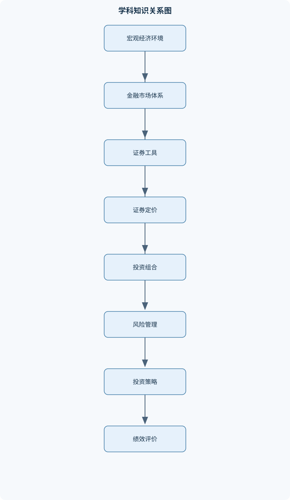
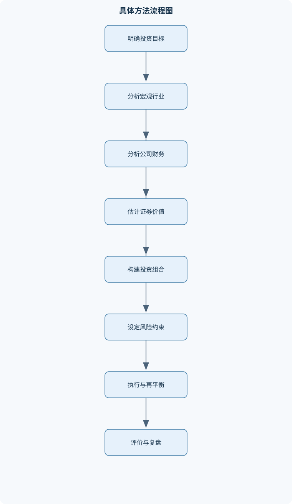

# 证券投资学

## 一、课程整体知识框架

### 课程边界与先修知识

证券投资学研究证券的基本属性、发行与交易市场、股票与债券等金融工具的定价、投资组合与风险管理、基金与衍生品、基本面分析与技术分析，以及宏观经济和行业因素对证券价格的影响。课程边界包括从投资目标设定、资产配置、证券估值、交易策略到绩效评价的完整投资决策过程；不以会计准则、具体法律条文、编程实现或某一市场的最新交易规则为核心，但需要掌握与证券投资有关的财务报表、概率统计、微观经济学、宏观经济学和货币金融学基础。先修知识包括货币时间价值、复利与贴现、概率分布、期望与方差、协方差与相关系数、基础会计报表、利率与汇率、供求关系以及金融市场基本结构。课程中的模型应区分理想化假设与现实限制，所有投资收益均应说明计价期间、现金流时点、交易成本、税费、流动性和风险因素。





### 1. 研究对象与核心问题

证券投资学研究投资者如何在不确定条件下，将资金配置到股票、债券、基金、期货、期权及其他证券资产中，并通过发行、交易、估值、组合管理和风险控制实现既定投资目标。其核心不是单独记忆某一种证券的定义，而是建立一条完整的投资决策链：

$$
\text{投资目标设定}
\rightarrow
\text{宏观与行业判断}
\rightarrow
\text{证券筛选}
\rightarrow
\text{价值评估}
\rightarrow
\text{组合构建}
\rightarrow
\text{交易执行}
\rightarrow
\text{风险管理}
\rightarrow
\text{绩效评价与再平衡}
$$

投资目标包括收益目标、风险承受能力、投资期限、流动性要求和税费约束。相同证券对不同投资者的适用性并不相同。例如，长期资金可以承受较大的短期价格波动，而短期有确定支付义务的资金更关注本金安全和流动性。投资决策必须说明计价期间、现金流发生时点、交易成本、税费、再投资假设和风险暴露，否则“收益率高”或“风险低”的结论缺乏可比性。

证券投资学中的收益既包括价格变化，也包括期间现金收入。若投资者在期初以 $P_0$ 买入证券，在期末以 $P_T$ 卖出，并在期间收到股利、票息等现金流，则未计交易费用和税费的简单持有期收益率为

$$
R_H=\frac{P_T-P_0+\sum C_t}{P_0},
$$

其中，$P_0$ 和 $P_T$ 的单位为货币/份，$C_t$ 表示第 $t$ 个时点收到的现金流，正号表示流入。若现金流发生在不同时间，严格计算应按实际时点处理，而不能简单把所有现金流视为期末收入。若持有期为 $T$ 年且中间现金流均被忽略，年化复合收益率可写为

$$
R_{\text{annual}}=\left(\frac{P_T}{P_0}\right)^{1/T}-1.
$$

两种收益率的计价逻辑不同：持有期收益率描述整个持有期间的结果，年化收益率用于不同期限之间的比较。若存在票息、股利、手续费或分红再投资，还必须把这些现金流纳入计算。

### 2. 货币时间价值是估值的共同基础

证券估值的共同基础是货币时间价值。只要资金能够获得正的机会收益率，今天的一元钱通常不等于未来的一元钱。若现值为 $PV$，单期有效收益率为 $r$，经过 $n$ 个计息期后的终值为

$$
FV=PV(1+r)^n.
$$

反向求现值为

$$
PV=\frac{FV}{(1+r)^n}.
$$

这里的 $r$ 必须与现金流频率一致。例如现金流按半年发生，使用的应是每半年有效利率，不能直接把年利率代入而不作转换。若现金流分别在 $t=1,2,\ldots,n$ 期发生，则不规则现金流的现值为

$$
PV=\sum_{t=1}^{n}\frac{C_t}{(1+i)^t},
$$

其中 $i$ 是与每期现金流相匹配的贴现率。债券票息、股票股利和企业自由现金流的估值，本质上都是将未来现金流折算为当前价值。

这一框架有明确边界。贴现率不是任意数字，而应反映现金流的风险、期限、流动性和投资者要求的机会成本；现金流也不是会计利润的简单替代物。对于价格波动较大、现金流不稳定或不存在可预测现金流的证券，单一现金流贴现模型可能产生很大的参数误差，需要结合相对估值、情景分析和风险调整。

### 3. 证券价格的分子端与分母端

证券定价可以从“分子端”和“分母端”理解。分子端是未来现金流及其增长前景，例如债券票息、本金、股票股利、企业自由现金流和资产出售价值；分母端是与风险相匹配的贴现率，包括无风险利率、风险溢价、信用风险溢价、流动性溢价和期限溢价。

在其他条件不变时，未来现金流增加或增长预期提高，通常会提高证券理论价值；贴现率上升，通常会降低理论价值。但现实市场并非机械地按照单一因素变化。利率上升可能反映经济增长改善，也可能反映通胀上升或信用风险恶化；若盈利预期同步提高，股票价格未必下降。因此，分析证券价格必须区分直接估值效应、预期变化和风险溢价变化。

### 4. 风险、收益与组合化决策

风险首先是未来收益结果的不确定性，而不等同于已经发生的亏损。方差和标准差用于描述收益率围绕均值的波动程度，但它们无法完整描述极端损失、流动性不足、信用违约或模型错误。投资组合的关键在于资产之间的协方差和相关系数，而不是只观察单项资产的风险。

若资产 $i$ 在组合中的价值权重为 $w_i$，组合收益率为 $R_p$，则

$$
E(R_p)=\sum_{i=1}^{N}w_iE(R_i).
$$

两项资产的组合方差为

$$
\sigma_p^2
=
w_A^2\sigma_A^2+w_B^2\sigma_B^2
+2w_Aw_B\rho_{AB}\sigma_A\sigma_B.
$$

其中，$\sigma_A$ 和 $\sigma_B$ 是两项资产收益率的标准差，$\rho_{AB}$ 是相关系数。相关系数越低，分散化通常越有效；但相关系数并不固定，市场压力时期不同资产的相关性可能同时上升。允许卖空时，权重可以为负；禁止卖空时通常要求 $w_i\geq0$ 且 $\sum_iw_i=1$。

组合管理需要在期望收益、风险、流动性和约束之间权衡。均值—方差模型适用于收益分布较稳定、投资期限和风险度量较明确的情形，但它依赖历史均值和协方差估计，容易受到样本长度、异常值和结构变化影响。现实配置还要考虑集中度、换手率、保证金、税费、最低交易单位和投资者行为偏差。

### 5. 理想模型与现实市场的区别

课程中的定价模型通常采用若干理想化假设，例如市场信息可获得、交易可以迅速完成、资产能够按理论价格买卖、交易成本为零、投资者具有稳定偏好和理性预期。这些假设有助于推导清晰的结论，但不能直接当作现实描述。

现实市场存在买卖价差、价格冲击、交易费用、税费、涨跌幅限制、融资约束、卖空限制、保证金要求和信息不对称。证券价格还可能受到投资者情绪、羊群行为、流动性危机和政策预期影响。因此，任何套利或对冲策略都必须核算执行成本、基差风险、融资风险、模型风险和极端行情下的追加保证金风险。模型结果应被理解为基准情景或理论参照，而不是未来收益保证。

### 6. 从市场分析到绩效评价的闭环

宏观经济分析回答经济增长、通胀、利率、汇率、财政政策和货币政策如何改变资产定价环境；行业分析回答行业竞争结构、生命周期、景气程度和政策环境如何影响企业盈利；公司分析进一步判断商业模式、治理质量、财务状况、现金流和估值水平。

在完成证券筛选后，投资者需要选择主动型、被动型或避险型策略。主动型策略试图通过信息、研究或交易判断获得超过基准的风险调整收益；被动型策略主要复制指数或维持稳定资产配置；避险型策略通过现金、债券、期货、期权或其他工具降低组合对不利价格变化的敏感度。

绩效评价不能只看绝对收益。需要将基金或组合收益与适当基准比较，并结合波动率、最大回撤、下行风险、夏普比率、特雷诺比率、詹森阿尔法、跟踪误差和费用进行分析。绩效归因还要区分收益来自资产配置、行业配置、个股选择、杠杆、市场贝塔还是偶然性。

## 二、章节和模块划分

### 核心知识覆盖清单

本清单用于检查正文是否覆盖本课程的主要知识模块：

- **证券投资工具与市场体系**：证券的定义、特征与分类、股票的所有权属性与股东权利、普通股、优先股与特殊股权结构、债券的债权属性、票面要素与偿付顺序、股票与债券的权利、期限、收益和风险比较、存托凭证、国际证券与跨境融资、一级市场、二级市场及发行交易机制、交易所市场、场外市场、第三市场与第四市场、证券市场参与者及基金管理人与托管人关系、会员制交易所与公司制交易所的组织差异。
- **货币时间价值与固定收益证券**：单笔现金流的终值与现值、年金现金流与不规则现金流贴现、债券价格、票息、本金和到期收益率、平价、溢价和折价债券的判断、债券价格与市场利率的反向关系、到期时间、票息率与价格波动、持有期收益率与到期收益率的区别、久期、修正久期与利率敏感性、凸性及其对价格变化的修正、利率期限结构与收益率曲线、预期假说、市场分割假说与流动性偏好假说。
- **股票估值与价格形成**：股票投资收益的股利收益与资本利得、股利贴现模型的现金流基础、零增长、固定增长和多阶段增长模型、戈登增长模型的推导与适用条件、市盈率、市净率和市销率估值、企业价值倍数及资本结构影响、自由现金流折现模型的内涵、折现率、增长率与终值的敏感性、股票价格的分子端与分母端因素、市场情绪、资金供求与估值偏离、估值模型的局限、参数不确定性和相对估值陷阱。
- **宏观经济与行业分析**：经济周期的扩张、衰退、萧条和复苏阶段、国内生产总值、就业、产能利用率与通胀、利率、货币供应量和财政赤字对证券市场的影响、财政政策与货币政策的传导机制、先行指标、同步指标和滞后指标、政治、汇率、国际贸易与资本流动因素、供给冲击、需求冲击和资产价格反应、行业市场结构与竞争程度、行业生命周期的起始、成长、成熟和衰退、增长型、周期型和防御型行业、行业景气、产业政策与公司盈利弹性。
- **公司基本面分析与财务评价**：公司基本面分析的目标与信息来源、公司治理、管理层质量与控制权结构、商业模式、竞争优势与盈利持续性、收入、成本、利润和现金流质量、资产负债表、利润表和现金流量表联动分析、偿债能力、营运能力和盈利能力指标、杜邦分析法及ROE分解、股利政策、股票回购与市场信号、股票分割、增发、配股和资本公积、公司估值体系的绝对估值与相对估值、财务造假、会计政策和非经常性损益识别。
- **投资组合理论与资产配置**：收益率的算术平均、几何平均与持有期收益、风险的方差、标准差、下行风险与半方差、协方差、相关系数与分散化效应、两资产组合收益率与方差、多资产组合的矩阵表示、均值—方差准则与有效前沿、风险厌恶、效用函数与无差异曲线、无风险资产、资本配置线与夏普比率、最优资产配置比例的推导、系统性风险与非系统性风险的分解、投资组合的再平衡、约束条件与现实偏差。
- **基金投资与组合绩效评价**：证券投资基金的基本结构、基金份额、基金管理人和托管人关系、开放式基金与封闭式基金、基金净值、申购赎回价格与市场价格、封闭式基金的折价与溢价、公募基金与私募基金的募集和披露差异、对冲基金的策略、杠杆与做空机制、契约型、公司型和合伙型基金、基金收益、费用、分红与净值调整、夏普比率、特雷诺比率与詹森阿尔法、基金基准、风格漂移与绩效归因。
- **证券风险、套期保值与套利**：风险与收益不确定性的定义、市场风险、信用风险、流动性风险和操作风险、利率风险、汇率风险、购买力风险和价格风险、系统性风险与非系统性风险、分散投资、风险转移和风险自留、风险价值VaR的定义、置信水平与持有期、套期保值的现货与期货头寸关系、空头套期保值、多头套期保值和交叉套保、套利的相对定价逻辑与无套利条件、跨期、跨市场、跨品种和现货期货套利、套利限制、基差风险、流动性风险和模型风险。
- **期权与股指期货策略**：期权合约的标的、执行价格、到期日和权利金、看涨期权与看跌期权、期权买方权利与卖方义务的不对称性、看涨期权和看跌期权的到期损益、盈亏平衡点与最大损失、内在价值、时间价值和实值虚值状态、股指期货的合约价值、保证金与杠杆、期货多头、空头与每日结算、股指期货方向性投资和指数化投资、股指期货空头套保、多头套保和交叉套保、期现套利、跨期套利和跨指数套利、期权与期货的风险边界及追加保证金风险。
- **有效市场与行为金融**：有效市场假说的基本命题、弱型、半强型和强型有效市场、技术分析与基本面分析在有效市场中的含义、超额收益、异常收益与风险调整收益、信息披露、价格反应和事件研究思路、有限理性、代表性偏差和可得性偏差、过度自信、损失厌恶和处置效应、羊群效应、锚定效应与反应过度、市场泡沫、崩溃和套利限制、行为偏差对资产配置和交易决策的影响。
- **技术分析与投资策略整合**：技术分析的假设、信息基础和适用边界、趋势、支撑位、阻力位和成交量、移动平均线与趋势识别、相对强弱指数RSI的构造、RSI的超买、超卖和背离、价格形态与技术信号确认、积极型、消极型和避险型投资策略、指数化投资和被动跟踪误差、股票组合的Beta、Alpha与风险控制、策略回测中的样本外检验与交易成本、投资组合决策的目标、约束、执行和复盘。


### 1. 证券投资工具与市场体系

证券是能够代表一定财产权利或债权债务关系、具有可转让性并可形成投资收益的金融凭证。按权利性质，可以分为股权类证券、债权类证券和衍生证券；按发行方式，可以分为直接融资工具和以集合投资方式形成的基金份额；按交易场所，可以分为交易所交易证券和场外交易证券。

股票代表股东对公司的剩余索取权和一定的治理权。普通股通常享有表决权、分红权和剩余财产分配权，但在公司清算时处于债权人和优先股股东之后。优先股通常在股利分配或清算分配方面具有优先顺序，但表决权可能受到限制。双重股权结构通过设置不同表决权的股份类别，使控制权与经济利益不完全对应，能够帮助创始人保持控制，但也可能增加中小股东监督困难和控制权滥用风险。

债券是发行人向投资者承担还本付息义务的债权凭证。票面要素包括面值、票面利率、付息频率、到期日、发行价格和偿付顺序。债券持有人通常不享有普通股式的剩余控制权，但在偿付顺序上优先于普通股股东。股票没有固定到期日，收益取决于股利和价格变化；债券通常具有约定现金流，但仍面临违约风险、利率风险、流动性风险和购买力风险。

一级市场是证券发行和募集资金的市场，资金通常由投资者流向发行人；二级市场是已发行证券之间转让的市场，主要功能是提供流动性和价格发现。交易所市场有集中交易、标准化程度较高和信息披露要求较明确等特点；场外市场由交易双方或经纪商通过协议报价完成交易，证券和合约条件可能更灵活，但透明度、流动性和对手方风险可能不同。第三市场通常指交易所上市证券在交易所以外的市场交易，第四市场强调机构投资者之间不经传统经纪商撮合的直接交易。

交易所可以采用会员制或公司制组织形式。会员制交易所由会员共同出资或共同控制，会员资格和交易权利具有重要地位；公司制交易所通常以公司形式运营，所有权、经营权和交易服务职能相对分离。证券发行人、投资者、证券公司、基金管理人、托管人、交易所、登记结算机构和监管机构共同构成市场体系。基金管理人负责投资运作，托管人负责基金资产保管、资金清算和监督部分运作，二者职责分离有助于降低资产挪用和内部控制风险。

存托凭证是以境外基础证券为基础、由存托机构签发并在另一市场交易的证券凭证。国际证券和跨境融资涉及不同货币、税制、会计信息、监管要求、汇率和资本流动限制。跨境投资不能只比较名义价格，还必须考虑汇率变化、转换比例、交易费用和政治风险。

### 2. 货币时间价值与固定收益证券

固定收益证券的估值从未来现金流开始。面值为 $F$、每期票息为 $C$、剩余期数为 $n$、每期到期收益率为 $y$ 的债券，其价格为

$$
P=\sum_{t=1}^{n}\frac{C}{(1+y)^t}
+\frac{F}{(1+y)^n}.
$$

若票面利率为年利率 $c$、每年付息 $m$ 次，则每期票息为 $C=Fc/m$，每期收益率为年化收益率按相同计息规则转换后的数值，剩余期数为剩余年数乘以 $m$。计算时不能把年票息与每期票息、年收益率与每期收益率混用。

当票面利率等于市场到期收益率时，债券价格通常等于面值；票面利率高于市场收益率时，债券价格高于面值，称为溢价债券；票面利率低于市场收益率时，债券价格低于面值，称为折价债券。由价格公式可见，市场收益率上升会降低每一笔未来现金流的现值，因此债券价格与市场收益率通常反向变动。

到期收益率是在持有至到期、发行人按约定支付现金流、票息按该收益率再投资等条件下，使债券市场价格等于未来现金流现值的贴现率。持有期收益率则取决于实际买入价格、卖出价格、期间票息、再投资收益和持有期限。二者不能混同：投资者在到期前卖出债券时，实际结果可能显著偏离买入时的到期收益率。

麦考利久期是按各期现金流现值加权的平均回收时间。修正久期为

$$
D_{\mathrm{mod}}=\frac{D}{1+y},
$$

在小幅收益率变化下，债券价格变化近似为

$$
\frac{\Delta P}{P}\approx-D_{\mathrm{mod}}\Delta y.
$$

久期越大，债券对利率变化越敏感。凸性用于修正久期线性近似的误差。通常在其他条件相同的情况下，收益率下降带来的价格上涨幅度大于相同幅度收益率上升带来的价格下跌幅度。久期和凸性适用于固定现金流、收益率变化不太大且现金流结构稳定的情形；大幅利率变化、含权债券或现金流会随利率变化时，简单久期近似可能失真。

收益率曲线描述不同期限债券的收益率关系。预期假说认为长期利率主要反映未来短期利率的预期；市场分割假说强调不同期限市场存在投资者偏好和供求分割；流动性偏好假说认为投资者偏好短期限资产，长期资产需要额外期限溢价。三种解释可以共同用于分析期限结构，但任何一种都不能在所有市场环境下独立解释全部曲线形态。

### 3. 股票估值与价格形成

股票投资收益主要来自股利收益和资本利得。股票股利贴现模型认为，股票价值等于未来预期股利按股权资本成本贴现后的现值：

$$
P_0=\sum_{t=1}^{\infty}\frac{D_t}{(1+k)^t},
$$

其中 $D_t$ 为第 $t$ 期股利，$k$ 为股权资本成本。若股利长期不变，则零增长模型为

$$
P_0=\frac{D}{k}.
$$

若股利以稳定增长率 $g$ 永久增长，且下一期股利为 $D_1$，则由无限期几何级数求和可得戈登增长模型：

$$
P_0=\frac{D_1}{k-g}.
$$

该公式要求股利增长率长期稳定、$k>g$、公司具有持续分红能力，并且增长率不能机械地把短期高增长外推到无限期。当 $k$ 接近 $g$ 时，估值对参数极其敏感；当 $k\leq g$ 时，模型不具备通常意义上的有限稳定估值。

多阶段增长模型将企业生命周期分为高增长期、过渡期和稳定增长期，先分别折现预测期股利，再计算稳定期终值。对不稳定分红或不直接分红的公司，可采用自由现金流折现模型。企业价值为预测期自由现金流和终值的折现值之和：

$$
V_0=\sum_{t=1}^{T}\frac{CF_t}{(1+WACC)^t}
+\frac{TV_T}{(1+WACC)^T},
$$

其中 $CF_t$ 是第 $t$ 期自由现金流，$WACC$ 是加权平均资本成本，$TV_T$ 是预测期末终值。若稳定增长率为 $g$，则常见终值写为

$$
TV_T=\frac{CF_{T+1}}{WACC-g}.
$$

企业价值与股权价值不能混同。企业价值反映债权人和股东等全部资本提供者对经营资产的索取价值，调整净债务、优先权益和其他非普通股索偿后，才能得到普通股股权价值，再除以稀释后股份数得到每股价值。

相对估值通过市盈率、市净率、市销率和企业价值倍数等指标比较可比公司。市盈率受增长率、风险和盈利质量影响；市净率适用于资产具有较清晰账面价值的企业；市销率可用于暂时亏损但有收入的企业；企业价值倍数能够在一定程度上减少资本结构差异影响，但仍受会计口径、行业周期和资本支出差异影响。低倍数不必然代表低估，高倍数也不必然代表高估，必须结合盈利增长、现金流质量、资本结构和行业可比性。

### 4. 宏观经济与行业分析

宏观经济分析关注经济周期、增长、就业、通胀、利率、货币供应量、财政政策、汇率、国际贸易和资本流动。经济周期通常可划分为扩张、衰退、萧条和复苏阶段，但现实周期边界并不总是清晰。扩张阶段企业收入和资本开支可能增加，周期型行业通常受益；衰退阶段需求下降、信用风险上升，防御型行业相对稳定；复苏阶段盈利预期改善，股票市场可能先于实际经济数据反应。

国内生产总值反映一定时期内经济活动规模，就业反映劳动力市场状况，产能利用率反映生产能力使用程度，通胀反映总体价格水平变化。市场价格通常反映对未来的预期，而不是机械跟随已经公布的指标水平。先行指标试图在经济转折前变化，同步指标与经济活动大致同时变化，滞后指标通常在经济变化发生后确认。社会消费、货币政策或其他指标的领先关系并非绝对，可能因制度、周期和数据修订而改变。

货币政策通过利率、信用、资产价格和汇率等渠道影响证券市场。宽松政策可能降低融资成本、提高流动性并抬高资产估值，但若同时引发通胀、汇率压力或金融风险，实际影响可能不同。财政政策通过政府支出、税收和转移支付影响总需求、企业收入和行业盈利。政策效应取决于经济所处阶段、市场预期、财政可持续性和政策组合，不能简单归结为“宽松必然利好股票”。

行业分析包括市场规模、增长速度、进入壁垒、供应商和购买者议价能力、替代品威胁以及行业内部竞争。行业生命周期可分为起始期、成长阶段、成熟阶段和衰退阶段。成长型行业通常收入增长较快但估值和竞争风险较高；周期型行业对经济波动、商品价格或资本开支敏感；防御型行业需求相对稳定，但增长空间可能有限。行业景气改善能否转化为股票上涨，还取决于盈利弹性、估值水平和市场是否已经提前反映预期。

### 5. 公司基本面分析与财务评价

公司基本面分析的目标是判断企业的经营质量、盈利持续性、现金流能力、治理风险和合理价值。信息来源包括财务报表、公司公告、行业资料、经营数据、管理层沟通和市场交易信息，但不同来源存在披露时滞、估计误差和选择性披露问题。

资产负债表反映特定时点的资产、负债和所有者权益；利润表反映一定期间的收入、成本和利润；现金流量表反映经营、投资和筹资活动产生的现金流。三张报表需要联动分析。例如利润增长但经营现金流长期恶化，可能意味着应收账款增加、收入确认激进或盈利质量不足；资产扩张若主要依赖高杠杆，可能提高短期增长却增加偿债压力。

偿债能力可通过流动比率、速动比率、利息保障倍数和资产负债率等指标分析；营运能力可通过应收账款周转、存货周转和总资产周转分析；盈利能力可通过销售净利率、资产报酬率和净资产收益率分析。杜邦分析将 ROE 分解为

$$
ROE
=
\frac{\text{净利润}}{\text{营业收入}}
\times
\frac{\text{营业收入}}{\text{平均总资产}}
\times
\frac{\text{平均总资产}}{\text{平均股东权益}}.
$$

三个因素分别对应销售净利率、总资产周转率和权益乘数。ROE 上升可能来自利润率提高、资产使用效率改善，也可能只是财务杠杆上升，因此不能把高 ROE 自动等同于高质量经营。

股利政策和股票回购会影响投资者获得现金的方式及市场信号。稳定或提高股利可能被市场解释为管理层对未来现金流有信心，但也可能减少企业再投资资金。股票分割会降低每股交易价格和每股面值计量，不会在分割瞬间改变股东持有的总价值；增发、配股和资本公积转增会改变股份数量、资本结构和每股指标。股票溢价发行中超过票面金额的部分通常计入股本溢价等资本公积，但具体会计处理应以适用规则和交易安排为准。

财务分析还要识别非经常性损益、会计政策变化、关联交易、收入确认异常、资产减值逆转、应收账款异常增长和现金流与利润不匹配等问题。估值应同时使用绝对估值和相对估值，并对折现率、增长率、利润率和终值进行敏感性分析。

### 6. 投资组合理论与资产配置

投资组合理论将单项证券选择提升为整体风险收益管理。算术平均收益率适合描述单期平均表现，几何平均收益率适合衡量多期复合增长，持有期收益率则必须根据实际买入、卖出和期间现金流计算。风险可以用方差、标准差、下行风险、半方差和最大回撤等多种指标表示，不同指标关注的风险含义不同。

均值—方差分析将期望收益和收益方差作为选择依据。在给定风险下追求最高收益，或在给定收益下追求最低风险，可以得到有效组合；所有有效组合构成有效前沿。投资者的风险厌恶程度可用效用函数表示：

$$
U=E(R_p)-\frac{A}{2}\sigma_p^2,
$$

其中 $A>0$ 表示风险厌恶，$A=0$ 表示风险中性。风险厌恶系数越大，投资者通常越倾向于降低风险资产权重，但最终配置还受卖空、借贷、流动性和集中度限制。

无风险资产与风险组合混合时，若风险资产权重为 $w$，无风险收益率为 $R_f$，则组合期望收益为

$$
E(R_c)=R_f+w[E(R_p)-R_f],
$$

组合标准差为

$$
\sigma_c=w\sigma_p
$$

在 $w\geq0$ 且不存在其他约束时，组合风险收益关系形成资本配置线，其斜率为

$$
\frac{E(R_p)-R_f}{\sigma_p},
$$

即夏普比率。若禁止借贷，风险资产权重受到上限约束；若允许借贷但融资利率高于无风险利率，资本配置线会出现不同借贷区间，不能简单使用同一个无风险利率。

系统性风险来源于宏观经济、市场利率、通胀、汇率和整体市场波动，不能通过持有更多同类证券完全消除；非系统性风险来源于单个公司、行业或项目，可以通过跨公司、跨行业和跨资产分散降低。贝塔系数为

$$
\beta_i=\frac{Cov(R_i,R_m)}{Var(R_m)},
$$

表示证券收益对市场组合收益变化的敏感度。贝塔衡量的是市场相关风险，不等于全部风险。

### 7. 基金投资与组合绩效评价

证券投资基金通过集合投资者资金，由基金管理人进行专业投资，并由托管人保管基金资产和执行监督、清算等职责。开放式基金份额通常可以按照基金净值申购和赎回，份额规模随申购赎回变化；封闭式基金在存续期内份额相对固定，投资者通常通过二级市场买卖，市场价格可能高于或低于单位净值。

封闭式基金折溢价率可表示为

$$
\text{折溢价率}
=
\frac{\text{市场价格}-\text{单位净值}}{\text{单位净值}}.
$$

结果为负表示折价，结果为正表示溢价。封闭式基金市场价格受到供求、流动性、投资策略、分红预期和市场情绪影响，因此不必然等于净值。公募基金通常具有更广泛的投资者范围和较规范的信息披露安排；私募基金的募集对象、投资策略、流动性和披露安排通常不同。契约型、公司型和合伙型基金的法律组织关系、治理结构和投资者责任边界也不同，不能只依据名称判断。

基金收益需要统一处理分红、费用和净值调整。时间加权收益率适合评价管理人在不同资金流入流出影响下的投资表现；资金加权收益率会受到投资者申购赎回时点影响。夏普比率用超额收益除以总波动率，特雷诺比率用超额收益除以贝塔，詹森阿尔法衡量在给定基准风险暴露下的超额部分。评价基金时还要考察基准是否合适、风格是否稳定、是否发生风格漂移，以及收益是否来自杠杆或集中持仓。

### 8. 证券风险、套期保值与套利

证券风险包括市场风险、信用风险、流动性风险、操作风险、利率风险、汇率风险、购买力风险和价格风险。风险管理措施包括分散投资、风险转移、套期保值、保险、限额管理、风险自留和应急流动性安排。风险价值 $VaR_\alpha$ 表示在给定置信水平 $\alpha$ 和持有期内，损失分布的某个分位数，但不等于极端情况下的最大可能损失。VaR 对分布假设、样本区间和相关性估计敏感，必须结合压力测试和极端情景分析。

套期保值的目标是降低已有现货风险，而套利的目标是利用相关资产之间的相对价格偏离。持有现货并担心价格下跌时，通常建立期货空头；未来需要买入现货并担心价格上涨时，通常建立期货多头。最优套保比率可写为

$$
h^*=\frac{Cov(\Delta S,\Delta F)}{Var(\Delta F)},
$$

其中 $\Delta S$ 是现货价格变化，$\Delta F$ 是期货价格变化。实际套保效果取决于基差、合约到期日、标的匹配程度、交易成本和保证金约束。

套利要求交易者同时建立方向相反的相关头寸，并在价差收敛时平仓。理论无套利关系需要考虑融资成本、股息、仓储成本、转换比例、交割条件和交易费用。实际价差只有在超过全部成本、安全边际和执行不确定性后，才具有交易意义。跨期、跨市场、跨品种和现货期货套利都可能面临基差风险、流动性风险、融资风险、对手方风险和模型风险，因此不能把套利简单称为绝对无风险收益。

### 9. 期权与股指期货策略

期权合约包括标的资产、执行价格 $K$、到期日和权利金。看涨期权赋予买方按执行价格买入标的的权利，看跌期权赋予买方按执行价格卖出标的的权利。买方拥有权利但没有必须履约的义务，卖方收取权利金但承担履约义务。

买入看涨期权的到期损益为

$$
\Pi_c=\max(S_T-K,0)-c,
$$

其中 $S_T$ 是到期时标的价格，$c$ 是看涨期权权利金。买方最大损失为权利金，盈亏平衡点为 $K+c$，上涨收益理论上没有固定上限。买入看跌期权的到期损益为

$$
\Pi_p=\max(K-S_T,0)-p,
$$

其中 $p$ 是看跌期权权利金。买方最大损失为权利金，标的价格不能低于零，因此其收益具有上限。期权卖方的损益方向与买方相反，但不意味着风险和收益完全对称：卖出看涨期权的潜在损失可能很大，卖出看跌期权在标的价格大幅下跌时也可能承担重大损失。

期权价值可分为内在价值和时间价值。实值、平值和虚值状态取决于标的价格与执行价格的关系。时间价值受剩余期限、波动率、利率、股息和市场供求影响，不能仅根据当前内在价值判断权利金是否合理。

股指期货以股票指数或指数相关标的为基础，具有合约乘数、保证金和每日结算机制。期货多头在指数上涨时通常受益，空头在指数下跌时通常受益，但每日结算会带来现金流压力和追加保证金风险。股指期货可用于方向性投资、指数化配置、空头套保、多头套保、期现套利、跨期套利和跨指数套利。理论价格受现货指数、融资成本、股息、到期时间和交易成本影响，实际基差还受流动性和市场情绪影响。

### 10. 有效市场与行为金融

有效市场假说的基本命题是，证券价格会迅速反映相关信息，使投资者难以持续获得风险调整后的超额收益。弱型有效市场认为价格已反映历史价格和交易量信息；半强型有效市场认为价格已反映公开信息；强型有效市场认为价格已反映全部可获得信息，包括私人信息。有效并不意味着价格永远正确，也不意味着市场不会出现泡沫和崩溃，而是强调基于已知信息持续获取超额收益的困难。

在弱型有效市场下，单纯依据历史价格和成交量的技术分析难以稳定获得超额收益；在半强型有效市场下，公开财务信息和公告通常会较快反映在价格中；在强型有效市场下，即使掌握私人信息也难以获得超额收益。现实市场可能处于不同程度的有效状态，信息传播速度、流动性、投资者结构和制度环境都会影响价格反应。

行为金融研究有限理性及其对价格的影响。代表性偏差使投资者根据少量或典型信息过度外推，可得性偏差使近期、醒目或容易回忆的信息被赋予过高权重；过度自信会导致交易过度，损失厌恶使投资者对亏损的痛苦大于同等盈利的满足，处置效应表现为过早卖出盈利资产、过久持有亏损资产。锚定效应使投资者过度依赖历史价格或初始估计，羊群效应会放大共同买卖，反应过度可能造成价格偏离基本价值。

### 11. 技术分析与投资策略整合

技术分析主要依据价格、成交量、波动和交易结构研究趋势与市场行为，其常见假设是市场价格已经综合反映可获得信息，价格运动存在趋势，历史交易行为可能重复。支撑位表示价格下跌过程中可能出现买方力量增强的区域，阻力位表示上涨过程中可能出现卖方力量增强的区域，但二者不是固定不变的价格边界。

移动平均线通过对一段时期价格进行平均，以削弱短期波动并识别趋势。短周期移动平均线反应较快，但噪声较大；长周期移动平均线较平滑，但信号滞后。相对强弱指数通常定义为

$$
RSI=100-\frac{100}{1+RS},
$$

其中 $RS$ 是一段观察期内平均上涨幅度与平均下跌幅度之比。RSI 进入较高区域可被称为超买，进入较低区域可被称为超卖，但超买不等于必然下跌，超卖也不等于必然上涨。背离信号需要结合趋势、成交量和价格形态确认。

积极型投资试图通过选股、择时或行业轮动获得超额收益；消极型投资主要跟踪指数、控制成本并减少不必要交易；避险型投资通过降低风险暴露、增加现金或使用衍生品保护组合。指数化投资的实际收益会受到跟踪误差、管理费、交易成本、现金拖累、成分调整和复制方法影响。

策略评价必须区分样本内和样本外结果。回测若反复调整参数以适应历史数据，可能产生数据窥探和过拟合；若忽略停牌、流动性、交易成本、税费、滑点和幸存者偏差，回测收益会被高估。技术信号不能单独证明未来价格方向，必须放入明确的目标、风险限额、执行规则和复盘体系中。

### 12. 综合投资决策模块

综合投资决策将宏观分析、行业分析、公司分析、估值、组合构建、交易执行和绩效评价连接起来。首先明确资金性质、投资期限、收益目标、风险承受能力和流动性约束；其次确定资产配置范围和基准；再次根据宏观和行业环境筛选证券，并通过绝对估值和相对估值判断风险收益特征；之后根据权重约束、集中度限制、卖空和融资条件构建组合。

交易执行需要考虑订单价格、成交量、买卖价差、市场冲击、交易时点和流动性。衍生品交易还必须核算保证金、每日结算和追加保证金风险。组合建立后，应定期监测实际权重、贝塔、行业集中度、信用暴露、流动性和最大回撤，在偏离目标权重或风险边界时进行再平衡。

绩效复盘应回答三个问题：第一，组合是否实现了预定收益目标；第二，收益是否与承担的风险相匹配；第三，收益来自何种决策并能否持续。评价时应统一分红、费用、现金流和计价期间，选择适当基准，区分资产配置收益、证券选择收益、市场贝塔收益和偶然收益。任何投资结论都应注明模型假设、现实限制和可能导致结论失效的条件。

## 三、核心概念的详细解释

### 1. 证券、投资与市场体系

证券是能够代表一定财产权利或债权债务关系、具有可转让性并可产生经济收益的金融凭证。其核心特征包括权利性、流动性、风险性和收益性。股票代表对公司的剩余索取权，债券代表对发行人的债权，基金份额代表对基金资产的间接受益权，期货和期权则主要体现标准化远期交易或选择权关系。

股票持有人通常享有股利收益、资本利得、表决权、知情权和剩余财产分配权，但普通股股东的清偿顺序通常晚于债权人和优先股股东。优先股一般在股利分配或剩余财产分配方面具有优先顺序，但表决权可能受到限制。双重股权结构通过设置不同表决权类别，使部分股份具有较高表决权，目的是在融资的同时保持创始人或核心管理层的控制力；其代价是普通股东的表决权可能被稀释，治理制衡和控制权转移机制也更复杂。

债券的基本要素包括面值 $F$、票面利率、票息支付频率、到期日、发行人、信用等级和偿付顺序。债券投资者获得的收益主要是票息、价格变化和本金偿还。债券的信用风险取决于发行人的偿债能力，利率风险取决于市场收益率变化，流动性风险取决于能否以接近合理价格及时交易。股票没有固定到期日，收益具有更强的不确定性；债券通常具有明确的本金和利息安排，但并不意味着没有风险。

证券市场可以按发行环节分为一级市场和二级市场。一级市场完成证券发行，发行人获得融资，投资者取得新发行证券；二级市场完成已发行证券的转让，为投资者提供流动性和价格发现机制。交易所市场具有集中竞价、标准化程度较高和信息披露较规范等特征；场外市场通过做市商、经纪商或双边协商完成交易。第三市场通常指在交易所上市证券的场外交易，第四市场则更多体现机构投资者之间直接进行的大宗交易。

证券市场参与者包括发行人、个人投资者、机构投资者、证券公司、基金管理人、托管人、交易所、清算机构和监管机构。基金管理人负责投资决策、组合管理和交易执行，托管人负责基金资产保管、资金清算和部分监督职责，两者职能分离有助于降低资产挪用和内部控制风险。开放式基金通常按照基金净值申购和赎回，封闭式基金在封闭期内份额通常在二级市场交易，市场价格可能因供求、流动性和投资者情绪而低于或高于单位净值。

国际证券中，存托凭证是由存托机构发行、代表境外基础证券权益的凭证，可降低跨境投资的交易和结算障碍。跨境证券还面临汇率风险、法律制度差异、资本流动限制、信息不对称和政治风险。所谓“本国发行人在外国市场发行、以本国货币计价”的债券，判断时必须同时看发行地、发行人和计价货币，不能仅凭“外国市场”作结论。

### 2. 货币时间价值与收益度量

货币时间价值是证券估值的共同基础。若期初投入 $PV$，单期有效收益率为 $r$，经过 $n$ 个计息期后的终值为

$$
FV=PV(1+r)^n.
$$

反向折现得到

$$
PV=\frac{FV}{(1+r)^n}.
$$

$r$ 的计息频率必须与 $n$ 的期数一致。若名义年利率为 $i_{\text{nom}}$，每年复利 $m$ 次，则每期利率为 $i_{\text{nom}}/m$，一年后的有效年利率为

$$
r_{\text{eff}}=\left(1+\frac{i_{\text{nom}}}{m}\right)^m-1.
$$

不规则现金流的现值为

$$
PV=\sum_{t=1}^{n}\frac{C_t}{(1+i)^t},
$$

其中 $C_t$ 是第 $t$ 期现金流，$i$ 是与现金流频率匹配的贴现率。正现金流表示投资者流入，负现金流表示投入、费用或追加保证金。

若期初价格为 $P_0$，期末价格为 $P_T$，期间现金收入为 $\sum C_t$，忽略税费和交易成本时，简单持有期收益率为

$$
R_H=\frac{P_T-P_0+\sum C_t}{P_0}.
$$

价格收益为 $(P_T-P_0)/P_0$，现金收益为 $\sum C_t/P_0$。当现金流发生时间不同，不能简单把所有现金流视为期末收入；严格比较时应说明是否假定现金流再投资以及再投资利率。若持有期为 $T$ 年且只考虑期初、期末价格，复合年化收益率为

$$
R_{\text{annual}}=\left(\frac{P_T}{P_0}\right)^{1/T}-1.
$$

算术平均收益率适合描述单期收益的平均水平，几何平均收益率适合描述多期复合增长。若连续两期收益率分别为 $10\%$ 和 $-10\%$，算术平均为 $0$，但两期财富变为原来的 $1.1\times0.9=0.99$，几何平均收益率为 $\sqrt{0.99}-1\approx-0.50\%$，说明平均收益率不等于实际财富增长率。

### 3. 固定收益证券与债券价格

固定票息债券的价格等于未来票息和本金的现值：

$$
P=\sum_{t=1}^{n}\frac{C}{(1+y)^t}+\frac{F}{(1+y)^n},
$$

其中 $P$ 为债券价格，$C$ 为每期票息，$F$ 为面值，$y$ 为每期到期收益率，$n$ 为剩余付息期数。若年付息一次，年票面利率为 $q$，则 $C=Fq$；若每年付息 $m$ 次，应使用每期票息 $C=Fq/m$、每期收益率 $y=Y/m$，并将剩余年数乘以 $m$ 得到期数。

当票面利率等于市场到期收益率时，债券价格通常等于面值，称为平价债券；票面利率高于市场收益率时，票息相对有吸引力，价格通常高于面值，称为溢价债券；票面利率低于市场收益率时，价格通常低于面值，称为折价债券。债券价格与市场收益率反向变动，但反向关系是对固定现金流债券而言；浮动利率债券、可转债和含期权债券的价格还受到利差、期权价值和标的资产价格影响。

到期收益率是使债券未来现金流现值等于当前市场价格的贴现率。它隐含票息按该收益率再投资、持有至到期且发行人按时偿付等条件，因此不等于所有投资者实际获得的收益。持有期收益率还取决于卖出价格、票息、持有期限和再投资结果。

麦考利久期是按现金流现值加权的平均回收时间，修正久期为

$$
D_{\text{mod}}=\frac{D}{1+y}.
$$

在收益率发生小幅变化时，

$$
\frac{\Delta P}{P}\approx-D_{\text{mod}}\Delta y.
$$

该式说明修正久期越大，债券对利率变化越敏感。大幅变动时应加入凸性项：

$$
\frac{\Delta P}{P}\approx-D_{\text{mod}}\Delta y+\frac{1}{2}Conv(\Delta y)^2.
$$

久期近似不是精确价格公式，尤其不适用于大幅利率变动、现金流结构复杂或收益率曲线非平行移动的情形。

### 4. 股票估值、公司分析与宏观行业分析

股票投资收益由股利收益和资本利得构成。股利贴现模型认为股票价值等于未来预期股利现值之和：

$$
P_0=\sum_{t=1}^{\infty}\frac{D_t}{(1+k)^t},
$$

其中 $D_t$ 是第 $t$ 期股利，$k$ 是股权资本成本。若股利永久不变，$P_0=D/k$；若股利以稳定增长率 $g$ 永久增长，则

$$
P_0=\frac{D_1}{k-g},
$$

其中 $D_1$ 是下一期股利，必须满足 $k>g$。若当前股利为 $D_0$，则 $D_1=D_0(1+g)$。该模型适用于股利政策相对稳定、增长率可合理估计且长期增长率低于股权资本成本的公司。对于不分红、高速成长或盈利波动很大的公司，直接套用模型会导致估值失真。

相对估值通过市盈率、市净率、市销率和企业价值倍数比较类似公司。市盈率为股价除以每股收益，适合盈利相对稳定的企业；市净率适合资产具有较强可计量性或资本密集型企业；市销率可用于尚未稳定盈利但收入具有参考价值的公司。企业价值倍数把企业整体价值与息税折旧摊销前利润等指标比较，能够减弱资本结构差异的影响，但仍受会计口径、周期阶段和一次性项目影响。

自由现金流折现模型使用企业或股权自由现金流作为估值基础。企业自由现金流按加权平均资本成本 $WACC$ 折现，企业价值再扣除净债务等非股权索偿得到股权价值。终值通常为

$$
TV_T=\frac{FCF_{T+1}}{WACC-g},
$$

其中 $FCF_{T+1}=FCF_T(1+g)$。使用该式必须满足 $WACC>g$。由于终值可能占企业价值较大比例，$WACC$、长期增长率和预测期现金流的微小变化都可能显著影响估值，应进行情景分析而不能把单一结果视为精确价格。

公司基本面分析包括商业模式、竞争优势、治理结构、管理层质量、收入增长、成本控制、利润质量、经营现金流、资本开支、偿债能力和资本回报率。杜邦分析将净资产收益率分解为

$$
ROE=
\frac{\text{净利润}}{\text{营业收入}}
\times
\frac{\text{营业收入}}{\text{平均总资产}}
\times
\frac{\text{平均总资产}}{\text{平均股东权益}}.
$$

三个因素分别是销售净利率、总资产周转率和权益乘数。ROE提高可能来自利润率改善，也可能来自提高杠杆；后者同时增加利息负担和财务风险，不能简单视为经营质量改善。财务分析还应检查利润与经营现金流是否匹配、应收账款和存货是否异常增长、非经常性损益是否支撑利润，以及会计政策变化是否影响跨期可比性。

宏观分析关注经济增长、就业、通货膨胀、利率、货币供应量、财政政策、汇率、国际贸易和资本流动。价格通常反映“实际结果与市场预期的差异”，而不是只对指标绝对水平作机械反应。例如利率上升可能提高债券贴现率、压低股票估值，但若利率上升源于经济强劲、企业盈利预期大幅改善，股票价格也可能上涨。先行指标试图领先经济活动变化，同步指标与经济活动大体同时变化，滞后指标通常在经济变化后确认趋势；这种分类并非永远固定，可能随制度和经济周期变化。

行业分析要判断市场结构、进入壁垒、供应商和购买者议价能力、替代品威胁、竞争程度以及行业生命周期。成长期行业通常收入增速较快但竞争和资本投入也高；成熟期需求增长放缓、竞争更依赖成本、品牌和效率；衰退期则可能出现产能过剩和盈利收缩。增长型行业对经济周期相对不敏感但估值可能较高，周期型行业利润随经济波动明显，防御型行业的需求相对稳定但并非没有估值和政策风险。

### 5. 投资组合、风险、基金与衍生品

投资组合收益率是各资产收益率的加权平均：

$$
E(R_p)=\sum_{i=1}^{N}w_iE(R_i),
\qquad \sum_{i=1}^{N}w_i=1.
$$

组合方差为

$$
\sigma_p^2=\sum_{i=1}^{N}\sum_{j=1}^{N}
w_iw_jCov(R_i,R_j).
$$

两资产情形为

$$
\sigma_p^2=w_A^2\sigma_A^2+w_B^2\sigma_B^2+
2w_Aw_B\rho_{AB}\sigma_A\sigma_B.
$$

相关系数越低，通常越有利于分散化；但相关系数会随市场环境变化，危机期间不同资产的相关性可能上升。系统性风险来自宏观经济、利率、市场情绪和政策等共同因素，难以通过持有更多同类证券消除；非系统性风险来自单个公司、行业或项目，可以通过跨公司、跨行业和跨资产配置降低。

无风险资产与风险资产组合形成资本配置线，其斜率为

$$
\frac{E(R_p)-R_f}{\sigma_p},
$$

即夏普比率。夏普比率使用总波动率衡量每单位总风险获得的超额收益；特雷诺比率使用贝塔衡量系统性风险；詹森阿尔法衡量实际收益相对于资本资产定价模型基准收益的偏离。绩效评价必须统一时间区间、分红、费用、现金流和基准，不能只比较绝对收益。

期权买方支付权利金获得权利，卖方收取权利金并承担履约义务。看涨期权买方到期损益为

$$
\Pi_c=\max(S_T-K,0)-c,
$$

最大损失为权利金 $c$，盈亏平衡点为 $K+c$。看跌期权买方到期损益为

$$
\Pi_p=\max(K-S_T,0)-p,
$$

最大损失为权利金 $p$，标的价格越低，潜在收益越大但受到价格不能低于零的约束。期权卖方的损益与买方相反，卖方收益通常受权利金限制，而风险可能很大。期货双方均承担履约义务，按每日结算制度调整保证金，方向判断错误时可能发生追加保证金。

套期保值的目标是降低已有现货风险，套利的目标是利用相关资产的相对定价偏离。若投资者持有股票组合并担心市场下跌，通常建立股指期货空头；若未来需要买入股票且担心价格上涨，则可建立股指期货多头。最优套保比率可写为

$$
h^*=\frac{Cov(\Delta S,\Delta F)}{Var(\Delta F)},
$$

其中 $\Delta S$ 和 $\Delta F$ 分别为现货与期货价格变化。现实中的套保并不完全，因为存在基差风险、期限不匹配和相关性变化。

有效市场假说认为资产价格已经反映某一范围内的信息。弱型有效市场强调历史价格和交易量信息，半强型有效市场强调全部公开信息，强型有效市场则进一步包括非公开信息。有效并不表示价格永远正确，而是表示投资者难以稳定获得风险调整后的超额收益。行为金融指出，过度自信、损失厌恶、锚定、代表性偏差、羊群效应和处置效应可能导致价格偏离基本价值，但套利也受到融资、流动性、做空限制和模型风险约束。

## 四、重要定义、公式、定理和推导

### 专业审校补充：关键定义与适用边界

无套利定价中的看涨—看跌平价关系，是连接现货、期权和无风险借贷的重要边界条件。对同一标的、同一执行价格K、同一到期日T的欧式看涨期权C和看跌期权P，在无分红、可连续交易、可按无风险利率借贷且不存在税费和交易成本时，有 $C+Ke^{-rT}=S_0+P$。其中，$S_0$为标的现价，$r$为连续复利无风险利率，$T$为年化到期时间。等式两侧到期现金流完全相同：左侧为看涨期权加无风险资产，右侧为现货加看跌期权。若标的在到期前支付已知现金股利，其现值应从现货侧扣除，关系变为 $C+Ke^{-rT}=S_0-PV(D)+P$。该关系适用于欧式期权；美式期权可提前执行，通常不能直接按等式使用。现实中还须考虑买卖价差、融资利差、股利不确定性、保证金和卖空限制，因此观察到的小幅偏离未必构成可执行套利。


### 1. 代表性计算与分析流程

#### 债券定价流程

**输入：**面值 $F$、年票面利率、付息频率 $m$、剩余年数、市场年收益率和计价日。  
**过程：**

1. 计算每期票息 $C=Fq/m$。
2. 计算每期收益率 $y=Y/m$。
3. 计算总期数 $n=Tm$。
4. 逐期贴现票息，并将最后一期本金与票息一并贴现。
5. 检查利率、现金流和期限的频率是否一致。

**输出：**理论价格 $P$。固定现金流逐项计算的复杂度为 $O(n)$。不变量是每一笔现金流都必须对应正确的支付时点；终止条件是所有 $n$ 期现金流均已贴现。

```python
def bond_price(face, coupon_rate, years, market_yield, payments_per_year=1):
    """计算固定票息债券价格；利率均以年化小数表示。"""
    m = payments_per_year
    periods = int(years * m)
    coupon = face * coupon_rate / m
    period_yield = market_yield / m

    price = 0.0
    for t in range(1, periods + 1):
        cash_flow = coupon
        if t == periods:
            cash_flow += face
        price += cash_flow / ((1 + period_yield) ** t)
    return price
```

该代码假定收益率按名义年利率、每年等额复利，且现金流固定、无违约、无应计利息调整。若交易发生在付息日之间，还需区分净价、全价和应计利息。

#### 两资产组合风险分析流程

**输入：**两项资产的期望收益、标准差、权重和相关系数。  
**过程：**先检查 $w_A+w_B=1$；计算组合期望收益；将相关系数转换为协方差 $\rho_{AB}\sigma_A\sigma_B$；代入方差公式并开平方。  
**输出：**组合期望收益、方差和标准差。该流程计算量为 $O(1)$。排错重点是百分数是否转换为小数、权重是否误用数量而非价值比例、相关系数是否落在 $[-1,1]$。

#### DCF 估值流程

**输入：**预测期自由现金流、预测期限 $T$、$WACC$、稳定增长率 $g$、净债务和稀释后股份数。  
**过程：**

1. 对每一期预测现金流折现：
   $$PV(FCF)=\sum_{t=1}^{T}\frac{FCF_t}{(1+WACC)^t}.$$
2. 计算终值：
   $$TV_T=\frac{FCF_T(1+g)}{WACC-g}.$$
3. 将终值折现并与预测期现金流现值相加，得到企业价值。
4. 扣除净债务及其他优先索偿，得到股权价值。
5. 除以稀释后股份数，得到每股内在价值。

**终止条件：**所有预测现金流和终值均已折现。**适用条件：**必须满足 $WACC>g$，并且自由现金流口径与折现率口径一致。复杂度为 $O(T)$。主要排错方法是核对终值使用的是 $T+1$ 期现金流，而不是错误地使用 $FCF_T$。

#### 套期保值流程

**输入：**现货头寸、期货合约乘数、现货和期货价格变化的协方差与方差。  
**过程：**判断风险方向；持有现货且担心下跌时建立期货空头，未来需要买入现货且担心上涨时建立多头；计算 $h^*$；根据现货头寸价值与单份期货合约价值确定合约数量；持续监测基差和保证金。  
**输出：**套保方向、合约数量、套保后风险和剩余基差风险。该方法只在现货与期货收益存在较稳定相关性时较为有效，不保证完全消除损失。

### 2. 典型例题

#### 例题一：债券价格计算

**题干：**面值为 $1000$ 元、年票面利率为 $6\%$、每年付息一次、剩余期限为 $5$ 年，市场到期收益率为 $8\%$，求债券价格。

**分析：**每年票息为 $1000\times6\%=60$ 元，最后一期还本 $1000$ 元。由于票面利率低于市场收益率，价格应低于面值。

**解答：**

$$
P=\frac{60}{1.08}+\frac{60}{1.08^2}
+\frac{60}{1.08^3}+\frac{60}{1.08^4}
+\frac{1060}{1.08^5}.
$$

逐项折现后约为

$$
55.56+51.44+47.63+44.10+721.02=919.75\text{元}.
$$

**结果验证：**市场收益率高于票面利率，价格低于 $1000$ 元，符合折价债券判断。若把年票息 $60$ 元和市场收益率 $8\%$ 直接作为每期数据，在半年付息情形下会产生频率错误。

**变式：**若市场收益率下降为 $4\%$，债券价格将上升至面值以上；若剩余期限增加，价格对收益率变化通常更敏感，但不能据此断言价格绝对水平一定更低。

#### 例题二：两资产组合收益与风险

**题干：**资产 A 的期望收益率为 $8\%$、标准差为 $10\%$；资产 B 的期望收益率为 $14\%$、标准差为 $20\%$；投资比例分别为 $60\%$ 和 $40\%$，相关系数为 $0.2$，求组合收益率和标准差。

**解答：**

$$
E(R_p)=0.6\times8\%+0.4\times14\%=10.4\%.
$$

协方差项为

$$
2w_Aw_B\rho_{AB}\sigma_A\sigma_B
=2(0.6)(0.4)(0.2)(0.10)(0.20)=0.00192.
$$

方差为

$$
\sigma_p^2=(0.6)^2(0.10)^2+(0.4)^2(0.20)^2+0.00192
=0.00880.
$$

因此

$$
\sigma_p=\sqrt{0.00880}\approx9.38\%.
$$

**结果验证：**组合标准差低于简单按权重计算的 $0.6\times10\%+0.4\times20\%=14\%$，说明相关性低于 $1$ 时存在分散化效应。若相关系数为 $1$，组合风险为 $14\%$；若为负值，风险可能进一步降低，但现实中相关系数通常不会长期保持固定。

#### 例题三：戈登增长模型

**题干：**某股票下一期股利为 $2$ 元，长期增长率为 $4\%$，股权资本成本为 $10\%$，求理论价格。

**解答：**

$$
P_0=\frac{D_1}{k-g}
=\frac{2}{0.10-0.04}
=33.33\text{元}.
$$

其中 $D_1=2$ 元，$k=10\%$，$g=4\%$。因为 $k>g$，几何级数可以收敛。

**结果验证：**若将 $g$ 提高到 $10\%$，分母为零，模型失去有限估值；若 $g>k$，模型会得到没有经济意义的负值或发散结果。该模型不适合把短期高速增长率永久外推。

**变式：**若当前股利为 $2$ 元而不是下一期股利，则应先计算 $D_1=2(1+4\%)=2.08$ 元，再代入模型。

#### 例题四：期权损益

**题干：**执行价格 $K=50$ 元，看涨期权权利金 $c=4$ 元。到期标的价格分别为 $30$、$50$ 和 $60$ 元，求买方损益。

**解答：**

$$
\Pi_c=\max(S_T-50,0)-4.
$$

当 $S_T=30$ 时，损益为 $0-4=-4$ 元；当 $S_T=50$ 时，损益仍为 $-4$ 元；当 $S_T=60$ 时，损益为 $10-4=6$ 元。盈亏平衡点为

$$
K+c=54\text{元}.
$$

**结果验证：**买方最大损失为 $4$ 元，不是执行价格 $50$ 元；当标的价格超过 $54$ 元时才真正盈利。卖方损益与上述结果相反，卖方最大收益为权利金，但上涨风险可能很大。

#### 例题五：杜邦分析

**题干：**某公司净利润为 $120$ 万元，营业收入为 $2000$ 万元，平均总资产为 $3000$ 万元，平均股东权益为 $1000$ 万元，求 ROE 并解释来源。

**解答：**

销售净利率：

$$
\frac{120}{2000}=6\%.
$$

总资产周转率：

$$
\frac{2000}{3000}=0.667.
$$

权益乘数：

$$
\frac{3000}{1000}=3.
$$

因此

$$
ROE=6\%\times0.667\times3\approx12\%.
$$

直接计算也得到 $120/1000=12\%$。结果说明股东回报由利润率、资产使用效率和杠杆共同决定。若下一期 ROE 上升但主要来自权益减少和权益乘数上升，不能直接认定公司经营改善，还要检查债务负担和偿债能力。

### 3. 实验与项目流程

#### 项目一：债券价格与久期敏感性分析

**输入数据：**设定一只面值、票面利率、付息频率和剩余期限明确的债券，分别改变市场收益率、期限和票息率。  
**步骤：**

1. 按债券定价公式计算基准价格。
2. 将收益率分别上调和下调若干幅度，记录价格变化。
3. 计算麦考利久期、修正久期，并使用久期公式预测价格变化。
4. 将久期预测与实际重新定价结果比较。
5. 对大幅收益率变化加入凸性修正。

**评价标准：**利率上升时价格应下降；久期预测在小幅变化下应接近实际变化；收益率和现金流频率必须统一；本金不能遗漏。  
**排错方法：**若出现利率上升、价格也上升，检查折现指数符号；若价格显著偏离，检查是否把年票息误当成每期票息、是否重复计算本金，以及是否混用了净价和全价。

#### 项目二：基金绩效与风格归因

**输入数据：**基金定期净值、分红、费用、基准指数收益率、无风险收益率以及基金规模变化。  
**步骤：**

1. 统一分红处理和收益计算期间。
2. 计算基金持有期收益、年化收益、波动率和最大回撤。
3. 计算夏普比率：
   $$Sharpe=\frac{R_p-R_f}{\sigma_p}.$$
4. 计算基金相对于基准的超额收益、跟踪误差和必要时的詹森阿尔法。
5. 按行业、资产类别和贝塔判断收益来自资产配置、证券选择还是市场整体上涨。
6. 检查是否存在风格漂移、过度集中和高换手率。

**评价标准：**所有基金必须使用相同计价期间和收益口径；风险调整指标应与绝对收益同时报告；评价结论应说明基准是否匹配基金投资范围。  
**排错方法：**若净值已扣除费用，不应再次扣费；若基金有现金流进出，不能直接使用简单期初期末净值比较；若封闭式基金存在折价或溢价，应区分单位净值收益和市场价格收益。

## 五、算法、流程和实现思路

### 方法与流程覆盖索引

下列方法或流程应在正文中说明输入、步骤、适用条件、结果检查和边界：

- 债券定价流程：输入面值、票息率、付息频率、剩余期限、市场到期收益率和计价日；将年票息转换为每期票息，将年收益率转换为每期收益率，分别贴现各期票息和本金并求和；输出债券理论价格。检查条件是收益率、现金流频率和期限单位一致。对固定现金流逐项计算的时间复杂度为$O(n)$。
- 持有期收益率计算流程：输入买入价格、卖出价格、持有期间收到的票息或股利及现金流时点；计算总收益为卖出价格减买入价格加期间现金收入，再除以买入价格；若需要年化，按实际持有天数或复利方式转换。输出持有期收益率和年化收益率。必须说明是否忽略税费、交易成本和再投资收益。
- 两资产组合方差分析流程：输入两项资产的期望收益、标准差、权重和相关系数；先检查权重是否满足约束，再计算期望收益、协方差项和组合方差，最后开平方得到标准差；输出组合收益与风险。计算量为$O(1)$，但多资产扩展为矩阵乘法，通常复杂度约为$O(N^2)$。
- 均值—方差有效组合求解流程：输入资产期望收益向量、协方差矩阵、目标收益或风险厌恶系数、权重约束和卖空约束；建立目标函数并加入权重和、收益、非负性等约束；求得最优权重，检查协方差矩阵是否半正定以及结果是否满足约束；输出组合权重、收益和风险。数值求解复杂度取决于优化器，协方差矩阵的存储规模为$O(N^2)$。
- 杜邦分析流程：输入净利润、营业收入、平均总资产和平均股东权益；依次计算销售净利率、总资产周转率和权益乘数；将三者相乘并与ROE直接计算值核对；输出盈利能力、资产效率和杠杆贡献。流程为$O(1)$，但应结合跨期变化和同业比较解释原因。
- DCF估值流程：输入预测期自由现金流、预测期限、WACC、稳定增长率和终值假设；先对预测期现金流逐期贴现，再按终值公式计算终值并贴现，最后求和得到企业价值；根据净债务等项目调整为股权价值，再除以稀释后股份数得到每股价值。输出基准估值和情景估值。必须检查$WACC>g$，并进行敏感性分析。
- 指数化投资流程：输入目标指数成分、权重、可投资资金和交易限制；按目标权重配置资产，处理现金、最小交易单位和流动性限制；定期计算组合权重与指数权重偏差，达到再平衡阈值时调整；输出跟踪误差和交易成本。每次全量再平衡复杂度约为$O(N)$，不保证实际收益等于指数收益。
- 套利分析流程：输入相关资产价格、转换比例、融资成本、股息、交易费用和交割条件；推导无套利理论价差，比较实际价差与总交易成本；若价差超过安全边际，同时建立多头和空头头寸，持续监测基差和保证金；价差收敛或风险边界触发时平仓。输出理论利润、最大可能损失和触发条件。不能把正价差直接视为无风险利润。
- 期货套期保值流程：输入现货头寸、期货合约乘数、现货与期货收益协方差及期货方差；根据风险暴露方向选择多头或空头期货，估计最优套保比率$h^*=Cov(\Delta S,\Delta F)/Var(\Delta F)$；确定合约数量并定期评估基差；输出套保后风险和剩余基差风险。适用于现货与期货价格具有稳定相关性的情形。
- RSI分析流程：输入连续收盘价和观察期长度；分别计算上涨幅度与下跌幅度的平均值，形成相对强度并转换为RSI；结合趋势、成交量和价格形态识别超买、超卖或背离；输出信号及其不确定性。该流程复杂度为$O(T)$，技术信号不能单独证明未来价格方向。





### 1. 从投资目标到组合执行的完整决策流程

证券投资决策不能从“买什么证券”直接开始，而应先确定资金性质与约束条件。完整流程如下：

1. **识别投资者目标。**明确目标收益率、最大可接受损失、投资期限、现金流需求、流动性要求、税费条件以及是否允许卖空、融资和使用衍生品。
2. **确定基准与资产范围。**根据目标选择股票、债券、基金、现金及衍生品的配置范围，并确定用于比较的市场基准。基准必须与组合风险和投资范围相匹配。
3. **进行宏观与行业分析。**分析经济增长、就业、通胀、利率、货币供应量、财政政策、汇率和资本流动，再判断行业处于起始期、成长期、成熟期还是衰退期。
4. **筛选证券并进行估值。**股票可使用股利贴现模型、自由现金流折现模型和市盈率等相对估值方法；债券应计算票息、本金和市场收益率对应的理论价格；基金还要考察费用、净值、折溢价、投资风格和跟踪误差。
5. **构建投资组合。**输入各资产的预期收益、波动率、协方差或相关系数，结合权重、集中度、流动性和卖空约束，确定资产配置方案。
6. **执行交易。**比较理论价格与市场价格，同时考虑买卖价差、冲击成本、佣金、税费、融资成本、保证金和成交概率。理论上有利的交易，如果无法及时成交，未必具有实际价值。
7. **监测风险与再平衡。**跟踪组合权重、贝塔、行业暴露、信用风险、久期、最大回撤、流动性和保证金水平。当实际权重偏离目标或风险达到限额时，按规则再平衡。
8. **进行绩效归因。**区分收益来自资产配置、行业配置、证券选择、市场贝塔、杠杆还是偶然价格波动，并统一处理分红、票息、费用、税费和外部资金流入流出。

这一流程的关键不在于预测必须准确，而在于每一步的目标、输入、假设、约束和退出条件明确。只根据单一指标买卖，无法替代完整投资决策。

### 2. 债券定价与持有期收益计算

#### 2.1 债券定价算法

**输入：**面值 $F$，年票面利率，付息频率 $m$，剩余年数 $T$，市场年到期收益率，以及计价日。  
**输出：**债券理论价格 $P$。

首先计算剩余付息期数：

$$
n=mT.
$$

每期票息为

$$
C=\frac{F\times \text{票面利率}}{m},
$$

每期收益率为

$$
y=\frac{\text{市场年到期收益率}}{m}.
$$

若现金流在每期末发生，债券价格为

$$
P=\sum_{t=1}^{n}\frac{C}{(1+y)^t}+\frac{F}{(1+y)^n}.
$$

也可以将最后一期票息和本金合并为 $C+F$。债券价格计算的核心是把每一笔未来现金流分别折现，而不是只对本金折现。

**不变量与检查条件：**

- $m$、$n$、$y$ 必须保持相同频率；
- 到期本金 $F$ 只能在最后一期计入；
- 若计价日在付息日之间，还要区分净价与应计利息形成的全价；
- 票面利率、市场收益率和价格必须使用同一货币单位；
- 在其他条件不变时，$y$ 上升，$P$ 下降；$y$ 下降，$P$ 上升；
- 当票面利率等于市场收益率时，价格通常接近面值；票面利率低于市场收益率时，价格通常折价；票面利率高于市场收益率时，价格通常溢价。

对固定现金流逐项求和的计算量为 $O(n)$。如果使用债券定价函数或数值求解到期收益率，还需注意函数的初始区间和现金流符号。

```python
def bond_price(face, coupon_rate, years, payments_per_year, yield_rate):
    periods = int(years * payments_per_year)
    coupon = face * coupon_rate / payments_per_year
    period_yield = yield_rate / payments_per_year

    if periods <= 0 or period_yield <= -1:
        raise ValueError("期限或每期收益率不满足定价条件")

    price = 0.0
    for t in range(1, periods + 1):
        cash_flow = coupon
        if t == periods:
            cash_flow += face
        price += cash_flow / ((1 + period_yield) ** t)
    return price
```

该代码假设每期末付息、收益率为名义年利率且按固定频率复利，不处理应计利息、税费、违约概率和交易成本。因此，它是理想化定价程序，不是完整交易系统。

#### 2.2 持有期收益率流程

若期初买入价格为 $P_0$，期末卖出价格为 $P_T$，期间收到的票息、股利等现金流为 $C_t$，忽略费用和税费时，简单持有期收益率为

$$
R_H=\frac{P_T-P_0+\sum C_t}{P_0}.
$$

实际计算应分别列出：

1. 价格收益：$P_T-P_0$；
2. 现金收入：$\sum C_t$；
3. 交易成本和税费：作为负现金流扣除；
4. 总收益：价格收益加现金收入再减成本；
5. 总收益除以期初投入，得到持有期收益率。

如果现金流发生在不同时间，严格计算不能把所有现金收入机械地视为期末收到。要进行年化时，应说明采用简单年化还是复合年化。对于没有中间现金流的情形，持有 $T$ 年的复合年化收益率为

$$
R_{\text{annual}}=\left(\frac{P_T}{P_0}\right)^{1/T}-1.
$$

到期收益率是使债券未来现金流现值等于当前价格的贴现率；持有期收益率则取决于实际卖出价格和持有期间现金收入。二者不能混用。

### 3. 两资产组合与多资产组合流程

两资产组合的期望收益率为

$$
E(R_p)=w_AE(R_A)+w_BE(R_B),
$$

其中 $w_A$、$w_B$ 是资产价值权重，通常满足 $w_A+w_B=1$。组合方差为

$$
\sigma_p^2=w_A^2\sigma_A^2+w_B^2\sigma_B^2+
2w_Aw_B\rho_{AB}\sigma_A\sigma_B.
$$

其中 $\sigma_A$、$\sigma_B$ 是资产收益率标准差，$\rho_{AB}$ 是相关系数。计算步骤为：

1. 检查权重是否满足约束；
2. 计算各资产的加权期望收益；
3. 分别计算两项自身波动项；
4. 计算协方差项；
5. 将三部分相加得到方差，再开平方得到组合标准差；
6. 改变相关系数，判断分散化效果。

当 $\rho_{AB}=1$ 时，组合风险基本按线性关系变化，分散化效果有限；当 $\rho_{AB}=0$ 时，仍可降低风险；当 $\rho_{AB}<0$ 时，风险降低作用更强。若 $\rho_{AB}=-1$ 且权重恰好满足波动项抵消，理论上可以形成零方差组合，但现实中相关系数随时间变化，交易成本、流动性和估计误差会使完全对冲难以实现。

多资产组合可写为

$$
E(R_p)=\boldsymbol{w}^{\mathsf T}\boldsymbol{\mu},
$$

$$
\sigma_p^2=\boldsymbol{w}^{\mathsf T}\boldsymbol{\Sigma}\boldsymbol{w},
$$

其中 $\boldsymbol{w}$ 是权重向量，$\boldsymbol{\mu}$ 是预期收益向量，$\boldsymbol{\Sigma}$ 是协方差矩阵。协方差矩阵需要半正定，否则可能得到不合理的负方差。矩阵存储规模通常为 $O(N^2)$，计算和估计难度会随资产数量增加而迅速上升。

均值—方差优化的输入包括预期收益、协方差矩阵、目标收益或风险厌恶系数，以及权重和卖空约束。输出是权重、组合收益和风险。实际使用时必须进行样本外检验，因为历史均值和相关系数并不保证未来稳定。

### 4. 估值与杜邦分析流程

#### 4.1 股利贴现与自由现金流折现

股利贴现模型的基本形式为

$$
P_0=\sum_{t=1}^{\infty}\frac{D_t}{(1+k)^t},
$$

其中 $D_t$ 为第 $t$ 期股利，$k$ 为股权资本成本。若股利从下一期起按固定增长率 $g$ 增长，则

$$
P_0=\frac{D_1}{k-g}.
$$

该公式来自无限期几何级数求和，要求：

- $k>g$；
- 股利增长率长期稳定；
- 企业具有能够支持该增长率的盈利和现金流；
- $k$ 与 $g$ 使用相同期限和相同货币口径；
- 企业确实具有可预测的股利分配政策。

若企业处于高增长阶段，应使用多阶段模型，而不能把短期高增长率永久外推。

企业自由现金流折现模型为

$$
V_0=\sum_{t=1}^{N}\frac{CF_t}{(1+WACC)^t}
+\frac{TV_N}{(1+WACC)^N},
$$

稳定增长阶段的终值通常写为

$$
TV_N=\frac{CF_{N+1}}{WACC-g}.
$$

计算后得到的是企业价值，若要得到股权价值，通常还需要考虑净债务及其他非股权索偿；再除以稀释后股份数，才可得到每股价值。必须检查 $WACC>g$，并对 $WACC$、$g$、预测期现金流和终值进行敏感性分析。单一估值点不是精确事实。

#### 4.2 杜邦分析流程

杜邦分析把净资产收益率分解为

$$
ROE=
\frac{\text{净利润}}{\text{营业收入}}
\times
\frac{\text{营业收入}}{\text{平均总资产}}
\times
\frac{\text{平均总资产}}{\text{平均股东权益}}.
$$

三项分别是销售净利率、总资产周转率和权益乘数。计算时应使用平均总资产和平均股东权益：

$$
\text{平均总资产}=\frac{\text{期初总资产}+\text{期末总资产}}{2}.
$$

ROE 上升可能来自利润率提高、资产使用效率改善，也可能只是财务杠杆上升。高 ROE 不一定代表经营质量好，因为一次性收益、资产减值转回、低权益资本或高负债都可能暂时推高 ROE。分析必须结合现金流、偿债能力、利润持续性和同行业比较。

### 5. 衍生品套保、套利与技术指标流程

#### 5.1 期货套期保值

套期保值的目标是降低已有现货风险，而不是单纯预测价格上涨或下跌。持有现货、担心价格下跌时，通常建立期货空头；未来需要买入现货、担心价格上涨时，通常建立期货多头。

最优套保比率可写为

$$
h^*=\frac{Cov(\Delta S,\Delta F)}{Var(\Delta F)},
$$

其中 $\Delta S$ 为现货价格变化，$\Delta F$ 为期货价格变化。合约数量还要结合现货头寸规模和合约乘数计算。该方法要求现货和期货价格具有较稳定的相关性。若两者并非同一标的，就存在交叉套保风险；即使方向正确，基差变化也会造成套保不完全。

#### 5.2 套利分析

套利分析的步骤是：

1. 统一不同市场价格的货币、数量单位和交割时间；
2. 计算理论无套利价格；
3. 将融资成本、股息、仓储、手续费、税费、汇率和保证金占用纳入；
4. 比较实际价差与全部交易成本；
5. 只有净价差超过成本和安全边际，才考虑同时建立相反头寸；
6. 设置价差收敛、保证金不足、流动性恶化和模型失效等退出条件。

正价差不等于无风险利润。套利者可能面临无法借券、空头被提前召回、交易中断、融资利率上升、价格继续偏离、交割条件变化和保证金追加等风险。

#### 5.3 RSI技术分析流程

RSI通常定义为

$$
RSI=100-\frac{100}{1+RS},
$$

其中

$$
RS=\frac{\text{观察期平均上涨幅度}}{\text{观察期平均下跌幅度}}.
$$

计算步骤为：

1. 列出相邻收盘价变化；
2. 将上涨变化记为上涨幅度，将下跌变化的绝对值记为下跌幅度；
3. 按选定观察期计算平均上涨和平均下跌；
4. 计算 $RS$ 和 RSI；
5. 结合趋势、成交量、支撑位、阻力位和价格形态解释信号；
6. 对信号进行样本外检验并扣除交易成本。

RSI进入较高区域只能表示近期上涨幅度相对较大，进入较低区域只能表示近期下跌幅度相对较大。强趋势中，RSI可能长期处于极端区域，因此“超买必跌”和“超卖必涨”都属于错误推断。

### 6. 绩效评价与复盘流程

基金或组合绩效评价应先统一收益口径，再计算风险调整指标。步骤如下：

1. 确定评价期间和现金流时点；
2. 纳入分红、票息、费用和交易成本；
3. 有外部资金流入流出时，区分时间加权收益和资金加权收益；
4. 计算波动率、最大回撤和下行风险；
5. 计算夏普比率：
   $$Sharpe=\frac{R_p-R_f}{\sigma_p};$$
6. 根据组合贝塔计算特雷诺比率：
   $$Treynor=\frac{R_p-R_f}{\beta_p};$$
7. 以适当基准分析超额收益、跟踪误差和风格漂移；
8. 解释收益来自资产配置、行业选择、证券选择、择时还是杠杆。

夏普比率适合评价单位总波动风险对应的超额收益；特雷诺比率更强调单位系统性风险收益。若组合高度分散，贝塔可能是重要风险指标；若组合集中持仓，单独使用特雷诺比率可能掩盖非系统性风险。

## 六、概念之间的关系与对比

### 1. 证券收益、风险与价格的关系

证券收益包括价格收益和现金收入。股票收益通常由股利收益和资本利得组成，债券收益由票息、价格变化和本金偿付组成，基金收益还受到分红、费用和净值变化影响。期权收益则具有非线性，买方支付权利金换取有利价格变化的选择权，卖方收取权利金并承担履约义务。

风险首先是未来收益结果的不确定性，不等于必然亏损。波动率是风险的常用度量，但不能覆盖信用违约、流动性枯竭、操作失误、模型错误和极端跳跃。系统性风险来自宏观经济、利率、市场流动性、汇率和重大政策等共同因素，通常不能通过简单持有更多同类证券消除；非系统性风险来自单个公司、行业或项目，可以通过跨公司、跨行业和跨资产分散降低。危机期间资产相关性往往上升，因此分散化不能被理解为绝对保险。

### 2. 股票、债券、基金与特殊证券对比

| 比较维度 | 股票 | 债券 | 基金 | 期权 |
|---|---|---|---|---|
| 基本权利 | 剩余索取权 | 债权 | 对基金资产的间接受益权 | 买方选择权、卖方履约义务 |
| 到期安排 | 通常无固定到期日 | 通常有到期日 | 取决于开放式或封闭式结构 | 有明确到期日 |
| 收益来源 | 股利和资本利得 | 票息、价格变化和本金 | 净值变化、分红 | 标的价格变化与权利金 |
| 主要风险 | 市场、经营和估值风险 | 利率、信用和流动性风险 | 市场、管理、费用和风格风险 | 非线性损益、时间价值和波动率风险 |
| 价格形成 | 市场供求与未来现金流预期 | 现金流按收益率折现 | 开放式以净值为基础，封闭式受市场供求影响 | 标的价格、执行价格、期限、波动率和利率共同影响 |

股票与债券的主要差异不是“股票有风险、债券无风险”，而是权利顺序、现金流确定性和清偿优先级不同。高信用等级债券仍有利率风险和流动性风险，普通股也可能因公司治理改善或盈利增长获得较高收益。

### 3. 一级市场、二级市场与交易场所对比

一级市场完成证券发行，资金从投资者流向发行人；二级市场完成投资者之间的转让，主要功能是流动性和价格发现。二级市场包括交易所市场和场外市场。交易所市场通常具有集中交易、标准化和规则化特点；场外市场通过报价、做市或协商成交，适合部分非标准化证券和大宗交易。

会员制交易所通常由会员共同拥有和治理，会员利益与交易所服务联系较紧；公司制交易所是独立公司，股东和经营管理结构更明确，可能更强调商业化运营。判断某交易所的组织形式不能仅根据其是否“有形”作推断。政府主管部门批准设立的有形市场通常强调交易场所的制度和组织属性，而“有形”不等于一定采用会员制。

### 4. 普通股、优先股与双重股权结构

普通股一般拥有剩余收益权和较完整表决权，但股利不固定、清偿顺序较后。优先股在股利或剩余财产分配上通常优先于普通股，但表决权可能受到限制。优先股介于传统股票和债券之间的原因，是其收益安排可能较稳定、清偿顺序相对靠前，但它仍不是债券，不当然具有固定利息和到期本金。

双重股权结构设置不同表决权类别，使同等经济权益对应不同控制权。其积极作用是帮助长期管理层保持战略连续性，减少短期市场压力；其风险是控制权与经济利益不完全对称，普通股东监督能力减弱，控制权滥用的成本可能上升。分析时应同时考察表决权比例、转化条款、关联交易和中小股东保护机制。

### 5. H股、红筹股、存托凭证与国际债券

H股通常指在境外注册或按特定制度设立、并在香港市场上市交易的内地企业股票。红筹股通常指在境外注册、由具有内地背景的机构或资本控制、主要资产或业务与内地有关的公司股票。两者都可能在香港交易，但判断标准不同：H股重点在发行主体及其制度安排，红筹股重点在境外注册和内地背景控制，不能只看上市地点。

存托凭证由存托机构发行，代表一定数量境外基础证券的权益。它降低了跨境投资的结算和交易障碍，但投资者仍承担基础证券价格、汇率、政治、法律和信息披露差异风险。

本国发行人在外国市场发行、以本国货币计价的债券，通常不能简单称为欧洲债券。欧洲债券的核心判断通常是发行地与计价货币所在国家不同。例如，在外国市场发行但使用发行地货币，和在外国市场发行但使用发行人本国货币，分类逻辑不同。判断国际债券必须同时观察发行地、发行人所在地和计价货币。

### 6. 债券价格、到期收益率、久期与凸性

债券价格是未来票息和本金按市场收益率折现的现值。票面利率决定合同票息，市场收益率决定投资者对这些现金流要求的折现率，到期收益率则是使市场价格等于未来现金流现值的内部收益率。到期收益率隐含持有至到期、按该收益率再投资等假设，实际持有期收益率还取决于卖出价格和现金流再投资结果。

久期衡量债券现金流平均回收时间，也反映小幅收益率变动下的价格敏感性。修正久期满足

$$
D_{mod}=\frac{D}{1+y},
$$

小幅利率变化下有

$$
\frac{\Delta P}{P}\approx-D_{mod}\Delta y.
$$

该近似只适合小幅、相对平行的收益率变化。凸性说明价格—收益率关系并非直线，通常表现为同等幅度降息带来的价格上涨大于加息带来的价格下跌。久期和凸性是风险管理工具，不是保证价格变化的精确预测。

### 7. 绝对估值与相对估值

绝对估值根据未来现金流和风险折现率推算内在价值，包括股利贴现模型和自由现金流折现模型。其优点是具有现金流逻辑，缺点是对增长率、资本成本、终值和预测期高度敏感。

相对估值将目标公司与可比公司或历史区间比较，常用市盈率、市净率、市销率和企业价值倍数。相对估值计算简单、便于市场比较，但如果可比公司整体高估，目标公司的“相对便宜”仍可能是绝对高估。市盈率受盈利周期和会计政策影响，市净率受资产计量和无形资产影响，市销率忽略成本结构，企业价值倍数还需要正确处理现金、债务、少数股东权益和资本结构。

### 8. 分子端、分母端与股票价格

股票价格可以理解为未来现金流的现值：

- **分子端因素：**收入增长、利润率、自由现金流、股利支付率、竞争优势、行业景气和公司治理；
- **分母端因素：**无风险利率、股权风险溢价、信用和流动性风险、汇率、通胀预期及投资者风险厌恶；
- **估值偏离因素：**市场情绪、资金供求、羊群行为、过度自信、锚定和反应过度。

股利政策可能通过现金流和信号机制影响价格。股票分割通常降低每股名义价格、改变交易单位并可能改善可及性，但不会自动改变企业总价值；若市场将分割理解为管理层对未来盈利的信号，价格才可能出现额外反应。增发会增加股份数量并可能改变资本结构，股票溢价发行超过面值的部分通常形成股本溢价并计入资本公积，但具体会计处理仍需结合适用制度。

### 9. 宏观指标与经济周期

先行指标在经济活动变化前可能出现方向变化，同步指标与当前经济活动大体同步，滞后指标通常在经济转折后才明显变化。分类不是永恒不变的，指标与经济周期、制度和数据修订有关。

国内生产总值、就业和产能利用率通常反映经济实际活动；通胀反映价格水平变化；货币供应量、利率和财政政策通过融资条件、需求、汇率和资产定价影响证券市场。货币政策并不必然单向利好或利空股票：降息可能降低分母端折现率、改善融资条件，但若降息源于经济恶化，盈利预期下降可能抵消估值上升。货币供应量增加也可能推高流动性和资产需求，但若同时伴随通胀、汇率贬值或信用风险上升，实际影响可能相反。

增长型行业对经济扩张和长期需求更敏感，周期型行业与经济周期联系较强，防御型行业的需求波动相对较小。行业成熟期通常表现为增速下降、竞争加剧、集中度提高、现金流较稳定但创新性增长减弱；不能把“成熟”直接等同于“无投资价值”。

### 10. 基金结构与绩效比较

公募基金通常面向较广泛投资者，信息披露和投资限制相对规范；私募基金面向合格投资者，募集对象、策略和披露安排不同；对冲基金通常可能使用杠杆、做空、衍生品和多空策略，但“对冲”并不意味着风险必然较低。

契约型基金依靠基金合同建立管理人、托管人和投资者关系；公司型基金以公司法人结构组织；合伙型基金依据合伙协议分配权利义务。基金管理人负责投资管理，托管人负责资产保管和清算监督，投资者享有基金份额对应的收益和风险。

开放式基金按净值申购赎回，封闭式基金在封闭期内通常通过二级市场交易，因此封闭式基金市场价格可能折价或溢价。计算折溢价率时，应区分市场价格和单位净值：

$$
\text{折溢价率}
=\frac{\text{市场价格}-\text{单位净值}}{\text{单位净值}}.
$$

### 11. 期权、期货、套保与套利

看涨期权是按执行价格买入标的的权利，看跌期权是按执行价格卖出标的的权利；看跌期权不能称为“买入期权”。看涨期权买方到期损益为

$$
\max(S_T-K,0)-c,
$$

最大损失为权利金 $c$，盈亏平衡点为 $K+c$。看跌期权买方损益为

$$
\max(K-S_T,0)-p,
$$

最大损失为权利金 $p$，收益上限受标的价格非负约束。期权卖方收取权利金，但承担履约义务；裸卖看涨期权的潜在损失理论上没有固定上限。

股指期货是双方在未来按约定规则交易指数合约的标准化协议，采用保证金和每日结算制度。期货多头在指数上涨时通常受益，空头在指数下跌时通常受益。保证金制度放大资金使用效率，也放大盈亏，价格不利时可能追加保证金。期货套保与套利都使用期货，但目标不同：套保是降低已有现货风险，套利是利用相关资产之间的定价偏离。

### 12. 有效市场、行为金融与技术分析

有效市场假说认为价格会较快反映相应范围的信息。弱型有效对应历史价格和交易量信息，半强型有效对应公开信息，强型有效对应全部可获得信息。有效并不意味着价格永远正确，而是指在风险、成本和竞争条件下，持续获得风险调整后超额收益较困难。

行为金融解释了有限理性、代表性偏差、可得性偏差、过度自信、损失厌恶、处置效应、羊群效应和锚定等行为如何造成价格偏离。有效市场与行为金融并非简单互相排斥：行为偏差可能造成偏离，但套利者受到融资、流动性、做空和时间不确定性的限制，价格偏离可能持续。

基本面分析研究现金流、盈利、治理、行业和宏观变量；技术分析研究价格、成交量和交易模式。技术分析的信号必须经过交易成本、样本外检验和风险限额检验。移动平均线用于趋势识别，RSI用于观察近期上涨与下跌力量的相对关系，但二者都不能单独证明未来方向。

### 13. 典型易错点及纠正

1. 把风险等同于亏损。风险是结果不确定性，亏损只是其中一种结果。
2. 把系统性风险理解为“所有股票都会同时下跌”。系统性风险是共同风险，但不同资产暴露程度不同。
3. 认为分散化能消除所有风险。它主要降低非系统性风险，不能消除宏观风险和流动性危机。
4. 混用票面利率、每期票息、年收益率和每期收益率。
5. 计算债券价格时遗漏到期本金，或把本金提前计入。
6. 把到期收益率、当期收益率和持有期收益率当作同一指标。
7. 认为期限越长债券价格一定越低。期限主要影响敏感性，价格还取决于票息、收益率和现金流。
8. 把久期近似当作大幅利率变动下的精确结果。
9. 使用戈登模型时不检查 $k>g$。
10. 把短期高增长率永久外推为稳定增长率。
11. 只比较市盈率高低，不比较增长率、盈利质量、行业周期和会计口径。
12. 把企业价值、股权价值和每股价值混为一谈。
13. 认为高 ROE 必然代表经营质量高，忽略杠杆和一次性收益。
14. 认为封闭式基金价格必然等于单位净值。
15. 把期权买方和卖方风险简单看成对称。
16. 把套期保值和套利混为一谈。
17. 忽略期货每日结算和追加保证金。
18. 认为超买必然下跌、超卖必然上涨。
19. 把有效市场理解为价格没有波动。
20. 把历史回测收益当作未来收益保证，忽略样本选择、数据窥探、幸存者偏差和交易成本。

### 14. 常见笔试问题与解答思路

#### 问题一：债券价格为什么与市场利率反向变化？

答题应先写债券价格是未来票息和本金的贴现值，再说明市场利率上升使每期现金流的折现因子下降，因此现值下降；市场利率下降则相反。最后补充价格变化还受票息、期限、收益率变化幅度和凸性影响。

#### 问题二：证券投资风险主要来自哪些方面？

应先定义风险是不确定性，再分为市场风险、信用风险、流动性风险、操作风险、利率风险、汇率风险、购买力风险和价格风险；之后区分系统性风险与非系统性风险，并说明分散、转移、套保和风险限额等防范方式。

#### 问题三：如何正确理解套利？

套利是利用相关资产相对价格偏离，同时建立方向相反的头寸，等待价差收敛。答题应写明时机判断、理论价差、交易成本、融资和交割条件，并说明套利限制、基差风险、流动性风险、模型风险和执行风险。

#### 问题四：期权买方和卖方的风险收益如何比较？

应分别写看涨和看跌期权损益函数。买方最大损失通常为权利金，收益具有非对称性；卖方最大收益通常为权利金，但履约风险较大。还要区分内在价值、时间价值、执行价格、到期日和盈亏平衡点。

#### 问题五：有效市场假说有哪三种形式？

弱型有效反映历史价格和成交量，半强型有效反映全部公开信息，强型有效反映全部可获得信息。答题时还应指出有效不等于价格永远正确，而是持续获得风险调整后超额收益较困难，并说明行为偏差和套利限制构成现实修正。

#### 问题六：如何使用杜邦分析解释 ROE？

先写销售净利率、总资产周转率和权益乘数的乘积，再分别解释利润率、资产效率和财务杠杆。若 ROE 上升，应继续检查现金流、债务、一次性收益和平均权益，不能只根据 ROE 数值判断公司质量。

#### 问题七：DCF 的内涵、意义和困难是什么？

DCF 将预测期自由现金流和终值按 WACC 折现，先得到企业价值，再扣除净债务等项目得到股权价值。其意义是把估值建立在现金流和风险折现逻辑上。困难包括现金流预测误差、WACC 估计、终值占比高、增长率与资本成本敏感，以及不同资本结构和会计口径的处理。

#### 问题八：股指期货有哪些投资策略？

可分为方向性多头或空头、指数化投资、空头套保、多头套保、期现套利、跨期套利和跨指数套利。答题要说明每种策略的现货或期货头寸、获利来源、保证金要求、基差风险和适用条件。

#### 问题九：先行、同步和滞后指标如何区别？

先行指标在经济转折前可能变化，同步指标与当前经济活动同步，滞后指标在转折后才明显变化。答题不能把某指标永远固定为某一类，还要说明市场价格反映的是预期变化，不是机械等待指标公布。

### 15. 常见面试问题、参考答案与追问要点

#### 问题一：你如何判断一只股票是否值得投资？

参考答案：先明确投资期限和风险约束，再研究宏观与行业环境、商业模式、竞争优势、现金流和治理结构，使用绝对估值与相对估值交叉验证，最后纳入组合并设置仓位和止损或风险退出条件。  
追问要点：若 DCF 与市盈率结论冲突，应检查现金流预测、资本结构、可比公司质量和市场预期，而不是机械选择其中一个。

#### 问题二：债券研究中最重要的风险是什么？

参考答案：应根据债券类型区分利率风险、信用风险、流动性风险、再投资风险和汇率风险。久期可衡量利率敏感性，信用分析则需考察偿债能力、现金流和偿付顺序。  
追问要点：久期只能描述利率风险，不能替代信用分析；高票息可能是高信用风险的补偿。

#### 问题三：如何评价基金经理的业绩？

参考答案：统一分红、费用和现金流处理，选择匹配的基准，计算绝对收益、波动率、最大回撤、夏普比率、贝塔、超额收益和跟踪误差，再进行风格和收益归因。  
追问要点：不能只按收益排名，应判断收益是否来自高杠杆、风格漂移或承担了未被基准反映的风险。

#### 问题四：为什么套利不一定无风险？

参考答案：理论套利要求两边头寸能够同时成交、融资和交割条件稳定、价差最终收敛。现实中会出现交易延迟、基差扩大、无法借券、保证金追加、融资成本上升和模型错误。  
追问要点：安全边际应覆盖显性交易成本和潜在执行、流动性、融资成本。

#### 问题五：你如何理解技术分析？

参考答案：技术分析通过价格、成交量和交易模式研究市场行为，适合形成规则化的趋势或动量信号，但不能单独证明未来价格方向。必须进行样本外检验，扣除交易成本并设置风险限额。  
追问要点：RSI 超买不等于必然下跌，强趋势中指标可能长期处于高位。

#### 问题六：组合中为什么要配置低相关资产？

参考答案：组合风险不仅由各资产自身波动决定，还取决于协方差。相关性越低，非完全同步波动越可能降低组合方差。  
追问要点：相关性具有时变性，危机期间可能上升，因此还要配置流动性和压力测试。

#### 问题七：如何解释一家公司 ROE 很高但投资价值不高？

参考答案：高 ROE 可能来自高净利率、资产效率，也可能来自高财务杠杆、低权益资本或一次性收益。应进一步检查现金流、债务、利润持续性、资本开支和行业比较。  
追问要点：若 ROE 上升而经营现金流恶化，应优先核查应收账款、存货、收入确认和非经常性损益。

#### 问题八：你如何处理宏观政策对股市的影响？

参考答案：不作单向判断，而是分别分析政策对增长、通胀、利率、汇率、融资成本和风险溢价的传导，并比较政策变化与市场原有预期的差异。  
追问要点：同样的降息，在经济软着陆和经济衰退两种情境下，对盈利和估值的影响可能相反。

### 16. 岗位任务、知识使用与验收标准

#### 投资顾问与资产配置岗位

实际任务包括识别客户目标、设计资产配置、解释产品风险、提出再平衡建议。使用的知识包括收益风险度量、相关性、有效前沿、基金比较、流动性和适当性分析。产出应是投资方案、风险说明和监测报告。验收标准是目标、期限、最大风险、费用和流动性约束完整，方案与客户风险承受能力一致。

#### 股票或行业研究岗位

实际任务包括跟踪宏观数据、行业生命周期、公司治理、财务报表、竞争格局和估值变化。产出通常是研究报告、盈利预测、估值区间和风险提示。验收标准是数据口径一致、利润与现金流逻辑相互验证、估值假设透明，并明确结论失效条件。

#### 固定收益研究与交易岗位

实际任务包括债券定价、收益率曲线分析、久期和凸性管理、信用风险评估及交易执行。产出包括定价表、信用分析、利率敏感性报告和交易建议。验收标准是票息频率、收益率单位、应计利息和本金处理正确，压力情景覆盖利率上升、信用利差扩大和流动性恶化。

#### 基金研究与组合管理岗位

实际任务包括基金筛选、净值分析、风格识别、绩效归因和组合再平衡。使用的知识包括净值与市场价格差异、夏普比率、特雷诺比率、詹森阿尔法、跟踪误差和风格漂移。验收标准是基准匹配、费用和分红处理正确，结论不依赖单一收益排名。

#### 衍生品与风险管理岗位

实际任务包括股指期货套保、期权损益分析、保证金监控、套利条件检查和压力测试。产出包括套保比例、合约数量、损益情景、保证金预警和退出规则。验收标准是明确现货风险方向、基差风险、追加保证金条件和最大可能损失，不能把理论价差直接当作无风险利润。

#### 投资绩效与数据分析岗位

实际任务包括计算组合收益、风险、回撤、贝塔和超额收益，处理外部现金流并进行归因。产出包括绩效报表、基准比较、风险监测和管理层复盘材料。验收标准是时间区间、现金流、费用、分红和基准完全统一，结果能够被复算，并能区分计算错误、数据错误和投资决策错误。

## 七、典型例题和应用场景

### 专业审校补充：综合例题

题干：某无分红股票现价为100元，1年期欧式看涨期权和看跌期权的执行价格均为100元。无风险利率为年连续复利5%，市场报价分别为看涨期权12元、看跌期权7元。判断是否违反看涨—看跌平价，并设计忽略交易成本时的套利组合。分析：执行价格现值为 $Ke^{-rT}=100e^{-0.05}\approx95.12$ 元。平价关系要求 $C-P=S_0-Ke^{-rT}$，因此理论看涨期权价格为 $C^*=100-95.12+7=11.88$ 元。市场看涨期权价格高估约0.12元。逐步解答：第一步，卖出1份看涨期权，获得12元；第二步，买入1份看跌期权，支付7元；第三步，买入1股股票，支付100元；第四步，以无风险利率借入95.12元。初始净现金流为 $12-7-100+95.12=0.12$ 元，即立即获得无风险现金。到期时，若股票价格高于100元，看涨期权被执行，卖出股票所得正好偿还100元本金及利息；看跌期权不执行，组合到期净现金流为零。若股票价格低于100元，卖出看涨期权不产生支付，执行看跌期权以100元卖出股票，正好偿还借款本息，净现金流仍为零。结果验证：两种价格状态下未来净现金流均为零，初始获得0.12元，说明在理想假设下存在套利。若股票在到期前确定支付股利3元，则应改用 $C-P=S_0-PV(K)-PV(D)$；忽略股利会高估看涨期权的理论价格，套利判断也可能失真。


### 典型题型与应用覆盖索引

建议通过下列题型或应用检查概念是否能够迁移：

- 债券定价例题：面值为1000元、年票面利率为6%、每年付息、剩余5年、市场到期收益率为8%。完整解答应先算每年票息60元，再使用$P=60/(1.08)+60/(1.08)^2+60/(1.08)^3+60/(1.08)^4+1060/(1.08)^5$，逐项列出贴现值并求债券价格；最后解释因票面利率低于市场收益率，债券应折价交易。
- 债券持有期收益例题：给出买入价格、卖出价格、两次票息和持有期，要求区分价格收益、票息收益和总持有期收益；完整解答应先按照现金流时点求总收益，再除以买入价格，并说明简单收益率与复合年化收益率的差异。
- 两资产组合例题：资产A期望收益8%、标准差10%，资产B期望收益14%、标准差20%，相关系数为0.2，配置比例分别为60%和40%；完整解答应计算组合期望收益、协方差项、组合方差和标准差，并比较相关系数为1、0和负值时的风险变化。
- 无风险资产配置例题：无风险收益率为3%，风险组合期望收益为11%，标准差为16%，投资者风险厌恶系数为4；完整解答应在效用函数$U=E(R)-A\sigma^2/2$下建立关于风险资产权重的函数，求一阶条件，解释权重结果，并讨论禁止卖空或借贷受限时的边界解。
- 股利贴现例题：下一期股利为2元，长期增长率为4%，股权资本成本为10%；完整解答应使用$P_0=D_1/(k-g)$得到理论价格，逐一说明$D_1$、$k$和$g$的含义，并通过改变增长率和资本成本展示估值敏感性及$k>g$的适用条件。
- DCF估值例题：给出三年自由现金流、WACC、稳定增长率、净债务和总股本；完整解答应逐年贴现预测期现金流，计算第四年现金流和终值，贴现终值，合计企业价值，扣除净债务后除以股份数，并进行增长率和WACC的双向敏感性分析。
- 杜邦分析例题：给出净利润、营业收入、期初期末总资产和期初期末股东权益；完整解答应使用平均资产和平均权益，计算销售净利率、总资产周转率、权益乘数和ROE，并解释ROE上升究竟来自盈利改善、资产效率提高还是杠杆增加。
- 基金比较例题：给出开放式基金净值、封闭式基金市场价格和各自单位净资产值；完整解答应计算封闭式基金折溢价率，解释开放式基金主要按净值申购赎回而封闭式基金交易价格受供求影响，并讨论流动性、费用和投资策略差异。
- 期权损益例题：执行价格为50元，看涨期权权利金为4元，分别取到期标的价格30元、50元、60元；完整解答应计算买方和卖方在每个价格下的到期损益，得到看涨期权盈亏平衡点54元，并解释买方最大损失和卖方潜在风险。
- 股指期货套保例题：投资者持有与股指高度相关的股票组合，预期短期市场下跌；完整解答应说明为什么建立股指期货空头，依据组合Beta和合约价值估算合约数量，说明基差变化、套保不完全和保证金追加风险。
- 套利例题：同一标的在两个市场存在价格差异，给出买卖价格、汇率、手续费、融资成本和转换比例；完整解答应先将价格统一为同一计价单位，再计算毛价差和净价差，只有净价差超过全部交易成本及安全边际时才建立相反头寸。
- RSI例题：给出连续若干期收盘价，要求计算指定周期RSI并判断是否出现超买、超卖或顶底背离；完整解答应列出每期涨跌、平均上涨和平均下跌、RS和RSI，并强调阈值不是跨市场、跨时期都稳定有效的交易规则。


### 1. 债券定价与利率风险

#### 例题：计算债券价格

**题干：**面值为 1000 元、年票面利率为 6%、每年付息一次、剩余期限为 5 年的债券，市场到期收益率为 8%。求债券理论价格，并判断其折溢价状态。

**分析：**债券价格等于未来票息和本金按市场收益率折现后的现值。票息率和收益率都是年利率，且付息频率为每年一次，因此不需要进行频率换算。每年票息为 $1000\times 6\%=60$ 元。

**逐步解答：**

$$
P=\frac{60}{1.08}+\frac{60}{1.08^2}+\frac{60}{1.08^3}
+\frac{60}{1.08^4}+\frac{1060}{1.08^5}
$$

各期票息现值约为 55.56、51.44、47.63、44.10、40.83 元，最后一期本金与票息的现值约为 721.08 元。因此：

$$
P\approx 55.56+51.44+47.63+44.10+721.08=959.81\text{元}
$$

**结果验证：**票面利率 6% 低于市场收益率 8%，投资者要求的回报高于债券票息，价格应低于 1000 元面值，计算结果符合折价债券的判断。若收益率下降，在其他条件不变时，现值应上升、债券价格应上涨。

**变式：**如果改为每半年付息一次，期数为 $n=10$，每期票息为 30 元，每期收益率在假设名义年收益率按半年计息时为 $8\%/2=4\%$。将年利率直接用于半年现金流会造成频率错配。

#### 久期与利率变化的应用

对小幅收益率变化，债券价格变化可近似为：

$$
\frac{\Delta P}{P}\approx-D_{mod}\Delta y
$$

其中，$D_{mod}$ 为修正久期，单位为年或与收益率期间一致；$\Delta y$ 是收益率的绝对变化，例如 0.01 表示上升 1 个百分点。负号表示债券价格与收益率通常反向变动。该近似假设现金流结构不变、收益率曲线变化近似平行且变动幅度较小。大幅变动时应加入凸性修正；信用利差扩大、违约概率改变或债券流动性骤降时，单纯利率久期不能解释全部价格变化。

### 2. 股票估值与公司分析

#### 例题：戈登增长模型

**题干：**某公司预计下一期每股股利为 2 元，股权资本成本为 10%，长期股利增长率为 4%。计算理论股价，并说明增长率上升的影响。

**分析：**戈登模型将稳定增长的未来股利视为无限期现金流。由于给出的是下一期股利 $D_1$，不需要再乘一次增长率。

**逐步解答：**

$$
P_0=\frac{D_1}{k-g}=\frac{2}{0.10-0.04}=33.33\text{元}
$$

其中，$k$ 和 $g$ 都是年率，且必须满足 $k>g$。若其他条件不变，$g$ 上升会缩小分母、提高估值；但当 $g$ 接近 $k$ 时，估值对参数极其敏感，不能把一个不稳定的短期增长率永久外推。

**结果验证：**用 $P_0(k-g)$ 反算，$33.33\times 0.06\approx 2$ 元，与 $D_1$ 一致。若 $g=10\%$ 或高于 $k$，模型的分母为零或负数，不存在经济上可解释的稳定增长估值。

**变式：**若公司短期高速增长后进入稳定期，应先预测过渡期各年股利，再计算稳定期终值并折现，而不是从第一年起直接使用永久增长模型。无股利公司也不宜机械套用股利贴现模型，可改用自由现金流折现或适当的相对估值。

#### 例题：杜邦分析

**题干：**公司净利润 120 万元，营业收入 1000 万元；期初、期末总资产分别为 800 万元和 1000 万元；期初、期末股东权益分别为 400 万元和 500 万元。计算 ROE，并分解其来源。

**逐步解答：**平均总资产为 900 万元，平均股东权益为 450 万元。销售净利率为 $120/1000=12\%$，总资产周转率为 $1000/900\approx1.111$，权益乘数为 $900/450=2$。因此：

$$
ROE=12\%\times1.111\times2\approx26.67\%
$$

直接计算 $120/450\approx26.67\%$，与分解结果一致。

**解释与变式：**ROE 上升可能来自净利率提高、资产使用效率改善或杠杆增加。高 ROE 不自动代表经营质量好：若权益乘数上升而经营现金流恶化、负债增加，股东回报可能伴随更高的偿债风险。比较公司时须统一会计期间、平均资产口径和行业特征。

#### 例题：DCF 企业估值

**题干：**企业未来三年自由现金流分别为 100、120、140 百万元，$WACC=10\%$，稳定增长率为 3%；净债务为 300 百万元，稀释后股份数为 100 百万股。估计股权价值和每股价值。

**分析与解答：**先计算第四年自由现金流 $FCF_4=140(1.03)=144.2$ 百万元，再计算第三年末终值：

$$
TV_3=\frac{FCF_4}{WACC-g}
=\frac{144.2}{0.10-0.03}=2060\text{百万元}
$$

企业价值为预测期现金流现值与终值现值之和：

$$
EV=\frac{100}{1.1}+\frac{120}{1.1^2}
+\frac{140+2060}{1.1^3}
\approx1842.2\text{百万元}
$$

扣除净债务后，股权价值约为 1542.2 百万元；每股价值约为 $1542.2/100=15.42$ 元。

**结果验证与边界：**企业价值高于股权价值，差额等于净债务。稳定增长模型要求 $WACC>g$，且终值占企业价值比例较高时，估值对折现率与增长率很敏感。应同时报告不同 $WACC$ 和 $g$ 组合下的估值区间，不把单一结果当作精确市场价格。

### 3. 组合风险、套保与期权

#### 例题：两资产组合

**题干：**资产 A 的期望收益率为 8%、标准差为 10%；资产 B 的期望收益率为 14%、标准差为 20%；相关系数为 0.2。资金按 60% 和 40% 配置，求组合期望收益率与标准差。

**逐步解答：**

$$
E(R_p)=0.6(8\%)+0.4(14\%)=10.4\%
$$

$$
\sigma_p^2=(0.6)^2(0.10)^2+(0.4)^2(0.20)^2
+2(0.6)(0.4)(0.2)(0.10)(0.20)=0.01072
$$

因此 $\sigma_p=\sqrt{0.01072}\approx10.35\%$。组合风险低于按权重简单加权的单项标准差 $0.6(10\%)+0.4(20\%)=14\%$，这是低于完全正相关所产生的分散化效果。

**结果验证与变式：**若相关系数改为 1，组合标准差为 14%；相关系数下降，分散化潜力通常增加。若相关系数为负，组合风险可进一步下降，但实际相关性会随市场状态改变，不能把历史相关系数视为固定常数。

#### 例题：看涨期权损益

**题干：**执行价格 50 元的看涨期权，权利金为 4 元。求到期标的价格分别为 30、50、60 元时，买方的到期净损益。

**逐步解答：**买方净损益为 $\max(S_T-K,0)-c$。三个情形分别为 $-4$、$-4$、$6$ 元。盈亏平衡点为 $K+c=54$ 元。

**验证与变式：**标的价格低于执行价格时，买方可以不行权，最大损失限于已支付权利金 4 元；看涨期权卖方损益为买方损益的相反数，潜在损失没有固定上限。上述结果不含交易成本和税费。若为看跌期权，买方拥有按执行价格卖出标的的权利，其到期净损益为 $\max(K-S_T,0)-p$。

#### 股指期货套期保值应用

持有股票组合并担心短期市场下跌时，投资者可卖出股指期货，降低组合对市场指数波动的暴露。近似合约数量可用：

$$
N\approx\frac{\beta_p V_p}{V_f}
$$

其中，$\beta_p$ 为组合贝塔，$V_p$ 为组合市值，$V_f$ 为单份期货合约价值。套保并非消除所有风险：组合与指数成分不同会产生基差风险，期货保证金会带来现金流压力，市场下跌时套保收益也可能因基差变动而偏离现货损失。该策略用于风险控制，不等同于套利。

#### 套利判断应用

判断两个市场的相对价格是否构成可执行套利，先把价格、汇率和合约单位换算为相同计价口径，再计算买入端、卖出端的毛价差，扣除手续费、融资、借券、运输或转换成本及税费。只有净价差超过全部成本并留有风险缓冲，才有进一步交易依据。交割失败、融券不可得、融资利率变化、市场暂停交易和价差继续扩大，都可能使理论套利无法实现。

### 4. 常见易错点

1. **混淆债券票面利率与到期收益率。**票面利率决定合同票息；到期收益率是给定价格下的内部收益率，不保证实际实现。
2. **债券频率错配。**半年付息债券必须使用半年票息、半年收益率和半年期数。
3. **遗漏到期本金。**最后一期现金流应包含票息和面值。
4. **把持有期收益率当作到期收益率。**前者依赖实际卖出价格和持有期现金收入，后者基于持有至到期及现金流再投资等假设。
5. **把久期近似用于大幅利率变化。**久期是局部线性近似，较大变化需要凸性及信用利差分析。
6. **把股利增长模型用于不稳定增长公司。**永久稳定增长假设不适用于快速变化或分红政策不确定的情形。
7. **混淆企业价值与股权价值。**DCF 得到企业价值后，须调整净债务等索偿项目，才能得到股权价值。
8. **只按市盈率高低判断贵贱。**增长、盈利质量、资本结构、周期和会计口径均会影响比较。
9. **把高 ROE 直接等同于高质量。**杠杆上升、权益较低或一次性收益可能推高指标。
10. **认为封闭式基金价格等于净值。**其二级市场价格由供求决定，可能折价或溢价。
11. **只看基金绝对收益。**未匹配基准、费用、波动率和投资风格的收益排名缺乏充分解释力。
12. **把分散化理解为消除全部风险。**分散化主要降低非系统性风险，系统性风险仍然存在。
13. **混淆套利和套期保值。**套利针对相对价格偏离，套保针对已有风险暴露。
14. **把理论价差当成无风险利润。**融资、基差、流动性和执行风险都可能侵蚀利润。
15. **误判期权权利方向。**看涨期权给予买入权，看跌期权给予卖出权；卖方承担履约义务。
16. **忽略期货每日结算。**即使长期套保方向正确，短期不利价格变化仍可能触发追加保证金。
17. **将超买、超卖信号当成必然反转。**强趋势中 RSI 可能长时间处于极端区间。
18. **用回测替代未来保证。**数据窥探、幸存者偏差、滑点和交易成本会使历史收益被高估。
19. **把宏观数据公布值视为价格反应的全部原因。**证券价格还反映预期，市场关注实际信息相对预期的变化。
20. **把政策影响简化为单一方向。**利率、增长、通胀、汇率和风险溢价可能方向不同。

### 5. 常见笔试问题及解答思路

#### 问题一：证券投资风险主要来自哪些方面？

先定义风险为收益结果的不确定性，再区分系统性与非系统性风险。系统性风险来自宏观经济、利率、通胀、汇率和市场整体冲击，难以通过持有更多同类证券消除；非系统性风险来自公司经营、治理、信用和个别行业事件，可通过跨证券和跨行业分散降低。补充流动性、操作、模型和法律制度风险，并说明分散化并非无成本，也无法消除市场整体下跌风险。

#### 问题二：何为有效市场假说？三种形式有何区别？

有效市场假说讨论价格反映信息的范围：弱型对应历史价格和交易信息，半强型对应公开信息，强型对应全部相关信息。结论不是价格永远正确，而是利用相应信息持续取得风险调整后超额收益较困难。作答时应说明风险、交易成本和投资者信息能力是评价超额收益的重要条件。

#### 问题三：套利的时机、作用和风险是什么？

当相关资产的价格偏离无套利关系，且价差超过融资、交易和执行成本时，可能形成套利机会。套利有助于修复相对价格偏离、提高市场定价效率。风险包括价差继续扩大、基差变化、融券或融资中断、流动性不足、交易暂停和模型错误；因此应写明建立相反头寸的条件与退出规则。

#### 问题四：期权买卖双方的收益和风险有何差异？

买方支付权利金取得选择权，最大损失通常限于权利金，收益取决于标的价格变化；卖方收取权利金并承担履约义务，收益上限通常为权利金，亏损可能较大。具体到看涨或看跌，应分别写出到期损益，并注明忽略交易成本和提前行权等因素。

#### 问题五：杜邦分析如何解释 ROE？

写出：

$$
ROE=\frac{\text{净利润}}{\text{营业收入}}
\times\frac{\text{营业收入}}{\text{平均总资产}}
\times\frac{\text{平均总资产}}{\text{平均股东权益}}
$$

三项依次反映销售净利率、总资产周转率和权益乘数。分析 ROE 变化时，应分别判断利润率、经营效率和杠杆贡献，并检查现金流、债务与非经常性损益。

#### 问题六：股票价格受哪些因素影响？

从分子端和分母端组织答案。分子端包括预期股利、自由现金流、盈利增长和经营风险；分母端包括无风险利率、风险溢价、流动性溢价和资本成本。宏观经济、产业周期、公司治理、竞争优势、股利政策和市场情绪可通过改变现金流预期或贴现率影响价格。价格还可能因资金供求和短期情绪偏离估值。

#### 问题七：积极型、消极型和避险型投资策略有何差别？

积极型投资通过选股、择时或行业轮动争取超额收益，须证明其收益覆盖研究与交易成本；消极型投资跟踪指数，重点是控制费用和跟踪误差；避险型投资通过降低风险暴露、持有现金或使用衍生品保护组合，但保护成本、基差和机会损失仍需考虑。

#### 问题八：DCF 的内涵、用途与主要困难是什么？

DCF 将未来自由现金流按与风险相匹配的资本成本折现，得到企业价值，再调整净债务等项目得到股权价值。它适用于现金流可预测、经营边界相对清楚的企业。主要困难是预测现金流、估计 WACC 和终值增长率；终值常占估值较大比例，因此应提供情景和敏感性分析，不应只报单一估值点。

### 6. 常见面试问题及回答要点

#### 问题一：如何判断一只债券是否值得投资？

**参考答案：**先分析发行人偿债能力、债券现金流与偿付顺序，再按市场收益率折现，比较价格与估值，并评估久期、信用利差、流动性和期限匹配。  
**深入追问要点：**利率风险和信用风险不能用同一指标替代；即使收益率较高，也可能是市场对违约或流动性风险的补偿。

#### 问题二：如何比较两只投资风格不同的基金？

**参考答案：**使用与投资范围匹配的基准，统一净值、分红、费用和计价期间，再比较风险调整收益、回撤、跟踪误差、风格稳定性和持仓集中度。  
**深入追问要点：**封闭式基金还要区分净值收益和市场价格收益；较高收益可能来自更高贝塔或杠杆。

#### 问题三：市场利率上升时，债券组合应如何分析？

**参考答案：**估计组合久期带来的价格变化，进一步考察凸性、收益率曲线是否平行移动、信用利差和现金流再投资收益。  
**深入追问要点：**久期预测适用于小幅利率变动；信用利差扩大可能使债券下跌超过纯利率模型预测。

#### 问题四：为什么低相关资产能降低组合风险？

**参考答案：**组合方差含有协方差项，相关性低时，不同资产涨跌不完全同步，组合波动可低于单项风险的加权平均。  
**深入追问要点：**危机期间相关性可能上升；历史相关系数不是稳定参数，组合还应做压力测试。

#### 问题五：什么时候使用股指期货套保？

**参考答案：**当组合具有明确市场贝塔暴露且希望短期降低系统性风险时，可按组合贝塔、市值和合约价值估算空头合约数。  
**深入追问要点：**个股和指数构成差异会造成基差风险；还要监控保证金和套保期限错配。

#### 问题六：技术指标出现超买信号时会如何处理？

**参考答案：**不把超买直接解释为卖出指令，而是结合趋势、成交量、价格形态、基本面和交易成本，检查信号是否有确认条件，并预设风险限额。  
**深入追问要点：**强趋势可能让指标长期处于极端区域；信号须在样本外验证，避免反复调参过拟合。

#### 问题七：如何看待高 ROE 公司？

**参考答案：**拆解净利率、资产周转率和权益乘数，判断 ROE 来自经营改善还是杠杆，并核对经营现金流、负债和利润持续性。  
**深入追问要点：**若 ROE 上升而经营现金流恶化，应检查应收账款、存货、收入确认及非经常性收益。

#### 问题八：如何分析宏观政策对股票市场的影响？

**参考答案：**分别分析政策对增长、通胀、利率、汇率、融资成本和风险溢价的传导，再比较政策实际变化与市场原有预期。  
**深入追问要点：**同样的降息在增长企稳和经济衰退情境下，对盈利与估值的影响可能不同。

## 八、实验、实践和项目相关知识

### 专业审校补充：实践任务

任务：完成一次“财报公告事件研究”，检验市场对公司重大信息的价格反应。输入材料包括：某公司公告日前后至少21个交易日的收盘价或复权收盘价、同期宽基市场指数收盘价、公告日期、无风险收益率，以及公告内容中可明确识别的事件类型。步骤如下：一，统一交易日、价格口径和货币单位，计算公司与市场的简单日收益率；二，选取公告日前20日至前6日作为估计窗口，建立市场模型 $R_{i,t}=\alpha+\beta R_{m,t}+\varepsilon_t$，用最小二乘法估计$\alpha$和$\beta$；三，在公告日前1日至公告日后1日的事件窗口内，计算正常收益 $\hat R_{i,t}=\hat\alpha+\hat\beta R_{m,t}$、异常收益 $AR_t=R_{i,t}-\hat R_{i,t}$，并求累计异常收益 $CAR=\sum AR_t$；四，将事件窗口结果与估计窗口波动、公司同期其他公告和市场整体波动进行对照。输出应包括数据清洗说明、估计参数、事件窗口每日AR、CAR折线图、事件解释和局限性说明。评价标准：日期无错位；复权口径前后一致；估计窗口不得含公告信息泄漏；异常收益计算符号正确；结论不得把相关性直接表述为因果关系；应讨论样本期短、同时发生其他信息、模型选择和信息提前泄露等限制。排错方法：若收益率数量比价格少一天，检查首日收益率定义；若公告日异常收益异常巨大，核对拆股、分红和价格单位；若所有AR接近零，检查是否误把公司收益替换为市场收益；若CAR方向反常，复核公告日期、市场指数匹配和收益率公式。


### 1. 项目一：债券价格与利率敏感性分析

**目标：**验证债券价格、到期收益率、久期和凸性的关系，识别频率错配与现金流遗漏。

**输入数据：**债券面值、票面利率、付息频率、剩余期限、市场收益率，以及计价日和应计利息口径。可选取多组收益率情景，例如基准收益率上下变动 0.5 和 1 个百分点。

**步骤：**

1. 确认票息、收益率、期数使用同一计息频率。
2. 逐期折现票息和到期本金，计算理论价格。
3. 对各收益率情景重新计算价格，记录实际百分比变化。
4. 用修正久期估算小幅收益率变化下的价格变化。
5. 对较大收益率变化加入凸性修正，并与重新定价结果比较。
6. 将净价与含应计利息的全价分开记录，避免将计价日差异误认为模型误差。

**评价标准：**收益率上升时价格下降；票息率低于市场收益率时，价格通常低于面值；小幅变动时久期近似应接近重新定价结果；所有数据的年化或每期单位须一致。

**排错方法：**若利率上升时价格也上升，检查折现因子；若价格异常偏低，检查是否漏掉本金；若价格偏高，检查是否重复计入本金或将年票息当成每期票息；若模型与成交报价不同，检查应计利息、信用利差和流动性假设。

### 2. 项目二：基金绩效与风格归因

**目标：**比较基金在风险、基准和费用调整后的表现，避免只按区间收益排名。

**输入数据：**基金净值序列、分红、基金费用说明、对应基准收益率、无风险收益率和净值日期。不同基金需统一频率和期间；若使用市场价格，还应另行记录封闭式基金折溢价变化。

**步骤：**

1. 按一致口径处理分红和净值变化，明确收益率是否已扣除管理费用。
2. 计算基金持有期收益、年化收益、波动率和最大回撤。
3. 计算相对基准的超额收益及跟踪误差。
4. 计算夏普比率；若组合风险主要体现为市场贝塔，可补充特雷诺比率或詹森阿尔法。
5. 根据持仓与收益特征判断基金风格、行业集中度和可能的风格漂移。
6. 区分单位净值绩效与投资者实际持有收益；存在申购赎回现金流时，应采用适当的资金加权或时间加权方法。

**评价标准：**基准应与基金投资范围、风险暴露相匹配；收益、分红、费用和日期口径一致；结论同时说明绝对收益、风险和相对基准表现；不得仅凭某一期间的排名推断长期能力。

**排错方法：**若净值已经扣除费用，不应重复扣费；若分红没有纳入，基金回报会被低估；若投资者有多次现金流，不能只用期初期末净值比值；若封闭式基金折溢价变化显著，应分别报告净值收益与市场价格收益。

### 3. 项目三：股指期货套保方案评估

**目标：**评估期货空头能否降低股票组合的市场风险，并揭示套保后的剩余风险。

**输入数据：**股票组合市值、组合贝塔、期货指数、合约乘数、期货价格、套保期限，以及组合与期货收益的历史协方差和期货收益方差。

**步骤：**

1. 明确现货组合的风险方向和套保目标，例如降低短期市场下跌造成的损失。
2. 用组合贝塔与合约价值估算初始空头合约数，或用协方差和方差估计最优套保比率：
   $$h^*=\frac{Cov(\Delta S,\Delta F)}{Var(\Delta F)}.$$
3. 在多个市场情景下计算现货损益、期货损益和合并损益。
4. 监测基差、保证金和组合贝塔变化，设置再估计或平仓条件。
5. 对指数与持仓行业构成差异进行压力测试，并记录交易成本。

**评价标准：**套保后组合对市场指数变动的敏感度应下降；合约数量、乘数和市值单位一致；应报告基差风险、保证金现金流和套保误差，而不能只展示方向正确的情景。

**排错方法：**若现货下跌且期货空头也产生损失，先核查期货多空方向；若套保比例过大，检查是否重复使用组合贝塔；若名义金额不一致，检查合约乘数和指数点位；若历史套保有效而压力情景失效，检查相关性和基差是否在极端时期变化。

### 4. 项目四：投资策略回测与复盘

**目标：**检验一项明确的投资规则在历史数据中的表现，区分策略逻辑与数据拟合结果。

**输入数据：**证券价格、分红或票息、基准收益、交易日历、交易成本假设和流动性信息；策略规则需事先明确，例如资产配置再平衡阈值或趋势信号确认条件。

**步骤：**

1. 在观察数据前写明交易信号、持仓规模、再平衡规则和退出条件。
2. 将数据按时间分为策略构建期与样本外检验期，避免用未来信息生成当期交易。
3. 纳入手续费、买卖价差、滑点、现金拖累和无法成交的限制。
4. 报告年化收益、波动率、最大回撤、夏普比率、换手率和基准超额收益。
5. 更换市场时期和参数做稳健性分析，检查绩效是否依赖少数交易或单一参数。
6. 记录策略失效条件，如流动性变化、波动状态改变或原有经济机制不再成立。

**评价标准：**样本外结果、成本后收益和风险指标共同评价；策略必须可执行、信号不能使用未来信息；应披露参数选择过程和不利情景。

**排错方法：**若回测收益异常高，检查幸存者偏差、复权处理、未来数据泄漏和重复调参；若实盘与回测差异大，检查成交价格、滑点、停牌和交易限制；若策略只在单一时期有效，应降低对历史表现的外推。

### 5. 算法流程：组合风险核算

**输入：**资产权重向量 $w$、收益协方差矩阵 $\Sigma$、预期收益向量 $\mu$、权重约束。  
**输出：**组合期望收益、方差、标准差以及约束检查结果。

**过程：**先核验权重是否满足资金约束，例如不允许卖空时要求 $w_i\geq0$ 且 $\sum_i w_i=1$；再计算组合收益和方差：

$$
E(R_p)=w^\top\mu,\qquad \sigma_p^2=w^\top\Sigma w
$$

最后计算 $\sigma_p=\sqrt{w^\top\Sigma w}$，检查协方差矩阵是否半正定，以及结果是否满足权重、集中度和杠杆限制。

**不变量与终止条件：**权重与资产顺序必须一致；方差不应为负；若迭代优化，满足预设误差或达到最大迭代次数时停止，并报告是否收敛。对于直接矩阵运算，主要计算为矩阵乘法；若有 $N$ 项资产，协方差存储量为 $O(N^2)$，直接计算方差约需 $O(N^2)$ 运算。

**适用条件与限制：**该计算适用于收益率口径一致且协方差估计有意义的组合。均值和协方差可能因样本期选择而不稳定；实际配置还须加入流动性、交易成本、税费及投资约束。

```python
def portfolio_stats(weights, expected_returns, covariance):
    if len(weights) != len(expected_returns):
        raise ValueError("权重与预期收益长度不一致")

    if len(covariance) != len(weights):
        raise ValueError("协方差矩阵维度不一致")

    if abs(sum(weights) - 1.0) > 1e-8:
        raise ValueError("权重之和必须为 1")

    expected_return = sum(
        weights[i] * expected_returns[i]
        for i in range(len(weights))
    )

    variance = sum(
        weights[i] * covariance[i][j] * weights[j]
        for i in range(len(weights))
        for j in range(len(weights))
    )

    if variance < -1e-10:
        raise ValueError("组合方差为负，请检查协方差矩阵")

    variance = max(variance, 0.0)
    return expected_return, variance, variance ** 0.5
```

该示例只处理给定权重的风险核算，不求解最优组合，也不处理交易成本、卖空或杠杆；若输入收益率以百分数表示，计算前必须统一转换为小数。

## 九、常见错误和易混淆内容

### 重点易错项核对清单

复习和回答问题时应逐项检查以下边界：

- 把风险简单等同于亏损；风险首先是收益结果的不确定性，波动率只是风险的一种度量。
- 把系统性风险与非系统性风险混淆；分散化主要降低个别证券或行业特有风险，不能消除宏观市场风险。
- 认为封闭式基金交易价格必然等于单位净值；封闭期内二级市场价格受供求、流动性和情绪影响，可能折价或溢价。
- 把开放式基金申购赎回价格和封闭式基金二级市场价格按同一规则计算。
- 债券价格计算中混用年票息、每期票息、年收益率和每期收益率，或遗漏到期本金。
- 将到期收益率、当期收益率和持有期收益率视为同一指标；三者的现金流假设和适用场景不同。
- 误以为期限越长债券价格绝对水平一定越低；期限主要影响利率敏感性，价格还取决于票息和收益率。
- 把久期近似当作大幅利率变化下的精确结果，忽略凸性和现金流结构。
- 使用戈登模型时未检查$k>g$，或把短期高增长率机械外推为永久增长率。
- 只比较市盈率高低而不比较增长率、盈利质量、资本结构、行业周期和会计口径。
- 把企业价值、股权价值和每股价值混为一谈；企业价值通常还需调整净债务等非股权索偿。
- 认为高ROE一定代表经营质量好；高财务杠杆、低权益资本或一次性收益也可能推高ROE。
- 将套利理解为绝对无风险盈利，忽略执行风险、基差风险、融资风险、流动性风险和监管限制。
- 把套期保值和套利混为一谈；套期保值目标是降低已有风险，套利目标是利用相关资产相对价格偏离。
- 认为期权买方收益和卖方收益完全对称；权利金和履约义务造成买卖双方风险收益边界不同。
- 将期权的看跌期权误称为买入期权；看跌期权是按执行价格卖出标的的权利。


### 1. 把证券收益、风险和价格概念混为一谈

证券收益不仅是价格上涨，还包括股利、票息、基金分红等期间现金流。若期初价格为 $P_0$，期末价格为 $P_T$，期间现金流为 $\sum C_t$，忽略税费和交易成本时，持有期收益率为

$$
R_H=\frac{P_T-P_0+\sum C_t}{P_0}.
$$

其中，$P_0$ 和 $P_T$ 的单位为货币/份，$C_t$ 是第 $t$ 个时点收到的现金流。若现金流发生时间不同，不能简单地把所有现金流都视为期末收入。持有期收益率、当期收益率、到期收益率和年化复合收益率的含义不同，不能互相替代。

风险也不能简单等同于“亏损”。风险首先是收益结果的不确定性。投资者可能面临亏损风险，也可能面临收益低于目标、无法及时变现、购买力下降或对手方违约等风险。标准差主要衡量收益波动，不等于所有风险；对于特别关注亏损的投资者，还应考虑下行风险、半方差和最大回撤。

### 2. 货币时间价值中的频率错配

现值公式为

$$
PV=\frac{FV}{(1+r)^n},
$$

其中，$r$ 必须是与 $n$ 相同计息期间的有效利率。若债券每半年付息一次，年票面利率为 6%，则每期票息通常为 $F\times 6\%/2$；若市场年收益率按半年复利报价，则每期收益率应为 $y/2$。不能把年票息、半年期数和半年收益率混在一起使用。

名义年利率与有效年利率也不能混淆。若名义年利率为 $i_{\text{nom}}$，每年复利 $m$ 次，则有效年利率为

$$
i_{\text{eff}}=\left(1+\frac{i_{\text{nom}}}{m}\right)^m-1.
$$

当比较不同金融产品时，必须统一复利频率、计价期间、现金流时点和费用口径。

### 3. 债券价格、票面利率与到期收益率的混淆

债券价格为

$$
P=\sum_{t=1}^{n}\frac{C}{(1+y)^t}+\frac{F}{(1+y)^n},
$$

其中，$F$ 为面值，$C$ 为每期票息，$y$ 为每期到期收益率，$n$ 为剩余付息期数。常见错误包括：

1. 把年票息直接当成每期票息；
2. 忘记在最后一期加入本金；
3. 把票面利率当成市场到期收益率；
4. 将已过期的付息期也计入剩余期数；
5. 忽略计价日位于两个付息日之间时的应计利息。

在其他条件不变时，市场收益率上升，债券价格下降；市场收益率下降，债券价格上升。票面利率低于市场收益率时，债券通常折价；票面利率高于市场收益率时，债券通常溢价；两者相等时，价格通常接近面值。

但“期限越长，债券价格一定越低”是错误说法。期限影响的是利率敏感性和现金流结构，不直接决定价格绝对水平。长久期债券对利率变化通常更敏感，低票息、长期限债券往往具有更高久期。

### 4. 到期收益率、持有期收益率和当期收益率

到期收益率是在持有至到期、发行人按约支付现金流、票息按该收益率再投资等假设下，使债券当前价格等于未来现金流现值的内部收益率。它不是投资者实际一定取得的收益。

持有期收益率取决于实际买入价格、卖出价格、期间票息、持有期限和交易成本：

$$
R_H=\frac{P_T-P_0+\text{期间现金收入}}{P_0}.
$$

当期收益率通常用年度票息除以当前市场价格，只反映票息收入，不反映本金偿还和价格变化。因此，债券价格下降可能提高当期收益率，但不代表投资者的总收益必然提高。

久期近似为

$$
\frac{\Delta P}{P}\approx-D_{mod}\Delta y.
$$

该公式适用于收益率小幅变动、现金流结构未改变且收益率曲线近似平行移动的情形。利率大幅变化、信用利差变化或债券发生违约时，必须考虑凸性、信用风险和流动性风险。

### 5. 股票估值模型的适用边界

戈登增长模型为

$$
P_0=\frac{D_1}{k-g},
$$

其中，$D_1$ 为下一期股利，$k$ 为股权资本成本，$g$ 为稳定增长率。推导基础是无限期稳定增长股利现金流：

$$
P_0=\frac{D_1}{1+k}+\frac{D_1(1+g)}{(1+k)^2}+\cdots.
$$

将 $D_t=D_1(1+g)^{t-1}$ 代入并按无穷等比级数求和，得到上述结果。模型必须满足 $k>g$，且长期增长率应具有稳定性和经济可持续性。

若把短期高速增长率永久外推，或者在 $g\geq k$ 时机械计算，结果没有可靠经济含义。没有稳定股利的公司，不宜直接使用简单戈登模型，应考虑多阶段股利模型、自由现金流折现模型或相对估值。

市盈率不能只看高低。较高市盈率可能反映较高增长率、较低风险或较强竞争优势，也可能反映过度乐观。比较市盈率时还需统一盈利口径，区分静态市盈率、动态市盈率和滚动市盈率，并结合行业周期、盈利质量和资本结构分析。

企业价值、股权价值和每股价值也不能混淆。使用企业自由现金流折现得到的通常是企业价值，之后需要扣除净债务等非股权索偿，得到股权价值，再除以稀释后股份数得到每股价值。

### 6. 财务报表与公司分析中的误判

利润不等于现金流。公司可能因赊销增加而实现利润增长，但经营现金流因应收账款上升而恶化；也可能因存货积压、资本化政策或一次性处置收益使利润暂时提高。分析时应联动资产负债表、利润表和现金流量表。

杜邦分析将净资产收益率分解为

$$
ROE=
\frac{\text{净利润}}{\text{营业收入}}
\times
\frac{\text{营业收入}}{\text{平均总资产}}
\times
\frac{\text{平均总资产}}{\text{平均股东权益}}.
$$

前三项分别反映销售净利率、总资产周转率和权益乘数。高 ROE 不必然代表经营质量优秀，可能由高利润率、资产效率提高，也可能由过高财务杠杆、权益资本过少或一次性收益造成。必须结合债务偿还压力、经营现金流和行业平均水平判断。

非经常性损益、会计政策变更、关联交易、收入确认时点和资产减值处理可能影响利润可比性。发现利润快速增长时，应追问增长是否转化为现金流、是否需要大量资本开支、应收账款周转是否恶化，以及增长能否持续。

### 7. 系统性风险与非系统性风险

系统性风险是由宏观经济、市场利率、通胀、汇率、政治事件、金融危机等共同因素引起，通常影响大量证券，不能通过简单增加同类证券数量消除。市场风险、利率风险和购买力风险通常具有较强系统性特征。

非系统性风险是某一公司、行业或特定项目所特有的风险，如管理层失误、产品失败、重大诉讼、单一客户流失和个别债务违约。通过跨公司、跨行业和跨资产配置，可以降低这类风险，但不能保证完全消除。

系统性风险与非系统性风险不是按“风险大小”区分，而是按风险来源及其能否通过分散化降低来区分。相关性在市场压力时期可能上升，因此平时看似分散的资产，在危机中可能同时下跌。

### 8. 组合风险计算中的权重和相关系数错误

两资产组合的期望收益为

$$
E(R_p)=w_AE(R_A)+w_BE(R_B),
$$

方差为

$$
\sigma_p^2=
w_A^2\sigma_A^2+
w_B^2\sigma_B^2+
2w_Aw_B\rho_{AB}\sigma_A\sigma_B.
$$

常见错误是把组合标准差直接写成两项标准差的加权平均。只有在特殊条件下才可能如此。相关系数 $\rho_{AB}$ 取值在 $[-1,1]$ 之间。相关系数越低，通常越有利于分散化；当两项资产完全负相关且权重恰当时，理论上可能构造零方差组合，但现实中相关系数会变化，交易成本和基差也会破坏完全对冲。

允许卖空时，权重可以为负；不允许卖空时，通常要求 $w_i\geq0$ 且 $\sum_iw_i=1$。若还存在借贷限制、集中度限制和流动性要求，均值—方差模型得到的无约束解不能直接执行。

### 9. 基金结构和基金价格的混淆

基金管理人负责投资管理、证券选择和组合调整；托管人负责基金资产保管、资金清算和部分监督。基金份额持有人享有基金收益分配和依法转让等权利，但不等同于直接持有基金组合中的每一只证券。

开放式基金通常按照基金净值申购和赎回，份额规模可随资金流入流出变化。封闭式基金在封闭期内份额相对固定，二级市场交易价格由市场供求决定，可能低于或高于单位净值，形成折价或溢价。封闭式基金市场价格不必然等于净值。

公募基金、私募基金和对冲基金不能简单按“风险高低”区分。公募基金通常面向较广泛投资者并有较强披露要求；私募基金面向合格投资者，策略和产品结构更灵活；对冲基金常使用做空、杠杆、衍生品和绝对收益策略，但并非所有对冲基金都具有相同风险。

### 10. 期权、期货、套期保值与套利的区分

看涨期权是按执行价格买入标的的权利，看跌期权是按执行价格卖出标的的权利。看跌期权不能称为“买入期权”；“买入看跌期权”指买入一种卖出标的的权利。

买入看涨期权到期损益为

$$
\max(S_T-K,0)-c,
$$

其中，$S_T$ 为到期标的价格，$K$ 为执行价格，$c$ 为权利金。买方最大损失为权利金，盈亏平衡点为 $K+c$；卖方最大收益通常为权利金，但标的大幅上涨时可能承担很大损失。

期货与期权不同。期货多头和空头都承担履约义务，并通过每日结算实现盈亏；期权买方支付权利金后拥有选择权，卖方承担义务。期货杠杆并不意味着没有风险，价格不利变动时可能发生追加保证金。

套期保值的目标是降低已有现货风险，套利的目标是利用相关资产之间的相对价格偏离获利。两者都可能使用期货，但目的不同。套利只有在价差超过融资成本、交易费用、税费、保证金成本、基差风险和执行风险后才具有实际意义，不能把理论价差直接视为无风险利润。

### 11. 有效市场、行为金融与技术分析

有效市场假说的弱型、半强型和强型分别对应历史价格信息、公开信息和全部可用信息是否已经反映在价格中。有效市场并不表示价格永远正确，也不表示价格不会大幅波动，而是表示在相应信息集合下，稳定获得风险调整后超额收益较困难。

技术分析使用价格、成交量和交易行为信息。若市场达到弱型有效，单纯利用历史价格获取持续超额收益会受到质疑；但技术分析仍可作为交易纪律、风险控制和市场状态识别工具。RSI 进入高位不等于必然下跌，进入低位也不等于必然上涨，强趋势中指标可能长期处于极端区域。

行为金融解释投资者可能存在过度自信、损失厌恶、锚定、代表性偏差、可得性偏差、羊群效应和处置效应。行为偏差可能导致反应过度、反应不足、泡沫和崩溃，但发现一种偏差并不等于可以无风险获利，因为套利受到资金、期限、流动性和做空约束限制。

### 12. 宏观与行业指标的分类错误

先行指标通常在经济活动总体变化之前变动，用于观察未来趋势；同步指标与当前经济活动大致同步；滞后指标通常在经济变化发生后才表现出明显变化。社会消费品零售总额常被作为观察当前需求的同步性指标，但指标分类并非跨所有时期和制度都绝对固定。

货币政策对股票价格不是单向影响。宽松政策可能降低无风险利率、提高估值，并改善融资条件；但若宽松政策源于严重经济衰退，企业盈利恶化可能抵消估值提升。货币供应量增加还可能影响通胀、汇率、资产配置和风险溢价，必须结合经济增长与市场预期分析。

行业分析不能只判断行业是否“热门”，还应分析市场结构、竞争程度、进入壁垒、供应商和客户议价能力、替代品威胁、产业政策及行业生命周期。成熟期行业可能增长放缓，但现金流稳定、竞争格局清晰；成长期行业增长较快，但估值和竞争风险也可能更高。

### 13. 跨境证券、特殊股权与发行市场的易混淆概念

H 股通常指在境外市场上市、由境内注册公司发行的外资股；红筹股通常指在境外注册、主要业务或控制关系与境内经济活动密切相关的公司股票。判断时要区分注册地、上市地和实际控制关系，不能只根据公司名称或经营地区判断。

存托凭证代表境外基础证券权益，跨境投资还需考虑汇率风险、结算制度、资本流动和信息披露差异。外国债券、欧洲债券等概念应同时判断发行地、发行人和计价货币，不能仅凭“在外国发行”作答。

公司股票溢价发行时，超过股票面值的部分通常计入资本公积中的股本溢价，而不是直接计入营业收入或当期利润

## 十、笔试重点、题型和解题方法

### 专业审校补充：笔试题型

1. 期权平价与套利综合题：给定现货价格、执行价格、期限、无风险利率、看涨和看跌期权报价，要求计算理论价格并构造套利组合。解题关键是先统一连续复利或单利口径，写出到期现金流相同的两组复制组合，再比较市场价差。常见失分点是把欧式关系直接用于美式期权、忘记执行价格现值、套利方向写反，或只说“价格不一致”而未列出初始和到期现金流。2. VaR计算与风险解释题：给定组合当前价值、日收益率均值、波动率、置信水平和持有期，要求在正态分布假设下计算参数法VaR，并说明平方根时间法则的条件。解题关键是明确VaR表示“给定置信水平和持有期内可能超过的损失阈值”，统一收益率和货币单位，并区分损失分位数与收益分位数。常见失分点是把95%置信度写成95%损失概率、忽略均值项、把不同独立同分布假设下的日VaR机械放大，或把VaR当成最大可能损失。3. 事件研究论述题：给定公司公告日、估计窗口和市场指数收益，要求说明正常收益、异常收益和累计异常收益的计算流程，并评价市场是否快速反应。解题关键是先估计市场模型参数，再在事件窗口计算AR和CAR，最后结合信息泄露、同时公告和模型误差解释。常见失分点是直接用股票涨跌幅代替异常收益、估计窗口包含事件信息、只看单日涨跌便断言事件造成价格变化，以及忽略交易成本和统计显著性。


### 1. 笔试重点的整体结构与答题原则

《证券投资学》的笔试内容通常围绕“证券现金流—价值评估—风险收益—组合决策—交易执行—绩效评价”展开。综合题不能只写概念定义，而应说明条件、计算过程、经济含义和适用边界。一个完整答案通常包括四个层次：第一，明确题目考查的对象和计价期间；第二，写出公式并解释符号；第三，代入数据完成计算；第四，结合利率、风险、流动性、交易成本和模型假设解释结果。

所有收益率都必须先确定持有期和现金流时点。若期初价格为 $P_0$，期末价格为 $P_T$，期间收到的股利、票息等现金流为 $C_t$，未计税费和交易费用的简单持有期收益率为

$$
R_H=\frac{P_T-P_0+\sum_t C_t}{P_0}.
$$

其中，$P_0$ 和 $P_T$ 的单位为货币/份，$C_t$ 为第 $t$ 个时点收到的现金流。若现金流发生在不同时间，严格计算时应按时点折现或采用内部收益率方法，不能把所有现金流机械地视为期末收入。若题目要求年化，还要说明是简单年化还是复合年化。持有 $T$ 年、仅有期初和期末价格变化时，复合年化收益率为

$$
R_{\text{annual}}=\left(\frac{P_T}{P_0}\right)^{1/T}-1.
$$

常见失分原因包括：把价格收益当成总收益；漏掉票息、股利或分红；混用年利率和每期利率；没有说明是否扣除手续费、税费和融资成本；把历史收益率直接表述为未来保证收益。

综合论述题可使用“定义—机制—例子—限制”的结构。例如，回答利率上升对债券价格的影响时，应先说明债券价格是未来票息和本金的贴现值；再说明市场收益率上升会降低各期现金流现值，因此债券价格下降；随后指出长期债券、低票息债券通常对利率变化更敏感；最后补充信用利差、流动性和凸性等现实因素。这样既有理论逻辑，也能体现模型边界。

### 2. 货币时间价值、债券定价与收益率题

#### 2.1 单笔现金流和年金现值

单笔未来现金流的现值为

$$
PV=\frac{FV}{(1+r)^n},
$$

其中，$FV$ 是未来价值，$PV$ 是现值，$r$ 是与现金流频率一致的单期有效利率，$n$ 是计息期数。若每期收到相同现金流 $C$，并在第 $n$ 期收到本金 $F$，则现值为

$$
PV=\sum_{t=1}^{n}\frac{C}{(1+r)^t}+\frac{F}{(1+r)^n}.
$$

计算时应先判断现金流发生在期末还是期初。普通年金在期末支付，先付年金在期初支付，两者现值不同。若票息按半年支付，年票面利率为 $6\%$、面值为 $1000$ 元，则每半年票息为 $1000\times6\%/2=30$ 元；若市场年收益率按半年复利，应使用每半年收益率，而不能直接把 $6\%$ 或 $8\%$ 代入每期公式。

#### 2.2 债券定价的标准步骤

债券价格为

$$
P=\sum_{t=1}^{n}\frac{C}{(1+y)^t}+\frac{F}{(1+y)^n},
$$

其中，$P$ 为债券价格，$C$ 为每期票息，$F$ 为面值，$y$ 为每期到期收益率，$n$ 为剩余付息期数。解题步骤如下：

1. 输入面值、年票面利率、付息频率、剩余期限和市场到期收益率。
2. 将年票息除以每年付息次数，得到每期票息 $C$。
3. 将年化收益率转换为与付息频率一致的每期收益率 $y$。
4. 逐期贴现票息，并将到期本金与最后一期票息一并贴现。
5. 检查债券价格与票面利率、市场收益率的关系。

例如，面值为 $1000$ 元、年票面利率为 $6\%$、每年付息、剩余 $5$ 年、市场到期收益率为 $8\%$ 时，每年票息为 $60$ 元，价格为

$$
P=\frac{60}{1.08}+\frac{60}{1.08^2}+\frac{60}{1.08^3}+\frac{60}{1.08^4}+\frac{1060}{1.08^5}.
$$

由于票面利率 $6\%$ 低于市场收益率 $8\%$，债券价格低于面值，属于折价债券。若票面利率高于市场收益率，通常为溢价债券；两者相等时，价格接近面值。这里的“通常”建立在现金流结构、信用风险和流动性条件相近的前提下，现实市场中的信用利差变化可能使价格偏离简单判断。

#### 2.3 到期收益率、持有期收益率和久期

到期收益率是使债券未来现金流现值等于当前市场价格的贴现率，隐含持有至到期、发行人按时偿付、票息可以按该收益率再投资等假设。持有期收益率则取决于实际买入价格、卖出价格和持有期间现金收入：

$$
R_H=\frac{P_1-P_0+\text{期间票息}}{P_0}.
$$

二者不能混为一谈。投资者中途出售债券时，卖出价格受当时市场利率、信用利差和流动性影响，实际收益可能高于或低于买入时的到期收益率。

麦考利久期是债券各期现金流回收时间的现值加权平均，修正久期为

$$
D_{\mathrm{mod}}=\frac{D}{1+y}.
$$

在小幅利率变化下，债券价格变动可近似表示为

$$
\frac{\Delta P}{P}\approx-D_{\mathrm{mod}}\Delta y.
$$

若修正久期为 $4$，收益率上升 $0.5\%$，则价格变动约为 $-4\times0.005=-2\%$。该结果只是线性近似。收益率变化较大时，应考虑凸性；债券价格—收益率关系通常具有凸性，因此同幅度降息带来的价格上涨一般大于同幅度加息带来的价格下跌。

### 3. 股票估值、财务分析与综合判断题

#### 3.1 股利贴现模型及其适用条件

股票投资收益包括股利收益和资本利得。股利贴现模型认为股票价值等于未来股利现值之和。固定增长模型为

$$
P_0=\frac{D_1}{k-g},
$$

其中，$P_0$ 为当前股票理论价格，$D_1$ 为下一期股利，$k$ 为股权资本成本，$g$ 为长期稳定增长率。该模型由无限期现金流

$$
P_0=\frac{D_1}{1+k}+\frac{D_2}{(1+k)^2}+\cdots
$$

在 $D_t=D_1(1+g)^{t-1}$ 且 $k>g$ 时，按照无穷等比级数求和得到。

例如，下一期股利为 $2$ 元，股权资本成本为 $10\%$，稳定增长率为 $4\%$，则

$$
P_0=\frac{2}{0.10-0.04}=33.33\text{元}.
$$

该结果不是精确市场价格，而是基于参数假设的理论估值。若 $g$ 接近 $k$，分母很小，估值对参数极其敏感；若 $k\leq g$，稳定增长模型不能直接使用。对于高成长公司，应采用多阶段模型，将高速增长阶段与稳定增长阶段分开，不能把短期高增长率永久外推。

#### 3.2 DCF、企业价值与股权价值

自由现金流折现模型以企业未来自由现金流为基础。若预测期为 $n$ 年，企业价值可表示为

$$
EV=\sum_{t=1}^{n}\frac{FCF_t}{(1+WACC)^t}
+\frac{TV_n}{(1+WACC)^n},
$$

其中，$FCF_t$ 为第 $t$ 期自由现金流，$WACC$ 为加权平均资本成本，$TV_n$ 为第 $n$ 期末终值。稳定增长终值通常为

$$
TV_n=\frac{FCF_{n+1}}{WACC-g}
=\frac{FCF_n(1+g)}{WACC-g},
$$

并要求 $WACC>g$。

答题时应依次完成：预测各期自由现金流；计算并贴现预测期现金流；计算稳定增长阶段的终值；贴现终值；合计得到企业价值；扣除净债务等非股权索偿，得到股权价值；最后除以稀释后股份数，得到每股价值。企业价值、股权价值和每股价值是不同概念，不能直接混用。

DCF 的主要局限在于终值占比较高、$WACC$ 和长期增长率难以精确估计、自由现金流受资本开支和营运资本变化影响较大。因此，考试中若要求评价模型，应补充敏感性分析。例如分别提高或降低 $WACC$ 与 $g$，观察每股估值区间；同时设置乐观、基准和谨慎情景，而不是只给一个估值点。

#### 3.3 相对估值与杜邦分析

市盈率、市净率、市销率和企业价值倍数属于相对估值指标。比较市盈率时，应同时考虑盈利增长率、风险、资本结构、行业周期、会计政策和盈利质量。高市盈率可能代表市场预期高增长，也可能代表价格过高；低市盈率可能意味着低估，也可能反映盈利即将下滑。企业价值倍数通常需要结合净债务、现金、资本结构和经营现金流解释，不能单独比较数字大小。

杜邦分析将净资产收益率分解为

$$
ROE=
\frac{\text{净利润}}{\text{营业收入}}
\times
\frac{\text{营业收入}}{\text{平均总资产}}
\times
\frac{\text{平均总资产}}{\text{平均股东权益}}.
$$

三项分别是销售净利率、总资产周转率和权益乘数。若净利润为 $120$ 万元，营业收入为 $2000$ 万元，平均总资产为 $1000$ 万元，平均股东权益为 $500$ 万元，则销售净利率为 $6\%$，总资产周转率为 $2$，权益乘数为 $2$，因此

$$
ROE=6\%\times2\times2=24\%.
$$

如果下一期 ROE 上升，应进一步判断是利润率提高、资产周转加快还是杠杆增加。高杠杆可能提高 ROE，也会放大偿债风险和盈利波动，因此高 ROE 不必然代表经营质量高。

### 4. 投资组合、风险收益与资产配置题

#### 4.1 两资产组合计算

两资产组合的期望收益率为

$$
E(R_p)=w_AE(R_A)+w_BE(R_B),
$$

组合方差为

$$
\sigma_p^2=w_A^2\sigma_A^2+w_B^2\sigma_B^2
+2w_Aw_B\rho_{AB}\sigma_A\sigma_B.
$$

其中，$w_A,w_B$ 为资产权重，$\sigma_A,\sigma_B$ 为标准差，$\rho_{AB}$ 为相关系数。若资产 A 的期望收益率为 $8\%$、标准差为 $10\%$，资产 B 的期望收益率为 $14\%$、标准差为 $20\%$，权重分别为 $60\%$ 和 $40\%$，相关系数为 $0.2$，则组合期望收益为

$$
E(R_p)=0.6\times8\%+0.4\times14\%=10.4\%.
$$

方差为

$$
\sigma_p^2
=0.6^2(0.10)^2+0.4^2(0.20)^2
+2(0.6)(0.4)(0.2)(0.10)(0.20),
$$

计算后开平方得到组合标准差。答题时必须写出协方差项，因为分散化效果主要由资产之间的相关性决定，而不是只由各自标准差决定。相关系数为 $1$ 时，分散化效果弱；低于 $1$ 时通常可以降低组合波动；完全负相关时，在特定权重下理论上可能构造零方差组合，但现实中的相关系数会随市场状态变化。

多资产组合可写为

$$
\sigma_p^2=\mathbf{w}^{\mathsf T}\Sigma\mathbf{w},
$$

其中，$\mathbf{w}$ 是权重向量，$\Sigma$ 是协方差矩阵。若不允许卖空，通常要求 $w_i\geq0$ 且 $\sum_iw_i=1$；允许卖空时，权重可以为负，但还要考虑保证金、融资成本和极端损失。

#### 4.2 资本配置线与夏普比率

无风险资产收益率为 $R_f$，风险组合期望收益为 $E(R_q)$，标准差为 $\sigma_q$。若将比例 $y$ 投入风险组合，其余投资无风险资产，则

$$
E(R_p)=R_f+y[E(R_q)-R_f],
$$

$$
\sigma_p=y\sigma_q
$$

在 $y\geq0$ 且不考虑其他约束时成立。资本配置线斜率为

$$
\frac{E(R_q)-R_f}{\sigma_q},
$$

即夏普比率，表示每承担一单位总风险获得的风险溢价。若题目给出效用函数

$$
U=E(R_p)-\frac{A}{2}\sigma_p^2,
$$

其中 $A>0$ 为风险厌恶系数，则代入后得到

$$
U=R_f+y[E(R_q)-R_f]-\frac{A}{2}y^2\sigma_q^2.
$$

对 $y$ 求一阶导数并令其为零：

$$
y^*=\frac{E(R_q)-R_f}{A\sigma_q^2}.
$$

该结果建立在二次效用、收益和风险可以用均值与方差描述、无风险资产可按相同条件借贷等理想假设下。若禁止卖空、禁止借贷或存在投资比例上限，应将结果限制在可行区间内；若无约束解超过上限，最优解可能是边界解。

#### 4.3 系统性风险、非系统性风险与绩效评价

系统性风险来自宏观市场、利率、通胀、汇率等共同因素，不能通过简单增加同类证券数量完全消除；非系统性风险来自单个公司或行业，可以通过跨公司、跨行业和跨资产分散降低。证券贝塔为

$$
\beta_i=\frac{\operatorname{Cov}(R_i,R_m)}
{\operatorname{Var}(R_m)},
$$

表示证券收益对市场组合收益变化的敏感度。贝塔高不等于总风险一定高，因为总风险还包括个别风险。

夏普比率为

$$
\text{Sharpe}=\frac{R_p-R_f}{\sigma_p},
$$

使用总波动率评价单位总风险的超额收益。特雷诺比率为

$$
\text{Treynor}=\frac{R_p-R_f}{\beta_p},
$$

更适合已经充分分散、主要承担系统性风险的组合。詹森阿尔法用于评价实际收益相对于由市场风险暴露所解释收益的偏离。比较基金时，必须统一评价期间、分红处理、费用口径和基准指数，不能只看绝对收益。

### 5. 基金、期权、期货与套利题

#### 5.1 基金净值和折溢价

开放式基金通常按照基金单位净值进行申购和赎回，投资者交易价格主要围绕净值计算；封闭式基金在存续期内可在市场交易，其市场价格由供求、流动性、投资者情绪和预期决定，可能高于或低于单位净值。封闭式基金折溢价率可表示为

$$
\text{折溢价率}
=\frac{\text{市场价格}-\text{单位净值}}{\text{单位净值}}.
$$

结果为负表示折价，结果为正表示溢价。计算时不能把封闭式基金市场价格直接当作净值，也不能忽略管理费、托管费、交易费用和分红调整。

#### 5.2 期权到期损益

买入看涨期权的到期损益为

$$
\Pi_c=\max(S_T-K,0)-c,
$$

其中，$S_T$ 为到期标的价格，$K$ 为执行价格，$c$ 为看涨期权权利金。其盈亏平衡点为 $K+c$，最大损失为权利金，上涨收益理论上没有固定上限。

例如，$K=50$ 元、$c=4$ 元时，到期价格分别为 $30$ 元、$50$ 元和 $60$ 元，买方损益分别为 $-4$ 元、$-4$ 元和 $6$ 元。卖方损益与买方相反。买入看跌期权的损益为

$$
\Pi_p=\max(K-S_T,0)-p,
$$

其最大损失为权利金，但卖方可能承担较大损失。答题时要区分内在价值、时间价值、买方权利和卖方义务，不能把期权权利金全部当作到期收益。

#### 5.3 期货套期保值与套利判断

持有股票组合并担心短期市场下跌，通常建立股指期货空头；未来需要买入资产并担心价格上涨，通常建立期货多头。套保合约数量需要统一现货组合价值、组合贝塔、期货指数点位和合约乘数。套保不能完全消除风险，原因包括现货与期货价格不同步、合约到期日不匹配、交叉套保和基差变化。

最优套保比率可写为

$$
h^*=\frac{\operatorname{Cov}(\Delta S,\Delta F)}
{\operatorname{Var}(\Delta F)},
$$

其中，$\Delta S$ 为现货价格变化，$\Delta F$ 为期货价格变化。若现货与期货相关性较低，套保后的剩余风险可能仍然较大。期货每日结算还可能带来追加保证金和流动性压力。

套利题不能只比较两个市场的名义价格。应先统一计价货币、合约单位、转换比例和交割时间，再计算毛价差，扣除手续费、融资成本、税费、仓储或持有成本以及汇率成本。只有净价差超过全部交易成本和安全边际，且多空头寸能够同时建立、资金和证券可获得时，套利策略才具有实际可行性。基差、融资、流动性和执行风险会使理论上的“无风险套利”变成现实中的相对价值交易。

### 6. 宏观、行业、技术分析与综合论述题

宏观分析题应采用“变量—传导机制—证券影响—条件限制”的结构。利率下降通常降低债券贴现率并推高债券价格，也可能降低股票分母端的股权资本成本；但若降息源于经济严重恶化，企业盈利和信用质量可能下降，股票价格未必上涨。通胀上升可能推高名义利率、压缩估值，也可能通过提高产品价格改善部分企业收入，具体方向取决于成本转嫁能力和行业竞争格局。汇率变化对出口、进口、外币负债和跨境资本流动的影响也可能不同。

行业分析应关注行业生命周期、市场结构、竞争程度、进入壁垒、替代品、上下游议价能力和盈利弹性。扩张期中，周期型行业对经济增长敏感；防御型行业的需求相对稳定，但并非完全没有利率、政策和成本风险。行业景气判断不能只依据单一指标，还应结合先行指标、同步指标和滞后指标。

技术分析题通常考查移动平均线、支撑阻力、成交量和 RSI。RSI 为

$$
RSI=100-\frac{100}{1+RS},
$$

其中，$RS$ 是观察期内平均上涨幅度与平均下跌幅度之比。计算步骤是列出连续收盘价变化，分别记录上涨和下跌幅度，计算观察期平均上涨与平均下跌，得到 $RS$，再代入公式。RSI 处于高位不意味着价格必然下跌，处于低位也不意味着必然上涨；强趋势中指标可能长期处于极端区域。技术信号还应结合成交量、趋势、价格形态、交易成本和样本外检验，不能仅凭一次指标读数作出确定性结论。

### 7. 计算题、论述题和案例题的检查清单

计算题提交前应检查以下内容：第一，单位是否统一，例如元、百万元、指数点和合约乘数不能混用；第二，利率频率是否一致，年票息和每期收益率是否正确转换；第三，现金流方向和发生时点是否明确；第四，债券是否包含到期本金；第五，组合权重是否满足 $\sum_iw_i=1$ 及非负约束；第六，DCF 是否满足 $WACC>g$；第七，期权损益是否扣除权利金；第八，收益率是否说明费用、税费和再投资处理。

论述题应避免只写“利率影响价格”“分散化降低风险”等结论，而要写清楚中间机制和成立条件。以分散化为例，只有当资产收益相关系数低于完全正相关时，协方差项才可能带来风险下降；危机期间相关性可能上升，历史分散化效果会减弱。以有效市场为例，有效不表示价格永远正确，而是表示在相应信息集合下，投资者难以持续获得风险调整后的超额收益；技术分析即使产生信号，也必须扣除交易成本并经过样本外检验。

案例题可按“投资目标与约束—宏观和行业判断—证券估值—组合配置—风险管理—绩效评价”展开。若客户短期内需要使用资金，即使某股票长期预期收益较高，也不应忽略流动性和短期回撤风险；若组合集中持有同一行业，应分析非系统性风险；若采用股指期货或期权避险，应说明保证金、权利金、基差、追加资金和退出条件。最终结论必须给出适用前提和失效条件，而不能将模型结果表述为确定的市场预测。

## 十一、面试重点、追问方向和回答要点

### 专业审校补充：面试追问

问题一：为什么期权平价关系可以用于识别套利，而不能简单当作每个市场时刻都精确成立的定价公式？参考回答：因为平价关系来自两组到期现金流完全相同的复制组合。在理想市场中，若价格偏离，投资者可买入低价组合、卖出高价组合并锁定差额。但现实中存在买卖价差、融资利差、卖空限制、保证金、税费、股利不确定性和执行限制，理论价差必须超过全部成本及安全边际，才具有可执行性。深入追问：若标的将支付已知股利，应如何调整？回答要点：将股利现值从现货持有收益中扣除，使用 $C+Ke^{-rT}=S_0-PV(D)+P$；若股利金额或时间不确定，还会增加模型风险和对冲误差。问题二：如何判断一个基金的高收益是否来自真正的投资能力？参考回答：不能只看区间收益，应统一评价期间和现金流口径，比较匹配基准，计算波动率、最大回撤、夏普比率、跟踪误差，并分析收益来自市场贝塔、行业配置、个券选择还是杠杆。还要检查费用、分红、风格漂移、流动性和样本期是否足够。深入追问：如果基金收益高于基准但夏普比率较低，如何解释？回答要点：基金可能获得了更高绝对收益，同时承担了不成比例的波动或回撤；应进一步比较风险调整收益、下行风险和基准风险暴露，不能仅凭超额收益认定管理能力更强。


### 1. 如何完整说明证券投资学的研究内容

证券投资学研究投资者如何在不确定条件下，将资金配置于股票、债券、基金、期货、期权等证券，并通过估值、交易、组合管理、风险控制和绩效评价实现投资目标。较完整的回答应形成一条决策链：先确定投资期限、收益目标、风险承受能力和流动性约束，再进行宏观与行业分析，筛选证券并估值，构建投资组合，执行交易，监测风险，最后进行绩效归因和再平衡。

回答不能只罗列股票、债券、基金等名称，还应说明不同证券的现金流和风险来源。股票的收益主要来自股利和资本利得，债券的收益主要来自票息、价格变化和本金偿还，基金收益取决于底层资产表现、费用和管理方式，期货与期权则具有杠杆、保证金或履约义务等特征。任何收益结论都应说明计价期间、现金流时点、交易成本、税费、流动性和风险因素。

#### 深入追问：投资决策为什么不能从“买什么股票”开始？

参考回答：因为证券是否适合投资者，取决于投资目标和约束。短期有确定支付义务的资金不能仅因某股票长期预期收益较高就大量配置；允许较长投资期限、能够承受波动的资金，才可能配置较高比例的风险资产。没有目标和约束的选股，无法判断风险是否可接受，也无法建立合理基准和绩效评价标准。

### 2. 如何解释投资收益、风险与风险调整收益

收益是投资者在特定期间获得的价值增加，包括价格变化和期间现金收入。若期初价格为 $P_0$，期末价格为 $P_T$，期间收到股利或票息 $C_t$，忽略税费和交易成本时，简单持有期收益率为

$$
R_H=\frac{P_T-P_0+\sum C_t}{P_0}.
$$

其中，$P_0$ 和 $P_T$ 的单位为货币/份，$C_t$ 为第 $t$ 个时点收到的现金流。若持有期为 $T$ 年且只考虑期初、期末价格，年化复合收益率为

$$
R_{\mathrm{annual}}=\left(\frac{P_T}{P_0}\right)^{1/T}-1.
$$

风险首先是收益结果的不确定性，而不是“已经发生的亏损”。标准差衡量收益波动，下行风险和最大回撤更关注损失方向，信用风险关注对手方不能按约支付，流动性风险关注能否及时以合理价格成交。系统性风险来源于宏观经济、利率、汇率、通胀、政治和市场整体波动，不能通过简单增加同类证券数量消除；非系统性风险来自单个公司、行业或项目，可以通过跨公司、跨行业和跨资产分散降低。

#### 深入追问：为什么高收益不一定代表投资更好？

参考回答：因为收益必须与风险和基准相比较。一个组合可能获得较高绝对收益，但承担了更高波动、较大回撤、较高杠杆或严重流动性风险。夏普比率用单位总波动率获得的风险溢价衡量绩效：

$$
Sharpe=\frac{R_p-R_f}{\sigma_p},
$$

其中，$R_p$ 为组合收益率，$R_f$ 为无风险收益率，$\sigma_p$ 为组合收益率标准差。对只关心系统性风险的组合，还可以结合贝塔和詹森阿尔法评价，但不能把单一指标视为完整结论。

### 3. 债券定价、到期收益率与利率风险

债券价格是未来票息和本金按市场收益率贴现后的现值：

$$
P=\sum_{t=1}^{n}\frac{C}{(1+y)^t}+\frac{F}{(1+y)^n}.
$$

$F$ 是面值，$C$ 是每期票息，$y$ 是与现金流频率一致的每期到期收益率，$n$ 是剩余付息期数。若年票面利率为 $q$、每年付息 $m$ 次，则每期票息为 $C=Fq/m$；若报价为按相同频率复利的名义年收益率，则每期收益率通常为年收益率除以 $m$。计算时不能混用年票息、半年期数和半年收益率，也不能遗漏最后一期本金。

在其他条件不变时，市场收益率上升，债券价格下降；市场收益率下降，债券价格上升。票面利率低于市场收益率时，债券通常折价；票面利率高于市场收益率时，债券通常溢价。久期衡量现金流平均回收时间及价格对收益率的敏感性，修正久期用于小幅利率变动下的价格近似：

$$
\frac{\Delta P}{P}\approx-D_{\mathrm{mod}}\Delta y.
$$

该关系假设现金流结构不变、收益率变化较小且收益率曲线近似平行移动。大幅利率变化时应考虑凸性，信用利差和流动性变化也会使实际价格变化偏离单纯久期预测。

#### 深入追问：到期收益率是不是投资者一定获得的实际收益？

参考回答：不是。到期收益率建立在持有至到期、发行人按约支付现金流、票息按相应收益率再投资等假设上。若投资者提前卖出，实际收益还取决于卖出价格；若发行人违约、票息再投资利率变化或交易成本较高，实际持有期收益率会与到期收益率不同。

### 4. 如何回答股票估值与 DCF 的适用条件

股票收益由股利收益和资本利得构成。股利贴现模型以未来股利为现金流基础。若股利长期以稳定增长率 $g$ 增长，下一期股利为 $D_1$，股权资本成本为 $k$，则戈登增长模型为

$$
P_0=\frac{D_1}{k-g}.
$$

推导过程是将无限期股利现金流写成几何级数：

$$
P_0=\frac{D_1}{1+k}+\frac{D_1(1+g)}{(1+k)^2}+\cdots,
$$

当 $k>g$ 且增长率长期稳定时，几何级数可以求和得到上述公式。模型不适合将短期高速增长率永久外推，也不适合股利政策不稳定或没有可预测股利的公司。

自由现金流折现模型把企业未来自由现金流按加权平均资本成本 $WACC$ 折现。先计算预测期现金流现值，再计算终值：

$$
TV=\frac{FCF_{n+1}}{WACC-g},
$$

然后将终值折现并与预测期现金流相加，得到企业价值。扣除净债务等非股权索偿后得到股权价值，再除以稀释后股份数得到每股价值。其主要困难是现金流预测、资本成本、长期增长率和终值占比均存在不确定性，因此必须进行情景分析和敏感性分析。

#### 深入追问：为什么不能只比较两家公司的市盈率？

参考回答：市盈率受增长率、风险、资本结构、会计政策、行业周期和非经常性损益影响。低市盈率可能表示低估，也可能表示盈利即将下滑、行业处于周期高点或公司风险较高；高市盈率可能反映成长性，也可能反映市场过度乐观。相对估值应与盈利质量、现金流、增长预期和可比公司口径结合。

### 5. 如何从分子端和分母端分析股票价格

股票价格的分子端是未来股利、自由现金流和盈利增长；分母端是股权资本成本和风险溢价。经济增长改善、行业需求扩大、公司竞争优势增强、成本下降和现金流质量提高，通常会改善分子端。无风险利率上升、信用风险增加、流动性恶化、汇率冲击和市场风险厌恶上升，通常会推高分母端，压低估值。

但政策或宏观变量并非始终具有单向影响。例如降息可能降低贴现率、提升估值，但如果降息是由于经济衰退，企业盈利预期下降，分子端恶化，股价未必上涨。货币供应量增加也不能机械等同于股市上涨，必须分析资金是否进入证券市场、融资需求、通胀、汇率、资产偏好和市场预期。

行为金融补充说明，价格可能受过度自信、锚定、损失厌恶、羊群效应和反应过度影响，短期内偏离基本价值。有效市场假说则强调，历史价格、公开信息或全部可用信息可能已反映在价格中，投资者难以稳定获得风险调整后的超额收益。二者并非简单互相否定：市场可能总体具有信息竞争性，同时因套利限制和行为偏差出现阶段性定价偏离。

### 6. 如何说明基金类型和基金绩效评价

基金管理人负责投资决策和组合管理，托管人负责资产保管、资金清算及相关监督，基金份额持有人享有基金收益并承担相应投资风险。开放式基金通常按净值申购和赎回，份额规模可变；封闭式基金在封闭期内份额通常在二级市场交易，市场价格由供求决定，可能相对单位净值折价或溢价。

公募基金通常面向较广泛投资者并具有较规范的信息披露要求；私募基金在募集对象、投资策略和信息披露安排上具有不同特点；对冲基金常使用做空、杠杆、衍生品或多策略，但具体风险取决于策略、杠杆、流动性和风险控制。不能把“私募”“对冲”简单理解为必然高收益。

评价基金不能只看区间收益排名，应统一分红、费用、现金流和净值口径，并结合基准计算波动率、最大回撤、跟踪误差和风险调整收益。夏普比率适用于关注总波动的情形；特雷诺比率以系统性风险贝塔为分母；詹森阿尔法衡量在给定市场风险暴露下的超额表现。若基金投资风格改变，历史绩效与未来策略的可比性会下降。

### 7. 如何回答套期保值、套利与期权风险问题

套期保值的目标是降低已有现货风险。持有股票组合、预期市场下跌时，通常建立股指期货空头；未来需要买入现货、担心价格上涨时，可建立期货多头。最优套保比率可表示为

$$
h^*=\frac{Cov(\Delta S,\Delta F)}{Var(\Delta F)},
$$

其中，$\Delta S$ 和 $\Delta F$ 分别为现货和期货价格变化。期货与现货不完全同向、合约乘数不匹配或基差变化时，套保后仍存在基差风险。

套利是利用相关资产相对价格偏离建立方向相反的头寸，等待价差收敛。只有当毛价差超过手续费、融资成本、税费、买卖价差、转换成本和安全边际时，交易才具有实际意义。套利并非绝对无风险，还可能面临执行失败、融资中断、保证金追加、流动性不足、模型错误和价差长期不收敛。

期权买方支付权利金，获得权利而非义务；卖方收取权利金并承担履约义务。看涨期权买方到期损益为

$$
\max(S_T-K,0)-c,
$$

最大损失为权利金 $c$，盈亏平衡点为 $K+c$。看跌期权买方到期损益为

$$
\max(K-S_T,0)-p,
$$

最大损失为权利金 $p$。期权卖方的损益方向相反，但收益通常受权利金限制，风险可能较大。看跌期权是按执行价格卖出标的的权利，不应称为“买入期权”。

#### 深入追问：期货套保是否能够完全消除风险？

参考回答：通常不能。套保降低的是价格波动风险，但现货与期货价格不完全同步，存在基差风险；合约到期日、标的品种或头寸规模不匹配时还会产生交叉套保误差。此外，期货每日结算可能造成现金流压力，市场剧烈波动时会发生追加保证金，即使最终套保方向正确，投资者也可能因短期流动性不足被迫平仓。

### 8. 如何解释有效市场与技术分析的关系

有效市场假说包括弱型、半强型和强型三种形式。弱型有效认为历史价格和交易量信息已经反映在价格中；半强型有效认为所有公开信息已反映；强型有效认为包括内部信息在内的全部可用信息都已反映。有效并不表示价格永远正确、不会波动，而是表示在相应信息范围内，投资者难以持续获得风险调整后的异常收益。

技术分析利用价格、成交量和交易行为识别趋势、支撑、阻力、移动平均线、相对强弱指数等信号。在弱型有效市场下，单纯利用历史价格持续获得超额收益的可能性会受到质疑。现实市场中，技术信号可能反映交易者行为、流动性和情绪，但必须经过样本外检验，并扣除交易成本、滑点和税费。RSI 进入高位不等于必然下跌，进入低位也不等于必然上涨，强趋势中指标可能长期处于极端区域。

### 9. 综合论述题的组织方式

#### 题型一：论述积极型、消极型和避险型策略

积极型策略通过选股、择时、行业轮动或相对价值交易争取超额收益，核心是形成可验证的信息优势，并控制交易成本和模型风险。消极型策略以指数化投资为代表，目标是低成本获得市场平均收益，重点管理跟踪误差、费用、现金拖累和再平衡。避险型策略通过降低风险资产权重、增加现金或债券、买入保护性期权、建立期货空头等方式控制回撤，但避险也会产生权利金、基差、机会成本和执行成本。

#### 题型二：论述公司分析

公司分析应包括公司治理、管理层质量、控制权结构、商业模式、竞争优势、行业地位、收入成本结构、利润质量、经营现金流、资本开支、偿债能力、营运能力、盈利能力和估值。杜邦分析将净资产收益率分解为

$$
ROE=
\frac{\text{净利润}}{\text{营业收入}}
\times
\frac{\text{营业收入}}{\text{平均总资产}}
\times
\frac{\text{平均总资产}}{\text{平均股东权益}}.
$$

三项分别对应销售净利率、总资产周转率和权益乘数。ROE 上升可能来自利润率提高、资产效率改善，也可能来自杠杆增加，不能直接等同于经营质量提升。还应核查应收账款、存货、非经常性损益、会计政策变化和现金流质量。

#### 题型三：论述影响股票价格的因素

可按分子端、分母端和市场交易机制组织。分子端包括收入增长、利润率、自由现金流、股利政策、竞争优势和行业景气；分母端包括无风险利率、风险溢价、信用风险、流动性和汇率；市场机制还包括资金供求、投资者预期、信息披露、市场情绪和行为偏差。分析时应说明这些因素之间可能存在方向相反的作用，并区分短期价格反应和长期基本面价值。

## 十二、与岗位技能和实际工作的关联

### 1. 证券投资顾问与客户资产配置岗位

#### 实际任务

该岗位需要了解客户资金用途、投资期限、现金流需求、风险承受能力和流动性要求，制定资产配置方案并解释股票、债券、基金及衍生品的风险收益特征。方案不能只给出产品名称，还应说明配置比例、预期波动、最大可能回撤、费用、退出条件和再平衡规则。

#### 使用的课程知识

主要使用投资收益计算、均值—方差组合理论、相关系数、有效前沿、资本配置线、基金绩效评价和风险分类。若客户已有股票组合，还需估计组合贝塔、行业集中度和非系统性风险，判断是否需要跨行业或跨资产分散。

#### 产出与验收标准

产出包括客户需求分析、资产配置建议、产品风险说明和定期复盘报告。验收时应检查目标和约束是否完整，风险等级是否与产品匹配，收益率是否统一计价期间，是否披露费用、流动性和本金损失可能，是否避免把历史收益表述为未来保证。

### 2. 证券研究员与行业研究员

#### 实际任务

研究员需要跟踪宏观经济、政策、行业周期、竞争格局和公司经营数据，形成盈利预测、估值区间和投资风险分析。行业研究不能只描述市场规模，还要判断行业处于起始、成长、成熟还是衰退阶段，分析进入壁垒、供应商议价能力、客户议价能力、替代品威胁和竞争程度。

#### 使用的课程知识

需要综合使用宏观指标、先行指标、同步指标和滞后指标，理解利率、通胀、汇率、财政政策和货币政策的传导；使用财务报表联动分析、杜邦分析、股利贴现、自由现金流折现和市盈率、市净率等相对估值方法。

#### 产出与验收标准

研究报告应包括行业判断、公司基本面、盈利预测、估值方法、敏感性分析、催化因素和风险因素。验收时应检查收入、利润和现金流是否相互印证，预测期与终值假设是否合理，$WACC>g$ 是否成立，企业价值是否与股权价值区分，结论是否注明失效条件。

### 3. 基金研究员、基金经理助理与组合管理岗位

#### 实际任务

基金研究工作包括筛选基金、分析管理人和投资风格、比较历史绩效、识别风格漂移、评估回撤和流动性，并为组合配置提供依据。组合管理还要根据目标权重、风险预算、基准和交易限制进行建仓与再平衡。

#### 使用的课程知识

需要区分开放式基金净值与封闭式基金市场价格，理解基金折价和溢价；计算时间加权收益、资金加权收益、波动率、最大回撤、夏普比率、特雷诺比率、詹森阿尔法和跟踪误差。绩效归因要区分资产配置、行业配置、证券选择和市场贝塔。

#### 产出与验收标准

产出包括基金比较表、组合持仓分析、风险报告和绩效归因报告。验收标准是分红、费用和外部资金流处理正确，基准与基金风格相匹配，不能只依据绝对收益排名，且必须解释收益来源是否具有持续性。

### 4. 固定收益研究员与债券交易员

#### 实际任务

固定收益岗位需要计算债券理论价格、到期收益率、持有期收益率、久期和凸性，分析收益率曲线、信用利差和流动性，并根据利率观点进行交易或组合调整。

#### 使用的课程知识

核心知识包括货币时间价值、债券现金流贴现、平价溢价折价判断、利率期限结构、预期假说、市场分割假说、流动性偏好假说以及久期和凸性风险管理。还需区分利率风险、信用风险、流动性风险和再投资风险。

#### 产出与验收标准

产出包括债券定价表、收益率曲线分析、久期报告和交易建议。验收时要检查付息频率、年化利率与每期利率是否匹配，是否区分净价、全价和应计利息，是否加入本金，是否对利率上升、信用利差扩大和流动性恶化进行压力测试。

### 5. 股票交易员与量化策略研究员

#### 实际任务

交易岗位需要执行订单、控制成交成本、监测仓位和风险限额；策略研究岗位需要检验技术指标、因子或交易规则是否具有稳健性。移动平均线、成交量、支撑阻力和 RSI 可以作为信号，但不能单独替代风险管理。

#### 使用的课程知识

需要理解积极型、消极型和避险型策略，掌握贝塔、阿尔法、跟踪误差、交易成本、样本内与样本外检验，以及行为金融中的过度自信、羊群效应和反应过度。回测必须处理停牌、涨跌停限制、滑点、手续费、税费、幸存者偏差和数据窥探。

#### 产出与验收标准

产出包括交易规则、回测报告、风险限额和绩效归因。验收标准是规则能够明确输入、信号、仓位、退出条件和终止条件；结果应报告样本外表现、最大回撤、换手率和成本后收益，不能以历史回测结果保证未来收益。

### 6. 衍生品交易、期货风险管理与套期保值岗位

#### 实际任务

岗位任务包括判断现货风险方向、设计期货或期权头寸、估计套保比例、监测基差和保证金，并进行压力测试。持有股票组合并担心市场下跌时，通常建立股指期货空头；未来需要买入资产并担心上涨时，通常建立多头。

#### 使用的课程知识

需要掌握期货合约价值、保证金、每日结算、期权权利金、内在价值、时间价值、盈亏平衡点、看涨与看跌期权损益，以及现货期货套利、跨期套利和跨市场套利。还要认识到理论价差可能被融资成本、交易费用、流动性和交割条件抵消。

#### 产出与验收标准

产出包括套保方案、合约数量估算、期权损益图表、保证金预警和风险压力测试。验收标准是头寸方向正确，现货和期货价值单位统一，说明基差风险、追加保证金风险、最大损失和退出条件，不能把套利或套保表述为绝对无风险。

### 7. 资产管理机构的风险管理与绩效评价岗位

#### 实际任务

风险管理人员需要监测组合波动率、贝塔、行业集中度、信用暴露、久期、流动性、最大回撤和 VaR。VaR 在给定置信水平和持有期下描述损失分位数，不等同于极端情形下的最大损失，因此还需配合压力测试和情景分析。

#### 使用的课程知识

需要综合运用系统性风险与非系统性风险分解、协方差矩阵、组合方差、风险预算、VaR、压力测试、基金绩效指标和绩效归因。多资产组合的方差为

$$
\sigma_p^2=\mathbf{w}^{\mathsf T}\Sigma\mathbf{w},
$$

其中，$\mathbf{w}$ 为资产权重向量，$\Sigma$ 为协方差矩阵。危机期间相关性可能上升，历史分散化效果不能机械外推。

#### 产出与验收标准

产出包括每日或定期风险报告、限额预警、压力测试结果和绩效归因报告。验收标准是风险指标的时间窗口、置信水平和数据口径明确，报告能区分市场风险、信用风险、流动性风险和操作风险，并说明超限后的处置流程。

### 8. 投资银行估值、发行承销与资本市场岗位

#### 实际任务

发行承销和资本市场工作需要分析企业融资需求、股权与债务融资成本、发行定价、投资者需求和市场环境。估值工作还要处理企业价值、股权价值、每股价值、净债务和稀释股份之间的关系。

#### 使用的课程知识

需要使用 DCF、股利贴现、可比公司估值、债券定价、利率期限结构、资本结构和公司治理分析。股票溢价发行时，超过股票面值的部分通常计入资本公积中的股本溢价，不应直接当作营业收入或当期利润。

#### 产出与验收标准

产出包括估值模型、发行定价分析、投资者说明材料和风险因素披露。验收时要检查现金流预测、折现率、终值、资本结构、股份数和会计口径，且对估值结果进行情景分析，避免把单一估值点表述为精确事实。

### 9. 企业投资与财务管理岗位

#### 实际任务

企业财务人员可能需要管理闲置资金、配置债券和货币市场工具、进行汇率或利率风险套保，并评价投资项目的收益和流动性。企业持有外币资产或未来有外币支付义务时，还需考虑汇率变化；持有债券组合时，需要监测久期和信用风险。

#### 使用的课程知识

需要应用货币时间价值、现金流贴现、债券收益率、持有期收益率、期货套期保值、期权保护策略和流动性风险管理。不能仅比较名义收益率，还要考虑税费、融资成本、购买力变化、违约概率和资金使用期限。

#### 产出与验收标准

产出包括资金配置方案、套保报告、投资收益分析和风险限额表。验收标准是现金流时点与企业支付义务匹配，投资期限不超过资金可用期限，方案明确最坏情景、止损或退出条件，并能说明套保成本与风险降低效果。

### 10. 金融数据分析、投研支持与合规岗位

#### 实际任务

数据分析和投研支持岗位负责整理价格、成交量、财务报表、基金净值、基准收益和风险指标；合规岗位则需检查产品适当性、交易授权、信息披露、利益冲突和异常交易风险。

#### 使用的课程知识

需要掌握收益率计算、现金流处理、基准比较、数据口径一致性、异常值识别、绩效归因和行为偏差。任何数据结果都必须记录时间区间、价格类型、分红调整、费用处理和缺失值规则。

#### 产出与验收标准

产出包括可复核的数据表、绩效报表、风险预警和合规检查记录。验收标准是同一指标能够由原始数据重新计算，价格、净值和收益率口径一致，异常数据有处理说明，报告不夸大历史收益，也不把模型输出当作确定性预测。
